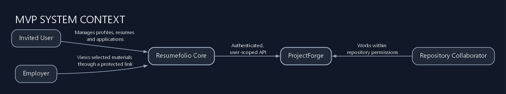

# Project Charter

| Item | Project position |
| --- | --- |
| Product | Web-Resumefolio |
| Owner and decision authority | Farhad |
| Initial release | MVP, planned as the first stable release, version 1.0.0 |
| Scope status | MVP product scope is recorded. Implementation and release acceptance require their own evidence. |

## Purpose and success

Professional information is reused across resumes and applications. A user needs to tailor what they send without losing control of private files or overwriting the materials previously submitted. Resumefolio provides an invited, private workspace that preserves those distinctions.

The MVP serves four objectives:

1. Let invited users maintain a private profile and create tailored professional materials from it.
2. Give users explicit control over what they publish and what an employer can retrieve.
3. Preserve actual submitted materials while users track application status, next actions and follow-up.
4. Provide the selected repository collaboration workflow through a separate, authorized ProjectForge system.

Successful release requires the agreed user journeys and their relevant denial and recovery checks to pass on the same identified release candidate.

## MVP scope

| Area | Included in the MVP |
| --- | --- |
| Accounts and workspace | Owner/admin-created or invited accounts, a private dashboard and user-scoped access. No public self-registration. |
| Professional presentation | Reusable profiles, independent tailored resumes and portfolios, manually authored cover letters, and generated or uploaded PDFs. Preview, selected profile updates and publication are separate actions. |
| Files and employer sharing | A private library on the existing Resumefolio server, with controlled access to the published revision and explicitly selected files. Employer viewers use protected link access without an owner account. Direct retrieval honors the same policy. |
| Job applications | Manual recording of an opportunity, the exact submitted materials, status, next action and follow-up. Later edits preserve submitted history. |
| ProjectForge | A separate system connected to Core through an authenticated user-scoped API. It supplies real Git transfers, repository permissions, file/history browsing, issues and simple Kanban. |

### Out of scope

Personal mail and calendar connections, AI, automatic translation, automatic submission of applications, advanced Git review and release tools, advanced ProjectForge backlog and sprint features, and user-defined workflow execution or deployment are deferred.

## MVP system context

[Editable Graphviz source](Diagrams/Charter-Mvp-System-Context.dot)

## Responsibilities

| Stakeholder | Responsibility or access |
| --- | --- |
| Farhad, project owner | Owns scope decisions, development and operations. Reviews scope changes and decides whether the release evidence meets the agreed outcome. |
| Owner or administrator role | Creates or invites accounts and manages operational settings and authorized audit metadata. The role grants no automatic access to users' private materials. |
| Invited account holder | Maintains private materials, chooses what to publish and records applications. |
| Employer viewer | Views only the resume and accompanying materials authorized for the protected share. |
| ProjectForge collaborator | Works within repository and issue permissions. Collaboration grants do not provide access to private Core content. |

## Constraints and dependencies

- Core and ProjectForge have distinct authority and data ownership. Their integration depends on current authentication and grant checks.
- Private MVP media uses the existing Resumefolio server. Verify host resources, service isolation and usable backups before production use.
- Invitation and recovery depend on verified system mail delivery. Employer access depends on keeping the publication and selected files protected after revocation.
- Follow the [feasibility and risk assessment](03-Feasibility-And-Risk-Assessment.md) for evidence and open dependencies. Technical choices and implementation contracts are recorded in the [architecture decisions](../04-System-Design/ADR/Decision-Index.md).

## Release decision

Farhad approved the MVP scope with Resumefolio Core and a separate ProjectForge system. The planned stable release is version 1.0.0. Evaluate the candidate against the [release criteria](../06-Deployment-Release/01-Deployment-Plan.md) before tagging or publishing it.

Use the [project management plan](02-Project-Management-Plan.md) to record scope changes and their impact on design and verification. The [SRS](../02-Requirements-Engineering/01-Software-Requirements-Specification.md#requirements-specification-requirements-specification) owns detailed behavior and acceptance criteria.

## MVP outcome checks

| Outcome | Evidence expected on the release candidate |
| --- | --- |
| Invited access works within permissions | An invited account completes admission and authorized work. Expired invitations, disabled accounts and unrelated resource access are denied. |
| Publication is explicit and limited | An invited user creates an independent resume, publishes the intended revision and shares only selected artifacts. Revocation prevents later access. |
| Submitted history remains intact | The exact captured materials stay available after later profile and resume changes. Other users cannot retrieve the application. |
| ProjectForge collaboration works within current grants | A permitted Git client and collaborator complete the selected operations. Unauthorized operations and stale issue changes are denied without overwriting newer work. |
| Release and recovery are supportable | Record the candidate, supported interfaces, verification results, unresolved risks and successful isolated recovery evidence. |

The [requirements traceability matrix](../02-Requirements-Engineering/03-Requirements-Traceability-Matrix.md) tracks applicable criteria, design ownership and verification status.
