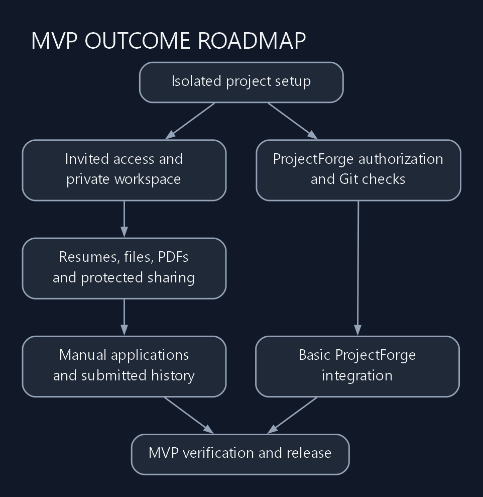

# Project Management Plan

This plan defines how Farhad selects, delivers and verifies the Resumefolio MVP. The [project charter](01-Project-Charter.md) owns the product scope and success outcomes. The [feasibility and risk assessment](03-Feasibility-And-Risk-Assessment.md) owns open operational assumptions and their evidence.

| Responsibility | Owner and record |
| --- | --- |
| Product and scope decisions | Farhad. Record the outcome in the charter, SRS or design decision as applicable. |
| Work selection and execution | Farhad. Use GitHub issues and the board for dependencies, priority, blockers and progress. |
| Acceptance and release | Farhad. Review the actual results against the release criteria and record the decision on the candidate. |
| Participant feedback | Invite relevant owners, users or collaborators for affected journeys when available. Record feedback with the reviewed revision and work item. |

## Delivery approach

Resumefolio uses **Agile with Upfront Architecture**. Establish the system boundaries, quality constraints and consequential decisions early. Refine the requirements and design of the selected capability during development using evidence and feedback.

Use the [product backlog](../02-Requirements-Engineering/02-Product-Backlog/README.md) and [GitHub board](https://github.com/users/Farhad-V/projects/7/views/1) to track work. Apply the [development cycle](#stage-5-agile-iterative-development) in reviewable increments.

| Sprint record | What to record |
| --- | --- |
| Planning | Goal, selected issue links, acceptance checks, blockers and any refinement required before work begins. |
| Review | Demonstrated outcome, tested revision, results, unresolved items and next actions. Keep detailed implementation evidence in the issue or owning document. |
| Retrospective | What helped, what caused friction and one improvement to try in the next sprint. |

Begin with the proposed [Sprint 01 plan](../05-Agile-Iterative-Development/Sprints/Sprint-01/01-Sprint-Planning.md). Confirm its issue selection and prerequisites before recording it as started.

## Deliverables and control

Begin with [isolated project setup](../05-Agile-Iterative-Development/01-Project-Setup.md). Verify that the applications in scope can be built and tested independently. Track the following for each delivered increment:

- **Work item:** outcome, requirement or decision, dependency, acceptance conditions and owner.
- **Change:** code or documentation revision, affected interfaces and approved deviations.
- **Verification:** environment, expected and observed result, evidence and any remaining failure or gap.
- **Review:** demonstrated result, feedback, acceptance disposition and linked follow-up.

Use the [test strategy](../05-Agile-Iterative-Development/02-Test-Strategy.md) for checks during an increment and the [deployment plan](../06-Deployment-Release/01-Deployment-Plan.md) for the release decision.

## Delivery sequence

Treat milestones as evidence-based outcomes. The sequence identifies dependencies and does not assign sprint dates.

| Outcome | Prerequisite | Evidence to proceed |
| --- | --- | --- |
| Reproducible local setup | Selected host and stack | Clean install, build, isolated storage and databases, and a local smoke check |
| Invited identity and private workspace | Local setup | Valid invited access, denied unrelated access and verified account lifecycle behavior |
| Presentation and protected sharing | Identity and workspace | Independent drafts, explicit publication and authorized artifact retrieval |
| Manual application history | Stable artifact and publication handling | Original submitted materials retained through later edits and supported retries |
| Basic ProjectForge integration | Verify the identity and native Git boundary early, before dependent integration | Repository operations and issue/board behavior within the current grants |
| Stable MVP release | Selected capabilities and release checks | Verified candidate, compatibility statement, recovery evidence and release decision |

Use the linked issues for active dependencies and the [charter](01-Project-Charter.md#mvp-scope) for the authorized scope.

## Change control

For a change to accepted scope, an interface or a design decision, record what is changing, why, which requirements and tests are affected and who decides. Update the owning documents and backlog after the decision. Link the implementation and verification evidence when available.

Use the [decision register](https://github.com/Farhad-V/Web-Resumefolio/blob/1f2acaa351ac306cb57cbe4fe9742e8bd90720d9/docs/MVP/SDLC/01-project-planning/decision-register.md) for earlier decisions, the [planning acceptance record](https://github.com/Farhad-V/Web-Resumefolio/blob/1f2acaa351ac306cb57cbe4fe9742e8bd90720d9/docs/MVP/SDLC/01-project-planning/10-planning-completion-criteria.md) for the recorded review and follow-up, and the [planning diagram map](https://github.com/Farhad-V/Web-Resumefolio/blob/1f2acaa351ac306cb57cbe4fe9742e8bd90720d9/docs/MVP/SDLC/01-project-planning/diagrams/planning-document-map.svg) for the original visual overview.

## Work breakdown, quality and communication

Use one issue per reviewable outcome. Include the requirement or decision it implements, its dependencies, acceptance checks and expected demonstration. Split work that cannot be verified independently into smaller steps. The GitHub board reflects current progress. Use each issue to record results, blockers and decisions as work is reviewed.

For each increment, check the affected acceptance criteria, relevant failure paths and regression behavior. Record the checked revision and result. Resolve or explicitly track gaps before marking the work verified. For the release, use the quality and recovery criteria in the release document.

### Outcome roadmap

[Editable Graphviz source](Diagrams/Project-Management-Outcome-Roadmap.dot)

## Decision and review records

Record accepted changes in the owning document and link the outcome from the relevant issue. Preserve decisions with their context, rationale and status. The past planning review accepted the identified snapshot with follow-up. Its open items require their own evidence before closure.

## SDLC stages and deliverables

The stage structure and deliverable types follow the SDLC Complete Engineering Guide.

| Stage | Project documentation |
| --- | --- |
| 1. Project Planning / Initiation | [Project charter](01-Project-Charter.md), [management plan](#deliverables-and-control) and [feasibility and risks](03-Feasibility-And-Risk-Assessment.md) |
| 2. Requirements Engineering | [SRS](../02-Requirements-Engineering/01-Software-Requirements-Specification/README.md), [product backlog](../02-Requirements-Engineering/02-Product-Backlog/README.md) and [traceability matrix](../02-Requirements-Engineering/03-Requirements-Traceability-Matrix/README.md) |
| 3. System Analysis | [System analysis](../03-System-Analysis/01-System-Context-And-Gap-Analysis.md) |
| 4. System Design | [HLD](../04-System-Design/01-High-Level-Design/01-Introduction.md), [UI/UX](../04-System-Design/02-UI-UX-Design/01-Introduction.md), [LLD](../04-System-Design/03-Low-Level-Design/01-Introduction.md), [database](../04-System-Design/03-Low-Level-Design/04-Database-Design.md), [API](../04-System-Design/03-Low-Level-Design/05-API-Specification.md), [ADRs](../04-System-Design/ADR/Decision-Index.md) |
| 5. Agile Iterative Development | [Development guide](../05-Agile-Iterative-Development/00-Agile-Iterative-Development.md) |
| 6. Deployment / Release | [Release preparation and evidence](../06-Deployment-Release/01-Deployment-Plan.md) |
| 7. Maintenance & Evolution | [Operations and maintenance](../07-Maintenance-Evolution/01-Maintenance-Plan.md) |

## Stage 4: System Design

The Software Design Document is organized into three design records. [High-Level Design](../04-System-Design/01-High-Level-Design/01-Introduction.md), [UI/UX Design](../04-System-Design/02-UI-UX-Design/01-Introduction.md), [Low-Level Design](../04-System-Design/03-Low-Level-Design/01-Introduction.md). Use the [design review and handoff](../04-System-Design/01-High-Level-Design/14-Appendices.md#design-review-and-implementation-handoff) to refine and verify the design during development.

## Stage 5: Agile Iterative Development

Use the [development guide](../05-Agile-Iterative-Development/00-Agile-Iterative-Development.md) to find setup, test strategy and the records for each sprint.

## Documentation deliverables

The guide identifies 15 deliverable types. These links point to the owning documents and their supporting records.

| Deliverable | Project source |
| --- | --- |
| 1. Project Charter | [Project charter](01-Project-Charter.md) |
| 2. Project Management Plan | [Project management plan](#deliverables-and-control) |
| 3. Feasibility & Risk Assessment | [Feasibility and risk assessment](03-Feasibility-And-Risk-Assessment.md) |
| 4. Software Requirements Specification | [SRS](../02-Requirements-Engineering/01-Software-Requirements-Specification/README.md) |
| 5. Product Backlog | [Product backlog](../02-Requirements-Engineering/02-Product-Backlog/README.md) |
| 6. Requirements Traceability Matrix | [Requirements traceability matrix](../02-Requirements-Engineering/03-Requirements-Traceability-Matrix/README.md) |
| 7. System Analysis Document | [Actors, scenarios, models and rules](../03-System-Analysis/01-System-Context-And-Gap-Analysis.md) |
| 8. Software Architecture Document | [Architecture](../04-System-Design/01-High-Level-Design/14-Appendices.md#design-record-01-software-architecture-software-architecture-md) and [architecture decisions](../04-System-Design/ADR/Decision-Index.md#design-record-07-design-decisions-design-decisions-md) |
| 9. UI/UX Design Specification | [Interaction and accessibility design](../04-System-Design/02-UI-UX-Design/01-Introduction.md). Record screen-level details with the relevant implementation package. |
| 10. Database Design Document | [Data design](../04-System-Design/03-Low-Level-Design/04-Database-Design.md#design-record-04-data-design-data-design-md) |
| 11. Low-Level Design | [Detailed design](../04-System-Design/03-Low-Level-Design/12-Appendices.md#design-record-02-detailed-and-object-oriented-design-detailed-and-object-oriented-design-md) and [component design](../04-System-Design/03-Low-Level-Design/02-Module-Breakdown.md#design-record-03-component-and-module-design-component-and-module-design-md) |
| 12. API Specification | [Interface and API design](../04-System-Design/03-Low-Level-Design/05-API-Specification.md#design-record-05-interface-and-api-design-interface-and-api-design-md). Verify contracts against the implemented interfaces during development. |
| 13. Test Strategy & Test Plan | [Test plan](../05-Agile-Iterative-Development/02-Test-Strategy.md) and [verification gates](https://github.com/Farhad-V/Web-Resumefolio/blob/1f2acaa351ac306cb57cbe4fe9742e8bd90720d9/docs/MVP/baseline/implementation-sequence.md) |
| 14. Test Cases & Test Reports | [Acceptance criteria](https://github.com/Farhad-V/Web-Resumefolio/blob/1f2acaa351ac306cb57cbe4fe9742e8bd90720d9/docs/MVP/baseline/criterion-dispositions.md) and [test evidence record](../05-Agile-Iterative-Development/02-Test-Strategy.md). Execution is pending. |
| 15. Deployment & Operations Documentation | [Release preparation](../06-Deployment-Release/01-Deployment-Plan.md) and [maintenance](../07-Maintenance-Evolution/01-Maintenance-Plan.md) |

The selected MVP baseline and design are documented. Begin stage 5 with [isolated project setup](../05-Agile-Iterative-Development/01-Project-Setup.md). As work lands, connect requirements and acceptance criteria to analysis and design, the implementation revision, test results and the release record.

## Work item review and closure

Mark an item complete when its intended outcome is demonstrated, applicable checks have recorded evidence and affected documents reflect the implementation. A proposed or blocked outcome stays visible with its owner and follow-up issue.

For surprise behavior, record expected versus observed behavior, affected revision and priority. After a fix, run the affected check and relevant regression cases. Update the [RTM](../02-Requirements-Engineering/03-Requirements-Traceability-Matrix/README.md) with the verified result or the reason it remains pending.

Record status and decisions when they change in the owning issue. Summarize the increment in the sprint review and carry process improvements into the next sprint plan. Use the [maintenance plan](../07-Maintenance-Evolution/01-Maintenance-Plan.md) for production follow-up after release.
