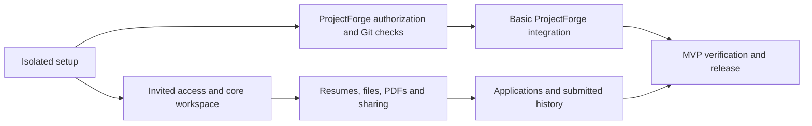

# Project Management Plan

## Delivery approach

Resumefolio uses **Agile with Upfront Architecture** from project initiation, following sections 1–3 of the SDLC Complete Engineering Guide. Establish system boundaries, important quality constraints and high-risk decisions early. Revisit affected requirements and designs as implementation and evidence clarify them.

Use the [GitHub board](https://github.com/users/Farhad-V/projects/7/views/1) to track work. Apply the [Development cycle](#stage-5-agile-iterative-development) to each increment: plan the sprint goal, refine work items, clarify detailed design, implement, test, review the outcome and record an improvement for the next cycle.

## Deliverables and control

- Begin with [isolated project setup](../05-Agile-Iterative-Development/01-Project-Setup.md). Verify that both applications can be built and tested independently.
- Maintain the software, engineering documents and test evidence associated with each increment. Use the [outcome roadmap](#delivery-sequence) for milestones and prerequisites.
- Record the issue, intended outcome, acceptance checks, tested revision and review result. Keep proposed, accepted and demonstrated outcomes distinguishable.
- Carry open issues from the [feasibility and risk assessment](03-Feasibility-And-Risk-Assessment.md) into the affected work items. Verify the [release criteria](../06-Deployment-Release/01-Deployment-Plan.md) before publishing the MVP.

## Delivery sequence

1. Establish and verify an isolated local setup for both applications.
2. Build invited access and the core workspace. Verify the ProjectForge identity and Git boundary early, before dependent integration.
3. Deliver resumes and portfolios, private files, PDFs and employer sharing, then application tracking with preserved submitted materials.
4. Integrate the agreed basic ProjectForge capabilities. Verify the complete user journeys, security and recovery before the first stable MVP release.

Use roadmap milestones as outcome checkpoints. Link each completed outcome to its work item and evidence.

## Change control

For a change to accepted scope, an interface or a design decision, record what is changing, why, which requirements and tests are affected and who decides. Update the owning documents and backlog after the decision. Link the implementation and verification evidence when available.

Use the [decision register](https://github.com/Farhad-V/Web-Resumefolio/blob/1f2acaa351ac306cb57cbe4fe9742e8bd90720d9/docs/MVP/SDLC/01-project-planning/decision-register.md) for earlier decisions, the [planning acceptance record](https://github.com/Farhad-V/Web-Resumefolio/blob/1f2acaa351ac306cb57cbe4fe9742e8bd90720d9/docs/MVP/SDLC/01-project-planning/10-planning-completion-criteria.md) for the recorded review and follow-up, and the [planning diagram map](https://github.com/Farhad-V/Web-Resumefolio/blob/1f2acaa351ac306cb57cbe4fe9742e8bd90720d9/docs/MVP/SDLC/01-project-planning/diagrams/planning-document-map.svg) for the original visual overview.

## Work breakdown, quality and communication

Use one issue per reviewable outcome. Include the requirement or decision it implements, its dependencies, acceptance checks and expected demonstration. Split work that cannot be verified independently into smaller steps. The GitHub board reflects current progress. Use each issue to record results, blockers and decisions as work is reviewed.

For each increment, check the affected acceptance criteria, relevant failure paths and regression behavior. Record the checked revision and result. Resolve or explicitly track gaps before marking the work verified. For the release, use the quality and recovery criteria in the release document.

### Outcome roadmap

## Decision and review records

Record accepted changes in the owning document and link the outcome from the relevant issue. Preserve decisions with their context, rationale and status. The past planning review accepted the identified snapshot with follow-up. Its open items require their own evidence before closure.

## SDLC stages and deliverables

The stage structure and deliverable types follow the SDLC Complete Engineering Guide.

| Stage | Project documentation |
| --- | --- |
| 1. Project Planning / Initiation | [Project charter](01-Project-Charter.md), [management plan](#deliverables-and-control) and [feasibility and risks](03-Feasibility-And-Risk-Assessment.md) |
| 2. Requirements Engineering | [SRS](../02-Requirements-Engineering/01-Software-Requirements-Specification.md), [product backlog](../02-Requirements-Engineering/02-Product-Backlog.md) and [traceability matrix](../02-Requirements-Engineering/03-Requirements-Traceability-Matrix.md) |
| 3. System Analysis | [System analysis](../03-System-Analysis/01-System-Analysis.md) |
| 4. System Design | [HLD](../04-System-Design/01-High-Level-Design/01-High-Level-Design.md), [UI/UX](../04-System-Design/02-UI-UX-Design/02-UI-UX-Design.md), [LLD](../04-System-Design/03-Low-Level-Design/03-Low-Level-Design.md), [database](../04-System-Design/03-Low-Level-Design/04-Database-Design.md), [API](../04-System-Design/03-Low-Level-Design/05-API-Specification.md), [ADRs](../04-System-Design/ADR/Decision-Index.md) |
| 5. Agile Iterative Development | [Development guide](../05-Agile-Iterative-Development/00-Agile-Iterative-Development.md) |
| 6. Deployment / Release | [Release preparation and evidence](../06-Deployment-Release/01-Deployment-Plan.md) |
| 7. Maintenance & Evolution | [Operations and maintenance](../07-Maintenance-Evolution/01-Maintenance-Plan.md) |

## Stage 4: System Design

The Software Design Document is organized into three design records. [High-Level Design](../04-System-Design/01-High-Level-Design/01-High-Level-Design.md), [UI/UX Design](../04-System-Design/02-UI-UX-Design/02-UI-UX-Design.md), [Low-Level Design](../04-System-Design/03-Low-Level-Design/03-Low-Level-Design.md). Use the [design review and handoff](../04-System-Design/01-High-Level-Design/14-Appendices.md#design-review-and-implementation-handoff) to refine and verify the design during development.

## Stage 5: Agile Iterative Development

Use the [development guide](../05-Agile-Iterative-Development/00-Agile-Iterative-Development.md) to find setup, test strategy and the records for each sprint.

## Documentation deliverables

The guide identifies 15 deliverable types. These links point to the owning documents and their supporting records.

| Deliverable | Project source |
| --- | --- |
| 1. Project Charter | [Project charter](01-Project-Charter.md) |
| 2. Project Management Plan | [Project management plan](#deliverables-and-control) |
| 3. Feasibility & Risk Assessment | [Feasibility and risk assessment](03-Feasibility-And-Risk-Assessment.md) |
| 4. Software Requirements Specification | [SRS](../02-Requirements-Engineering/01-Software-Requirements-Specification.md) |
| 5. Product Backlog | [Product backlog](../02-Requirements-Engineering/02-Product-Backlog.md) |
| 6. Requirements Traceability Matrix | [Requirements traceability matrix](../02-Requirements-Engineering/03-Requirements-Traceability-Matrix.md) |
| 7. System Analysis Document | [Actors, scenarios, models and rules](../03-System-Analysis/01-System-Analysis.md) |
| 8. Software Architecture Document | [Architecture](../04-System-Design/01-High-Level-Design/14-Appendices.md#design-record-01-software-architecture-software-architecture-md) and [architecture decisions](../04-System-Design/ADR/Decision-Index.md#design-record-07-design-decisions-design-decisions-md) |
| 9. UI/UX Design Specification | [Interaction and accessibility design](../04-System-Design/02-UI-UX-Design/02-UI-UX-Design.md). Record screen-level details with the relevant implementation package. |
| 10. Database Design Document | [Data design](../04-System-Design/03-Low-Level-Design/04-Database-Design.md#design-record-04-data-design-data-design-md) |
| 11. Low-Level Design | [Detailed design](../04-System-Design/03-Low-Level-Design/12-Appendices.md#design-record-02-detailed-and-object-oriented-design-detailed-and-object-oriented-design-md) and [component design](../04-System-Design/03-Low-Level-Design/02-Module-Breakdown.md#design-record-03-component-and-module-design-component-and-module-design-md) |
| 12. API Specification | [Interface and API design](../04-System-Design/03-Low-Level-Design/05-API-Specification.md#design-record-05-interface-and-api-design-interface-and-api-design-md). Verify contracts against the implemented interfaces during development. |
| 13. Test Strategy & Test Plan | [Test plan](../05-Agile-Iterative-Development/02-Test-Strategy.md) and [verification gates](https://github.com/Farhad-V/Web-Resumefolio/blob/1f2acaa351ac306cb57cbe4fe9742e8bd90720d9/docs/MVP/baseline/implementation-sequence.md) |
| 14. Test Cases & Test Reports | [Acceptance criteria](https://github.com/Farhad-V/Web-Resumefolio/blob/1f2acaa351ac306cb57cbe4fe9742e8bd90720d9/docs/MVP/baseline/criterion-dispositions.md) and [test evidence record](../05-Agile-Iterative-Development/02-Test-Strategy.md). Execution is pending. |
| 15. Deployment & Operations Documentation | [Release preparation](../06-Deployment-Release/01-Deployment-Plan.md) and [maintenance](../07-Maintenance-Evolution/01-Maintenance-Plan.md) |

The selected MVP baseline and design are documented. Begin stage 5 with [isolated project setup](../05-Agile-Iterative-Development/01-Project-Setup.md). As work lands, connect requirements and acceptance criteria to analysis and design, the implementation revision, test results and the release record.
