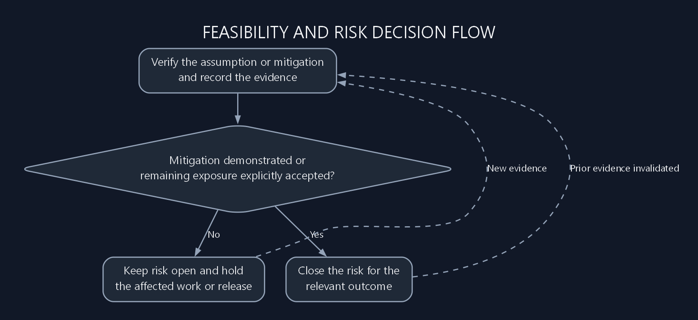

# Feasibility & Risk Assessment

**Assessment:** The selected architecture provides a basis for isolated setup and technical verification. Production feasibility remains open until the target environment, access boundaries and recovery are demonstrated. This assessment records what Farhad needs to verify and which decisions depend on the results.

The [project charter](01-Project-Charter.md#mvp-scope) defines the MVP scope. The [project management plan](02-Project-Management-Plan.md#delivery-sequence) determines the order of work.

## Assumptions and dependencies

| Assumption or dependency | How to validate it | Work affected if unresolved |
| --- | --- | --- |
| Core and ProjectForge can run with isolated processes, databases, credentials, sessions and private storage. | Perform a clean install, build and migration in isolated environments. Record the runtime versions, access boundaries and smoke results. | Dependent feature and integration work |
| Invitations and recovery can rely on system mail. | Send invite and recovery messages to controlled inboxes and verify delivery and expiry behavior. | Operational account onboarding and recovery |
| ProjectForge can enforce current account entitlement and local repository grants. | Verify supported browser, API and Git operations using synthetic accounts with distinct grants. Recheck access after entitlement changes. | ProjectForge integration |
| Private media can remain on the existing server. | Demonstrate authorized and denied retrieval, resource limits and restore under the intended operating configuration. | Production file uploads and sharing |
| Backup covers the databases, private artifacts and Git repositories needed for restart. | Restore a coherent backup to an isolated environment. Verify record relationships, digests, Git refs and effective access. | Stable production release |
| Personal mail and calendar are outside the MVP. | Apply the approved scope when defining backlog dependencies. | Reassess only if scope changes |

## Resource constraints

- Start with the existing host, development tools and private same-server media storage.
- Keep the Core and ProjectForge resource boundaries separate even if they initially share a physical host. Account for their shared failure domain in the recovery plan.
- Check dependency compatibility, disk headroom, storage growth under representative operations and worker behavior before relying on the environment.
- Review the cost and licensing impact of any additional tooling, hosting or services with Farhad before committing. Use measured evidence to identify the resource gap.
- Keep test data and rehearsal storage isolated from production data.

## Risks and verification

All items below are open. Farhad owns follow-up and records evidence with the associated work item. Likelihood is pending assessment. Impact describes the consequence if the risk occurs.

| Risk | Impact | Mitigation and evidence needed | Decision if evidence is insufficient |
| --- | --- | --- | --- |
| Host or dependency incompatibility prevents a repeatable build | High | Verify clean dependency installation, builds and isolated migrations for both applications. Record supported runtime versions. | Reconcile the environment before dependent implementation. |
| Inadequate isolation exposes data across applications or accounts | High | Check separate credentials and storage boundaries using distinct synthetic accounts and current access grants. | Hold the affected integration or deployment. |
| ProjectForge grants or account revocation are enforced inconsistently | High | Validate permitted and denied Git and issue operations, including after a grant or account changes. | Hold ProjectForge integration and review the authority model. |
| A share exposes unpublished or unselected material | High | Check authorized, denied and revoked access to the intended publication and direct file retrieval. | Hold protected sharing. |
| Publication, retry or later edits alter submitted history | High | Preserve immutable submitted artifacts and verify their digests after later edits and retry scenarios. | Hold the affected publication or submission flow. |
| System mail fails to deliver an invitation or recovery message | High | Exercise delivery with controlled accounts and confirm appropriate failure handling. | Hold operational onboarding or recovery. |
| Concurrent work exhausts host storage | High | Test admission limits, retained references and observable low-space behavior with synthetic data. | Restrict intake until capacity and controls are verified. |
| A backup cannot restore intact data and current permissions | High | Demonstrate an isolated restore and verify representative data, revocation state and service behavior. | Hold stable production release. |

## Feasibility and risk tracking

| Assessment area | Current conclusion | Evidence needed |
| --- | --- | --- |
| Technical | The stack and ownership boundaries are selected. Runtime fit is pending. | [Project setup](../05-Agile-Iterative-Development/01-Project-Setup.md), supported Git operations and protected storage checks. |
| Economic | The plan uses the existing host and tools. Additional cost has not been established. | Capacity evidence and documented cost or licensing review if the current resources prove insufficient. |
| Operational | The design identifies required mail, monitoring, backup and recovery responsibilities. They still require demonstration. | Recorded mail delivery, service checks and isolated recovery through the [deployment plan](../06-Deployment-Release/01-Deployment-Plan.md) and [runbook](../06-Deployment-Release/02-Runbook.md). |

The [underlying feasibility study](../02-Requirements-Engineering/01-Software-Requirements-Specification.md#process-and-approach-02-feasibility-study) supplies supporting context. The [test strategy](../05-Agile-Iterative-Development/02-Test-Strategy.md) defines how to record execution evidence.

### Risk decision flow

[Editable Graphviz source](Diagrams/Feasibility-And-Risk-Decision-Flow.dot)

## Evidence that changes a risk rating

Record the reviewed assumption, tested revision and environment, measured or observed result, and the effect on likelihood, impact or remaining exposure. Link the issue and owner decision. Close a risk only when the mitigation has been demonstrated or the remaining exposure has been explicitly accepted for the relevant outcome. Reopen it when a design, environment or dependency change invalidates the prior evidence.
