# Software Requirements Specification (SRS)

## Introduction

This is the requirements entry point for Resumefolio. It serves the project owner, implementation and test work. The [project charter](../01-Project-Planning/01-Project-Charter.md#mvp-scope) defines the MVP release boundary. The [detailed specification](#requirements-specification-requirements-specification) and its domain documents own the individual requirement wording and acceptance criteria.

## Overall description

Resumefolio Core provides the private workspace. ProjectForge is a separate system connected through scoped authorization. The principal users are invited account holders, an owner or administrator, employers with a protected share and repository collaborators with assigned permissions. The [operating constraints](../01-Project-Planning/03-Feasibility-And-Risk-Assessment.md#resource-constraints) cover the host, separate databases and private storage. Setup and runtime assumptions still require verification.

## Functional requirements

| Capability | Detailed requirements |
| --- | --- |
| Invited identity and resource access | [Accounts and permissions](#requirements-specification-accounts-authentication-and-permissions) |
| Professional profile, independent resumes and portfolio | [Professional presentation](#requirements-specification-profiles-resumes-and-portfolio) |
| Private files, generated or uploaded PDFs and controlled employer sharing | [Files and operations](#requirements-specification-administration-files-and-operational-behavior) and [PDF and sharing](#requirements-specification-pdf-and-controlled-sharing) |
| Manual applications and immutable submitted history | [Application management](#requirements-specification-manual-application-management) and [business rules](#requirements-specification-business-rules-and-data-lifecycle) |
| Scoped ProjectForge repositories, issues and simple Kanban | [Git collaboration](#requirements-specification-git-hosting-and-collaboration) and [work management](#requirements-specification-projects-kanban-and-sprints) |

## Non-functional requirements

Use the [quality, security and recovery requirements](#requirements-specification-quality-security-and-recovery-requirements) for authorization, performance, accessibility, availability, resilience and operational checks. Preserve the recorded status of any proposed thresholds or compliance targets. Verification applies to the actual release candidate.

## External interfaces

The [interface requirements](#requirements-specification-external-interface-requirements) cover user-facing interactions, service boundaries, supported communication and integration behavior. Technical details are in the [system design](../01-Project-Planning/02-Project-Management-Plan.md#stage-4-system-design).

## Supporting evidence and changes

- [Business goals](#requirements-specification-business-requirements) and [stakeholder needs](#stakeholders-and-elicitation-stakeholders-and-elicitation)
- [User stories and scenarios](#scenarios-and-models-user-stories-and-scenarios) and [analysis models](../03-System-Analysis/01-System-Analysis.md)
- [Glossary](#data-definitions-glossary) and [data dictionary](#data-definitions-data-dictionary)
- [Decisions and open issues](#change-and-baseline-open-questions-and-decisions), [review and evidence](#validation-and-traceability-validation-and-traceability) and [change control](#change-and-baseline-change-control)
- [Product backlog](02-Product-Backlog.md) and [requirements traceability matrix](03-Requirements-Traceability-Matrix.md)

## Consolidated requirements records

The seven sections below combine the former requirements folders. The overview above records the current MVP boundary. Detailed source records retain their original decision and verification status. The [Product Backlog](02-Product-Backlog.md) owns execution work and the [Requirements Traceability Matrix](03-Requirements-Traceability-Matrix.md) indexes coverage.

- [Process and Approach](#process-and-approach)
- [Stakeholders and Elicitation](#stakeholders-and-elicitation)
- [Requirements Specification](#requirements-specification)
- [Scenarios and Models](#scenarios-and-models)
- [Data Definitions](#data-definitions)
- [Validation and Traceability](#validation-and-traceability)
- [Change and Baseline](#change-and-baseline)


<a id="process-and-approach"></a>

## Process and Approach

<a id="process-and-approach-02-feasibility-study"></a>

<details>
<summary>Resumefolio — Feasibility Study</summary>

<a id="process-and-approach-02-feasibility-study--heading-resumefolio--feasibility-study"></a>
#### Resumefolio — Feasibility Study

**Assessment:** The existing host has been inventoried. Its ability to run the new MVP alongside the existing application still needs to be verified. Start by checking capacity and isolation, then use the [MVP verification gates](https://github.com/Farhad-V/Web-Resumefolio/blob/1f2acaa351ac306cb57cbe4fe9742e8bd90720d9/docs/MVP/baseline/implementation-sequence.md#gate-register) to decide when each dependent activity can proceed.

<a id="process-and-approach-02-feasibility-study--heading-what-needs-to-be-proven"></a>
##### What needs to be proven

| Area | Next check |
| --- | --- |
| **Host capacity and isolation** | Measure CPU, memory and disk headroom with the existing application and representative Core, MySQL, media and ProjectForge Git workloads. Verify that the two new applications can use separate accounts, databases and storage. [Host assessment](https://github.com/Farhad-V/Web-Resumefolio/issues/2) |
| **Environment compatibility** | Verify maintained runtime versions, dependencies and isolated MySQL for the selected stack. Demonstrate a clean install, build and test before closing Setup. [Project Setup](https://github.com/Farhad-V/Web-Resumefolio/issues/37) |
| **Identity and Git** | Prove scoped sign-in, real Git transfers, revocation and denial with two users. Resolve isolation or capacity failures before enabling dependent Git features. [Git security test](https://github.com/Farhad-V/Web-Resumefolio/issues/38) |
| **Operations and recovery** | Demonstrate delivery of invitation and recovery emails, verify TLS renewal and background processing, and test an independent backup and isolated restore. [Email delivery](https://github.com/Farhad-V/Web-Resumefolio/issues/5) · [Restore drill](https://github.com/Farhad-V/Web-Resumefolio/issues/27) |

<a id="process-and-approach-02-feasibility-study--heading-budget-schedule-and-licenses"></a>
##### Budget, schedule and licenses

Use the [planning capacity and sizing record](https://github.com/Farhad-V/Web-Resumefolio/blob/1f2acaa351ac306cb57cbe4fe9742e8bd90720d9/docs/MVP/SDLC/01-project-planning/11-capacity-and-preliminary-sizing.md) and [resource constraints](../01-Project-Planning/03-Feasibility-And-Risk-Assessment.md#resource-constraints) as inputs. Check how setup effort, license obligations and any additional infrastructure affect feasibility before estimating delivery.

<a id="process-and-approach-02-feasibility-study--id-server-observation-2026-11-01"></a>

<a id="process-and-approach-02-feasibility-study--heading-server-evidence--november-1-2026"></a>
##### Server evidence — November 1, 2026

| Observed | What it tells us |
| --- | --- |
| Hetzner CX23, 2 vCPU, 4 GB RAM and 40 GB disk allocation | Starting point for capacity checks. A low-load sample showed about 2.8 GiB memory and 30 G root filesystem space available. |
| Existing Laravel site with Nginx, PHP 8.3 and MySQL 8.0 | The host already carries application traffic. The observed stack belongs to that deployment. Verify the selected MVP stack separately. |
| HTTPS login returned HTTP 200 and passed TLS verification | HTTPS worked during the check. Renewal and recovery still need their own evidence. |
| Application backup and queue or scheduler operation were not established by the checks | Confirm coverage and configuration before relying on them. The owner subsequently reported that application backups had not been set up. |

The first inventory came from owner-supplied observations. A follow-up read-only inspection confirmed selected versions and HTTPS behavior. The samples establish what was observed on that date. See the [server inventory](#validation-and-traceability-server-observation-2026-11-01), [read-only checks](#validation-and-traceability-server-readonly-check-2026-11-01) and [operating evidence](#validation-and-traceability-operating-check-2026-11-01).

<a id="process-and-approach-02-feasibility-study--heading-after-mvp"></a>
##### After MVP

Google mail and calendar integration and user-controlled workflow execution are deferred. Revisit provider access and runner isolation when those capabilities enter scope. See [requirements decisions](#change-and-baseline-open-questions-and-decisions).

</details>

<a id="process-and-approach-process-and-approach"></a>

<details>
<summary>Requirements Process</summary>

<a id="process-and-approach-process-and-approach--heading-requirements-process"></a>
#### Requirements Process

Work on one MVP behavior at a time. Use the [selected scope and criteria](https://github.com/Farhad-V/Web-Resumefolio/blob/1f2acaa351ac306cb57cbe4fe9742e8bd90720d9/docs/MVP/baseline/criterion-dispositions.md) to decide what belongs in the release.

| Activity | What to do in Resumefolio |
| --- | --- |
| **Discover** | Identify the actor, need and source. Record confirmed input and open questions in the [elicitation log](#stakeholders-and-elicitation-elicitation-log). |
| **Analyze and agree** | Resolve conflicting needs, check [feasibility](#process-and-approach-02-feasibility-study), and decide what is required for MVP. Record the choice and its reason in the [decision index](#change-and-baseline-open-questions-and-decisions). |
| **Specify** | In the [SRS](#requirements-specification-requirements-specification), give each requirement a stable ID, an observable outcome and acceptance criteria. Include applicable quality targets and constraints. |
| **Validate** | Walk through success, denied access and failure with the intended actor. Check that the requirement is testable and record findings and actual evidence in [validation](#validation-and-traceability-validation-and-traceability). |
| **Manage changes** | Keep the ID and baseline history. Use [change control](#change-and-baseline-change-control) to update affected requirements, design and tests when a decision changes. |

**Before baselining:** Check that each requirement answers a real need, has one clear meaning, fits the constraints, agrees with related requirements, has a known priority and can be traced and tested.

</details>

<a id="stakeholders-and-elicitation"></a>

## Stakeholders and Elicitation

<a id="stakeholders-and-elicitation-actors-and-system-context"></a>

<details>
<summary>Resumefolio — Actors and System Context</summary>

<a id="stakeholders-and-elicitation-actors-and-system-context--heading-resumefolio--actors-and-system-context"></a>
#### Resumefolio — Actors and System Context

The MVP gives invited users a private workspace for resumes and job applications. Employers can view material explicitly shared with them. ProjectForge is a separate system for repository collaboration. See the [owner's scope decision](../01-Project-Planning/01-Project-Charter.md#release-decision).

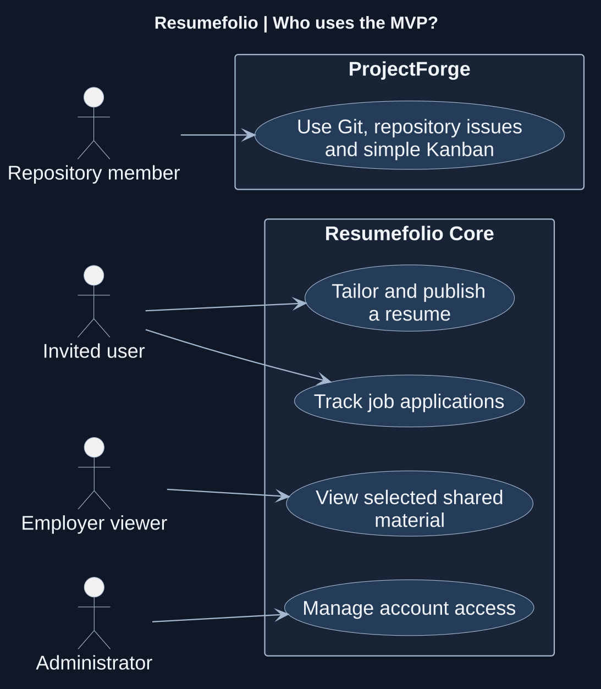

 · [Editable PlantUML](Diagrams/Actors-Goal-Overview.puml)

<a id="stakeholders-and-elicitation-actors-and-system-context--heading-1-stakeholders-actors-and-delivery-responsibilities"></a>
##### 1. Stakeholders, Actors and Delivery Responsibilities

Farhad owns scope, delivery and operations. A person can act in more than one role. Access is evaluated for the current resource and action.

<a id="stakeholders-and-elicitation-actors-and-system-context--heading-2-product-boundary-and-system-context"></a>
##### 2. Product Boundary and System Context

| System | MVP responsibility |
| --- | --- |
| **Resumefolio Core** | Invited access, profiles, tailored resumes, private files and PDFs, controlled sharing and manual applications |
| **ProjectForge** | Real Git transfers, repository permissions, issues and simple Kanban |

<a id="stakeholders-and-elicitation-actors-and-system-context--heading-3-human-actor-and-stakeholder-catalog"></a>
##### 3. Human Actor and Stakeholder Catalog

| Actor | Main goal | Access boundary |
| --- | --- | --- |
| Invited user | Tailor resumes and track applications | Own or explicitly authorized resources |
| Employer viewer | View the resume and material shared for review | Selected content through an eligible protected link |
| Administrator | Manage invited accounts and operational policy | Explicit administrative authority. Private user content requires its own grant. |
| Repository member | Transfer code and work on issues | Current repository grant and permitted action |
| Authorized operator | Maintain service and verify recovery | Approved operating access and procedures |

<a id="stakeholders-and-elicitation-actors-and-system-context--heading-4-actor-goals-and-use-case-context"></a>
##### 4. Actor Goals and Use-Case Context

Start with [resume tailoring, protected sharing and manual applications](#scenarios-and-models-user-stories-and-scenarios). The scenario record includes denied access and failure paths.

<a id="stakeholders-and-elicitation-actors-and-system-context--heading-5-external-systems-clients-and-operational-dependencies"></a>
##### 5. External Systems, Clients and Operational Dependencies

Git clients connect to ProjectForge. Core needs email delivery for invitations and recovery. Hosting and backup support operation. The [verification gates](https://github.com/Farhad-V/Web-Resumefolio/blob/1f2acaa351ac306cb57cbe4fe9742e8bd90720d9/docs/MVP/baseline/implementation-sequence.md#gate-register) track the evidence needed.

<a id="stakeholders-and-elicitation-actors-and-system-context--heading-6-access-data-and-lifecycle-boundaries"></a>
##### 6. Access, Data and Lifecycle Boundaries

Check current actor, resource, action and state before granting access. Publication is explicit, employer retrieval is limited to selected materials, and application history preserves what was actually submitted. See the [permissions matrix](#requirements-specification-accounts-authentication-and-permissions--heading-7-role-resource-and-operation-matrix).

<a id="stakeholders-and-elicitation-actors-and-system-context--heading-7-elicitation-coverage-and-open-questions"></a>
##### 7. Elicitation Coverage and Open Questions

Use the [elicitation log](#stakeholders-and-elicitation-elicitation-log) for source evidence and [requirements decisions](#change-and-baseline-open-questions-and-decisions) for policy and rationale.

<a id="stakeholders-and-elicitation-actors-and-system-context--heading-8-review-checklist-and-current-position"></a>
##### 8. Review Checklist and Current Position

Walk through each MVP goal with its actor. Verify what the actor can do, what is denied and what happens when the operation fails. Record evidence in [validation and traceability](#validation-and-traceability-validation-and-traceability).

<a id="stakeholders-and-elicitation-actors-and-system-context--heading-9-diagram-maintenance"></a>
##### 9. Diagram Maintenance

Regenerate the SVG and 216 DPI PNG from the linked PlantUML source when actor goals or MVP boundaries change.

<a id="stakeholders-and-elicitation-actors-and-system-context--heading-updated-requirements-use-case-views--november-1-2026"></a>
##### Updated Requirements Use-Case Views — November 1, 2026

For the broader and deferred use cases, see the [requirements diagram catalog](Diagrams/Diagram-Catalog.md). Mail, calendar, general Sprints and user workflow execution are after MVP.

</details>

<a id="stakeholders-and-elicitation-elicitation-log"></a>

<details>
<summary>Resumefolio — Elicitation Log</summary>

<a id="stakeholders-and-elicitation-elicitation-log--heading-resumefolio--elicitation-log"></a>
#### Resumefolio — Elicitation Log

This log records where requirements came from and what the owner actually reported. Use the [decision index](#change-and-baseline-open-questions-and-decisions) for current policy and rationale.

<a id="stakeholders-and-elicitation-elicitation-log--heading-source-register"></a>
##### Source register

| ID | Source |
| --- | --- |
| SRC-01 | [Purpose and objectives](../01-Project-Planning/01-Project-Charter.md#purpose-and-success), OBJ-01–05 and DEC-001–008 |
| SRC-02 | [Scope decisions](../01-Project-Planning/01-Project-Charter.md#mvp-scope), DEC-009–028 |
| SRC-03 | [Stakeholders and responsibilities](../01-Project-Planning/01-Project-Charter.md#responsibilities), DEC-029–032 |
| SRC-04 | [Planning decision register](https://github.com/Farhad-V/Web-Resumefolio/blob/1f2acaa351ac306cb57cbe4fe9742e8bd90720d9/docs/MVP/SDLC/01-project-planning/decision-register.md) and [accepted planning snapshot](https://github.com/Farhad-V/Web-Resumefolio/blob/1f2acaa351ac306cb57cbe4fe9742e8bd90720d9/docs/MVP/SDLC/01-project-planning/10-planning-completion-criteria.md#dec-116) |
| SRC-05 | Earlier project chats. Cite the specific turn when used. |
| SRC-06 | [Reference projects](https://github.com/Farhad-V/Web-Resumefolio/blob/1f2acaa351ac306cb57cbe4fe9742e8bd90720d9/docs/MVP/SDLC/01-project-planning/02-scope.md#dec-011). Cite the repository, file and revision when used. |

<a id="stakeholders-and-elicitation-elicitation-log--heading-log-001-scope-decision-extraction"></a>
###### LOG-001: Scope Decision Extraction

Codex reviewed the three scope decisions below and recorded the corresponding needs. This was document analysis. Stakeholder validation is tracked separately.

Inspected working-copy SHA-256: `33b218141cef0799afe61adc098b7c42e6eb3ee9b1826c1b3d03f926b332dd82`.

<a id="stakeholders-and-elicitation-elicitation-log--heading-ext-001-controlled-employer-access"></a>
###### EXT-001: Controlled Employer Access

Employers should see only the shared resume and permitted material. The same access boundary applies to direct file and PDF retrieval. [Source DEC-024](https://github.com/Farhad-V/Web-Resumefolio/blob/1f2acaa351ac306cb57cbe4fe9742e8bd90720d9/docs/MVP/SDLC/01-project-planning/02-scope.md#dec-024) · [Selected sharing policy](https://github.com/Farhad-V/Web-Resumefolio/blob/1f2acaa351ac306cb57cbe4fe9742e8bd90720d9/docs/MVP/baseline/policy-decisions.md#q-d11)

<a id="stakeholders-and-elicitation-elicitation-log--heading-ext-002-manual-applications-and-preserved-submissions"></a>
###### EXT-002: Manual Applications and Preserved Submissions

Users prepare applications, track their progress and preserve the exact materials they submitted. [Source DEC-023](https://github.com/Farhad-V/Web-Resumefolio/blob/1f2acaa351ac306cb57cbe4fe9742e8bd90720d9/docs/MVP/SDLC/01-project-planning/02-scope.md#dec-023) · [Submission history policy](https://github.com/Farhad-V/Web-Resumefolio/blob/1f2acaa351ac306cb57cbe4fe9742e8bd90720d9/docs/MVP/baseline/policy-decisions.md#q-d13)

<a id="stakeholders-and-elicitation-elicitation-log--heading-ext-003-unified-sign-in-and-resource-permissions"></a>
###### EXT-003: Unified Sign-in and Resource Permissions

Users sign in with individual accounts. Access depends on the current grant, resource and action. [Source DEC-028](https://github.com/Farhad-V/Web-Resumefolio/blob/1f2acaa351ac306cb57cbe4fe9742e8bd90720d9/docs/MVP/SDLC/01-project-planning/02-scope.md#dec-028) · [Resource grants policy](https://github.com/Farhad-V/Web-Resumefolio/blob/1f2acaa351ac306cb57cbe4fe9742e8bd90720d9/docs/MVP/baseline/policy-decisions.md#q-d04)

<a id="stakeholders-and-elicitation-elicitation-log--id-log-002-owner-supplied-server-observation-record"></a>

<a id="stakeholders-and-elicitation-elicitation-log--heading-owner-inputs-and-follow-up--november-1-2026"></a>
##### Owner inputs and follow-up — November 1, 2026

| Record | Input or observed activity |
| --- | --- |
| **LOG-002** | The owner supplied hosting screenshots and SSH output. See the [dated server inventory and limits](#process-and-approach-02-feasibility-study--id-server-observation-2026-11-01). |
| <a id="stakeholders-and-elicitation-elicitation-log--id-log-003"></a>**LOG-003** | The owner requested completion of the open questions. Codex drafted proposals and performed [bounded read-only checks](#validation-and-traceability-server-readonly-check-2026-11-01). Individual proposals awaited review. |
| <a id="stakeholders-and-elicitation-elicitation-log--id-log-004-capacity-answer-and-follow-up-observation"></a>**LOG-004** | The owner confirmed **20 total project hours per week**, including learning, documentation and testing. [Capacity record](https://github.com/Farhad-V/Web-Resumefolio/blob/1f2acaa351ac306cb57cbe4fe9742e8bd90720d9/docs/MVP/SDLC/01-project-planning/11-capacity-and-preliminary-sizing.md) |
| <a id="stakeholders-and-elicitation-elicitation-log--id-log-005-actual-oauth-status-answer"></a>**LOG-005** | The owner reported that the intended Google OAuth project had not been created. Google integration is deferred. [Q-D15](#change-and-baseline-open-questions-and-decisions--id-q-d15) |
| <a id="stakeholders-and-elicitation-elicitation-log--id-log-006-actual-backup-setup-answer"></a>**LOG-006** | The owner reported that application backups had not been set up. The destination, coverage and isolated restore still require evidence. [Q-D26](#change-and-baseline-open-questions-and-decisions--id-q-d26) |

<a id="stakeholders-and-elicitation-elicitation-log--heading-5-recording-new-activities"></a>
##### 5. Recording New Activities

Record the date, source, actor, need or observation, and the decision or open question it informs. Link the evidence and keep reported observations separate from verified results.

</details>

<a id="stakeholders-and-elicitation-elicitation-plan-and-techniques"></a>

<details>
<summary>Resumefolio — Elicitation Plan and Techniques</summary>

<a id="stakeholders-and-elicitation-elicitation-plan-and-techniques--heading-resumefolio--elicitation-plan-and-techniques"></a>
#### Resumefolio — Elicitation Plan and Techniques

| Item | Current position |
| --- | --- |
| Purpose | Plan focused elicitation activities and choose techniques that resolve specific uncertainties |
| Responsible person | Farhad; sole delivery and operations owner |
| Document status | Proposed work plan and technique guide — pending owner review |
| Existing evidence | LOG-001 contains actual document analysis and EXT-001–EXT-003; their interpretations await owner review |
| Planned participation | Owner discussions first; other participants only when available and relevant; no new sessions scheduled or performed here |
| Revision | October 31, 2026 |

**At a glance:** Reuse accepted scope and existing sources before asking new
questions. Select one coherent actor goal, identify the genuine information gap,
choose the lightest suitable technique and prepare a bounded activity. Record what
actually happens, separate interpretation from source evidence and hand the result
to analysis/specification with unresolved questions clearly assigned.

**Read this document for:** planned coverage, technique selection, preparation,
question groups and readiness criteria. The [Elicitation Process](#process-and-approach-process-and-approach)
explains the overall method; the [Elicitation Log](#stakeholders-and-elicitation-elicitation-log) owns actual
activity/extract records. A planned activity below is not a performed session.

[Basis](#stakeholders-and-elicitation-elicitation-plan-and-techniques--heading-1-planning-basis-and-boundaries) · [Work plan](#stakeholders-and-elicitation-elicitation-plan-and-techniques--heading-2-proposed-elicitation-work-plan)
· [Techniques](#stakeholders-and-elicitation-elicitation-plan-and-techniques--heading-technique-selection) · [Preparation](#stakeholders-and-elicitation-elicitation-plan-and-techniques--heading-4-activity-preparation-and-conduct)
· [Questions](#stakeholders-and-elicitation-elicitation-plan-and-techniques--heading-5-focused-question-groups) · [Sequence](#stakeholders-and-elicitation-elicitation-plan-and-techniques--heading-6-adaptive-sequence-and-handoff)
· [Review](#stakeholders-and-elicitation-elicitation-plan-and-techniques--heading-7-readiness-completion-and-follow-up) · [Status](#stakeholders-and-elicitation-elicitation-plan-and-techniques--heading-8-current-position-and-maintenance)
· [Diagrams](#stakeholders-and-elicitation-elicitation-plan-and-techniques--heading-9-diagram-maintenance)

Current MVP scope and selected mechanisms: [Baseline](https://github.com/Farhad-V/Web-Resumefolio/blob/1f2acaa351ac306cb57cbe4fe9742e8bd90720d9/docs/MVP/baseline/README.md). Deferred provider, advanced collaboration and workflow-execution designs are not MVP prerequisites.

<a id="stakeholders-and-elicitation-elicitation-plan-and-techniques--heading-1-planning-basis-and-boundaries"></a>
##### 1. Planning Basis and Boundaries

Use the [Scope](../01-Project-Planning/01-Project-Charter.md#mvp-scope),
[Objectives](../01-Project-Planning/01-Project-Charter.md#purpose-and-success),
[Actors and Context](#stakeholders-and-elicitation-actors-and-system-context), source register and existing
ASM/DEP/RSK/GAP follow-up as inputs. Sources identify accepted direction and
remaining uncertainty; they do not prove technical feasibility or complete user
research.

| Planning rule | Application |
| --- | --- |
| Reuse existing decisions | Ask about missing detail and material choices, not repeatedly whether an accepted capability belongs in Version 1 |
| Keep agreed scope visible | Cover professional presentation/sharing, manual applications, communication/calendar, work management, real Git/conditional CI/CD and administration/operations |
| Preserve exclusions | Product AI, automatic translation and automatic demo migration remain outside Version 1; manual English/German content remains included |
| Reflect actual staffing | Farhad coordinates the work alone; stakeholder roles are not a separate delivery team |
| Investigate decisive constraints early | Provider, server, email, recovery and isolation evidence feed dependent requirements/design at their assigned gates |
| Avoid assumed dates or capacity | No session duration, participant availability, delivery forecast or numerical workload is invented by this plan |

The first documentary evidence is [LOG-001](#stakeholders-and-elicitation-elicitation-log--heading-log-001-scope-decision-extraction).
It records an actual inspection of scope decisions DEC-024, DEC-023 and DEC-028,
with a source hash and three paraphrased extracts. It does not record interviews
or owner acceptance of the detailed interpretations. Start follow-up from those
real records rather than recapturing their accepted scope boundaries.

<a id="stakeholders-and-elicitation-elicitation-plan-and-techniques--heading-2-proposed-elicitation-work-plan"></a>
##### 2. Proposed Elicitation Work Plan

The topics below are **planned coverage**, not allocated activity IDs, scheduled
meetings or completed work. Farhad coordinates every topic. Select manageable
groups according to dependencies and uncertainty; revise the sequence when evidence
changes. Initial owner representation does not substitute for actual feedback from
other users/collaborators/employers where that evidence is needed.

| Topic / source basis | Goal and detail to clarify | Initial technique and perspective | Expected output / dependent gate |
| --- | --- | --- | --- |
| Accounts, actors and permissions — EXT-003 / DEC-028 | Account lifecycle, actor/resource/action/state rules, invitations and denied paths | Source analysis and focused owner discussion; collaborator perspective when actually available | Actor/permission scenarios and open rules before affected M-02 requirements |
| Protected sharing and PDF — EXT-001 / DEC-024/DEC-025 | Selected content, wrong password, link/session revocation, language/download availability and direct-file requests | Source analysis and scenario walkthrough; low-fidelity mockup if interaction is unclear | Sharing/PDF rules, scenarios and observable candidate criteria before affected acceptance |
| Manual applications/history — EXT-002 / DEC-023 | Required inputs, progress transitions, capture of actual submitted material and later edit/deletion effects | Owner workflow walkthrough using fictional application data | Application/lifecycle candidates and genuinely missing policies before affected acceptance |
| Profiles, tailoring and evidence — DEC-027/DEC-026/DEC-015 | Shared-data reuse, overrides, evidence selection, English/German content and missing-input behavior | Document analysis and focused editing/presentation walkthrough | Conceptual data definitions and profile/resume scenarios with open propagation rules |
| Gmail, calendar and reminders — DEC-022 / GAP-D02/D03 | Required operations, account selection, consent, synchronization/conflicts, disconnect/failure and activity/reminder behavior | Owner discussion plus current official-source investigation; prototype only for interaction uncertainty | Interface/lifecycle needs and provider questions; access findings before dependent commitments |
| Work management and collaboration — DEC-021 | Projects/boards, backlog items versus tasks, Sprint Goal/backlog, membership and workflow/notification effects | Scenario walkthrough; observation of a relevant existing workflow if useful and permitted | Work-management goals, conceptual relationships and allowed/denied paths |
| Real Git and workflow execution — DEC-020/DEC-019 / GAP-D09 | Transport/collaboration goals, fork/review/merge, supported workflows, execution rights, secrets and deployment controls | Source analysis and focused owner scenarios, with bounded feasibility investigations separately planned | Git/interface/execution candidates; decisive isolation/resource evidence before accepting dependent design or enabling jobs |
| Administration, files and operations — DEC-018/DEC-017 / GAP-D01/D04/D08/D10 | Administrative powers, quotas/format policy, audit needs, solo procedures, backup coverage and recovery expectations | Owner/operator discussion and document/feasibility evidence review | Operational/quality needs and open numerical targets; actual recovery/capacity evidence later at assigned gates |

Cross-cutting questions—ownership, authorization, missing inputs, failure,
language, accessibility, synchronization and recovery—apply where relevant across
the topics. Do not defer decisive feasibility questions until a feature's coding
slot. See [Feasibility Study](#process-and-approach-02-feasibility-study)
and the [planning follow-up gates](https://github.com/Farhad-V/Web-Resumefolio/blob/1f2acaa351ac306cb57cbe4fe9742e8bd90720d9/docs/MVP/SDLC/01-project-planning/10-planning-completion-criteria.md).

<a id="stakeholders-and-elicitation-elicitation-plan-and-techniques--heading-technique-selection"></a>
##### Technique selection

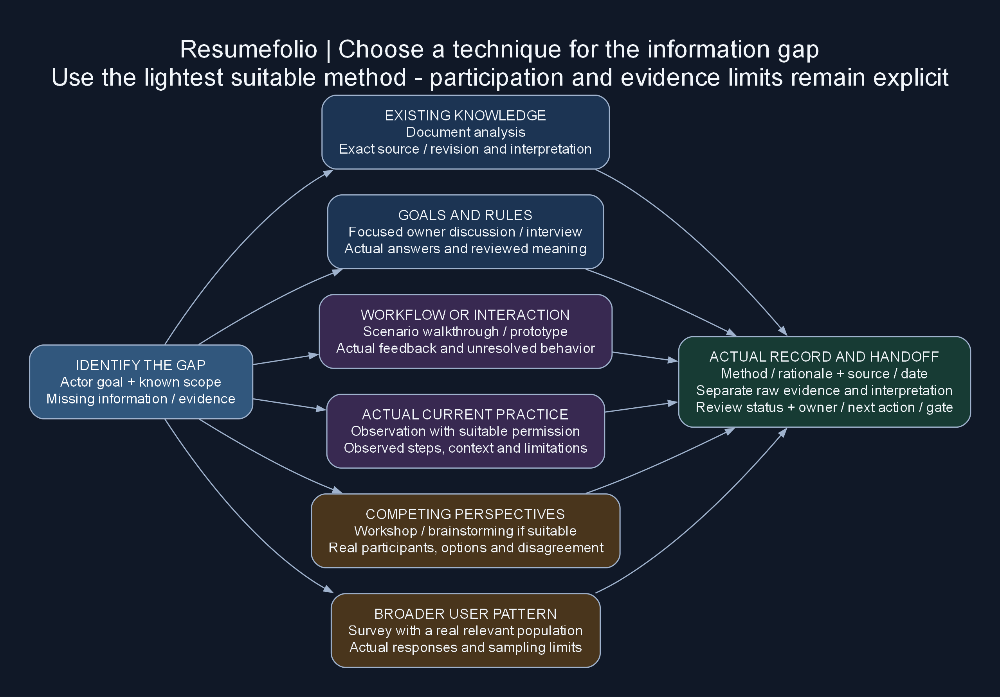

[Scalable SVG](Diagrams/Elicitation-Technique-Selection.svg) ·
[Editable Graphviz](Diagrams/Elicitation-Technique-Selection.dot)

Blue techniques reuse or clarify existing knowledge; purple explores workflows and
interaction; amber marks methods needing suitable participants/population. Colors
do not rank method quality. Choose by question and evidence need, not by the number
of techniques used.

| Technique | Use when | Preparation and expected artifact | Limitation / applicability |
| --- | --- | --- | --- |
| Document analysis | Existing scope, decisions, discussions or reference material can answer the question | Exact source/version, extraction purpose, labeled paraphrases, interpretation and open questions | Historical suggestions may be superseded; a broad chat/repository reference is not a precise source |
| Structured interview / focused owner discussion | Goals, rules or preferences need clarification | Group neutral questions, identify actual participant/role, retain answers/examples and reviewed interpretation | Owner feedback is not proof that all future users have the same needs |
| Scenario walkthrough | An actor journey needs normal/alternative/denied/failure paths | Trigger, fictional data, pre/postconditions, decision points and actual feedback | A walkthrough is not an implemented-product test |
| Observation | Actual existing practice differs from its description or contains hidden steps | Agreed access/scope, observed version/context, steps and pain points | Do not claim field observation from a scripted hypothetical exercise; protect private data |
| Prototype review | Interaction, presentation or feedback is difficult to settle in prose | Labeled low-fidelity candidate, scenario/task, actual participant feedback and remaining questions | Does not prove provider access, performance, storage correctness or completed implementation |
| Workshop / brainstorming | Several real perspectives need joint exploration or competing needs/options need discussion | Suitable actual participants, goal, source context, alternatives and recorded differences/decisions | Brainstormed ideas are proposals, not consensus or scope approval; do not invent attendance |
| Survey | A real user population and a suitable broader question justify collecting responses | Defined question, recruitment context, actual responses and analysis limits | Avoid claims of representativeness without evidence; no mandatory sample size is set here |

**Default for this project:** document analysis and focused owner discussion,
supported by scenario walkthroughs. Observation, prototypes, workshops and surveys
are selected only for a justified gap and feasible participation. A single activity
may combine techniques; record each contribution and its limits.

Technical/provider questions may require current primary-source investigation or
a separately bounded demonstration/check. Those findings support feasibility;
they should not be replaced by a stakeholder's expectation that an operation works.
Acceptance-test design can expose ambiguity during review, but designing a test
does not produce an execution result.

<a id="stakeholders-and-elicitation-elicitation-plan-and-techniques--heading-4-activity-preparation-and-conduct"></a>
##### 4. Activity Preparation and Conduct

<a id="stakeholders-and-elicitation-elicitation-plan-and-techniques--heading-prepare-a-bounded-activity"></a>
###### Prepare a bounded activity

| Preparation field | What to decide before conducting it |
| --- | --- |
| Question and intended outcome | Which concrete uncertainty should this activity resolve? |
| Source/context | Relevant SRC/DEC/EXT records, actor goal and accepted boundary |
| Method/rationale | Why is this technique suitable and sufficient for this question? |
| Participants/material | Who or what is actually available; whose perspective remains missing? |
| Examples and paths | Fictional/sanitized data, main path, alternatives, denied/failure/lifecycle cases |
| Evidence plan | How to record statements, observations, interpretation, feedback and limitations |
| Decision boundary | What can be clarified within existing authority and what needs an actual material owner decision? |
| Follow-up | Intended record home, responsible person and next dependent review gate |

Do not create a future activity row in the performed-activity log as though it has
already happened. A planned topic here receives an actual activity reference only
when conducted and recorded. Record actual date/participants at that time; do not
reuse a source decision date as the date of a new extraction or interview.

<a id="stakeholders-and-elicitation-elicitation-plan-and-techniques--heading-conduct-and-capture"></a>
###### Conduct and capture

1. Explain the bounded goal and known scope so discussion concentrates on genuine gaps.
2. Ask about the outcome and context before suggesting a technical solution.
3. Explore examples, alternatives, incomplete inputs, permissions and lifecycle effects where relevant.
4. Label direct quotations, paraphrases, observations, assumptions and solution ideas distinctly.
5. Summarize the interpretation and record actual feedback; do not infer agreement from silence.
6. Identify remaining questions, conflicts and missing perspectives with owner/action/gate.
7. Record the actual activity and extracts in the log, then hand off the reviewed scope and explicit gaps.

Keep discussions manageable and group related questions. Avoid repeated content
approval for accepted scope or routine authorized cleanup. New material choices
follow [Analysis and Negotiation](#process-and-approach-process-and-approach)
and [Change Control](#change-and-baseline-change-control).

<a id="stakeholders-and-elicitation-elicitation-plan-and-techniques--heading-5-focused-question-groups"></a>
##### 5. Focused Question Groups

These prompts are a **preparation guide**, not recorded stakeholder answers or a
new list of accepted requirements. Tailor them to the selected topic and the
source's actual unresolved detail.

| Group | Neutral prompts |
| --- | --- |
| Goal and context | What outcome are you trying to achieve? When does the need arise, and what information is available? |
| Required input | Which information is essential? What should happen when it is missing, incomplete, duplicated or invalid? |
| Permission | Who may perform this action on which resource? Who must be denied, and what changes when access is revoked? |
| Content and language | What must be shown or downloadable? How should missing language-specific content be handled? |
| History and lifecycle | What should remain unchanged after editing, deletion, disconnect or restore? What needs a preserved submitted version? |
| External services | What operation is needed? How should consent loss, outage, retry, conflict and reconnection appear to the user? |
| Quality and operation | Under which actual workload/device/recovery conditions must the outcome remain usable? What supports a proposed limit or target? |
| Trade-off and priority | What is the consequence if this outcome is unmet or delayed? Which other needs depend on it? |

<a id="stakeholders-and-elicitation-elicitation-plan-and-techniques--heading-next-clarification-candidates-from-the-actual-log"></a>
###### Next clarification candidates from the actual log

| Existing extract | Candidate question group | Expected handoff |
| --- | --- | --- |
| [EXT-001](#stakeholders-and-elicitation-elicitation-log--heading-ext-001-controlled-employer-access) | Explore an already authorized viewer's page, refresh/navigation and PDF/file request after password change or link disablement | Proposed session/revocation outcomes, exceptions and open choices; no lifetime selected in advance |
| [EXT-002](#stakeholders-and-elicitation-elicitation-log--heading-ext-002-manual-applications-and-preserved-submissions) | Clarify when actual submitted material is captured, which artifacts it includes, and how later edits/corrections/deletion should affect it | Capture/lifecycle scenarios and precise candidate criteria; no storage mechanism selected |
| [EXT-003](#stakeholders-and-elicitation-elicitation-log--heading-ext-003-unified-sign-in-and-resource-permissions) | Explore account states and permitted resource actions for owners, invited participants and administrators | Actor/resource/action/state rules and denied-path scenarios; no unrestricted role inferred |

These are proposed follow-ups to actual source extracts. No clarification session,
participant agreement or detailed policy decision is recorded by listing them.

<a id="stakeholders-and-elicitation-elicitation-plan-and-techniques--heading-6-adaptive-sequence-and-handoff"></a>
##### 6. Adaptive Sequence and Handoff

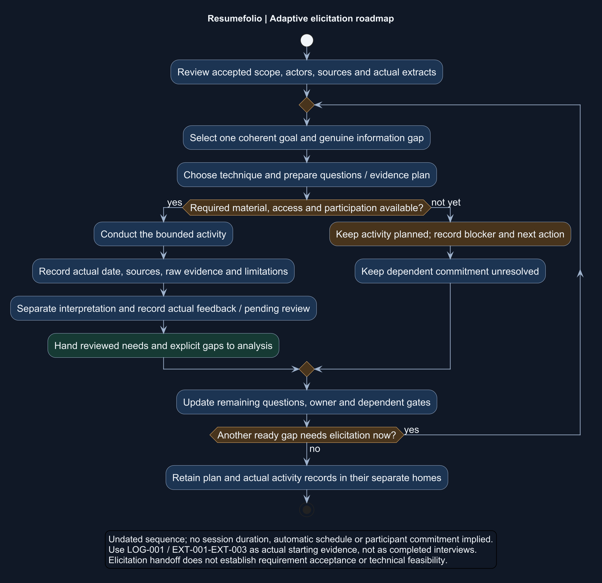

[Scalable SVG](Diagrams/Elicitation-Plan-Roadmap.svg) ·
[Editable PlantUML](Diagrams/Elicitation-Plan-Roadmap.puml)

The roadmap has no assigned dates or durations. Blue shows planning/conduct,
amber shows unavailable evidence or pending interpretation, and green identifies
the handoff. Activities repeat as analysis/review discovers gaps; this is not
automatic scheduling or authority to perform unrelated work.

| Sequence | Work | Readiness for next step |
| --- | --- | --- |
| Establish known context | Inspect actual sources, actors and earlier extracts | The genuine gap and accepted boundary are identifiable |
| Select and prepare | Choose a coherent topic, method, material/participants and evidence plan | Scope, privacy/access and decision boundaries are clear |
| Conduct when appropriate | Perform the bounded activity with actually available material/participants | Actual evidence exists; if access/participation is missing, keep the activity planned |
| Record and clarify | Log exact sources, actual date, raw evidence, interpretation, feedback and limitations | Review state and unresolved questions are explicit |
| Analyze and specify | Link reviewed needs and outstanding gaps to the relevant domain/scenario/data records | No unsupported acceptance, hidden conflict or invented requirement ID |
| Revisit as needed | Use feasibility, analysis, prototype or validation findings to identify new gaps | Plan the next bounded activity and respect dependent gates |

The handoff should identify actor/goal, provenance, interpreted need, behavior and
exception examples, quality expectations, actual feedback and gaps. Put detailed
requirements in the [SRS](#requirements-specification-requirements-specification),
scenarios in their [shared document](#scenarios-and-models-user-stories-and-scenarios),
meaning in [Data Definitions](#data-definitions-data-definitions) and unresolved
questions in the [question register](#change-and-baseline-open-questions-and-decisions).
Maintain [traceability](#validation-and-traceability-validation-and-traceability--heading-traceability)
as real records are allocated.

<a id="stakeholders-and-elicitation-elicitation-plan-and-techniques--heading-7-readiness-completion-and-follow-up"></a>
##### 7. Readiness, Completion and Follow-up

<a id="stakeholders-and-elicitation-elicitation-plan-and-techniques--heading-before-conducting-an-activity"></a>
###### Before conducting an activity

- [ ] Actor goal, exact source context and genuine uncertainty are identified.
- [ ] Method has a rationale; actual material/participants and missing perspectives are known.
- [ ] Questions/examples are neutral, bounded and consistent with accepted scope.
- [ ] Needed access/permission and privacy protection are in place for the activity.
- [ ] Expected output, responsible person and dependent gate are clear.

<a id="stakeholders-and-elicitation-elicitation-plan-and-techniques--heading-after-conducting-an-activity"></a>
###### After conducting an activity

- [ ] Actual date, recorder, participants or inspected material, method and coverage are logged.
- [ ] Exact source/version and labeled statements/paraphrases/observations are retained.
- [ ] Interpretation, assumptions and solution suggestions are separate from raw evidence and decisions.
- [ ] Actual feedback/review status and limitations are recorded; unreviewed interpretation remains pending.
- [ ] Gaps/conflicts have an owner, next action and gate before dependent commitments.
- [ ] Handoff links identify real analysis/specification/scenario records, or explicitly note pending allocation.
- [ ] No planned session, stakeholder consensus, numerical target or product test is reported as completed without evidence.

Use fictional/sanitized data. Obtain appropriate permission before recording
people or observing private workflows; keep secrets, private emails and real
application documents out of repository examples. Record only the evidence needed
to understand the need and its limitations.

Elicitation is complete **for the stated activity/group**, not for all future user
needs. Reopen it when new evidence reveals uncertainty. M-02 acceptance and the
wider pre-implementation agreement remain separate gates; a completed activity
does not establish either.

<a id="stakeholders-and-elicitation-elicitation-plan-and-techniques--heading-8-current-position-and-maintenance"></a>
##### 8. Current Position and Maintenance

| Item | Current position |
| --- | --- |
| Work plan and technique guide | Expanded proposed draft ready for owner review |
| Actual activity evidence | LOG-001 and EXT-001–EXT-003 exist in the shared log; documentary paraphrases checked, interpretations pending owner review |
| Other activities | Proposed coverage only; no new interview, observation, workshop, prototype session or survey conducted here |
| Dates, participant commitments and durations | Not scheduled or estimated by this document |
| Immediate next work | Review the extracted interpretations and select a genuine missing-detail group using the proposed plan |
| Requirement/baseline decisions | No new requirement allocation, accepted detailed policy or M-02 decision introduced |

Update the plan when actor goals, sources, feasibility constraints or evidence
change. Record performed activities in the log and keep this plan focused on
remaining work/technique rationale. Preserve historical log dates and source
locators; a plan update does not alter past evidence.

**Revision note — October 31, 2026:** Expanded the original technique table into a
scoped coverage plan, selection guidance, activity preparation, question groups,
adaptive roadmap and readiness/completion checks. Retained the original techniques
and linked actual LOG-001 extracts. No new session, schedule, participant agreement
or product requirement acceptance is claimed.

<a id="stakeholders-and-elicitation-elicitation-plan-and-techniques--heading-9-diagram-maintenance"></a>
##### 9. Diagram Maintenance

| Diagram | Editable source | Scalable view | Preview |
| --- | --- | --- | --- |
| Technique-selection guide | [Graphviz](Diagrams/Elicitation-Technique-Selection.dot) | [SVG](Diagrams/Elicitation-Technique-Selection.svg) |  |
| Adaptive elicitation roadmap | [PlantUML](Diagrams/Elicitation-Plan-Roadmap.puml) | [SVG](Diagrams/Elicitation-Plan-Roadmap.svg) |  |

Keep diagrams, captions and text consistent. Colors supplement labels/shapes.
Inspect rendered readability/arrows and verify local file/section links after
updates. Run from the repository root:

```powershell
$diagramFolder = 'docs\SDLC\02-requirements-engineering\diagrams'
$graphvizExe = 'C:\Program Files\Graphviz\bin\dot.exe'
$plantUmlJar = 'C:\Users\fvali\AppData\Local\Resumefolio\DiagramTools\plantuml.jar'

foreach ($format in 'svg', 'png') {
    & $graphvizExe "-T$format" -Gdpi=140 `
        "$diagramFolder\elicitation-technique-selection.dot" `
        -o "$diagramFolder\elicitation-technique-selection.$format"
    if ($LASTEXITCODE -ne 0) { throw "Graphviz failed: $format" }
    java '-Djava.awt.headless=true' -jar $plantUmlJar -charset UTF-8 "-t$format" `
        "$diagramFolder\elicitation-plan-roadmap.puml"
    if ($LASTEXITCODE -ne 0) { throw "PlantUML failed: $format" }
}
```

Save sources as UTF-8 without BOM. Under another account, use the actual installed
JAR path. Retain sources and SVG/PNG outputs in version control.

[Stakeholders and Elicitation index](#stakeholders-and-elicitation-stakeholders-and-elicitation) · [Actors and Context](#stakeholders-and-elicitation-actors-and-system-context)
· [Elicitation Log](#stakeholders-and-elicitation-elicitation-log) · [Requirements index]()

</details>

<a id="stakeholders-and-elicitation-stakeholders-and-elicitation"></a>

<details>
<summary>Resumefolio — Stakeholders and Elicitation</summary>

<a id="stakeholders-and-elicitation-stakeholders-and-elicitation--heading-resumefolio--stakeholders-and-elicitation"></a>
#### Resumefolio — Stakeholders and Elicitation

Current implementation choices and scope: [Baseline](https://github.com/Farhad-V/Web-Resumefolio/blob/1f2acaa351ac306cb57cbe4fe9742e8bd90720d9/docs/MVP/baseline/README.md). Runtime verification remains subject to its gates.

| Item | Current position |
| --- | --- |
| Folder purpose | Identify actor goals and system context, plan elicitation and preserve actual source/activity evidence |
| Responsible person | Farhad; sole delivery and operations owner |
| Document coverage | Three expanded working documents with editable diagrams |
| Actual activity | LOG-001 document analysis with EXT-001–EXT-003 recorded; interpretations pending owner review |
| Acceptance boundary | No new interview, detailed permission approval or M-02 baseline acceptance is established here |
| Index revision | October 31, 2026 |

**Start with [Actors and System Context](#stakeholders-and-elicitation-actors-and-system-context)** to
understand who interacts with the product and where its boundaries lie. Read the
plan for proposed next activities and the log for what actually happened. Keep
accepted source decisions, extracted interpretations and future requirements distinct.

[Overview](#stakeholders-and-elicitation-stakeholders-and-elicitation--heading-1-folder-overview) · [Documents](#stakeholders-and-elicitation-stakeholders-and-elicitation--heading-documents) · [Reading routes](#stakeholders-and-elicitation-stakeholders-and-elicitation--heading-3-find-the-right-record)
· [Evidence status](#stakeholders-and-elicitation-stakeholders-and-elicitation--heading-4-current-evidence-and-next-work) · [Handoff](#stakeholders-and-elicitation-stakeholders-and-elicitation--heading-5-connections-to-the-rest-of-requirements-engineering)
· [Diagrams](#stakeholders-and-elicitation-stakeholders-and-elicitation--heading-6-diagram-catalog) · [Maintenance](#stakeholders-and-elicitation-stakeholders-and-elicitation--heading-7-maintaining-this-folder)

<a id="stakeholders-and-elicitation-stakeholders-and-elicitation--heading-1-folder-overview"></a>
##### 1. Folder Overview

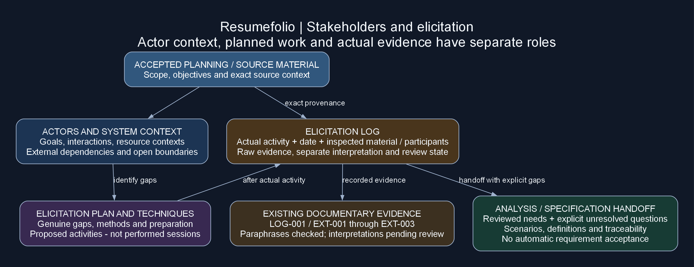

[Scalable SVG](Diagrams/Stakeholders-Elicitation-Overview.svg) ·
[Editable Graphviz](Diagrams/Stakeholders-Elicitation-Overview.dot)

Blue identifies actor/source context, purple identifies planning, amber identifies
actual records and pending interpretation, and green identifies the downstream
handoff. Arrows show information relationships, not completed activities, staffing,
runtime data flow or automatic acceptance.

Use the three documents together: actor/context questions guide activity selection;
the plan explains what to explore and how; the log preserves actual sources,
activities and feedback. Analysis/review can expose gaps that require further
elicitation. A planned topic becomes an actual log activity only when performed.

<a id="stakeholders-and-elicitation-stakeholders-and-elicitation--heading-documents"></a>
##### Documents

| Document | Main question | Contents and boundary |
| --- | --- | --- |
| [Actors and System Context](#stakeholders-and-elicitation-actors-and-system-context) | Who needs what, and what lies inside/outside the product? | Actor/stakeholder goals, resource-owner contexts, external services/dependencies, access boundaries and open questions; not a complete permission grant or architecture |
| [Elicitation Plan and Techniques](#stakeholders-and-elicitation-elicitation-plan-and-techniques) | What genuine gaps should be explored next, using which method? | Scope-based topic coverage, selection guidance, preparation, neutral prompts and an undated roadmap; no session dates or participant commitments invented |
| [Elicitation Log](#stakeholders-and-elicitation-elicitation-log) | What material was inspected or activity actually performed, and what was learned? | SRC register, actual LOG-001/EXT records, separate interpretations, source hash, review state and recording template; no invented interviews or detailed policy acceptance |

For a first reading, follow the table order. When checking an evidence claim,
start in the log and follow its exact source/revision rather than relying only on
this overview.

<a id="stakeholders-and-elicitation-stakeholders-and-elicitation--heading-3-find-the-right-record"></a>
##### 3. Find the Right Record

| If you need to… | Open | What to inspect next |
| --- | --- | --- |
| Understand a role or external interaction | [Actor catalog](#stakeholders-and-elicitation-actors-and-system-context--heading-3-human-actor-and-stakeholder-catalog) | Its goal, existing boundary, unresolved rules and source DEC references |
| Clarify who may perform an operation | [Accounts/Permissions matrix](#requirements-specification-accounts-authentication-and-permissions--heading-7-role-resource-and-operation-matrix) | Relevant resource/action/state rules and allowed/denied scenarios; role names alone grant no access |
| Select the next clarification group | [Proposed work plan](#stakeholders-and-elicitation-elicitation-plan-and-techniques--heading-2-proposed-elicitation-work-plan) | Existing extracts, dependencies, method and expected handoff |
| Choose a suitable technique | [Technique selection](#stakeholders-and-elicitation-elicitation-plan-and-techniques--heading-technique-selection) | Question, available material/participants and evidence limits |
| Prepare an actual activity | [Preparation and conduct](#stakeholders-and-elicitation-elicitation-plan-and-techniques--heading-4-activity-preparation-and-conduct) | Bounded question, sources, fictional/sanitized examples, permissions and expected records |
| Find existing sources | [Source register](#stakeholders-and-elicitation-elicitation-log--heading-source-register) | Exact section/turn/version when used; broad discovery pointers are not precise extraction evidence |
| Review the performed documentary work | [LOG-001](#stakeholders-and-elicitation-elicitation-log--heading-log-001-scope-decision-extraction) | Actual coverage, source hash, paraphrases, interpretation status and limitations |
| Record a new activity | [Recording guide](#stakeholders-and-elicitation-elicitation-log--heading-5-recording-new-activities) | Actual date/method/participants or inspected material, raw evidence, interpretation and follow-up |
| Resolve a conflict or material new choice | [Analysis and Negotiation](#process-and-approach-process-and-approach) | Exact competing statements, impacts/options and actual owner decision where needed |

<a id="stakeholders-and-elicitation-stakeholders-and-elicitation--heading-4-current-evidence-and-next-work"></a>
##### 4. Current Evidence and Next Work

<a id="stakeholders-and-elicitation-stakeholders-and-elicitation--heading-what-is-recorded"></a>
###### What is recorded

| Record | Actual content | Remaining limit |
| --- | --- | --- |
| SRC-01–SRC-06 | Index of planning, prior discussion and reference-project material | Discovery pointers require exact locators/revisions when extracted; not an exhaustive source review |
| LOG-001 | Document analysis performed October 31, 2026 against DEC-024, DEC-023 and DEC-028 in the identified Scope working copy | No interview participants, server/provider checks, product execution or complete-scope extraction |
| [EXT-001](#stakeholders-and-elicitation-elicitation-log--heading-ext-001-controlled-employer-access) | Protected employer access and selected-content boundary | Interpretation pending; session/revocation and detailed criteria still need definition |
| [EXT-002](#stakeholders-and-elicitation-elicitation-log--heading-ext-002-manual-applications-and-preserved-submissions) | Manual applications and preservation of actual submitted material | Interpretation pending; capture, progress and lifecycle detail still need definition |
| [EXT-003](#stakeholders-and-elicitation-elicitation-log--heading-ext-003-unified-sign-in-and-resource-permissions) | Unified sign-in with resource-specific permissions | Interpretation pending; detailed role/account/authentication rules still need definition |

The three paraphrases were checked against the inspected source sections; this
does not constitute owner validation of their detailed interpretations. Source
decisions retain their original accepted scope authority. No interview, workshop,
observation, prototype-feedback session or survey has been recorded in this log.

<a id="stakeholders-and-elicitation-stakeholders-and-elicitation--heading-practical-next-work"></a>
###### Practical next work

1. Review the existing extracts and their genuine missing-detail questions without re-approving accepted scope inclusion.
2. Select a coherent actor goal using the proposed work plan and relevant feasibility/dependency gates.
3. Prepare and conduct an appropriate activity only with actual available material/participants and needed access.
4. Record actual evidence and feedback, keeping interpretation and unresolved detail separate.
5. Hand off reviewed needs and explicit gaps to analysis/specification and maintain source-to-record links.

Farhad coordinates the work in the current solo arrangement. Missing stakeholder
perspectives remain visible; owner representation is not evidence of research
with actual employers or collaborators. No dates, durations or research population
are assumed by this index.

<a id="stakeholders-and-elicitation-stakeholders-and-elicitation--heading-5-connections-to-the-rest-of-requirements-engineering"></a>
##### 5. Connections to the Rest of Requirements Engineering

| Related record | Relationship to this folder |
| --- | --- |
| [Scope](../01-Project-Planning/01-Project-Charter.md#mvp-scope) / [Planning Decision Register](https://github.com/Farhad-V/Web-Resumefolio/blob/1f2acaa351ac306cb57cbe4fe9742e8bd90720d9/docs/MVP/SDLC/01-project-planning/decision-register.md) | Source of accepted boundaries and rationale; material changes follow actual decision control |
| [Requirements Approach](#process-and-approach-process-and-approach) / [Elicitation Process](#process-and-approach-process-and-approach) | Overall method, iterative work and evidence expectations |
| [Feasibility Study](#process-and-approach-02-feasibility-study) | Investigations needed where user expectations do not establish actual technical/provider/resource suitability |
| [Analysis](#process-and-approach-process-and-approach) / [SRS](#requirements-specification-requirements-specification) | Clarification/classification/conflict handling and authoritative detailed requirement records |
| [Scenarios and Models](#scenarios-and-models-user-stories-and-scenarios) | Actor journeys, alternatives, denied/failure paths and use-case detail |
| [Data Definitions](#data-definitions-data-definitions) | Consistent terms and conceptual information meaning |
| [Traceability](#validation-and-traceability-validation-and-traceability--heading-traceability) / [Review Findings](#validation-and-traceability-validation-and-traceability--heading-review-findings) | Source-to-requirement links and actual review evidence/rechecks |
| [Open Questions](#change-and-baseline-open-questions-and-decisions) / [Change Control](#change-and-baseline-change-control) | Unresolved matters, owner/actions/gates and actual material decisions |

Do not copy full requirement text, live delivery status or review findings into
this README. Link the authoritative home and summarize only the evidence needed
for navigation. Source extraction, requirement acceptance, implementation progress
and executed verification results are distinct facts.

Preserve all agreed Version 1 scope, including manual job application management. Product AI,
automatic translation and automatic demo migration remain excluded. The wider
pre-implementation baseline and M-02 review remain separate gates; documentation
or elicitation completion alone does not authorize product coding.

<a id="stakeholders-and-elicitation-stakeholders-and-elicitation--heading-6-diagram-catalog"></a>
##### 6. Diagram Catalog

This catalog covers **seven supporting diagram sources**: the new folder overview
and two diagrams for each of the three documents. Sources and SVG/PNG outputs
live in the shared `diagrams` folder. See the wider
[Requirements Diagram Index](Diagrams/Diagram-Catalog.md) for other phase diagrams.

| Topic / diagram | Preview | Scalable | Editable source |
| --- | --- | --- | --- |
| This index — folder overview |  | [SVG](Diagrams/Stakeholders-Elicitation-Overview.svg) | [DOT](Diagrams/Stakeholders-Elicitation-Overview.dot) |
| Actors — system context | 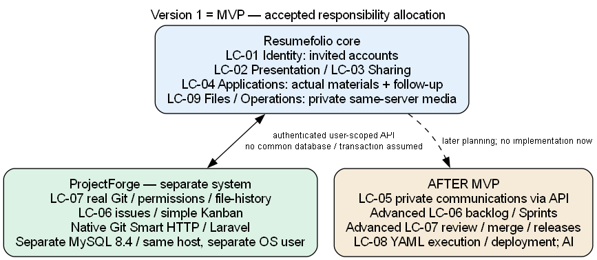 | [SVG](https://github.com/Farhad-V/Web-Resumefolio/blob/1f2acaa351ac306cb57cbe4fe9742e8bd90720d9/docs/MVP/SDLC/04-system-design/01-software-architecture/diagrams/logical-component-ownership.svg) | [DOT](https://github.com/Farhad-V/Web-Resumefolio/blob/1f2acaa351ac306cb57cbe4fe9742e8bd90720d9/docs/MVP/SDLC/04-system-design/01-software-architecture/diagrams/logical-component-ownership.dot) |
| Actors — goal overview |  | [SVG](Diagrams/Actors-Goal-Overview.svg) | [PlantUML](Diagrams/Actors-Goal-Overview.puml) |
| Log — provenance | 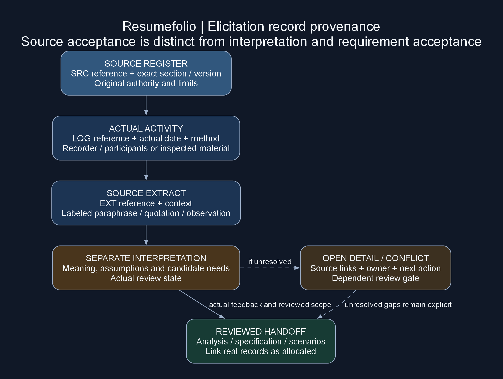 | [SVG](Diagrams/Elicitation-Log-Provenance.svg) | [DOT](Diagrams/Elicitation-Log-Provenance.dot) |
| Log — recording/review cycle | 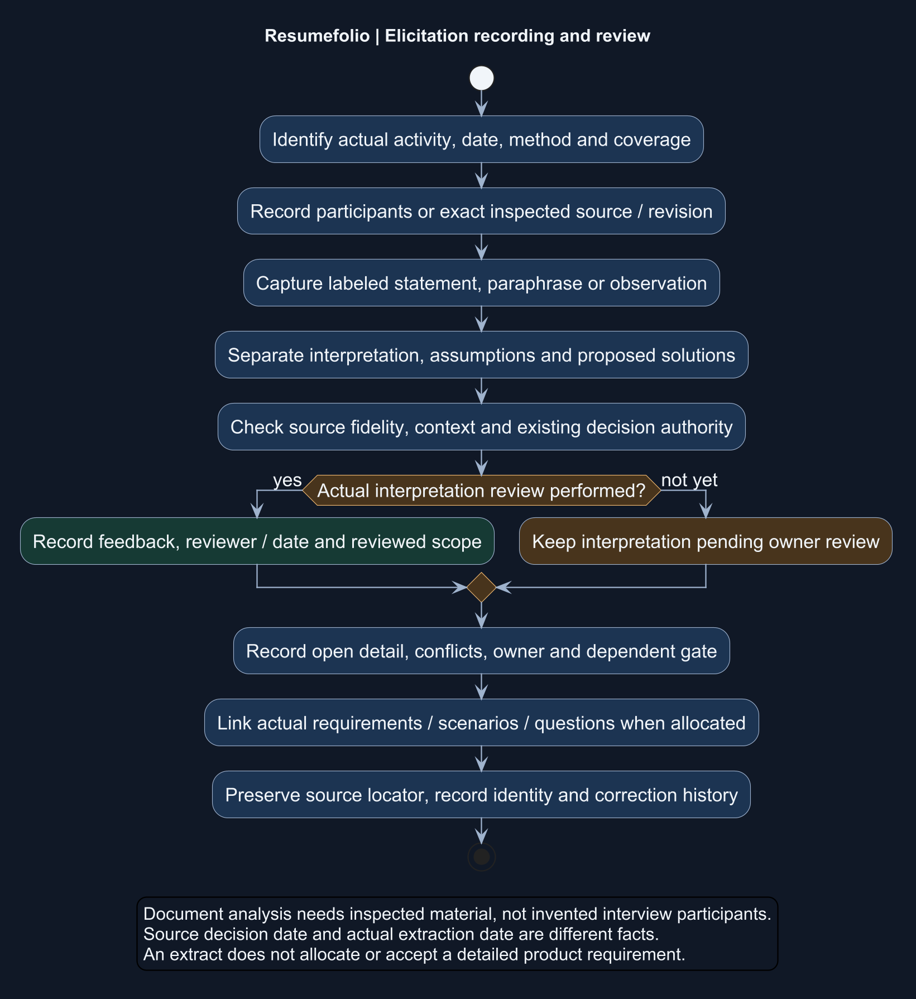 | [SVG](Diagrams/Elicitation-Log-Recording-Cycle.svg) | [PlantUML](Diagrams/Elicitation-Log-Recording-Cycle.puml) |
| Plan — technique selection |  | [SVG](Diagrams/Elicitation-Technique-Selection.svg) | [DOT](Diagrams/Elicitation-Technique-Selection.dot) |
| Plan — adaptive roadmap |  | [SVG](Diagrams/Elicitation-Plan-Roadmap.svg) | [PlantUML](Diagrams/Elicitation-Plan-Roadmap.puml) |

PNG is the quick preview, SVG supports zooming, and DOT/PlantUML is editable.
Read each image with its source document's meaning and limits. No diagram is a
permission grant, live schedule or proof of technical feasibility.

<a id="stakeholders-and-elicitation-stakeholders-and-elicitation--heading-7-maintaining-this-folder"></a>
##### 7. Maintaining This Folder

| Change | Keep consistent |
| --- | --- |
| Actor, interaction or boundary changes | Actor document, relevant permission/scenario records, models and source rationale |
| New planned activity | Work plan, technique rationale, expected output and dependent gate |
| Activity actually performed | Log date/source/participants or material, extracts, actual feedback and follow-up; update summary here if material |
| Source changes | Preserve historic extraction locator; add explicit new evidence/review rather than silently rewriting old observations |
| Diagram/document moved or revised | Catalog, incoming links, editable sources, renders, captions and affected record references |
| Actual decision or requirement allocated | Authoritative record first, then source/extract-to-requirement traceability and any relevant summary |

Regeneration commands for each document's diagrams are in that document. For the
folder overview, run from the repository root:

```powershell
$diagramFolder = 'docs\SDLC\02-requirements-engineering\diagrams'
$graphvizExe = 'C:\Program Files\Graphviz\bin\dot.exe'
foreach ($format in 'svg', 'png') {
    & $graphvizExe "-T$format" -Gdpi=140 `
        "$diagramFolder\stakeholders-elicitation-overview.dot" `
        -o "$diagramFolder\stakeholders-elicitation-overview.$format"
    if ($LASTEXITCODE -ne 0) { throw "Graphviz failed: $format" }
}
```

Use UTF-8 without BOM and retain source/SVG/PNG files together in version control.
Inspect rendered labels/arrows and verify file/section links after edits. Color
supports labels/shapes; meaning must remain understandable without color alone.
Keep secrets and unnecessary private material out of repository examples/evidence.

**Revision note — October 31, 2026:** Reorganized the folder guide with reading
routes, actual evidence status, authoritative handoff locations and a complete
seven-diagram catalog. Added the folder overview. No new activity, permission,
source extraction, requirement acceptance or baseline decision is recorded.

[Requirements Engineering index]() · [Process and Approach](#process-and-approach-process-and-approach)

</details>

<a id="requirements-specification"></a>

## Requirements Specification

<a id="requirements-specification-accounts-authentication-and-permissions"></a>

<details>
<summary>Resumefolio — Accounts, Authentication and Permissions</summary>

<a id="requirements-specification-accounts-authentication-and-permissions--heading-resumefolio--accounts-authentication-and-permissions"></a>
#### Resumefolio — Accounts, Authentication and Permissions

<a id="requirements-specification-accounts-authentication-and-permissions--heading-mvp-account-admission-and-authority"></a>
##### MVP account admission and authority

**Status.** Account and access policies are selected for MVP. Implementation and acceptance checks are pending.

The owner or an administrator creates or invites users. Public self-registration is outside MVP. Every protected action checks the current user, resource, operation and state. Core and ProjectForge use authenticated, user-scoped API access. Administrative roles and repository membership grant only their defined powers. Employer links allow retrieval of selected shared content.

- [Decisions and rationale](#requirements-specification-accounts-authentication-and-permissions--heading-selected-policies-and-future-proposals)
- [Requirements and acceptance criteria](#requirements-specification-accounts-authentication-and-permissions--heading-3-proposed-requirements-and-acceptance-criteria)
- [Permissions by role](#requirements-specification-accounts-authentication-and-permissions--heading-7-role-resource-and-operation-matrix)
- [Remaining verification](#requirements-specification-accounts-authentication-and-permissions--heading-8-remaining-verification)

<a id="requirements-specification-accounts-authentication-and-permissions--heading-selected-policies-and-future-proposals"></a>
##### Selected Policies and Future Proposals

The three policies below are **selected for MVP**. Their rationale explains the product trade-off. The linked policy and technical records define the exact rules.

<a id="requirements-specification-accounts-authentication-and-permissions--id-resolution-q-d03"></a>

<a id="requirements-specification-accounts-authentication-and-permissions--id-q-d03-selected-policy"></a>

<a id="requirements-specification-accounts-authentication-and-permissions--heading-q-d03-invite-only-admission-and-recovery"></a>
###### Q-D03: Invite-only admission and recovery

**Decision.** The owner or an administrator creates or invites users. Public registration is outside MVP. Administrators use a second factor. Invitations and recovery use system email.

**Why.** Invite-only admission limits who can enter the private workspace. A second factor protects accounts with administrative powers. System email allows invited users to join or recover access independently of any future personal Gmail integration. [Selected identity policy](https://github.com/Farhad-V/Web-Resumefolio/blob/1f2acaa351ac306cb57cbe4fe9742e8bd90720d9/docs/MVP/baseline/policy-decisions.md#q-d03)

<a id="requirements-specification-accounts-authentication-and-permissions--id-resolution-q-d04"></a>

<a id="requirements-specification-accounts-authentication-and-permissions--id-q-d04-selected-policy"></a>

<a id="requirements-specification-accounts-authentication-and-permissions--heading-q-d04-resource-specific-grants"></a>
###### Q-D04: Resource-specific grants

**Decision.** Each action requires authority for the specific resource. An administrator has no implicit access to private user content. A repository reader can fetch and browse, a writer can push, and issue access alone does not grant write access.

**Why.** Account administration, private content and repository collaboration have different purposes. Separate grants prevent one responsibility from exposing unrelated resumes, applications or repositories. [Selected grant policy](https://github.com/Farhad-V/Web-Resumefolio/blob/1f2acaa351ac306cb57cbe4fe9742e8bd90720d9/docs/MVP/baseline/policy-decisions.md#q-d04)

<a id="requirements-specification-accounts-authentication-and-permissions--id-resolution-q-d05"></a>

<a id="requirements-specification-accounts-authentication-and-permissions--id-q-d05-selected-policy"></a>

<a id="requirements-specification-accounts-authentication-and-permissions--heading-q-d05-revocation-and-current-authority"></a>
###### Q-D05: Revocation and current authority

**Decision.** Check current authority on each new protected request. Disablement and password reset invalidate Core sessions. ProjectForge checks current Core account status for browser, API and Git access. Deny stale credentials.

**Why.** A session or credential issued earlier should not preserve access after it has been withdrawn. Revocation can stop new retrievals. Bytes already delivered remain with the recipient. [Selected revocation policy](https://github.com/Farhad-V/Web-Resumefolio/blob/1f2acaa351ac306cb57cbe4fe9742e8bd90720d9/docs/MVP/baseline/policy-decisions.md#q-d05)

Personal Gmail and calendar access are after MVP. Employer-link rules are recorded under [protected sharing](https://github.com/Farhad-V/Web-Resumefolio/blob/1f2acaa351ac306cb57cbe4fe9742e8bd90720d9/docs/MVP/baseline/policy-decisions.md#q-d11).

<a id="requirements-specification-accounts-authentication-and-permissions--heading-1-scope-sources-and-boundaries"></a>
##### 1. Scope, Sources and Boundaries

| Source | Direction retained | Detail not settled by the source |
| --- | --- | --- |
| [DEC-028](https://github.com/Farhad-V/Web-Resumefolio/blob/1f2acaa351ac306cb57cbe4fe9742e8bd90720d9/docs/MVP/SDLC/01-project-planning/02-scope.md#dec-028) / [EXT-003](#stakeholders-and-elicitation-elicitation-log--heading-ext-003-unified-sign-in-and-resource-permissions) | Individual accounts, roles, resource/operation permissions and unified sign-in across authorized sections | Role hierarchy, account lifecycle, authentication flows and detailed criteria |
| [OBJ-04](https://github.com/Farhad-V/Web-Resumefolio/blob/1f2acaa351ac306cb57cbe4fe9742e8bd90720d9/docs/MVP/SDLC/01-project-planning/01-purpose-and-objectives.md#objective-4-provide-a-unified-working-environment) | Connected workflows without repeated sign-in or unintended private access | Concrete authentication/session architecture |
| [DEC-024](https://github.com/Farhad-V/Web-Resumefolio/blob/1f2acaa351ac306cb57cbe4fe9742e8bd90720d9/docs/MVP/SDLC/01-project-planning/02-scope.md#dec-024) / [DEC-025](https://github.com/Farhad-V/Web-Resumefolio/blob/1f2acaa351ac306cb57cbe4fe9742e8bd90720d9/docs/MVP/SDLC/01-project-planning/02-scope.md#dec-025) | Employer access without a viewer account, password protection, selected content, owner password/link controls and protected file/PDF retrieval | Session revocation timing, link lifecycle, feedback and retry policy |
| [DEC-021](https://github.com/Farhad-V/Web-Resumefolio/blob/1f2acaa351ac306cb57cbe4fe9742e8bd90720d9/docs/MVP/SDLC/01-project-planning/02-scope.md#dec-021) / [DEC-020](https://github.com/Farhad-V/Web-Resumefolio/blob/1f2acaa351ac306cb57cbe4fe9742e8bd90720d9/docs/MVP/SDLC/01-project-planning/02-scope.md#dec-020) | Authorized work/repository collaboration | Read/write/invite/review/merge roles and credential protocols |
| [DEC-029–DEC-032](../01-Project-Planning/01-Project-Charter.md#responsibilities) / [DEC-018](https://github.com/Farhad-V/Web-Resumefolio/blob/1f2acaa351ac306cb57cbe4fe9742e8bd90720d9/docs/MVP/SDLC/01-project-planning/02-scope.md#dec-018) | Product roles distinct from delivery ownership; permitted administration and configurable file policy | Exact administrator/platform-owner powers and sensitive-operation checks |
| [Risk Register](../01-Project-Planning/03-Feasibility-And-Risk-Assessment.md#risks-and-verification), RSK-03/RSK-04/RSK-07/RSK-09 | Execution boundaries, allowed/denied requests, email-dependent authentication and lifecycle need explicit controls/evidence | Risk responses are not implemented mechanisms or completed tests |

MVP scope includes identity/access for the core and separately authorized basic ProjectForge. Communication/calendar, advanced work/Git and YAML execution/deployment are future. Do not infer public self-registration, social login,
mandatory MFA, a specific password/OTP scheme or a separate SSO server from the
phrase “unified sign-in.” Owner/admin creation or invitation is settled for MVP; authentication factors and session mechanisms remain open.

The [Actors and Context](#stakeholders-and-elicitation-actors-and-system-context)
document owns stakeholder goals; this file owns detailed permission expectations.
The [sharing domain](#requirements-specification-pdf-and-controlled-sharing) and other module specifications
must reference compatible rules rather than establishing contradictory access paths.

<a id="requirements-specification-accounts-authentication-and-permissions--heading-2-identity-and-access-contexts"></a>
##### 2. Identity and Access Contexts

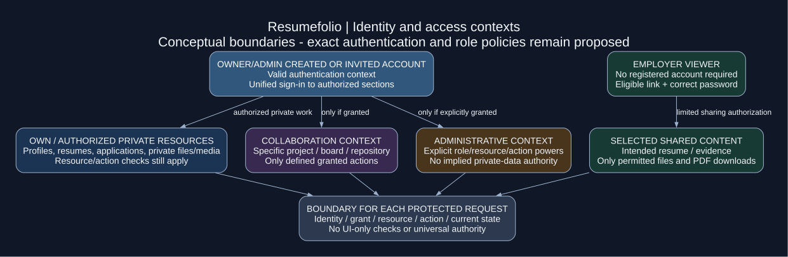

[Scalable SVG](Diagrams/Accounts-Access-Contexts.svg) ·
[Editable Graphviz](Diagrams/Accounts-Access-Contexts.dot)

Blue groups account/private-resource context, purple groups limited collaboration,
green groups protected shared viewing and amber groups administration. All paths
remain limited by their applicable authority. The map is conceptual; it selects
no token, cookie, database, provider or role-inheritance design.

| Concept | Required distinction |
| --- | --- |
| Authentication | Establish a valid account access context under the authentication policy once agreed |
| Authorization | Check whether this actor/context may perform this action on this resource in its current state |
| Resource ownership | Context-specific responsibility/authority, not universal platform power |
| Membership or invitation | Defined collaboration scope; not general access to the owner's private workspace |
| Employer access | Limited password-protected sharing context without requiring a registered viewer account |
| Administrative authority | Explicit operations on specified resources/states; project-owner identity alone is not a complete product permission rule |

One person may use several contexts. Do not infer that account ownership,
project membership or an administrative role grants every operation. Unknown
permissions remain unresolved and must not be treated as granted.

<a id="requirements-specification-accounts-authentication-and-permissions--heading-3-proposed-requirements-and-acceptance-criteria"></a>
##### 3. Proposed Requirements and Acceptance Criteria

<a id="requirements-specification-accounts-authentication-and-permissions--heading-shared-record-metadata"></a>
###### Shared record metadata

These twelve records retain their original draft identifiers and criteria. Use the [MVP criterion guide](https://github.com/Farhad-V/Web-Resumefolio/blob/1f2acaa351ac306cb57cbe4fe9742e8bd90720d9/docs/MVP/baseline/criterion-dispositions.md) for current applicability and priority. Tests remain planned. Field definitions are in the [data dictionary](#data-definitions-data-dictionary).

- **Account and access:** [ACC-D01](#requirements-specification-accounts-authentication-and-permissions--heading-acc-d01-individual-account-context), [ACC-D02](#requirements-specification-accounts-authentication-and-permissions--heading-acc-d02-unified-sign-in-across-authorized-sections), [ACC-D03](#requirements-specification-accounts-authentication-and-permissions--heading-acc-d03-resource-and-operation-authorization), [ACC-D04](#requirements-specification-accounts-authentication-and-permissions--heading-acc-d04-cross-user-private-data-isolation), [ACC-D05](#requirements-specification-accounts-authentication-and-permissions--heading-acc-d05-limited-collaboration-authority)
- **Employer sharing:** [ACC-D06](#requirements-specification-accounts-authentication-and-permissions--heading-acc-d06-employer-access-without-a-viewer-account), [ACC-D07](#requirements-specification-accounts-authentication-and-permissions--heading-acc-d07-protected-shared-file-and-pdf-retrieval), [ACC-D08](#requirements-specification-accounts-authentication-and-permissions--heading-acc-d08-owner-control-of-employer-link-access)
- **Administration and end of access:** [ACC-D09](#requirements-specification-accounts-authentication-and-permissions--heading-acc-d09-explicit-administrative-powers), [ACC-D10](#requirements-specification-accounts-authentication-and-permissions--heading-acc-d10-authorization-of-access-grant-changes), [ACC-D11](#requirements-specification-accounts-authentication-and-permissions--heading-acc-d11-no-authentication-bypass-on-deliveryprovider-failure), [ACC-D12](#requirements-specification-accounts-authentication-and-permissions--heading-acc-d12-end-of-access-and-lifecycle-enforcement)

<a id="requirements-specification-accounts-authentication-and-permissions--heading-acc-d01-individual-account-context"></a>
###### ACC-D01: Individual Account Context

- **Owner-scope acceptance additions (MVP; planned, not executed):**

  - Initial account access follows owner/admin creation or invitation; no public self-registration path creates an account.
  - An authenticated API request cannot impersonate another user or turn board membership into repository authority.

- **Release allocation (owner decision, November 4):** MVP foundation where used by core/basic ProjectForge; future-domain clauses deferred.

- **Source / rationale:** DEC-028; support identifiable private user workflows.
- **Actor / conditions:** A person accesses account-bound product functions.

- **Proposed obligation:** The system shall associate private user operations with
  the authenticated account context required by the agreed account policy, and shall
  not treat one user's successful sign-in as another user's identity.

- **Acceptance criteria**

  - Given two distinct test accounts, when each performs a permitted own-account operation, the operation is attributed to the corresponding account context.
  - Given no valid account context, when an account-protected operation is requested, that operation does not execute as an authenticated user.
  - Given account A's valid context, when a request supplies account B's identity as input, that input alone does not change the authenticated actor to B.

- **Planned verification:** Integration tests of account-bound operations and direct
  identity-manipulation requests; inspect actor attribution using controlled data.
- **Dependencies / open detail:** Owner/admin-created or invited admission is settled. Identifiers, account states and authentication mechanism: Section 8. These must be specified before affected acceptance.

<a id="requirements-specification-accounts-authentication-and-permissions--heading-acc-d02-unified-sign-in-across-authorized-sections"></a>
###### ACC-D02: Unified Sign-in Across Authorized Sections

- **Release allocation (owner decision, November 4):** MVP foundation where used by core/basic ProjectForge; future-domain clauses deferred.

- **Source / rationale:** DEC-028 and OBJ-04; reduce repeated sign-in while preserving permissions.
- **Actor / conditions:** Registered user with a currently valid account context.

- **Proposed obligation:** While the agreed account access context remains valid,
  the system shall let the user continue between authorized product sections
  without a separate sign-in solely because the section changes.

- **Acceptance criteria**

  - Given valid access and permission to two sections, when the user navigates between them, the user is not required to sign in again only for that navigation.
  - Given a valid account context but no authority for the destination resource/action, navigation or a direct request does not grant that authority.

- **Planned verification:** A browser journey across representative authorized
  sections plus denied direct requests. **Open detail:** Context lifetime, sensitive
  reauthentication and technical architecture remain separate decisions; this record
  does not promise indefinite sessions.

<a id="requirements-specification-accounts-authentication-and-permissions--heading-acc-d03-resource-and-operation-authorization"></a>
###### ACC-D03: Resource and Operation Authorization

- **Release allocation (owner decision, November 4):** MVP foundation where used by core/basic ProjectForge; future-domain clauses deferred.

- **Source / rationale:** DEC-028; RSK-04 response. Protect private operations at request boundaries.
- **Actor / conditions:** Any account or shared-view context requests a protected resource/action.

- **Proposed obligation:** The system shall enforce the applicable actor/resource/action
  permission for the request rather than relying only on visible navigation or controls.

- **Acceptance criteria**

  - Given an actor with read permission but no modification permission in the agreed matrix, a direct modification request does not change the protected resource.
  - Given no permission to a private resource, direct read/list/download requests do not disclose its protected content.
  - Hiding a control or changing a request's resource identifier does not substitute for authorization of the requested operation.

- **Planned verification:** Integration tests covering agreed allowed/denied action
  pairs and direct requests. **Open detail:** Exact matrix, denied-response conventions
  and any permitted resource-existence disclosure need specification before acceptance.

<a id="requirements-specification-accounts-authentication-and-permissions--heading-acc-d04-cross-user-private-data-isolation"></a>
###### ACC-D04: Cross-user Private-data Isolation

- **Release allocation (owner decision, November 4):** MVP foundation where used by core/basic ProjectForge; future-domain clauses deferred.

- **Source / rationale:** DEC-028, OBJ-04 and RSK-04; preserve private-data boundaries.
- **Actor / conditions:** Registered user requests another user's private resource.

- **Proposed obligation:** The system shall deny access or modification outside an
  explicitly granted resource context, including when an authenticated user supplies
  another user's resource reference.

- **Acceptance criteria**

  - Given A and B with separate private resumes/email/application records and no grant between them, A cannot retrieve or modify B's protected content through direct requests.
  - List/search/navigation in A's private context does not expose B's protected content merely because B's identifiers are supplied or guessed.
  - A legitimate collaboration or employer-sharing grant exposes only its defined scope, not unrelated resources.

- **Planned verification:** Controlled two-user integration cases across affected
  modules and related list/search/file paths. **Open detail:** Enumerate covered
  resources/actions in each module; limited testing does not prove universal isolation.

<a id="requirements-specification-accounts-authentication-and-permissions--heading-acc-d05-limited-collaboration-authority"></a>
###### ACC-D05: Limited Collaboration Authority

- **Release allocation (owner decision, November 4):** MVP foundation where used by core/basic ProjectForge; future-domain clauses deferred.

- **Source / rationale:** DEC-028, DEC-021 and DEC-020; allow collaboration without private-workspace disclosure.
- **Actor / conditions:** Invited participant has the collaboration authority defined for a resource.

- **Proposed obligation:** The system shall limit collaborator operations to the
  specific resources and actions granted by the agreed membership/invitation rules.

- **Acceptance criteria**

  - Given a valid board-specific grant, the participant can perform the actions actually granted for that board and cannot perform actions outside that grant.
  - The board invitation alone grants no access to the owner's private email, unrelated resumes or repositories.
  - A request for a different project/board/repository must have its own applicable authority; membership in one is insufficient by itself.

- **Planned verification:** Permission-matrix tests using owner, invited participant
  and unrelated user contexts. **Open detail:** Invitation acceptance, roles,
  revocation timing, ownership transfer and existing-session/job effects: Section 8.

<a id="requirements-specification-accounts-authentication-and-permissions--heading-acc-d06-employer-access-without-a-viewer-account"></a>
###### ACC-D06: Employer Access Without a Viewer Account

- **Release allocation (owner decision, November 4):** MVP foundation where used by core/basic ProjectForge; future-domain clauses deferred.

- **Source / rationale:** DEC-024; straightforward protected access to selected professional content.
- **Actor / conditions:** Employer viewer opens an eligible resume link.

- **Proposed obligation:** The system shall support password-protected viewing of
  the intended shared resume/content without requiring the employer viewer to
  create a registered product account.

- **Acceptance criteria**

  - Given an eligible active link and correct password, the viewer can access its selected shared content without registering/signing in to a user workspace.
  - Given no valid sharing authorization or an incorrect password, the protected content is not disclosed.
  - Successful sharing access does not create access to the private user workspace, other resumes, email or collaboration resources.

- **Planned verification:** Browser/integration cases for correct/incorrect/no
  sharing authorization and unrelated-resource requests. **Open detail:** Password
  policy, attempt limits, validity/expiry, feedback and viewer-session behavior.

<a id="requirements-specification-accounts-authentication-and-permissions--heading-acc-d07-protected-shared-file-and-pdf-retrieval"></a>
###### ACC-D07: Protected Shared File and PDF Retrieval

- **Release allocation (owner decision, November 4):** MVP foundation where used by core/basic ProjectForge; future-domain clauses deferred.

- **Source / rationale:** DEC-024/DEC-025; underlying content follows the shared authorization boundary.
- **Actor / conditions:** Viewer requests a file/PDF associated with a shared resume.

- **Proposed obligation:** The system shall authorize file/PDF retrieval for the
  specific shared resource and its configured availability, including direct URLs.

- **Acceptance criteria**

  - Without valid authorization for the protected file/PDF, direct retrieval does not disclose its protected contents.
  - With valid sharing access, only the selected content and download options available for that resume/language can be retrieved.
  - Substituting an unshared or unrelated file reference does not disclose that content.

- **Planned verification:** Direct retrieval tests, cross-resource references and
  language/download combinations. **Dependencies:** [PDF/Sharing](#requirements-specification-pdf-and-controlled-sharing)
  defines availability detail; this record must remain consistent with it.

<a id="requirements-specification-accounts-authentication-and-permissions--heading-acc-d08-owner-control-of-employer-link-access"></a>
###### ACC-D08: Owner Control of Employer-link Access

- **Release allocation (owner decision, November 4):** MVP foundation where used by core/basic ProjectForge; future-domain clauses deferred.

- **Source / rationale:** DEC-024; preserve owner control over future sharing access.
- **Actor / conditions:** Authorized resume owner changes a link password or disables the link.

- **Proposed obligation:** The system shall permit the authorized owner to change
  the sharing password or disable the link, and shall deny a new unauthenticated
  viewer's attempt to gain content access through a disabled link.

- **Acceptance criteria**

  - An unrelated user cannot change another owner's sharing password or link state through a direct request.
  - After the owner disables a link, a fresh viewer context using that link is denied protected content.
  - For a fresh viewer context after a password change, the previous password does not newly authorize sharing access and the current password works only while the link is eligible.

- **Planned verification:** Owner/non-owner modification cases and fresh-viewer
  access checks. **Explicit gap:** Already authorized sessions, cached responses and
  in-flight requests need a separately agreed revocation policy; these criteria do
  not settle that policy or revoke legitimately downloaded copies.

<a id="requirements-specification-accounts-authentication-and-permissions--heading-acc-d09-explicit-administrative-powers"></a>
###### ACC-D09: Explicit Administrative Powers

- **Release allocation (owner decision, November 4):** MVP foundation where used by core/basic ProjectForge; future-domain clauses deferred.

- **Source / rationale:** DEC-029–DEC-032 and DEC-018; separate project governance from product privileges.
- **Actor / conditions:** Administrator or platform-owner context requests an administrative operation.

- **Proposed obligation:** The system shall enforce an explicit administrative
  resource/action/state grant before performing an administrative operation.

- **Acceptance criteria**

  - For an administrative action agreed in the matrix, an actor without the required grant cannot perform it through UI or direct requests.
  - The actor with that agreed grant can perform it only within its stated scope and resource/state conditions.
  - Merely identifying a person as project owner or assigning an unrelated product role does not bypass the specified product grant.

- **Planned verification:** Allowed/denied administrative-operation tests once powers
  are defined. **Open detail:** Content view/edit/delete/restore, account suspension,
  quota configuration, additional checks, reasons, audit and recovery rights remain open.

<a id="requirements-specification-accounts-authentication-and-permissions--heading-acc-d10-authorization-of-access-grant-changes"></a>
###### ACC-D10: Authorization of Access-grant Changes

- **Release allocation (owner decision, November 4):** MVP foundation where used by core/basic ProjectForge; future-domain clauses deferred.

- **Source / rationale:** Proposed refinement of DEC-028/RSK-04; prevent unauthorized privilege changes.
- **Actor / conditions:** A request changes roles, membership, invitations or permissions.

- **Proposed obligation:** The system shall require the authority defined for the
  specific access-management action and shall not allow an unauthorized caller to
  assign privileges to themselves or others by modifying request data.

- **Acceptance criteria**

  - A caller lacking a defined role/membership-management grant cannot increase their own permissions or another account's permissions through a direct request.
  - A granted action respects the allowed target resource and permission scope; it does not grant authority outside that scope.

- **Planned verification:** Direct privilege-change requests with authorized and
  unauthorized contexts. **Open detail:** Who may invite/promote/revoke, bootstrap
  the platform owner, and manage recovery of privileged access requires an actual decision.

<a id="requirements-specification-accounts-authentication-and-permissions--heading-acc-d11-no-authentication-bypass-on-deliveryprovider-failure"></a>
###### ACC-D11: No Authentication Bypass on Delivery/Provider Failure

- **Release allocation (owner decision, November 4):** MVP foundation where used by core/basic ProjectForge; future-domain clauses deferred.

- **Source / rationale:** RSK-07 and ASM-03/DEP-04; proposed failure-behavior refinement.
- **Actor / conditions:** Authentication/recovery depends on email or another service under the eventual agreed mechanism.

- **Proposed obligation:** Failure, delay or unavailability of a required external
  authentication/recovery step shall not by itself establish successful authentication
  or bypass a required check.

- **Acceptance criteria**

  - Given a required verification step has not successfully completed because delivery/service is unavailable, a protected request is not treated as successfully authenticated on that basis.
  - Failure handling exposes no secret verification value in ordinary user-facing feedback or shared evidence.

- **Planned verification:** Controlled failure/delay cases after the mechanism and
  recovery rules are selected. **Open detail:** Observable feedback, resend/rate limits,
  validity and alternative verified recovery paths; actual email delivery remains unverified.

<a id="requirements-specification-accounts-authentication-and-permissions--heading-acc-d12-end-of-access-and-lifecycle-enforcement"></a>
###### ACC-D12: End-of-access and Lifecycle Enforcement

- **Release allocation (owner decision, November 4):** MVP foundation where used by core/basic ProjectForge; future-domain clauses deferred.

- **Source / rationale:** M-04 sign-in/sign-out definition; RSK-04/RSK-09; proposed lifecycle refinement.
- **Actor / conditions:** A user ends access, or an account/membership/link changes state under agreed policy.

- **Proposed obligation:** The system shall apply the agreed end-of-access and
  state-transition rules to subsequent protected operations rather than treating a
  previous successful authorization as permanent authority.

- **Acceptance criteria requiring policy completion**

  - Once the scope/effective point of sign-out is agreed, a request using only the ended context is denied the access that sign-out removes.
  - Once the effect/effective point of account or membership revocation is agreed, subsequent requests outside remaining authority are denied.
  - Other still-valid contexts are affected only as explicitly specified by the selected policy.

- **Planned verification:** Session/context replay, membership/account transitions
  and related direct requests. **Verification gate:** Implement the selected session/grant revocation rules in Q-D05/T02/T03, including future admissions and in-flight limitations. Provider tokens and user execution remain after MVP.

<a id="requirements-specification-accounts-authentication-and-permissions--heading-4-account-session-and-membership-lifecycle"></a>
##### 4. Account, Session and Membership Lifecycle

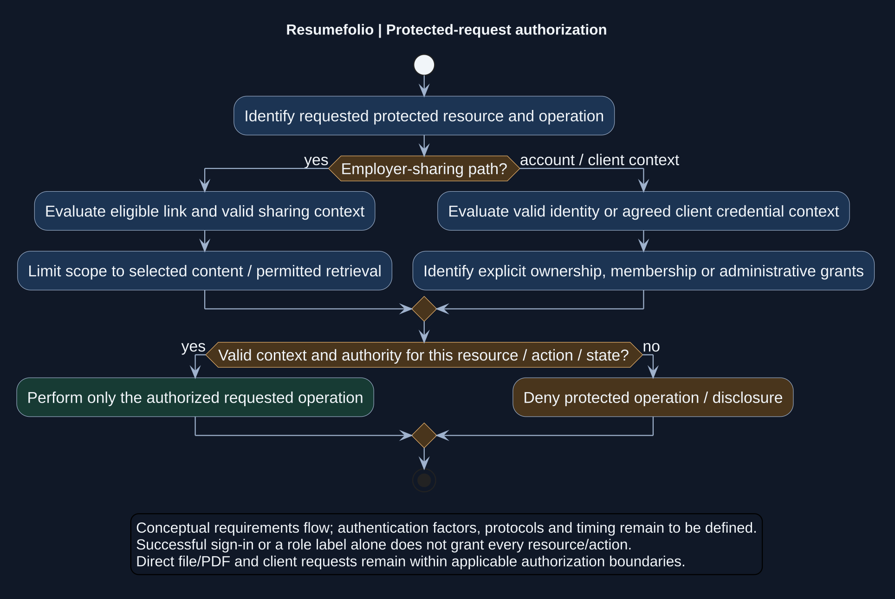

[Scalable SVG](Diagrams/Accounts-Request-Authorization.svg) ·
[Editable PlantUML](Diagrams/Accounts-Request-Authorization.puml)

The flow describes required boundary questions, not a selected authentication
implementation. Blue evaluates context; amber identifies denial or unresolved
authority; green permits only the requested authorized operation. It does not
grant unspecified rights or settle timing of state changes.

| Lifecycle area | Behavior to specify | Current boundary |
| --- | --- | --- |
| Account provisioning | Owner/admin creates or invites; required fields, duplicate/ineligible input and invitation mechanics need specification | MVP admission accepted; no open public self-registration |
| Authentication | Identifiers, factors/credentials, validation, success/failure and sensitive reauthentication | Mechanism and numerical policies open |
| Active context | Validity, idle/absolute lifetime, concurrent sessions, devices and safe continuation | Unified sign-in applies only while context is valid under agreed policy |
| Sign-out / credential change | Local/global sign-out, replay, credential changes and existing contexts | Required behavior must have explicit scope/effective point |
| Account suspension/deletion/recovery | Actors, eligibility, effects on existing access, restoration and verified recovery | No final state enumeration, cascade, retention period or recovery power assigned here |
| Invitation/membership | Creation, acceptance, expiry if required, role change and revocation | Collaboration remains resource/action-limited; detailed transitions open |
| Provider / Git / execution access | Consent/credential revocation, reconnect, jobs and deployment authority | Browser sign-in alone does not imply all external/client/execution authority |
| Employer-link change | Fresh and active viewer contexts, downloads and content availability | Fresh disabled-link/old-password denial covered; active/in-flight/caching policy open |

Do not infer automatic reactivation of links, reminders, sync or jobs after account
or content restoration. Resolve the relevant lifecycle effects before accepting
affected requirements and dependent data/security design.

<a id="requirements-specification-accounts-authentication-and-permissions--heading-5-information-and-sensitive-data-boundaries"></a>
##### 5. Information and Sensitive-data Boundaries

Use the [Data Dictionary](#data-definitions-data-dictionary) for account,
grant, connection and shared-link meanings; define behavior here and in the
appropriate domain. No actual private data or secrets belong in examples/evidence.

| Information | Required clarification |
| --- | --- |
| Account identity/contact data | Required/optional fields, verification, update rights, duplicates and lifecycle |
| Role/grant/membership data | Grantor/recipient/resource/action/state, permitted changes, history and revocation meaning |
| Authentication/recovery values | Required confidentiality, exposure boundaries, validity/reuse and eventual secure handling design |
| Provider/Git credentials | Issuance/consent, scope, visibility, revocation and disconnect effects; no protocol/storage design selected |
| Link credentials/viewer context | Separate from main-account credentials; access limited to selected shared resources |
| Audit and security events | Which events/actor/time/result are required, who may inspect them, integrity and retention; no duration invented |

Exact credential-storage algorithms, session mechanisms and implementation controls
belong to security design with relevant authoritative technical review. This draft
does not prescribe a new cryptographic scheme or claim security from wording alone.

<a id="requirements-specification-accounts-authentication-and-permissions--heading-6-scenarios-and-verification-plan"></a>
##### 6. Scenarios and Verification Plan

The following is a proposed coverage plan, not executed tests or allocated scenario
IDs. All checks use controlled data and an explicitly authorized environment.

| Scenario group | Candidate references | Minimum paths to develop |
| --- | --- | --- |
| Account context and navigation | ACC-D01/D02 | Valid and absent/invalid context, cross-section continuation, unauthorized destination |
| Direct resource requests | ACC-D03/D04 | Allowed read/write pairs, cross-user identifiers, list/search/file paths and denied modification |
| Collaboration and grant changes | ACC-D05/D10 | Valid limited membership, unrelated resources, unauthorized self-promotion and membership lifecycle once defined |
| Employer viewing/retrieval | ACC-D06/D07/D08 | No viewer account, correct/wrong password, disabled link, direct file/PDF, unselected content and fresh-context password change |
| Administration | ACC-D09/D10 | Defined powers versus ungranted actions, target-resource/state restrictions and sensitive-operation criteria once decided |
| Failure and ended access | ACC-D11/D12 | Required external-step failure, sign-out/replay, credential/account/membership state changes after policy completion |

Inspect requirement text and semantic coverage first. Later integration/browser
checks must identify application revision, environment, actor/grant fixtures,
expected/actual results, evidence and limits. A successful login is not proof of
cross-module authorization; a green build or hidden button is not a denied-path test.

<a id="requirements-specification-accounts-authentication-and-permissions--heading-7-role-resource-and-operation-matrix"></a>
##### 7. Role, resource and operation matrix

This section retains the existing stable anchor and initial source boundaries.
It summarizes policy scope; detailed allowed/denied action/state rules still need
development. It is not a complete role hierarchy or an unconditional grant.

| Role | Resource and operation | Access boundary | Detail still to specify | Source |
| --- | --- | --- | --- | --- |
| **Registered resource owner** | Create and maintain own professional profiles, tailored resumes and selected evidence | Own-data workflows are included; no access to another user's private content follows from sign-in | Field/action permissions, account states and propagation rules | DEC-027, DEC-026, DEC-028 |
| **Resume owner** | Configure downloads, change sharing password or disable employer link | Sharing applies only to the selected resume and content; direct PDFs/files follow the same boundary | Sensitive-action checks, active-session revocation and link lifecycle | DEC-025, DEC-024 |
| **Employer viewer** | View selected shared resume/evidence and retrieve permitted PDFs/files | No viewer account required; valid protected-link access is required; no private workspace or unrelated content access | Session validity, wrong-password behavior, revocation and language/download cases | DEC-024, DEC-025 |
| **Invited collaborator** | Access authorized project/board/repository operations | Invitation alone must not expose private email, unrelated resumes or repositories | Read/write/invite/review/merge rights per resource and effect of membership changes | DEC-028, DEC-021, DEC-020 |
| **Registered user** | Use private email, calendar and application records | Operations remain subject to resource-specific permissions; collaboration grants no unrelated private access | Account linking, delegated access if any, disconnect and lifecycle rules | DEC-022, DEC-023, DEC-028 |
| **Administrator** | Account and content administration | Only authorized administrative operations; role name does not imply unrestricted access | Exact view/edit/suspend/delete/restore rights and audit obligations | DEC-032, DEC-029 |
| **Platform owner** | Configure platform upload/storage policy and administration | Policy must respect infrastructure limits; project ownership is distinct from product permissions | Administrative powers, sensitive operations and separation from private user content | DEC-018, DEC-032 |

Decision locators: [Scope](../01-Project-Planning/01-Project-Charter.md#mvp-scope) and
[Stakeholders](../01-Project-Planning/01-Project-Charter.md#responsibilities).
Unspecified permissions remain unresolved and must not be inferred as allowed.
Split the summary into actual resource/action rules when policies are reviewed;
include denied direct/cross-user requests and current resource/account states.

<a id="requirements-specification-accounts-authentication-and-permissions--id-8-open-policy-decisions-and-dependent-gates"></a>

<a id="requirements-specification-accounts-authentication-and-permissions--heading-8-remaining-verification"></a>
##### 8. Remaining Verification

Demonstrate invitation and recovery email receipt. Test cross-user access, direct and range retrieval, account suspension and credential revocation. Verify the independent ProjectForge trust boundary. Record each result against the applicable criterion and tested version. See the [verification gates](https://github.com/Farhad-V/Web-Resumefolio/blob/1f2acaa351ac306cb57cbe4fe9742e8bd90720d9/docs/MVP/baseline/implementation-sequence.md#gate-register).

<a id="requirements-specification-accounts-authentication-and-permissions--heading-9-traceability-review-and-current-position"></a>
##### 9. Traceability, Review and Current Position

| Draft group | Source / supporting record | Intended downstream links |
| --- | --- | --- |
| ACC-D01–D05 | DEC-028, OBJ-04, EXT-003 and actor catalog | Account/permission scenarios, data definitions, foundation work and later allowed/denied checks |
| ACC-D06–D08 | DEC-024/DEC-025, EXT-001 and sharing domain | Employer use cases, PDF/file rules, sharing work and later direct-retrieval checks |
| ACC-D09/D10 | DEC-029–DEC-032, DEC-018 and RSK-04 | Administrative powers, grant-management scenarios, audit/quality rules and later operation checks |
| ACC-D11/D12 | RSK-07/RSK-09, delivery dependencies and M-04 outcome definition | Failure/recovery/session lifecycle decisions, integration evidence and later context-replay checks |

Use the [criterion mapping and review findings](#validation-and-traceability-validation-and-traceability) to link each applicable requirement to a scenario and its actual evidence.

<a id="requirements-specification-accounts-authentication-and-permissions--heading-10-diagram-maintenance"></a>
##### 10. Diagram Maintenance

| Diagram | Editable source | Scalable view | Preview |
| --- | --- | --- | --- |
| Access contexts | [Graphviz](Diagrams/Accounts-Access-Contexts.dot) | [SVG](Diagrams/Accounts-Access-Contexts.svg) | 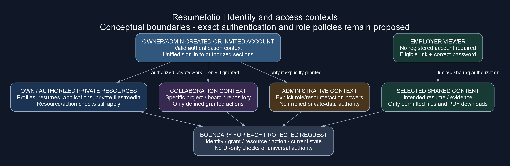 |
| Request authorization | [PlantUML](Diagrams/Accounts-Request-Authorization.puml) | [SVG](Diagrams/Accounts-Request-Authorization.svg) | 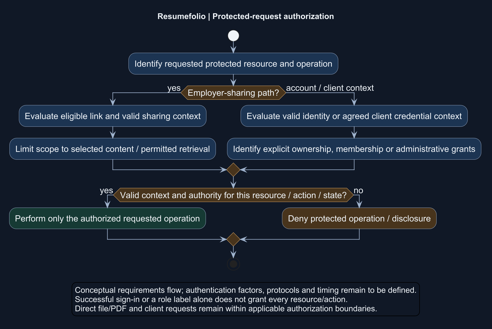 |

Regenerate both SVG and PNG when a diagram source changes.

[Specification index](#requirements-specification-requirements-specification-overview) · [SRS entry point](#requirements-specification-requirements-specification)
· [Requirements index]()

</details>

<a id="requirements-specification-administration-files-and-operational-behavior"></a>

<details>
<summary>Resumefolio — Administration, Files and Operational Behavior</summary>

<a id="requirements-specification-administration-files-and-operational-behavior--heading-resumefolio--administration-files-and-operational-behavior"></a>
#### Resumefolio — Administration, Files and Operational Behavior

**Status.** MVP file and operating policies are selected. Enforcement, capacity and recovery still need evidence.

[Decisions and rationale](#requirements-specification-administration-files-and-operational-behavior--heading-selected-policies-and-future-proposals) · [Requirements](#requirements-specification-administration-files-and-operational-behavior--heading-3-proposed-requirements-and-acceptance-criteria) · [File flow](#requirements-specification-administration-files-and-operational-behavior--heading-4-file-operation-and-failure-flow) · [Verification](#requirements-specification-administration-files-and-operational-behavior--heading-6-scenarios-and-planned-verification)

<a id="requirements-specification-administration-files-and-operational-behavior--heading-mvp-same-server-private-storage"></a>
##### MVP same-server private storage

Core stores uploaded files and media privately on the Resumefolio host. Direct file access, previews, thumbnails and byte ranges require current authorization. Independent backups protect recovery.

<a id="requirements-specification-administration-files-and-operational-behavior--heading-selected-policies-and-future-proposals"></a>
##### Selected Policies and Future Proposals

<a id="requirements-specification-administration-files-and-operational-behavior--id-resolution-q-d24"></a>

<a id="requirements-specification-administration-files-and-operational-behavior--heading-q-d24-selected-policy"></a>
###### Q-D24: Selected policy

- **Decision.** Enforce the selected file types, per-file and aggregate quotas, concurrent reservations and disk reserve. Limit administrative access and audit evidence to their defined purposes.
- **Why.** Concurrent uploads and temporary files can exhaust shared disk space. Reservations protect headroom, while private storage and scoped access protect user content.
- **Evidence.** Verify enforcement and actual host headroom before admitting production data. [Selected file policy](https://github.com/Farhad-V/Web-Resumefolio/blob/1f2acaa351ac306cb57cbe4fe9742e8bd90720d9/docs/MVP/baseline/policy-decisions.md#q-d24)

**Operating decision.** Verify the selected environment, queues, system mail and independent backup on the target host. A file operation needs a dependable way to report completion and recover after interruption. [Operating policy](https://github.com/Farhad-V/Web-Resumefolio/blob/1f2acaa351ac306cb57cbe4fe9742e8bd90720d9/docs/MVP/baseline/policy-decisions.md#q-d27)

<a id="requirements-specification-administration-files-and-operational-behavior--heading-1-scope-sources-and-domain-ownership"></a>
##### 1. Scope, Sources and Domain Ownership

| Source | Existing direction | Specification implication |
| --- | --- | --- |
| [DEC-018](https://github.com/Farhad-V/Web-Resumefolio/blob/1f2acaa351ac306cb57cbe4fe9742e8bd90720d9/docs/MVP/SDLC/01-project-planning/02-scope.md#dec-018) | Platform owner can configure upload sizes and storage consumption limits through administration; limits respect actual infrastructure | Policy configuration and enforcement need explicit units, scope and capacity evidence |
| [DEC-026](https://github.com/Farhad-V/Web-Resumefolio/blob/1f2acaa351ac306cb57cbe4fe9742e8bd90720d9/docs/MVP/SDLC/01-project-planning/02-scope.md#dec-026) / [DEC-025](https://github.com/Farhad-V/Web-Resumefolio/blob/1f2acaa351ac306cb57cbe4fe9742e8bd90720d9/docs/MVP/SDLC/01-project-planning/02-scope.md#dec-025) | Support externally created evidence/media/files/diagrams/links and generated/uploaded PDFs | Define supported content and file behavior without introducing an editor or every possible format |
| [DEC-024](https://github.com/Farhad-V/Web-Resumefolio/blob/1f2acaa351ac306cb57cbe4fe9742e8bd90720d9/docs/MVP/SDLC/01-project-planning/02-scope.md#dec-024) / [DEC-028](https://github.com/Farhad-V/Web-Resumefolio/blob/1f2acaa351ac306cb57cbe4fe9742e8bd90720d9/docs/MVP/SDLC/01-project-planning/02-scope.md#dec-028) | Shared/direct file access follows authorization; account/collaboration scope is limited | File operations must use the access rules rather than treating a URL as permission |
| [DEC-023](https://github.com/Farhad-V/Web-Resumefolio/blob/1f2acaa351ac306cb57cbe4fe9742e8bd90720d9/docs/MVP/SDLC/01-project-planning/02-scope.md#dec-023) | Actual submitted resume/cover-letter materials are preserved against later source edits | Replacement and cleanup must respect preserved application-history boundaries |
| [RSK-08 / DEC-067](https://github.com/Farhad-V/Web-Resumefolio/blob/1f2acaa351ac306cb57cbe4fe9742e8bd90720d9/docs/MVP/SDLC/01-project-planning/07-risks.md#dec-067) | Configurable quotas, capacity checks, warnings and interrupted/failed-operation behavior need definition and verification | Define observable enforcement, accurate results and eventual cleanup criteria |
| [RSK-04 / DEC-071](https://github.com/Farhad-V/Web-Resumefolio/blob/1f2acaa351ac306cb57cbe4fe9742e8bd90720d9/docs/MVP/SDLC/01-project-planning/07-risks.md#dec-071), [RSK-05 / DEC-070](https://github.com/Farhad-V/Web-Resumefolio/blob/1f2acaa351ac306cb57cbe4fe9742e8bd90720d9/docs/MVP/SDLC/01-project-planning/07-risks.md#dec-070), [RSK-09 / DEC-066](https://github.com/Farhad-V/Web-Resumefolio/blob/1f2acaa351ac306cb57cbe4fe9742e8bd90720d9/docs/MVP/SDLC/01-project-planning/07-risks.md#dec-066) | Authorization, recoverability and cross-module lifecycle risks remain open | Review allowed/denied and data-consistency/failure scenarios with actual evidence later |
| [DEC-017](https://github.com/Farhad-V/Web-Resumefolio/blob/1f2acaa351ac306cb57cbe4fe9742e8bd90720d9/docs/MVP/SDLC/01-project-planning/02-scope.md#dec-017) and [Deliverables](../01-Project-Planning/02-Project-Management-Plan.md#deliverables-and-control) | Setup/maintenance guidance, backup procedures, demonstrated restoration and identified verification evidence | Operational readiness needs produced guidance and actual candidate/environment evidence |

This file owns shared administrative file-policy and operational expectations.
[Accounts/Permissions](#requirements-specification-accounts-authentication-and-permissions) owns role/action
authorization. [PDF/Sharing](#requirements-specification-pdf-and-controlled-sharing) owns download/language
and protected-view behavior. [Business Rules/Lifecycle](#requirements-specification-business-rules-and-data-lifecycle)
owns cross-module retention/deletion rules; [Quality/Security/Recovery](#requirements-specification-quality-security-and-recovery-requirements)
owns measurable quality and recovery targets. Link shared requirements rather
than defining contradictory policies in each domain.

Real Git storage, workflow outputs and provider email attachments are not assumed
to use exactly the same admission rules or accounting pool as resume media. Their
applicability and boundaries need explicit decisions with the relevant domains.

<a id="requirements-specification-administration-files-and-operational-behavior--heading-2-administration-and-policy-model"></a>
##### 2. Administration and Policy Model

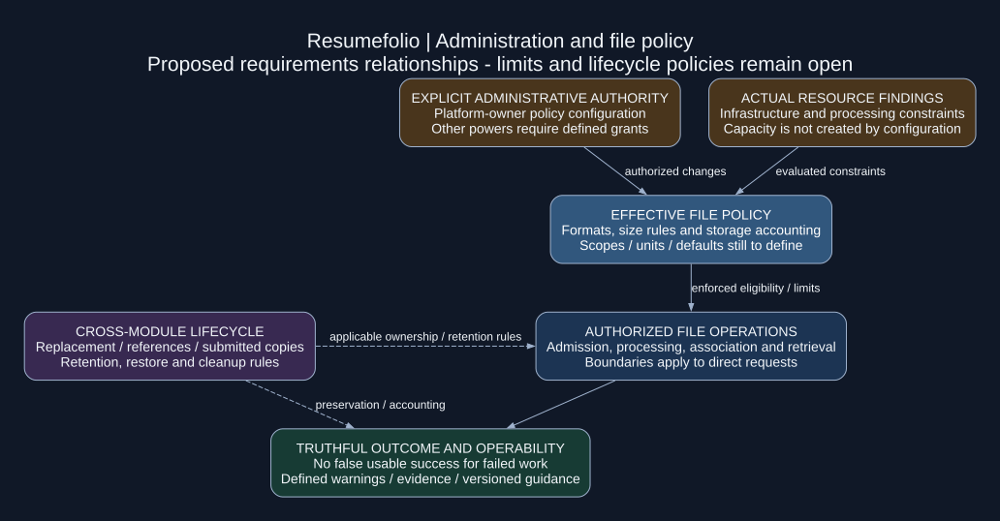

[Scalable SVG](Diagrams/Administration-Files-Policy-Map.svg) ·
[Editable Graphviz](Diagrams/Administration-Files-Policy-Map.dot)

Amber identifies administrative/capacity decisions; blue identifies policy and
file operations; purple identifies cross-module lifecycle; green identifies
truthful operational outcomes. Arrows show requirements relationships, not a
physical storage architecture, deployed service or unlimited administrative power.

| Policy aspect | Meaning to define |
| --- | --- |
| Administrative scope | Who can inspect/change each setting or perform a sensitive operation on which target |
| Upload limit | Maximum admitted size with an explicit unit, comparison rule and applicable content/path scope |
| Storage quota | Consumption allowance with explicit accounting subjects, units and success/deletion/replacement effects |
| Format/content policy | Supported content categories, validation, processing/display behavior and rejection criteria |
| Infrastructure envelope | Actual lower-level limits, available capacity and processing constraints supported by evidence |
| Policy change | Effective point, concurrent/in-progress operations, existing over-quota content and clear result |
| Operational feedback | Who may see which operation status, failures, consumption or warnings, without secrets/unrelated content |

Configure policy through the agreed administrative interface; no code edits should
be required for the policy values covered by DEC-018. Configuration does not create
physical capacity. Initial defaults, per-file/per-user/project/global scopes,
units, thresholds and capacity margins remain undecided.

<a id="requirements-specification-administration-files-and-operational-behavior--heading-3-proposed-requirements-and-acceptance-criteria"></a>
##### 3. Proposed Requirements and Acceptance Criteria

<a id="requirements-specification-administration-files-and-operational-behavior--heading-shared-record-metadata"></a>
###### Shared record metadata

All AFO-D records are **Proposed**, coordinated by the project owner and pending
actual review. Document-local references are not final FR/NFR allocation. No
priority, approval or completed verification is invented; use the existing
value/risk/dependency method when ordering work. Sources and rationale are stated
per record, with criteria, planned checks and open dependencies.

- **Policy and capacity:** [AFO-D01](#requirements-specification-administration-files-and-operational-behavior--heading-afo-d01-owner-configurable-upload-and-storage-policy), [AFO-D02](#requirements-specification-administration-files-and-operational-behavior--heading-afo-d02-policy-consistent-with-evaluated-infrastructure), [AFO-D03](#requirements-specification-administration-files-and-operational-behavior--heading-afo-d03-per-file-admission-limit), [AFO-D04](#requirements-specification-administration-files-and-operational-behavior--heading-afo-d04-aggregate-quota-and-concurrent-admission)
- **Admission, access and file lifecycle:** [AFO-D05](#requirements-specification-administration-files-and-operational-behavior--heading-afo-d05-supported-content-and-validation), [AFO-D06](#requirements-specification-administration-files-and-operational-behavior--heading-afo-d06-file-resource-authorization-and-isolation), [AFO-D07](#requirements-specification-administration-files-and-operational-behavior--heading-afo-d07-truthful-completion-and-interrupted-operation-handling), [AFO-D08](#requirements-specification-administration-files-and-operational-behavior--heading-afo-d08-safe-replacement-and-lifecycle-effects)
- **Operations and recovery:** [AFO-D09](#requirements-specification-administration-files-and-operational-behavior--heading-afo-d09-operational-outcomes-and-capacity-warnings), [AFO-D10](#requirements-specification-administration-files-and-operational-behavior--heading-afo-d10-administrative-operation-evidence), [AFO-D11](#requirements-specification-administration-files-and-operational-behavior--heading-afo-d11-bounded-cleanup-and-storage-reclamation), [AFO-D12](#requirements-specification-administration-files-and-operational-behavior--heading-afo-d12-version-specific-operational-guidance-and-readiness)

<a id="requirements-specification-administration-files-and-operational-behavior--heading-afo-d01-owner-configurable-upload-and-storage-policy"></a>
###### AFO-D01: Owner-configurable Upload and Storage Policy

- **Release allocation (owner decision, November 4):** MVP foundation where used by core/basic ProjectForge; future-domain clauses deferred.

- **Source / rationale:** DEC-018; adapt policy without changing application code.
- **Actor / conditions:** Platform-owner context with the configuration authority
  defined in the accounts/permissions domain.

- **Proposed obligation:** The product shall let the authorized platform owner
  inspect and change the defined upload-size and storage-consumption policy values
  through administration, within their agreed valid ranges and resource constraints.

- **Acceptance criteria**
  - An authorized configuration change can be made without editing source code; the resulting effective policy values are identifiable through the agreed administration view.
  - A caller lacking the applicable administrative grant cannot change those values through UI or direct requests.
  - An invalid value is not silently reported as successfully active; the previous effective policy or explicit failed/unapplied state remains identifiable.

- **Planned verification:** Configuration and denied-request integration/browser
  cases. **Open detail:** Valid units/ranges, quota scopes, feedback and effective point.

<a id="requirements-specification-administration-files-and-operational-behavior--heading-afo-d02-policy-consistent-with-evaluated-infrastructure"></a>
###### AFO-D02: Policy Consistent with Evaluated Infrastructure

- **Release allocation (owner decision, November 4):** MVP foundation where used by core/basic ProjectForge; future-domain clauses deferred.

- **Source / rationale:** DEC-018; ASM-01/DEP-01 and RSK-08. Avoid treating configurable
  limits as evidence of unlimited capacity.

- **Proposed obligation:** The product's effective file policy shall respect the
  agreed deployment constraints; an administrator's configured value shall not
  bypass an applicable lower-level admission or resource constraint.

- **Acceptance criteria**
  - Given a request exceeds an applicable lower-level constraint, increasing the application setting does not make the request falsely succeed.
  - Where the administrative design validates policy against a defined supported envelope, an incompatible setting is rejected or explicitly identified as unapplied rather than silently accepted as effective.
  - The configuration guide identifies applicable external limits and the scope of actual verification.

- **Planned verification:** Inspect actual environment/configuration constraints and
  perform bounded limit cases. **Acceptance blocker:** Infrastructure findings and
  supported-envelope behavior must be defined. No automatic capacity controller or
  margin is mandated here.

<a id="requirements-specification-administration-files-and-operational-behavior--heading-afo-d03-per-file-admission-limit"></a>
###### AFO-D03: Per-file Admission Limit

- **Release allocation (owner decision, November 4):** MVP foundation where used by core/basic ProjectForge; future-domain clauses deferred.

- **Source / rationale:** DEC-018 and RSK-08; enforce configured size policy.
- **Actor / conditions:** Authorized user submits a file on a path covered by the policy.

- **Proposed obligation:** The product shall evaluate the actual admitted file size
  against the applicable upload limit and shall not make a rejected oversized file
  available as successfully stored content.

- **Acceptance criteria**
  - With agreed unit and inclusive/exclusive boundary semantics, a file exceeding the applicable limit is rejected without becoming usable successful content.
  - Boundary cases just below, at and above the limit match that agreed policy when other eligibility conditions are satisfied.
  - Supplying inaccurate client size metadata alone cannot bypass the size rule.

- **Planned verification:** Controlled boundary uploads and manipulated metadata.
- **Open detail:** Units, boundary semantics, empty files, transport failures and path applicability.

<a id="requirements-specification-administration-files-and-operational-behavior--heading-afo-d04-aggregate-quota-and-concurrent-admission"></a>
###### AFO-D04: Aggregate Quota and Concurrent Admission

- **Release allocation (owner decision, November 4):** MVP foundation where used by core/basic ProjectForge; future-domain clauses deferred.

- **Source / rationale:** DEC-018; proposed RSK-08 enforcement refinement.
- **Actor / conditions:** File operations consume storage in an agreed quota scope.

- **Proposed obligation:** The product shall enforce the applicable aggregate quota
  using its agreed accounting rules, including overlapping admissions, rather than
  allowing each operation to ignore consumption committed by other successful operations.

- **Acceptance criteria**
  - An admission that exceeds the available allowance under the agreed accounting rule is not reported as successful usable content.
  - Concurrent controlled requests that individually appear to fit but jointly exceed that allowance cannot all succeed in violation of the defined quota.
  - Accounted usage after successful/failed operations matches the agreed inclusion and release rules; failed work is not silently counted as permanent successful content.

- **Planned verification:** Bounded concurrent admissions, usage comparison and failed
  operation cases. **Acceptance blocker:** Counted subjects, units, reservation/release
  semantics and existing over-quota behavior need decisions. No transaction/storage
  mechanism is selected.

<a id="requirements-specification-administration-files-and-operational-behavior--heading-afo-d05-supported-content-and-validation"></a>
###### AFO-D05: Supported Content and Validation

- **Release allocation (owner decision, November 4):** MVP foundation where used by core/basic ProjectForge; future-domain clauses deferred.

- **Source / rationale:** DEC-026/DEC-025 with RSK-08/RSK-04; accept intended material
  without assuming every extension or file is safe/supported.

- **Proposed obligation:** The product shall validate submitted content against the
  agreed supported-format and content policy before making it available in its
  intended usable state.

- **Acceptance criteria**
  - Content that fails a required validation is not presented as valid usable evidence/PDF merely because its filename or declared type looks acceptable.
  - Agreed supported samples can complete the intended upload/processing/display path when access and resource conditions are met.
  - Rejection or processing failure has an identifiable result; no false successful preview/download is shown.

- **Planned verification:** Supported/unsupported/mismatched/invalid controlled
  samples. **Open detail:** Format list, validation depth, active content, rendering,
  malware-analysis needs and safe serving require security/design review; no scanner
  or processing technology is selected.

<a id="requirements-specification-administration-files-and-operational-behavior--heading-afo-d06-file-resource-authorization-and-isolation"></a>
###### AFO-D06: File-resource Authorization and Isolation

- **Owner-scope acceptance additions (MVP; planned, not executed):**

  - Private upload bytes are stored outside publicly served directories on the same core server and are delivered only through current owner or protected selected-resume authorization.
  - Type/size/quota checks and safe serving also apply to media; recoverable backup coverage includes private bytes and their protected references.

- **Release allocation (owner decision, November 4):** MVP foundation where used by core/basic ProjectForge; future-domain clauses deferred.

- **Source / rationale:** DEC-024/DEC-025/DEC-028 and RSK-04; keep file access within
  the same boundary as its intended resource context.

- **Proposed obligation:** File upload, retrieval, association, replacement and
  removal shall enforce the applicable resource/action authority, including direct
  requests and altered resource references.

- **Acceptance criteria**
  - A caller lacking an action grant cannot modify another user's protected file/association through a direct request.
  - Direct protected retrieval does not disclose file/PDF contents without the applicable authorization and sharing availability.
  - A legitimate shared or collaboration context grants no unrelated file access merely because identifiers/paths are supplied.

- **Planned verification:** Allowed/denied file actions, cross-user identifiers and
  direct requests. **Dependencies:** ACC-D03–ACC-D10 in
  [Accounts/Permissions](#requirements-specification-accounts-authentication-and-permissions), shared download
  rules and final action/state matrix; these are cross-references, not accepted controls.

<a id="requirements-specification-administration-files-and-operational-behavior--heading-afo-d07-truthful-completion-and-interrupted-operation-handling"></a>
###### AFO-D07: Truthful Completion and Interrupted-operation Handling

- **Release allocation (owner decision, November 4):** MVP foundation where used by core/basic ProjectForge; future-domain clauses deferred.

- **Source / rationale:** RSK-08/DEC-067; failed work must not be mistaken for complete storage.

- **Proposed obligation:** The product shall report a file operation as successfully
  usable only after its required admission, processing and association conditions
  have completed; interruption/failure shall retain an outcome distinguishable from success.

- **Acceptance criteria**
  - Interrupted upload or required processing failure does not leave the file presented as complete usable content.
  - A completed operation exposes only the content/result associated with its successful request and allowed resource context.
  - Failure handling does not silently damage unrelated existing content or release quota still needed by retained material.

- **Planned verification:** Controlled interruptions/failures and content/accounting
  comparison. **Open detail:** Retry behavior, intermediate states, timeout, recovery,
  cleanup and same-request repetition semantics require specification.

<a id="requirements-specification-administration-files-and-operational-behavior--heading-afo-d08-safe-replacement-and-lifecycle-effects"></a>
###### AFO-D08: Safe Replacement and Lifecycle Effects

- **Release allocation (owner decision, November 4):** MVP foundation where used by core/basic ProjectForge; future-domain clauses deferred.

- **Source / rationale:** DEC-023 and RSK-09; preserve submitted history and avoid
  unintended cross-module file changes.

- **Proposed obligation:** Replacement/removal of source files or associations shall
  follow explicit ownership and lifecycle rules and shall not overwrite preserved
  submitted resume/cover-letter copies through a later source edit.

- **Acceptance criteria**
  - After replacing editable source content, preserved material captured as actually submitted remains unchanged by that replacement.
  - A replacement that fails before its required completion does not falsely report the new content as successfully available.
  - Removing one association does not silently remove unrelated content or retained references contrary to the agreed lifecycle rules.

- **Planned verification:** Source replacement, preserved-copy comparison and shared
  reference/failure scenarios. **Acceptance blockers:** Delete/restore behavior,
  reference ownership, existing-file handling during failed replacement and physical
  retention/reclamation policy need explicit decisions.

<a id="requirements-specification-administration-files-and-operational-behavior--heading-afo-d09-operational-outcomes-and-capacity-warnings"></a>
###### AFO-D09: Operational Outcomes and Capacity Warnings

- **Release allocation (owner decision, November 4):** MVP foundation where used by core/basic ProjectForge; future-domain clauses deferred.

- **Source / rationale:** Original operational-visibility topic, RSK-08/DEC-067 and
  operational readiness; proposed detail for feasible solo administration.

- **Proposed obligation:** Authorized users/operators shall be able to identify the
  outcome of relevant file/policy operations and applicable capacity/quota warnings
  through the agreed feedback mechanisms without exposure of unrelated private data.

- **Acceptance criteria**
  - Successful, failed and still-incomplete operations are distinguishable in the agreed relevant view/feedback.
  - Once warning conditions and timing are defined, controlled threshold scenarios produce the specified warning to the authorized recipient.
  - A normal user cannot obtain unrelated users' private file content or secret operational configuration through failure/warning details.

- **Planned verification:** Operation-state and threshold/failure feedback cases after
  policy completion. **Open detail:** Thresholds, measurement freshness, recipients,
  channels and frequency. No external monitoring service, dashboard purchase or
  unattended job is configured by this requirement draft.

<a id="requirements-specification-administration-files-and-operational-behavior--heading-afo-d10-administrative-operation-evidence"></a>
###### AFO-D10: Administrative Operation Evidence

- **Release allocation (owner decision, November 4):** MVP foundation where used by core/basic ProjectForge; future-domain clauses deferred.

- **Source / rationale:** Proposed refinement of authorized administration/operational
  visibility; supports investigating sensitive changes under RSK-04/RSK-09.

- **Proposed obligation:** For the administrative operations selected by the agreed
  audit policy, the product shall retain the specified actor, target, time and
  outcome information and restrict access to that evidence according to explicit rules.

- **Acceptance criteria**
  - Once audited events/fields are defined, controlled selected operations produce records consistent with their actual actor/target/outcome.
  - Callers lacking audit-view/change authority cannot retrieve or modify protected audit evidence through a direct request.
  - Ordinary audit/output records do not disclose passwords, private keys, access tokens or authentication codes.

- **Planned verification:** Selected event/permission cases and sanitized-record
  inspection. **Acceptance blockers:** Event list, success/failure coverage, integrity,
  visibility/mutation, retention and time semantics. This proposal does not invent an
  immutable log or a retention duration.

<a id="requirements-specification-administration-files-and-operational-behavior--heading-afo-d11-bounded-cleanup-and-storage-reclamation"></a>
###### AFO-D11: Bounded Cleanup and Storage Reclamation

- **Release allocation (owner decision, November 4):** MVP foundation where used by core/basic ProjectForge; future-domain clauses deferred.

- **Source / rationale:** Proposed RSK-08/RSK-09/RSK-05 refinement; cleanup must be
  deliberate and preserve required data.

- **Proposed obligation:** Temporary, failed, replaced or retired material shall be
  reclaimed only under the agreed eligibility/reference/retention rules, with
  accounting updated consistently and protected retained data preserved.

- **Acceptance criteria**
  - Controlled eligible cleanup candidates are reclaimed under the selected procedure and release only the usage defined by the accounting policy.
  - Material still required by another valid reference or preserved submission is not removed merely because a source operation failed or a source association changed.
  - Partial cleanup failure remains identifiable and does not falsely report complete reclamation or remove unrelated protected material.

- **Planned verification:** Safe isolated eligible/ineligible/reference cases and
  controlled failures. **Acceptance blockers:** Eligibility, timing, deleted-content
  retention, recovery expectations and manual/automatic procedure need decisions.
  No deletion, cleanup schedule or production operation is authorized by this draft.

<a id="requirements-specification-administration-files-and-operational-behavior--heading-afo-d12-version-specific-operational-guidance-and-readiness"></a>
###### AFO-D12: Version-specific Operational Guidance and Readiness

- **Release allocation (owner decision, November 4):** MVP foundation where used by core/basic ProjectForge; future-domain clauses deferred.

- **Source / rationale:** DEC-017 and DEL-06/DEL-07/DEL-10; delivery needs operable,
  reviewable procedures and actual evidence.

- **Proposed obligation:** The delivery package shall provide version/environment-specific
  guidance for effective file-policy constraints, required processes, failure handling,
  updates and backup/recovery coverage, with actual checks and limitations recorded
  before the affected readiness outcome is accepted.

- **Acceptance criteria**
  - Guidance identifies the application/configuration/environment it describes, relevant dependencies and responsibility without secrets.
  - Unperformed procedure checks are identified as such; no successful recovery is inferred from backup-file existence.
  - Before relevant release/readiness acceptance, actual restoration/integrity evidence and remaining blockers are linked as required by the existing milestone/deliverable criteria.

- **Planned verification:** Inspect guidance, execute appropriate procedures later in
  authorized target/isolated environments and inspect evidence. **Dependencies:**
  Recovery coverage/targets, resource findings, actual deployment and maintenance
  design; this documentation requirement is not proof the procedures have run.

<a id="requirements-specification-administration-files-and-operational-behavior--heading-4-file-operation-and-failure-flow"></a>
##### 4. File Operation and Failure Flow


[Scalable SVG](Diagrams/Administration-File-Admission-Flow.svg) ·
[Editable PlantUML](Diagrams/Administration-File-Admission-Flow.puml)

This is a conceptual requirements flow. Validation order, concurrency controls,
intermediate state handling and storage implementation are design decisions.
Recheck whichever conditions must hold at completion; the diagram does not imply
one early quota check is sufficient for concurrent admissions.

If access, validation, quota/capacity or processing fails, do not expose partial
content as successful or silently remove existing referenced data. Define whether
the user may retry, what remains visible and how temporary state/accounting is
handled. Product feedback must describe the actual bounded outcome without
leaking secrets or unrelated content.

<a id="requirements-specification-administration-files-and-operational-behavior--heading-5-cross-module-lifecycle-and-accounting"></a>
##### 5. Cross-module Lifecycle and Accounting

| Subject / event | Relationship to resolve | Preserve |
| --- | --- | --- |
| Evidence media/file | Owner, skill/project association and per-resume selection | Resource authorization and independence of unrelated content |
| Generated/uploaded PDF | Represented revision, language, download availability and replacement | Explicit PDF/sharing rules and authorized direct retrieval |
| Submitted materials | Capture, retained artifact references and deletion/restoration authority | Later source edits must not overwrite actual submitted copies |
| Provider attachment/import | Provider/local authority, association and disconnection | No silent provider deletion or retention policy inferred from local file rules |
| Git repositories/releases | Quota pool, object/assets accounting and repository visibility | Real Git/lifecycle rules; do not assume a media-upload limit applies identically |
| Workflow logs/artifacts | Run authority, secret protection, retention and failed-run cleanup | Execution isolation and explicit output access policy |
| Deleted/replaced/temporary content | Logical eligibility versus physical retention/reclamation and restored access | Agreed retention/reference/recovery behavior; no invented cascade or automatic reactivation |
| Backup/restoration | Coverage across database, files, repositories and required configuration/keys | Consistency/integrity and appropriate restored access, demonstrated later |

The [dictionary](#data-definitions-data-dictionary) provides conceptual
subjects. Required/optional metadata, file naming/display, time semantics, units,
retained versions and source-of-truth rules remain to be refined. This draft does
not define database tables, object-store paths or filesystem permissions.

<a id="requirements-specification-administration-files-and-operational-behavior--heading-6-scenarios-and-planned-verification"></a>
##### 6. Scenarios and Planned Verification

The coverage below is a plan, not executed tests or allocated scenario IDs. Use
controlled data and authorized environments; interruption/cleanup/recovery checks
must protect existing services and production information.

| Scenario group | Candidate references | Paths to develop |
| --- | --- | --- |
| Policy configuration | AFO-D01/D02 | Authorized/unauthorized edits, invalid settings, lower-level constraint and effective-value feedback |
| Admission boundaries | AFO-D03/D05 | Agreed below/at/above limit, inaccurate metadata, supported/unsupported/mismatched content |
| Aggregate usage | AFO-D04 | Scope accounting, concurrent admissions, failed work, retained versions and release rules |
| Protected operations | AFO-D06 | Cross-user direct requests, allowed/denied actions, shared content and unrelated references |
| Failure/replacement | AFO-D07/D08 | Interrupted transfer/processing, failed replacement, preserved submitted material and valid shared references |
| Operational visibility | AFO-D09/D10 | Defined outcome/warning/audit events, authorized viewing and secret-safe feedback |
| Cleanup/readiness | AFO-D11/D12 | Eligible/ineligible reclamation, partial failure, accurate accounting and version-specific guide/recovery evidence |

Each later run identifies candidate/environment, effective policy, relevant
actor/grants, workload/data, expected/actual results and limits. A successful
single upload does not prove quota enforcement, safe serving, concurrency,
resource capacity or recoverability.

<a id="requirements-specification-administration-files-and-operational-behavior--heading-7-open-policy-decisions-and-gates"></a>
##### 7. Open Policy Decisions and Gates

These are local question topics, not claimed entries/decisions in the shared
register. Farhad coordinates them; link real question/decision IDs when recorded.

| Topic | Decisions / evidence needed | Dependent gate |
| --- | --- | --- |
| Administrative powers | Exact view/change/delete/restore/cleanup/audit authority; sensitive checks and reasons | Affected account/administration requirement acceptance |
| File categories and validation | Supported formats, content inspection, serving/rendering, metadata and failure behavior | AFO-D05/D06 and domain requirements/security design |
| Units and limits | Size boundary/unit semantics, numerical defaults, valid ranges, per-user/project/global scopes and path applicability | AFO-D01–D04; M-02 criteria and actual M-03 resource findings |
| Accounting and concurrent work | Originals/generated copies/archives/trash/Git/outputs/imports, quota reservations/releases and partially completed work | AFO-D04/D07/D11 acceptance and dependent storage/concurrency design |
| Policy-change effect | Existing over-quota content, active uploads/jobs and effective point; no silent destructive reduction | AFO-D01/D02/D04 and lifecycle requirements |
| Retention, replacement and cleanup | Eligibility, reference checks, capture/archive rules, retention durations, restoration and reclamation schedule/procedure | AFO-D08/D11 and business-lifecycle/recovery requirements |
| Operational visibility/audit | Views/recipients/channels, warning thresholds/freshness, audited events, integrity/privacy and retention | AFO-D09/D10; administration/quality requirements |
| Resource/processing feasibility | Actual storage/free capacity, competing services, processing demand and safe limits | ASM-01/DEP-01/GAP-D01/D10; before dependent M-03 design and later verification |
| Recovery/maintenance | Independent backup coverage/storage, actual procedures, RPO/RTO, update recovery and solo workload | ASM-04/DEP-05/GAP-D04/D08; design gates and actual restoration before M-09 |

Use [Open Questions](#change-and-baseline-open-questions-and-decisions),
[Change Control](#change-and-baseline-change-control) and the
[feasibility plan](#process-and-approach-02-feasibility-study). A proposed
threshold or retention value remains unaccepted until its source, rationale and
actual decision are recorded. No paid storage, extra server or cleanup automation
is assumed or purchased by this document.

<a id="requirements-specification-administration-files-and-operational-behavior--heading-8-traceability-and-review-readiness"></a>
##### 8. Traceability and Review Readiness

| Group | Source basis | Related records |
| --- | --- | --- |
| AFO-D01–D05 | DEC-018, DEC-026/DEC-025, RSK-08 and ASM-01/DEP-01 | Administration/file-policy dictionary, media/PDF domains, resource findings and later enforcement checks |
| AFO-D06–D08 | DEC-024/DEC-028/DEC-023, RSK-04/RSK-09 | Account/permission drafts, sharing, application history and lifecycle scenarios |
| AFO-D09–D11 | Proposed operational/audit/cleanup refinements from RSK-08/RSK-04/RSK-09/RSK-05 | Quality/security, explicit administrative powers, output/retention rules and isolated checks |
| AFO-D12 | DEC-017, deliverables and M-03/M-09/M-10 outcome criteria | Actual guides, deployment/recovery design and later evidence |

Maintain actual allocated records and artifact links in
[Traceability](#validation-and-traceability-validation-and-traceability--heading-traceability).
Use [Review Findings](#validation-and-traceability-validation-and-traceability--heading-review-findings)
for real inspections, dispositions and rechecks; no product checks are recorded here.

- [ ] Reconcile provisional AFO-D references with the final identifier convention.
- [ ] Review source-derived boundaries separately from proposed detailed operational/audit refinements.
- [ ] Resolve critical units, quota/validation, permissions and lifecycle policies before affected acceptance.
- [ ] Ensure criteria have defined conditions and planned methods; conditional criteria are not ready until the referenced policies are decided.
- [ ] Check account, PDF/media, submitted materials, provider/Git/CI, quality and recovery rules agree.
- [ ] Record actual decisions, reviewed revision, evidence and remaining blockers without inventing Pass results.

**Current outcome:** Proposed product draft. No AFO-D candidate is accepted and
no numerical capacity, retention, administrator grant, operational automation or
recovery result is established. M-02 and the wider pre-implementation agreement
remain pending.

**Revision note — October 31, 2026:** Replaced the generic scaffold with twelve
provisional requirements, criteria, methods, policy/lifecycle questions and source
mapping. Added policy/context and file-admission diagrams. Existing scope and
planning acceptance remain unchanged; no actual file, server or account operation
is performed by this documentation revision.

<a id="requirements-specification-administration-files-and-operational-behavior--heading-9-diagram-maintenance"></a>
##### 9. Diagram Maintenance

| Diagram | Editable source | Scalable view | Preview |
| --- | --- | --- | --- |
| Administration/file-policy relationships | [Graphviz](Diagrams/Administration-Files-Policy-Map.dot) | [SVG](Diagrams/Administration-Files-Policy-Map.svg) | 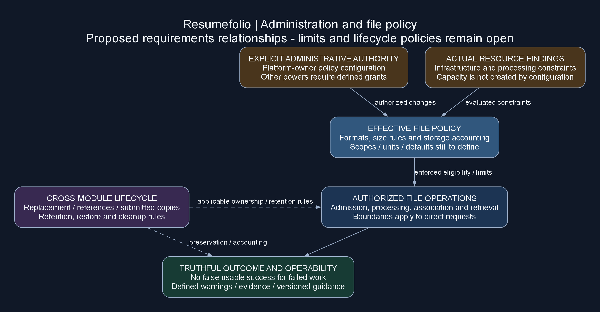 |
| File admission and failure flow | [PlantUML](Diagrams/Administration-File-Admission-Flow.puml) | [SVG](Diagrams/Administration-File-Admission-Flow.svg) | 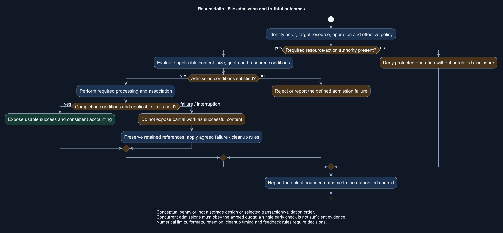 |

Keep text, captions, sources and renders synchronized. Colors supplement labels.
Inspect readable arrows/labels and verify file/section links after edits. Run from
the repository root:

```powershell
$diagramFolder = 'docs\MVP\SDLC\02-requirements-engineering\diagrams'
$graphvizExe = 'C:\Program Files\Graphviz\bin\dot.exe'
$plantUmlJar = 'C:\Users\fvali\AppData\Local\Resumefolio\DiagramTools\plantuml.jar'
foreach ($format in 'svg', 'png') {
    & $graphvizExe "-T$format" -Gdpi=140 `
        "$diagramFolder\administration-files-policy-map.dot" `
        -o "$diagramFolder\administration-files-policy-map.$format"
    if ($LASTEXITCODE -ne 0) { throw "Graphviz failed: $format" }
    java '-Djava.awt.headless=true' -jar $plantUmlJar -charset UTF-8 "-t$format" `
        "$diagramFolder\administration-file-admission-flow.puml"
    if ($LASTEXITCODE -ne 0) { throw "PlantUML failed: $format" }
}
```

Save as UTF-8 without BOM. Under another account, use the actual installed JAR path.
Retain source and SVG/PNG outputs in version control.

[Specification index](#requirements-specification-requirements-specification-overview) · [SRS entry point](#requirements-specification-requirements-specification)
· [Requirements index]()

<a id="requirements-specification-administration-files-and-operational-behavior--heading-mvp-private-media-flow"></a>
##### MVP private-media flow


[Editable source](../04-System-Design/01-High-Level-Design/14-Appendices.md#design-record-01-software-architecture-diagrams-mvp-private-media-puml) · 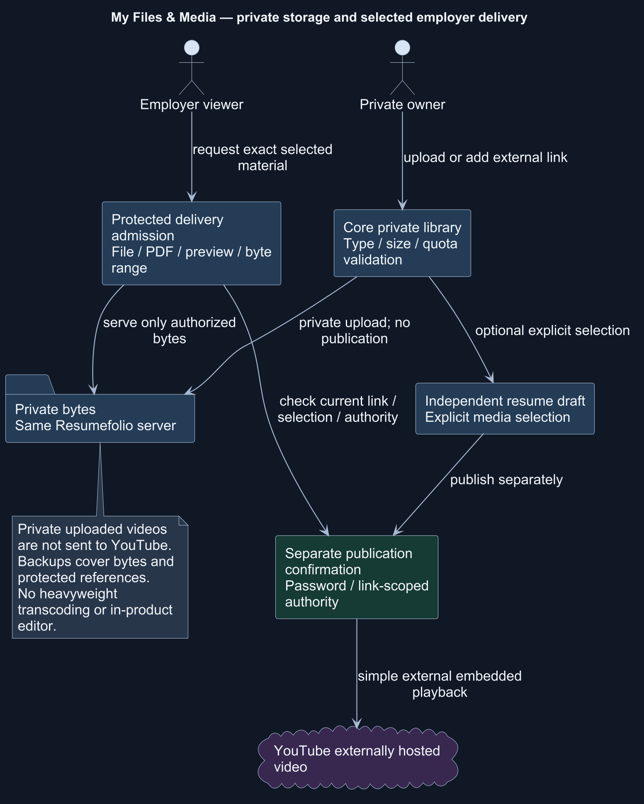.

</details>

<a id="requirements-specification-business-requirements"></a>

<details>
<summary>Resumefolio — Business Requirements</summary>

<a id="requirements-specification-business-requirements--heading-resumefolio--business-requirements"></a>
#### Resumefolio — Business Requirements

Current implementation choices and scope: [Baseline](https://github.com/Farhad-V/Web-Resumefolio/blob/1f2acaa351ac306cb57cbe4fe9742e8bd90720d9/docs/MVP/baseline/README.md). Runtime verification remains subject to its gates.

| Item | Current position |
| --- | --- |
| Purpose | Express the business outcomes and value expected from the accepted product direction |
| Responsible person / business decision-maker | Farhad; sole delivery and operations owner |
| Document status | Current MVP applicability follows the Baseline; future clauses remain proposals |
| Source authority | Owner scope plus selected Baseline policies; original sources retained below |
| Draft references | BIZ-D01–BIZ-D05 are provisional document-local references, not final BIZ identifier allocation |
| Evidence position | Intended outcomes and proposed assessment criteria; no measured benefit or delivery success is claimed |
| Revision | October 31, 2026 |

**At a glance:** Resumefolio should help users reuse professional information,
prepare relevant presentations, control disclosure, preserve application history
and coordinate related work in an operable product. The outcomes below derive
from accepted planning direction. User, functional, quality and interface
requirements explain how those outcomes become observable product behavior.

**Read this document for:** why the product is needed, what value it should
provide and what evidence would support its business outcomes. The
[Purpose and Objectives](../01-Project-Planning/01-Project-Charter.md#purpose-and-success)
document remains authoritative for the original problem, value and accepted
objective decisions; this document derives requirements without replacing them.

[Basis](#requirements-specification-business-requirements--heading-1-business-context-and-source-authority) · [Outcomes](#requirements-specification-business-requirements--heading-2-proposed-business-requirements)
· [Assessment](#requirements-specification-business-requirements--heading-3-success-measures-and-evidence-plan) · [Scope](#requirements-specification-business-requirements--heading-4-outcome-to-scope-and-requirement-links)
· [Constraints](#requirements-specification-business-requirements--heading-5-business-constraints-dependencies-and-open-decisions) · [Review](#requirements-specification-business-requirements--heading-6-review-and-current-position)
· [Diagrams](#requirements-specification-business-requirements--heading-7-diagram-maintenance)

<a id="requirements-specification-business-requirements--heading-1-business-context-and-source-authority"></a>
##### 1. Business Context and Source Authority

Professional information, application materials, repositories, communication,
schedules and tasks are fragmented across tools and documents. Accepted planning
identifies repeated entry, inconsistent versions, opportunity-specific preparation
and follow-up gaps as problems to address. These are planning statements, not
measured research findings about all users.

| Source | Business meaning retained |
| --- | --- |
| [DEC-008 / purpose](https://github.com/Farhad-V/Web-Resumefolio/blob/1f2acaa351ac306cb57cbe4fe9742e8bd90720d9/docs/MVP/SDLC/01-project-planning/01-purpose-and-objectives.md#dec-008) | Build a unified product for reusable professional information, targeted presentation, evidence and controlled sharing for real daily use |
| [DEC-007 / problem](https://github.com/Farhad-V/Web-Resumefolio/blob/1f2acaa351ac306cb57cbe4fe9742e8bd90720d9/docs/MVP/SDLC/01-project-planning/01-purpose-and-objectives.md#dec-007) | Address fragmented information, deliberate application preparation and traceable follow-up |
| [DEC-006 / value](https://github.com/Farhad-V/Web-Resumefolio/blob/1f2acaa351ac306cb57cbe4fe9742e8bd90720d9/docs/MVP/SDLC/01-project-planning/01-purpose-and-objectives.md#dec-006) | Reuse information, tailor materials, control presentation/access, preserve history and coordinate related work |
| [OBJ-01–OBJ-05](https://github.com/Farhad-V/Web-Resumefolio/blob/1f2acaa351ac306cb57cbe4fe9742e8bd90720d9/docs/MVP/SDLC/01-project-planning/01-purpose-and-objectives.md#4-objectives-and-success-criteria) | Five accepted outcome directions and planning-level success criteria |
| [Version 1 Scope](../01-Project-Planning/01-Project-Charter.md#mvp-scope) | Exact inclusions, exclusions and conditional commitments; reference features are not automatically included |
| [Stakeholders](../01-Project-Planning/01-Project-Charter.md#responsibilities) | Product stakeholder interests distinct from the current solo delivery arrangement |

Business requirements describe desired results and constraints. They are distinct
from user goals, button behavior, database structures, code tasks or a technology
shopping list. A business outcome may depend on several modules and multiple
quality/access rules; a business requirement does not select their implementation.

<a id="requirements-specification-business-requirements--heading-2-proposed-business-requirements"></a>
##### 2. Proposed Business Requirements

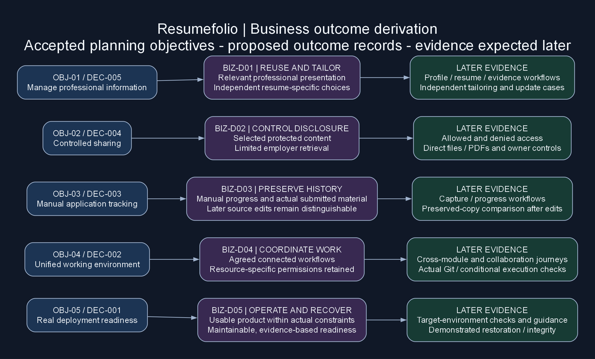

[Scalable SVG](Diagrams/Business-Outcomes-Map.svg) ·
[Editable Graphviz](Diagrams/Business-Outcomes-Map.dot)

Blue identifies accepted planning objectives, purple identifies proposed outcome
records and green identifies evidence expected later. Arrows show derivation and
assessment relationships, not implementation sequence, completed benefits or a
new baseline decision.

<a id="requirements-specification-business-requirements--heading-shared-record-metadata"></a>
###### Shared record metadata

All five BIZ-D records are **Proposed**, coordinated by Farhad and pending actual
owner review. Their document-local references do not allocate the final BIZ
convention. No priority ranking, target improvement percentage, actual review date
or benefit measurement is invented. Sources retain their existing planning-level
acceptance; the detailed outcome records below do not inherit new acceptance.

<a id="requirements-specification-business-requirements--heading-biz-d01-reusable-information-and-relevant-professional-presentation"></a>
###### BIZ-D01: Reusable Information and Relevant Professional Presentation

**Release allocation (owner decision, November 4):** MVP foundation where used by core/basic ProjectForge; future-domain clauses deferred.

**Source:** [OBJ-01 / DEC-005](https://github.com/Farhad-V/Web-Resumefolio/blob/1f2acaa351ac306cb57cbe4fe9742e8bd90720d9/docs/MVP/SDLC/01-project-planning/01-purpose-and-objectives.md#dec-005),
DEC-027/DEC-026 and the manually entered language boundary DEC-015.
**Beneficiary:** Registered user/job applicant; employer viewers benefit from relevant evidence.

**Problem / rationale:** Re-entering professional information and keeping separate
resume variants can create inconsistency and unnecessary work; each opportunity
also needs deliberate selection of relevant experience and evidence.

**Proposed business outcome:** Users shall be able to reuse professional
information to prepare opportunity-specific presentations while retaining
independent tailoring and relevant supporting evidence.

**Observable assessment criteria**
- A reviewed representative workflow starts from reusable professional information and produces a tailored resume with selected supporting content.
- Resume-specific selections, presentation and overrides can differ without unintentionally changing unrelated resumes.
- Intended shared-information updates and language-specific content follow explicit reviewed rules, preserving resume-specific overrides.

**Success evidence:** Later demonstrated profile-to-resume/evidence workflows,
independence/update cases and relevant user review, tied to an identified candidate.
**Limits / open detail:** No numerical time-saving or improved-employment claim;
exact fields, propagation, presentation, languages and missing-input rules need
the relevant user/domain requirements.

<a id="requirements-specification-business-requirements--heading-biz-d02-controlled-disclosure-of-professional-information"></a>
###### BIZ-D02: Controlled Disclosure of Professional Information

**Release allocation (owner decision, November 4):** MVP foundation where used by core/basic ProjectForge; future-domain clauses deferred.

**Source:** [OBJ-02 / DEC-004](https://github.com/Farhad-V/Web-Resumefolio/blob/1f2acaa351ac306cb57cbe4fe9742e8bd90720d9/docs/MVP/SDLC/01-project-planning/01-purpose-and-objectives.md#dec-004),
DEC-024/DEC-025 and EXT-001.
**Beneficiary:** Resume owner and intended employer viewer.

**Problem / rationale:** Sharing must make relevant professional content available
without exposing the private workspace or unrelated material.

**Proposed business outcome:** Users shall retain control over which resume,
supporting material and permitted downloads are disclosed through protected
employer sharing, with owner controls over subsequent access.

**Observable assessment criteria**
- The intended viewer can access selected content through the agreed password-protected path without requiring a product account.
- Incorrect credentials, disabled links and unauthorized direct file/PDF requests do not disclose protected content under the reviewed policy.
- Shared access does not grant unrelated private-resource access; owner sharing controls affect subsequent retrieval as explicitly specified.

**Success evidence:** Later allowed/denied viewer journeys, direct file/PDF checks
and owner-control cases against the agreed session/revocation rules.
**Limits / open detail:** Link/password access does not prove real-world identity
or retract legitimately downloaded copies. Session/caching/in-flight revocation
and exact download/language behavior remain detailed policy questions.

<a id="requirements-specification-business-requirements--heading-biz-d03-traceable-manual-applications-and-preserved-submission-history"></a>
###### BIZ-D03: Traceable Manual Applications and Preserved Submission History

**Release allocation (owner decision, November 4):** MVP foundation where used by core/basic ProjectForge; future-domain clauses deferred.

**Source:** [OBJ-03 / DEC-003](https://github.com/Farhad-V/Web-Resumefolio/blob/1f2acaa351ac306cb57cbe4fe9742e8bd90720d9/docs/MVP/SDLC/01-project-planning/01-purpose-and-objectives.md#dec-003),
DEC-023 and EXT-002.
**Beneficiary:** Registered user/job applicant.

**Problem / rationale:** Users need to know which opportunity they pursued, what
they actually submitted and what follow-up remains, even after source materials change.

**Proposed business outcome:** Users shall be able to prepare and track
applications manually and retain a reliable, distinguishable record of the
resume and cover letter actually submitted for each recorded submission context.

**Observable assessment criteria**
- A reviewed workflow records company/position, associates a resume, saves a manually written cover letter and records application progress.
- The record identifies the actual submitted material separately from later editable/live content.
- Later source edits do not overwrite the preserved submitted resume/cover-letter copies; follow-up uses the corresponding application context.

**Success evidence:** Later application walkthroughs, capture/progress scenarios
and source-edit/preserved-copy checks, plus feedback on intended use.
**Limits / open detail:** No automatic external submission or product AI is
implied. Detailed capture trigger, states, archive/access/correction/deletion and
restoration rules must be specified before affected acceptance.

<a id="requirements-specification-business-requirements--heading-biz-d04-coordinated-authorized-work-in-one-product-experience"></a>
###### BIZ-D04: Coordinated Authorized Work in One Product Experience

**Release allocation (owner decision, November 4):** MVP foundation where used by core/basic ProjectForge; future-domain clauses deferred.

**Source:** [OBJ-04 / DEC-002](https://github.com/Farhad-V/Web-Resumefolio/blob/1f2acaa351ac306cb57cbe4fe9742e8bd90720d9/docs/MVP/SDLC/01-project-planning/01-purpose-and-objectives.md#dec-002),
DEC-028 and DEC-022–DEC-019.
**Beneficiary:** Registered users and authorized collaborators; owner/operator for administration.

**Problem / rationale:** Disconnected tools and repeated sign-in/data entry make
related communication, scheduling, planning and code collaboration harder to coordinate.

**Proposed business outcome:** Users shall be able to continue agreed connected
workflows across professional presentation, manual applications, email/calendar,
work management and real Git collaboration in a consistent experience with
resource-specific access retained.

**Observable assessment criteria**
- The agreed representative cross-section workflows do not require separate sign-in solely because the section changes while the account context remains valid.
- Information intended for reuse is available in its defined authorized context without unnecessary duplicate entry under the reviewed rules.
- Collaborator and employer-sharing contexts remain limited; access to one resource does not expose unrelated email, resumes or repositories.
- Real Git/work collaboration and conditional workflow execution remain within the agreed scope and their actual verification/feasibility gates.

**Success evidence:** Later cross-module journeys, collaboration/private-access
checks and actual Git/workflow capability evidence, bounded by defined scenarios.
**Limits / open detail:** “Unified” does not choose one database, a monolith,
microservices, SSO provider or any particular frontend. Exact integrations,
synchronization, permissions and safe execution require detailed requirements/design.

<a id="requirements-specification-business-requirements--heading-biz-d05-usable-maintainable-and-recoverable-initial-operation"></a>
###### BIZ-D05: Usable, Maintainable and Recoverable Initial Operation

**Release allocation (owner decision, November 4):** MVP foundation where used by core/basic ProjectForge; future-domain clauses deferred.

**Source:** [OBJ-05 / DEC-001](https://github.com/Farhad-V/Web-Resumefolio/blob/1f2acaa351ac306cb57cbe4fe9742e8bd90720d9/docs/MVP/SDLC/01-project-planning/01-purpose-and-objectives.md#dec-001),
DEC-017/DEC-013/DEC-012 and the accepted deliverable/readiness definitions.
**Beneficiary:** Users relying on the product and the current sole operator.

**Problem / rationale:** Source-code existence alone does not provide a dependable
daily-use product. Operation must fit actual resources and retain evidence of
access control, maintenance and recoverability.

**Proposed business outcome:** The initial product shall be suitable for the
agreed daily-use workflows on the evaluated target infrastructure within the
owner's actual resource/budget decisions, with reviewable operating guidance and
demonstrated recovery before relevant readiness acceptance.

**Observable assessment criteria**
- Agreed workflows and access boundaries are evaluated against an identified candidate in the intended environment before release acceptance.
- Measurable workload, performance and recovery criteria are defined through requirements/design and assessed with actual evidence rather than assumed from user counts.
- Restoration is demonstrated in a separate environment with relevant data-integrity/consistency checks, and operating/update/recovery guidance corresponds to the evaluated version.
- Material resource, cost or delivery conflicts are recorded with options and actual owner decisions, not hidden by scope reduction or unsupported readiness claims.

**Success evidence:** Later target-environment workflow results, actual capacity/
quality checks, restoration evidence, version-specific guidance and owner readiness decision.
**Limits / open detail:** Initial target is 10 accounts/users, not a concurrency
specification or verified capacity. Growth toward roughly 1,000 users is a design
direction. Numerical availability/RPO/RTO targets, storage arrangements and a
feasible forecast remain open at their assigned gates.

<a id="requirements-specification-business-requirements--heading-3-success-measures-and-evidence-plan"></a>
##### 3. Success Measures and Evidence Plan

Assess observable outcomes first. Benefit measurement such as time saved or
reduced duplicate entry needs an explicit baseline, method, population and target;
none is established by this draft. The table distinguishes workflow evidence from
broader business-benefit claims.

| Outcome | Proposed assessment indicator | Required context / evidence | Interpretation limit |
| --- | --- | --- | --- |
| BIZ-D01 | Reuse and independent tailoring succeed in agreed representative cases | Defined data, resume variants, update/override rules, candidate and actual results/feedback | Does not quantify time saved or prove every professional use case |
| BIZ-D02 | Allowed viewers see intended content; denied requests do not expose protected content | Defined sharing/session/download policy, allowed/denied cases, direct file requests and actual results | Does not establish viewer real-world identity or revoke downloaded copies |
| BIZ-D03 | Submitted material remains distinguishable and unchanged by later source edits | Capture/progress/lifecycle rules, controlled before/after content and actual candidate results | Does not prove employer receipt, automatic submission or a hiring outcome |
| BIZ-D04 | Agreed connected workflows continue with relevant reuse and limited authorization | Named cross-module journeys, actor grants and actual workflow/isolation evidence | Does not prove unrestricted synchronization or implementation of all scope from one successful journey |
| BIZ-D05 | Evaluated candidate meets agreed readiness/quality/recovery criteria | Environment/workload, defined targets, actual checks, restoration/guides and decision | Does not establish untested larger capacity, zero loss or unlimited availability |

For each actual assessment record: outcome reference, criterion, inspected source/
candidate, environment, method, actual date/reviewer or participants, expected and
actual observations, findings and limitations. Use controlled/sanitized material.
Do not add production telemetry, a new analytics service or personal-data collection
solely to make a benefit table appear measurable.

<a id="requirements-specification-business-requirements--heading-outcome-assessment-workflow"></a>
###### Outcome assessment workflow

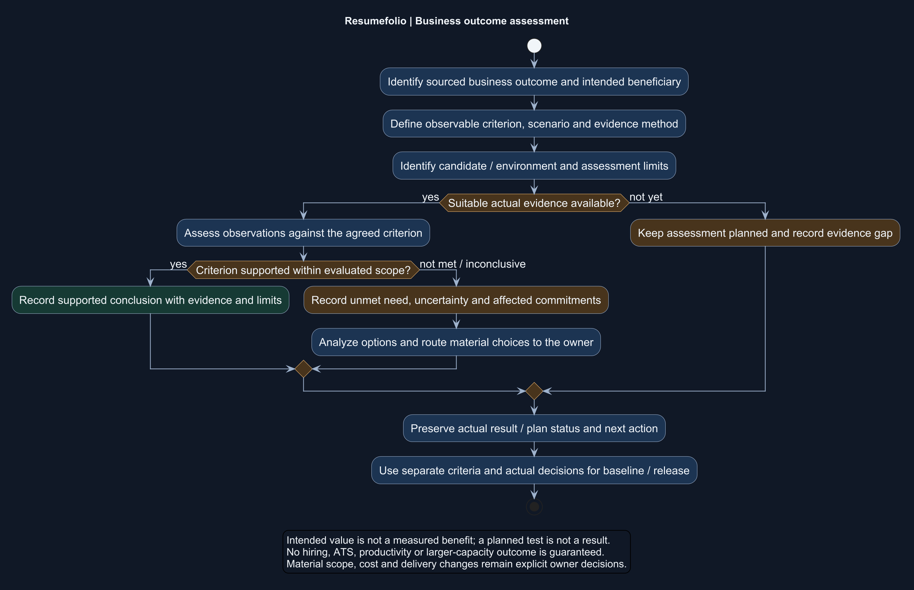

[Scalable SVG](Diagrams/Business-Outcome-Assessment.svg) ·
[Editable PlantUML](Diagrams/Business-Outcome-Assessment.puml)

Blue prepares an assessment; amber identifies missing evidence or unmet criteria;
green records a supported bounded conclusion. The flow does not report existing
product results or automatically approve a release.

Until a usable candidate or relevant evidence exists, keep the assessment planned.
Do not replace missing implementation evidence with document polish or a prototype
that cannot demonstrate the property under assessment. Recheck affected evidence
when criteria or candidate behavior change.

<a id="requirements-specification-business-requirements--heading-4-outcome-to-scope-and-requirement-links"></a>
##### 4. Outcome-to-Scope and Requirement Links

SCP labels are navigation references from the Scope catalog, not new scope
decisions. A scope area may contribute to several outcomes; this mapping does not
force one requirement per feature or replace detailed bidirectional traceability.

| Business outcome | Main scope contribution | Requirement homes |
| --- | --- | --- |
| BIZ-D01 | SCP-02/03/04: profiles, tailored resumes, evidence and PDFs | [User Requirements](#requirements-specification-user-requirements), [Profiles/Portfolio](#requirements-specification-profiles-resumes-and-portfolio), [PDF/Sharing](#requirements-specification-pdf-and-controlled-sharing) |
| BIZ-D02 | SCP-01/04/05: permissions, PDFs and controlled employer sharing | [Accounts/Permissions](#requirements-specification-accounts-authentication-and-permissions), [PDF/Sharing](#requirements-specification-pdf-and-controlled-sharing), quality/security |
| BIZ-D03 | SCP-06 and related SCP-07: manual applications and communication/schedules | [Manual Applications](#requirements-specification-manual-application-management), [Business Rules/Lifecycle](#requirements-specification-business-rules-and-data-lifecycle), [Email/Calendar](#requirements-specification-email-calendar-and-google-integration)  **After MVP.** |
| BIZ-D04 | SCP-01/07/08/09/10: unified access, integrations, work, Git and conditional execution | Accounts, email/calendar, [Work Management](#requirements-specification-projects-kanban-and-sprints), [Git Collaboration](#requirements-specification-git-hosting-and-collaboration), [YAML/CI](#requirements-specification-yaml-workflows-and-cicd), interfaces |
| BIZ-D05 | SCP-11/12 with all protected workflows: file policy and operational readiness | [Administration/Files](#requirements-specification-administration-files-and-operational-behavior), [Quality/Recovery](#requirements-specification-quality-security-and-recovery-requirements), [Constraints](#requirements-specification-domain-requirements-and-constraints), later deployment/maintenance guidance |

Maintain actual allocated requirement, scenario, acceptance-criterion, backlog,
design and evidence references in [Traceability](#validation-and-traceability-validation-and-traceability--heading-traceability).
Document-local BIZ-D locators can support current draft discussion; reconcile
their final notation before baseline allocation. No final UR/FR/NFR records are
invented by this outcome map.

<a id="requirements-specification-business-requirements--heading-5-business-constraints-dependencies-and-open-decisions"></a>
##### 5. Business Constraints, Dependencies and Open Decisions

| Boundary / question | Existing position | Next decision or evidence |
| --- | --- | --- |
| Version 1 scope | Full agreed scope retained; product AI/automatic translation/automatic demo migration excluded | Material changes require explicit owner decision and impacts; no silent reduction |
| Resource/budget | Existing server/resources; no assumed paid service or new infrastructure | Inspect actual capacity/cost allowance and compare options before commitment |
| Solo delivery/operation | Farhad has 20 total project hours/week for all current responsibilities; earlier full-time wording is historical | Quantify usable capacity and full engineering/maintenance effort when forecasting |
| Delivery target | November 8, 2026 requested; current schedule snapshots provisional | Forecast after analysis/design, then reconcile backlog/Sprints/milestones before coding |
| Success measures | Observable criteria proposed above; no quantified benefit baseline or target improvement agreed | Decide whether extra benefit measurement is needed and, if so, its method/population/target |
| External service and execution viability | Google/email/server/recovery/CI findings remain open | Respect existing ASM/DEP/RSK and GAP-D01–GAP-D11 gates before dependent acceptance |
| Intended-use validation | Actor goals have planning sources; detailed interpretation/user feedback remains to develop | Perform actual scoped walkthroughs/reviews, recording participants and evidence limits |

Business priority is not a new permission to drop a capability. The five outcomes
are complementary and interdependent; order investigations and increments using
value, risk and dependencies. Keep effort/likelihood Unknown where evidence is
missing rather than generating a precise score. Live delivery priorities remain
in the existing tracker.

No employment offer, interview rate, ATS success, revenue, user-growth rate or
measured productivity improvement is promised. Such claims would require separate
goals, evidence and decisions beyond the accepted intended-value statements.

<a id="requirements-specification-business-requirements--heading-6-review-and-current-position"></a>
##### 6. Review and Current Position

- [ ] Each business outcome has an exact objective/decision source, problem, beneficiary and rationale.
- [ ] Criteria describe observable value/outcomes without accidental implementation prescription.
- [ ] Scope mapping covers the agreed product areas without silently adding or excluding capability.
- [ ] Benefit claims, workflow evidence and actual measured results are distinguishable.
- [ ] Numerical targets/populations, if later introduced, have explicit sources, methods, rationale and actual review status.
- [ ] Dependencies, resource/cost conflicts and unresolved policies have an owner, next action and gate.
- [ ] User/functional/quality/interface detail links to the appropriate domain, with consistent terminology and traceability.
- [ ] Actual review/decision and candidate revision are recorded before declaring acceptance.

**Current outcome:** Five proposed business records derived from accepted planning
objectives. No new business outcome approval, measured benefit, implemented
workflow, feasibility finding or requirements baseline is recorded. The project
owner coordinates remaining review and decisions.

Record actual findings in [Review Plan and Findings](#validation-and-traceability-validation-and-traceability--heading-review-findings),
questions in [Open Questions](#change-and-baseline-open-questions-and-decisions)
and material changes in [Change Control](#change-and-baseline-change-control).
M-02 acceptance uses the separate baseline criteria; the wider pre-implementation
agreement remains required before product coding.

**Revision note — October 31, 2026:** Expanded the scaffold into five provisional
business outcomes with source/rationale, beneficiaries, assessment criteria,
evidence limits, scope mappings and review questions. Added two diagrams. The
original accepted purpose/objectives remain authoritative and unchanged.

<a id="requirements-specification-business-requirements--heading-7-diagram-maintenance"></a>
##### 7. Diagram Maintenance

| Diagram | Editable source | Scalable view | Preview |
| --- | --- | --- | --- |
| Objective-to-outcome map | [Graphviz](Diagrams/Business-Outcomes-Map.dot) | [SVG](Diagrams/Business-Outcomes-Map.svg) |  |
| Outcome assessment workflow | [PlantUML](Diagrams/Business-Outcome-Assessment.puml) | [SVG](Diagrams/Business-Outcome-Assessment.svg) |  |

Keep diagrams, captions and text synchronized. Color complements labels/shapes.
Inspect readable labels/arrows and verify file/section links after edits. Run from
the repository root:

```powershell
$diagramFolder = 'docs\MVP\SDLC\02-requirements-engineering\diagrams'
$graphvizExe = 'C:\Program Files\Graphviz\bin\dot.exe'
$plantUmlJar = 'C:\Users\fvali\AppData\Local\Resumefolio\DiagramTools\plantuml.jar'
foreach ($format in 'svg', 'png') {
    & $graphvizExe "-T$format" -Gdpi=140 `
        "$diagramFolder\business-outcomes-map.dot" `
        -o "$diagramFolder\business-outcomes-map.$format"
    if ($LASTEXITCODE -ne 0) { throw "Graphviz failed: $format" }
    java '-Djava.awt.headless=true' -jar $plantUmlJar -charset UTF-8 "-t$format" `
        "$diagramFolder\business-outcome-assessment.puml"
    if ($LASTEXITCODE -ne 0) { throw "PlantUML failed: $format" }
}
```

Save as UTF-8 without BOM. Under another account, use the actual installed JAR path.
Retain sources and SVG/PNG outputs in version control.

[Specification index](#requirements-specification-requirements-specification-overview) · [SRS entry point](#requirements-specification-requirements-specification)
· [Requirements index]()

</details>

<a id="requirements-specification-business-rules-and-data-lifecycle"></a>

<details>
<summary>Resumefolio — Business Rules and Data Lifecycle</summary>

<a id="requirements-specification-business-rules-and-data-lifecycle--heading-resumefolio--business-rules-and-data-lifecycle"></a>
#### Resumefolio — Business Rules and Data Lifecycle

Current implementation choices and scope: [Baseline](https://github.com/Farhad-V/Web-Resumefolio/blob/1f2acaa351ac306cb57cbe4fe9742e8bd90720d9/docs/MVP/baseline/README.md). Runtime verification remains subject to its gates.

| Item | Current position |
| --- | --- |
| Owner | Farhad |
| Status | Proposed requirements — detailed policies and acceptance pending |
| Basis | Accepted Version 1 scope; proposed cross-module refinements identified below |
| References | BRL-D01–BRL-D10 are provisional, document-local references, not allocated global requirement IDs |
| Priority | Not yet assigned; no ordering implies delivery priority |
| Revision | October 31, 2026 |

**At a glance:** Keep editable professional information, controlled live sharing
and preserved application history distinct. Define authority and consequences
before propagating changes, synchronizing external data or removing information.
No retention duration, deletion cascade or recovery guarantee is established here.

[Rules](#requirements-specification-business-rules-and-data-lifecycle--heading-2-proposed-business-rules) · [Lifecycle](#requirements-specification-business-rules-and-data-lifecycle--heading-3-lifecycle-boundaries)
· [Retirement review](#requirements-specification-business-rules-and-data-lifecycle--heading-4-retirement-and-recovery-review) · [Open decisions](#requirements-specification-business-rules-and-data-lifecycle--heading-6-open-decisions-and-gates)

<a id="requirements-specification-business-rules-and-data-lifecycle--heading-1-purpose-and-source-authority"></a>
##### 1. Purpose and Source Authority

This document defines cross-module invariants and the lifecycle questions needed
to turn accepted scope into testable behavior. A business rule constrains permitted
behavior; a lifecycle rule describes what a creation, change or retirement event
does to information and its dependents. Neither selects storage architecture.

Use [Version 1 Scope](../01-Project-Planning/01-Project-Charter.md#mvp-scope) as the source for
DEC-028–DEC-017 and DEC-015, and [Planning Completion Criteria](https://github.com/Farhad-V/Web-Resumefolio/blob/1f2acaa351ac306cb57cbe4fe9742e8bd90720d9/docs/MVP/SDLC/01-project-planning/10-planning-completion-criteria.md)
for dependent gates. Scope inclusion is accepted; the detailed obligations below
remain proposed. Their planned checks have not been executed.

Related definitions and domain owners:

| Subject | Working reference |
| --- | --- |
| Meaning, responsibility and conceptual data inventory | [Data Dictionary](#data-definitions-data-dictionary) and [Glossary](#data-definitions-glossary) |
| Resource/action permissions | [Accounts and Permissions](#requirements-specification-accounts-authentication-and-permissions) |
| Resume/PDF availability and employer access | [PDF and Controlled Sharing](#requirements-specification-pdf-and-controlled-sharing) |
| Submission capture and application history | [Manual Application Management](#requirements-specification-manual-application-management) |
| Provider authority and conflicts | [Email, Calendar and Google Integration](#requirements-specification-email-calendar-and-google-integration) |
| File accounting, replacement and cleanup | [Administration, Files and Operations](#requirements-specification-administration-files-and-operational-behavior) |
| Intended business value | [Business Requirements](#requirements-specification-business-requirements) |

These links identify where details must agree; they do not claim each domain
document is complete or accepted. Farhad coordinates review and unresolved policy.

<a id="requirements-specification-business-rules-and-data-lifecycle--heading-2-proposed-business-rules"></a>
##### 2. Proposed Business Rules

All records below share status **Proposed**, owner **Farhad**, and
priority **Unassigned**. Each contains a source/rationale, obligation, observable
criteria, planned verification and remaining definition. Use the
[requirement template](#requirements-specification-requirements-specification) when allocating final IDs.

<a id="requirements-specification-business-rules-and-data-lifecycle--heading-brl-d01-resource-specific-authority"></a>
###### BRL-D01: Resource-specific Authority

**Release allocation (owner decision, November 4):** MVP foundation where used by core/basic ProjectForge; future-domain clauses deferred.

**Source / rationale:** DEC-028/DEC-024; a shared workspace experience must retain
private-resource boundaries.

**Proposed rule:** Creation, reading, modification, association, sharing and
retirement shall require the authority defined for that resource and operation.
Ownership or membership in one context shall not imply authority over unrelated data.

**Acceptance criteria**
- A board collaborator cannot obtain private email, unrelated resumes or repositories through that membership.
- A caller without the applicable grant cannot perform the protected operation by changing a resource reference or making a direct request.
- Administrative view, transfer, delete and restore operations are permitted only as explicitly defined in the reviewed action matrix.

**Planned verification:** Allowed/denied cross-user and direct-operation scenarios.
**Open:** Complete actor/resource/action/state matrix, ownership transfer, account
closure and administrative powers; do not infer universal administrator access.

<a id="requirements-specification-business-rules-and-data-lifecycle--heading-brl-d02-shared-information-and-independent-tailoring"></a>
###### BRL-D02: Shared Information and Independent Tailoring

**Release allocation (owner decision, November 4):** MVP foundation where used by core/basic ProjectForge; future-domain clauses deferred.

**Source / rationale:** DEC-027; reuse professional information without unintended
cross-resume changes.

**Proposed rule:** Profile edits shall not automatically change existing resume drafts or published views.
The owner shall preview and explicitly apply selected source changes, preserving
resume-specific selections, layouts and overrides; publication requires separate
confirmation and actual submitted documents remain unchanged.

**Acceptance criteria**
- Editing one resume's selection, layout or override does not silently apply that edit to another resume.
- Defined shared-profile update cases produce the reviewed result for linked, omitted and overridden content.
- Source removal produces the agreed reference/visibility result without silently altering preserved submitted material.

**Planned verification:** Two-resume source-edit, override and source-removal cases.
**Open:** Link versus copy semantics, update trigger, precedence, user preview and
conflict handling; automatic propagation is not selected.

<a id="requirements-specification-business-rules-and-data-lifecycle--heading-brl-d03-explicit-shared-content-and-download-availability"></a>
###### BRL-D03: Explicit Shared Content and Download Availability

**Release allocation (owner decision, November 4):** MVP foundation where used by core/basic ProjectForge; future-domain clauses deferred.

**Source / rationale:** DEC-026/DEC-025/DEC-024; the intended resume and selected
content define the employer disclosure boundary.

**Proposed rule:** Employer retrieval shall expose only the intended shared resume,
selected evidence and enabled PDF variants under the applicable access rules.

**Acceptance criteria**
- Unselected evidence and unrelated private resources are not retrievable through the employer context.
- Generated/uploaded/both/neither settings and separately available English/German uploaded PDFs yield only the permitted downloads.
- A direct file/PDF request cannot bypass authorization or disabled download availability.

**Planned verification:** Selection/variant/language matrix and direct retrieval.
**Open:** Save versus publish trigger, live revision visibility, missing-language
behavior, generation revision and stale rendition invalidation. No separate
publication workflow or automatic language fallback is assumed.

<a id="requirements-specification-business-rules-and-data-lifecycle--heading-brl-d04-access-changes-govern-subsequent-retrieval"></a>
###### BRL-D04: Access Changes Govern Subsequent Retrieval

**Release allocation (owner decision, November 4):** MVP foundation where used by core/basic ProjectForge; future-domain clauses deferred.

**Source / rationale:** DEC-024/DEC-025; owners can change the password or disable
the link, while already downloaded copies remain outside product revocation.

**Proposed rule:** Sharing changes shall enforce the reviewed subsequent-access
policy across pages, files and PDFs without claiming removal of downloaded copies.

**Acceptance criteria**
- A disabled link cannot authorize a new protected retrieval under the agreed effective-change semantics.
- Password-change and existing-session cases follow the explicitly reviewed revocation policy for all protected resource paths.
- Product wording distinguishes retrieval restrictions from possession of an already legitimately downloaded copy.

**Planned verification:** Before/after change cases, existing sessions and direct
requests. **Open:** Effective instant, active/in-flight requests, sessions and
cached delivery controls; no duration or instantaneous global revocation promise.

<a id="requirements-specification-business-rules-and-data-lifecycle--heading-brl-d05-preserve-actual-submitted-materials"></a>
###### BRL-D05: Preserve Actual Submitted Materials

**Release allocation (owner decision, November 4):** MVP foundation where used by core/basic ProjectForge; future-domain clauses deferred.

**Source / rationale:** DEC-023; later edits must not rewrite application history.

**Proposed rule:** Recording submitted materials shall preserve the resume and
cover letter actually submitted, distinct from editable source and live sharing.

**Acceptance criteria**
- Later profile, resume, cover-letter or source-PDF edits do not overwrite preserved submitted copies.
- The user can distinguish preserved submission material from a current source or live view.
- Incomplete/failed capture is distinguishable from successful preservation; no success claim is made for missing required material.

**Planned verification:** Capture followed by independent source edits and controlled
failure. **Open:** Exact capture trigger, represented revision/artifacts, manually
supplied actual materials, provenance, correction/resubmission and explicit
deletion authority. Preservation does not imply indefinite retention or a backup.

<a id="requirements-specification-business-rules-and-data-lifecycle--heading-brl-d06-validation-and-truthful-state-changes"></a>
###### BRL-D06: Validation and Truthful State Changes

**Release allocation (owner decision, November 4):** MVP foundation where used by core/basic ProjectForge; future-domain clauses deferred.

**Source / rationale:** Proposed refinement of DEC-027/DEC-023/DEC-018; avoid invalid
or partially completed data being treated as a completed business operation.

**Proposed rule:** An operation shall satisfy its defined input, authority and
relationship conditions before it is reported as successfully completed.

**Acceptance criteria**
- Inputs outside agreed required-field/value/format/reference rules produce the defined rejected or incomplete outcome.
- Interrupted save, file replacement or capture is not presented as successful completion.
- Defined concurrent/repeated-change cases preserve the reviewed invariant or report a distinguishable conflict/failure.

**Planned verification:** Valid/invalid boundaries, interrupted operations and
conflicting/repeated requests after semantics are defined. **Open:** Field rules,
application statuses/transitions, duplicate handling, concurrency and retry policy.
No transaction mechanism or database constraint implementation is selected.

<a id="requirements-specification-business-rules-and-data-lifecycle--heading-brl-d07-explicit-provider-synchronization-authority"></a>
###### BRL-D07: Explicit Provider Synchronization Authority

**Release allocation:** After MVP — provider synchronization.

**Source / rationale:** DEC-022; connected Gmail/calendar behavior depends on
explicit synchronization rules and authorized provider access.

**Proposed rule:** Each synchronized data/action category shall define its source
of truth, direction, identity mapping, conflict/deletion semantics and observable
outcome before synchronization is accepted.

**Acceptance criteria**
- Reviewed local/provider edit and deletion cases produce the specified result for the selected account and data category.
- Provider rejection, access loss or conflict is distinguishable from successful synchronization or delivery.
- Disconnecting does not silently delete provider data or imply a local purge unless an explicit authorized policy requires that action.

**Planned verification:** Controlled provider/local divergence, conflict, rejection,
disconnect and reconnect cases after feasibility/access checks. **Open:** Scope,
refresh timing, retries, duplication, pending work, local retention, mappings and
reconnect reconciliation; no bidirectional or last-write-wins policy is assumed.

<a id="requirements-specification-business-rules-and-data-lifecycle--heading-brl-d08-reference-aware-retirement"></a>
###### BRL-D08: Reference-aware Retirement

**Release allocation (owner decision, November 4):** MVP foundation where used by core/basic ProjectForge; future-domain clauses deferred.

**Source / rationale:** Proposed refinement of DEC-023/DEC-026/DEC-018; removing a
source or association must not accidentally destroy other required information.

**Proposed rule:** Archive, unlink, delete and physical reclamation shall have
distinct defined consequences, checked against authority, valid references and
retention obligations before affected information is removed.

**Acceptance criteria**
- Removing a single association does not remove unrelated content contrary to the reviewed reference policy.
- Source deletion does not implicitly destroy required preserved submissions.
- Ineligible or partially failed reclamation is reported as such, with no false claim that all data or storage usage has been removed.

**Planned verification:** Shared-reference, submission-reference, eligible/ineligible
and partial-failure cases. **Open:** Cascade/block/detach decisions per relationship,
archive availability, retention, trash if any, purge timing and quota release.
Soft deletion and automatic cleanup are not established requirements.

<a id="requirements-specification-business-rules-and-data-lifecycle--heading-brl-d09-recovery-preserves-defined-business-consistency"></a>
###### BRL-D09: Recovery Preserves Defined Business Consistency

**Release allocation (owner decision, November 4):** MVP foundation where used by core/basic ProjectForge; future-domain clauses deferred.

**Source / rationale:** DEC-017 and proposed lifecycle refinement; backup existence
alone does not prove usable recovery.

**Proposed rule:** Recovery shall follow defined coverage and consistency rules for
related records/artifacts and re-establish only the access permitted by the agreed
restoration policy.

**Acceptance criteria**
- A later isolated restoration check verifies required records, files and relationships for the selected recovery point.
- Restored sharing/membership/connection state is reconciled under an explicit access policy rather than assumed safe because it was backed up.
- Missing artifacts or unreconciled references are recorded as limitations/failures, not a complete successful restoration.

**Planned verification:** Later authorized isolated restore/integrity/access checks.
**Open:** Coverage including repositories/configuration/required keys, recovery
points, RPO/RTO, expired/revoked access and deleted-data reappearance. No recovery
target, retention period or successful restoration is claimed.

<a id="requirements-specification-business-rules-and-data-lifecycle--heading-brl-d10-defined-language-and-time-meaning"></a>
###### BRL-D10: Defined Language and Time Meaning

**Release allocation (owner decision, November 4):** MVP foundation where used by core/basic ProjectForge; future-domain clauses deferred.

**Source / rationale:** DEC-015/DEC-025/DEC-022/DEC-023 plus proposed consistency
detail; prevent ambiguous language variants and event/history ordering.

**Proposed rule:** Language-specific content and lifecycle timestamps shall retain
the meanings established in the reviewed dictionary and domain rules.

**Acceptance criteria**
- Manually maintained English/German content follows the defined availability policy without an automatic translation step.
- Agreed event-time, recorded-time and displayed-time cases remain distinguishable where the domain requires them.
- Calendar/time-zone and submission-history examples produce the reviewed dates/order, including relevant boundary cases.

**Planned verification:** Language availability and domain-specific time examples.
**Open:** Required metadata, precision/time zones, correction/provenance and missing
values; this does not prescribe timestamp fields or a storage representation.

<a id="requirements-specification-business-rules-and-data-lifecycle--heading-3-lifecycle-boundaries"></a>
##### 3. Lifecycle Boundaries

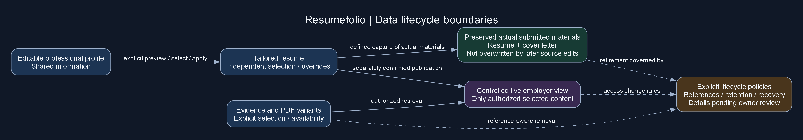

[Scalable SVG](Diagrams/Data-Lifecycle-Boundaries.svg) ·
[Editable Graphviz](Diagrams/Data-Lifecycle-Boundaries.dot)

Arrows express conceptual relationships, not automatic copying, database design
or a mandatory sequence. The preservation boundary applies to actual submitted
materials, not every editable revision. Colors supplement the labels.

| Information / event | Rule to define | Boundary to preserve |
| --- | --- | --- |
| Profile → tailored resume | Propagation trigger, overrides, omitted/removed entries | Independent tailoring; BRL-D02 |
| Evidence association/selection | Owner, reference use, unlink/delete effect | Unselected material stays outside shared view; BRL-D03/D08 |
| Generated/uploaded PDF | Revision, language, replacement and availability | Authorized variants; source replacement must not rewrite history |
| Live employer view | Saved/published revision and changed access | Scoped retrieval, not a submitted-copy guarantee |
| Application/submission | State transitions, actual-material capture and corrections | Later source edits cannot overwrite preserved copies |
| Provider connection/data | Authoritative properties, mappings and pending work | Disconnect ≠ provider deletion or automatic local purge |
| Board/project/repository | Membership, ownership transfer, archive and dependent references | Private-resource isolation; real Git history has domain-specific semantics |
| Workflow run/log/artifact | Authority, execution outputs, secrets and retention | CI/CD feasibility/security gates; no universal file policy assumption |
| Account closure | Ownership, memberships, provider access, shares and retained data | No invented cascade or obligation to retain forever |
| Backup/restore | Coverage, consistency, access reconciliation and deleted-data handling | Restoration evidence and explicit limitations |

For each subject, complete: creator/controller, authoritative source, allowed
operations/states, validation, transition trigger, dependent references, visible
outcome, failure/retry/concurrency, retention/reclamation and restoration. These
are review fields, not a mandatory schema. No universal draft→published→archived
state machine applies to all product data.

<a id="requirements-specification-business-rules-and-data-lifecycle--heading-4-retirement-and-recovery-review"></a>
##### 4. Retirement and Recovery Review

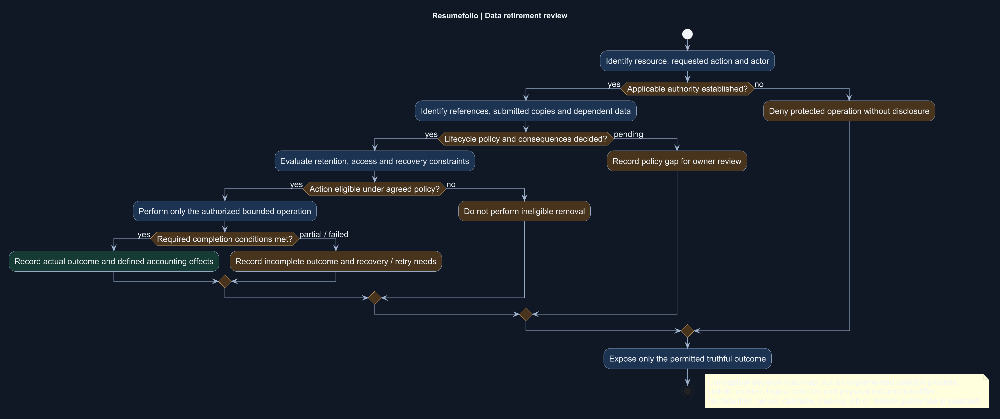

[Scalable SVG](Diagrams/Data-Retirement-Review.svg) ·
[Editable PlantUML](Diagrams/Data-Retirement-Review.puml)

This is a proposed decision roadmap. A missing policy blocks the affected
commitment; it does not authorize inventing a deletion cascade. Apply it to the
specific resource and action. Archive, unlink, logical deletion and physical
reclamation can have different access, quota and recovery effects.

Restoration is a separate authorized operation. Define how restored old grants,
disabled shares, removed memberships and disconnected providers are reconciled
before access is exposed. A preserved application artifact is historical content;
a backup is recovery material. Neither substitutes for the other's requirement.

<a id="requirements-specification-business-rules-and-data-lifecycle--heading-5-scenarios-and-evidence-plan"></a>
##### 5. Scenarios and Evidence Plan

| Scenario group | References | Planned coverage |
| --- | --- | --- |
| Ownership and isolation | D01/D03/D04 | Cross-user changes, selected/unselected evidence, direct files and changed grants |
| Reuse versus history | D02/D05 | Two independent resumes; capture actual submission; edit/remove source afterward |
| State and validation | D06/D10 | Invalid/missing input, language/time boundaries, failed and conflicting changes |
| Provider lifecycle | D07 | Local/provider divergence, rejection, disconnect, pending actions and reconnect |
| Retirement | D08 | Unlink versus deletion, referenced files, eligible retention, partial reclamation |
| Recovery | D09 | Isolated consistent restore, missing artifact, stale access and deleted-data reconciliation |

Dxx in this table abbreviates BRL-Dxx. Before execution, specify exact data,
actor/grants, initial state, operation, expected observable result and policy
revision. Later evidence records candidate/environment, actual result and limits.
No scenario above is a recorded Pass. Conditional criteria remain blocked until
the referenced policy is decided.

<a id="requirements-specification-business-rules-and-data-lifecycle--heading-6-open-decisions-and-gates"></a>
##### 6. Open Decisions and Gates

| Decision topic | Definition needed before affected acceptance |
| --- | --- |
| Ownership/account exit | Resource ownership, transfer, collaborator removal, account closure and administrator actions |
| Tailoring/publication | Profile propagation, override precedence, save/publish/live revision, rendition invalidation |
| Sharing changes | Password changes, sessions, in-flight access, link lifecycle and delivery caches |
| Submission record | Capture trigger/artifacts, proof of actual materials, correction/resubmission, deletion and retention |
| Relationship removal | Per-reference block/detach/cascade behavior; no default universal cascade |
| Retention/accounting | Per-category periods/triggers, backups/trash/logs/Git outputs, physical reclamation and quota effects |
| Provider synchronization | Authority by property/action, direction, conflict/deletion/retry/reconnect semantics and verified access |
| Recovery | Coverage, points/targets, relationship consistency, revoked access and restored deleted data |
| Validation/time | Required fields/states, duplication/concurrency, language absence and time meanings |

These are local review topics, not newly allocated question IDs. Farhad records
actual decisions in [Open Questions and Decisions](#change-and-baseline-open-questions-and-decisions),
and routes material impacts through [Change Control](#change-and-baseline-change-control).
Provider access, storage and recovery findings must satisfy the existing planning
follow-up gates before dependent design/delivery commitments. Any applicable legal
retention/deletion obligations need their own verified context; none is asserted here.

<a id="requirements-specification-business-rules-and-data-lifecycle--heading-7-traceability-and-review-readiness"></a>
##### 7. Traceability and Review Readiness

| Candidate group | Basis | Dependent records |
| --- | --- | --- |
| BRL-D01–D04 | DEC-028/027/026/025/024 | Permissions matrix, profile/resume, PDF and sharing criteria |
| BRL-D05 | DEC-023 | Application capture and submitted-copy dictionary definitions |
| BRL-D06/D08 | Proposed cross-module detail from scope behavior/file policies | Validation, administration/files and per-domain lifecycle rules |
| BRL-D07/D10 | DEC-022/015/025/023 and proposed consistency detail | Provider operations, language and time definitions |
| BRL-D09 | DEC-017 and proposed recovery detail | Quality/recovery requirements and later actual restore evidence |

Maintain allocated links in [Requirements Traceability](#validation-and-traceability-validation-and-traceability--heading-traceability)
and real inspection results in [Review Findings](#validation-and-traceability-validation-and-traceability--heading-review-findings).

- [ ] Reconcile provisional IDs and assign justified priorities.
- [ ] Confirm each source-derived invariant separately from proposed refinements.
- [ ] Resolve affected authority, propagation, capture, synchronization and retirement policies.
- [ ] Complete criteria with decided states/values and normal, denied, failure and recovery paths.
- [ ] Reconcile dictionary and domain rules; link actual owner decisions and reviewed revision.
- [ ] Record actual verification later; do not treat diagram rendering as product validation.

**Current outcome:** Proposed cross-module draft; no policy acceptance or product
test result recorded. M-02 and the wider pre-implementation agreement remain
pending. This revision authorizes no deletion, synchronization, cleanup or recovery
operation and changes no accepted scope.

<a id="requirements-specification-business-rules-and-data-lifecycle--heading-8-diagram-maintenance"></a>
##### 8. Diagram Maintenance

| Diagram | Editable source | Scalable view | Preview |
| --- | --- | --- | --- |
| Data lifecycle boundaries | [Graphviz](Diagrams/Data-Lifecycle-Boundaries.dot) | [SVG](Diagrams/Data-Lifecycle-Boundaries.svg) |  |
| Data retirement review | [PlantUML](Diagrams/Data-Retirement-Review.puml) | [SVG](Diagrams/Data-Retirement-Review.svg) |  |

Keep sources, captions and PNG/SVG renders synchronized. From the repository root:

```powershell
$diagramFolder = 'docs\MVP\SDLC\02-requirements-engineering\diagrams'
$graphvizExe = 'C:\Program Files\Graphviz\bin\dot.exe'
$plantUmlJar = 'C:\Users\fvali\AppData\Local\Resumefolio\DiagramTools\plantuml.jar'
foreach ($format in 'svg', 'png') {
    & $graphvizExe "-T$format" -Gdpi=140 "$diagramFolder\data-lifecycle-boundaries.dot" -o "$diagramFolder\data-lifecycle-boundaries.$format"
    if ($LASTEXITCODE -ne 0) { throw "Graphviz failed: $format" }
    java '-Djava.awt.headless=true' -jar $plantUmlJar -charset UTF-8 "-t$format" "$diagramFolder\data-retirement-review.puml"
    if ($LASTEXITCODE -ne 0) { throw "PlantUML failed: $format" }
}
```

Save as UTF-8 without BOM; use the actual installed tool paths on other machines.

[Specification index](#requirements-specification-requirements-specification-overview) · [SRS entry point](#requirements-specification-requirements-specification)
· [Requirements index]()

<a id="requirements-specification-business-rules-and-data-lifecycle--heading-owner-accepted-source-update-rule--november-1-2026"></a>
##### Owner-accepted Source-update Rule — November 1, 2026

The owner explicitly accepted the no-automatic-update, preview/select/apply, separately confirmed publication and preserved-submission rule. [Actual decision](#change-and-baseline-open-questions-and-decisions--id-owner-accepted-profile-update-policy). This settles that core behavior of BRL-D02, not the still-proposed source-removal/conflict/retention details or all BRL candidates. No runtime behavior is claimed.

</details>

<a id="requirements-specification-domain-requirements-and-constraints"></a>

<details>
<summary>Resumefolio — Domain Requirements and Constraints</summary>

<a id="requirements-specification-domain-requirements-and-constraints--heading-resumefolio--domain-requirements-and-constraints"></a>
#### Resumefolio — Domain Requirements and Constraints

Current implementation choices and scope: [Baseline](https://github.com/Farhad-V/Web-Resumefolio/blob/1f2acaa351ac306cb57cbe4fe9742e8bd90720d9/docs/MVP/baseline/README.md). Runtime verification remains subject to its gates.

| Item | Current position |
| --- | --- |
| Owner | Farhad; sole delivery and operations owner |
| Status | Proposed domain specification — review and applicability findings pending |
| References | DOM-D01–DOM-D08 are provisional document-local references; final global IDs remain unallocated |
| Priority | Unassigned; document order does not establish delivery priority |
| Revision | October 31, 2026 |

**At a glance:** Preserve professional-information, application-history and
resource-access meaning while working within accepted project constraints.
Investigate external obligations against the actual operating model. A technical
preference, a project mandate and a legal obligation have different authority.

[Classification](#requirements-specification-domain-requirements-and-constraints--heading-1-classification-and-authority) · [Candidates](#requirements-specification-domain-requirements-and-constraints--heading-2-proposed-domain-requirements)
· [Constraints](#requirements-specification-domain-requirements-and-constraints--heading-3-accepted-project-constraints-and-open-evidence)
· [Review roadmap](#requirements-specification-domain-requirements-and-constraints--heading-5-constraint-review-roadmap) · [Completion](#requirements-specification-domain-requirements-and-constraints--heading-6-review-and-traceability)

<a id="requirements-specification-domain-requirements-and-constraints--heading-1-classification-and-authority"></a>
##### 1. Classification and Authority

Use [Version 1 Scope](../01-Project-Planning/01-Project-Charter.md#mvp-scope),
[Resources and Constraints](../01-Project-Planning/03-Feasibility-And-Risk-Assessment.md#resource-constraints)
and [Planning Completion Criteria](https://github.com/Farhad-V/Web-Resumefolio/blob/1f2acaa351ac306cb57cbe4fe9742e8bd90720d9/docs/MVP/SDLC/01-project-planning/10-planning-completion-criteria.md)
as planning authority. This document derives proposed detailed requirements and
organizes investigations; it does not reopen accepted decisions or record a new baseline.

| Category | Meaning | Example / authority |
| --- | --- | --- |
| Domain invariant | Meaning that must remain consistent across capabilities | Actual submitted materials differ from editable source; DEC-023 |
| Product policy | Deliberate product behavior within the domain | Owner-selected evidence and PDF availability; DEC-026/025 |
| Project constraint | Agreed restriction on delivery or operation | Laravel/OOP and existing resources; accepted resource decisions |
| External obligation | Provider, license or applicable legal restriction | Establish current source and actual applicability before treating it as binding |
| Design choice | Means of satisfying requirements | Frontend, database, synchronization mechanism; not selected by this document |

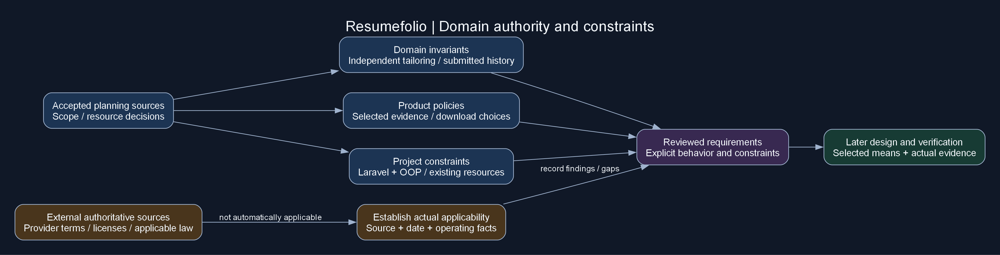

[Scalable SVG](Diagrams/Domain-Authority-Map.svg) ·
[Editable Graphviz](Diagrams/Domain-Authority-Map.dot)

Arrows classify evidence and authority; they do not define a software architecture.
Labels carry the meaning independently of color.

<a id="requirements-specification-domain-requirements-and-constraints--heading-2-proposed-domain-requirements"></a>
##### 2. Proposed Domain Requirements

Every record below has owner **Farhad**, status **Proposed**, and priority
**Unassigned**. Acceptance criteria describe future checks; no product verification
or legal/provider compliance conclusion is recorded.

<a id="requirements-specification-domain-requirements-and-constraints--heading-dom-d01-consistent-professional-information-meaning"></a>
###### DOM-D01: Consistent Professional-information Meaning

**Release allocation (owner decision, November 4):** MVP foundation where used by core/basic ProjectForge; future-domain clauses deferred.

**Source / rationale:** DEC-027/026/025 and the
[Data Dictionary](#data-definitions-data-dictionary); consistent terms
prevent resume, evidence and file rules drifting between modules.

**Proposed obligation:** Profile information, tailored resumes, evidence and PDF
variants shall retain their reviewed domain meanings across affected workflows.

**Acceptance criteria**
- A reviewed example distinguishes reusable profile content, resume-specific selection/override, evidence selection and a PDF rendition.
- Domain documents use the same term for the same concept, or explicitly record a justified distinction.
- Changing a resume-specific choice does not silently change unrelated resumes.

**Planned verification:** Dictionary/document walkthrough and later cross-resume
examples. **Open:** Exact fields, required values, propagation and rendition revision.

<a id="requirements-specification-domain-requirements-and-constraints--heading-dom-d02-application-history-represents-actual-submitted-material"></a>
###### DOM-D02: Application History Represents Actual Submitted Material

**Release allocation (owner decision, November 4):** MVP foundation where used by core/basic ProjectForge; future-domain clauses deferred.

**Source / rationale:** DEC-023; historical application evidence must not be
confused with current editable content or a live employer view.

**Proposed obligation:** Application history shall distinguish actual submitted
resume/cover-letter material from later source changes and current shared views.

**Acceptance criteria**
- After capture and later source edits, preserved actual submitted material remains distinguishable and is not overwritten by those edits.
- Recording application progress does not imply automatic submission to a job platform or proof an employer received/read it.
- Correction, resubmission and deletion cases follow explicit history policies once reviewed.

**Planned verification:** Submission/source-edit walkthrough and later history
checks. **Open:** Capture/artifact boundaries, provenance, correction and retention;
see [Business Rules and Lifecycle](#requirements-specification-business-rules-and-data-lifecycle).

<a id="requirements-specification-domain-requirements-and-constraints--heading-dom-d03-authorization-follows-the-resource-and-operation"></a>
###### DOM-D03: Authorization Follows the Resource and Operation

**Release allocation (owner decision, November 4):** MVP foundation where used by core/basic ProjectForge; future-domain clauses deferred.

**Source / rationale:** DEC-028/024/025/021/020; unified sign-in and collaboration
must preserve unrelated private contexts.

**Proposed obligation:** Access shall remain bounded by applicable actor, resource,
operation and state, including direct file/PDF retrieval and provider operations.

**Acceptance criteria**
- Board membership grants no unrelated private email, resume or repository access.
- Employer access exposes only the intended resume and selected permitted material.
- Altered references or direct requests do not bypass denied operations.

**Planned verification:** Later cross-user/action matrix checks.
**Open:** Exact roles/grants and lifecycle effects; the
[Accounts matrix](#requirements-specification-accounts-authentication-and-permissions--heading-7-role-resource-and-operation-matrix)
remains the permission specification entry point.

<a id="requirements-specification-domain-requirements-and-constraints--heading-dom-d04-explicit-human-authored-language-and-application-work"></a>
###### DOM-D04: Explicit Human-authored Language and Application Work

**Release allocation (owner decision, November 4):** MVP foundation where used by core/basic ProjectForge; future-domain clauses deferred.

**Source / rationale:** DEC-016/015 and DEC-023; preserve Version 1 exclusions.

**Proposed obligation:** Version 1 professional content and application work shall
support the agreed manual workflows without depending on product AI, automatic
translation or automatic external application submission.

**Acceptance criteria**
- Required workflows allow manually entered/reviewed English and German content under defined availability rules.
- A missing translation is handled by an explicit policy rather than an assumed automatic translation step.
- Scope/requirements do not make an excluded AI or submission service a prerequisite.

**Planned verification:** Scope review and later manual journeys.
**Open:** Language completeness and fallback; no ATS, hiring or productivity outcome is guaranteed.

<a id="requirements-specification-domain-requirements-and-constraints--heading-dom-d05-explicit-external-service-applicability"></a>
###### DOM-D05: Explicit External-service Applicability

**Release allocation (owner decision, November 4):** MVP foundation where used by core/basic ProjectForge; future-domain clauses deferred.

**Source / rationale:** DEC-022, ASM-02/DEP-03/GAP-D02 and proposed external-interface
refinement; provider capability alone does not establish usable project access.

**Proposed obligation:** Each required external operation shall have an operation,
permission, account/audience, policy, resource and cost assessment before dependent
integration commitments are accepted.

**Acceptance criteria**
- Gmail/Calendar operations map to justified access and a dated official-source assessment.
- Applicable verification, restrictions, limits and unresolved costs/exceptions are recorded against the actual deployment model.
- A blocked required operation produces an explicit owner decision path, not silent scope removal or a feasibility claim.

**Planned verification:** Assessment record inspection and later authorized operation
checks. **Open:** Actual project credentials/configuration, access findings and
costs; see [Google Integration](#requirements-specification-email-calendar-and-google-integration).

<a id="requirements-specification-domain-requirements-and-constraints--heading-dom-d06-establish-information-handling-applicability"></a>
###### DOM-D06: Establish Information-handling Applicability

**Release allocation (owner decision, November 4):** MVP foundation where used by core/basic ProjectForge; future-domain clauses deferred.

**Source / rationale:** Proposed privacy/lifecycle investigation for personal,
professional, communication and collaboration information in accepted scope.

**Proposed obligation:** Before affected operating requirements are accepted, the
project shall document its actual information flows and applicable handling
obligations, with unresolved questions and decision owners visible.

**Acceptance criteria**
- The assessment identifies data categories, purpose, access recipients, provider/hosting flows, retention/deletion questions and backup implications.
- Each asserted external obligation identifies an authoritative source, date, applicability rationale and affected requirement.
- Unknown controller/processor, user-location, contractual or legal questions remain explicit rather than becoming an unsupported compliance statement.

**Planned verification:** Review actual operating model and evidence; obtain
appropriate clarification where necessary. **Open:** Actual roles/jurisdictions,
notices, rights handling, service terms and retention obligations. Server location
alone is not a completed applicability assessment. No legal conclusion is made here.

<a id="requirements-specification-domain-requirements-and-constraints--heading-dom-d07-verify-reuse-and-licensing-before-adoption"></a>
###### DOM-D07: Verify Reuse and Licensing Before Adoption

**Release allocation (owner decision, November 4):** MVP foundation where used by core/basic ProjectForge; future-domain clauses deferred.

**Source / rationale:** DEC-011/014 and DEP-06/GAP-D08, with proposed licensing
refinement; references are not automatic scope or permission to reuse.

**Proposed obligation:** Proposed dependencies, templates, assets and reused code
shall have documented provenance, applicable license/terms and compatibility
findings before adoption; existing reference projects shall remain preserved.

**Acceptance criteria**
- A selected component/asset has a specific version/source, actual license/terms, obligations and review disposition.
- Unknown or conflicting reuse rights remain blockers for affected adoption until resolved.
- No automatic demo migration or reference-project modification is introduced as an implicit requirement.

**Planned verification:** Later component/asset inventory and license inspection.
**Open:** Actual selections, attribution/distribution duties and compatibility;
no component license or ownership claim is invented.

<a id="requirements-specification-domain-requirements-and-constraints--heading-dom-d08-evidence-based-operation-within-constraints"></a>
###### DOM-D08: Evidence-based Operation Within Constraints

**Release allocation (owner decision, November 4):** MVP foundation where used by core/basic ProjectForge; future-domain clauses deferred.

**Source / rationale:** DEC-019/018/017/013/012 and accepted resource constraints;
combined workloads, recovery and solo maintenance must be feasible in reality.

**Proposed obligation:** Design and readiness decisions shall respect accepted
resource/development constraints and retain actual evidence for required capacity,
execution safety and recovery outcomes.

**Acceptance criteria**
- Selected options identify how they satisfy Laravel/OOP and actual resource/budget constraints.
- Initial 10-user checks specify workload/concurrency; approximately 1,000 users remain a growth direction until separately demonstrated.
- CI/CD enabling depends on reviewed feasibility/security limits, and recovery acceptance depends on actual restoration evidence.

**Planned verification:** Design review, resource findings and later bounded
capacity/execution/recovery checks. **Open:** Numerical limits, architecture,
RPO/RTO, cost allowance and actual forecast; no new purchase is assumed.

<a id="requirements-specification-domain-requirements-and-constraints--heading-3-accepted-project-constraints-and-open-evidence"></a>
##### 3. Accepted Project Constraints and Open Evidence

| Constraint / basis | Preserve | Evidence still required |
| --- | --- | --- |
| Laravel and object-oriented development | Mandated approach | Selected runtime/components and compatibility; no frontend/database selection implied |
| Existing server/resources and available budget | No assumed paid services or added infrastructure | Inventory, competing demand, costs and explicit owner spending decisions |
| Full-time solo delivery/operation | Farhad owns the work | Actual usable capacity, learning, integration and maintenance effort |
| 10 initial users; growth toward roughly 1,000 | Distinguish account population from concurrent workload | Representative load model, combined-workload findings and scaling options |
| Requested November 8, 2026 target | Requested date, not validated forecast | Analysis/design, effort ranges, dependency findings and reconciliation |
| Reference projects preserved | No automatic migration or inherited feature set | Specific adoption/provenance decisions |
| Required Gmail/Calendar and real Git | Retain accepted inclusions | Provider access and actual operation evidence; product Git differs from development GitHub |
| Conditional YAML/CI/CD | Retain feasibility/security gates | Isolation, permissions, secrets, limits, cleanup and controlled deployment |
| Operational readiness | Guidance, backups and demonstrated restoration | Actual procedures, coverage, integrity and access recovery evidence |

See the linked resource/planning records for authority. This table is a reading
aid, not a new decision register or a positive feasibility result.

<a id="requirements-specification-domain-requirements-and-constraints--heading-4-external-obligation-evidence-record"></a>
##### 4. External-obligation Evidence Record

For each candidate obligation, record: local reference, category, authoritative
publisher/source, version/date checked, exact relevant clause or concise finding,
actual operating facts, applicability rationale, affected requirements/design,
evidence limitations, owner, status and next gate. Separate a provider statement
from the project's interpretation and from actual access verification.

The [Google integration source notes](#requirements-specification-email-calendar-and-google-integration--heading-7-official-provider-source-notes)
provide a limited dated documentation check. They do not resolve the actual
project's verification/assessment applicability or establish Google access.
Privacy/legal, hosting and selected-component licensing assessments remain open.

<a id="requirements-specification-domain-requirements-and-constraints--heading-5-constraint-review-roadmap"></a>
##### 5. Constraint Review Roadmap

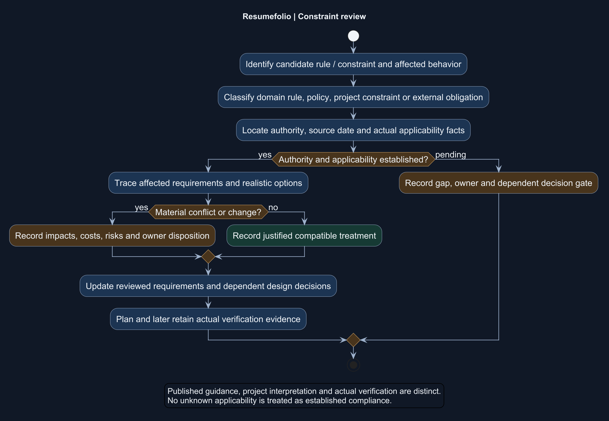

[Scalable SVG](Diagrams/Domain-Constraint-Review.svg) ·
[Editable PlantUML](Diagrams/Domain-Constraint-Review.puml)

Review sequence: classify → establish authority/applicability → trace affected
behavior → compare options → record disposition → verify later. Investigate
high-impact blockers early; the diagram is not a dated delivery schedule.
Unknown applicability remains a gap. Material scope, cost or delivery changes
require an owner decision under [Change Control](#change-and-baseline-change-control).

<a id="requirements-specification-domain-requirements-and-constraints--heading-6-review-and-traceability"></a>
##### 6. Review and Traceability

| Group | Related records / gate |
| --- | --- |
| DOM-D01–D04 | Dictionary, business rules and domain scenarios before affected M-02 acceptance |
| DOM-D05 | ASM-02/DEP-03/GAP-D02; actual access before dependent development |
| DOM-D06/D07 | Actual applicability/licensing evidence before affected operating/component adoption decisions |
| DOM-D08 | GAP-D01/D04/D05/D08/D09/D10; dependent design, forecast and readiness gates |

- [ ] Reconcile provisional IDs, priorities and exact source links.
- [ ] Review source-derived boundaries separately from proposed refinements.
- [ ] Resolve critical applicability and operation evidence before dependent acceptance.
- [ ] Reconcile provider, privacy, licensing, lifecycle and resource constraints across documents.
- [ ] Record reviewed revision, actual owner decisions, unresolved blockers and later verification evidence.

Use [Questions and Decisions](#change-and-baseline-open-questions-and-decisions),
[Traceability](#validation-and-traceability-validation-and-traceability--heading-traceability) and
[Review Findings](#validation-and-traceability-validation-and-traceability--heading-review-findings).
No global question IDs, accepted legal obligations, product Pass results or new
baseline acceptance are allocated by this revision. M-02 remains pending.

<a id="requirements-specification-domain-requirements-and-constraints--heading-7-diagram-maintenance"></a>
##### 7. Diagram Maintenance

| Diagram | Source | SVG | PNG |
| --- | --- | --- | --- |
| Domain authority map | [DOT](Diagrams/Domain-Authority-Map.dot) | [SVG](Diagrams/Domain-Authority-Map.svg) |  |
| Constraint review | [PlantUML](Diagrams/Domain-Constraint-Review.puml) | [SVG](Diagrams/Domain-Constraint-Review.svg) |  |

Keep editable sources and renders synchronized; follow the
[diagram guide](Diagrams/Diagram-Catalog.md). Colors supplement labels. Check readable
arrows, render output and file/section links after changes. Save UTF-8 without BOM.

[Specification index](#requirements-specification-requirements-specification-overview) · [SRS entry point](#requirements-specification-requirements-specification)
· [Requirements index]()

<a id="requirements-specification-domain-requirements-and-constraints--heading-selected-policies-and-future-proposals"></a>
##### Selected Policies and Future Proposals

Current MVP answers are selected in the Baseline. Only explicitly deferred details below remain proposals; product tests and operational evidence are still required.

<a id="requirements-specification-domain-requirements-and-constraints--id-resolution-q-d27"></a>
<a id="requirements-specification-domain-requirements-and-constraints--heading-q-d27-selected-policy"></a>
###### Q-D27: Selected policy

[Selected answer and remaining evidence](https://github.com/Farhad-V/Web-Resumefolio/blob/1f2acaa351ac306cb57cbe4fe9742e8bd90720d9/docs/MVP/baseline/policy-decisions.md#q-d27). Apply this policy to the MVP slice; the original criteria above remain subject to their [current dispositions](https://github.com/Farhad-V/Web-Resumefolio/blob/1f2acaa351ac306cb57cbe4fe9742e8bd90720d9/docs/MVP/baseline/criterion-dispositions.csv).

<a id="requirements-specification-domain-requirements-and-constraints--heading-november-1-2026--q-d27-operating-findings"></a>
##### November 1, 2026 — Q-D27 Operating Findings

The [bounded operating assessment](#validation-and-traceability-validation-and-traceability--heading-remaining-verification) and [sanitized observations](#validation-and-traceability-operating-check-2026-11-01) now establish the inspected mail/OAuth declarations, absence of matching workers/cron in the checked paths, current certificate dates, enabled renewal timer and selected tool/license metadata. No cached config file was found. These are facts about the existing deployment, not proof of absent external accounts/backups or acceptance of that deployment as the future design. Actual delivery, renewal execution, background processing, complete license/applicability review and recovery remain gated.

</details>

<a id="requirements-specification-email-calendar-and-google-integration"></a>

<details>
<summary>Resumefolio — Email, Calendar and Google Integration</summary>

<a id="requirements-specification-email-calendar-and-google-integration--heading-resumefolio--email-calendar-and-google-integration"></a>
#### Resumefolio — Email, Calendar and Google Integration

Current implementation choices and scope: [Baseline](https://github.com/Farhad-V/Web-Resumefolio/blob/1f2acaa351ac306cb57cbe4fe9742e8bd90720d9/docs/MVP/baseline/README.md). Runtime verification remains subject to its gates.

| Item | Current position |
| --- | --- |
| Owner | Farhad |
| Status | Proposed product requirements — detailed behavior and provider access pending |
| Planning authority | DEC-022/028/023; ASM-02/DEP-03/GAP-D02 |
| Candidate references | EGC-D01–EGC-D12 are provisional document-local IDs, not allocated global requirements  **After MVP.** |
| Priority | Unassigned; no delivery ordering implied |
| Revision / source check | October 31, 2026 |

**At a glance:** Users work with their Gmail and agreed calendar activities within
authorized product workflows. Sending, receiving, synchronization and reminders
need explicit outcomes. Google documentation has been checked for selected access
and synchronization considerations; actual project access, scope selection,
verification applicability, quotas/costs and feasibility remain unverified.

[Boundary](#requirements-specification-email-calendar-and-google-integration--heading-1-purpose-and-accepted-boundary) · [Operations](#requirements-specification-email-calendar-and-google-integration--heading-2-operation-inventory)
· [Requirements](#requirements-specification-email-calendar-and-google-integration--heading-3-proposed-requirements) · [Synchronization](#requirements-specification-email-calendar-and-google-integration--heading-4-synchronization-and-lifecycle-contract)
· [Failures](#requirements-specification-email-calendar-and-google-integration--heading-5-operation-and-failure-roadmap) · [Sources](#requirements-specification-email-calendar-and-google-integration--heading-7-official-provider-source-notes)
· [Gates](#requirements-specification-email-calendar-and-google-integration--heading-8-open-decisions-and-review-gates)

<a id="requirements-specification-email-calendar-and-google-integration--heading-deferred-private-communications-system"></a>
##### Deferred private communications system

The entire mail/calendar feature is after MVP. Retain the requirements for a future independent private communications system connected through API, with Gmail and Google Calendar provider connections. Each user may consent to connecting their own personal Google accounts, potentially multiple. Authority is explicit per user/account/operation. Owner/admin role never grants reading user mail. Other provider support remains unresolved. Provider OAuth/read/send/sync evidence is a future gate, not an MVP dependency.

Authority: [OWNER-MVP-2026-11-04](../01-Project-Planning/01-Project-Charter.md#release-decision). [Candidate allocation](#requirements-specification-mvp-release-allocation).

<a id="requirements-specification-email-calendar-and-google-integration--heading-1-purpose-and-accepted-boundary"></a>
##### 1. Purpose and Accepted Boundary

The older inclusion references in this section are historical. Every product obligation in this document is deferred after MVP; the new allocation supersedes its old Version 1 commitment.

[Scope DEC-022](https://github.com/Farhad-V/Web-Resumefolio/blob/1f2acaa351ac306cb57cbe4fe9742e8bd90720d9/docs/MVP/SDLC/01-project-planning/02-scope.md#dec-022) includes connecting
Gmail accounts to read, compose, send and reply; a calendar for interviews,
deadlines, follow-ups, personal and project activities; and Google Calendar
integration under explicit synchronization rules. Relevant correspondence and
activities can relate to application work.

DEC-028 preserves private-resource permissions despite unified sign-in.
DEC-023 retains manual job application management and actual submitted materials. Gmail access
does not prove an employer received/read a message or that an application was
submitted. Authentication/recovery/notification delivery arrangements are a
separate dependency (ASM-03/DEP-04), not automatically supplied by a user's Gmail.

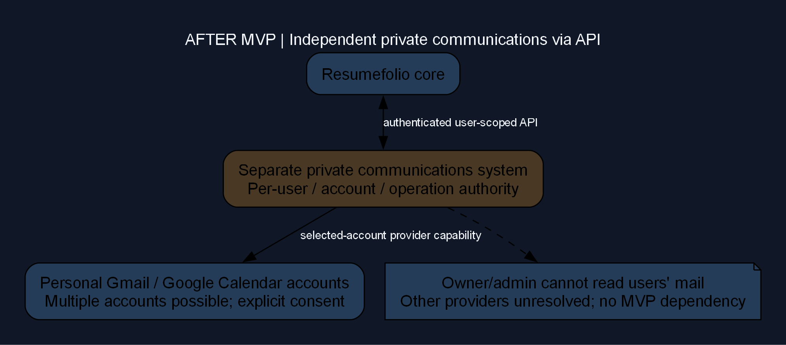

[Scalable SVG](Diagrams/Google-Integration-Context.svg) ·
[Editable Graphviz](Diagrams/Google-Integration-Context.dot)

Arrows show conceptual operation contexts, not a chosen API architecture or
synchronization direction. A board collaborator or employer viewer receives no
private Gmail access merely through that role. Multiple accounts/calendars,
recurrence and invitation behavior need explicit decisions; no default is assumed.

<a id="requirements-specification-email-calendar-and-google-integration--heading-2-operation-inventory"></a>
##### 2. Operation Inventory

| Category | Scope-supported outcome | Detail to specify before acceptance |
| --- | --- | --- |
| Connect/select account | User-authorized Gmail and Google Calendar access | Account identity/count, calendar selection, permission mapping, consent and reconnect |
| Read Gmail | View authorized correspondence | Lists/threads, search/filter, pagination, body formats, unread state, attachments and freshness |
| Compose/send/reply | User-authored communication | Draft persistence, sender/recipients, threading, attachments, confirmation and uncertain send |
| Calendar | Coordinate agreed activity types | Views, create/read/change/remove actions, required fields, time zones and reminder behavior |
| Google Calendar integration | Explicitly defined selected synchronization | Direction by operation/property, authoritative data, mapping, conflicts, deletion and timing |
| Application relationships | Relate relevant correspondence/activities to work | Link/copy behavior, visibility, removal and preserved-submission distinction |
| Lifecycle | Loss of access, disconnect and reconnect | Pending work, retained local data, authorization and reconciliation |

The inventory distinguishes known outcomes from unresolved details. It neither
silently adds every Gmail/Calendar feature nor excludes agreed capabilities.
Record material refinements and scope changes explicitly.

<a id="requirements-specification-email-calendar-and-google-integration--heading-3-proposed-requirements"></a>
##### 3. Proposed Requirements

Each candidate has owner **Farhad**, status **Proposed**, priority **Unassigned**.
Sources identify accepted inclusions or proposed supporting detail. Acceptance
criteria are planned observations, not evidence of an implemented integration.

<a id="requirements-specification-email-calendar-and-google-integration--heading-egc-d01-authorized-connection-and-account-context"></a>
###### EGC-D01: Authorized Connection and Account Context

**Release allocation (owner decision, November 4):** Deferred after MVP.

**Source / rationale:** DEC-022/028; operations must use the intended user's
authorized connection rather than unrelated accounts.

**Proposed obligation:** The product shall establish and show the relevant account
and connection context for provider operations under the reviewed access policy.

**Acceptance criteria**
- A controlled authorized connection identifies the intended account without exposing credential/token values.
- Denied or incomplete consent does not appear as a successfully usable connection for unavailable operations.
- Account/calendar selection cases do not silently read or change a different account/calendar.

**Planned verification:** Later controlled connect/deny/select cases.
**Open:** Supported account count/types, account linking, consent details and
connection states; product sign-in is distinct from provider authorization.

<a id="requirements-specification-email-calendar-and-google-integration--heading-egc-d02-justified-permissions-and-private-resource-isolation"></a>
###### EGC-D02: Justified Permissions and Private-resource Isolation

**Release allocation (owner decision, November 4):** Deferred after MVP.

**Source / rationale:** DEC-028 and proposed provider-security refinement; request
only access justified by agreed operations and preserve product permissions.

**Proposed obligation:** Provider operations shall require applicable product
authority and provider-granted access, with requested permissions mapped to
required capabilities and credentials excluded from normal output.

**Acceptance criteria**
- The operation/permission matrix justifies each requested permission and identifies unavailable operations after partial/lost grants.
- Another user, board collaborator or employer context cannot read/use the private connection through altered references or direct requests.
- Ordinary errors, logs and exported review evidence do not expose tokens, codes or secrets.

**Planned verification:** Matrix review and later allowed/denied/grant-loss cases.
**Open:** Exact scopes, token protection, revocation and administrative powers;
no broad mailbox permission or Google sign-in choice is selected here.

<a id="requirements-specification-email-calendar-and-google-integration--heading-egc-d03-read-authorized-correspondence"></a>
###### EGC-D03: Read Authorized Correspondence

**Release allocation (owner decision, November 4):** Deferred after MVP.

**Source / rationale:** DEC-022; users must read the relevant Gmail correspondence.

**Proposed obligation:** The product shall display the agreed message/thread
information from the selected authorized Gmail context with defined freshness and
safe content/attachment behavior.

**Acceptance criteria**
- Controlled messages show the defined sender, recipient, time, subject and content in the correct account context once the field/view rules are agreed.
- Empty, loading, unavailable and stale/partial data are distinguishable from a complete current mailbox result.
- Message content and attachment retrieval respect resource access and the reviewed safe-rendering/file policy.

**Planned verification:** Later representative plain/rich/attachment and empty/error
cases. **Open:** Thread/list/search coverage, pagination, unread actions, content
format, remote content/tracking, sanitization and download handling.

<a id="requirements-specification-email-calendar-and-google-integration--heading-egc-d04-manual-compose-and-draft-handling"></a>
###### EGC-D04: Manual Compose and Draft Handling

**Release allocation (owner decision, November 4):** Deferred after MVP.

**Source / rationale:** DEC-022/023 and proposed persistence detail; keep user-authored
communication and its actual saved state clear.

**Proposed obligation:** Users shall compose the agreed email fields manually, with
draft persistence, validation and abandonment behavior explicitly defined.

**Acceptance criteria**
- Defined valid recipient/content inputs remain in the intended compose context.
- Invalid inputs and failed draft persistence do not produce a false saved/sent outcome.
- Restoring or discarding a draft follows the reviewed local/provider authority and does not overwrite an unrelated draft.

**Planned verification:** Later validation/save/failure/abandon cases.
**Open:** Required fields, recipient limits, CC/BCC, formatting, attachments,
local/provider drafts, autosave/recovery and duplicate handling.

<a id="requirements-specification-email-calendar-and-google-integration--heading-egc-d05-deliberate-send-and-truthful-outcome"></a>
###### EGC-D05: Deliberate Send and Truthful Outcome

**Release allocation (owner decision, November 4):** Deferred after MVP.

**Source / rationale:** DEC-022 and proposed failure refinement; outbound mail is an
external side effect whose outcome may be uncertain.

**Proposed obligation:** Send shall follow explicit user intent for the reviewed
sender, recipients, content and attachments, and report only the outcome supported
by available provider evidence.

**Acceptance criteria**
- A controlled send uses the intended account/message under the agreed send/confirmation interaction.
- Provider acceptance, rejection, pending work and unknown outcome are distinguishable as applicable; acceptance is not labeled recipient delivery/read confirmation.
- Retry after an ambiguous response follows a defined reconciliation policy rather than blindly duplicating the external send.

**Planned verification:** Later authorized test-recipient cases and controlled
rejection/timeout/uncertainty. **Open:** Confirmation UX, pending/cancel semantics,
provider evidence, duplicate prevention and safe retry; no exactly-once guarantee.

<a id="requirements-specification-email-calendar-and-google-integration--heading-egc-d06-reply-context-and-conversation-association"></a>
###### EGC-D06: Reply Context and Conversation Association

**Release allocation (owner decision, November 4):** Deferred after MVP.

**Source / rationale:** DEC-022; replies must address the intended correspondence.

**Proposed obligation:** Reply shall retain the reviewed sender, recipient and
conversation context while allowing user review before sending.

**Acceptance criteria**
- A controlled reply identifies the intended original message/conversation and sender account.
- Recipient/reply behavior matches the reviewed rules rather than silently sending to unrelated addresses.
- Reply failures retain a distinguishable outcome without a false successful-send claim.

**Planned verification:** Later representative thread/reply/failure cases.
**Open:** Reply-all, quoted content, signatures, threading rules and attachments;
not every mail-client feature is implied by the accepted reply inclusion.

<a id="requirements-specification-email-calendar-and-google-integration--heading-egc-d07-calendar-activities-and-time-meaning"></a>
###### EGC-D07: Calendar Activities and Time Meaning

**Release allocation (owner decision, November 4):** Deferred after MVP.

**Source / rationale:** DEC-022; interviews, deadlines, follow-ups and agreed
personal/project activities need unambiguous scheduling behavior.

**Proposed obligation:** The product shall support the reviewed calendar activity
operations and required fields with explicit time-zone, access and validation rules.

**Acceptance criteria**
- Representative agreed activity types can be recorded/viewed and changed under the approved operation matrix.
- Invalid required fields/time intervals produce defined feedback rather than a false saved event.
- Agreed all-day/time-zone/daylight-saving cases preserve intended time meaning in relevant views and provider mappings.

**Planned verification:** Later activity/permission/time-boundary cases.
**Open:** Views, local versus provider events, allowed actions, all-day rules,
recurrence, attendees/invitations, shared calendars and cancellation side effects.

<a id="requirements-specification-email-calendar-and-google-integration--heading-egc-d08-explicit-synchronization-contract"></a>
###### EGC-D08: Explicit Synchronization Contract

**Release allocation (owner decision, November 4):** Deferred after MVP.

**Source / rationale:** DEC-022; synchronization direction and conflicts cannot be
inferred from the word integration.

**Proposed obligation:** Each integrated data/action category shall follow a
reviewed authority, identity mapping, direction, conflict, deletion and refresh
contract with observable success, partial and failed outcomes.

**Acceptance criteria**
- Defined local/provider edits and deletions produce the agreed result for the selected category/calendar.
- Concurrent divergence or invalid synchronization state invokes the defined reconciliation path without silently destroying unrelated local data.
- Partial/failed refresh is not presented as fully current; reconnect/repeated-refresh cases follow the reviewed duplicate policy.

**Planned verification:** Later divergence, deletion, partial refresh and recovery
cases. **Open:** Complete contract in section 4, cadence, scope and implementation;
no bidirectional, real-time, webhook or last-write-wins choice is assumed.

<a id="requirements-specification-email-calendar-and-google-integration--heading-egc-d09-application-relationships-preserve-boundaries"></a>
###### EGC-D09: Application Relationships Preserve Boundaries

**Release allocation (owner decision, November 4):** Deferred after MVP.

**Source / rationale:** DEC-022/023/028; useful correspondence/activity relationships
must not leak private communication or rewrite application history.

**Proposed obligation:** Users shall relate agreed correspondence/activities to
application work using explicit link/copy, access and removal semantics.

**Acceptance criteria**
- Related items resolve to the correct application and authorized account/activity.
- Association does not grant unrelated collaborators/employer viewers private message access.
- Later source changes/removal follow the reviewed policy and do not overwrite preserved actual submitted material.

**Planned verification:** Later application association/access/removal cases.
**Open:** Relation cardinality, displayed/copied fields, provider deletion and
whether any actual sent content is part of submission capture; no automatic capture assumed.

<a id="requirements-specification-email-calendar-and-google-integration--heading-egc-d10-reminders-and-notification-outcomes"></a>
###### EGC-D10: Reminders and Notification Outcomes

**Release allocation (owner decision, November 4):** Deferred after MVP.

**Source / rationale:** DEC-022 and its explicit reminder-definition follow-up;
timely prompts need clear recipients, timing and delivery evidence.

**Proposed obligation:** Agreed reminders shall follow defined scheduling,
permission-change, cancellation and outcome rules for selected activities.

**Acceptance criteria**
- Defined reminder examples target the authorized recipient and intended activity/time context.
- Activity cancellation/change or loss of access yields the reviewed pending-reminder result.
- Scheduled, attempted, failed and confirmed outcomes are distinguished according to the selected channel's evidence.

**Planned verification:** Later controlled timing/change/denial/delivery cases.
**Open:** Local/provider authority, channels, timing/tolerance, retry and duplicate
behavior; no external notification service or guaranteed delivery is selected.

<a id="requirements-specification-email-calendar-and-google-integration--heading-egc-d11-disconnect-revocation-and-reconnect"></a>
###### EGC-D11: Disconnect, Revocation and Reconnect

**Release allocation (owner decision, November 4):** Deferred after MVP.

**Source / rationale:** Proposed lifecycle refinement of DEC-022/028 and
[Business Rules](#requirements-specification-business-rules-and-data-lifecycle); access loss is distinct from data deletion.

**Proposed obligation:** Lost/revoked access, disconnect and reconnect shall have
explicit consequences for operations, pending work, credentials and retained local data.

**Acceptance criteria**
- Unavailable grants do not permit protected provider operations or a false connected/usable status for those operations.
- Disconnect does not silently delete provider data or imply a local purge unless explicitly authorized by reviewed policy.
- Reconnect reconciles selected identity/mappings/pending work under the agreed policy without silently sending stale queued mail or duplicating events.

**Planned verification:** Later revoke/disconnect/reconnect and account-mismatch
cases. **Open:** Local retention, credential invalidation/revocation scope, pending
work, stale views and application references; no retention duration is set.

<a id="requirements-specification-email-calendar-and-google-integration--heading-egc-d12-bounded-failures-recovery-and-feasibility-evidence"></a>
###### EGC-D12: Bounded Failures, Recovery and Feasibility Evidence

**Release allocation (owner decision, November 4):** Deferred after MVP.

**Source / rationale:** ASM-02/DEP-03/GAP-D02; service availability and actual
project access cannot be inferred from official API capability.

**Proposed obligation:** Provider failures/limits shall produce defined bounded
outcomes and recovery guidance; dependent acceptance shall retain actual access
and representative operation evidence within applicable conditions and resources.

**Acceptance criteria**
- Consent denial, expired/revoked access, rate/resource limits, provider outage and ambiguous outbound outcomes have explicit user-visible handling.
- Retrying/reconciling follows operation-specific safety rules and does not bypass grants or falsely claim success.
- Evidence identifies actual account/audience, configuration, granted operations, observed limits and blockers without exposing secrets.

**Planned verification:** Source/configuration inspection and later controlled
operation/failure checks. **Open:** Limits, timeout/backoff, refresh/recovery methods,
verification obligations/costs and support effort; none is proven here.

<a id="requirements-specification-email-calendar-and-google-integration--heading-4-synchronization-and-lifecycle-contract"></a>
##### 4. Synchronization and Lifecycle Contract

Complete a separate reviewed row per message/draft/event/property/action category;
Gmail correspondence and Calendar synchronization need not use the same policy.

| Contract item | Decision needed |
| --- | --- |
| Identity and selection | Product user, provider account, mailbox/calendar, item mapping and duplicate identity |
| Authority and direction | Authoritative properties/actions; local-only, inbound or outbound effects as selected |
| Initial scope and freshness | Date/data selection, paging, initial completeness, refresh trigger/cadence and freshness display |
| Changes/conflicts | Concurrent local/provider edits, supported conflict resolution and user action |
| Deletion | Provider delete versus local unlink/archive/delete; effect on related applications and copies |
| Failure/repetition | Partial work, cursor/history loss, retries, ambiguous sends and safe reprocessing |
| Disconnection | Pending work, credential/access consequences, local retention and later reconnect |
| Time/reminders | Time zones, all-day/recurring behavior if selected, reminder authority and changed events |
| Recovery | Local restoration versus newer provider state, mappings and stale grants |

These are unresolved decision fields, not selected database columns. Do not
discard user-authored local content merely because a provider sync cursor must
be rebuilt. Later design must distinguish cached provider data from authoritative
local content and preserved submission artifacts.

<a id="requirements-specification-email-calendar-and-google-integration--heading-5-operation-and-failure-roadmap"></a>
##### 5. Operation and Failure Roadmap

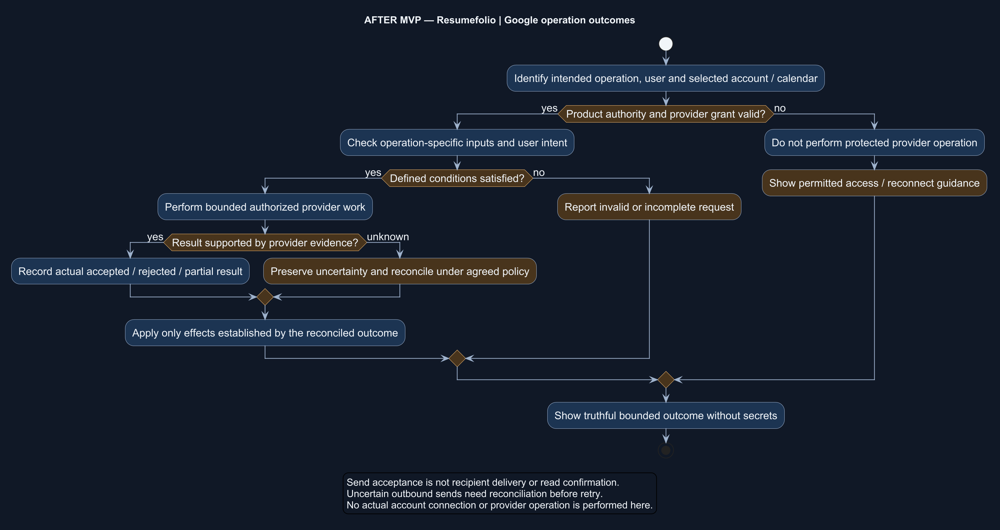

[Scalable SVG](Diagrams/Google-Operation-Outcomes.svg) ·
[Editable PlantUML](Diagrams/Google-Operation-Outcomes.puml)

This conceptual flow applies different retry rules to reads, state changes and
outbound sends. It does not authorize sending email, changing calendars or
connecting actual user accounts during this documentation task. Unknown outcomes
remain unknown until appropriate reconciliation establishes more.

<a id="requirements-specification-email-calendar-and-google-integration--heading-6-planned-scenario-coverage"></a>
##### 6. Planned Scenario Coverage

| Group | Candidates | Representative paths |
| --- | --- | --- |
| Connection/isolation | D01/D02/D11 | Correct/wrong account, denied/partial/revoked grants, cross-user/direct references |
| Correspondence | D03/D04/D06 | Representative content, attachment safety, draft failure, intended reply context |
| Outbound send | D05/D12 | Authorized test recipient, rejection, ambiguous timeout, reconciliation and duplicate risk |
| Calendar | D07/D08/D10 | Activity validation, zones/daylight saving, selected actions, conflicts, deletion/reminders |
| Application history | D09 | Association, permission isolation, provider/source removal and preserved copies |
| Recovery | D08/D11/D12 | Stale/partial data, invalid sync state, disconnect/reconnect, limits and provider outage |

Dxx abbreviates EGC-Dxx. Each later test records policy/candidate revision,
environment/account type, grants, inputs/state, expected/actual outcomes and
limits. Use controlled accounts/recipients and authorized data; no tests have run.
No production messages, contacts, secrets or event content belong in repository evidence.

<a id="requirements-specification-email-calendar-and-google-integration--heading-7-official-provider-source-notes"></a>
##### 7. Official Provider Source Notes

Limited documentation check dated **October 31, 2026**. These findings describe
published guidance, not this project's configuration or approval. Recheck sources
at scope selection and release; record actual applicability separately.

| Official source | Bounded finding | Project consequence / remaining evidence |
| --- | --- | --- |
| [Choose Gmail API scopes](https://developers.google.com/workspace/gmail/api/auth/scopes) | Google defines operation-related scopes and recommends narrowly focused access | Map each required operation to necessary permissions; final scope set remains open |
| [Restricted scope verification](https://developers.google.com/identity/protocols/oauth2/production-readiness/restricted-scope-verification) | Sensitive/restricted access has verification requirements, with exceptions and potential security assessment depending on use | Establish actual audience, deployment/data handling and exception applicability; do not assume approval, exemption, cost or completion |
| [Calendar synchronization guide](https://developers.google.com/workspace/calendar/api/guides/sync) | Incremental synchronization includes invalid-token recovery requiring a full resynchronization | Define safe reconciliation and protect unrelated local content if this API approach is selected |
| [Gmail synchronization guide](https://developers.google.com/workspace/gmail/api/guides/sync) | Full and partial synchronization have different recovery needs when history is unavailable | Define initial scope/freshness/recovery and bound resource work if this API approach is selected |

This check does not choose API versus another permitted integration mechanism,
prove current project access, audit all Google terms or satisfy GAP-D02. No exact
quota, price, grant lifetime, approval deadline or assessment exemption is asserted.

<a id="requirements-specification-email-calendar-and-google-integration--heading-8-open-decisions-and-review-gates"></a>
##### 8. Open Decisions and Review Gates

| Topic | Required decision/evidence | Dependent gate |
| --- | --- | --- |
| Operation coverage | Mail views/actions/attachments, calendar actions/views and account/calendar count | Affected M-02 requirement acceptance |
| Permissions/provider conditions | Operation-scope mapping, audience, consent, verification/assessment applicability, costs and actual access | GAP-D02; before dependent design acceptance/development |
| Synchronization | Full contract in section 4, including conflicts and deletion | Affected M-02 acceptance and M-03 design |
| Send/reply | Review/confirmation, drafts, threading, uncertain send and duplicate reconciliation | Before outbound behavior acceptance/design |
| Time/reminders | Zones, recurrence/invitations if selected, channels, scheduling and cancellation | Affected requirements and dependency review |
| Privacy/content safety | Local/provider data, retention, logs, rich content/attachments and access changes | Security/lifecycle requirements and design |
| Disconnection/recovery | Grants, pending work, local retention, mapping and restore/reconnect reconciliation | Before dependent lifecycle/design acceptance |
| Actual operation limits | Account/service conditions, representative operations, resource demand and failure evidence | Access before development; readiness evidence before affected capability acceptance |

Farhad coordinates every row. These are local topics, not newly allocated shared
question/decision IDs. Keep [Questions](#change-and-baseline-open-questions-and-decisions),
[Feasibility](#process-and-approach-02-feasibility-study) and
[Change Control](#change-and-baseline-change-control) consistent. A provider
blocker needs an explicit owner disposition; it does not silently remove DEC-022.

<a id="requirements-specification-email-calendar-and-google-integration--heading-9-traceability-and-review-readiness"></a>
##### 9. Traceability and Review Readiness

Link final requirements/scenarios and actual evidence in
[Traceability](#validation-and-traceability-validation-and-traceability--heading-traceability).
Use [Review Findings](#validation-and-traceability-validation-and-traceability--heading-review-findings)
for real inspection outcomes. Reconcile ACC-D permissions, BRL-D07 synchronization,
BRL-D05 submitted history, AFO-D file policies and DOM-D05 applicability.

- [ ] Reconcile provisional references and assign justified priorities.
- [ ] Review accepted outcomes separately from proposed supporting detail.
- [ ] Decide operation, permission and synchronization matrices before conditional criteria are accepted.
- [ ] Obtain actual provider-access findings and resolve dependent conditions/costs.
- [ ] Reconcile application history, private access, file handling, reminders and recovery.
- [ ] Record actual owner review/revision and later results without inventing Pass status.

**Current outcome:** Proposed specification with limited official-source notes.
No EGC candidate is accepted, no account is connected, no message/event operation
is performed, no access/feasibility approval is claimed, and M-02 remains pending.

<a id="requirements-specification-email-calendar-and-google-integration--heading-10-diagram-maintenance"></a>
##### 10. Diagram Maintenance

| Diagram | Source | SVG | PNG |
| --- | --- | --- | --- |
| Google integration context | [DOT](Diagrams/Google-Integration-Context.dot) | [SVG](Diagrams/Google-Integration-Context.svg) |  |
| Operation outcomes | [PlantUML](Diagrams/Google-Operation-Outcomes.puml) | [SVG](Diagrams/Google-Operation-Outcomes.svg) |  |

Keep sources and PNG/SVG outputs synchronized. Follow the
[diagram guide](Diagrams/Diagram-Catalog.md), inspect arrow/label readability and verify
file/section links. Colors supplement labels; save UTF-8 without BOM.

[Specification index](#requirements-specification-requirements-specification-overview) · [SRS entry point](#requirements-specification-requirements-specification)
· [Requirements index]()

<a id="requirements-specification-email-calendar-and-google-integration--heading-selected-policies-and-future-proposals"></a>
##### Selected Policies and Future Proposals

Current MVP answers are selected in the Baseline. Only explicitly deferred details below remain proposals; product tests and operational evidence are still required.

<a id="requirements-specification-email-calendar-and-google-integration--id-resolution-q-d15"></a>
<a id="requirements-specification-email-calendar-and-google-integration--heading-proposed-answer-q-d15-google-access-and-applicability"></a>
###### Proposed answer Q-D15: Google access and applicability

**Affected records:** EGC-D01/D02/D12; DOM-D05; ASM-02/DEP-03/GAP-D02. **Disposition:** Evidence-gated investigation with a complete proposal.

1. Require per-user explicit OAuth authorization for the selected Google account; show connected identity and granted capability state. Users own their private mail/calendar context. Do not assume a product-wide service account can read personal Gmail or that a Codex connector proves this product has credentials.

2. Propose Gmail operation scope set gmail.readonly for search/read and gmail.compose for remote drafts/send; do not request mail.google.com or gmail.modify unless a separately reviewed operation needs the additional rights. gmail.compose includes draft management and sending, so a separate send scope is unnecessary for that contract. Scope classification/verification must be assessed against the actual app/audience/data handling.

3. For Calendar propose calendar.events for selected permitted calendar-event read/write, adding calendar.calendarlist.readonly only for the picker; validate target-calendar authority on each operation. Do not request calendar ACL administration. Broader provider scope does not itself authorize showing every accessible event in this product.

4. Record OAuth project owner, publishing audience, consent status, redirect URLs, scope list and token/refresh/revoke/reconnect results in a sanitized checklist. Perform actual read/draft/test-send/calendar checks only with a controlled account and explicit send authorization. Provider documentation establishes possible scopes, not actual project access, quota, verification outcome or cost.

**Assessable review cases:** [RC-Q15-01 through RC-Q15-03](#scenarios-and-models-user-stories-and-scenarios--id-review-q-d15). These are planned checks, not executed results.

**Remaining evidence / acceptance condition:** Actual OAuth project/consent/audience, permitted credentials, verification applicability, quota/cost and controlled operation evidence are not available in repository or SSH checks. This remains an external-evidence gate.

<a id="requirements-specification-email-calendar-and-google-integration--id-resolution-q-d16"></a>
<a id="requirements-specification-email-calendar-and-google-integration--heading-proposed-answer-q-d16-mail-operations-and-uncertain-outcomes"></a>
###### Proposed answer Q-D16: Mail operations and uncertain outcomes

**Affected records:** EGC-D03–EGC-D06/D09/D12; EIF-D05/D08. **Disposition:** Answer proposed; owner acceptance pending.

1. Support provider-backed mailbox search, paged message/thread reading, compose, draft save/edit, deliberate send and reply with explicit recipient/subject/body/attachment review. Preserve provider message/thread identity. Sanitized HTML and protected attachments must not execute mail content or load tracking resources automatically.

2. A send action uses the selected connected sender and a displayed final recipient/attachment set; changes before send require re-review. Product acceptance of a send request, provider acceptance, delivery and recipient read are separate facts. Store provider confirmation/reference when supplied; never claim delivery/read from a successful API submission.

3. After an ambiguous timeout, mark outcome unknown and reconcile against the provider before allowing an explicit retry with duplication warning. Do not blindly resend or infer failure from missing immediate confirmation. Save draft or read retries may be safely repeated only under their defined identity/version behavior.

4. Reply binds the intended thread and To/Cc recipients; do not silently reply-all. Draft autosave records actual save state and protects newer edits from stale writes. Application association links correspondence explicitly without granting access to an entire mailbox or automatically advancing progress.

**Assessable review cases:** [RC-Q16-01 through RC-Q16-03](#scenarios-and-models-user-stories-and-scenarios--id-review-q-d16). These are planned checks, not executed results.

**Remaining evidence / acceptance condition:** Owner review of the proposed rule and its affected criteria is required; no product test is reported.

<a id="requirements-specification-email-calendar-and-google-integration--id-resolution-q-d17"></a>
<a id="requirements-specification-email-calendar-and-google-integration--heading-proposed-answer-q-d17-calendar-authority-conflicts-and-disconnection"></a>
###### Proposed answer Q-D17: Calendar authority, conflicts and disconnection

**Affected records:** EGC-D07–EGC-D11; BRL-D07/D10. **Disposition:** Answer proposed; owner acceptance pending.

1. Support local tasks/reminders and explicitly selected Google calendar events as distinct subjects. Store timed events with an instant and source/display time zone; all-day events use calendar dates with exclusive end date, not midnight converted through arbitrary user zones. Preserve provider recurrence/exception identity.

2. For imported Google events, provider fields are authoritative until the user explicitly edits and a permitted provider update succeeds. Local private notes/application links remain local. Local-only activities do not automatically publish; explicit publish creates a mapped provider event. No implicit whole-account bidirectional mirroring.

3. Reconcile mapped events using version/change evidence. Concurrent local/provider edits create a conflict requiring explicit choice/review, not silent last-write-wins. Provider deletion marks the mirror removed/unavailable; deleting a local association does not delete the provider event. External deletion needs an explicit confirmation.

4. Disconnect stops new fetch/push/reminder work relying on that connection, revokes usable local credentials and marks retained local copies stale/disconnected; users may explicitly delete retained private copies under retention rules. Reconnect refreshes identity/permissions and reconciles pending work; it never blindly replays old sends or duplicate event creation. Reminder delivery channel must be actually available.

**Assessable review cases:** [RC-Q17-01 through RC-Q17-03](#scenarios-and-models-user-stories-and-scenarios--id-review-q-d17). These are planned checks, not executed results.

**Remaining evidence / acceptance condition:** Owner review of the proposed rule and its affected criteria is required; no product test is reported.

<a id="requirements-specification-email-calendar-and-google-integration--heading-november-1-2026--q-d15-owner-clarification"></a>
##### November 1, 2026 — Q-D15 Owner Clarification

The owner confirmed no OAuth project has been created. Treat Google integration setup as not yet established; do not keep asking for an existing project ID or infer readiness from an installed package. The proposed operations/scopes remain inputs to later setup. Intended audience, project ownership, consent/client/redirect configuration, applicable provider conditions and controlled actual operation evidence are still required before the dependent gate. This clarification neither removes the agreed integration nor creates an account or credentials.

</details>

<a id="requirements-specification-external-interface-requirements"></a>

<details>
<summary>Resumefolio — External Interface Requirements</summary>

<a id="requirements-specification-external-interface-requirements--heading-resumefolio--external-interface-requirements"></a>
#### Resumefolio — External Interface Requirements

Current implementation choices and scope: [Baseline](https://github.com/Farhad-V/Web-Resumefolio/blob/1f2acaa351ac306cb57cbe4fe9742e8bd90720d9/docs/MVP/baseline/README.md). Runtime verification remains subject to its gates.

| Item | Current position |
| --- | --- |
| Owner | Farhad; sole delivery and operations owner |
| Status | Proposed specification — interface contracts and acceptance pending |
| Candidate references | EIF-D01–EIF-D10 are provisional document-local references, not allocated global requirement IDs |
| Priority | Unassigned; record order is not delivery priority |
| Revision | October 31, 2026 |

**At a glance:** Define what crosses the product boundary, who may request it,
which information is exchanged and how success, denial and uncertainty appear.
Keep browser interaction, protected files, Google operations, real Git access and
conditional execution boundaries consistent. No endpoint, transport selection,
public API or new external service is established by this document.

[Inventory](#requirements-specification-external-interface-requirements--heading-2-interface-inventory) · [Requirements](#requirements-specification-external-interface-requirements--heading-3-proposed-interface-requirements)
· [Contracts](#requirements-specification-external-interface-requirements--heading-4-interface-contract-record) · [Outcomes](#requirements-specification-external-interface-requirements--heading-5-interaction-and-failure-roadmap)
· [Gates](#requirements-specification-external-interface-requirements--heading-7-open-decisions-and-gates) · [Review](#requirements-specification-external-interface-requirements--heading-8-traceability-and-review-readiness)

<a id="requirements-specification-external-interface-requirements--heading-mvp-api-and-protected-media-contracts"></a>
##### MVP API and protected media contracts

The core connects to the separate ProjectForge system through an authenticated user-scoped API. Define subject/resource/action scope, credential lifecycle, revocation, truthful errors and least privilege without selecting a token protocol prematurely. Normal Git commits remain client operations. Core files/media are private on the Resumefolio server; direct and byte-range delivery require selected-resume authorization. EIF-D05 Google interfaces and EIF-D07 workflow/deployment interfaces are after MVP; their general error/authority principles still inform retained interfaces.

Authority: [OWNER-MVP-2026-11-04](../01-Project-Planning/01-Project-Charter.md#release-decision). [Candidate allocation](#requirements-specification-mvp-release-allocation).

<a id="requirements-specification-external-interface-requirements--heading-1-purpose-and-authority"></a>
##### 1. Purpose and Authority

Specify externally observable interaction contracts without selecting the internal
architecture. External means outside the product boundary: a person using its
interface, a Git client, a connected provider or an operational dependency.
Internal module calls and database schemas belong in later analysis/design.

The accepted basis is [Version 1 Scope](../01-Project-Planning/01-Project-Charter.md#mvp-scope)
DEC-028–DEC-017, subject to [Resources and Constraints](../01-Project-Planning/03-Feasibility-And-Risk-Assessment.md#resource-constraints)
and [Planning Completion Criteria](https://github.com/Farhad-V/Web-Resumefolio/blob/1f2acaa351ac306cb57cbe4fe9742e8bd90720d9/docs/MVP/SDLC/01-project-planning/10-planning-completion-criteria.md).
Detailed contracts below remain proposed. Scope inclusion does not prove access,
compatibility, capacity, deployment or acceptance.

Use [Actors and System Context](#stakeholders-and-elicitation-actors-and-system-context)
for actor definitions, [Domain Constraints](#requirements-specification-domain-requirements-and-constraints)
for authority/applicability and the [Data Dictionary](#data-definitions-data-dictionary)
for information meanings. The domain requirements remain responsible for business
behavior; this document specifies how their boundaries must be made explicit.

<a id="requirements-specification-external-interface-requirements--heading-2-interface-inventory"></a>
##### 2. Interface Inventory

The IF labels below are local inventory references, not new product requirement IDs.

| Ref. / boundary | Participants and exchange | Source / detail owner | Unresolved contract |
| --- | --- | --- | --- |
| IF-01 Private user interface | Product user; professional, application, communication and work actions/results | DEC-028 and domain scope; [Accounts](#requirements-specification-accounts-authentication-and-permissions) | Supported clients, views, input/feedback, session behavior and accessibility criteria |
| IF-02 Employer interface | Viewer without product account; password-protected selected resume/evidence/PDF retrieval | DEC-024/025/026; [PDF and Sharing](#requirements-specification-pdf-and-controlled-sharing) | Link/session changes, live revisions, download/language availability |
| IF-03 File exchange | Authorized upload/replacement/retrieval of evidence, PDFs and agreed assets | DEC-026/025/018; [Files and Operations](#requirements-specification-administration-files-and-operational-behavior) | Formats, metadata, size/quota semantics, processing and failures |
| IF-04 Gmail | Connected user/account; read, compose, send and reply operations/results | DEC-022; [Google Integration](#requirements-specification-email-calendar-and-google-integration) | Required access, account selection, message/draft contract and uncertain sends |
| IF-05 Google Calendar | Selected authorized calendar; agreed activity operations and synchronization | DEC-022; [Google Integration](#requirements-specification-email-calendar-and-google-integration) | Direction, mapping, time semantics, conflicts, deletion and reconnect |
| IF-06 Git clients | Authorized clients/users; real Clone/Fetch/Pull/Push and related repository access | DEC-020; [Git Hosting](#requirements-specification-git-hosting-and-collaboration) | Transport(s), credentials, client/version support, refs, limits and rejected operations |
| IF-07 Execution/deployment boundary | Authorized workflow inputs, permissions/secrets, outputs and approved targets | DEC-019, conditional; [YAML and CI/CD](#requirements-specification-yaml-workflows-and-cicd) | Isolation, triggers, syntax, network/target authority, logs/artifacts, limits and approval |
| IF-08 Operational dependencies | Authorized operator and selected runtime, notification delivery, backup/restore facilities | DEC-017; resource DEP-01–DEP-06; [Quality and Recovery](#requirements-specification-quality-security-and-recovery-requirements) | Actual facilities, delivery/access contracts, configuration, coverage and procedure evidence |


[Scalable SVG](https://github.com/Farhad-V/Web-Resumefolio/blob/1f2acaa351ac306cb57cbe4fe9742e8bd90720d9/docs/MVP/SDLC/04-system-design/01-software-architecture/diagrams/logical-component-ownership.svg) ·
[Editable Graphviz](https://github.com/Farhad-V/Web-Resumefolio/blob/1f2acaa351ac306cb57cbe4fe9742e8bd90720d9/docs/MVP/SDLC/04-system-design/01-software-architecture/diagrams/logical-component-ownership.dot)

Lines group conceptual exchanges, not internal services, chosen protocols or
automatic data flows. IF-07 remains conditional on feasibility/security gates.
IF-08 does not assume a backup provider, email service or new purchase.
Colors supplement labels.

<a id="requirements-specification-external-interface-requirements--heading-3-proposed-interface-requirements"></a>
##### 3. Proposed Interface Requirements

Every record has owner **Farhad**, status **Proposed**, priority **Unassigned**.
Acceptance criteria describe planned observations. Numerical limits, client
versions and policies referenced by conditional criteria must be decided before
affected acceptance. No product tests have been executed for these records.

<a id="requirements-specification-external-interface-requirements--heading-eif-d01-reviewable-interface-contracts"></a>
###### EIF-D01: Reviewable Interface Contracts

**Release allocation (owner decision, November 4):** MVP foundation where used by core/basic ProjectForge; future-domain clauses deferred.

**Source / rationale:** Proposed refinement of the accepted integrations and
external interactions; incomplete contracts hide incompatible assumptions.

**Proposed obligation:** Each required interface shall have a reviewed contract
identifying participants, operations, information, authority and observable outcomes.

**Acceptance criteria**
- Each applicable IF-01–IF-08 entry maps to a contract using section 4, with an explicit owner/status and linked requirements.
- Required inputs, outputs, validity conditions and success/denial/failure examples are defined or marked as blocking questions.
- A documented interface version/change identifies affected consumers and compatibility consequences rather than silently promising universal support.

**Planned verification:** Contract inspection and later consumer/provider checks.
**Open:** Final IDs, exact schemas/protocols/versions and compatibility policy;
this does not create a public developer API or backward-compatibility guarantee.

<a id="requirements-specification-external-interface-requirements--heading-eif-d02-clear-operable-user-interaction"></a>
###### EIF-D02: Clear, Operable User Interaction

**Release allocation (owner decision, November 4):** MVP foundation where used by core/basic ProjectForge; future-domain clauses deferred.

**Source / rationale:** Proposed usability refinement for agreed user/employer
workflows, DEC-028/024 and operational readiness.

**Proposed obligation:** Supported user interfaces shall expose relevant context,
valid actions, input errors and operation outcomes using reviewed usability and
accessibility criteria.

**Acceptance criteria**
- Representative agreed workflows identify the relevant resource/account and available operation without implying unauthorized capability.
- Required-field errors identify the affected input and recoverable next action; loading, empty, incomplete, success and failure states are distinguishable.
- Agreed keyboard, focus, labels, contrast and layout cases pass in the explicitly supported client/viewport matrix once criteria are defined.

**Planned verification:** Later task walkthroughs and selected accessibility/client
checks. **Open:** Target browsers/devices, responsive behavior, interface language,
accessibility standard/level and measurable criteria. No mobile app, browser
version list or formal accessibility conformance is claimed.

<a id="requirements-specification-external-interface-requirements--heading-eif-d03-consistent-authorization-across-entry-paths"></a>
###### EIF-D03: Consistent Authorization Across Entry Paths

**Release allocation (owner decision, November 4):** MVP foundation where used by core/basic ProjectForge; future-domain clauses deferred.

**Source / rationale:** DEC-028/024/025; alternative entry paths cannot bypass
resource-specific access boundaries.

**Proposed obligation:** Each protected interface operation shall enforce the
applicable actor/resource/action/state authority, including direct retrieval and
non-browser clients.

**Acceptance criteria**
- Cross-user/direct-reference requests cannot retrieve or mutate unrelated protected resources.
- Employer access is limited to the intended resume and selected available material; board membership grants no private mail access.
- Denied access and grant-change behavior follow the reviewed contract without disclosing protected content or secrets.

**Planned verification:** Later allowed/denied path matrix, direct files, provider
references and Git-client cases. **Open:** Role/action matrix, session/grant-change
timing and credential methods; see [Accounts](#requirements-specification-accounts-authentication-and-permissions).

<a id="requirements-specification-external-interface-requirements--heading-eif-d04-protected-file-and-pdf-exchange"></a>
###### EIF-D04: Protected File and PDF Exchange

**Release allocation (owner decision, November 4):** MVP foundation where used by core/basic ProjectForge; future-domain clauses deferred.

**Source / rationale:** DEC-026/025/024/018; file transfer is a business/security
boundary, not merely a visible download button.

**Proposed obligation:** File upload, processing, replacement and retrieval shall
follow defined format, availability, authorization and quota contracts with
truthful completion outcomes.

**Acceptance criteria**
- Agreed valid/invalid file and size/quota cases produce the reviewed result with explicit units/boundaries.
- Generated/uploaded PDF and language availability choices apply to direct retrieval as well as the displayed controls.
- Interrupted processing/transfer or failed replacement does not appear as completed usable content or overwrite preserved submitted material through a source edit.

**Planned verification:** Later admission/retrieval/failure and preserved-history
checks. **Open:** Formats, metadata, content validation, processing, safe serving,
limits, cancellation and replacement/reference policy; no numeric quota is invented.

<a id="requirements-specification-external-interface-requirements--heading-eif-d05-explicit-google-provider-contracts"></a>
###### EIF-D05: Explicit Google Provider Contracts

**Release allocation (owner decision, November 4):** Deferred after MVP.

**Source / rationale:** DEC-022, ASM-02/DEP-03/GAP-D02; provider-granted access and
product authority are distinct prerequisites.

**Proposed obligation:** Required Gmail/Calendar exchanges shall use the reviewed
operation, account/calendar, permission, data and lifecycle contracts, with actual
access findings before dependent development.

**Acceptance criteria**
- Each agreed provider operation maps to justified access, selected account/calendar and defined request/result meaning.
- Consent denial, missing/revoked grants and provider rejection do not appear as successful authorized operations.
- Synchronization scope, conflicts, deletion, disconnect and reconnect follow explicitly reviewed rules rather than an assumed direction or source of truth.

**Planned verification:** Contract/applicability review and later controlled provider
operations. **Open:** Actual project access, mechanism/scopes, verification conditions,
limits/costs and full synchronization contract; [Google Integration](#requirements-specification-email-calendar-and-google-integration)
contains the dated official-source notes. No provider capability is newly verified here.

<a id="requirements-specification-external-interface-requirements--heading-eif-d06-real-git-client-interoperability"></a>
###### EIF-D06: Real Git-client Interoperability

**Release allocation (owner decision, November 4):** MVP foundation where used by core/basic ProjectForge; future-domain clauses deferred.

**Source / rationale:** DEC-020; actual repository hosting must work with agreed
Git clients rather than only a browser simulation or external repository link.

**Proposed obligation:** The selected Git access interface shall support agreed
authorized Clone/Fetch/Pull/Push behavior with explicit transport, credential,
repository/ref and outcome rules.

**Acceptance criteria**
- Later checks with supported real clients demonstrate agreed authorized transfer operations and corresponding repository content/history results.
- Unauthorized repository/ref changes and rejected/conflicting operations produce the defined result without an interface bypass.
- Failed/interrupted/repeated transfers have observable client/product outcomes consistent with the reviewed repository integrity rules.

**Planned verification:** Later isolated real-client compatibility, permission and
failure cases. **Open:** Transport(s), credential lifetime/revocation, clients/versions,
protected refs, object/transfer limits and concurrency. Neither SSH nor HTTPS nor a
Git engine is selected; development GitHub is not product-hosting evidence.

<a id="requirements-specification-external-interface-requirements--heading-eif-d07-bounded-workflow-and-deployment-interfaces"></a>
###### EIF-D07: Bounded Workflow and Deployment Interfaces

**Release allocation (owner decision, November 4):** Deferred after MVP.

**Source / rationale:** DEC-019 and conditional execution follow-up; untrusted
workflow input must not imply unrestricted host or deployment authority.

**Proposed obligation:** Before enabling execution, workflow inputs, permitted
actions, credentials/secrets, target authority and outputs shall follow a reviewed
supported contract and feasibility/security gates.

**Acceptance criteria**
- Supported/unsupported YAML examples produce the defined validation result rather than an assumed compatibility with every external workflow ecosystem.
- Execution/deployment actions without required authority/approval cannot use the protected target or unrelated secrets.
- Later controlled output/log/artifact cases enforce defined access, secret handling and resource limits; failures are distinguishable from successful deployment.

**Planned verification:** Later isolated validation/execution/security checks after
the enabling gate. **Open:** Syntax, triggers, runner/isolation, network access,
output retention, approvals and numerical limits. No webhook, marketplace action,
arbitrary remote target or actual execution is introduced by this draft.

<a id="requirements-specification-external-interface-requirements--heading-eif-d08-operation-specific-failure-and-repetition-semantics"></a>
###### EIF-D08: Operation-specific Failure and Repetition Semantics

**Release allocation (owner decision, November 4):** MVP foundation where used by core/basic ProjectForge; future-domain clauses deferred.

**Source / rationale:** Proposed cross-interface reliability refinement, particularly
DEC-022/020/019; an uncertain external effect is not a safe invitation to repeat it.

**Proposed obligation:** Each interface shall define invalid, denied, failed,
partial, pending and unknown outcomes as applicable, including recovery and safe
repetition rules for externally consequential operations.

**Acceptance criteria**
- Relevant timeout, disconnect, limit and provider rejection cases yield distinguishable truthful outcomes and permitted next actions.
- A send/deployment outcome supported only as unknown is not reported as success or blindly repeated contrary to the reviewed policy.
- Error/diagnostic information identifies useful context without exposing secrets or unrelated private content.

**Planned verification:** Later controlled failure, ambiguous-effect and retry
scenarios per interface. **Open:** Timeout/backoff, cancellation, reconciliation,
deduplication and evidence; no global retry policy or exactly-once guarantee.

<a id="requirements-specification-external-interface-requirements--heading-eif-d09-operational-configuration-and-recovery-boundaries"></a>
###### EIF-D09: Operational Configuration and Recovery Boundaries

**Release allocation (owner decision, November 4):** MVP foundation where used by core/basic ProjectForge; future-domain clauses deferred.

**Source / rationale:** DEC-017, DEP-01–DEP-06 and accepted resource constraints;
runtime, delivery and recovery dependencies need explicit usable contracts.

**Proposed obligation:** Selected operational interfaces shall document effective
configuration/access, failure feedback, responsibility and recovery coverage with
version/environment-specific procedures and later evidence.

**Acceptance criteria**
- Operational guidance identifies selected dependencies, required non-secret configuration, compatibility and responsible operator.
- Notification/delivery attempts are not confused with confirmed receipt, and a user Gmail connection is not assumed to provide authentication/recovery mail.
- Later restoration evidence checks required records/artifacts/relationships and restored access against the agreed coverage; backup-file existence alone is not a recovery Pass.

**Planned verification:** Later configuration/procedure inspection and authorized
delivery/isolated restore checks. **Open:** Actual services, deployment/network/TLS
arrangements, notification channel, backup access/coverage and RPO/RTO; no extra
infrastructure or custom hardware interface is assumed.

<a id="requirements-specification-external-interface-requirements--heading-eif-d10-consistent-exchange-meaning-and-lifecycle"></a>
###### EIF-D10: Consistent Exchange Meaning and Lifecycle

**Release allocation (owner decision, November 4):** MVP foundation where used by core/basic ProjectForge; future-domain clauses deferred.

**Source / rationale:** DEC-027/025/023/022 and proposed interoperability detail;
external representations must not change domain meaning or history.

**Proposed obligation:** Interface contracts shall define applicable language,
encoding, time, identity, version/reference and deletion semantics consistently
with the reviewed dictionary and lifecycle rules.

**Acceptance criteria**
- Agreed English/German text and file examples preserve intended content under the selected representation without automatic translation.
- Relevant time-zone/all-day and source-revision examples have the defined meaning across local/provider/file views.
- Interface replacement/deletion/synchronization does not silently overwrite preserved actual submitted copies or remove unrelated referenced data.

**Planned verification:** Later round-trip, time/language, reference/removal and
history checks. **Open:** Exact representations, field optionality, mapping,
version compatibility and retention; [Business Rules and Lifecycle](#requirements-specification-business-rules-and-data-lifecycle)
remain the cross-module invariant reference. No schema/export format is selected.

<a id="requirements-specification-external-interface-requirements--heading-4-interface-contract-record"></a>
##### 4. Interface Contract Record

Complete one record per relevant operation family; not every field applies to
every boundary. Mark genuinely inapplicable fields with rationale rather than
silently leaving an incomplete contract.

| Field | Required definition |
| --- | --- |
| Identity and authority | Local ref, purpose/source, owner/status, actor/client/provider and applicable grants |
| Scope and direction | Operation, initiator, intended recipient/target, data read versus external effect |
| Connection | Selected mechanism/protocol/version, endpoint/transport reference and supported client matrix when decided |
| Inputs and outputs | Meaning, representation/format, required/optional values, identifiers/revisions, language/time/units and examples |
| Preconditions | Authentication, authorization, consent, valid resource state, validation and configured limits |
| Result contract | Observable success, denial, invalid, partial/pending/unknown and failure semantics as applicable |
| Repetition and concurrency | Conflict, duplicate/ambiguous effects, retry/backoff, cancellation and safe reconciliation |
| Lifecycle and privacy | Authority/source of truth, retention, reference/deletion, disconnect, secret-safe diagnostics and recovery |
| Capacity and compatibility | Payload/workload boundaries, response/freshness expectations, actual provider limits and version-change impact |
| Evidence and acceptance | Scenario/requirement links, actual findings, unresolved blockers, reviewed revision and later test evidence |

These are contract-definition fields, not selected endpoints or database columns.
Do not place real credentials, private messages or operational secret values in
examples. Public REST APIs, arbitrary import/export, webhooks and compatibility
with every client/service are not added by this checklist.

<a id="requirements-specification-external-interface-requirements--heading-5-interaction-and-failure-roadmap"></a>
##### 5. Interaction and Failure Roadmap

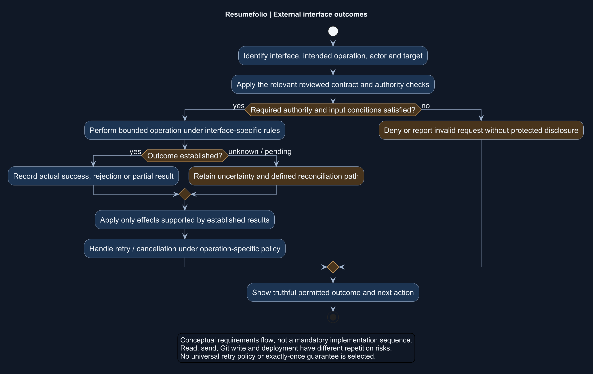

[Scalable SVG](Diagrams/External-Interface-Outcomes.svg) ·
[Editable PlantUML](Diagrams/External-Interface-Outcomes.puml)

The diagram expresses requirements logic rather than mandatory implementation
ordering or a universal middleware chain. Browser reads, mail sends, Git writes
and deployment actions have different external effects and repetition rules.
Only effects supported by actual outcomes may be reported/applied as established.

<a id="requirements-specification-external-interface-requirements--heading-6-planned-verification-coverage"></a>
##### 6. Planned Verification Coverage

| Scenario family | Candidate coverage | Evidence to develop later |
| --- | --- | --- |
| Supported UI/client | EIF-D01/D02/D10 | Agreed browser/viewport/keyboard/language matrix and actual task outcomes |
| Trust boundary | EIF-D03/D04/D05/D06/D07 | Allowed/denied actors, direct paths, changed grants and protected outputs |
| Files/history | EIF-D04/D10 | Valid/invalid formats, availability, interruption, source replacement and preserved copies |
| Provider | EIF-D05/D08 | Actual selected-account access, conflict, revoke, limits and ambiguous send |
| Real Git | EIF-D06/D08 | Selected clients/transports, transfer/history, rejection and interruption |
| Conditional execution | EIF-D07/D08 | Supported YAML, denied actions/targets, secret/output boundary and failed deployment |
| Operations/recovery | EIF-D09/D10 | Actual dependency configuration, delivery outcomes and isolated consistent restoration |

Each later run records contract/policy revision, candidate/environment, actor/grants,
initial state/input, expected/actual outcome and evidence limits. Use authorized,
controlled test data/recipients/targets. A successful browser page does not prove
direct-file protection, provider access, Git-client compatibility or recoverability.
No real provider, host, Git transport or deployment operation is performed here.

<a id="requirements-specification-external-interface-requirements--heading-7-open-decisions-and-gates"></a>
##### 7. Open Decisions and Gates

| Topic | Decision/evidence required | Gate |
| --- | --- | --- |
| User interface/client support | Tasks/views, supported browsers/devices, accessibility and measurable usability criteria | Affected M-02 acceptance and later compatibility verification |
| Access/credentials | Complete actor/resource/action matrix; browser, viewer, provider and Git credential lifecycles | Affected requirements/security design |
| Files/representations | Formats, revisions, time/language, effective limits, safe serving and reference consequences | M-02/M-03; relevant enforcement/history checks before acceptance |
| Google | Operation contracts, justified permissions, actual audience/access/conditions/cost findings | GAP-D02; access before dependent development |
| Git | Real transports/clients, credentials, refs, integrity, transfer limits and failures | Before dependent Git design/implementation; actual client evidence before capability acceptance |
| YAML/execution | Supported syntax/triggers, isolation, network/secret/target authority and limits | GAP-D09; before enabling execution/design acceptance |
| Infrastructure/delivery | Actual capacity, TLS/domain, notification service and operation outcomes | GAP-D01/D03/D07/D08/D10; dependent design and readiness gates |
| Recovery/change | Coverage, reconciliation, compatibility/migration impacts and procedure evidence | GAP-D04/D08; affected design and actual restoration before M-09 acceptance |

Farhad coordinates all topics. Local rows do not claim new shared question IDs
or completed investigations. Record real findings in [Questions and Decisions](#change-and-baseline-open-questions-and-decisions)
and use [Change Control](#change-and-baseline-change-control) for material
scope/cost/delivery effects. Retain existing gates; missing details neither prove
feasibility nor silently remove agreed scope.

<a id="requirements-specification-external-interface-requirements--heading-8-traceability-and-review-readiness"></a>
##### 8. Traceability and Review Readiness

| Source group | Candidates / detailed specification |
| --- | --- |
| DEC-028/024/025/026 | EIF-D02/D03/D04; account matrix, presentation and controlled-sharing rules |
| DEC-022 and access follow-up | EIF-D05/D08/D10; EGC-D provider operation/synchronization candidates |
| DEC-020 | EIF-D06/D08; detailed Git requirements and later actual client contracts |
| DEC-019 | EIF-D07/D08; execution feasibility and later supported workflow/target contract |
| DEC-018/017 and resource constraints | EIF-D04/D09; file policy, quality/recovery and actual resource findings |
| Proposed cross-interface refinements | EIF-D01/D02/D08/D10; reviewed contracts, representation and failure criteria |

Maintain allocated links in [Traceability](#validation-and-traceability-validation-and-traceability--heading-traceability)
and real inspection outcomes in [Review Findings](#validation-and-traceability-validation-and-traceability--heading-review-findings).

- [ ] Reconcile provisional IDs and justify priorities.
- [ ] Review accepted boundary sources separately from proposed interface detail.
- [ ] Complete required operation/contract matrices and resolve acceptance-blocking questions.
- [ ] Reconcile domain meanings, permissions, provider/Git/file/execution and recovery behavior.
- [ ] Decide measurable client/format/limit/compatibility criteria using evidence.
- [ ] Record actual owner review and later verification without inventing Pass results.

**Current outcome:** Proposed interface specification; exact contracts, selections
and critical evidence remain pending. No EIF candidate is accepted, no production
interface is configured and M-02 is not completed by this revision.

<a id="requirements-specification-external-interface-requirements--heading-9-diagram-maintenance"></a>
##### 9. Diagram Maintenance

| Diagram | Source | SVG | PNG |
| --- | --- | --- | --- |
| External interface context | [DOT](https://github.com/Farhad-V/Web-Resumefolio/blob/1f2acaa351ac306cb57cbe4fe9742e8bd90720d9/docs/MVP/SDLC/04-system-design/01-software-architecture/diagrams/logical-component-ownership.dot) | [SVG](https://github.com/Farhad-V/Web-Resumefolio/blob/1f2acaa351ac306cb57cbe4fe9742e8bd90720d9/docs/MVP/SDLC/04-system-design/01-software-architecture/diagrams/logical-component-ownership.svg) |  |
| Interaction outcomes | [PlantUML](Diagrams/External-Interface-Outcomes.puml) | [SVG](Diagrams/External-Interface-Outcomes.svg) |  |

Follow the [diagram guide](Diagrams/Diagram-Catalog.md). Keep sources, captions and renders
synchronized; inspect arrows/labels and verify file/section links. From repo root:

```powershell
$diagramFolder = 'docs\MVP\SDLC\02-requirements-engineering\diagrams'
$graphvizExe = 'C:\Program Files\Graphviz\bin\dot.exe'
$plantUmlJar = 'C:\Users\fvali\AppData\Local\Resumefolio\DiagramTools\plantuml.jar'
foreach ($format in 'svg', 'png') {
    & $graphvizExe "-T$format" -Gdpi=140 "$diagramFolder\external-interface-context.dot" -o "$diagramFolder\external-interface-context.$format"
    if ($LASTEXITCODE -ne 0) { throw "Graphviz failed: $format" }
    java '-Djava.awt.headless=true' -jar $plantUmlJar -charset UTF-8 "-t$format" "$diagramFolder\external-interface-outcomes.puml"
    if ($LASTEXITCODE -ne 0) { throw "PlantUML failed: $format" }
}
```

Use actual installed tool paths on other machines; save UTF-8 without BOM.

[Specification index](#requirements-specification-requirements-specification-overview) · [SRS entry point](#requirements-specification-requirements-specification)
· [Requirements index]()

</details>

<a id="requirements-specification-git-hosting-and-collaboration"></a>

<details>
<summary>Resumefolio — Git Hosting and Collaboration</summary>

<a id="requirements-specification-git-hosting-and-collaboration--heading-resumefolio--git-hosting-and-collaboration"></a>
#### Resumefolio — Git Hosting and Collaboration

Current implementation choices and scope: [Baseline](https://github.com/Farhad-V/Web-Resumefolio/blob/1f2acaa351ac306cb57cbe4fe9742e8bd90720d9/docs/MVP/baseline/README.md). Runtime verification remains subject to its gates.

| Item | Current position |
| --- | --- |
| Owner | Farhad; sole delivery and operations owner |
| Status | Proposed product specification — detailed policy and acceptance pending |
| Planning basis | DEC-020/028; conditional CI/CD is separately DEC-019 |
| Candidate references | GIT-D01–GIT-D10 are provisional document-local references, not allocated global requirement IDs |
| Priority | Unassigned; document order is not delivery priority |
| Revision | October 31, 2026 |

**At a glance:** Host and collaborate on real Git repositories, not only repository links or a browser simulation. Define browser and Git-client authority together, preserve revision context during review/merge, and keep workflow execution and deployment authorization separate.

[Basis](#requirements-specification-git-hosting-and-collaboration--heading-1-purpose-and-accepted-boundary) · [Inventory](#requirements-specification-git-hosting-and-collaboration--heading-2-capability-and-information-inventory)
· [Requirements](#requirements-specification-git-hosting-and-collaboration--heading-3-proposed-requirements) · [Models](#requirements-specification-git-hosting-and-collaboration--heading-4-behavior-and-boundary-models)
· [Scenarios](#requirements-specification-git-hosting-and-collaboration--heading-5-planned-verification) · [Decisions](#requirements-specification-git-hosting-and-collaboration--heading-6-open-decisions-and-gates)
· [Review](#requirements-specification-git-hosting-and-collaboration--heading-7-traceability-and-review-readiness)

<a id="requirements-specification-git-hosting-and-collaboration--heading-projectforge-mvp-responsibility-and-boundary"></a>
##### ProjectForge MVP responsibility and boundary

ProjectForge is a separate system connected to the core through an authenticated user-scoped API. MVP includes real repositories, clone/fetch/pull/push, repository permissions, file/history browsing, issues and simple Kanban. Git commits normally occur in the client. Full advanced review/merge/releases, fork/review workflows, milestones, advanced backlog/Sprints and YAML execution/deployment are deferred. The engine, database, physical deployment and Git transport remain undecided. No shared core database/transaction or full GitHub parity is promised.

Authority: [OWNER-MVP-2026-11-04](../01-Project-Planning/01-Project-Charter.md#release-decision). [Candidate allocation](#requirements-specification-mvp-release-allocation).

<a id="requirements-specification-git-hosting-and-collaboration--heading-1-purpose-and-accepted-boundary"></a>
##### 1. Purpose and Accepted Boundary

[Scope DEC-020](https://github.com/Farhad-V/Web-Resumefolio/blob/1f2acaa351ac306cb57cbe4fe9742e8bd90720d9/docs/MVP/SDLC/01-project-planning/02-scope.md#dec-020) includes repository
creation, Clone/Fetch/Pull/Push, branches, file/history browsing, Fork, Pull Requests,
comments, review, Merge, Issues, Milestones, Tags and Releases. That was the historical full-product inclusion. The November 4 allocation keeps basic ProjectForge in MVP and defers advanced collaboration; detailed behavior remains proposed and unimplemented.

Product hosting differs from using GitHub to develop Resumefolio. A product Push,
merge, tag or release does not inherently authorize production deployment.
[YAML/CI/CD](#requirements-specification-yaml-workflows-and-cicd) retains DEC-019 feasibility/security gates.
No Git engine, transport, frontend, public visibility model or client version is selected.

Use [Accounts](#requirements-specification-accounts-authentication-and-permissions),
[External Interfaces](#requirements-specification-external-interface-requirements),
[Business Lifecycle](#requirements-specification-business-rules-and-data-lifecycle) and the
[Data Dictionary](#data-definitions-data-dictionary) for cross-module boundaries.

<a id="requirements-specification-git-hosting-and-collaboration--heading-2-capability-and-information-inventory"></a>
##### 2. Capability and Information Inventory

| Area | Conceptual information | Definition still needed |
| --- | --- | --- |
| Repository/access | Ownership, namespace, visibility, grants, refs and credentials | Exact actor/action/state matrix and transfer/revocation |
| Real Git transfer | Objects/history, branches and client-visible outcomes | Supported transport/client contract, limits and integrity/failure cases |
| Browser presentation | Selected revision, files/history and comparisons | Views, formats, binary/large content and safe rendering |
| Collaboration | Fork provenance, request source/target, comments/review and merge outcome | States, approvals, updated revisions and conflict policies |
| Work tracking | Issues and milestones tied to a repository | Fields, lifecycle, roles and intentional Kanban relationships |
| Delivery labels | Tags, releases and any agreed assets | Mutation, assets, visibility and version meaning |
| Operations | Accounting, retained data, backups and execution references | Resource findings, retention, recovery and conditional execution boundary |

<a id="requirements-specification-git-hosting-and-collaboration--heading-3-proposed-requirements"></a>
##### 3. Proposed Requirements

All records are **Proposed**, owner **Farhad**, priority **Unassigned**. Actor/condition
descriptions identify scenario contexts, not newly granted permissions.

<a id="requirements-specification-git-hosting-and-collaboration--heading-git-d01-repository-creation-and-ownership"></a>
###### GIT-D01: Repository Creation and Ownership

**Release allocation (owner decision, November 4):** MVP — ProjectForge.

**Source / rationale:** DEC-020/028; real hosted repositories need explicit ownership and resource authority.

**Actor / conditions:** Authorized user requests a new repository or a permitted metadata change.

**Proposed obligation:** The product shall create real hosted repositories under the reviewed ownership, naming and visibility policy and report the actual result.

**Acceptance criteria**
- A valid authorized creation produces an identifiable hosted repository usable by the agreed Git interface, not merely an external link.
- Invalid/conflicting creation inputs and failed provisioning do not appear as successful usable repositories.
- Creation or metadata changes do not grant access to unrelated private resources.

**Planned verification:** Later real-repository creation, validation, failure and isolation cases.

**Open detail:** Name/namespace rules, empty/initialized repositories, visibility classes, transfer, provisioning cleanup and numerical quotas; none is selected here.

<a id="requirements-specification-git-hosting-and-collaboration--heading-git-d02-repository-and-ref-authorization"></a>
###### GIT-D02: Repository and Ref Authorization

**Release allocation (owner decision, November 4):** MVP — ProjectForge.

**Source / rationale:** DEC-020/028; repository collaboration is resource-specific and must apply beyond browser buttons.

**Actor / conditions:** User/client requests read, write or collaboration-management operations.

**Proposed obligation:** Each repository/ref operation shall require the applicable grant across browser and selected Git-client paths.

**Acceptance criteria**
- A caller without read authority cannot clone/fetch or browse protected content/history through a direct path.
- A caller without write/management authority cannot push, merge, change visibility or grant themselves privileges.
- Changing membership/credentials produces the reviewed subsequent-access result; unrelated board membership supplies no repository grant.

**Planned verification:** Later cross-user/client/ref allowed-denied matrix and changed-grant cases.

**Open detail:** Role/action matrix, public visibility if any, protected refs, credentials, invitation/membership and in-flight revocation rules.

<a id="requirements-specification-git-hosting-and-collaboration--heading-git-d03-real-clone-fetch-pull-and-push"></a>
###### GIT-D03: Real Clone, Fetch, Pull and Push

**Owner-scope acceptance additions (MVP; planned, not executed):**

- A normal client-created commit can be pushed and subsequently fetched through authorized real Git transport; core API access and Git transport each enforce their own user/resource scope. No server-created commit is implied.

**Release allocation (owner decision, November 4):** MVP — ProjectForge.

**Source / rationale:** DEC-020 and EIF-D06; accepted scope requires actual Git-client interoperability.

**Actor / conditions:** Authorized supported client accesses a selected hosted repository.

**Proposed obligation:** The product shall support the agreed real Clone/Fetch/Pull/Push interactions using the selected transport and credential contract.

**Acceptance criteria**
- Later supported-client checks retrieve the expected repository content and history through real Clone/Fetch operations.
- Client Pull integrates fetched data according to the reviewed supported-client scenarios; client conflicts are not mislabeled server success.
- Authorized Push updates the intended allowed refs; denied/rejected/interrupted operations expose truthful outcomes under defined integrity rules.

**Planned verification:** Later isolated real-client transfer, history comparison and failure cases.

**Open detail:** Transport(s), credentials, supported clients/versions, object/transfer limits, concurrent updates and interrupted-transfer handling; no SSH/HTTPS or Git engine selection.

<a id="requirements-specification-git-hosting-and-collaboration--heading-git-d04-branches-files-and-history-browsing"></a>
###### GIT-D04: Branches, Files and History Browsing

**Release allocation (owner decision, November 4):** Split — MVP file/history browsing and normal Git refs; advanced branch management deferred.

**Source / rationale:** DEC-020; users need meaningful repository presentation and navigation.

**Actor / conditions:** Authorized user browses or performs an agreed branch operation.

**Proposed obligation:** The product shall expose agreed branch, file and history views and branch actions for the intended repository/revision under its permissions.

**Acceptance criteria**
- A selected branch/revision shows the correct permitted file content and associated history in representative examples.
- Missing/deleted revisions and unsupported/binary/large content have defined feedback rather than incorrect content or a false empty repository.
- Branch changes require the agreed authority and do not silently rewrite unrelated refs.

**Planned verification:** Later multi-branch/revision, content-format, missing-ref and authorization cases.

**Open detail:** Branch creation/deletion/protection, default branch, history/diff views, safe content rendering, pagination and size boundaries.

<a id="requirements-specification-git-hosting-and-collaboration--heading-git-d05-fork-provenance-and-permission-boundaries"></a>
###### GIT-D05: Fork Provenance and Permission Boundaries

**Release allocation (owner decision, November 4):** Deferred after MVP — advanced Git collaboration.

**Source / rationale:** DEC-020 and proposed isolation refinement; a fork is a separate collaboration context.

**Actor / conditions:** User requests an allowed fork of a readable repository.

**Proposed obligation:** Fork creation shall retain the defined source relationship while applying explicit target ownership, visibility and access rules.

**Acceptance criteria**
- An authorized fork contains the expected source revision/history under the agreed capture semantics.
- Forking does not implicitly grant write authority over the source repository.
- Unauthorized forks or visibility changes cannot expose protected source content contrary to the reviewed fork policy.

**Planned verification:** Later source/fork content, provenance, permission and failure checks.

**Open detail:** Eligible source visibility, target namespace, inherited visibility restrictions, subsequent synchronization and source deletion consequences.

<a id="requirements-specification-git-hosting-and-collaboration--heading-git-d06-pull-requests-comments-and-review"></a>
###### GIT-D06: Pull Requests, Comments and Review

**Release allocation (owner decision, November 4):** Deferred after MVP — advanced Git collaboration.

**Source / rationale:** DEC-020; proposed changes and review must identify the actual comparison context.

**Actor / conditions:** Authorized contributor/reviewer opens, comments on or reviews a proposed change.

**Proposed obligation:** The product shall support pull requests, comments and review against defined source/target repository/ref and revision contexts.

**Acceptance criteria**
- A valid pull request identifies the intended source and target and displays the agreed comparison.
- Authorized comments/review outcomes remain associated with their intended request/context.
- Changed source/target revisions produce the defined update/stale-review behavior rather than silently treating an old review as approval of new content.

**Planned verification:** Later same-repository/fork request, review/comment, changed-revision and denied cases.

**Open detail:** States, reviewers, comment editing/deletion, review types, stale-review policy, required approvals and private-fork comparisons.

<a id="requirements-specification-git-hosting-and-collaboration--heading-git-d07-controlled-merge-and-conflict-outcomes"></a>
###### GIT-D07: Controlled Merge and Conflict Outcomes

**Release allocation (owner decision, November 4):** Deferred after MVP — advanced Git collaboration.

**Source / rationale:** DEC-020 and proposed integrity refinement; a review or push is not universal merge authority.

**Actor / conditions:** Authorized actor requests merge of an eligible pull request.

**Proposed obligation:** Merge shall evaluate the current reviewed target/source conditions and merge policy, apply only an allowed result and distinguish conflicts or rejection.

**Acceptance criteria**
- A permitted merge produces the expected target history/content for the chosen merge policy.
- Conflict or failed eligibility prevents a false merged status and does not silently overwrite unrelated target work.
- Concurrent target/source changes invoke the defined recheck/conflict behavior; merge does not inherently authorize production deployment.

**Planned verification:** Later clean/conflicting/concurrent/denied merge and history comparisons.

**Open detail:** Merge strategy, approvals/checks, protected refs, conflict resolution UX, failure recovery and request-state transitions.

<a id="requirements-specification-git-hosting-and-collaboration--heading-git-d08-issues-and-milestones"></a>
###### GIT-D08: Issues and Milestones

**Release allocation (owner decision, November 4):** Split — MVP ProjectForge issues; milestones deferred.

**Source / rationale:** DEC-020; repository work tracking is an agreed product feature.

**Actor / conditions:** Authorized user records or updates repository issues/milestones.

**Proposed obligation:** The product shall support reviewed repository issue and milestone operations with explicit relationships, states and permission rules.

**Acceptance criteria**
- Representative issue/milestone records remain associated with the intended repository and permitted relationships.
- Valid transitions/updates follow the reviewed action matrix; invalid or unauthorized changes are rejected.
- Repository issue tracking does not automatically become the product Kanban/Sprint model or expose unrelated project data.

**Planned verification:** Later record/relationship/state and cross-resource permission cases.

**Open detail:** Fields, assignment, states, issue-milestone relations, comments, deletion, notifications and any deliberate Kanban linkage.

<a id="requirements-specification-git-hosting-and-collaboration--heading-git-d09-tags-and-releases"></a>
###### GIT-D09: Tags and Releases

**Release allocation (owner decision, November 4):** Deferred after MVP — advanced Git collaboration.

**Source / rationale:** DEC-020; released labels/content must refer to the intended repository revision.

**Actor / conditions:** Authorized user creates/views/changes a tag or release under agreed rules.

**Proposed obligation:** The product shall support tags and releases with explicit revision, visibility, mutation and asset policies.

**Acceptance criteria**
- A representative tag/release resolves to its defined repository/ref/revision and reviewed descriptive information.
- Unauthorized tag/release mutation or protected asset retrieval is denied.
- If release assets are included by the reviewed policy, admission, download and replacement follow applicable file/access rules.

**Planned verification:** Later tag/release revision, mutation, asset and access cases.

**Open detail:** Annotated/lightweight support, tag mutation/deletion, release states, asset scope, limits and relation to workflow outputs; tags/releases do not prove deployment.

<a id="requirements-specification-git-hosting-and-collaboration--heading-git-d10-lifecycle-capacity-and-recovery"></a>
###### GIT-D10: Lifecycle, Capacity and Recovery

**Release allocation (owner decision, November 4):** MVP — ProjectForge.

**Source / rationale:** DEC-018/017/020 and proposed operational refinement; repository data and collaboration metadata need coordinated handling.

**Actor / conditions:** Authorized operator/user archives, transfers, removes or restores repository-related information.

**Proposed obligation:** Repository lifecycle and resource policy shall preserve defined integrity, references and access, with actual recovery evidence before affected readiness acceptance.

**Acceptance criteria**
- Archive/delete/transfer cases follow explicit consequences for forks, requests, comments, issues, releases and artifacts rather than an invented cascade.
- Defined size/quota/failed-work scenarios enforce the selected accounting policy without falsely reporting completed reclamation.
- Later isolated restoration checks required repository objects/refs and related metadata/permissions; backup existence alone is not a recovery Pass.

**Planned verification:** Later bounded lifecycle/quota and isolated consistency/access restore checks.

**Open detail:** Retention/reclamation, quota units/pools, recovery coverage/targets, credential reconciliation and actual combined server capacity.

<a id="requirements-specification-git-hosting-and-collaboration--heading-4-behavior-and-boundary-models"></a>
##### 4. Behavior and Boundary Models

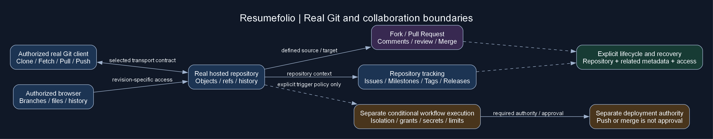

[Scalable SVG](Diagrams/Git-Hosting-Capability-Map.svg) · [Graphviz source](Diagrams/Git-Hosting-Capability-Map.dot)

Connections group requirements, not selected services or protocols. Repository
history and pull-request/review metadata have related but distinct meaning.

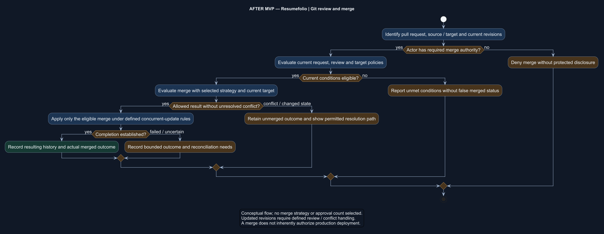

[Scalable SVG](Diagrams/Git-Review-Merge-Flow.svg) · [PlantUML source](Diagrams/Git-Review-Merge-Flow.puml)

The merge flow is conceptual; it does not define a required approval count or
merge strategy. Current-revision checks and concurrent-update handling need
explicit requirements/design before criteria can be finalized.

<a id="requirements-specification-git-hosting-and-collaboration--heading-5-planned-verification"></a>
##### 5. Planned Verification

| Family | Candidate coverage | Cases to develop |
| --- | --- | --- |
| Provisioning/access | GIT-D01/D02 | Valid/duplicate/failed creation, cross-user paths and changed grants |
| Real transfer/browser | GIT-D03/D04 | Supported real-client operations, selected revision/history, rejected/interrupted transfer |
| Fork and review | GIT-D05/D06 | Source/target provenance, private boundary, new commits after review, comment context  **Advanced paths after MVP; any retained core/basic path follows the release register.** |
| Merge | GIT-D07 | Clean/conflicting/denied merge, concurrent target/source changes and resulting history  **Advanced paths after MVP; any retained core/basic path follows the release register.** |
| Tracking/release | GIT-D08/D09 | States/relationships, tag/release revision and asset permission/mutation |
| Lifecycle | GIT-D10 | References, quota/cleanup failures and isolated repository+metadata restoration |

Later evidence identifies candidate, repository/ref revisions, client/transport,
grants, initial data, operation, expected/actual outcomes and limitations. Use
isolated authorized repositories. None of these scenarios is a recorded Pass.

<a id="requirements-specification-git-hosting-and-collaboration--heading-6-open-decisions-and-gates"></a>
##### 6. Open Decisions and Gates

| Topic | Decision/evidence needed | Gate |
| --- | --- | --- |
| Repository access | Roles, visibility, namespaces, ownership, refs, credentials and revocation | Affected M-02 acceptance/security design |
| Real client interface | Transport(s), versions, transfer limits and concurrency/integrity outcomes | Dependent design; actual interoperability before capability acceptance |
| Fork/request/review/merge | Provenance, states, allowed operations, strategy, stale approvals and conflicts | Before accepting related detailed behavior/design |
| Issues/milestones/releases | Fields, lifecycle, assets and intentional cross-module relationships | Affected requirements and file/lifecycle decisions |
| Combined resource use | Git storage/processing, competing loads, policy/accounting and maintenance | GAP-D01/D08/D10; dependent design/resource commitments |
| Recovery/lifecycle | Reference consequences, coverage, retention and actual isolated restoration | GAP-D04; design and later M-09 evidence |
| Execution boundary | Separate execution and deployment authority; isolation/secret/limit evidence | GAP-D09; before enabling conditional execution |

Farhad coordinates the topics. Track actual findings in
[Questions and Decisions](#change-and-baseline-open-questions-and-decisions),
retain [Planning Gates](https://github.com/Farhad-V/Web-Resumefolio/blob/1f2acaa351ac306cb57cbe4fe9742e8bd90720d9/docs/MVP/SDLC/01-project-planning/10-planning-completion-criteria.md)
and route material impacts through [Change Control](#change-and-baseline-change-control).
No new question IDs or completed resource investigations are claimed.

<a id="requirements-specification-git-hosting-and-collaboration--heading-7-traceability-and-review-readiness"></a>
##### 7. Traceability and Review Readiness

GIT-D01–D09 derive from DEC-020 with permission refinements from DEC-028. GIT-D10
links DEC-018/017 and proposed lifecycle detail. Reconcile EIF-D06 real-client
contracts, ACC-D access, AFO-D file/accounting and BRL-D recovery rules; these
cross-references do not approve the candidate requirements.

Use the [requirement template](#requirements-specification-requirements-specification) when allocating
final IDs. Link allocated records/scenarios and actual evidence in
[Traceability](#validation-and-traceability-validation-and-traceability--heading-traceability).
Record actual inspection outcomes in [Review Findings](#validation-and-traceability-validation-and-traceability--heading-review-findings).

- [ ] Reconcile provisional GIT-D references and assign justified priorities.
- [ ] Review source-derived boundaries separately from proposed supporting detail.
- [ ] Resolve policy/state/permission questions blocking affected acceptance.
- [ ] Reconcile dictionary, lifecycle, interface and related domain specifications.
- [ ] Complete normal, denied, failure, concurrent and recovery scenarios where applicable.
- [ ] Record actual owner decision, reviewed revision, evidence and remaining blockers.

**Current outcome:** Proposed specification; no candidate is accepted and no product
test result is recorded. Conditional criteria are not acceptance-ready until their
referenced policies are decided. M-02 and the wider pre-implementation agreement
remain pending. This revision changes no accepted scope and performs no live
repository, application-submission, sharing, file or provider operation.

<a id="requirements-specification-git-hosting-and-collaboration--heading-8-diagram-maintenance"></a>
##### 8. Diagram Maintenance

| Diagram | Source | SVG | PNG |
| --- | --- | --- | --- |
| Git capability boundaries | [Graphviz](Diagrams/Git-Hosting-Capability-Map.dot) | [SVG](Diagrams/Git-Hosting-Capability-Map.svg) |  |
| Review and merge flow | [PlantUML](Diagrams/Git-Review-Merge-Flow.puml) | [SVG](Diagrams/Git-Review-Merge-Flow.svg) |  |

Keep sources, captions and renders synchronized. Colors supplement labels. Follow
the [diagram guide](Diagrams/Diagram-Catalog.md); inspect readable arrows/labels and check
file/section links after changes. From repository root:

```powershell
$diagramFolder = 'docs\MVP\SDLC\02-requirements-engineering\diagrams'
$graphvizExe = 'C:\Program Files\Graphviz\bin\dot.exe'
$plantUmlJar = 'C:\Users\fvali\AppData\Local\Resumefolio\DiagramTools\plantuml.jar'
foreach ($format in 'svg', 'png') {
    & $graphvizExe "-T$format" -Gdpi=140 "$diagramFolder\git-hosting-capability-map.dot" -o "$diagramFolder\git-hosting-capability-map.$format"
    if ($LASTEXITCODE -ne 0) { throw "Graphviz failed: $format" }
    java '-Djava.awt.headless=true' -jar $plantUmlJar -charset UTF-8 "-t$format" "$diagramFolder\git-review-merge-flow.puml"
    if ($LASTEXITCODE -ne 0) { throw "PlantUML failed: $format" }
}
```

Use actual tool paths on other machines; save UTF-8 without BOM.

[Specification index](#requirements-specification-requirements-specification-overview) · [SRS entry point](#requirements-specification-requirements-specification)
· [Requirements index]()

<a id="requirements-specification-git-hosting-and-collaboration--heading-selected-policies-and-future-proposals"></a>
##### Selected Policies and Future Proposals

Current MVP answers are selected in the Baseline. Only explicitly deferred details below remain proposals; product tests and operational evidence are still required.

<a id="requirements-specification-git-hosting-and-collaboration--id-resolution-q-d21"></a>
<a id="requirements-specification-git-hosting-and-collaboration--heading-q-d21-selected-policy"></a>
###### Q-D21: Selected policy

[Selected answer and remaining evidence](https://github.com/Farhad-V/Web-Resumefolio/blob/1f2acaa351ac306cb57cbe4fe9742e8bd90720d9/docs/MVP/baseline/policy-decisions.md#q-d21). Apply this policy to the MVP slice; the original criteria above remain subject to their [current dispositions](https://github.com/Farhad-V/Web-Resumefolio/blob/1f2acaa351ac306cb57cbe4fe9742e8bd90720d9/docs/MVP/baseline/criterion-dispositions.csv).

<a id="requirements-specification-git-hosting-and-collaboration--id-resolution-q-d22"></a>
<a id="requirements-specification-git-hosting-and-collaboration--heading-proposed-answer-q-d22-review-merge-and-release-semantics"></a>
###### Proposed answer Q-D22: Review, merge and release semantics

**Affected records:** GIT-D05–GIT-D10; PKS-D10. **Disposition:** MVP slice selected in [Q-D22](https://github.com/Farhad-V/Web-Resumefolio/blob/1f2acaa351ac306cb57cbe4fe9742e8bd90720d9/docs/MVP/baseline/policy-decisions.md#q-d22); advanced future details below remain proposals.

1. Forks retain upstream provenance but get their own explicit access rules; a private fork must not widen visibility or retain source access after required revocation without an explicit retention decision. Pull requests identify source and target repository/ref revisions, author and state Open/Merged/Closed.

2. Propose one current non-author approval for protected default-branch merge where an eligible separate reviewer exists; in solo ownership, allow an explicitly recorded owner self-review exception rather than inventing a second person. Any source-code change invalidates prior approval; target changes require conflict/status re-evaluation.

3. Propose merge-commit as the initial merge strategy; fast-forward/squash need separately reviewed support. Merge requires current authority, current source/target, no unresolved conflict and required checks for the exact revision. Missing or unknown checks are not success. Closing a request is not merging it.

4. Issues/milestones belong to a repository and remain distinct from work-project items, with explicit associations only. Tags name exact revisions; published release assets are protected and revision-identified. Replacing a published tag/asset requires explicit owner action and retained history. A release or merge does not authorize production deployment.

**Assessable review cases:** [RC-Q22-01 through RC-Q22-03](#scenarios-and-models-user-stories-and-scenarios--id-review-q-d22). These are planned checks, not executed results.

**Remaining evidence / acceptance condition:** Owner review of the proposed rule and its affected criteria is required; no product test is reported.

</details>

<a id="requirements-specification-manual-application-management"></a>

<details>
<summary>Resumefolio — Manual Application Management</summary>

<a id="requirements-specification-manual-application-management--heading-resumefolio--manual-application-management"></a>
#### Resumefolio — Manual Application Management

Current implementation choices and scope: [Baseline](https://github.com/Farhad-V/Web-Resumefolio/blob/1f2acaa351ac306cb57cbe4fe9742e8bd90720d9/docs/MVP/baseline/README.md). Runtime verification remains subject to its gates.

| Item | Current position |
| --- | --- |
| Owner | Farhad; sole delivery and operations owner |
| Status | Proposed product specification — detailed policy and acceptance pending |
| Planning basis | DEC-023/027/022/028; submitted-copy source EXT-002 |
| Candidate references | APP-D01–APP-D09 are provisional document-local references, not allocated global requirement IDs |
| Priority | Unassigned; document order is not delivery priority |
| Revision | October 31, 2026 |

**At a glance:** Record companies, opportunities, manually written cover letters and progress. Preserve the resume and cover letter actually submitted so later edits do not rewrite history. A live sharing link, current source, recorded status and preserved submitted copy are different things.

[Basis](#requirements-specification-manual-application-management--heading-1-purpose-and-accepted-boundary) · [Inventory](#requirements-specification-manual-application-management--heading-2-capability-and-information-inventory)
· [Requirements](#requirements-specification-manual-application-management--heading-3-proposed-requirements) · [Models](#requirements-specification-manual-application-management--heading-4-behavior-and-boundary-models)
· [Scenarios](#requirements-specification-manual-application-management--heading-5-planned-verification) · [Decisions](#requirements-specification-manual-application-management--heading-6-open-decisions-and-gates)
· [Review](#requirements-specification-manual-application-management--heading-7-traceability-and-review-readiness)

<a id="requirements-specification-manual-application-management--heading-mvp-integrated-job-applications"></a>
##### MVP integrated job applications

Manual job application management belongs to the Resumefolio core; ApplyFlow is its former name, not a separate branded platform. Each application preserves actual submitted materials, status, next action and follow-up date, together with its company/opportunity and selected resume/cover letter. Later source edits cannot change the recorded submitted set. Recording a submission is manual. APP-D08 requires manual follow-up fields in MVP; correspondence/calendar/provider links are deferred and cannot be required for tracking.

Authority: [OWNER-MVP-2026-11-04](../01-Project-Planning/01-Project-Charter.md#release-decision). [Candidate allocation](#requirements-specification-mvp-release-allocation).

<a id="requirements-specification-manual-application-management--heading-1-purpose-and-accepted-boundary"></a>
##### 1. Purpose and Accepted Boundary

[Scope DEC-023](https://github.com/Farhad-V/Web-Resumefolio/blob/1f2acaa351ac306cb57cbe4fe9742e8bd90720d9/docs/MVP/SDLC/01-project-planning/02-scope.md#dec-023) includes manual
ApplyFlow: company/position, relevant resume, user-written cover letter, progress
and preservation of actual submitted resume/cover-letter material. AI-assisted
analysis/drafting is excluded. Recording submission is not an integration that
automatically submits applications to external job platforms.

[EXT-002](#stakeholders-and-elicitation-elicitation-log--heading-ext-002-manual-applications-and-preserved-submissions)
is a documentary source extraction, not a new interview or detailed policy approval.
Use [Business Lifecycle](#requirements-specification-business-rules-and-data-lifecycle),
[PDF and Sharing](#requirements-specification-pdf-and-controlled-sharing),
[Google Integration](#requirements-specification-email-calendar-and-google-integration) and the
[Data Dictionary](#data-definitions-data-dictionary) to reconcile boundaries.

<a id="requirements-specification-manual-application-management--heading-2-capability-and-information-inventory"></a>
##### 2. Capability and Information Inventory

| Subject | Meaning | Definition still needed |
| --- | --- | --- |
| Company/opportunity | Context for the user's application | Fields, validation, reuse and duplicates |
| Editable preparation | Relevant resume association and manually authored cover letter | Save/revision behavior, formats and independence |
| Progress | User-recorded application stage/events | Final state/transition table, corrections and time semantics |
| Submission recording | User identifies what was actually sent and relevant context | Capture trigger, required set, provenance and incomplete outcomes |
| Preserved submitted set | Actual historical resume/cover-letter material | Artifact boundaries, resubmissions, retention and access |
| Correspondence/activity | Related authorized Gmail/calendar information | Link/copy, provider lifecycle and reminders |
| Archive/recovery | Deliberate retention/removal and restored relationships | Permissions, reference policy, coverage and actual evidence |

<a id="requirements-specification-manual-application-management--heading-3-proposed-requirements"></a>
##### 3. Proposed Requirements

All records are **Proposed**, owner **Farhad**, priority **Unassigned**. The final
status set, capture mechanism and retention policy remain undecided.

<a id="requirements-specification-manual-application-management--heading-app-d01-company-and-opportunity-context"></a>
###### APP-D01: Company and Opportunity Context

**Release allocation (owner decision, November 4):** MVP — Resumefolio core.

**Source / rationale:** DEC-023; application records need an identifiable company and position.

**Actor / conditions:** Authorized user creates or updates a manual application context.

**Proposed obligation:** Users shall record the company and job position associated with an application under reviewed field and validation rules.

**Acceptance criteria**
- A valid application identifies the intended company/position without silently substituting another opportunity.
- Missing or invalid required information produces the agreed incomplete/rejected outcome rather than false completion.
- Editing one application context does not silently change unrelated applications contrary to the reviewed reuse policy.

**Planned verification:** Later valid/incomplete/duplicate/reused-company cases.

**Open detail:** Fields, identifiers, required inputs, source URLs/attachments, company reuse, duplicate applications and opportunities without a structured job advertisement.

<a id="requirements-specification-manual-application-management--heading-app-d02-relevant-resume-association"></a>
###### APP-D02: Relevant Resume Association

**Release allocation (owner decision, November 4):** MVP — Resumefolio core.

**Source / rationale:** DEC-023/027; users choose opportunity-specific material while retaining independent tailoring.

**Actor / conditions:** Authorized user selects or changes the resume for a preparation-stage application.

**Proposed obligation:** The product shall associate the intended authorized resume with the application and distinguish that editable source from preserved submitted material.

**Acceptance criteria**
- The selected resume belongs to an allowed resource context and is identifiable from the application.
- Cross-user or invalid resume references cannot associate or disclose unrelated protected content.
- Changing the current association does not overwrite material already preserved as actually submitted.

**Planned verification:** Later authorized/denied association and post-submission source-change cases.

**Open detail:** Association cardinality, source-revision display, replacement/removal behavior, independently supplied files and source deletion.

<a id="requirements-specification-manual-application-management--heading-app-d03-manually-authored-cover-letter"></a>
###### APP-D03: Manually Authored Cover Letter

**Release allocation (owner decision, November 4):** MVP — Resumefolio core.

**Source / rationale:** DEC-023/016; preparation remains user-authored without product AI.

**Actor / conditions:** Authorized user writes or edits application-specific cover-letter content.

**Proposed obligation:** Users shall manually prepare and save cover-letter content with explicit editing, validation and save-result rules.

**Acceptance criteria**
- Agreed valid manually entered content is retained for the intended application.
- Failed/incomplete save does not appear as successfully saved content.
- Later source edits do not overwrite a cover-letter copy already preserved as submitted.

**Planned verification:** Later edit/save/interruption and preserved-copy comparison cases.

**Open detail:** Required/optional content, format/language, draft recovery, duplication/reuse, export and independently prepared submitted letters; no AI drafting or automatic translation.

<a id="requirements-specification-manual-application-management--heading-app-d04-explicit-progress-states-and-transitions"></a>
###### APP-D04: Explicit Progress States and Transitions

**Owner-scope acceptance additions (MVP; planned, not executed):**

- The user can save status, a manual next action and follow-up date without any email/calendar connection; later edits do not change actual submitted materials.

**Release allocation (owner decision, November 4):** MVP — Resumefolio core.

**Source / rationale:** DEC-023; preparation, submission, interview and outcome are examples, not a finalized universal state machine.

**Actor / conditions:** Authorized user records or corrects application progress.

**Proposed obligation:** Application progress shall follow a reviewed set of states, allowed transitions and correction rules with explicit observable outcomes.

**Acceptance criteria**
- A permitted transition yields the intended current state and reviewed history information.
- An invalid or unauthorized transition produces defined feedback without false state completion.
- Examples such as withdrawal, rejection, repeated interviews or correction are handled according to explicitly chosen rules rather than an assumed one-way sequence.

**Planned verification:** Later transition-table walkthrough and valid/invalid/correction tests.

**Open detail:** Final values, backward transitions, timestamps, event versus recorded time, reason fields, history editability and concurrent changes.

<a id="requirements-specification-manual-application-management--heading-app-d05-user-directed-submission-recording"></a>
###### APP-D05: User-directed Submission Recording

**Release allocation (owner decision, November 4):** MVP — Resumefolio core.

**Source / rationale:** DEC-023; marking submitted records a user-reported action, not automated external submission.

**Actor / conditions:** User records materials actually sent through an external/manual channel.

**Proposed obligation:** Submission recording shall identify the intended application and actual material context under an explicit capture/validation workflow.

**Acceptance criteria**
- The user can distinguish source selection, recorded submission progress and successfully preserved actual materials.
- A saved status alone is not represented as evidence of an external platform submission, employer receipt or message read.
- If required capture is missing/failed, preservation remains distinguishably incomplete; progress/capture atomicity follows a reviewed rule.

**Planned verification:** Later external-channel examples, missing-material and capture-failure walkthroughs.

**Open detail:** Capture trigger, channel/time/provenance, material completeness, status coupling and later supply/correction; no actual applications are submitted here.

<a id="requirements-specification-manual-application-management--heading-app-d06-preserved-actual-submitted-copies"></a>
###### APP-D06: Preserved Actual Submitted Copies

**Release allocation (owner decision, November 4):** MVP — Resumefolio core.

**Source / rationale:** DEC-023 and elicitation EXT-002; later editable-source changes must not rewrite application history.

**Actor / conditions:** The reviewed submission-recording process captures the resume and cover letter actually submitted.

**Proposed obligation:** The product shall preserve the actual submitted resume and cover-letter material in an identifiable historical context independent of subsequent source edits.

**Acceptance criteria**
- After capture, profile/resume/cover-letter/source-PDF edits do not overwrite preserved material.
- The preserved set corresponds to the actual user-identified submitted materials/revision under the reviewed capture policy, not an assumed latest live resume.
- Retrieval distinguishes historical material from editable source and follows applicable access rules.

**Planned verification:** Later capture comparison, source edits/replacement/deletion and authorized retrieval cases.

**Open detail:** Exact artifact boundaries, generated/uploaded/external resume variants, attachment set, manual attestation/provenance, storage/format and failed capture; no indefinite retention or immutable legal record is promised.

<a id="requirements-specification-manual-application-management--heading-app-d07-correction-and-repeated-submissions"></a>
###### APP-D07: Correction and Repeated Submissions

**Release allocation (owner decision, November 4):** MVP — Resumefolio core.

**Source / rationale:** Proposed history refinement of DEC-023; genuine corrections and resubmissions must not silently rewrite prior actual materials.

**Actor / conditions:** Authorized user corrects a record or records another submitted set for an application.

**Proposed obligation:** Corrections and resubmissions shall follow explicit history policies that keep relevant prior versus new material distinguishable.

**Acceptance criteria**
- Defined correction examples identify the affected record and produce the reviewed history/result.
- A newly submitted set is not silently substituted for a previously preserved set as though it were the original.
- Failed/repeated capture attempts yield the defined outcome without falsely claiming a complete new set.

**Planned verification:** Later correction/resubmission/duplicate/failure cases after policy review.

**Open detail:** Whether/how multiple sets are supported, provenance, correction versus replacement, permissions, retained versions and explicit deletion; no append-only architecture is selected.

<a id="requirements-specification-manual-application-management--heading-app-d08-correspondence-calendar-and-follow-up-links"></a>
###### APP-D08: Correspondence, Calendar and Follow-up Links

**MVP obligation:** Store a manually maintained next action and follow-up date with the application status. No provider connection is required; mail/calendar link criteria below are deferred.

**Release allocation (owner decision, November 4):** Split — MVP manual next action/follow-up date; mail/calendar association deferred.

**Source / rationale:** DEC-022/023/028; application work can relate to relevant communications without leaking private data.

**Actor / conditions:** Authorized user associates an application with agreed correspondence or activity.

**Proposed obligation:** Agreed relationships shall identify the correct application and authorized message/activity while preserving independent access and lifecycle boundaries.

**Acceptance criteria**
- A related message/activity resolves to the intended account/application context.
- A collaborator or employer viewer gains no private correspondence access merely from an application relationship.
- Provider changes/removal do not silently overwrite preserved actual submitted copies.

**Planned verification:** Later association/permission/provider-removal scenarios.

**Open detail:** Link versus copy, displayed fields, reminders, relationship count, availability after disconnect and whether sent correspondence contributes to capture; EGC-D rules retain provider gates.

<a id="requirements-specification-manual-application-management--heading-app-d09-private-access-archive-and-recovery"></a>
###### APP-D09: Private Access, Archive and Recovery

**Release allocation (owner decision, November 4):** MVP — Resumefolio core.

**Source / rationale:** DEC-028/023/017 and proposed lifecycle refinement; application information and historical copies require deliberate retirement/recovery rules.

**Actor / conditions:** User/operator requests a protected read, archive, deletion or restoration operation.

**Proposed obligation:** Application lifecycle operations shall follow explicit authority, reference, retention and restoration policies without an implicit cascade from source removal.

**Acceptance criteria**
- Direct/cross-user requests cannot read or mutate unrelated protected application/history material.
- Source unlink/replacement does not implicitly erase preserved submissions; deliberate archive/delete follows the reviewed consequences.
- Later isolated restoration checks the application, preserved artifacts and access consistency; partial recovery is not a complete Pass.

**Planned verification:** Later denial/archive/delete/reference and isolated restore checks.

**Open detail:** Archive visibility, deletion authority/retention, account closure, recovery targets and deleted-data reappearance; no period or administrator power is invented.

<a id="requirements-specification-manual-application-management--heading-4-behavior-and-boundary-models"></a>
##### 4. Behavior and Boundary Models

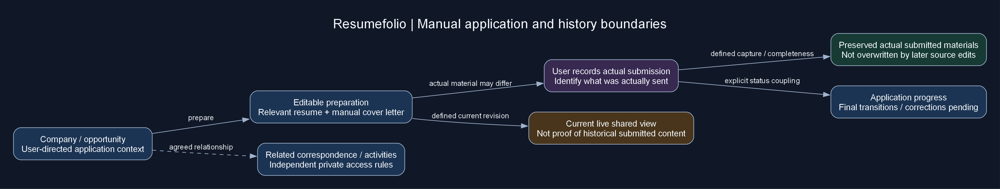

[Scalable SVG](Diagrams/Manual-Application-History-Map.svg) · [Graphviz source](Diagrams/Manual-Application-History-Map.dot)

Arrows express conceptual relationships, not copying implementation or automatic
submission. A current generated PDF is not proof it was the file actually sent.

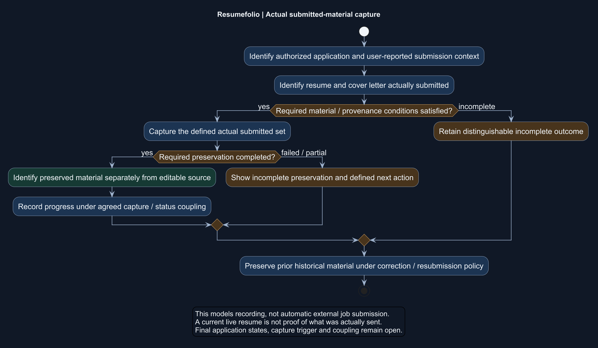

[Scalable SVG](Diagrams/Application-Submission-Capture.svg) · [PlantUML source](Diagrams/Application-Submission-Capture.puml)

This flow describes capture review, not the final application state machine.
Capture completeness and progress status need an explicit coupling/failure rule.
No external sending step is performed or authorized by the model.

<a id="requirements-specification-manual-application-management--heading-5-planned-verification"></a>
##### 5. Planned Verification

| Family | Candidates | Cases to develop |
| --- | --- | --- |
| Preparation | APP-D01–D03 | Required fields, duplicates, allowed/denied resume association, cover-letter save failures |
| Progress | APP-D04/D05 | Final valid/invalid transitions, correction, recorded versus actual event time |
| Actual history | APP-D05/D06 | Correct actual material, incomplete capture, source edits/replacement/deletion afterward |
| Repeated work | APP-D07 | Corrections, resubmission sets, failed/repeated capture and prior-set distinction |
| Cross-module | APP-D08 | Message/activity relationships, access isolation and provider source removal |
| Lifecycle | APP-D09 | Direct denial, archive/delete/reference policy and isolated consistent recovery |

Later evidence identifies candidate/policy revision, actor, application, source and
preserved artifact versions, initial state, expected/actual result and limits.
Use synthetic applications/materials; no real job submission is needed for
documentation verification and no product tests are recorded here.

<a id="requirements-specification-manual-application-management--heading-6-open-decisions-and-gates"></a>
##### 6. Open Decisions and Gates

| Topic | Decisions/evidence needed | Gate |
| --- | --- | --- |
| Input/workflow | Fields, incomplete records, duplicates, source associations and draft behavior | Affected M-02 acceptance |
| Progress history | Final states/transitions, corrections, times and concurrency | Before accepting progress criteria/design |
| Actual-material capture | Trigger, file/revision set, user provenance, status coupling and failures | Before accepting capture/history requirements |
| Resubmission/correction | Prior/new sets, permitted changes, access and deletion | Affected history/lifecycle acceptance |
| Communication | Relationships, sent content versus history, reminders and provider data availability | EGC-D requirements; GAP-D02 before provider-dependent development |
| Privacy/retention/recovery | Exact grants, archive/delete, source references, coverage and actual restore | Domain/lifecycle design; GAP-D04 and later M-09 evidence |

Farhad coordinates all topics. Record actual findings in
[Questions and Decisions](#change-and-baseline-open-questions-and-decisions)
and retain [Planning Gates](https://github.com/Farhad-V/Web-Resumefolio/blob/1f2acaa351ac306cb57cbe4fe9742e8bd90720d9/docs/MVP/SDLC/01-project-planning/10-planning-completion-criteria.md).
Material scope/cost/delivery changes follow [Change Control](#change-and-baseline-change-control).
No local topic is claimed as an allocated shared question or accepted policy.

<a id="requirements-specification-manual-application-management--heading-7-traceability-and-review-readiness"></a>
##### 7. Traceability and Review Readiness

APP-D01–D06 derive from DEC-023 with DEC-027 source independence and EXT-002.
APP-D07/D09 include proposed correction/lifecycle detail; APP-D08 links DEC-022/028.
Reconcile BRL-D05 history, EGC-D09 communication relationships, ACC-D permissions
and AFO-D replacement/cleanup without treating those drafts as approved policies.

Use the [requirement template](#requirements-specification-requirements-specification) when allocating
final IDs. Link allocated records/scenarios and actual evidence in
[Traceability](#validation-and-traceability-validation-and-traceability--heading-traceability).
Record actual inspection outcomes in [Review Findings](#validation-and-traceability-validation-and-traceability--heading-review-findings).

- [ ] Reconcile provisional APP-D references and assign justified priorities.
- [ ] Review source-derived boundaries separately from proposed supporting detail.
- [ ] Resolve policy/state/permission questions blocking affected acceptance.
- [ ] Reconcile dictionary, lifecycle, interface and related domain specifications.
- [ ] Complete normal, denied, failure, concurrent and recovery scenarios where applicable.
- [ ] Record actual owner decision, reviewed revision, evidence and remaining blockers.

**Current outcome:** Proposed specification; no candidate is accepted and no product
test result is recorded. Conditional criteria are not acceptance-ready until their
referenced policies are decided. M-02 and the wider pre-implementation agreement
remain pending. This revision changes no accepted scope and performs no live
repository, application-submission, sharing, file or provider operation.

<a id="requirements-specification-manual-application-management--heading-8-diagram-maintenance"></a>
##### 8. Diagram Maintenance

| Diagram | Source | SVG | PNG |
| --- | --- | --- | --- |
| Application history boundaries | [Graphviz](Diagrams/Manual-Application-History-Map.dot) | [SVG](Diagrams/Manual-Application-History-Map.svg) |  |
| Submitted-material capture | [PlantUML](Diagrams/Application-Submission-Capture.puml) | [SVG](Diagrams/Application-Submission-Capture.svg) |  |

Keep sources, captions and renders synchronized. Colors supplement labels. Follow
the [diagram guide](Diagrams/Diagram-Catalog.md); inspect readable arrows/labels and check
file/section links after changes. From repository root:

```powershell
$diagramFolder = 'docs\MVP\SDLC\02-requirements-engineering\diagrams'
$graphvizExe = 'C:\Program Files\Graphviz\bin\dot.exe'
$plantUmlJar = 'C:\Users\fvali\AppData\Local\Resumefolio\DiagramTools\plantuml.jar'
foreach ($format in 'svg', 'png') {
    & $graphvizExe "-T$format" -Gdpi=140 "$diagramFolder\manual-application-history-map.dot" -o "$diagramFolder\manual-application-history-map.$format"
    if ($LASTEXITCODE -ne 0) { throw "Graphviz failed: $format" }
    java '-Djava.awt.headless=true' -jar $plantUmlJar -charset UTF-8 "-t$format" "$diagramFolder\application-submission-capture.puml"
    if ($LASTEXITCODE -ne 0) { throw "PlantUML failed: $format" }
}
```

Use actual tool paths on other machines; save UTF-8 without BOM.

[Specification index](#requirements-specification-requirements-specification-overview) · [SRS entry point](#requirements-specification-requirements-specification)
· [Requirements index]()

<a id="requirements-specification-manual-application-management--heading-selected-policies-and-future-proposals"></a>
##### Selected Policies and Future Proposals

Current MVP answers are selected in the Baseline. Only explicitly deferred details below remain proposals; product tests and operational evidence are still required.

<a id="requirements-specification-manual-application-management--id-resolution-q-d12"></a>
<a id="requirements-specification-manual-application-management--heading-q-d12-selected-policy"></a>
###### Q-D12: Selected policy

[Selected answer and remaining evidence](https://github.com/Farhad-V/Web-Resumefolio/blob/1f2acaa351ac306cb57cbe4fe9742e8bd90720d9/docs/MVP/baseline/policy-decisions.md#q-d12). Apply this policy to the MVP slice; the original criteria above remain subject to their [current dispositions](https://github.com/Farhad-V/Web-Resumefolio/blob/1f2acaa351ac306cb57cbe4fe9742e8bd90720d9/docs/MVP/baseline/criterion-dispositions.csv).

<a id="requirements-specification-manual-application-management--id-resolution-q-d13"></a>
<a id="requirements-specification-manual-application-management--heading-q-d13-selected-policy"></a>
###### Q-D13: Selected policy

[Selected answer and remaining evidence](https://github.com/Farhad-V/Web-Resumefolio/blob/1f2acaa351ac306cb57cbe4fe9742e8bd90720d9/docs/MVP/baseline/policy-decisions.md#q-d13). Apply this policy to the MVP slice; the original criteria above remain subject to their [current dispositions](https://github.com/Farhad-V/Web-Resumefolio/blob/1f2acaa351ac306cb57cbe4fe9742e8bd90720d9/docs/MVP/baseline/criterion-dispositions.csv).

<a id="requirements-specification-manual-application-management--id-resolution-q-d14"></a>
<a id="requirements-specification-manual-application-management--heading-q-d14-selected-policy"></a>
###### Q-D14: Selected policy

[Selected answer and remaining evidence](https://github.com/Farhad-V/Web-Resumefolio/blob/1f2acaa351ac306cb57cbe4fe9742e8bd90720d9/docs/MVP/baseline/policy-decisions.md#q-d14). Apply this policy to the MVP slice; the original criteria above remain subject to their [current dispositions](https://github.com/Farhad-V/Web-Resumefolio/blob/1f2acaa351ac306cb57cbe4fe9742e8bd90720d9/docs/MVP/baseline/criterion-dispositions.csv).

</details>

<a id="requirements-specification-mvp-release-allocation"></a>

<details>
<summary>MVP Candidate Release Allocation</summary>

<a id="requirements-specification-mvp-release-allocation--heading-mvp-candidate-release-allocation"></a>
#### MVP Candidate Release Allocation

Current implementation choices and scope: [Baseline](https://github.com/Farhad-V/Web-Resumefolio/blob/1f2acaa351ac306cb57cbe4fe9742e8bd90720d9/docs/MVP/baseline/README.md). Runtime verification remains subject to its gates.

Updated November 4, 2026 from [OWNER-MVP-2026-11-04](../01-Project-Planning/01-Project-Charter.md#release-decision). This is release allocation, not priority approval or acceptance of all proposed numerical policies/criteria. Candidate IDs and original source criteria are preserved. Mixed records require criterion-level separation before implementation acceptance.

Core: dashboard, invited accounts, profile/resumes/portfolio, PDFs/protected sharing, manual applications and private same-server My Files & Media. ProjectForge: separate user-scoped API system, real Git transfers/permissions/file-history, issues/simple Kanban. No future requirement blocks MVP merely because it was formerly in Version 1.

| Candidate | Retained subject | Release allocation |
| --- | --- | --- |
| [ACC-D01](#requirements-specification-accounts-authentication-and-permissions--heading-acc-d01-individual-account-context) | Individual Account Context | MVP foundation where used by core/basic ProjectForge; future-domain clauses deferred |
| [ACC-D02](#requirements-specification-accounts-authentication-and-permissions--heading-acc-d02-unified-sign-in-across-authorized-sections) | Unified Sign-in Across Authorized Sections | MVP foundation where used by core/basic ProjectForge; future-domain clauses deferred |
| [ACC-D03](#requirements-specification-accounts-authentication-and-permissions--heading-acc-d03-resource-and-operation-authorization) | Resource and Operation Authorization | MVP foundation where used by core/basic ProjectForge; future-domain clauses deferred |
| [ACC-D04](#requirements-specification-accounts-authentication-and-permissions--heading-acc-d04-cross-user-private-data-isolation) | Cross-user Private-data Isolation | MVP foundation where used by core/basic ProjectForge; future-domain clauses deferred |
| [ACC-D05](#requirements-specification-accounts-authentication-and-permissions--heading-acc-d05-limited-collaboration-authority) | Limited Collaboration Authority | MVP foundation where used by core/basic ProjectForge; future-domain clauses deferred |
| [ACC-D06](#requirements-specification-accounts-authentication-and-permissions--heading-acc-d06-employer-access-without-a-viewer-account) | Employer Access Without a Viewer Account | MVP foundation where used by core/basic ProjectForge; future-domain clauses deferred |
| [ACC-D07](#requirements-specification-accounts-authentication-and-permissions--heading-acc-d07-protected-shared-file-and-pdf-retrieval) | Protected Shared File and PDF Retrieval | MVP foundation where used by core/basic ProjectForge; future-domain clauses deferred |
| [ACC-D08](#requirements-specification-accounts-authentication-and-permissions--heading-acc-d08-owner-control-of-employer-link-access) | Owner Control of Employer-link Access | MVP foundation where used by core/basic ProjectForge; future-domain clauses deferred |
| [ACC-D09](#requirements-specification-accounts-authentication-and-permissions--heading-acc-d09-explicit-administrative-powers) | Explicit Administrative Powers | MVP foundation where used by core/basic ProjectForge; future-domain clauses deferred |
| [ACC-D10](#requirements-specification-accounts-authentication-and-permissions--heading-acc-d10-authorization-of-access-grant-changes) | Authorization of Access-grant Changes | MVP foundation where used by core/basic ProjectForge; future-domain clauses deferred |
| [ACC-D11](#requirements-specification-accounts-authentication-and-permissions--heading-acc-d11-no-authentication-bypass-on-deliveryprovider-failure) | No Authentication Bypass on Delivery/Provider Failure | MVP foundation where used by core/basic ProjectForge; future-domain clauses deferred |
| [ACC-D12](#requirements-specification-accounts-authentication-and-permissions--heading-acc-d12-end-of-access-and-lifecycle-enforcement) | End-of-access and Lifecycle Enforcement | MVP foundation where used by core/basic ProjectForge; future-domain clauses deferred |
| [AFO-D01](#requirements-specification-administration-files-and-operational-behavior--heading-afo-d01-owner-configurable-upload-and-storage-policy) | Owner-configurable Upload and Storage Policy | MVP foundation where used by core/basic ProjectForge; future-domain clauses deferred |
| [AFO-D02](#requirements-specification-administration-files-and-operational-behavior--heading-afo-d02-policy-consistent-with-evaluated-infrastructure) | Policy Consistent with Evaluated Infrastructure | MVP foundation where used by core/basic ProjectForge; future-domain clauses deferred |
| [AFO-D03](#requirements-specification-administration-files-and-operational-behavior--heading-afo-d03-per-file-admission-limit) | Per-file Admission Limit | MVP foundation where used by core/basic ProjectForge; future-domain clauses deferred |
| [AFO-D04](#requirements-specification-administration-files-and-operational-behavior--heading-afo-d04-aggregate-quota-and-concurrent-admission) | Aggregate Quota and Concurrent Admission | MVP foundation where used by core/basic ProjectForge; future-domain clauses deferred |
| [AFO-D05](#requirements-specification-administration-files-and-operational-behavior--heading-afo-d05-supported-content-and-validation) | Supported Content and Validation | MVP foundation where used by core/basic ProjectForge; future-domain clauses deferred |
| [AFO-D06](#requirements-specification-administration-files-and-operational-behavior--heading-afo-d06-file-resource-authorization-and-isolation) | File-resource Authorization and Isolation | MVP foundation where used by core/basic ProjectForge; future-domain clauses deferred |
| [AFO-D07](#requirements-specification-administration-files-and-operational-behavior--heading-afo-d07-truthful-completion-and-interrupted-operation-handling) | Truthful Completion and Interrupted-operation Handling | MVP foundation where used by core/basic ProjectForge; future-domain clauses deferred |
| [AFO-D08](#requirements-specification-administration-files-and-operational-behavior--heading-afo-d08-safe-replacement-and-lifecycle-effects) | Safe Replacement and Lifecycle Effects | MVP foundation where used by core/basic ProjectForge; future-domain clauses deferred |
| [AFO-D09](#requirements-specification-administration-files-and-operational-behavior--heading-afo-d09-operational-outcomes-and-capacity-warnings) | Operational Outcomes and Capacity Warnings | MVP foundation where used by core/basic ProjectForge; future-domain clauses deferred |
| [AFO-D10](#requirements-specification-administration-files-and-operational-behavior--heading-afo-d10-administrative-operation-evidence) | Administrative Operation Evidence | MVP foundation where used by core/basic ProjectForge; future-domain clauses deferred |
| [AFO-D11](#requirements-specification-administration-files-and-operational-behavior--heading-afo-d11-bounded-cleanup-and-storage-reclamation) | Bounded Cleanup and Storage Reclamation | MVP foundation where used by core/basic ProjectForge; future-domain clauses deferred |
| [AFO-D12](#requirements-specification-administration-files-and-operational-behavior--heading-afo-d12-version-specific-operational-guidance-and-readiness) | Version-specific Operational Guidance and Readiness | MVP foundation where used by core/basic ProjectForge; future-domain clauses deferred |
| [BIZ-D01](#requirements-specification-business-requirements--heading-biz-d01-reusable-information-and-relevant-professional-presentation) | Reusable Information and Relevant Professional Presentation | MVP foundation where used by core/basic ProjectForge; future-domain clauses deferred |
| [BIZ-D02](#requirements-specification-business-requirements--heading-biz-d02-controlled-disclosure-of-professional-information) | Controlled Disclosure of Professional Information | MVP foundation where used by core/basic ProjectForge; future-domain clauses deferred |
| [BIZ-D03](#requirements-specification-business-requirements--heading-biz-d03-traceable-manual-applications-and-preserved-submission-history) | Traceable Manual Applications and Preserved Submission History | MVP foundation where used by core/basic ProjectForge; future-domain clauses deferred |
| [BIZ-D04](#requirements-specification-business-requirements--heading-biz-d04-coordinated-authorized-work-in-one-product-experience) | Coordinated Authorized Work in One Product Experience | MVP foundation where used by core/basic ProjectForge; future-domain clauses deferred |
| [BIZ-D05](#requirements-specification-business-requirements--heading-biz-d05-usable-maintainable-and-recoverable-initial-operation) | Usable, Maintainable and Recoverable Initial Operation | MVP foundation where used by core/basic ProjectForge; future-domain clauses deferred |
| [BRL-D01](#requirements-specification-business-rules-and-data-lifecycle--heading-brl-d01-resource-specific-authority) | Resource-specific Authority | MVP foundation where used by core/basic ProjectForge; future-domain clauses deferred |
| [BRL-D02](#requirements-specification-business-rules-and-data-lifecycle--heading-brl-d02-shared-information-and-independent-tailoring) | Shared Information and Independent Tailoring | MVP foundation where used by core/basic ProjectForge; future-domain clauses deferred |
| [BRL-D03](#requirements-specification-business-rules-and-data-lifecycle--heading-brl-d03-explicit-shared-content-and-download-availability) | Explicit Shared Content and Download Availability | MVP foundation where used by core/basic ProjectForge; future-domain clauses deferred |
| [BRL-D04](#requirements-specification-business-rules-and-data-lifecycle--heading-brl-d04-access-changes-govern-subsequent-retrieval) | Access Changes Govern Subsequent Retrieval | MVP foundation where used by core/basic ProjectForge; future-domain clauses deferred |
| [BRL-D05](#requirements-specification-business-rules-and-data-lifecycle--heading-brl-d05-preserve-actual-submitted-materials) | Preserve Actual Submitted Materials | MVP foundation where used by core/basic ProjectForge; future-domain clauses deferred |
| [BRL-D06](#requirements-specification-business-rules-and-data-lifecycle--heading-brl-d06-validation-and-truthful-state-changes) | Validation and Truthful State Changes | MVP foundation where used by core/basic ProjectForge; future-domain clauses deferred |
| [BRL-D07](#requirements-specification-business-rules-and-data-lifecycle--heading-brl-d07-explicit-provider-synchronization-authority) | Explicit Provider Synchronization Authority | Deferred after MVP — provider synchronization |
| [BRL-D08](#requirements-specification-business-rules-and-data-lifecycle--heading-brl-d08-reference-aware-retirement) | Reference-aware Retirement | MVP foundation where used by core/basic ProjectForge; future-domain clauses deferred |
| [BRL-D09](#requirements-specification-business-rules-and-data-lifecycle--heading-brl-d09-recovery-preserves-defined-business-consistency) | Recovery Preserves Defined Business Consistency | MVP foundation where used by core/basic ProjectForge; future-domain clauses deferred |
| [BRL-D10](#requirements-specification-business-rules-and-data-lifecycle--heading-brl-d10-defined-language-and-time-meaning) | Defined Language and Time Meaning | MVP foundation where used by core/basic ProjectForge; future-domain clauses deferred |
| [DOM-D01](#requirements-specification-domain-requirements-and-constraints--heading-dom-d01-consistent-professional-information-meaning) | Consistent Professional-information Meaning | MVP foundation where used by core/basic ProjectForge; future-domain clauses deferred |
| [DOM-D02](#requirements-specification-domain-requirements-and-constraints--heading-dom-d02-application-history-represents-actual-submitted-material) | Application History Represents Actual Submitted Material | MVP foundation where used by core/basic ProjectForge; future-domain clauses deferred |
| [DOM-D03](#requirements-specification-domain-requirements-and-constraints--heading-dom-d03-authorization-follows-the-resource-and-operation) | Authorization Follows the Resource and Operation | MVP foundation where used by core/basic ProjectForge; future-domain clauses deferred |
| [DOM-D04](#requirements-specification-domain-requirements-and-constraints--heading-dom-d04-explicit-human-authored-language-and-application-work) | Explicit Human-authored Language and Application Work | MVP foundation where used by core/basic ProjectForge; future-domain clauses deferred |
| [DOM-D05](#requirements-specification-domain-requirements-and-constraints--heading-dom-d05-explicit-external-service-applicability) | Explicit External-service Applicability | MVP foundation where used by core/basic ProjectForge; future-domain clauses deferred |
| [DOM-D06](#requirements-specification-domain-requirements-and-constraints--heading-dom-d06-establish-information-handling-applicability) | Establish Information-handling Applicability | MVP foundation where used by core/basic ProjectForge; future-domain clauses deferred |
| [DOM-D07](#requirements-specification-domain-requirements-and-constraints--heading-dom-d07-verify-reuse-and-licensing-before-adoption) | Verify Reuse and Licensing Before Adoption | MVP foundation where used by core/basic ProjectForge; future-domain clauses deferred |
| [DOM-D08](#requirements-specification-domain-requirements-and-constraints--heading-dom-d08-evidence-based-operation-within-constraints) | Evidence-based Operation Within Constraints | MVP foundation where used by core/basic ProjectForge; future-domain clauses deferred |
| [EGC-D01](#requirements-specification-email-calendar-and-google-integration--heading-egc-d01-authorized-connection-and-account-context) | Authorized Connection and Account Context | Deferred after MVP |
| [EGC-D02](#requirements-specification-email-calendar-and-google-integration--heading-egc-d02-justified-permissions-and-private-resource-isolation) | Justified Permissions and Private-resource Isolation | Deferred after MVP |
| [EGC-D03](#requirements-specification-email-calendar-and-google-integration--heading-egc-d03-read-authorized-correspondence) | Read Authorized Correspondence | Deferred after MVP |
| [EGC-D04](#requirements-specification-email-calendar-and-google-integration--heading-egc-d04-manual-compose-and-draft-handling) | Manual Compose and Draft Handling | Deferred after MVP |
| [EGC-D05](#requirements-specification-email-calendar-and-google-integration--heading-egc-d05-deliberate-send-and-truthful-outcome) | Deliberate Send and Truthful Outcome | Deferred after MVP |
| [EGC-D06](#requirements-specification-email-calendar-and-google-integration--heading-egc-d06-reply-context-and-conversation-association) | Reply Context and Conversation Association | Deferred after MVP |
| [EGC-D07](#requirements-specification-email-calendar-and-google-integration--heading-egc-d07-calendar-activities-and-time-meaning) | Calendar Activities and Time Meaning | Deferred after MVP |
| [EGC-D08](#requirements-specification-email-calendar-and-google-integration--heading-egc-d08-explicit-synchronization-contract) | Explicit Synchronization Contract | Deferred after MVP |
| [EGC-D09](#requirements-specification-email-calendar-and-google-integration--heading-egc-d09-application-relationships-preserve-boundaries) | Application Relationships Preserve Boundaries | Deferred after MVP |
| [EGC-D10](#requirements-specification-email-calendar-and-google-integration--heading-egc-d10-reminders-and-notification-outcomes) | Reminders and Notification Outcomes | Deferred after MVP |
| [EGC-D11](#requirements-specification-email-calendar-and-google-integration--heading-egc-d11-disconnect-revocation-and-reconnect) | Disconnect, Revocation and Reconnect | Deferred after MVP |
| [EGC-D12](#requirements-specification-email-calendar-and-google-integration--heading-egc-d12-bounded-failures-recovery-and-feasibility-evidence) | Bounded Failures, Recovery and Feasibility Evidence | Deferred after MVP |
| [EIF-D01](#requirements-specification-external-interface-requirements--heading-eif-d01-reviewable-interface-contracts) | Reviewable Interface Contracts | MVP foundation where used by core/basic ProjectForge; future-domain clauses deferred |
| [EIF-D02](#requirements-specification-external-interface-requirements--heading-eif-d02-clear-operable-user-interaction) | Clear, Operable User Interaction | MVP foundation where used by core/basic ProjectForge; future-domain clauses deferred |
| [EIF-D03](#requirements-specification-external-interface-requirements--heading-eif-d03-consistent-authorization-across-entry-paths) | Consistent Authorization Across Entry Paths | MVP foundation where used by core/basic ProjectForge; future-domain clauses deferred |
| [EIF-D04](#requirements-specification-external-interface-requirements--heading-eif-d04-protected-file-and-pdf-exchange) | Protected File and PDF Exchange | MVP foundation where used by core/basic ProjectForge; future-domain clauses deferred |
| [EIF-D05](#requirements-specification-external-interface-requirements--heading-eif-d05-explicit-google-provider-contracts) | Explicit Google Provider Contracts | Deferred after MVP |
| [EIF-D06](#requirements-specification-external-interface-requirements--heading-eif-d06-real-git-client-interoperability) | Real Git-client Interoperability | MVP foundation where used by core/basic ProjectForge; future-domain clauses deferred |
| [EIF-D07](#requirements-specification-external-interface-requirements--heading-eif-d07-bounded-workflow-and-deployment-interfaces) | Bounded Workflow and Deployment Interfaces | Deferred after MVP |
| [EIF-D08](#requirements-specification-external-interface-requirements--heading-eif-d08-operation-specific-failure-and-repetition-semantics) | Operation-specific Failure and Repetition Semantics | MVP foundation where used by core/basic ProjectForge; future-domain clauses deferred |
| [EIF-D09](#requirements-specification-external-interface-requirements--heading-eif-d09-operational-configuration-and-recovery-boundaries) | Operational Configuration and Recovery Boundaries | MVP foundation where used by core/basic ProjectForge; future-domain clauses deferred |
| [EIF-D10](#requirements-specification-external-interface-requirements--heading-eif-d10-consistent-exchange-meaning-and-lifecycle) | Consistent Exchange Meaning and Lifecycle | MVP foundation where used by core/basic ProjectForge; future-domain clauses deferred |
| [GIT-D01](#requirements-specification-git-hosting-and-collaboration--heading-git-d01-repository-creation-and-ownership) | Repository Creation and Ownership | MVP — ProjectForge |
| [GIT-D02](#requirements-specification-git-hosting-and-collaboration--heading-git-d02-repository-and-ref-authorization) | Repository and Ref Authorization | MVP — ProjectForge |
| [GIT-D03](#requirements-specification-git-hosting-and-collaboration--heading-git-d03-real-clone-fetch-pull-and-push) | Real Clone, Fetch, Pull and Push | MVP — ProjectForge |
| [GIT-D04](#requirements-specification-git-hosting-and-collaboration--heading-git-d04-branches-files-and-history-browsing) | Branches, Files and History Browsing | Split — MVP file/history browsing and normal Git refs; advanced branch management deferred |
| [GIT-D05](#requirements-specification-git-hosting-and-collaboration--heading-git-d05-fork-provenance-and-permission-boundaries) | Fork Provenance and Permission Boundaries | Deferred after MVP — advanced Git collaboration |
| [GIT-D06](#requirements-specification-git-hosting-and-collaboration--heading-git-d06-pull-requests-comments-and-review) | Pull Requests, Comments and Review | Deferred after MVP — advanced Git collaboration |
| [GIT-D07](#requirements-specification-git-hosting-and-collaboration--heading-git-d07-controlled-merge-and-conflict-outcomes) | Controlled Merge and Conflict Outcomes | Deferred after MVP — advanced Git collaboration |
| [GIT-D08](#requirements-specification-git-hosting-and-collaboration--heading-git-d08-issues-and-milestones) | Issues and Milestones | Split — MVP ProjectForge issues; milestones deferred |
| [GIT-D09](#requirements-specification-git-hosting-and-collaboration--heading-git-d09-tags-and-releases) | Tags and Releases | Deferred after MVP — advanced Git collaboration |
| [GIT-D10](#requirements-specification-git-hosting-and-collaboration--heading-git-d10-lifecycle-capacity-and-recovery) | Lifecycle, Capacity and Recovery | MVP — ProjectForge |
| [APP-D01](#requirements-specification-manual-application-management--heading-app-d01-company-and-opportunity-context) | Company and Opportunity Context | MVP — Resumefolio core |
| [APP-D02](#requirements-specification-manual-application-management--heading-app-d02-relevant-resume-association) | Relevant Resume Association | MVP — Resumefolio core |
| [APP-D03](#requirements-specification-manual-application-management--heading-app-d03-manually-authored-cover-letter) | Manually Authored Cover Letter | MVP — Resumefolio core |
| [APP-D04](#requirements-specification-manual-application-management--heading-app-d04-explicit-progress-states-and-transitions) | Explicit Progress States and Transitions | MVP — Resumefolio core |
| [APP-D05](#requirements-specification-manual-application-management--heading-app-d05-user-directed-submission-recording) | User-directed Submission Recording | MVP — Resumefolio core |
| [APP-D06](#requirements-specification-manual-application-management--heading-app-d06-preserved-actual-submitted-copies) | Preserved Actual Submitted Copies | MVP — Resumefolio core |
| [APP-D07](#requirements-specification-manual-application-management--heading-app-d07-correction-and-repeated-submissions) | Correction and Repeated Submissions | MVP — Resumefolio core |
| [APP-D08](#requirements-specification-manual-application-management--heading-app-d08-correspondence-calendar-and-follow-up-links) | Correspondence, Calendar and Follow-up Links | Split — MVP manual next action/follow-up date; mail/calendar association deferred |
| [APP-D09](#requirements-specification-manual-application-management--heading-app-d09-private-access-archive-and-recovery) | Private Access, Archive and Recovery | MVP — Resumefolio core |
| [PDF-D01](#requirements-specification-pdf-and-controlled-sharing--heading-pdf-d01-generated-resume-pdf) | Generated Resume PDF | MVP — Resumefolio core |
| [PDF-D02](#requirements-specification-pdf-and-controlled-sharing--heading-pdf-d02-uploaded-pdf-and-language-identity) | Uploaded PDF and Language Identity | MVP — Resumefolio core |
| [PDF-D03](#requirements-specification-pdf-and-controlled-sharing--heading-pdf-d03-per-resume-download-choices) | Per-resume Download Choices | MVP — Resumefolio core |
| [PDF-D04](#requirements-specification-pdf-and-controlled-sharing--heading-pdf-d04-scoped-password-protected-employer-access) | Scoped Password-protected Employer Access | MVP — Resumefolio core |
| [PDF-D05](#requirements-specification-pdf-and-controlled-sharing--heading-pdf-d05-direct-file-and-pdf-authorization) | Direct File and PDF Authorization | MVP — Resumefolio core |
| [PDF-D06](#requirements-specification-pdf-and-controlled-sharing--heading-pdf-d06-owner-password-and-link-controls) | Owner Password and Link Controls | MVP — Resumefolio core |
| [PDF-D07](#requirements-specification-pdf-and-controlled-sharing--heading-pdf-d07-explicit-live-revision-and-rendition-behavior) | Explicit Live-revision and Rendition Behavior | MVP — Resumefolio core |
| [PDF-D08](#requirements-specification-pdf-and-controlled-sharing--heading-pdf-d08-downloaded-copy-and-submission-distinctions) | Downloaded-copy and Submission Distinctions | MVP — Resumefolio core |
| [PDF-D09](#requirements-specification-pdf-and-controlled-sharing--heading-pdf-d09-failure-safe-processing-and-content-handling) | Failure-safe Processing and Content Handling | MVP — Resumefolio core |
| [PDF-D10](#requirements-specification-pdf-and-controlled-sharing--heading-pdf-d10-reference-aware-retirement-and-recovery) | Reference-aware Retirement and Recovery | MVP — Resumefolio core |
| [PRP-D01](#requirements-specification-profiles-resumes-and-portfolio--heading-prp-d01-reusable-professional-information) | Reusable Professional Information | MVP — Resumefolio core |
| [PRP-D02](#requirements-specification-profiles-resumes-and-portfolio--heading-prp-d02-opportunity-specific-resume-composition) | Opportunity-specific Resume Composition | MVP — Resumefolio core |
| [PRP-D03](#requirements-specification-profiles-resumes-and-portfolio--heading-prp-d03-independent-selections-layouts-and-overrides) | Independent Selections, Layouts and Overrides | MVP — Resumefolio core |
| [PRP-D04](#requirements-specification-profiles-resumes-and-portfolio--heading-prp-d04-explicit-shared-source-update-rules) | Explicit Shared-source Update Rules | MVP — Resumefolio core |
| [PRP-D05](#requirements-specification-profiles-resumes-and-portfolio--heading-prp-d05-skill-and-project-evidence-management) | Skill and Project Evidence Management | MVP — Resumefolio core |
| [PRP-D06](#requirements-specification-profiles-resumes-and-portfolio--heading-prp-d06-per-resume-evidence-selection-and-disclosure) | Per-resume Evidence Selection and Disclosure | MVP — Resumefolio core |
| [PRP-D07](#requirements-specification-profiles-resumes-and-portfolio--heading-prp-d07-manually-maintained-english-and-german-content) | Manually Maintained English and German Content | MVP — Resumefolio core |
| [PRP-D08](#requirements-specification-profiles-resumes-and-portfolio--heading-prp-d08-clear-presentation-and-rendition-boundaries) | Clear Presentation and Rendition Boundaries | MVP — Resumefolio core |
| [PRP-D09](#requirements-specification-profiles-resumes-and-portfolio--heading-prp-d09-safe-content-admission-and-truthful-save-outcomes) | Safe Content Admission and Truthful Save Outcomes | MVP — Resumefolio core |
| [PRP-D10](#requirements-specification-profiles-resumes-and-portfolio--heading-prp-d10-reference-aware-retirement-and-historical-independence) | Reference-aware Retirement and Historical Independence | MVP — Resumefolio core |
| [PKS-D01](#requirements-specification-projects-kanban-and-sprints--heading-pks-d01-project-and-board-context) | Project and Board Context | Split — MVP ProjectForge simple Kanban and necessary permissions/lifecycle; advanced configuration deferred |
| [PKS-D02](#requirements-specification-projects-kanban-and-sprints--heading-pks-d02-configurable-columns-and-valid-work-movement) | Configurable Columns and Valid Work Movement | Split — MVP ProjectForge simple Kanban and necessary permissions/lifecycle; advanced configuration deferred |
| [PKS-D03](#requirements-specification-projects-kanban-and-sprints--heading-pks-d03-product-backlog-and-item-definition) | Product Backlog and Item Definition | Deferred after MVP — advanced work planning/reporting |
| [PKS-D04](#requirements-specification-projects-kanban-and-sprints--heading-pks-d04-item-refinement-and-task-relationships) | Item Refinement and Task Relationships | Deferred after MVP — advanced work planning/reporting |
| [PKS-D05](#requirements-specification-projects-kanban-and-sprints--heading-pks-d05-assignment-priority-and-due-date-handling) | Assignment, Priority and Due-date Handling | Split — MVP ProjectForge simple Kanban and necessary permissions/lifecycle; advanced configuration deferred |
| [PKS-D06](#requirements-specification-projects-kanban-and-sprints--heading-pks-d06-scoped-collaboration-and-membership-changes) | Scoped Collaboration and Membership Changes | Split — MVP ProjectForge simple Kanban and necessary permissions/lifecycle; advanced configuration deferred |
| [PKS-D07](#requirements-specification-projects-kanban-and-sprints--heading-pks-d07-sprint-goal-and-selected-backlog-items) | Sprint Goal and Selected Backlog Items | Deferred after MVP — advanced work planning/reporting |
| [PKS-D08](#requirements-specification-projects-kanban-and-sprints--heading-pks-d08-one-coherent-sprint-backlog) | One Coherent Sprint Backlog | Deferred after MVP — advanced work planning/reporting |
| [PKS-D09](#requirements-specification-projects-kanban-and-sprints--heading-pks-d09-explicit-completion-and-sprint-end-outcomes) | Explicit Completion and Sprint-end Outcomes | Deferred after MVP — advanced work planning/reporting |
| [PKS-D10](#requirements-specification-projects-kanban-and-sprints--heading-pks-d10-deliberate-cross-module-links-reports-and-automation) | Deliberate Cross-module Links, Reports and Automation | Deferred after MVP — advanced work planning/reporting |
| [PKS-D11](#requirements-specification-projects-kanban-and-sprints--heading-pks-d11-truthful-changes-retirement-and-recovery) | Truthful Changes, Retirement and Recovery | Split — MVP ProjectForge simple Kanban and necessary permissions/lifecycle; advanced configuration deferred |
| [QSR-D01](#requirements-specification-quality-security-and-recovery-requirements--heading-qsr-d01-response-performance-under-defined-workloads) | Response Performance Under Defined Workloads | MVP foundation where used by core/basic ProjectForge; future-domain clauses deferred |
| [QSR-D02](#requirements-specification-quality-security-and-recovery-requirements--heading-qsr-d02-combined-capacity-and-bounded-resource-use) | Combined Capacity and Bounded Resource Use | MVP foundation where used by core/basic ProjectForge; future-domain clauses deferred |
| [QSR-D03](#requirements-specification-quality-security-and-recovery-requirements--heading-qsr-d03-operable-accessible-and-compatible-interaction) | Operable, Accessible and Compatible Interaction | MVP foundation where used by core/basic ProjectForge; future-domain clauses deferred |
| [QSR-D04](#requirements-specification-quality-security-and-recovery-requirements--heading-qsr-d04-observable-availability-and-controlled-degradation) | Observable Availability and Controlled Degradation | MVP foundation where used by core/basic ProjectForge; future-domain clauses deferred |
| [QSR-D05](#requirements-specification-quality-security-and-recovery-requirements--heading-qsr-d05-identity-resource-isolation-and-changed-access) | Identity, Resource Isolation and Changed Access | MVP foundation where used by core/basic ProjectForge; future-domain clauses deferred |
| [QSR-D06](#requirements-specification-quality-security-and-recovery-requirements--heading-qsr-d06-sensitive-information-and-secret-protection) | Sensitive Information and Secret Protection | MVP foundation where used by core/basic ProjectForge; future-domain clauses deferred |
| [QSR-D07](#requirements-specification-quality-security-and-recovery-requirements--heading-qsr-d07-safe-content-and-untrusted-execution-boundaries) | Safe Content and Untrusted Execution Boundaries | Split — MVP safe content; untrusted workflow execution deferred |
| [QSR-D08](#requirements-specification-quality-security-and-recovery-requirements--heading-qsr-d08-data-integrity-and-truthful-completion) | Data Integrity and Truthful Completion | MVP foundation where used by core/basic ProjectForge; future-domain clauses deferred |
| [QSR-D09](#requirements-specification-quality-security-and-recovery-requirements--heading-qsr-d09-deliberate-retention-and-reference-aware-removal) | Deliberate Retention and Reference-aware Removal | MVP foundation where used by core/basic ProjectForge; future-domain clauses deferred |
| [QSR-D10](#requirements-specification-quality-security-and-recovery-requirements--heading-qsr-d10-defined-protected-and-observable-backups) | Defined, Protected and Observable Backups | MVP foundation where used by core/basic ProjectForge; future-domain clauses deferred |
| [QSR-D11](#requirements-specification-quality-security-and-recovery-requirements--heading-qsr-d11-demonstrated-restoration-and-recovery-targets) | Demonstrated Restoration and Recovery Targets | MVP foundation where used by core/basic ProjectForge; future-domain clauses deferred |
| [QSR-D12](#requirements-specification-quality-security-and-recovery-requirements--heading-qsr-d12-safe-restored-access-and-external-state-reconciliation) | Safe Restored Access and External-state Reconciliation | MVP foundation where used by core/basic ProjectForge; future-domain clauses deferred |
| [QSR-D13](#requirements-specification-quality-security-and-recovery-requirements--heading-qsr-d13-useful-restricted-operational-evidence) | Useful, Restricted Operational Evidence | MVP foundation where used by core/basic ProjectForge; future-domain clauses deferred |
| [QSR-D14](#requirements-specification-quality-security-and-recovery-requirements--heading-qsr-d14-maintainable-verifiable-and-recoverable-changes) | Maintainable, Verifiable and Recoverable Changes | MVP foundation where used by core/basic ProjectForge; future-domain clauses deferred |
| [USR-D01](#requirements-specification-user-requirements--heading-usr-d01-reuse-and-tailor-professional-information) | Reuse and Tailor Professional Information | MVP — Resumefolio core |
| [USR-D02](#requirements-specification-user-requirements--heading-usr-d02-control-pdf-and-employer-sharing) | Control PDF and Employer Sharing | MVP — Resumefolio core |
| [USR-D03](#requirements-specification-user-requirements--heading-usr-d03-view-intended-professional-material-without-an-account) | View Intended Professional Material Without an Account | MVP — Resumefolio core |
| [USR-D04](#requirements-specification-user-requirements--heading-usr-d04-prepare-and-track-applications-manually) | Prepare and Track Applications Manually | MVP — Resumefolio core |
| [USR-D05](#requirements-specification-user-requirements--heading-usr-d05-keep-a-trustworthy-record-of-actual-submitted-materials) | Keep a Trustworthy Record of Actual Submitted Materials | MVP — Resumefolio core |
| [USR-D06](#requirements-specification-user-requirements--heading-usr-d06-coordinate-correspondence-and-activities) | Coordinate Correspondence and Activities | Deferred after MVP |
| [USR-D07](#requirements-specification-user-requirements--heading-usr-d07-plan-and-adapt-authorized-work) | Plan and Adapt Authorized Work | Split — MVP ProjectForge basic capability; advanced workflows deferred |
| [USR-D08](#requirements-specification-user-requirements--heading-usr-d08-collaborate-within-invited-resource-boundaries) | Collaborate Within Invited Resource Boundaries | MVP — Resumefolio core |
| [USR-D09](#requirements-specification-user-requirements--heading-usr-d09-use-real-repository-collaboration) | Use Real Repository Collaboration | Split — MVP ProjectForge basic capability; advanced workflows deferred |
| [USR-D10](#requirements-specification-user-requirements--heading-usr-d10-run-agreed-checks-and-control-deployment-separately) | Run Agreed Checks and Control Deployment Separately | Deferred after MVP |
| [USR-D11](#requirements-specification-user-requirements--heading-usr-d11-administer-explicit-policy-and-understand-failures) | Administer Explicit Policy and Understand Failures | MVP — Resumefolio core |
| [USR-D12](#requirements-specification-user-requirements--heading-usr-d12-operate-and-recover-an-identified-release) | Operate and Recover an Identified Release | MVP — Resumefolio core |
| [YML-D01](#requirements-specification-yaml-workflows-and-cicd--heading-yml-d01-defined-supported-workflow-contract) | Defined Supported Workflow Contract | Deferred after MVP |
| [YML-D02](#requirements-specification-yaml-workflows-and-cicd--heading-yml-d02-explicit-triggers-and-run-authority) | Explicit Triggers and Run Authority | Deferred after MVP |
| [YML-D03](#requirements-specification-yaml-workflows-and-cicd--heading-yml-d03-run-identity-and-reproducible-context) | Run Identity and Reproducible Context | Deferred after MVP |
| [YML-D04](#requirements-specification-yaml-workflows-and-cicd--heading-yml-d04-isolation-and-untrusted-code-boundary) | Isolation and Untrusted-code Boundary | Deferred after MVP |
| [YML-D05](#requirements-specification-yaml-workflows-and-cicd--heading-yml-d05-scoped-secrets-and-credentials) | Scoped Secrets and Credentials | Deferred after MVP |
| [YML-D06](#requirements-specification-yaml-workflows-and-cicd--heading-yml-d06-resource-admission-and-limits) | Resource Admission and Limits | Deferred after MVP |
| [YML-D07](#requirements-specification-yaml-workflows-and-cicd--heading-yml-d07-truthful-run-and-step-outcomes) | Truthful Run and Step Outcomes | Deferred after MVP |
| [YML-D08](#requirements-specification-yaml-workflows-and-cicd--heading-yml-d08-restricted-logs-and-artifacts) | Restricted Logs and Artifacts | Deferred after MVP |
| [YML-D09](#requirements-specification-yaml-workflows-and-cicd--heading-yml-d09-cancellation-retry-and-runner-loss-recovery) | Cancellation, Retry and Runner-loss Recovery | Deferred after MVP |
| [YML-D10](#requirements-specification-yaml-workflows-and-cicd--heading-yml-d10-separate-controlled-deployment-stage) | Separate Controlled Deployment Stage | Deferred after MVP |
| [YML-D11](#requirements-specification-yaml-workflows-and-cicd--heading-yml-d11-workspace-cleanup-and-retained-evidence) | Workspace Cleanup and Retained Evidence | Deferred after MVP |
| [YML-D12](#requirements-specification-yaml-workflows-and-cicd--heading-yml-d12-feasibility-operational-guidance-and-enabling-gate) | Feasibility, Operational Guidance and Enabling Gate | Deferred after MVP |

<a id="requirements-specification-mvp-release-allocation--heading-split-record-interpretation"></a>
##### Split-record interpretation

GIT-D08 keeps issues in MVP and milestones for later. GIT-D04 does not add an advanced browser branch-management feature. PKS-D01/02/05/06/11 support only simple Kanban plus necessary permissions and truthful lifecycle; advanced workflow configuration is not implicitly accepted. APP-D08 keeps manual next action and follow-up date without provider integration. USR-D07/09 preserve basic ProjectForge goals while advanced review/Sprint behavior is future. QSR-D07 keeps safe uploads/rendering in MVP; executable repository workloads are deferred.

For all shared ACC/AFO/EIF/QSR/lifecycle rules, evaluate the retained MVP path; provider, Sprint, review/release and runner-specific examples are future criteria. No shared rule becomes permission to enable a deferred capability. Planned verification is unexecuted until actual implementation evidence is recorded.

</details>

<a id="requirements-specification-pdf-and-controlled-sharing"></a>

<details>
<summary>Resumefolio — PDF and Controlled Sharing</summary>

<a id="requirements-specification-pdf-and-controlled-sharing--heading-resumefolio--pdf-and-controlled-sharing"></a>
#### Resumefolio — PDF and Controlled Sharing

Current implementation choices and scope: [Baseline](https://github.com/Farhad-V/Web-Resumefolio/blob/1f2acaa351ac306cb57cbe4fe9742e8bd90720d9/docs/MVP/baseline/README.md). Runtime verification remains subject to its gates.

| Item | Current position |
| --- | --- |
| Owner | Farhad; sole delivery and operations owner |
| Status | Proposed product specification — detailed policy and acceptance pending |
| Planning basis | DEC-025/024/026/027/028; EXT-001 |
| Candidate references | PDF-D01–PDF-D10 are provisional document-local references, not allocated global requirement IDs |
| Priority | Unassigned; document order is not delivery priority |
| Revision | October 31, 2026 |

**At a glance:** Provide generated and uploaded resume PDFs with per-resume download choices and separately controlled English/German uploaded availability. Protect employer access and direct file paths, retain owner controls, and distinguish live views from downloaded or preserved submitted copies.

[Basis](#requirements-specification-pdf-and-controlled-sharing--heading-1-purpose-and-accepted-boundary) · [Inventory](#requirements-specification-pdf-and-controlled-sharing--heading-2-capability-and-information-inventory)
· [Requirements](#requirements-specification-pdf-and-controlled-sharing--heading-3-proposed-requirements) · [Models](#requirements-specification-pdf-and-controlled-sharing--heading-4-behavior-and-boundary-models)
· [Scenarios](#requirements-specification-pdf-and-controlled-sharing--heading-5-planned-verification) · [Decisions](#requirements-specification-pdf-and-controlled-sharing--heading-6-open-decisions-and-gates)
· [Review](#requirements-specification-pdf-and-controlled-sharing--heading-7-traceability-and-review-readiness)

<a id="requirements-specification-pdf-and-controlled-sharing--heading-mvp-employer-media-and-pdf-access"></a>
##### MVP employer media and PDF access

Retain generated/uploaded PDF availability and password-protected resume sharing without an employer account or owner login. Only explicitly selected material is visible. Apply current resume/viewer authorization to media playback, direct retrieval and byte ranges as well as PDFs; a storage path or cached rendition cannot bypass it. Uploading to My Files & Media alone grants no employer access. Revocation controls subsequent admissions; it cannot retract legitimately downloaded bytes.

Authority: [OWNER-MVP-2026-11-04](../01-Project-Planning/01-Project-Charter.md#release-decision). [Candidate allocation](#requirements-specification-mvp-release-allocation).

<a id="requirements-specification-pdf-and-controlled-sharing--heading-1-purpose-and-accepted-boundary"></a>
##### 1. Purpose and Accepted Boundary

[DEC-025](https://github.com/Farhad-V/Web-Resumefolio/blob/1f2acaa351ac306cb57cbe4fe9742e8bd90720d9/docs/MVP/SDLC/01-project-planning/02-scope.md#dec-025) includes generated and
uploaded PDFs with generated/uploaded/both/neither download selection and separately
provided English/German uploaded PDFs. [DEC-024](https://github.com/Farhad-V/Web-Resumefolio/blob/1f2acaa351ac306cb57cbe4fe9742e8bd90720d9/docs/MVP/SDLC/01-project-planning/02-scope.md#dec-024)
includes password-protected employer links without viewer accounts; selected
content only, owner password/disable controls and protected direct files/PDFs.

[EXT-001](#stakeholders-and-elicitation-elicitation-log--heading-ext-001-controlled-employer-access)
extracts this existing scope; it is not approval of detailed password/session policy.
An already downloaded copy cannot be removed by disabling the link. Access
revocation, live revision changes and submitted-material preservation are separate concerns.

Use [Accounts](#requirements-specification-accounts-authentication-and-permissions),
[Applications](#requirements-specification-manual-application-management),
[Files/Operations](#requirements-specification-administration-files-and-operational-behavior),
[Business Lifecycle](#requirements-specification-business-rules-and-data-lifecycle) and the
[Data Dictionary](#data-definitions-data-dictionary) to reconcile detailed rules.

<a id="requirements-specification-pdf-and-controlled-sharing--heading-2-capability-and-information-inventory"></a>
##### 2. Capability and Information Inventory

| Subject | Meaning | Definition still needed |
| --- | --- | --- |
| Generated PDF | Rendition of authored resume content | Represented revision, template, format, generation and stale/failure behavior |
| Uploaded PDF | Independently prepared language-specific artifact | Validation, language metadata, replacement and retained versions |
| Download choice | Generated/uploaded/both/neither for each resume | Missing artifacts, language choices and effective changes |
| Employer link | Password-protected path to intended selected content | Link/password/session lifecycle, abuse controls and revocation |
| Direct retrieval | Actual page/file/PDF delivery | Authorization/availability across every serving path |
| Historical copy | Actual resume/cover-letter material preserved for an application | Capture, correction, retention and distinction from current source/live view |

<a id="requirements-specification-pdf-and-controlled-sharing--heading-download-availability-review-matrix"></a>
###### Download Availability Review Matrix

| Selected mode | Eligible generated PDF | Eligible uploaded PDF |
| --- | --- | --- |
| Generated only | May be offered if generation/language policy and authorization permit | Not offered through employer download |
| Uploaded only | Not offered through employer download | Only enabled and available language variant(s) |
| Both | May be offered under the same conditions | Only enabled and available language variant(s) |
| Neither | Not offered through employer download | Not offered through employer download |

Mode is not entitlement: every offered artifact must exist/be usable under the
reviewed rendition policy and pass retrieval authorization. Missing-language or
missing-artifact fallback remains undecided. This matrix does not decide whether
an authorized owner may privately preview/download an otherwise unshared artifact.

<a id="requirements-specification-pdf-and-controlled-sharing--heading-3-proposed-requirements"></a>
##### 3. Proposed Requirements

All records are **Proposed**, owner **Farhad**, priority **Unassigned**. Detailed
layout, availability and password/session policies remain pending.

<a id="requirements-specification-pdf-and-controlled-sharing--heading-pdf-d01-generated-resume-pdf"></a>
###### PDF-D01: Generated Resume PDF

**Release allocation (owner decision, November 4):** MVP — Resumefolio core.

**Source / rationale:** DEC-025/027; authored resume content needs a defined portable rendition.

**Actor / conditions:** Authorized actor requests an eligible PDF rendition of an authored resume.

**Proposed obligation:** The product shall generate a PDF representing the intended resume content/revision under reviewed layout and language rules.

**Acceptance criteria**
- Representative generated output corresponds to the intended resume and defined revision, not an unrelated or silently stale source.
- Agreed text, selected evidence treatment and formatting/pagination examples produce the reviewed output.
- Failed/incomplete generation is distinguishable from a successfully available PDF.

**Planned verification:** Later render/content/revision comparison and generation-failure cases.

**Open detail:** Templates, fonts, page size, links/media representation, accessibility, pagination, generation trigger/cache and numerical processing limits; no PDF library chosen.

<a id="requirements-specification-pdf-and-controlled-sharing--heading-pdf-d02-uploaded-pdf-and-language-identity"></a>
###### PDF-D02: Uploaded PDF and Language Identity

**Release allocation (owner decision, November 4):** MVP — Resumefolio core.

**Source / rationale:** DEC-025/015; users may supply independently prepared English and German PDFs.

**Actor / conditions:** Authorized owner uploads or replaces a resume-specific PDF variant.

**Proposed obligation:** The product shall associate valid uploaded PDFs with the intended resume and language under explicit validation and replacement rules.

**Acceptance criteria**
- Separately provided English/German uploaded PDFs retain the intended resume/language association.
- Unsupported/invalid/over-limit input produces the reviewed rejection without a false completed upload.
- Replacement does not silently alter another language/resume or overwrite preserved actual submitted copies.

**Planned verification:** Later two-language upload/replacement, invalid-file and preserved-copy checks.

**Open detail:** Required metadata, file validation/limits, multiple versions, same-language replacement, source naming and failure recovery; missing language policy remains open.

<a id="requirements-specification-pdf-and-controlled-sharing--heading-pdf-d03-per-resume-download-choices"></a>
###### PDF-D03: Per-resume Download Choices

**Release allocation (owner decision, November 4):** MVP — Resumefolio core.

**Source / rationale:** DEC-025; owners choose generated, uploaded, both or neither for employer download.

**Actor / conditions:** Authorized owner configures download availability for a resume.

**Proposed obligation:** The product shall enforce the selected PDF download choices, including language-specific uploaded availability, independently for each resume.

**Acceptance criteria**
- Generated-only, uploaded-only, both and neither cases expose only the permitted available variants.
- English/German uploaded availability is respected without silently substituting a disabled/unavailable language.
- Changes for one resume do not silently alter another resume or bypass retrieval authorization.

**Planned verification:** Later availability matrix, two-resume isolation and direct retrieval checks.

**Open detail:** Missing-variant behavior, owner preview/download distinction, generated-language policy and timing during active requests; no automatic fallback assumed.

<a id="requirements-specification-pdf-and-controlled-sharing--heading-pdf-d04-scoped-password-protected-employer-access"></a>
###### PDF-D04: Scoped Password-protected Employer Access

**Release allocation (owner decision, November 4):** MVP — Resumefolio core.

**Source / rationale:** DEC-024/026 and EXT-001; viewers need no product account and receive only selected content.

**Actor / conditions:** Employer viewer opens an eligible protected link for a specific resume.

**Proposed obligation:** The product shall require the sharing password and confine authorized employer access to the intended resume and selected permitted content.

**Acceptance criteria**
- A fresh viewer can access eligible shared content using the correct password without creating a product account.
- Missing/incorrect password does not newly authorize protected content.
- The sharing context grants no private workspace, unrelated resumes, mail, repositories or unselected evidence.

**Planned verification:** Later fresh-viewer valid/invalid access and cross-resource cases.

**Open detail:** Link count/lifecycle, password rules, abuse controls, attempt feedback/session lifetime and viewer identification; password possession is not proof of employer identity.

<a id="requirements-specification-pdf-and-controlled-sharing--heading-pdf-d05-direct-file-and-pdf-authorization"></a>
###### PDF-D05: Direct File and PDF Authorization

**Owner-scope acceptance additions (MVP; planned, not executed):**

- A direct URL, media preview or byte-range request without valid selected-resume authority yields no private bytes. Selection/removal and revocation affect subsequent retrieval admission.

**Release allocation (owner decision, November 4):** MVP — Resumefolio core.

**Source / rationale:** DEC-024/025/028; a visible control alone is not access enforcement.

**Actor / conditions:** Any caller requests shared content or a file/PDF through a direct or altered path.

**Proposed obligation:** Protected pages, files and PDFs shall enforce the applicable resource authority, selected sharing content and download availability at retrieval.

**Acceptance criteria**
- A direct file/PDF URL cannot bypass missing/invalid sharing authorization or disabled variant availability.
- Changing resume/file identifiers cannot disclose unrelated or unselected protected material.
- Authorized retrieval returns only the intended permitted artifact in its reviewed context.

**Planned verification:** Later direct-path, changed-reference, selected/unselected and allowed/denied cases.

**Open detail:** All delivery/cache/temporary URL paths, request methods, expiration and active/in-flight behavior require design and policy review; no storage mechanism selected.

<a id="requirements-specification-pdf-and-controlled-sharing--heading-pdf-d06-owner-password-and-link-controls"></a>
###### PDF-D06: Owner Password and Link Controls

**Release allocation (owner decision, November 4):** MVP — Resumefolio core.

**Source / rationale:** DEC-024 and ACC-D08; owners can change password or disable subsequent access.

**Actor / conditions:** Authorized owner changes sharing password or disables a link.

**Proposed obligation:** The product shall allow authorized owner controls and enforce their defined subsequent-access consequences across shared content paths.

**Acceptance criteria**
- An unrelated actor cannot change another owner's password/link state through direct requests.
- After disabling, a fresh viewer context cannot obtain protected content through the link.
- After a password change, the old password does not newly authorize a fresh viewer; the current password works only for an eligible link.

**Planned verification:** Later owner/non-owner changes, fresh-viewer rechecks and selected-resource paths.

**Open detail:** Already authorized sessions, in-flight requests, caches, re-enable behavior and effective change timing; no immediate global revocation or session duration is established.

<a id="requirements-specification-pdf-and-controlled-sharing--heading-pdf-d07-explicit-live-revision-and-rendition-behavior"></a>
###### PDF-D07: Explicit Live-revision and Rendition Behavior

**Release allocation (owner decision, November 4):** MVP — Resumefolio core.

**Source / rationale:** DEC-027/025/024 and proposed revision refinement; live sharing must not be confused with historical submission.

**Actor / conditions:** Owner saves source changes or updates generated/uploaded shared material.

**Proposed obligation:** The live shared view and PDF availability shall follow an explicit revision/publication policy with stale/failed rendition outcomes distinguishable.

**Acceptance criteria**
- Defined source edits produce the agreed live-view revision rather than an assumed automatic publish action.
- The artifact offered as a current generated rendition corresponds to the defined revision or is identified as stale/unavailable under the reviewed policy.
- Changing live content does not overwrite the separately preserved actual submitted material.

**Planned verification:** Later save/live-view/rendition-revision/failure and historical-copy comparison cases.

**Open detail:** Save versus publish, generation invalidation, uploaded PDF relation to authored content, version display and pending changes; no new publication state machine assumed.

<a id="requirements-specification-pdf-and-controlled-sharing--heading-pdf-d08-downloaded-copy-and-submission-distinctions"></a>
###### PDF-D08: Downloaded-copy and Submission Distinctions

**Release allocation (owner decision, November 4):** MVP — Resumefolio core.

**Source / rationale:** DEC-025/024/023; retrieval controls cannot recall copies already legitimately downloaded.

**Actor / conditions:** Owner/viewer considers disabling access or recording actual submitted materials.

**Proposed obligation:** The product shall distinguish live retrieval control, legitimately downloaded copies and preserved actual submitted history in behavior and relevant guidance.

**Acceptance criteria**
- Owner-facing guidance does not claim disabling/changing password removes a previously downloaded copy.
- A live shared resume/PDF is not presented as proof of the exact material previously submitted.
- If a PDF is captured as actual submitted material, later source replacement does not overwrite that preserved copy.

**Planned verification:** Later wording review and capture/source-replacement comparisons.

**Open detail:** Exact artifact capture and permitted history deletion remain in APP-D requirements; no DRM, read-tracking, recipient identity or delivery guarantee is introduced.

<a id="requirements-specification-pdf-and-controlled-sharing--heading-pdf-d09-failure-safe-processing-and-content-handling"></a>
###### PDF-D09: Failure-safe Processing and Content Handling

**Release allocation (owner decision, November 4):** MVP — Resumefolio core.

**Source / rationale:** DEC-025/026/018 and proposed reliability/security refinement; invalid or failed file processing must not be mistaken for usable delivery.

**Actor / conditions:** Upload, generation, serving or replacement encounters invalid content, resource limits or interruption.

**Proposed obligation:** PDF/file operations shall follow reviewed validation, safe serving, quota and failure rules with truthful bounded outcomes.

**Acceptance criteria**
- Defined invalid/oversized/processing-failure cases do not publish partial output as a successful usable PDF.
- A failed replacement follows the agreed existing-artifact/reference policy without silently damaging unrelated data.
- Error output does not expose private paths, tokens/passwords or unrelated file content.

**Planned verification:** Later controlled validation, quota, failure/interruption and diagnostic-inspection cases.

**Open detail:** Validation depth, active/external content, resource limits, cleanup/retry and retained-old-version behavior; no malware scanner or numerical limit assumed.

<a id="requirements-specification-pdf-and-controlled-sharing--heading-pdf-d10-reference-aware-retirement-and-recovery"></a>
###### PDF-D10: Reference-aware Retirement and Recovery

**Release allocation (owner decision, November 4):** MVP — Resumefolio core.

**Source / rationale:** DEC-023/017 and proposed lifecycle refinement; shared and historical artifacts have distinct dependencies.

**Actor / conditions:** Authorized actor removes a link, source/association or artifact, or restores data.

**Proposed obligation:** Retirement and restoration shall follow explicit reference, retention and access reconciliation rules for live shares, files and submitted copies.

**Acceptance criteria**
- Removing a link does not imply physical deletion of every referenced artifact or unrelated historical copy.
- Source-file removal does not silently destroy a required preserved submitted set.
- Later isolated restoration checks artifacts, references and permitted restored access; old enabled links/grants are reconciled under an explicit policy.

**Planned verification:** Later unlink/delete/reference scenarios and isolated artifact/access restoration.

**Open detail:** Archive/delete authority, quota reclamation, retention/backup coverage, restored disabled shares and RPO/RTO; no cascade, period or recovery result claimed.

<a id="requirements-specification-pdf-and-controlled-sharing--heading-4-behavior-and-boundary-models"></a>
##### 4. Behavior and Boundary Models

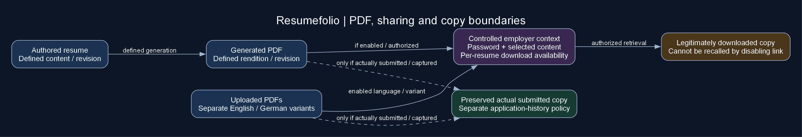

[Scalable SVG](Diagrams/Pdf-Sharing-Boundaries.svg) · [Graphviz source](Diagrams/Pdf-Sharing-Boundaries.dot)

Arrows show conceptual delivery/history boundaries, not implementation copying.
Downloaded copies are outside product retrieval control; historical material is
preserved under a distinct application policy, not necessarily retained forever.

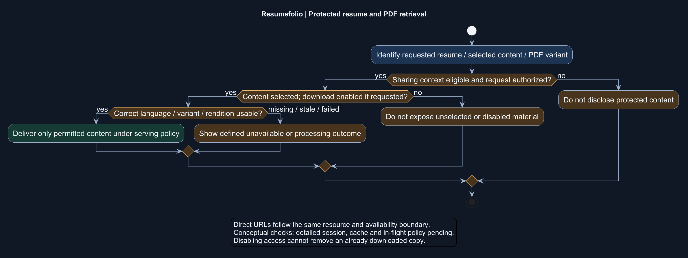

[Scalable SVG](Diagrams/Pdf-Protected-Retrieval.svg) · [PlantUML source](Diagrams/Pdf-Protected-Retrieval.puml)

This is a conceptual requirements flow, not a prescribed check order. Revalidate
conditions as required by the later concurrency/session/serving design. The
diagram does not settle active-session, cached or in-flight revocation behavior.

<a id="requirements-specification-pdf-and-controlled-sharing--heading-5-planned-verification"></a>
##### 5. Planned Verification

| Family | Candidates | Cases to develop |
| --- | --- | --- |
| PDF content | PDF-D01/D02 | Correct revision/language, formatting, upload replacement, invalid and failed processing |
| Availability | PDF-D03 | Four download modes × available/unavailable language/variant × authorized/denied context |
| Protected boundary | PDF-D04/D05 | Fresh correct/wrong password, no viewer account, direct paths and changed identifiers |
| Owner changes | PDF-D06/D07 | Owner/non-owner change, fresh-viewer denial; later decided sessions/caches/live revisions |
| Copies/history | PDF-D08/D10 | Already downloaded limits, actual submitted copy independence and reference-aware retirement |
| Failures/recovery | PDF-D09/D10 | Interrupted generation/transfer/replacement, safe feedback and isolated restored access |

Later evidence identifies resume/source/artifact revisions, mode/language/link
state, actor/context, expected/actual result, candidate/environment and limits.
Use controlled documents/passwords; never retain real sharing secrets in repository
evidence. No tests, live links or download/revocation results are recorded here.

<a id="requirements-specification-pdf-and-controlled-sharing--heading-6-open-decisions-and-gates"></a>
##### 6. Open Decisions and Gates

| Topic | Decisions/evidence needed | Gate |
| --- | --- | --- |
| Generated output | Content/layout/fonts/pagination, represented revision, generation/cache and accessibility | Before affected M-02 criteria/design acceptance |
| Upload/language | Validation, limits, English/German metadata, replacement and unavailable-language behavior | PDF/file-policy acceptance; GAP-D01/D10 resource evidence |
| Sharing/session | Link lifecycle, password/abuse controls, session lifetime, active/in-flight/cached change behavior | Affected access requirements and security/serving design |
| Publication/availability | Save/live revision, current/stale rendition, effective mode changes and owner preview | Before accepting live-share/retrieval criteria |
| Historical material | Actual-artifact capture, correction, resubmission and access | APP-D/BRL-D history review |
| Retirement/recovery | References, retention/cleanup, backup coverage and restored grants/disabled links | Lifecycle/design gates and actual restoration before M-09 |

Farhad coordinates these local topics. Record real findings in
[Questions and Decisions](#change-and-baseline-open-questions-and-decisions),
retain [Planning Gates](https://github.com/Farhad-V/Web-Resumefolio/blob/1f2acaa351ac306cb57cbe4fe9742e8bd90720d9/docs/MVP/SDLC/01-project-planning/10-planning-completion-criteria.md)
and use [Change Control](#change-and-baseline-change-control) for material impacts.
No local row is a newly allocated decision or proof of security/capacity.

<a id="requirements-specification-pdf-and-controlled-sharing--heading-7-traceability-and-review-readiness"></a>
##### 7. Traceability and Review Readiness

PDF-D01–D06 derive from DEC-025/024 with DEC-026/027/028 and EXT-001. PDF-D07–D10
include proposed revision, failure and lifecycle detail linked to DEC-023/017/018.
Reconcile ACC-D07/D08 direct access/owner controls, EIF-D04 file contracts, APP-D06
actual submitted material and BRL-D access/history invariants.

Use the [requirement template](#requirements-specification-requirements-specification) when allocating
final IDs. Link allocated records/scenarios and actual evidence in
[Traceability](#validation-and-traceability-validation-and-traceability--heading-traceability).
Record actual inspection outcomes in [Review Findings](#validation-and-traceability-validation-and-traceability--heading-review-findings).

- [ ] Reconcile provisional PDF-D references and assign justified priorities.
- [ ] Review source-derived boundaries separately from proposed supporting detail.
- [ ] Resolve policy/state/permission questions blocking affected acceptance.
- [ ] Reconcile dictionary, lifecycle, interface and related domain specifications.
- [ ] Complete normal, denied, failure, concurrent and recovery scenarios where applicable.
- [ ] Record actual owner decision, reviewed revision, evidence and remaining blockers.

**Current outcome:** Proposed specification; no candidate is accepted and no product
test result is recorded. Conditional criteria are not acceptance-ready until their
referenced policies are decided. M-02 and the wider pre-implementation agreement
remain pending. This revision changes no accepted scope and performs no live
repository, application-submission, sharing, file or provider operation.

<a id="requirements-specification-pdf-and-controlled-sharing--heading-8-diagram-maintenance"></a>
##### 8. Diagram Maintenance

| Diagram | Source | SVG | PNG |
| --- | --- | --- | --- |
| PDF and sharing boundaries | [Graphviz](Diagrams/Pdf-Sharing-Boundaries.dot) | [SVG](Diagrams/Pdf-Sharing-Boundaries.svg) |  |
| Protected retrieval flow | [PlantUML](Diagrams/Pdf-Protected-Retrieval.puml) | [SVG](Diagrams/Pdf-Protected-Retrieval.svg) |  |

Keep sources, captions and renders synchronized. Colors supplement labels. Follow
the [diagram guide](Diagrams/Diagram-Catalog.md); inspect readable arrows/labels and check
file/section links after changes. From repository root:

```powershell
$diagramFolder = 'docs\MVP\SDLC\02-requirements-engineering\diagrams'
$graphvizExe = 'C:\Program Files\Graphviz\bin\dot.exe'
$plantUmlJar = 'C:\Users\fvali\AppData\Local\Resumefolio\DiagramTools\plantuml.jar'
foreach ($format in 'svg', 'png') {
    & $graphvizExe "-T$format" -Gdpi=140 "$diagramFolder\pdf-sharing-boundaries.dot" -o "$diagramFolder\pdf-sharing-boundaries.$format"
    if ($LASTEXITCODE -ne 0) { throw "Graphviz failed: $format" }
    java '-Djava.awt.headless=true' -jar $plantUmlJar -charset UTF-8 "-t$format" "$diagramFolder\pdf-protected-retrieval.puml"
    if ($LASTEXITCODE -ne 0) { throw "PlantUML failed: $format" }
}
```

Use actual tool paths on other machines; save UTF-8 without BOM.

[Specification index](#requirements-specification-requirements-specification-overview) · [SRS entry point](#requirements-specification-requirements-specification)
· [Requirements index]()

<a id="requirements-specification-pdf-and-controlled-sharing--heading-selected-policies-and-future-proposals"></a>
##### Selected Policies and Future Proposals

Current MVP answers are selected in the Baseline. Only explicitly deferred details below remain proposals; product tests and operational evidence are still required.

<a id="requirements-specification-pdf-and-controlled-sharing--id-resolution-q-d10"></a>
<a id="requirements-specification-pdf-and-controlled-sharing--heading-q-d10-selected-policy"></a>
###### Q-D10: Selected policy

[Selected answer and remaining evidence](https://github.com/Farhad-V/Web-Resumefolio/blob/1f2acaa351ac306cb57cbe4fe9742e8bd90720d9/docs/MVP/baseline/policy-decisions.md#q-d10). Apply this policy to the MVP slice; the original criteria above remain subject to their [current dispositions](https://github.com/Farhad-V/Web-Resumefolio/blob/1f2acaa351ac306cb57cbe4fe9742e8bd90720d9/docs/MVP/baseline/criterion-dispositions.csv).

<a id="requirements-specification-pdf-and-controlled-sharing--id-resolution-q-d11"></a>
<a id="requirements-specification-pdf-and-controlled-sharing--heading-q-d11-selected-policy"></a>
###### Q-D11: Selected policy

[Selected answer and remaining evidence](https://github.com/Farhad-V/Web-Resumefolio/blob/1f2acaa351ac306cb57cbe4fe9742e8bd90720d9/docs/MVP/baseline/policy-decisions.md#q-d11). Apply this policy to the MVP slice; the original criteria above remain subject to their [current dispositions](https://github.com/Farhad-V/Web-Resumefolio/blob/1f2acaa351ac306cb57cbe4fe9742e8bd90720d9/docs/MVP/baseline/criterion-dispositions.csv).

<a id="requirements-specification-pdf-and-controlled-sharing--heading-mvp-private-media-flow"></a>
##### MVP private-media flow


[Editable source](../04-System-Design/01-High-Level-Design/14-Appendices.md#design-record-01-software-architecture-diagrams-mvp-private-media-puml) · .

</details>

<a id="requirements-specification-profiles-resumes-and-portfolio"></a>

<details>
<summary>Resumefolio — Profiles, Resumes and Portfolio</summary>

<a id="requirements-specification-profiles-resumes-and-portfolio--heading-resumefolio--profiles-resumes-and-portfolio"></a>
#### Resumefolio — Profiles, Resumes and Portfolio

Current implementation choices and scope: [Baseline](https://github.com/Farhad-V/Web-Resumefolio/blob/1f2acaa351ac306cb57cbe4fe9742e8bd90720d9/docs/MVP/baseline/README.md). Runtime verification remains subject to its gates.

| Item | Current position |
| --- | --- |
| Owner | Farhad |
| Status | Core source-update/apply/publication/history policy owner-accepted November 1, 2026; remaining detailed requirements pending |
| Planning basis | DEC-027/026/015; related DEC-028/025/024/023/018 |
| Candidate references | PRP-D01–PRP-D10 are provisional document-local references, not allocated global requirement IDs |
| Priority | Unassigned; document order is not delivery priority |
| Revision | October 31, 2026 |

**At a glance:** Reuse professional information without losing control of each
tailored resume. Associate externally created evidence with skills/projects,
select what each resume shows, and manage English/German content manually.
Source-update, publication, validation and lifecycle policies remain explicit
review decisions rather than assumed automatic behavior.

[Basis](#requirements-specification-profiles-resumes-and-portfolio--heading-1-purpose-and-accepted-boundary) · [Information](#requirements-specification-profiles-resumes-and-portfolio--heading-2-conceptual-information-and-editing-boundaries)
· [Requirements](#requirements-specification-profiles-resumes-and-portfolio--heading-3-proposed-requirements) · [Models](#requirements-specification-profiles-resumes-and-portfolio--heading-4-tailoring-and-update-models)
· [Scenarios](#requirements-specification-profiles-resumes-and-portfolio--heading-5-planned-verification) · [Decisions](#requirements-specification-profiles-resumes-and-portfolio--heading-6-open-decisions-and-gates)
· [Review](#requirements-specification-profiles-resumes-and-portfolio--heading-7-traceability-and-review-readiness)

<a id="requirements-specification-profiles-resumes-and-portfolio--heading-mvp-my-files--media-and-deliberate-publication"></a>
##### MVP My Files & Media and deliberate publication

The core provides My Files & Media as a private user library for supported video, audio, images, text/documents and external YouTube links. Files need not be attached to a resume. Resume selection is optional and explicit. Upload does not publish; employer access requires selection and protected resume authorization. YouTube links use simple embedded externally hosted playback; private uploaded videos stay on the same Resumefolio server. No in-product editor or heavyweight transcoding is added. Preview/select/apply, independent overrides, separate publication confirmation and preserved actual submitted history remain required.

Authority: [OWNER-MVP-2026-11-04](../01-Project-Planning/01-Project-Charter.md#release-decision). [Candidate allocation](#requirements-specification-mvp-release-allocation).

<a id="requirements-specification-profiles-resumes-and-portfolio--heading-1-purpose-and-accepted-boundary"></a>
##### 1. Purpose and Accepted Boundary

[DEC-027](https://github.com/Farhad-V/Web-Resumefolio/blob/1f2acaa351ac306cb57cbe4fe9742e8bd90720d9/docs/MVP/SDLC/01-project-planning/02-scope.md#dec-027) includes professional
profiles with experience, education, skills and other agreed information;
opportunity-specific resumes reuse shared content while retaining independent
selections, layouts and overrides. Shared-profile updates must follow explicit
rules and preserve resume-specific overrides.

[DEC-026](https://github.com/Farhad-V/Web-Resumefolio/blob/1f2acaa351ac306cb57cbe4fe9742e8bd90720d9/docs/MVP/SDLC/01-project-planning/02-scope.md#dec-026) includes explanatory text,
images, video, files, diagrams and repository/other relevant links associated with
skills/projects. Users select evidence per resume and its controlled sharing.
This covers content created with external tools, not an in-product video editor
or diagram-authoring tool. Accepted scope does not establish supported file
formats, rendering safety, capacity or detailed workflow behavior.

Version 1 supports manually entered/reviewed English and German content; automatic
translation, product AI and automatic legacy-demo migration remain excluded by
[Scope](../01-Project-Planning/01-Project-Charter.md#mvp-scope). A portfolio reference to a repository
does not prove the separate real Git-hosting capability is implemented.

Related specification boundaries:

| Reference | Responsibility |
| --- | --- |
| [Data Dictionary](#data-definitions-data-dictionary) / [Glossary](#data-definitions-glossary) | Concept meanings; fields/validation still need refinement |
| [Accounts](#requirements-specification-accounts-authentication-and-permissions) | Resource/action authority and private contexts |
| [Business Lifecycle](#requirements-specification-business-rules-and-data-lifecycle) | Shared-source propagation, references, retirement and recovery |
| [PDF and Sharing](#requirements-specification-pdf-and-controlled-sharing) | Generated/uploaded PDFs, download variants and employer retrieval |
| [Manual Applications](#requirements-specification-manual-application-management) | Actual submitted resume/cover-letter history, distinct from current sources |
| [Files and Operations](#requirements-specification-administration-files-and-operational-behavior) | Admission, limits, safe replacement, accounting and cleanup |
| [External Interfaces](#requirements-specification-external-interface-requirements) | Supported clients, representations, rendering and observable outcomes |

These links identify consistency obligations, not acceptance of the related drafts.

<a id="requirements-specification-profiles-resumes-and-portfolio--heading-2-conceptual-information-and-editing-boundaries"></a>
##### 2. Conceptual Information and Editing Boundaries

| Subject | Scope-supported meaning | Detail to define |
| --- | --- | --- |
| Professional profile | Reusable experience, education, skills and agreed professional content | Exact fields, required/optional rules, ordering and number of profiles per account |
| Tailored resume | Opportunity-specific information selections, layout and content overrides | Creation/editing workflow, source relationships, duplication and naming |
| Supporting evidence | Explanatory content and externally created media/files/diagrams/links | Metadata, supported formats, associations and safe display |
| Evidence selection | Content deliberately shown on a particular resume | Independent visibility/order and changed-source behavior |
| Language-specific content | Manually authored/reviewed English/German variants | Which fields vary, completeness, default display and missing-language handling |
| Presentation/rendition | Resume view and related PDF representation | Layout options, save/preview/live revision and PDF treatment of media |
| Historical submission | Material actually submitted and separately preserved | Capture/revision/artifacts, correction, retention and access; APP-D owns detail |

<a id="requirements-specification-profiles-resumes-and-portfolio--heading-change-impact-review-matrix"></a>
###### Change-impact Review Matrix

| Requested change | Must preserve | Policy still needed |
| --- | --- | --- |
| Profile field updated | Resume-specific selections/layouts/overrides; submitted history | Which linked values update, trigger and conflict behavior |
| One resume override/layout changed | Other resumes and shared source are not silently edited | Override scope, reset-to-source and layout inheritance |
| Evidence added/edited/replaced | Unrelated evidence and per-resume access boundary | Revision propagation, rendering, replacement failure and reference effects |
| Evidence omitted from one resume | Other resumes' deliberate selections and private evidence | Ordering, default selection and active shared-view change timing |
| Source item/association removed | Required preserved submitted copies and valid references | Block/detach/cascade per relationship, retained versions and cleanup |
| Language-specific content changed | Other language content is not automatically translated or overwritten | Shared versus translated fields and missing-content availability |

This is a semantic review matrix, not a copying strategy or database schema.
Profile-to-resume propagation and save-to-live publication remain separate decisions.

<a id="requirements-specification-profiles-resumes-and-portfolio--heading-3-proposed-requirements"></a>
##### 3. Proposed Requirements

Every candidate is **Proposed**, owner **Farhad**, priority **Unassigned**. Criteria
are planned observations, not actual product results. A criterion depending on an
undecided field/propagation/presentation policy remains blocked for acceptance.

<a id="requirements-specification-profiles-resumes-and-portfolio--heading-prp-d01-reusable-professional-information"></a>
###### PRP-D01: Reusable Professional Information

**Release allocation (owner decision, November 4):** MVP — Resumefolio core.

**Source / rationale:** DEC-027; maintain shared professional information without
repeated entry for every resume.

**Actor / conditions:** Authorized user creates or edits their professional profile.

**Proposed obligation:** Users shall maintain experience, education, skills and
other agreed professional information as reusable content under explicit field
and validation rules.

**Acceptance criteria**
- Representative valid records retain the intended user/content context and agreed information.
- Missing/invalid required input has defined feedback rather than false successful completion.
- Agreed information can be selected for a tailored resume without manually re-entering the same shared content as a prerequisite.

**Planned verification:** Later representative create/edit/validation and reuse cases.
**Open detail:** Exact fields, required/optional conditions, dates/units, ordering,
duplicates, profile count, contact/personal details and incomplete-profile behavior.

<a id="requirements-specification-profiles-resumes-and-portfolio--heading-prp-d02-opportunity-specific-resume-composition"></a>
###### PRP-D02: Opportunity-specific Resume Composition

**Release allocation (owner decision, November 4):** MVP — Resumefolio core.

**Source / rationale:** DEC-027; each resume supports a particular opportunity.

**Actor / conditions:** Authorized user creates or edits a tailored resume.

**Proposed obligation:** Users shall compose a resume by selecting relevant shared
information and adjusting its presentation under the reviewed composition rules.

**Acceptance criteria**
- A representative resume contains the intended selected information and omits deliberately unselected information.
- The resume remains identifiable independently from another tailored resume and its intended content choices.
- Invalid or inaccessible source references cannot disclose unrelated private information or appear as a successful association.

**Planned verification:** Later two-opportunity composition, omitted-content and
denied-reference cases. **Open detail:** Resume naming, section/order/layout options,
minimum completeness, duplication, source-item availability and opportunity linkage.

<a id="requirements-specification-profiles-resumes-and-portfolio--heading-prp-d03-independent-selections-layouts-and-overrides"></a>
###### PRP-D03: Independent Selections, Layouts and Overrides

**Release allocation (owner decision, November 4):** MVP — Resumefolio core.

**Source / rationale:** DEC-027; tailoring one resume must not rewrite another.

**Actor / conditions:** User changes one resume's selection, layout or content override.

**Proposed obligation:** Resume-specific selections, layouts and overrides shall
remain independent; editing them shall not silently modify other resumes or the
shared source contrary to the explicit editing policy.

**Acceptance criteria**
- With two resumes using a shared source item, changing an override in one leaves the other's independent content choices intact.
- Changing one resume's layout/selection does not silently apply that same change to the other resume.
- Intended source edits versus resume overrides are distinguishable in the reviewed editing workflow.

**Planned verification:** Later two-resume override/layout/selection comparison.
**Open detail:** Override granularity, source editing affordance, reset-to-source,
inheritance and whether/how intentionally shared presentation settings are supported.

<a id="requirements-specification-profiles-resumes-and-portfolio--heading-prp-d04-explicit-shared-source-update-rules"></a>
###### PRP-D04: Explicit Shared-source Update Rules

**Release allocation (owner decision, November 4):** MVP — Resumefolio core.

**Source / rationale:** DEC-027 and BRL-D02; source reuse must not destroy tailoring.

**Actor / conditions:** Shared profile content used by one or more resumes changes.

**Proposed obligation:** Intended updates from shared information shall follow a
reviewed propagation policy that preserves resume-specific overrides and selected
content boundaries.

**Acceptance criteria**
- Editing shared profile information does not automatically change an existing resume draft or published view; the owner previews the changes, explicitly applies selected source changes without overwriting resume-specific overrides, and separately confirms publication.
- An overridden field retains its independent meaning under the reviewed precedence rules rather than being silently replaced by the source change.
- Omitted content is not silently added to a resume, and source updates do not overwrite preserved actual submitted copies.

**Planned verification:** Later linked/overridden/omitted two-resume cases plus
historical-copy comparisons. **Open detail:** Automatic versus user-triggered update,
preview/confirmation, source revision, conflicts, concurrency and source deletion.
No automatic propagation or copy-on-edit mechanism is selected.

<a id="requirements-specification-profiles-resumes-and-portfolio--heading-prp-d05-skill-and-project-evidence-management"></a>
###### PRP-D05: Skill and Project Evidence Management

**Owner-scope acceptance additions (MVP; planned, not executed):**

- A user can keep supported material in My Files & Media without attaching it to any resume. Upload alone makes no material visible to an employer.
- External YouTube links embed externally hosted playback; private uploaded media remains private on the same Resumefolio server.

**Release allocation (owner decision, November 4):** MVP — Resumefolio core.

**Source / rationale:** DEC-026; evidence gives concrete context to professional claims.

**Actor / conditions:** Authorized user adds or organizes evidence associated with a skill/project.

**Proposed obligation:** Users shall add, organize and display agreed explanatory
text, images, video, files, diagrams and relevant repository/other links with explicit
skill/project association and content rules.

**Acceptance criteria**
- Representative supported evidence categories retain the intended skill/project relationship and agreed descriptive content.
- Invalid/unsupported/inaccessible items produce defined feedback without a false completed association.
- A repository link is treated as the intended reference, not as evidence that the product hosts that repository or controls its external availability.

**Planned verification:** Later representative category, association and unavailable-link
cases. **Open detail:** Metadata, relation multiplicity, ordering, link validation,
uploads versus embeds, supported formats and project-description fields. A portfolio
project is not automatically the same object as a work-management project.

<a id="requirements-specification-profiles-resumes-and-portfolio--heading-prp-d06-per-resume-evidence-selection-and-disclosure"></a>
###### PRP-D06: Per-resume Evidence Selection and Disclosure

**Release allocation (owner decision, November 4):** MVP — Resumefolio core.

**Source / rationale:** DEC-026/024; each resume shows only deliberately selected evidence.

**Actor / conditions:** Owner selects evidence for a resume; a viewer requests its content.

**Proposed obligation:** Evidence presentation and controlled sharing shall honor
the intended resume's independent selections and applicable access rules.

**Acceptance criteria**
- Selecting or omitting evidence on one resume does not silently change another resume's selection.
- Employer context exposes only selected permitted evidence and grants no general access to the private evidence collection.
- Direct requests for unselected/unrelated protected files cannot bypass the boundary merely because their identifiers are known.

**Planned verification:** Later two-resume selection and selected/unselected direct-path
retrieval cases. **Open detail:** Default selection, per-resume ordering/description,
selection of evidence parts, changed-content effects and active-view/session timing.

<a id="requirements-specification-profiles-resumes-and-portfolio--heading-prp-d07-manually-maintained-english-and-german-content"></a>
###### PRP-D07: Manually Maintained English and German Content

**Release allocation (owner decision, November 4):** MVP — Resumefolio core.

**Source / rationale:** DEC-015/025; professional wording stays under user control.

**Actor / conditions:** User edits or requests language-specific profile/resume/evidence content.

**Proposed obligation:** Agreed English/German content variants shall be manually
maintained and displayed under explicit language/completeness rules without an
automatic translation dependency.

**Acceptance criteria**
- Representative manually entered language variants retain their intended text and language context.
- Editing one variant does not automatically translate or overwrite another language's professional wording.
- Missing/incomplete-language cases produce the reviewed availability/fallback result rather than a silently fabricated translation.

**Planned verification:** Later bilingual/partial/missing-language editing and display
cases. **Open detail:** Which fields are language-dependent/shared, default language,
fallback, mixed-language sections and completeness. Interface localization and
uploaded PDF language availability are separate contracts.

<a id="requirements-specification-profiles-resumes-and-portfolio--heading-prp-d08-clear-presentation-and-rendition-boundaries"></a>
###### PRP-D08: Clear Presentation and Rendition Boundaries

**Release allocation (owner decision, November 4):** MVP — Resumefolio core.

**Source / rationale:** DEC-027/026/025 and proposed presentation refinement;
screen presentation and PDF renditions must have deliberate content meaning.

**Actor / conditions:** User previews saved content or requests an eligible shared/PDF view.

**Proposed obligation:** Profile/resume/evidence views shall represent the intended
content/revision under reviewed presentation rules, with explicit treatment of
media and links in screen versus PDF output.

**Acceptance criteria**
- A reviewed representative view shows the intended selected text/evidence and distinguishes missing or unavailable content.
- Layout/long-content/link/media examples have defined results in the agreed supported client/viewport matrix.
- PDF evidence representation follows the reviewed rendition contract; it does not imply interactive video or every web behavior is embedded in a PDF.

**Planned verification:** Later preview/live/PDF content comparisons and selected
client/accessibility examples. **Open detail:** Save/preview/publication revision,
templates, layout, pagination, fonts, link/media representation and measurable
accessibility criteria; no renderer, theme library or PDF tool is selected.

<a id="requirements-specification-profiles-resumes-and-portfolio--heading-prp-d09-safe-content-admission-and-truthful-save-outcomes"></a>
###### PRP-D09: Safe Content Admission and Truthful Save Outcomes

**Release allocation (owner decision, November 4):** MVP — Resumefolio core.

**Source / rationale:** DEC-026/018 and proposed reliability/security refinement;
externally created content can fail admission, processing or rendering.

**Actor / conditions:** User saves text/links or uploads/replaces evidence content.

**Proposed obligation:** Content admission, rendering and replacement shall follow
reviewed validation, authority, resource and safe-display rules, reporting only
the actual completed outcome.

**Acceptance criteria**
- Defined invalid/over-limit/unsupported input has the reviewed result and is not presented as successfully usable evidence.
- Interrupted save/upload/required processing is distinguishable from complete success and follows explicit existing-content/reference rules.
- Defined rich-content/file/link cases do not bypass reviewed safe-display or privacy controls, and ordinary feedback exposes no secrets/unrelated content.

**Planned verification:** Later boundary, interruption, replacement, unsafe-content
and permission examples using controlled data. **Open detail:** Format list,
sanitization, external embeds/tracking, link-fetch behavior, processing, quotas,
retry/conflict handling and cleanup; no scanner or numerical limit is invented.

<a id="requirements-specification-profiles-resumes-and-portfolio--heading-prp-d10-reference-aware-retirement-and-historical-independence"></a>
###### PRP-D10: Reference-aware Retirement and Historical Independence

**Release allocation (owner decision, November 4):** MVP — Resumefolio core.

**Source / rationale:** DEC-023/017 and proposed lifecycle detail; removing a source
or association must not accidentally destroy unrelated or preserved information.

**Actor / conditions:** Authorized actor removes/replaces a source, resume, evidence
item or association, or later restores related information.

**Proposed obligation:** Lifecycle operations shall follow explicit reference,
retention and recovery rules while preserving required actual submitted copies
against later source edits/removal.

**Acceptance criteria**
- Unlinking evidence from one resume does not implicitly delete unrelated evidence or another valid association contrary to reviewed policy.
- Source edit/replacement/removal does not silently overwrite or erase required preserved actual submitted resume/cover-letter material.
- Later isolated restoration checks required records/artifacts/references and restored access; missing artifacts are not reported as complete recovery.

**Planned verification:** Later shared-reference, source-removal, historical-copy
and isolated restore checks. **Open detail:** Archive/delete authority, cascade/block/
detach per relation, retained revisions, account closure, quota reclamation,
backup coverage/targets and restored sharing state; no retention period is set.

<a id="requirements-specification-profiles-resumes-and-portfolio--heading-4-tailoring-and-update-models"></a>
##### 4. Tailoring and Update Models

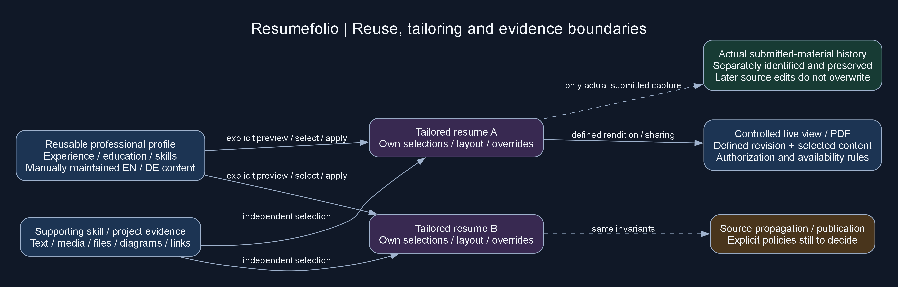

[Scalable SVG](Diagrams/Profile-Resume-Evidence-Map.svg) ·
[Editable Graphviz](Diagrams/Profile-Resume-Evidence-Map.dot)

Arrows identify conceptual reuse and selection, not database cardinalities or an
automatic copying policy. A live view can change under an explicit publication
rule; preserved actual submitted material remains a distinct history context.
Colors supplement labels.

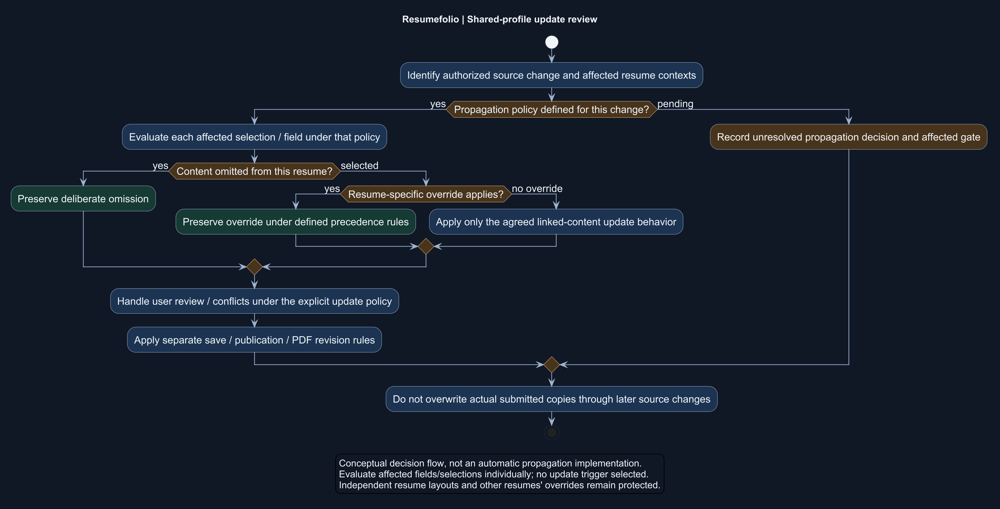

[Scalable SVG](Diagrams/Profile-Update-Review.svg) ·
[Editable PlantUML](Diagrams/Profile-Update-Review.puml)

This is a requirements decision flow, not selected propagation implementation.
An undefined update policy is a review gap. Per-field/section behavior, update
trigger, confirmation and concurrent edits require explicit decisions. A profile
save does not inherently publish new shared content or regenerate every PDF.

<a id="requirements-specification-profiles-resumes-and-portfolio--heading-5-planned-verification"></a>
##### 5. Planned Verification

| Family | Candidates | Cases to develop |
| --- | --- | --- |
| Profile/composition | PRP-D01/D02 | Valid/incomplete fields, reusable content, opportunity-specific selections and denied references |
| Independence/update | PRP-D03/D04 | Two resumes; linked/no-override, overridden, omitted and deleted-source examples |
| Portfolio/evidence | PRP-D05/D06 | Supported categories, skill/project associations, independent selections and direct retrieval |
| Language | PRP-D07 | English/German edits, shared versus variant fields and incomplete/missing language |
| Presentation | PRP-D08 | Long content, links/media, preview/live revisions, defined PDF representation and supported clients |
| Admission/lifecycle | PRP-D09/D10 | Invalid/over-limit/failed content, reference removal, historical copies and isolated recovery |

A useful later end-to-end example: create shared experience/skills, create two
opportunity-specific resumes, override one description and select different
evidence, then change the source. Compare both resumes against the agreed update
policy. Capture actual submitted material, change live sources again, and check
that history remains independent. Test denied cross-user/direct-file paths too.

Each run later records candidate/policy revision, actor/grants, source/resume/
artifact versions, language, initial data, expected/actual outcome and limits.
Use synthetic professional data and controlled media/links. No product tests or
actual preservation/recovery results are recorded here.

<a id="requirements-specification-profiles-resumes-and-portfolio--heading-6-open-decisions-and-gates"></a>
##### 6. Open Decisions and Gates

| Topic | Definition/evidence needed | Dependent gate |
| --- | --- | --- |
| Profile/resume structure | Fields, required inputs, identifiers, count, duplication, ordering and incomplete content | Affected M-02 acceptance; GAP-D06 definition follow-up |
| Tailoring/update | Override granularity/precedence, source relation, update trigger, conflicts and reset behavior | Before accepting propagation criteria/data design |
| Evidence semantics | Categories/formats, metadata, skill/project associations and distinction from work projects | Affected requirements and dictionary review |
| Selection/disclosure | Defaults, per-resume overrides/order, unselected parts, direct retrieval and changed access | Access/sharing requirements and security design |
| Language | Variant/shared fields, completeness, fallback and mixed-language presentation | Affected content/PDF requirements |
| Presentation/revision | Layout, preview/save/live/PDF revisions, media treatment and measurable client/accessibility criteria | Requirements then design/compatibility evidence |
| Content/resources | Validation, external embeds/fetching, safe serving, quotas, processing and failed replacement | AFO-D policies; GAP-D01/D10 actual resource findings |
| Retirement/history/recovery | Reference consequences, submitted-copy capture, retention/cleanup and restored access | APP-D/BRL-D review; GAP-D04 and actual restoration before M-09 |

Farhad coordinates every topic. Local rows do not allocate shared question IDs or
record completed investigations. Use [Questions and Decisions](#change-and-baseline-open-questions-and-decisions),
retain [Planning Gates](https://github.com/Farhad-V/Web-Resumefolio/blob/1f2acaa351ac306cb57cbe4fe9742e8bd90720d9/docs/MVP/SDLC/01-project-planning/10-planning-completion-criteria.md)
and route material scope/cost/delivery effects through [Change Control](#change-and-baseline-change-control).
No missing policy silently removes an accepted capability or establishes feasibility.

<a id="requirements-specification-profiles-resumes-and-portfolio--heading-7-traceability-and-review-readiness"></a>
##### 7. Traceability and Review Readiness

| Candidate group | Source basis | Related drafts |
| --- | --- | --- |
| PRP-D01–D04 | DEC-027 | Dictionary, BRL-D02 propagation, DOM-D01 consistent professional meaning |
| PRP-D05/D06 | DEC-026/024/028 | ACC-D access, PDF-D04/D05 shared retrieval, AFO-D content handling |
| PRP-D07 | DEC-015/025 | Language definitions, PDF-D02/D03 variant availability |
| PRP-D08/D09 | DEC-027/026/025/018 plus proposed presentation/failure refinements | EIF-D02/D04/D10 interface/representation, PDF-D01 generation, AFO-D policies |
| PRP-D10 | DEC-023/017 plus proposed lifecycle detail | APP-D06 actual submitted material, BRL-D08/D09 retirement/recovery |

Use the [requirement template](#requirements-specification-requirements-specification) when allocating
final IDs. Link actual records/scenarios/evidence in [Traceability](#validation-and-traceability-validation-and-traceability--heading-traceability)
and record real inspection findings in [Review Findings](#validation-and-traceability-validation-and-traceability--heading-review-findings).

- [ ] Reconcile provisional PRP references and assign justified priorities.
- [ ] Review source-derived invariants separately from proposed detailed refinements.
- [ ] Decide field, propagation, presentation, language and lifecycle policies blocking criteria.
- [ ] Reconcile profile/evidence meanings, permissions, PDF/live revisions and actual submission history.
- [ ] Complete normal, denied, invalid, concurrent, failure and recovery cases as applicable.
- [ ] Record owner review, exact revision, decisions and later verification evidence.

**Historical outcome before the later owner decision:** Proposed product specification; no PRP candidate had been accepted,
no product test Pass or numerical capacity claim is recorded. M-02 and the wider
pre-implementation agreement remain pending. This revision changes no accepted
scope, selects no architecture and performs no account/file/publication operation.

<a id="requirements-specification-profiles-resumes-and-portfolio--heading-8-diagram-maintenance"></a>
##### 8. Diagram Maintenance

| Diagram | Source | SVG | PNG |
| --- | --- | --- | --- |
| Profile, resume and evidence boundaries | [Graphviz](Diagrams/Profile-Resume-Evidence-Map.dot) | [SVG](Diagrams/Profile-Resume-Evidence-Map.svg) |  |
| Source-update review | [PlantUML](Diagrams/Profile-Update-Review.puml) | [SVG](Diagrams/Profile-Update-Review.svg) |  |

Keep text, captions, sources and renders synchronized. Follow the
[diagram guide](Diagrams/Diagram-Catalog.md); inspect arrows/labels and verify file/section
links after changes. Run from the repository root:

```powershell
$diagramFolder = 'docs\MVP\SDLC\02-requirements-engineering\diagrams'
$graphvizExe = 'C:\Program Files\Graphviz\bin\dot.exe'
$plantUmlJar = 'C:\Users\fvali\AppData\Local\Resumefolio\DiagramTools\plantuml.jar'
foreach ($format in 'svg', 'png') {
    & $graphvizExe "-T$format" -Gdpi=140 "$diagramFolder\profile-resume-evidence-map.dot" -o "$diagramFolder\profile-resume-evidence-map.$format"
    if ($LASTEXITCODE -ne 0) { throw "Graphviz failed: $format" }
    java '-Djava.awt.headless=true' -jar $plantUmlJar -charset UTF-8 "-t$format" "$diagramFolder\profile-update-review.puml"
    if ($LASTEXITCODE -ne 0) { throw "PlantUML failed: $format" }
}
```

Use actual installed paths on other machines; save UTF-8 without BOM.

[Specification index](#requirements-specification-requirements-specification-overview) · [SRS entry point](#requirements-specification-requirements-specification)
· [Requirements index]()

<a id="requirements-specification-profiles-resumes-and-portfolio--heading-selected-policies-and-future-proposals"></a>
##### Selected Policies and Future Proposals

Current MVP answers are selected in the Baseline. Only explicitly deferred details below remain proposals; product tests and operational evidence are still required.

<a id="requirements-specification-profiles-resumes-and-portfolio--id-resolution-q-d06"></a>
<a id="requirements-specification-profiles-resumes-and-portfolio--heading-q-d06-selected-policy"></a>
###### Q-D06: Selected policy

[Selected answer and remaining evidence](https://github.com/Farhad-V/Web-Resumefolio/blob/1f2acaa351ac306cb57cbe4fe9742e8bd90720d9/docs/MVP/baseline/policy-decisions.md#q-d06). Apply this policy to the MVP slice; the original criteria above remain subject to their [current dispositions](https://github.com/Farhad-V/Web-Resumefolio/blob/1f2acaa351ac306cb57cbe4fe9742e8bd90720d9/docs/MVP/baseline/criterion-dispositions.csv).

<a id="requirements-specification-profiles-resumes-and-portfolio--id-resolution-q-d07"></a>
<a id="requirements-specification-profiles-resumes-and-portfolio--heading-q-d07-selected-policy"></a>
###### Q-D07: Selected policy

[Selected answer and remaining evidence](https://github.com/Farhad-V/Web-Resumefolio/blob/1f2acaa351ac306cb57cbe4fe9742e8bd90720d9/docs/MVP/baseline/policy-decisions.md#q-d07). Apply this policy to the MVP slice; the original criteria above remain subject to their [current dispositions](https://github.com/Farhad-V/Web-Resumefolio/blob/1f2acaa351ac306cb57cbe4fe9742e8bd90720d9/docs/MVP/baseline/criterion-dispositions.csv).

<a id="requirements-specification-profiles-resumes-and-portfolio--id-resolution-q-d08"></a>
<a id="requirements-specification-profiles-resumes-and-portfolio--heading-q-d08-selected-policy"></a>
###### Q-D08: Selected policy

[Selected answer and remaining evidence](https://github.com/Farhad-V/Web-Resumefolio/blob/1f2acaa351ac306cb57cbe4fe9742e8bd90720d9/docs/MVP/baseline/policy-decisions.md#q-d08). Apply this policy to the MVP slice; the original criteria above remain subject to their [current dispositions](https://github.com/Farhad-V/Web-Resumefolio/blob/1f2acaa351ac306cb57cbe4fe9742e8bd90720d9/docs/MVP/baseline/criterion-dispositions.csv).

<a id="requirements-specification-profiles-resumes-and-portfolio--id-resolution-q-d09"></a>
<a id="requirements-specification-profiles-resumes-and-portfolio--heading-q-d09-selected-policy"></a>
###### Q-D09: Selected policy

[Selected answer and remaining evidence](https://github.com/Farhad-V/Web-Resumefolio/blob/1f2acaa351ac306cb57cbe4fe9742e8bd90720d9/docs/MVP/baseline/policy-decisions.md#q-d09). Apply this policy to the MVP slice; the original criteria above remain subject to their [current dispositions](https://github.com/Farhad-V/Web-Resumefolio/blob/1f2acaa351ac306cb57cbe4fe9742e8bd90720d9/docs/MVP/baseline/criterion-dispositions.csv).

<a id="requirements-specification-profiles-resumes-and-portfolio--heading-mvp-private-media-flow"></a>
##### MVP private-media flow


[Editable source](../04-System-Design/01-High-Level-Design/14-Appendices.md#design-record-01-software-architecture-diagrams-mvp-private-media-puml) · .

</details>

<a id="requirements-specification-projects-kanban-and-sprints"></a>

<details>
<summary>Resumefolio — Projects, Kanban and Sprints</summary>

<a id="requirements-specification-projects-kanban-and-sprints--heading-resumefolio--projects-kanban-and-sprints"></a>
#### Resumefolio — Projects, Kanban and Sprints

Current implementation choices and scope: [Baseline](https://github.com/Farhad-V/Web-Resumefolio/blob/1f2acaa351ac306cb57cbe4fe9742e8bd90720d9/docs/MVP/baseline/README.md). Runtime verification remains subject to its gates.

| Item | Current position |
| --- | --- |
| Owner | Farhad; sole project delivery and operations owner |
| Status | Proposed product specification — detailed workflows and acceptance pending |
| Planning basis | DEC-021/028; related DEC-022/020/017 and GAP-D06 |
| Candidate references | PKS-D01–PKS-D11 are provisional document-local references, not allocated global requirement IDs |
| Priority | Unassigned; document order is not delivery priority |
| Revision | October 31, 2026 |

**At a glance:** Organize authorized work through projects, boards, configurable
columns, tasks, Product Backlogs and Sprints. A Backlog Item may be refined into
tasks; the concepts are not interchangeable. Each Sprint has one Sprint Backlog
comprising its goal, selected Backlog Items and delivery plan. Exact relationships,
states and completion policies remain review decisions.

[Basis](#requirements-specification-projects-kanban-and-sprints--heading-1-purpose-and-accepted-boundary) · [Concepts](#requirements-specification-projects-kanban-and-sprints--heading-2-concepts-and-relationship-boundaries)
· [Requirements](#requirements-specification-projects-kanban-and-sprints--heading-3-proposed-requirements) · [Models](#requirements-specification-projects-kanban-and-sprints--heading-4-work-and-sprint-models)
· [Scenarios](#requirements-specification-projects-kanban-and-sprints--heading-5-planned-verification) · [Decisions](#requirements-specification-projects-kanban-and-sprints--heading-6-open-decisions-and-gates)
· [Review](#requirements-specification-projects-kanban-and-sprints--heading-7-traceability-and-review-readiness)

<a id="requirements-specification-projects-kanban-and-sprints--heading-projectforge-simple-kanban-versus-future-work-planning"></a>
##### ProjectForge simple Kanban versus future work planning

Only issues and simple Kanban, with necessary resource permissions and truthful movement/lifecycle, belong to the ProjectForge MVP. ProjectForge is a separate authenticated user-scoped API system. General advanced backlog/refinement, Sprint Goal/Sprint Backlog, advanced reports and automation remain future proposals. Retained PKS identifiers describe the larger product; their existence does not commit MVP to every criterion.

Authority: [OWNER-MVP-2026-11-04](../01-Project-Planning/01-Project-Charter.md#release-decision). [Candidate allocation](#requirements-specification-mvp-release-allocation).

<a id="requirements-specification-projects-kanban-and-sprints--heading-1-purpose-and-accepted-boundary"></a>
##### 1. Purpose and Accepted Boundary

[Scope DEC-021](https://github.com/Farhad-V/Web-Resumefolio/blob/1f2acaa351ac306cb57cbe4fe9742e8bd90720d9/docs/MVP/SDLC/01-project-planning/02-scope.md#dec-021) includes projects,
boards, configurable columns, tasks, assignments, priorities, due dates,
authorized collaboration, Product Backlogs, Backlog Items, Sprints and Sprint
Backlogs within Resumefolio. Backlog Items can represent features, defects,
technical improvements or investigations and may be refined into smaller tasks.
For a Sprint, its goal, selected items and delivery plan form one Sprint Backlog.

This is product functionality. The GitHub board/backlog used to build Resumefolio
does not establish implementation or dictate the product's workflows. Farhad is
the sole current project delivery owner; product collaboration does not imply
additional delivery staff, mandatory Scrum ceremonies or fixed team roles.

Accepted scope leaves item relationships, workflow rules and completion criteria
for Requirements Engineering. This document proposes those obligations while
keeping undecided policies explicit. It selects no architecture, drag-and-drop
library, reporting tool, database structure or automation engine.

| Related document | Consistency responsibility |
| --- | --- |
| [Accounts and Permissions](#requirements-specification-accounts-authentication-and-permissions) | Resource/action grants, collaboration invitations and revoked access |
| [Data Dictionary](#data-definitions-data-dictionary) / [Glossary](#data-definitions-glossary) | Work-management terms, responsibility and conceptual information |
| [Business Lifecycle](#requirements-specification-business-rules-and-data-lifecycle) | References, deletion, concurrency, time and recovery |
| [Google Integration](#requirements-specification-email-calendar-and-google-integration) | Explicit activity/reminder/provider relationships |
| [Git Hosting](#requirements-specification-git-hosting-and-collaboration) | Repository issues/milestones, PRs and separate repository permissions |
| [External Interfaces](#requirements-specification-external-interface-requirements) | Supported user interaction, accessibility and truthful outcomes |
| [Quality and Recovery](#requirements-specification-quality-security-and-recovery-requirements) | Later measurable quality and restoration criteria |

Related drafts are working references, not accepted policies or verified capabilities.

<a id="requirements-specification-projects-kanban-and-sprints--heading-2-concepts-and-relationship-boundaries"></a>
##### 2. Concepts and Relationship Boundaries

| Concept | Scope-supported meaning | Relationship/detail to decide |
| --- | --- | --- |
| Project | Context for organized work and authorized participants | Ownership, visibility, hierarchy and board/backlog/Sprint scope |
| Board / column | Work visualization and configurable workflow grouping | What a card represents, ordering, column/state mapping and moves |
| Product Backlog | List of Backlog Items | Scope, ordering/priority, membership and permitted refinement |
| Backlog Item | Feature, defect, improvement, investigation or other agreed work | Fields, types, acceptance/completion conditions and task refinement |
| Task | Specific activity contributing to delivery | Parent relationship if any, assignment, priority, due date and status |
| Sprint | Work period with a goal and selected work | Dates, selection, permitted changes, lifecycle and incomplete work |
| Sprint Backlog | One composite of Sprint Goal, selected items and delivery plan | Content changes, task plan and distinction from a board view |
| Participant/grant | Authorized collaboration context | Invite/accept/remove, roles, assignment eligibility and operation scope |

<a id="requirements-specification-projects-kanban-and-sprints--heading-required-semantic-distinctions"></a>
###### Required Semantic Distinctions

- An item is not necessarily one task; completing a task does not automatically prove its parent item meets acceptance criteria.
- A board column is not automatically a universal business status or proof of completion.
- A Sprint Backlog includes the goal and delivery plan, not only a filtered list of cards.
- A due date is not proof of completion, capacity or an achievable delivery forecast.
- A portfolio project, work-management project and Git repository are not automatically one shared record.
- A repository issue/milestone and a Product Backlog Item/Sprint need explicit relationships if linked; similarity does not establish equivalence.

These distinctions constrain meaning, not database cardinalities. Project-to-board,
backlog-to-project, item-to-task and item-to-Sprint cardinalities remain open.

<a id="requirements-specification-projects-kanban-and-sprints--heading-3-proposed-requirements"></a>
##### 3. Proposed Requirements

Every candidate has owner **Farhad**, status **Proposed**, priority **Unassigned**.
Actor/condition descriptions are scenario contexts, not new grants. Conditional
criteria cannot be accepted until the referenced fields/workflows are decided.

<a id="requirements-specification-projects-kanban-and-sprints--heading-pks-d01-project-and-board-context"></a>
###### PKS-D01: Project and Board Context

**Release allocation (owner decision, November 4):** Split — MVP ProjectForge simple Kanban and necessary permissions/lifecycle; advanced configuration deferred.

**Source / rationale:** DEC-021; users need identifiable work contexts and boards.

**Actor / conditions:** Authorized user creates or changes a project/board.

**Proposed obligation:** Users shall create and manage agreed project/board
information under explicit ownership, relationship and validation rules.

**Acceptance criteria**
- A valid project/board is identifiable in its intended authorized work context.
- Missing/invalid required data or failed creation has defined feedback rather than false usable completion.
- Selecting/changing one work context does not silently modify unrelated project/board information.

**Planned verification:** Later create/select/edit/validation and isolation cases.
**Open detail:** Fields, naming, hierarchy, board count, defaults, visibility,
ownership transfer and initial workflow; no public-project model is chosen.

<a id="requirements-specification-projects-kanban-and-sprints--heading-pks-d02-configurable-columns-and-valid-work-movement"></a>
###### PKS-D02: Configurable Columns and Valid Work Movement

**Release allocation (owner decision, November 4):** Split — MVP ProjectForge simple Kanban and necessary permissions/lifecycle; advanced configuration deferred.

**Source / rationale:** DEC-021; configurable columns need deliberate work-state semantics.

**Actor / conditions:** Authorized participant configures columns or moves/reorders work.

**Proposed obligation:** Board column configuration, ordering and item movement
shall follow explicit authority, relationship and state-transition rules.

**Acceptance criteria**
- An authorized valid configuration displays the intended columns/order without silently losing represented work.
- A permitted move produces the reviewed card/location/state outcome; denied/invalid moves do not appear completed.
- Renaming/removing a column containing work follows explicit mapping/reference rules rather than an assumed destructive cascade.

**Planned verification:** Later column edits, moves/reordering, occupied-column
removal and denied/conflicting changes. **Open detail:** Card types, column/state
mapping, cross-board moves, WIP limits if adopted, concurrent order changes and
non-pointer interaction; no fixed columns, WIP number or drag-only UI is selected.

<a id="requirements-specification-projects-kanban-and-sprints--heading-pks-d03-product-backlog-and-item-definition"></a>
###### PKS-D03: Product Backlog and Item Definition

**Release allocation (owner decision, November 4):** Deferred after MVP — advanced work planning/reporting.

**Source / rationale:** DEC-021; planned outcomes include more than implementation tasks.

**Actor / conditions:** Authorized participant records or refines Product Backlog Items.

**Proposed obligation:** The product shall maintain Product Backlogs of identifiable
items with reviewed descriptions, type, ordering/priority and completion information.

**Acceptance criteria**
- Representative feature, defect, improvement and investigation examples retain their intended work meaning without being forced to be one implementation task.
- Valid authorized edits/order changes produce the agreed list state; invalid or denied changes have defined feedback.
- Item identity and relevant context remain distinguishable when represented on boards or selected for a Sprint.

**Planned verification:** Later item-type/field/order and cross-view consistency cases.
**Open detail:** Exact fields/types, required acceptance criteria, ordering versus
priority values, dependencies, backlog scope and item lifecycle.

<a id="requirements-specification-projects-kanban-and-sprints--heading-pks-d04-item-refinement-and-task-relationships"></a>
###### PKS-D04: Item Refinement and Task Relationships

**Release allocation (owner decision, November 4):** Deferred after MVP — advanced work planning/reporting.

**Source / rationale:** DEC-021; a Backlog Item may be refined into smaller tasks.

**Actor / conditions:** Authorized participant creates/changes a task or its item relationship.

**Proposed obligation:** Task refinement shall preserve explicit item/task meaning,
relationship and completion rules without silently equating their states.

**Acceptance criteria**
- A representative item can be refined into agreed smaller tasks while retaining the intended item identity and delivery context.
- Reparenting/removing a task follows the reviewed relationship policy without silently deleting unrelated work.
- Task completion alone does not mark the item accepted unless the explicit completion policy's conditions are satisfied.

**Planned verification:** Later item-with-tasks, incomplete/complete child work and
relationship-change cases. **Open detail:** Standalone tasks, cardinality, nesting,
multiple parents, dependency links, split/merge and completion aggregation; no schema chosen.

<a id="requirements-specification-projects-kanban-and-sprints--heading-pks-d05-assignment-priority-and-due-date-handling"></a>
###### PKS-D05: Assignment, Priority and Due-date Handling

**Release allocation (owner decision, November 4):** Split — MVP ProjectForge simple Kanban and necessary permissions/lifecycle; advanced configuration deferred.

**Source / rationale:** DEC-021; coordination needs valid responsibility and timing data.

**Actor / conditions:** Authorized participant assigns or prioritizes work or changes its due date.

**Proposed obligation:** Assignments, priorities and due dates shall follow reviewed
eligibility, validation and time rules in the correct work context.

**Acceptance criteria**
- Valid assignment targets only participants eligible under the selected policy and does not itself grant unrelated access.
- Defined priority/due-date examples preserve the intended value/time meaning; invalid inputs yield explicit feedback.
- Member removal or work-context changes produce the agreed assignment/reminder result rather than silently targeting an unauthorized person.

**Planned verification:** Later eligible/ineligible assignment, priority/date boundary
and membership-change examples. **Open detail:** Assignable entity types, assignee
count, unassigned state, priority scale, time zones, overdue meaning and reminders;
no numerical priority scale or automatic notification channel is assumed.

<a id="requirements-specification-projects-kanban-and-sprints--heading-pks-d06-scoped-collaboration-and-membership-changes"></a>
###### PKS-D06: Scoped Collaboration and Membership Changes

**Release allocation (owner decision, November 4):** Split — MVP ProjectForge simple Kanban and necessary permissions/lifecycle; advanced configuration deferred.

**Source / rationale:** DEC-021/028; invited collaborators are limited to authorized resources.

**Actor / conditions:** A user manages membership or a participant requests a work operation.

**Proposed obligation:** Collaboration invitations, membership and work operations
shall require explicit resource/action authority and defined change/revocation effects.

**Acceptance criteria**
- Allowed participants can perform only their reviewed project/board/item/task actions.
- Altered references/direct requests cannot expose or mutate unrelated private work, mail, resumes or repositories.
- A caller without grant-management authority cannot add themselves or escalate another participant's permissions.

**Planned verification:** Later allowed/denied direct operations, invitation and
changed-membership cases. **Open detail:** Roles, invite/accept/expiry states,
project-versus-board grants, ownership transfer, existing sessions/in-flight work
and administrative powers; no role hierarchy or expiry duration is invented.

<a id="requirements-specification-projects-kanban-and-sprints--heading-pks-d07-sprint-goal-and-selected-backlog-items"></a>
###### PKS-D07: Sprint Goal and Selected Backlog Items

**Release allocation (owner decision, November 4):** Deferred after MVP — advanced work planning/reporting.

**Source / rationale:** DEC-021; a Sprint is goal-directed selected work, not merely a label.

**Actor / conditions:** Authorized participant creates a Sprint or selects/changes its work.

**Proposed obligation:** Each Sprint shall identify its reviewed goal, selected
Backlog Items and time/work context under explicit selection and lifecycle rules.

**Acceptance criteria**
- A representative Sprint identifies the intended goal and selected item identities without silently changing the Product Backlog source.
- Invalid or unauthorized selection/date/state changes produce defined feedback.
- Defined work additions/removals or goal/date changes produce the reviewed Sprint context/history outcome rather than an assumed fixed or unrestricted policy.

**Planned verification:** Later goal/selection/date validation and changed-plan cases.
**Open detail:** Sprint duration/dates, concurrent Sprints, item eligibility,
multi-Sprint selection, start/end/cancel states, goal editing and time-zone rules;
no fixed cadence, mandatory team size or selection count is established.

<a id="requirements-specification-projects-kanban-and-sprints--heading-pks-d08-one-coherent-sprint-backlog"></a>
###### PKS-D08: One Coherent Sprint Backlog

**Release allocation (owner decision, November 4):** Deferred after MVP — advanced work planning/reporting.

**Source / rationale:** DEC-021; selected items, Sprint Goal and delivery plan form one Sprint Backlog.

**Actor / conditions:** Authorized participant views or adapts a Sprint delivery plan.

**Proposed obligation:** The product shall represent each Sprint Backlog as its
goal, selected items and plan for delivering them, keeping these components coherent.

**Acceptance criteria**
- A representative Sprint Backlog makes its goal, selected items and agreed delivery-plan information identifiable together.
- Agreed task refinements/plan changes remain associated with the correct Sprint/item context.
- A board view or item list alone is not presented as the complete Sprint Backlog when goal or required plan information is missing.

**Planned verification:** Later composite-view walkthrough and changed-plan/selected-item
consistency checks. **Open detail:** Delivery-plan structure, task inclusion,
editing authority, views and response to removed/changed item relationships;
one conceptual Sprint Backlog does not mandate one database table or screen.

<a id="requirements-specification-projects-kanban-and-sprints--heading-pks-d09-explicit-completion-and-sprint-end-outcomes"></a>
###### PKS-D09: Explicit Completion and Sprint-end Outcomes

**Release allocation (owner decision, November 4):** Deferred after MVP — advanced work planning/reporting.

**Source / rationale:** DEC-021 and proposed workflow refinement; moving cards must not fabricate acceptance.

**Actor / conditions:** Participant marks work complete or ends/cancels a Sprint.

**Proposed obligation:** Item/task completion and Sprint-end handling shall follow
reviewed conditions, preserving distinguishable completed, incomplete and accepted
outcomes as applicable.

**Acceptance criteria**
- Defined completion examples evaluate the applicable task/item acceptance conditions rather than only column position or due date.
- Incomplete Sprint work remains identifiable with an explicit disposition; ending a Sprint does not silently erase or accept it.
- If carry-over/reselection is permitted, it follows the reviewed policy without duplicate/conflicting work relationships or a false original completion claim.

**Planned verification:** Later incomplete-child, unmet-item-criteria, Sprint-end,
cancel and carry-over examples. **Open detail:** Completion/acceptance authority,
evidence, goal outcome, reopen/correction, end conditions and carry-over policy;
no automatic roll-over or Definition of Done content is silently imposed.

<a id="requirements-specification-projects-kanban-and-sprints--heading-pks-d10-deliberate-cross-module-links-reports-and-automation"></a>
###### PKS-D10: Deliberate Cross-module Links, Reports and Automation

**Release allocation (owner decision, November 4):** Deferred after MVP — advanced work planning/reporting.

**Source / rationale:** DEC-021/022/020 and open workflow/reporting/automation definitions;
related concepts must not create hidden access or behavior.

**Actor / conditions:** User requests an agreed link, activity, report or automated work action.

**Proposed obligation:** Any agreed cross-module relationship, report or automation
shall define its inputs, authority, meaning, trigger and outcome before acceptance.

**Acceptance criteria**
- Defined project/task-to-calendar or item-to-repository examples retain correct identity and independent permissions.
- An agreed report identifies its population, filters/time meaning and calculation rules; missing/incomplete data is not presented as proven delivery performance.
- If an automation is accepted, its authorized trigger/action and failure/repetition effects match the reviewed rule without silently sending messages or deploying code.

**Planned verification:** Later selected relationship, calculation/example and
automation trigger/denial/failure checks. **Open detail:** Which links/reports/
automation rules are actually required, provider synchronization/reminders,
history and duplicate handling. No burndown, velocity target, webhook, scheduling
engine or arbitrary automation capability is added by this conditional proposal.

<a id="requirements-specification-projects-kanban-and-sprints--heading-pks-d11-truthful-changes-retirement-and-recovery"></a>
###### PKS-D11: Truthful Changes, Retirement and Recovery

**Release allocation (owner decision, November 4):** Split — MVP ProjectForge simple Kanban and necessary permissions/lifecycle; advanced configuration deferred.

**Source / rationale:** DEC-017/028 and proposed lifecycle/reliability refinement;
shared work must remain coherent under failure and removal.

**Actor / conditions:** Authorized user/operator edits, archives, removes or restores work data.

**Proposed obligation:** Work changes and lifecycle operations shall follow explicit
validation, conflict, reference, retention and recovery rules with truthful outcomes.

**Acceptance criteria**
- Interrupted/failed/conflicting changes do not appear as completed moves, assignments or plan updates contrary to the reviewed policy.
- Removing a project/board/column/item/Sprint follows defined reference consequences rather than an invented universal cascade.
- Later isolated restoration checks required work relationships, order/state and access; partial data or stale grants are not reported as complete safe recovery.

**Planned verification:** Later concurrent/failure, referenced deletion/archive and
isolated consistency/access restoration cases. **Open detail:** Version/history
requirements, retry policy, archive/delete authority, account closure, retention,
backup coverage, RPO/RTO and restored reminders/grants; no duration or recovery result claimed.

<a id="requirements-specification-projects-kanban-and-sprints--heading-4-work-and-sprint-models"></a>
##### 4. Work and Sprint Models

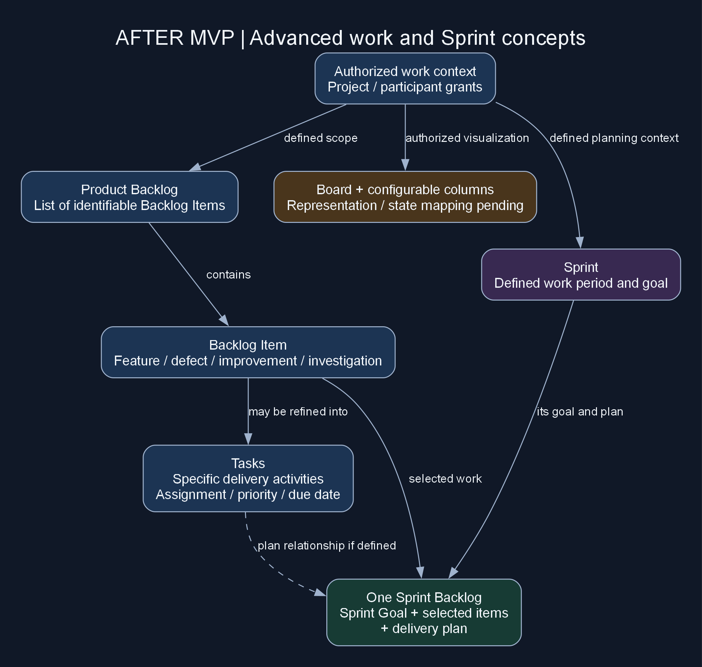

[Scalable SVG](Diagrams/Kanban-Sprint-Concept-Map.svg) ·
[Editable Graphviz](Diagrams/Kanban-Sprint-Concept-Map.dot)

Arrows express conceptual relationships, not storage cardinalities or mandatory
screen layouts. The board's represented entities and state mapping remain open.
Colors supplement labels. Work-management project grants do not automatically
grant repository, email or professional-profile access.

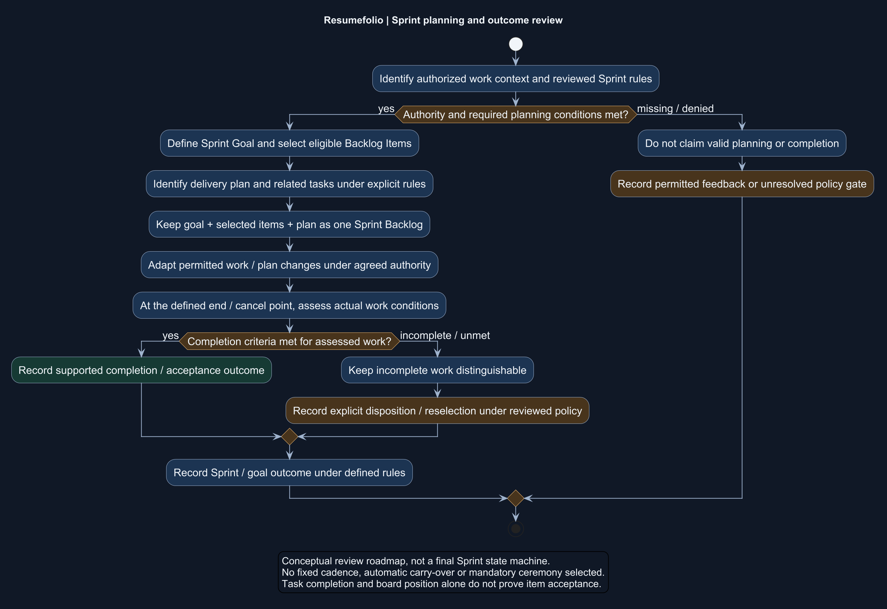

[Scalable SVG](Diagrams/Sprint-Planning-Review-Flow.svg) ·
[Editable PlantUML](Diagrams/Sprint-Planning-Review-Flow.puml)

This is a requirements roadmap, not the final Sprint state machine, a dated
schedule or required ceremony sequence. Rules for start/end/cancel, allowed plan
changes and incomplete work need explicit decisions. No automatic carry-over is selected.

<a id="requirements-specification-projects-kanban-and-sprints--heading-5-planned-verification"></a>
##### 5. Planned Verification

| Family | Candidates | Cases to develop |
| --- | --- | --- |
| Context/board | PKS-D01/D02 | Valid/invalid creation, configured columns, denied moves and occupied-column removal |
| Backlog/refinement | PKS-D03/D04 | Item types/order, one item refined into tasks, changed parent and incomplete children  **Advanced paths after MVP; any retained core/basic path follows the release register.** |
| Coordination/access | PKS-D05/D06 | Eligibility, priority/date meaning, changed membership and cross-user direct operations |
| Sprint composite | PKS-D07/D08 | Goal, selected item identities, delivery plan and changed-plan consistency  **Advanced paths after MVP; any retained core/basic path follows the release register.** |
| Completion | PKS-D09 | Unmet criteria, Sprint end/cancel, incomplete work and deliberate reselection  **Advanced paths after MVP; any retained core/basic path follows the release register.** |
| Links/reporting | PKS-D10 | Only agreed links/reports/automations; permission/filter/time and failure cases  **Advanced paths after MVP; any retained core/basic path follows the release register.** |
| Lifecycle | PKS-D11 | Concurrent/failed change, reference-aware removal and isolated restoration |

A later end-to-end example can create a project/board, refine a feature item into
tasks, assign eligible participants and select the item for a goal-directed
Sprint. Change a task's column and compare task versus item completion, then end
the Sprint with incomplete work and inspect its explicit disposition. Include
unauthorized requests and a changed-membership case.

Each later run records candidate/policy revision, actor/grants, work identities,
initial state, operations, expected/actual outcomes and evidence limits. Use
synthetic controlled work data. The project's current GitHub board is not product
test evidence, and no product scenario above is recorded as Pass.

<a id="requirements-specification-projects-kanban-and-sprints--heading-6-open-decisions-and-gates"></a>
##### 6. Open Decisions and Gates

| Topic | Decisions/evidence needed | Dependent gate |
| --- | --- | --- |
| Structure/relationships | Project/board/backlog scope, represented card types, item/task/Sprint cardinalities | Affected M-02 acceptance; GAP-D06 |
| Columns/workflow | State mapping, move/order, invalid transitions, occupied-column removal and concurrent changes | Before accepting workflow criteria/data design |
| Backlog/task fields | Required fields, types/order, refinement, dependencies and completion aggregation | Affected dictionary/requirements review |
| Collaboration | Role/action matrix, invites, assignment eligibility, ownership and revoked access | Access requirements/security design |
| Sprint planning | Goal/dates, eligible work, plan representation, allowed changes, concurrent Sprints | Before accepting Sprint behavior/design |
| Completion/end | Criteria/evidence/authority, goal outcome, incomplete work, correction and carry-over | Before accepting completion/history behavior |
| Calendar/Git/reports/automation | Actual required links/rules/views, time/calculation meaning, authority and side effects | Related requirements; GAP-D02 for provider-dependent access |
| Failure/lifecycle/recovery | Conflicts/retries, reference effects, retention, backup coverage and restored access | Lifecycle/design; GAP-D04 and actual restoration before M-09 |

Farhad coordinates all topics. These are local review topics, not allocated shared
question IDs or accepted policies. Use [Questions and Decisions](#change-and-baseline-open-questions-and-decisions),
retain [Planning Gates](https://github.com/Farhad-V/Web-Resumefolio/blob/1f2acaa351ac306cb57cbe4fe9742e8bd90720d9/docs/MVP/SDLC/01-project-planning/10-planning-completion-criteria.md)
and route material changes through [Change Control](#change-and-baseline-change-control).
Missing detail does not silently remove an agreed capability or prove feasibility.

<a id="requirements-specification-projects-kanban-and-sprints--heading-7-traceability-and-review-readiness"></a>
##### 7. Traceability and Review Readiness

| Candidate group | Source basis | Related records |
| --- | --- | --- |
| PKS-D01–D05 | DEC-021 | Dictionary work concepts, interface interaction and BRL-D validation/time |
| PKS-D06 | DEC-021/028 | ACC-D grants, explicit action matrix and revoked membership |
| PKS-D07–D09 | DEC-021 plus proposed detailed planning/completion refinements | Backlog/item/task/Sprint definitions and completion scenarios  **Advanced paths after MVP; any retained core/basic path follows the release register.** |
| PKS-D10 | DEC-021/022/020 and open reporting/automation definitions | EGC-D calendar/reminders, GIT-D08 issue distinction, explicit refinements  **Advanced paths after MVP; any retained core/basic path follows the release register.** |
| PKS-D11 | DEC-017/028 plus proposed lifecycle/failure detail | BRL-D retirement/recovery and quality requirements |

Use the [requirement template](#requirements-specification-requirements-specification) when allocating
final IDs. Maintain actual links in [Traceability](#validation-and-traceability-validation-and-traceability--heading-traceability)
and real review outcomes in [Review Findings](#validation-and-traceability-validation-and-traceability--heading-review-findings).

- [ ] Reconcile provisional PKS IDs and assign justified priorities.
- [ ] Review source-derived semantics separately from proposed workflow refinements.
- [ ] Decide relationships, fields, permissions, transitions and completion policies blocking criteria.
- [ ] Verify goal, selected items and delivery plan remain one coherent Sprint Backlog.
- [ ] Reconcile provider/repository relationships, task/item completion and lifecycle effects.
- [ ] Record owner decision, reviewed revision and later actual evidence without invented Pass results.

**Current outcome:** Proposed product specification; no PKS candidate is accepted,
no workflow/role scheme or numerical limit is newly decided, and no product test
result is recorded. M-02 and the wider pre-implementation agreement remain
pending. This revision changes no live project/board/Sprint or accepted scope.

<a id="requirements-specification-projects-kanban-and-sprints--heading-8-diagram-maintenance"></a>
##### 8. Diagram Maintenance

| Diagram | Source | SVG | PNG |
| --- | --- | --- | --- |
| Work and Sprint concepts | [Graphviz](Diagrams/Kanban-Sprint-Concept-Map.dot) | [SVG](Diagrams/Kanban-Sprint-Concept-Map.svg) |  |
| Sprint planning review | [PlantUML](Diagrams/Sprint-Planning-Review-Flow.puml) | [SVG](Diagrams/Sprint-Planning-Review-Flow.svg) |  |

Keep text, captions, sources and renders synchronized. Follow the
[diagram guide](Diagrams/Diagram-Catalog.md); inspect readable arrows/labels and verify
file/section links after changes. Run from the repository root:

```powershell
$diagramFolder = 'docs\MVP\SDLC\02-requirements-engineering\diagrams'
$graphvizExe = 'C:\Program Files\Graphviz\bin\dot.exe'
$plantUmlJar = 'C:\Users\fvali\AppData\Local\Resumefolio\DiagramTools\plantuml.jar'
foreach ($format in 'svg', 'png') {
    & $graphvizExe "-T$format" -Gdpi=140 "$diagramFolder\kanban-sprint-concept-map.dot" -o "$diagramFolder\kanban-sprint-concept-map.$format"
    if ($LASTEXITCODE -ne 0) { throw "Graphviz failed: $format" }
    java '-Djava.awt.headless=true' -jar $plantUmlJar -charset UTF-8 "-t$format" "$diagramFolder\sprint-planning-review-flow.puml"
    if ($LASTEXITCODE -ne 0) { throw "PlantUML failed: $format" }
}
```

Use actual installed paths on other machines; save UTF-8 without BOM.

[Specification index](#requirements-specification-requirements-specification-overview) · [SRS entry point](#requirements-specification-requirements-specification)
· [Requirements index]()

<a id="requirements-specification-projects-kanban-and-sprints--heading-selected-policies-and-future-proposals"></a>
##### Selected Policies and Future Proposals

Current MVP answers are selected in the Baseline. Only explicitly deferred details below remain proposals; product tests and operational evidence are still required.

<a id="requirements-specification-projects-kanban-and-sprints--id-resolution-q-d18"></a>
<a id="requirements-specification-projects-kanban-and-sprints--heading-proposed-answer-q-d18-work-structures-and-workflow"></a>
###### Proposed answer Q-D18: Work structures and workflow

**Affected records:** PKS-D01–PKS-D06; dictionary project-board/backlog-item/task. **Disposition:** MVP slice selected in [Q-D18](https://github.com/Farhad-V/Web-Resumefolio/blob/1f2acaa351ac306cb57cbe4fe9742e8bd90720d9/docs/MVP/baseline/policy-decisions.md#q-d18); advanced future details below remain proposals.

1. Propose one Product Backlog per work project, any number of project boards and Sprints, and no implicit relationship to a portfolio project or Git repository. A Backlog Item belongs to one project/backlog and may contain tasks; a task has at most one parent item and may be an explicitly standalone project task.

2. Require item title and type (feature, defect, improvement or investigation); require acceptance criteria before an item is marked Ready. Task requires title, status and optional eligible assignee/due date. Priority values are Must/Should/Could/Won't with independent explicit ordering; Won't is a reviewed exclusion for that planning horizon, not silent deletion of accepted Version 1 scope.

3. Use canonical work states To do, In progress and Done; permit configured board columns to map to these states. A card represents a selected item or task explicitly. Column names/order are presentation; Done requires the item's acceptance or task's completion check, not just drag-and-drop.

4. Project owners/editors can manage work under grants; viewers cannot. Removing an occupied column requires a confirmed target mapping for its cards. Concurrent item movement/save checks the known revision and reports conflicts. Removal of a member clears/reassigns active assignments explicitly while preserving history.

**Assessable review cases:** [RC-Q18-01 through RC-Q18-03](#scenarios-and-models-user-stories-and-scenarios--id-review-q-d18). These are planned checks, not executed results.

**Remaining evidence / acceptance condition:** Owner review of the proposed rule and its affected criteria is required; no product test is reported.

<a id="requirements-specification-projects-kanban-and-sprints--id-resolution-q-d19"></a>
<a id="requirements-specification-projects-kanban-and-sprints--heading-proposed-answer-q-d19-sprint-backlog-and-incomplete-work"></a>
###### Proposed answer Q-D19: Sprint Backlog and incomplete work

**Affected records:** PKS-D07–PKS-D09/D11; UC-D07. **Disposition:** Answer proposed; owner acceptance pending.

1. One Sprint Backlog comprises a required Sprint Goal, selected Backlog Items and delivery plan/tasks. A board is a view, not a second Sprint Backlog. Sprint has project, label, start/end and state Planned/Active/Completed/Cancelled; end must follow start. Propose at most one Active Sprint per project.

2. Project owner starts/ends/cancels a Sprint; editors refine its plan under grants. Changes to goal/selected scope during Active require explicit owner confirmation with reason and retained history. No mandatory fixed cadence is inferred; propose two-week planning as an optional initial working choice, not a product invariant.

3. Item completion requires its reviewed criteria and authorized acceptance, even if all tasks are marked done; project owner accepts items, editors may submit completion for review. Sprint completion records actual outcome against goal and item status; the elapsed date does not imply success.

4. On end/cancel, retain the historical Sprint Goal, selected items/plan and actual outcomes. Incomplete items return to the Product Backlog with their current state and history. Moving them into another Sprint is explicit selection; no automatic carry-over or rewriting of the earlier Sprint.

**Assessable review cases:** [RC-Q19-01 through RC-Q19-03](#scenarios-and-models-user-stories-and-scenarios--id-review-q-d19). These are planned checks, not executed results.

**Remaining evidence / acceptance condition:** Owner review of the proposed rule and its affected criteria is required; no product test is reported.

<a id="requirements-specification-projects-kanban-and-sprints--id-resolution-q-d20"></a>
<a id="requirements-specification-projects-kanban-and-sprints--heading-proposed-answer-q-d20-cross-module-associations-and-bounded-reporting"></a>
###### Proposed answer Q-D20: Cross-module associations and bounded reporting

**Affected records:** PKS-D10; EGC-D09/D10; GIT-D08; EIF-D. **Disposition:** MVP slice selected in [Q-D20](https://github.com/Farhad-V/Web-Resumefolio/blob/1f2acaa351ac306cb57cbe4fe9742e8bd90720d9/docs/MVP/baseline/policy-decisions.md#q-d20); advanced future details below remain proposals.

1. Provide explicit links between an application and permitted work items/calendar/correspondence, and between a work item and permitted repository issue/request/commit. Link meaning is association, not ownership transfer, content copying or access grant. Keep professional project, work project and Git repository identities separate.

2. Propose bounded views: applications by recorded progress/deadline; project items by state/priority/assignee; Sprint goal/outcome and completed/incomplete counts. Define counts on distinct authorized records, preserve filters/time zone and label unknown/missing data; do not count tasks as accepted items.

3. Only explicit scoped reminders and separately defined workflow triggers automate action. A link, due date, commit or email alone does not send mail, alter application progress, mark work complete or deploy. A generic automation/report-builder is not introduced by these requirements.

4. Handle deleted/inaccessible link targets as unavailable without disclosing their private metadata. Re-evaluate resource authority on follow-through and report partial views when dependencies are unavailable rather than inventing a complete count.

**Assessable review cases:** [RC-Q20-01 through RC-Q20-03](#scenarios-and-models-user-stories-and-scenarios--id-review-q-d20). These are planned checks, not executed results.

**Remaining evidence / acceptance condition:** Owner review of the proposed rule and its affected criteria is required; no product test is reported.

</details>

<a id="requirements-specification-quality-security-and-recovery-requirements"></a>

<details>
<summary>Resumefolio — Quality, Security and Recovery Requirements</summary>

<a id="requirements-specification-quality-security-and-recovery-requirements--heading-resumefolio--quality-security-and-recovery-requirements"></a>
#### Resumefolio — Quality, Security and Recovery Requirements

Current implementation choices and scope: [Baseline](https://github.com/Farhad-V/Web-Resumefolio/blob/1f2acaa351ac306cb57cbe4fe9742e8bd90720d9/docs/MVP/baseline/README.md). Runtime verification remains subject to its gates.

| Item | Current position |
| --- | --- |
| Owner | Farhad; sole delivery and operations owner |
| Status | Proposed quality specification — numerical targets, detailed controls and acceptance pending |
| Basis | Accepted scope/resource constraints; DEC-017/018/019/024/025/028 and planning follow-up |
| Candidate references | QSR-D01–QSR-D14 are provisional document-local references, not allocated global requirement IDs |
| Priority | Unassigned; order does not establish delivery priority or an accepted risk rating |
| Revision | October 31, 2026 |

**At a glance:** Evaluate quality against explicit conditions and observable
criteria. Protect resource boundaries, preserve truthful and consistent outcomes,
and demonstrate recovery of the required data and access state. Targets and
controls need decisions and evidence; a document, backup file or successful page
load is not a verified quality, security or recovery result.

[Basis](#requirements-specification-quality-security-and-recovery-requirements--heading-1-purpose-and-boundaries) · [Measurement](#requirements-specification-quality-security-and-recovery-requirements--heading-2-quality-scenario-and-measurement-contract)
· [Requirements](#requirements-specification-quality-security-and-recovery-requirements--heading-3-proposed-requirements) · [Recovery](#requirements-specification-quality-security-and-recovery-requirements--heading-4-recovery-coverage-and-consistency)
· [Roadmap](#requirements-specification-quality-security-and-recovery-requirements--heading-5-evidence-and-recovery-roadmap) · [Gates](#requirements-specification-quality-security-and-recovery-requirements--heading-7-open-targets-and-decision-gates)
· [Review](#requirements-specification-quality-security-and-recovery-requirements--heading-8-traceability-and-review-readiness)

<a id="requirements-specification-quality-security-and-recovery-requirements--heading-1-purpose-and-boundaries"></a>
##### 1. Purpose and Boundaries

Specify cross-cutting quality, security, operational and recovery obligations for
the full [Version 1 Scope](../01-Project-Planning/01-Project-Charter.md#mvp-scope), including
professional presentation, controlled sharing, manual applications, Gmail/calendar,
Kanban, real Git and conditional workflow execution. Domain documents retain
their detailed behavior; these requirements add evaluation conditions and evidence needs.

| Authority / reference | Boundary to retain |
| --- | --- |
| [Resources and Constraints](../01-Project-Planning/03-Feasibility-And-Risk-Assessment.md#resource-constraints) | Existing resources/budget, solo operation and Laravel/OOP; actual capacity unverified |
| [Risks](../01-Project-Planning/03-Feasibility-And-Risk-Assessment.md#risks-and-verification) | Existing resource, access, execution, data-loss and operational risks; no new rating assigned |
| [Planning Gates](https://github.com/Farhad-V/Web-Resumefolio/blob/1f2acaa351ac306cb57cbe4fe9742e8bd90720d9/docs/MVP/SDLC/01-project-planning/10-planning-completion-criteria.md) | Planning-only acceptance; relevant GAP-D investigations remain open |
| [Roadmap and Milestones](../01-Project-Planning/02-Project-Management-Plan.md#delivery-sequence) | Design evidence in M-03; controls before execution/M-08; integrated quality/restoration before M-09; live deployment evidence for M-10 |
| [Accounts](#requirements-specification-accounts-authentication-and-permissions) / [PDF and Sharing](#requirements-specification-pdf-and-controlled-sharing) | Resource-specific authority and direct-file protection; detailed session/revocation policy pending |
| [Business Lifecycle](#requirements-specification-business-rules-and-data-lifecycle) / [Data Dictionary](#data-definitions-data-dictionary) | Source/history separation, references, retention and restored access |
| [External Interfaces](#requirements-specification-external-interface-requirements) / [Files and Operations](#requirements-specification-administration-files-and-operational-behavior) | Supported clients, truthful boundaries, effective quotas and failed-operation handling |
| [Google Integration](#requirements-specification-email-calendar-and-google-integration) / [Git Hosting](#requirements-specification-git-hosting-and-collaboration) / [YAML and CI/CD](#requirements-specification-yaml-workflows-and-cicd) | Actual provider/client evidence and distinct execution/deployment authority |

The initial target is 10 users, not 10 simultaneous active sessions or an agreed
load model. Approximately 1,000 users is a growth direction, not demonstrated
capacity. The requested November 8, 2026 date is not a validated delivery forecast.
No target below invents an availability percentage, response-time limit,
retention period, RPO/RTO, browser support list or security certification.

<a id="requirements-specification-quality-security-and-recovery-requirements--heading-2-quality-scenario-and-measurement-contract"></a>
##### 2. Quality Scenario and Measurement Contract

Each measurable quality record needs the following before acceptance. Qualitative
security/integrity invariants can be tested with explicit allowed/denied examples;
they need no invented numerical threshold. Quantitative criteria remain incomplete
until values, workload and methods are agreed.

| Field | Definition to record |
| --- | --- |
| Source and rationale | Objective/scope/risk, affected workflow, owner, status and priority |
| Stimulus and source | Who/what initiates a request, load, fault, change or recovery event |
| Environment and data | Candidate/version, hosting/client/provider configuration, representative data volume and state |
| Workload / interval | Concurrent actors/jobs, request mix, payloads, duration, background/competing services and sampling window |
| Expected response | Observable correct result, denied action, degraded state or recovery condition |
| Measure and threshold | Units, timing boundaries, aggregation/percentiles if chosen, target and allowed exceptions |
| Method and evidence | Planned check, instrumentation, repeat conditions, actual result and evidence limits |
| Decision and gate | Applicability, unresolved blockers, accepted/deferred outcome, reviewed revision and responsible owner |

Example **template, not a decided target**: for an agreed resume-view scenario,
under the recorded concurrent request mix/data/environment, measure the chosen
response interval and error outcome against owner-reviewed thresholds. The test
definition must state whether client rendering, network and backend work are
included. A measured average alone does not establish a tail-latency criterion.

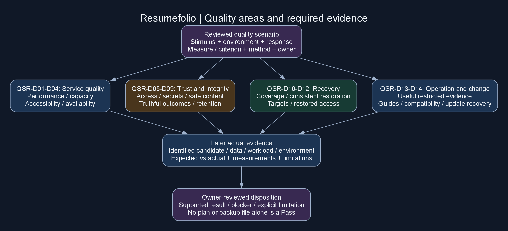

[Scalable SVG](Diagrams/Quality-Evidence-Map.svg) ·
[Editable Graphviz](Diagrams/Quality-Evidence-Map.dot)

Branches group evaluation areas, not independent services, scores or Pass results.
Colors supplement labels. All areas require bounded evidence for their own criteria.

<a id="requirements-specification-quality-security-and-recovery-requirements--heading-3-proposed-requirements"></a>
##### 3. Proposed Requirements

All candidates are **Proposed**, owner **Farhad**, priority **Unassigned**.
Conditions below identify scenario contexts, not newly approved operational actions.
Conditional criteria remain acceptance-blocked until the relevant policies are decided.

<a id="requirements-specification-quality-security-and-recovery-requirements--heading-qsr-d01-response-performance-under-defined-workloads"></a>
###### QSR-D01: Response Performance Under Defined Workloads

**Release allocation (owner decision, November 4):** MVP foundation where used by core/basic ProjectForge; future-domain clauses deferred.

**Source / rationale:** Initial deployment scope and resource follow-up; assess
user-visible response with real workload assumptions rather than account count.

**Conditions / proposed obligation:** For agreed core interactive/transfer workflows,
the product shall meet reviewed response and error criteria under defined workload,
data and environment conditions.

**Acceptance criteria**
- Each selected workflow has explicit timing boundaries, measurement/aggregation, threshold and workload definition before performance acceptance.
- Later results record actual durations/errors and compare them with that exact criterion, including relevant warm/cold or processing states if selected.
- A failed/partial operation is not counted as a successful fast response merely because it returned quickly.

**Planned verification:** Later bounded representative load and content/transfer
measurements. **Open detail:** Workflow list, latency/throughput/error values,
percentiles, duration, devices/network and concurrent/background mix; no seconds or TPS target set.

<a id="requirements-specification-quality-security-and-recovery-requirements--heading-qsr-d02-combined-capacity-and-bounded-resource-use"></a>
###### QSR-D02: Combined Capacity and Bounded Resource Use

**Release allocation (owner decision, November 4):** MVP foundation where used by core/basic ProjectForge; future-domain clauses deferred.

**Source / rationale:** DEC-013/018/019 and GAP-D01/D10; media, Git and jobs share existing resources.

**Conditions / proposed obligation:** Under the reviewed combined workload, resource
admission and effective limits shall respect actual infrastructure while preserving
defined outcomes for other required workflows.

**Acceptance criteria**
- The capacity model identifies data/file/repository volumes, concurrent activity, processing/jobs and competing services rather than equating users with concurrency.
- Defined quota/limit/saturation cases produce the reviewed admission, warning or failure outcome without falsely completing work.
- Larger-growth claims are supported only for the evaluated configuration/workload; initial results are not extrapolated as proven 1,000-user capacity.

**Planned verification:** Later server findings, bounded combined-load and effective
limit checks. **Open detail:** CPU/memory/disk/network budgets, queue/concurrency
limits, warning thresholds, accounting and workload targets; no resource purchase assumed.

<a id="requirements-specification-quality-security-and-recovery-requirements--heading-qsr-d03-operable-accessible-and-compatible-interaction"></a>
###### QSR-D03: Operable, Accessible and Compatible Interaction

**Release allocation (owner decision, November 4):** MVP foundation where used by core/basic ProjectForge; future-domain clauses deferred.

**Source / rationale:** Proposed quality refinement of core user/employer workflows;
users must understand and operate permitted actions in supported clients.

**Conditions / proposed obligation:** Agreed workflows shall satisfy reviewed usability,
accessibility and client/layout criteria with clear input and outcome feedback.

**Acceptance criteria**
- Representative tasks can be completed under the agreed client/viewport/input matrix with required labels, keyboard/focus and error behavior.
- Loading, empty, invalid, denied, incomplete and successful states are distinguishable without relying on color alone.
- English/German content and long/media-rich examples follow defined layout/language rules rather than hiding required actions or silently fabricating translations.

**Planned verification:** Later task walkthrough, selected assistive/keyboard and
client/layout checks. **Open detail:** Supported clients, accessibility standard/level,
task metrics, screen sizes and interface languages; no conformance claim or native app requirement.

<a id="requirements-specification-quality-security-and-recovery-requirements--heading-qsr-d04-observable-availability-and-controlled-degradation"></a>
###### QSR-D04: Observable Availability and Controlled Degradation

**Release allocation (owner decision, November 4):** MVP foundation where used by core/basic ProjectForge; future-domain clauses deferred.

**Source / rationale:** DEC-017 and proposed reliability refinement; service or provider
failure must not be mistaken for usable current functionality.

**Conditions / proposed obligation:** Required service paths shall meet agreed availability
criteria and expose defined unavailable/degraded behavior when dependencies fail.

**Acceptance criteria**
- Availability evaluation defines covered paths, observation interval, success/degradation criteria and maintenance treatment before setting a target.
- Controlled local/provider outages produce reviewed bounded feedback rather than false current data, send success or recovery completion.
- Recovery from interruption reconciles pending/unknown work under operation-specific policy without assuming safe blind repetition.

**Planned verification:** Later permitted outage/dependency cases and observation
review. **Open detail:** Percentage/window, planned maintenance, detection and
restoration thresholds, local/provider boundaries and fallback behavior; no SLA assumed.

<a id="requirements-specification-quality-security-and-recovery-requirements--heading-qsr-d05-identity-resource-isolation-and-changed-access"></a>
###### QSR-D05: Identity, Resource Isolation and Changed Access

**Release allocation (owner decision, November 4):** MVP foundation where used by core/basic ProjectForge; future-domain clauses deferred.

**Source / rationale:** DEC-028/024/025; valid sign-in and shared links do not grant unrelated authority.

**Conditions / proposed obligation:** Protected UI, file, provider, Git and execution
operations shall enforce the reviewed identity/resource/action/state rules across entry paths.

**Acceptance criteria**
- Allowed/denied cross-user and altered-reference cases preserve private resources, including direct files/PDFs and non-browser clients.
- Board collaboration grants no unrelated private mail/resume/repository access; employer viewing remains selected-content only.
- Membership/password/link/credential changes produce the explicit new-request and existing-session outcomes required by their reviewed policies.

**Planned verification:** Later actor/action/path matrix, cross-user and changed-grant
checks. **Open detail:** Signup, authentication factors, MFA if chosen, sessions,
credential lifetime, abuse controls, in-flight/cached revocation and admin powers;
these are not silently established by a generic security statement.

<a id="requirements-specification-quality-security-and-recovery-requirements--heading-qsr-d06-sensitive-information-and-secret-protection"></a>
###### QSR-D06: Sensitive Information and Secret Protection

**Release allocation (owner decision, November 4):** MVP foundation where used by core/basic ProjectForge; future-domain clauses deferred.

**Source / rationale:** Accepted credential-handling resource constraints and proposed
security/privacy refinement for provider, repository and operational access.

**Conditions / proposed obligation:** Sensitive content and secrets shall be handled
only through reviewed access, transport, persistence, diagnostic and lifecycle controls.

**Acceptance criteria**
- Ordinary logs/errors/repository examples expose no passwords, tokens, private keys or authentication codes.
- Defined private content and backup/configuration access cases are restricted to explicitly permitted actors/operations.
- Later selected transport/storage/credential mechanisms have documented protection, renewal/revocation and recovery behavior with actual configuration evidence.

**Planned verification:** Later secret-safe output/configuration inspection and
access/transport cases without disclosing real values. **Open detail:** Exact
classification, TLS coverage, at-rest protection/key handling, password/token
mechanisms, retention and notices/applicability; no cipher/version or legal compliance claim.

<a id="requirements-specification-quality-security-and-recovery-requirements--heading-qsr-d07-safe-content-and-untrusted-execution-boundaries"></a>
###### QSR-D07: Safe Content and Untrusted Execution Boundaries

**Release allocation (owner decision, November 4):** Split — MVP safe content; untrusted workflow execution deferred.

**Source / rationale:** DEC-026/018/019; uploaded content, repository code and workflow
definitions are not trusted merely because an authorized user supplied them.

**Conditions / proposed obligation:** Content validation/serving and conditional execution
shall enforce reviewed isolation, authority, secret, network and resource boundaries.

**Acceptance criteria**
- Selected malformed/unsupported/unsafe content cases follow reviewed rejection or safe-display rules without unauthorized disclosure/action.
- Before enabling jobs, controlled execution checks verify required isolation, permissions, secret/output access, limits and cleanup in the selected environment.
- A Push/merge/workflow result does not inherently authorize production deployment; target actions require defined approval/authority.

**Planned verification:** Later controlled content/security examples and isolated
execution checks after feasibility gates. **Open detail:** Validation depth,
safe rendering/embeds, runner, network permissions, package/dependency controls,
security criteria and limits; no scanner, sandbox product or universal workflow compatibility selected.

<a id="requirements-specification-quality-security-and-recovery-requirements--heading-qsr-d08-data-integrity-and-truthful-completion"></a>
###### QSR-D08: Data Integrity and Truthful Completion

**Release allocation (owner decision, November 4):** MVP foundation where used by core/basic ProjectForge; future-domain clauses deferred.

**Source / rationale:** DEC-023/027/022 and proposed cross-module integrity refinement;
partial, concurrent and repeated work must preserve business meaning.

**Conditions / proposed obligation:** Save, transfer, capture, synchronization and state
changes shall preserve reviewed invariants and distinguish actual completion from
failure, partial work, conflict and unknown external outcomes.

**Acceptance criteria**
- Later source edits do not overwrite actual submitted resume/cover-letter material or independent resume overrides contrary to agreed propagation rules.
- Concurrent/interrupted/repeated operations follow defined conflict/reconciliation policies without false completed state or unrelated damage.
- Provider acceptance is not misrepresented as recipient delivery/read confirmation, and unknown outbound effects are not blindly repeated contrary to policy.

**Planned verification:** Later invariant comparisons, interruption/concurrency,
capture and ambiguous-provider cases. **Open detail:** Transaction/retry/deduplication
semantics, source-of-truth rules and correction; no exactly-once or zero-data-loss promise.

<a id="requirements-specification-quality-security-and-recovery-requirements--heading-qsr-d09-deliberate-retention-and-reference-aware-removal"></a>
###### QSR-D09: Deliberate Retention and Reference-aware Removal

**Release allocation (owner decision, November 4):** MVP foundation where used by core/basic ProjectForge; future-domain clauses deferred.

**Source / rationale:** Proposed lifecycle/privacy refinement of accepted data/file/history scope.

**Conditions / proposed obligation:** Archive, unlink, deletion, cleanup and retention
shall have reviewed consequences for references, historical material, provider data,
accounting and recoverability.

**Acceptance criteria**
- An eligible removal follows its explicit authority/reference policy; a missing policy does not trigger an assumed cascade.
- Source replacement/unlink does not silently destroy required submitted copies or unrelated referenced content.
- Retention/reclamation and restored-deleted-data cases follow explicit category-specific rules with partial outcomes identifiable.

**Planned verification:** Later eligible/ineligible/reference and cleanup/restore
cases. **Open detail:** Per-category durations/triggers, account closure, backup
expiry, quota release, provider deletion and applicable external obligations;
preservation does not mean retention forever, and no period is invented.

<a id="requirements-specification-quality-security-and-recovery-requirements--heading-qsr-d10-defined-protected-and-observable-backups"></a>
###### QSR-D10: Defined, Protected and Observable Backups

**Release allocation (owner decision, November 4):** MVP foundation where used by core/basic ProjectForge; future-domain clauses deferred.

**Source / rationale:** DEC-017, ASM-04/DEP-05/GAP-D04; recoverability requires covered,
accessible and protected recovery material, not an assumed provider facility.

**Conditions / proposed obligation:** The backup approach shall define coverage,
consistency, storage separation/access, scheduling/retention and failure evidence
for all information required by the selected recovery scenarios.

**Acceptance criteria**
- The coverage record includes or explicitly disposes of each subject in section 4 with dependencies and known exclusions.
- Later backup evidence identifies candidate/environment, included recovery point/material, actual outcome and access without exposing secrets.
- Missed/failed/incomplete backup work is distinguishable from successful covered backup creation under the reviewed operational policy.

**Planned verification:** Later coverage/configuration and controlled backup-failure
inspection. **Open detail:** Actual storage/capacity/location/separation, credentials/
keys, schedule, retention, integrity checks and alerts; no additional backup service
or successful job is assumed. Backup verification does not replace restoration.

<a id="requirements-specification-quality-security-and-recovery-requirements--heading-qsr-d11-demonstrated-restoration-and-recovery-targets"></a>
###### QSR-D11: Demonstrated Restoration and Recovery Targets

**Release allocation (owner decision, November 4):** MVP foundation where used by core/basic ProjectForge; future-domain clauses deferred.

**Source / rationale:** DEC-017 and M-09; actual restoration and integrity evidence
are required before integrated readiness acceptance.

**Conditions / proposed obligation:** Required recovery scenarios shall have agreed
RPO/RTO and coverage/acceptance rules, followed by demonstrated restoration in an
authorized isolated environment with actual integrity and timing results.

**Acceptance criteria**
- Before target acceptance, each scenario defines loss event, chosen recovery point, tolerable data loss, timing start/end boundaries and usable-state criteria.
- Later restoration verifies required records/artifacts/references and actual core workflow outcomes, not only extraction or process startup.
- Measured loss/time and incomplete coverage are compared with the agreed RPO/RTO and limitations; unavailable evidence is not labeled Pass.

**Planned verification:** Later isolated version/environment-specific restore drill
and workflow/integrity comparisons. **Open detail:** RPO/RTO values, scenarios,
storage/access findings, operator steps, recovery-point consistency and provider
reconciliation; no minutes/hours target or proven recovery result exists here.

<a id="requirements-specification-quality-security-and-recovery-requirements--heading-qsr-d12-safe-restored-access-and-external-state-reconciliation"></a>
###### QSR-D12: Safe Restored Access and External-state Reconciliation

**Release allocation (owner decision, November 4):** MVP foundation where used by core/basic ProjectForge; future-domain clauses deferred.

**Source / rationale:** DEC-028/024/022 and proposed recovery refinement; older backups
may contain obsolete grants, connections or pending external actions.

**Conditions / proposed obligation:** Restoration shall reconcile access and external
state under explicit policies before protected or externally consequential work is resumed.

**Acceptance criteria**
- Restored sharing links/password contexts, memberships and credentials follow the agreed treatment of later revocation rather than being blindly reactivated.
- Provider/Git/run mappings and pending send/deployment/reminder work are reconciled under defined authority/outcome rules before automatic continuation, if any.
- Known deleted-data reappearance or missing newer external changes is handled and disclosed as the reviewed recovery limitation, not silently accepted as current truth.

**Planned verification:** Later controlled old-grant, disconnect, pending-side-effect
and local/provider-divergence restoration examples. **Open detail:** Current versus
recovery-point authority, credential invalidation, deleted-data reconciliation and
resume approvals; no automatic job replay or global revocation guarantee is selected.

<a id="requirements-specification-quality-security-and-recovery-requirements--heading-qsr-d13-useful-restricted-operational-evidence"></a>
###### QSR-D13: Useful, Restricted Operational Evidence

**Release allocation (owner decision, November 4):** MVP foundation where used by core/basic ProjectForge; future-domain clauses deferred.

**Source / rationale:** Proposed operational refinement of DEC-017/018/028; solo operation
needs distinguishable failures and selected sensitive-change evidence.

**Conditions / proposed obligation:** Selected health, error, capacity and audit events
shall provide reviewed actor/context/time/outcome evidence and actionable feedback
only to authorized recipients, with privacy/secret protection.

**Acceptance criteria**
- Defined successful/failed/pending operations and selected thresholds produce the specified observable evidence or feedback.
- Selected sensitive operations are attributable under the reviewed audit policy without leaking secrets/private content into ordinary output.
- Unauthorized viewers cannot read/change protected diagnostics/audit evidence through a direct path.

**Planned verification:** Later selected event/threshold, output and access cases.
**Open detail:** Event list, integrity/mutation, sampling/time semantics, recipients,
channels, alert tolerance, retention and operator response; no immutable log,
paid monitoring tool or unattended notification job is configured here.

<a id="requirements-specification-quality-security-and-recovery-requirements--heading-qsr-d14-maintainable-verifiable-and-recoverable-changes"></a>
###### QSR-D14: Maintainable, Verifiable and Recoverable Changes

**Release allocation (owner decision, November 4):** MVP foundation where used by core/basic ProjectForge; future-domain clauses deferred.

**Source / rationale:** DEC-017, resource constraints and proposed maintainability
refinement; one owner must be able to operate the identified release.

**Conditions / proposed obligation:** Delivery/update guidance shall identify supported
configuration/dependencies, versioned procedures, verification and failure/recovery
paths with a feasible solo operational workload.

**Acceptance criteria**
- Setup/update/maintenance guidance identifies the candidate/environment, compatibility assumptions, non-secret configuration and operator responsibility.
- Later authorized procedure checks record actual results and limitations; unperformed steps are marked as such.
- Failed update/data-change scenarios have a reviewed recovery approach, including compatibility and irreversible-change limits, rather than an untested universal rollback claim.

**Planned verification:** Later guide/procedure walkthrough, selected compatibility
checks and isolated update/recovery examples. **Open detail:** Package/runtime
versions/licenses, maintenance windows, migration recovery, release checks and
operational effort; Laravel/OOP is mandated, final architecture remains unselected.

<a id="requirements-specification-quality-security-and-recovery-requirements--heading-4-recovery-coverage-and-consistency"></a>
##### 4. Recovery Coverage and Consistency

The table is a **coverage checklist**, not proof that all subjects are independently
stored or that a backup facility exists. For each selected scenario, decide include,
reconstruct or explicitly exclude, with impact/rationale and evidence.

| Subject | Recovery relationship / check |
| --- | --- |
| Accounts, grants and shares | Identity/resource permissions, disabled links and later revocation reconciliation |
| Profiles/resumes/evidence/PDFs | Required records, selected associations, actual artifacts and represented revisions |
| Applications/submitted materials | Actual preserved resume/cover-letter set and application/provenance relationships |
| Projects/backlogs/boards/Sprints | Work records, order/state, item/task/Sprint relationships and memberships |
| Git hosting | Repository objects/refs plus required PR/review/issue/release metadata and access |
| Workflow execution | Required definitions/run context/output; secrets, pending jobs and replay restrictions |
| Gmail/calendar connections/data | Required local state/mappings; current provider truth and revoked connections; not an assumed full Gmail backup |
| Configuration/required keys | Versioned non-secret configuration and protected recovery of genuinely required secret material |
| Operational/audit evidence | Selected history/retention and access/integrity requirements |

Define a consistent recovery point across interdependent records/files/repositories,
or document a safe reconciliation procedure. A submitted copy supports historical
accuracy; a backup supports recovery. Neither substitutes for the other. A locally
restored database does not restore Google state, revoke downloaded employer copies
or prove a deployment target matches the recovered release.

**RPO** specifies the permitted loss of recoverable data relative to the chosen
event/point; **RTO** specifies the permitted time to the defined usable recovered
state. Both require scenario-specific measurement boundaries and owner-reviewed
values. Schedules, job duration and file timestamps alone do not prove either target.

<a id="requirements-specification-quality-security-and-recovery-requirements--heading-5-evidence-and-recovery-roadmap"></a>
##### 5. Evidence and Recovery Roadmap

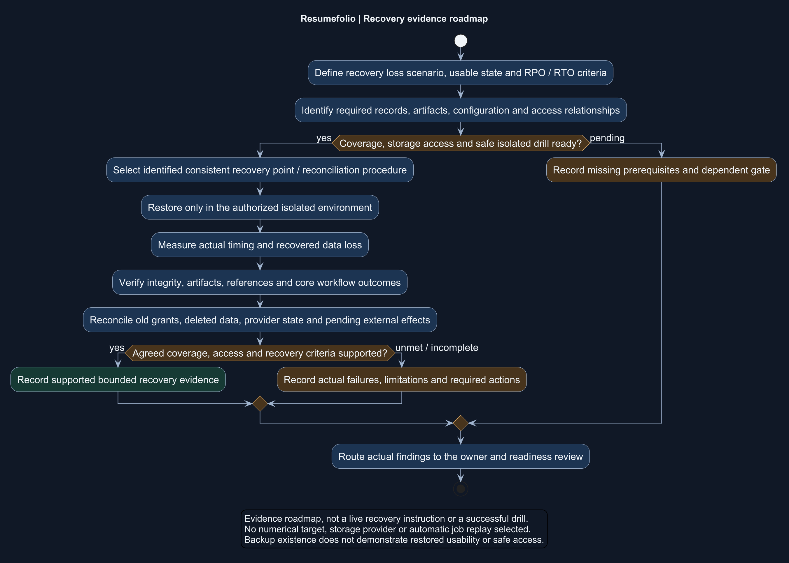

[Scalable SVG](Diagrams/Recovery-Evidence-Roadmap.svg) ·
[Editable PlantUML](Diagrams/Recovery-Evidence-Roadmap.puml)

This is an evidence roadmap, not a production recovery instruction or dated
schedule. Verify targets/coverage and protect existing data before later drills.
Do not blindly replay sends, deployments or reminders after restoring old state.
If evidence is missing or a target is missed, record a blocker/limitation and
owner disposition; do not convert a planned drill into a Pass.

<a id="requirements-specification-quality-security-and-recovery-requirements--heading-6-planned-verification-and-evidence-record"></a>
##### 6. Planned Verification and Evidence Record

| Family | Candidates | Planned coverage |
| --- | --- | --- |
| Load/capacity | QSR-D01/D02 | Core request mix, competing media/Git/jobs, saturation and actual resource envelope |
| Usability/availability | QSR-D03/D04 | Selected clients/input/languages, dependency loss and observable degradation |
| Trust boundaries | QSR-D05–D07 | Actor/action/direct paths, changed grants, secret-safe output, content and isolated execution |
| Integrity/lifecycle | QSR-D08/D09 | Concurrent/failed/repeated changes, actual submission independence and reference-aware removal |
| Backup/restoration | QSR-D10–D12 | Coverage/failure, isolated data+artifact restore, timing/loss, old grants and external reconciliation |
| Operation/change | QSR-D13/D14 | Defined events/warnings/audit, procedure checks, compatibility and update failure/recovery |

Each evidence record needs the exact requirement/criterion revision, candidate,
environment/configuration, actor/grants, data/workload, fault/stimulus, expected
and actual results, measured values, timestamps/boundaries, evidence locator,
limitations and disposition. Distinguish source inspection, configuration review,
simulation and executed product checks. A single positive case does not prove
exhaustive security or reliability. No actual product checks are recorded here.

<a id="requirements-specification-quality-security-and-recovery-requirements--heading-7-open-targets-and-decision-gates"></a>
##### 7. Open Targets and Decision Gates

| Decision topic | Definition/evidence needed | Dependent gate |
| --- | --- | --- |
| Response/capacity | Workflow/load/data model, thresholds, limits, timing/aggregation and actual resources | M-02 target review; GAP-D01/D10 before dependent M-03 design; later capability evidence |
| Client/accessibility | Supported matrix, criteria/standard if chosen and task examples | Affected requirements/design and later compatibility assessment |
| Availability/degradation | Covered paths, interval/percentage if chosen, maintenance, outage and recovery behavior | Requirements/design; actual M-09/M-10 readiness evidence |
| Identity/secrets/content | Permission/state matrix, auth/session policy, transport/storage/credential controls and safe content | Security design before dependent implementation; actual controls before acceptance |
| Execution/deployment | Isolation, grants, secrets/network/output/limits and target approvals | GAP-D09; before enabling execution and M-08 acceptance |
| Retention/diagnostics | Per-category eligibility/duration, audit/events, privacy/applicability and recipients | Lifecycle/security/operations acceptance |
| Backups/recovery | Storage/coverage/consistency, RPO/RTO and isolated drill plan | ASM-04/DEP-05/GAP-D04; M-03 design and actual restoration before M-09 |
| Delivery/dependencies | Actual notification/provider conditions, runtime/license compatibility and solo workload | GAP-D02/D03/D08; dependent design and release checks |
| Upgrade/reconciliation | Failed-change recovery, old grants/deleted data, pending external effects and data compatibility | Before affected maintenance/recovery acceptance |

Farhad coordinates all rows. These are local review topics, not newly allocated
shared decisions. Use [Questions and Decisions](#change-and-baseline-open-questions-and-decisions),
[Feasibility](#process-and-approach-02-feasibility-study) and
[Change Control](#change-and-baseline-change-control). Material resource,
scope, cost or schedule conflicts need an explicit owner disposition; no reduced
scope or extra paid service is silently assumed.

<a id="requirements-specification-quality-security-and-recovery-requirements--heading-8-traceability-and-review-readiness"></a>
##### 8. Traceability and Review Readiness

| Group | Basis / related records |
| --- | --- |
| QSR-D01–D04 | Initial deployment/resource direction, proposed measurable quality; EIF-D interaction contracts |
| QSR-D05–D07 | DEC-028/024/025/026/019, credential constraints; ACC-D/PDF-D/AFO-D and conditional execution rules |
| QSR-D08/D09 | DEC-023/027/022 and proposed integrity/retention detail; BRL-D/APP-D/PRP-D/EGC-D invariants |
| QSR-D10–D12 | DEC-017/GAP-D04 plus proposed restored-access refinement; required data/operation recovery coverage |
| QSR-D13/D14 | DEC-017/018/028 and proposed operational/change refinements; AFO-D09–D12 and actual guides |

Use the [requirement template](#requirements-specification-requirements-specification), maintain
allocated links in [Traceability](#validation-and-traceability-validation-and-traceability--heading-traceability)
and real inspection outcomes in [Review Findings](#validation-and-traceability-validation-and-traceability--heading-review-findings).

- [ ] Reconcile provisional IDs, risk-based priorities and exact source references.
- [ ] Review scope-derived invariants separately from proposed quality/control detail.
- [ ] Decide quantitative targets with workload/method/boundaries and realistic evidence.
- [ ] Complete permission, failure, lifecycle, backup and restored-access policies.
- [ ] Reconcile all domain criteria and actual provider/resource findings.
- [ ] Retain actual controlled verification and restoration evidence before dependent readiness acceptance.
- [ ] Record reviewed revision, owner decisions and release blockers; no planned result becomes Pass.

**Current outcome:** Proposed quality specification. No QSR candidate, numerical
target, security certification, legal compliance claim or recovery result is accepted
by this revision. M-02 and later readiness milestones remain pending. No load,
security, backup, restoration, cleanup or production change is executed here.

<a id="requirements-specification-quality-security-and-recovery-requirements--heading-9-diagram-maintenance"></a>
##### 9. Diagram Maintenance

| Diagram | Source | SVG | PNG |
| --- | --- | --- | --- |
| Quality evidence areas | [Graphviz](Diagrams/Quality-Evidence-Map.dot) | [SVG](Diagrams/Quality-Evidence-Map.svg) |  |
| Recovery evidence roadmap | [PlantUML](Diagrams/Recovery-Evidence-Roadmap.puml) | [SVG](Diagrams/Recovery-Evidence-Roadmap.svg) |  |

Keep sources, captions and renders synchronized. Follow the
[diagram guide](Diagrams/Diagram-Catalog.md); inspect readable labels/arrows and verify
file/section links after changes. Run from the repository root:

```powershell
$diagramFolder = 'docs\MVP\SDLC\02-requirements-engineering\diagrams'
$graphvizExe = 'C:\Program Files\Graphviz\bin\dot.exe'
$plantUmlJar = 'C:\Users\fvali\AppData\Local\Resumefolio\DiagramTools\plantuml.jar'
foreach ($format in 'svg', 'png') {
    & $graphvizExe "-T$format" -Gdpi=140 "$diagramFolder\quality-evidence-map.dot" -o "$diagramFolder\quality-evidence-map.$format"
    if ($LASTEXITCODE -ne 0) { throw "Graphviz failed: $format" }
    java '-Djava.awt.headless=true' -jar $plantUmlJar -charset UTF-8 "-t$format" "$diagramFolder\recovery-evidence-roadmap.puml"
    if ($LASTEXITCODE -ne 0) { throw "PlantUML failed: $format" }
}
```

Use actual installed paths on other machines; save UTF-8 without BOM.

[Specification index](#requirements-specification-requirements-specification-overview) · [SRS entry point](#requirements-specification-requirements-specification)
· [Requirements index]()

<a id="requirements-specification-quality-security-and-recovery-requirements--heading-target-decision-contracts--quantitative-acceptance-blockers"></a>
##### Target Decision Contracts — Quantitative Acceptance Blockers

**Actual owner input, November 1, 2026:** In this conversation the owner confirmed that no previous numerical response/recovery targets are available. This supplies provenance for the open status; it does not authorize arbitrary values. Q-D25/Q-D26 remain open. Missing numerical targets block affected quantitative acceptance, not all conceptual analysis.

| Subject / record | Operation and measurement contract to complete | Evidence needed before choosing a value | Decision gate |
| --- | --- | --- | --- |
| Response / QSR-D01 | Select core journeys; define start/end events, latency unit, percentile/aggregation, failure treatment, cold/warm state and sampling interval. | Representative payload/data size, client/network conditions, concurrent mix and inspected shared server constraints. No latency/throughput value accepted. | Owner target review under Q-D25 before performance requirement acceptance. |
| Capacity / QSR-D02 | Define user activity, concurrent requests/jobs, data/file/repository volumes, growth interval and saturation outcome separately. | Actual CPU/memory/disk/network capacity and competing workloads; initial 10 users is not 10 concurrent jobs or verified capacity. | Q-D24/Q-D25 and GAP-D01/D10 before dependent capacity commitments. |
| Usability/accessibility / QSR-D03 | Select tasks, supported clients/viewports/input modes and applicable accessibility checks; define task success/error measurement. | Actual target-user/client needs and a justified standard/level selection; no conformance claim made. | Q-D25 before affected quality acceptance. |
| Availability / QSR-D04 | Define covered paths, observation interval, usable/unavailable/degraded states and maintenance treatment before choosing a ratio. | Dependency/outage assumptions and actual operating capacity/coverage. | Q-D25 before availability acceptance. |
| Data loss / QSR-D11 | Define loss event, business-consistent recovery point, tolerable lost information and RPO unit/boundary. | Backup coverage/storage findings and business loss tolerance; backup existence alone is insufficient. | Q-D26/GAP-D04 before recovery-target acceptance. |
| Recovery time / QSR-D11/D12 | Define timing start/end and usable core workflows, restored access and external-state reconciliation required at completion. | Solo restoration work, actual storage/access and later isolated restore measurements. No duration promised. | Q-D26 before target acceptance; actual restore evidence before readiness. |

Farhad coordinates each decision. Record the actual agreed value, unit, environment/workload, rationale, source/date and affected criteria in the primary record when established. Do not replace TBD with an unverified industry default or mark these contracts as satisfied criteria.

<a id="requirements-specification-quality-security-and-recovery-requirements--heading-november-1-2026--infrastructure-inputs-to-target-decisions"></a>
##### November 1, 2026 — Infrastructure Inputs to Target Decisions

Use the [recorded server snapshot](#process-and-approach-02-feasibility-study--id-server-observation-2026-11-01) when refining QSR-D01/D02 and QSR-D10–D12. Allocation is 2 vCPU / 4 GB RAM / 40 GB local disk; the supplied low-load guest output showed about 2.8 GiB available RAM and 30 G available on `/`, with Nginx/MySQL/PHP and an existing Laravel deployment. These observations replace unknown inventory inputs, not missing workload/threshold decisions.

Do not convert these quantities into concurrency, request latency, upload quota, availability percentage or recovery promises. Account for existing and proposed workloads, storage growth and temporary processing demand. Backup destination and actual restoration remain unverified. Q-D24–Q-D27 retain the remaining actions; target decision contracts and owner acceptance gates above still apply.

<a id="requirements-specification-quality-security-and-recovery-requirements--heading-selected-policies-and-future-proposals"></a>
##### Selected Policies and Future Proposals

Current MVP answers are selected in the Baseline. Only explicitly deferred details below remain proposals; product tests and operational evidence are still required.

<a id="requirements-specification-quality-security-and-recovery-requirements--id-resolution-q-d25"></a>
<a id="requirements-specification-quality-security-and-recovery-requirements--heading-q-d25-selected-policy"></a>
###### Q-D25: Selected policy

[Selected answer and remaining evidence](https://github.com/Farhad-V/Web-Resumefolio/blob/1f2acaa351ac306cb57cbe4fe9742e8bd90720d9/docs/MVP/baseline/policy-decisions.md#q-d25). Apply this policy to the MVP slice; the original criteria above remain subject to their [current dispositions](https://github.com/Farhad-V/Web-Resumefolio/blob/1f2acaa351ac306cb57cbe4fe9742e8bd90720d9/docs/MVP/baseline/criterion-dispositions.csv).

<a id="requirements-specification-quality-security-and-recovery-requirements--id-resolution-q-d26"></a>
<a id="requirements-specification-quality-security-and-recovery-requirements--heading-q-d26-selected-policy"></a>
###### Q-D26: Selected policy

[Selected answer and remaining evidence](https://github.com/Farhad-V/Web-Resumefolio/blob/1f2acaa351ac306cb57cbe4fe9742e8bd90720d9/docs/MVP/baseline/policy-decisions.md#q-d26). Apply this policy to the MVP slice; the original criteria above remain subject to their [current dispositions](https://github.com/Farhad-V/Web-Resumefolio/blob/1f2acaa351ac306cb57cbe4fe9742e8bd90720d9/docs/MVP/baseline/criterion-dispositions.csv).

<a id="requirements-specification-quality-security-and-recovery-requirements--heading-november-1-2026--q-d26-backup-setup-clarification"></a>
##### November 1, 2026 — Q-D26 Backup Setup Clarification

The owner confirmed backups have not been set up. Treat recovery as an unfulfilled prerequisite, not a merely unreported successful arrangement. Proposed coverage/retention/RPO/RTO remain proposals; independent destination, key access, schedule and consistent usable restoration still need actual setup/evidence at their gates. Neither free server disk nor the observed dpkg backup timer satisfies application recovery. This clarification makes no purchase, configures nothing and does not claim provider-account backup settings were inspected.

</details>

<a id="requirements-specification-requirements-priority-and-readiness"></a>

<details>
<summary>Requirement Priority and Readiness</summary>

<a id="requirements-specification-requirements-priority-and-readiness--heading-requirement-priority-and-readiness"></a>
#### Requirement Priority and Readiness

Use the [157-row requirement register](https://github.com/Farhad-V/Web-Resumefolio/blob/1f2acaa351ac306cb57cbe4fe9742e8bd90720d9/docs/MVP/baseline/requirement-register.csv) and [470-row criterion register](https://github.com/Farhad-V/Web-Resumefolio/blob/1f2acaa351ac306cb57cbe4fe9742e8bd90720d9/docs/MVP/baseline/criterion-dispositions.csv) as the current scope/priority records. Original IDs and criterion wording are preserved; a mixed requirement selects only its explicit MVP slice. [Criterion guide](https://github.com/Farhad-V/Web-Resumefolio/blob/1f2acaa351ac306cb57cbe4fe9742e8bd90720d9/docs/MVP/baseline/criterion-dispositions.md).

| Classification | Meaning |
| --- | --- |
| Must within MVP slice | Required for the selected Core/basic ProjectForge outcome, subject to its exact criterion constraint |
| Later | After MVP; not a current Release prerequisite |

Priority is not a completed test or an implementation order. [Technical and policy decisions](https://github.com/Farhad-V/Web-Resumefolio/blob/1f2acaa351ac306cb57cbe4fe9742e8bd90720d9/docs/MVP/baseline/README.md) are selected; [implementation gates](https://github.com/Farhad-V/Web-Resumefolio/blob/1f2acaa351ac306cb57cbe4fe9742e8bd90720d9/docs/MVP/baseline/implementation-sequence.md) identify unexecuted environment, security, actor, operational and quality checks. [Backlog dependencies](https://github.com/Farhad-V/Web-Resumefolio/blob/1f2acaa351ac306cb57cbe4fe9742e8bd90720d9/docs/MVP/Project-Management/product-backlog.md) and GitHub track actual execution.

Do not infer that all criteria of a selected parent are accepted, or require future mail/calendar/review/Sprint/runner behavior merely because a shared access or recovery rule names it. Do not keep a second proposed-priority table that contradicts the selected registers.

</details>

<a id="requirements-specification-requirements-specification-overview"></a>

<details>
<summary>Resumefolio — Requirements Specification Guide</summary>

<a id="requirements-specification-requirements-specification-overview--heading-resumefolio--requirements-specification-guide"></a>
#### Resumefolio — Requirements Specification Guide

Current implementation choices and scope: [Baseline](https://github.com/Farhad-V/Web-Resumefolio/blob/1f2acaa351ac306cb57cbe4fe9742e8bd90720d9/docs/MVP/baseline/README.md). Runtime verification remains subject to its gates.

| Item | Current position |
| --- | --- |
| Purpose | Navigate the distributed Software Requirements Specification (SRS), its detailed drafts and remaining review work |
| Owner | Farhad; sole project delivery and operations owner |
| Status | Proposed documentation set — M-02 requirements baseline pending |
| Inventory | 16 primary specification documents: 15 detailed proposed drafts and one SRS entry point; plus a supporting priority/readiness register |
| Candidate records | 157 provisional document-local records in the 15 detailed drafts; not final global IDs, approved requirements or verified capabilities |
| Revision | November 1, 2026 — functional/non-functional reading routes added |

**Start with [Functional Requirements](#requirements-specification-requirements-specification--id-functional-requirements) and [Non-Functional Requirements](#requirements-specification-requirements-specification--id-non-functional-requirements)** for explicit classification. Continue with **[the SRS entry point](#requirements-specification-requirements-specification)** for product
boundary and requirement levels. Use this guide to find the primary record owner,
choose a reading path and identify unfinished work. Keep detailed requirements in
their domain files rather than duplicating them in this index.

[Reading paths](#requirements-specification-requirements-specification-overview--heading-1-reading-paths) · [Documents](#requirements-specification-requirements-specification-overview--heading-documents)
· [Consistency](#requirements-specification-requirements-specification-overview--heading-3-cross-document-boundaries) · [Remaining work](#requirements-specification-requirements-specification-overview--heading-4-remaining-work-and-review-roadmap)
· [Diagrams](#requirements-specification-requirements-specification-overview--heading-5-diagram-catalog) · [Maintenance](#requirements-specification-requirements-specification-overview--heading-6-maintenance)

<a id="requirements-specification-requirements-specification-overview--heading-1-reading-paths"></a>
##### 1. Reading Paths

| Your question | Suggested route |
| --- | --- |
| Why is the product needed, and what is its boundary? | [SRS](#requirements-specification-requirements-specification) → [Business outcomes](#requirements-specification-business-requirements) → [Accepted Scope](../01-Project-Planning/01-Project-Charter.md#mvp-scope) |
| Who needs what, and with which authority? | [Actors](#stakeholders-and-elicitation-actors-and-system-context) → [User Requirements](#requirements-specification-user-requirements) → [Accounts](#requirements-specification-accounts-authentication-and-permissions) → [Scenarios](#scenarios-and-models-user-stories-and-scenarios) |
| How do professional information and applications fit together? | [Profiles/Resumes](#requirements-specification-profiles-resumes-and-portfolio) → [PDF/Sharing](#requirements-specification-pdf-and-controlled-sharing) → [Applications](#requirements-specification-manual-application-management) → [Google Integration](#requirements-specification-email-calendar-and-google-integration) |
| How is collaborative work organized? | [Projects/Kanban/Sprints](#requirements-specification-projects-kanban-and-sprints) → [Git Hosting](#requirements-specification-git-hosting-and-collaboration) → [YAML/CI/CD](#requirements-specification-yaml-workflows-and-cicd) |
| Which rules apply across all features? | [Business Lifecycle](#requirements-specification-business-rules-and-data-lifecycle) → [Domain Constraints](#requirements-specification-domain-requirements-and-constraints) → [Interfaces](#requirements-specification-external-interface-requirements) → [Quality/Security/Recovery](#requirements-specification-quality-security-and-recovery-requirements) |
| What is needed to operate and review the release? | [Administration/Files](#requirements-specification-administration-files-and-operational-behavior) → [Quality/Recovery](#requirements-specification-quality-security-and-recovery-requirements) → [Traceability](#validation-and-traceability-validation-and-traceability--heading-traceability) → [Baseline criteria](#change-and-baseline-requirements-review-and-baseline-criteria) |

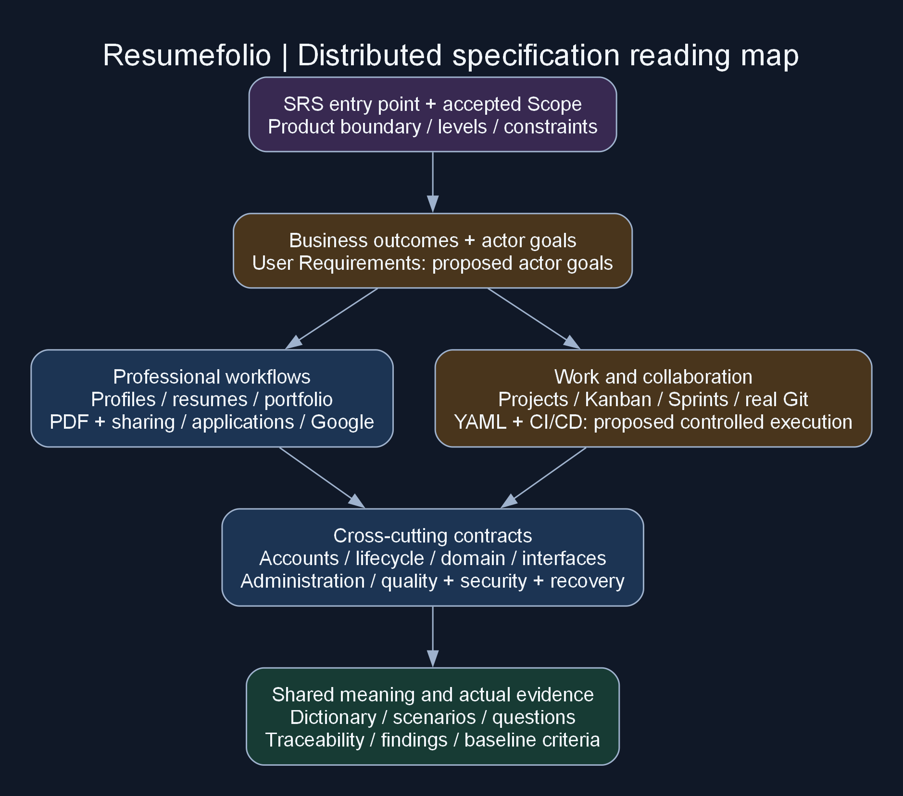

[Scalable SVG](Diagrams/Specification-Reading-Map.svg) ·
[Editable Graphviz](Diagrams/Specification-Reading-Map.dot)

The map groups reading topics, not services, delivery increments or staffing.
Read cross-cutting rules alongside domain behavior. Colors supplement labels;
draft status and open decisions are explicit rather than distinguished by color alone.

<a id="requirements-specification-requirements-specification-overview--heading-documents"></a>
##### Documents

The table covers the 16 primary specification documents in this folder. The [priority/readiness register](#requirements-specification-requirements-priority-and-readiness) is a supporting attribute view, not an additional primary requirements draft.
**Detailed draft** means proposed records with criteria/methods/open decisions; it
does not mean the questions are resolved, the records approved or the product tested.

| Document | Primary responsibility | Current content / remaining boundary |
| --- | --- | --- |
| [Software Requirements Specification](#requirements-specification-requirements-specification) | SRS entry point, product boundary and requirement levels | Expanded overview, scope/primary ownership, conventions and review gates; baseline pending |
| [Business Requirements](#requirements-specification-business-requirements) | Intended business outcomes and success evidence | Detailed draft; 5 BIZ-D records; intended benefit is not measured benefit |
| [User Requirements](#requirements-specification-user-requirements) | Actor goals, contexts and expected outcomes | Detailed draft; 12 USR-D records; derived actor goals and scenarios still require owner review |
| [Accounts, Authentication and Permissions](#requirements-specification-accounts-authentication-and-permissions) | Identity, resource/action isolation, sharing and explicit administrative powers | Detailed draft; 12 ACC-D records; exact auth/grant/session policies pending |
| [Profiles, Resumes and Portfolio](#requirements-specification-profiles-resumes-and-portfolio) | Reusable information, independent tailoring, evidence and manual language variants | Detailed draft; 10 PRP-D records; fields, propagation and presentation policies pending |
| [PDF and Controlled Sharing](#requirements-specification-pdf-and-controlled-sharing) | Generated/uploaded PDFs, availability, employer links and direct retrieval | Detailed draft; 10 PDF-D records; rendition, session/revocation and lifecycle details pending |
| [Manual Application Management](#requirements-specification-manual-application-management) | Company/opportunity, manual cover letters, progress and actual submitted copies | Detailed draft; 9 APP-D records; capture, transitions, corrections and retention pending |
| [Email, Calendar and Google Integration](#requirements-specification-email-calendar-and-google-integration) | Authorized mail/calendar operations, synchronization and failures | Detailed draft; 12 EGC-D records; limited dated provider-source notes, actual project access unverified |
| [Projects, Kanban and Sprints](#requirements-specification-projects-kanban-and-sprints) | Boards, items/tasks, assignments, collaboration and Sprint Backlog | Detailed draft; 11 PKS-D records; relationships, workflows and completion policies pending |
| [Git Hosting and Collaboration](#requirements-specification-git-hosting-and-collaboration) | Real Git clients, repository presentation, forks/review/merge and tracking/releases | Detailed draft; 10 GIT-D records; transports, grants, review and lifecycle policies pending |
| [YAML Workflows and CI/CD](#requirements-specification-yaml-workflows-and-cicd) | Supported syntax/execution, isolation, secrets, limits and deployment controls | Detailed draft; 12 YML-D records; execution, isolation, limits and deployment policies/evidence pending |
| [Administration, Files and Operational Behavior](#requirements-specification-administration-files-and-operational-behavior) | Policy configuration, file admission, quotas, failures, cleanup and operational evidence | Detailed draft; 12 AFO-D records; limits, powers, accounting and retention pending |
| [Business Rules and Data Lifecycle](#requirements-specification-business-rules-and-data-lifecycle) | Cross-module invariants, ownership, updates, history, retirement and recovery | Detailed draft; 10 BRL-D records; detailed propagation/synchronization/removal rules pending |
| [Domain Requirements and Constraints](#requirements-specification-domain-requirements-and-constraints) | Domain meaning, product policies, project mandates and external applicability | Detailed draft; 8 DOM-D records; provider/legal/licensing applicability investigations incomplete |
| [External Interface Requirements](#requirements-specification-external-interface-requirements) | Eight boundary inventories and explicit interaction contracts | Detailed draft; 10 EIF-D records; exact protocols, representations, clients and actual access findings pending |
| [Quality, Security and Recovery](#requirements-specification-quality-security-and-recovery-requirements) | Measurement contracts, controls, capacity, backup coverage and demonstrated recovery | Detailed draft; 14 QSR-D records; targets, controls and actual verification/restoration pending |

Counts describe this working set on the revision date and require updating when
records change. Prefixes are local draft references; they do not establish the
final FR/NFR/business-rule identifier convention. No priority order or approval is
inferred from row order or document length.

<a id="requirements-specification-requirements-specification-overview--heading-3-cross-document-boundaries"></a>
##### 3. Cross-document Boundaries

| Invariant | Read together |
| --- | --- |
| Shared profile information does not erase independent resume selections/layouts/overrides | PRP-D + BRL-D + dictionary |
| Current sources, live employer views and actual submitted copies have distinct meaning | PRP-D + PDF-D + APP-D + BRL-D |
| Employer links expose selected authorized content, including direct file/PDF paths | ACC-D + PDF-D + EIF-D + QSR-D |
| A downloaded copy cannot be recalled by disabling product retrieval | PDF-D + APP-D distinction + BRL-D |
| Unified sign-in or board membership supplies no unrelated private-resource grant | ACC-D + EGC-D + PKS-D + GIT-D |
| Product Backlog Item, task, board position and acceptance are not interchangeable | PKS-D + dictionary; Sprint Backlog includes goal, selected items and delivery plan |
| Real Git hosting differs from development GitHub; Push/merge does not inherently authorize deployment | GIT-D + YML-D + EIF-D + QSR-D |
| Provider guidance differs from actual project access; synchronization direction must be decided | EGC-D + DOM-D + BRL-D + feasibility findings |
| Backup existence differs from demonstrated usable, consistent and safely authorized recovery | QSR-D + AFO-D + domain artifacts/access + actual later evidence |

Detailed permissions, lifecycles and numerical targets remain open. These rows
summarize review boundaries; primary candidate wording remains in the linked files.

<a id="requirements-specification-requirements-specification-overview--heading-4-remaining-work-and-review-roadmap"></a>
##### 4. Remaining Work and Review Roadmap

The set is organized, but the requirements baseline is not complete. In particular:

1. Review the new actor-specific **User Requirements** and detailed **YAML/CI/CD** records; resolve open goal, execution and deployment policies while retaining explicit gates.
2. Resolve affected fields, relationships, state/transition, authority, propagation, language, capture, synchronization and retention questions with actual owner decisions.
3. Establish measurable quality/resource/recovery criteria and actual provider/feasibility findings at their dependent gates; do not invent targets or assume access.
4. Reconcile the SRS entry point, dictionary, scenarios and all domain drafts; allocate the final identifier convention and justified priorities.
5. Populate actual traceability and review findings, assess unresolved blockers and record owner review against an identifiable candidate before M-02 acceptance.

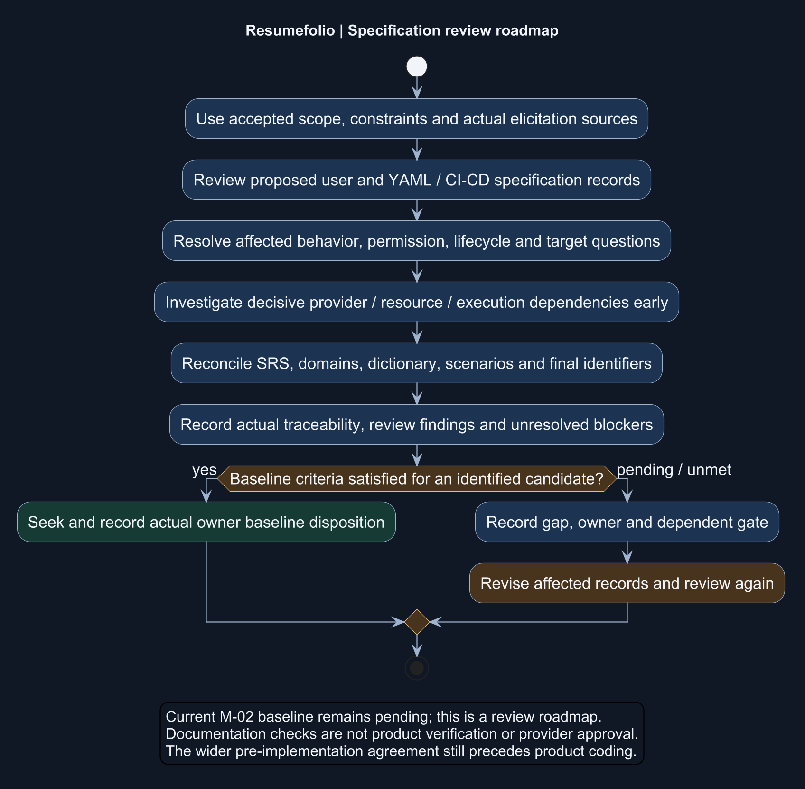

[Scalable SVG](Diagrams/Specification-Baseline-Review.svg) ·
[Editable PlantUML](Diagrams/Specification-Baseline-Review.puml)

This is a review roadmap, not a dated forecast or proof that a gate has passed.
Investigate decisive feasibility/security questions early and iterate related
requirements together. M-02 review is separate from product verification/release.
The agreed initial SDLC documentation, analysis/design, tracking reconciliation
and pre-implementation agreement still precede product coding.

| Supporting source / register | Use |
| --- | --- |
| [Version 1 Scope](../01-Project-Planning/01-Project-Charter.md#mvp-scope) | Accepted inclusions/exclusions and conditional commitments |
| [Resources](../01-Project-Planning/03-Feasibility-And-Risk-Assessment.md#resource-constraints) / [Planning Gates](https://github.com/Farhad-V/Web-Resumefolio/blob/1f2acaa351ac306cb57cbe4fe9742e8bd90720d9/docs/MVP/SDLC/01-project-planning/10-planning-completion-criteria.md) | Existing constraints, planning-only acceptance and retained GAP-D follow-up |
| [Elicitation Plan](#stakeholders-and-elicitation-elicitation-plan-and-techniques) / [Log](#stakeholders-and-elicitation-elicitation-log) | Planned clarification versus actual documented source extraction |
| [Dictionary](#data-definitions-data-dictionary) / [Scenarios](#scenarios-and-models-user-stories-and-scenarios) | Shared meaning and actor/normal/alternative/denied/failure examples |
| [Questions and Decisions](#change-and-baseline-open-questions-and-decisions) / [Change Control](#change-and-baseline-change-control) | Actual decisions, impact and unresolved commitments |
| [Traceability](#validation-and-traceability-validation-and-traceability--heading-traceability) / [Review Findings](#validation-and-traceability-validation-and-traceability--heading-review-findings) | Allocated links, actual inspections, dispositions and rechecks |
| [Baseline Criteria](#change-and-baseline-requirements-review-and-baseline-criteria) | Separate acceptance conditions and identifiable owner outcome |

No current documentation count, rendered diagram or link check establishes a
product Pass, provider approval, recovery result, M-02 completion or new baseline
acceptance. Accepted planning history remains attached to its identified snapshot.

<a id="requirements-specification-requirements-specification-overview--heading-5-diagram-catalog"></a>
##### 5. Diagram Catalog

Every row links editable source and SVG/PNG output. The catalog includes two guide
diagrams, two SRS diagrams and the 30 diagrams referenced by the 15 detailed drafts. None is an
implemented architecture or an executed test result.

| Topic / diagram | Editable source | SVG | PNG |
| --- | --- | --- | --- |
| Guide: reading map | [DOT](Diagrams/Specification-Reading-Map.dot) | [SVG](Diagrams/Specification-Reading-Map.svg) |  |
| Guide: baseline review | [PUML](Diagrams/Specification-Baseline-Review.puml) | [SVG](Diagrams/Specification-Baseline-Review.svg) |  |
| Accounts, Authentication and Permissions — accounts access contexts | [DOT](Diagrams/Accounts-Access-Contexts.dot) | [SVG](Diagrams/Accounts-Access-Contexts.svg) |  |
| Accounts, Authentication and Permissions — accounts request authorization | [PUML](Diagrams/Accounts-Request-Authorization.puml) | [SVG](Diagrams/Accounts-Request-Authorization.svg) |  |
| Administration, Files and Operational Behavior — administration file admission flow | [PUML](Diagrams/Administration-File-Admission-Flow.puml) | [SVG](Diagrams/Administration-File-Admission-Flow.svg) |  |
| Administration, Files and Operational Behavior — administration files policy map | [DOT](Diagrams/Administration-Files-Policy-Map.dot) | [SVG](Diagrams/Administration-Files-Policy-Map.svg) |  |
| Business Requirements — business outcome assessment | [PUML](Diagrams/Business-Outcome-Assessment.puml) | [SVG](Diagrams/Business-Outcome-Assessment.svg) |  |
| Business Requirements — business outcomes map | [DOT](Diagrams/Business-Outcomes-Map.dot) | [SVG](Diagrams/Business-Outcomes-Map.svg) |  |
| Business Rules and Data Lifecycle — data lifecycle boundaries | [DOT](Diagrams/Data-Lifecycle-Boundaries.dot) | [SVG](Diagrams/Data-Lifecycle-Boundaries.svg) |  |
| Business Rules and Data Lifecycle — data retirement review | [PUML](Diagrams/Data-Retirement-Review.puml) | [SVG](Diagrams/Data-Retirement-Review.svg) |  |
| Domain Requirements and Constraints — domain authority map | [DOT](Diagrams/Domain-Authority-Map.dot) | [SVG](Diagrams/Domain-Authority-Map.svg) |  |
| Domain Requirements and Constraints — domain constraint review | [PUML](Diagrams/Domain-Constraint-Review.puml) | [SVG](Diagrams/Domain-Constraint-Review.svg) |  |
| Email, Calendar and Google Integration — google integration context | [DOT](Diagrams/Google-Integration-Context.dot) | [SVG](Diagrams/Google-Integration-Context.svg) |  |
| Email, Calendar and Google Integration — google operation outcomes | [PUML](Diagrams/Google-Operation-Outcomes.puml) | [SVG](Diagrams/Google-Operation-Outcomes.svg) |  |
| External Interface Requirements — external interface context | [DOT](https://github.com/Farhad-V/Web-Resumefolio/blob/1f2acaa351ac306cb57cbe4fe9742e8bd90720d9/docs/MVP/SDLC/04-system-design/01-software-architecture/diagrams/logical-component-ownership.dot) | [SVG](https://github.com/Farhad-V/Web-Resumefolio/blob/1f2acaa351ac306cb57cbe4fe9742e8bd90720d9/docs/MVP/SDLC/04-system-design/01-software-architecture/diagrams/logical-component-ownership.svg) |  |
| External Interface Requirements — external interface outcomes | [PUML](Diagrams/External-Interface-Outcomes.puml) | [SVG](Diagrams/External-Interface-Outcomes.svg) |  |
| Git Hosting and Collaboration — git hosting capability map | [DOT](Diagrams/Git-Hosting-Capability-Map.dot) | [SVG](Diagrams/Git-Hosting-Capability-Map.svg) |  |
| Git Hosting and Collaboration — git review merge flow | [PUML](Diagrams/Git-Review-Merge-Flow.puml) | [SVG](Diagrams/Git-Review-Merge-Flow.svg) |  |
| Manual Application Management — application submission capture | [PUML](Diagrams/Application-Submission-Capture.puml) | [SVG](Diagrams/Application-Submission-Capture.svg) |  |
| Manual Application Management — manual application history map | [DOT](Diagrams/Manual-Application-History-Map.dot) | [SVG](Diagrams/Manual-Application-History-Map.svg) |  |
| PDF and Controlled Sharing — pdf protected retrieval | [PUML](Diagrams/Pdf-Protected-Retrieval.puml) | [SVG](Diagrams/Pdf-Protected-Retrieval.svg) |  |
| PDF and Controlled Sharing — pdf sharing boundaries | [DOT](Diagrams/Pdf-Sharing-Boundaries.dot) | [SVG](Diagrams/Pdf-Sharing-Boundaries.svg) |  |
| Profiles, Resumes and Portfolio — profile resume evidence map | [DOT](Diagrams/Profile-Resume-Evidence-Map.dot) | [SVG](Diagrams/Profile-Resume-Evidence-Map.svg) |  |
| Profiles, Resumes and Portfolio — profile update review | [PUML](Diagrams/Profile-Update-Review.puml) | [SVG](Diagrams/Profile-Update-Review.svg) |  |
| Projects, Kanban and Sprints — kanban sprint concept map | [DOT](Diagrams/Kanban-Sprint-Concept-Map.dot) | [SVG](Diagrams/Kanban-Sprint-Concept-Map.svg) |  |
| Projects, Kanban and Sprints — sprint planning review flow | [PUML](Diagrams/Sprint-Planning-Review-Flow.puml) | [SVG](Diagrams/Sprint-Planning-Review-Flow.svg) |  |
| Quality, Security and Recovery Requirements — quality evidence map | [DOT](Diagrams/Quality-Evidence-Map.dot) | [SVG](Diagrams/Quality-Evidence-Map.svg) |  |
| Quality, Security and Recovery Requirements — recovery evidence roadmap | [PUML](Diagrams/Recovery-Evidence-Roadmap.puml) | [SVG](Diagrams/Recovery-Evidence-Roadmap.svg) |  |
| Software Requirements Specification — srs baseline decision | [PUML](Diagrams/Srs-Baseline-Decision.puml) | [SVG](Diagrams/Srs-Baseline-Decision.svg) | 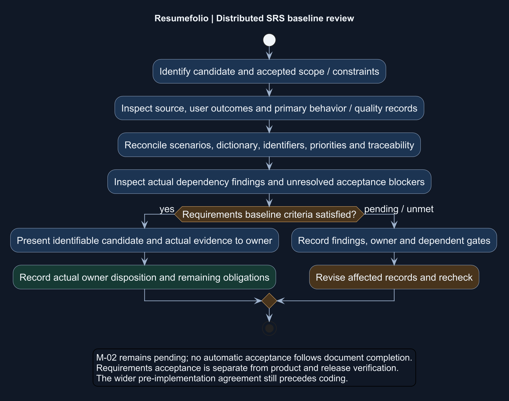 |
| Software Requirements Specification — srs traceability map | [DOT](Diagrams/Srs-Traceability-Map.dot) | [SVG](Diagrams/Srs-Traceability-Map.svg) | 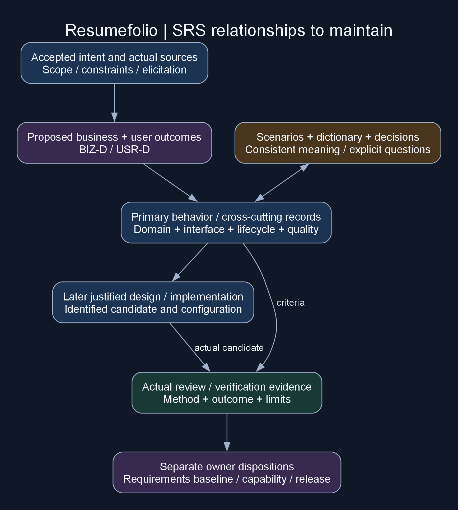 |
| User Requirements — user goal map | [DOT](Diagrams/User-Goal-Map.dot) | [SVG](Diagrams/User-Goal-Map.svg) | 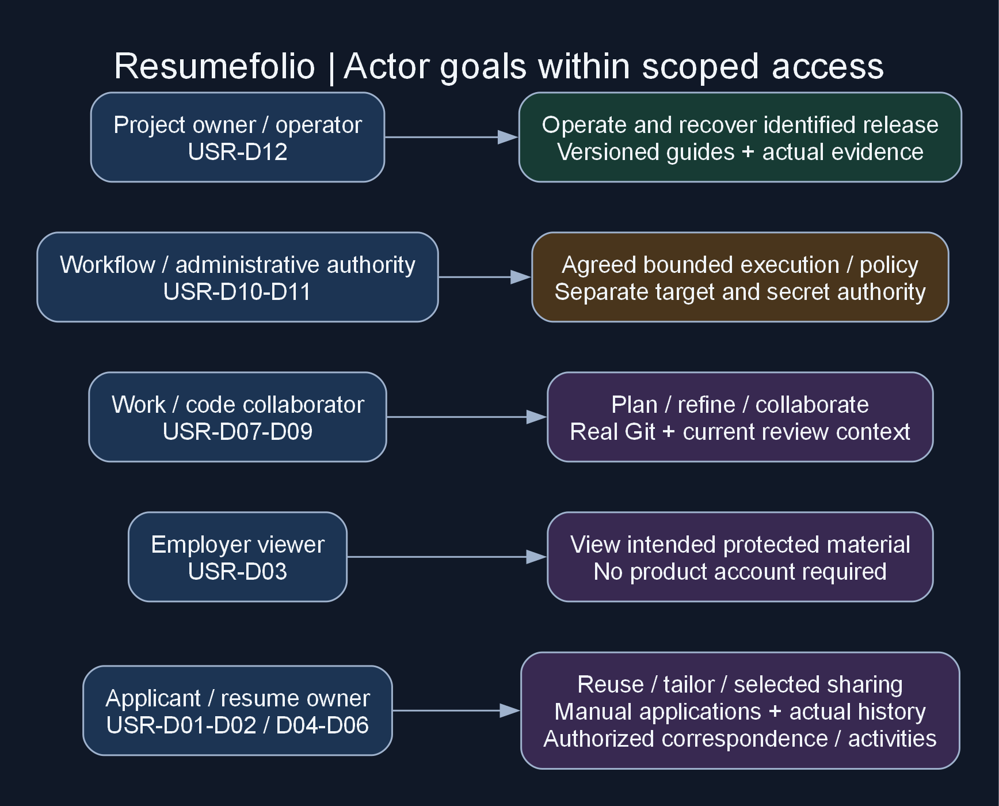 |
| User Requirements — user requirement review | [PUML](Diagrams/User-Requirement-Review.puml) | [SVG](Diagrams/User-Requirement-Review.svg) | 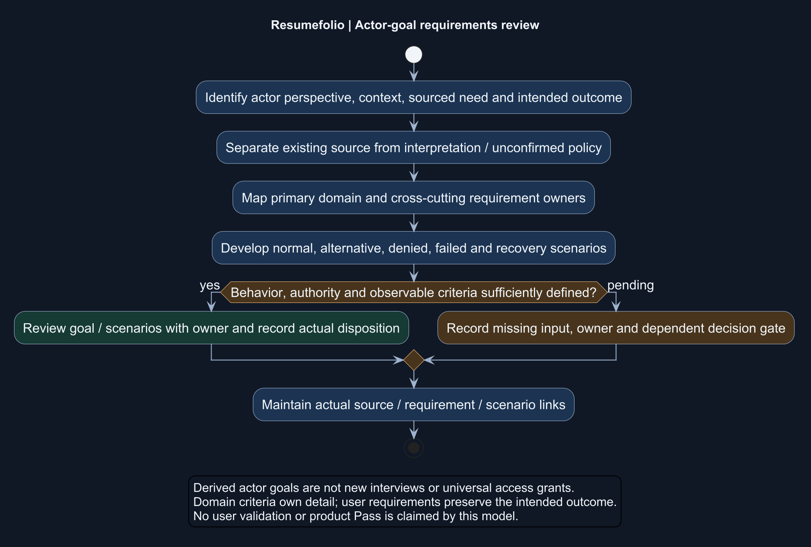 |
| YAML Workflows and CI/CD — workflow execution boundaries | [DOT](Diagrams/Workflow-Execution-Boundaries.dot) | [SVG](Diagrams/Workflow-Execution-Boundaries.svg) | 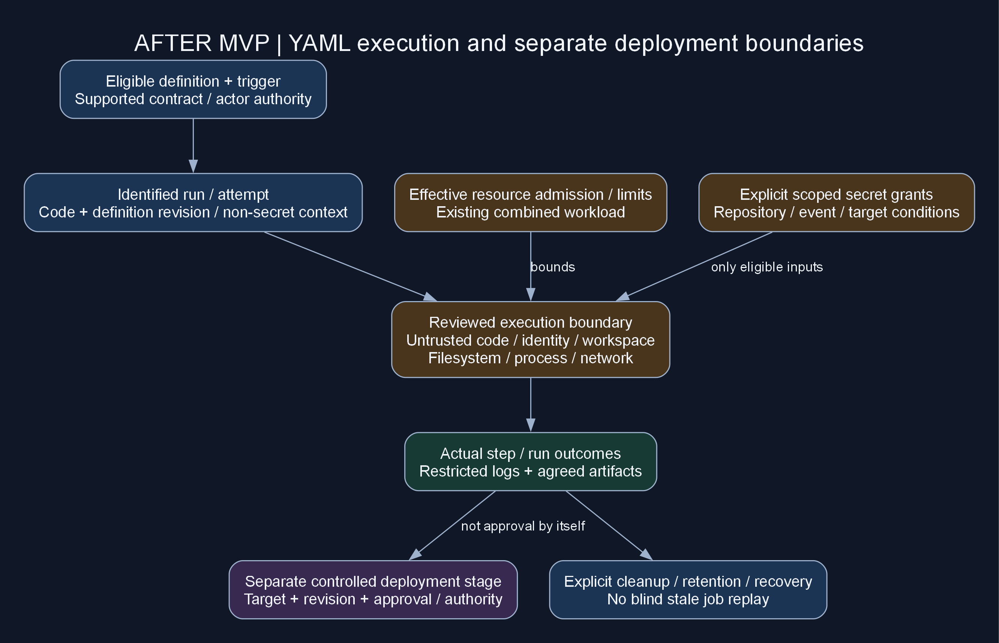 |
| YAML Workflows and CI/CD — workflow run control flow | [PUML](Diagrams/Workflow-Run-Control-Flow.puml) | [SVG](Diagrams/Workflow-Run-Control-Flow.svg) | 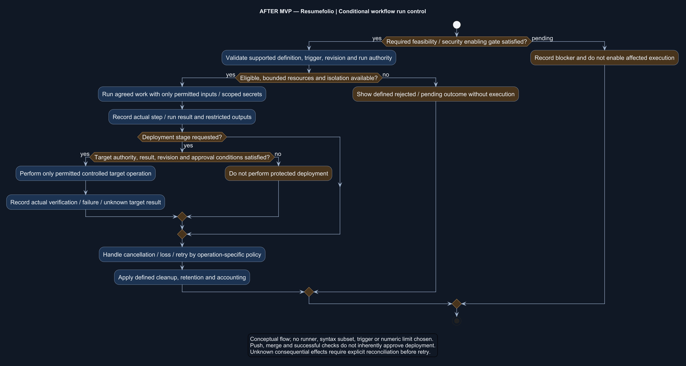 |

<a id="requirements-specification-requirements-specification-overview--heading-6-maintenance"></a>
##### 6. Maintenance

When a specification changes, update its sources, status, criteria, open decisions,
related dictionary/scenario/traceability links and diagrams together. Keep this
catalog and record counts accurate. Read primary records before summarizing them;
do not copy detailed obligations into multiple competing files.

Check local file/section links, readable labels/arrows, table layout and synchronized
editable/rendered diagrams. Render the two guide diagrams from repository root:

```powershell
$diagramFolder = 'docs\MVP\SDLC\02-requirements-engineering\diagrams'
$graphvizExe = 'C:\Program Files\Graphviz\bin\dot.exe'
$plantUmlJar = 'C:\Users\fvali\AppData\Local\Resumefolio\DiagramTools\plantuml.jar'
foreach ($format in 'svg', 'png') {
    & $graphvizExe "-T$format" -Gdpi=140 "$diagramFolder\specification-reading-map.dot" -o "$diagramFolder\specification-reading-map.$format"
    if ($LASTEXITCODE -ne 0) { throw "Graphviz failed: $format" }
    java '-Djava.awt.headless=true' -jar $plantUmlJar -charset UTF-8 "-t$format" "$diagramFolder\specification-baseline-review.puml"
    if ($LASTEXITCODE -ne 0) { throw "PlantUML failed: $format" }
}
```

Use actual installed paths on other machines. Save UTF-8 without BOM and retain
source/SVG/PNG outputs together. See the [shared diagram guide](Diagrams/Diagram-Catalog.md).

[Requirements index]() · [SRS entry point](#requirements-specification-requirements-specification)

<a id="requirements-specification-requirements-specification-overview--heading-course-aligned-refinement--november-1-2026"></a>
##### Course-Aligned Refinement — November 1, 2026

Use the [proposed priority/readiness register](#requirements-specification-requirements-priority-and-readiness) as a supporting attribute view, not a sixteenth primary requirement draft. The 15 primary drafts still contain 157 candidates. Their actual priorities remain unassigned; proposals are explicitly separate. Quality targets have decision contracts, and external scenario narratives are separated from later verification steps. M-02 remains pending.

</details>

<a id="requirements-specification-requirements-specification"></a>

<details>
<summary>Resumefolio — Software Requirements Specification</summary>

<a id="requirements-specification-requirements-specification--heading-resumefolio--software-requirements-specification"></a>
#### Resumefolio — Software Requirements Specification

Current implementation choices and scope: [Baseline](https://github.com/Farhad-V/Web-Resumefolio/blob/1f2acaa351ac306cb57cbe4fe9742e8bd90720d9/docs/MVP/baseline/README.md). Runtime verification remains subject to its gates.

| Item | Current position |
| --- | --- |
| Purpose | Coordinate the distributed SRS: authority, product boundary, requirement levels, source ownership and acceptance gates |
| Owner | Farhad; sole delivery and operations owner |
| Status | Proposed SRS overview — M-02 baseline pending |
| Detailed content | 15 primary specification drafts with 157 provisional candidate records; this overview allocates no duplicate product requirements |
| Planning authority | Accepted Version 1 scope and constraints; M-01 accepted only for the identified snapshot under DEC-116 |
| Revision | November 1, 2026 — explicit functional/non-functional navigation; baseline still pending |

**At a glance:** the MVP combines core professional presentation/private media/manual applications with separately authorized basic ProjectForge. Mail/calendar and advanced work/Git/execution are future. All paths retain resource-specific access. This SRS coordinates required outcomes and evidence;
domain files own the primary wording. Detailed policies and verification remain
open, and documentation completion does not constitute baseline or release approval.

[Authority](#requirements-specification-requirements-specification--heading-1-status-and-authority) · [Context](#requirements-specification-requirements-specification--heading-2-introduction-system-boundary-and-operating-context)
· [Levels](#requirements-specification-requirements-specification--heading-3-requirement-levels-and-record-conventions) · [Functional requirements](#requirements-specification-requirements-specification--id-functional-requirements)
· [Non-functional requirements](#requirements-specification-requirements-specification--id-non-functional-requirements) · [Coverage](#requirements-specification-requirements-specification--heading-4-functional-areas-and-primary-record-ownership)
· [Supporting views](#requirements-specification-requirements-specification--heading-5-supporting-views-and-traceability) · [Acceptance](#requirements-specification-requirements-specification--heading-6-review-baseline-and-later-verification)
· [Gaps](#requirements-specification-requirements-specification--heading-7-open-definitions-and-dependent-gates) · [Maintenance](#requirements-specification-requirements-specification--heading-8-maintenance-and-diagrams)

<a id="requirements-specification-requirements-specification--id-status-and-authority"></a>
<a id="requirements-specification-requirements-specification--heading-1-status-and-authority"></a>
##### 1. Status and Authority

This is the entry point to a **distributed** Software Requirements Specification.
Use the [folder guide](#requirements-specification-requirements-specification-overview) for reading paths, document statuses and diagrams.
Accepted [Version 1 Scope](../01-Project-Planning/01-Project-Charter.md#mvp-scope) governs inclusions,
exclusions and conditional commitments. [Resources and Constraints](../01-Project-Planning/03-Feasibility-And-Risk-Assessment.md#resource-constraints)
governs agreed delivery restrictions; [Planning Completion](https://github.com/Farhad-V/Web-Resumefolio/blob/1f2acaa351ac306cb57cbe4fe9742e8bd90720d9/docs/MVP/SDLC/01-project-planning/10-planning-completion-criteria.md)
retains actual M-01 acceptance and GAP-D follow-up. Later working drafts do not
silently replace the accepted planning snapshot or record a new owner decision.

| Statement type | Authority and treatment |
| --- | --- |
| Accepted scope/constraint | Link the exact original source; preserve its limits and conditions |
| Proposed requirement/refinement | Review source, rationale, actors/conditions, behavior and acceptance criteria separately |
| Interpretation or open question | Identify uncertainty/owner/gate; do not present as stakeholder approval |
| External-source finding | Retain publisher/date/applicability and distinguish it from actual project access/configuration |
| Verification/review result | Record actual candidate, method, outcome/evidence and limits only when performed |
| Baseline/change decision | Identify owner outcome and reviewed revision; document material impacts and follow-up |

The records in this set remain proposed. No global FR/NFR notation, priority
ranking, detailed role policy or numeric service target is established merely by
the local candidate prefixes or the presentation order.

<a id="requirements-specification-requirements-specification--id-introduction-system-boundary-and-operating-context"></a>
<a id="requirements-specification-requirements-specification--heading-2-introduction-system-boundary-and-operating-context"></a>
##### 2. Introduction, System Boundary and Operating Context

The MVP core supports private professional information and independent resumes/portfolio, generated/uploaded PDFs, protected sharing, My Files & Media on the same server, cover letters and manual application status/next action/follow-up with actual submitted materials. The separate ProjectForge supports real Git repositories/transfers/permissions/file-history, issues and simple Kanban through user-scoped API. Gmail/calendar, advanced backlog/Sprints/review/releases and YAML execution/deployment are future-only.

| Boundary | Required context / limit |
| --- | --- |
| Human participants | Registered applicant/resource owner, invited collaborator, employer viewer, administrator/platform owner and project owner/operator; roles are contexts, not inherited universal grants |
| Private workspace | Individual identity and resource/action/state permissions; unified sign-in does not expose unrelated private mail/resumes/repositories |
| Employer disclosure | No viewer account required; password-protected intended resume and selected content, including authorized direct files/PDFs |
| External exchange | Browser/Git clients, selected Google operations and operational dependencies; exact contracts/actual access remain to be established |
| Execution/deployment | Real agreed execution only after required feasibility/security/resource gates; Push/merge does not inherently authorize production deployment |
| Operating scale | Initial target 10 users; workload/concurrency/capacity need evidence; roughly 1,000 users is a growth direction |
| Delivery resources | One owner; current owner input: 20 project hours/week including learning/docs/tests; existing server/budget and Laravel/OOP; architecture, database, frontend, Git engine and runner not selected here |
| Delivery date | November 8, 2026 requested target, not a validated forecast |

Product AI, automatic translation and automatic legacy-demo migration remain
excluded. Manually maintained English/German content is included. Portfolio
media/diagrams are externally authored content, not new in-product authoring tools.
Automatic external job submission and universal GitHub Actions compatibility are
not implied. Existing demo/reference projects remain preserved references.

[Actors and Context](#stakeholders-and-elicitation-actors-and-system-context)
owns actor definitions; [Assumptions and Dependencies](../01-Project-Planning/03-Feasibility-And-Risk-Assessment.md#assumptions-and-dependencies)
owns ASM/DEP status. A reference project's features, development GitHub or a prior
tool demonstration does not prove a product requirement has been implemented.

<a id="requirements-specification-requirements-specification--id-requirement-levels"></a>
<a id="requirements-specification-requirements-specification--heading-3-requirement-levels-and-record-conventions"></a>
##### 3. Requirement Levels and Record Conventions

| Level / view | Question answered | Primary file |
| --- | --- | --- |
| Business | Why is the product needed, and what outcome evidence matters? | [Business Requirements](#requirements-specification-business-requirements), BIZ-D |
| User | Which actor needs what observable outcome in which context? | [User Requirements](#requirements-specification-user-requirements), USR-D |
| Functional | What behavior is required, including normal/denied/failure paths? | Domain files in section 4 |
| Business rule/lifecycle | Which cross-module invariants and change/removal effects apply? | [Business Rules](#requirements-specification-business-rules-and-data-lifecycle), BRL-D |
| Domain/constraint | What is inherent meaning, deliberate policy, imposed project constraint or externally applicable obligation? | [Domain Constraints](#requirements-specification-domain-requirements-and-constraints), DOM-D |
| Interface | What crosses a boundary, under whose authority and with what outcome? | [External Interfaces](#requirements-specification-external-interface-requirements), EIF-D |
| Quality | Under which conditions/measure does behavior or recovery satisfy the agreed criterion? | [Quality/Security/Recovery](#requirements-specification-quality-security-and-recovery-requirements), QSR-D |

Each final allocated record needs identifier, level/type, source, rationale,
actor/context, obligation, observable criteria, owner, justified priority, actual
status, planned method, dependencies and unresolved decisions. Use the
[requirement template](#requirements-specification-requirements-specification). Local references
such as PRP-D01 remain proposed navigation until the final convention is reconciled.

Use explicit stimulus/environment/response/measurement for quantitative quality.
Do not replace undecided thresholds, retention or recovery targets with arbitrary
numbers. Conditional criteria are not ready for acceptance until their referenced
policies are decided. Architecture/schema/tool selections belong in later justified design.

<a id="requirements-specification-requirements-specification--id-functional-requirements"></a>
<a id="requirements-specification-requirements-specification--heading-31-functional-requirements"></a>
###### 3.1 Functional Requirements

Functional requirements describe **what the system does**: inputs it accepts, information it manages, operations it performs and observable responses to actors or external events. This is the explicit functional index of the distributed SRS. The linked primary records own the complete proposed obligation, criteria, source and open detail; this index does not duplicate or accept their wording.

| Functional capability | Primary records | Observable behavior covered |
| --- | --- | --- |
| Accounts, sign-in and permission enforcement | [ACC-D01–ACC-D12](#requirements-specification-accounts-authentication-and-permissions) | Establish the required account context; continue authorized journeys; allow/deny resource operations; handle sharing and access changes under explicit policies. |
| Professional profiles, tailored resumes and evidence | [PRP-D01–PRP-D10](#requirements-specification-profiles-resumes-and-portfolio) | Maintain reusable content, select/override it independently, manage selected evidence and manually maintained language variants, and report save/lifecycle outcomes. |
| PDF generation, uploaded variants and protected sharing | [PDF-D01–PDF-D10](#requirements-specification-pdf-and-controlled-sharing) | Generate or associate PDFs, configure download availability, authorize selected retrieval and apply owner link/password controls. |
| Manual application management | [APP-D01–APP-D09](#requirements-specification-manual-application-management) | Record opportunities, prepare cover letters, associate resumes, record progress and preserve actual submitted materials. |
| Gmail and calendar operations | [EGC-D01–EGC-D12](#requirements-specification-email-calendar-and-google-integration) | Connect the intended account, read/compose/send/reply, manage agreed activities, synchronize selected information and handle disconnection/outcomes.  **After MVP.** |
| Work, Kanban and Sprint planning | [PKS-D01–PKS-D11](#requirements-specification-projects-kanban-and-sprints) | Manage work contexts, items/tasks, assignments, authorized collaboration and a coherent Sprint Backlog. |
| Real Git hosting and collaboration | [GIT-D01–GIT-D10](#requirements-specification-git-hosting-and-collaboration) | Create/browse repositories, support agreed real-client transfer, forks, pull requests, reviews, merge and repository tracking/releases. |
| Conditional workflow execution and deployment | [YML-D01–YML-D12](#requirements-specification-yaml-workflows-and-cicd) | Validate definitions, admit eligible runs, expose results, handle cancellation and separately authorize deployment, subject to retained enabling gates.  **After MVP.** |
| Administration and file operations | [AFO-D01–AFO-D12](#requirements-specification-administration-files-and-operational-behavior) | Configure effective policy, validate/admit files, enforce quotas and expose authorized operational information and lifecycle actions. |
| Boundary operations | [EIF-D03–EIF-D08](#requirements-specification-external-interface-requirements) | Apply authorization, file exchange, Google, real Git and execution contracts with operation-specific outcomes. |

These are functional **aspects** of the cited records. A range does not assert that every sentence or criterion in a domain file is exclusively functional: security, timing, integrity and lifecycle constraints also apply through the next section. Use the [external scenarios](#scenarios-and-models-user-stories-and-scenarios) for actor-facing examples; internal implementation design is not specified here.

<a id="requirements-specification-requirements-specification--id-non-functional-requirements"></a>
<a id="requirements-specification-requirements-specification--heading-32-non-functional-requirements"></a>
###### 3.2 Non-Functional Requirements

Non-functional requirements describe **the quality and conditions under which the required functions must operate**, together with imposed technical and management constraints. They are not optional merely because they are non-functional, and they also require assessable criteria. This category is broader than the quality file alone.

| Non-functional aspect | Primary records / authoritative source | Required assessment boundary |
| --- | --- | --- |
| Response performance and capacity | [QSR-D01/D02](#requirements-specification-quality-security-and-recovery-requirements) | Defined operations, workload, data volumes, concurrency, measurement and decided thresholds; initial user count alone is not a load model. |
| Usability, accessibility and client compatibility | [QSR-D03](#requirements-specification-quality-security-and-recovery-requirements), [EIF-D02](#requirements-specification-external-interface-requirements) | Reviewable task, supported-client/input and accessibility criteria with understandable outcomes. |
| Availability, reliability and degradation | [QSR-D04](#requirements-specification-quality-security-and-recovery-requirements), [EIF-D08](#requirements-specification-external-interface-requirements) | Define usable/degraded/unavailable outcomes, observation conditions and safe failure/reconciliation expectations. |
| Confidentiality, isolation and secret protection | [QSR-D05–QSR-D07](#requirements-specification-quality-security-and-recovery-requirements), [ACC](#requirements-specification-accounts-authentication-and-permissions), [YML](#requirements-specification-yaml-workflows-and-cicd) | Cross-user/trust boundaries, direct access and secret/content handling; exact mechanisms remain later justified design. |
| Integrity and lifecycle consistency | [QSR-D08/D09](#requirements-specification-quality-security-and-recovery-requirements), [BRL-D01–BRL-D10](#requirements-specification-business-rules-and-data-lifecycle) | Independent tailoring, actual submitted history, references, changes and retention/restore semantics remain coherent. |
| Backup and recoverability | [QSR-D10–QSR-D12](#requirements-specification-quality-security-and-recovery-requirements) | Explicit coverage, recovery point/time targets, consistent usable restoration and current-access/external-state reconciliation. |
| Operational evidence and maintainability | [QSR-D13/D14](#requirements-specification-quality-security-and-recovery-requirements), [AFO-D09–AFO-D12](#requirements-specification-administration-files-and-operational-behavior) | Restricted useful diagnostics and version/environment-specific procedures with actual evidence and stated limitations. |
| Interoperability and representation constraints | [EIF-D01/D05/D06/D09/D10](#requirements-specification-external-interface-requirements), [DOM-D05–DOM-D08](#requirements-specification-domain-requirements-and-constraints) | Review supported clients/exchanges, identity/time/language semantics and actual external applicability; documentation is not provider access or compliance proof. |
| Technical and platform constraints | [Resources and Constraints](../01-Project-Planning/03-Feasibility-And-Risk-Assessment.md#resource-constraints), [DOM-D08](#requirements-specification-domain-requirements-and-constraints) | Preserve Laravel/OOP, existing resource/budget boundaries and actual platform feasibility; no database/frontend/Git engine/runner is selected here. |
| Management and delivery constraints | [Resources](../01-Project-Planning/03-Feasibility-And-Risk-Assessment.md#resource-constraints), [Roadmap](../01-Project-Planning/02-Project-Management-Plan.md#delivery-sequence), [Working Method](../01-Project-Planning/02-Project-Management-Plan.md#delivery-approach) | Solo capacity, spending authority, agreed phase gates and requested dates; a requested deadline is not a verified forecast. |

Operation and quality are complementary aspects, not mutually exclusive file labels. For example, rejecting an unauthorized PDF request is functional behavior; protecting confidentiality across every retrieval path is a cross-cutting quality requirement. Configuring a quota is a function; respecting actual combined capacity is a constraint. Do not allocate duplicate FR/NFR records merely to repeat those meanings.

<a id="requirements-specification-requirements-specification--heading-33-business-outcomes-user-goals-and-rules"></a>
###### 3.3 Business Outcomes, User Goals and Rules

[BIZ-D](#requirements-specification-business-requirements) explains why the product is needed; [USR-D](#requirements-specification-user-requirements) expresses actor outcomes. [BRL-D](#requirements-specification-business-rules-and-data-lifecycle) and [DOM-D](#requirements-specification-domain-requirements-and-constraints) constrain or explain the functions and qualities. These are additional levels/aspects, not reasons to force every business statement into one exclusive FR or NFR bucket.

<a id="requirements-specification-requirements-specification--heading-34-shared-readiness-and-identifier-rules"></a>
###### 3.4 Shared Readiness and Identifier Rules

Both categories remain proposed and follow the same source, criterion, feasibility, traceability and owner-review gates. Existing 157 candidate identifiers remain unchanged; the headings FR/NFR do not create 157 new records or establish a new numbering convention. [Priority proposals](#requirements-specification-requirements-priority-and-readiness) remain proposals. [Quantitative target contracts](#requirements-specification-quality-security-and-recovery-requirements) explicitly retain missing numerical decisions as acceptance blockers. This classification is navigation, not baseline acceptance.

<a id="requirements-specification-requirements-specification--id-functional-areas"></a>
<a id="requirements-specification-requirements-specification--heading-4-functional-areas-and-primary-record-ownership"></a>
##### 4. Functional Areas and Primary Record Ownership

| Scope coverage | Primary specification | Candidate count / related rules |
| --- | --- | --- |
| SCP-01 / DEC-028: identity, grants, unified sign-in | [Accounts](#requirements-specification-accounts-authentication-and-permissions) | 12 ACC-D; every domain enforces applicable resource/action authority |
| SCP-02/03 / DEC-027/026: reusable content and selected evidence | [Profiles/Resumes/Portfolio](#requirements-specification-profiles-resumes-and-portfolio) | 10 PRP-D; BRL-D propagation and independent tailoring |
| SCP-04/05 / DEC-025/024: PDF variants and employer sharing | [PDF/Sharing](#requirements-specification-pdf-and-controlled-sharing) | 10 PDF-D; ACC-D direct access and owner controls |
| SCP-06 / DEC-023: manual applications and submitted copies | [Applications](#requirements-specification-manual-application-management) | 9 APP-D; actual submitted set differs from current source/live view |
| SCP-07 / DEC-022: correspondence/calendar | [Google Integration](#requirements-specification-email-calendar-and-google-integration) | 12 EGC-D; provider permissions/source notes differ from actual access  **After MVP.** |
| SCP-08 / DEC-021: projects, Kanban, backlogs/Sprints | [Work Management](#requirements-specification-projects-kanban-and-sprints) | 11 PKS-D; item/task distinction and composite Sprint Backlog |
| SCP-09 / DEC-020: real Git hosting/collaboration | [Git Hosting](#requirements-specification-git-hosting-and-collaboration) | 10 GIT-D; real-client and current revision context |
| SCP-10 / DEC-019: conditional execution | [YAML/CI/CD](#requirements-specification-yaml-workflows-and-cicd) | 12 YML-D; isolation/resources/secrets and separate deployment grants  **After MVP.** |
| SCP-11 / DEC-018: effective file/storage policy | [Administration/Files](#requirements-specification-administration-files-and-operational-behavior) | 12 AFO-D; infrastructure/accounting/lifecycle consistency |
| SCP-12 / DEC-017: operational readiness | [Quality/Recovery](#requirements-specification-quality-security-and-recovery-requirements) and [Administration](#requirements-specification-administration-files-and-operational-behavior) | 14 QSR-D overall; actual restoration and versioned guidance required later |

The remaining primary views are 5 BIZ-D, 12 USR-D, 10 BRL-D, 8 DOM-D and 10 EIF-D.
Together the 15 detailed files contain **157 provisional records**. Counts are
working inventory, not approved scope size, effort estimates, tests or acceptance
evidence. Detailed wording belongs in the primary file; cross-cutting rules apply
to it without creating competing duplicates in this overview.

<a id="requirements-specification-requirements-specification--heading-5-supporting-views-and-traceability"></a>
##### 5. Supporting Views and Traceability
<a id="requirements-specification-requirements-specification--id-supporting-views"></a>


[Scalable SVG](Diagrams/Srs-Traceability-Map.svg) · [Graphviz source](Diagrams/Srs-Traceability-Map.dot)

Arrows indicate relationships to maintain, not a populated formal traceability
register or an implementation sequence. Colors supplement labels. One user goal
may need several functional/quality records, and one cross-cutting rule may affect
many scenarios; no one-to-one relation is imposed.

| Supporting view | Use / evidence boundary |
| --- | --- |
| [Elicitation Plan](#stakeholders-and-elicitation-elicitation-plan-and-techniques) / [Log](#stakeholders-and-elicitation-elicitation-log) | Planned research versus actual documentary extraction and unresolved interpretation |
| [Scenarios](#scenarios-and-models-user-stories-and-scenarios) | Actor/context, preconditions, normal/alternative/denied/failure/recovery examples |
| [Dictionary](#data-definitions-data-dictionary) / [Glossary](#data-definitions-glossary) | Shared conceptual meaning, authority and lifecycle; not schema |
| [Traceability](#validation-and-traceability-validation-and-traceability--heading-traceability) | Final allocated source/requirement/scenario/design/verification links; do not infer population from this map |
| [Review Findings](#validation-and-traceability-validation-and-traceability--heading-review-findings) | Actual inspection issues, dispositions and rechecks |
| [Questions](#change-and-baseline-open-questions-and-decisions) / [Change Control](#change-and-baseline-change-control) | Actual decisions, owner/gate and material impact |

**Consistency anchors:** independent resume selections/overrides; actual submitted
materials not overwritten by later source edits; selected direct-file sharing;
downloaded copies outside product revocation; no private-resource access from
unrelated membership; Product Backlog Items distinct from tasks; Sprint Backlog
includes goal/items/plan; Git hosting distinct from execution; deployment separately
authorized; provider synchronization explicit; backup existence distinct from recovery.

<a id="requirements-specification-requirements-specification--heading-6-review-baseline-and-later-verification"></a>
##### 6. Review, Baseline and Later Verification


[Scalable SVG](Diagrams/Srs-Baseline-Decision.svg) · [PlantUML source](Diagrams/Srs-Baseline-Decision.puml)

Apply the [requirements baseline criteria](#change-and-baseline-requirements-review-and-baseline-criteria):

1. Check scope coverage, source/status, actor outcomes and exclusions/conditions.
2. Resolve acceptance-blocking inputs, states, permissions, lifecycles, contracts and quantitative targets; retain justified dependency gates and real findings.
3. Reconcile identifiers/priorities, scenarios/dictionary and traceability; record actual inspections and addressed contradictions.
4. Present an identifiable candidate and evidence to the owner; record the actual outcome and remaining obligations separately from file creation.

M-02 acceptance is not a product test Pass, provider approval, successful recovery
or release decision. Actual integrated behavior/quality/restoration belongs to
later capability and M-09/M-10 evidence under [Milestones](../01-Project-Planning/02-Project-Management-Plan.md#delivery-sequence).
The agreed initial SDLC documentation, analysis/design and tracking reconciliation,
and wider pre-implementation agreement still precede product coding.

<a id="requirements-specification-requirements-specification--heading-7-open-definitions-and-dependent-gates"></a>
##### 7. Open Definitions and Dependent Gates

| Group | Required next decisions/findings | Existing gate |
| --- | --- | --- |
| Core behavior | Fields/required inputs, states, task/item/Sprint relations, source update and submission capture | GAP-D06; affected M-02 acceptance |
| Identity/access/content | Role/action matrix, authentication/session/revocation, safe serving, languages and lifecycle | Affected M-02/M-03 security/data decisions |
| Provider/delivery | Required Google operations/access/conditions, sync/conflicts; distinct authentication/notification delivery | GAP-D02/D03; access before dependent development |
| Resources/quality | Actual combined demand, file limits, client matrix, performance/availability/accessibility and costs | GAP-D01/D08/D10; dependent design/target commitments |
| Recovery | Coverage/storage, retention, RPO/RTO, restored grants/deleted-data and external-state reconciliation | GAP-D04; M-03 design, actual restoration before M-09 |
| Conditional execution | Syntax/triggers, untrusted-code isolation, secrets/limits and target approval | GAP-D09; before execution design acceptance/enabling |
| Delivery/baseline | Feasible effort/solo operation, domain/TLS, compatibility and tracking alignment | GAP-D05/D07/D08/D11 and agreed pre-coding gate |

Farhad coordinates all gaps. This table summarizes retained follow-up; it does
not allocate new shared questions or claim completed investigations. Material scope,
cost or delivery changes need documented owner decisions, not silent scope reduction.

<a id="requirements-specification-requirements-specification--heading-8-maintenance-and-diagrams"></a>
##### 8. Maintenance and Diagrams

- [ ] Reconcile this overview and folder counts whenever primary records change.
- [ ] Preserve source decisions, semantic boundaries, explicit open policies and exact review status.
- [ ] Keep actual question/scenario/traceability/evidence links current; avoid duplicate detailed obligations.
- [ ] Check diagram labels/arrows, source-render synchronization and file/section links.
- [ ] Record identifiable owner review before changing baseline status.

| Diagram | Source | SVG | PNG |
| --- | --- | --- | --- |
| SRS traceability relationships | [DOT](Diagrams/Srs-Traceability-Map.dot) | [SVG](Diagrams/Srs-Traceability-Map.svg) |  |
| SRS baseline decision | [PlantUML](Diagrams/Srs-Baseline-Decision.puml) | [SVG](Diagrams/Srs-Baseline-Decision.svg) |  |

Follow the [diagram guide](Diagrams/Diagram-Catalog.md). Save UTF-8 without BOM; retain
editable sources and SVG/PNG outputs together. Colors supplement labels; diagrams
are conceptual requirements models, not selected architecture or actual acceptance.

**Current outcome:** Expanded proposed distributed SRS overview. No duplicate SRS
candidate IDs are allocated; no owner baseline acceptance or implementation,
provider, capacity, security or recovery result is established by this revision.

[Specification guide](#requirements-specification-requirements-specification-overview) · [Requirements index]()

<a id="requirements-specification-requirements-specification--heading-course-alignment-stakeholder-view-and-assessable-detail"></a>
##### Course Alignment: Stakeholder View and Assessable Detail

The stakeholder-facing specification is provided by business/user outcomes, actor/context descriptions and concise external use cases. The system/software view adds necessary behavioral, quality, interface and imposed-constraint detail in the primary domain records. These are linked views of one specification, not duplicated competing requirements or a mandated two-file layout. FAU V02 slides 10–12 and 25 permit domain-specific organization.

The [priority/readiness register](#requirements-specification-requirements-priority-and-readiness) provides per-candidate proposals without changing accepted scope. Actual priorities remain unassigned. The [quality target decision contracts](#requirements-specification-quality-security-and-recovery-requirements) explicitly identify missing quantitative decisions. Context and external use-case modeling are part of Requirements Engineering; later System Analysis refines internal domain relationships and behavior.

Keep stakeholder goals concise. Supporting audit/administration obligations remain in their appropriate detailed records rather than crowding high-level use cases with implementation detail. Existing candidate IDs are usable unique locators; preservation matters more than adopting a particular FR/NFR spelling.

<a id="requirements-specification-requirements-specification--heading-selected-policies-and-future-proposals"></a>
##### Selected Policies and Future Proposals

Current MVP answers are selected in the Baseline. Only explicitly deferred details below remain proposals; product tests and operational evidence are still required.

<a id="requirements-specification-requirements-specification--id-resolution-q-d01"></a>
<a id="requirements-specification-requirements-specification--heading-q-d01-selected-policy"></a>
###### Q-D01: Selected policy

[Selected answer and remaining evidence](https://github.com/Farhad-V/Web-Resumefolio/blob/1f2acaa351ac306cb57cbe4fe9742e8bd90720d9/docs/MVP/baseline/policy-decisions.md#q-d01). Apply this policy to the MVP slice; the original criteria above remain subject to their [current dispositions](https://github.com/Farhad-V/Web-Resumefolio/blob/1f2acaa351ac306cb57cbe4fe9742e8bd90720d9/docs/MVP/baseline/criterion-dispositions.csv).

<a id="requirements-specification-requirements-specification--id-resolution-q-d28"></a>
<a id="requirements-specification-requirements-specification--heading-q-d28-selected-policy"></a>
###### Q-D28: Selected policy

[Selected answer and remaining evidence](https://github.com/Farhad-V/Web-Resumefolio/blob/1f2acaa351ac306cb57cbe4fe9742e8bd90720d9/docs/MVP/baseline/policy-decisions.md#q-d28). Apply this policy to the MVP slice; the original criteria above remain subject to their [current dispositions](https://github.com/Farhad-V/Web-Resumefolio/blob/1f2acaa351ac306cb57cbe4fe9742e8bd90720d9/docs/MVP/baseline/criterion-dispositions.csv).

<a id="requirements-specification-requirements-specification--heading-november-1-2026--q-d28-capacity-evidence"></a>
##### November 1, 2026 — Q-D28 Capacity Evidence

The owner supplied 20 project hours/week. [Confirmed capacity and preliminary sizing](https://github.com/Farhad-V/Web-Resumefolio/blob/1f2acaa351ac306cb57cbe4fe9742e8bd90720d9/docs/MVP/SDLC/01-project-planning/11-capacity-and-preliminary-sizing.md) now answer the numerical availability input and expose the historical target conflict. Exact design-dependent effort, live tracking reconciliation and baseline disposition remain pending. This updates a current working constraint without changing requirement IDs or historical accepted scope.

</details>

<a id="requirements-specification-user-requirements"></a>

<details>
<summary>Resumefolio — User Requirements</summary>

<a id="requirements-specification-user-requirements--heading-resumefolio--user-requirements"></a>
#### Resumefolio — User Requirements

Current implementation choices and scope: [Baseline](https://github.com/Farhad-V/Web-Resumefolio/blob/1f2acaa351ac306cb57cbe4fe9742e8bd90720d9/docs/MVP/baseline/README.md). Runtime verification remains subject to its gates.

| Item | Current position |
| --- | --- |
| Owner | Farhad; sole delivery and operations owner |
| Status | Proposed product specification — detailed policy and acceptance pending |
| Planning basis | Accepted scope DEC-028–DEC-017 and stakeholder perspectives |
| Candidate references | USR-D01–USR-D12 are provisional document-local references, not allocated global requirement IDs |
| Priority | Unassigned; document order is not delivery priority |
| Revision | October 31, 2026 |

**At a glance:** Describe what each actor needs to achieve in user language. These goals are derived from planning sources, not new interviews or universal permission grants. Detailed behavior stays in domain specifications; quality and exceptional paths apply across journeys.

[Basis](#requirements-specification-user-requirements--heading-1-purpose-and-accepted-boundary) · [Inventory](#requirements-specification-user-requirements--heading-2-capability-and-information-inventory)
· [Requirements](#requirements-specification-user-requirements--heading-3-proposed-requirements) · [Models](#requirements-specification-user-requirements--heading-4-behavior-and-boundary-models)
· [Scenarios](#requirements-specification-user-requirements--heading-5-planned-verification) · [Decisions](#requirements-specification-user-requirements--heading-6-open-decisions-and-gates)
· [Review](#requirements-specification-user-requirements--heading-7-traceability-and-review-readiness)

<a id="requirements-specification-user-requirements--heading-1-purpose-and-accepted-boundary"></a>
##### 1. Purpose and Accepted Boundary

Use [Actors and Context](#stakeholders-and-elicitation-actors-and-system-context)
and [Stakeholders](../01-Project-Planning/01-Project-Charter.md#responsibilities)
for perspectives, and [Scope](../01-Project-Planning/01-Project-Charter.md#mvp-scope) for accepted
inclusions/exclusions. A person may act as applicant, resource owner and collaborator
in different contexts; this is not a hierarchy of inherited permissions.

No new user research, stakeholder answers or detailed policy acceptance is recorded.
The [elicitation log](#stakeholders-and-elicitation-elicitation-log) distinguishes
actual documentary extraction from interpretation. No outcome implies AI, automatic
translation or automatic legacy migration, which remain excluded in Version 1.

<a id="requirements-specification-user-requirements--heading-2-capability-and-information-inventory"></a>
##### 2. Capability and Information Inventory

| Perspective | Intended outcome | Primary detail owner |
| --- | --- | --- |
| Registered applicant / resume owner | Reuse, tailor, disclose deliberately and preserve actual application materials | PRP-D, PDF-D, APP-D, EGC-D |
| Employer viewer | Understand intended professional material without an account | PDF-D, ACC-D, EIF-D |
| Invited work/code collaborator | Perform permitted work and repository actions | PKS-D, GIT-D, ACC-D |
| Workflow author / deployment authority | Run supported work and control consequential targets separately | YML-D, EIF-D, QSR-D |
| Administrator / platform owner | Configure explicitly permitted policy and inspect authorized outcomes | AFO-D, ACC-D |
| Project owner / operator | Make commitments and operate a maintainable recoverable release | QSR-D, AFO-D, planning decisions |

The [account permission matrix](#requirements-specification-accounts-authentication-and-permissions--heading-7-role-resource-and-operation-matrix)
owns detailed grants. A role name or user goal does not authorize all possible
view/edit/delete/restore actions. Supported client/accessibility/language criteria
remain in the interface and quality specifications, not assumptions about users.

<a id="requirements-specification-user-requirements--heading-3-proposed-requirements"></a>
##### 3. Proposed Requirements

Every candidate is **Proposed**, owner **Farhad**, priority **Unassigned**. Criteria
are user-observable assessment examples; dependent policies must be decided before
acceptance. No interview validation or product Pass result is implied.

<a id="requirements-specification-user-requirements--heading-usr-d01-reuse-and-tailor-professional-information"></a>
###### USR-D01: Reuse and Tailor Professional Information

**Release allocation (owner decision, November 4):** MVP — Resumefolio core.

**Source / rationale:** DEC-027/026; derived applicant goal, not a newly conducted interview.

**Actor / conditions:** Registered user preparing resumes for different opportunities.

**Proposed obligation:** The user shall be able to maintain reusable professional information and create independently tailored resumes with relevant selected evidence.

**Acceptance criteria**
- A representative user can select shared information without re-entering it for every resume.
- Two opportunity-specific resumes retain their independent selections, layouts and overrides after changes under the agreed source-update policy.
- The user can select evidence for each resume without exposing their entire private evidence collection.

**Planned verification:** Later two-opportunity task walkthrough; PRP-D01–D06 and related scenarios.

**Open detail:** Required fields, propagation triggers, override precedence, supported evidence and presentation rules; no productivity benefit has been measured.

<a id="requirements-specification-user-requirements--heading-usr-d02-control-pdf-and-employer-sharing"></a>
###### USR-D02: Control PDF and Employer Sharing

**Release allocation (owner decision, November 4):** MVP — Resumefolio core.

**Source / rationale:** DEC-025/024; derived resume-owner goal and documentary EXT-001.

**Actor / conditions:** Resume owner chooses what a particular employer may view/download.

**Proposed obligation:** The owner shall be able to control selected shared content, permitted generated/uploaded PDF variants and language-specific uploaded availability through protected links.

**Acceptance criteria**
- The owner can configure generated, uploaded, both or neither for each resume and the permitted uploaded language variants.
- Only the intended selected material is retrievable in the employer context, including direct file/PDF paths.
- The owner can change the sharing password or disable the link under the reviewed access-change policy.

**Planned verification:** Later owner configuration and allowed/denied retrieval walkthrough; PDF-D and ACC-D.

**Open detail:** Link/session lifecycle, missing-language behavior, active/cached/in-flight access and owner preview; disabling retrieval cannot recall a downloaded copy.

<a id="requirements-specification-user-requirements--heading-usr-d03-view-intended-professional-material-without-an-account"></a>
###### USR-D03: View Intended Professional Material Without an Account

**Release allocation (owner decision, November 4):** MVP — Resumefolio core.

**Source / rationale:** DEC-024/025/026; derived employer-viewer perspective, not employer research.

**Actor / conditions:** Employer viewer receives an eligible password-protected link.

**Proposed obligation:** The viewer shall be able to view the intended shared resume/evidence and retrieve permitted available PDFs without registering a product account.

**Acceptance criteria**
- A fresh viewer with the correct password can reach eligible selected content without product registration.
- Wrong/missing password, disabled link and unselected/disabled file requests do not disclose protected material.
- Language/variant unavailability and relevant access failure have defined understandable outcomes rather than unrelated private content.

**Planned verification:** Later viewer valid/invalid/missing-variant/direct-request examples; PDF-D04–D06 and EIF-D02.

**Open detail:** Supported clients, accessibility, wording, session lifetime and language fallback; possession of a password does not prove employer identity.

<a id="requirements-specification-user-requirements--heading-usr-d04-prepare-and-track-applications-manually"></a>
###### USR-D04: Prepare and Track Applications Manually

**Release allocation (owner decision, November 4):** MVP — Resumefolio core.

**Source / rationale:** DEC-023/016; applicant retains analysis and authorship.

**Actor / conditions:** Registered applicant prepares and tracks a job application.

**Proposed obligation:** The applicant shall be able to record company/position, associate a relevant resume, manually write a cover letter and record progress under explicit state rules.

**Acceptance criteria**
- A representative application retains the intended company/position and allowed resume association.
- The applicant can prepare cover-letter content manually and distinguish save failure from completed persistence.
- Progress follows reviewed transitions without implying automatic external submission or employer receipt.

**Planned verification:** Later preparation/state/validation walkthrough; APP-D01–D05.

**Open detail:** Fields, statuses, corrections, dates and incomplete records; no AI drafting or automatic external application submission is added.

<a id="requirements-specification-user-requirements--heading-usr-d05-keep-a-trustworthy-record-of-actual-submitted-materials"></a>
###### USR-D05: Keep a Trustworthy Record of Actual Submitted Materials

**Release allocation (owner decision, November 4):** MVP — Resumefolio core.

**Source / rationale:** DEC-023 and EXT-002; later edits must not rewrite what the applicant recorded as sent.

**Actor / conditions:** Applicant records actual submitted resume and cover-letter material, then changes sources.

**Proposed obligation:** The applicant shall be able to identify and retain actual submitted materials separately from current editable content and live sharing.

**Acceptance criteria**
- Captured actual submitted material remains distinguishable after later source edits/replacement.
- Incomplete/failed preservation is distinguishable from a completed historical set.
- Corrections/resubmissions follow a reviewed policy rather than silently substituting a new set for the original.

**Planned verification:** Later actual-material/capture/source-edit comparison; APP-D05–D09 and BRL-D05.

**Open detail:** Capture trigger/artifact/provenance, repeated sets, deletion and retention; history is neither an indefinite archive nor a backup guarantee.

<a id="requirements-specification-user-requirements--heading-usr-d06-coordinate-correspondence-and-activities"></a>
###### USR-D06: Coordinate Correspondence and Activities

**Release allocation (owner decision, November 4):** Deferred after MVP.

**Source / rationale:** DEC-022/028; user-controlled communication in an authorized context.

**Actor / conditions:** Connected user works with Gmail and relevant calendar activities.

**Proposed obligation:** The user shall be able to read, compose, send and reply in the intended Gmail context and coordinate agreed activities with Google Calendar integration under explicit rules.

**Acceptance criteria**
- Representative permitted mail operations use the intended selected account and expose truthful outcomes.
- Agreed activities and application relationships preserve intended time/context and independent private access.
- Access loss, conflict, unavailable data and uncertain outbound effects are distinguishable with defined next actions.

**Planned verification:** Later controlled account/activity/denial/failure walkthrough; EGC-D.

**Open detail:** Actual provider access, permissions, views, synchronization, reminders and delivery limits; no operation has been proven or sent here.

<a id="requirements-specification-user-requirements--heading-usr-d07-plan-and-adapt-authorized-work"></a>
###### USR-D07: Plan and Adapt Authorized Work

**Release allocation (owner decision, November 4):** Split — MVP ProjectForge basic capability; advanced workflows deferred.

**Source / rationale:** DEC-021; project/work participant goal.

**Actor / conditions:** Authorized user organizes work through projects, boards, backlogs and Sprints.

**Proposed obligation:** The user shall be able to organize and prioritize work, refine items into tasks and maintain a Sprint Backlog comprising goal, selected items and delivery plan.

**Acceptance criteria**
- Representative work retains distinct Backlog Item/task meanings and valid assignment/priority/due dates.
- The Sprint view/plan identifies goal, selected work and delivery plan together under reviewed change rules.
- Incomplete work remains identifiable at Sprint end; board movement alone is not item acceptance.

**Planned verification:** Later planning/refinement/Sprint-end task walkthrough; PKS-D.

**Open detail:** Relationships, workflow/roles, completion and carry-over, reporting/automation scope; no mandatory ceremonies or additional staff assumed.

<a id="requirements-specification-user-requirements--heading-usr-d08-collaborate-within-invited-resource-boundaries"></a>
###### USR-D08: Collaborate Within Invited Resource Boundaries

**Release allocation (owner decision, November 4):** MVP — Resumefolio core.

**Source / rationale:** DEC-028/021/020; collaborator goals differ from owner privileges.

**Actor / conditions:** Invited collaborator participates in a specific authorized board/project/repository.

**Proposed obligation:** The collaborator shall be able to perform granted work/repository actions while remaining outside unrelated private contexts.

**Acceptance criteria**
- An accepted applicable grant permits only the reviewed actions on its intended resources.
- An invitation or board membership alone does not expose private mail, unrelated resumes or repositories.
- Changed/revoked membership has the defined subsequent operation outcome and cannot be bypassed by direct references.

**Planned verification:** Later invited/denied/revoked context walkthrough; ACC-D, PKS-D06 and GIT-D02.

**Open detail:** Invitation states, role/action matrix, resource scope, existing sessions and ownership transfer; actor labels are not universal grants.

<a id="requirements-specification-user-requirements--heading-usr-d09-use-real-repository-collaboration"></a>
###### USR-D09: Use Real Repository Collaboration

**Release allocation (owner decision, November 4):** Split — MVP ProjectForge basic capability; advanced workflows deferred.

**Source / rationale:** DEC-020; code contributor/reviewer goal.

**Actor / conditions:** Authorized repository user/client performs agreed Git and collaboration work.

**Proposed obligation:** The user shall be able to work with actual hosted repositories through real Git clients and agreed branch, history, fork, request, review, merge and tracking/release capabilities.

**Acceptance criteria**
- Supported real-client examples demonstrate intended Clone/Fetch/Pull/Push outcomes in the authorized repository.
- A review/merge example identifies source/target revisions and handles conflicts or changed state under reviewed rules.
- Repository issues/milestones/tags/releases retain their intended context without implying deployment.

**Planned verification:** Later real-client and review/release journeys; GIT-D and EIF-D06.

**Open detail:** Client/transports, credentials, grants, merge/release/lifecycle policy; development GitHub is not evidence of product hosting.

<a id="requirements-specification-user-requirements--heading-usr-d10-run-agreed-checks-and-control-deployment-separately"></a>
###### USR-D10: Run Agreed Checks and Control Deployment Separately

**Release allocation (owner decision, November 4):** Deferred after MVP.

**Source / rationale:** DEC-019; conditional workflow-author/operator goal.

**Actor / conditions:** Authorized actor uses a reviewed supported workflow after feasibility/security gates.

**Proposed obligation:** The actor shall be able to request agreed repeatable checks/builds and inspect permitted results, with separately controlled deployment authority.

**Acceptance criteria**
- Supported/unsupported definitions have explicit validation outcomes.
- Authorized runs have identifiable definitions/revisions and truthful result/log/artifact access.
- Push/merge/run success does not inherently authorize a protected deployment target or unrelated secrets.

**Planned verification:** Later isolated supported-workflow, denied action and controlled target journeys; YML-D.

**Open detail:** Execution feasibility, syntax/triggers, isolation, limits, approvals and actual evidence; no general GitHub Actions compatibility promised.

<a id="requirements-specification-user-requirements--heading-usr-d11-administer-explicit-policy-and-understand-failures"></a>
###### USR-D11: Administer Explicit Policy and Understand Failures

**Release allocation (owner decision, November 4):** MVP — Resumefolio core.

**Source / rationale:** DEC-018/028 and stakeholder responsibilities; platform-owner/admin perspective.

**Actor / conditions:** Actor with defined administrative authority configures policy or investigates an operation.

**Proposed obligation:** The actor shall be able to manage agreed effective policies and inspect permitted operational outcomes without inferring unrestricted access to user content.

**Acceptance criteria**
- A permitted policy edit follows explicit ranges/infrastructure limits and reports the effective outcome.
- Unauthorized policy/content/audit operations are denied across direct paths.
- Relevant incomplete/failed/quota outcomes are distinguishable without exposing secrets/unrelated private data.

**Planned verification:** Later allowed/denied policy and output walkthrough; AFO-D and ACC-D09.

**Open detail:** Exact administrative actions, audit visibility, thresholds and sensitive-operation rules; project governance alone grants no product superuser power.

<a id="requirements-specification-user-requirements--heading-usr-d12-operate-and-recover-an-identified-release"></a>
###### USR-D12: Operate and Recover an Identified Release

**Release allocation (owner decision, November 4):** MVP — Resumefolio core.

**Source / rationale:** DEC-017 and sole-owner resources; operator goal rather than a claim of an additional team.

**Actor / conditions:** Farhad operates, maintains or later restores the product using authorized procedures.

**Proposed obligation:** The operator shall have version/environment-specific guidance and evidence to deploy, maintain, diagnose and recover the required workflows within agreed constraints.

**Acceptance criteria**
- Guidance identifies dependencies, non-secret configuration, responsibility and actual checked versus unperformed steps.
- Later isolated restoration checks required artifacts/relationships/workflows and safe restored access against decided targets.
- Failures, limitations and pending external actions remain explicit rather than an untested successful recovery or rollback claim.

**Planned verification:** Later procedure walkthrough and isolated recovery evidence; QSR-D10–D14 and AFO-D12.

**Open detail:** Actual infrastructure/storage, workload, targets, maintenance effort, keys/access and upgrade recovery; no successful deployment or recovery recorded.

<a id="requirements-specification-user-requirements--heading-4-behavior-and-boundary-models"></a>
##### 4. Behavior and Boundary Models


[Scalable SVG](Diagrams/User-Goal-Map.svg) · [Graphviz source](Diagrams/User-Goal-Map.dot)

Connections group goals, not role inheritance or technical services. External
systems are dependencies/interfaces, not substitutes for the human outcomes.


[Scalable SVG](Diagrams/User-Requirement-Review.svg) · [PlantUML source](Diagrams/User-Requirement-Review.puml)

The flow is a review roadmap, not evidence that users have validated the goals.
Colors supplement labels. Resolve normal, alternative, denied, failure and recovery
paths in the relevant domain/scenario records, without duplicating competing rules.

<a id="requirements-specification-user-requirements--heading-5-planned-verification"></a>
##### 5. Planned Verification

| Journey family | Candidates | Normal and exceptional examples |
| --- | --- | --- |
| Presentation/sharing | USR-D01–D03 | Two resumes, language/variant availability, selected evidence and denied direct requests |
| Applications/communication | USR-D04–D06 | Manual preparation, actual materials, later source edits, provider rejection/disconnect |
| Work/repository | USR-D07–D09 | Item/task distinction, incomplete Sprint work, revoked invite, real client and conflicting merge |
| Execution/administration | USR-D10/D11 | Unsupported definition, unauthorized target/secret/policy action and truthful failed outcome |
| Operation/recovery | USR-D12 | Versioned procedure, incomplete backup/restore, old access and pending external effects |

Before later walkthroughs, record the actor, context/grants, initial data, intent,
steps, expected observable outcome and relevant criteria. Retain actual participant,
candidate/environment, result and limits only when a real activity occurs. No
scenarios or interviews above have been executed in the product.

<a id="requirements-specification-user-requirements--heading-6-open-decisions-and-gates"></a>
##### 6. Open Decisions and Gates

| Topic | Definition/evidence needed | Gate |
| --- | --- | --- |
| Goal validation | Review derived goals, missing perspectives, priorities and actual research needs | Before accepting affected user requirements |
| Journeys | Required inputs, states, language/accessibility, normal/denied/failure/recovery paths | Affected M-02 acceptance |
| Grants and lifecycle | Roles/actions, active/revoked contexts, source/history and deletion effects | Related domain/security design |
| Dependencies | Actual provider access, combined resource and execution safety findings | Existing planning gates before dependent commitments/development |
| Evidence | Actual review, traceability, measurable criteria and later operation/recovery results | M-02 versus later separate capability/readiness gates |

Farhad coordinates clarification in [Questions](#change-and-baseline-open-questions-and-decisions)
and [Scenarios](#scenarios-and-models-user-stories-and-scenarios). Local topics
are not newly allocated shared decisions. Preserve [Planning Gates](https://github.com/Farhad-V/Web-Resumefolio/blob/1f2acaa351ac306cb57cbe4fe9742e8bd90720d9/docs/MVP/SDLC/01-project-planning/10-planning-completion-criteria.md)
and [Change Control](#change-and-baseline-change-control) for material impacts.

<a id="requirements-specification-user-requirements--heading-7-traceability-and-review-readiness"></a>
##### 7. Traceability and Review Readiness

USR-D01–D12 link the scope-derived actor goals to the domain prefixes listed
in section 2 and in each verification plan. The [SRS](#requirements-specification-requirements-specification)
coordinates levels; user outcomes complement detailed functional, interface,
quality and lifecycle criteria rather than replacing them.

Use the [requirement template](#requirements-specification-requirements-specification) when allocating
final IDs. Link allocated records/scenarios and actual evidence in
[Traceability](#validation-and-traceability-validation-and-traceability--heading-traceability).
Record actual inspection outcomes in [Review Findings](#validation-and-traceability-validation-and-traceability--heading-review-findings).

- [ ] Reconcile provisional USR-D references and assign justified priorities.
- [ ] Review source-derived boundaries separately from proposed supporting detail.
- [ ] Resolve policy/state/permission questions blocking affected acceptance.
- [ ] Reconcile dictionary, lifecycle, interface and related domain specifications.
- [ ] Complete normal, denied, failure, concurrent and recovery scenarios where applicable.
- [ ] Record actual owner decision, reviewed revision, evidence and remaining blockers.

**Current outcome:** Proposed specification; no candidate is accepted and no product
test result is recorded. Conditional criteria are not acceptance-ready until their
referenced policies are decided. M-02 and the wider pre-implementation agreement
remain pending. This revision changes no accepted scope and performs no live
repository, application-submission, sharing, file or provider operation.

<a id="requirements-specification-user-requirements--heading-8-diagram-maintenance"></a>
##### 8. Diagram Maintenance

| Diagram | Source | SVG | PNG |
| --- | --- | --- | --- |
| Actor goal map | [Graphviz](Diagrams/User-Goal-Map.dot) | [SVG](Diagrams/User-Goal-Map.svg) |  |
| User requirement review | [PlantUML](Diagrams/User-Requirement-Review.puml) | [SVG](Diagrams/User-Requirement-Review.svg) |  |

Keep sources, captions and renders synchronized. Colors supplement labels. Follow
the [diagram guide](Diagrams/Diagram-Catalog.md); inspect readable arrows/labels and check
file/section links after changes. From repository root:

```powershell
$diagramFolder = 'docs\MVP\SDLC\02-requirements-engineering\diagrams'
$graphvizExe = 'C:\Program Files\Graphviz\bin\dot.exe'
$plantUmlJar = 'C:\Users\fvali\AppData\Local\Resumefolio\DiagramTools\plantuml.jar'
foreach ($format in 'svg', 'png') {
    & $graphvizExe "-T$format" -Gdpi=140 "$diagramFolder\user-goal-map.dot" -o "$diagramFolder\user-goal-map.$format"
    if ($LASTEXITCODE -ne 0) { throw "Graphviz failed: $format" }
    java '-Djava.awt.headless=true' -jar $plantUmlJar -charset UTF-8 "-t$format" "$diagramFolder\user-requirement-review.puml"
    if ($LASTEXITCODE -ne 0) { throw "PlantUML failed: $format" }
}
```

Use actual tool paths on other machines; save UTF-8 without BOM.

[Specification index](#requirements-specification-requirements-specification-overview) · [SRS entry point](#requirements-specification-requirements-specification)
· [Requirements index]()

<a id="requirements-specification-user-requirements--heading-selected-policies-and-future-proposals"></a>
##### Selected Policies and Future Proposals

Current MVP answers are selected in the Baseline. Only explicitly deferred details below remain proposals; product tests and operational evidence are still required.

<a id="requirements-specification-user-requirements--id-resolution-q-d02"></a>
<a id="requirements-specification-user-requirements--heading-q-d02-selected-policy"></a>
###### Q-D02: Selected policy

[Selected answer and remaining evidence](https://github.com/Farhad-V/Web-Resumefolio/blob/1f2acaa351ac306cb57cbe4fe9742e8bd90720d9/docs/MVP/baseline/policy-decisions.md#q-d02). Apply this policy to the MVP slice; the original criteria above remain subject to their [current dispositions](https://github.com/Farhad-V/Web-Resumefolio/blob/1f2acaa351ac306cb57cbe4fe9742e8bd90720d9/docs/MVP/baseline/criterion-dispositions.csv).

</details>

<a id="requirements-specification-yaml-workflows-and-cicd"></a>

<details>
<summary>Resumefolio — YAML Workflows and CI/CD</summary>

<a id="requirements-specification-yaml-workflows-and-cicd--heading-resumefolio--yaml-workflows-and-cicd"></a>
#### Resumefolio — YAML Workflows and CI/CD

Current implementation choices and scope: [Baseline](https://github.com/Farhad-V/Web-Resumefolio/blob/1f2acaa351ac306cb57cbe4fe9742e8bd90720d9/docs/MVP/baseline/README.md). Runtime verification remains subject to its gates.

| Item | Current position |
| --- | --- |
| Owner | Farhad; sole delivery and operations owner |
| Status | Proposed product specification — detailed policy and acceptance pending |
| Planning basis | DEC-019/028/018/017; GAP-D09 and resource follow-up |
| Candidate references | YML-D01–YML-D12 are provisional document-local references, not allocated global requirement IDs  **After MVP.** |
| Priority | Unassigned; document order is not delivery priority |
| Revision | October 31, 2026 |

**At a glance:** Provide agreed real workflow execution, not only YAML validation or Git integrity checks. Define supported behavior, untrusted-code isolation, secrets, limits and outputs; deployment authority stays separate. Execution remains conditional on evidence-based feasibility/security gates.

[Basis](#requirements-specification-yaml-workflows-and-cicd--heading-1-purpose-and-accepted-boundary) · [Inventory](#requirements-specification-yaml-workflows-and-cicd--heading-2-capability-and-information-inventory)
· [Requirements](#requirements-specification-yaml-workflows-and-cicd--heading-3-proposed-requirements) · [Models](#requirements-specification-yaml-workflows-and-cicd--heading-4-behavior-and-boundary-models)
· [Scenarios](#requirements-specification-yaml-workflows-and-cicd--heading-5-planned-verification) · [Decisions](#requirements-specification-yaml-workflows-and-cicd--heading-6-open-decisions-and-gates)
· [Review](#requirements-specification-yaml-workflows-and-cicd--heading-7-traceability-and-review-readiness)

<a id="requirements-specification-yaml-workflows-and-cicd--heading-deferred-execution-and-deployment"></a>
##### Deferred execution and deployment

All YAML workflow execution, runners and product deployment automation are after MVP. Retain isolation, scoped secrets, approvals, resource limits, durable effects and cleanup/recovery requirements for later planning. None is an MVP implementation commitment or a reason to run untrusted code in the core or ProjectForge MVP. Operating/deploying Resumefolio itself and demonstrating backups/recovery remain MVP obligations.

Authority: [OWNER-MVP-2026-11-04](../01-Project-Planning/01-Project-Charter.md#release-decision). [Candidate allocation](#requirements-specification-mvp-release-allocation).

<a id="requirements-specification-yaml-workflows-and-cicd--heading-1-purpose-and-accepted-boundary"></a>
##### 1. Purpose and Accepted Boundary

The older inclusion references in this section are historical. Every product obligation in this document is deferred after MVP; the new allocation supersedes its old Version 1 commitment.

[Scope DEC-019](https://github.com/Farhad-V/Web-Resumefolio/blob/1f2acaa351ac306cb57cbe4fe9742e8bd90720d9/docs/MVP/SDLC/01-project-planning/02-scope.md#dec-019) includes YAML-defined
repeatable checks, tests, builds and actual results/logs, with deployment as a
separately controlled stage where defined. It requires isolation, authorization,
secrets, cleanup and resource analysis before implementation. Compatibility with
every GitHub Actions workflow is not implied.

The capability is part of Resumefolio; using CI to build Resumefolio elsewhere
does not demonstrate it. [Git Hosting](#requirements-specification-git-hosting-and-collaboration) is a separate
capability, and Push/merge/release does not inherently authorize production deployment.
No workflow engine, runner, container/VM, command syntax, event trigger or public
interface is selected. No actual job/deployment is launched by this revision.

Use [Accounts](#requirements-specification-accounts-authentication-and-permissions),
[Interfaces](#requirements-specification-external-interface-requirements),
[Files/Operations](#requirements-specification-administration-files-and-operational-behavior),
[Quality/Recovery](#requirements-specification-quality-security-and-recovery-requirements) and
[Business Lifecycle](#requirements-specification-business-rules-and-data-lifecycle) for cross-module invariants.

<a id="requirements-specification-yaml-workflows-and-cicd--heading-2-capability-and-information-inventory"></a>
##### 2. Capability and Information Inventory

| Subject | Required contract | Open selection |
| --- | --- | --- |
| Definition | Supported syntax, inputs, actions/steps, version and validation | No arbitrary YAML or ecosystem compatibility assumed |
| Trigger/run | Eligible initiator/event, code/definition revision, authority and attempt | Trigger types, state model, deduplication and concurrency |
| Execution | Isolated work context, allowed identity/network/resources and secret scope | Runner mechanism, environment/dependencies and limits |
| Results | Step/run outcomes, permitted logs and any agreed artifacts | Aggregation, safe display, retention and unknown outcomes |
| Deployment | Explicit target authority/approval, artifact/revision and verification | Targets, approver rules, failure and data-compatible recovery |
| Operations | Cancellation, runner loss, cleanup/accounting, guidance and restoration | Exact procedures and actual control/resource evidence |

For each supported action, specify inputs, permissions, preconditions, allowed
effects, output/result meaning, limits, failure/repetition and evidence. Treat
repository code, definitions and outputs as untrusted within the reviewed threat
model. Authorized authorship does not grant host, other-tenant or arbitrary network access.

<a id="requirements-specification-yaml-workflows-and-cicd--heading-3-proposed-requirements"></a>
##### 3. Proposed Requirements

Every record is **Proposed**, owner **Farhad**, priority **Unassigned**. All execution
criteria are future controlled checks after the applicable prerequisites. No
requirement below establishes that the existing server can safely run jobs.

<a id="requirements-specification-yaml-workflows-and-cicd--heading-yml-d01-defined-supported-workflow-contract"></a>
###### YML-D01: Defined Supported Workflow Contract

**Release allocation (owner decision, November 4):** Deferred after MVP.

**Source / rationale:** DEC-019; YAML definitions need an explicit supported meaning.

**Actor / conditions:** Authorized author supplies a workflow definition for an eligible repository/context.

**Proposed obligation:** The product shall validate agreed workflow syntax/structure and supported behavior before it is eligible for execution.

**Acceptance criteria**
- Supported examples identify intended checks/build steps, inputs and relevant configuration.
- Malformed/unsupported definitions produce defined validation feedback rather than silently executing unrecognized behavior.
- The effective definition/version is distinguishable from an arbitrary unreviewed latest file.

**Planned verification:** Later supported/unsupported/invalid examples and definition-version inspection.

**Open detail:** YAML subset/schema, file location, actions/commands/dependencies, expressions, step ordering, inputs and compatibility/version policy; no GitHub Actions parity or unrestricted command model selected.

<a id="requirements-specification-yaml-workflows-and-cicd--heading-yml-d02-explicit-triggers-and-run-authority"></a>
###### YML-D02: Explicit Triggers and Run Authority

**Release allocation (owner decision, November 4):** Deferred after MVP.

**Source / rationale:** DEC-019/028; a code event is not inherently unlimited execution authority.

**Actor / conditions:** User or selected event requests a run.

**Proposed obligation:** Only agreed eligible triggers and actors shall create execution work under the applicable repository/workflow/run authority.

**Acceptance criteria**
- Selected trigger examples create only the intended permitted work.
- Unauthorized actors, altered repository references and ineligible events cannot start protected execution.
- Repeated/concurrent trigger events follow explicit deduplication/admission rules with distinguishable results.

**Planned verification:** Later controlled allowed/denied/manual/event cases after trigger selection.

**Open detail:** Manual/event triggers, branch/fork policy, webhook if selected, scheduling, re-runs and duplicate semantics; no event type or unattended job configured here.

<a id="requirements-specification-yaml-workflows-and-cicd--heading-yml-d03-run-identity-and-reproducible-context"></a>
###### YML-D03: Run Identity and Reproducible Context

**Release allocation (owner decision, November 4):** Deferred after MVP.

**Source / rationale:** DEC-019 and proposed traceability refinement; results must relate to the evaluated code/definition.

**Actor / conditions:** An eligible run is accepted or inspected.

**Proposed obligation:** Each run shall identify its repository/ref resolution, evaluated revision, effective definition and relevant non-secret execution context.

**Acceptance criteria**
- A later branch change does not silently relabel an existing run as having evaluated different code.
- Permitted result inspection distinguishes separate attempts and their defined relationship to a rerun.
- Evidence identifies environment/input limits without exposing secret values.

**Planned verification:** Later fixed-revision, changed-ref and rerun context comparisons.

**Open detail:** Ref resolution point, environment/dependency capture, run/attempt identifiers and reproducibility scope; no byte-identical build guarantee.

<a id="requirements-specification-yaml-workflows-and-cicd--heading-yml-d04-isolation-and-untrusted-code-boundary"></a>
###### YML-D04: Isolation and Untrusted-code Boundary

**Release allocation (owner decision, November 4):** Deferred after MVP.

**Source / rationale:** DEC-019/GAP-D09; hosted code and workflow definitions can act with unintended authority.

**Actor / conditions:** A run is prepared/executed in the selected isolated environment after feasibility review.

**Proposed obligation:** Execution shall enforce reviewed filesystem/process/network/identity boundaries protecting the host, unrelated tenants/resources and operational control plane.

**Acceptance criteria**
- Later controlled attempts cannot access unrelated private repository/user/host data beyond permitted inputs.
- Allowed execution cannot gain administrative/host authority merely through crafted code or definition inputs.
- Isolation failure or inability to establish required controls blocks enabling the affected execution capability.

**Planned verification:** Later bounded isolated security checks in an authorized environment.

**Open detail:** Threat scenarios, runner/isolation mechanism, privilege/network policy, workspace/dependency handling and control evidence; no container/VM or safe-host result selected/claimed.

<a id="requirements-specification-yaml-workflows-and-cicd--heading-yml-d05-scoped-secrets-and-credentials"></a>
###### YML-D05: Scoped Secrets and Credentials

**Release allocation (owner decision, November 4):** Deferred after MVP.

**Source / rationale:** DEC-019/028 and resource credential constraints; a run grant is not a grant to every secret.

**Actor / conditions:** Run requires an explicitly permitted secret/credential or produces output.

**Proposed obligation:** Secret access shall be scoped to reviewed actor/repository/event/target conditions with protected handling and output rules.

**Acceptance criteria**
- An ineligible run/fork/event cannot obtain a protected secret through normal or altered requests.
- Ordinary log/artifact/status examples do not expose secret values under the defined handling policy.
- Credential change/revocation and failed secret availability have explicit outcomes rather than an authorization bypass.

**Planned verification:** Later controlled synthetic-secret allowed/denied/output/revocation cases.

**Open detail:** Secret creation/view/update authority, storage/injection/lifetime, output protection, untrusted forks, rotation and deployment credentials; no universal perfect redaction guarantee.

<a id="requirements-specification-yaml-workflows-and-cicd--heading-yml-d06-resource-admission-and-limits"></a>
###### YML-D06: Resource Admission and Limits

**Release allocation (owner decision, November 4):** Deferred after MVP.

**Source / rationale:** DEC-019/018 and existing-server constraints; execution competes with the product workload.

**Actor / conditions:** A run requests execution/storage/network resources.

**Proposed obligation:** Run admission and execution shall respect explicit effective resource/concurrency/time/output limits justified against actual combined capacity.

**Acceptance criteria**
- Defined eligible/over-limit requests produce reviewed admitted/pending/rejected outcomes.
- Later controlled limit-exceeding runs have distinguishable terminated/failed outcomes and defined cleanup/accounting.
- Combined-workload findings evaluate impact on other required workflows; a user count alone is not execution capacity evidence.

**Planned verification:** Later bounded resource/admission/combined-load cases.

**Open detail:** CPU/memory/storage/network, concurrency/queue/time/output limits, fair use, warning thresholds and reservations; no numerical limits or extra runner server assumed.

<a id="requirements-specification-yaml-workflows-and-cicd--heading-yml-d07-truthful-run-and-step-outcomes"></a>
###### YML-D07: Truthful Run and Step Outcomes

**Release allocation (owner decision, November 4):** Deferred after MVP.

**Source / rationale:** DEC-019 and proposed reliability refinement; queued work or a partial build is not successful completion.

**Actor / conditions:** An authorized user monitors a run/check/build and its permitted outputs.

**Proposed obligation:** The product shall expose reviewed run/step state and completion semantics tied to actual execution outcomes.

**Acceptance criteria**
- Pending/running/completed/failed/cancelled or equivalent selected states are distinguishable under the final state model.
- A required step failure, missing output or interrupted execution cannot produce a false successful overall result.
- Unavailable/unknown runner state is reported/reconciled under the defined policy rather than invented success.

**Planned verification:** Later controlled success/failure/interruption and required-step aggregation cases.

**Open detail:** Final state machine, dependency/skip/continue behavior, exit/result meaning, timing and detection; example states do not establish the final model.

<a id="requirements-specification-yaml-workflows-and-cicd--heading-yml-d08-restricted-logs-and-artifacts"></a>
###### YML-D08: Restricted Logs and Artifacts

**Release allocation (owner decision, November 4):** Deferred after MVP.

**Source / rationale:** DEC-019 with proposed output/interface refinement; execution outputs can carry private or unsafe data.

**Actor / conditions:** Actor requests run logs/results or agreed artifacts.

**Proposed obligation:** Outputs shall retain run/revision context and follow reviewed access, content, size and lifecycle policies across UI/direct retrieval.

**Acceptance criteria**
- Authorized inspection shows intended run/attempt output without mixing another user/repository context.
- Unauthorized direct log/artifact requests cannot bypass repository/run/output authority.
- Partial/truncated/unavailable outputs are distinguishable; defined active/unsafe content is not served contrary to reviewed policy.

**Planned verification:** Later run-context/direct access/unsafe-output and incomplete-output cases.

**Open detail:** Artifact support/types, access after repository changes, retention, truncation, safe serving, download, size and deletion; no unlimited logs or universal upload policy assumed.

<a id="requirements-specification-yaml-workflows-and-cicd--heading-yml-d09-cancellation-retry-and-runner-loss-recovery"></a>
###### YML-D09: Cancellation, Retry and Runner-loss Recovery

**Release allocation (owner decision, November 4):** Deferred after MVP.

**Source / rationale:** Proposed reliability detail for DEC-019; repetition may repeat external effects.

**Actor / conditions:** Authorized actor cancels/retries, or a runner fails/disconnects.

**Proposed obligation:** Cancellation, retry and orphaned-run reconciliation shall have explicit authority, actual-state and side-effect policies.

**Acceptance criteria**
- Cancellation request and confirmed execution termination are distinguishable under the reviewed state rules.
- Runner loss leaves an observable unresolved/failed state with defined reconciliation, not false success.
- Rerunning a deployment/send/other consequential step follows its explicit approval/reconciliation policy rather than blind automatic replay.

**Planned verification:** Later isolated cancellation/runner-loss/retry and ambiguous-effect cases.

**Open detail:** Cancellation scope, cleanup timing, orphan detection, retry eligibility, duplicate handling and confirmed termination evidence; no exactly-once promise.

<a id="requirements-specification-yaml-workflows-and-cicd--heading-yml-d10-separate-controlled-deployment-stage"></a>
###### YML-D10: Separate Controlled Deployment Stage

**Release allocation (owner decision, November 4):** Deferred after MVP.

**Source / rationale:** DEC-019; Push does not inherently authorize production deployment.

**Actor / conditions:** A workflow proposes a change to an explicitly permitted deployment target.

**Proposed obligation:** Deployment shall require reviewed target authority/approval and conditions separate from code Push, merge or check success.

**Acceptance criteria**
- A Push/merge/successful check alone cannot use an otherwise unauthorized deployment target/credential.
- A permitted deployment identifies intended code/artifact revision, target and applicable approval context.
- Rejected/failed/unknown target outcomes are distinguishable from successful usable deployment; recovery follows reviewed version/data compatibility rules.

**Planned verification:** Later isolated authorized/denied target, changed revision and failure/recovery cases.

**Open detail:** Targets, approver identity/action/effective revision, environment restrictions, verification, rollback/forward recovery and migration consequences; no live deployment authorized here.

<a id="requirements-specification-yaml-workflows-and-cicd--heading-yml-d11-workspace-cleanup-and-retained-evidence"></a>
###### YML-D11: Workspace Cleanup and Retained Evidence

**Release allocation (owner decision, November 4):** Deferred after MVP.

**Source / rationale:** DEC-019/018/017 and proposed lifecycle refinement; leftovers can leak secrets or exhaust storage.

**Actor / conditions:** Run completes/fails/is cancelled or retained execution material becomes eligible for removal.

**Proposed obligation:** Workspace/temporary/output cleanup shall follow explicit eligibility/reference/retention rules with secret protection and truthful accounting.

**Acceptance criteria**
- A later run cannot read a prior run's protected workspace/secret residue contrary to isolation policy.
- Required retained evidence/artifacts are not deleted merely because temporary work is eligible for cleanup.
- Partial cleanup or accounting failure is distinguishable from complete reclamation and does not silently remove unrelated data.

**Planned verification:** Later isolated successive-run, eligible/ineligible cleanup and failure cases.

**Open detail:** Timing, manual/automatic procedure, cache reuse, artifact/log retention, quarantine/recovery and quota release; no cleanup schedule or retention period set.

<a id="requirements-specification-yaml-workflows-and-cicd--heading-yml-d12-feasibility-operational-guidance-and-enabling-gate"></a>
###### YML-D12: Feasibility, Operational Guidance and Enabling Gate

**Release allocation (owner decision, November 4):** Deferred after MVP.

**Source / rationale:** DEC-019/017, GAP-D09/D01/D08; inclusion does not prove executable infrastructure.

**Actor / conditions:** Owner evaluates execution design or enables/accepts the capability.

**Proposed obligation:** Dependent execution commitments shall retain actual isolation/resource/access findings, supported-contract decisions, operational guidance and later control evidence before enabling/acceptance.

**Acceptance criteria**
- The evaluation identifies selected environment, combined workload, supported operations, control checks, costs and unresolved blockers.
- Required security/resource blockers prevent treating execution as enabled/accepted merely because YAML parsing or Git hosting works.
- Guidance covers versioned setup, failure/cancellation/cleanup, updates and recovery without replaying stale work or exposing secrets.

**Planned verification:** Later evidence/design/procedure review and controlled end-to-end run checks before relevant acceptance.

**Open detail:** Actual infrastructure/configuration, mechanism/licensing, targets, solo workload, backup/restore and costs; no feasibility conclusion or successful run recorded.

<a id="requirements-specification-yaml-workflows-and-cicd--heading-4-behavior-and-boundary-models"></a>
##### 4. Behavior and Boundary Models


[Scalable SVG](Diagrams/Workflow-Execution-Boundaries.svg) · [Graphviz source](Diagrams/Workflow-Execution-Boundaries.dot)

Connections express requirements relationships, not selected services or network
topology. Secrets, output retrieval and deployment targets have distinct authority.


[Scalable SVG](Diagrams/Workflow-Run-Control-Flow.svg) · [PlantUML source](Diagrams/Workflow-Run-Control-Flow.puml)

The flow is conceptual, not a final run state machine or a live command sequence.
Re-evaluate mutable grants, code/definition revisions and target conditions as
required by later design. Colors supplement labels; no automatic deployment is implied.

<a id="requirements-specification-yaml-workflows-and-cicd--heading-5-planned-verification"></a>
##### 5. Planned Verification

| Family | Candidates | Cases to develop |
| --- | --- | --- |
| Definition/authority | YML-D01–D03 | Supported/invalid definitions, denied triggers, fixed code/revision and reruns  **After MVP.** |
| Trust/resources | YML-D04–D06 | Isolated cross-context attempts, synthetic-secret scope, saturation and admission  **After MVP.** |
| Outcome/output | YML-D07/D08 | Required step failure, unknown state, direct protected output and unsafe/partial artifact  **After MVP.** |
| Recovery/side effects | YML-D09/D10 | Cancel versus termination, runner loss, changed target/revision, approval and failed deployment  **After MVP.** |
| Lifecycle/readiness | YML-D11/D12 | Successive-run residue, reference-aware cleanup, procedure and actual enabling evidence  **After MVP.** |

Later checks use authorized isolated infrastructure, synthetic secrets and controlled
targets. Record candidate/configuration, code/definition/attempt, grants, input,
limits, expected/actual effects, evidence and cleanup outcome. Never expose real
secrets or execute unbounded hostile workloads against existing services. These
are evidence-plan constraints, not authorization for operations in this documentation task.

<a id="requirements-specification-yaml-workflows-and-cicd--heading-6-open-decisions-and-gates"></a>
##### 6. Open Decisions and Gates

| Topic | Decisions/evidence needed | Gate |
| --- | --- | --- |
| Execution feasibility | Combined server demand, isolation/control findings, actual access and solo operation | GAP-D09/D01; before execution design acceptance/enabling |
| Syntax/triggers | Supported definition contract, versioned ref resolution, event/manual rules and duplicates | Affected M-02 acceptance and M-03 design |
| Trust/secrets | Actor/ref/fork scope, identity, filesystem/process/network, credentials and protected output | Before dependent implementation/enabling; actual control evidence before M-08 |
| Resource/outcome | Effective limits, admission, state/aggregation, cancel/loss/retry and output access | Before accepting detailed behavior/design |
| Target deployment | Target approval, revision/artifact, permission changes, verification and recovery | Before enabling any deployment stage |
| Lifecycle/operation | Workspace/cache/output retention, accounting, cleanup, update and safe restored state | Design/readiness; relevant actual evidence for M-08/M-09 |

Farhad coordinates [Questions](#change-and-baseline-open-questions-and-decisions)
and [Feasibility](#process-and-approach-02-feasibility-study). Preserve
[Planning Gates](https://github.com/Farhad-V/Web-Resumefolio/blob/1f2acaa351ac306cb57cbe4fe9742e8bd90720d9/docs/MVP/SDLC/01-project-planning/10-planning-completion-criteria.md) and
explicit [Change Control](#change-and-baseline-change-control). A blocker
does not silently remove accepted scope or authorize buying another runner/service.

<a id="requirements-specification-yaml-workflows-and-cicd--heading-7-traceability-and-review-readiness"></a>
##### 7. Traceability and Review Readiness

YML-D01–D12 derive from DEC-019 and explicitly proposed detailed control/lifecycle
refinements. Reconcile GIT-D real repository context, ACC-D grants, EIF-D07
execution interfaces, AFO-D accounting/cleanup, BRL-D recovery and QSR-D07/D12
untrusted execution/restored external-state rules. Actual M-08 acceptance is separate.

Use the [requirement template](#requirements-specification-requirements-specification) when allocating
final IDs. Link allocated records/scenarios and actual evidence in
[Traceability](#validation-and-traceability-validation-and-traceability--heading-traceability).
Record actual inspection outcomes in [Review Findings](#validation-and-traceability-validation-and-traceability--heading-review-findings).

- [ ] Reconcile provisional YML-D references and assign justified priorities.
- [ ] Review source-derived boundaries separately from proposed supporting detail.
- [ ] Resolve policy/state/permission questions blocking affected acceptance.
- [ ] Reconcile dictionary, lifecycle, interface and related domain specifications.
- [ ] Complete normal, denied, failure, concurrent and recovery scenarios where applicable.
- [ ] Record actual owner decision, reviewed revision, evidence and remaining blockers.

**Current outcome:** Proposed specification; no candidate is accepted and no product
test result is recorded. Conditional criteria are not acceptance-ready until their
referenced policies are decided. M-02 and the wider pre-implementation agreement
remain pending. This revision changes no accepted scope and performs no live
repository, application-submission, sharing, file or provider operation.

<a id="requirements-specification-yaml-workflows-and-cicd--heading-8-diagram-maintenance"></a>
##### 8. Diagram Maintenance

| Diagram | Source | SVG | PNG |
| --- | --- | --- | --- |
| Execution boundaries | [Graphviz](Diagrams/Workflow-Execution-Boundaries.dot) | [SVG](Diagrams/Workflow-Execution-Boundaries.svg) |  |
| Controlled run flow | [PlantUML](Diagrams/Workflow-Run-Control-Flow.puml) | [SVG](Diagrams/Workflow-Run-Control-Flow.svg) |  |

Keep sources, captions and renders synchronized. Colors supplement labels. Follow
the [diagram guide](Diagrams/Diagram-Catalog.md); inspect readable arrows/labels and check
file/section links after changes. From repository root:

```powershell
$diagramFolder = 'docs\MVP\SDLC\02-requirements-engineering\diagrams'
$graphvizExe = 'C:\Program Files\Graphviz\bin\dot.exe'
$plantUmlJar = 'C:\Users\fvali\AppData\Local\Resumefolio\DiagramTools\plantuml.jar'
foreach ($format in 'svg', 'png') {
    & $graphvizExe "-T$format" -Gdpi=140 "$diagramFolder\workflow-execution-boundaries.dot" -o "$diagramFolder\workflow-execution-boundaries.$format"
    if ($LASTEXITCODE -ne 0) { throw "Graphviz failed: $format" }
    java '-Djava.awt.headless=true' -jar $plantUmlJar -charset UTF-8 "-t$format" "$diagramFolder\workflow-run-control-flow.puml"
    if ($LASTEXITCODE -ne 0) { throw "PlantUML failed: $format" }
}
```

Use actual tool paths on other machines; save UTF-8 without BOM.

[Specification index](#requirements-specification-requirements-specification-overview) · [SRS entry point](#requirements-specification-requirements-specification)
· [Requirements index]()

<a id="requirements-specification-yaml-workflows-and-cicd--heading-selected-policies-and-future-proposals"></a>
##### Selected Policies and Future Proposals

Current MVP answers are selected in the Baseline. Only explicitly deferred details below remain proposals; product tests and operational evidence are still required.

<a id="requirements-specification-yaml-workflows-and-cicd--id-resolution-q-d23"></a>
<a id="requirements-specification-yaml-workflows-and-cicd--heading-proposed-answer-q-d23-workflow-contract-and-enabling-gate"></a>
###### Proposed answer Q-D23: Workflow contract and enabling gate

**Affected records:** YML-D01–YML-D12; QSR-D07/D12; GAP-D09. **Disposition:** Evidence-gated investigation with a complete proposal.

1. Propose versioned YAML contract: schema_version, workflow name, allowed triggers, repository revision, jobs, ordered command steps, per-step/job timeout and declared artifact paths. Reject unknown executable keys/unsupported expressions. Initial triggers are explicit manual run and authorized push; never silently claim GitHub Actions parity.

2. Each run/attempt binds immutable code/definition revision, initiator, granted resources and result states Queued/Running/Succeeded/Failed/Cancelled/Unknown. Retry is a new attempt with explicit authority; runner loss is Unknown until reconciled. Logs/artifacts are scoped private outputs with secret redaction and HTML-safe display.

3. Execution environment must prevent access to host/admin interfaces, production data/credentials, other users/jobs and unauthorized network destinations; no privileged mode, host paths or Docker socket exposure. Dependency/network access is explicitly allowlisted. Destruction/recreation between jobs and denial/escape/resource tests are evidence gates, not assumed properties of using containers.

4. Propose one job at a time, 512 MiB job memory, 0.5 vCPU budget, 1 GiB temporary workspace, 10-minute job timeout, 1 MiB log output and 20 MiB artifact cap as evaluation candidates only. These are not a claim that required builds fit or isolation is safe on the shared 4-GB server. If evidence cannot support agreed real execution within resources/budget, escalate the conflict; do not silently drop execution or add a paid server.

5. Deployment is a separately approved stage naming target, exact artifact/revision, authority and compatible data/recovery plan. Untrusted job code cannot receive production secrets or approve its own deployment. The product may record/validate definitions while execution remains disabled pending controls, but validation alone cannot satisfy the agreed execution capability.

**Assessable review cases:** [RC-Q23-01 through RC-Q23-03](#scenarios-and-models-user-stories-and-scenarios--id-review-q-d23). These are planned checks, not executed results.

**Remaining evidence / acceptance condition:** Actual isolation mechanism, capacity fit, budget-compatible option, cleanup and escape/control evidence are missing. This is a hard dependent-design/enabling gate, not completed feasibility.

</details>

<a id="scenarios-and-models"></a>

## Scenarios and Models

<a id="scenarios-and-models-scenarios-and-models"></a>

<details>
<summary>Resumefolio — Scenarios and Models Guide</summary>

<a id="scenarios-and-models-scenarios-and-models--heading-resumefolio--scenarios-and-models-guide"></a>
#### Resumefolio — Scenarios and Models Guide

Current implementation choices and scope: [Baseline](https://github.com/Farhad-V/Web-Resumefolio/blob/1f2acaa351ac306cb57cbe4fe9742e8bd90720d9/docs/MVP/baseline/README.md). Runtime verification remains subject to its gates.

| Item | Current position |
| --- | --- |
| Purpose | Navigate actor stories, goal-based use cases, scenario paths and visual models |
| Owner | Farhad |
| Status | Proposed documentation set — owner review, policy refinement and execution pending |
| Inventory | 12 use-case bundles, 12 stories and 60 path drafts in one primary document; four diagrams including this guide |
| Revision | October 31, 2026 |

**Start with [User Stories and Scenarios](#scenarios-and-models-user-stories-and-scenarios).** Use the
catalog to find an actor goal, then read its conditions, normal steps, alternative,
denied, failure and recovery/correction paths. These are reviewable examples,
not an approved baseline, exhaustive use-case model or completed test suite.

[Reading routes](#scenarios-and-models-scenarios-and-models--heading-1-reading-routes) · [Documents](#scenarios-and-models-scenarios-and-models--heading-documents)
· [Coverage](#scenarios-and-models-scenarios-and-models--heading-3-coverage-and-boundaries) · [Roadmap](#scenarios-and-models-scenarios-and-models--heading-4-refinement-roadmap)
· [Diagrams](#scenarios-and-models-scenarios-and-models--heading-5-diagram-catalog) · [Maintenance](#scenarios-and-models-scenarios-and-models--heading-6-maintenance)

<a id="scenarios-and-models-scenarios-and-models--heading-1-reading-routes"></a>
##### 1. Reading Routes

| Your question | Suggested route |
| --- | --- |
| What goal/path should I review? | [Goal catalog](#scenarios-and-models-user-stories-and-scenarios--heading-2-use-case-and-story-catalog) → selected UC/ST bundle → N/A/D/F/R path |
| Where do the stories come from? | [Actors](#stakeholders-and-elicitation-actors-and-system-context) → [User Requirements](#requirements-specification-user-requirements) → linked story/source |
| Which detailed rule decides the outcome? | Bundle trace references → [primary specifications](#requirements-specification-requirements-specification-overview) → exact obligation/criterion and open policy |
| Can I treat this as an executable test? | [Refinement/evidence contract](#scenarios-and-models-user-stories-and-scenarios--heading-5-refinement-and-later-execution-evidence) → resolve conditions → later authorized checks and separate evidence |
| What must be consistent across scenarios? | [Dictionary](#data-definitions-data-dictionary) → [Lifecycle](#requirements-specification-business-rules-and-data-lifecycle) → [Accounts](#requirements-specification-accounts-authentication-and-permissions) → [Quality](#requirements-specification-quality-security-and-recovery-requirements) |

<a id="scenarios-and-models-scenarios-and-models--heading-documents"></a>
##### Documents

| Document | Primary responsibility | Current content / limitation |
| --- | --- | --- |
| [User Stories and Scenarios](#scenarios-and-models-user-stories-and-scenarios) | Sourced actor goals, preconditions, interactions, observable outcomes, variants and open review gates | 12 proposed UC bundles / 12 ST stories / 60 SCN path drafts; no actual user validation or product results recorded |

The folder keeps related small records together for review. It does not decide a
permanent one-file storage strategy. Split individual use cases/scenarios when
needed, preserve references and update this guide. UC-D/ST-D/SCN-D references are
provisional local navigation, not allocated final global identifiers or approved priorities.

<a id="scenarios-and-models-scenarios-and-models--heading-3-coverage-and-boundaries"></a>
##### 3. Coverage and Boundaries

| Goal group | Bundle links | Main review concern |
| --- | --- | --- |
| Professional tailoring | [UC-D01](#scenarios-and-models-user-stories-and-scenarios--id-uc-d01) | Independent resumes, selected evidence and explicit shared-source updates |
| Owner/employer sharing | [UC-D02](#scenarios-and-models-user-stories-and-scenarios--id-uc-d02), [UC-D03](#scenarios-and-models-user-stories-and-scenarios--id-uc-d03) | PDF/language availability, passwords, direct paths and changed access |
| Applications/history | [UC-D04](#scenarios-and-models-user-stories-and-scenarios--id-uc-d04), [UC-D05](#scenarios-and-models-user-stories-and-scenarios--id-uc-d05) | Manual progress versus actual submitted copies, capture failure and correction |
| Correspondence/calendar | [UC-D06](#scenarios-and-models-user-stories-and-scenarios--id-uc-d06) | Account/grants, actual provider conditions, conflict and uncertain external effects  **After MVP.** |
| Work/collaboration | [UC-D07](#scenarios-and-models-user-stories-and-scenarios--id-uc-d07), [UC-D08](#scenarios-and-models-user-stories-and-scenarios--id-uc-d08) | Items/tasks/Sprint Backlog, invitations and scoped membership |
| Real Git | [UC-D09](#scenarios-and-models-user-stories-and-scenarios--id-uc-d09) | Actual client operations, current source/target, denied actions and merge conflict |
| Conditional execution | [UC-D10](#scenarios-and-models-user-stories-and-scenarios--id-uc-d10) | Isolation/resources, secret scope, actual run outcomes and separate deployment approval  **After MVP.** |
| Administration/recovery | [UC-D11](#scenarios-and-models-user-stories-and-scenarios--id-uc-d11), [UC-D12](#scenarios-and-models-user-stories-and-scenarios--id-uc-d12) | Effective limits/powers, reference-aware cleanup and consistent safely authorized restoration |

Each bundle has five path drafts; categories do not prove exhaustive coverage.
Complex mail/calendar, Git, Sprint and execution interactions still need more
operation-specific cases as their policies stabilize. Quantitative performance,
availability, accessibility and recovery targets require separate decided
measurement contracts in QSR-D; these narratives do not set those values.

**Keep these distinctions visible:** source versus live share versus actual
submitted copy; downloaded copy versus future retrieval; item/task versus accepted
work; scoped membership versus unrelated private access; Git transfer versus job
execution; Push/merge versus deployment authority; backup existence versus demonstrated recovery.

<a id="scenarios-and-models-scenarios-and-models--heading-4-refinement-roadmap"></a>
##### 4. Refinement Roadmap

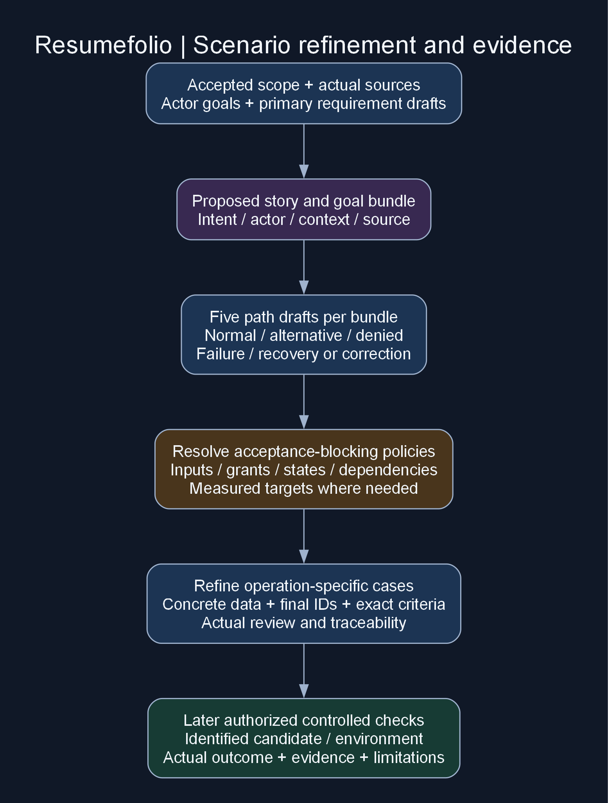

[Scalable SVG](Diagrams/Scenario-Refinement-Map.svg) ·
[Editable Graphviz](Diagrams/Scenario-Refinement-Map.dot)

Arrows describe review/refinement relationships, not a dated schedule, software
architecture or a completed evidence chain. Colors supplement labels.

1. Confirm the scope-derived actor goal and identify its primary domain/criteria.
2. Review each path's conditions, allowed/denied actions and observable state/effect.
3. Resolve policy, input/state, dependency and measurement gaps at their existing gates.
4. Split complex paths, allocate final IDs and concrete data, then maintain actual trace links and review findings.
5. Later run only authorized controlled checks; record candidate/environment, actual results and limitations separately from the proposed path.

Use [Questions and Decisions](#change-and-baseline-open-questions-and-decisions),
[Traceability](#validation-and-traceability-validation-and-traceability--heading-traceability),
[Review Findings](#validation-and-traceability-validation-and-traceability--heading-review-findings) and
[Baseline Criteria](#change-and-baseline-requirements-review-and-baseline-criteria).
The model does not populate these registers or resolve their acceptance conditions.

M-02 remains pending. Scope interpretation, owner review, feasibility, later product
verification and release acceptance are separate outcomes. The agreed wider
pre-implementation baseline still precedes product coding. No scenario draft
authorizes real email/job submissions, live resource mutation, job execution or production recovery.

<a id="scenarios-and-models-scenarios-and-models--heading-5-diagram-catalog"></a>
##### 5. Diagram Catalog

| Diagram | Purpose | Editable source | SVG | PNG |
| --- | --- | --- | --- | --- |
| Scenario refinement roadmap | This folder's review/evidence route | [DOT](Diagrams/Scenario-Refinement-Map.dot) | [SVG](Diagrams/Scenario-Refinement-Map.svg) |  |
| Story/scenario relationships | Sources, goals and the five path categories | [DOT](Diagrams/Story-Scenario-Relationships.dot) | [SVG](Diagrams/Story-Scenario-Relationships.svg) | 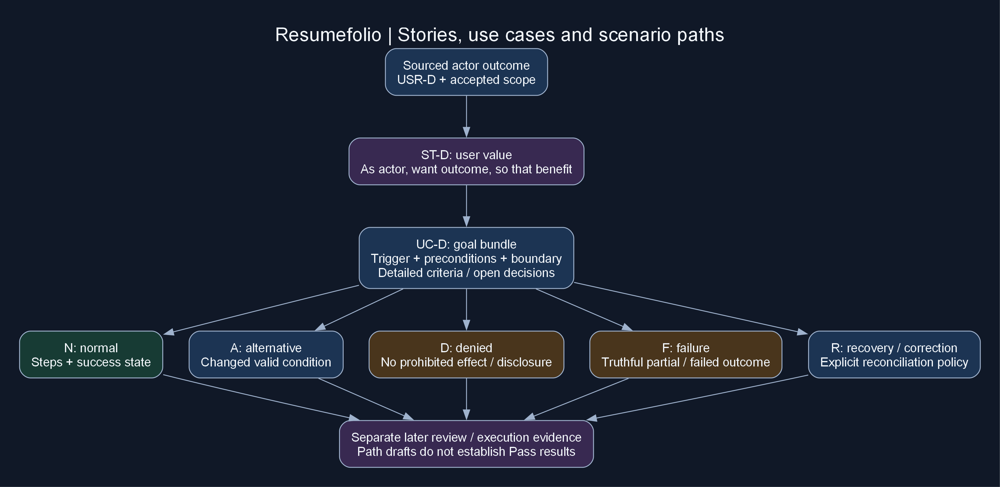 |
| Protected sharing sequence | UC-D03's viewer/direct-file boundary | [PlantUML](Diagrams/Protected-Sharing-Sequence.puml) | [SVG](Diagrams/Protected-Sharing-Sequence.svg) | 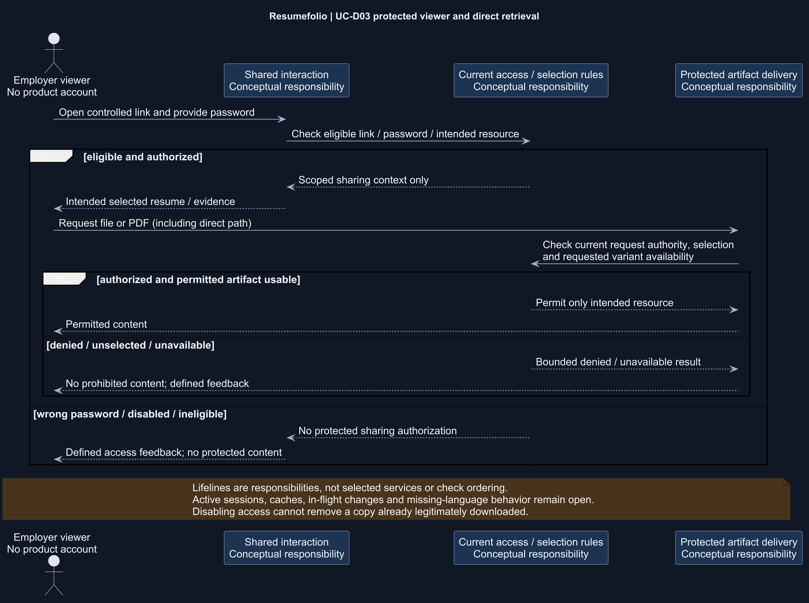 |
| Submitted-history scenario | UC-D05's actual-material capture and later source edits | [PlantUML](Diagrams/Submission-History-Scenario.puml) | [SVG](Diagrams/Submission-History-Scenario.svg) | 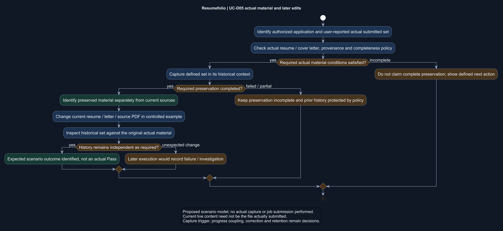 |

<a id="scenarios-and-models-scenarios-and-models--heading-6-maintenance"></a>
##### 6. Maintenance

- Keep the catalog, local references and path counts synchronized with the primary document.
- Preserve the legacy protected-resume walkthrough anchor retained at UC-D03 for existing method links.
- Link primary obligations instead of creating competing copies of permission/lifecycle policies.
- Distinguish actual review/execution from planned paths, including exact revisions and limits.
- Keep editable diagrams and PNG/SVG renders together; inspect labels/arrows and local links after changes.

Follow the [diagram guide](Diagrams/Diagram-Catalog.md). From the repository root:

```powershell
$diagramFolder = 'docs\SDLC\02-requirements-engineering\diagrams'
$graphvizExe = 'C:\Program Files\Graphviz\bin\dot.exe'
$plantUmlJar = 'C:\Users\fvali\AppData\Local\Resumefolio\DiagramTools\plantuml.jar'
foreach ($format in 'svg', 'png') {
    foreach ($stem in 'scenario-refinement-map', 'story-scenario-relationships') {
        & $graphvizExe "-T$format" -Gdpi=140 "$diagramFolder\$stem.dot" -o "$diagramFolder\$stem.$format"
        if ($LASTEXITCODE -ne 0) { throw "Graphviz failed: $stem / $format" }
    }
    foreach ($stem in 'protected-sharing-sequence', 'submission-history-scenario') {
        java '-Djava.awt.headless=true' -jar $plantUmlJar -charset UTF-8 "-t$format" "$diagramFolder\$stem.puml"
        if ($LASTEXITCODE -ne 0) { throw "PlantUML failed: $stem / $format" }
    }
}
```

Use actual installed tool paths elsewhere; save UTF-8 without BOM. A readable
render and working link establish document quality, not a modeled product result.

[Requirements index]() · [Specification guide](#requirements-specification-requirements-specification-overview)

</details>

<a id="scenarios-and-models-user-stories-and-scenarios"></a>

<details>
<summary>Resumefolio — User Stories and Scenarios</summary>

<a id="scenarios-and-models-user-stories-and-scenarios--heading-resumefolio--user-stories-and-scenarios"></a>
#### Resumefolio — User Stories and Scenarios

Start with [resume tailoring](#scenarios-and-models-user-stories-and-scenarios--heading-uc-d01-tailor-two-resumes-without-losing-independent-choices), [protected sharing](#scenarios-and-models-user-stories-and-scenarios--heading-uc-d03-view-a-protected-resume-and-retrieve-only-selected-material) or [manual applications](#scenarios-and-models-user-stories-and-scenarios--heading-uc-d04-prepare-a-manual-application-and-record-progress). The [MVP baseline](https://github.com/Farhad-V/Web-Resumefolio/blob/1f2acaa351ac306cb57cbe4fe9742e8bd90720d9/docs/MVP/baseline/README.md) identifies which behaviors apply to the current release.

Each bundle describes an actor goal and its normal, alternative, denied, failure and recovery paths. The scenarios are proposed and await review and execution. Use the [catalog](#scenarios-and-models-user-stories-and-scenarios--heading-2-use-case-and-story-catalog) to find other flows, including provider and workflow scenarios for later releases.

<a id="scenarios-and-models-user-stories-and-scenarios--heading-1-purpose-and-record-conventions"></a>
##### 1. Purpose and Record Conventions

Use [Accepted Scope](../01-Project-Planning/01-Project-Charter.md#mvp-scope),
[Actors](#stakeholders-and-elicitation-actors-and-system-context) and the
[SRS](#requirements-specification-requirements-specification) for authority.
[User Requirements](#requirements-specification-user-requirements) provides
the 12 actor-goal sources; domain drafts own detailed obligations/criteria.
No new interviews, actor permissions or scope decisions are recorded here.

| Record | Meaning | How to read this set |
| --- | --- | --- |
| Story ST-Dxx | Actor, desired outcome and value | Read with linked use case, criteria and limitations; not an implementation task |
| Use case UC-Dxx | A goal within an actor/resource boundary | Shared source, trigger/preconditions, normal flow and path variations |
| Scenario SCN-Dxx-N | Normal success-path draft | The numbered steps plus observable resulting state |
| A / D / F / R paths | Alternative / denied / failure / recovery or correction variants | Each specifies a changed condition/action and expected bounded result |
| Later evidence | Actual review or executed check | Separate dated record with identified policy/candidate/environment and results |

Every bundle shares **Proposed**, **Farhad**, **Unassigned priority**, and
**not executed / owner review not recorded**. All variants inherit the bundle's
source, actor/context, preconditions and trace links unless explicitly changed.
N/A/D/F/R are navigation suffixes, not formal test classifications or proof of coverage.

Controlled A/B, R1/R2 and other labels are synthetic example identities, not real
accounts/records. Normal paths assume decided required policies and applicable
access. A missing decision blocks dependent execution/acceptance; it is not filled
with an invented role, duration, transition, quota or recovery promise.

Use the [story template](#requirements-specification-requirements-specification) and
[scenario template](#requirements-specification-requirements-specification) when allocating/refining
individual records. A story does not replace business rules, denied paths or
acceptance criteria. Complex provider, Git, Sprint and execution bundles need
further operation-specific cases; the 60 drafts are not exhaustive coverage.

<a id="scenarios-and-models-user-stories-and-scenarios--heading-2-use-case-and-story-catalog"></a>
##### 2. Use-case and Story Catalog

| Use case / story | Actor outcome | Related user goal | Paths |
| --- | --- | --- | --- |
| [UC-D01 / ST-D01](#scenarios-and-models-user-stories-and-scenarios--id-uc-d01) | Tailor two resumes without losing independent choices | USR-D01 | N / A / D / F / R |
| [UC-D02 / ST-D02](#scenarios-and-models-user-stories-and-scenarios--id-uc-d02) | Configure PDF availability and owner sharing controls | USR-D02 | N / A / D / F / R |
| [UC-D03 / ST-D03](#scenarios-and-models-user-stories-and-scenarios--id-uc-d03) | View a protected resume and retrieve only selected material | USR-D03 | N / A / D / F / R |
| [UC-D04 / ST-D04](#scenarios-and-models-user-stories-and-scenarios--id-uc-d04) | Prepare a manual application and record progress | USR-D04 | N / A / D / F / R |
| [UC-D05 / ST-D05](#scenarios-and-models-user-stories-and-scenarios--id-uc-d05) | Preserve the resume and cover letter actually submitted | USR-D05 | N / A / D / F / R |
| [UC-D06 / ST-D06](#scenarios-and-models-user-stories-and-scenarios--id-uc-d06) | Coordinate authorized Gmail and calendar activity | USR-D06 | N / A / D / F / R  **After MVP.** |
| [UC-D07 / ST-D07](#scenarios-and-models-user-stories-and-scenarios--id-uc-d07) | Refine work and maintain a coherent Sprint Backlog | USR-D07 | N / A / D / F / R |
| [UC-D08 / ST-D08](#scenarios-and-models-user-stories-and-scenarios--id-uc-d08) | Collaborate under a scoped invitation and changed membership | USR-D08 | N / A / D / F / R |
| [UC-D09 / ST-D09](#scenarios-and-models-user-stories-and-scenarios--id-uc-d09) | Use real Git transfer and review a current change | USR-D09 | N / A / D / F / R |
| [UC-D10 / ST-D10](#scenarios-and-models-user-stories-and-scenarios--id-uc-d10) | Run supported work with separately controlled deployment | USR-D10 | N / A / D / F / R  **After MVP.** |
| [UC-D11 / ST-D11](#scenarios-and-models-user-stories-and-scenarios--id-uc-d11) | Configure effective limits and inspect permitted operation evidence | USR-D11 | N / A / D / F / R |
| [UC-D12 / ST-D12](#scenarios-and-models-user-stories-and-scenarios--id-uc-d12) | Restore an identified release and reconcile access safely | USR-D12 | N / A / D / F / R |

The catalog follows the USR-D goal sequence for traceability, not a required
one-to-one final model. Split mail reading/sending, calendar synchronization,
Git transfer/review and other independent goals further when policies stabilize.
Link each allocated case to exact criteria; local associations here are candidate
coverage suggestions, not populated formal traceability or a claim of completeness.

<a id="scenarios-and-models-user-stories-and-scenarios--heading-3-proposed-use-case-story-and-path-bundles"></a>
##### 3. Proposed Use-case, Story and Path Bundles

<a id="scenarios-and-models-user-stories-and-scenarios--id-uc-d01"></a>
<a id="scenarios-and-models-user-stories-and-scenarios--heading-uc-d01-tailor-two-resumes-without-losing-independent-choices"></a>
###### UC-D01: Tailor two resumes without losing independent choices

**Current release allocation:** MVP core.

**Story ST-D01:** As a registered applicant / resume owner, I want to tailor two resumes without losing independent choices,
so that I can reuse professional information while presenting relevant material for each opportunity.

**Source / rationale:** DEC-027/026/015; USR-D01. This is a derived draft; no new stakeholder answer is claimed.

**Actor, goal and boundary:** Registered applicant / resume owner; reuse professional information while presenting relevant material for each opportunity. Other resources and
external actors remain outside this actor's grant unless explicitly permitted.

**Trigger:** A selects information and adjusts R1 for an opportunity.

**Preconditions / controlled data:** Controlled user A owns a profile, a shared experience entry and two independently editable resumes R1/R2. Selected evidence and manual language variants are identified; source-update/override rules must be reviewed before execution.

**Trace / detailed criteria:** PRP-D01–D07; BRL-D02; QSR-D08; [primary specification](#requirements-specification-profiles-resumes-and-portfolio).
The applicable obligation/criteria remain authoritative in those proposed records;
cross-cutting [access](#requirements-specification-accounts-authentication-and-permissions),
[lifecycle](#requirements-specification-business-rules-and-data-lifecycle) and
[interfaces](#requirements-specification-external-interface-requirements) also apply.

<a id="scenarios-and-models-user-stories-and-scenarios--id-scn-d01-n"></a>
**Normal scenario SCN-D01-N**

1. The applicant selects shared professional information for each intended tailored resume.
2. The system presents the selected content in the intended resume context.
3. The applicant saves resume-specific presentation or content overrides and, when needed, updates shared source information.
4. The system saves the authorized changes, preserves independent tailoring and applies only the reviewed propagation policy.

**Success / resulting state:** Each resume retains its independent selections/layout/overrides; only the reviewed source-update effects occur. No preserved submitted material is rewritten.

**Story assessment criteria:** Under the stated conditions, the normal result
matches the linked domain criteria; the denied path discloses no prohibited
content/authority; failure is distinguishable from successful completion. Decisions
identified below must be resolved before these become acceptance-ready cases.

| Scenario variant | Changed condition / action and expected result |
| --- | --- |
| <a id="scenarios-and-models-user-stories-and-scenarios--id-scn-d01-a"></a>SCN-D01-A — alternative | Given R2 omits the changed source entry, save the source edit and inspect R2: deliberately omitted content is not silently added. |
| <a id="scenarios-and-models-user-stories-and-scenarios--id-scn-d01-d"></a>SCN-D01-D — denied | Given user B lacks access to A’s profile/resume, request its edit/association directly: no protected content or change is authorized. |
| <a id="scenarios-and-models-user-stories-and-scenarios--id-scn-d01-f"></a>SCN-D01-F — failure | Interrupt an evidence/source save before required completion and inspect the result: the product distinguishes incomplete/failed work and follows the decided prior-content policy. |
| <a id="scenarios-and-models-user-stories-and-scenarios--id-scn-d01-r"></a>SCN-D01-R — recovery/correction | After a conflicting source/resume edit, invoke only the reviewed reconciliation/retry path: retain independent overrides and report unresolved conflict rather than silently replacing them. |

**Denied/failure postcondition:** Do not infer a prohibited effect or successful
completion. Exact partial state, retained references and recovery actions follow
the reviewed domain policy; no universal rollback/atomicity guarantee is assumed.

**Open questions / review gate:** Fields, source relation, override granularity, propagation trigger, confirmation, concurrency and language absence; before affected PRP acceptance.

**Planned verification / evidence:** Refine concrete inputs, exact criteria and
observable checks for these paths, then perform only authorized controlled
walkthroughs/checks later. Actual review outcome, reviewed revision, environment,
execution date/results and evidence: **not recorded**. Owner: **Farhad**.

<a id="scenarios-and-models-user-stories-and-scenarios--id-uc-d02"></a>
<a id="scenarios-and-models-user-stories-and-scenarios--heading-uc-d02-configure-pdf-availability-and-owner-sharing-controls"></a>
###### UC-D02: Configure PDF availability and owner sharing controls

**Current release allocation:** MVP core.

**Story ST-D02:** As a resume owner, I want to configure PDF availability and owner sharing controls,
so that I can choose what a particular employer may retrieve and stop new access when required.

**Source / rationale:** DEC-025/024; USR-D02. This is a derived draft; no new stakeholder answer is claimed.

**Actor, goal and boundary:** Resume owner; choose what a particular employer may retrieve and stop new access when required. Other resources and
external actors remain outside this actor's grant unless explicitly permitted.

**Trigger:** The owner requests a change to the intended resume's PDF download configuration. Disabling a sharing link has its own independent trigger and path below.

**Preconditions / controlled data:** A owns R1 and eligible generated/uploaded artifacts; uploaded English/German variants have explicit availability. A controlled protected link and fresh viewer contexts are available; no existing-session policy is assumed.

**Trace / detailed criteria:** PDF-D02/D03/D06; ACC-D08; EIF-D04; [primary specification](#requirements-specification-pdf-and-controlled-sharing).
The applicable obligation/criteria remain authoritative in those proposed records;
cross-cutting [access](#requirements-specification-accounts-authentication-and-permissions),
[lifecycle](#requirements-specification-business-rules-and-data-lifecycle) and
[interfaces](#requirements-specification-external-interface-requirements) also apply.

<a id="scenarios-and-models-user-stories-and-scenarios--id-scn-d02-n"></a>
**Normal scenario SCN-D02-N**

1. The owner opens PDF download settings for the intended resume.
2. The system presents its current generated/uploaded download configuration and language-specific availability.
3. The owner chooses the intended generated/uploaded/both/neither mode and applicable language choices, then requests save.
4. The system validates authority and the requested configuration, records the permitted effective choices and reports the actual save result.

**Success / resulting state:** The intended resume has the saved permitted PDF download choices. Authorized retrieval follows those choices and actual variant availability under the reviewed effective-timing policy. Saving this configuration does not itself disable or re-enable the sharing link. Selecting neither disables employer PDF downloads through that sharing context, not the resume page or link itself.

<a id="scenarios-and-models-user-stories-and-scenarios--id-uc-d02-disable-link"></a>
**Separate operation: Disable the sharing link**

This is a separate owner action within the existing UC-D02 goal bundle, not a step automatically performed when PDF settings are saved. It introduces no new UC/ST/SCN identifier or mandatory sequence between configuration and link management.

**Sources / required outcome:** PDF-D06 and ACC-D08, retaining DEC-024. The requirement concerns denying new access through a disabled link; already authorized sessions, caches and in-flight requests remain under the unresolved revocation policy.

**Trigger:** The owner explicitly requests disablement of the intended sharing link.

**Preconditions:** The intended active link and resume are identified; the actor has the applicable owner-control authority. PDF download settings need not have been changed first.

1. The owner selects the intended link and requests disablement.
2. The system checks authority for that link and applies the permitted link-state change.
3. After the change completes, the system reports the link as disabled.
4. If a fresh viewer subsequently attempts to gain protected access through that link, the system denies that new access, including protected file/PDF retrieval through the disabled sharing context.

**Successful postcondition:** The intended link is disabled and cannot grant new protected access. This operation does not itself replace the saved PDF configuration or revoke copies legitimately downloaded earlier.

**Denied / failed outcome:** An unauthorized request does not disable the link. A failed or unconfirmed state change is not reported as successfully completed; a denial of future viewing is claimed only after effective disablement. Exact failure recovery and already-authorized-session behavior remain open in the primary records; no automatic re-enable or universal rollback is assumed.

**Planned verification, separately:** Compare the recorded link-state result with a new viewer-context access attempt after effective disablement. Configuration saving must not imply link disablement, and link disablement requires no prior configuration save. This is a proposed check, not an executed product result.

**Story assessment criteria:** Under the stated conditions, the normal result
matches the linked domain criteria; the denied path discloses no prohibited
content/authority; failure is distinguishable from successful completion. Decisions
identified below must be resolved before these become acceptance-ready cases.

| Scenario variant | Changed condition / action and expected result |
| --- | --- |
| <a id="scenarios-and-models-user-stories-and-scenarios--id-scn-d02-a"></a>SCN-D02-A — alternative | Given mode is neither, request generated and uploaded employer downloads: neither is available through that sharing context; the resume page is not thereby assumed disabled. |
| <a id="scenarios-and-models-user-stories-and-scenarios--id-scn-d02-d"></a>SCN-D02-D — denied | Given B lacks owner-control authority, request a password/link/mode change directly: R1 settings remain unchanged and no protected management information is disclosed. |
| <a id="scenarios-and-models-user-stories-and-scenarios--id-scn-d02-f"></a>SCN-D02-F — failure | Make the permitted PDF variant unavailable or fail its required processing: show defined unavailability/failure, not a wrong-language substitute or false complete PDF. |
| <a id="scenarios-and-models-user-stories-and-scenarios--id-scn-d02-r"></a>SCN-D02-R — recovery/correction | Restore a previously saved configuration only through the reviewed authorized correction policy; recheck fresh access and record active-session/cache/in-flight behavior as unresolved until decided. |

**Denied/failure postcondition:** Do not infer a prohibited effect or successful
completion. Exact partial state, retained references and recovery actions follow
the reviewed domain policy; no universal rollback/atomicity guarantee is assumed.

**Open questions / review gate:** Mode-change timing, artifact/language absence, owner preview, link re-enable and active/cached/in-flight revocation; before PDF/access acceptance.

**Planned verification / evidence:** Refine concrete inputs, exact criteria and
observable checks for these paths, then perform only authorized controlled
walkthroughs/checks later. Actual review outcome, reviewed revision, environment,
execution date/results and evidence: **not recorded**. Owner: **Farhad**.

<a id="scenarios-and-models-user-stories-and-scenarios--id-9-draft-walkthrough-view-a-protected-resume"></a>
<a id="scenarios-and-models-user-stories-and-scenarios--id-uc-d03"></a>
<a id="scenarios-and-models-user-stories-and-scenarios--heading-uc-d03-view-a-protected-resume-and-retrieve-only-selected-material"></a>
###### UC-D03: View a protected resume and retrieve only selected material

**Current release allocation:** MVP core.

**Story ST-D03:** As a employer viewer without product account, I want to view a protected resume and retrieve only selected material,
so that I can inspect the intended professional material without creating a product account.

**Source / rationale:** DEC-024/025/026; EXT-001; USR-D03. This is a derived draft; no new stakeholder answer is claimed.

**Actor, goal and boundary:** Employer viewer without product account; inspect the intended professional material without creating a product account. Other resources and
external actors remain outside this actor's grant unless explicitly permitted.

**Trigger:** Viewer opens L1.

**Preconditions / controlled data:** A has prepared R1, an eligible password-protected link L1, selected evidence E1 and a permitted available PDF P1. E2/unrelated R2 remain outside L1. Use controlled passwords and a fresh viewer context.

**Trace / detailed criteria:** PDF-D03–D06; ACC-D06–D08; EIF-D03/D04; [primary specification](#requirements-specification-pdf-and-controlled-sharing).
The applicable obligation/criteria remain authoritative in those proposed records;
cross-cutting [access](#requirements-specification-accounts-authentication-and-permissions),
[lifecycle](#requirements-specification-business-rules-and-data-lifecycle) and
[interfaces](#requirements-specification-external-interface-requirements) also apply.

<a id="scenarios-and-models-user-stories-and-scenarios--id-scn-d03-n"></a>
**Normal scenario SCN-D03-N**

1. The employer viewer opens the intended sharing link.
2. The system requests the required sharing password without requiring a product account.
3. The viewer supplies the correct password and requests selected resume/evidence or an enabled available PDF.
4. The system evaluates the applicable current authority and exposes only the permitted selected content or requested available variant.

**Success / resulting state:** The viewer receives only eligible selected content/P1. No private workspace or unrelated resource access is granted. A retrieved copy is not proof of employer identity or later recall.

**Story assessment criteria:** Under the stated conditions, the normal result
matches the linked domain criteria; the denied path discloses no prohibited
content/authority; failure is distinguishable from successful completion. Decisions
identified below must be resolved before these become acceptance-ready cases.

**Scenario variant:** <a id="scenarios-and-models-user-stories-and-scenarios--id-scn-d03-a"></a>SCN-D03-A — alternative

**Changed condition / action and expected result:** Request an unselected E2 or disabled/unavailable language variant from an otherwise valid sharing context: do not expose it; apply the reviewed availability feedback.

**Scenario variant:** <a id="scenarios-and-models-user-stories-and-scenarios--id-scn-d03-d"></a>SCN-D03-D — denied

**Changed condition / action and expected result:** Supply the wrong password, use a disabled link or alter the direct file/resume reference: do not disclose protected content or newly grant access.

**Scenario variant:** <a id="scenarios-and-models-user-stories-and-scenarios--id-scn-d03-f"></a>SCN-D03-F — failure

**Changed condition / action and expected result:** Fail file retrieval or rendering after authorization: expose defined bounded failure without unrelated fallback content, secrets or false download success.

**Scenario variant:** <a id="scenarios-and-models-user-stories-and-scenarios--id-scn-d03-r"></a>SCN-D03-R — recovery/correction

**Changed condition / action and expected result:** After an authorized password change, use fresh contexts with old/current password: the old one cannot newly authorize; the current one works only for an eligible link. Existing sessions/cache/in-flight policy remains a blocker.

**Denied/failure postcondition:** Do not infer a prohibited effect or successful
completion. Exact partial state, retained references and recovery actions follow
the reviewed domain policy; no universal rollback/atomicity guarantee is assumed.

**Open questions / review gate:** Password attempts/feedback, session lifetime, visitor tracking if any, language fallback, current revision and active-session revocation; before dependent access acceptance.

**Planned verification / evidence:** Refine concrete inputs, exact criteria and
observable checks for these paths, then perform only authorized controlled
walkthroughs/checks later. Actual review outcome, reviewed revision, environment,
execution date/results and evidence: **not recorded**. Owner: **Farhad**.

<a id="scenarios-and-models-user-stories-and-scenarios--id-uc-d04"></a>
<a id="scenarios-and-models-user-stories-and-scenarios--heading-uc-d04-prepare-a-manual-application-and-record-progress"></a>
###### UC-D04: Prepare a manual application and record progress

**Current release allocation:** MVP core.

**Story ST-D04:** As a registered applicant, I want to prepare a manual application and record progress,
so that I can keep company, opportunity, relevant resume and user-authored cover letter together.

**Source / rationale:** DEC-023/027; USR-D04. This is a derived draft; no new stakeholder answer is claimed.

**Actor, goal and boundary:** Registered applicant; keep company, opportunity, relevant resume and user-authored cover letter together. Other resources and
external actors remain outside this actor's grant unless explicitly permitted.

**Trigger:** A starts preparing an application for the opportunity.

**Preconditions / controlled data:** A has an authorized resume R1 and a controlled opportunity. Required company/position/cover-letter fields and allowed progress transitions must be reviewed before execution.

**Trace / detailed criteria:** APP-D01–D05; ACC-D03/D04; BRL-D06/D10; [primary specification](#requirements-specification-manual-application-management).
The applicable obligation/criteria remain authoritative in those proposed records;
cross-cutting [access](#requirements-specification-accounts-authentication-and-permissions),
[lifecycle](#requirements-specification-business-rules-and-data-lifecycle) and
[interfaces](#requirements-specification-external-interface-requirements) also apply.

<a id="scenarios-and-models-user-stories-and-scenarios--id-scn-d04-n"></a>
**Normal scenario SCN-D04-N**

1. The applicant enters company and opportunity information under the reviewed field rules.
2. The system validates that information and presents the intended application context.
3. The applicant associates an authorized resume, writes the cover letter manually and requests save.
4. The system retains the permitted preparation information and reports its actual result; a later progress update follows its separately reviewed transition rules.

**Success / resulting state:** The application retains intended preparation/progress context. No AI drafting, automatic external submission or employer receipt is inferred from the status.

**Story assessment criteria:** Under the stated conditions, the normal result
matches the linked domain criteria; the denied path discloses no prohibited
content/authority; failure is distinguishable from successful completion. Decisions
identified below must be resolved before these become acceptance-ready cases.

| Scenario variant | Changed condition / action and expected result |
| --- | --- |
| <a id="scenarios-and-models-user-stories-and-scenarios--id-scn-d04-a"></a>SCN-D04-A — alternative | Keep an incomplete preparation record only if the reviewed workflow permits it: the missing inputs and incomplete state remain distinguishable from completion. |
| <a id="scenarios-and-models-user-stories-and-scenarios--id-scn-d04-d"></a>SCN-D04-D — denied | Attempt to associate another user’s inaccessible resume or change their application by direct reference: no unauthorized association, mutation or disclosure occurs. |
| <a id="scenarios-and-models-user-stories-and-scenarios--id-scn-d04-f"></a>SCN-D04-F — failure | Interrupt a cover-letter save or progress change: do not falsely present it as successfully persisted; expose the defined next action. |
| <a id="scenarios-and-models-user-stories-and-scenarios--id-scn-d04-r"></a>SCN-D04-R — recovery/correction | Correct a mistaken progress value through the reviewed correction transition: preserve the required event/recorded-time distinction and correction history if specified. |

**Denied/failure postcondition:** Do not infer a prohibited effect or successful
completion. Exact partial state, retained references and recovery actions follow
the reviewed domain policy; no universal rollback/atomicity guarantee is assumed.

**Open questions / review gate:** Fields, duplicate opportunities/applications, statuses/transitions, required material, dates and correction rules; before APP workflow acceptance.

**Planned verification / evidence:** Refine concrete inputs, exact criteria and
observable checks for these paths, then perform only authorized controlled
walkthroughs/checks later. Actual review outcome, reviewed revision, environment,
execution date/results and evidence: **not recorded**. Owner: **Farhad**.

<a id="scenarios-and-models-user-stories-and-scenarios--id-uc-d05"></a>
<a id="scenarios-and-models-user-stories-and-scenarios--heading-uc-d05-preserve-the-resume-and-cover-letter-actually-submitted"></a>
###### UC-D05: Preserve the resume and cover letter actually submitted

**Current release allocation:** MVP core.

**Story ST-D05:** As a applicant recording an actual submitted set, I want to preserve the resume and cover letter actually submitted,
so that I can retain a historical record that later source edits cannot silently rewrite.

**Source / rationale:** DEC-023; EXT-002; USR-D05. This is a derived draft; no new stakeholder answer is claimed.

**Actor, goal and boundary:** Applicant recording an actual submitted set; retain a historical record that later source edits cannot silently rewrite. Other resources and
external actors remain outside this actor's grant unless explicitly permitted.

**Trigger:** A requests recording/preservation of the actual submitted materials.

**Preconditions / controlled data:** A identifies controlled resume material M1 and cover letter C1 as the actual submitted set for application AP1. The capture/provenance/completeness and progress-coupling policy must be reviewed; current live content is not assumed identical.

**Trace / detailed criteria:** APP-D05–D09; BRL-D05/D08; PDF-D08/D10; QSR-D08; [primary specification](#requirements-specification-manual-application-management).
The applicable obligation/criteria remain authoritative in those proposed records;
cross-cutting [access](#requirements-specification-accounts-authentication-and-permissions),
[lifecycle](#requirements-specification-business-rules-and-data-lifecycle) and
[interfaces](#requirements-specification-external-interface-requirements) also apply.

<a id="scenarios-and-models-user-stories-and-scenarios--id-scn-d05-n"></a>
**Normal scenario SCN-D05-N**

1. The applicant identifies the application and the actual resume and cover-letter material reported as submitted.
2. The system checks the required identity, provenance and completeness conditions under the reviewed capture policy.
3. The applicant requests preservation of the identified actual material.
4. The system preserves the permitted historical set separately from editable sources and reports whether capture completed, partially completed or failed.

**Success / resulting state:** The historical set remains identifiable and unchanged by later source edits. Progress status and complete preservation are represented according to their explicit coupling policy.

**Story assessment criteria:** Under the stated conditions, the normal result
matches the linked domain criteria; the denied path discloses no prohibited
content/authority; failure is distinguishable from successful completion. Decisions
identified below must be resolved before these become acceptance-ready cases.

| Scenario variant | Changed condition / action and expected result |
| --- | --- |
| <a id="scenarios-and-models-user-stories-and-scenarios--id-scn-d05-a"></a>SCN-D05-A — alternative | Given the file actually sent differs from the current generated PDF, identify that actual material under the reviewed capture policy: do not silently capture the latest live rendition instead. |
| <a id="scenarios-and-models-user-stories-and-scenarios--id-scn-d05-d"></a>SCN-D05-D — denied | As B without AP1 authority, retrieve/change the historical artifacts directly: no protected material or mutation is authorized. |
| <a id="scenarios-and-models-user-stories-and-scenarios--id-scn-d05-f"></a>SCN-D05-F — failure | Provide an incomplete required set or fail one capture step: mark preservation incomplete/failed, not successfully complete; prior historical material follows its reviewed protection rules. |
| <a id="scenarios-and-models-user-stories-and-scenarios--id-scn-d05-r"></a>SCN-D05-R — recovery/correction | Record a correction or genuine resubmission using the reviewed policy: prior/new sets and provenance remain distinguishable rather than silently replacing the original. |

**Denied/failure postcondition:** Do not infer a prohibited effect or successful
completion. Exact partial state, retained references and recovery actions follow
the reviewed domain policy; no universal rollback/atomicity guarantee is assumed.

**Open questions / review gate:** Trigger, artifacts/format, provenance, external copies, status coupling, correction/resubmission and explicit retention/deletion; before history acceptance.

**Planned verification / evidence:** Refine concrete inputs, exact criteria and
observable checks for these paths, then perform only authorized controlled
walkthroughs/checks later. Actual review outcome, reviewed revision, environment,
execution date/results and evidence: **not recorded**. Owner: **Farhad**.

<a id="scenarios-and-models-user-stories-and-scenarios--id-uc-d06"></a>
<a id="scenarios-and-models-user-stories-and-scenarios--heading-uc-d06-coordinate-authorized-gmail-and-calendar-activity"></a>
###### UC-D06: Coordinate authorized Gmail and calendar activity

<details>
<summary>After MVP · open scenario and exceptions</summary>

**Current release allocation:** Deferred after MVP.

**Story ST-D06:** As a connected registered user, I want to coordinate authorized Gmail and calendar activity,
so that I can work with correspondence and activities in the intended account/application context.

**Source / rationale:** DEC-022/028; USR-D06. This is a derived draft; no new stakeholder answer is claimed.

**Actor, goal and boundary:** Connected registered user; work with correspondence and activities in the intended account/application context. Other resources and
external actors remain outside this actor's grant unless explicitly permitted.

**Trigger:** A works with a relevant message and application-related activity.

**Preconditions / controlled data:** Provider access/conditions have been validated for the later check; A has an authorized selected account/calendar and controlled recipient/event data. Required operations, synchronization and time rules must be decided.

**Trace / detailed criteria:** EGC-D01–D12; BRL-D07; EIF-D05/D08; [primary specification](#requirements-specification-email-calendar-and-google-integration).
The applicable obligation/criteria remain authoritative in those proposed records;
cross-cutting [access](#requirements-specification-accounts-authentication-and-permissions),
[lifecycle](#requirements-specification-business-rules-and-data-lifecycle) and
[interfaces](#requirements-specification-external-interface-requirements) also apply.

<a id="scenarios-and-models-user-stories-and-scenarios--id-scn-d06-n"></a>
**Normal scenario SCN-D06-N**

1. The user selects the intended connected account and a permitted correspondence or calendar action.
2. The system presents the relevant authorized account/message/activity context.
3. The user supplies or reviews the information needed for that action and explicitly requests the intended operation.
4. The system performs only the permitted action and reports the outcome supported by provider/local evidence. Reading, sending, activity management and synchronization are separate goals refined below.

**Success / resulting state:** Account/application/time context and private permissions remain correct. Provider acceptance is not reported as recipient delivery/read confirmation.

**Story assessment criteria:** Under the stated conditions, the normal result
matches the linked domain criteria; the denied path discloses no prohibited
content/authority; failure is distinguishable from successful completion. Decisions
identified below must be resolved before these become acceptance-ready cases.

| Scenario variant | Changed condition / action and expected result |
| --- | --- |
| <a id="scenarios-and-models-user-stories-and-scenarios--id-scn-d06-a"></a>SCN-D06-A — alternative | Introduce concurrent local/provider event changes: follow the explicit conflict/source-of-truth policy instead of assuming last-write-wins or bidirectional behavior. |
| <a id="scenarios-and-models-user-stories-and-scenarios--id-scn-d06-d"></a>SCN-D06-D — denied | Use a revoked/missing provider grant or another user’s connection reference: do not perform protected provider operations or expose private data. |
| <a id="scenarios-and-models-user-stories-and-scenarios--id-scn-d06-f"></a>SCN-D06-F — failure | Make the outbound response ambiguous or provider unavailable: retain the unknown/failed outcome and defined next action without blind duplicate send. |
| <a id="scenarios-and-models-user-stories-and-scenarios--id-scn-d06-r"></a>SCN-D06-R — recovery/correction | Disconnect/reconnect only through the reviewed lifecycle; reconcile mapping/pending work without silently deleting provider data or sending stale queued mail. |

**Denied/failure postcondition:** Do not infer a prohibited effect or successful
completion. Exact partial state, retained references and recovery actions follow
the reviewed domain policy; no universal rollback/atomicity guarantee is assumed.

**Open questions / review gate:** Actual access, operations/scopes, account selection, messages/drafts, synchronization/deletion/conflicts, reminders, safe retry and reconnect; GAP-D02 and EGC gates.

**Planned verification / evidence:** Refine concrete inputs, exact criteria and
observable checks for these paths, then perform only authorized controlled
walkthroughs/checks later. Actual review outcome, reviewed revision, environment,
execution date/results and evidence: **not recorded**. Owner: **Farhad**.

<a id="scenarios-and-models-user-stories-and-scenarios--id-uc-d07"></a>

</details>

<a id="scenarios-and-models-user-stories-and-scenarios--heading-uc-d07-refine-work-and-maintain-a-coherent-sprint-backlog"></a>
###### UC-D07: Refine work and maintain a coherent Sprint Backlog

<details>
<summary>After MVP · open scenario and exceptions</summary>

**Current release allocation:** Deferred after MVP.

**Story ST-D07:** As a authorized project participant, I want to refine work and maintain a coherent Sprint Backlog,
so that I can coordinate goal-directed work without confusing items, tasks and completion.

**Source / rationale:** DEC-021; USR-D07. This is a derived draft; no new stakeholder answer is claimed.

**Actor, goal and boundary:** Authorized project participant; coordinate goal-directed work without confusing items, tasks and completion. Other resources and
external actors remain outside this actor's grant unless explicitly permitted.

**Trigger:** A plans selected work for a Sprint.

**Preconditions / controlled data:** A has applicable work authority and controlled project/board/backlog data. Relationship, state, assignment, date, completion and Sprint-end rules must be decided.

**Trace / detailed criteria:** PKS-D01–D05/D07–D11; BRL-D06; [primary specification](#requirements-specification-projects-kanban-and-sprints).
The applicable obligation/criteria remain authoritative in those proposed records;
cross-cutting [access](#requirements-specification-accounts-authentication-and-permissions),
[lifecycle](#requirements-specification-business-rules-and-data-lifecycle) and
[interfaces](#requirements-specification-external-interface-requirements) also apply.

<a id="scenarios-and-models-user-stories-and-scenarios--id-scn-d07-n"></a>
**Normal scenario SCN-D07-N**

1. The authorized participant selects the intended project/backlog and work item.
2. The system presents permitted work information and applicable relationships.
3. The participant requests a permitted refinement, planning or completion action.
4. The system validates authority and reviewed work rules, records the allowed change and distinguishes task progress, item acceptance and Sprint outcome.

**Success / resulting state:** Goal, selected items and delivery plan remain coherent; task/card state alone is not item acceptance, and incomplete work stays identifiable.

**Story assessment criteria:** Under the stated conditions, the normal result
matches the linked domain criteria; the denied path discloses no prohibited
content/authority; failure is distinguishable from successful completion. Decisions
identified below must be resolved before these become acceptance-ready cases.

| Scenario variant | Changed condition / action and expected result |
| --- | --- |
| <a id="scenarios-and-models-user-stories-and-scenarios--id-scn-d07-a"></a>SCN-D07-A — alternative | End the Sprint with an incomplete item: apply the reviewed disposition/reselection rule without silently accepting, erasing or automatically carrying over work. |
| <a id="scenarios-and-models-user-stories-and-scenarios--id-scn-d07-d"></a>SCN-D07-D — denied | Attempt an unauthorized board move/assignment or select inaccessible work through a direct reference: no protected change/disclosure occurs. |
| <a id="scenarios-and-models-user-stories-and-scenarios--id-scn-d07-f"></a>SCN-D07-F — failure | Interrupt/conflict a move or remove an occupied column: follow defined state/reference handling and do not falsely show a completed coherent update. |
| <a id="scenarios-and-models-user-stories-and-scenarios--id-scn-d07-r"></a>SCN-D07-R — recovery/correction | Reconcile a conflicting plan/relationship update under the reviewed policy; retain correct item/task/Sprint meaning and do not duplicate a completion claim. |

**Denied/failure postcondition:** Do not infer a prohibited effect or successful
completion. Exact partial state, retained references and recovery actions follow
the reviewed domain policy; no universal rollback/atomicity guarantee is assumed.

**Open questions / review gate:** Structure/cardinality, columns/states, roles, completion, dates, carry-over and concurrency; GAP-D06 and PKS review gates.

**Planned verification / evidence:** Refine concrete inputs, exact criteria and
observable checks for these paths, then perform only authorized controlled
walkthroughs/checks later. Actual review outcome, reviewed revision, environment,
execution date/results and evidence: **not recorded**. Owner: **Farhad**.

<a id="scenarios-and-models-user-stories-and-scenarios--id-uc-d08"></a>

</details>

<a id="scenarios-and-models-user-stories-and-scenarios--heading-uc-d08-collaborate-under-a-scoped-invitation-and-changed-membership"></a>
###### UC-D08: Collaborate under a scoped invitation and changed membership

**Current release allocation:** MVP core.

**Story ST-D08:** As a invited board/project/repository collaborator, I want to collaborate under a scoped invitation and changed membership,
so that I can participate in permitted work while private resources remain isolated.

**Source / rationale:** DEC-028/021/020; USR-D08. This is a derived draft; no new stakeholder answer is claimed.

**Actor, goal and boundary:** Invited board/project/repository collaborator; participate in permitted work while private resources remain isolated. Other resources and
external actors remain outside this actor's grant unless explicitly permitted.

**Trigger:** B receives an eligible resource invitation.

**Preconditions / controlled data:** Resource owner A can grant only the reviewed scoped action; B has no unrelated mail/resume/repository grant. Invitation/state/revocation rules must be decided before execution.

**Trace / detailed criteria:** ACC-D03/D04/D05/D10/D12; PKS-D06; GIT-D02; [primary specification](#requirements-specification-accounts-authentication-and-permissions).
The applicable obligation/criteria remain authoritative in those proposed records;
cross-cutting [access](#requirements-specification-accounts-authentication-and-permissions),
[lifecycle](#requirements-specification-business-rules-and-data-lifecycle) and
[interfaces](#requirements-specification-external-interface-requirements) also apply.

<a id="scenarios-and-models-user-stories-and-scenarios--id-scn-d08-n"></a>
**Normal scenario SCN-D08-N**

1. The invited person opens the intended collaboration invitation.
2. The system presents the intended resource scope and the reviewed eligibility conditions.
3. The person completes the required acceptance interaction and requests a permitted resource action.
4. The system applies only the granted resource/action authority and does not expose unrelated private information.

**Success / resulting state:** B can perform only the reviewed granted actions. Resource membership is not a global private-data or secret-management grant.

**Story assessment criteria:** Under the stated conditions, the normal result
matches the linked domain criteria; the denied path discloses no prohibited
content/authority; failure is distinguishable from successful completion. Decisions
identified below must be resolved before these become acceptance-ready cases.

| Scenario variant | Changed condition / action and expected result |
| --- | --- |
| <a id="scenarios-and-models-user-stories-and-scenarios--id-scn-d08-a"></a>SCN-D08-A — alternative | Attempt acceptance of an ineligible/expired invitation if expiry is adopted: follow its explicit state policy without inventing a duration or granting stale access. |
| <a id="scenarios-and-models-user-stories-and-scenarios--id-scn-d08-d"></a>SCN-D08-D — denied | B tries to self-escalate permissions or read A’s private mail/resume through direct references: no escalation/disclosure occurs. |
| <a id="scenarios-and-models-user-stories-and-scenarios--id-scn-d08-f"></a>SCN-D08-F — failure | Fail acceptance/grant persistence: do not present an unconfirmed invitation as effective membership; required state remains distinguishable. |
| <a id="scenarios-and-models-user-stories-and-scenarios--id-scn-d08-r"></a>SCN-D08-R — recovery/correction | A removes or changes membership; B makes a new protected request. Enforce reviewed changed-grant policy and separately test existing/in-flight contexts once defined. |

**Denied/failure postcondition:** Do not infer a prohibited effect or successful
completion. Exact partial state, retained references and recovery actions follow
the reviewed domain policy; no universal rollback/atomicity guarantee is assumed.

**Open questions / review gate:** Grant/role matrix, invitation count/states/expiry, ownership, administrative powers and active/in-flight revocation; before dependent permission acceptance.

**Planned verification / evidence:** Refine concrete inputs, exact criteria and
observable checks for these paths, then perform only authorized controlled
walkthroughs/checks later. Actual review outcome, reviewed revision, environment,
execution date/results and evidence: **not recorded**. Owner: **Farhad**.

<a id="scenarios-and-models-user-stories-and-scenarios--id-uc-d09"></a>
<a id="scenarios-and-models-user-stories-and-scenarios--heading-uc-d09-use-real-git-transfer-and-review-a-current-change"></a>
###### UC-D09: Use real Git transfer and review a current change

**Current release allocation:** MVP ProjectForge transfer; advanced request/review/merge paths deferred.

**Story ST-D09:** As a authorized repository contributor/reviewer, I want to use real Git transfer and review a current change,
so that I can collaborate on actual hosted code with trustworthy revision and merge context.

**Source / rationale:** DEC-020; USR-D09. This is a derived draft; no new stakeholder answer is claimed.

**Actor, goal and boundary:** Authorized repository contributor/reviewer; collaborate on actual hosted code with trustworthy revision and merge context. Other resources and
external actors remain outside this actor's grant unless explicitly permitted.

**Trigger:** Contributor prepares a change for review.

**Preconditions / controlled data:** A controlled real repository, supported client/transport and explicit read/write/review/merge grants exist for the later check. Source/target/ref, fork and merge policies must be decided.

**Trace / detailed criteria:** GIT-D01–D10; EIF-D06; QSR-D05/D08; [primary specification](#requirements-specification-git-hosting-and-collaboration).
The applicable obligation/criteria remain authoritative in those proposed records;
cross-cutting [access](#requirements-specification-accounts-authentication-and-permissions),
[lifecycle](#requirements-specification-business-rules-and-data-lifecycle) and
[interfaces](#requirements-specification-external-interface-requirements) also apply.

<a id="scenarios-and-models-user-stories-and-scenarios--id-scn-d09-n"></a>
**Normal scenario SCN-D09-N**

1. The user selects the intended repository and a supported authorized transfer or collaboration action.
2. The system identifies the applicable repository/ref or source/target revision context.
3. The user requests the intended transfer, pull-request, review or merge action.
4. The system applies the operation-specific authority and current-state conditions and reports the actual result. Independent repository goals are refined below.

**Success / resulting state:** Actual Git data/history and collaboration metadata correspond to the intended context. A merge/tag/release does not inherently authorize deployment.

**Story assessment criteria:** Under the stated conditions, the normal result
matches the linked domain criteria; the denied path discloses no prohibited
content/authority; failure is distinguishable from successful completion. Decisions
identified below must be resolved before these become acceptance-ready cases.

| Scenario variant | Changed condition / action and expected result |
| --- | --- |
| <a id="scenarios-and-models-user-stories-and-scenarios--id-scn-d09-a"></a>SCN-D09-A — alternative | Change the source or target after review: apply the reviewed stale-review/recheck policy; old review is not silently treated as approval of different code. |
| <a id="scenarios-and-models-user-stories-and-scenarios--id-scn-d09-d"></a>SCN-D09-D — denied | Attempt a protected clone/push/merge or private fork exposure without its grant: client and direct/browser paths cannot bypass denial. |
| <a id="scenarios-and-models-user-stories-and-scenarios--id-scn-d09-f"></a>SCN-D09-F — failure | Introduce a merge conflict or interrupted transfer: report the bounded rejected/incomplete outcome without false merged/success status or unrelated ref damage. |
| <a id="scenarios-and-models-user-stories-and-scenarios--id-scn-d09-r"></a>SCN-D09-R — recovery/correction | Reconcile a failed/conflicting merge or rerun transfer only under the reviewed current-ref/repetition policy; retain correct history and truthful outcome. |

**Denied/failure postcondition:** Do not infer a prohibited effect or successful
completion. Exact partial state, retained references and recovery actions follow
the reviewed domain policy; no universal rollback/atomicity guarantee is assumed.

**Open questions / review gate:** Engine/transport/client support, credentials, refs/visibility, fork/review/merge, tracking/releases and lifecycle; actual interoperability before acceptance.

**Planned verification / evidence:** Refine concrete inputs, exact criteria and
observable checks for these paths, then perform only authorized controlled
walkthroughs/checks later. Actual review outcome, reviewed revision, environment,
execution date/results and evidence: **not recorded**. Owner: **Farhad**.

<a id="scenarios-and-models-user-stories-and-scenarios--id-uc-d10"></a>
<a id="scenarios-and-models-user-stories-and-scenarios--heading-uc-d10-run-supported-work-with-separately-controlled-deployment"></a>
###### UC-D10: Run supported work with separately controlled deployment

<details>
<summary>After MVP · open scenario and exceptions</summary>

**Current release allocation:** Deferred after MVP.

**Story ST-D10:** As a authorized workflow actor / target authority, I want to run supported work with separately controlled deployment,
so that I can obtain repeatable checks/build results without granting unrestricted execution or target access.

**Source / rationale:** DEC-019; USR-D10. This is a derived draft; no new stakeholder answer is claimed.

**Actor, goal and boundary:** Authorized workflow actor / target authority; obtain repeatable checks/build results without granting unrestricted execution or target access. Other resources and
external actors remain outside this actor's grant unless explicitly permitted.

**Trigger:** An eligible actor/event requests a controlled run.

**Preconditions / controlled data:** Required feasibility/security/resource gates are satisfied for a later isolated check. A supported definition, trigger/code revision, run authority, bounded resources and target/secret policies are explicit.

**Trace / detailed criteria:** YML-D01–D12; EIF-D07; QSR-D07/D12; [primary specification](#requirements-specification-yaml-workflows-and-cicd).
The applicable obligation/criteria remain authoritative in those proposed records;
cross-cutting [access](#requirements-specification-accounts-authentication-and-permissions),
[lifecycle](#requirements-specification-business-rules-and-data-lifecycle) and
[interfaces](#requirements-specification-external-interface-requirements) also apply.

<a id="scenarios-and-models-user-stories-and-scenarios--id-scn-d10-n"></a>
**Normal scenario SCN-D10-N**

1. The authorized actor selects an eligible workflow definition and trigger/revision context.
2. The system checks the required enabling gate, operation authority and supported contract.
3. The actor requests the permitted work or supplies the required intent for the eligible trigger.
4. The system creates an identifiable bounded run and exposes its actual result. Deployment requires a distinct target-authorized action and is described separately below.

**Success / resulting state:** Run/result context is truthful and outputs restricted. Push, merge or successful checks alone do not approve a protected target.

**Story assessment criteria:** Under the stated conditions, the normal result
matches the linked domain criteria; the denied path discloses no prohibited
content/authority; failure is distinguishable from successful completion. Decisions
identified below must be resolved before these become acceptance-ready cases.

| Scenario variant | Changed condition / action and expected result |
| --- | --- |
| <a id="scenarios-and-models-user-stories-and-scenarios--id-scn-d10-a"></a>SCN-D10-A — alternative | Use unsupported YAML or an ineligible trigger: defined validation/rejection/pending outcome occurs without executing unsupported behavior. |
| <a id="scenarios-and-models-user-stories-and-scenarios--id-scn-d10-d"></a>SCN-D10-D — denied | Attempt cross-resource execution, unrelated secret access or deployment without target approval: protected action/content is denied even if code execution otherwise succeeds. |
| <a id="scenarios-and-models-user-stories-and-scenarios--id-scn-d10-f"></a>SCN-D10-F — failure | Lose the runner, exceed a decided limit or receive an unknown deployment outcome: retain distinguishable failure/uncertainty and do not blindly replay consequential steps. |
| <a id="scenarios-and-models-user-stories-and-scenarios--id-scn-d10-r"></a>SCN-D10-R — recovery/correction | Cancel/reconcile/retry only under the reviewed policy; distinguish request from actual termination, protect prior evidence and apply reference-aware cleanup/accounting. |

**Denied/failure postcondition:** Do not infer a prohibited effect or successful
completion. Exact partial state, retained references and recovery actions follow
the reviewed domain policy; no universal rollback/atomicity guarantee is assumed.

**Open questions / review gate:** Actual isolation/resources, syntax/triggers, grants/secrets, limits, state/cancel/retry, outputs, target approvals and cleanup; GAP-D09 before enabling execution.

**Planned verification / evidence:** Refine concrete inputs, exact criteria and
observable checks for these paths, then perform only authorized controlled
walkthroughs/checks later. Actual review outcome, reviewed revision, environment,
execution date/results and evidence: **not recorded**. Owner: **Farhad**.

<a id="scenarios-and-models-user-stories-and-scenarios--id-uc-d11"></a>

</details>

<a id="scenarios-and-models-user-stories-and-scenarios--heading-uc-d11-configure-effective-limits-and-inspect-permitted-operation-evidence"></a>
###### UC-D11: Configure effective limits and inspect permitted operation evidence

**Current release allocation:** MVP core.

**Story ST-D11:** As a platform owner / administrator with explicit action authority, I want to configure effective limits and inspect permitted operation evidence,
so that I can operate within actual resources and understand failures without universal private-content access.

**Source / rationale:** DEC-018/028 and stakeholder responsibilities; USR-D11. This is a derived draft; no new stakeholder answer is claimed.

**Actor, goal and boundary:** Platform owner / administrator with explicit action authority; operate within actual resources and understand failures without universal private-content access. Other resources and
external actors remain outside this actor's grant unless explicitly permitted.

**Trigger:** Authorized actor changes policy and inspects its effective behavior.

**Preconditions / controlled data:** Reviewed configuration ranges, infrastructure limits, quota/accounting semantics and explicit admin/audit actions exist for the later check. Controlled below/at/above-boundary data uses decided units.

**Trace / detailed criteria:** AFO-D01–D12; ACC-D09; QSR-D02/D13; [primary specification](#requirements-specification-administration-files-and-operational-behavior).
The applicable obligation/criteria remain authoritative in those proposed records;
cross-cutting [access](#requirements-specification-accounts-authentication-and-permissions),
[lifecycle](#requirements-specification-business-rules-and-data-lifecycle) and
[interfaces](#requirements-specification-external-interface-requirements) also apply.

<a id="scenarios-and-models-user-stories-and-scenarios--id-scn-d11-n"></a>
**Normal scenario SCN-D11-N**

1. The authorized administrator opens the permitted effective file/storage policy context.
2. The system presents applicable non-secret values and supported constraints.
3. The administrator requests a valid policy change.
4. The system validates the change, records its actual effective or failed/unapplied outcome and exposes only permitted operation evidence.

**Success / resulting state:** Effective limits and outcomes match reviewed policy; configuration does not exceed applicable infrastructure constraints or grant unrelated private-content access.

**Story assessment criteria:** Under the stated conditions, the normal result
matches the linked domain criteria; the denied path discloses no prohibited
content/authority; failure is distinguishable from successful completion. Decisions
identified below must be resolved before these become acceptance-ready cases.

| Scenario variant | Changed condition / action and expected result |
| --- | --- |
| <a id="scenarios-and-models-user-stories-and-scenarios--id-scn-d11-a"></a>SCN-D11-A — alternative | Lower a limit below existing usage: apply the explicit existing-content/in-flight policy without silently deleting files or declaring stored data invalid by assumption. |
| <a id="scenarios-and-models-user-stories-and-scenarios--id-scn-d11-d"></a>SCN-D11-D — denied | As a normal user or unauthorized admin context, request policy/audit/private-content access directly: no prohibited operation or disclosure occurs. |
| <a id="scenarios-and-models-user-stories-and-scenarios--id-scn-d11-f"></a>SCN-D11-F — failure | Fail policy persistence, upload processing or cleanup: distinguish effective/failed/partial state and avoid false complete admission/reclamation. |
| <a id="scenarios-and-models-user-stories-and-scenarios--id-scn-d11-r"></a>SCN-D11-R — recovery/correction | Correct configuration or reclaim only eligible material using reviewed authorization/reference rules; verify accounting and retained submissions before claiming completion. |

**Denied/failure postcondition:** Do not infer a prohibited effect or successful
completion. Exact partial state, retained references and recovery actions follow
the reviewed domain policy; no universal rollback/atomicity guarantee is assumed.

**Open questions / review gate:** Exact powers, numerical values/ranges/units, quota pools/concurrency, warnings/audit, retained references and cleanup; GAP-D01/D10 and AFO gates.

**Planned verification / evidence:** Refine concrete inputs, exact criteria and
observable checks for these paths, then perform only authorized controlled
walkthroughs/checks later. Actual review outcome, reviewed revision, environment,
execution date/results and evidence: **not recorded**. Owner: **Farhad**.

<a id="scenarios-and-models-user-stories-and-scenarios--id-uc-d12"></a>
<a id="scenarios-and-models-user-stories-and-scenarios--heading-uc-d12-restore-an-identified-release-and-reconcile-access-safely"></a>
###### UC-D12: Restore an identified release and reconcile access safely

**Current release allocation:** MVP core.

**Story ST-D12:** As a authorized sole operator, I want to restore an identified release and reconcile access safely,
so that I can recover usable consistent workflows without reviving obsolete access or external actions.

**Source / rationale:** DEC-017/028/024/022; USR-D12. This is a derived draft; no new stakeholder answer is claimed.

**Actor, goal and boundary:** Authorized sole operator; recover usable consistent workflows without reviving obsolete access or external actions. Other resources and
external actors remain outside this actor's grant unless explicitly permitted.

**Trigger:** Controlled loss scenario starts the reviewed recovery drill.

**Preconditions / controlled data:** Later drill is explicitly authorized in isolation, with identified candidate/backup/recovery point, required artifacts/configuration, access, coverage and owner-decided RPO/RTO measurement boundaries. Existing services/data are protected.

**Trace / detailed criteria:** QSR-D10–D14; BRL-D08/D09; AFO-D12; [primary specification](#requirements-specification-quality-security-and-recovery-requirements).
The applicable obligation/criteria remain authoritative in those proposed records;
cross-cutting [access](#requirements-specification-accounts-authentication-and-permissions),
[lifecycle](#requirements-specification-business-rules-and-data-lifecycle) and
[interfaces](#requirements-specification-external-interface-requirements) also apply.

<a id="scenarios-and-models-user-stories-and-scenarios--id-scn-d12-n"></a>
**Normal scenario SCN-D12-N**

1. The operator identifies the authorized loss/recovery scenario and selected recovery point.
2. The recovery procedure restores covered information in the authorized isolated environment.
3. The operator follows the defined integrity, workflow and current-access/external-state reconciliation checks.
4. The operator records measured recovery results, usable-state outcome and remaining limitations against the agreed targets; the procedure does not imply successful recovery before it is performed.

**Success / resulting state:** Record actual bounded recovery evidence, access disposition and measured comparison to agreed targets. No stale sends/deployments/reminders are blindly replayed.

**Story assessment criteria:** Under the stated conditions, the normal result
matches the linked domain criteria; the denied path discloses no prohibited
content/authority; failure is distinguishable from successful completion. Decisions
identified below must be resolved before these become acceptance-ready cases.

| Scenario variant | Changed condition / action and expected result |
| --- | --- |
| <a id="scenarios-and-models-user-stories-and-scenarios--id-scn-d12-a"></a>SCN-D12-A — alternative | A selected coverage item is deliberately reconstructible/excluded: apply the documented rationale/reconstruction and disclose impact; it is not silently counted restored. |
| <a id="scenarios-and-models-user-stories-and-scenarios--id-scn-d12-d"></a>SCN-D12-D — denied | Attempt backup/configuration access or restoration without required authority: do not expose protected material or alter target data. |
| <a id="scenarios-and-models-user-stories-and-scenarios--id-scn-d12-f"></a>SCN-D12-F — failure | Encounter missing/corrupt material, inconsistent refs or a missed target: record incomplete/failed evidence and remaining actions rather than a recovery Pass. |
| <a id="scenarios-and-models-user-stories-and-scenarios--id-scn-d12-r"></a>SCN-D12-R — recovery/correction | Revisit the recovery point/procedure under the reviewed isolated retry/reconciliation policy; recheck artifacts, safe access and measured criteria before any supported conclusion. |

**Denied/failure postcondition:** Do not infer a prohibited effect or successful
completion. Exact partial state, retained references and recovery actions follow
the reviewed domain policy; no universal rollback/atomicity guarantee is assumed.

**Open questions / review gate:** Actual storage/separation/coverage, required keys, RPO/RTO, old grants/deleted-data/provider reconciliation and procedure safety; GAP-D04 and actual evidence before M-09.

**Planned verification / evidence:** Refine concrete inputs, exact criteria and
observable checks for these paths, then perform only authorized controlled
walkthroughs/checks later. Actual review outcome, reviewed revision, environment,
execution date/results and evidence: **not recorded**. Owner: **Farhad**.

<a id="scenarios-and-models-user-stories-and-scenarios--heading-4-visual-models"></a>
##### 4. Visual Models


[Scalable SVG](Diagrams/Story-Scenario-Relationships.svg) ·
[Editable Graphviz](Diagrams/Story-Scenario-Relationships.dot)

Relationships organize proposed coverage, not final one-to-one cardinalities,
implementation architecture or an executed test suite. Colors supplement labels.


[Scalable SVG](Diagrams/Protected-Sharing-Sequence.svg) ·
[Editable PlantUML](Diagrams/Protected-Sharing-Sequence.puml)

The sequence illustrates UC-D03. Lifelines represent conceptual responsibilities,
not selected services. Active-session/cache/in-flight revocation and missing-language
behavior remain undecided. Protect direct retrieval as well as visible controls.


[Scalable SVG](Diagrams/Submission-History-Scenario.svg) ·
[Editable PlantUML](Diagrams/Submission-History-Scenario.puml)

This conceptual UC-D05 path identifies actual material and incomplete outcomes;
it does not send an application or decide the final progress/capture coupling.

<a id="scenarios-and-models-user-stories-and-scenarios--heading-5-refinement-and-later-execution-evidence"></a>
##### 5. Refinement and Later Execution Evidence

| Before treating a path as executable/acceptance-ready | Record |
| --- | --- |
| Policy and authority | Reviewed requirement/criterion, exact actor/resource/action/state and unresolved blockers |
| Concrete data | Valid/invalid inputs, identities/revisions, language/variant, grants, limits/time values only after decisions |
| Conditions and steps | Initial state, trigger, specific action, relevant dependency state and expected observable outcome per step |
| Failure/recovery | Injection/isolation boundaries, partial retained state, safe repetition/reconciliation and cleanup |
| Traceability | Allocated story/use-case/scenario IDs and exact source/criterion links in the formal register |
| Actual result later | Candidate/environment/configuration, date/method/participant, expected/actual result, evidence, limitations and disposition |

Assess paths independently. A successful normal case is not evidence for denied,
concurrent, failure or restore cases. Recovery/correction suffix R does not always
mean backup restoration; read each path's stated operation and limits. Capture and
restore are separate: actual submitted copies preserve history, backups support recovery.

No tool action in this documentation task connects accounts, sends mail, applies
for jobs, changes live boards/repos, runs untrusted code or restores production
data. Later external-side-effect/load/security/recovery checks need suitable
authorized controlled environments and decided operation contracts.

<a id="scenarios-and-models-user-stories-and-scenarios--heading-6-open-questions-traceability-and-review"></a>
##### 6. Open Questions, Traceability and Review

| Group | Main blockers / related gates |
| --- | --- |
| Professional/sharing | Fields, propagation, languages, variants, direct paths and session changes; affected PRP/PDF/ACC acceptance |
| Applications/provider | Actual capture/provenance, progress coupling, provider access/synchronization/retry; APP/EGC and GAP-D02 |
| Collaboration/work/Git | Resource grants, task/item/Sprint states, real clients, current review and merge; PKS/GIT and GAP-D06 |
| Execution/admin | Actual isolation/resources, triggers, secrets/targets, effective quotas and outputs; YML/AFO and GAP-D01/D09/D10 |
| Operation/recovery | Actual storage/coverage/targets, restored grants/deleted data and external effects; QSR/BRL and GAP-D04 |

Use [Questions and Decisions](#change-and-baseline-open-questions-and-decisions),
[Traceability](#validation-and-traceability-validation-and-traceability--heading-traceability) and
[Review Findings](#validation-and-traceability-validation-and-traceability--heading-review-findings).
Local questions/links are not claimed allocated entries. Preserve [Planning Gates](https://github.com/Farhad-V/Web-Resumefolio/blob/1f2acaa351ac306cb57cbe4fe9742e8bd90720d9/docs/MVP/SDLC/01-project-planning/10-planning-completion-criteria.md)
and route material impacts through [Change Control](#change-and-baseline-change-control).

- [ ] Reconcile local UC/ST/SCN references with the final convention and justified priorities.
- [ ] Validate actor goals/scope separately from proposed policy and scenario interpretation.
- [ ] Split multi-operation bundles and specify exact input/state/result criteria where needed.
- [ ] Resolve affected grants, fields, transitions, limits, lifecycle and dependency findings.
- [ ] Reconcile scenarios/models with the dictionary and primary requirement revisions.
- [ ] Record actual review, allocated trace links and later controlled results separately.

**Current outcome:** Proposed scenario set, not an approved test plan or populated
test-results register. M-02 remains pending; no actor validation, provider access,
execution safety or product/recovery Pass is established. The former protected-resume
walkthrough anchor is retained at UC-D03 so existing method links remain usable.

<a id="scenarios-and-models-user-stories-and-scenarios--heading-7-diagram-maintenance"></a>
##### 7. Diagram Maintenance

| Diagram | Source | SVG | PNG |
| --- | --- | --- | --- |
| Story/scenario relationships | [DOT](Diagrams/Story-Scenario-Relationships.dot) | [SVG](Diagrams/Story-Scenario-Relationships.svg) |  |
| Protected sharing sequence | [PlantUML](Diagrams/Protected-Sharing-Sequence.puml) | [SVG](Diagrams/Protected-Sharing-Sequence.svg) |  |
| Submitted-history scenario | [PlantUML](Diagrams/Submission-History-Scenario.puml) | [SVG](Diagrams/Submission-History-Scenario.svg) |  |

Follow the [diagram guide](Diagrams/Diagram-Catalog.md). Keep text, captions, sources and
PNG/SVG renders synchronized; check arrows/labels and file/section links. Use
UTF-8 without BOM and retain source/rendered outputs together. Rendering a model
checks the document asset, not the modeled product behavior.

[Scenario guide](#scenarios-and-models-scenarios-and-models) · [SRS](#requirements-specification-requirements-specification)
· [Requirements index]()

<a id="scenarios-and-models-user-stories-and-scenarios--heading-8-operation-specific-external-use-cases--proposed-refinements"></a>
##### 8. Operation-Specific External Use Cases — Proposed Refinements

The original UC-D01–UC-D12 remain stable goal bundles, not twelve necessarily indivisible final use cases. The following 16 local refinements separate independent external goals. Their suffixes are provisional readable locators, not new product requirement IDs. Normal narratives describe actor/system interaction, not instructions to execute product tests. Internal algorithms and GUI design are outside this view.

Each refinement inherits its parent actor/context and source limits. Preconditions: intended identity/resource context exists and the operation's required policies and enabling gates are decided; these conditions are currently open where the primary record says so. Denied/failure/alternative/recovery cases refer to the parent's existing A/D/F/R drafts and must be refined per operation before acceptance. No complete exception coverage or executed evidence is claimed.

<a id="scenarios-and-models-user-stories-and-scenarios--id-uc-d06-read"></a>
<a id="scenarios-and-models-user-stories-and-scenarios--heading-uc-d06-read-read-correspondence"></a>
###### UC-D06-READ: Read correspondence

**Current release allocation:** Deferred after MVP.

**Parent / source:** [UC-D06](#scenarios-and-models-user-stories-and-scenarios--id-uc-d06); EGC-D03. Status: Proposed; owner Farhad; no actual priority approval.

**Goal / trigger:** Read correspondence; the actor requests this specific permitted operation.

**Normal interaction**
1. The user selects an authorized account and requests a message/thread.
2. The system validates the applicable input, resource/action authority and reviewed state conditions.
3. The system presents only authorized content with the reviewed freshness/content rules.

**Postcondition:** Only the specified permitted result is reported as completed. A denied, partial or unknown result is not silently relabeled as success; exact operation-specific limits remain in the primary criteria.

**Verification, separately:** Later checks identify concrete inputs, the primary criterion, actual result and candidate/environment. They are not steps of this user narrative.

<a id="scenarios-and-models-user-stories-and-scenarios--id-uc-d06-send"></a>
<a id="scenarios-and-models-user-stories-and-scenarios--heading-uc-d06-send-send-a-manually-prepared-message"></a>
###### UC-D06-SEND: Send a manually prepared message

**Current release allocation:** Deferred after MVP.

**Parent / source:** [UC-D06](#scenarios-and-models-user-stories-and-scenarios--id-uc-d06); EGC-D04, EGC-D05, EGC-D06. Status: Proposed; owner Farhad; no actual priority approval.

**Goal / trigger:** Send a manually prepared message; the actor requests this specific permitted operation.

**Normal interaction**
1. The user reviews the intended sender, recipients, content and attachments and deliberately requests send.
2. The system validates the applicable input, resource/action authority and reviewed state conditions.
3. The system submits only that permitted message and reports provider-supported, failed or uncertain outcomes without claiming recipient delivery.

**Postcondition:** Only the specified permitted result is reported as completed. A denied, partial or unknown result is not silently relabeled as success; exact operation-specific limits remain in the primary criteria.

**Verification, separately:** Later checks identify concrete inputs, the primary criterion, actual result and candidate/environment. They are not steps of this user narrative.

<a id="scenarios-and-models-user-stories-and-scenarios--id-uc-d06-activity"></a>
<a id="scenarios-and-models-user-stories-and-scenarios--heading-uc-d06-activity-manage-a-calendar-activity"></a>
###### UC-D06-ACTIVITY: Manage a calendar activity

**Current release allocation:** Deferred after MVP.

**Parent / source:** [UC-D06](#scenarios-and-models-user-stories-and-scenarios--id-uc-d06); EGC-D07, EGC-D09, EGC-D10. Status: Proposed; owner Farhad; no actual priority approval.

**Goal / trigger:** Manage a calendar activity; the actor requests this specific permitted operation.

**Normal interaction**
1. The user identifies the permitted activity operation and supplies reviewed date/time information.
2. The system validates the applicable input, resource/action authority and reviewed state conditions.
3. The system records only the authorized change with explicit time/context and truthful outcome.

**Postcondition:** Only the specified permitted result is reported as completed. A denied, partial or unknown result is not silently relabeled as success; exact operation-specific limits remain in the primary criteria.

**Verification, separately:** Later checks identify concrete inputs, the primary criterion, actual result and candidate/environment. They are not steps of this user narrative.

<a id="scenarios-and-models-user-stories-and-scenarios--id-uc-d06-sync"></a>
<a id="scenarios-and-models-user-stories-and-scenarios--heading-uc-d06-sync-synchronize-selected-calendar-information"></a>
###### UC-D06-SYNC: Synchronize selected calendar information

**Current release allocation:** Deferred after MVP.

**Parent / source:** [UC-D06](#scenarios-and-models-user-stories-and-scenarios--id-uc-d06); EGC-D08, EGC-D11, EGC-D12. Status: Proposed; owner Farhad; no actual priority approval.

**Goal / trigger:** Synchronize selected calendar information; the actor requests this specific permitted operation.

**Normal interaction**
1. The user requests an agreed synchronization action in the authorized connected context.
2. The system validates the applicable input, resource/action authority and reviewed state conditions.
3. The system follows the decided direction/conflict/deletion policy and distinguishes success, partial and uncertain state.

**Postcondition:** Only the specified permitted result is reported as completed. A denied, partial or unknown result is not silently relabeled as success; exact operation-specific limits remain in the primary criteria.

**Verification, separately:** Later checks identify concrete inputs, the primary criterion, actual result and candidate/environment. They are not steps of this user narrative.

<a id="scenarios-and-models-user-stories-and-scenarios--id-uc-d07-refine"></a>
<a id="scenarios-and-models-user-stories-and-scenarios--heading-uc-d07-refine-refine-a-backlog-item-into-tasks"></a>
###### UC-D07-REFINE: Refine a Backlog Item into tasks

**Current release allocation:** Deferred after MVP.

**Parent / source:** [UC-D07](#scenarios-and-models-user-stories-and-scenarios--id-uc-d07); PKS-D03, PKS-D04, PKS-D05. Status: Proposed; owner Farhad; no actual priority approval.

**Goal / trigger:** Refine a Backlog Item into tasks; the actor requests this specific permitted operation.

**Normal interaction**
1. The participant identifies the item and requests eligible task refinement.
2. The system validates the applicable input, resource/action authority and reviewed state conditions.
3. The system retains distinct item/task relationships and valid assignments without equating task completion with item acceptance.

**Postcondition:** Only the specified permitted result is reported as completed. A denied, partial or unknown result is not silently relabeled as success; exact operation-specific limits remain in the primary criteria.

**Verification, separately:** Later checks identify concrete inputs, the primary criterion, actual result and candidate/environment. They are not steps of this user narrative.

<a id="scenarios-and-models-user-stories-and-scenarios--id-uc-d07-plan"></a>
<a id="scenarios-and-models-user-stories-and-scenarios--heading-uc-d07-plan-maintain-a-sprint-backlog"></a>
###### UC-D07-PLAN: Maintain a Sprint Backlog

**Current release allocation:** Deferred after MVP.

**Parent / source:** [UC-D07](#scenarios-and-models-user-stories-and-scenarios--id-uc-d07); PKS-D07, PKS-D08. Status: Proposed; owner Farhad; no actual priority approval.

**Goal / trigger:** Maintain a Sprint Backlog; the actor requests this specific permitted operation.

**Normal interaction**
1. The participant supplies the Sprint Goal, selected eligible items and delivery plan.
2. The system validates the applicable input, resource/action authority and reviewed state conditions.
3. The system retains one coherent Sprint Backlog under reviewed change authority.

**Postcondition:** Only the specified permitted result is reported as completed. A denied, partial or unknown result is not silently relabeled as success; exact operation-specific limits remain in the primary criteria.

**Verification, separately:** Later checks identify concrete inputs, the primary criterion, actual result and candidate/environment. They are not steps of this user narrative.

<a id="scenarios-and-models-user-stories-and-scenarios--id-uc-d07-end"></a>
<a id="scenarios-and-models-user-stories-and-scenarios--heading-uc-d07-end-record-a-sprint-end-outcome"></a>
###### UC-D07-END: Record a Sprint-end outcome

**Current release allocation:** Deferred after MVP.

**Parent / source:** [UC-D07](#scenarios-and-models-user-stories-and-scenarios--id-uc-d07); PKS-D09, PKS-D11. Status: Proposed; owner Farhad; no actual priority approval.

**Goal / trigger:** Record a Sprint-end outcome; the actor requests this specific permitted operation.

**Normal interaction**
1. The participant requests the permitted end/completion action on the intended Sprint.
2. The system validates the applicable input, resource/action authority and reviewed state conditions.
3. The system applies reviewed conditions and preserves explicit incomplete-work disposition rather than silently carrying work over.

**Postcondition:** Only the specified permitted result is reported as completed. A denied, partial or unknown result is not silently relabeled as success; exact operation-specific limits remain in the primary criteria.

**Verification, separately:** Later checks identify concrete inputs, the primary criterion, actual result and candidate/environment. They are not steps of this user narrative.

<a id="scenarios-and-models-user-stories-and-scenarios--id-uc-d09-clone"></a>
<a id="scenarios-and-models-user-stories-and-scenarios--heading-uc-d09-clone-clone-an-authorized-repository"></a>
###### UC-D09-CLONE: Clone an authorized repository

**Current release allocation:** MVP ProjectForge transfer; advanced request/review/merge paths deferred.

**Parent / source:** [UC-D09](#scenarios-and-models-user-stories-and-scenarios--id-uc-d09); GIT-D02, GIT-D03. Status: Proposed; owner Farhad; no actual priority approval.

**Goal / trigger:** Clone an authorized repository; the actor requests this specific permitted operation.

**Normal interaction**
1. The Git client requests Clone for the intended repository using the supported credential contract.
2. The system validates the applicable input, resource/action authority and reviewed state conditions.
3. The system transfers only authorized repository information and exposes the actual transfer outcome.

**Postcondition:** Only the specified permitted result is reported as completed. A denied, partial or unknown result is not silently relabeled as success; exact operation-specific limits remain in the primary criteria.

**Verification, separately:** Later checks identify concrete inputs, the primary criterion, actual result and candidate/environment. They are not steps of this user narrative.

<a id="scenarios-and-models-user-stories-and-scenarios--id-uc-d09-push"></a>
<a id="scenarios-and-models-user-stories-and-scenarios--heading-uc-d09-push-push-a-repository-change"></a>
###### UC-D09-PUSH: Push a repository change

**Current release allocation:** MVP ProjectForge transfer; advanced request/review/merge paths deferred.

**Parent / source:** [UC-D09](#scenarios-and-models-user-stories-and-scenarios--id-uc-d09); GIT-D02, GIT-D03. Status: Proposed; owner Farhad; no actual priority approval.

**Goal / trigger:** Push a repository change; the actor requests this specific permitted operation.

**Normal interaction**
1. The Git client supplies a change for the intended authorized repository/ref.
2. The system validates the applicable input, resource/action authority and reviewed state conditions.
3. The system applies current authority/ref/concurrency rules and reports actual acceptance or rejection without implying deployment.

**Postcondition:** Only the specified permitted result is reported as completed. A denied, partial or unknown result is not silently relabeled as success; exact operation-specific limits remain in the primary criteria.

**Verification, separately:** Later checks identify concrete inputs, the primary criterion, actual result and candidate/environment. They are not steps of this user narrative.

<a id="scenarios-and-models-user-stories-and-scenarios--id-uc-d09-request"></a>
<a id="scenarios-and-models-user-stories-and-scenarios--heading-uc-d09-request-open-a-pull-request"></a>
###### UC-D09-REQUEST: Open a pull request

**Current release allocation:** Deferred after MVP.

**Parent / source:** [UC-D09](#scenarios-and-models-user-stories-and-scenarios--id-uc-d09); GIT-D05, GIT-D06. Status: Proposed; owner Farhad; no actual priority approval.

**Goal / trigger:** Open a pull request; the actor requests this specific permitted operation.

**Normal interaction**
1. The participant identifies intended eligible source and target repositories/refs.
2. The system validates the applicable input, resource/action authority and reviewed state conditions.
3. The system records the authorized request with its defined revision context.

**Postcondition:** Only the specified permitted result is reported as completed. A denied, partial or unknown result is not silently relabeled as success; exact operation-specific limits remain in the primary criteria.

**Verification, separately:** Later checks identify concrete inputs, the primary criterion, actual result and candidate/environment. They are not steps of this user narrative.

<a id="scenarios-and-models-user-stories-and-scenarios--id-uc-d09-review"></a>
<a id="scenarios-and-models-user-stories-and-scenarios--heading-uc-d09-review-review-a-pull-request"></a>
###### UC-D09-REVIEW: Review a pull request

**Current release allocation:** Deferred after MVP.

**Parent / source:** [UC-D09](#scenarios-and-models-user-stories-and-scenarios--id-uc-d09); GIT-D06. Status: Proposed; owner Farhad; no actual priority approval.

**Goal / trigger:** Review a pull request; the actor requests this specific permitted operation.

**Normal interaction**
1. The reviewer identifies the request and revision and supplies the permitted comment/review.
2. The system validates the applicable input, resource/action authority and reviewed state conditions.
3. The system retains that actual revision context and applies the defined changed-revision policy.

**Postcondition:** Only the specified permitted result is reported as completed. A denied, partial or unknown result is not silently relabeled as success; exact operation-specific limits remain in the primary criteria.

**Verification, separately:** Later checks identify concrete inputs, the primary criterion, actual result and candidate/environment. They are not steps of this user narrative.

<a id="scenarios-and-models-user-stories-and-scenarios--id-uc-d09-merge"></a>
<a id="scenarios-and-models-user-stories-and-scenarios--heading-uc-d09-merge-merge-an-eligible-pull-request"></a>
###### UC-D09-MERGE: Merge an eligible pull request

**Current release allocation:** Deferred after MVP.

**Parent / source:** [UC-D09](#scenarios-and-models-user-stories-and-scenarios--id-uc-d09); GIT-D07. Status: Proposed; owner Farhad; no actual priority approval.

**Goal / trigger:** Merge an eligible pull request; the actor requests this specific permitted operation.

**Normal interaction**
1. The authorized participant requests merge of the identified current source/target.
2. The system validates the applicable input, resource/action authority and reviewed state conditions.
3. The system evaluates current eligibility and reports actual integration, conflict or rejection without inheriting deployment approval.

**Postcondition:** Only the specified permitted result is reported as completed. A denied, partial or unknown result is not silently relabeled as success; exact operation-specific limits remain in the primary criteria.

**Verification, separately:** Later checks identify concrete inputs, the primary criterion, actual result and candidate/environment. They are not steps of this user narrative.

<a id="scenarios-and-models-user-stories-and-scenarios--id-uc-d10-run"></a>
<a id="scenarios-and-models-user-stories-and-scenarios--heading-uc-d10-run-request-supported-workflow-execution"></a>
###### UC-D10-RUN: Request supported workflow execution

**Current release allocation:** Deferred after MVP.

**Parent / source:** [UC-D10](#scenarios-and-models-user-stories-and-scenarios--id-uc-d10); YML-D01, YML-D02, YML-D03, YML-D04, YML-D05, YML-D06, YML-D07, YML-D08, YML-D09. Status: Proposed; owner Farhad; no actual priority approval.

**Goal / trigger:** Request supported workflow execution; the actor requests this specific permitted operation.

**Normal interaction**
1. The actor requests eligible work under the reviewed definition/trigger context.
2. The system validates the applicable input, resource/action authority and reviewed state conditions.
3. The system enforces the enabling/authority/isolation/resource contract and exposes actual run/attempt outcomes.

**Postcondition:** Only the specified permitted result is reported as completed. A denied, partial or unknown result is not silently relabeled as success; exact operation-specific limits remain in the primary criteria.

**Verification, separately:** Later checks identify concrete inputs, the primary criterion, actual result and candidate/environment. They are not steps of this user narrative.

<a id="scenarios-and-models-user-stories-and-scenarios--id-uc-d10-deploy"></a>
<a id="scenarios-and-models-user-stories-and-scenarios--heading-uc-d10-deploy-request-an-authorized-deployment"></a>
###### UC-D10-DEPLOY: Request an authorized deployment

**Current release allocation:** Deferred after MVP.

**Parent / source:** [UC-D10](#scenarios-and-models-user-stories-and-scenarios--id-uc-d10); YML-D10. Status: Proposed; owner Farhad; no actual priority approval.

**Goal / trigger:** Request an authorized deployment; the actor requests this specific permitted operation.

**Normal interaction**
1. The actor identifies the target and intended artifact/revision and supplies required approval.
2. The system validates the applicable input, resource/action authority and reviewed state conditions.
3. The system performs only the separately eligible target action and distinguishes successful, failed and unknown effects.

**Postcondition:** Only the specified permitted result is reported as completed. A denied, partial or unknown result is not silently relabeled as success; exact operation-specific limits remain in the primary criteria.

**Verification, separately:** Later checks identify concrete inputs, the primary criterion, actual result and candidate/environment. They are not steps of this user narrative.

<a id="scenarios-and-models-user-stories-and-scenarios--id-uc-d11-policy"></a>
<a id="scenarios-and-models-user-stories-and-scenarios--heading-uc-d11-policy-change-effective-file-policy"></a>
###### UC-D11-POLICY: Change effective file policy

**Current release allocation:** MVP core.

**Parent / source:** [UC-D11](#scenarios-and-models-user-stories-and-scenarios--id-uc-d11); AFO-D01, AFO-D02. Status: Proposed; owner Farhad; no actual priority approval.

**Goal / trigger:** Change effective file policy; the actor requests this specific permitted operation.

**Normal interaction**
1. The administrator supplies a permitted valid policy change.
2. The system validates the applicable input, resource/action authority and reviewed state conditions.
3. The system reports actual effective or unapplied values within deployment constraints.

**Postcondition:** Only the specified permitted result is reported as completed. A denied, partial or unknown result is not silently relabeled as success; exact operation-specific limits remain in the primary criteria.

**Verification, separately:** Later checks identify concrete inputs, the primary criterion, actual result and candidate/environment. They are not steps of this user narrative.

<a id="scenarios-and-models-user-stories-and-scenarios--id-uc-d11-evidence"></a>
<a id="scenarios-and-models-user-stories-and-scenarios--heading-uc-d11-evidence-inspect-permitted-operation-evidence"></a>
###### UC-D11-EVIDENCE: Inspect permitted operation evidence

**Current release allocation:** MVP core.

**Parent / source:** [UC-D11](#scenarios-and-models-user-stories-and-scenarios--id-uc-d11); AFO-D09, AFO-D10. Status: Proposed; owner Farhad; no actual priority approval.

**Goal / trigger:** Inspect permitted operation evidence; the actor requests this specific permitted operation.

**Normal interaction**
1. The authorized actor requests the intended warning/outcome/audit information.
2. The system validates the applicable input, resource/action authority and reviewed state conditions.
3. The system shows only permitted non-secret evidence for the correct resource/action context.

**Postcondition:** Only the specified permitted result is reported as completed. A denied, partial or unknown result is not silently relabeled as success; exact operation-specific limits remain in the primary criteria.

**Verification, separately:** Later checks identify concrete inputs, the primary criterion, actual result and candidate/environment. They are not steps of this user narrative.

<a id="scenarios-and-models-user-stories-and-scenarios--heading-9-updated-external-use-case-diagrams"></a>
##### 9. Updated External Use-Case Diagrams

The [actor/use-case overview](Diagrams/Actors-Goal-Overview.svg) shows the main MVP actor goals. Focused diagrams below show the 16 operation-specific refinements; arrows are actor associations, not a workflow order or an accepted permission hierarchy.

| View | Editable source | Preview | Scalable |
| --- | --- | --- | --- |
| Mail and calendar | [PlantUML](Diagrams/Use-Cases-Mail-And-Calendar.puml) | 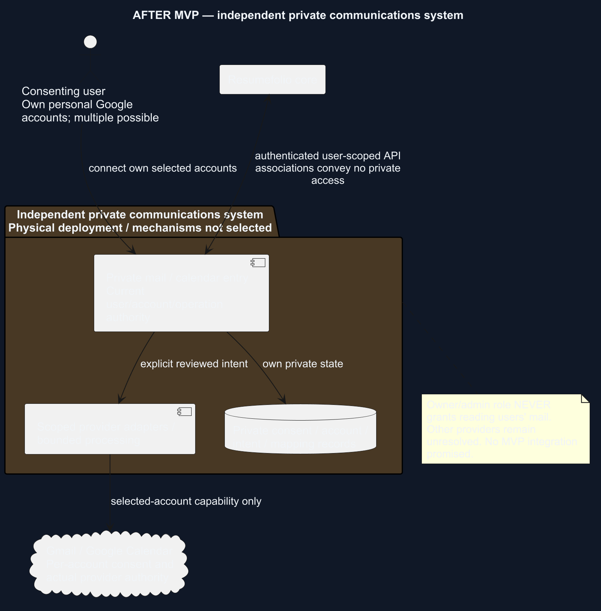 | [SVG](Diagrams/Use-Cases-Mail-And-Calendar.svg) |
| Work and Sprints | [PlantUML](Diagrams/Use-Cases-Work-And-Sprints.puml) | 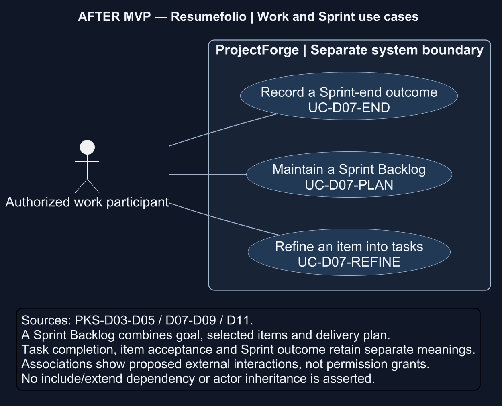 | [SVG](Diagrams/Use-Cases-Work-And-Sprints.svg) |
| Git transfer and collaboration | [PlantUML](Diagrams/Use-Cases-Git-Collaboration.puml) |  | [SVG](Diagrams/Use-Cases-Git-Collaboration.svg) |
| Conditional execution and deployment | [PlantUML](Diagrams/Use-Cases-Execution-And-Deployment.puml) |  | [SVG](Diagrams/Use-Cases-Execution-And-Deployment.svg) |
| Policy and operational evidence | [PlantUML](Diagrams/Use-Cases-Administration.puml) |  | [SVG](Diagrams/Use-Cases-Administration.svg) |

Each use-case oval links from its SVG to the relevant narrative anchor. Fetch/Pull references its existing parent UC-D09 and GIT-D03, without a new child case ID. Diagram presence does not close criterion-level coverage findings or establish actual product behavior.

<a id="scenarios-and-models-user-stories-and-scenarios--heading-proposed-question-resolution-review-cases--november-1-2026"></a>
##### Proposed Question-Resolution Review Cases — November 1, 2026

The following 84 provisional RC locators are review/check specifications for the 28 answer proposals. They are not additional allocated UC/ST/SCN goals, are not executed tests, and do not supersede the historical twelve goal bundles, sixty path drafts or sixteen operation refinements. Unless stated otherwise, use synthetic A (owner), B (unrelated user), C (collaborator), V (employer viewer), R1/R2 (separate resumes), and explicit old/new revisions. Verify the proposed result only after the relevant proposal and environment are accepted. An RC association does not prove every primary acceptance criterion is covered.

<a id="scenarios-and-models-user-stories-and-scenarios--id-review-q-d01"></a>
<a id="scenarios-and-models-user-stories-and-scenarios--heading-q-d01--identifiers-priorities-and-traceability"></a>
###### Q-D01 — Identifiers, priorities and traceability

[Proposed source answer](#requirements-specification-requirements-specification--id-resolution-q-d01).

- **RC-Q01-01:** Inventory all 157 candidate locators and derived criterion suffixes; reject duplicates and unresolved links before proposing a baseline.
- **RC-Q01-02:** For a requirement with several criteria, record the specific input/expected result and review/test method for each criterion; an association to one broad UC is not a Pass.
- **RC-Q01-03:** Change one candidate in a synthetic review and identify affected question, scenario, analysis and work links without altering unrelated accepted decisions.

**Status:** Awaiting execution and owner review.

<a id="scenarios-and-models-user-stories-and-scenarios--id-review-q-d02"></a>
<a id="scenarios-and-models-user-stories-and-scenarios--heading-q-d02--actor-outcomes-and-validation"></a>
###### Q-D02 — Actor outcomes and validation

[Proposed source answer](#requirements-specification-user-requirements--id-resolution-q-d02).

- **RC-Q02-01:** Walk the twelve goals with A/B/C/V and identify which context may reach each outcome.
- **RC-Q02-02:** Verify that V has no private account workspace and C has no unrelated mail/resume/repository rights.
- **RC-Q02-03:** A review log with no actual participant response must remain pending rather than becoming a validated requirement.

**Status:** Awaiting execution and owner review.

<a id="scenarios-and-models-user-stories-and-scenarios--id-review-q-d03"></a>
<a id="scenarios-and-models-user-stories-and-scenarios--heading-q-d03--account-lifecycle-and-authentication"></a>
###### Q-D03 — Account lifecycle and authentication

[Proposed source answer](#requirements-specification-accounts-authentication-and-permissions--id-resolution-q-d03).

- **RC-Q03-01:** Accept an unexpired invitation for its intended verified recipient once; reject replay and expired or mismatched use.
- **RC-Q03-02:** Suspended B cannot sign in or regain access with a password-reset flow; platform administration requires the extra factor.
- **RC-Q03-03:** A failed notification/reset delivery is reported truthfully and never activates an account or creates a valid session.

**Status:** Awaiting execution and owner review.

<a id="scenarios-and-models-user-stories-and-scenarios--id-review-q-d04"></a>
<a id="scenarios-and-models-user-stories-and-scenarios--heading-q-d04--resource-grants-and-administrative-boundaries"></a>
###### Q-D04 — Resource grants and administrative boundaries

[Proposed source answer](#requirements-specification-accounts-authentication-and-permissions--id-resolution-q-d04).

- **RC-Q04-01:** B requests A's private file through a guessed direct identifier; deny without disclosing content.
- **RC-Q04-02:** C with project-editor rights changes a work item but cannot invite a member or clone an ungranted repository.
- **RC-Q04-03:** Revoke C, then deny C's next read/write request and prevent C from assigning new work; preserve earlier history attribution.

**Status:** Awaiting execution and owner review.

<a id="scenarios-and-models-user-stories-and-scenarios--id-review-q-d05"></a>
<a id="scenarios-and-models-user-stories-and-scenarios--heading-q-d05--revocation-and-active-access"></a>
###### Q-D05 — Revocation and active access

[Proposed source answer](#requirements-specification-accounts-authentication-and-permissions--id-resolution-q-d05).

- **RC-Q05-01:** V authenticates, owner disables the link, then V attempts a fresh file/page request using the old session; deny it.
- **RC-Q05-02:** A download authorized before disablement may finish; a new range/request after completion of revocation is denied.
- **RC-Q05-03:** After account password reset, an old account session is rejected; a separately scoped valid employer link is evaluated under its own policy.

**Status:** Awaiting execution and owner review.

<a id="scenarios-and-models-user-stories-and-scenarios--id-review-q-d06"></a>
<a id="scenarios-and-models-user-stories-and-scenarios--heading-q-d06--profile-fields-and-composition"></a>
###### Q-D06 — Profile fields and composition

[Proposed source answer](#requirements-specification-profiles-resumes-and-portfolio--id-resolution-q-d06).

- **RC-Q06-01:** Save an incomplete draft without a phone/photo; publish is blocked until name and one nonempty selected section exist.
- **RC-Q06-02:** Create R1/R2 from one profile, reorder/override R1, and verify R2 and shared source remain unchanged.
- **RC-Q06-03:** Reject a known end-before-start date while retaining the previously saved entry and unsaved-input feedback.

**Status:** Awaiting execution and owner review.

<a id="scenarios-and-models-user-stories-and-scenarios--id-review-q-d07"></a>
<a id="scenarios-and-models-user-stories-and-scenarios--heading-q-d07--shared-updates-conflicts-and-publication"></a>
###### Q-D07 — Shared updates, conflicts and publication

[Proposed source answer](#requirements-specification-profiles-resumes-and-portfolio--id-resolution-q-d07).

- **RC-Q07-01:** Change source S1 to S2: R1 override and R2 published view stay unchanged until explicit review/apply/publish.
- **RC-Q07-02:** Apply an unoverridden field update to R2; omitted evidence remains omitted and R1 is unchanged.
- **RC-Q07-03:** Two clients save from the same old revision: the second gets a conflict, not silent last-write-wins or a false success.

**Status:** Awaiting execution and owner review.

<a id="scenarios-and-models-user-stories-and-scenarios--id-review-q-d08"></a>
<a id="scenarios-and-models-user-stories-and-scenarios--heading-q-d08--evidence-formats-display-and-references"></a>
###### Q-D08 — Evidence formats, display and references

[Proposed source answer](#requirements-specification-profiles-resumes-and-portfolio--id-resolution-q-d08).

- **RC-Q08-01:** Select evidence E in R1 only; V viewing R2 cannot fetch E directly.
- **RC-Q08-02:** A file named photo.png containing active HTML is rejected without replacing the previous valid artifact.
- **RC-Q08-03:** Save an HTTPS evidence link without contacting its destination automatically; reject javascript/file/data schemes.

**Status:** Awaiting execution and owner review.

<a id="scenarios-and-models-user-stories-and-scenarios--id-review-q-d09"></a>
<a id="scenarios-and-models-user-stories-and-scenarios--heading-q-d09--englishgerman-variants-and-fallback"></a>
###### Q-D09 — English/German variants and fallback

[Proposed source answer](#requirements-specification-profiles-resumes-and-portfolio--id-resolution-q-d09).

- **RC-Q09-01:** Request German with only English published: show unavailable and an explicit English option, not an automatic redirect.
- **RC-Q09-02:** Edit the English summary; German wording and its uploaded artifact identity remain unchanged.
- **RC-Q09-03:** Disable German uploaded PDF; a German direct-download request cannot fall back to the English upload without explicit user selection.

**Status:** Awaiting execution and owner review.

<a id="scenarios-and-models-user-stories-and-scenarios--id-review-q-d10"></a>
<a id="scenarios-and-models-user-stories-and-scenarios--heading-q-d10--pdf-representations-and-downloads"></a>
###### Q-D10 — PDF representations and downloads

[Proposed source answer](#requirements-specification-pdf-and-controlled-sharing--id-resolution-q-d10).

- **RC-Q10-01:** Generate for published revision P2, then compare selected content/language with P2; P1 is never served as a P2 artifact.
- **RC-Q10-02:** Exercise all four download modes with missing/enabled/disabled language variants and direct requests.
- **RC-Q10-03:** Fail generation or replacement; show unavailable/failure truthfully, retain valid prior history and deny unintended fallback.

**Status:** Awaiting execution and owner review.

<a id="scenarios-and-models-user-stories-and-scenarios--id-review-q-d11"></a>
<a id="scenarios-and-models-user-stories-and-scenarios--heading-q-d11--employer-links-and-password-controls"></a>
###### Q-D11 — Employer links and password controls

[Proposed source answer](#requirements-specification-pdf-and-controlled-sharing--id-resolution-q-d11).

- **RC-Q11-01:** Enable a password-protected link and access it in a fresh browser context without creating an account.
- **RC-Q11-02:** Save PDF mode neither: web sharing remains enabled; separately disable the link and deny new page/file requests.
- **RC-Q11-03:** Rotate the password and reject old-password/old-session new requests without modifying another link.

**Status:** Awaiting execution and owner review.

<a id="scenarios-and-models-user-stories-and-scenarios--id-review-q-d12"></a>
<a id="scenarios-and-models-user-stories-and-scenarios--heading-q-d12--application-fields-and-progress"></a>
###### Q-D12 — Application fields and progress

[Proposed source answer](#requirements-specification-manual-application-management--id-resolution-q-d12).

- **RC-Q12-01:** Create a Preparing draft and manually record an external submission; only the explicit confirmed action records Submitted.
- **RC-Q12-02:** An unrelated user cannot view/change the application; a matching email subject does not change its status.
- **RC-Q12-03:** Correct an erroneous date/status with a reason and preserve the previous recorded value/provenance.

**Status:** Awaiting execution and owner review.

<a id="scenarios-and-models-user-stories-and-scenarios--id-review-q-d13"></a>
<a id="scenarios-and-models-user-stories-and-scenarios--heading-q-d13--actual-submitted-materials"></a>
###### Q-D13 — Actual submitted materials

[Proposed source answer](#requirements-specification-manual-application-management--id-resolution-q-d13).

- **RC-Q13-01:** Capture actual file F for submission S, edit the live resume afterward, and verify S still identifies F and its checksum.
- **RC-Q13-02:** Record a portal submission without files: label incomplete and never display preserved-set complete.
- **RC-Q13-03:** Fail one attachment capture; retain truthful per-item completion and prevent a false complete-set result.

**Status:** Awaiting execution and owner review.

<a id="scenarios-and-models-user-stories-and-scenarios--id-review-q-d14"></a>
<a id="scenarios-and-models-user-stories-and-scenarios--heading-q-d14--corrections-repeated-submissions-and-retirement"></a>
###### Q-D14 — Corrections, repeated submissions and retirement

[Proposed source answer](#requirements-specification-manual-application-management--id-resolution-q-d14).

- **RC-Q14-01:** Create S1 then S2 for the same application; preserve both identities/materials and their asserted submission times.
- **RC-Q14-02:** Correct S1 metadata with a reason; the old value remains attributable and no unrelated set changes.
- **RC-Q14-03:** Restore a deleted record in isolation: prior disabled links remain disabled and no notification/send is replayed.

**Status:** Awaiting execution and owner review.

<a id="scenarios-and-models-user-stories-and-scenarios--id-review-q-d15"></a>
<a id="scenarios-and-models-user-stories-and-scenarios--heading-q-d15--google-access-and-applicability"></a>
###### Q-D15 — Google access and applicability

[Proposed source answer](#requirements-specification-email-calendar-and-google-integration--id-resolution-q-d15).

- **RC-Q15-01:** In a controlled OAuth project compare requested/consented scopes and deny unavailable operations clearly.
- **RC-Q15-02:** Connect account A: B and project collaborators cannot access A's imported mailbox/calendar data.
- **RC-Q15-03:** Revoke provider consent and record a disconnected outcome without falsely reporting successful reads/sends.

**Status:** Awaiting execution and owner review.

<a id="scenarios-and-models-user-stories-and-scenarios--id-review-q-d16"></a>
<a id="scenarios-and-models-user-stories-and-scenarios--heading-q-d16--mail-operations-and-uncertain-outcomes"></a>
###### Q-D16 — Mail operations and uncertain outcomes

[Proposed source answer](#requirements-specification-email-calendar-and-google-integration--id-resolution-q-d16).

- **RC-Q16-01:** Review To/Cc and attachments, deliberately send once, and display provider accepted separately from delivery/read.
- **RC-Q16-02:** Simulate timeout after provider acceptance: show unknown, reconcile, and prevent an automatic duplicate send.
- **RC-Q16-03:** A collaborator with application/project access receives no mailbox access by following a correspondence link.

**Status:** Awaiting execution and owner review.

<a id="scenarios-and-models-user-stories-and-scenarios--id-review-q-d17"></a>
<a id="scenarios-and-models-user-stories-and-scenarios--heading-q-d17--calendar-authority-conflicts-and-disconnection"></a>
###### Q-D17 — Calendar authority, conflicts and disconnection

[Proposed source answer](#requirements-specification-email-calendar-and-google-integration--id-resolution-q-d17).

- **RC-Q17-01:** Display the same timed event across daylight-saving zones and preserve an all-day date without a day shift.
- **RC-Q17-02:** Change a mapped event locally and externally from the same old revision: display conflict and retain both intentions.
- **RC-Q17-03:** Disconnect before a pending provider change: stop execution; reconnect reconciles rather than duplicating it.

**Status:** Awaiting execution and owner review.

<a id="scenarios-and-models-user-stories-and-scenarios--id-review-q-d18"></a>
<a id="scenarios-and-models-user-stories-and-scenarios--heading-q-d18--work-structures-and-workflow"></a>
###### Q-D18 — Work structures and workflow

[Proposed source answer](#requirements-specification-projects-kanban-and-sprints--id-resolution-q-d18).

- **RC-Q18-01:** Create item I with tasks T1/T2: completing T1 alone cannot mark I Done.
- **RC-Q18-02:** Attempt deleting an occupied column without a target mapping; reject with existing work retained.
- **RC-Q18-03:** B without project rights cannot move a card; a stale competing move is reported as a conflict.

**Status:** Awaiting execution and owner review.

<a id="scenarios-and-models-user-stories-and-scenarios--id-review-q-d19"></a>
<a id="scenarios-and-models-user-stories-and-scenarios--heading-q-d19--sprint-backlog-and-incomplete-work"></a>
###### Q-D19 — Sprint Backlog and incomplete work

[Proposed source answer](#requirements-specification-projects-kanban-and-sprints--id-resolution-q-d19).

- **RC-Q19-01:** Start a Sprint with goal, selected I and task plan; reject a second Active Sprint for that project.
- **RC-Q19-02:** End with I incomplete: record incomplete outcome and return I to backlog without selecting it into a future Sprint.
- **RC-Q19-03:** Attempt to mark I Done solely because its tasks are done; require acceptance criteria and owner disposition.

**Status:** Awaiting execution and owner review.

<a id="scenarios-and-models-user-stories-and-scenarios--id-review-q-d20"></a>
<a id="scenarios-and-models-user-stories-and-scenarios--heading-q-d20--cross-module-associations-and-bounded-reporting"></a>
###### Q-D20 — Cross-module associations and bounded reporting

[Proposed source answer](#requirements-specification-projects-kanban-and-sprints--id-resolution-q-d20).

- **RC-Q20-01:** Link an authorized item to a repository, revoke repository access and deny follow-through without deleting item history.
- **RC-Q20-02:** Report two accepted items and five completed tasks as distinct measures, not seven completed items.
- **RC-Q20-03:** Link a due event/commit to an application and verify no send/status change/deployment occurs implicitly.

**Status:** Awaiting execution and owner review.

<a id="scenarios-and-models-user-stories-and-scenarios--id-review-q-d21"></a>
<a id="scenarios-and-models-user-stories-and-scenarios--heading-q-d21--real-git-clients-and-repository-contract"></a>
###### Q-D21 — Real Git clients and repository contract

[Proposed source answer](#requirements-specification-git-hosting-and-collaboration--id-resolution-q-d21).

- **RC-Q21-01:** With two real clients, create/clone/push/fetch and verify actual object/ref agreement in an isolated repository.
- **RC-Q21-02:** B without grant or with revoked key/token cannot clone/push; project membership alone is insufficient.
- **RC-Q21-03:** Two writers update from an old ref: reject the conflicting update rather than silently losing accepted history.

**Status:** Awaiting execution and owner review.

<a id="scenarios-and-models-user-stories-and-scenarios--id-review-q-d22"></a>
<a id="scenarios-and-models-user-stories-and-scenarios--heading-q-d22--review-merge-and-release-semantics"></a>
###### Q-D22 — Review, merge and release semantics

[Proposed source answer](#requirements-specification-git-hosting-and-collaboration--id-resolution-q-d22).

- **RC-Q22-01:** Approve a request then push new source content: old approval cannot satisfy merge.
- **RC-Q22-02:** Reject a merge on conflicts or unknown required checks; no partial merged status is reported.
- **RC-Q22-03:** Publish a release/tag and verify no deployment occurs without a separate target-authorized action.

**Status:** Awaiting execution and owner review.

<a id="scenarios-and-models-user-stories-and-scenarios--id-review-q-d23"></a>
<a id="scenarios-and-models-user-stories-and-scenarios--heading-q-d23--workflow-contract-and-enabling-gate"></a>
###### Q-D23 — Workflow contract and enabling gate

[Proposed source answer](#requirements-specification-yaml-workflows-and-cicd--id-resolution-q-d23).

- **RC-Q23-01:** Reject unknown YAML keys/unauthorized triggers and prevent a run from using a later moving branch revision.
- **RC-Q23-02:** In an isolated lab, prove a job cannot reach another job's data, host socket or production network/credentials; no production execution is authorized by this proposal.
- **RC-Q23-03:** Exceed timeout/memory/log limits and record truthful termination/cleanup; retain execution disabled if isolation or cleanup cannot be demonstrated.

**Status:** Awaiting execution and owner review.

<a id="scenarios-and-models-user-stories-and-scenarios--id-review-q-d24"></a>
<a id="scenarios-and-models-user-stories-and-scenarios--heading-q-d24--file-formats-quotas-and-accounting"></a>
###### Q-D24 — File formats, quotas and accounting

[Proposed source answer](#requirements-specification-administration-files-and-operational-behavior--id-resolution-q-d24).

- **RC-Q24-01:** Test below/at/above each byte limit using synthetic files; the exact maximum is admitted only if all other policy checks pass.
- **RC-Q24-02:** Two concurrent uploads compete for the last allocation: at most the permitted reserved amount becomes available.
- **RC-Q24-03:** Lower a quota below existing usage: preserve data, mark over-limit, and reject new growth without silent purge.

**Status:** Awaiting execution and owner review.

<a id="scenarios-and-models-user-stories-and-scenarios--id-review-q-d25"></a>
<a id="scenarios-and-models-user-stories-and-scenarios--heading-q-d25--measurable-quality-and-supported-clients"></a>
###### Q-D25 — Measurable quality and supported clients

[Proposed source answer](#requirements-specification-quality-security-and-recovery-requirements--id-resolution-q-d25).

- **RC-Q25-01:** Run the defined staging workload and retain raw observations/configuration; compare p95/errors with proposed thresholds without labelling unexecuted tests Pass.
- **RC-Q25-02:** Use a keyboard/zoom and representative screen-reader check for publication/sharing workflows against applicable WCAG criteria.
- **RC-Q25-03:** During simulated provider outage return truthful unavailable/unknown states; never treat a 200 login page as all core workflows healthy.

**Status:** Awaiting execution and owner review.

<a id="scenarios-and-models-user-stories-and-scenarios--id-review-q-d26"></a>
<a id="scenarios-and-models-user-stories-and-scenarios--heading-q-d26--backup-retention-and-recoverability"></a>
###### Q-D26 — Backup, retention and recoverability

[Proposed source answer](#requirements-specification-quality-security-and-recovery-requirements--id-resolution-q-d26).

- **RC-Q26-01:** Verify the independent destination, usable keys, coverage manifest and successful recovery point before claiming backup ready.
- **RC-Q26-02:** Restore DB/files/repository data together into an isolated target and compare record/artifact/ref integrity plus current access rules.
- **RC-Q26-03:** Simulate missing key/incomplete component or exceeded recovery target: record failure/blocker, not success based on file existence.

**Status:** Awaiting execution and owner review.

<a id="scenarios-and-models-user-stories-and-scenarios--id-review-q-d27"></a>
<a id="scenarios-and-models-user-stories-and-scenarios--heading-q-d27--operating-dependencies-and-maintainability"></a>
###### Q-D27 — Operating dependencies and maintainability

[Proposed source answer](#requirements-specification-domain-requirements-and-constraints--id-resolution-q-d27).

- **RC-Q27-01:** Match a selected deployment manifest to actual runtime/dependencies and document compatibility/license findings before adopting it.
- **RC-Q27-02:** Exercise notification delivery and certificate renewal in a controlled authorized check; a page response alone is insufficient.
- **RC-Q27-03:** Update staging then verify owner/share/history workflows and a data-compatible recovery procedure before production change approval.

**Status:** Awaiting execution and owner review.

<a id="scenarios-and-models-user-stories-and-scenarios--id-review-q-d28"></a>
<a id="scenarios-and-models-user-stories-and-scenarios--heading-q-d28--forecast-work-mapping-and-baseline-candidate"></a>
###### Q-D28 — Forecast, work mapping and baseline candidate

[Proposed source answer](#requirements-specification-requirements-specification--id-resolution-q-d28).

- **RC-Q28-01:** Choose one criterion group and trace it to actual analysis/design/work and planned verification without fabricated artifacts.
- **RC-Q28-02:** Compare forecast inputs with available time, dependencies and full scope; expose target conflict explicitly.
- **RC-Q28-03:** Freeze an identified candidate and record actual owner review/conditions; uncommitted working copies alone are not an accepted baseline.

**Status:** Awaiting execution and owner review.

</details>

<a id="data-definitions"></a>

## Data Definitions

<a id="data-definitions-data-definitions"></a>

<details>
<summary>Resumefolio — Data Definitions Guide</summary>

<a id="data-definitions-data-definitions--heading-resumefolio--data-definitions-guide"></a>
#### Resumefolio — Data Definitions Guide

Current implementation choices and scope: [Baseline](https://github.com/Farhad-V/Web-Resumefolio/blob/1f2acaa351ac306cb57cbe4fe9742e8bd90720d9/docs/MVP/baseline/README.md). Runtime verification remains subject to its gates.

| Item | Current position |
| --- | --- |
| Purpose | Coordinate terminology, conceptual information meaning, authority and lifecycle questions |
| Owner | Farhad; sole delivery and operations owner |
| Status | Proposed definitions — detailed constraints, policy and owner acceptance pending |
| Inventory | Two primary documents; 34 conceptual subject groups, 24 proposed semantic elements and four diagrams |
| Design boundary | No database schema, mandatory field set, physical representation, endpoint or implementation cardinality selected |
| Revision | October 31, 2026 |

**Start with the [Glossary](#data-definitions-glossary)** for preferred terms, then the
[Data Dictionary](#data-definitions-data-dictionary) for information meaning, conceptual forms,
authority/access, lifecycle questions and requirement/scenario links. A proposed
definition is not an accepted product rule or proof that storage exists.

[Reading routes](#data-definitions-data-definitions--heading-1-reading-routes) · [Documents](#data-definitions-data-definitions--heading-documents)
· [Models](#data-definitions-data-definitions--heading-3-conceptual-models-and-boundaries) · [Open definitions](#data-definitions-data-definitions--heading-4-review-gates-and-evidence)
· [Diagrams](#data-definitions-data-definitions--id-5-diagram-catalog-and-regeneration) · [Maintenance](#data-definitions-data-definitions--heading-6-maintenance)

<a id="data-definitions-data-definitions--heading-1-reading-routes"></a>
##### 1. Reading Routes
<a id="data-definitions-data-definitions--id-1-documents-and-reading-route"></a>

| Your question | Suggested route |
| --- | --- |
| What does a term mean? | [Glossary](#data-definitions-glossary) → relevant domain source; qualify overloaded terms rather than inventing synonyms |
| What information does this feature use? | [Dictionary subjects](#data-definitions-data-dictionary--heading-2-accounts-and-access) → [semantic elements](#data-definitions-data-dictionary--heading-10-cross-cutting-element-definitions) → primary requirement |
| Who controls it and what happens when it changes? | Subject's authority/open questions → [Lifecycle](#requirements-specification-business-rules-and-data-lifecycle) → exact domain grant/state policy |
| Which requirement/path uses this concept? | [Dictionary trace links](#data-definitions-data-dictionary--heading-11-requirement-and-scenario-cross-references) → [specification guide](#requirements-specification-requirements-specification-overview) → [scenario catalog](#scenarios-and-models-user-stories-and-scenarios--heading-2-use-case-and-story-catalog) |
| Is it ready to become a committed data rule? | [Review roadmap](#data-definitions-data-definitions--heading-4-review-gates-and-evidence) → resolve validation/authority/lifecycle questions → record actual owner decision |

<a id="data-definitions-data-definitions--heading-documents"></a>
##### Documents

| Document | Primary responsibility | Current content / limitation |
| --- | --- | --- |
| [Glossary](#data-definitions-glossary) | Preferred terminology and context distinctions | Actors/access, professional content, applications/providers, work/Git/execution and engineering/recovery; no universal grants or compliance finding |
| [Data Dictionary](#data-definitions-data-dictionary) | Conceptual subjects, semantic elements, responsibility and unresolved constraints | All 34 existing subject keys retained with stable anchors; 24 proposed element definitions; exact fields/requiredness/cardinalities/policies pending |

The subject keys and E01–E24 references are local navigation, not final FR/NFR/SCN
identifiers or implementation names. Subject groups may combine concepts for
review; they do not prescribe one table/object per row. The dictionary retains
its existing section anchors, and the glossary retains its original sections/terms.

<a id="data-definitions-data-definitions--heading-3-conceptual-models-and-boundaries"></a>
##### 3. Conceptual Models and Boundaries
<a id="data-definitions-data-definitions--id-2-conceptual-information-map"></a>


[Scalable SVG](Diagrams/Data-Definitions-Map.svg) ·
[Editable Graphviz](Diagrams/Data-Definitions-Map.dot)

The map groups information, not physical stores, foreign keys, counts, automatic
propagation or access grants. Product data differs from the development GitHub
board/repository. Colors supplement labels.


[Scalable SVG](Diagrams/Data-Submission-Boundaries.svg) ·
[Editable PlantUML](Diagrams/Data-Submission-Boundaries.puml)

Keep editable sources, live employer views, generated/uploaded artifacts, actual
submitted copies and backups distinct. The capture policy must identify what was
actually submitted; the current live source is not proof it was the material sent.
Later source edits do not overwrite required preserved actual materials.

Other distinctions that must remain explicit:

- Authentication versus resource/action authorization; membership versus unrelated private access.
- Resume-specific override/selection versus shared source and its propagation policy.
- Portfolio project versus work-management project versus repository.
- Backlog Item versus task; board position versus completion/acceptance; Sprint Goal/items/plan as a composite Sprint Backlog.
- Provider/local authority and accepted send versus delivery/read confirmation; unknown external outcome requires safe reconciliation.
- Code/ref/review/run attempt versus separate target approval; Git hosting does not establish execution safety.
- Archive/unlink/deletion/reclamation versus retention/reference policy; quota does not prove resource capacity.
- Backup/recovery point versus actual usable restoration and safe restored access; no target is assigned by a term alone.

<a id="data-definitions-data-definitions--heading-4-review-gates-and-evidence"></a>
##### 4. Review Gates and Evidence
<a id="data-definitions-data-definitions--id-3-how-to-use-and-maintain-definitions"></a>
<a id="data-definitions-data-definitions--id-4-current-coverage-and-review"></a>


[Scalable SVG](Diagrams/Data-Definition-Review-Flow.svg) ·
[Editable PlantUML](Diagrams/Data-Definition-Review-Flow.puml)

| Definition group | Decisions/evidence still needed | Dependent gate |
| --- | --- | --- |
| Identity/requiredness | Exact fields, conditions, values/formats, uniqueness, examples/counterexamples and invalid/missing input | Affected M-02 requirements; GAP-D06 where applicable |
| Authority/relationships | Source of truth per property/action, grants/state, counts, overrides and reference consequences | Before dependent data/security design acceptance |
| Representations | Language/time/revision/units, provider mappings and interface compatibility | Domain/interface requirements then justified design |
| Resource quantities | Limits/accounting pools/concurrency and actual capacity | AFO/QSR policies; GAP-D01/D10 findings |
| Retirement/recovery | Per-category retention/eligibility, consistent coverage, old grants/deleted data and provider effects | BRL/QSR policy; GAP-D04 design and later actual restoration |
| Applicability | Current relevant provider/licensing/privacy obligations and operating facts | DOM/EGC review before dependent commitments; no compliance conclusion assumed |

Farhad coordinates [Questions and Decisions](#change-and-baseline-open-questions-and-decisions).
Link actual records in [Traceability](#validation-and-traceability-validation-and-traceability--heading-traceability)
and real inspection results in [Review Findings](#validation-and-traceability-validation-and-traceability--heading-review-findings).
Local open topics do not claim new shared IDs or resolved decisions. Material
meaning/scope changes follow [Change Control](#change-and-baseline-change-control).

- [ ] Review shared terms/elements against the current primary requirement revision.
- [ ] Resolve acceptance-blocking validation, authority, relationship and lifecycle questions.
- [ ] Keep requirement/scenario links and worked examples semantically consistent.
- [ ] Confirm diagrams explain conceptual meaning without implying schema or grants.
- [ ] Record actual owner review and identified revision before changing definition/baseline status.

**Current outcome:** Proposed working definitions, not an accepted dictionary or
schema baseline. No product storage, integration, access control or recovery result
is demonstrated. M-02 and the wider pre-implementation agreement remain pending.

<a id="data-definitions-data-definitions--heading-5-diagram-catalog-and-regeneration"></a>
##### 5. Diagram Catalog and Regeneration
<a id="data-definitions-data-definitions--id-5-diagram-catalog-and-regeneration"></a>

| Diagram | Purpose | Source | SVG | PNG |
| --- | --- | --- | --- | --- |
| Conceptual information map | Information groups and scoped relationships | [DOT](Diagrams/Data-Definitions-Map.dot) | [SVG](Diagrams/Data-Definitions-Map.svg) |  |
| Live/submitted boundaries | Editable/live versus actual historical material | [PlantUML](Diagrams/Data-Submission-Boundaries.puml) | [SVG](Diagrams/Data-Submission-Boundaries.svg) |  |
| Terminology boundaries | Similar terms with different context/authority | [DOT](Diagrams/Data-Terminology-Boundaries.dot) | [SVG](Diagrams/Data-Terminology-Boundaries.svg) |  |
| Definition review | Meaning, validation, authority and lifecycle refinement | [PlantUML](Diagrams/Data-Definition-Review-Flow.puml) | [SVG](Diagrams/Data-Definition-Review-Flow.svg) |  |

Keep sources/captions/renders synchronized; inspect labels/arrows and file/section
links. Follow the [shared diagram guide](Diagrams/Diagram-Catalog.md). From repository root:

```powershell
$diagramFolder = 'docs\SDLC\02-requirements-engineering\diagrams'
$graphvizExe = 'C:\Program Files\Graphviz\bin\dot.exe'
$plantUmlJar = 'C:\Users\fvali\AppData\Local\Resumefolio\DiagramTools\plantuml.jar'
foreach ($format in 'svg', 'png') {
    foreach ($stem in 'data-definitions-map', 'data-terminology-boundaries') {
        & $graphvizExe "-T$format" -Gdpi=140 "$diagramFolder\$stem.dot" -o "$diagramFolder\$stem.$format"
        if ($LASTEXITCODE -ne 0) { throw "Graphviz failed: $stem / $format" }
    }
    foreach ($stem in 'data-submission-boundaries', 'data-definition-review-flow') {
        java '-Djava.awt.headless=true' -jar $plantUmlJar -charset UTF-8 "-t$format" "$diagramFolder\$stem.puml"
        if ($LASTEXITCODE -ne 0) { throw "PlantUML failed: $stem / $format" }
    }
}
```

<a id="data-definitions-data-definitions--heading-6-maintenance"></a>
##### 6. Maintenance

Use fictional/sanitized examples. Keep real application documents, private emails,
passwords/tokens/keys and confidential operational values out of repository examples.
Refine semantic rules here and link primary behavior; do not copy competing policy
wording across files. Add schema/types/indexes/storage choices only in later design
with traceability to reviewed requirements.

Preserve stable keys/section anchors when reorganizing. Update subject/element
counts, preferred terms, examples, models, requirement/scenario links and actual
review status together. Use installed tool paths applicable to the machine and
save UTF-8 without BOM; retain editable source and SVG/PNG outputs in version control.

[Requirements index]() · [Specification guide](#requirements-specification-requirements-specification-overview)
· [Scenarios guide](#scenarios-and-models-scenarios-and-models)

</details>

<a id="data-definitions-data-dictionary"></a>

<details>
<summary>Resumefolio — Data Dictionary</summary>

<a id="data-definitions-data-dictionary--heading-resumefolio--data-dictionary"></a>
#### Resumefolio — Data Dictionary

| Item | Current position |
| --- | --- |
| Purpose | Define conceptual information used in requirements, including meaning, responsibility and applicable boundaries |
| Owner | Farhad |
| Status | Proposed conceptual definitions — detailed fields and rules pending review |
| Design boundary | No database tables, keys, storage types, endpoints or implementation cardinalities are selected |
| Inventory | 34 conceptual subject groups; 24 proposed cross-cutting element definitions; fields/cardinalities/policies not finalized |
| Revision | October 31, 2026 |

**At a glance:** This dictionary is a reviewable conceptual inventory, reconciled with
the accepted scope and current proposed requirements. It separates known planning boundaries from detailed
validation, access and lifecycle questions that remain open. Use the
[Glossary](#data-definitions-glossary) for terminology and the domain requirements for primary
behavioral wording; those detailed drafts still await acceptance.

[Conventions](#data-definitions-data-dictionary--heading-1-record-conventions) · [Access](#data-definitions-data-dictionary--heading-2-accounts-and-access)
· [Presentation](#data-definitions-data-dictionary--heading-3-professional-presentation-and-sharing) · [Applications](#data-definitions-data-dictionary--heading-4-applications-and-communication)
· [Collaboration](#data-definitions-data-dictionary--heading-5-work-management-and-git) · [Operations](#data-definitions-data-dictionary--heading-6-execution-and-operational-information)
· [History boundary](#data-definitions-data-dictionary--heading-7-live-information-and-submitted-materials) · [Open rules](#data-definitions-data-dictionary--heading-8-rules-to-complete-during-requirements-review)
· [Elements](#data-definitions-data-dictionary--heading-10-cross-cutting-element-definitions) · [Trace links](#data-definitions-data-dictionary--heading-11-requirement-and-scenario-cross-references)
· [Maintenance](#data-definitions-data-dictionary--heading-9-maintenance-and-review)

Current MVP scope and selected mechanisms: [Baseline](https://github.com/Farhad-V/Web-Resumefolio/blob/1f2acaa351ac306cb57cbe4fe9742e8bd90720d9/docs/MVP/baseline/README.md). Deferred provider, advanced collaboration and workflow-execution designs are not MVP prerequisites.

<a id="data-definitions-data-dictionary--heading-1-record-conventions"></a>
##### 1. Record Conventions

Entries below are conceptual data subjects with proposed descriptive keys for
navigation. Keys are not allocated FR/BR/SCN identifiers, accepted schema fields
or implementation names. Conceptual descriptions do not imply all listed
attributes are mandatory or stored independently. Unknown rules remain open.

For each subject, refine a full record as requirements develop:

| Record field | What to define |
| --- | --- |
| Key and preferred term | Stable dictionary reference and glossary term |
| Meaning and purpose | What the information represents and which actor outcome it supports |
| Source and status | Exact Scope/DEC, elicitation source and requirement references; actual review status |
| Responsibility and authority | Who supplies/manages it and which record is authoritative for each relevant property |
| Conceptual representation | Text, choice, time, quantity, relationship, file or other semantic form; not a database type |
| Required/optional and validation | Conditions requiring the value; permitted values, units, languages and consistency rules |
| Access and sensitivity | Who can read/change/share/delete it; relevant owner/member/viewer context |
| Lifecycle | Creation, change, versioning, synchronization, archive, deletion, retention and restoration effects |
| Links and unresolved matters | Related records, requirement/scenario references, owner, next action and review gate |

For the tables below, **private context** means resource-specific access is required;
it is not an invented legal data classification or complete permission policy.
Farhad coordinates all unresolved definition work. Link gaps to the shared
[question register](#change-and-baseline-open-questions-and-decisions) before
accepting affected requirements. No numerical limits or retention periods are set here.

<a id="data-definitions-data-dictionary--heading-2-accounts-and-access"></a>
##### 2. Accounts and Access

Basis: Scope DEC-028/DEC-024 and [Stakeholders](../01-Project-Planning/01-Project-Charter.md#responsibilities).
Detailed records belong in [Accounts and Permissions](#requirements-specification-accounts-authentication-and-permissions).

| Proposed key / subject | Meaning and conceptual information | Responsibility / access boundary | Detail still to define |
| --- | --- | --- | --- |
| <a id="data-definitions-data-dictionary--id-account"></a>account — User account | Individual product identity and relevant account state | User account plus authorized administrative operations; sign-in does not grant unrelated access | Identity/contact fields, account states, onboarding, suspension/deletion and recovery rules |
| <a id="data-definitions-data-dictionary--id-role-permission"></a>role-permission — Role and permission | Product role and allowed operation in a resource context | Granted scope and actor/resource state determine authority | Exact role/grant model, actions, state-dependent checks and sensitive-operation rules; no hierarchy assumed |
| <a id="data-definitions-data-dictionary--id-collaboration-grant"></a>collaboration-grant — Invitation or membership | Defined collaboration relationship for a project, board or repository | Only authorized resources/operations; no unrelated private access | Invitation lifecycle, membership roles, revocation, transfer and affected jobs/reminders |
| <a id="data-definitions-data-dictionary--id-provider-connection"></a>provider-connection — External account connection | Authorized association with an external service and its relevant account | Connected user's private context and provider-granted scope | Required identifiers, consent/access state, reconnect, disconnect and local data consequences |

Credentials, passwords and access tokens are not ordinary example data. Their
required behavior belongs in security/interface requirements and later design;
do not populate repository records with actual secret values.

<a id="data-definitions-data-dictionary--heading-3-professional-presentation-and-sharing"></a>
##### 3. Professional Presentation and Sharing

Basis: [Scope](../01-Project-Planning/01-Project-Charter.md#mvp-scope) DEC-027–DEC-024 and DEC-015.
Sources define capability boundaries, not all individual field rules.

| Proposed key / subject | Meaning and conceptual information | Responsibility / access boundary | Detail still to define |
| --- | --- | --- | --- |
| <a id="data-definitions-data-dictionary--id-professional-profile"></a>professional-profile — Profile | Reusable experience, education, skills and other agreed professional information | User-owned; exposure depends on explicit presentation/sharing rules | Exact elements, required inputs, validation, profile/resume relationship and propagation |
| <a id="data-definitions-data-dictionary--id-tailored-resume"></a>tailored-resume — Resume | Opportunity-specific selections, presentation and content overrides | Resume owner controls tailoring and sharing; unrelated resumes remain independent | Required fields, source references, override precedence, save/publish behavior and lifecycle |
| <a id="data-definitions-data-dictionary--id-professional-evidence"></a>professional-evidence — Supporting evidence | Explanatory text, images, video, files, diagrams and relevant links associated with skills/projects | Owner selects evidence for each resume; unselected material is not implicitly shared | Supported formats, metadata, display, accessibility, link behavior and removal effects |
| <a id="data-definitions-data-dictionary--id-content-language"></a>content-language — Language-specific content | Manually entered/reviewed English or German professional content | Managed in the relevant profile/resume context | Which elements vary by language, completeness, default selection and missing-content behavior |
| <a id="data-definitions-data-dictionary--id-generated-pdf"></a>generated-pdf — Generated resume PDF | Portable rendition produced from authored resume content | Retrieval follows resume authorization and download availability | Generation trigger, represented revision, templates, pagination, fonts, failure and regeneration behavior |
| <a id="data-definitions-data-dictionary--id-uploaded-pdf"></a>uploaded-pdf — Uploaded resume PDF | Independently prepared PDF, with separately provided English/German options | Resume owner manages availability; direct retrieval still requires authorization | Language metadata, replacement/versioning, validation and absent-language behavior |
| <a id="data-definitions-data-dictionary--id-download-choice"></a>download-choice — PDF download availability | Generated, uploaded, both or neither for a resume, subject to language-specific availability | Configured by the resume owner; no entitlement to other content | Combinations, language handling, validation and changes during an active session |
| <a id="data-definitions-data-dictionary--id-employer-link"></a>employer-link — Protected sharing link | Access path to the intended resume and selected content using a password | Owner can change password or disable access; viewer receives no private workspace access | Link count/identity, password/session policy, revocation timing, lifecycle and error responses |

**Known boundary:** Resume-specific selections, layouts and overrides remain
independent; intended shared-profile updates follow explicit rules. This dictionary
does not choose automatic propagation or a database copying strategy.

<a id="data-definitions-data-dictionary--heading-4-applications-and-communication"></a>
##### 4. Applications and Communication

Basis: Scope DEC-023/DEC-022. See [Manual Applications](#requirements-specification-manual-application-management)
and [Email/Calendar](#requirements-specification-email-calendar-and-google-integration).

| Proposed key / subject | Meaning and conceptual information | Responsibility / access boundary | Detail still to define |
| --- | --- | --- | --- |
| <a id="data-definitions-data-dictionary--id-company-opportunity"></a>company-opportunity — Company and opportunity | Organization and position information supporting a considered application | User-directed entry and association in private application context | Required fields, reuse/deduplication, source links and removal behavior |
| <a id="data-definitions-data-dictionary--id-application-record"></a>application-record — Application | Association of opportunity, selected resume, cover letter and progress | User-directed manual job application management; no automatic external submission implied | Creation/submission recording, timestamps, complete state model and history rules |
| <a id="data-definitions-data-dictionary--id-cover-letter"></a>cover-letter — Cover letter | Manually authored application text and the relevant version | User-managed application material | Required content/format, draft editing and submitted-copy capture |
| <a id="data-definitions-data-dictionary--id-submitted-materials"></a>submitted-materials — Submitted copies | Preserved resume and cover-letter material actually submitted | Preserved application-history context; later source edits do not overwrite it | Capture trigger, completeness, artifact boundaries, permitted access, correction, deletion and restore rules |
| <a id="data-definitions-data-dictionary--id-application-progress"></a>application-progress — Status/history | Application stage and relevant recorded progress | Explicitly authorized application operations | Final allowed values, transitions, actor/time attribution and corrections |
| <a id="data-definitions-data-dictionary--id-email-message"></a>email-message — Email | Required Gmail communication content, associated account and relevant provider references | Connected user's authorized operations; collaboration does not grant private email access | Local/provider authority, attachments, actions, synchronization, disconnect/deletion and failure rules |
| <a id="data-definitions-data-dictionary--id-calendar-activity"></a>calendar-activity — Calendar event | Interview, deadline, follow-up or other agreed personal/project schedule information | User/resource-specific permissions and any authorized provider connection | Time/time-zone meaning, recurrence if required, direction, selection, conflicts and deletion |
| <a id="data-definitions-data-dictionary--id-activity-reminder"></a>activity-reminder — Reminder | Notification associated with an agreed activity | Limited to authorized recipients and activity access | Channels, timing, delivery evidence, cancellation, retries and permission-change effects |

Times need explicit event meaning and time-zone handling in requirements and
design. Recording a time does not establish its representation, precision or
storage format. Provider content and local relationships also need property-level
authority rules; a connection alone does not define synchronization behavior.

<a id="data-definitions-data-dictionary--heading-5-work-management-and-git"></a>
##### 5. Work Management and Git

Basis: Scope DEC-021/DEC-020. These are **product capabilities**; the GitHub board
and repository used to develop Resumefolio are separate delivery tools.

| Proposed key / subject | Meaning and conceptual information | Responsibility / access boundary | Detail still to define |
| --- | --- | --- | --- |
| <a id="data-definitions-data-dictionary--id-project-board"></a>project-board — Project, board and column | Work context and workflow organization for authorized collaboration | Defined project/board ownership and membership | Hierarchy/cardinality, column semantics, movement, ordering and deletion effects |
| <a id="data-definitions-data-dictionary--id-backlog-item"></a>backlog-item — Backlog item | Planned outcome/work with rationale, priority and state | Authorized work-management context | Item/task relationships, allowed types, ordering, dependencies and completion criteria |
| <a id="data-definitions-data-dictionary--id-task"></a>task — Task | Specific activity contributing to work completion, with relevant assignment/deadline | Authorized participant operations | Required fields, assignment rules, state transitions and related notifications |
| <a id="data-definitions-data-dictionary--id-sprint-plan"></a>sprint-plan — Sprint and Sprint Backlog | Work period, goal, selected items and delivery plan | Relevant authorized work context as defined in requirements; no extra team assumed | Dates, membership, selection/carry-over and calendar-change effects |
| <a id="data-definitions-data-dictionary--id-git-repository"></a>git-repository — Repository | Hosted version-controlled content/history and associated collaboration context | Repository-specific read/write/collaboration permissions | Visibility, ownership, credentials, quotas, fork lineage and lifecycle |
| <a id="data-definitions-data-dictionary--id-git-reference"></a>git-reference — Branch and tag | Named repository development line or reference to a chosen Git state | Repository and operation-specific permissions | Protection, creation/deletion, naming and history behavior |
| <a id="data-definitions-data-dictionary--id-pull-request"></a>pull-request — Pull request/review | Proposed integration of changes, discussion, review and merge context | Authorized repository participants | Source/target relationships, review states, conflicts, cross-fork rules and merge permissions |
| <a id="data-definitions-data-dictionary--id-repository-planning"></a>repository-planning — Issue and milestone | Repository work/discussion record and outcome checkpoint | Defined repository collaboration access | State/assignment rules, item relationships and distinction from project-level work records |
| <a id="data-definitions-data-dictionary--id-release-record"></a>release-record — Repository release | Identified release information associated with versioned project content | Explicit publication/management permissions | Tag relationship, assets, visibility, edits/deletion and actual release decision rules |

The key names group concepts for review; they do not decide whether these concepts
are stored in one table, several records or another service. Do not infer complete
Git/CI behavior from this inventory.

<a id="data-definitions-data-dictionary--heading-6-execution-and-operational-information"></a>
##### 6. Execution and Operational Information

Basis: Scope DEC-019/DEC-018/DEC-017 and existing security/recovery follow-up.

| Proposed key / subject | Meaning and conceptual information | Responsibility / access boundary | Detail still to define |
| --- | --- | --- | --- |
| <a id="data-definitions-data-dictionary--id-workflow-definition"></a>workflow-definition — YAML workflow | Definition of agreed execution steps and relevant trigger/context | Repository/execution permissions; code content is not inherently trusted | Supported syntax, version/reference, triggers, limits, secrets and deployment gates |
| <a id="data-definitions-data-dictionary--id-workflow-run"></a>workflow-run — Run, result and outputs | One execution instance, state, results, logs and artifacts | Authorized run/output access with isolation and secret protection | States, cancellation, retries, resource accounting, retention, cleanup and failure evidence |
| <a id="data-definitions-data-dictionary--id-file-policy"></a>file-policy — Upload/storage policy | Owner-configurable upload and storage consumption limits | Authorized platform configuration within actual infrastructure capacity | Units, quota scope, types, numerical defaults, changing limits and full-storage behavior |
| <a id="data-definitions-data-dictionary--id-audit-event"></a>audit-event — Audit information | Record of specified sensitive/administrative operations | Audit visibility and mutation rights require explicit requirements | Events, actor/time/result fields, integrity, retention and access restrictions |
| <a id="data-definitions-data-dictionary--id-backup-record"></a>backup-record — Backup/recovery information | Information needed to identify backup coverage and evaluate restoration | Authorized operational context; backup access must protect private data | Coverage, separation, schedules, retention, required configuration/keys, RPO/RTO and actual restoration checks |

Audit information is included as a definition topic for security/administration
refinement, not a fully specified or newly accepted logging policy. No retention
duration, successful recovery result or execution isolation claim is made here.

<a id="data-definitions-data-dictionary--heading-7-live-information-and-submitted-materials"></a>
##### 7. Live Information and Submitted Materials


[Scalable SVG](Diagrams/Data-Submission-Boundaries.svg) ·
[Editable PlantUML](Diagrams/Data-Submission-Boundaries.puml)

Blue shows editable professional information and live presentation; green shows
preserved submitted materials; amber marks the capture details requiring definition.
The diagram explains the accepted distinction. It does not select storage,
automatic propagation or exact capture/versioning behavior.

| Boundary | Known planning direction | Remaining definition |
| --- | --- | --- |
| Profile to tailored resume | Reuse professional information while preserving independent resume selections, layouts and overrides | Which values propagate, when and under which conditions |
| Live resume to employer view | Only intended shared content is accessible; later saved changes may be reflected under explicit rules | Effective revision, session/revocation behavior and language/download rules |
| Application to submitted materials | Preserve what was actually submitted; later source edits must not overwrite those copies | Capture evidence, included artifacts and correction/deletion/access rules |
| PDF and other files | Direct retrieval follows the relevant authorization boundary | Exact association with live revisions or submitted artifacts, generation/replacement and lifecycle |
| Backup to restored data | Recovery must later be demonstrated with integrity/consistency evidence | Coverage, access after restoration and achieved results against agreed targets |

<a id="data-definitions-data-dictionary--heading-8-rules-to-complete-during-requirements-review"></a>
##### 8. Rules to Complete During Requirements Review

For every affected subject, resolve or explicitly track:

- Required/optional values, lengths, choices, units, allowed formats and invalid/missing-input behavior.
- Relationships, cardinalities and ownership/authority for each relevant operation or property.
- Role/resource/state permissions, sharing selection and direct access checks.
- Language completeness, default/fallback behavior and supported PDF/file content.
- Creation/edit/publication states, version identity, conflict and concurrent-update behavior.
- Local/provider synchronization, retries, reconnect and deletion/disconnect consequences.
- Retention, deletion, restoration, archived-copy treatment and audit expectations.
- Workload, numerical quotas, recovery and performance criteria backed by relevant resource findings.

Source these decisions from real elicitation/analysis and the relevant domain
requirements. Do not promote an example to a mandatory field or reuse an old
conversation's policy without checking its current authority. Record the owner,
next action and gate in [Open Questions](#change-and-baseline-open-questions-and-decisions),
and retain links to related feasibility ASM/DEP/RSK/GAP records.

<a id="data-definitions-data-dictionary--heading-9-maintenance-and-review"></a>
##### 9. Maintenance and Review

1. Refine conceptual entries as requirement records are allocated; add exact requirement/scenario references rather than invented IDs.
2. Keep detailed behavioral rules in the domain specification and link them here.
3. When meaning changes, assess effects on permissions, lifecycle, interfaces, models, criteria and delivery records.
4. Preserve dictionary references and earlier accepted meanings through controlled change; document actual review status/revision.
5. Check glossary, dictionary, diagrams and traceability together before declaring a group ready.

**Current review outcome:** Pending. No dictionary baseline or detailed data policy
is accepted by this revision. The entries are a populated conceptual draft, not
evidence that product storage, interfaces or access controls have been implemented.

**Revision note — October 31, 2026:** Retained all 34 subject keys and existing
section links, added stable subject anchors, proposed element semantics and
current requirement/scenario references. Detailed field constraints and policies
remain open; no physical schema, new grant or retention value is introduced.

<a id="data-definitions-data-dictionary--heading-10-cross-cutting-element-definitions"></a>
##### 10. Cross-cutting Element Definitions

The subject tables deliberately group concepts. The following 24 proposed element
definitions refine their semantics without creating mandatory schema fields.
E01–E24 are local table references, not formal requirement IDs or implementation
names. **Requiredness, representation and constraints remain undecided unless an
accepted source explicitly establishes the boundary.** Candidate examples must
not become default product fields by accident.

**Local ref. / element:** E01 — Subject identity

**Meaning:** Identifier distinguishing the intended conceptual resource/record

**Conceptual form:** Identity/reference, not a selected key format

**Applies to / detail owner:** Each applicable subject; ACC/EIF domain grants

**Validation/lifecycle decision still needed:** Which objects need stable identity, uniqueness scope, rename and duplicate handling

**Local ref. / element:** E02 — Ownership/control context

**Meaning:** Who supplies or controls the relevant resource operation

**Conceptual form:** Actor/resource relationship

**Applies to / detail owner:** account, tailored-resume, project-board, git-repository

**Validation/lifecycle decision still needed:** Ownership count, transfer, closure and exact action authority; governance is not superuser access

**Local ref. / element:** E03 — Association/reference

**Meaning:** Meaning of a relationship to another subject

**Conceptual form:** Relationship/reference

**Applies to / detail owner:** Evidence selection, application resume, task/item, provider mapping

**Validation/lifecycle decision still needed:** Allowed source/target kinds, cardinality, access and removal effects; no foreign-key design

**Local ref. / element:** E04 — Content revision

**Meaning:** The version of content represented or evaluated

**Conceptual form:** Revision identity/reference

**Applies to / detail owner:** generated-pdf, submitted-materials, pull-request, workflow-run

**Validation/lifecycle decision still needed:** Revision capture/resolution point, mutable refs, stale output and comparison rules

**Local ref. / element:** E05 — Selection/override

**Meaning:** Resume-specific inclusion, presentation or content adjustment

**Conceptual form:** Choice/ordering/content rule

**Applies to / detail owner:** tailored-resume and professional-evidence

**Validation/lifecycle decision still needed:** Granularity, precedence, omissions, reset and shared-source propagation; no automatic overwrite

**Local ref. / element:** E06 — Language context

**Meaning:** Which manually maintained language a content/artifact variant represents

**Conceptual form:** Language choice; applicable fields unresolved

**Applies to / detail owner:** content-language, uploaded-pdf, professional-profile

**Validation/lifecycle decision still needed:** Shared versus language-dependent fields, English/German completeness and fallback

**Local ref. / element:** E07 — Download availability

**Meaning:** Generated, uploaded, both or neither employer-download choice

**Conceptual form:** Choice plus eligible variant conditions

**Applies to / detail owner:** download-choice and relevant PDF artifacts

**Validation/lifecycle decision still needed:** Absent artifact/language behavior, effective changes and owner preview; choice is not authorization

**Local ref. / element:** E08 — Sharing eligibility

**Meaning:** Whether the link/context is eligible for protected retrieval

**Conceptual form:** Access-state/condition

**Applies to / detail owner:** employer-link and selected resources

**Validation/lifecycle decision still needed:** Link states, password/session changes, cached/in-flight behavior; do not store password examples

**Local ref. / element:** E09 — Actual submitted set

**Meaning:** Resume/cover-letter material identified as actually submitted

**Conceptual form:** Historical artifact/content references

**Applies to / detail owner:** submitted-materials and application-record

**Validation/lifecycle decision still needed:** Capture trigger, completeness, provenance, correction/resubmission, access and retention

**Local ref. / element:** E10 — Provenance/source context

**Meaning:** Who/what supplied the information and what claim it supports

**Conceptual form:** Source/actor/reference context

**Applies to / detail owner:** Application capture, external content, provider data and engineering evidence

**Validation/lifecycle decision still needed:** Required attribution, reliability, user attestation and correction; recorded assertion is not receipt proof

**Local ref. / element:** E11 — Business state/transition

**Meaning:** Current domain condition and allowed change

**Conceptual form:** State choice and transition rule

**Applies to / detail owner:** application-progress, task, sprint-plan, workflow-run

**Validation/lifecycle decision still needed:** Separate state sets/actors/preconditions per domain; column position is not universal completion

**Local ref. / element:** E12 — Assignment/priority/order

**Meaning:** Responsibility, relative importance and displayed/list order

**Conceptual form:** Actor relationship / reviewed choice / order

**Applies to / detail owner:** backlog-item, task, project-board

**Validation/lifecycle decision still needed:** Eligible assignee/count, priority scale, ordering/concurrency and notifications; these are distinct meanings

**Local ref. / element:** E13 — Event/recorded time

**Meaning:** When something happened versus when it was recorded

**Conceptual form:** Time meaning, not a database type

**Applies to / detail owner:** Application progress, messages, run results and selected audit events

**Validation/lifecycle decision still needed:** Required distinction, zone, precision, attribution and correction; client display is not source authority

**Local ref. / element:** E14 — Due/calendar time

**Meaning:** Intended deadline or scheduled activity time

**Conceptual form:** Date/time/time-zone or all-day semantics if selected

**Applies to / detail owner:** task, calendar-activity and activity-reminder

**Validation/lifecycle decision still needed:** Allowed intervals, all-day/daylight-saving, recurrence if required and changed reminders

**Local ref. / element:** E15 — Sprint composite

**Meaning:** Goal, selected Backlog Items and delivery plan forming one Sprint Backlog

**Conceptual form:** Composite conceptual information

**Applies to / detail owner:** sprint-plan with backlog-item/task context

**Validation/lifecycle decision still needed:** Plan representation, dates, allowed changes, incomplete work and carry-over; not one required table

**Local ref. / element:** E16 — Provider account/item mapping

**Meaning:** Correspondence between selected local and provider contexts

**Conceptual form:** External identity/reference

**Applies to / detail owner:** provider-connection, email-message, calendar-activity

**Validation/lifecycle decision still needed:** Selected account/calendar, mapping authority, scope, reconnect and duplicate reconciliation

**Local ref. / element:** E17 — Synchronization authority/outcome

**Meaning:** Which property/action is authoritative and what actually synchronized

**Conceptual form:** Per-category direction/conflict/result semantics

**Applies to / detail owner:** Provider-linked subjects and local relationships

**Validation/lifecycle decision still needed:** Direction, freshness, deletion, partial result and retries; no global source of truth

**Local ref. / element:** E18 — Repository/ref/review context

**Meaning:** Code history and source/target context for a Git operation or review

**Conceptual form:** Repository/ref/revision relationships

**Applies to / detail owner:** git-repository, git-reference, pull-request, release-record

**Validation/lifecycle decision still needed:** Ref resolution/protection, fork lineage, stale review, merge and release mutation policy

**Local ref. / element:** E19 — Run/attempt/target context

**Meaning:** Which definition/code/environment and attempt produced which effect

**Conceptual form:** Execution/revision/target references

**Applies to / detail owner:** workflow-definition and workflow-run

**Validation/lifecycle decision still needed:** Attempt lineage, trigger, result aggregation, separate target approval and unknown effects

**Local ref. / element:** E20 — Result/evidence locator

**Meaning:** Where an actual bounded observation/output is identified

**Conceptual form:** Outcome plus protected evidence/reference

**Applies to / detail owner:** workflow-run, audit-event, backup-record; later engineering evidence

**Validation/lifecycle decision still needed:** Actual versus planned state, expected/actual, truncation/access, candidate and limitations

**Local ref. / element:** E21 — Size/usage/limit

**Meaning:** Meaning of resource consumption and configured allowed boundary

**Conceptual form:** Quantity/unit/boundary/accounting scope

**Applies to / detail owner:** file-policy, files/PDFs, repositories and run outputs

**Validation/lifecycle decision still needed:** Units, byte conventions, original/generated/retained usage, concurrency/reservations and limit-change effects

**Local ref. / element:** E22 — Retention/removal eligibility

**Meaning:** When a subject/reference/artifact may be archived, unlinked or reclaimed

**Conceptual form:** Lifecycle condition and policy reference

**Applies to / detail owner:** All retained subjects as applicable

**Validation/lifecycle decision still needed:** Per-category trigger/duration, valid references, account closure, provider deletion and quota release; no period selected

**Local ref. / element:** E23 — Recovery point/coverage

**Meaning:** Which recoverable state and related material a scenario covers

**Conceptual form:** Recovery-event/point/coverage context

**Applies to / detail owner:** backup-record and dependent data/artifacts/configuration

**Validation/lifecycle decision still needed:** Consistent point, include/reconstruct/exclude decisions, required keys, isolation and restored access

**Local ref. / element:** E24 — RPO/RTO measurement

**Meaning:** Permitted data-loss and time-to-defined-usable-state objectives

**Conceptual form:** Scenario-specific measure/unit/threshold

**Applies to / detail owner:** backup-record and actual later recovery evidence

**Validation/lifecycle decision still needed:** Owner-decided targets and measurement boundaries; backup frequency/job duration alone does not prove attainment

For each adopted element, complete required/optional conditions, exact values or
ranges, units/precision, examples and counterexamples, edit authority, state
effects and failure/recovery outcomes in its primary specification. Keep sensitive
values out of examples. “Secret” identifies a protected category, not permission
to place actual passwords/tokens/keys in this dictionary.

<a id="data-definitions-data-dictionary--heading-worked-semantic-example-actual-submitted-material"></a>
###### Worked Semantic Example: Actual Submitted Material

A synthetic application AP1 identifies resume material M1 and letter C1 as the
actual submitted set. Its source resume R1 later changes to R2. The dictionary
distinguishes **identity** (AP1/M1/C1), **revision** (what material was captured),
**provenance** (the user-reported actual submission context) and **live source**
(R1/R2). This example imposes no identifier format, storage copy strategy, hash,
timestamp field or legal-proof claim. APP-D05–D07 decide the detailed capture and
correction rules; later source edits must not overwrite actual submitted copies.

<a id="data-definitions-data-dictionary--heading-worked-semantic-example-work-and-repository-contexts"></a>
###### Worked Semantic Example: Work and Repository Contexts

A Backlog Item BI1 can be refined into tasks T1/T2 and selected for a Sprint with
goal G and a delivery plan. That does not equate BI1 with a task, a repository
issue or a board column. A portfolio project may describe the work and a repository
may hold code, but the links are explicit relationships, not a shared identity or
automatic access grant. The project/board/backlog/Sprint cardinalities are undecided.

<a id="data-definitions-data-dictionary--heading-11-requirement-and-scenario-cross-references"></a>
##### 11. Requirement and Scenario Cross-references

Prefixes below identify proposed records in primary files, not accepted data
policies. Scenario links refer to proposed bundles/paths, not executed evidence.
All subjects retain the accepted scope basis recorded in sections 2–6.

| Subject group / stable key examples | Primary behavior / candidate references | Scenario context |
| --- | --- | --- |
| Accounts/grants: [account](#data-definitions-data-dictionary--id-account), [role-permission](#data-definitions-data-dictionary--id-role-permission), [collaboration-grant](#data-definitions-data-dictionary--id-collaboration-grant) | [ACC-D](#requirements-specification-accounts-authentication-and-permissions); PKS-D06/GIT-D02 scoped collaboration | [UC-D08](#scenarios-and-models-user-stories-and-scenarios--id-uc-d08) |
| Professional content: [professional-profile](#data-definitions-data-dictionary--id-professional-profile), [tailored-resume](#data-definitions-data-dictionary--id-tailored-resume), [professional-evidence](#data-definitions-data-dictionary--id-professional-evidence), [content-language](#data-definitions-data-dictionary--id-content-language) | [PRP-D](#requirements-specification-profiles-resumes-and-portfolio); BRL-D02 propagation | [UC-D01](#scenarios-and-models-user-stories-and-scenarios--id-uc-d01) |
| PDFs/sharing: [generated-pdf](#data-definitions-data-dictionary--id-generated-pdf), [uploaded-pdf](#data-definitions-data-dictionary--id-uploaded-pdf), [download-choice](#data-definitions-data-dictionary--id-download-choice), [employer-link](#data-definitions-data-dictionary--id-employer-link) | [PDF-D](#requirements-specification-pdf-and-controlled-sharing); ACC-D direct retrieval/owner controls | [UC-D02](#scenarios-and-models-user-stories-and-scenarios--id-uc-d02), [UC-D03](#scenarios-and-models-user-stories-and-scenarios--id-uc-d03) |
| Applications: [company-opportunity](#data-definitions-data-dictionary--id-company-opportunity), [application-record](#data-definitions-data-dictionary--id-application-record), [cover-letter](#data-definitions-data-dictionary--id-cover-letter), [submitted-materials](#data-definitions-data-dictionary--id-submitted-materials), [application-progress](#data-definitions-data-dictionary--id-application-progress) | [APP-D](#requirements-specification-manual-application-management); BRL-D05 preserved actual materials | [UC-D04](#scenarios-and-models-user-stories-and-scenarios--id-uc-d04), [UC-D05](#scenarios-and-models-user-stories-and-scenarios--id-uc-d05) |
| Provider/activities: [provider-connection](#data-definitions-data-dictionary--id-provider-connection), [email-message](#data-definitions-data-dictionary--id-email-message), [calendar-activity](#data-definitions-data-dictionary--id-calendar-activity), [activity-reminder](#data-definitions-data-dictionary--id-activity-reminder) | [EGC-D](#requirements-specification-email-calendar-and-google-integration); BRL-D07 synchronization | [UC-D06](#scenarios-and-models-user-stories-and-scenarios--id-uc-d06)  **After MVP.** |
| Work planning: [project-board](#data-definitions-data-dictionary--id-project-board), [backlog-item](#data-definitions-data-dictionary--id-backlog-item), [task](#data-definitions-data-dictionary--id-task), [sprint-plan](#data-definitions-data-dictionary--id-sprint-plan) | [PKS-D](#requirements-specification-projects-kanban-and-sprints); item/task/goal/plan meanings | [UC-D07](#scenarios-and-models-user-stories-and-scenarios--id-uc-d07) |
| Git: [git-repository](#data-definitions-data-dictionary--id-git-repository), [git-reference](#data-definitions-data-dictionary--id-git-reference), [pull-request](#data-definitions-data-dictionary--id-pull-request), [repository-planning](#data-definitions-data-dictionary--id-repository-planning), [release-record](#data-definitions-data-dictionary--id-release-record) | [GIT-D](#requirements-specification-git-hosting-and-collaboration); EIF-D06 real-client context | [UC-D09](#scenarios-and-models-user-stories-and-scenarios--id-uc-d09) |
| Execution: [workflow-definition](#data-definitions-data-dictionary--id-workflow-definition), [workflow-run](#data-definitions-data-dictionary--id-workflow-run) | [YML-D](#requirements-specification-yaml-workflows-and-cicd); QSR-D07/D12 execution/restored effects | [UC-D10](#scenarios-and-models-user-stories-and-scenarios--id-uc-d10)  **After MVP.** |
| Operations: [file-policy](#data-definitions-data-dictionary--id-file-policy), [audit-event](#data-definitions-data-dictionary--id-audit-event), [backup-record](#data-definitions-data-dictionary--id-backup-record) | [AFO-D](#requirements-specification-administration-files-and-operational-behavior) and [QSR-D](#requirements-specification-quality-security-and-recovery-requirements) | [UC-D11](#scenarios-and-models-user-stories-and-scenarios--id-uc-d11), [UC-D12](#scenarios-and-models-user-stories-and-scenarios--id-uc-d12) |

Cross-cutting [BRL-D](#requirements-specification-business-rules-and-data-lifecycle),
[DOM-D](#requirements-specification-domain-requirements-and-constraints) and
[EIF-D](#requirements-specification-external-interface-requirements) apply
where relevant. Keep formal source/requirement/scenario links in
[Traceability](#validation-and-traceability-validation-and-traceability--heading-traceability);
this navigation table is not a claim that the register is populated or coverage complete.


[Scalable SVG](Diagrams/Data-Definition-Review-Flow.svg) ·
[Editable PlantUML](Diagrams/Data-Definition-Review-Flow.puml)

This is a refinement roadmap. It does not select a schema or accept a definition.
Resolve critical requiredness, validation, authority and lifecycle questions before
the affected requirement/design is accepted. A detailed data-design decision later
needs traceability back to these semantics and the actual owner-reviewed rules.

[Data Definitions index](#data-definitions-data-definitions) · [Glossary](#data-definitions-glossary)
· [Requirements index]()

<a id="data-definitions-data-dictionary--heading-proposed-definition-refinements--november-1-2026"></a>
##### Proposed Definition Refinements — November 1, 2026

The [answer package](#change-and-baseline-open-questions-and-decisions) supplies concrete proposed field/lifecycle/relationship semantics. Earlier dictionary unknowns remain unaccepted choices, but no longer lack a proposal. Do not treat these as implemented schema or owner-approved cardinalities.

| Subject | Proposed semantic refinement | Source answer |
| --- | --- | --- |
| Profile/resume | One reusable profile per account; independent resume identity/selection/overrides; incomplete private drafts versus reviewed published revision | [Q-D06/Q-D07](#requirements-specification-profiles-resumes-and-portfolio--id-resolution-q-d06) |
| Content language | Shared names/dates/identifiers; manually authored English/German wording; no silent missing-language substitution | [Q-D09](#requirements-specification-profiles-resumes-and-portfolio--id-resolution-q-d09) |
| Artifact/submission | Distinct generated/uploaded representation, revision/language, checksum/provenance and incomplete-versus-preserved submitted set | [Q-D10](#requirements-specification-pdf-and-controlled-sharing--id-resolution-q-d10) / [Q-D13](#requirements-specification-manual-application-management--id-resolution-q-d13) |
| Access | Resource/action/state authority; post-revocation next-request denial; already-emitted bytes remain outside recall | [Q-D04/Q-D05](#requirements-specification-accounts-authentication-and-permissions--id-resolution-q-d04) |
| Work | Project/backlog ownership, item/task distinction, board-column state mapping and one composite Sprint Backlog | [Q-D18/Q-D19](#requirements-specification-projects-kanban-and-sprints--id-resolution-q-d18) |
| External correspondence/event | Provider identity/confirmation, uncertain send, selected calendar mapping, version conflict and disconnected stale local copy | [Q-D16/Q-D17](#requirements-specification-email-calendar-and-google-integration--id-resolution-q-d16) |

Validate field names, units, requiredness and limits against the source proposal before baseline adoption; do not copy numbers into schema by inference. Proposed retention and restore never resurrect revoked grants or replay external effects automatically.

<a id="data-definitions-data-dictionary--heading-mvp-library-and-application-field-refinement"></a>
##### MVP library and application field refinement

Conceptual fields extend existing file/evidence/application concepts without allocating a new global requirement ID or choosing database types.

| Record | Information and invariant | Owner / release |
| --- | --- | --- |
| LibraryItem | Stable identity, private owning user, supported content kind, admitted upload artifact or external YouTube URL, validation/availability state; no publication flag derived from upload | Core Files & Operations, MVP |
| ResumeMediaReference | Resume/revision and selected LibraryItem identity; selection separate from upload, draft save and publication; disclose only through authorized selected resume | Core Presentation / Sharing, MVP |
| PrivateMediaArtifact | Private same-server location known only to serving/storage adapters; actual type/size and quota accounting; protected references and backup coverage | Core Files & Operations, MVP |
| Application follow-up | Status, nextAction, followUpDate maintained manually; no provider account/event needed | Core Applications, MVP; exact date/time representation needs refinement |
| SubmittedMaterialManifest | Actual resume/cover-letter/media identities and provenance at submission; later source/publication changes do not rewrite it | Core Applications with protected file references, MVP |
| ProjectForgeReference | Exact external resource identifier and independently checked user/resource scope; not an ORM relationship or permission transfer | Separate ProjectForge API, MVP |

An employer byte-range/media request resolves a currently permitted published selection and actual usable artifact before bytes are served. A private storage path or LibraryItem identifier alone grants no access. External YouTube availability/privacy is controlled by its external host; the core does not upload private video to that host.

</details>

<a id="data-definitions-glossary"></a>

<details>
<summary>Resumefolio — Requirements Glossary</summary>

<a id="data-definitions-glossary--heading-resumefolio--requirements-glossary"></a>
#### Resumefolio — Requirements Glossary

| Item | Current position |
| --- | --- |
| Purpose | Give recurring terms one clear working meaning across requirements |
| Status | Proposed terminology for review; planning sources retain their accepted scope |
| Owner | Farhad |
| Revision | October 31, 2026 |

Definitions explain meaning, not implementation or complete permission rules.
Use the preferred term in specifications, scenarios and diagrams. Where everyday
words have several meanings, retain the context shown below. Detailed data and
open rules are in the [Data Dictionary](#data-definitions-data-dictionary).

[Roles](#data-definitions-glossary--heading-1-people-and-access) · [Presentation](#data-definitions-glossary--heading-2-professional-presentation)
· [Applications](#data-definitions-glossary--heading-3-applications-and-communication) · [Work](#data-definitions-glossary--heading-4-work-and-code-collaboration)
· [Engineering](#data-definitions-glossary--heading-5-requirements-and-evidence) · [Usage](#data-definitions-glossary--heading-6-usage-and-change-rules) · [Sources](#data-definitions-glossary--heading-7-primary-terminology-sources-and-review-route)

Current MVP scope and selected mechanisms: [Baseline](https://github.com/Farhad-V/Web-Resumefolio/blob/1f2acaa351ac306cb57cbe4fe9742e8bd90720d9/docs/MVP/baseline/README.md). Deferred provider, advanced collaboration and workflow-execution designs are not MVP prerequisites.

<a id="data-definitions-glossary--heading-1-people-and-access"></a>
##### 1. People and Access

Source basis: [Stakeholders](../01-Project-Planning/01-Project-Charter.md#responsibilities)
and Scope DEC-028/DEC-024. Detailed permissions remain subject to requirements.

| Preferred term | Working meaning | Distinction |
| --- | --- | --- |
| Project owner | Person responsible for product direction, scope, budget and release decisions; currently Farhad | Project ownership is distinct from an application role |
| Platform owner | Product role responsible for defined platform administration | Exact powers must be specified; the role does not imply unrestricted private-data access |
| Administrator | Product role permitted to perform specified account/content administration | Only explicitly authorized operations are included |
| Registered user | Person using an individual product account | Successful sign-in does not authorize every resource |
| Resource owner | User or explicitly defined ownership context responsible for a particular record/resource | Detailed ownership, transfer and collaboration rules remain to be defined |
| Invited collaborator | Participant granted defined access to a project, board or repository | An invitation does not expose unrelated email, resumes or resources |
| Employer viewer | Person using the protected sharing path to view selected content | A viewer account is not required; a link/password does not establish real-world identity |
| Authentication | Establishing the claimed account/access identity through the specified mechanism | Distinct from checking permission for an operation |
| Authorization | Deciding whether the actor may perform an operation on the requested resource in its current context | Applies to direct file/PDF requests as well as pages |
| Unified sign-in | A consistent sign-in experience across authorized product sections | Does not remove resource-specific permission checks |
| Grant / membership | Explicit permission relationship scoped to a resource/action/context | An invitation, assignment or successful sign-in is not universal permission |
| Revocation | A change that removes or restricts a grant/access context under an explicit policy | Fresh requests, existing sessions, caches and in-flight work may need different rules |
| Credential / secret | Protected material used to authenticate or authorize an operation | Not ordinary example data; no specific mechanism or storage is selected |

<a id="data-definitions-glossary--heading-2-professional-presentation"></a>
##### 2. Professional Presentation

Source basis: [Scope](../01-Project-Planning/01-Project-Charter.md#mvp-scope), DEC-027–DEC-024
and DEC-015. These meanings preserve reusable information, tailored presentation
and manually entered language content without choosing a storage model.

| Preferred term | Working meaning | Distinction |
| --- | --- | --- |
| Professional profile | Reusable professional information owned by a user | Source information, not an opportunity-specific resume presentation |
| Tailored resume | Selected and customized professional presentation for an opportunity | Resume-specific selections, layout and content overrides remain independent |
| Resume override | Resume-specific replacement or adjustment to shared information | Propagation and precedence details need explicit rules |
| Portfolio | Presentation of selected professional work and supporting material | Exact standalone/page organization remains a requirements question |
| Supporting evidence | Text, media, files, diagrams or links used to support a skill/project claim | Distinct from verification evidence produced when testing the product |
| Media / file | Uploaded or referenced supporting material | Sharing a parent record does not automatically make all associated files public |
| Generated PDF | Resume PDF produced from authored content | Distinct from an independently prepared uploaded PDF |
| Uploaded PDF | Externally prepared resume PDF added by the owner | English/German PDFs can be provided separately |
| Download availability | Per-resume choice of generated PDF, uploaded PDF, both or neither, subject to language and access rules | Describes product retrieval, not revocation of copies already downloaded |
| Employer link | Password-protected access path to the intended resume and selected content | Excludes the private workspace and unrelated resources |
| Live employer view | Shared presentation that may reflect subsequent saved changes under explicit rules | Distinct from preserved submitted materials |
| Language-specific content | Manually entered and reviewed English/German professional content | Does not imply automatic translation or an accepted language-fallback policy |
| Source revision / rendition | Identified authored content state / representation of it, such as a generated PDF | An independently uploaded PDF need not match the current authored source |
| Publication | Making a defined content revision available in an intended context under explicit rules | A source save does not inherently select an automatic live publication workflow |
| Portfolio project / work project | Description/evidence of professional work / context organizing product work management | They are not automatically one record or the same object as a Git repository |

<a id="data-definitions-glossary--heading-3-applications-and-communication"></a>
##### 3. Applications and Communication

Source basis: Scope DEC-023/DEC-022 and the application-history distinction.
Detailed workflows have proposed [APP-D](#requirements-specification-manual-application-management)
and [EGC-D](#requirements-specification-email-calendar-and-google-integration)
records; final states and synchronization policies still require decisions.

| Preferred term | Working meaning | Distinction |
| --- | --- | --- |
| Manual job application management | User-directed preparation and tracking of job applications | Version 1 has no product AI analysis or drafting |
| Company | Organization associated with a job opportunity/application | Required fields and reuse rules remain open |
| Job opportunity | Position or opening the user considers applying for | Recording it does not automatically submit an application |
| Application record | Record linking an opportunity, relevant materials and application progress | Distinct from a live resume or provider email |
| Cover letter | User-authored application text for an opportunity | Submitted content must be distinguishable from later editable content |
| Submitted copy | Preserved record of resume/cover-letter material actually submitted | Later source edits must not overwrite it; capture/deletion/access details still need rules |
| Application status | Recorded stage of application progress | The final allowed states and transition rules remain open |
| Provider connection | User-authorized association with an external service/account | Consent, scope, disconnection and local-data consequences need specification |
| Email message | Communication accessed through the agreed Gmail functionality | Provider state and local representation must be distinguished |
| Calendar event | Scheduled activity within the agreed calendar workflows | Data ownership, synchronization, conflicts and deletion rules remain open |
| Reminder | Scheduled notification associated with an activity | Delivery channel/timing and cancellation behavior require requirements |
| Synchronization | Coordinating related internal/provider information under explicit rules | Does not imply automatic overwrite, conflict resolution or a particular direction |
| Actual submitted set | Resume and cover-letter material identified as actually submitted for a particular application context | Current live content, a provider message or a status alone does not prove the exact set |
| Submission recording / capture | User-directed recording and preservation of actual material under reviewed rules | Not automatic external submission, proof of receipt or an indefinite-retention obligation |
| Provenance | Source/context describing where information or a recorded claim came from | Attribution or user assertion is not automatically independent verification |
| Provider acceptance / delivery / read confirmation | Acceptance by the provider / evidence of delivery / evidence of reading are different claims | Report only the specific outcome supported by available evidence |
| Unknown external outcome | A consequential request may have taken effect but available evidence does not establish its result | Not safe to label success/failure or blindly repeat without reviewed reconciliation |
| Reconciliation | Resolving divergent/partial/uncertain states under a reviewed authority policy | Does not imply automatic overwrite or last-write-wins |
| Time zone / all-day / event time | Distinct scheduling or event-time semantics requiring domain-specific rules | Recorded time and displayed time need not have the same meaning |

<a id="data-definitions-glossary--heading-4-work-and-code-collaboration"></a>
##### 4. Work and Code Collaboration

Source basis: Scope DEC-021/DEC-020/DEC-019 and the
[Working Method](../01-Project-Planning/02-Project-Management-Plan.md#delivery-approach).

| Preferred term | Working meaning | Distinction |
| --- | --- | --- |
| Product | Resumefolio as an evolving offering for its users | Distinct from an individual project or delivery increment |
| Project | Bounded body of work with an intended outcome | A project inside the product is distinct from developing Resumefolio itself |
| Kanban board | View organizing work into defined workflow columns | Board/project hierarchy and movement rules need explicit requirements |
| Product Backlog | Ordered collection of product work items | Not identical to a user story, board column or Sprint Backlog |
| Backlog item | Unit of planned work, such as a feature, defect, investigation or improvement | May be refined into tasks; not necessarily one small task |
| Task | Specific activity contributing to completion of work | Distinct from the user outcome expressed by a story/use case |
| Sprint | Defined work period with a goal and selected work | A time period, not a milestone or feature |
| Sprint Goal | Coherent intended outcome for a Sprint | Distinct from the full list of selected work |
| Sprint Backlog | Sprint Goal, selected backlog items and delivery plan | One combined plan for the relevant Sprint context |
| Milestone | Reviewable outcome checkpoint | Not a fixed-duration work period or proof of completion from reaching a date |
| Git repository | Hosted version-controlled project content and history | Real Git hosting is distinct from displaying an external repository link |
| Branch / tag | Named Git development line / reference to a chosen Git state | Exact supported operations and protections need specification |
| Fork | Repository derived for an independent collaboration context | Fork permissions, lineage and cross-repository operations need requirements |
| Pull request | Proposal to integrate changes with review/comment context | Not the same as Git Pull; merge behavior must follow explicit rules |
| Issue | Repository work/discussion record | Distinct from an actual operational problem unless used to track one |
| Release | Identified version presented with scope, evidence, limitations and release decision | Distinct from a tag, successful build or deployment |
| YAML workflow | Definition of agreed repeatable checks/build or controlled deployment activities | Syntax, triggers and compatibility are not assumed to match every external workflow system |
| Workflow run | One execution instance of a workflow with state and results | Actual execution needs the agreed isolation/security/resource conditions |
| Artifact / run log | Output / recorded execution information from a workflow run | Contents, retention, access and secret handling remain to be defined |
| Board column / work state | Visual workflow grouping / domain condition with explicit transition semantics | A column is not automatically a universal state or proof of acceptance |
| Completion / acceptance | Meeting defined work conditions / a defined actor or criterion-based disposition | Task completion, item acceptance and Sprint Goal outcome are not interchangeable |
| Git Pull / pull request | Client integration of fetched changes / proposal for reviewed integration | Similar wording does not make the operations equivalent |
| Ref / evaluated revision | Named repository pointer / exact code state evaluated by an operation or run | A later ref change does not relabel an existing run or stale review |
| Review context / merge | Assessment of defined source-target revisions / authorized integration under a policy | An old review does not silently approve new code; merge does not approve deployment |
| Run attempt / rerun | A particular execution attempt / another explicitly related attempt | Separate attempt identity and side-effect rules are needed; no exactly-once guarantee |
| Runner / isolation boundary | Selected execution facility / controls limiting untrusted-code effects | No container, VM, host access or runner product is chosen by the term |
| Deployment target / approval | Environment changed by deployment / explicit authority for a defined operation/revision | A Push, merge, tag or successful check alone is not target approval |

<a id="data-definitions-glossary--heading-5-requirements-and-evidence"></a>
##### 5. Requirements and Evidence

These working terms follow the existing approach and planning records. They do
not allocate requirement identifiers or change accepted status conventions.

| Term | Working meaning | Distinction |
| --- | --- | --- |
| Requirement | Stated behavior, quality condition or imposed constraint to be reviewed | A raw request or solution suggestion is not automatically accepted |
| Business rule | Domain/product policy governing behavior or information | Implementation preference is not automatically a business rule |
| Use case | Actor interaction with the system toward a goal | Contains multiple possible scenarios |
| Scenario | One path through an interaction with conditions and results | Not merely a task or screen list |
| User story | Concise expression of role, desired capability and value | Does not replace detailed rules and acceptance criteria |
| Acceptance criterion | Observable condition for assessing a requirement | Distinct from an executed result or a full test case |
| Verification evidence | Contextual record supporting an actual inspection, analysis, demonstration or test result | Distinct from portfolio evidence and planned checks |
| Assumption | Provisional expectation requiring validation | Accepted investigation method does not confirm it |
| Dependency | Prerequisite or external capability relied upon | Available access/suitability needs evidence |
| Baseline | Identified, accepted revision subject to controlled change | A file or Git commit alone is not acceptance |
| Traceability | Maintained links between sources, requirements and related work/evidence | A populated link is not necessarily proof of adequate coverage |
| Data dictionary | Definitions of information meaning and applicable rules | Not the physical database schema |
| Source of truth | Authoritative record for a particular piece of information | It must be identified per context; do not infer one global owner for all data |
| Audit record | Record of a defined sensitive or administrative operation | Events, visibility, retention and integrity behavior require explicit rules |
| Backup / recovery | Protected copy / process of restoring usable service and information | Backup existence does not demonstrate recovery |
| RPO / RTO | Recovery-point / recovery-time objectives for an evaluated scenario | No numerical target or achieved recovery performance is assigned here |
| Conceptual subject / element | Information group / a particular semantic property or relationship used in requirements | Neither necessarily maps one-to-one to a table or mandatory stored field |
| Requiredness / validation | Conditions requiring a value / conditions defining its validity and rejected/incomplete outcome | Examples and placeholder metadata do not establish required fields or constraints |
| Cardinality / ownership | Permitted relationship counts / authority-responsibility context | Both need explicit requirements; arrows do not establish a schema or grant |
| Sensitivity / legal classification | Working handling concern / classification supported by applicable external authority | Calling a context private does not establish a complete legal compliance assessment |
| Archive / unlink / logical deletion / reclamation | Different retirement actions affecting visibility, relationships or physical retained material | Do not assume soft deletion, cascade, indefinite retention or automatic quota release |
| Quota / capacity | Configured permitted consumption / actual sustainable resource envelope under a workload | A configured limit does not prove capacity; units/accounting and concurrent work matter |
| Recovery coverage / recovery point | Subjects/material needed for a scenario / selected recoverable state | A database copy alone may omit required files, Git metadata, keys or current provider state |
| Restored access | Authority available after recovery and reconciliation | Old backups may contain obsolete memberships, enabled shares or pending side effects |
| RPO | Permitted data-loss objective for a defined recovery scenario | Requires agreed event/point/measurement boundaries; no value or achieved result assigned |
| RTO | Permitted time to a defined usable recovered state for a recovery scenario | Not merely process startup, file extraction or backup-job duration |
| Quality scenario / workload | Stimulus-environment-response-measure contract / specified concurrent activity and data mix | Ten user accounts do not define concurrent load or a performance threshold |
| Provisional reference / accepted baseline | Local draft navigation / actual reviewed owner disposition for an identified revision | A prefix, link, file count or commit alone establishes no acceptance |
| Scenario path / execution evidence | Proposed normal/alternative/denied/failure/recovery example / actual later observed result | The SCN-D paths are unexecuted; a diagram or planned check is not a Pass |

<a id="data-definitions-glossary--heading-6-usage-and-change-rules"></a>
##### 6. Usage and Change Rules

- Prefer **supporting evidence** for portfolio material and **verification evidence** for engineering results.
- Qualify owner, project, issue, release and status with their resource/context when ambiguous.
- Keep **live resume**, **submitted copy** and **generated/uploaded PDF** distinct in text and models.
- Resolve conflicting definitions through [analysis](#process-and-approach-process-and-approach), recording material changes in [change control](#change-and-baseline-change-control).
- Preserve earlier meaning and affected references when an accepted definition changes; update dictionary, scenarios and traceability together.
- Record review results against an actual revision; these working definitions remain proposed until reviewed.

**Revision note — October 31, 2026:** Retained existing terms and section anchors;
added current source/revision, provider-outcome, execution, retirement and recovery
distinctions. No new policy, feature inclusion or baseline approval is established.

<a id="data-definitions-glossary--heading-7-primary-terminology-sources-and-review-route"></a>
##### 7. Primary Terminology Sources and Review Route

| Vocabulary | Primary working reference |
| --- | --- |
| Actors and access | [Actors](#stakeholders-and-elicitation-actors-and-system-context) / [Accounts](#requirements-specification-accounts-authentication-and-permissions) |
| Professional content, actual materials and sharing | [Profiles](#requirements-specification-profiles-resumes-and-portfolio), [PDF](#requirements-specification-pdf-and-controlled-sharing), [Applications](#requirements-specification-manual-application-management) |
| Provider state and outcomes | [Google Integration](#requirements-specification-email-calendar-and-google-integration) |
| Work, Git and execution | [Kanban/Sprints](#requirements-specification-projects-kanban-and-sprints), [Git](#requirements-specification-git-hosting-and-collaboration), [YAML/CI/CD](#requirements-specification-yaml-workflows-and-cicd) |
| Retirement, quantities and recovery | [Lifecycle](#requirements-specification-business-rules-and-data-lifecycle), [Administration](#requirements-specification-administration-files-and-operational-behavior), [Quality/Recovery](#requirements-specification-quality-security-and-recovery-requirements) |
| Stories, use cases and paths | [Scenario conventions](#scenarios-and-models-user-stories-and-scenarios--heading-1-purpose-and-record-conventions) |

Definitions coordinate meaning; they do not override primary behavior or accept
its open policies. Review ambiguous synonyms and actual owner decisions through
[Questions](#change-and-baseline-open-questions-and-decisions) and keep
[Traceability](#validation-and-traceability-validation-and-traceability--heading-traceability) current.
No terminology review outcome or product test is claimed by this source table.


[Scalable SVG](Diagrams/Data-Terminology-Boundaries.svg) ·
[Editable Graphviz](Diagrams/Data-Terminology-Boundaries.dot)

The pairs group distinct meanings, not a data model or conversion rules. Colors
supplement labels; use the qualifying term/context in specifications and scenarios.

[Data Definitions index](#data-definitions-data-definitions) · [Data Dictionary](#data-definitions-data-dictionary)
· [Requirements index]()

</details>

<a id="validation-and-traceability"></a>

## Validation and Traceability

<a id="validation-and-traceability-course-alignment-refinement"></a>

<details>
<summary>course-alignment-refinement.json</summary>

```json
{
  "activity": "RV-D02",
  "date": "2026-11-01",
  "method": "Bounded course comparison and structural checks; not exhaustive semantic or product verification",
  "candidate_count": 157,
  "unique_candidate_count": 157,
  "existing_goal_bundles": 12,
  "existing_paths_preserved": 60,
  "operation_refinements": 16,
  "current_explicit_token_or_range_citations": 123,
  "uncited_candidates": [
    "ACC-D01",
    "ACC-D02",
    "ACC-D11",
    "BIZ-D01",
    "BIZ-D02",
    "BIZ-D03",
    "BIZ-D04",
    "BIZ-D05",
    "BRL-D01",
    "BRL-D03",
    "BRL-D04",
    "DOM-D01",
    "DOM-D02",
    "DOM-D03",
    "DOM-D04",
    "DOM-D05",
    "DOM-D06",
    "DOM-D07",
    "DOM-D08",
    "EIF-D01",
    "EIF-D02",
    "EIF-D09",
    "EIF-D10",
    "PDF-D01",
    "PDF-D07",
    "PDF-D09",
    "PRP-D08",
    "PRP-D09",
    "PRP-D10",
    "QSR-D01",
    "QSR-D03",
    "QSR-D04",
    "QSR-D06",
    "QSR-D09"
  ],
  "same_parser_before_citations": 123,
  "local_links_and_fragments_checked": 1836,
  "owner_target_input": "No previous numerical response/recovery targets available; Q-D25/Q-D26 open",
  "historical_evidence": "RV-D01 original source inventory unchanged",
  "sources": [
    {
      "path": "03-requirements-specification/requirements-priority-and-readiness.md",
      "before_sha256": null,
      "after_sha256": "62361103b5112857e1cdead7b34ab8121a81cf0111319119ee92563739f21550"
    },
    {
      "path": "03-requirements-specification/accounts-authentication-and-permissions.md",
      "before_sha256": "379c0d6287433007b0cd0c2aaa408803bddee1f9238bb3805cf11a9746f55031",
      "after_sha256": "78fd5666b6da7610b108c64978a9ba8be32bdc1bf1a2c05ab3eb9338c1e78b80"
    },
    {
      "path": "03-requirements-specification/administration-files-and-operational-behavior.md",
      "before_sha256": "140f353ed4b9a53013126fad4c73a4b28c3c76ff14a918170bcf586dc73b6318",
      "after_sha256": "591f0d4068af391e7971d85323ebfb4ed6724cdfa2e58a2a8d07fd052be59254"
    },
    {
      "path": "03-requirements-specification/business-requirements.md",
      "before_sha256": "11892dca9f0c258cbb994567ea09658c90be798b3dd7d00131cf354e0e203726",
      "after_sha256": "9ab0bc50255d5bdacd1165ecbaf315c1dc6ccfed352bd18ee5dba83f6912010b"
    },
    {
      "path": "03-requirements-specification/business-rules-and-data-lifecycle.md",
      "before_sha256": "e9b0ad9982b601735ce4cd770e2de6ee5dc02401d7f2d6e5f5e2af5b9d9dd629",
      "after_sha256": "e89b0a3bc29ab1ec54f1153ca6307c97baf3c63a988a65fb08978df7d1907164"
    },
    {
      "path": "03-requirements-specification/domain-requirements-and-constraints.md",
      "before_sha256": "83b0468940811e85cc233e86ce51d2f5d3c01b95576f1d74b04e01119ff09610",
      "after_sha256": "c403ec49421939eb3518c48993e7f3b7feae8ed9c5cc5a9495046487e1851266"
    },
    {
      "path": "03-requirements-specification/email-calendar-and-google-integration.md",
      "before_sha256": "686169becdc3ce425314db5fc1037409a97220f6689e1591367aa7ce0d6b9ffc",
      "after_sha256": "7e0bcfb5f679287dd824e29fe89b05f3851f3f19e1e3727d839c814d349e2a1c"
    },
    {
      "path": "03-requirements-specification/external-interface-requirements.md",
      "before_sha256": "7b2dac39665ca59fe89909a73ccf6541df173ec10b3bee45ba4cf703e4b7a721",
      "after_sha256": "a23048e2e5c238c309f054e598c410481def3be7cf28eeab1b92c29bfb654dad"
    },
    {
      "path": "03-requirements-specification/git-hosting-and-collaboration.md",
      "before_sha256": "54e97e9c5a19505caffb961d185c74fa2839ab95663358c973c3b2e93f7b57b7",
      "after_sha256": "f0980fc7a0c787bd97fe1a6924c6c542b83701943e88624a898084ba9774432f"
    },
    {
      "path": "03-requirements-specification/manual-application-management.md",
      "before_sha256": "79ecf1c0197a2ddec56b987acad66a341a9c4ee9f037c52c7d88a5cc873c56f3",
      "after_sha256": "9f681f07cd4762222bf8e2738d18ecc7eba4285580fdcd7f3fafe4a10a552d4b"
    },
    {
      "path": "03-requirements-specification/pdf-and-controlled-sharing.md",
      "before_sha256": "a77918914336209d4f3e15fea1aefb98822da9a72aeacf330074970cddc513f4",
      "after_sha256": "dc0d5af700786b67c44936aef99e7281d048218412c05a149356b4675d428182"
    },
    {
      "path": "03-requirements-specification/profiles-resumes-and-portfolio.md",
      "before_sha256": "5fb4b45b5fdbc66efa163af58091da26bd20806a2f8e79f86e2ed9b97d13c532",
      "after_sha256": "9ef17a71f5e551de0aa0de2f5f8313e4d52f4873eed32fbfa9e4365583b71728"
    },
    {
      "path": "03-requirements-specification/projects-kanban-and-sprints.md",
      "before_sha256": "2a38c5d2f5b0ace77880c410e512e9bce4dbc19d7cabb66ac6e6b498503f8f92",
      "after_sha256": "e59c3a9064da2cb623910b916481a9a1d2502dab4de83022744fd4cb117e69f6"
    },
    {
      "path": "03-requirements-specification/quality-security-and-recovery-requirements.md",
      "before_sha256": "11242917ec901bd04908cac67b173dc6d1061195e79ada67bae0b47f23616f0e",
      "after_sha256": "cbdc42072fcea1e4d3a787b970e17775c23ac8da635ffe0ba8faec57f7ce6076"
    },
    {
      "path": "03-requirements-specification/user-requirements.md",
      "before_sha256": "0e14f77c91a9ce03959e0b9c287d6bf50aada85cbdd9649bf5106adb5dd00412",
      "after_sha256": "0d3baebcc5a522bc3cac07f284b40215428d694a6f8bfdffef310c37cb3af47d"
    },
    {
      "path": "03-requirements-specification/yaml-workflows-and-cicd.md",
      "before_sha256": "e05567e72c56dedfda93671dbbf31c352cb6bbbc1ead358a9e1243c170fad258",
      "after_sha256": "fae256d6cdcaf305243cd229933f0df2b035c82beba59cbf80b902ed7f047361"
    },
    {
      "path": "03-requirements-specification/requirements-specification.md",
      "before_sha256": "1c0279dbc279328402d60bc6b83a46d52dbae92973bc3069e0250a4ed446b762",
      "after_sha256": "b3529cd56f2a4222c5ae6bba2619f2d85bd0c12dd04dc07a08387008c2cb48f2"
    },
    {
      "path": "03-requirements-specification/README.md",
      "before_sha256": "fe522f9bd5a43a15e7565dcb8acd38e852cf4149add003e5dd65459e302029b9",
      "after_sha256": "11195b828426d2cd0a8d047baada2f217e43a78900e402854ff0e9f9030af513"
    },
    {
      "path": "04-scenarios-and-models/user-stories-and-scenarios.md",
      "before_sha256": "bd509c8f23c6596850ab735c11abd87b23ff72264e121896ced1a526af631d33",
      "after_sha256": "bc59ff39dfcfc2639380eba0e1bb8ebde034ef48866b096c6231092e95aacf98"
    },
    {
      "path": "01-process-and-approach/07-requirements-management.md",
      "before_sha256": "304907213e7e5e7a35991cb14e138a393ef13204cb5c08134158b40d475692db",
      "after_sha256": "2e78f361007f03b15cac26070ecf82e8bbf34419abb7bf2382999484b513552c"
    },
    {
      "path": "07-change-and-baseline/open-questions-and-decisions.md",
      "before_sha256": "a476a7a0000b63314b4286091d5522dec6270d1cd6f76a232d8c0d729fdeaf00",
      "after_sha256": "ab9ec391614a5cfe36e51ff3fd866b4ed8fac23d7976b8174c68f0d7f3cdd0da"
    },
    {
      "path": "06-validation-and-traceability/review-plan-and-findings.md",
      "before_sha256": "17b484308e904718ce11e3c1cf7991e729b56a624049abbd8973ef8337394df0",
      "after_sha256": "33b34bcdb8ca0ec5a7fca11dd910d40267056c5f340a3e725c10812502aa3f1d"
    },
    {
      "path": "07-change-and-baseline/change-control.md",
      "before_sha256": "669cac60aacf8eacf85e134bab614fcbcb0a5b0311c329b73f467982a4aded96",
      "after_sha256": "415509c650b7227a778fe0527164d7f720c3abf79a5b4aed09acc68d6856b4e3"
    },
    {
      "path": "06-validation-and-traceability/requirements-traceability.md",
      "before_sha256": "c00d0fd2125fbc60dcf7a062915f48bfccca5ddc7aa6c96334879cb48b78d108",
      "after_sha256": "47689248d4d9827dc8fba6167b69795a8839536cebdcf14e84d02d3a91835876"
    }
  ],
  "remaining": "Priority approval, numeric targets, unresolved behavior/access/lifecycle, semantic criterion mapping, feasibility and owner baseline acceptance"
}
```

</details>

<a id="validation-and-traceability-operating-check-2026-11-01"></a>

<details>
<summary>operating-check-2026-11-01.json</summary>

```json
{
  "activity": "RV-D06",
  "observed_at_utc": "2026-11-01T12:58:32.030154+00:00",
  "method": "Authorized read-only SSH; selected .env declarations reduced to presence flags, no credential values printed or stored; selected processes/cron/timers, tool availability, composer.lock license metadata and live TLS verification",
  "env_presence": {
    "GOOGLE_CLIENT_ID": false,
    "GOOGLE_CLIENT_SECRET": false,
    "GOOGLE_REDIRECT_URI": false,
    "MAIL_HOST": true,
    "MAIL_USERNAME": false,
    "MAIL_PASSWORD": false,
    "MAIL_FROM_ADDRESS": true,
    "AWS_ACCESS_KEY_ID": false,
    "AWS_SECRET_ACCESS_KEY": false,
    "AWS_BUCKET": false
  },
  "env_declarations": {
    "mail_transport": "log",
    "smtp_host_is_common_development_placeholder": true,
    "app_debug_enabled": false
  },
  "follow_up_checks": {
    "config_cache_present": false,
    "cached_mail_default": "not-inspected; no cache file found",
    "kvm_device_present": false,
    "certbot_timer_enabled": true,
    "certbot_timer_active": true,
    "certbot_renewal_definition_count": 1
  },
  "tools_present": {
    "docker": false,
    "podman": false,
    "restic": false,
    "borg": false,
    "certbot": true,
    "git": true,
    "supervisord": false
  },
  "active_artisan_process_counts": {
    "queue_work": 0,
    "horizon": 0,
    "schedule_work": 0
  },
  "schedule_cron_counts": {
    "root": 0,
    "www-data": 0
  },
  "selected_timer_names": [
    "certbot.timer",
    "dpkg-db-backup.timer"
  ],
  "tls_public_certificate": {
    "verified": true,
    "not_before": "Oct 9 00:20:19 2026 GMT",
    "not_after": "Jan 7 00:20:18 2027 GMT",
    "dns_names": [
      "resumefolio.de",
      "www.resumefolio.de"
    ]
  },
  "selected_declared_license_metadata": [
    {
      "package": "dompdf/dompdf",
      "version": "v3.1.5",
      "license": [
        "LGPL-2.1"
      ]
    },
    {
      "package": "dompdf/php-font-lib",
      "version": "1.0.2",
      "license": [
        "LGPL-2.1-or-later"
      ]
    },
    {
      "package": "dompdf/php-svg-lib",
      "version": "1.0.2",
      "license": [
        "LGPL-3.0-or-later"
      ]
    },
    {
      "package": "nette/schema",
      "version": "v1.3.5",
      "license": [
        "BSD-3-Clause",
        "GPL-2.0-only",
        "GPL-3.0-only"
      ]
    },
    {
      "package": "nette/utils",
      "version": "v4.1.4",
      "license": [
        "BSD-3-Clause",
        "GPL-2.0-only",
        "GPL-3.0-only"
      ]
    }
  ],
  "owner_capacity_input": {
    "hours_per_week": 20,
    "source": "Actual user reply to capacity question in this conversation, November 1, 2026",
    "includes": "Learning, documentation, testing and development; not 20 hours coding plus extra engineering time"
  },
  "tracking_access": {
    "github_search": "422 repository not searchable or not permitted",
    "direct_issue_fetch": "No usable title/body/state/number returned for local issue-8 URL; live status not verified",
    "ui_inventory": "No existing provider-console browser tabs were available; no account login attempted"
  },
  "limits": [
    ".env presence/absence does not prove all effective process environment or any external OAuth project state",
    "Other users, process managers, timers, hosts or backup methods may exist outside the bounded search",
    "Certificate validity and an enabled timer do not demonstrate a successful renewal challenge or reload",
    "Lock-file license declarations are metadata, not complete applicable license/compliance conclusions",
    "No mail sent, OAuth consent granted, job run, package installed, backup created, restore performed or production settings changed"
  ]
}
```

</details>

<a id="validation-and-traceability-proposed-criterion-locators"></a>

<details>
<summary>proposed-criterion-locators.json</summary>

```json
{
  "date": "2026-11-01",
  "count": 470,
  "authority": "Proposed criterion locators; PRP-D04-AC01 wording updated to the explicitly owner-accepted core policy. Other criteria and baseline status unchanged.",
  "records": [
    {
      "proposed_locator": "ACC-D01-AC01",
      "candidate": "ACC-D01",
      "source": "docs/SDLC/02-requirements-engineering/03-requirements-specification/accounts-authentication-and-permissions.md",
      "criterion": "Given two distinct test accounts, when each performs a permitted own-account operation, the operation is attributed to the corresponding account context.",
      "status": "Proposed locator; criterion wording unchanged; semantic coverage/execution not established"
    },
    {
      "proposed_locator": "ACC-D01-AC02",
      "candidate": "ACC-D01",
      "source": "docs/SDLC/02-requirements-engineering/03-requirements-specification/accounts-authentication-and-permissions.md",
      "criterion": "Given no valid account context, when an account-protected operation is requested, that operation does not execute as an authenticated user.",
      "status": "Proposed locator; criterion wording unchanged; semantic coverage/execution not established"
    },
    {
      "proposed_locator": "ACC-D01-AC03",
      "candidate": "ACC-D01",
      "source": "docs/SDLC/02-requirements-engineering/03-requirements-specification/accounts-authentication-and-permissions.md",
      "criterion": "Given account A's valid context, when a request supplies account B's identity as input, that input alone does not change the authenticated actor to B.",
      "status": "Proposed locator; criterion wording unchanged; semantic coverage/execution not established"
    },
    {
      "proposed_locator": "ACC-D02-AC01",
      "candidate": "ACC-D02",
      "source": "docs/SDLC/02-requirements-engineering/03-requirements-specification/accounts-authentication-and-permissions.md",
      "criterion": "Given valid access and permission to two sections, when the user navigates between them, the user is not required to sign in again only for that navigation.",
      "status": "Proposed locator; criterion wording unchanged; semantic coverage/execution not established"
    },
    {
      "proposed_locator": "ACC-D02-AC02",
      "candidate": "ACC-D02",
      "source": "docs/SDLC/02-requirements-engineering/03-requirements-specification/accounts-authentication-and-permissions.md",
      "criterion": "Given a valid account context but no authority for the destination resource/action, navigation or a direct request does not grant that authority.",
      "status": "Proposed locator; criterion wording unchanged; semantic coverage/execution not established"
    },
    {
      "proposed_locator": "ACC-D03-AC01",
      "candidate": "ACC-D03",
      "source": "docs/SDLC/02-requirements-engineering/03-requirements-specification/accounts-authentication-and-permissions.md",
      "criterion": "Given an actor with read permission but no modification permission in the agreed matrix, a direct modification request does not change the protected resource.",
      "status": "Proposed locator; criterion wording unchanged; semantic coverage/execution not established"
    },
    {
      "proposed_locator": "ACC-D03-AC02",
      "candidate": "ACC-D03",
      "source": "docs/SDLC/02-requirements-engineering/03-requirements-specification/accounts-authentication-and-permissions.md",
      "criterion": "Given no permission to a private resource, direct read/list/download requests do not disclose its protected content.",
      "status": "Proposed locator; criterion wording unchanged; semantic coverage/execution not established"
    },
    {
      "proposed_locator": "ACC-D03-AC03",
      "candidate": "ACC-D03",
      "source": "docs/SDLC/02-requirements-engineering/03-requirements-specification/accounts-authentication-and-permissions.md",
      "criterion": "Hiding a control or changing a request's resource identifier does not substitute for authorization of the requested operation.",
      "status": "Proposed locator; criterion wording unchanged; semantic coverage/execution not established"
    },
    {
      "proposed_locator": "ACC-D04-AC01",
      "candidate": "ACC-D04",
      "source": "docs/SDLC/02-requirements-engineering/03-requirements-specification/accounts-authentication-and-permissions.md",
      "criterion": "Given A and B with separate private resumes/email/application records and no grant between them, A cannot retrieve or modify B's protected content through direct requests.",
      "status": "Proposed locator; criterion wording unchanged; semantic coverage/execution not established"
    },
    {
      "proposed_locator": "ACC-D04-AC02",
      "candidate": "ACC-D04",
      "source": "docs/SDLC/02-requirements-engineering/03-requirements-specification/accounts-authentication-and-permissions.md",
      "criterion": "List/search/navigation in A's private context does not expose B's protected content merely because B's identifiers are supplied or guessed.",
      "status": "Proposed locator; criterion wording unchanged; semantic coverage/execution not established"
    },
    {
      "proposed_locator": "ACC-D04-AC03",
      "candidate": "ACC-D04",
      "source": "docs/SDLC/02-requirements-engineering/03-requirements-specification/accounts-authentication-and-permissions.md",
      "criterion": "A legitimate collaboration or employer-sharing grant exposes only its defined scope, not unrelated resources.",
      "status": "Proposed locator; criterion wording unchanged; semantic coverage/execution not established"
    },
    {
      "proposed_locator": "ACC-D05-AC01",
      "candidate": "ACC-D05",
      "source": "docs/SDLC/02-requirements-engineering/03-requirements-specification/accounts-authentication-and-permissions.md",
      "criterion": "Given a valid board-specific grant, the participant can perform the actions actually granted for that board and cannot perform actions outside that grant.",
      "status": "Proposed locator; criterion wording unchanged; semantic coverage/execution not established"
    },
    {
      "proposed_locator": "ACC-D05-AC02",
      "candidate": "ACC-D05",
      "source": "docs/SDLC/02-requirements-engineering/03-requirements-specification/accounts-authentication-and-permissions.md",
      "criterion": "The board invitation alone grants no access to the owner's private email, unrelated resumes or repositories.",
      "status": "Proposed locator; criterion wording unchanged; semantic coverage/execution not established"
    },
    {
      "proposed_locator": "ACC-D05-AC03",
      "candidate": "ACC-D05",
      "source": "docs/SDLC/02-requirements-engineering/03-requirements-specification/accounts-authentication-and-permissions.md",
      "criterion": "A request for a different project/board/repository must have its own applicable authority; membership in one is insufficient by itself.",
      "status": "Proposed locator; criterion wording unchanged; semantic coverage/execution not established"
    },
    {
      "proposed_locator": "ACC-D06-AC01",
      "candidate": "ACC-D06",
      "source": "docs/SDLC/02-requirements-engineering/03-requirements-specification/accounts-authentication-and-permissions.md",
      "criterion": "Given an eligible active link and correct password, the viewer can access its selected shared content without registering/signing in to a user workspace.",
      "status": "Proposed locator; criterion wording unchanged; semantic coverage/execution not established"
    },
    {
      "proposed_locator": "ACC-D06-AC02",
      "candidate": "ACC-D06",
      "source": "docs/SDLC/02-requirements-engineering/03-requirements-specification/accounts-authentication-and-permissions.md",
      "criterion": "Given no valid sharing authorization or an incorrect password, the protected content is not disclosed.",
      "status": "Proposed locator; criterion wording unchanged; semantic coverage/execution not established"
    },
    {
      "proposed_locator": "ACC-D06-AC03",
      "candidate": "ACC-D06",
      "source": "docs/SDLC/02-requirements-engineering/03-requirements-specification/accounts-authentication-and-permissions.md",
      "criterion": "Successful sharing access does not create access to the private user workspace, other resumes, email or collaboration resources.",
      "status": "Proposed locator; criterion wording unchanged; semantic coverage/execution not established"
    },
    {
      "proposed_locator": "ACC-D07-AC01",
      "candidate": "ACC-D07",
      "source": "docs/SDLC/02-requirements-engineering/03-requirements-specification/accounts-authentication-and-permissions.md",
      "criterion": "Without valid authorization for the protected file/PDF, direct retrieval does not disclose its protected contents.",
      "status": "Proposed locator; criterion wording unchanged; semantic coverage/execution not established"
    },
    {
      "proposed_locator": "ACC-D07-AC02",
      "candidate": "ACC-D07",
      "source": "docs/SDLC/02-requirements-engineering/03-requirements-specification/accounts-authentication-and-permissions.md",
      "criterion": "With valid sharing access, only the selected content and download options available for that resume/language can be retrieved.",
      "status": "Proposed locator; criterion wording unchanged; semantic coverage/execution not established"
    },
    {
      "proposed_locator": "ACC-D07-AC03",
      "candidate": "ACC-D07",
      "source": "docs/SDLC/02-requirements-engineering/03-requirements-specification/accounts-authentication-and-permissions.md",
      "criterion": "Substituting an unshared or unrelated file reference does not disclose that content.",
      "status": "Proposed locator; criterion wording unchanged; semantic coverage/execution not established"
    },
    {
      "proposed_locator": "ACC-D08-AC01",
      "candidate": "ACC-D08",
      "source": "docs/SDLC/02-requirements-engineering/03-requirements-specification/accounts-authentication-and-permissions.md",
      "criterion": "An unrelated user cannot change another owner's sharing password or link state through a direct request.",
      "status": "Proposed locator; criterion wording unchanged; semantic coverage/execution not established"
    },
    {
      "proposed_locator": "ACC-D08-AC02",
      "candidate": "ACC-D08",
      "source": "docs/SDLC/02-requirements-engineering/03-requirements-specification/accounts-authentication-and-permissions.md",
      "criterion": "After the owner disables a link, a fresh viewer context using that link is denied protected content.",
      "status": "Proposed locator; criterion wording unchanged; semantic coverage/execution not established"
    },
    {
      "proposed_locator": "ACC-D08-AC03",
      "candidate": "ACC-D08",
      "source": "docs/SDLC/02-requirements-engineering/03-requirements-specification/accounts-authentication-and-permissions.md",
      "criterion": "For a fresh viewer context after a password change, the previous password does not newly authorize sharing access and the current password works only while the link is eligible.",
      "status": "Proposed locator; criterion wording unchanged; semantic coverage/execution not established"
    },
    {
      "proposed_locator": "ACC-D09-AC01",
      "candidate": "ACC-D09",
      "source": "docs/SDLC/02-requirements-engineering/03-requirements-specification/accounts-authentication-and-permissions.md",
      "criterion": "For an administrative action agreed in the matrix, an actor without the required grant cannot perform it through UI or direct requests.",
      "status": "Proposed locator; criterion wording unchanged; semantic coverage/execution not established"
    },
    {
      "proposed_locator": "ACC-D09-AC02",
      "candidate": "ACC-D09",
      "source": "docs/SDLC/02-requirements-engineering/03-requirements-specification/accounts-authentication-and-permissions.md",
      "criterion": "The actor with that agreed grant can perform it only within its stated scope and resource/state conditions.",
      "status": "Proposed locator; criterion wording unchanged; semantic coverage/execution not established"
    },
    {
      "proposed_locator": "ACC-D09-AC03",
      "candidate": "ACC-D09",
      "source": "docs/SDLC/02-requirements-engineering/03-requirements-specification/accounts-authentication-and-permissions.md",
      "criterion": "Merely identifying a person as project owner or assigning an unrelated product role does not bypass the specified product grant.",
      "status": "Proposed locator; criterion wording unchanged; semantic coverage/execution not established"
    },
    {
      "proposed_locator": "ACC-D10-AC01",
      "candidate": "ACC-D10",
      "source": "docs/SDLC/02-requirements-engineering/03-requirements-specification/accounts-authentication-and-permissions.md",
      "criterion": "A caller lacking a defined role/membership-management grant cannot increase their own permissions or another account's permissions through a direct request.",
      "status": "Proposed locator; criterion wording unchanged; semantic coverage/execution not established"
    },
    {
      "proposed_locator": "ACC-D10-AC02",
      "candidate": "ACC-D10",
      "source": "docs/SDLC/02-requirements-engineering/03-requirements-specification/accounts-authentication-and-permissions.md",
      "criterion": "A granted action respects the allowed target resource and permission scope; it does not grant authority outside that scope.",
      "status": "Proposed locator; criterion wording unchanged; semantic coverage/execution not established"
    },
    {
      "proposed_locator": "ACC-D11-AC01",
      "candidate": "ACC-D11",
      "source": "docs/SDLC/02-requirements-engineering/03-requirements-specification/accounts-authentication-and-permissions.md",
      "criterion": "Given a required verification step has not successfully completed because delivery/service is unavailable, a protected request is not treated as successfully authenticated on that basis.",
      "status": "Proposed locator; criterion wording unchanged; semantic coverage/execution not established"
    },
    {
      "proposed_locator": "ACC-D11-AC02",
      "candidate": "ACC-D11",
      "source": "docs/SDLC/02-requirements-engineering/03-requirements-specification/accounts-authentication-and-permissions.md",
      "criterion": "Failure handling exposes no secret verification value in ordinary user-facing feedback or shared evidence.",
      "status": "Proposed locator; criterion wording unchanged; semantic coverage/execution not established"
    },
    {
      "proposed_locator": "ACC-D12-AC01",
      "candidate": "ACC-D12",
      "source": "docs/SDLC/02-requirements-engineering/03-requirements-specification/accounts-authentication-and-permissions.md",
      "criterion": "Once the scope/effective point of sign-out is agreed, a request using only the ended context is denied the access that sign-out removes.",
      "status": "Proposed locator; criterion wording unchanged; semantic coverage/execution not established"
    },
    {
      "proposed_locator": "ACC-D12-AC02",
      "candidate": "ACC-D12",
      "source": "docs/SDLC/02-requirements-engineering/03-requirements-specification/accounts-authentication-and-permissions.md",
      "criterion": "Once the effect/effective point of account or membership revocation is agreed, subsequent requests outside remaining authority are denied.",
      "status": "Proposed locator; criterion wording unchanged; semantic coverage/execution not established"
    },
    {
      "proposed_locator": "ACC-D12-AC03",
      "candidate": "ACC-D12",
      "source": "docs/SDLC/02-requirements-engineering/03-requirements-specification/accounts-authentication-and-permissions.md",
      "criterion": "Other still-valid contexts are affected only as explicitly specified by the selected policy.",
      "status": "Proposed locator; criterion wording unchanged; semantic coverage/execution not established"
    },
    {
      "proposed_locator": "AFO-D01-AC01",
      "candidate": "AFO-D01",
      "source": "docs/SDLC/02-requirements-engineering/03-requirements-specification/administration-files-and-operational-behavior.md",
      "criterion": "An authorized configuration change can be made without editing source code; the resulting effective policy values are identifiable through the agreed administration view.",
      "status": "Proposed locator; criterion wording unchanged; semantic coverage/execution not established"
    },
    {
      "proposed_locator": "AFO-D01-AC02",
      "candidate": "AFO-D01",
      "source": "docs/SDLC/02-requirements-engineering/03-requirements-specification/administration-files-and-operational-behavior.md",
      "criterion": "A caller lacking the applicable administrative grant cannot change those values through UI or direct requests.",
      "status": "Proposed locator; criterion wording unchanged; semantic coverage/execution not established"
    },
    {
      "proposed_locator": "AFO-D01-AC03",
      "candidate": "AFO-D01",
      "source": "docs/SDLC/02-requirements-engineering/03-requirements-specification/administration-files-and-operational-behavior.md",
      "criterion": "An invalid value is not silently reported as successfully active; the previous effective policy or explicit failed/unapplied state remains identifiable.",
      "status": "Proposed locator; criterion wording unchanged; semantic coverage/execution not established"
    },
    {
      "proposed_locator": "AFO-D02-AC01",
      "candidate": "AFO-D02",
      "source": "docs/SDLC/02-requirements-engineering/03-requirements-specification/administration-files-and-operational-behavior.md",
      "criterion": "Given a request exceeds an applicable lower-level constraint, increasing the application setting does not make the request falsely succeed.",
      "status": "Proposed locator; criterion wording unchanged; semantic coverage/execution not established"
    },
    {
      "proposed_locator": "AFO-D02-AC02",
      "candidate": "AFO-D02",
      "source": "docs/SDLC/02-requirements-engineering/03-requirements-specification/administration-files-and-operational-behavior.md",
      "criterion": "Where the administrative design validates policy against a defined supported envelope, an incompatible setting is rejected or explicitly identified as unapplied rather than silently accepted as effective.",
      "status": "Proposed locator; criterion wording unchanged; semantic coverage/execution not established"
    },
    {
      "proposed_locator": "AFO-D02-AC03",
      "candidate": "AFO-D02",
      "source": "docs/SDLC/02-requirements-engineering/03-requirements-specification/administration-files-and-operational-behavior.md",
      "criterion": "The configuration guide identifies applicable external limits and the scope of actual verification.",
      "status": "Proposed locator; criterion wording unchanged; semantic coverage/execution not established"
    },
    {
      "proposed_locator": "AFO-D03-AC01",
      "candidate": "AFO-D03",
      "source": "docs/SDLC/02-requirements-engineering/03-requirements-specification/administration-files-and-operational-behavior.md",
      "criterion": "With agreed unit and inclusive/exclusive boundary semantics, a file exceeding the applicable limit is rejected without becoming usable successful content.",
      "status": "Proposed locator; criterion wording unchanged; semantic coverage/execution not established"
    },
    {
      "proposed_locator": "AFO-D03-AC02",
      "candidate": "AFO-D03",
      "source": "docs/SDLC/02-requirements-engineering/03-requirements-specification/administration-files-and-operational-behavior.md",
      "criterion": "Boundary cases just below, at and above the limit match that agreed policy when other eligibility conditions are satisfied.",
      "status": "Proposed locator; criterion wording unchanged; semantic coverage/execution not established"
    },
    {
      "proposed_locator": "AFO-D03-AC03",
      "candidate": "AFO-D03",
      "source": "docs/SDLC/02-requirements-engineering/03-requirements-specification/administration-files-and-operational-behavior.md",
      "criterion": "Supplying inaccurate client size metadata alone cannot bypass the size rule.",
      "status": "Proposed locator; criterion wording unchanged; semantic coverage/execution not established"
    },
    {
      "proposed_locator": "AFO-D04-AC01",
      "candidate": "AFO-D04",
      "source": "docs/SDLC/02-requirements-engineering/03-requirements-specification/administration-files-and-operational-behavior.md",
      "criterion": "An admission that exceeds the available allowance under the agreed accounting rule is not reported as successful usable content.",
      "status": "Proposed locator; criterion wording unchanged; semantic coverage/execution not established"
    },
    {
      "proposed_locator": "AFO-D04-AC02",
      "candidate": "AFO-D04",
      "source": "docs/SDLC/02-requirements-engineering/03-requirements-specification/administration-files-and-operational-behavior.md",
      "criterion": "Concurrent controlled requests that individually appear to fit but jointly exceed that allowance cannot all succeed in violation of the defined quota.",
      "status": "Proposed locator; criterion wording unchanged; semantic coverage/execution not established"
    },
    {
      "proposed_locator": "AFO-D04-AC03",
      "candidate": "AFO-D04",
      "source": "docs/SDLC/02-requirements-engineering/03-requirements-specification/administration-files-and-operational-behavior.md",
      "criterion": "Accounted usage after successful/failed operations matches the agreed inclusion and release rules; failed work is not silently counted as permanent successful content.",
      "status": "Proposed locator; criterion wording unchanged; semantic coverage/execution not established"
    },
    {
      "proposed_locator": "AFO-D05-AC01",
      "candidate": "AFO-D05",
      "source": "docs/SDLC/02-requirements-engineering/03-requirements-specification/administration-files-and-operational-behavior.md",
      "criterion": "Content that fails a required validation is not presented as valid usable evidence/PDF merely because its filename or declared type looks acceptable.",
      "status": "Proposed locator; criterion wording unchanged; semantic coverage/execution not established"
    },
    {
      "proposed_locator": "AFO-D05-AC02",
      "candidate": "AFO-D05",
      "source": "docs/SDLC/02-requirements-engineering/03-requirements-specification/administration-files-and-operational-behavior.md",
      "criterion": "Agreed supported samples can complete the intended upload/processing/display path when access and resource conditions are met.",
      "status": "Proposed locator; criterion wording unchanged; semantic coverage/execution not established"
    },
    {
      "proposed_locator": "AFO-D05-AC03",
      "candidate": "AFO-D05",
      "source": "docs/SDLC/02-requirements-engineering/03-requirements-specification/administration-files-and-operational-behavior.md",
      "criterion": "Rejection or processing failure has an identifiable result; no false successful preview/download is shown.",
      "status": "Proposed locator; criterion wording unchanged; semantic coverage/execution not established"
    },
    {
      "proposed_locator": "AFO-D06-AC01",
      "candidate": "AFO-D06",
      "source": "docs/SDLC/02-requirements-engineering/03-requirements-specification/administration-files-and-operational-behavior.md",
      "criterion": "A caller lacking an action grant cannot modify another user's protected file/association through a direct request.",
      "status": "Proposed locator; criterion wording unchanged; semantic coverage/execution not established"
    },
    {
      "proposed_locator": "AFO-D06-AC02",
      "candidate": "AFO-D06",
      "source": "docs/SDLC/02-requirements-engineering/03-requirements-specification/administration-files-and-operational-behavior.md",
      "criterion": "Direct protected retrieval does not disclose file/PDF contents without the applicable authorization and sharing availability.",
      "status": "Proposed locator; criterion wording unchanged; semantic coverage/execution not established"
    },
    {
      "proposed_locator": "AFO-D06-AC03",
      "candidate": "AFO-D06",
      "source": "docs/SDLC/02-requirements-engineering/03-requirements-specification/administration-files-and-operational-behavior.md",
      "criterion": "A legitimate shared or collaboration context grants no unrelated file access merely because identifiers/paths are supplied.",
      "status": "Proposed locator; criterion wording unchanged; semantic coverage/execution not established"
    },
    {
      "proposed_locator": "AFO-D07-AC01",
      "candidate": "AFO-D07",
      "source": "docs/SDLC/02-requirements-engineering/03-requirements-specification/administration-files-and-operational-behavior.md",
      "criterion": "Interrupted upload or required processing failure does not leave the file presented as complete usable content.",
      "status": "Proposed locator; criterion wording unchanged; semantic coverage/execution not established"
    },
    {
      "proposed_locator": "AFO-D07-AC02",
      "candidate": "AFO-D07",
      "source": "docs/SDLC/02-requirements-engineering/03-requirements-specification/administration-files-and-operational-behavior.md",
      "criterion": "A completed operation exposes only the content/result associated with its successful request and allowed resource context.",
      "status": "Proposed locator; criterion wording unchanged; semantic coverage/execution not established"
    },
    {
      "proposed_locator": "AFO-D07-AC03",
      "candidate": "AFO-D07",
      "source": "docs/SDLC/02-requirements-engineering/03-requirements-specification/administration-files-and-operational-behavior.md",
      "criterion": "Failure handling does not silently damage unrelated existing content or release quota still needed by retained material.",
      "status": "Proposed locator; criterion wording unchanged; semantic coverage/execution not established"
    },
    {
      "proposed_locator": "AFO-D08-AC01",
      "candidate": "AFO-D08",
      "source": "docs/SDLC/02-requirements-engineering/03-requirements-specification/administration-files-and-operational-behavior.md",
      "criterion": "After replacing editable source content, preserved material captured as actually submitted remains unchanged by that replacement.",
      "status": "Proposed locator; criterion wording unchanged; semantic coverage/execution not established"
    },
    {
      "proposed_locator": "AFO-D08-AC02",
      "candidate": "AFO-D08",
      "source": "docs/SDLC/02-requirements-engineering/03-requirements-specification/administration-files-and-operational-behavior.md",
      "criterion": "A replacement that fails before its required completion does not falsely report the new content as successfully available.",
      "status": "Proposed locator; criterion wording unchanged; semantic coverage/execution not established"
    },
    {
      "proposed_locator": "AFO-D08-AC03",
      "candidate": "AFO-D08",
      "source": "docs/SDLC/02-requirements-engineering/03-requirements-specification/administration-files-and-operational-behavior.md",
      "criterion": "Removing one association does not silently remove unrelated content or retained references contrary to the agreed lifecycle rules.",
      "status": "Proposed locator; criterion wording unchanged; semantic coverage/execution not established"
    },
    {
      "proposed_locator": "AFO-D09-AC01",
      "candidate": "AFO-D09",
      "source": "docs/SDLC/02-requirements-engineering/03-requirements-specification/administration-files-and-operational-behavior.md",
      "criterion": "Successful, failed and still-incomplete operations are distinguishable in the agreed relevant view/feedback.",
      "status": "Proposed locator; criterion wording unchanged; semantic coverage/execution not established"
    },
    {
      "proposed_locator": "AFO-D09-AC02",
      "candidate": "AFO-D09",
      "source": "docs/SDLC/02-requirements-engineering/03-requirements-specification/administration-files-and-operational-behavior.md",
      "criterion": "Once warning conditions and timing are defined, controlled threshold scenarios produce the specified warning to the authorized recipient.",
      "status": "Proposed locator; criterion wording unchanged; semantic coverage/execution not established"
    },
    {
      "proposed_locator": "AFO-D09-AC03",
      "candidate": "AFO-D09",
      "source": "docs/SDLC/02-requirements-engineering/03-requirements-specification/administration-files-and-operational-behavior.md",
      "criterion": "A normal user cannot obtain unrelated users' private file content or secret operational configuration through failure/warning details.",
      "status": "Proposed locator; criterion wording unchanged; semantic coverage/execution not established"
    },
    {
      "proposed_locator": "AFO-D10-AC01",
      "candidate": "AFO-D10",
      "source": "docs/SDLC/02-requirements-engineering/03-requirements-specification/administration-files-and-operational-behavior.md",
      "criterion": "Once audited events/fields are defined, controlled selected operations produce records consistent with their actual actor/target/outcome.",
      "status": "Proposed locator; criterion wording unchanged; semantic coverage/execution not established"
    },
    {
      "proposed_locator": "AFO-D10-AC02",
      "candidate": "AFO-D10",
      "source": "docs/SDLC/02-requirements-engineering/03-requirements-specification/administration-files-and-operational-behavior.md",
      "criterion": "Callers lacking audit-view/change authority cannot retrieve or modify protected audit evidence through a direct request.",
      "status": "Proposed locator; criterion wording unchanged; semantic coverage/execution not established"
    },
    {
      "proposed_locator": "AFO-D10-AC03",
      "candidate": "AFO-D10",
      "source": "docs/SDLC/02-requirements-engineering/03-requirements-specification/administration-files-and-operational-behavior.md",
      "criterion": "Ordinary audit/output records do not disclose passwords, private keys, access tokens or authentication codes.",
      "status": "Proposed locator; criterion wording unchanged; semantic coverage/execution not established"
    },
    {
      "proposed_locator": "AFO-D11-AC01",
      "candidate": "AFO-D11",
      "source": "docs/SDLC/02-requirements-engineering/03-requirements-specification/administration-files-and-operational-behavior.md",
      "criterion": "Controlled eligible cleanup candidates are reclaimed under the selected procedure and release only the usage defined by the accounting policy.",
      "status": "Proposed locator; criterion wording unchanged; semantic coverage/execution not established"
    },
    {
      "proposed_locator": "AFO-D11-AC02",
      "candidate": "AFO-D11",
      "source": "docs/SDLC/02-requirements-engineering/03-requirements-specification/administration-files-and-operational-behavior.md",
      "criterion": "Material still required by another valid reference or preserved submission is not removed merely because a source operation failed or a source association changed.",
      "status": "Proposed locator; criterion wording unchanged; semantic coverage/execution not established"
    },
    {
      "proposed_locator": "AFO-D11-AC03",
      "candidate": "AFO-D11",
      "source": "docs/SDLC/02-requirements-engineering/03-requirements-specification/administration-files-and-operational-behavior.md",
      "criterion": "Partial cleanup failure remains identifiable and does not falsely report complete reclamation or remove unrelated protected material.",
      "status": "Proposed locator; criterion wording unchanged; semantic coverage/execution not established"
    },
    {
      "proposed_locator": "AFO-D12-AC01",
      "candidate": "AFO-D12",
      "source": "docs/SDLC/02-requirements-engineering/03-requirements-specification/administration-files-and-operational-behavior.md",
      "criterion": "Guidance identifies the application/configuration/environment it describes, relevant dependencies and responsibility without secrets.",
      "status": "Proposed locator; criterion wording unchanged; semantic coverage/execution not established"
    },
    {
      "proposed_locator": "AFO-D12-AC02",
      "candidate": "AFO-D12",
      "source": "docs/SDLC/02-requirements-engineering/03-requirements-specification/administration-files-and-operational-behavior.md",
      "criterion": "Unperformed procedure checks are identified as such; no successful recovery is inferred from backup-file existence.",
      "status": "Proposed locator; criterion wording unchanged; semantic coverage/execution not established"
    },
    {
      "proposed_locator": "AFO-D12-AC03",
      "candidate": "AFO-D12",
      "source": "docs/SDLC/02-requirements-engineering/03-requirements-specification/administration-files-and-operational-behavior.md",
      "criterion": "Before relevant release/readiness acceptance, actual restoration/integrity evidence and remaining blockers are linked as required by the existing milestone/deliverable criteria.",
      "status": "Proposed locator; criterion wording unchanged; semantic coverage/execution not established"
    },
    {
      "proposed_locator": "BIZ-D01-AC01",
      "candidate": "BIZ-D01",
      "source": "docs/SDLC/02-requirements-engineering/03-requirements-specification/business-requirements.md",
      "criterion": "A reviewed representative workflow starts from reusable professional information and produces a tailored resume with selected supporting content.",
      "status": "Proposed locator; criterion wording unchanged; semantic coverage/execution not established"
    },
    {
      "proposed_locator": "BIZ-D01-AC02",
      "candidate": "BIZ-D01",
      "source": "docs/SDLC/02-requirements-engineering/03-requirements-specification/business-requirements.md",
      "criterion": "Resume-specific selections, presentation and overrides can differ without unintentionally changing unrelated resumes.",
      "status": "Proposed locator; criterion wording unchanged; semantic coverage/execution not established"
    },
    {
      "proposed_locator": "BIZ-D01-AC03",
      "candidate": "BIZ-D01",
      "source": "docs/SDLC/02-requirements-engineering/03-requirements-specification/business-requirements.md",
      "criterion": "Intended shared-information updates and language-specific content follow explicit reviewed rules, preserving resume-specific overrides.",
      "status": "Proposed locator; criterion wording unchanged; semantic coverage/execution not established"
    },
    {
      "proposed_locator": "BIZ-D02-AC01",
      "candidate": "BIZ-D02",
      "source": "docs/SDLC/02-requirements-engineering/03-requirements-specification/business-requirements.md",
      "criterion": "The intended viewer can access selected content through the agreed password-protected path without requiring a product account.",
      "status": "Proposed locator; criterion wording unchanged; semantic coverage/execution not established"
    },
    {
      "proposed_locator": "BIZ-D02-AC02",
      "candidate": "BIZ-D02",
      "source": "docs/SDLC/02-requirements-engineering/03-requirements-specification/business-requirements.md",
      "criterion": "Incorrect credentials, disabled links and unauthorized direct file/PDF requests do not disclose protected content under the reviewed policy.",
      "status": "Proposed locator; criterion wording unchanged; semantic coverage/execution not established"
    },
    {
      "proposed_locator": "BIZ-D02-AC03",
      "candidate": "BIZ-D02",
      "source": "docs/SDLC/02-requirements-engineering/03-requirements-specification/business-requirements.md",
      "criterion": "Shared access does not grant unrelated private-resource access; owner sharing controls affect subsequent retrieval as explicitly specified.",
      "status": "Proposed locator; criterion wording unchanged; semantic coverage/execution not established"
    },
    {
      "proposed_locator": "BIZ-D03-AC01",
      "candidate": "BIZ-D03",
      "source": "docs/SDLC/02-requirements-engineering/03-requirements-specification/business-requirements.md",
      "criterion": "A reviewed workflow records company/position, associates a resume, saves a manually written cover letter and records application progress.",
      "status": "Proposed locator; criterion wording unchanged; semantic coverage/execution not established"
    },
    {
      "proposed_locator": "BIZ-D03-AC02",
      "candidate": "BIZ-D03",
      "source": "docs/SDLC/02-requirements-engineering/03-requirements-specification/business-requirements.md",
      "criterion": "The record identifies the actual submitted material separately from later editable/live content.",
      "status": "Proposed locator; criterion wording unchanged; semantic coverage/execution not established"
    },
    {
      "proposed_locator": "BIZ-D03-AC03",
      "candidate": "BIZ-D03",
      "source": "docs/SDLC/02-requirements-engineering/03-requirements-specification/business-requirements.md",
      "criterion": "Later source edits do not overwrite the preserved submitted resume/cover-letter copies; follow-up uses the corresponding application context.",
      "status": "Proposed locator; criterion wording unchanged; semantic coverage/execution not established"
    },
    {
      "proposed_locator": "BIZ-D04-AC01",
      "candidate": "BIZ-D04",
      "source": "docs/SDLC/02-requirements-engineering/03-requirements-specification/business-requirements.md",
      "criterion": "The agreed representative cross-section workflows do not require separate sign-in solely because the section changes while the account context remains valid.",
      "status": "Proposed locator; criterion wording unchanged; semantic coverage/execution not established"
    },
    {
      "proposed_locator": "BIZ-D04-AC02",
      "candidate": "BIZ-D04",
      "source": "docs/SDLC/02-requirements-engineering/03-requirements-specification/business-requirements.md",
      "criterion": "Information intended for reuse is available in its defined authorized context without unnecessary duplicate entry under the reviewed rules.",
      "status": "Proposed locator; criterion wording unchanged; semantic coverage/execution not established"
    },
    {
      "proposed_locator": "BIZ-D04-AC03",
      "candidate": "BIZ-D04",
      "source": "docs/SDLC/02-requirements-engineering/03-requirements-specification/business-requirements.md",
      "criterion": "Collaborator and employer-sharing contexts remain limited; access to one resource does not expose unrelated email, resumes or repositories.",
      "status": "Proposed locator; criterion wording unchanged; semantic coverage/execution not established"
    },
    {
      "proposed_locator": "BIZ-D04-AC04",
      "candidate": "BIZ-D04",
      "source": "docs/SDLC/02-requirements-engineering/03-requirements-specification/business-requirements.md",
      "criterion": "Real Git/work collaboration and conditional workflow execution remain within the agreed scope and their actual verification/feasibility gates.",
      "status": "Proposed locator; criterion wording unchanged; semantic coverage/execution not established"
    },
    {
      "proposed_locator": "BIZ-D05-AC01",
      "candidate": "BIZ-D05",
      "source": "docs/SDLC/02-requirements-engineering/03-requirements-specification/business-requirements.md",
      "criterion": "Agreed workflows and access boundaries are evaluated against an identified candidate in the intended environment before release acceptance.",
      "status": "Proposed locator; criterion wording unchanged; semantic coverage/execution not established"
    },
    {
      "proposed_locator": "BIZ-D05-AC02",
      "candidate": "BIZ-D05",
      "source": "docs/SDLC/02-requirements-engineering/03-requirements-specification/business-requirements.md",
      "criterion": "Measurable workload, performance and recovery criteria are defined through requirements/design and assessed with actual evidence rather than assumed from user counts.",
      "status": "Proposed locator; criterion wording unchanged; semantic coverage/execution not established"
    },
    {
      "proposed_locator": "BIZ-D05-AC03",
      "candidate": "BIZ-D05",
      "source": "docs/SDLC/02-requirements-engineering/03-requirements-specification/business-requirements.md",
      "criterion": "Restoration is demonstrated in a separate environment with relevant data-integrity/consistency checks, and operating/update/recovery guidance corresponds to the evaluated version.",
      "status": "Proposed locator; criterion wording unchanged; semantic coverage/execution not established"
    },
    {
      "proposed_locator": "BIZ-D05-AC04",
      "candidate": "BIZ-D05",
      "source": "docs/SDLC/02-requirements-engineering/03-requirements-specification/business-requirements.md",
      "criterion": "Material resource, cost or delivery conflicts are recorded with options and actual owner decisions, not hidden by scope reduction or unsupported readiness claims.",
      "status": "Proposed locator; criterion wording unchanged; semantic coverage/execution not established"
    },
    {
      "proposed_locator": "BRL-D01-AC01",
      "candidate": "BRL-D01",
      "source": "docs/SDLC/02-requirements-engineering/03-requirements-specification/business-rules-and-data-lifecycle.md",
      "criterion": "A board collaborator cannot obtain private email, unrelated resumes or repositories through that membership.",
      "status": "Proposed locator; criterion wording unchanged; semantic coverage/execution not established"
    },
    {
      "proposed_locator": "BRL-D01-AC02",
      "candidate": "BRL-D01",
      "source": "docs/SDLC/02-requirements-engineering/03-requirements-specification/business-rules-and-data-lifecycle.md",
      "criterion": "A caller without the applicable grant cannot perform the protected operation by changing a resource reference or making a direct request.",
      "status": "Proposed locator; criterion wording unchanged; semantic coverage/execution not established"
    },
    {
      "proposed_locator": "BRL-D01-AC03",
      "candidate": "BRL-D01",
      "source": "docs/SDLC/02-requirements-engineering/03-requirements-specification/business-rules-and-data-lifecycle.md",
      "criterion": "Administrative view, transfer, delete and restore operations are permitted only as explicitly defined in the reviewed action matrix.",
      "status": "Proposed locator; criterion wording unchanged; semantic coverage/execution not established"
    },
    {
      "proposed_locator": "BRL-D02-AC01",
      "candidate": "BRL-D02",
      "source": "docs/SDLC/02-requirements-engineering/03-requirements-specification/business-rules-and-data-lifecycle.md",
      "criterion": "Editing one resume's selection, layout or override does not silently apply that edit to another resume.",
      "status": "Proposed locator; criterion wording unchanged; semantic coverage/execution not established"
    },
    {
      "proposed_locator": "BRL-D02-AC02",
      "candidate": "BRL-D02",
      "source": "docs/SDLC/02-requirements-engineering/03-requirements-specification/business-rules-and-data-lifecycle.md",
      "criterion": "Defined shared-profile update cases produce the reviewed result for linked, omitted and overridden content.",
      "status": "Proposed locator; criterion wording unchanged; semantic coverage/execution not established"
    },
    {
      "proposed_locator": "BRL-D02-AC03",
      "candidate": "BRL-D02",
      "source": "docs/SDLC/02-requirements-engineering/03-requirements-specification/business-rules-and-data-lifecycle.md",
      "criterion": "Source removal produces the agreed reference/visibility result without silently altering preserved submitted material.",
      "status": "Proposed locator; criterion wording unchanged; semantic coverage/execution not established"
    },
    {
      "proposed_locator": "BRL-D03-AC01",
      "candidate": "BRL-D03",
      "source": "docs/SDLC/02-requirements-engineering/03-requirements-specification/business-rules-and-data-lifecycle.md",
      "criterion": "Unselected evidence and unrelated private resources are not retrievable through the employer context.",
      "status": "Proposed locator; criterion wording unchanged; semantic coverage/execution not established"
    },
    {
      "proposed_locator": "BRL-D03-AC02",
      "candidate": "BRL-D03",
      "source": "docs/SDLC/02-requirements-engineering/03-requirements-specification/business-rules-and-data-lifecycle.md",
      "criterion": "Generated/uploaded/both/neither settings and separately available English/German uploaded PDFs yield only the permitted downloads.",
      "status": "Proposed locator; criterion wording unchanged; semantic coverage/execution not established"
    },
    {
      "proposed_locator": "BRL-D03-AC03",
      "candidate": "BRL-D03",
      "source": "docs/SDLC/02-requirements-engineering/03-requirements-specification/business-rules-and-data-lifecycle.md",
      "criterion": "A direct file/PDF request cannot bypass authorization or disabled download availability.",
      "status": "Proposed locator; criterion wording unchanged; semantic coverage/execution not established"
    },
    {
      "proposed_locator": "BRL-D04-AC01",
      "candidate": "BRL-D04",
      "source": "docs/SDLC/02-requirements-engineering/03-requirements-specification/business-rules-and-data-lifecycle.md",
      "criterion": "A disabled link cannot authorize a new protected retrieval under the agreed effective-change semantics.",
      "status": "Proposed locator; criterion wording unchanged; semantic coverage/execution not established"
    },
    {
      "proposed_locator": "BRL-D04-AC02",
      "candidate": "BRL-D04",
      "source": "docs/SDLC/02-requirements-engineering/03-requirements-specification/business-rules-and-data-lifecycle.md",
      "criterion": "Password-change and existing-session cases follow the explicitly reviewed revocation policy for all protected resource paths.",
      "status": "Proposed locator; criterion wording unchanged; semantic coverage/execution not established"
    },
    {
      "proposed_locator": "BRL-D04-AC03",
      "candidate": "BRL-D04",
      "source": "docs/SDLC/02-requirements-engineering/03-requirements-specification/business-rules-and-data-lifecycle.md",
      "criterion": "Product wording distinguishes retrieval restrictions from possession of an already legitimately downloaded copy.",
      "status": "Proposed locator; criterion wording unchanged; semantic coverage/execution not established"
    },
    {
      "proposed_locator": "BRL-D05-AC01",
      "candidate": "BRL-D05",
      "source": "docs/SDLC/02-requirements-engineering/03-requirements-specification/business-rules-and-data-lifecycle.md",
      "criterion": "Later profile, resume, cover-letter or source-PDF edits do not overwrite preserved submitted copies.",
      "status": "Proposed locator; criterion wording unchanged; semantic coverage/execution not established"
    },
    {
      "proposed_locator": "BRL-D05-AC02",
      "candidate": "BRL-D05",
      "source": "docs/SDLC/02-requirements-engineering/03-requirements-specification/business-rules-and-data-lifecycle.md",
      "criterion": "The user can distinguish preserved submission material from a current source or live view.",
      "status": "Proposed locator; criterion wording unchanged; semantic coverage/execution not established"
    },
    {
      "proposed_locator": "BRL-D05-AC03",
      "candidate": "BRL-D05",
      "source": "docs/SDLC/02-requirements-engineering/03-requirements-specification/business-rules-and-data-lifecycle.md",
      "criterion": "Incomplete/failed capture is distinguishable from successful preservation; no success claim is made for missing required material.",
      "status": "Proposed locator; criterion wording unchanged; semantic coverage/execution not established"
    },
    {
      "proposed_locator": "BRL-D06-AC01",
      "candidate": "BRL-D06",
      "source": "docs/SDLC/02-requirements-engineering/03-requirements-specification/business-rules-and-data-lifecycle.md",
      "criterion": "Inputs outside agreed required-field/value/format/reference rules produce the defined rejected or incomplete outcome.",
      "status": "Proposed locator; criterion wording unchanged; semantic coverage/execution not established"
    },
    {
      "proposed_locator": "BRL-D06-AC02",
      "candidate": "BRL-D06",
      "source": "docs/SDLC/02-requirements-engineering/03-requirements-specification/business-rules-and-data-lifecycle.md",
      "criterion": "Interrupted save, file replacement or capture is not presented as successful completion.",
      "status": "Proposed locator; criterion wording unchanged; semantic coverage/execution not established"
    },
    {
      "proposed_locator": "BRL-D06-AC03",
      "candidate": "BRL-D06",
      "source": "docs/SDLC/02-requirements-engineering/03-requirements-specification/business-rules-and-data-lifecycle.md",
      "criterion": "Defined concurrent/repeated-change cases preserve the reviewed invariant or report a distinguishable conflict/failure.",
      "status": "Proposed locator; criterion wording unchanged; semantic coverage/execution not established"
    },
    {
      "proposed_locator": "BRL-D07-AC01",
      "candidate": "BRL-D07",
      "source": "docs/SDLC/02-requirements-engineering/03-requirements-specification/business-rules-and-data-lifecycle.md",
      "criterion": "Reviewed local/provider edit and deletion cases produce the specified result for the selected account and data category.",
      "status": "Proposed locator; criterion wording unchanged; semantic coverage/execution not established"
    },
    {
      "proposed_locator": "BRL-D07-AC02",
      "candidate": "BRL-D07",
      "source": "docs/SDLC/02-requirements-engineering/03-requirements-specification/business-rules-and-data-lifecycle.md",
      "criterion": "Provider rejection, access loss or conflict is distinguishable from successful synchronization or delivery.",
      "status": "Proposed locator; criterion wording unchanged; semantic coverage/execution not established"
    },
    {
      "proposed_locator": "BRL-D07-AC03",
      "candidate": "BRL-D07",
      "source": "docs/SDLC/02-requirements-engineering/03-requirements-specification/business-rules-and-data-lifecycle.md",
      "criterion": "Disconnecting does not silently delete provider data or imply a local purge unless an explicit authorized policy requires that action.",
      "status": "Proposed locator; criterion wording unchanged; semantic coverage/execution not established"
    },
    {
      "proposed_locator": "BRL-D08-AC01",
      "candidate": "BRL-D08",
      "source": "docs/SDLC/02-requirements-engineering/03-requirements-specification/business-rules-and-data-lifecycle.md",
      "criterion": "Removing a single association does not remove unrelated content contrary to the reviewed reference policy.",
      "status": "Proposed locator; criterion wording unchanged; semantic coverage/execution not established"
    },
    {
      "proposed_locator": "BRL-D08-AC02",
      "candidate": "BRL-D08",
      "source": "docs/SDLC/02-requirements-engineering/03-requirements-specification/business-rules-and-data-lifecycle.md",
      "criterion": "Source deletion does not implicitly destroy required preserved submissions.",
      "status": "Proposed locator; criterion wording unchanged; semantic coverage/execution not established"
    },
    {
      "proposed_locator": "BRL-D08-AC03",
      "candidate": "BRL-D08",
      "source": "docs/SDLC/02-requirements-engineering/03-requirements-specification/business-rules-and-data-lifecycle.md",
      "criterion": "Ineligible or partially failed reclamation is reported as such, with no false claim that all data or storage usage has been removed.",
      "status": "Proposed locator; criterion wording unchanged; semantic coverage/execution not established"
    },
    {
      "proposed_locator": "BRL-D09-AC01",
      "candidate": "BRL-D09",
      "source": "docs/SDLC/02-requirements-engineering/03-requirements-specification/business-rules-and-data-lifecycle.md",
      "criterion": "A later isolated restoration check verifies required records, files and relationships for the selected recovery point.",
      "status": "Proposed locator; criterion wording unchanged; semantic coverage/execution not established"
    },
    {
      "proposed_locator": "BRL-D09-AC02",
      "candidate": "BRL-D09",
      "source": "docs/SDLC/02-requirements-engineering/03-requirements-specification/business-rules-and-data-lifecycle.md",
      "criterion": "Restored sharing/membership/connection state is reconciled under an explicit access policy rather than assumed safe because it was backed up.",
      "status": "Proposed locator; criterion wording unchanged; semantic coverage/execution not established"
    },
    {
      "proposed_locator": "BRL-D09-AC03",
      "candidate": "BRL-D09",
      "source": "docs/SDLC/02-requirements-engineering/03-requirements-specification/business-rules-and-data-lifecycle.md",
      "criterion": "Missing artifacts or unreconciled references are recorded as limitations/failures, not a complete successful restoration.",
      "status": "Proposed locator; criterion wording unchanged; semantic coverage/execution not established"
    },
    {
      "proposed_locator": "BRL-D10-AC01",
      "candidate": "BRL-D10",
      "source": "docs/SDLC/02-requirements-engineering/03-requirements-specification/business-rules-and-data-lifecycle.md",
      "criterion": "Manually maintained English/German content follows the defined availability policy without an automatic translation step.",
      "status": "Proposed locator; criterion wording unchanged; semantic coverage/execution not established"
    },
    {
      "proposed_locator": "BRL-D10-AC02",
      "candidate": "BRL-D10",
      "source": "docs/SDLC/02-requirements-engineering/03-requirements-specification/business-rules-and-data-lifecycle.md",
      "criterion": "Agreed event-time, recorded-time and displayed-time cases remain distinguishable where the domain requires them.",
      "status": "Proposed locator; criterion wording unchanged; semantic coverage/execution not established"
    },
    {
      "proposed_locator": "BRL-D10-AC03",
      "candidate": "BRL-D10",
      "source": "docs/SDLC/02-requirements-engineering/03-requirements-specification/business-rules-and-data-lifecycle.md",
      "criterion": "Calendar/time-zone and submission-history examples produce the reviewed dates/order, including relevant boundary cases.",
      "status": "Proposed locator; criterion wording unchanged; semantic coverage/execution not established"
    },
    {
      "proposed_locator": "DOM-D01-AC01",
      "candidate": "DOM-D01",
      "source": "docs/SDLC/02-requirements-engineering/03-requirements-specification/domain-requirements-and-constraints.md",
      "criterion": "A reviewed example distinguishes reusable profile content, resume-specific selection/override, evidence selection and a PDF rendition.",
      "status": "Proposed locator; criterion wording unchanged; semantic coverage/execution not established"
    },
    {
      "proposed_locator": "DOM-D01-AC02",
      "candidate": "DOM-D01",
      "source": "docs/SDLC/02-requirements-engineering/03-requirements-specification/domain-requirements-and-constraints.md",
      "criterion": "Domain documents use the same term for the same concept, or explicitly record a justified distinction.",
      "status": "Proposed locator; criterion wording unchanged; semantic coverage/execution not established"
    },
    {
      "proposed_locator": "DOM-D01-AC03",
      "candidate": "DOM-D01",
      "source": "docs/SDLC/02-requirements-engineering/03-requirements-specification/domain-requirements-and-constraints.md",
      "criterion": "Changing a resume-specific choice does not silently change unrelated resumes.",
      "status": "Proposed locator; criterion wording unchanged; semantic coverage/execution not established"
    },
    {
      "proposed_locator": "DOM-D02-AC01",
      "candidate": "DOM-D02",
      "source": "docs/SDLC/02-requirements-engineering/03-requirements-specification/domain-requirements-and-constraints.md",
      "criterion": "After capture and later source edits, preserved actual submitted material remains distinguishable and is not overwritten by those edits.",
      "status": "Proposed locator; criterion wording unchanged; semantic coverage/execution not established"
    },
    {
      "proposed_locator": "DOM-D02-AC02",
      "candidate": "DOM-D02",
      "source": "docs/SDLC/02-requirements-engineering/03-requirements-specification/domain-requirements-and-constraints.md",
      "criterion": "Recording application progress does not imply automatic submission to a job platform or proof an employer received/read it.",
      "status": "Proposed locator; criterion wording unchanged; semantic coverage/execution not established"
    },
    {
      "proposed_locator": "DOM-D02-AC03",
      "candidate": "DOM-D02",
      "source": "docs/SDLC/02-requirements-engineering/03-requirements-specification/domain-requirements-and-constraints.md",
      "criterion": "Correction, resubmission and deletion cases follow explicit history policies once reviewed.",
      "status": "Proposed locator; criterion wording unchanged; semantic coverage/execution not established"
    },
    {
      "proposed_locator": "DOM-D03-AC01",
      "candidate": "DOM-D03",
      "source": "docs/SDLC/02-requirements-engineering/03-requirements-specification/domain-requirements-and-constraints.md",
      "criterion": "Board membership grants no unrelated private email, resume or repository access.",
      "status": "Proposed locator; criterion wording unchanged; semantic coverage/execution not established"
    },
    {
      "proposed_locator": "DOM-D03-AC02",
      "candidate": "DOM-D03",
      "source": "docs/SDLC/02-requirements-engineering/03-requirements-specification/domain-requirements-and-constraints.md",
      "criterion": "Employer access exposes only the intended resume and selected permitted material.",
      "status": "Proposed locator; criterion wording unchanged; semantic coverage/execution not established"
    },
    {
      "proposed_locator": "DOM-D03-AC03",
      "candidate": "DOM-D03",
      "source": "docs/SDLC/02-requirements-engineering/03-requirements-specification/domain-requirements-and-constraints.md",
      "criterion": "Altered references or direct requests do not bypass denied operations.",
      "status": "Proposed locator; criterion wording unchanged; semantic coverage/execution not established"
    },
    {
      "proposed_locator": "DOM-D04-AC01",
      "candidate": "DOM-D04",
      "source": "docs/SDLC/02-requirements-engineering/03-requirements-specification/domain-requirements-and-constraints.md",
      "criterion": "Required workflows allow manually entered/reviewed English and German content under defined availability rules.",
      "status": "Proposed locator; criterion wording unchanged; semantic coverage/execution not established"
    },
    {
      "proposed_locator": "DOM-D04-AC02",
      "candidate": "DOM-D04",
      "source": "docs/SDLC/02-requirements-engineering/03-requirements-specification/domain-requirements-and-constraints.md",
      "criterion": "A missing translation is handled by an explicit policy rather than an assumed automatic translation step.",
      "status": "Proposed locator; criterion wording unchanged; semantic coverage/execution not established"
    },
    {
      "proposed_locator": "DOM-D04-AC03",
      "candidate": "DOM-D04",
      "source": "docs/SDLC/02-requirements-engineering/03-requirements-specification/domain-requirements-and-constraints.md",
      "criterion": "Scope/requirements do not make an excluded AI or submission service a prerequisite.",
      "status": "Proposed locator; criterion wording unchanged; semantic coverage/execution not established"
    },
    {
      "proposed_locator": "DOM-D05-AC01",
      "candidate": "DOM-D05",
      "source": "docs/SDLC/02-requirements-engineering/03-requirements-specification/domain-requirements-and-constraints.md",
      "criterion": "Gmail/Calendar operations map to justified access and a dated official-source assessment.",
      "status": "Proposed locator; criterion wording unchanged; semantic coverage/execution not established"
    },
    {
      "proposed_locator": "DOM-D05-AC02",
      "candidate": "DOM-D05",
      "source": "docs/SDLC/02-requirements-engineering/03-requirements-specification/domain-requirements-and-constraints.md",
      "criterion": "Applicable verification, restrictions, limits and unresolved costs/exceptions are recorded against the actual deployment model.",
      "status": "Proposed locator; criterion wording unchanged; semantic coverage/execution not established"
    },
    {
      "proposed_locator": "DOM-D05-AC03",
      "candidate": "DOM-D05",
      "source": "docs/SDLC/02-requirements-engineering/03-requirements-specification/domain-requirements-and-constraints.md",
      "criterion": "A blocked required operation produces an explicit owner decision path, not silent scope removal or a feasibility claim.",
      "status": "Proposed locator; criterion wording unchanged; semantic coverage/execution not established"
    },
    {
      "proposed_locator": "DOM-D06-AC01",
      "candidate": "DOM-D06",
      "source": "docs/SDLC/02-requirements-engineering/03-requirements-specification/domain-requirements-and-constraints.md",
      "criterion": "The assessment identifies data categories, purpose, access recipients, provider/hosting flows, retention/deletion questions and backup implications.",
      "status": "Proposed locator; criterion wording unchanged; semantic coverage/execution not established"
    },
    {
      "proposed_locator": "DOM-D06-AC02",
      "candidate": "DOM-D06",
      "source": "docs/SDLC/02-requirements-engineering/03-requirements-specification/domain-requirements-and-constraints.md",
      "criterion": "Each asserted external obligation identifies an authoritative source, date, applicability rationale and affected requirement.",
      "status": "Proposed locator; criterion wording unchanged; semantic coverage/execution not established"
    },
    {
      "proposed_locator": "DOM-D06-AC03",
      "candidate": "DOM-D06",
      "source": "docs/SDLC/02-requirements-engineering/03-requirements-specification/domain-requirements-and-constraints.md",
      "criterion": "Unknown controller/processor, user-location, contractual or legal questions remain explicit rather than becoming an unsupported compliance statement.",
      "status": "Proposed locator; criterion wording unchanged; semantic coverage/execution not established"
    },
    {
      "proposed_locator": "DOM-D07-AC01",
      "candidate": "DOM-D07",
      "source": "docs/SDLC/02-requirements-engineering/03-requirements-specification/domain-requirements-and-constraints.md",
      "criterion": "A selected component/asset has a specific version/source, actual license/terms, obligations and review disposition.",
      "status": "Proposed locator; criterion wording unchanged; semantic coverage/execution not established"
    },
    {
      "proposed_locator": "DOM-D07-AC02",
      "candidate": "DOM-D07",
      "source": "docs/SDLC/02-requirements-engineering/03-requirements-specification/domain-requirements-and-constraints.md",
      "criterion": "Unknown or conflicting reuse rights remain blockers for affected adoption until resolved.",
      "status": "Proposed locator; criterion wording unchanged; semantic coverage/execution not established"
    },
    {
      "proposed_locator": "DOM-D07-AC03",
      "candidate": "DOM-D07",
      "source": "docs/SDLC/02-requirements-engineering/03-requirements-specification/domain-requirements-and-constraints.md",
      "criterion": "No automatic demo migration or reference-project modification is introduced as an implicit requirement.",
      "status": "Proposed locator; criterion wording unchanged; semantic coverage/execution not established"
    },
    {
      "proposed_locator": "DOM-D08-AC01",
      "candidate": "DOM-D08",
      "source": "docs/SDLC/02-requirements-engineering/03-requirements-specification/domain-requirements-and-constraints.md",
      "criterion": "Selected options identify how they satisfy Laravel/OOP and actual resource/budget constraints.",
      "status": "Proposed locator; criterion wording unchanged; semantic coverage/execution not established"
    },
    {
      "proposed_locator": "DOM-D08-AC02",
      "candidate": "DOM-D08",
      "source": "docs/SDLC/02-requirements-engineering/03-requirements-specification/domain-requirements-and-constraints.md",
      "criterion": "Initial 10-user checks specify workload/concurrency; approximately 1,000 users remain a growth direction until separately demonstrated.",
      "status": "Proposed locator; criterion wording unchanged; semantic coverage/execution not established"
    },
    {
      "proposed_locator": "DOM-D08-AC03",
      "candidate": "DOM-D08",
      "source": "docs/SDLC/02-requirements-engineering/03-requirements-specification/domain-requirements-and-constraints.md",
      "criterion": "CI/CD enabling depends on reviewed feasibility/security limits, and recovery acceptance depends on actual restoration evidence.",
      "status": "Proposed locator; criterion wording unchanged; semantic coverage/execution not established"
    },
    {
      "proposed_locator": "EGC-D01-AC01",
      "candidate": "EGC-D01",
      "source": "docs/SDLC/02-requirements-engineering/03-requirements-specification/email-calendar-and-google-integration.md",
      "criterion": "A controlled authorized connection identifies the intended account without exposing credential/token values.",
      "status": "Proposed locator; criterion wording unchanged; semantic coverage/execution not established"
    },
    {
      "proposed_locator": "EGC-D01-AC02",
      "candidate": "EGC-D01",
      "source": "docs/SDLC/02-requirements-engineering/03-requirements-specification/email-calendar-and-google-integration.md",
      "criterion": "Denied or incomplete consent does not appear as a successfully usable connection for unavailable operations.",
      "status": "Proposed locator; criterion wording unchanged; semantic coverage/execution not established"
    },
    {
      "proposed_locator": "EGC-D01-AC03",
      "candidate": "EGC-D01",
      "source": "docs/SDLC/02-requirements-engineering/03-requirements-specification/email-calendar-and-google-integration.md",
      "criterion": "Account/calendar selection cases do not silently read or change a different account/calendar.",
      "status": "Proposed locator; criterion wording unchanged; semantic coverage/execution not established"
    },
    {
      "proposed_locator": "EGC-D02-AC01",
      "candidate": "EGC-D02",
      "source": "docs/SDLC/02-requirements-engineering/03-requirements-specification/email-calendar-and-google-integration.md",
      "criterion": "The operation/permission matrix justifies each requested permission and identifies unavailable operations after partial/lost grants.",
      "status": "Proposed locator; criterion wording unchanged; semantic coverage/execution not established"
    },
    {
      "proposed_locator": "EGC-D02-AC02",
      "candidate": "EGC-D02",
      "source": "docs/SDLC/02-requirements-engineering/03-requirements-specification/email-calendar-and-google-integration.md",
      "criterion": "Another user, board collaborator or employer context cannot read/use the private connection through altered references or direct requests.",
      "status": "Proposed locator; criterion wording unchanged; semantic coverage/execution not established"
    },
    {
      "proposed_locator": "EGC-D02-AC03",
      "candidate": "EGC-D02",
      "source": "docs/SDLC/02-requirements-engineering/03-requirements-specification/email-calendar-and-google-integration.md",
      "criterion": "Ordinary errors, logs and exported review evidence do not expose tokens, codes or secrets.",
      "status": "Proposed locator; criterion wording unchanged; semantic coverage/execution not established"
    },
    {
      "proposed_locator": "EGC-D03-AC01",
      "candidate": "EGC-D03",
      "source": "docs/SDLC/02-requirements-engineering/03-requirements-specification/email-calendar-and-google-integration.md",
      "criterion": "Controlled messages show the defined sender, recipient, time, subject and content in the correct account context once the field/view rules are agreed.",
      "status": "Proposed locator; criterion wording unchanged; semantic coverage/execution not established"
    },
    {
      "proposed_locator": "EGC-D03-AC02",
      "candidate": "EGC-D03",
      "source": "docs/SDLC/02-requirements-engineering/03-requirements-specification/email-calendar-and-google-integration.md",
      "criterion": "Empty, loading, unavailable and stale/partial data are distinguishable from a complete current mailbox result.",
      "status": "Proposed locator; criterion wording unchanged; semantic coverage/execution not established"
    },
    {
      "proposed_locator": "EGC-D03-AC03",
      "candidate": "EGC-D03",
      "source": "docs/SDLC/02-requirements-engineering/03-requirements-specification/email-calendar-and-google-integration.md",
      "criterion": "Message content and attachment retrieval respect resource access and the reviewed safe-rendering/file policy.",
      "status": "Proposed locator; criterion wording unchanged; semantic coverage/execution not established"
    },
    {
      "proposed_locator": "EGC-D04-AC01",
      "candidate": "EGC-D04",
      "source": "docs/SDLC/02-requirements-engineering/03-requirements-specification/email-calendar-and-google-integration.md",
      "criterion": "Defined valid recipient/content inputs remain in the intended compose context.",
      "status": "Proposed locator; criterion wording unchanged; semantic coverage/execution not established"
    },
    {
      "proposed_locator": "EGC-D04-AC02",
      "candidate": "EGC-D04",
      "source": "docs/SDLC/02-requirements-engineering/03-requirements-specification/email-calendar-and-google-integration.md",
      "criterion": "Invalid inputs and failed draft persistence do not produce a false saved/sent outcome.",
      "status": "Proposed locator; criterion wording unchanged; semantic coverage/execution not established"
    },
    {
      "proposed_locator": "EGC-D04-AC03",
      "candidate": "EGC-D04",
      "source": "docs/SDLC/02-requirements-engineering/03-requirements-specification/email-calendar-and-google-integration.md",
      "criterion": "Restoring or discarding a draft follows the reviewed local/provider authority and does not overwrite an unrelated draft.",
      "status": "Proposed locator; criterion wording unchanged; semantic coverage/execution not established"
    },
    {
      "proposed_locator": "EGC-D05-AC01",
      "candidate": "EGC-D05",
      "source": "docs/SDLC/02-requirements-engineering/03-requirements-specification/email-calendar-and-google-integration.md",
      "criterion": "A controlled send uses the intended account/message under the agreed send/confirmation interaction.",
      "status": "Proposed locator; criterion wording unchanged; semantic coverage/execution not established"
    },
    {
      "proposed_locator": "EGC-D05-AC02",
      "candidate": "EGC-D05",
      "source": "docs/SDLC/02-requirements-engineering/03-requirements-specification/email-calendar-and-google-integration.md",
      "criterion": "Provider acceptance, rejection, pending work and unknown outcome are distinguishable as applicable; acceptance is not labeled recipient delivery/read confirmation.",
      "status": "Proposed locator; criterion wording unchanged; semantic coverage/execution not established"
    },
    {
      "proposed_locator": "EGC-D05-AC03",
      "candidate": "EGC-D05",
      "source": "docs/SDLC/02-requirements-engineering/03-requirements-specification/email-calendar-and-google-integration.md",
      "criterion": "Retry after an ambiguous response follows a defined reconciliation policy rather than blindly duplicating the external send.",
      "status": "Proposed locator; criterion wording unchanged; semantic coverage/execution not established"
    },
    {
      "proposed_locator": "EGC-D06-AC01",
      "candidate": "EGC-D06",
      "source": "docs/SDLC/02-requirements-engineering/03-requirements-specification/email-calendar-and-google-integration.md",
      "criterion": "A controlled reply identifies the intended original message/conversation and sender account.",
      "status": "Proposed locator; criterion wording unchanged; semantic coverage/execution not established"
    },
    {
      "proposed_locator": "EGC-D06-AC02",
      "candidate": "EGC-D06",
      "source": "docs/SDLC/02-requirements-engineering/03-requirements-specification/email-calendar-and-google-integration.md",
      "criterion": "Recipient/reply behavior matches the reviewed rules rather than silently sending to unrelated addresses.",
      "status": "Proposed locator; criterion wording unchanged; semantic coverage/execution not established"
    },
    {
      "proposed_locator": "EGC-D06-AC03",
      "candidate": "EGC-D06",
      "source": "docs/SDLC/02-requirements-engineering/03-requirements-specification/email-calendar-and-google-integration.md",
      "criterion": "Reply failures retain a distinguishable outcome without a false successful-send claim.",
      "status": "Proposed locator; criterion wording unchanged; semantic coverage/execution not established"
    },
    {
      "proposed_locator": "EGC-D07-AC01",
      "candidate": "EGC-D07",
      "source": "docs/SDLC/02-requirements-engineering/03-requirements-specification/email-calendar-and-google-integration.md",
      "criterion": "Representative agreed activity types can be recorded/viewed and changed under the approved operation matrix.",
      "status": "Proposed locator; criterion wording unchanged; semantic coverage/execution not established"
    },
    {
      "proposed_locator": "EGC-D07-AC02",
      "candidate": "EGC-D07",
      "source": "docs/SDLC/02-requirements-engineering/03-requirements-specification/email-calendar-and-google-integration.md",
      "criterion": "Invalid required fields/time intervals produce defined feedback rather than a false saved event.",
      "status": "Proposed locator; criterion wording unchanged; semantic coverage/execution not established"
    },
    {
      "proposed_locator": "EGC-D07-AC03",
      "candidate": "EGC-D07",
      "source": "docs/SDLC/02-requirements-engineering/03-requirements-specification/email-calendar-and-google-integration.md",
      "criterion": "Agreed all-day/time-zone/daylight-saving cases preserve intended time meaning in relevant views and provider mappings.",
      "status": "Proposed locator; criterion wording unchanged; semantic coverage/execution not established"
    },
    {
      "proposed_locator": "EGC-D08-AC01",
      "candidate": "EGC-D08",
      "source": "docs/SDLC/02-requirements-engineering/03-requirements-specification/email-calendar-and-google-integration.md",
      "criterion": "Defined local/provider edits and deletions produce the agreed result for the selected category/calendar.",
      "status": "Proposed locator; criterion wording unchanged; semantic coverage/execution not established"
    },
    {
      "proposed_locator": "EGC-D08-AC02",
      "candidate": "EGC-D08",
      "source": "docs/SDLC/02-requirements-engineering/03-requirements-specification/email-calendar-and-google-integration.md",
      "criterion": "Concurrent divergence or invalid synchronization state invokes the defined reconciliation path without silently destroying unrelated local data.",
      "status": "Proposed locator; criterion wording unchanged; semantic coverage/execution not established"
    },
    {
      "proposed_locator": "EGC-D08-AC03",
      "candidate": "EGC-D08",
      "source": "docs/SDLC/02-requirements-engineering/03-requirements-specification/email-calendar-and-google-integration.md",
      "criterion": "Partial/failed refresh is not presented as fully current; reconnect/repeated-refresh cases follow the reviewed duplicate policy.",
      "status": "Proposed locator; criterion wording unchanged; semantic coverage/execution not established"
    },
    {
      "proposed_locator": "EGC-D09-AC01",
      "candidate": "EGC-D09",
      "source": "docs/SDLC/02-requirements-engineering/03-requirements-specification/email-calendar-and-google-integration.md",
      "criterion": "Related items resolve to the correct application and authorized account/activity.",
      "status": "Proposed locator; criterion wording unchanged; semantic coverage/execution not established"
    },
    {
      "proposed_locator": "EGC-D09-AC02",
      "candidate": "EGC-D09",
      "source": "docs/SDLC/02-requirements-engineering/03-requirements-specification/email-calendar-and-google-integration.md",
      "criterion": "Association does not grant unrelated collaborators/employer viewers private message access.",
      "status": "Proposed locator; criterion wording unchanged; semantic coverage/execution not established"
    },
    {
      "proposed_locator": "EGC-D09-AC03",
      "candidate": "EGC-D09",
      "source": "docs/SDLC/02-requirements-engineering/03-requirements-specification/email-calendar-and-google-integration.md",
      "criterion": "Later source changes/removal follow the reviewed policy and do not overwrite preserved actual submitted material.",
      "status": "Proposed locator; criterion wording unchanged; semantic coverage/execution not established"
    },
    {
      "proposed_locator": "EGC-D10-AC01",
      "candidate": "EGC-D10",
      "source": "docs/SDLC/02-requirements-engineering/03-requirements-specification/email-calendar-and-google-integration.md",
      "criterion": "Defined reminder examples target the authorized recipient and intended activity/time context.",
      "status": "Proposed locator; criterion wording unchanged; semantic coverage/execution not established"
    },
    {
      "proposed_locator": "EGC-D10-AC02",
      "candidate": "EGC-D10",
      "source": "docs/SDLC/02-requirements-engineering/03-requirements-specification/email-calendar-and-google-integration.md",
      "criterion": "Activity cancellation/change or loss of access yields the reviewed pending-reminder result.",
      "status": "Proposed locator; criterion wording unchanged; semantic coverage/execution not established"
    },
    {
      "proposed_locator": "EGC-D10-AC03",
      "candidate": "EGC-D10",
      "source": "docs/SDLC/02-requirements-engineering/03-requirements-specification/email-calendar-and-google-integration.md",
      "criterion": "Scheduled, attempted, failed and confirmed outcomes are distinguished according to the selected channel's evidence.",
      "status": "Proposed locator; criterion wording unchanged; semantic coverage/execution not established"
    },
    {
      "proposed_locator": "EGC-D11-AC01",
      "candidate": "EGC-D11",
      "source": "docs/SDLC/02-requirements-engineering/03-requirements-specification/email-calendar-and-google-integration.md",
      "criterion": "Unavailable grants do not permit protected provider operations or a false connected/usable status for those operations.",
      "status": "Proposed locator; criterion wording unchanged; semantic coverage/execution not established"
    },
    {
      "proposed_locator": "EGC-D11-AC02",
      "candidate": "EGC-D11",
      "source": "docs/SDLC/02-requirements-engineering/03-requirements-specification/email-calendar-and-google-integration.md",
      "criterion": "Disconnect does not silently delete provider data or imply a local purge unless explicitly authorized by reviewed policy.",
      "status": "Proposed locator; criterion wording unchanged; semantic coverage/execution not established"
    },
    {
      "proposed_locator": "EGC-D11-AC03",
      "candidate": "EGC-D11",
      "source": "docs/SDLC/02-requirements-engineering/03-requirements-specification/email-calendar-and-google-integration.md",
      "criterion": "Reconnect reconciles selected identity/mappings/pending work under the agreed policy without silently sending stale queued mail or duplicating events.",
      "status": "Proposed locator; criterion wording unchanged; semantic coverage/execution not established"
    },
    {
      "proposed_locator": "EGC-D12-AC01",
      "candidate": "EGC-D12",
      "source": "docs/SDLC/02-requirements-engineering/03-requirements-specification/email-calendar-and-google-integration.md",
      "criterion": "Consent denial, expired/revoked access, rate/resource limits, provider outage and ambiguous outbound outcomes have explicit user-visible handling.",
      "status": "Proposed locator; criterion wording unchanged; semantic coverage/execution not established"
    },
    {
      "proposed_locator": "EGC-D12-AC02",
      "candidate": "EGC-D12",
      "source": "docs/SDLC/02-requirements-engineering/03-requirements-specification/email-calendar-and-google-integration.md",
      "criterion": "Retrying/reconciling follows operation-specific safety rules and does not bypass grants or falsely claim success.",
      "status": "Proposed locator; criterion wording unchanged; semantic coverage/execution not established"
    },
    {
      "proposed_locator": "EGC-D12-AC03",
      "candidate": "EGC-D12",
      "source": "docs/SDLC/02-requirements-engineering/03-requirements-specification/email-calendar-and-google-integration.md",
      "criterion": "Evidence identifies actual account/audience, configuration, granted operations, observed limits and blockers without exposing secrets.",
      "status": "Proposed locator; criterion wording unchanged; semantic coverage/execution not established"
    },
    {
      "proposed_locator": "EIF-D01-AC01",
      "candidate": "EIF-D01",
      "source": "docs/SDLC/02-requirements-engineering/03-requirements-specification/external-interface-requirements.md",
      "criterion": "Each applicable IF-01–IF-08 entry maps to a contract using section 4, with an explicit owner/status and linked requirements.",
      "status": "Proposed locator; criterion wording unchanged; semantic coverage/execution not established"
    },
    {
      "proposed_locator": "EIF-D01-AC02",
      "candidate": "EIF-D01",
      "source": "docs/SDLC/02-requirements-engineering/03-requirements-specification/external-interface-requirements.md",
      "criterion": "Required inputs, outputs, validity conditions and success/denial/failure examples are defined or marked as blocking questions.",
      "status": "Proposed locator; criterion wording unchanged; semantic coverage/execution not established"
    },
    {
      "proposed_locator": "EIF-D01-AC03",
      "candidate": "EIF-D01",
      "source": "docs/SDLC/02-requirements-engineering/03-requirements-specification/external-interface-requirements.md",
      "criterion": "A documented interface version/change identifies affected consumers and compatibility consequences rather than silently promising universal support.",
      "status": "Proposed locator; criterion wording unchanged; semantic coverage/execution not established"
    },
    {
      "proposed_locator": "EIF-D02-AC01",
      "candidate": "EIF-D02",
      "source": "docs/SDLC/02-requirements-engineering/03-requirements-specification/external-interface-requirements.md",
      "criterion": "Representative agreed workflows identify the relevant resource/account and available operation without implying unauthorized capability.",
      "status": "Proposed locator; criterion wording unchanged; semantic coverage/execution not established"
    },
    {
      "proposed_locator": "EIF-D02-AC02",
      "candidate": "EIF-D02",
      "source": "docs/SDLC/02-requirements-engineering/03-requirements-specification/external-interface-requirements.md",
      "criterion": "Required-field errors identify the affected input and recoverable next action; loading, empty, incomplete, success and failure states are distinguishable.",
      "status": "Proposed locator; criterion wording unchanged; semantic coverage/execution not established"
    },
    {
      "proposed_locator": "EIF-D02-AC03",
      "candidate": "EIF-D02",
      "source": "docs/SDLC/02-requirements-engineering/03-requirements-specification/external-interface-requirements.md",
      "criterion": "Agreed keyboard, focus, labels, contrast and layout cases pass in the explicitly supported client/viewport matrix once criteria are defined.",
      "status": "Proposed locator; criterion wording unchanged; semantic coverage/execution not established"
    },
    {
      "proposed_locator": "EIF-D03-AC01",
      "candidate": "EIF-D03",
      "source": "docs/SDLC/02-requirements-engineering/03-requirements-specification/external-interface-requirements.md",
      "criterion": "Cross-user/direct-reference requests cannot retrieve or mutate unrelated protected resources.",
      "status": "Proposed locator; criterion wording unchanged; semantic coverage/execution not established"
    },
    {
      "proposed_locator": "EIF-D03-AC02",
      "candidate": "EIF-D03",
      "source": "docs/SDLC/02-requirements-engineering/03-requirements-specification/external-interface-requirements.md",
      "criterion": "Employer access is limited to the intended resume and selected available material; board membership grants no private mail access.",
      "status": "Proposed locator; criterion wording unchanged; semantic coverage/execution not established"
    },
    {
      "proposed_locator": "EIF-D03-AC03",
      "candidate": "EIF-D03",
      "source": "docs/SDLC/02-requirements-engineering/03-requirements-specification/external-interface-requirements.md",
      "criterion": "Denied access and grant-change behavior follow the reviewed contract without disclosing protected content or secrets.",
      "status": "Proposed locator; criterion wording unchanged; semantic coverage/execution not established"
    },
    {
      "proposed_locator": "EIF-D04-AC01",
      "candidate": "EIF-D04",
      "source": "docs/SDLC/02-requirements-engineering/03-requirements-specification/external-interface-requirements.md",
      "criterion": "Agreed valid/invalid file and size/quota cases produce the reviewed result with explicit units/boundaries.",
      "status": "Proposed locator; criterion wording unchanged; semantic coverage/execution not established"
    },
    {
      "proposed_locator": "EIF-D04-AC02",
      "candidate": "EIF-D04",
      "source": "docs/SDLC/02-requirements-engineering/03-requirements-specification/external-interface-requirements.md",
      "criterion": "Generated/uploaded PDF and language availability choices apply to direct retrieval as well as the displayed controls.",
      "status": "Proposed locator; criterion wording unchanged; semantic coverage/execution not established"
    },
    {
      "proposed_locator": "EIF-D04-AC03",
      "candidate": "EIF-D04",
      "source": "docs/SDLC/02-requirements-engineering/03-requirements-specification/external-interface-requirements.md",
      "criterion": "Interrupted processing/transfer or failed replacement does not appear as completed usable content or overwrite preserved submitted material through a source edit.",
      "status": "Proposed locator; criterion wording unchanged; semantic coverage/execution not established"
    },
    {
      "proposed_locator": "EIF-D05-AC01",
      "candidate": "EIF-D05",
      "source": "docs/SDLC/02-requirements-engineering/03-requirements-specification/external-interface-requirements.md",
      "criterion": "Each agreed provider operation maps to justified access, selected account/calendar and defined request/result meaning.",
      "status": "Proposed locator; criterion wording unchanged; semantic coverage/execution not established"
    },
    {
      "proposed_locator": "EIF-D05-AC02",
      "candidate": "EIF-D05",
      "source": "docs/SDLC/02-requirements-engineering/03-requirements-specification/external-interface-requirements.md",
      "criterion": "Consent denial, missing/revoked grants and provider rejection do not appear as successful authorized operations.",
      "status": "Proposed locator; criterion wording unchanged; semantic coverage/execution not established"
    },
    {
      "proposed_locator": "EIF-D05-AC03",
      "candidate": "EIF-D05",
      "source": "docs/SDLC/02-requirements-engineering/03-requirements-specification/external-interface-requirements.md",
      "criterion": "Synchronization scope, conflicts, deletion, disconnect and reconnect follow explicitly reviewed rules rather than an assumed direction or source of truth.",
      "status": "Proposed locator; criterion wording unchanged; semantic coverage/execution not established"
    },
    {
      "proposed_locator": "EIF-D06-AC01",
      "candidate": "EIF-D06",
      "source": "docs/SDLC/02-requirements-engineering/03-requirements-specification/external-interface-requirements.md",
      "criterion": "Later checks with supported real clients demonstrate agreed authorized transfer operations and corresponding repository content/history results.",
      "status": "Proposed locator; criterion wording unchanged; semantic coverage/execution not established"
    },
    {
      "proposed_locator": "EIF-D06-AC02",
      "candidate": "EIF-D06",
      "source": "docs/SDLC/02-requirements-engineering/03-requirements-specification/external-interface-requirements.md",
      "criterion": "Unauthorized repository/ref changes and rejected/conflicting operations produce the defined result without an interface bypass.",
      "status": "Proposed locator; criterion wording unchanged; semantic coverage/execution not established"
    },
    {
      "proposed_locator": "EIF-D06-AC03",
      "candidate": "EIF-D06",
      "source": "docs/SDLC/02-requirements-engineering/03-requirements-specification/external-interface-requirements.md",
      "criterion": "Failed/interrupted/repeated transfers have observable client/product outcomes consistent with the reviewed repository integrity rules.",
      "status": "Proposed locator; criterion wording unchanged; semantic coverage/execution not established"
    },
    {
      "proposed_locator": "EIF-D07-AC01",
      "candidate": "EIF-D07",
      "source": "docs/SDLC/02-requirements-engineering/03-requirements-specification/external-interface-requirements.md",
      "criterion": "Supported/unsupported YAML examples produce the defined validation result rather than an assumed compatibility with every external workflow ecosystem.",
      "status": "Proposed locator; criterion wording unchanged; semantic coverage/execution not established"
    },
    {
      "proposed_locator": "EIF-D07-AC02",
      "candidate": "EIF-D07",
      "source": "docs/SDLC/02-requirements-engineering/03-requirements-specification/external-interface-requirements.md",
      "criterion": "Execution/deployment actions without required authority/approval cannot use the protected target or unrelated secrets.",
      "status": "Proposed locator; criterion wording unchanged; semantic coverage/execution not established"
    },
    {
      "proposed_locator": "EIF-D07-AC03",
      "candidate": "EIF-D07",
      "source": "docs/SDLC/02-requirements-engineering/03-requirements-specification/external-interface-requirements.md",
      "criterion": "Later controlled output/log/artifact cases enforce defined access, secret handling and resource limits; failures are distinguishable from successful deployment.",
      "status": "Proposed locator; criterion wording unchanged; semantic coverage/execution not established"
    },
    {
      "proposed_locator": "EIF-D08-AC01",
      "candidate": "EIF-D08",
      "source": "docs/SDLC/02-requirements-engineering/03-requirements-specification/external-interface-requirements.md",
      "criterion": "Relevant timeout, disconnect, limit and provider rejection cases yield distinguishable truthful outcomes and permitted next actions.",
      "status": "Proposed locator; criterion wording unchanged; semantic coverage/execution not established"
    },
    {
      "proposed_locator": "EIF-D08-AC02",
      "candidate": "EIF-D08",
      "source": "docs/SDLC/02-requirements-engineering/03-requirements-specification/external-interface-requirements.md",
      "criterion": "A send/deployment outcome supported only as unknown is not reported as success or blindly repeated contrary to the reviewed policy.",
      "status": "Proposed locator; criterion wording unchanged; semantic coverage/execution not established"
    },
    {
      "proposed_locator": "EIF-D08-AC03",
      "candidate": "EIF-D08",
      "source": "docs/SDLC/02-requirements-engineering/03-requirements-specification/external-interface-requirements.md",
      "criterion": "Error/diagnostic information identifies useful context without exposing secrets or unrelated private content.",
      "status": "Proposed locator; criterion wording unchanged; semantic coverage/execution not established"
    },
    {
      "proposed_locator": "EIF-D09-AC01",
      "candidate": "EIF-D09",
      "source": "docs/SDLC/02-requirements-engineering/03-requirements-specification/external-interface-requirements.md",
      "criterion": "Operational guidance identifies selected dependencies, required non-secret configuration, compatibility and responsible operator.",
      "status": "Proposed locator; criterion wording unchanged; semantic coverage/execution not established"
    },
    {
      "proposed_locator": "EIF-D09-AC02",
      "candidate": "EIF-D09",
      "source": "docs/SDLC/02-requirements-engineering/03-requirements-specification/external-interface-requirements.md",
      "criterion": "Notification/delivery attempts are not confused with confirmed receipt, and a user Gmail connection is not assumed to provide authentication/recovery mail.",
      "status": "Proposed locator; criterion wording unchanged; semantic coverage/execution not established"
    },
    {
      "proposed_locator": "EIF-D09-AC03",
      "candidate": "EIF-D09",
      "source": "docs/SDLC/02-requirements-engineering/03-requirements-specification/external-interface-requirements.md",
      "criterion": "Later restoration evidence checks required records/artifacts/relationships and restored access against the agreed coverage; backup-file existence alone is not a recovery Pass.",
      "status": "Proposed locator; criterion wording unchanged; semantic coverage/execution not established"
    },
    {
      "proposed_locator": "EIF-D10-AC01",
      "candidate": "EIF-D10",
      "source": "docs/SDLC/02-requirements-engineering/03-requirements-specification/external-interface-requirements.md",
      "criterion": "Agreed English/German text and file examples preserve intended content under the selected representation without automatic translation.",
      "status": "Proposed locator; criterion wording unchanged; semantic coverage/execution not established"
    },
    {
      "proposed_locator": "EIF-D10-AC02",
      "candidate": "EIF-D10",
      "source": "docs/SDLC/02-requirements-engineering/03-requirements-specification/external-interface-requirements.md",
      "criterion": "Relevant time-zone/all-day and source-revision examples have the defined meaning across local/provider/file views.",
      "status": "Proposed locator; criterion wording unchanged; semantic coverage/execution not established"
    },
    {
      "proposed_locator": "EIF-D10-AC03",
      "candidate": "EIF-D10",
      "source": "docs/SDLC/02-requirements-engineering/03-requirements-specification/external-interface-requirements.md",
      "criterion": "Interface replacement/deletion/synchronization does not silently overwrite preserved actual submitted copies or remove unrelated referenced data.",
      "status": "Proposed locator; criterion wording unchanged; semantic coverage/execution not established"
    },
    {
      "proposed_locator": "GIT-D01-AC01",
      "candidate": "GIT-D01",
      "source": "docs/SDLC/02-requirements-engineering/03-requirements-specification/git-hosting-and-collaboration.md",
      "criterion": "A valid authorized creation produces an identifiable hosted repository usable by the agreed Git interface, not merely an external link.",
      "status": "Proposed locator; criterion wording unchanged; semantic coverage/execution not established"
    },
    {
      "proposed_locator": "GIT-D01-AC02",
      "candidate": "GIT-D01",
      "source": "docs/SDLC/02-requirements-engineering/03-requirements-specification/git-hosting-and-collaboration.md",
      "criterion": "Invalid/conflicting creation inputs and failed provisioning do not appear as successful usable repositories.",
      "status": "Proposed locator; criterion wording unchanged; semantic coverage/execution not established"
    },
    {
      "proposed_locator": "GIT-D01-AC03",
      "candidate": "GIT-D01",
      "source": "docs/SDLC/02-requirements-engineering/03-requirements-specification/git-hosting-and-collaboration.md",
      "criterion": "Creation or metadata changes do not grant access to unrelated private resources.",
      "status": "Proposed locator; criterion wording unchanged; semantic coverage/execution not established"
    },
    {
      "proposed_locator": "GIT-D02-AC01",
      "candidate": "GIT-D02",
      "source": "docs/SDLC/02-requirements-engineering/03-requirements-specification/git-hosting-and-collaboration.md",
      "criterion": "A caller without read authority cannot clone/fetch or browse protected content/history through a direct path.",
      "status": "Proposed locator; criterion wording unchanged; semantic coverage/execution not established"
    },
    {
      "proposed_locator": "GIT-D02-AC02",
      "candidate": "GIT-D02",
      "source": "docs/SDLC/02-requirements-engineering/03-requirements-specification/git-hosting-and-collaboration.md",
      "criterion": "A caller without write/management authority cannot push, merge, change visibility or grant themselves privileges.",
      "status": "Proposed locator; criterion wording unchanged; semantic coverage/execution not established"
    },
    {
      "proposed_locator": "GIT-D02-AC03",
      "candidate": "GIT-D02",
      "source": "docs/SDLC/02-requirements-engineering/03-requirements-specification/git-hosting-and-collaboration.md",
      "criterion": "Changing membership/credentials produces the reviewed subsequent-access result; unrelated board membership supplies no repository grant.",
      "status": "Proposed locator; criterion wording unchanged; semantic coverage/execution not established"
    },
    {
      "proposed_locator": "GIT-D03-AC01",
      "candidate": "GIT-D03",
      "source": "docs/SDLC/02-requirements-engineering/03-requirements-specification/git-hosting-and-collaboration.md",
      "criterion": "Later supported-client checks retrieve the expected repository content and history through real Clone/Fetch operations.",
      "status": "Proposed locator; criterion wording unchanged; semantic coverage/execution not established"
    },
    {
      "proposed_locator": "GIT-D03-AC02",
      "candidate": "GIT-D03",
      "source": "docs/SDLC/02-requirements-engineering/03-requirements-specification/git-hosting-and-collaboration.md",
      "criterion": "Client Pull integrates fetched data according to the reviewed supported-client scenarios; client conflicts are not mislabeled server success.",
      "status": "Proposed locator; criterion wording unchanged; semantic coverage/execution not established"
    },
    {
      "proposed_locator": "GIT-D03-AC03",
      "candidate": "GIT-D03",
      "source": "docs/SDLC/02-requirements-engineering/03-requirements-specification/git-hosting-and-collaboration.md",
      "criterion": "Authorized Push updates the intended allowed refs; denied/rejected/interrupted operations expose truthful outcomes under defined integrity rules.",
      "status": "Proposed locator; criterion wording unchanged; semantic coverage/execution not established"
    },
    {
      "proposed_locator": "GIT-D04-AC01",
      "candidate": "GIT-D04",
      "source": "docs/SDLC/02-requirements-engineering/03-requirements-specification/git-hosting-and-collaboration.md",
      "criterion": "A selected branch/revision shows the correct permitted file content and associated history in representative examples.",
      "status": "Proposed locator; criterion wording unchanged; semantic coverage/execution not established"
    },
    {
      "proposed_locator": "GIT-D04-AC02",
      "candidate": "GIT-D04",
      "source": "docs/SDLC/02-requirements-engineering/03-requirements-specification/git-hosting-and-collaboration.md",
      "criterion": "Missing/deleted revisions and unsupported/binary/large content have defined feedback rather than incorrect content or a false empty repository.",
      "status": "Proposed locator; criterion wording unchanged; semantic coverage/execution not established"
    },
    {
      "proposed_locator": "GIT-D04-AC03",
      "candidate": "GIT-D04",
      "source": "docs/SDLC/02-requirements-engineering/03-requirements-specification/git-hosting-and-collaboration.md",
      "criterion": "Branch changes require the agreed authority and do not silently rewrite unrelated refs.",
      "status": "Proposed locator; criterion wording unchanged; semantic coverage/execution not established"
    },
    {
      "proposed_locator": "GIT-D05-AC01",
      "candidate": "GIT-D05",
      "source": "docs/SDLC/02-requirements-engineering/03-requirements-specification/git-hosting-and-collaboration.md",
      "criterion": "An authorized fork contains the expected source revision/history under the agreed capture semantics.",
      "status": "Proposed locator; criterion wording unchanged; semantic coverage/execution not established"
    },
    {
      "proposed_locator": "GIT-D05-AC02",
      "candidate": "GIT-D05",
      "source": "docs/SDLC/02-requirements-engineering/03-requirements-specification/git-hosting-and-collaboration.md",
      "criterion": "Forking does not implicitly grant write authority over the source repository.",
      "status": "Proposed locator; criterion wording unchanged; semantic coverage/execution not established"
    },
    {
      "proposed_locator": "GIT-D05-AC03",
      "candidate": "GIT-D05",
      "source": "docs/SDLC/02-requirements-engineering/03-requirements-specification/git-hosting-and-collaboration.md",
      "criterion": "Unauthorized forks or visibility changes cannot expose protected source content contrary to the reviewed fork policy.",
      "status": "Proposed locator; criterion wording unchanged; semantic coverage/execution not established"
    },
    {
      "proposed_locator": "GIT-D06-AC01",
      "candidate": "GIT-D06",
      "source": "docs/SDLC/02-requirements-engineering/03-requirements-specification/git-hosting-and-collaboration.md",
      "criterion": "A valid pull request identifies the intended source and target and displays the agreed comparison.",
      "status": "Proposed locator; criterion wording unchanged; semantic coverage/execution not established"
    },
    {
      "proposed_locator": "GIT-D06-AC02",
      "candidate": "GIT-D06",
      "source": "docs/SDLC/02-requirements-engineering/03-requirements-specification/git-hosting-and-collaboration.md",
      "criterion": "Authorized comments/review outcomes remain associated with their intended request/context.",
      "status": "Proposed locator; criterion wording unchanged; semantic coverage/execution not established"
    },
    {
      "proposed_locator": "GIT-D06-AC03",
      "candidate": "GIT-D06",
      "source": "docs/SDLC/02-requirements-engineering/03-requirements-specification/git-hosting-and-collaboration.md",
      "criterion": "Changed source/target revisions produce the defined update/stale-review behavior rather than silently treating an old review as approval of new content.",
      "status": "Proposed locator; criterion wording unchanged; semantic coverage/execution not established"
    },
    {
      "proposed_locator": "GIT-D07-AC01",
      "candidate": "GIT-D07",
      "source": "docs/SDLC/02-requirements-engineering/03-requirements-specification/git-hosting-and-collaboration.md",
      "criterion": "A permitted merge produces the expected target history/content for the chosen merge policy.",
      "status": "Proposed locator; criterion wording unchanged; semantic coverage/execution not established"
    },
    {
      "proposed_locator": "GIT-D07-AC02",
      "candidate": "GIT-D07",
      "source": "docs/SDLC/02-requirements-engineering/03-requirements-specification/git-hosting-and-collaboration.md",
      "criterion": "Conflict or failed eligibility prevents a false merged status and does not silently overwrite unrelated target work.",
      "status": "Proposed locator; criterion wording unchanged; semantic coverage/execution not established"
    },
    {
      "proposed_locator": "GIT-D07-AC03",
      "candidate": "GIT-D07",
      "source": "docs/SDLC/02-requirements-engineering/03-requirements-specification/git-hosting-and-collaboration.md",
      "criterion": "Concurrent target/source changes invoke the defined recheck/conflict behavior; merge does not inherently authorize production deployment.",
      "status": "Proposed locator; criterion wording unchanged; semantic coverage/execution not established"
    },
    {
      "proposed_locator": "GIT-D08-AC01",
      "candidate": "GIT-D08",
      "source": "docs/SDLC/02-requirements-engineering/03-requirements-specification/git-hosting-and-collaboration.md",
      "criterion": "Representative issue/milestone records remain associated with the intended repository and permitted relationships.",
      "status": "Proposed locator; criterion wording unchanged; semantic coverage/execution not established"
    },
    {
      "proposed_locator": "GIT-D08-AC02",
      "candidate": "GIT-D08",
      "source": "docs/SDLC/02-requirements-engineering/03-requirements-specification/git-hosting-and-collaboration.md",
      "criterion": "Valid transitions/updates follow the reviewed action matrix; invalid or unauthorized changes are rejected.",
      "status": "Proposed locator; criterion wording unchanged; semantic coverage/execution not established"
    },
    {
      "proposed_locator": "GIT-D08-AC03",
      "candidate": "GIT-D08",
      "source": "docs/SDLC/02-requirements-engineering/03-requirements-specification/git-hosting-and-collaboration.md",
      "criterion": "Repository issue tracking does not automatically become the product Kanban/Sprint model or expose unrelated project data.",
      "status": "Proposed locator; criterion wording unchanged; semantic coverage/execution not established"
    },
    {
      "proposed_locator": "GIT-D09-AC01",
      "candidate": "GIT-D09",
      "source": "docs/SDLC/02-requirements-engineering/03-requirements-specification/git-hosting-and-collaboration.md",
      "criterion": "A representative tag/release resolves to its defined repository/ref/revision and reviewed descriptive information.",
      "status": "Proposed locator; criterion wording unchanged; semantic coverage/execution not established"
    },
    {
      "proposed_locator": "GIT-D09-AC02",
      "candidate": "GIT-D09",
      "source": "docs/SDLC/02-requirements-engineering/03-requirements-specification/git-hosting-and-collaboration.md",
      "criterion": "Unauthorized tag/release mutation or protected asset retrieval is denied.",
      "status": "Proposed locator; criterion wording unchanged; semantic coverage/execution not established"
    },
    {
      "proposed_locator": "GIT-D09-AC03",
      "candidate": "GIT-D09",
      "source": "docs/SDLC/02-requirements-engineering/03-requirements-specification/git-hosting-and-collaboration.md",
      "criterion": "If release assets are included by the reviewed policy, admission, download and replacement follow applicable file/access rules.",
      "status": "Proposed locator; criterion wording unchanged; semantic coverage/execution not established"
    },
    {
      "proposed_locator": "GIT-D10-AC01",
      "candidate": "GIT-D10",
      "source": "docs/SDLC/02-requirements-engineering/03-requirements-specification/git-hosting-and-collaboration.md",
      "criterion": "Archive/delete/transfer cases follow explicit consequences for forks, requests, comments, issues, releases and artifacts rather than an invented cascade.",
      "status": "Proposed locator; criterion wording unchanged; semantic coverage/execution not established"
    },
    {
      "proposed_locator": "GIT-D10-AC02",
      "candidate": "GIT-D10",
      "source": "docs/SDLC/02-requirements-engineering/03-requirements-specification/git-hosting-and-collaboration.md",
      "criterion": "Defined size/quota/failed-work scenarios enforce the selected accounting policy without falsely reporting completed reclamation.",
      "status": "Proposed locator; criterion wording unchanged; semantic coverage/execution not established"
    },
    {
      "proposed_locator": "GIT-D10-AC03",
      "candidate": "GIT-D10",
      "source": "docs/SDLC/02-requirements-engineering/03-requirements-specification/git-hosting-and-collaboration.md",
      "criterion": "Later isolated restoration checks required repository objects/refs and related metadata/permissions; backup existence alone is not a recovery Pass.",
      "status": "Proposed locator; criterion wording unchanged; semantic coverage/execution not established"
    },
    {
      "proposed_locator": "APP-D01-AC01",
      "candidate": "APP-D01",
      "source": "docs/SDLC/02-requirements-engineering/03-requirements-specification/manual-application-management.md",
      "criterion": "A valid application identifies the intended company/position without silently substituting another opportunity.",
      "status": "Proposed locator; criterion wording unchanged; semantic coverage/execution not established"
    },
    {
      "proposed_locator": "APP-D01-AC02",
      "candidate": "APP-D01",
      "source": "docs/SDLC/02-requirements-engineering/03-requirements-specification/manual-application-management.md",
      "criterion": "Missing or invalid required information produces the agreed incomplete/rejected outcome rather than false completion.",
      "status": "Proposed locator; criterion wording unchanged; semantic coverage/execution not established"
    },
    {
      "proposed_locator": "APP-D01-AC03",
      "candidate": "APP-D01",
      "source": "docs/SDLC/02-requirements-engineering/03-requirements-specification/manual-application-management.md",
      "criterion": "Editing one application context does not silently change unrelated applications contrary to the reviewed reuse policy.",
      "status": "Proposed locator; criterion wording unchanged; semantic coverage/execution not established"
    },
    {
      "proposed_locator": "APP-D02-AC01",
      "candidate": "APP-D02",
      "source": "docs/SDLC/02-requirements-engineering/03-requirements-specification/manual-application-management.md",
      "criterion": "The selected resume belongs to an allowed resource context and is identifiable from the application.",
      "status": "Proposed locator; criterion wording unchanged; semantic coverage/execution not established"
    },
    {
      "proposed_locator": "APP-D02-AC02",
      "candidate": "APP-D02",
      "source": "docs/SDLC/02-requirements-engineering/03-requirements-specification/manual-application-management.md",
      "criterion": "Cross-user or invalid resume references cannot associate or disclose unrelated protected content.",
      "status": "Proposed locator; criterion wording unchanged; semantic coverage/execution not established"
    },
    {
      "proposed_locator": "APP-D02-AC03",
      "candidate": "APP-D02",
      "source": "docs/SDLC/02-requirements-engineering/03-requirements-specification/manual-application-management.md",
      "criterion": "Changing the current association does not overwrite material already preserved as actually submitted.",
      "status": "Proposed locator; criterion wording unchanged; semantic coverage/execution not established"
    },
    {
      "proposed_locator": "APP-D03-AC01",
      "candidate": "APP-D03",
      "source": "docs/SDLC/02-requirements-engineering/03-requirements-specification/manual-application-management.md",
      "criterion": "Agreed valid manually entered content is retained for the intended application.",
      "status": "Proposed locator; criterion wording unchanged; semantic coverage/execution not established"
    },
    {
      "proposed_locator": "APP-D03-AC02",
      "candidate": "APP-D03",
      "source": "docs/SDLC/02-requirements-engineering/03-requirements-specification/manual-application-management.md",
      "criterion": "Failed/incomplete save does not appear as successfully saved content.",
      "status": "Proposed locator; criterion wording unchanged; semantic coverage/execution not established"
    },
    {
      "proposed_locator": "APP-D03-AC03",
      "candidate": "APP-D03",
      "source": "docs/SDLC/02-requirements-engineering/03-requirements-specification/manual-application-management.md",
      "criterion": "Later source edits do not overwrite a cover-letter copy already preserved as submitted.",
      "status": "Proposed locator; criterion wording unchanged; semantic coverage/execution not established"
    },
    {
      "proposed_locator": "APP-D04-AC01",
      "candidate": "APP-D04",
      "source": "docs/SDLC/02-requirements-engineering/03-requirements-specification/manual-application-management.md",
      "criterion": "A permitted transition yields the intended current state and reviewed history information.",
      "status": "Proposed locator; criterion wording unchanged; semantic coverage/execution not established"
    },
    {
      "proposed_locator": "APP-D04-AC02",
      "candidate": "APP-D04",
      "source": "docs/SDLC/02-requirements-engineering/03-requirements-specification/manual-application-management.md",
      "criterion": "An invalid or unauthorized transition produces defined feedback without false state completion.",
      "status": "Proposed locator; criterion wording unchanged; semantic coverage/execution not established"
    },
    {
      "proposed_locator": "APP-D04-AC03",
      "candidate": "APP-D04",
      "source": "docs/SDLC/02-requirements-engineering/03-requirements-specification/manual-application-management.md",
      "criterion": "Examples such as withdrawal, rejection, repeated interviews or correction are handled according to explicitly chosen rules rather than an assumed one-way sequence.",
      "status": "Proposed locator; criterion wording unchanged; semantic coverage/execution not established"
    },
    {
      "proposed_locator": "APP-D05-AC01",
      "candidate": "APP-D05",
      "source": "docs/SDLC/02-requirements-engineering/03-requirements-specification/manual-application-management.md",
      "criterion": "The user can distinguish source selection, recorded submission progress and successfully preserved actual materials.",
      "status": "Proposed locator; criterion wording unchanged; semantic coverage/execution not established"
    },
    {
      "proposed_locator": "APP-D05-AC02",
      "candidate": "APP-D05",
      "source": "docs/SDLC/02-requirements-engineering/03-requirements-specification/manual-application-management.md",
      "criterion": "A saved status alone is not represented as evidence of an external platform submission, employer receipt or message read.",
      "status": "Proposed locator; criterion wording unchanged; semantic coverage/execution not established"
    },
    {
      "proposed_locator": "APP-D05-AC03",
      "candidate": "APP-D05",
      "source": "docs/SDLC/02-requirements-engineering/03-requirements-specification/manual-application-management.md",
      "criterion": "If required capture is missing/failed, preservation remains distinguishably incomplete; progress/capture atomicity follows a reviewed rule.",
      "status": "Proposed locator; criterion wording unchanged; semantic coverage/execution not established"
    },
    {
      "proposed_locator": "APP-D06-AC01",
      "candidate": "APP-D06",
      "source": "docs/SDLC/02-requirements-engineering/03-requirements-specification/manual-application-management.md",
      "criterion": "After capture, profile/resume/cover-letter/source-PDF edits do not overwrite preserved material.",
      "status": "Proposed locator; criterion wording unchanged; semantic coverage/execution not established"
    },
    {
      "proposed_locator": "APP-D06-AC02",
      "candidate": "APP-D06",
      "source": "docs/SDLC/02-requirements-engineering/03-requirements-specification/manual-application-management.md",
      "criterion": "The preserved set corresponds to the actual user-identified submitted materials/revision under the reviewed capture policy, not an assumed latest live resume.",
      "status": "Proposed locator; criterion wording unchanged; semantic coverage/execution not established"
    },
    {
      "proposed_locator": "APP-D06-AC03",
      "candidate": "APP-D06",
      "source": "docs/SDLC/02-requirements-engineering/03-requirements-specification/manual-application-management.md",
      "criterion": "Retrieval distinguishes historical material from editable source and follows applicable access rules.",
      "status": "Proposed locator; criterion wording unchanged; semantic coverage/execution not established"
    },
    {
      "proposed_locator": "APP-D07-AC01",
      "candidate": "APP-D07",
      "source": "docs/SDLC/02-requirements-engineering/03-requirements-specification/manual-application-management.md",
      "criterion": "Defined correction examples identify the affected record and produce the reviewed history/result.",
      "status": "Proposed locator; criterion wording unchanged; semantic coverage/execution not established"
    },
    {
      "proposed_locator": "APP-D07-AC02",
      "candidate": "APP-D07",
      "source": "docs/SDLC/02-requirements-engineering/03-requirements-specification/manual-application-management.md",
      "criterion": "A newly submitted set is not silently substituted for a previously preserved set as though it were the original.",
      "status": "Proposed locator; criterion wording unchanged; semantic coverage/execution not established"
    },
    {
      "proposed_locator": "APP-D07-AC03",
      "candidate": "APP-D07",
      "source": "docs/SDLC/02-requirements-engineering/03-requirements-specification/manual-application-management.md",
      "criterion": "Failed/repeated capture attempts yield the defined outcome without falsely claiming a complete new set.",
      "status": "Proposed locator; criterion wording unchanged; semantic coverage/execution not established"
    },
    {
      "proposed_locator": "APP-D08-AC01",
      "candidate": "APP-D08",
      "source": "docs/SDLC/02-requirements-engineering/03-requirements-specification/manual-application-management.md",
      "criterion": "A related message/activity resolves to the intended account/application context.",
      "status": "Proposed locator; criterion wording unchanged; semantic coverage/execution not established"
    },
    {
      "proposed_locator": "APP-D08-AC02",
      "candidate": "APP-D08",
      "source": "docs/SDLC/02-requirements-engineering/03-requirements-specification/manual-application-management.md",
      "criterion": "A collaborator or employer viewer gains no private correspondence access merely from an application relationship.",
      "status": "Proposed locator; criterion wording unchanged; semantic coverage/execution not established"
    },
    {
      "proposed_locator": "APP-D08-AC03",
      "candidate": "APP-D08",
      "source": "docs/SDLC/02-requirements-engineering/03-requirements-specification/manual-application-management.md",
      "criterion": "Provider changes/removal do not silently overwrite preserved actual submitted copies.",
      "status": "Proposed locator; criterion wording unchanged; semantic coverage/execution not established"
    },
    {
      "proposed_locator": "APP-D09-AC01",
      "candidate": "APP-D09",
      "source": "docs/SDLC/02-requirements-engineering/03-requirements-specification/manual-application-management.md",
      "criterion": "Direct/cross-user requests cannot read or mutate unrelated protected application/history material.",
      "status": "Proposed locator; criterion wording unchanged; semantic coverage/execution not established"
    },
    {
      "proposed_locator": "APP-D09-AC02",
      "candidate": "APP-D09",
      "source": "docs/SDLC/02-requirements-engineering/03-requirements-specification/manual-application-management.md",
      "criterion": "Source unlink/replacement does not implicitly erase preserved submissions; deliberate archive/delete follows the reviewed consequences.",
      "status": "Proposed locator; criterion wording unchanged; semantic coverage/execution not established"
    },
    {
      "proposed_locator": "APP-D09-AC03",
      "candidate": "APP-D09",
      "source": "docs/SDLC/02-requirements-engineering/03-requirements-specification/manual-application-management.md",
      "criterion": "Later isolated restoration checks the application, preserved artifacts and access consistency; partial recovery is not a complete Pass.",
      "status": "Proposed locator; criterion wording unchanged; semantic coverage/execution not established"
    },
    {
      "proposed_locator": "PDF-D01-AC01",
      "candidate": "PDF-D01",
      "source": "docs/SDLC/02-requirements-engineering/03-requirements-specification/pdf-and-controlled-sharing.md",
      "criterion": "Representative generated output corresponds to the intended resume and defined revision, not an unrelated or silently stale source.",
      "status": "Proposed locator; criterion wording unchanged; semantic coverage/execution not established"
    },
    {
      "proposed_locator": "PDF-D01-AC02",
      "candidate": "PDF-D01",
      "source": "docs/SDLC/02-requirements-engineering/03-requirements-specification/pdf-and-controlled-sharing.md",
      "criterion": "Agreed text, selected evidence treatment and formatting/pagination examples produce the reviewed output.",
      "status": "Proposed locator; criterion wording unchanged; semantic coverage/execution not established"
    },
    {
      "proposed_locator": "PDF-D01-AC03",
      "candidate": "PDF-D01",
      "source": "docs/SDLC/02-requirements-engineering/03-requirements-specification/pdf-and-controlled-sharing.md",
      "criterion": "Failed/incomplete generation is distinguishable from a successfully available PDF.",
      "status": "Proposed locator; criterion wording unchanged; semantic coverage/execution not established"
    },
    {
      "proposed_locator": "PDF-D02-AC01",
      "candidate": "PDF-D02",
      "source": "docs/SDLC/02-requirements-engineering/03-requirements-specification/pdf-and-controlled-sharing.md",
      "criterion": "Separately provided English/German uploaded PDFs retain the intended resume/language association.",
      "status": "Proposed locator; criterion wording unchanged; semantic coverage/execution not established"
    },
    {
      "proposed_locator": "PDF-D02-AC02",
      "candidate": "PDF-D02",
      "source": "docs/SDLC/02-requirements-engineering/03-requirements-specification/pdf-and-controlled-sharing.md",
      "criterion": "Unsupported/invalid/over-limit input produces the reviewed rejection without a false completed upload.",
      "status": "Proposed locator; criterion wording unchanged; semantic coverage/execution not established"
    },
    {
      "proposed_locator": "PDF-D02-AC03",
      "candidate": "PDF-D02",
      "source": "docs/SDLC/02-requirements-engineering/03-requirements-specification/pdf-and-controlled-sharing.md",
      "criterion": "Replacement does not silently alter another language/resume or overwrite preserved actual submitted copies.",
      "status": "Proposed locator; criterion wording unchanged; semantic coverage/execution not established"
    },
    {
      "proposed_locator": "PDF-D03-AC01",
      "candidate": "PDF-D03",
      "source": "docs/SDLC/02-requirements-engineering/03-requirements-specification/pdf-and-controlled-sharing.md",
      "criterion": "Generated-only, uploaded-only, both and neither cases expose only the permitted available variants.",
      "status": "Proposed locator; criterion wording unchanged; semantic coverage/execution not established"
    },
    {
      "proposed_locator": "PDF-D03-AC02",
      "candidate": "PDF-D03",
      "source": "docs/SDLC/02-requirements-engineering/03-requirements-specification/pdf-and-controlled-sharing.md",
      "criterion": "English/German uploaded availability is respected without silently substituting a disabled/unavailable language.",
      "status": "Proposed locator; criterion wording unchanged; semantic coverage/execution not established"
    },
    {
      "proposed_locator": "PDF-D03-AC03",
      "candidate": "PDF-D03",
      "source": "docs/SDLC/02-requirements-engineering/03-requirements-specification/pdf-and-controlled-sharing.md",
      "criterion": "Changes for one resume do not silently alter another resume or bypass retrieval authorization.",
      "status": "Proposed locator; criterion wording unchanged; semantic coverage/execution not established"
    },
    {
      "proposed_locator": "PDF-D04-AC01",
      "candidate": "PDF-D04",
      "source": "docs/SDLC/02-requirements-engineering/03-requirements-specification/pdf-and-controlled-sharing.md",
      "criterion": "A fresh viewer can access eligible shared content using the correct password without creating a product account.",
      "status": "Proposed locator; criterion wording unchanged; semantic coverage/execution not established"
    },
    {
      "proposed_locator": "PDF-D04-AC02",
      "candidate": "PDF-D04",
      "source": "docs/SDLC/02-requirements-engineering/03-requirements-specification/pdf-and-controlled-sharing.md",
      "criterion": "Missing/incorrect password does not newly authorize protected content.",
      "status": "Proposed locator; criterion wording unchanged; semantic coverage/execution not established"
    },
    {
      "proposed_locator": "PDF-D04-AC03",
      "candidate": "PDF-D04",
      "source": "docs/SDLC/02-requirements-engineering/03-requirements-specification/pdf-and-controlled-sharing.md",
      "criterion": "The sharing context grants no private workspace, unrelated resumes, mail, repositories or unselected evidence.",
      "status": "Proposed locator; criterion wording unchanged; semantic coverage/execution not established"
    },
    {
      "proposed_locator": "PDF-D05-AC01",
      "candidate": "PDF-D05",
      "source": "docs/SDLC/02-requirements-engineering/03-requirements-specification/pdf-and-controlled-sharing.md",
      "criterion": "A direct file/PDF URL cannot bypass missing/invalid sharing authorization or disabled variant availability.",
      "status": "Proposed locator; criterion wording unchanged; semantic coverage/execution not established"
    },
    {
      "proposed_locator": "PDF-D05-AC02",
      "candidate": "PDF-D05",
      "source": "docs/SDLC/02-requirements-engineering/03-requirements-specification/pdf-and-controlled-sharing.md",
      "criterion": "Changing resume/file identifiers cannot disclose unrelated or unselected protected material.",
      "status": "Proposed locator; criterion wording unchanged; semantic coverage/execution not established"
    },
    {
      "proposed_locator": "PDF-D05-AC03",
      "candidate": "PDF-D05",
      "source": "docs/SDLC/02-requirements-engineering/03-requirements-specification/pdf-and-controlled-sharing.md",
      "criterion": "Authorized retrieval returns only the intended permitted artifact in its reviewed context.",
      "status": "Proposed locator; criterion wording unchanged; semantic coverage/execution not established"
    },
    {
      "proposed_locator": "PDF-D06-AC01",
      "candidate": "PDF-D06",
      "source": "docs/SDLC/02-requirements-engineering/03-requirements-specification/pdf-and-controlled-sharing.md",
      "criterion": "An unrelated actor cannot change another owner's password/link state through direct requests.",
      "status": "Proposed locator; criterion wording unchanged; semantic coverage/execution not established"
    },
    {
      "proposed_locator": "PDF-D06-AC02",
      "candidate": "PDF-D06",
      "source": "docs/SDLC/02-requirements-engineering/03-requirements-specification/pdf-and-controlled-sharing.md",
      "criterion": "After disabling, a fresh viewer context cannot obtain protected content through the link.",
      "status": "Proposed locator; criterion wording unchanged; semantic coverage/execution not established"
    },
    {
      "proposed_locator": "PDF-D06-AC03",
      "candidate": "PDF-D06",
      "source": "docs/SDLC/02-requirements-engineering/03-requirements-specification/pdf-and-controlled-sharing.md",
      "criterion": "After a password change, the old password does not newly authorize a fresh viewer; the current password works only for an eligible link.",
      "status": "Proposed locator; criterion wording unchanged; semantic coverage/execution not established"
    },
    {
      "proposed_locator": "PDF-D07-AC01",
      "candidate": "PDF-D07",
      "source": "docs/SDLC/02-requirements-engineering/03-requirements-specification/pdf-and-controlled-sharing.md",
      "criterion": "Defined source edits produce the agreed live-view revision rather than an assumed automatic publish action.",
      "status": "Proposed locator; criterion wording unchanged; semantic coverage/execution not established"
    },
    {
      "proposed_locator": "PDF-D07-AC02",
      "candidate": "PDF-D07",
      "source": "docs/SDLC/02-requirements-engineering/03-requirements-specification/pdf-and-controlled-sharing.md",
      "criterion": "The artifact offered as a current generated rendition corresponds to the defined revision or is identified as stale/unavailable under the reviewed policy.",
      "status": "Proposed locator; criterion wording unchanged; semantic coverage/execution not established"
    },
    {
      "proposed_locator": "PDF-D07-AC03",
      "candidate": "PDF-D07",
      "source": "docs/SDLC/02-requirements-engineering/03-requirements-specification/pdf-and-controlled-sharing.md",
      "criterion": "Changing live content does not overwrite the separately preserved actual submitted material.",
      "status": "Proposed locator; criterion wording unchanged; semantic coverage/execution not established"
    },
    {
      "proposed_locator": "PDF-D08-AC01",
      "candidate": "PDF-D08",
      "source": "docs/SDLC/02-requirements-engineering/03-requirements-specification/pdf-and-controlled-sharing.md",
      "criterion": "Owner-facing guidance does not claim disabling/changing password removes a previously downloaded copy.",
      "status": "Proposed locator; criterion wording unchanged; semantic coverage/execution not established"
    },
    {
      "proposed_locator": "PDF-D08-AC02",
      "candidate": "PDF-D08",
      "source": "docs/SDLC/02-requirements-engineering/03-requirements-specification/pdf-and-controlled-sharing.md",
      "criterion": "A live shared resume/PDF is not presented as proof of the exact material previously submitted.",
      "status": "Proposed locator; criterion wording unchanged; semantic coverage/execution not established"
    },
    {
      "proposed_locator": "PDF-D08-AC03",
      "candidate": "PDF-D08",
      "source": "docs/SDLC/02-requirements-engineering/03-requirements-specification/pdf-and-controlled-sharing.md",
      "criterion": "If a PDF is captured as actual submitted material, later source replacement does not overwrite that preserved copy.",
      "status": "Proposed locator; criterion wording unchanged; semantic coverage/execution not established"
    },
    {
      "proposed_locator": "PDF-D09-AC01",
      "candidate": "PDF-D09",
      "source": "docs/SDLC/02-requirements-engineering/03-requirements-specification/pdf-and-controlled-sharing.md",
      "criterion": "Defined invalid/oversized/processing-failure cases do not publish partial output as a successful usable PDF.",
      "status": "Proposed locator; criterion wording unchanged; semantic coverage/execution not established"
    },
    {
      "proposed_locator": "PDF-D09-AC02",
      "candidate": "PDF-D09",
      "source": "docs/SDLC/02-requirements-engineering/03-requirements-specification/pdf-and-controlled-sharing.md",
      "criterion": "A failed replacement follows the agreed existing-artifact/reference policy without silently damaging unrelated data.",
      "status": "Proposed locator; criterion wording unchanged; semantic coverage/execution not established"
    },
    {
      "proposed_locator": "PDF-D09-AC03",
      "candidate": "PDF-D09",
      "source": "docs/SDLC/02-requirements-engineering/03-requirements-specification/pdf-and-controlled-sharing.md",
      "criterion": "Error output does not expose private paths, tokens/passwords or unrelated file content.",
      "status": "Proposed locator; criterion wording unchanged; semantic coverage/execution not established"
    },
    {
      "proposed_locator": "PDF-D10-AC01",
      "candidate": "PDF-D10",
      "source": "docs/SDLC/02-requirements-engineering/03-requirements-specification/pdf-and-controlled-sharing.md",
      "criterion": "Removing a link does not imply physical deletion of every referenced artifact or unrelated historical copy.",
      "status": "Proposed locator; criterion wording unchanged; semantic coverage/execution not established"
    },
    {
      "proposed_locator": "PDF-D10-AC02",
      "candidate": "PDF-D10",
      "source": "docs/SDLC/02-requirements-engineering/03-requirements-specification/pdf-and-controlled-sharing.md",
      "criterion": "Source-file removal does not silently destroy a required preserved submitted set.",
      "status": "Proposed locator; criterion wording unchanged; semantic coverage/execution not established"
    },
    {
      "proposed_locator": "PDF-D10-AC03",
      "candidate": "PDF-D10",
      "source": "docs/SDLC/02-requirements-engineering/03-requirements-specification/pdf-and-controlled-sharing.md",
      "criterion": "Later isolated restoration checks artifacts, references and permitted restored access; old enabled links/grants are reconciled under an explicit policy.",
      "status": "Proposed locator; criterion wording unchanged; semantic coverage/execution not established"
    },
    {
      "proposed_locator": "PRP-D01-AC01",
      "candidate": "PRP-D01",
      "source": "docs/SDLC/02-requirements-engineering/03-requirements-specification/profiles-resumes-and-portfolio.md",
      "criterion": "Representative valid records retain the intended user/content context and agreed information.",
      "status": "Proposed locator; criterion wording unchanged; semantic coverage/execution not established"
    },
    {
      "proposed_locator": "PRP-D01-AC02",
      "candidate": "PRP-D01",
      "source": "docs/SDLC/02-requirements-engineering/03-requirements-specification/profiles-resumes-and-portfolio.md",
      "criterion": "Missing/invalid required input has defined feedback rather than false successful completion.",
      "status": "Proposed locator; criterion wording unchanged; semantic coverage/execution not established"
    },
    {
      "proposed_locator": "PRP-D01-AC03",
      "candidate": "PRP-D01",
      "source": "docs/SDLC/02-requirements-engineering/03-requirements-specification/profiles-resumes-and-portfolio.md",
      "criterion": "Agreed information can be selected for a tailored resume without manually re-entering the same shared content as a prerequisite.",
      "status": "Proposed locator; criterion wording unchanged; semantic coverage/execution not established"
    },
    {
      "proposed_locator": "PRP-D02-AC01",
      "candidate": "PRP-D02",
      "source": "docs/SDLC/02-requirements-engineering/03-requirements-specification/profiles-resumes-and-portfolio.md",
      "criterion": "A representative resume contains the intended selected information and omits deliberately unselected information.",
      "status": "Proposed locator; criterion wording unchanged; semantic coverage/execution not established"
    },
    {
      "proposed_locator": "PRP-D02-AC02",
      "candidate": "PRP-D02",
      "source": "docs/SDLC/02-requirements-engineering/03-requirements-specification/profiles-resumes-and-portfolio.md",
      "criterion": "The resume remains identifiable independently from another tailored resume and its intended content choices.",
      "status": "Proposed locator; criterion wording unchanged; semantic coverage/execution not established"
    },
    {
      "proposed_locator": "PRP-D02-AC03",
      "candidate": "PRP-D02",
      "source": "docs/SDLC/02-requirements-engineering/03-requirements-specification/profiles-resumes-and-portfolio.md",
      "criterion": "Invalid or inaccessible source references cannot disclose unrelated private information or appear as a successful association.",
      "status": "Proposed locator; criterion wording unchanged; semantic coverage/execution not established"
    },
    {
      "proposed_locator": "PRP-D03-AC01",
      "candidate": "PRP-D03",
      "source": "docs/SDLC/02-requirements-engineering/03-requirements-specification/profiles-resumes-and-portfolio.md",
      "criterion": "With two resumes using a shared source item, changing an override in one leaves the other's independent content choices intact.",
      "status": "Proposed locator; criterion wording unchanged; semantic coverage/execution not established"
    },
    {
      "proposed_locator": "PRP-D03-AC02",
      "candidate": "PRP-D03",
      "source": "docs/SDLC/02-requirements-engineering/03-requirements-specification/profiles-resumes-and-portfolio.md",
      "criterion": "Changing one resume's layout/selection does not silently apply that same change to the other resume.",
      "status": "Proposed locator; criterion wording unchanged; semantic coverage/execution not established"
    },
    {
      "proposed_locator": "PRP-D03-AC03",
      "candidate": "PRP-D03",
      "source": "docs/SDLC/02-requirements-engineering/03-requirements-specification/profiles-resumes-and-portfolio.md",
      "criterion": "Intended source edits versus resume overrides are distinguishable in the reviewed editing workflow.",
      "status": "Proposed locator; criterion wording unchanged; semantic coverage/execution not established"
    },
    {
      "proposed_locator": "PRP-D04-AC01",
      "candidate": "PRP-D04",
      "source": "docs/SDLC/02-requirements-engineering/03-requirements-specification/profiles-resumes-and-portfolio.md",
      "criterion": "Editing shared profile information does not automatically change an existing resume draft or published view; the owner previews the changes, explicitly applies selected source changes without overwriting resume-specific overrides, and separately confirms publication.",
      "status": "Core behavior owner-accepted November 1, 2026; criterion locator unchanged; implementation verification pending"
    },
    {
      "proposed_locator": "PRP-D04-AC02",
      "candidate": "PRP-D04",
      "source": "docs/SDLC/02-requirements-engineering/03-requirements-specification/profiles-resumes-and-portfolio.md",
      "criterion": "An overridden field retains its independent meaning under the reviewed precedence rules rather than being silently replaced by the source change.",
      "status": "Proposed locator; criterion wording unchanged; semantic coverage/execution not established"
    },
    {
      "proposed_locator": "PRP-D04-AC03",
      "candidate": "PRP-D04",
      "source": "docs/SDLC/02-requirements-engineering/03-requirements-specification/profiles-resumes-and-portfolio.md",
      "criterion": "Omitted content is not silently added to a resume, and source updates do not overwrite preserved actual submitted copies.",
      "status": "Proposed locator; criterion wording unchanged; semantic coverage/execution not established"
    },
    {
      "proposed_locator": "PRP-D05-AC01",
      "candidate": "PRP-D05",
      "source": "docs/SDLC/02-requirements-engineering/03-requirements-specification/profiles-resumes-and-portfolio.md",
      "criterion": "Representative supported evidence categories retain the intended skill/project relationship and agreed descriptive content.",
      "status": "Proposed locator; criterion wording unchanged; semantic coverage/execution not established"
    },
    {
      "proposed_locator": "PRP-D05-AC02",
      "candidate": "PRP-D05",
      "source": "docs/SDLC/02-requirements-engineering/03-requirements-specification/profiles-resumes-and-portfolio.md",
      "criterion": "Invalid/unsupported/inaccessible items produce defined feedback without a false completed association.",
      "status": "Proposed locator; criterion wording unchanged; semantic coverage/execution not established"
    },
    {
      "proposed_locator": "PRP-D05-AC03",
      "candidate": "PRP-D05",
      "source": "docs/SDLC/02-requirements-engineering/03-requirements-specification/profiles-resumes-and-portfolio.md",
      "criterion": "A repository link is treated as the intended reference, not as evidence that the product hosts that repository or controls its external availability.",
      "status": "Proposed locator; criterion wording unchanged; semantic coverage/execution not established"
    },
    {
      "proposed_locator": "PRP-D06-AC01",
      "candidate": "PRP-D06",
      "source": "docs/SDLC/02-requirements-engineering/03-requirements-specification/profiles-resumes-and-portfolio.md",
      "criterion": "Selecting or omitting evidence on one resume does not silently change another resume's selection.",
      "status": "Proposed locator; criterion wording unchanged; semantic coverage/execution not established"
    },
    {
      "proposed_locator": "PRP-D06-AC02",
      "candidate": "PRP-D06",
      "source": "docs/SDLC/02-requirements-engineering/03-requirements-specification/profiles-resumes-and-portfolio.md",
      "criterion": "Employer context exposes only selected permitted evidence and grants no general access to the private evidence collection.",
      "status": "Proposed locator; criterion wording unchanged; semantic coverage/execution not established"
    },
    {
      "proposed_locator": "PRP-D06-AC03",
      "candidate": "PRP-D06",
      "source": "docs/SDLC/02-requirements-engineering/03-requirements-specification/profiles-resumes-and-portfolio.md",
      "criterion": "Direct requests for unselected/unrelated protected files cannot bypass the boundary merely because their identifiers are known.",
      "status": "Proposed locator; criterion wording unchanged; semantic coverage/execution not established"
    },
    {
      "proposed_locator": "PRP-D07-AC01",
      "candidate": "PRP-D07",
      "source": "docs/SDLC/02-requirements-engineering/03-requirements-specification/profiles-resumes-and-portfolio.md",
      "criterion": "Representative manually entered language variants retain their intended text and language context.",
      "status": "Proposed locator; criterion wording unchanged; semantic coverage/execution not established"
    },
    {
      "proposed_locator": "PRP-D07-AC02",
      "candidate": "PRP-D07",
      "source": "docs/SDLC/02-requirements-engineering/03-requirements-specification/profiles-resumes-and-portfolio.md",
      "criterion": "Editing one variant does not automatically translate or overwrite another language's professional wording.",
      "status": "Proposed locator; criterion wording unchanged; semantic coverage/execution not established"
    },
    {
      "proposed_locator": "PRP-D07-AC03",
      "candidate": "PRP-D07",
      "source": "docs/SDLC/02-requirements-engineering/03-requirements-specification/profiles-resumes-and-portfolio.md",
      "criterion": "Missing/incomplete-language cases produce the reviewed availability/fallback result rather than a silently fabricated translation.",
      "status": "Proposed locator; criterion wording unchanged; semantic coverage/execution not established"
    },
    {
      "proposed_locator": "PRP-D08-AC01",
      "candidate": "PRP-D08",
      "source": "docs/SDLC/02-requirements-engineering/03-requirements-specification/profiles-resumes-and-portfolio.md",
      "criterion": "A reviewed representative view shows the intended selected text/evidence and distinguishes missing or unavailable content.",
      "status": "Proposed locator; criterion wording unchanged; semantic coverage/execution not established"
    },
    {
      "proposed_locator": "PRP-D08-AC02",
      "candidate": "PRP-D08",
      "source": "docs/SDLC/02-requirements-engineering/03-requirements-specification/profiles-resumes-and-portfolio.md",
      "criterion": "Layout/long-content/link/media examples have defined results in the agreed supported client/viewport matrix.",
      "status": "Proposed locator; criterion wording unchanged; semantic coverage/execution not established"
    },
    {
      "proposed_locator": "PRP-D08-AC03",
      "candidate": "PRP-D08",
      "source": "docs/SDLC/02-requirements-engineering/03-requirements-specification/profiles-resumes-and-portfolio.md",
      "criterion": "PDF evidence representation follows the reviewed rendition contract; it does not imply interactive video or every web behavior is embedded in a PDF.",
      "status": "Proposed locator; criterion wording unchanged; semantic coverage/execution not established"
    },
    {
      "proposed_locator": "PRP-D09-AC01",
      "candidate": "PRP-D09",
      "source": "docs/SDLC/02-requirements-engineering/03-requirements-specification/profiles-resumes-and-portfolio.md",
      "criterion": "Defined invalid/over-limit/unsupported input has the reviewed result and is not presented as successfully usable evidence.",
      "status": "Proposed locator; criterion wording unchanged; semantic coverage/execution not established"
    },
    {
      "proposed_locator": "PRP-D09-AC02",
      "candidate": "PRP-D09",
      "source": "docs/SDLC/02-requirements-engineering/03-requirements-specification/profiles-resumes-and-portfolio.md",
      "criterion": "Interrupted save/upload/required processing is distinguishable from complete success and follows explicit existing-content/reference rules.",
      "status": "Proposed locator; criterion wording unchanged; semantic coverage/execution not established"
    },
    {
      "proposed_locator": "PRP-D09-AC03",
      "candidate": "PRP-D09",
      "source": "docs/SDLC/02-requirements-engineering/03-requirements-specification/profiles-resumes-and-portfolio.md",
      "criterion": "Defined rich-content/file/link cases do not bypass reviewed safe-display or privacy controls, and ordinary feedback exposes no secrets/unrelated content.",
      "status": "Proposed locator; criterion wording unchanged; semantic coverage/execution not established"
    },
    {
      "proposed_locator": "PRP-D10-AC01",
      "candidate": "PRP-D10",
      "source": "docs/SDLC/02-requirements-engineering/03-requirements-specification/profiles-resumes-and-portfolio.md",
      "criterion": "Unlinking evidence from one resume does not implicitly delete unrelated evidence or another valid association contrary to reviewed policy.",
      "status": "Proposed locator; criterion wording unchanged; semantic coverage/execution not established"
    },
    {
      "proposed_locator": "PRP-D10-AC02",
      "candidate": "PRP-D10",
      "source": "docs/SDLC/02-requirements-engineering/03-requirements-specification/profiles-resumes-and-portfolio.md",
      "criterion": "Source edit/replacement/removal does not silently overwrite or erase required preserved actual submitted resume/cover-letter material.",
      "status": "Proposed locator; criterion wording unchanged; semantic coverage/execution not established"
    },
    {
      "proposed_locator": "PRP-D10-AC03",
      "candidate": "PRP-D10",
      "source": "docs/SDLC/02-requirements-engineering/03-requirements-specification/profiles-resumes-and-portfolio.md",
      "criterion": "Later isolated restoration checks required records/artifacts/references and restored access; missing artifacts are not reported as complete recovery.",
      "status": "Proposed locator; criterion wording unchanged; semantic coverage/execution not established"
    },
    {
      "proposed_locator": "PKS-D01-AC01",
      "candidate": "PKS-D01",
      "source": "docs/SDLC/02-requirements-engineering/03-requirements-specification/projects-kanban-and-sprints.md",
      "criterion": "A valid project/board is identifiable in its intended authorized work context.",
      "status": "Proposed locator; criterion wording unchanged; semantic coverage/execution not established"
    },
    {
      "proposed_locator": "PKS-D01-AC02",
      "candidate": "PKS-D01",
      "source": "docs/SDLC/02-requirements-engineering/03-requirements-specification/projects-kanban-and-sprints.md",
      "criterion": "Missing/invalid required data or failed creation has defined feedback rather than false usable completion.",
      "status": "Proposed locator; criterion wording unchanged; semantic coverage/execution not established"
    },
    {
      "proposed_locator": "PKS-D01-AC03",
      "candidate": "PKS-D01",
      "source": "docs/SDLC/02-requirements-engineering/03-requirements-specification/projects-kanban-and-sprints.md",
      "criterion": "Selecting/changing one work context does not silently modify unrelated project/board information.",
      "status": "Proposed locator; criterion wording unchanged; semantic coverage/execution not established"
    },
    {
      "proposed_locator": "PKS-D02-AC01",
      "candidate": "PKS-D02",
      "source": "docs/SDLC/02-requirements-engineering/03-requirements-specification/projects-kanban-and-sprints.md",
      "criterion": "An authorized valid configuration displays the intended columns/order without silently losing represented work.",
      "status": "Proposed locator; criterion wording unchanged; semantic coverage/execution not established"
    },
    {
      "proposed_locator": "PKS-D02-AC02",
      "candidate": "PKS-D02",
      "source": "docs/SDLC/02-requirements-engineering/03-requirements-specification/projects-kanban-and-sprints.md",
      "criterion": "A permitted move produces the reviewed card/location/state outcome; denied/invalid moves do not appear completed.",
      "status": "Proposed locator; criterion wording unchanged; semantic coverage/execution not established"
    },
    {
      "proposed_locator": "PKS-D02-AC03",
      "candidate": "PKS-D02",
      "source": "docs/SDLC/02-requirements-engineering/03-requirements-specification/projects-kanban-and-sprints.md",
      "criterion": "Renaming/removing a column containing work follows explicit mapping/reference rules rather than an assumed destructive cascade.",
      "status": "Proposed locator; criterion wording unchanged; semantic coverage/execution not established"
    },
    {
      "proposed_locator": "PKS-D03-AC01",
      "candidate": "PKS-D03",
      "source": "docs/SDLC/02-requirements-engineering/03-requirements-specification/projects-kanban-and-sprints.md",
      "criterion": "Representative feature, defect, improvement and investigation examples retain their intended work meaning without being forced to be one implementation task.",
      "status": "Proposed locator; criterion wording unchanged; semantic coverage/execution not established"
    },
    {
      "proposed_locator": "PKS-D03-AC02",
      "candidate": "PKS-D03",
      "source": "docs/SDLC/02-requirements-engineering/03-requirements-specification/projects-kanban-and-sprints.md",
      "criterion": "Valid authorized edits/order changes produce the agreed list state; invalid or denied changes have defined feedback.",
      "status": "Proposed locator; criterion wording unchanged; semantic coverage/execution not established"
    },
    {
      "proposed_locator": "PKS-D03-AC03",
      "candidate": "PKS-D03",
      "source": "docs/SDLC/02-requirements-engineering/03-requirements-specification/projects-kanban-and-sprints.md",
      "criterion": "Item identity and relevant context remain distinguishable when represented on boards or selected for a Sprint.",
      "status": "Proposed locator; criterion wording unchanged; semantic coverage/execution not established"
    },
    {
      "proposed_locator": "PKS-D04-AC01",
      "candidate": "PKS-D04",
      "source": "docs/SDLC/02-requirements-engineering/03-requirements-specification/projects-kanban-and-sprints.md",
      "criterion": "A representative item can be refined into agreed smaller tasks while retaining the intended item identity and delivery context.",
      "status": "Proposed locator; criterion wording unchanged; semantic coverage/execution not established"
    },
    {
      "proposed_locator": "PKS-D04-AC02",
      "candidate": "PKS-D04",
      "source": "docs/SDLC/02-requirements-engineering/03-requirements-specification/projects-kanban-and-sprints.md",
      "criterion": "Reparenting/removing a task follows the reviewed relationship policy without silently deleting unrelated work.",
      "status": "Proposed locator; criterion wording unchanged; semantic coverage/execution not established"
    },
    {
      "proposed_locator": "PKS-D04-AC03",
      "candidate": "PKS-D04",
      "source": "docs/SDLC/02-requirements-engineering/03-requirements-specification/projects-kanban-and-sprints.md",
      "criterion": "Task completion alone does not mark the item accepted unless the explicit completion policy's conditions are satisfied.",
      "status": "Proposed locator; criterion wording unchanged; semantic coverage/execution not established"
    },
    {
      "proposed_locator": "PKS-D05-AC01",
      "candidate": "PKS-D05",
      "source": "docs/SDLC/02-requirements-engineering/03-requirements-specification/projects-kanban-and-sprints.md",
      "criterion": "Valid assignment targets only participants eligible under the selected policy and does not itself grant unrelated access.",
      "status": "Proposed locator; criterion wording unchanged; semantic coverage/execution not established"
    },
    {
      "proposed_locator": "PKS-D05-AC02",
      "candidate": "PKS-D05",
      "source": "docs/SDLC/02-requirements-engineering/03-requirements-specification/projects-kanban-and-sprints.md",
      "criterion": "Defined priority/due-date examples preserve the intended value/time meaning; invalid inputs yield explicit feedback.",
      "status": "Proposed locator; criterion wording unchanged; semantic coverage/execution not established"
    },
    {
      "proposed_locator": "PKS-D05-AC03",
      "candidate": "PKS-D05",
      "source": "docs/SDLC/02-requirements-engineering/03-requirements-specification/projects-kanban-and-sprints.md",
      "criterion": "Member removal or work-context changes produce the agreed assignment/reminder result rather than silently targeting an unauthorized person.",
      "status": "Proposed locator; criterion wording unchanged; semantic coverage/execution not established"
    },
    {
      "proposed_locator": "PKS-D06-AC01",
      "candidate": "PKS-D06",
      "source": "docs/SDLC/02-requirements-engineering/03-requirements-specification/projects-kanban-and-sprints.md",
      "criterion": "Allowed participants can perform only their reviewed project/board/item/task actions.",
      "status": "Proposed locator; criterion wording unchanged; semantic coverage/execution not established"
    },
    {
      "proposed_locator": "PKS-D06-AC02",
      "candidate": "PKS-D06",
      "source": "docs/SDLC/02-requirements-engineering/03-requirements-specification/projects-kanban-and-sprints.md",
      "criterion": "Altered references/direct requests cannot expose or mutate unrelated private work, mail, resumes or repositories.",
      "status": "Proposed locator; criterion wording unchanged; semantic coverage/execution not established"
    },
    {
      "proposed_locator": "PKS-D06-AC03",
      "candidate": "PKS-D06",
      "source": "docs/SDLC/02-requirements-engineering/03-requirements-specification/projects-kanban-and-sprints.md",
      "criterion": "A caller without grant-management authority cannot add themselves or escalate another participant's permissions.",
      "status": "Proposed locator; criterion wording unchanged; semantic coverage/execution not established"
    },
    {
      "proposed_locator": "PKS-D07-AC01",
      "candidate": "PKS-D07",
      "source": "docs/SDLC/02-requirements-engineering/03-requirements-specification/projects-kanban-and-sprints.md",
      "criterion": "A representative Sprint identifies the intended goal and selected item identities without silently changing the Product Backlog source.",
      "status": "Proposed locator; criterion wording unchanged; semantic coverage/execution not established"
    },
    {
      "proposed_locator": "PKS-D07-AC02",
      "candidate": "PKS-D07",
      "source": "docs/SDLC/02-requirements-engineering/03-requirements-specification/projects-kanban-and-sprints.md",
      "criterion": "Invalid or unauthorized selection/date/state changes produce defined feedback.",
      "status": "Proposed locator; criterion wording unchanged; semantic coverage/execution not established"
    },
    {
      "proposed_locator": "PKS-D07-AC03",
      "candidate": "PKS-D07",
      "source": "docs/SDLC/02-requirements-engineering/03-requirements-specification/projects-kanban-and-sprints.md",
      "criterion": "Defined work additions/removals or goal/date changes produce the reviewed Sprint context/history outcome rather than an assumed fixed or unrestricted policy.",
      "status": "Proposed locator; criterion wording unchanged; semantic coverage/execution not established"
    },
    {
      "proposed_locator": "PKS-D08-AC01",
      "candidate": "PKS-D08",
      "source": "docs/SDLC/02-requirements-engineering/03-requirements-specification/projects-kanban-and-sprints.md",
      "criterion": "A representative Sprint Backlog makes its goal, selected items and agreed delivery-plan information identifiable together.",
      "status": "Proposed locator; criterion wording unchanged; semantic coverage/execution not established"
    },
    {
      "proposed_locator": "PKS-D08-AC02",
      "candidate": "PKS-D08",
      "source": "docs/SDLC/02-requirements-engineering/03-requirements-specification/projects-kanban-and-sprints.md",
      "criterion": "Agreed task refinements/plan changes remain associated with the correct Sprint/item context.",
      "status": "Proposed locator; criterion wording unchanged; semantic coverage/execution not established"
    },
    {
      "proposed_locator": "PKS-D08-AC03",
      "candidate": "PKS-D08",
      "source": "docs/SDLC/02-requirements-engineering/03-requirements-specification/projects-kanban-and-sprints.md",
      "criterion": "A board view or item list alone is not presented as the complete Sprint Backlog when goal or required plan information is missing.",
      "status": "Proposed locator; criterion wording unchanged; semantic coverage/execution not established"
    },
    {
      "proposed_locator": "PKS-D09-AC01",
      "candidate": "PKS-D09",
      "source": "docs/SDLC/02-requirements-engineering/03-requirements-specification/projects-kanban-and-sprints.md",
      "criterion": "Defined completion examples evaluate the applicable task/item acceptance conditions rather than only column position or due date.",
      "status": "Proposed locator; criterion wording unchanged; semantic coverage/execution not established"
    },
    {
      "proposed_locator": "PKS-D09-AC02",
      "candidate": "PKS-D09",
      "source": "docs/SDLC/02-requirements-engineering/03-requirements-specification/projects-kanban-and-sprints.md",
      "criterion": "Incomplete Sprint work remains identifiable with an explicit disposition; ending a Sprint does not silently erase or accept it.",
      "status": "Proposed locator; criterion wording unchanged; semantic coverage/execution not established"
    },
    {
      "proposed_locator": "PKS-D09-AC03",
      "candidate": "PKS-D09",
      "source": "docs/SDLC/02-requirements-engineering/03-requirements-specification/projects-kanban-and-sprints.md",
      "criterion": "If carry-over/reselection is permitted, it follows the reviewed policy without duplicate/conflicting work relationships or a false original completion claim.",
      "status": "Proposed locator; criterion wording unchanged; semantic coverage/execution not established"
    },
    {
      "proposed_locator": "PKS-D10-AC01",
      "candidate": "PKS-D10",
      "source": "docs/SDLC/02-requirements-engineering/03-requirements-specification/projects-kanban-and-sprints.md",
      "criterion": "Defined project/task-to-calendar or item-to-repository examples retain correct identity and independent permissions.",
      "status": "Proposed locator; criterion wording unchanged; semantic coverage/execution not established"
    },
    {
      "proposed_locator": "PKS-D10-AC02",
      "candidate": "PKS-D10",
      "source": "docs/SDLC/02-requirements-engineering/03-requirements-specification/projects-kanban-and-sprints.md",
      "criterion": "An agreed report identifies its population, filters/time meaning and calculation rules; missing/incomplete data is not presented as proven delivery performance.",
      "status": "Proposed locator; criterion wording unchanged; semantic coverage/execution not established"
    },
    {
      "proposed_locator": "PKS-D10-AC03",
      "candidate": "PKS-D10",
      "source": "docs/SDLC/02-requirements-engineering/03-requirements-specification/projects-kanban-and-sprints.md",
      "criterion": "If an automation is accepted, its authorized trigger/action and failure/repetition effects match the reviewed rule without silently sending messages or deploying code.",
      "status": "Proposed locator; criterion wording unchanged; semantic coverage/execution not established"
    },
    {
      "proposed_locator": "PKS-D11-AC01",
      "candidate": "PKS-D11",
      "source": "docs/SDLC/02-requirements-engineering/03-requirements-specification/projects-kanban-and-sprints.md",
      "criterion": "Interrupted/failed/conflicting changes do not appear as completed moves, assignments or plan updates contrary to the reviewed policy.",
      "status": "Proposed locator; criterion wording unchanged; semantic coverage/execution not established"
    },
    {
      "proposed_locator": "PKS-D11-AC02",
      "candidate": "PKS-D11",
      "source": "docs/SDLC/02-requirements-engineering/03-requirements-specification/projects-kanban-and-sprints.md",
      "criterion": "Removing a project/board/column/item/Sprint follows defined reference consequences rather than an invented universal cascade.",
      "status": "Proposed locator; criterion wording unchanged; semantic coverage/execution not established"
    },
    {
      "proposed_locator": "PKS-D11-AC03",
      "candidate": "PKS-D11",
      "source": "docs/SDLC/02-requirements-engineering/03-requirements-specification/projects-kanban-and-sprints.md",
      "criterion": "Later isolated restoration checks required work relationships, order/state and access; partial data or stale grants are not reported as complete safe recovery.",
      "status": "Proposed locator; criterion wording unchanged; semantic coverage/execution not established"
    },
    {
      "proposed_locator": "QSR-D01-AC01",
      "candidate": "QSR-D01",
      "source": "docs/SDLC/02-requirements-engineering/03-requirements-specification/quality-security-and-recovery-requirements.md",
      "criterion": "Each selected workflow has explicit timing boundaries, measurement/aggregation, threshold and workload definition before performance acceptance.",
      "status": "Proposed locator; criterion wording unchanged; semantic coverage/execution not established"
    },
    {
      "proposed_locator": "QSR-D01-AC02",
      "candidate": "QSR-D01",
      "source": "docs/SDLC/02-requirements-engineering/03-requirements-specification/quality-security-and-recovery-requirements.md",
      "criterion": "Later results record actual durations/errors and compare them with that exact criterion, including relevant warm/cold or processing states if selected.",
      "status": "Proposed locator; criterion wording unchanged; semantic coverage/execution not established"
    },
    {
      "proposed_locator": "QSR-D01-AC03",
      "candidate": "QSR-D01",
      "source": "docs/SDLC/02-requirements-engineering/03-requirements-specification/quality-security-and-recovery-requirements.md",
      "criterion": "A failed/partial operation is not counted as a successful fast response merely because it returned quickly.",
      "status": "Proposed locator; criterion wording unchanged; semantic coverage/execution not established"
    },
    {
      "proposed_locator": "QSR-D02-AC01",
      "candidate": "QSR-D02",
      "source": "docs/SDLC/02-requirements-engineering/03-requirements-specification/quality-security-and-recovery-requirements.md",
      "criterion": "The capacity model identifies data/file/repository volumes, concurrent activity, processing/jobs and competing services rather than equating users with concurrency.",
      "status": "Proposed locator; criterion wording unchanged; semantic coverage/execution not established"
    },
    {
      "proposed_locator": "QSR-D02-AC02",
      "candidate": "QSR-D02",
      "source": "docs/SDLC/02-requirements-engineering/03-requirements-specification/quality-security-and-recovery-requirements.md",
      "criterion": "Defined quota/limit/saturation cases produce the reviewed admission, warning or failure outcome without falsely completing work.",
      "status": "Proposed locator; criterion wording unchanged; semantic coverage/execution not established"
    },
    {
      "proposed_locator": "QSR-D02-AC03",
      "candidate": "QSR-D02",
      "source": "docs/SDLC/02-requirements-engineering/03-requirements-specification/quality-security-and-recovery-requirements.md",
      "criterion": "Larger-growth claims are supported only for the evaluated configuration/workload; initial results are not extrapolated as proven 1,000-user capacity.",
      "status": "Proposed locator; criterion wording unchanged; semantic coverage/execution not established"
    },
    {
      "proposed_locator": "QSR-D03-AC01",
      "candidate": "QSR-D03",
      "source": "docs/SDLC/02-requirements-engineering/03-requirements-specification/quality-security-and-recovery-requirements.md",
      "criterion": "Representative tasks can be completed under the agreed client/viewport/input matrix with required labels, keyboard/focus and error behavior.",
      "status": "Proposed locator; criterion wording unchanged; semantic coverage/execution not established"
    },
    {
      "proposed_locator": "QSR-D03-AC02",
      "candidate": "QSR-D03",
      "source": "docs/SDLC/02-requirements-engineering/03-requirements-specification/quality-security-and-recovery-requirements.md",
      "criterion": "Loading, empty, invalid, denied, incomplete and successful states are distinguishable without relying on color alone.",
      "status": "Proposed locator; criterion wording unchanged; semantic coverage/execution not established"
    },
    {
      "proposed_locator": "QSR-D03-AC03",
      "candidate": "QSR-D03",
      "source": "docs/SDLC/02-requirements-engineering/03-requirements-specification/quality-security-and-recovery-requirements.md",
      "criterion": "English/German content and long/media-rich examples follow defined layout/language rules rather than hiding required actions or silently fabricating translations.",
      "status": "Proposed locator; criterion wording unchanged; semantic coverage/execution not established"
    },
    {
      "proposed_locator": "QSR-D04-AC01",
      "candidate": "QSR-D04",
      "source": "docs/SDLC/02-requirements-engineering/03-requirements-specification/quality-security-and-recovery-requirements.md",
      "criterion": "Availability evaluation defines covered paths, observation interval, success/degradation criteria and maintenance treatment before setting a target.",
      "status": "Proposed locator; criterion wording unchanged; semantic coverage/execution not established"
    },
    {
      "proposed_locator": "QSR-D04-AC02",
      "candidate": "QSR-D04",
      "source": "docs/SDLC/02-requirements-engineering/03-requirements-specification/quality-security-and-recovery-requirements.md",
      "criterion": "Controlled local/provider outages produce reviewed bounded feedback rather than false current data, send success or recovery completion.",
      "status": "Proposed locator; criterion wording unchanged; semantic coverage/execution not established"
    },
    {
      "proposed_locator": "QSR-D04-AC03",
      "candidate": "QSR-D04",
      "source": "docs/SDLC/02-requirements-engineering/03-requirements-specification/quality-security-and-recovery-requirements.md",
      "criterion": "Recovery from interruption reconciles pending/unknown work under operation-specific policy without assuming safe blind repetition.",
      "status": "Proposed locator; criterion wording unchanged; semantic coverage/execution not established"
    },
    {
      "proposed_locator": "QSR-D05-AC01",
      "candidate": "QSR-D05",
      "source": "docs/SDLC/02-requirements-engineering/03-requirements-specification/quality-security-and-recovery-requirements.md",
      "criterion": "Allowed/denied cross-user and altered-reference cases preserve private resources, including direct files/PDFs and non-browser clients.",
      "status": "Proposed locator; criterion wording unchanged; semantic coverage/execution not established"
    },
    {
      "proposed_locator": "QSR-D05-AC02",
      "candidate": "QSR-D05",
      "source": "docs/SDLC/02-requirements-engineering/03-requirements-specification/quality-security-and-recovery-requirements.md",
      "criterion": "Board collaboration grants no unrelated private mail/resume/repository access; employer viewing remains selected-content only.",
      "status": "Proposed locator; criterion wording unchanged; semantic coverage/execution not established"
    },
    {
      "proposed_locator": "QSR-D05-AC03",
      "candidate": "QSR-D05",
      "source": "docs/SDLC/02-requirements-engineering/03-requirements-specification/quality-security-and-recovery-requirements.md",
      "criterion": "Membership/password/link/credential changes produce the explicit new-request and existing-session outcomes required by their reviewed policies.",
      "status": "Proposed locator; criterion wording unchanged; semantic coverage/execution not established"
    },
    {
      "proposed_locator": "QSR-D06-AC01",
      "candidate": "QSR-D06",
      "source": "docs/SDLC/02-requirements-engineering/03-requirements-specification/quality-security-and-recovery-requirements.md",
      "criterion": "Ordinary logs/errors/repository examples expose no passwords, tokens, private keys or authentication codes.",
      "status": "Proposed locator; criterion wording unchanged; semantic coverage/execution not established"
    },
    {
      "proposed_locator": "QSR-D06-AC02",
      "candidate": "QSR-D06",
      "source": "docs/SDLC/02-requirements-engineering/03-requirements-specification/quality-security-and-recovery-requirements.md",
      "criterion": "Defined private content and backup/configuration access cases are restricted to explicitly permitted actors/operations.",
      "status": "Proposed locator; criterion wording unchanged; semantic coverage/execution not established"
    },
    {
      "proposed_locator": "QSR-D06-AC03",
      "candidate": "QSR-D06",
      "source": "docs/SDLC/02-requirements-engineering/03-requirements-specification/quality-security-and-recovery-requirements.md",
      "criterion": "Later selected transport/storage/credential mechanisms have documented protection, renewal/revocation and recovery behavior with actual configuration evidence.",
      "status": "Proposed locator; criterion wording unchanged; semantic coverage/execution not established"
    },
    {
      "proposed_locator": "QSR-D07-AC01",
      "candidate": "QSR-D07",
      "source": "docs/SDLC/02-requirements-engineering/03-requirements-specification/quality-security-and-recovery-requirements.md",
      "criterion": "Selected malformed/unsupported/unsafe content cases follow reviewed rejection or safe-display rules without unauthorized disclosure/action.",
      "status": "Proposed locator; criterion wording unchanged; semantic coverage/execution not established"
    },
    {
      "proposed_locator": "QSR-D07-AC02",
      "candidate": "QSR-D07",
      "source": "docs/SDLC/02-requirements-engineering/03-requirements-specification/quality-security-and-recovery-requirements.md",
      "criterion": "Before enabling jobs, controlled execution checks verify required isolation, permissions, secret/output access, limits and cleanup in the selected environment.",
      "status": "Proposed locator; criterion wording unchanged; semantic coverage/execution not established"
    },
    {
      "proposed_locator": "QSR-D07-AC03",
      "candidate": "QSR-D07",
      "source": "docs/SDLC/02-requirements-engineering/03-requirements-specification/quality-security-and-recovery-requirements.md",
      "criterion": "A Push/merge/workflow result does not inherently authorize production deployment; target actions require defined approval/authority.",
      "status": "Proposed locator; criterion wording unchanged; semantic coverage/execution not established"
    },
    {
      "proposed_locator": "QSR-D08-AC01",
      "candidate": "QSR-D08",
      "source": "docs/SDLC/02-requirements-engineering/03-requirements-specification/quality-security-and-recovery-requirements.md",
      "criterion": "Later source edits do not overwrite actual submitted resume/cover-letter material or independent resume overrides contrary to agreed propagation rules.",
      "status": "Proposed locator; criterion wording unchanged; semantic coverage/execution not established"
    },
    {
      "proposed_locator": "QSR-D08-AC02",
      "candidate": "QSR-D08",
      "source": "docs/SDLC/02-requirements-engineering/03-requirements-specification/quality-security-and-recovery-requirements.md",
      "criterion": "Concurrent/interrupted/repeated operations follow defined conflict/reconciliation policies without false completed state or unrelated damage.",
      "status": "Proposed locator; criterion wording unchanged; semantic coverage/execution not established"
    },
    {
      "proposed_locator": "QSR-D08-AC03",
      "candidate": "QSR-D08",
      "source": "docs/SDLC/02-requirements-engineering/03-requirements-specification/quality-security-and-recovery-requirements.md",
      "criterion": "Provider acceptance is not misrepresented as recipient delivery/read confirmation, and unknown outbound effects are not blindly repeated contrary to policy.",
      "status": "Proposed locator; criterion wording unchanged; semantic coverage/execution not established"
    },
    {
      "proposed_locator": "QSR-D09-AC01",
      "candidate": "QSR-D09",
      "source": "docs/SDLC/02-requirements-engineering/03-requirements-specification/quality-security-and-recovery-requirements.md",
      "criterion": "An eligible removal follows its explicit authority/reference policy; a missing policy does not trigger an assumed cascade.",
      "status": "Proposed locator; criterion wording unchanged; semantic coverage/execution not established"
    },
    {
      "proposed_locator": "QSR-D09-AC02",
      "candidate": "QSR-D09",
      "source": "docs/SDLC/02-requirements-engineering/03-requirements-specification/quality-security-and-recovery-requirements.md",
      "criterion": "Source replacement/unlink does not silently destroy required submitted copies or unrelated referenced content.",
      "status": "Proposed locator; criterion wording unchanged; semantic coverage/execution not established"
    },
    {
      "proposed_locator": "QSR-D09-AC03",
      "candidate": "QSR-D09",
      "source": "docs/SDLC/02-requirements-engineering/03-requirements-specification/quality-security-and-recovery-requirements.md",
      "criterion": "Retention/reclamation and restored-deleted-data cases follow explicit category-specific rules with partial outcomes identifiable.",
      "status": "Proposed locator; criterion wording unchanged; semantic coverage/execution not established"
    },
    {
      "proposed_locator": "QSR-D10-AC01",
      "candidate": "QSR-D10",
      "source": "docs/SDLC/02-requirements-engineering/03-requirements-specification/quality-security-and-recovery-requirements.md",
      "criterion": "The coverage record includes or explicitly disposes of each subject in section 4 with dependencies and known exclusions.",
      "status": "Proposed locator; criterion wording unchanged; semantic coverage/execution not established"
    },
    {
      "proposed_locator": "QSR-D10-AC02",
      "candidate": "QSR-D10",
      "source": "docs/SDLC/02-requirements-engineering/03-requirements-specification/quality-security-and-recovery-requirements.md",
      "criterion": "Later backup evidence identifies candidate/environment, included recovery point/material, actual outcome and access without exposing secrets.",
      "status": "Proposed locator; criterion wording unchanged; semantic coverage/execution not established"
    },
    {
      "proposed_locator": "QSR-D10-AC03",
      "candidate": "QSR-D10",
      "source": "docs/SDLC/02-requirements-engineering/03-requirements-specification/quality-security-and-recovery-requirements.md",
      "criterion": "Missed/failed/incomplete backup work is distinguishable from successful covered backup creation under the reviewed operational policy.",
      "status": "Proposed locator; criterion wording unchanged; semantic coverage/execution not established"
    },
    {
      "proposed_locator": "QSR-D11-AC01",
      "candidate": "QSR-D11",
      "source": "docs/SDLC/02-requirements-engineering/03-requirements-specification/quality-security-and-recovery-requirements.md",
      "criterion": "Before target acceptance, each scenario defines loss event, chosen recovery point, tolerable data loss, timing start/end boundaries and usable-state criteria.",
      "status": "Proposed locator; criterion wording unchanged; semantic coverage/execution not established"
    },
    {
      "proposed_locator": "QSR-D11-AC02",
      "candidate": "QSR-D11",
      "source": "docs/SDLC/02-requirements-engineering/03-requirements-specification/quality-security-and-recovery-requirements.md",
      "criterion": "Later restoration verifies required records/artifacts/references and actual core workflow outcomes, not only extraction or process startup.",
      "status": "Proposed locator; criterion wording unchanged; semantic coverage/execution not established"
    },
    {
      "proposed_locator": "QSR-D11-AC03",
      "candidate": "QSR-D11",
      "source": "docs/SDLC/02-requirements-engineering/03-requirements-specification/quality-security-and-recovery-requirements.md",
      "criterion": "Measured loss/time and incomplete coverage are compared with the agreed RPO/RTO and limitations; unavailable evidence is not labeled Pass.",
      "status": "Proposed locator; criterion wording unchanged; semantic coverage/execution not established"
    },
    {
      "proposed_locator": "QSR-D12-AC01",
      "candidate": "QSR-D12",
      "source": "docs/SDLC/02-requirements-engineering/03-requirements-specification/quality-security-and-recovery-requirements.md",
      "criterion": "Restored sharing links/password contexts, memberships and credentials follow the agreed treatment of later revocation rather than being blindly reactivated.",
      "status": "Proposed locator; criterion wording unchanged; semantic coverage/execution not established"
    },
    {
      "proposed_locator": "QSR-D12-AC02",
      "candidate": "QSR-D12",
      "source": "docs/SDLC/02-requirements-engineering/03-requirements-specification/quality-security-and-recovery-requirements.md",
      "criterion": "Provider/Git/run mappings and pending send/deployment/reminder work are reconciled under defined authority/outcome rules before automatic continuation, if any.",
      "status": "Proposed locator; criterion wording unchanged; semantic coverage/execution not established"
    },
    {
      "proposed_locator": "QSR-D12-AC03",
      "candidate": "QSR-D12",
      "source": "docs/SDLC/02-requirements-engineering/03-requirements-specification/quality-security-and-recovery-requirements.md",
      "criterion": "Known deleted-data reappearance or missing newer external changes is handled and disclosed as the reviewed recovery limitation, not silently accepted as current truth.",
      "status": "Proposed locator; criterion wording unchanged; semantic coverage/execution not established"
    },
    {
      "proposed_locator": "QSR-D13-AC01",
      "candidate": "QSR-D13",
      "source": "docs/SDLC/02-requirements-engineering/03-requirements-specification/quality-security-and-recovery-requirements.md",
      "criterion": "Defined successful/failed/pending operations and selected thresholds produce the specified observable evidence or feedback.",
      "status": "Proposed locator; criterion wording unchanged; semantic coverage/execution not established"
    },
    {
      "proposed_locator": "QSR-D13-AC02",
      "candidate": "QSR-D13",
      "source": "docs/SDLC/02-requirements-engineering/03-requirements-specification/quality-security-and-recovery-requirements.md",
      "criterion": "Selected sensitive operations are attributable under the reviewed audit policy without leaking secrets/private content into ordinary output.",
      "status": "Proposed locator; criterion wording unchanged; semantic coverage/execution not established"
    },
    {
      "proposed_locator": "QSR-D13-AC03",
      "candidate": "QSR-D13",
      "source": "docs/SDLC/02-requirements-engineering/03-requirements-specification/quality-security-and-recovery-requirements.md",
      "criterion": "Unauthorized viewers cannot read/change protected diagnostics/audit evidence through a direct path.",
      "status": "Proposed locator; criterion wording unchanged; semantic coverage/execution not established"
    },
    {
      "proposed_locator": "QSR-D14-AC01",
      "candidate": "QSR-D14",
      "source": "docs/SDLC/02-requirements-engineering/03-requirements-specification/quality-security-and-recovery-requirements.md",
      "criterion": "Setup/update/maintenance guidance identifies the candidate/environment, compatibility assumptions, non-secret configuration and operator responsibility.",
      "status": "Proposed locator; criterion wording unchanged; semantic coverage/execution not established"
    },
    {
      "proposed_locator": "QSR-D14-AC02",
      "candidate": "QSR-D14",
      "source": "docs/SDLC/02-requirements-engineering/03-requirements-specification/quality-security-and-recovery-requirements.md",
      "criterion": "Later authorized procedure checks record actual results and limitations; unperformed steps are marked as such.",
      "status": "Proposed locator; criterion wording unchanged; semantic coverage/execution not established"
    },
    {
      "proposed_locator": "QSR-D14-AC03",
      "candidate": "QSR-D14",
      "source": "docs/SDLC/02-requirements-engineering/03-requirements-specification/quality-security-and-recovery-requirements.md",
      "criterion": "Failed update/data-change scenarios have a reviewed recovery approach, including compatibility and irreversible-change limits, rather than an untested universal rollback claim.",
      "status": "Proposed locator; criterion wording unchanged; semantic coverage/execution not established"
    },
    {
      "proposed_locator": "USR-D01-AC01",
      "candidate": "USR-D01",
      "source": "docs/SDLC/02-requirements-engineering/03-requirements-specification/user-requirements.md",
      "criterion": "A representative user can select shared information without re-entering it for every resume.",
      "status": "Proposed locator; criterion wording unchanged; semantic coverage/execution not established"
    },
    {
      "proposed_locator": "USR-D01-AC02",
      "candidate": "USR-D01",
      "source": "docs/SDLC/02-requirements-engineering/03-requirements-specification/user-requirements.md",
      "criterion": "Two opportunity-specific resumes retain their independent selections, layouts and overrides after changes under the agreed source-update policy.",
      "status": "Proposed locator; criterion wording unchanged; semantic coverage/execution not established"
    },
    {
      "proposed_locator": "USR-D01-AC03",
      "candidate": "USR-D01",
      "source": "docs/SDLC/02-requirements-engineering/03-requirements-specification/user-requirements.md",
      "criterion": "The user can select evidence for each resume without exposing their entire private evidence collection.",
      "status": "Proposed locator; criterion wording unchanged; semantic coverage/execution not established"
    },
    {
      "proposed_locator": "USR-D02-AC01",
      "candidate": "USR-D02",
      "source": "docs/SDLC/02-requirements-engineering/03-requirements-specification/user-requirements.md",
      "criterion": "The owner can configure generated, uploaded, both or neither for each resume and the permitted uploaded language variants.",
      "status": "Proposed locator; criterion wording unchanged; semantic coverage/execution not established"
    },
    {
      "proposed_locator": "USR-D02-AC02",
      "candidate": "USR-D02",
      "source": "docs/SDLC/02-requirements-engineering/03-requirements-specification/user-requirements.md",
      "criterion": "Only the intended selected material is retrievable in the employer context, including direct file/PDF paths.",
      "status": "Proposed locator; criterion wording unchanged; semantic coverage/execution not established"
    },
    {
      "proposed_locator": "USR-D02-AC03",
      "candidate": "USR-D02",
      "source": "docs/SDLC/02-requirements-engineering/03-requirements-specification/user-requirements.md",
      "criterion": "The owner can change the sharing password or disable the link under the reviewed access-change policy.",
      "status": "Proposed locator; criterion wording unchanged; semantic coverage/execution not established"
    },
    {
      "proposed_locator": "USR-D03-AC01",
      "candidate": "USR-D03",
      "source": "docs/SDLC/02-requirements-engineering/03-requirements-specification/user-requirements.md",
      "criterion": "A fresh viewer with the correct password can reach eligible selected content without product registration.",
      "status": "Proposed locator; criterion wording unchanged; semantic coverage/execution not established"
    },
    {
      "proposed_locator": "USR-D03-AC02",
      "candidate": "USR-D03",
      "source": "docs/SDLC/02-requirements-engineering/03-requirements-specification/user-requirements.md",
      "criterion": "Wrong/missing password, disabled link and unselected/disabled file requests do not disclose protected material.",
      "status": "Proposed locator; criterion wording unchanged; semantic coverage/execution not established"
    },
    {
      "proposed_locator": "USR-D03-AC03",
      "candidate": "USR-D03",
      "source": "docs/SDLC/02-requirements-engineering/03-requirements-specification/user-requirements.md",
      "criterion": "Language/variant unavailability and relevant access failure have defined understandable outcomes rather than unrelated private content.",
      "status": "Proposed locator; criterion wording unchanged; semantic coverage/execution not established"
    },
    {
      "proposed_locator": "USR-D04-AC01",
      "candidate": "USR-D04",
      "source": "docs/SDLC/02-requirements-engineering/03-requirements-specification/user-requirements.md",
      "criterion": "A representative application retains the intended company/position and allowed resume association.",
      "status": "Proposed locator; criterion wording unchanged; semantic coverage/execution not established"
    },
    {
      "proposed_locator": "USR-D04-AC02",
      "candidate": "USR-D04",
      "source": "docs/SDLC/02-requirements-engineering/03-requirements-specification/user-requirements.md",
      "criterion": "The applicant can prepare cover-letter content manually and distinguish save failure from completed persistence.",
      "status": "Proposed locator; criterion wording unchanged; semantic coverage/execution not established"
    },
    {
      "proposed_locator": "USR-D04-AC03",
      "candidate": "USR-D04",
      "source": "docs/SDLC/02-requirements-engineering/03-requirements-specification/user-requirements.md",
      "criterion": "Progress follows reviewed transitions without implying automatic external submission or employer receipt.",
      "status": "Proposed locator; criterion wording unchanged; semantic coverage/execution not established"
    },
    {
      "proposed_locator": "USR-D05-AC01",
      "candidate": "USR-D05",
      "source": "docs/SDLC/02-requirements-engineering/03-requirements-specification/user-requirements.md",
      "criterion": "Captured actual submitted material remains distinguishable after later source edits/replacement.",
      "status": "Proposed locator; criterion wording unchanged; semantic coverage/execution not established"
    },
    {
      "proposed_locator": "USR-D05-AC02",
      "candidate": "USR-D05",
      "source": "docs/SDLC/02-requirements-engineering/03-requirements-specification/user-requirements.md",
      "criterion": "Incomplete/failed preservation is distinguishable from a completed historical set.",
      "status": "Proposed locator; criterion wording unchanged; semantic coverage/execution not established"
    },
    {
      "proposed_locator": "USR-D05-AC03",
      "candidate": "USR-D05",
      "source": "docs/SDLC/02-requirements-engineering/03-requirements-specification/user-requirements.md",
      "criterion": "Corrections/resubmissions follow a reviewed policy rather than silently substituting a new set for the original.",
      "status": "Proposed locator; criterion wording unchanged; semantic coverage/execution not established"
    },
    {
      "proposed_locator": "USR-D06-AC01",
      "candidate": "USR-D06",
      "source": "docs/SDLC/02-requirements-engineering/03-requirements-specification/user-requirements.md",
      "criterion": "Representative permitted mail operations use the intended selected account and expose truthful outcomes.",
      "status": "Proposed locator; criterion wording unchanged; semantic coverage/execution not established"
    },
    {
      "proposed_locator": "USR-D06-AC02",
      "candidate": "USR-D06",
      "source": "docs/SDLC/02-requirements-engineering/03-requirements-specification/user-requirements.md",
      "criterion": "Agreed activities and application relationships preserve intended time/context and independent private access.",
      "status": "Proposed locator; criterion wording unchanged; semantic coverage/execution not established"
    },
    {
      "proposed_locator": "USR-D06-AC03",
      "candidate": "USR-D06",
      "source": "docs/SDLC/02-requirements-engineering/03-requirements-specification/user-requirements.md",
      "criterion": "Access loss, conflict, unavailable data and uncertain outbound effects are distinguishable with defined next actions.",
      "status": "Proposed locator; criterion wording unchanged; semantic coverage/execution not established"
    },
    {
      "proposed_locator": "USR-D07-AC01",
      "candidate": "USR-D07",
      "source": "docs/SDLC/02-requirements-engineering/03-requirements-specification/user-requirements.md",
      "criterion": "Representative work retains distinct Backlog Item/task meanings and valid assignment/priority/due dates.",
      "status": "Proposed locator; criterion wording unchanged; semantic coverage/execution not established"
    },
    {
      "proposed_locator": "USR-D07-AC02",
      "candidate": "USR-D07",
      "source": "docs/SDLC/02-requirements-engineering/03-requirements-specification/user-requirements.md",
      "criterion": "The Sprint view/plan identifies goal, selected work and delivery plan together under reviewed change rules.",
      "status": "Proposed locator; criterion wording unchanged; semantic coverage/execution not established"
    },
    {
      "proposed_locator": "USR-D07-AC03",
      "candidate": "USR-D07",
      "source": "docs/SDLC/02-requirements-engineering/03-requirements-specification/user-requirements.md",
      "criterion": "Incomplete work remains identifiable at Sprint end; board movement alone is not item acceptance.",
      "status": "Proposed locator; criterion wording unchanged; semantic coverage/execution not established"
    },
    {
      "proposed_locator": "USR-D08-AC01",
      "candidate": "USR-D08",
      "source": "docs/SDLC/02-requirements-engineering/03-requirements-specification/user-requirements.md",
      "criterion": "An accepted applicable grant permits only the reviewed actions on its intended resources.",
      "status": "Proposed locator; criterion wording unchanged; semantic coverage/execution not established"
    },
    {
      "proposed_locator": "USR-D08-AC02",
      "candidate": "USR-D08",
      "source": "docs/SDLC/02-requirements-engineering/03-requirements-specification/user-requirements.md",
      "criterion": "An invitation or board membership alone does not expose private mail, unrelated resumes or repositories.",
      "status": "Proposed locator; criterion wording unchanged; semantic coverage/execution not established"
    },
    {
      "proposed_locator": "USR-D08-AC03",
      "candidate": "USR-D08",
      "source": "docs/SDLC/02-requirements-engineering/03-requirements-specification/user-requirements.md",
      "criterion": "Changed/revoked membership has the defined subsequent operation outcome and cannot be bypassed by direct references.",
      "status": "Proposed locator; criterion wording unchanged; semantic coverage/execution not established"
    },
    {
      "proposed_locator": "USR-D09-AC01",
      "candidate": "USR-D09",
      "source": "docs/SDLC/02-requirements-engineering/03-requirements-specification/user-requirements.md",
      "criterion": "Supported real-client examples demonstrate intended Clone/Fetch/Pull/Push outcomes in the authorized repository.",
      "status": "Proposed locator; criterion wording unchanged; semantic coverage/execution not established"
    },
    {
      "proposed_locator": "USR-D09-AC02",
      "candidate": "USR-D09",
      "source": "docs/SDLC/02-requirements-engineering/03-requirements-specification/user-requirements.md",
      "criterion": "A review/merge example identifies source/target revisions and handles conflicts or changed state under reviewed rules.",
      "status": "Proposed locator; criterion wording unchanged; semantic coverage/execution not established"
    },
    {
      "proposed_locator": "USR-D09-AC03",
      "candidate": "USR-D09",
      "source": "docs/SDLC/02-requirements-engineering/03-requirements-specification/user-requirements.md",
      "criterion": "Repository issues/milestones/tags/releases retain their intended context without implying deployment.",
      "status": "Proposed locator; criterion wording unchanged; semantic coverage/execution not established"
    },
    {
      "proposed_locator": "USR-D10-AC01",
      "candidate": "USR-D10",
      "source": "docs/SDLC/02-requirements-engineering/03-requirements-specification/user-requirements.md",
      "criterion": "Supported/unsupported definitions have explicit validation outcomes.",
      "status": "Proposed locator; criterion wording unchanged; semantic coverage/execution not established"
    },
    {
      "proposed_locator": "USR-D10-AC02",
      "candidate": "USR-D10",
      "source": "docs/SDLC/02-requirements-engineering/03-requirements-specification/user-requirements.md",
      "criterion": "Authorized runs have identifiable definitions/revisions and truthful result/log/artifact access.",
      "status": "Proposed locator; criterion wording unchanged; semantic coverage/execution not established"
    },
    {
      "proposed_locator": "USR-D10-AC03",
      "candidate": "USR-D10",
      "source": "docs/SDLC/02-requirements-engineering/03-requirements-specification/user-requirements.md",
      "criterion": "Push/merge/run success does not inherently authorize a protected deployment target or unrelated secrets.",
      "status": "Proposed locator; criterion wording unchanged; semantic coverage/execution not established"
    },
    {
      "proposed_locator": "USR-D11-AC01",
      "candidate": "USR-D11",
      "source": "docs/SDLC/02-requirements-engineering/03-requirements-specification/user-requirements.md",
      "criterion": "A permitted policy edit follows explicit ranges/infrastructure limits and reports the effective outcome.",
      "status": "Proposed locator; criterion wording unchanged; semantic coverage/execution not established"
    },
    {
      "proposed_locator": "USR-D11-AC02",
      "candidate": "USR-D11",
      "source": "docs/SDLC/02-requirements-engineering/03-requirements-specification/user-requirements.md",
      "criterion": "Unauthorized policy/content/audit operations are denied across direct paths.",
      "status": "Proposed locator; criterion wording unchanged; semantic coverage/execution not established"
    },
    {
      "proposed_locator": "USR-D11-AC03",
      "candidate": "USR-D11",
      "source": "docs/SDLC/02-requirements-engineering/03-requirements-specification/user-requirements.md",
      "criterion": "Relevant incomplete/failed/quota outcomes are distinguishable without exposing secrets/unrelated private data.",
      "status": "Proposed locator; criterion wording unchanged; semantic coverage/execution not established"
    },
    {
      "proposed_locator": "USR-D12-AC01",
      "candidate": "USR-D12",
      "source": "docs/SDLC/02-requirements-engineering/03-requirements-specification/user-requirements.md",
      "criterion": "Guidance identifies dependencies, non-secret configuration, responsibility and actual checked versus unperformed steps.",
      "status": "Proposed locator; criterion wording unchanged; semantic coverage/execution not established"
    },
    {
      "proposed_locator": "USR-D12-AC02",
      "candidate": "USR-D12",
      "source": "docs/SDLC/02-requirements-engineering/03-requirements-specification/user-requirements.md",
      "criterion": "Later isolated restoration checks required artifacts/relationships/workflows and safe restored access against decided targets.",
      "status": "Proposed locator; criterion wording unchanged; semantic coverage/execution not established"
    },
    {
      "proposed_locator": "USR-D12-AC03",
      "candidate": "USR-D12",
      "source": "docs/SDLC/02-requirements-engineering/03-requirements-specification/user-requirements.md",
      "criterion": "Failures, limitations and pending external actions remain explicit rather than an untested successful recovery or rollback claim.",
      "status": "Proposed locator; criterion wording unchanged; semantic coverage/execution not established"
    },
    {
      "proposed_locator": "YML-D01-AC01",
      "candidate": "YML-D01",
      "source": "docs/SDLC/02-requirements-engineering/03-requirements-specification/yaml-workflows-and-cicd.md",
      "criterion": "Supported examples identify intended checks/build steps, inputs and relevant configuration.",
      "status": "Proposed locator; criterion wording unchanged; semantic coverage/execution not established"
    },
    {
      "proposed_locator": "YML-D01-AC02",
      "candidate": "YML-D01",
      "source": "docs/SDLC/02-requirements-engineering/03-requirements-specification/yaml-workflows-and-cicd.md",
      "criterion": "Malformed/unsupported definitions produce defined validation feedback rather than silently executing unrecognized behavior.",
      "status": "Proposed locator; criterion wording unchanged; semantic coverage/execution not established"
    },
    {
      "proposed_locator": "YML-D01-AC03",
      "candidate": "YML-D01",
      "source": "docs/SDLC/02-requirements-engineering/03-requirements-specification/yaml-workflows-and-cicd.md",
      "criterion": "The effective definition/version is distinguishable from an arbitrary unreviewed latest file.",
      "status": "Proposed locator; criterion wording unchanged; semantic coverage/execution not established"
    },
    {
      "proposed_locator": "YML-D02-AC01",
      "candidate": "YML-D02",
      "source": "docs/SDLC/02-requirements-engineering/03-requirements-specification/yaml-workflows-and-cicd.md",
      "criterion": "Selected trigger examples create only the intended permitted work.",
      "status": "Proposed locator; criterion wording unchanged; semantic coverage/execution not established"
    },
    {
      "proposed_locator": "YML-D02-AC02",
      "candidate": "YML-D02",
      "source": "docs/SDLC/02-requirements-engineering/03-requirements-specification/yaml-workflows-and-cicd.md",
      "criterion": "Unauthorized actors, altered repository references and ineligible events cannot start protected execution.",
      "status": "Proposed locator; criterion wording unchanged; semantic coverage/execution not established"
    },
    {
      "proposed_locator": "YML-D02-AC03",
      "candidate": "YML-D02",
      "source": "docs/SDLC/02-requirements-engineering/03-requirements-specification/yaml-workflows-and-cicd.md",
      "criterion": "Repeated/concurrent trigger events follow explicit deduplication/admission rules with distinguishable results.",
      "status": "Proposed locator; criterion wording unchanged; semantic coverage/execution not established"
    },
    {
      "proposed_locator": "YML-D03-AC01",
      "candidate": "YML-D03",
      "source": "docs/SDLC/02-requirements-engineering/03-requirements-specification/yaml-workflows-and-cicd.md",
      "criterion": "A later branch change does not silently relabel an existing run as having evaluated different code.",
      "status": "Proposed locator; criterion wording unchanged; semantic coverage/execution not established"
    },
    {
      "proposed_locator": "YML-D03-AC02",
      "candidate": "YML-D03",
      "source": "docs/SDLC/02-requirements-engineering/03-requirements-specification/yaml-workflows-and-cicd.md",
      "criterion": "Permitted result inspection distinguishes separate attempts and their defined relationship to a rerun.",
      "status": "Proposed locator; criterion wording unchanged; semantic coverage/execution not established"
    },
    {
      "proposed_locator": "YML-D03-AC03",
      "candidate": "YML-D03",
      "source": "docs/SDLC/02-requirements-engineering/03-requirements-specification/yaml-workflows-and-cicd.md",
      "criterion": "Evidence identifies environment/input limits without exposing secret values.",
      "status": "Proposed locator; criterion wording unchanged; semantic coverage/execution not established"
    },
    {
      "proposed_locator": "YML-D04-AC01",
      "candidate": "YML-D04",
      "source": "docs/SDLC/02-requirements-engineering/03-requirements-specification/yaml-workflows-and-cicd.md",
      "criterion": "Later controlled attempts cannot access unrelated private repository/user/host data beyond permitted inputs.",
      "status": "Proposed locator; criterion wording unchanged; semantic coverage/execution not established"
    },
    {
      "proposed_locator": "YML-D04-AC02",
      "candidate": "YML-D04",
      "source": "docs/SDLC/02-requirements-engineering/03-requirements-specification/yaml-workflows-and-cicd.md",
      "criterion": "Allowed execution cannot gain administrative/host authority merely through crafted code or definition inputs.",
      "status": "Proposed locator; criterion wording unchanged; semantic coverage/execution not established"
    },
    {
      "proposed_locator": "YML-D04-AC03",
      "candidate": "YML-D04",
      "source": "docs/SDLC/02-requirements-engineering/03-requirements-specification/yaml-workflows-and-cicd.md",
      "criterion": "Isolation failure or inability to establish required controls blocks enabling the affected execution capability.",
      "status": "Proposed locator; criterion wording unchanged; semantic coverage/execution not established"
    },
    {
      "proposed_locator": "YML-D05-AC01",
      "candidate": "YML-D05",
      "source": "docs/SDLC/02-requirements-engineering/03-requirements-specification/yaml-workflows-and-cicd.md",
      "criterion": "An ineligible run/fork/event cannot obtain a protected secret through normal or altered requests.",
      "status": "Proposed locator; criterion wording unchanged; semantic coverage/execution not established"
    },
    {
      "proposed_locator": "YML-D05-AC02",
      "candidate": "YML-D05",
      "source": "docs/SDLC/02-requirements-engineering/03-requirements-specification/yaml-workflows-and-cicd.md",
      "criterion": "Ordinary log/artifact/status examples do not expose secret values under the defined handling policy.",
      "status": "Proposed locator; criterion wording unchanged; semantic coverage/execution not established"
    },
    {
      "proposed_locator": "YML-D05-AC03",
      "candidate": "YML-D05",
      "source": "docs/SDLC/02-requirements-engineering/03-requirements-specification/yaml-workflows-and-cicd.md",
      "criterion": "Credential change/revocation and failed secret availability have explicit outcomes rather than an authorization bypass.",
      "status": "Proposed locator; criterion wording unchanged; semantic coverage/execution not established"
    },
    {
      "proposed_locator": "YML-D06-AC01",
      "candidate": "YML-D06",
      "source": "docs/SDLC/02-requirements-engineering/03-requirements-specification/yaml-workflows-and-cicd.md",
      "criterion": "Defined eligible/over-limit requests produce reviewed admitted/pending/rejected outcomes.",
      "status": "Proposed locator; criterion wording unchanged; semantic coverage/execution not established"
    },
    {
      "proposed_locator": "YML-D06-AC02",
      "candidate": "YML-D06",
      "source": "docs/SDLC/02-requirements-engineering/03-requirements-specification/yaml-workflows-and-cicd.md",
      "criterion": "Later controlled limit-exceeding runs have distinguishable terminated/failed outcomes and defined cleanup/accounting.",
      "status": "Proposed locator; criterion wording unchanged; semantic coverage/execution not established"
    },
    {
      "proposed_locator": "YML-D06-AC03",
      "candidate": "YML-D06",
      "source": "docs/SDLC/02-requirements-engineering/03-requirements-specification/yaml-workflows-and-cicd.md",
      "criterion": "Combined-workload findings evaluate impact on other required workflows; a user count alone is not execution capacity evidence.",
      "status": "Proposed locator; criterion wording unchanged; semantic coverage/execution not established"
    },
    {
      "proposed_locator": "YML-D07-AC01",
      "candidate": "YML-D07",
      "source": "docs/SDLC/02-requirements-engineering/03-requirements-specification/yaml-workflows-and-cicd.md",
      "criterion": "Pending/running/completed/failed/cancelled or equivalent selected states are distinguishable under the final state model.",
      "status": "Proposed locator; criterion wording unchanged; semantic coverage/execution not established"
    },
    {
      "proposed_locator": "YML-D07-AC02",
      "candidate": "YML-D07",
      "source": "docs/SDLC/02-requirements-engineering/03-requirements-specification/yaml-workflows-and-cicd.md",
      "criterion": "A required step failure, missing output or interrupted execution cannot produce a false successful overall result.",
      "status": "Proposed locator; criterion wording unchanged; semantic coverage/execution not established"
    },
    {
      "proposed_locator": "YML-D07-AC03",
      "candidate": "YML-D07",
      "source": "docs/SDLC/02-requirements-engineering/03-requirements-specification/yaml-workflows-and-cicd.md",
      "criterion": "Unavailable/unknown runner state is reported/reconciled under the defined policy rather than invented success.",
      "status": "Proposed locator; criterion wording unchanged; semantic coverage/execution not established"
    },
    {
      "proposed_locator": "YML-D08-AC01",
      "candidate": "YML-D08",
      "source": "docs/SDLC/02-requirements-engineering/03-requirements-specification/yaml-workflows-and-cicd.md",
      "criterion": "Authorized inspection shows intended run/attempt output without mixing another user/repository context.",
      "status": "Proposed locator; criterion wording unchanged; semantic coverage/execution not established"
    },
    {
      "proposed_locator": "YML-D08-AC02",
      "candidate": "YML-D08",
      "source": "docs/SDLC/02-requirements-engineering/03-requirements-specification/yaml-workflows-and-cicd.md",
      "criterion": "Unauthorized direct log/artifact requests cannot bypass repository/run/output authority.",
      "status": "Proposed locator; criterion wording unchanged; semantic coverage/execution not established"
    },
    {
      "proposed_locator": "YML-D08-AC03",
      "candidate": "YML-D08",
      "source": "docs/SDLC/02-requirements-engineering/03-requirements-specification/yaml-workflows-and-cicd.md",
      "criterion": "Partial/truncated/unavailable outputs are distinguishable; defined active/unsafe content is not served contrary to reviewed policy.",
      "status": "Proposed locator; criterion wording unchanged; semantic coverage/execution not established"
    },
    {
      "proposed_locator": "YML-D09-AC01",
      "candidate": "YML-D09",
      "source": "docs/SDLC/02-requirements-engineering/03-requirements-specification/yaml-workflows-and-cicd.md",
      "criterion": "Cancellation request and confirmed execution termination are distinguishable under the reviewed state rules.",
      "status": "Proposed locator; criterion wording unchanged; semantic coverage/execution not established"
    },
    {
      "proposed_locator": "YML-D09-AC02",
      "candidate": "YML-D09",
      "source": "docs/SDLC/02-requirements-engineering/03-requirements-specification/yaml-workflows-and-cicd.md",
      "criterion": "Runner loss leaves an observable unresolved/failed state with defined reconciliation, not false success.",
      "status": "Proposed locator; criterion wording unchanged; semantic coverage/execution not established"
    },
    {
      "proposed_locator": "YML-D09-AC03",
      "candidate": "YML-D09",
      "source": "docs/SDLC/02-requirements-engineering/03-requirements-specification/yaml-workflows-and-cicd.md",
      "criterion": "Rerunning a deployment/send/other consequential step follows its explicit approval/reconciliation policy rather than blind automatic replay.",
      "status": "Proposed locator; criterion wording unchanged; semantic coverage/execution not established"
    },
    {
      "proposed_locator": "YML-D10-AC01",
      "candidate": "YML-D10",
      "source": "docs/SDLC/02-requirements-engineering/03-requirements-specification/yaml-workflows-and-cicd.md",
      "criterion": "A Push/merge/successful check alone cannot use an otherwise unauthorized deployment target/credential.",
      "status": "Proposed locator; criterion wording unchanged; semantic coverage/execution not established"
    },
    {
      "proposed_locator": "YML-D10-AC02",
      "candidate": "YML-D10",
      "source": "docs/SDLC/02-requirements-engineering/03-requirements-specification/yaml-workflows-and-cicd.md",
      "criterion": "A permitted deployment identifies intended code/artifact revision, target and applicable approval context.",
      "status": "Proposed locator; criterion wording unchanged; semantic coverage/execution not established"
    },
    {
      "proposed_locator": "YML-D10-AC03",
      "candidate": "YML-D10",
      "source": "docs/SDLC/02-requirements-engineering/03-requirements-specification/yaml-workflows-and-cicd.md",
      "criterion": "Rejected/failed/unknown target outcomes are distinguishable from successful usable deployment; recovery follows reviewed version/data compatibility rules.",
      "status": "Proposed locator; criterion wording unchanged; semantic coverage/execution not established"
    },
    {
      "proposed_locator": "YML-D11-AC01",
      "candidate": "YML-D11",
      "source": "docs/SDLC/02-requirements-engineering/03-requirements-specification/yaml-workflows-and-cicd.md",
      "criterion": "A later run cannot read a prior run's protected workspace/secret residue contrary to isolation policy.",
      "status": "Proposed locator; criterion wording unchanged; semantic coverage/execution not established"
    },
    {
      "proposed_locator": "YML-D11-AC02",
      "candidate": "YML-D11",
      "source": "docs/SDLC/02-requirements-engineering/03-requirements-specification/yaml-workflows-and-cicd.md",
      "criterion": "Required retained evidence/artifacts are not deleted merely because temporary work is eligible for cleanup.",
      "status": "Proposed locator; criterion wording unchanged; semantic coverage/execution not established"
    },
    {
      "proposed_locator": "YML-D11-AC03",
      "candidate": "YML-D11",
      "source": "docs/SDLC/02-requirements-engineering/03-requirements-specification/yaml-workflows-and-cicd.md",
      "criterion": "Partial cleanup or accounting failure is distinguishable from complete reclamation and does not silently remove unrelated data.",
      "status": "Proposed locator; criterion wording unchanged; semantic coverage/execution not established"
    },
    {
      "proposed_locator": "YML-D12-AC01",
      "candidate": "YML-D12",
      "source": "docs/SDLC/02-requirements-engineering/03-requirements-specification/yaml-workflows-and-cicd.md",
      "criterion": "The evaluation identifies selected environment, combined workload, supported operations, control checks, costs and unresolved blockers.",
      "status": "Proposed locator; criterion wording unchanged; semantic coverage/execution not established"
    },
    {
      "proposed_locator": "YML-D12-AC02",
      "candidate": "YML-D12",
      "source": "docs/SDLC/02-requirements-engineering/03-requirements-specification/yaml-workflows-and-cicd.md",
      "criterion": "Required security/resource blockers prevent treating execution as enabled/accepted merely because YAML parsing or Git hosting works.",
      "status": "Proposed locator; criterion wording unchanged; semantic coverage/execution not established"
    },
    {
      "proposed_locator": "YML-D12-AC03",
      "candidate": "YML-D12",
      "source": "docs/SDLC/02-requirements-engineering/03-requirements-specification/yaml-workflows-and-cicd.md",
      "criterion": "Guidance covers versioned setup, failure/cancellation/cleanup, updates and recovery without replaying stale work or exposing secrets.",
      "status": "Proposed locator; criterion wording unchanged; semantic coverage/execution not established"
    }
  ]
}
```

</details>

<a id="validation-and-traceability-server-observation-2026-11-01"></a>

<details>
<summary>server-observation-2026-11-01.json</summary>

```json
{
  "activity": "RV-D04 / LOG-002",
  "recorded_date": "2026-11-01",
  "provenance": "Owner-supplied Hetzner screenshots and SSH output in this conversation; no fresh server connection by this documentation update",
  "observed_login_banner_time_utc": "2026-11-01 08:37:57",
  "allocation": {
    "provider": "Hetzner",
    "plan_as_shown": "CX23",
    "location_as_shown": "Falkenstein",
    "vcpu": 2,
    "ram_GB": 4,
    "local_disk_GB": 40
  },
  "guest": {
    "os_banner": "Ubuntu 24.04.4 LTS",
    "kernel_banner": "6.8.0-124-generic",
    "architecture": "x86_64"
  },
  "free_h_as_shown": {
    "total": "3.7Gi",
    "used": "924Mi",
    "free": "404Mi",
    "shared": "29Mi",
    "buff_cache": "2.7Gi",
    "available": "2.8Gi",
    "swap_total": "0B"
  },
  "df_h_root_as_shown": {
    "size": "38G",
    "used": "6.5G",
    "available": "30G",
    "use_percent": "19%"
  },
  "observed_running_services": [
    "nginx",
    "mysql",
    "php8.3-fpm"
  ],
  "observed_nginx_configuration": {
    "server_names": [
      "resumefolio.de",
      "www.resumefolio.de"
    ],
    "root": "/var/www/web-resume-management-system/public",
    "artisan_found": "/var/www/web-resume-management-system/artisan"
  },
  "limits": [
    "Low-load point-in-time observation, not combined-workload capacity",
    "No exact Laravel/MySQL/dependency version determined",
    "No independent backup destination or restoration verified",
    "No live DNS/TLS/renewal or provider access finding",
    "No numerical quality/recovery target or product-policy decision",
    "No credentials, key contents, fingerprint comments or personal login IPs recorded"
  ],
  "tracking": [
    "DEP-01",
    "ASM-01",
    "Q-D24",
    "Q-D25",
    "Q-D26",
    "Q-D27"
  ]
}
```

</details>

<a id="validation-and-traceability-server-readonly-check-2026-11-01"></a>

<details>
<summary>server-readonly-check-2026-11-01.json</summary>

```json
{
  "activity": "RV-D05",
  "date": "2026-11-01",
  "observed_at_utc": "2026-11-01T12:26:13+00:00",
  "method": "Authorized read-only SSH commands; no .env, credentials, user records or key contents read; public HTTPS response check from server",
  "observations": {
    "vcpu_reported": 2,
    "memory": {
      "total": "3.7Gi",
      "used": "954Mi",
      "available": "2.8Gi",
      "swap": "0B"
    },
    "root_filesystem": {
      "total": "38G",
      "used": "6.5G",
      "available": "30G",
      "use": "19%"
    },
    "php_cli": "8.3.6",
    "mysql_client": "8.0.46-0ubuntu0.24.04.4",
    "mysql_server_select_version": "8.0.46-0ubuntu0.24.04.4",
    "nginx": "1.24.0 (Ubuntu)",
    "laravel_framework_in_composer_lock": "v12.61.0",
    "services": {
      "nginx": "active",
      "mysql": "active",
      "php8.3-fpm": "active"
    },
    "limited_backup_timer_match": "dpkg-db-backup.timer; no application backup established",
    "root_crontab_artisan_schedule_matches": 0,
    "queue_horizon_supervisor_named_unit_files": [],
    "https_login_retry": {
      "http_code": 200,
      "tls_verify_result": 0
    }
  },
  "execution_limits": [
    "Initial local command had a quoting/parser error before connection; corrected",
    "First connection was denied by local permission boundary; approved read-only retry succeeded",
    "One multiline HTTPS check had a malformed URL error; separately corrected command returned HTTP 200",
    "No application health/login journey, load, restoration, license or OAuth access test performed",
    "No matching root cron/named units does not exclude other users, timers, process managers or external schedulers",
    "No settings, packages, accounts or application data changed"
  ]
}
```

</details>

<a id="validation-and-traceability-traceability-source-inventory"></a>

<details>
<summary>traceability-source-inventory.json</summary>

```json
{
  "activity": "RV-D01 documentary inventory and explicit-citation inspection",
  "date": "2026-10-31",
  "recorder": "Codex",
  "owner_review": "not recorded",
  "scope": "Current working-copy documentary structure/citations, not product tests, full semantic review, Git baseline or live backlog audit",
  "method": "Parse candidate headings, source/criterion/method markers and explicit UC trace/source citations; SHA-256 of inspected source bytes",
  "counts": {
    "candidate_records": 157,
    "criteria_bullets_observed": 470,
    "use_case_bundles": 12,
    "stories": 12,
    "scenario_path_anchors": 60,
    "candidates_explicitly_cited_by_bundles": 123,
    "candidates_without_explicit_bundle_citation": 34
  },
  "sources": [
    {
      "path": "SDLC/02-requirements-engineering/03-requirements-specification/accounts-authentication-and-permissions.md",
      "sha256": "379c0d6287433007b0cd0c2aaa408803bddee1f9238bb3805cf11a9746f55031"
    },
    {
      "path": "SDLC/02-requirements-engineering/03-requirements-specification/administration-files-and-operational-behavior.md",
      "sha256": "140f353ed4b9a53013126fad4c73a4b28c3c76ff14a918170bcf586dc73b6318"
    },
    {
      "path": "SDLC/02-requirements-engineering/03-requirements-specification/business-requirements.md",
      "sha256": "11892dca9f0c258cbb994567ea09658c90be798b3dd7d00131cf354e0e203726"
    },
    {
      "path": "SDLC/02-requirements-engineering/03-requirements-specification/business-rules-and-data-lifecycle.md",
      "sha256": "e9b0ad9982b601735ce4cd770e2de6ee5dc02401d7f2d6e5f5e2af5b9d9dd629"
    },
    {
      "path": "SDLC/02-requirements-engineering/03-requirements-specification/domain-requirements-and-constraints.md",
      "sha256": "83b0468940811e85cc233e86ce51d2f5d3c01b95576f1d74b04e01119ff09610"
    },
    {
      "path": "SDLC/02-requirements-engineering/03-requirements-specification/email-calendar-and-google-integration.md",
      "sha256": "686169becdc3ce425314db5fc1037409a97220f6689e1591367aa7ce0d6b9ffc"
    },
    {
      "path": "SDLC/02-requirements-engineering/03-requirements-specification/external-interface-requirements.md",
      "sha256": "7b2dac39665ca59fe89909a73ccf6541df173ec10b3bee45ba4cf703e4b7a721"
    },
    {
      "path": "SDLC/02-requirements-engineering/03-requirements-specification/git-hosting-and-collaboration.md",
      "sha256": "54e97e9c5a19505caffb961d185c74fa2839ab95663358c973c3b2e93f7b57b7"
    },
    {
      "path": "SDLC/02-requirements-engineering/03-requirements-specification/manual-application-management.md",
      "sha256": "79ecf1c0197a2ddec56b987acad66a341a9c4ee9f037c52c7d88a5cc873c56f3"
    },
    {
      "path": "SDLC/02-requirements-engineering/03-requirements-specification/pdf-and-controlled-sharing.md",
      "sha256": "a77918914336209d4f3e15fea1aefb98822da9a72aeacf330074970cddc513f4"
    },
    {
      "path": "SDLC/02-requirements-engineering/03-requirements-specification/profiles-resumes-and-portfolio.md",
      "sha256": "5fb4b45b5fdbc66efa163af58091da26bd20806a2f8e79f86e2ed9b97d13c532"
    },
    {
      "path": "SDLC/02-requirements-engineering/03-requirements-specification/projects-kanban-and-sprints.md",
      "sha256": "2a38c5d2f5b0ace77880c410e512e9bce4dbc19d7cabb66ac6e6b498503f8f92"
    },
    {
      "path": "SDLC/02-requirements-engineering/03-requirements-specification/quality-security-and-recovery-requirements.md",
      "sha256": "11242917ec901bd04908cac67b173dc6d1061195e79ada67bae0b47f23616f0e"
    },
    {
      "path": "SDLC/02-requirements-engineering/03-requirements-specification/requirements-specification.md",
      "sha256": "1c0279dbc279328402d60bc6b83a46d52dbae92973bc3069e0250a4ed446b762"
    },
    {
      "path": "SDLC/02-requirements-engineering/03-requirements-specification/user-requirements.md",
      "sha256": "0e14f77c91a9ce03959e0b9c287d6bf50aada85cbdd9649bf5106adb5dd00412"
    },
    {
      "path": "SDLC/02-requirements-engineering/03-requirements-specification/yaml-workflows-and-cicd.md",
      "sha256": "e05567e72c56dedfda93671dbbf31c352cb6bbbc1ead358a9e1243c170fad258"
    },
    {
      "path": "SDLC/02-requirements-engineering/04-scenarios-and-models/user-stories-and-scenarios.md",
      "sha256": "bd509c8f23c6596850ab735c11abd87b23ff72264e121896ced1a526af631d33"
    },
    {
      "path": "SDLC/02-requirements-engineering/03-requirements-specification/README.md",
      "sha256": "fe522f9bd5a43a15e7565dcb8acd38e852cf4149add003e5dd65459e302029b9"
    },
    {
      "path": "SDLC/02-requirements-engineering/05-data-definitions/data-dictionary.md",
      "sha256": "6fadd557284d348ce0df496201f62c8f5e1cf061bda57bd976cf5516dffc9aa4"
    },
    {
      "path": "SDLC/02-requirements-engineering/05-data-definitions/glossary.md",
      "sha256": "14964bd9a89f4ec09ecafa1cf75e3e68b9facf011aec37163d8def119ef9dcea"
    },
    {
      "path": "SDLC/01-project-planning/02-scope.md",
      "sha256": "33b218141cef0799afe61adc098b7c42e6eb3ee9b1826c1b3d03f926b332dd82"
    },
    {
      "path": "SDLC/01-project-planning/01-purpose-and-objectives.md",
      "sha256": "072a1c98d43b5d53eb37ec2d5f26646dc3bdf3f67e0d7656347f4988a434e37c"
    },
    {
      "path": "SDLC/01-project-planning/10-planning-completion-criteria.md",
      "sha256": "3396822ea3b2b74d99cad56d794ff5ca143ca88554d0552b7a4564c3886b4e65"
    },
    {
      "path": "SDLC/01-project-planning/08-roadmap-and-milestones.md",
      "sha256": "bad3ccf32fd991cdc55f80fa72c6af50e67bbe819e44441baf4ae4dcc1fc6683"
    },
    {
      "path": "Project-Management/product-backlog.md",
      "sha256": "cd4abcbfe4e0b7e1244446b55ac4a1ce808f0c3716e72908cf7e3c256fcfe561"
    },
    {
      "path": "SDLC/02-requirements-engineering/07-change-and-baseline/requirements-review-and-baseline-criteria.md",
      "sha256": "8b8086de2d89f670d675378d6cf41e7f62533788b0facf9b0a36cd2f585b7f52"
    }
  ],
  "records": [
    {
      "id": "ACC-D01",
      "title": "Individual Account Context",
      "file": "accounts-authentication-and-permissions.md",
      "anchor": "acc-d01-individual-account-context",
      "criteria_bullets": 3,
      "explicit_bundle_citations": []
    },
    {
      "id": "ACC-D02",
      "title": "Unified Sign-in Across Authorized Sections",
      "file": "accounts-authentication-and-permissions.md",
      "anchor": "acc-d02-unified-sign-in-across-authorized-sections",
      "criteria_bullets": 2,
      "explicit_bundle_citations": []
    },
    {
      "id": "ACC-D03",
      "title": "Resource and Operation Authorization",
      "file": "accounts-authentication-and-permissions.md",
      "anchor": "acc-d03-resource-and-operation-authorization",
      "criteria_bullets": 3,
      "explicit_bundle_citations": [
        "04",
        "08"
      ]
    },
    {
      "id": "ACC-D04",
      "title": "Cross-user Private-data Isolation",
      "file": "accounts-authentication-and-permissions.md",
      "anchor": "acc-d04-cross-user-private-data-isolation",
      "criteria_bullets": 3,
      "explicit_bundle_citations": [
        "04",
        "08"
      ]
    },
    {
      "id": "ACC-D05",
      "title": "Limited Collaboration Authority",
      "file": "accounts-authentication-and-permissions.md",
      "anchor": "acc-d05-limited-collaboration-authority",
      "criteria_bullets": 3,
      "explicit_bundle_citations": [
        "08"
      ]
    },
    {
      "id": "ACC-D06",
      "title": "Employer Access Without a Viewer Account",
      "file": "accounts-authentication-and-permissions.md",
      "anchor": "acc-d06-employer-access-without-a-viewer-account",
      "criteria_bullets": 3,
      "explicit_bundle_citations": [
        "03"
      ]
    },
    {
      "id": "ACC-D07",
      "title": "Protected Shared File and PDF Retrieval",
      "file": "accounts-authentication-and-permissions.md",
      "anchor": "acc-d07-protected-shared-file-and-pdf-retrieval",
      "criteria_bullets": 3,
      "explicit_bundle_citations": [
        "03"
      ]
    },
    {
      "id": "ACC-D08",
      "title": "Owner Control of Employer-link Access",
      "file": "accounts-authentication-and-permissions.md",
      "anchor": "acc-d08-owner-control-of-employer-link-access",
      "criteria_bullets": 3,
      "explicit_bundle_citations": [
        "02",
        "03"
      ]
    },
    {
      "id": "ACC-D09",
      "title": "Explicit Administrative Powers",
      "file": "accounts-authentication-and-permissions.md",
      "anchor": "acc-d09-explicit-administrative-powers",
      "criteria_bullets": 3,
      "explicit_bundle_citations": [
        "11"
      ]
    },
    {
      "id": "ACC-D10",
      "title": "Authorization of Access-grant Changes",
      "file": "accounts-authentication-and-permissions.md",
      "anchor": "acc-d10-authorization-of-access-grant-changes",
      "criteria_bullets": 2,
      "explicit_bundle_citations": [
        "08"
      ]
    },
    {
      "id": "ACC-D11",
      "title": "No Authentication Bypass on Delivery/Provider Failure",
      "file": "accounts-authentication-and-permissions.md",
      "anchor": "acc-d11-no-authentication-bypass-on-deliveryprovider-failure",
      "criteria_bullets": 2,
      "explicit_bundle_citations": []
    },
    {
      "id": "ACC-D12",
      "title": "End-of-access and Lifecycle Enforcement",
      "file": "accounts-authentication-and-permissions.md",
      "anchor": "acc-d12-end-of-access-and-lifecycle-enforcement",
      "criteria_bullets": 3,
      "explicit_bundle_citations": [
        "08"
      ]
    },
    {
      "id": "AFO-D01",
      "title": "Owner-configurable Upload and Storage Policy",
      "file": "administration-files-and-operational-behavior.md",
      "anchor": "afo-d01-owner-configurable-upload-and-storage-policy",
      "criteria_bullets": 3,
      "explicit_bundle_citations": [
        "11"
      ]
    },
    {
      "id": "AFO-D02",
      "title": "Policy Consistent with Evaluated Infrastructure",
      "file": "administration-files-and-operational-behavior.md",
      "anchor": "afo-d02-policy-consistent-with-evaluated-infrastructure",
      "criteria_bullets": 3,
      "explicit_bundle_citations": [
        "11"
      ]
    },
    {
      "id": "AFO-D03",
      "title": "Per-file Admission Limit",
      "file": "administration-files-and-operational-behavior.md",
      "anchor": "afo-d03-per-file-admission-limit",
      "criteria_bullets": 3,
      "explicit_bundle_citations": [
        "11"
      ]
    },
    {
      "id": "AFO-D04",
      "title": "Aggregate Quota and Concurrent Admission",
      "file": "administration-files-and-operational-behavior.md",
      "anchor": "afo-d04-aggregate-quota-and-concurrent-admission",
      "criteria_bullets": 3,
      "explicit_bundle_citations": [
        "11"
      ]
    },
    {
      "id": "AFO-D05",
      "title": "Supported Content and Validation",
      "file": "administration-files-and-operational-behavior.md",
      "anchor": "afo-d05-supported-content-and-validation",
      "criteria_bullets": 3,
      "explicit_bundle_citations": [
        "11"
      ]
    },
    {
      "id": "AFO-D06",
      "title": "File-resource Authorization and Isolation",
      "file": "administration-files-and-operational-behavior.md",
      "anchor": "afo-d06-file-resource-authorization-and-isolation",
      "criteria_bullets": 3,
      "explicit_bundle_citations": [
        "11"
      ]
    },
    {
      "id": "AFO-D07",
      "title": "Truthful Completion and Interrupted-operation Handling",
      "file": "administration-files-and-operational-behavior.md",
      "anchor": "afo-d07-truthful-completion-and-interrupted-operation-handling",
      "criteria_bullets": 3,
      "explicit_bundle_citations": [
        "11"
      ]
    },
    {
      "id": "AFO-D08",
      "title": "Safe Replacement and Lifecycle Effects",
      "file": "administration-files-and-operational-behavior.md",
      "anchor": "afo-d08-safe-replacement-and-lifecycle-effects",
      "criteria_bullets": 3,
      "explicit_bundle_citations": [
        "11"
      ]
    },
    {
      "id": "AFO-D09",
      "title": "Operational Outcomes and Capacity Warnings",
      "file": "administration-files-and-operational-behavior.md",
      "anchor": "afo-d09-operational-outcomes-and-capacity-warnings",
      "criteria_bullets": 3,
      "explicit_bundle_citations": [
        "11"
      ]
    },
    {
      "id": "AFO-D10",
      "title": "Administrative Operation Evidence",
      "file": "administration-files-and-operational-behavior.md",
      "anchor": "afo-d10-administrative-operation-evidence",
      "criteria_bullets": 3,
      "explicit_bundle_citations": [
        "11"
      ]
    },
    {
      "id": "AFO-D11",
      "title": "Bounded Cleanup and Storage Reclamation",
      "file": "administration-files-and-operational-behavior.md",
      "anchor": "afo-d11-bounded-cleanup-and-storage-reclamation",
      "criteria_bullets": 3,
      "explicit_bundle_citations": [
        "11"
      ]
    },
    {
      "id": "AFO-D12",
      "title": "Version-specific Operational Guidance and Readiness",
      "file": "administration-files-and-operational-behavior.md",
      "anchor": "afo-d12-version-specific-operational-guidance-and-readiness",
      "criteria_bullets": 3,
      "explicit_bundle_citations": [
        "11",
        "12"
      ]
    },
    {
      "id": "BIZ-D01",
      "title": "Reusable Information and Relevant Professional Presentation",
      "file": "business-requirements.md",
      "anchor": "biz-d01-reusable-information-and-relevant-professional-presentation",
      "criteria_bullets": 3,
      "explicit_bundle_citations": []
    },
    {
      "id": "BIZ-D02",
      "title": "Controlled Disclosure of Professional Information",
      "file": "business-requirements.md",
      "anchor": "biz-d02-controlled-disclosure-of-professional-information",
      "criteria_bullets": 3,
      "explicit_bundle_citations": []
    },
    {
      "id": "BIZ-D03",
      "title": "Traceable Manual Applications and Preserved Submission History",
      "file": "business-requirements.md",
      "anchor": "biz-d03-traceable-manual-applications-and-preserved-submission-history",
      "criteria_bullets": 3,
      "explicit_bundle_citations": []
    },
    {
      "id": "BIZ-D04",
      "title": "Coordinated Authorized Work in One Product Experience",
      "file": "business-requirements.md",
      "anchor": "biz-d04-coordinated-authorized-work-in-one-product-experience",
      "criteria_bullets": 4,
      "explicit_bundle_citations": []
    },
    {
      "id": "BIZ-D05",
      "title": "Usable, Maintainable and Recoverable Initial Operation",
      "file": "business-requirements.md",
      "anchor": "biz-d05-usable-maintainable-and-recoverable-initial-operation",
      "criteria_bullets": 4,
      "explicit_bundle_citations": []
    },
    {
      "id": "BRL-D01",
      "title": "Resource-specific Authority",
      "file": "business-rules-and-data-lifecycle.md",
      "anchor": "brl-d01-resource-specific-authority",
      "criteria_bullets": 3,
      "explicit_bundle_citations": []
    },
    {
      "id": "BRL-D02",
      "title": "Shared Information and Independent Tailoring",
      "file": "business-rules-and-data-lifecycle.md",
      "anchor": "brl-d02-shared-information-and-independent-tailoring",
      "criteria_bullets": 3,
      "explicit_bundle_citations": [
        "01"
      ]
    },
    {
      "id": "BRL-D03",
      "title": "Explicit Shared Content and Download Availability",
      "file": "business-rules-and-data-lifecycle.md",
      "anchor": "brl-d03-explicit-shared-content-and-download-availability",
      "criteria_bullets": 3,
      "explicit_bundle_citations": []
    },
    {
      "id": "BRL-D04",
      "title": "Access Changes Govern Subsequent Retrieval",
      "file": "business-rules-and-data-lifecycle.md",
      "anchor": "brl-d04-access-changes-govern-subsequent-retrieval",
      "criteria_bullets": 3,
      "explicit_bundle_citations": []
    },
    {
      "id": "BRL-D05",
      "title": "Preserve Actual Submitted Materials",
      "file": "business-rules-and-data-lifecycle.md",
      "anchor": "brl-d05-preserve-actual-submitted-materials",
      "criteria_bullets": 3,
      "explicit_bundle_citations": [
        "05"
      ]
    },
    {
      "id": "BRL-D06",
      "title": "Validation and Truthful State Changes",
      "file": "business-rules-and-data-lifecycle.md",
      "anchor": "brl-d06-validation-and-truthful-state-changes",
      "criteria_bullets": 3,
      "explicit_bundle_citations": [
        "04",
        "07"
      ]
    },
    {
      "id": "BRL-D07",
      "title": "Explicit Provider Synchronization Authority",
      "file": "business-rules-and-data-lifecycle.md",
      "anchor": "brl-d07-explicit-provider-synchronization-authority",
      "criteria_bullets": 3,
      "explicit_bundle_citations": [
        "06"
      ]
    },
    {
      "id": "BRL-D08",
      "title": "Reference-aware Retirement",
      "file": "business-rules-and-data-lifecycle.md",
      "anchor": "brl-d08-reference-aware-retirement",
      "criteria_bullets": 3,
      "explicit_bundle_citations": [
        "05",
        "12"
      ]
    },
    {
      "id": "BRL-D09",
      "title": "Recovery Preserves Defined Business Consistency",
      "file": "business-rules-and-data-lifecycle.md",
      "anchor": "brl-d09-recovery-preserves-defined-business-consistency",
      "criteria_bullets": 3,
      "explicit_bundle_citations": [
        "12"
      ]
    },
    {
      "id": "BRL-D10",
      "title": "Defined Language and Time Meaning",
      "file": "business-rules-and-data-lifecycle.md",
      "anchor": "brl-d10-defined-language-and-time-meaning",
      "criteria_bullets": 3,
      "explicit_bundle_citations": [
        "04"
      ]
    },
    {
      "id": "DOM-D01",
      "title": "Consistent Professional-information Meaning",
      "file": "domain-requirements-and-constraints.md",
      "anchor": "dom-d01-consistent-professional-information-meaning",
      "criteria_bullets": 3,
      "explicit_bundle_citations": []
    },
    {
      "id": "DOM-D02",
      "title": "Application History Represents Actual Submitted Material",
      "file": "domain-requirements-and-constraints.md",
      "anchor": "dom-d02-application-history-represents-actual-submitted-material",
      "criteria_bullets": 3,
      "explicit_bundle_citations": []
    },
    {
      "id": "DOM-D03",
      "title": "Authorization Follows the Resource and Operation",
      "file": "domain-requirements-and-constraints.md",
      "anchor": "dom-d03-authorization-follows-the-resource-and-operation",
      "criteria_bullets": 3,
      "explicit_bundle_citations": []
    },
    {
      "id": "DOM-D04",
      "title": "Explicit Human-authored Language and Application Work",
      "file": "domain-requirements-and-constraints.md",
      "anchor": "dom-d04-explicit-human-authored-language-and-application-work",
      "criteria_bullets": 3,
      "explicit_bundle_citations": []
    },
    {
      "id": "DOM-D05",
      "title": "Explicit External-service Applicability",
      "file": "domain-requirements-and-constraints.md",
      "anchor": "dom-d05-explicit-external-service-applicability",
      "criteria_bullets": 3,
      "explicit_bundle_citations": []
    },
    {
      "id": "DOM-D06",
      "title": "Establish Information-handling Applicability",
      "file": "domain-requirements-and-constraints.md",
      "anchor": "dom-d06-establish-information-handling-applicability",
      "criteria_bullets": 3,
      "explicit_bundle_citations": []
    },
    {
      "id": "DOM-D07",
      "title": "Verify Reuse and Licensing Before Adoption",
      "file": "domain-requirements-and-constraints.md",
      "anchor": "dom-d07-verify-reuse-and-licensing-before-adoption",
      "criteria_bullets": 3,
      "explicit_bundle_citations": []
    },
    {
      "id": "DOM-D08",
      "title": "Evidence-based Operation Within Constraints",
      "file": "domain-requirements-and-constraints.md",
      "anchor": "dom-d08-evidence-based-operation-within-constraints",
      "criteria_bullets": 3,
      "explicit_bundle_citations": []
    },
    {
      "id": "EGC-D01",
      "title": "Authorized Connection and Account Context",
      "file": "email-calendar-and-google-integration.md",
      "anchor": "egc-d01-authorized-connection-and-account-context",
      "criteria_bullets": 3,
      "explicit_bundle_citations": [
        "06"
      ]
    },
    {
      "id": "EGC-D02",
      "title": "Justified Permissions and Private-resource Isolation",
      "file": "email-calendar-and-google-integration.md",
      "anchor": "egc-d02-justified-permissions-and-private-resource-isolation",
      "criteria_bullets": 3,
      "explicit_bundle_citations": [
        "06"
      ]
    },
    {
      "id": "EGC-D03",
      "title": "Read Authorized Correspondence",
      "file": "email-calendar-and-google-integration.md",
      "anchor": "egc-d03-read-authorized-correspondence",
      "criteria_bullets": 3,
      "explicit_bundle_citations": [
        "06"
      ]
    },
    {
      "id": "EGC-D04",
      "title": "Manual Compose and Draft Handling",
      "file": "email-calendar-and-google-integration.md",
      "anchor": "egc-d04-manual-compose-and-draft-handling",
      "criteria_bullets": 3,
      "explicit_bundle_citations": [
        "06"
      ]
    },
    {
      "id": "EGC-D05",
      "title": "Deliberate Send and Truthful Outcome",
      "file": "email-calendar-and-google-integration.md",
      "anchor": "egc-d05-deliberate-send-and-truthful-outcome",
      "criteria_bullets": 3,
      "explicit_bundle_citations": [
        "06"
      ]
    },
    {
      "id": "EGC-D06",
      "title": "Reply Context and Conversation Association",
      "file": "email-calendar-and-google-integration.md",
      "anchor": "egc-d06-reply-context-and-conversation-association",
      "criteria_bullets": 3,
      "explicit_bundle_citations": [
        "06"
      ]
    },
    {
      "id": "EGC-D07",
      "title": "Calendar Activities and Time Meaning",
      "file": "email-calendar-and-google-integration.md",
      "anchor": "egc-d07-calendar-activities-and-time-meaning",
      "criteria_bullets": 3,
      "explicit_bundle_citations": [
        "06"
      ]
    },
    {
      "id": "EGC-D08",
      "title": "Explicit Synchronization Contract",
      "file": "email-calendar-and-google-integration.md",
      "anchor": "egc-d08-explicit-synchronization-contract",
      "criteria_bullets": 3,
      "explicit_bundle_citations": [
        "06"
      ]
    },
    {
      "id": "EGC-D09",
      "title": "Application Relationships Preserve Boundaries",
      "file": "email-calendar-and-google-integration.md",
      "anchor": "egc-d09-application-relationships-preserve-boundaries",
      "criteria_bullets": 3,
      "explicit_bundle_citations": [
        "06"
      ]
    },
    {
      "id": "EGC-D10",
      "title": "Reminders and Notification Outcomes",
      "file": "email-calendar-and-google-integration.md",
      "anchor": "egc-d10-reminders-and-notification-outcomes",
      "criteria_bullets": 3,
      "explicit_bundle_citations": [
        "06"
      ]
    },
    {
      "id": "EGC-D11",
      "title": "Disconnect, Revocation and Reconnect",
      "file": "email-calendar-and-google-integration.md",
      "anchor": "egc-d11-disconnect-revocation-and-reconnect",
      "criteria_bullets": 3,
      "explicit_bundle_citations": [
        "06"
      ]
    },
    {
      "id": "EGC-D12",
      "title": "Bounded Failures, Recovery and Feasibility Evidence",
      "file": "email-calendar-and-google-integration.md",
      "anchor": "egc-d12-bounded-failures-recovery-and-feasibility-evidence",
      "criteria_bullets": 3,
      "explicit_bundle_citations": [
        "06"
      ]
    },
    {
      "id": "EIF-D01",
      "title": "Reviewable Interface Contracts",
      "file": "external-interface-requirements.md",
      "anchor": "eif-d01-reviewable-interface-contracts",
      "criteria_bullets": 3,
      "explicit_bundle_citations": []
    },
    {
      "id": "EIF-D02",
      "title": "Clear, Operable User Interaction",
      "file": "external-interface-requirements.md",
      "anchor": "eif-d02-clear-operable-user-interaction",
      "criteria_bullets": 3,
      "explicit_bundle_citations": []
    },
    {
      "id": "EIF-D03",
      "title": "Consistent Authorization Across Entry Paths",
      "file": "external-interface-requirements.md",
      "anchor": "eif-d03-consistent-authorization-across-entry-paths",
      "criteria_bullets": 3,
      "explicit_bundle_citations": [
        "03"
      ]
    },
    {
      "id": "EIF-D04",
      "title": "Protected File and PDF Exchange",
      "file": "external-interface-requirements.md",
      "anchor": "eif-d04-protected-file-and-pdf-exchange",
      "criteria_bullets": 3,
      "explicit_bundle_citations": [
        "02",
        "03"
      ]
    },
    {
      "id": "EIF-D05",
      "title": "Explicit Google Provider Contracts",
      "file": "external-interface-requirements.md",
      "anchor": "eif-d05-explicit-google-provider-contracts",
      "criteria_bullets": 3,
      "explicit_bundle_citations": [
        "06"
      ]
    },
    {
      "id": "EIF-D06",
      "title": "Real Git-client Interoperability",
      "file": "external-interface-requirements.md",
      "anchor": "eif-d06-real-git-client-interoperability",
      "criteria_bullets": 3,
      "explicit_bundle_citations": [
        "09"
      ]
    },
    {
      "id": "EIF-D07",
      "title": "Bounded Workflow and Deployment Interfaces",
      "file": "external-interface-requirements.md",
      "anchor": "eif-d07-bounded-workflow-and-deployment-interfaces",
      "criteria_bullets": 3,
      "explicit_bundle_citations": [
        "10"
      ]
    },
    {
      "id": "EIF-D08",
      "title": "Operation-specific Failure and Repetition Semantics",
      "file": "external-interface-requirements.md",
      "anchor": "eif-d08-operation-specific-failure-and-repetition-semantics",
      "criteria_bullets": 3,
      "explicit_bundle_citations": [
        "06"
      ]
    },
    {
      "id": "EIF-D09",
      "title": "Operational Configuration and Recovery Boundaries",
      "file": "external-interface-requirements.md",
      "anchor": "eif-d09-operational-configuration-and-recovery-boundaries",
      "criteria_bullets": 3,
      "explicit_bundle_citations": []
    },
    {
      "id": "EIF-D10",
      "title": "Consistent Exchange Meaning and Lifecycle",
      "file": "external-interface-requirements.md",
      "anchor": "eif-d10-consistent-exchange-meaning-and-lifecycle",
      "criteria_bullets": 3,
      "explicit_bundle_citations": []
    },
    {
      "id": "GIT-D01",
      "title": "Repository Creation and Ownership",
      "file": "git-hosting-and-collaboration.md",
      "anchor": "git-d01-repository-creation-and-ownership",
      "criteria_bullets": 3,
      "explicit_bundle_citations": [
        "09"
      ]
    },
    {
      "id": "GIT-D02",
      "title": "Repository and Ref Authorization",
      "file": "git-hosting-and-collaboration.md",
      "anchor": "git-d02-repository-and-ref-authorization",
      "criteria_bullets": 3,
      "explicit_bundle_citations": [
        "08",
        "09"
      ]
    },
    {
      "id": "GIT-D03",
      "title": "Real Clone, Fetch, Pull and Push",
      "file": "git-hosting-and-collaboration.md",
      "anchor": "git-d03-real-clone-fetch-pull-and-push",
      "criteria_bullets": 3,
      "explicit_bundle_citations": [
        "09"
      ]
    },
    {
      "id": "GIT-D04",
      "title": "Branches, Files and History Browsing",
      "file": "git-hosting-and-collaboration.md",
      "anchor": "git-d04-branches-files-and-history-browsing",
      "criteria_bullets": 3,
      "explicit_bundle_citations": [
        "09"
      ]
    },
    {
      "id": "GIT-D05",
      "title": "Fork Provenance and Permission Boundaries",
      "file": "git-hosting-and-collaboration.md",
      "anchor": "git-d05-fork-provenance-and-permission-boundaries",
      "criteria_bullets": 3,
      "explicit_bundle_citations": [
        "09"
      ]
    },
    {
      "id": "GIT-D06",
      "title": "Pull Requests, Comments and Review",
      "file": "git-hosting-and-collaboration.md",
      "anchor": "git-d06-pull-requests-comments-and-review",
      "criteria_bullets": 3,
      "explicit_bundle_citations": [
        "09"
      ]
    },
    {
      "id": "GIT-D07",
      "title": "Controlled Merge and Conflict Outcomes",
      "file": "git-hosting-and-collaboration.md",
      "anchor": "git-d07-controlled-merge-and-conflict-outcomes",
      "criteria_bullets": 3,
      "explicit_bundle_citations": [
        "09"
      ]
    },
    {
      "id": "GIT-D08",
      "title": "Issues and Milestones",
      "file": "git-hosting-and-collaboration.md",
      "anchor": "git-d08-issues-and-milestones",
      "criteria_bullets": 3,
      "explicit_bundle_citations": [
        "09"
      ]
    },
    {
      "id": "GIT-D09",
      "title": "Tags and Releases",
      "file": "git-hosting-and-collaboration.md",
      "anchor": "git-d09-tags-and-releases",
      "criteria_bullets": 3,
      "explicit_bundle_citations": [
        "09"
      ]
    },
    {
      "id": "GIT-D10",
      "title": "Lifecycle, Capacity and Recovery",
      "file": "git-hosting-and-collaboration.md",
      "anchor": "git-d10-lifecycle-capacity-and-recovery",
      "criteria_bullets": 3,
      "explicit_bundle_citations": [
        "09"
      ]
    },
    {
      "id": "APP-D01",
      "title": "Company and Opportunity Context",
      "file": "manual-application-management.md",
      "anchor": "app-d01-company-and-opportunity-context",
      "criteria_bullets": 3,
      "explicit_bundle_citations": [
        "04"
      ]
    },
    {
      "id": "APP-D02",
      "title": "Relevant Resume Association",
      "file": "manual-application-management.md",
      "anchor": "app-d02-relevant-resume-association",
      "criteria_bullets": 3,
      "explicit_bundle_citations": [
        "04"
      ]
    },
    {
      "id": "APP-D03",
      "title": "Manually Authored Cover Letter",
      "file": "manual-application-management.md",
      "anchor": "app-d03-manually-authored-cover-letter",
      "criteria_bullets": 3,
      "explicit_bundle_citations": [
        "04"
      ]
    },
    {
      "id": "APP-D04",
      "title": "Explicit Progress States and Transitions",
      "file": "manual-application-management.md",
      "anchor": "app-d04-explicit-progress-states-and-transitions",
      "criteria_bullets": 3,
      "explicit_bundle_citations": [
        "04"
      ]
    },
    {
      "id": "APP-D05",
      "title": "User-directed Submission Recording",
      "file": "manual-application-management.md",
      "anchor": "app-d05-user-directed-submission-recording",
      "criteria_bullets": 3,
      "explicit_bundle_citations": [
        "04",
        "05"
      ]
    },
    {
      "id": "APP-D06",
      "title": "Preserved Actual Submitted Copies",
      "file": "manual-application-management.md",
      "anchor": "app-d06-preserved-actual-submitted-copies",
      "criteria_bullets": 3,
      "explicit_bundle_citations": [
        "05"
      ]
    },
    {
      "id": "APP-D07",
      "title": "Correction and Repeated Submissions",
      "file": "manual-application-management.md",
      "anchor": "app-d07-correction-and-repeated-submissions",
      "criteria_bullets": 3,
      "explicit_bundle_citations": [
        "05"
      ]
    },
    {
      "id": "APP-D08",
      "title": "Correspondence, Calendar and Follow-up Links",
      "file": "manual-application-management.md",
      "anchor": "app-d08-correspondence-calendar-and-follow-up-links",
      "criteria_bullets": 3,
      "explicit_bundle_citations": [
        "05"
      ]
    },
    {
      "id": "APP-D09",
      "title": "Private Access, Archive and Recovery",
      "file": "manual-application-management.md",
      "anchor": "app-d09-private-access-archive-and-recovery",
      "criteria_bullets": 3,
      "explicit_bundle_citations": [
        "05"
      ]
    },
    {
      "id": "PDF-D01",
      "title": "Generated Resume PDF",
      "file": "pdf-and-controlled-sharing.md",
      "anchor": "pdf-d01-generated-resume-pdf",
      "criteria_bullets": 3,
      "explicit_bundle_citations": []
    },
    {
      "id": "PDF-D02",
      "title": "Uploaded PDF and Language Identity",
      "file": "pdf-and-controlled-sharing.md",
      "anchor": "pdf-d02-uploaded-pdf-and-language-identity",
      "criteria_bullets": 3,
      "explicit_bundle_citations": [
        "02"
      ]
    },
    {
      "id": "PDF-D03",
      "title": "Per-resume Download Choices",
      "file": "pdf-and-controlled-sharing.md",
      "anchor": "pdf-d03-per-resume-download-choices",
      "criteria_bullets": 3,
      "explicit_bundle_citations": [
        "02",
        "03"
      ]
    },
    {
      "id": "PDF-D04",
      "title": "Scoped Password-protected Employer Access",
      "file": "pdf-and-controlled-sharing.md",
      "anchor": "pdf-d04-scoped-password-protected-employer-access",
      "criteria_bullets": 3,
      "explicit_bundle_citations": [
        "03"
      ]
    },
    {
      "id": "PDF-D05",
      "title": "Direct File and PDF Authorization",
      "file": "pdf-and-controlled-sharing.md",
      "anchor": "pdf-d05-direct-file-and-pdf-authorization",
      "criteria_bullets": 3,
      "explicit_bundle_citations": [
        "03"
      ]
    },
    {
      "id": "PDF-D06",
      "title": "Owner Password and Link Controls",
      "file": "pdf-and-controlled-sharing.md",
      "anchor": "pdf-d06-owner-password-and-link-controls",
      "criteria_bullets": 3,
      "explicit_bundle_citations": [
        "02",
        "03"
      ]
    },
    {
      "id": "PDF-D07",
      "title": "Explicit Live-revision and Rendition Behavior",
      "file": "pdf-and-controlled-sharing.md",
      "anchor": "pdf-d07-explicit-live-revision-and-rendition-behavior",
      "criteria_bullets": 3,
      "explicit_bundle_citations": []
    },
    {
      "id": "PDF-D08",
      "title": "Downloaded-copy and Submission Distinctions",
      "file": "pdf-and-controlled-sharing.md",
      "anchor": "pdf-d08-downloaded-copy-and-submission-distinctions",
      "criteria_bullets": 3,
      "explicit_bundle_citations": [
        "05"
      ]
    },
    {
      "id": "PDF-D09",
      "title": "Failure-safe Processing and Content Handling",
      "file": "pdf-and-controlled-sharing.md",
      "anchor": "pdf-d09-failure-safe-processing-and-content-handling",
      "criteria_bullets": 3,
      "explicit_bundle_citations": []
    },
    {
      "id": "PDF-D10",
      "title": "Reference-aware Retirement and Recovery",
      "file": "pdf-and-controlled-sharing.md",
      "anchor": "pdf-d10-reference-aware-retirement-and-recovery",
      "criteria_bullets": 3,
      "explicit_bundle_citations": [
        "05"
      ]
    },
    {
      "id": "PRP-D01",
      "title": "Reusable Professional Information",
      "file": "profiles-resumes-and-portfolio.md",
      "anchor": "prp-d01-reusable-professional-information",
      "criteria_bullets": 3,
      "explicit_bundle_citations": [
        "01"
      ]
    },
    {
      "id": "PRP-D02",
      "title": "Opportunity-specific Resume Composition",
      "file": "profiles-resumes-and-portfolio.md",
      "anchor": "prp-d02-opportunity-specific-resume-composition",
      "criteria_bullets": 3,
      "explicit_bundle_citations": [
        "01"
      ]
    },
    {
      "id": "PRP-D03",
      "title": "Independent Selections, Layouts and Overrides",
      "file": "profiles-resumes-and-portfolio.md",
      "anchor": "prp-d03-independent-selections-layouts-and-overrides",
      "criteria_bullets": 3,
      "explicit_bundle_citations": [
        "01"
      ]
    },
    {
      "id": "PRP-D04",
      "title": "Explicit Shared-source Update Rules",
      "file": "profiles-resumes-and-portfolio.md",
      "anchor": "prp-d04-explicit-shared-source-update-rules",
      "criteria_bullets": 3,
      "explicit_bundle_citations": [
        "01"
      ]
    },
    {
      "id": "PRP-D05",
      "title": "Skill and Project Evidence Management",
      "file": "profiles-resumes-and-portfolio.md",
      "anchor": "prp-d05-skill-and-project-evidence-management",
      "criteria_bullets": 3,
      "explicit_bundle_citations": [
        "01"
      ]
    },
    {
      "id": "PRP-D06",
      "title": "Per-resume Evidence Selection and Disclosure",
      "file": "profiles-resumes-and-portfolio.md",
      "anchor": "prp-d06-per-resume-evidence-selection-and-disclosure",
      "criteria_bullets": 3,
      "explicit_bundle_citations": [
        "01"
      ]
    },
    {
      "id": "PRP-D07",
      "title": "Manually Maintained English and German Content",
      "file": "profiles-resumes-and-portfolio.md",
      "anchor": "prp-d07-manually-maintained-english-and-german-content",
      "criteria_bullets": 3,
      "explicit_bundle_citations": [
        "01"
      ]
    },
    {
      "id": "PRP-D08",
      "title": "Clear Presentation and Rendition Boundaries",
      "file": "profiles-resumes-and-portfolio.md",
      "anchor": "prp-d08-clear-presentation-and-rendition-boundaries",
      "criteria_bullets": 3,
      "explicit_bundle_citations": []
    },
    {
      "id": "PRP-D09",
      "title": "Safe Content Admission and Truthful Save Outcomes",
      "file": "profiles-resumes-and-portfolio.md",
      "anchor": "prp-d09-safe-content-admission-and-truthful-save-outcomes",
      "criteria_bullets": 3,
      "explicit_bundle_citations": []
    },
    {
      "id": "PRP-D10",
      "title": "Reference-aware Retirement and Historical Independence",
      "file": "profiles-resumes-and-portfolio.md",
      "anchor": "prp-d10-reference-aware-retirement-and-historical-independence",
      "criteria_bullets": 3,
      "explicit_bundle_citations": []
    },
    {
      "id": "PKS-D01",
      "title": "Project and Board Context",
      "file": "projects-kanban-and-sprints.md",
      "anchor": "pks-d01-project-and-board-context",
      "criteria_bullets": 3,
      "explicit_bundle_citations": [
        "07"
      ]
    },
    {
      "id": "PKS-D02",
      "title": "Configurable Columns and Valid Work Movement",
      "file": "projects-kanban-and-sprints.md",
      "anchor": "pks-d02-configurable-columns-and-valid-work-movement",
      "criteria_bullets": 3,
      "explicit_bundle_citations": [
        "07"
      ]
    },
    {
      "id": "PKS-D03",
      "title": "Product Backlog and Item Definition",
      "file": "projects-kanban-and-sprints.md",
      "anchor": "pks-d03-product-backlog-and-item-definition",
      "criteria_bullets": 3,
      "explicit_bundle_citations": [
        "07"
      ]
    },
    {
      "id": "PKS-D04",
      "title": "Item Refinement and Task Relationships",
      "file": "projects-kanban-and-sprints.md",
      "anchor": "pks-d04-item-refinement-and-task-relationships",
      "criteria_bullets": 3,
      "explicit_bundle_citations": [
        "07"
      ]
    },
    {
      "id": "PKS-D05",
      "title": "Assignment, Priority and Due-date Handling",
      "file": "projects-kanban-and-sprints.md",
      "anchor": "pks-d05-assignment-priority-and-due-date-handling",
      "criteria_bullets": 3,
      "explicit_bundle_citations": [
        "07"
      ]
    },
    {
      "id": "PKS-D06",
      "title": "Scoped Collaboration and Membership Changes",
      "file": "projects-kanban-and-sprints.md",
      "anchor": "pks-d06-scoped-collaboration-and-membership-changes",
      "criteria_bullets": 3,
      "explicit_bundle_citations": [
        "08"
      ]
    },
    {
      "id": "PKS-D07",
      "title": "Sprint Goal and Selected Backlog Items",
      "file": "projects-kanban-and-sprints.md",
      "anchor": "pks-d07-sprint-goal-and-selected-backlog-items",
      "criteria_bullets": 3,
      "explicit_bundle_citations": [
        "07"
      ]
    },
    {
      "id": "PKS-D08",
      "title": "One Coherent Sprint Backlog",
      "file": "projects-kanban-and-sprints.md",
      "anchor": "pks-d08-one-coherent-sprint-backlog",
      "criteria_bullets": 3,
      "explicit_bundle_citations": [
        "07"
      ]
    },
    {
      "id": "PKS-D09",
      "title": "Explicit Completion and Sprint-end Outcomes",
      "file": "projects-kanban-and-sprints.md",
      "anchor": "pks-d09-explicit-completion-and-sprint-end-outcomes",
      "criteria_bullets": 3,
      "explicit_bundle_citations": [
        "07"
      ]
    },
    {
      "id": "PKS-D10",
      "title": "Deliberate Cross-module Links, Reports and Automation",
      "file": "projects-kanban-and-sprints.md",
      "anchor": "pks-d10-deliberate-cross-module-links-reports-and-automation",
      "criteria_bullets": 3,
      "explicit_bundle_citations": [
        "07"
      ]
    },
    {
      "id": "PKS-D11",
      "title": "Truthful Changes, Retirement and Recovery",
      "file": "projects-kanban-and-sprints.md",
      "anchor": "pks-d11-truthful-changes-retirement-and-recovery",
      "criteria_bullets": 3,
      "explicit_bundle_citations": [
        "07"
      ]
    },
    {
      "id": "QSR-D01",
      "title": "Response Performance Under Defined Workloads",
      "file": "quality-security-and-recovery-requirements.md",
      "anchor": "qsr-d01-response-performance-under-defined-workloads",
      "criteria_bullets": 3,
      "explicit_bundle_citations": []
    },
    {
      "id": "QSR-D02",
      "title": "Combined Capacity and Bounded Resource Use",
      "file": "quality-security-and-recovery-requirements.md",
      "anchor": "qsr-d02-combined-capacity-and-bounded-resource-use",
      "criteria_bullets": 3,
      "explicit_bundle_citations": [
        "11"
      ]
    },
    {
      "id": "QSR-D03",
      "title": "Operable, Accessible and Compatible Interaction",
      "file": "quality-security-and-recovery-requirements.md",
      "anchor": "qsr-d03-operable-accessible-and-compatible-interaction",
      "criteria_bullets": 3,
      "explicit_bundle_citations": []
    },
    {
      "id": "QSR-D04",
      "title": "Observable Availability and Controlled Degradation",
      "file": "quality-security-and-recovery-requirements.md",
      "anchor": "qsr-d04-observable-availability-and-controlled-degradation",
      "criteria_bullets": 3,
      "explicit_bundle_citations": []
    },
    {
      "id": "QSR-D05",
      "title": "Identity, Resource Isolation and Changed Access",
      "file": "quality-security-and-recovery-requirements.md",
      "anchor": "qsr-d05-identity-resource-isolation-and-changed-access",
      "criteria_bullets": 3,
      "explicit_bundle_citations": [
        "09"
      ]
    },
    {
      "id": "QSR-D06",
      "title": "Sensitive Information and Secret Protection",
      "file": "quality-security-and-recovery-requirements.md",
      "anchor": "qsr-d06-sensitive-information-and-secret-protection",
      "criteria_bullets": 3,
      "explicit_bundle_citations": []
    },
    {
      "id": "QSR-D07",
      "title": "Safe Content and Untrusted Execution Boundaries",
      "file": "quality-security-and-recovery-requirements.md",
      "anchor": "qsr-d07-safe-content-and-untrusted-execution-boundaries",
      "criteria_bullets": 3,
      "explicit_bundle_citations": [
        "10"
      ]
    },
    {
      "id": "QSR-D08",
      "title": "Data Integrity and Truthful Completion",
      "file": "quality-security-and-recovery-requirements.md",
      "anchor": "qsr-d08-data-integrity-and-truthful-completion",
      "criteria_bullets": 3,
      "explicit_bundle_citations": [
        "01",
        "05",
        "09"
      ]
    },
    {
      "id": "QSR-D09",
      "title": "Deliberate Retention and Reference-aware Removal",
      "file": "quality-security-and-recovery-requirements.md",
      "anchor": "qsr-d09-deliberate-retention-and-reference-aware-removal",
      "criteria_bullets": 3,
      "explicit_bundle_citations": []
    },
    {
      "id": "QSR-D10",
      "title": "Defined, Protected and Observable Backups",
      "file": "quality-security-and-recovery-requirements.md",
      "anchor": "qsr-d10-defined-protected-and-observable-backups",
      "criteria_bullets": 3,
      "explicit_bundle_citations": [
        "12"
      ]
    },
    {
      "id": "QSR-D11",
      "title": "Demonstrated Restoration and Recovery Targets",
      "file": "quality-security-and-recovery-requirements.md",
      "anchor": "qsr-d11-demonstrated-restoration-and-recovery-targets",
      "criteria_bullets": 3,
      "explicit_bundle_citations": [
        "12"
      ]
    },
    {
      "id": "QSR-D12",
      "title": "Safe Restored Access and External-state Reconciliation",
      "file": "quality-security-and-recovery-requirements.md",
      "anchor": "qsr-d12-safe-restored-access-and-external-state-reconciliation",
      "criteria_bullets": 3,
      "explicit_bundle_citations": [
        "10",
        "12"
      ]
    },
    {
      "id": "QSR-D13",
      "title": "Useful, Restricted Operational Evidence",
      "file": "quality-security-and-recovery-requirements.md",
      "anchor": "qsr-d13-useful-restricted-operational-evidence",
      "criteria_bullets": 3,
      "explicit_bundle_citations": [
        "11",
        "12"
      ]
    },
    {
      "id": "QSR-D14",
      "title": "Maintainable, Verifiable and Recoverable Changes",
      "file": "quality-security-and-recovery-requirements.md",
      "anchor": "qsr-d14-maintainable-verifiable-and-recoverable-changes",
      "criteria_bullets": 3,
      "explicit_bundle_citations": [
        "12"
      ]
    },
    {
      "id": "USR-D01",
      "title": "Reuse and Tailor Professional Information",
      "file": "user-requirements.md",
      "anchor": "usr-d01-reuse-and-tailor-professional-information",
      "criteria_bullets": 3,
      "explicit_bundle_citations": [
        "01"
      ]
    },
    {
      "id": "USR-D02",
      "title": "Control PDF and Employer Sharing",
      "file": "user-requirements.md",
      "anchor": "usr-d02-control-pdf-and-employer-sharing",
      "criteria_bullets": 3,
      "explicit_bundle_citations": [
        "02"
      ]
    },
    {
      "id": "USR-D03",
      "title": "View Intended Professional Material Without an Account",
      "file": "user-requirements.md",
      "anchor": "usr-d03-view-intended-professional-material-without-an-account",
      "criteria_bullets": 3,
      "explicit_bundle_citations": [
        "03"
      ]
    },
    {
      "id": "USR-D04",
      "title": "Prepare and Track Applications Manually",
      "file": "user-requirements.md",
      "anchor": "usr-d04-prepare-and-track-applications-manually",
      "criteria_bullets": 3,
      "explicit_bundle_citations": [
        "04"
      ]
    },
    {
      "id": "USR-D05",
      "title": "Keep a Trustworthy Record of Actual Submitted Materials",
      "file": "user-requirements.md",
      "anchor": "usr-d05-keep-a-trustworthy-record-of-actual-submitted-materials",
      "criteria_bullets": 3,
      "explicit_bundle_citations": [
        "05"
      ]
    },
    {
      "id": "USR-D06",
      "title": "Coordinate Correspondence and Activities",
      "file": "user-requirements.md",
      "anchor": "usr-d06-coordinate-correspondence-and-activities",
      "criteria_bullets": 3,
      "explicit_bundle_citations": [
        "06"
      ]
    },
    {
      "id": "USR-D07",
      "title": "Plan and Adapt Authorized Work",
      "file": "user-requirements.md",
      "anchor": "usr-d07-plan-and-adapt-authorized-work",
      "criteria_bullets": 3,
      "explicit_bundle_citations": [
        "07"
      ]
    },
    {
      "id": "USR-D08",
      "title": "Collaborate Within Invited Resource Boundaries",
      "file": "user-requirements.md",
      "anchor": "usr-d08-collaborate-within-invited-resource-boundaries",
      "criteria_bullets": 3,
      "explicit_bundle_citations": [
        "08"
      ]
    },
    {
      "id": "USR-D09",
      "title": "Use Real Repository Collaboration",
      "file": "user-requirements.md",
      "anchor": "usr-d09-use-real-repository-collaboration",
      "criteria_bullets": 3,
      "explicit_bundle_citations": [
        "09"
      ]
    },
    {
      "id": "USR-D10",
      "title": "Run Agreed Checks and Control Deployment Separately",
      "file": "user-requirements.md",
      "anchor": "usr-d10-run-agreed-checks-and-control-deployment-separately",
      "criteria_bullets": 3,
      "explicit_bundle_citations": [
        "10"
      ]
    },
    {
      "id": "USR-D11",
      "title": "Administer Explicit Policy and Understand Failures",
      "file": "user-requirements.md",
      "anchor": "usr-d11-administer-explicit-policy-and-understand-failures",
      "criteria_bullets": 3,
      "explicit_bundle_citations": [
        "11"
      ]
    },
    {
      "id": "USR-D12",
      "title": "Operate and Recover an Identified Release",
      "file": "user-requirements.md",
      "anchor": "usr-d12-operate-and-recover-an-identified-release",
      "criteria_bullets": 3,
      "explicit_bundle_citations": [
        "12"
      ]
    },
    {
      "id": "YML-D01",
      "title": "Defined Supported Workflow Contract",
      "file": "yaml-workflows-and-cicd.md",
      "anchor": "yml-d01-defined-supported-workflow-contract",
      "criteria_bullets": 3,
      "explicit_bundle_citations": [
        "10"
      ]
    },
    {
      "id": "YML-D02",
      "title": "Explicit Triggers and Run Authority",
      "file": "yaml-workflows-and-cicd.md",
      "anchor": "yml-d02-explicit-triggers-and-run-authority",
      "criteria_bullets": 3,
      "explicit_bundle_citations": [
        "10"
      ]
    },
    {
      "id": "YML-D03",
      "title": "Run Identity and Reproducible Context",
      "file": "yaml-workflows-and-cicd.md",
      "anchor": "yml-d03-run-identity-and-reproducible-context",
      "criteria_bullets": 3,
      "explicit_bundle_citations": [
        "10"
      ]
    },
    {
      "id": "YML-D04",
      "title": "Isolation and Untrusted-code Boundary",
      "file": "yaml-workflows-and-cicd.md",
      "anchor": "yml-d04-isolation-and-untrusted-code-boundary",
      "criteria_bullets": 3,
      "explicit_bundle_citations": [
        "10"
      ]
    },
    {
      "id": "YML-D05",
      "title": "Scoped Secrets and Credentials",
      "file": "yaml-workflows-and-cicd.md",
      "anchor": "yml-d05-scoped-secrets-and-credentials",
      "criteria_bullets": 3,
      "explicit_bundle_citations": [
        "10"
      ]
    },
    {
      "id": "YML-D06",
      "title": "Resource Admission and Limits",
      "file": "yaml-workflows-and-cicd.md",
      "anchor": "yml-d06-resource-admission-and-limits",
      "criteria_bullets": 3,
      "explicit_bundle_citations": [
        "10"
      ]
    },
    {
      "id": "YML-D07",
      "title": "Truthful Run and Step Outcomes",
      "file": "yaml-workflows-and-cicd.md",
      "anchor": "yml-d07-truthful-run-and-step-outcomes",
      "criteria_bullets": 3,
      "explicit_bundle_citations": [
        "10"
      ]
    },
    {
      "id": "YML-D08",
      "title": "Restricted Logs and Artifacts",
      "file": "yaml-workflows-and-cicd.md",
      "anchor": "yml-d08-restricted-logs-and-artifacts",
      "criteria_bullets": 3,
      "explicit_bundle_citations": [
        "10"
      ]
    },
    {
      "id": "YML-D09",
      "title": "Cancellation, Retry and Runner-loss Recovery",
      "file": "yaml-workflows-and-cicd.md",
      "anchor": "yml-d09-cancellation-retry-and-runner-loss-recovery",
      "criteria_bullets": 3,
      "explicit_bundle_citations": [
        "10"
      ]
    },
    {
      "id": "YML-D10",
      "title": "Separate Controlled Deployment Stage",
      "file": "yaml-workflows-and-cicd.md",
      "anchor": "yml-d10-separate-controlled-deployment-stage",
      "criteria_bullets": 3,
      "explicit_bundle_citations": [
        "10"
      ]
    },
    {
      "id": "YML-D11",
      "title": "Workspace Cleanup and Retained Evidence",
      "file": "yaml-workflows-and-cicd.md",
      "anchor": "yml-d11-workspace-cleanup-and-retained-evidence",
      "criteria_bullets": 3,
      "explicit_bundle_citations": [
        "10"
      ]
    },
    {
      "id": "YML-D12",
      "title": "Feasibility, Operational Guidance and Enabling Gate",
      "file": "yaml-workflows-and-cicd.md",
      "anchor": "yml-d12-feasibility-operational-guidance-and-enabling-gate",
      "criteria_bullets": 3,
      "explicit_bundle_citations": [
        "10"
      ]
    }
  ]
}
```

</details>

<a id="validation-and-traceability-validation-and-traceability"></a>

<details>
<summary>Validation and Traceability</summary>

<a id="validation-and-traceability-validation-and-traceability--heading-validation-and-traceability"></a>
#### Validation and Traceability

Use the selected criteria to decide what the MVP must prove. Record actual evidence against the criterion and the tested revision.

<a id="validation-and-traceability-validation-and-traceability--heading-traceability"></a>
##### Traceability

- [Requirement register](https://github.com/Farhad-V/Web-Resumefolio/blob/1f2acaa351ac306cb57cbe4fe9742e8bd90720d9/docs/MVP/baseline/requirement-register.csv) identifies source requirements.
- [Criterion guide](https://github.com/Farhad-V/Web-Resumefolio/blob/1f2acaa351ac306cb57cbe4fe9742e8bd90720d9/docs/MVP/baseline/criterion-dispositions.md) and [criterion register](https://github.com/Farhad-V/Web-Resumefolio/blob/1f2acaa351ac306cb57cbe4fe9742e8bd90720d9/docs/MVP/baseline/criterion-dispositions.csv) identify exact MVP applicability.
- [Supplemental checks](https://github.com/Farhad-V/Web-Resumefolio/blob/1f2acaa351ac306cb57cbe4fe9742e8bd90720d9/docs/MVP/baseline/supplemental-acceptance.md) capture additional acceptance obligations.

A requirement or scenario link identifies related behavior. Passing a criterion requires an observed result on an identified candidate.

<a id="validation-and-traceability-validation-and-traceability--heading-review-findings"></a>
##### Review findings

The historical review found missing explicit citations and coarse mappings between criteria and scenario paths. Use the selected criterion register and connect each applicable check to an exact scenario and expected result before reporting coverage. The [original findings](https://github.com/Farhad-V/Web-Resumefolio/blob/1f2acaa351ac306cb57cbe4fe9742e8bd90720d9/docs/MVP/SDLC/02-requirements-engineering/06-validation-and-traceability/review-plan-and-findings.md#4-findings-register) preserve the full dispositions and evidence.

<a id="validation-and-traceability-validation-and-traceability--heading-remaining-verification"></a>
##### Remaining verification

Use the [implementation gates](https://github.com/Farhad-V/Web-Resumefolio/blob/1f2acaa351ac306cb57cbe4fe9742e8bd90720d9/docs/MVP/baseline/implementation-sequence.md#gate-register) for environment readiness, actor validation, Git and access checks, SMTP, capacity and isolated recovery. The November 1 observations are dated. Use fresh evidence for current readiness.

[Historical operating assessment](https://github.com/Farhad-V/Web-Resumefolio/blob/1f2acaa351ac306cb57cbe4fe9742e8bd90720d9/docs/MVP/SDLC/02-requirements-engineering/06-validation-and-traceability/remaining-gate-assessment.md) · [Historical traceability matrix](https://github.com/Farhad-V/Web-Resumefolio/blob/1f2acaa351ac306cb57cbe4fe9742e8bd90720d9/docs/MVP/SDLC/02-requirements-engineering/06-validation-and-traceability/requirements-traceability.md#7-traceability-matrix) · [Sanitized operating evidence](#validation-and-traceability-operating-check-2026-11-01)

</details>

<a id="change-and-baseline"></a>

## Change and Baseline

<a id="change-and-baseline-change-and-baseline"></a>

<details>
<summary>Change and Baseline</summary>

<a id="change-and-baseline-change-and-baseline--heading-change-and-baseline"></a>
#### Change and Baseline

The [current Baseline](https://github.com/Farhad-V/Web-Resumefolio/blob/1f2acaa351ac306cb57cbe4fe9742e8bd90720d9/docs/MVP/baseline/README.md) identifies the selected documentary revision and its exact files. It is the implementation input, not evidence that the application or its Release gates have passed.

<a id="change-and-baseline-change-and-baseline--heading-documents"></a>
##### Documents

| Read | For |
| --- | --- |
| [Questions and decisions](#change-and-baseline-open-questions-and-decisions) | Q-D01–28 current dispositions and settled owner policy |
| [Selected answers](https://github.com/Farhad-V/Web-Resumefolio/blob/1f2acaa351ac306cb57cbe4fe9742e8bd90720d9/docs/MVP/baseline/policy-decisions.md) | Concrete policies and MVP/future boundaries |
| [Change control](#change-and-baseline-change-control) | Impact, authority, decision, changed records and recheck |
| [Review criteria](#change-and-baseline-requirements-review-and-baseline-criteria) | Conditions and evidence for requirement review |
| [Answer review](#change-and-baseline-open-questions-and-decisions) | Source/scenario/finding review route |
| [Implementation gates](https://github.com/Farhad-V/Web-Resumefolio/blob/1f2acaa351ac306cb57cbe4fe9742e8bd90720d9/docs/MVP/baseline/implementation-sequence.md) | Remaining environment, security, operational, actor and Release evidence |

<a id="change-and-baseline-change-and-baseline--heading-authority-and-maintenance"></a>
##### Authority and maintenance

Requirements, decisions, review findings and actual test results are distinct records. A later material change identifies the affected scope/criteria/design, alternatives, compatibility/recovery impact, authority and new revision. Update the current manifest after review; the previous snapshot remains available in Git history. No silence, diagram count or file creation is treated as acceptance of unimplemented behavior.

Keep established planning acceptance and actual source evidence intact. Do not reopen already selected technical/policy choices as generic missing decisions, and do not close outstanding runtime/actor/restore checks merely because their Design exists.

</details>

<a id="change-and-baseline-change-control"></a>

<details>
<summary>Resumefolio — Requirements Change Control</summary>

<a id="change-and-baseline-change-control--heading-resumefolio--requirements-change-control"></a>
#### Resumefolio — Requirements Change Control

Current implementation choices and scope: [Baseline](https://github.com/Farhad-V/Web-Resumefolio/blob/1f2acaa351ac306cb57cbe4fe9742e8bd90720d9/docs/MVP/baseline/README.md). Runtime verification remains subject to its gates.

| Item | Current position |
| --- | --- |
| Owner / decision-maker | Farhad; sole delivery and operations owner |
| Status | Proposed requirements-change procedure — no new product/baseline decision recorded |
| Authority | Existing accepted planning change rules retain their meaning; detailed procedure below is proposed |
| Current register | CHG-D01: actual documentation request, not an approved product scope change |
| Revision | October 31, 2026 |

**At a glance:** Identify what changed, why, which records/commitments it affects
and who actually decided. Keep routine authorized document editing distinct from
changing scope, access policy, costs or accepted baselines. Preserve superseded
history and recheck affected evidence; a changed file is not new acceptance.

[Authority](#change-and-baseline-change-control--heading-1-authority-and-change-categories) · [Workflow](#change-and-baseline-change-control--heading-2-proposed-workflow)
· [Impact](#change-and-baseline-change-control--heading-3-impact-and-decision-record) · [Register](#change-and-baseline-change-control--heading-4-change-register)
· [Evidence](#change-and-baseline-change-control--heading-5-revision-history-and-recheck) · [Review](#change-and-baseline-change-control--heading-6-review-readiness)

<a id="change-and-baseline-change-control--heading-1-authority-and-change-categories"></a>
##### 1. Authority and Change Categories

Use [Working Method and Change Control](../01-Project-Planning/02-Project-Management-Plan.md#delivery-approach),
[Scope](../01-Project-Planning/01-Project-Charter.md#mvp-scope),
[Planning Completion](https://github.com/Farhad-V/Web-Resumefolio/blob/1f2acaa351ac306cb57cbe4fe9742e8bd90720d9/docs/MVP/SDLC/01-project-planning/10-planning-completion-criteria.md)
and [Requirements Management](#process-and-approach-process-and-approach).
Accepted planning snapshot/decision IDs remain historical evidence; do not edit
them to imply later working copies were accepted. Project governance is not a
product administrator permission grant.

| Category | Treatment | Boundary |
| --- | --- | --- |
| Editorial/navigation | Correct wording/layout, links and synchronized diagrams within authorized documentation scope | If meaning/authority changes, assess as substantive; formatting does not accept a baseline |
| Proposed detail/refinement | Clarify fields, states, grants, criteria or models from accepted scope | New interpretation remains proposed until actual review; update related questions/traceability |
| Product/quality/lifecycle change | Alter observable behavior, permission, retention, target or an accepted rule | Assess affected actors/data/interfaces/security, feasibility and acceptance before treating it as decided |
| Scope/cost/schedule/resource change | Include/exclude capability, purchase resources or change commitments | Preserve original commitment until actual owner disposition is recorded; no silent reduction or assumed spending |
| Baseline revision | Replace an accepted starting point with an identified reviewed candidate | Separate baseline decision and evidence required; a commit alone is not acceptance |
| Actual finding correction | Address an observed review issue | Link finding, changed revision and actual recheck; proposed fix does not close finding |

The classification is a proposed working aid, not a new automatic approval flow
for every typo. Existing user authorization covers routine document edits; it
does not constitute acceptance of proposed product policies or baseline status.

<a id="change-and-baseline-change-control--heading-2-proposed-workflow"></a>
##### 2. Proposed Workflow
<a id="change-and-baseline-change-control--id-proposed-workflow"></a>

1. Record the actual request/source, reason, current versus proposed behavior and affected revision.
2. Classify the change and identify source constraints, primary requirements/criteria, definitions, scenarios, interfaces and related findings/decisions.
3. Assess impacts using section 3, with evidence, realistic options, costs/dependencies and unresolved gates.
4. For a material product/commitment/baseline decision, present a concrete reviewable proposal and record the actual owner outcome; do not infer it from silence, a draft or elapsed time.
5. Apply authorized edits within the decided scope; keep undecided refinements visibly proposed. Update related artifacts/links and preserve historical decisions/evidence.
6. Identify the resulting revision and perform relevant actual rechecks; update findings, question status and downstream planning only with verified outcomes.


[Scalable SVG](Diagrams/Requirements-Change-Flow.svg) ·
[Editable PlantUML](Diagrams/Requirements-Change-Flow.puml)

The diagram describes governance, not an implemented product workflow or proof
that any pending question has been resolved. Colors supplement labels.

<a id="change-and-baseline-change-control--heading-3-impact-and-decision-record"></a>
##### 3. Impact and Decision Record

| Field | Record for a substantive change |
| --- | --- |
| Identity/source | Actual request/change ID, requester/date/source, rationale and status; provisional IDs clearly labeled |
| Before/after | Identified affected revision, current accepted/proposed meaning, exact requested difference and intended outcome |
| Behavior/actors | Normal/alternative/denied/failure/recovery paths, accessibility/language and user-value consequences |
| Data/access | Fields, ownership/grants, direct paths, source/history, references, retention and restored access |
| Interfaces/execution | Provider/client compatibility, external side effects, secret/target authority, untrusted code and repetition risk |
| Quality/resources | Measurement targets/workload, capacity, backup/recovery, operations effort and actual feasibility findings |
| Delivery/economics | Scope/inclusions, exact backlog/dependency impacts, effort/forecast ranges and one-time/recurring costs where relevant |
| Options/recommendation | Keep/revise/defer/reject alternatives, evidence limits, trade-offs and accountable recommendation |
| Actual disposition | Owner, date, reviewed proposal/revision, accepted/rejected/deferred outcome, rationale and explicit conditions |
| Implementation/recheck | Exact changed artifacts/revision, criterion/scenario/analysis method, actual evidence, findings and remaining obligations |

Not every field applies to every editorial change; record proportional impact.
Do not invent numerical estimates, legal applicability, resource availability or
provider approval. Reference actual [Questions](#change-and-baseline-open-questions-and-decisions),
[Traceability](#validation-and-traceability-validation-and-traceability--heading-traceability) and
[Review Findings](#validation-and-traceability-validation-and-traceability--heading-review-findings).

<a id="change-and-baseline-change-control--heading-4-change-register"></a>
##### 4. Change Register

CHG-D01 is an actual documentation request recorded from this conversation. It
allocates no planning DEC ID and approves no product policy or baseline.

**Local change:** CHG-D01

**Request / source / reason:** October 31, 2026; user requested completion of the four `07-change-and-baseline` documents

**Affected records / impact:** Elaborate method, sourced unresolved-question register, review criteria and guide; add synchronized diagrams; retain accepted scope/decisions and pending states

**Actual authority / disposition:** User authorized documentation editing; detailed procedure/criteria/policies remain proposed. No new product/baseline owner decision recorded

**Revision / follow-up:** This documentation revision; link exact committed revision only if later verified. Review open questions, criteria and findings at dependent gates

No other product change requests or accepted change decisions are inferred from
the existing draft questions. Add a real record only when an actual request or
decision occurs; do not fabricate populated history to avoid an empty register.

<a id="change-and-baseline-change-control--heading-5-revision-history-and-recheck"></a>
##### 5. Revision History and Recheck

Preserve old references when IDs/structure change and assess reverse impacts.
Keep primary obligations in their domain files; synchronize glossary/dictionary,
scenario paths, diagrams, traceability, actual findings and delivery records as
applicable. Verify exact PBI/design/result links before recording them.

The existing [RV-D01 source inventory](#validation-and-traceability-traceability-source-inventory)
identifies historical inspected bytes. It includes the former baseline-criteria
file, which this revision changes. Retain that evidence unchanged: it is not a
hash claim about this later revision. A new/rechecked activity must identify its
own inputs and evidence. No RF finding is closed by this document update.

<a id="change-and-baseline-change-control--heading-6-review-readiness"></a>
##### 6. Review Readiness

- [ ] Review categories/decision boundaries against accepted planning authority.
- [ ] Confirm actual material requests have impact/options and explicit dispositions.
- [ ] Reconcile changed primary rules and affected definitions/scenarios/evidence.
- [ ] Identify reviewed revision and actual recheck before closing findings or changing baseline status.
- [ ] Preserve undecided policies, conditions and historical evidence rather than implying acceptance.

**Current outcome:** Proposed change procedure and one actual editorial request
record. No new scope, spending, schedule, role, retention or baseline decision is
established. M-02 and the wider pre-implementation agreement remain pending.

[Change/baseline guide](#change-and-baseline-change-and-baseline) · [Questions](#change-and-baseline-open-questions-and-decisions)
· [Baseline criteria](#change-and-baseline-requirements-review-and-baseline-criteria) · [Requirements index]()

<a id="change-and-baseline-change-control--heading-chg-d02--course-aligned-requirements-refinement"></a>
##### CHG-D02 — Course-Aligned Requirements Refinement

Date: November 1, 2026. Source: user requested verification against the supplied FAU lectures and then instructed execution of the corrections. Authorized scope: improve existing requirements documentation, priority proposals, scenario clarity, trace references and readiness/evidence recording. Original product requirements, accepted scope and candidate identifiers are preserved. New priority attributes are proposals; unknown values/policies remain explicit blockers. The owner's confirmation that no previous numerical response/recovery targets exist is recorded in Q-D25/Q-D26 follow-up. No new planning DEC, spending, product baseline or release decision is inferred.

<a id="change-and-baseline-change-control--heading-chg-d03--explicit-functional-and-non-functional-navigation"></a>
##### CHG-D03 — Explicit Functional and Non-Functional Navigation

Date: November 1, 2026. Actual request: the owner noted that Functional and Non-Functional Requirements were not clearly visible and authorized adding explicit sections in the main SRS with links to existing primary records. Added functional and non-functional indices, cross-cutting classification guidance and reading routes. Existing obligations, IDs, priorities, open numerical targets and baseline status remain unchanged. This is documentation organization, not acceptance of a new product requirement or a change of scope.

<a id="change-and-baseline-change-control--heading-chg-d04--separate-pdf-configuration-from-link-disablement"></a>
##### CHG-D04 — Separate PDF Configuration from Link Disablement

Date: November 1, 2026. Actual request: the owner reviewed the UC-D02 mismatch and instructed its correction. Scope: align the existing configuration scenario's trigger/normal steps/postcondition and document link disablement as an independently triggered action within the same bundle. Update focused trace/review records. Existing primary requirements, identifiers, case counts, diagram semantics, accepted scope and baseline status remain unchanged. Already-authorized-session/cache/in-flight behavior remains unresolved; no new technical mechanism or product policy is selected.

<a id="change-and-baseline-change-control--heading-chg-d05--apply-observed-infrastructure-evidence"></a>
##### CHG-D05 — Apply Observed Infrastructure Evidence

Date: November 1, 2026. Authority: after discussing which requirements questions the known server information could answer, the owner instructed “fix them.” This authorizes adding the previously supplied observations to project documentation, superseding the earlier instruction to leave those observations out. Scope: current planning resource/dependency statements, a bounded feasibility observation and sanitized evidence, Q-D24–Q-D27 next actions/status, quality-target inputs and provenance/review records.

No product scope, accepted historical planning snapshot, requirement ID, priority, numerical quality target, upload quota or unresolved product policy is changed. DEP-01 is partially observed; ASM-01 suitability and all 28 parent questions remain open. Original historical evidence hashes are preserved. No server command, provider operation, package change, restart, backup or load test was executed for this revision.

<a id="change-and-baseline-change-control--heading-chg-d06--complete-concrete-question-answer-proposals"></a>
##### CHG-D06 — Complete Concrete Question-Answer Proposals

Date: November 1, 2026. Authority: owner requested completion of the remaining questions. Work: concrete source-level proposals for all 28 question groups, 84 planned checks, all 157 proposed priorities, 470 proposed criterion locators, bounded fresh read-only server evidence and updated question dispositions. This is drafting/investigation authorization, not actual owner approval of new policy/thresholds, acceptance of a baseline or closure of a capability gate. Original requirement IDs and criterion bullets, historical hashes, scope/exclusions and accepted planning decisions remain intact. See [review package](#change-and-baseline-open-questions-and-decisions) before adopting the proposals. No code, deployment, resource purchase, credentials, account state or production settings changed.

<a id="change-and-baseline-change-control--heading-chg-d07--investigate-remaining-gates-and-apply-confirmed-weekly-capacity"></a>
##### CHG-D07 — Investigate Remaining Gates and Apply Confirmed Weekly Capacity

November 1, 2026. Authority: owner asked whether the remaining questions could be solved; Codex proceeded with scoped investigation and received an actual 20-hour/week availability reply. Changes record bounded operating findings, documentary review, infrastructure exclusions, preliminary sizing and phase-specific next actions. [Gate assessment](#validation-and-traceability-validation-and-traceability--heading-remaining-verification) preserves all evidence limits. This changes current working availability from unspecified full-time to the supplied 20 hours, while historical accepted snapshots/DEC records are unchanged. No product scope reduction, final architecture, numerical target approval, accepted completion date, production configuration or baseline acceptance is recorded.

<a id="change-and-baseline-change-control--heading-chg-d08--record-actual-oauth-setup-status"></a>
##### CHG-D08 — Record Actual OAuth Setup Status

November 1, 2026. Owner clarification: “I have not created OAuth.” Updated Q-D15, its primary specification, review/gate navigation and provenance to distinguish an answered existence question from an unfulfilled integration prerequisite. No product scope, priority, provider account, audience, credential, external configuration or baseline acceptance changed. Historical preparation-time unknowns are retained as dated history.

<a id="change-and-baseline-change-control--heading-chg-d09--record-actual-backup-setup-status"></a>
##### CHG-D09 — Record Actual Backup Setup Status

November 1, 2026. Owner clarification: backups have not been set up. Updated the current dependency/question status, primary recovery specification, gate/review navigation and provenance. The factual answer does not approve a destination, spending, proposed retention/RPO/RTO, backup operation, restore or baseline. Historical preparation-time unknowns remain as dated history; current notes supersede their unanswered-input status.

<a id="change-and-baseline-change-control--heading-chg-d10--complete-the-system-analysis-start-here-guide-and-record-accepted-core-policy"></a>
##### CHG-D10 — Complete the System Analysis Start Here Guide and Record Accepted Core Policy

November 1, 2026. Owner selected `03-system-analysis/00-start-here.md` for completion with organized, readable diagrams/workflows. The guide now includes actual status, an actionable work route, file/output map, bounded next task, accepted core workflow, gate handling and completion checks, with two editable/rendered figures and catalog entries. The owner had explicitly accepted the profile-preview/apply/separate-publication/history-preservation rule immediately before selecting the file; its authoritative requirement/rule, question disposition, existing criterion locator and review navigation are synchronized here rather than requesting repeat approval. Only PRP-D04-AC01 wording changes; candidate IDs and all 470 criterion locators remain. Separate domain/data drafts were not applied in this file-focused update; their actual current partial/outline status is stated accurately. Unrelated policies, full phase/baseline acceptance, implementation and production settings are unchanged.

</details>

<a id="change-and-baseline-open-questions-and-decisions"></a>

<details>
<summary>Requirements Questions and Decisions</summary>

<a id="change-and-baseline-open-questions-and-decisions--heading-requirements-questions-and-decisions"></a>
#### Requirements Questions and Decisions

The [selected Baseline](https://github.com/Farhad-V/Web-Resumefolio/blob/1f2acaa351ac306cb57cbe4fe9742e8bd90720d9/docs/MVP/baseline/README.md) owns the current answers. Technical/policy choices are selected for the applicable MVP slice; user validation, environment, native Git security, capacity and restore still need evidence. Future-only topics are deferred and do not block MVP.

**Key decisions and why they matter**

| Decision | Reason |
| --- | --- |
| Invite-only access and resource-specific permissions | Limit admission and keep one user's private material inaccessible to other users. [Identity](https://github.com/Farhad-V/Web-Resumefolio/blob/1f2acaa351ac306cb57cbe4fe9742e8bd90720d9/docs/MVP/baseline/policy-decisions.md#q-d03) · [Grants](https://github.com/Farhad-V/Web-Resumefolio/blob/1f2acaa351ac306cb57cbe4fe9742e8bd90720d9/docs/MVP/baseline/policy-decisions.md#q-d04) |
| Independent resume drafts and explicit publication | Reuse shared profile data while protecting tailored edits and controlling what employers see. [Publication policy](https://github.com/Farhad-V/Web-Resumefolio/blob/1f2acaa351ac306cb57cbe4fe9742e8bd90720d9/docs/MVP/baseline/policy-decisions.md#q-d07) |
| Protected sharing and preserved submitted materials | Control what a recipient can retrieve and retain the exact materials sent for an application. [Sharing](https://github.com/Farhad-V/Web-Resumefolio/blob/1f2acaa351ac306cb57cbe4fe9742e8bd90720d9/docs/MVP/baseline/policy-decisions.md#q-d11) · [Submission history](https://github.com/Farhad-V/Web-Resumefolio/blob/1f2acaa351ac306cb57cbe4fe9742e8bd90720d9/docs/MVP/baseline/policy-decisions.md#q-d13) |
| Basic ProjectForge with real Git | Deliver repository transfers and scoped collaboration in the MVP. Advanced review and release functions follow later. [Git](https://github.com/Farhad-V/Web-Resumefolio/blob/1f2acaa351ac306cb57cbe4fe9742e8bd90720d9/docs/MVP/baseline/policy-decisions.md#q-d21) · [MVP allocation](https://github.com/Farhad-V/Web-Resumefolio/blob/1f2acaa351ac306cb57cbe4fe9742e8bd90720d9/docs/MVP/baseline/policy-decisions.md#q-d22) |

<a id="change-and-baseline-open-questions-and-decisions--heading-current-dispositions"></a>
##### Current dispositions

| Question | Subject | Current disposition / selected answer |
| --- | --- | --- |
| <a id="change-and-baseline-open-questions-and-decisions--id-q-d01"></a>Q-D01 | Identifiers, priorities and criterion-level traceability | [Selected](https://github.com/Farhad-V/Web-Resumefolio/blob/1f2acaa351ac306cb57cbe4fe9742e8bd90720d9/docs/MVP/baseline/policy-decisions.md#q-d01) |
| <a id="change-and-baseline-open-questions-and-decisions--id-q-d02"></a>Q-D02 | Actor outcomes and user validation | [Specification selected; user validation gate](https://github.com/Farhad-V/Web-Resumefolio/blob/1f2acaa351ac306cb57cbe4fe9742e8bd90720d9/docs/MVP/baseline/policy-decisions.md#q-d02) |
| <a id="change-and-baseline-open-questions-and-decisions--id-q-d03"></a>Q-D03 | Identity, onboarding and account lifecycle | [Selected](https://github.com/Farhad-V/Web-Resumefolio/blob/1f2acaa351ac306cb57cbe4fe9742e8bd90720d9/docs/MVP/baseline/policy-decisions.md#q-d03) |
| <a id="change-and-baseline-open-questions-and-decisions--id-q-d04"></a>Q-D04 | Resource grants and administration powers | [Selected](https://github.com/Farhad-V/Web-Resumefolio/blob/1f2acaa351ac306cb57cbe4fe9742e8bd90720d9/docs/MVP/baseline/policy-decisions.md#q-d04) |
| <a id="change-and-baseline-open-questions-and-decisions--id-q-d05"></a>Q-D05 | Active access, credentials and revocation | [Selected](https://github.com/Farhad-V/Web-Resumefolio/blob/1f2acaa351ac306cb57cbe4fe9742e8bd90720d9/docs/MVP/baseline/policy-decisions.md#q-d05) |
| <a id="change-and-baseline-open-questions-and-decisions--id-q-d06"></a>Q-D06 | Professional fields and resume composition | [Selected](https://github.com/Farhad-V/Web-Resumefolio/blob/1f2acaa351ac306cb57cbe4fe9742e8bd90720d9/docs/MVP/baseline/policy-decisions.md#q-d06) |
| <a id="change-and-baseline-open-questions-and-decisions--id-q-d07"></a>Q-D07 | Shared updates, overrides and publication | [Selected](https://github.com/Farhad-V/Web-Resumefolio/blob/1f2acaa351ac306cb57cbe4fe9742e8bd90720d9/docs/MVP/baseline/policy-decisions.md#q-d07) |
| <a id="change-and-baseline-open-questions-and-decisions--id-q-d08"></a>Q-D08 | Evidence, media and external-content handling | [Selected](https://github.com/Farhad-V/Web-Resumefolio/blob/1f2acaa351ac306cb57cbe4fe9742e8bd90720d9/docs/MVP/baseline/policy-decisions.md#q-d08) |
| <a id="change-and-baseline-open-questions-and-decisions--id-q-d09"></a>Q-D09 | Manual language variants and fallback | [Selected](https://github.com/Farhad-V/Web-Resumefolio/blob/1f2acaa351ac306cb57cbe4fe9742e8bd90720d9/docs/MVP/baseline/policy-decisions.md#q-d09) |
| <a id="change-and-baseline-open-questions-and-decisions--id-q-d10"></a>Q-D10 | PDF rendition and download contracts | [Selected](https://github.com/Farhad-V/Web-Resumefolio/blob/1f2acaa351ac306cb57cbe4fe9742e8bd90720d9/docs/MVP/baseline/policy-decisions.md#q-d10) |
| <a id="change-and-baseline-open-questions-and-decisions--id-q-d11"></a>Q-D11 | Employer link/password lifecycle | [Selected](https://github.com/Farhad-V/Web-Resumefolio/blob/1f2acaa351ac306cb57cbe4fe9742e8bd90720d9/docs/MVP/baseline/policy-decisions.md#q-d11) |
| <a id="change-and-baseline-open-questions-and-decisions--id-q-d12"></a>Q-D12 | Application fields and progress | [Selected](https://github.com/Farhad-V/Web-Resumefolio/blob/1f2acaa351ac306cb57cbe4fe9742e8bd90720d9/docs/MVP/baseline/policy-decisions.md#q-d12) |
| <a id="change-and-baseline-open-questions-and-decisions--id-q-d13"></a>Q-D13 | Actual submitted-set capture | [Selected](https://github.com/Farhad-V/Web-Resumefolio/blob/1f2acaa351ac306cb57cbe4fe9742e8bd90720d9/docs/MVP/baseline/policy-decisions.md#q-d13) |
| <a id="change-and-baseline-open-questions-and-decisions--id-q-d14"></a>Q-D14 | Correction, resubmission and retained history | [Selected](https://github.com/Farhad-V/Web-Resumefolio/blob/1f2acaa351ac306cb57cbe4fe9742e8bd90720d9/docs/MVP/baseline/policy-decisions.md#q-d14) |
| <a id="change-and-baseline-open-questions-and-decisions--id-q-d15"></a>Q-D15 | Google access and external conditions | [Deferred after MVP](https://github.com/Farhad-V/Web-Resumefolio/blob/1f2acaa351ac306cb57cbe4fe9742e8bd90720d9/docs/MVP/baseline/policy-decisions.md#q-d15) |
| <a id="change-and-baseline-open-questions-and-decisions--id-q-d16"></a>Q-D16 | Mail views, drafts, send and uncertain outcomes | [Deferred after MVP](https://github.com/Farhad-V/Web-Resumefolio/blob/1f2acaa351ac306cb57cbe4fe9742e8bd90720d9/docs/MVP/baseline/policy-decisions.md#q-d16) |
| <a id="change-and-baseline-open-questions-and-decisions--id-q-d17"></a>Q-D17 | Calendar, synchronization and disconnection | [Deferred after MVP](https://github.com/Farhad-V/Web-Resumefolio/blob/1f2acaa351ac306cb57cbe4fe9742e8bd90720d9/docs/MVP/baseline/policy-decisions.md#q-d17) |
| <a id="change-and-baseline-open-questions-and-decisions--id-q-d18"></a>Q-D18 | Work structures, fields and workflows | [Selected MVP slice](https://github.com/Farhad-V/Web-Resumefolio/blob/1f2acaa351ac306cb57cbe4fe9742e8bd90720d9/docs/MVP/baseline/policy-decisions.md#q-d18) |
| <a id="change-and-baseline-open-questions-and-decisions--id-q-d19"></a>Q-D19 | Sprint Backlog, completion and end behavior | [Deferred after MVP](https://github.com/Farhad-V/Web-Resumefolio/blob/1f2acaa351ac306cb57cbe4fe9742e8bd90720d9/docs/MVP/baseline/policy-decisions.md#q-d19) |
| <a id="change-and-baseline-open-questions-and-decisions--id-q-d20"></a>Q-D20 | Cross-module links, reporting and automation | [Selected MVP slice](https://github.com/Farhad-V/Web-Resumefolio/blob/1f2acaa351ac306cb57cbe4fe9742e8bd90720d9/docs/MVP/baseline/policy-decisions.md#q-d20) |
| <a id="change-and-baseline-open-questions-and-decisions--id-q-d21"></a>Q-D21 | Real Git clients, credentials and repository policy | [Selected design; capability gate](https://github.com/Farhad-V/Web-Resumefolio/blob/1f2acaa351ac306cb57cbe4fe9742e8bd90720d9/docs/MVP/baseline/policy-decisions.md#q-d21) |
| <a id="change-and-baseline-open-questions-and-decisions--id-q-d22"></a>Q-D22 | Git review, merge, tracking and releases | [Selected issues; advanced Git deferred](https://github.com/Farhad-V/Web-Resumefolio/blob/1f2acaa351ac306cb57cbe4fe9742e8bd90720d9/docs/MVP/baseline/policy-decisions.md#q-d22) |
| <a id="change-and-baseline-open-questions-and-decisions--id-q-d23"></a>Q-D23 | Workflow contract, isolation, secrets and target controls | [Deferred after MVP](https://github.com/Farhad-V/Web-Resumefolio/blob/1f2acaa351ac306cb57cbe4fe9742e8bd90720d9/docs/MVP/baseline/policy-decisions.md#q-d23) |
| <a id="change-and-baseline-open-questions-and-decisions--id-q-d24"></a>Q-D24 | Effective file policy, quotas and administrative evidence | [Selected; capacity gate](https://github.com/Farhad-V/Web-Resumefolio/blob/1f2acaa351ac306cb57cbe4fe9742e8bd90720d9/docs/MVP/baseline/policy-decisions.md#q-d24) |
| <a id="change-and-baseline-open-questions-and-decisions--id-q-d25"></a>Q-D25 | Quantitative quality, client and accessibility targets | [Selected targets; measurement gate](https://github.com/Farhad-V/Web-Resumefolio/blob/1f2acaa351ac306cb57cbe4fe9742e8bd90720d9/docs/MVP/baseline/policy-decisions.md#q-d25) |
| <a id="change-and-baseline-open-questions-and-decisions--id-q-d26"></a>Q-D26 | Backup, retention, consistent recovery and restored access | [Selected design; restore gate](https://github.com/Farhad-V/Web-Resumefolio/blob/1f2acaa351ac306cb57cbe4fe9742e8bd90720d9/docs/MVP/baseline/policy-decisions.md#q-d26) |
| <a id="change-and-baseline-open-questions-and-decisions--id-q-d27"></a>Q-D27 | Operating dependencies, applicability and maintenance | [Selected; operational inputs gate](https://github.com/Farhad-V/Web-Resumefolio/blob/1f2acaa351ac306cb57cbe4fe9742e8bd90720d9/docs/MVP/baseline/policy-decisions.md#q-d27) |
| <a id="change-and-baseline-open-questions-and-decisions--id-q-d28"></a>Q-D28 | Forecast, downstream reconciliation and baseline candidate | [Selected Baseline; no delivery forecast](https://github.com/Farhad-V/Web-Resumefolio/blob/1f2acaa351ac306cb57cbe4fe9742e8bd90720d9/docs/MVP/baseline/policy-decisions.md#q-d28) |

<a id="change-and-baseline-open-questions-and-decisions--id-owner-accepted-profile-update-policy"></a>
<a id="change-and-baseline-open-questions-and-decisions--heading-owner-accepted-profile-update-policy"></a>
##### Owner-accepted Profile Update Policy

Farhad explicitly accepted this behavior on November 1, 2026: profile changes do not automatically alter existing resumes; preview/select/apply preserves independent overrides; publication requires a separate confirmation; actual previously submitted materials remain unchanged. This settled policy must not be reopened as a generic pending question. [Current realization](https://github.com/Farhad-V/Web-Resumefolio/blob/1f2acaa351ac306cb57cbe4fe9742e8bd90720d9/docs/MVP/baseline/technical-decisions.md#t05--data-publication-and-durable-history).

<a id="change-and-baseline-open-questions-and-decisions--heading-known-setup-facts-and-remaining-evidence"></a>
##### Known setup facts and remaining evidence

The owner already stated 20 total project hours/week, no configured application backup and no created Google OAuth project. Do not repeatedly ask those same questions. Actual backup destination, consistent capture and demonstrated restore are still operational gates; personal Google integration is after MVP. Runtime compatibility and host capacity need actual checks. These facts do not assert product tests, actor acceptance or Release readiness.

[Gate definitions](https://github.com/Farhad-V/Web-Resumefolio/blob/1f2acaa351ac306cb57cbe4fe9742e8bd90720d9/docs/MVP/baseline/implementation-sequence.md#gate-register) · [Review criteria](#change-and-baseline-requirements-review-and-baseline-criteria) · [Change control](#change-and-baseline-change-control)

</details>

<a id="change-and-baseline-requirements-review-and-baseline-criteria"></a>

<details>
<summary>Resumefolio — Requirements Review and Baseline Criteria</summary>

<a id="change-and-baseline-requirements-review-and-baseline-criteria--heading-resumefolio--requirements-review-and-baseline-criteria"></a>
#### Resumefolio — Requirements Review and Baseline Criteria

Current implementation choices and scope: [Baseline](https://github.com/Farhad-V/Web-Resumefolio/blob/1f2acaa351ac306cb57cbe4fe9742e8bd90720d9/docs/MVP/baseline/README.md). Runtime verification remains subject to its gates.

| Item | Current position |
| --- | --- |
| Milestone | M-02 — requirements baseline |
| Owner / decision authority | Farhad |
| Status | Documentary Baseline selected; actor/runtime/Release evidence remains gated |
| Selected candidate | BL-MVP-2026-11-04.1; current manifest identifies the documentary revision |
| Baseline decision/date | November 4, 2026; selected under Farhad’s explicit delegation |
| Local references | RBC-D01–RBC-D12 are proposed checklist references, not accepted planning PC criteria or product requirements |
| Revision | October 31, 2026 |

**At a glance:** A requirements baseline is an actual owner disposition for an
identified coherent candidate. Organized drafts, diagrams, counts and working
links support review but do not automatically satisfy semantic, feasibility or
acceptance criteria. Criteria below elaborate the existing proposed M-02 checklist;
none is marked satisfied by file creation.

[Authority](#change-and-baseline-requirements-review-and-baseline-criteria--heading-1-purpose-and-acceptance-boundary) · [Criteria](#change-and-baseline-requirements-review-and-baseline-criteria--heading-2-proposed-detailed-review-criteria)
· [Evidence](#change-and-baseline-requirements-review-and-baseline-criteria--heading-3-current-evidence-and-readiness) · [Gaps](#change-and-baseline-requirements-review-and-baseline-criteria--heading-4-blockers-and-permitted-follow-up)
· [Decision](#change-and-baseline-requirements-review-and-baseline-criteria--heading-5-review-outcomes-and-decision-record) · [Checklist](#change-and-baseline-requirements-review-and-baseline-criteria--heading-7-proposed-m-02-review-checklist)

<a id="change-and-baseline-requirements-review-and-baseline-criteria--heading-1-purpose-and-acceptance-boundary"></a>
##### 1. Purpose and Acceptance Boundary

[Roadmap M-02](../01-Project-Planning/02-Project-Management-Plan.md#delivery-sequence) defines reviewed
requirements, scenarios, permissions, lifecycles and testable criteria as its
outcome. [Planning Completion](https://github.com/Farhad-V/Web-Resumefolio/blob/1f2acaa351ac306cb57cbe4fe9742e8bd90720d9/docs/MVP/SDLC/01-project-planning/10-planning-completion-criteria.md)
records M-01 acceptance for its identified snapshot only; this file cannot alter
that history. The [SRS](#requirements-specification-requirements-specification)
coordinates primary records, and [Review Findings](#validation-and-traceability-validation-and-traceability--heading-review-findings)
owns actual inspection observations.

M-02 is separate from M-03 design, later implemented capability checks, provider
approval, actual recovery and M-09/M-10 release/deployment decisions. The agreed
initial SDLC documentation, analysis/design and tracking reconciliation, and the
wider pre-implementation agreement still precede product coding.

<a id="change-and-baseline-requirements-review-and-baseline-criteria--heading-2-proposed-detailed-review-criteria"></a>
##### 2. Proposed Detailed Review Criteria

All RBC references are **Proposed**, owner **Farhad**, assessment **Pending**.
Evidence suggestions are review inputs, not claims of satisfied conditions.

| Local criterion | Condition for a favorable assessment | Evidence / dependent check |
| --- | --- | --- |
| RBC-D01 — Identified candidate and authority | Exact candidate/revision and included artifacts are known; accepted intent is distinguished from proposed detail and external-source findings | Candidate manifest/commit if verified, original scope/objectives/constraints and actual review participants |
| RBC-D02 — Scope and actor outcomes | All agreed inclusions/exclusions/conditions and relevant actor goals are covered or explicitly dispositioned without silent removal | SRS coverage, BIZ/USR sources, actual actor/owner review and conditional execution boundary |
| RBC-D03 — Clear primary records | Stable reviewed IDs/levels, source/rationale, actor/conditions, behavior, owner, justified priority and actual status are coherent | Primary candidate review; final convention and preserved old references |
| RBC-D04 — Observable criteria and quality | Criteria define assessable outcomes; quantitative criteria have decided workload/environment/units/threshold/method or justified gate that does not leave affected acceptance ambiguous | QSR measurement contracts, normal/denied/failure examples and actual target decisions |
| RBC-D05 — Permissions and trust boundaries | Actor/resource/action/state rules, direct entry paths, collaboration/private contexts and changed access are sufficiently explicit for dependent decisions | Reviewed account matrix, PDF/provider/Git/execution scenarios and session/revocation policy |
| RBC-D06 — Information and lifecycle consistency | Shared definitions, relationships/authority, independent tailoring, actual submitted history, synchronization, removal and restored access agree | Dictionary/glossary, BRL/domain records, criterion/path walkthrough and actual open-policy disposition |
| RBC-D07 — Interfaces and dependency gates | Required clients/provider operations, representation/failure contracts and decisive access/resource/execution conditions have appropriate actual findings or valid retained gates | EIF/EGC/GIT/YML/AFO records, GAP-D/ASM/DEP findings and gate-specific owner responses |
| RBC-D08 — Scenario sufficiency | Goal/path coverage is reviewed at criterion-relevant granularity; broad bundle citation alone is not accepted as complete coverage | UC/ST/SCN refinement, concrete inputs/expected states and justified analysis/review methods where user paths do not apply |
| RBC-D09 — Traceability and downstream plan | Sources/criteria/paths are traceable and intended downstream work is reconciled; unassigned artifacts are explicitly handled rather than invented | Actual traceability, PBI/design/verification plan links appropriate to the stage; scope of future artifacts recorded |
| RBC-D10 — Review findings and contradictions | Actual semantic/validation observations are recorded; critical contradictions and acceptance blockers are resolved or explicitly dispositioned under valid gates | Finding status, actual owner rationale, changed revision and recheck evidence; no proposed fix counted closed |
| RBC-D11 — Risks, feasibility and follow-up | Open questions have owners/actions/gates and compatible accepted conditions; any deferral is explicit, justified and does not bypass a mandatory prerequisite | Question register, planning risks/GAP gates, resource/provider/recovery findings and material impact decisions |
| RBC-D12 — Actual owner disposition | Owner records the outcome against the reviewed candidate with evidence, conditions, follow-up and limits; documentation review is distinguished from product/release proof | Actual owner/date/revision/outcome record; baseline status changes only when real disposition occurs |

These criteria do not require code or future design artifacts to exist before
requirements can be reviewed. They do require clear stage-appropriate traceability
and delivery/verification planning, and actual decisive findings at their existing
gates. Do not accept an ambiguous required behavior simply by labeling it future work.

<a id="change-and-baseline-requirements-review-and-baseline-criteria--heading-3-current-evidence-and-readiness"></a>
##### 3. Current Evidence and Readiness

| Observed supporting material | What it supports | What remains unestablished |
| --- | --- | --- |
| 157 provisional primary candidates; RV-D01 observed 470 criterion bullets | Populated structure and primary record locators | Semantic correctness, final IDs/priorities, decided policies and criterion readiness |
| 12 UC/ST bundles and 60 path drafts | Actor-goal and N/A/D/F/R examples | Criterion-specific sufficient coverage and actual actor/owner validation |
| 123 candidates explicitly cited; 34 uncited in RV-D01 | A bounded citation inventory | Complete coverage or resolved RF-D01/RF-D02 |
| Definitions, interfaces, quality/control drafts and diagrams | Reviewable conceptual meanings and proposed methods | Final field/grant/lifecycle/target decisions or actual integration/control results |
| Five open local review findings | Actual limited documentary observations and next actions | Completed semantic group review, finding closure or baseline acceptance |

[RV-D01](https://github.com/Farhad-V/Web-Resumefolio/blob/1f2acaa351ac306cb57cbe4fe9742e8bd90720d9/docs/MVP/SDLC/02-requirements-engineering/06-validation-and-traceability/review-plan-and-findings.md#rv-d01) and
its [source inventory](#validation-and-traceability-traceability-source-inventory)
are historical inspection evidence. Their baseline-criteria hash refers to the
previous scaffold, not this revised file. Preserve that snapshot; this revision
does not silently re-execute or close the inspection. Counts are context, not
scores or criterion satisfaction.

<a id="change-and-baseline-requirements-review-and-baseline-criteria--heading-4-blockers-and-permitted-follow-up"></a>
##### 4. Blockers and Permitted Follow-up

An open item is **blocking for an affected acceptance/commitment** when its missing
behavior, authority, threshold or decisive finding prevents a coherent assessable
requirement or bypasses a retained prerequisite. Use dependency-specific scope;
one gap need not forbid independent review, but cannot be ignored by affected work.

A proposed deferral needs exact question/finding, rationale, impacted records,
remaining uncertainty/risk, responsible owner, next action, dependent gate and
actual owner disposition. It must remain compatible with accepted scope and
mandatory gates. No local Q-D question is recorded as a newly accepted deferral.
The previously accepted planning GAP-D follow-up remains historical authority;
these criteria neither revoke its gates nor turn it into blanket approval of
unresolved detailed policies.

Examples: active-session sharing revocation needs definition before affected
access acceptance; provider access must be validated before dependent development;
execution cannot be enabled before required isolation/security/resource findings;
restoration evidence is required before the relevant M-09 recovery/readiness
acceptance, not fabricated during a requirements document review.

See [Questions](#change-and-baseline-open-questions-and-decisions),
[Findings](#validation-and-traceability-validation-and-traceability--heading-review-findings) and
[Change Control](#change-and-baseline-change-control). Material scope/cost/schedule changes require
an actual owner decision; open status alone is not consent to reduce scope.

<a id="change-and-baseline-requirements-review-and-baseline-criteria--heading-5-review-outcomes-and-decision-record"></a>
##### 5. Review Outcomes and Decision Record

| Proposed outcome label | Meaning / required evidence |
| --- | --- |
| Review pending | Candidate, criteria or actual assessment/disposition incomplete; current position |
| Revision required | Actual assessment identifies unresolved blockers; retain findings/actions and candidate |
| Accepted with explicit conditions | Actual owner identifies the accepted candidate and valid gated follow-up, without bypassing mandatory prerequisites |
| Accepted | Actual owner accepts the identified candidate after applicable criteria assessment; later product/design/release outcomes remain separate |
| Rejected / superseded | Actual owner disposition with rationale and preserved prior history/reference |

These labels are a proposed recording convention, not performed decisions.

| Baseline record field | Current actual value / later information required |
| --- | --- |
| Candidate/revision and included artifacts | Not identified in an actual owner acceptance decision |
| Actual reviewer/participants/method/date | Semantic baseline assessment not recorded here |
| Criteria assessment / evidence | Pending; RV-D01 limited structural evidence only |
| Open findings/questions and conditions | RF-D01–RF-D05 open; local Q-D register open; none accepted as deferred by this revision |
| Decision-maker / actual outcome / date | Farhad / Pending / Not recorded |
| Rationale, valid follow-up and changed records | To record only when an actual decision occurs |

<a id="change-and-baseline-requirements-review-and-baseline-criteria--heading-6-baseline-review-roadmap"></a>
##### 6. Baseline Review Roadmap


[Scalable SVG](Diagrams/Requirements-Baseline-Gates.svg) ·
[Editable PlantUML](Diagrams/Requirements-Baseline-Gates.puml)

This roadmap does not constitute a gate Pass or owner approval. Re-review changed
candidate/evidence before relying on an earlier disposition; retain historical
acceptance locators and explicit conditions.

<a id="change-and-baseline-requirements-review-and-baseline-criteria--heading-7-proposed-m-02-review-checklist"></a>
##### 7. Proposed M-02 Review Checklist

- [ ] All Version 1 scope areas are covered or explicitly tracked as open with a valid disposition.
- [ ] Actors, permission boundaries, business rules and lifecycle behavior are clear for affected acceptance.
- [ ] Requirements have reviewed identifiers, sources, rationales, priorities and observable acceptance criteria.
- [ ] Quality targets and decisive external dependencies have appropriate decisions/evidence or valid gated follow-up.
- [ ] Text, diagrams, definitions, scenarios and traceability agree at the reviewed revision.
- [ ] Blocking questions, open findings and actual accepted deferrals are distinguished.
- [ ] The owner records the actual decision against a specific candidate revision.

All items remain unchecked in this file. The original seven themes are retained
and expanded by RBC-D01–RBC-D12; no historical M-01 PC assessment is overwritten.

**Current outcome:** Proposed detailed M-02 criteria. No requirements baseline,
new accepted deferral, provider/control/restore result or coding authorization is
established by this revision.

[Change/baseline guide](#change-and-baseline-change-and-baseline) · [Questions](#change-and-baseline-open-questions-and-decisions)
· [Review findings](#validation-and-traceability-validation-and-traceability--heading-review-findings)
· [Requirements index]()

</details>
