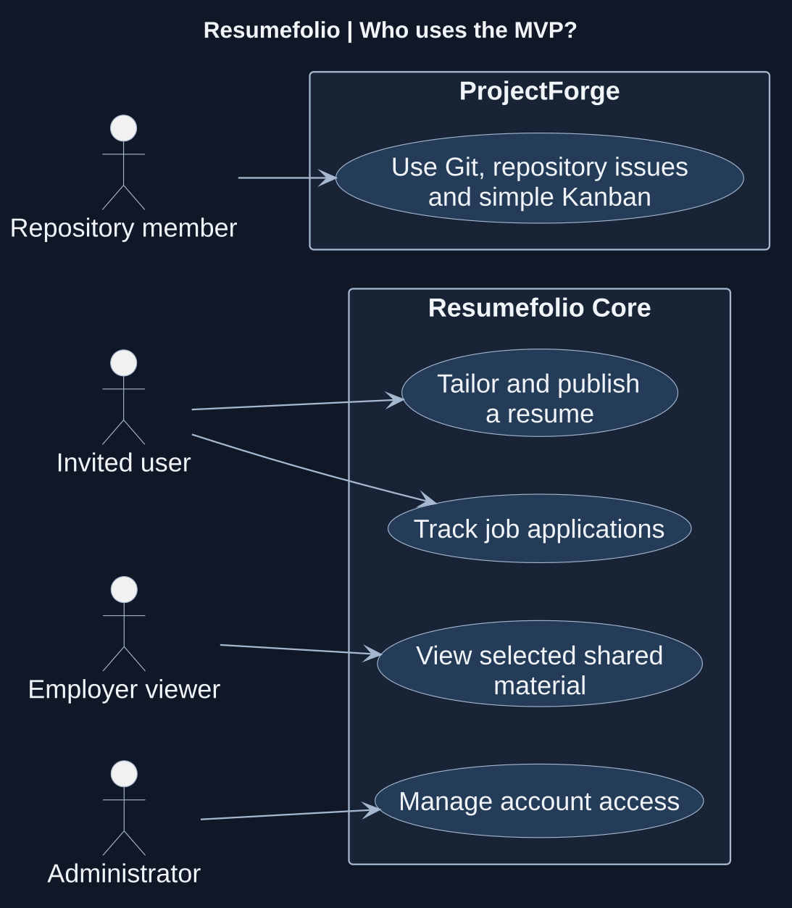

# Resumefolio — Actors and System Context

The MVP gives invited users a private workspace for resumes and job applications. Employers can view material explicitly shared with them. ProjectForge is a separate system for repository collaboration. See the [owner's scope decision](../../../01-Project-Planning/01-Project-Charter.md#release-decision).

 · [Editable PlantUML](../../Diagrams/Actors-Goal-Overview.puml)

## 1. Stakeholders, Actors and Delivery Responsibilities

Farhad owns scope, delivery and operations. A person can act in more than one role. Access is evaluated for the current resource and action.

## 2. Product Boundary and System Context

| System | MVP responsibility |
| --- | --- |
| **Resumefolio Core** | Invited access, profiles, tailored resumes, private files and PDFs, controlled sharing and manual applications |
| **ProjectForge** | Real Git transfers, repository permissions, issues and simple Kanban |

## 3. Human Actor and Stakeholder Catalog

| Actor | Main goal | Access boundary |
| --- | --- | --- |
| Invited user | Tailor resumes and track applications | Own or explicitly authorized resources |
| Employer viewer | View the resume and material shared for review | Selected content through an eligible protected link |
| Administrator | Manage invited accounts and operational policy | Explicit administrative authority. Private user content requires its own grant. |
| Repository member | Transfer code and work on issues | Current repository grant and permitted action |
| Authorized operator | Maintain service and verify recovery | Approved operating access and procedures |

## 4. Actor Goals and Use-Case Context

Start with [resume tailoring, protected sharing and manual applications](../04-Scenarios-And-Models/02-User-Stories-And-Scenarios.md#scenarios-and-models-user-stories-and-scenarios). The scenario record includes denied access and failure paths.

## 5. External Systems, Clients and Operational Dependencies

Git clients connect to ProjectForge. Core needs email delivery for invitations and recovery. Hosting and backup support operation. The [verification gates](https://github.com/Farhad-V/Web-Resumefolio/blob/1f2acaa351ac306cb57cbe4fe9742e8bd90720d9/docs/MVP/baseline/implementation-sequence.md#gate-register) track the evidence needed.

## 6. Access, Data and Lifecycle Boundaries

Check current actor, resource, action and state before granting access. Publication is explicit, employer retrieval is limited to selected materials, and application history preserves what was actually submitted. See the [permissions matrix](../03-Requirements-Specification/01-Accounts-Authentication-And-Permissions.md#requirements-specification-accounts-authentication-and-permissions--heading-7-role-resource-and-operation-matrix).

## 7. Elicitation Coverage and Open Questions

Use the [elicitation log](02-Elicitation-Log.md#stakeholders-and-elicitation-elicitation-log) for source evidence and [requirements decisions](../07-Change-And-Baseline/03-Requirements-Questions-And-Decisions.md#change-and-baseline-open-questions-and-decisions) for policy and rationale.

## 8. Review Checklist and Current Position

Walk through each MVP goal with its actor. Verify what the actor can do, what is denied and what happens when the operation fails. Record evidence in [validation and traceability](../06-Validation-And-Traceability/07-Validation-And-Traceability.md#validation-and-traceability-validation-and-traceability).

## 9. Diagram Maintenance

Regenerate the SVG and 216 DPI PNG from the linked PlantUML source when actor goals or MVP boundaries change.

## Updated Requirements Use-Case Views — November 1, 2026

For the broader and deferred use cases, see the [requirements diagram catalog](../../Diagrams/Diagram-Catalog.md). Mail, calendar, general Sprints and user workflow execution are after MVP.
