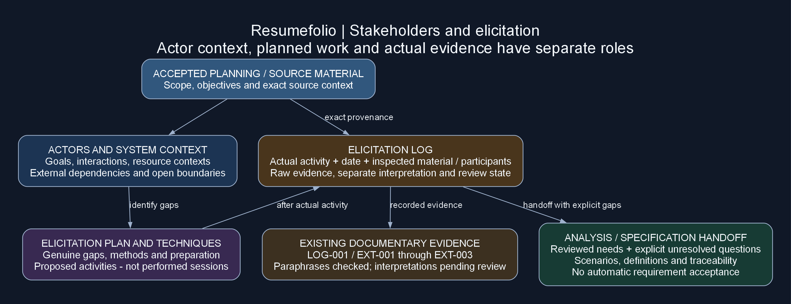
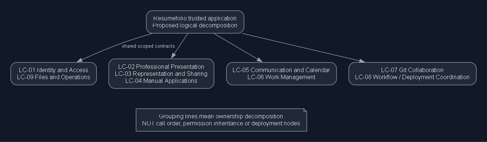
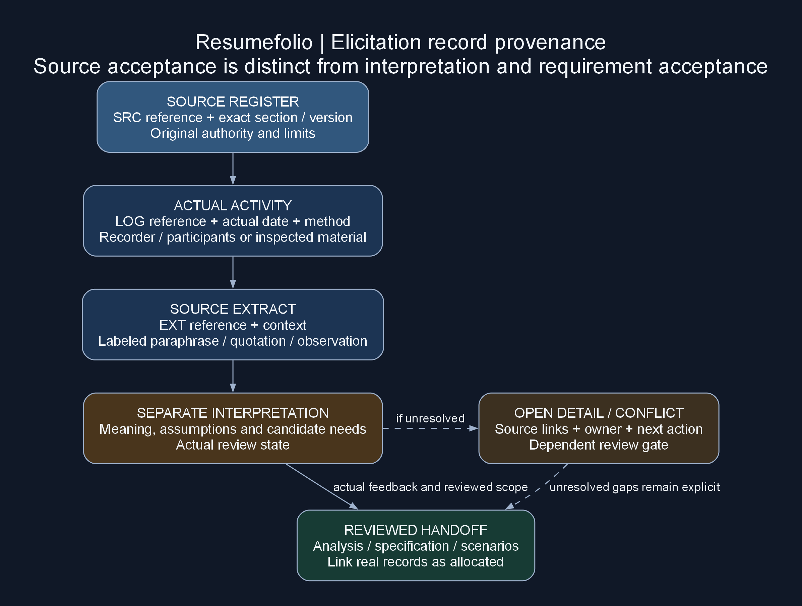
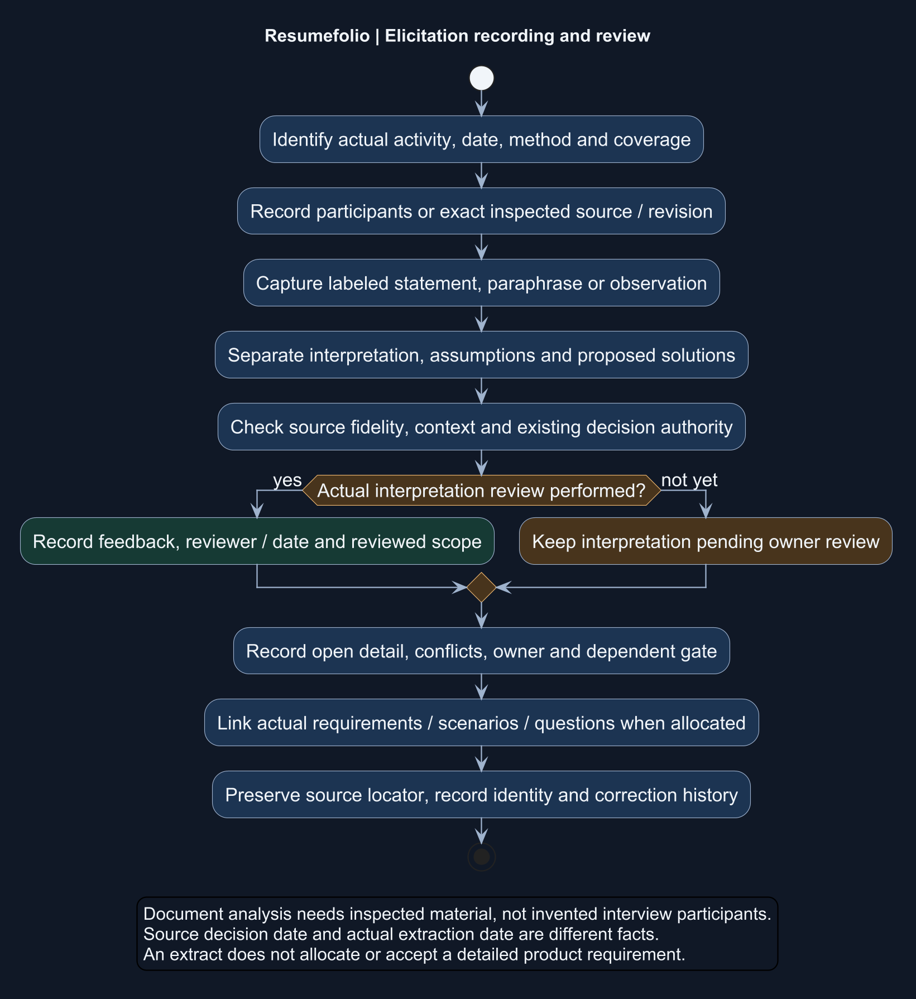
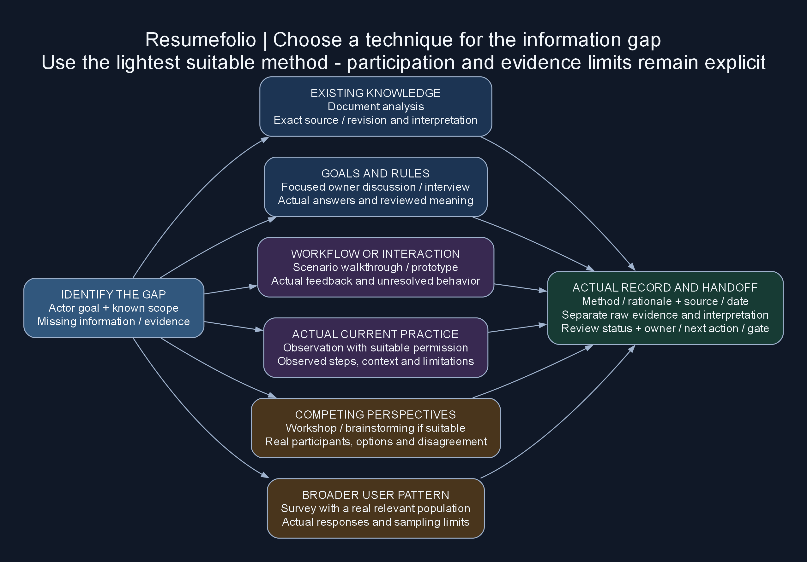
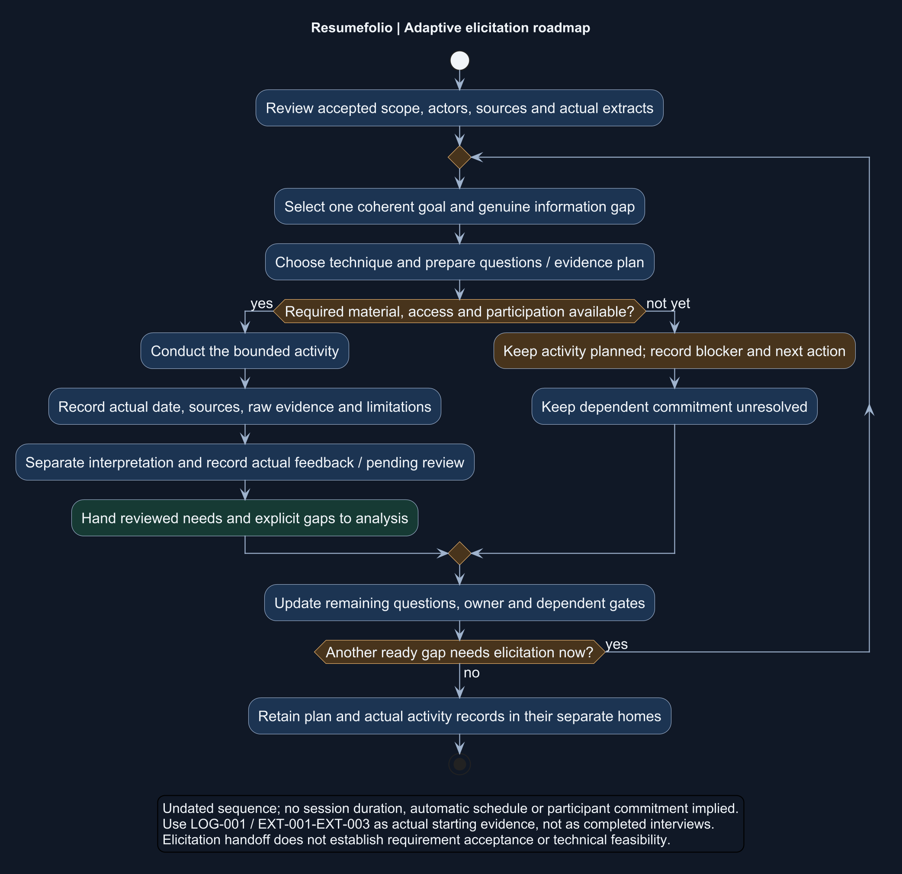

<a id="stakeholders-and-elicitation-stakeholders-and-elicitation"></a>

<a id="stakeholders-and-elicitation-stakeholders-and-elicitation--heading-resumefolio--stakeholders-and-elicitation"></a>
# Resumefolio — Stakeholders and Elicitation

Current implementation choices and scope: [Baseline](https://github.com/Farhad-V/Web-Resumefolio/blob/1f2acaa351ac306cb57cbe4fe9742e8bd90720d9/docs/MVP/baseline/README.md). Runtime verification remains subject to its gates.

| Item | Current position |
| --- | --- |
| Folder purpose | Identify actor goals and system context, plan elicitation and preserve actual source/activity evidence |
| Responsible person | Farhad; sole delivery and operations owner |
| Document coverage | Three expanded working documents with editable diagrams |
| Actual activity | LOG-001 document analysis with EXT-001–EXT-003 recorded; interpretations pending owner review |
| Acceptance boundary | No new interview, detailed permission approval or M-02 baseline acceptance is established here |
| Index revision | October 31, 2026 |

**Start with [Actors and System Context](01-Actors-And-System-Context.md#stakeholders-and-elicitation-actors-and-system-context)** to
understand who interacts with the product and where its boundaries lie. Read the
plan for proposed next activities and the log for what actually happened. Keep
accepted source decisions, extracted interpretations and future requirements distinct.

[Overview](#stakeholders-and-elicitation-stakeholders-and-elicitation--heading-1-folder-overview) · [Documents](#stakeholders-and-elicitation-stakeholders-and-elicitation--heading-documents) · [Reading routes](#stakeholders-and-elicitation-stakeholders-and-elicitation--heading-3-find-the-right-record)
· [Evidence status](#stakeholders-and-elicitation-stakeholders-and-elicitation--heading-4-current-evidence-and-next-work) · [Handoff](#stakeholders-and-elicitation-stakeholders-and-elicitation--heading-5-connections-to-the-rest-of-requirements-engineering)
· [Diagrams](#stakeholders-and-elicitation-stakeholders-and-elicitation--heading-6-diagram-catalog) · [Maintenance](#stakeholders-and-elicitation-stakeholders-and-elicitation--heading-7-maintaining-this-folder)

<a id="stakeholders-and-elicitation-stakeholders-and-elicitation--heading-1-folder-overview"></a>
## 1. Folder Overview



[Scalable SVG](../../Diagrams/Stakeholders-Elicitation-Overview.svg) ·
[Editable Graphviz](../../Diagrams/Stakeholders-Elicitation-Overview.dot)

Blue identifies actor/source context, purple identifies planning, amber identifies
actual records and pending interpretation, and green identifies the downstream
handoff. Arrows show information relationships, not completed activities, staffing,
runtime data flow or automatic acceptance.

Use the three documents together: actor/context questions guide activity selection;
the plan explains what to explore and how; the log preserves actual sources,
activities and feedback. Analysis/review can expose gaps that require further
elicitation. A planned topic becomes an actual log activity only when performed.

<a id="stakeholders-and-elicitation-stakeholders-and-elicitation--heading-documents"></a>
## Documents

| Document | Main question | Contents and boundary |
| --- | --- | --- |
| [Actors and System Context](01-Actors-And-System-Context.md#stakeholders-and-elicitation-actors-and-system-context) | Who needs what, and what lies inside/outside the product? | Actor/stakeholder goals, resource-owner contexts, external services/dependencies, access boundaries and open questions; not a complete permission grant or architecture |
| [Elicitation Plan and Techniques](03-Elicitation-Plan-And-Techniques.md#stakeholders-and-elicitation-elicitation-plan-and-techniques) | What genuine gaps should be explored next, using which method? | Scope-based topic coverage, selection guidance, preparation, neutral prompts and an undated roadmap; no session dates or participant commitments invented |
| [Elicitation Log](02-Elicitation-Log.md#stakeholders-and-elicitation-elicitation-log) | What material was inspected or activity actually performed, and what was learned? | SRC register, actual LOG-001/EXT records, separate interpretations, source hash, review state and recording template; no invented interviews or detailed policy acceptance |

For a first reading, follow the table order. When checking an evidence claim,
start in the log and follow its exact source/revision rather than relying only on
this overview.

<a id="stakeholders-and-elicitation-stakeholders-and-elicitation--heading-3-find-the-right-record"></a>
## 3. Find the Right Record

| If you need to… | Open | What to inspect next |
| --- | --- | --- |
| Understand a role or external interaction | [Actor catalog](01-Actors-And-System-Context.md#stakeholders-and-elicitation-actors-and-system-context--heading-3-human-actor-and-stakeholder-catalog) | Its goal, existing boundary, unresolved rules and source DEC references |
| Clarify who may perform an operation | [Accounts/Permissions matrix](../03-Requirements-Specification/01-Accounts-Authentication-And-Permissions.md#requirements-specification-accounts-authentication-and-permissions--heading-7-role-resource-and-operation-matrix) | Relevant resource/action/state rules and allowed/denied scenarios; role names alone grant no access |
| Select the next clarification group | [Proposed work plan](03-Elicitation-Plan-And-Techniques.md#stakeholders-and-elicitation-elicitation-plan-and-techniques--heading-2-proposed-elicitation-work-plan) | Existing extracts, dependencies, method and expected handoff |
| Choose a suitable technique | [Technique selection](03-Elicitation-Plan-And-Techniques.md#stakeholders-and-elicitation-elicitation-plan-and-techniques--heading-technique-selection) | Question, available material/participants and evidence limits |
| Prepare an actual activity | [Preparation and conduct](03-Elicitation-Plan-And-Techniques.md#stakeholders-and-elicitation-elicitation-plan-and-techniques--heading-4-activity-preparation-and-conduct) | Bounded question, sources, fictional/sanitized examples, permissions and expected records |
| Find existing sources | [Source register](02-Elicitation-Log.md#stakeholders-and-elicitation-elicitation-log--heading-source-register) | Exact section/turn/version when used; broad discovery pointers are not precise extraction evidence |
| Review the performed documentary work | [LOG-001](02-Elicitation-Log.md#stakeholders-and-elicitation-elicitation-log--heading-log-001-scope-decision-extraction) | Actual coverage, source hash, paraphrases, interpretation status and limitations |
| Record a new activity | [Recording guide](02-Elicitation-Log.md#stakeholders-and-elicitation-elicitation-log--heading-5-recording-new-activities) | Actual date/method/participants or inspected material, raw evidence, interpretation and follow-up |
| Resolve a conflict or material new choice | [Analysis and Negotiation](../01-Process-And-Approach/02-Requirements-Process.md#process-and-approach-process-and-approach) | Exact competing statements, impacts/options and actual owner decision where needed |

<a id="stakeholders-and-elicitation-stakeholders-and-elicitation--heading-4-current-evidence-and-next-work"></a>
## 4. Current Evidence and Next Work

<a id="stakeholders-and-elicitation-stakeholders-and-elicitation--heading-what-is-recorded"></a>
### What is recorded

| Record | Actual content | Remaining limit |
| --- | --- | --- |
| SRC-01–SRC-06 | Index of planning, prior discussion and reference-project material | Discovery pointers require exact locators/revisions when extracted; not an exhaustive source review |
| LOG-001 | Document analysis performed October 31, 2026 against DEC-024, DEC-023 and DEC-028 in the identified Scope working copy | No interview participants, server/provider checks, product execution or complete-scope extraction |
| [EXT-001](02-Elicitation-Log.md#stakeholders-and-elicitation-elicitation-log--heading-ext-001-controlled-employer-access) | Protected employer access and selected-content boundary | Interpretation pending; session/revocation and detailed criteria still need definition |
| [EXT-002](02-Elicitation-Log.md#stakeholders-and-elicitation-elicitation-log--heading-ext-002-manual-applications-and-preserved-submissions) | Manual applications and preservation of actual submitted material | Interpretation pending; capture, progress and lifecycle detail still need definition |
| [EXT-003](02-Elicitation-Log.md#stakeholders-and-elicitation-elicitation-log--heading-ext-003-unified-sign-in-and-resource-permissions) | Unified sign-in with resource-specific permissions | Interpretation pending; detailed role/account/authentication rules still need definition |

The three paraphrases were checked against the inspected source sections; this
does not constitute owner validation of their detailed interpretations. Source
decisions retain their original accepted scope authority. No interview, workshop,
observation, prototype-feedback session or survey has been recorded in this log.

<a id="stakeholders-and-elicitation-stakeholders-and-elicitation--heading-practical-next-work"></a>
### Practical next work

1. Review the existing extracts and their genuine missing-detail questions without re-approving accepted scope inclusion.
2. Select a coherent actor goal using the proposed work plan and relevant feasibility/dependency gates.
3. Prepare and conduct an appropriate activity only with actual available material/participants and needed access.
4. Record actual evidence and feedback, keeping interpretation and unresolved detail separate.
5. Hand off reviewed needs and explicit gaps to analysis/specification and maintain source-to-record links.

Farhad coordinates the work in the current solo arrangement. Missing stakeholder
perspectives remain visible; owner representation is not evidence of research
with actual employers or collaborators. No dates, durations or research population
are assumed by this index.

<a id="stakeholders-and-elicitation-stakeholders-and-elicitation--heading-5-connections-to-the-rest-of-requirements-engineering"></a>
## 5. Connections to the Rest of Requirements Engineering

| Related record | Relationship to this folder |
| --- | --- |
| [Scope](../../../01-Project-Planning/01-Project-Charter.md#mvp-scope) / [Planning Decision Register](https://github.com/Farhad-V/Web-Resumefolio/blob/1f2acaa351ac306cb57cbe4fe9742e8bd90720d9/docs/MVP/SDLC/01-project-planning/decision-register.md) | Source of accepted boundaries and rationale; material changes follow actual decision control |
| [Requirements Approach](../01-Process-And-Approach/02-Requirements-Process.md#process-and-approach-process-and-approach) / [Elicitation Process](../01-Process-And-Approach/02-Requirements-Process.md#process-and-approach-process-and-approach) | Overall method, iterative work and evidence expectations |
| [Feasibility Study](../01-Process-And-Approach/01-Feasibility-Study.md#process-and-approach-02-feasibility-study) | Investigations needed where user expectations do not establish actual technical/provider/resource suitability |
| [Analysis](../01-Process-And-Approach/02-Requirements-Process.md#process-and-approach-process-and-approach) / [SRS](../03-Requirements-Specification/17-Software-Requirements-Specification.md#requirements-specification-requirements-specification) | Clarification/classification/conflict handling and authoritative detailed requirement records |
| [Scenarios and Models](../04-Scenarios-And-Models/02-User-Stories-And-Scenarios.md#scenarios-and-models-user-stories-and-scenarios) | Actor journeys, alternatives, denied/failure paths and use-case detail |
| [Data Definitions](../05-Data-Definitions/01-Data-Definitions-Guide.md#data-definitions-data-definitions) | Consistent terms and conceptual information meaning |
| [Traceability](../06-Validation-And-Traceability/07-Validation-And-Traceability.md#validation-and-traceability-validation-and-traceability--heading-traceability) / [Review Findings](../06-Validation-And-Traceability/07-Validation-And-Traceability.md#validation-and-traceability-validation-and-traceability--heading-review-findings) | Source-to-requirement links and actual review evidence/rechecks |
| [Open Questions](../07-Change-And-Baseline/03-Requirements-Questions-And-Decisions.md#change-and-baseline-open-questions-and-decisions) / [Change Control](../07-Change-And-Baseline/02-Requirements-Change-Control.md#change-and-baseline-change-control) | Unresolved matters, owner/actions/gates and actual material decisions |

Do not copy full requirement text, live delivery status or review findings into
this README. Link the authoritative home and summarize only the evidence needed
for navigation. Source extraction, requirement acceptance, implementation progress
and executed verification results are distinct facts.

Preserve all agreed Version 1 scope, including manual job application management. Product AI,
automatic translation and automatic demo migration remain excluded. The wider
pre-implementation baseline and M-02 review remain separate gates; documentation
or elicitation completion alone does not authorize product coding.

<a id="stakeholders-and-elicitation-stakeholders-and-elicitation--heading-6-diagram-catalog"></a>
## 6. Diagram Catalog

This catalog covers **seven supporting diagram sources**: the new folder overview
and two diagrams for each of the three documents. Sources and SVG/PNG outputs
live in the shared `diagrams` folder. See the wider
[Requirements Diagram Index](../../Diagrams/Diagram-Catalog.md) for other phase diagrams.

| Topic / diagram | Preview | Scalable | Editable source |
| --- | --- | --- | --- |
| This index — folder overview |  | [SVG](../../Diagrams/Stakeholders-Elicitation-Overview.svg) | [DOT](../../Diagrams/Stakeholders-Elicitation-Overview.dot) |
| Actors — system context |  | [SVG](https://github.com/Farhad-V/Web-Resumefolio/blob/1f2acaa351ac306cb57cbe4fe9742e8bd90720d9/docs/MVP/SDLC/04-system-design/01-software-architecture/diagrams/logical-component-ownership.svg) | [DOT](https://github.com/Farhad-V/Web-Resumefolio/blob/1f2acaa351ac306cb57cbe4fe9742e8bd90720d9/docs/MVP/SDLC/04-system-design/01-software-architecture/diagrams/logical-component-ownership.dot) |
| Actors — goal overview |  | [SVG](../../Diagrams/Actors-Goal-Overview.svg) | [PlantUML](../../Diagrams/Actors-Goal-Overview.puml) |
| Log — provenance |  | [SVG](../../Diagrams/Elicitation-Log-Provenance.svg) | [DOT](../../Diagrams/Elicitation-Log-Provenance.dot) |
| Log — recording/review cycle |  | [SVG](../../Diagrams/Elicitation-Log-Recording-Cycle.svg) | [PlantUML](../../Diagrams/Elicitation-Log-Recording-Cycle.puml) |
| Plan — technique selection |  | [SVG](../../Diagrams/Elicitation-Technique-Selection.svg) | [DOT](../../Diagrams/Elicitation-Technique-Selection.dot) |
| Plan — adaptive roadmap |  | [SVG](../../Diagrams/Elicitation-Plan-Roadmap.svg) | [PlantUML](../../Diagrams/Elicitation-Plan-Roadmap.puml) |

PNG is the quick preview, SVG supports zooming, and DOT/PlantUML is editable.
Read each image with its source document's meaning and limits. No diagram is a
permission grant, live schedule or proof of technical feasibility.

<a id="stakeholders-and-elicitation-stakeholders-and-elicitation--heading-7-maintaining-this-folder"></a>
## 7. Maintaining This Folder

| Change | Keep consistent |
| --- | --- |
| Actor, interaction or boundary changes | Actor document, relevant permission/scenario records, models and source rationale |
| New planned activity | Work plan, technique rationale, expected output and dependent gate |
| Activity actually performed | Log date/source/participants or material, extracts, actual feedback and follow-up; update summary here if material |
| Source changes | Preserve historic extraction locator; add explicit new evidence/review rather than silently rewriting old observations |
| Diagram/document moved or revised | Catalog, incoming links, editable sources, renders, captions and affected record references |
| Actual decision or requirement allocated | Authoritative record first, then source/extract-to-requirement traceability and any relevant summary |

Regeneration commands for each document's diagrams are in that document. For the
folder overview, run from the repository root:

```powershell
$diagramFolder = 'docs\SDLC\02-requirements-engineering\diagrams'
$graphvizExe = 'C:\Program Files\Graphviz\bin\dot.exe'
foreach ($format in 'svg', 'png') {
    & $graphvizExe "-T$format" -Gdpi=140 `
        "$diagramFolder\stakeholders-elicitation-overview.dot" `
        -o "$diagramFolder\stakeholders-elicitation-overview.$format"
    if ($LASTEXITCODE -ne 0) { throw "Graphviz failed: $format" }
}
```

Use UTF-8 without BOM and retain source/SVG/PNG files together in version control.
Inspect rendered labels/arrows and verify file/section links after edits. Color
supports labels/shapes; meaning must remain understandable without color alone.
Keep secrets and unnecessary private material out of repository examples/evidence.

**Revision note — October 31, 2026:** Reorganized the folder guide with reading
routes, actual evidence status, authoritative handoff locations and a complete
seven-diagram catalog. Added the folder overview. No new activity, permission,
source extraction, requirement acceptance or baseline decision is recorded.

[Requirements Engineering index]() · [Process and Approach](../01-Process-And-Approach/02-Requirements-Process.md#process-and-approach-process-and-approach)


<a id="requirements-specification"></a>
