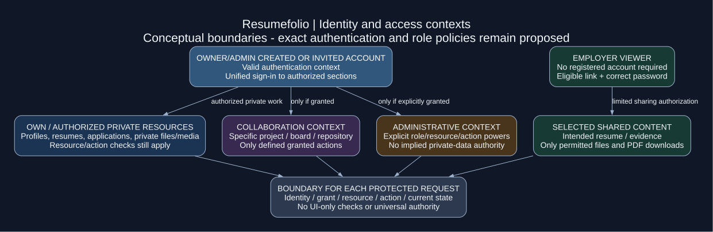
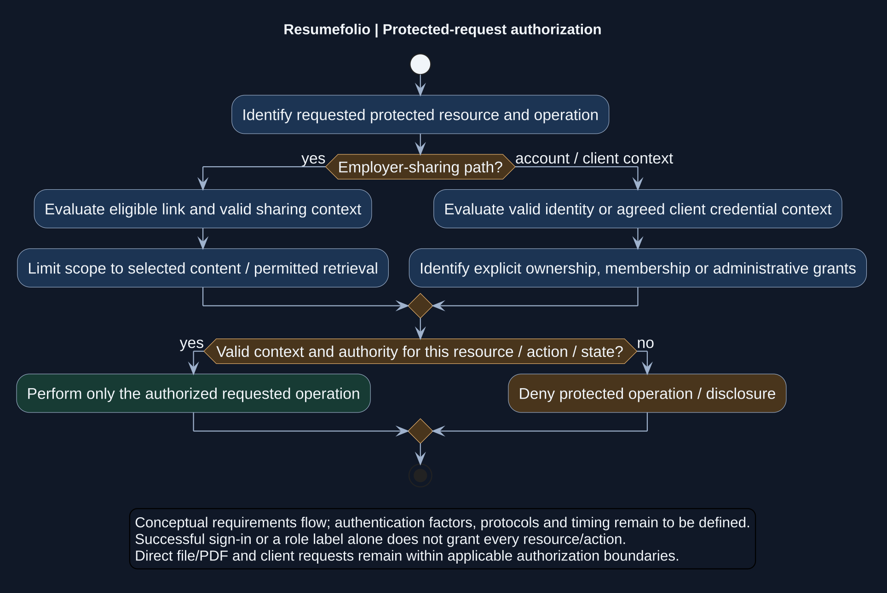
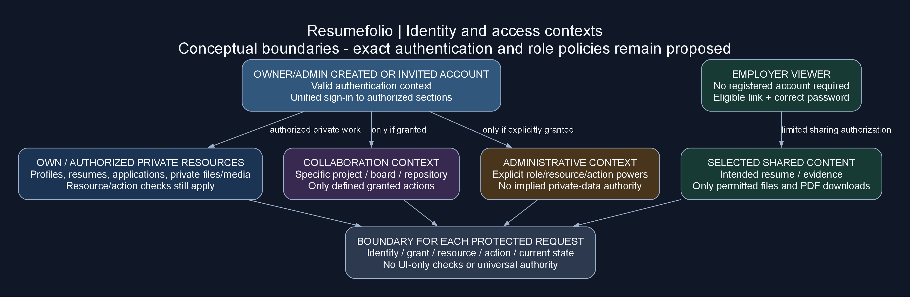
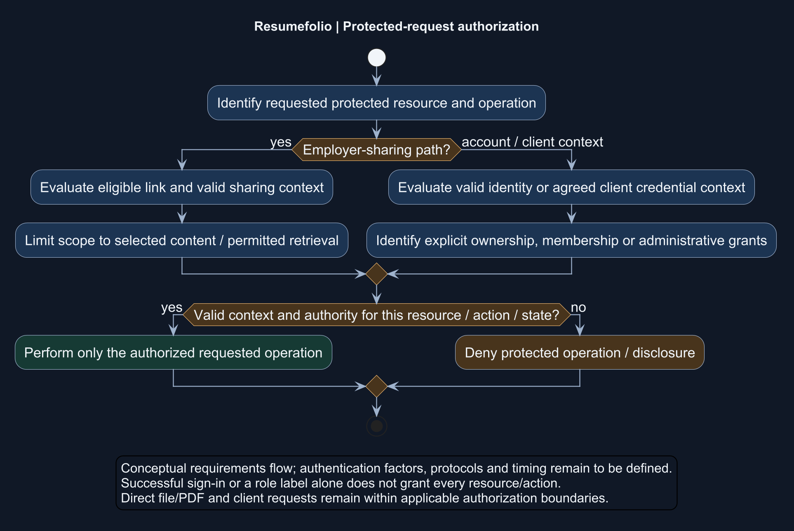

# Resumefolio — Accounts, Authentication and Permissions

**Quick read — Accounts and access.** Invited accounts, recovery, scoped sign-in and per-resource authorization. Employer disclosure and ProjectForge access retain their own permission boundaries.

[Selected Policies and Future Proposals](#requirements-specification-accounts-authentication-and-permissions--heading-selected-policies-and-future-proposals) · [3. Proposed Requirements and Acceptance Criteria](#requirements-specification-accounts-authentication-and-permissions--heading-3-proposed-requirements-and-acceptance-criteria) · [8. Remaining Verification](#requirements-specification-accounts-authentication-and-permissions--heading-8-remaining-verification)

[Domain index](README.md) · [Acceptance trace](../../03-Requirements-Traceability-Matrix/README.md)

## MVP account admission and authority

**Status.** Account and access policies are selected for MVP. Implementation and acceptance checks are pending.

The owner or an administrator creates or invites users. Public self-registration is outside MVP. Every protected action checks the current user, resource, operation and state. Core and ProjectForge use authenticated, user-scoped API access. Administrative roles and repository membership grant only their defined powers. Employer links allow retrieval of selected shared content.

- [Decisions and rationale](#requirements-specification-accounts-authentication-and-permissions--heading-selected-policies-and-future-proposals)
- [Requirements and acceptance criteria](#requirements-specification-accounts-authentication-and-permissions--heading-3-proposed-requirements-and-acceptance-criteria)
- [Permissions by role](#requirements-specification-accounts-authentication-and-permissions--heading-7-role-resource-and-operation-matrix)
- [Remaining verification](#requirements-specification-accounts-authentication-and-permissions--heading-8-remaining-verification)

## Selected Policies and Future Proposals

The three policies below are **selected for MVP**. Their rationale explains the product trade-off. The linked policy and technical records define the exact rules.

### Q-D03: Invite-only admission and recovery

**Decision.** The owner or an administrator creates or invites users. Public registration is outside MVP. Administrators use a second factor. Invitations and recovery use system email.

**Why.** Invite-only admission limits who can enter the private workspace. A second factor protects accounts with administrative powers. System email allows invited users to join or recover access independently of any future personal Gmail integration. [Selected identity policy](https://github.com/Farhad-V/Web-Resumefolio/blob/1f2acaa351ac306cb57cbe4fe9742e8bd90720d9/docs/MVP/baseline/policy-decisions.md#q-d03)

### Q-D04: Resource-specific grants

**Decision.** Each action requires authority for the specific resource. An administrator has no implicit access to private user content. A repository reader can fetch and browse, a writer can push, and issue access alone does not grant write access.

**Why.** Account administration, private content and repository collaboration have different purposes. Separate grants prevent one responsibility from exposing unrelated resumes, applications or repositories. [Selected grant policy](https://github.com/Farhad-V/Web-Resumefolio/blob/1f2acaa351ac306cb57cbe4fe9742e8bd90720d9/docs/MVP/baseline/policy-decisions.md#q-d04)

### Q-D05: Revocation and current authority

**Decision.** Check current authority on each new protected request. Disablement and password reset invalidate Core sessions. ProjectForge checks current Core account status for browser, API and Git access. Deny stale credentials.

**Why.** A session or credential issued earlier should not preserve access after it has been withdrawn. Revocation can stop new retrievals. Bytes already delivered remain with the recipient. [Selected revocation policy](https://github.com/Farhad-V/Web-Resumefolio/blob/1f2acaa351ac306cb57cbe4fe9742e8bd90720d9/docs/MVP/baseline/policy-decisions.md#q-d05)

Personal Gmail and calendar access are after MVP. Employer-link rules are recorded under [protected sharing](https://github.com/Farhad-V/Web-Resumefolio/blob/1f2acaa351ac306cb57cbe4fe9742e8bd90720d9/docs/MVP/baseline/policy-decisions.md#q-d11).

## 1. Scope, Sources and Boundaries

| Source | Direction retained | Detail not settled by the source |
| --- | --- | --- |
| [DEC-028](https://github.com/Farhad-V/Web-Resumefolio/blob/1f2acaa351ac306cb57cbe4fe9742e8bd90720d9/docs/MVP/SDLC/01-project-planning/02-scope.md#dec-028) / [EXT-003](../02-Stakeholders-And-Elicitation/02-Elicitation-Log.md#stakeholders-and-elicitation-elicitation-log--heading-ext-003-unified-sign-in-and-resource-permissions) | Individual accounts, roles, resource/operation permissions and unified sign-in across authorized sections | Role hierarchy, account lifecycle, authentication flows and detailed criteria |
| [OBJ-04](https://github.com/Farhad-V/Web-Resumefolio/blob/1f2acaa351ac306cb57cbe4fe9742e8bd90720d9/docs/MVP/SDLC/01-project-planning/01-purpose-and-objectives.md#objective-4-provide-a-unified-working-environment) | Connected workflows without repeated sign-in or unintended private access | Concrete authentication/session architecture |
| [DEC-024](https://github.com/Farhad-V/Web-Resumefolio/blob/1f2acaa351ac306cb57cbe4fe9742e8bd90720d9/docs/MVP/SDLC/01-project-planning/02-scope.md#dec-024) / [DEC-025](https://github.com/Farhad-V/Web-Resumefolio/blob/1f2acaa351ac306cb57cbe4fe9742e8bd90720d9/docs/MVP/SDLC/01-project-planning/02-scope.md#dec-025) | Employer access without a viewer account, password protection, selected content, owner password/link controls and protected file/PDF retrieval | Session revocation timing, link lifecycle, feedback and retry policy |
| [DEC-021](https://github.com/Farhad-V/Web-Resumefolio/blob/1f2acaa351ac306cb57cbe4fe9742e8bd90720d9/docs/MVP/SDLC/01-project-planning/02-scope.md#dec-021) / [DEC-020](https://github.com/Farhad-V/Web-Resumefolio/blob/1f2acaa351ac306cb57cbe4fe9742e8bd90720d9/docs/MVP/SDLC/01-project-planning/02-scope.md#dec-020) | Authorized work/repository collaboration | Read/write/invite/review/merge roles and credential protocols |
| [DEC-029–DEC-032](../../../01-Project-Planning/01-Project-Charter.md#responsibilities) / [DEC-018](https://github.com/Farhad-V/Web-Resumefolio/blob/1f2acaa351ac306cb57cbe4fe9742e8bd90720d9/docs/MVP/SDLC/01-project-planning/02-scope.md#dec-018) | Product roles distinct from delivery ownership; permitted administration and configurable file policy | Exact administrator/platform-owner powers and sensitive-operation checks |
| [Risk Register](../../../01-Project-Planning/03-Feasibility-And-Risk-Assessment.md#risks-and-verification), RSK-03/RSK-04/RSK-07/RSK-09 | Execution boundaries, allowed/denied requests, email-dependent authentication and lifecycle need explicit controls/evidence | Risk responses are not implemented mechanisms or completed tests |

MVP scope includes identity/access for the core and separately authorized basic ProjectForge. Communication/calendar, advanced work/Git and YAML execution/deployment are future. Do not infer public self-registration, social login,
mandatory MFA, a specific password/OTP scheme or a separate SSO server from the
phrase “unified sign-in.” Owner/admin creation or invitation is settled for MVP; authentication factors and session mechanisms remain open.

The [Actors and Context](../02-Stakeholders-And-Elicitation/01-Actors-And-System-Context.md#stakeholders-and-elicitation-actors-and-system-context)
document owns stakeholder goals; this file owns detailed permission expectations.
The [sharing domain](11-Pdf-And-Controlled-Sharing.md#requirements-specification-pdf-and-controlled-sharing) and other module specifications
must reference compatible rules rather than establishing contradictory access paths.

## 2. Identity and Access Contexts

[Scalable SVG](../../Diagrams/Accounts-Access-Contexts.svg) ·
[Editable Graphviz](../../Diagrams/Accounts-Access-Contexts.dot)

Blue groups account/private-resource context, purple groups limited collaboration,
green groups protected shared viewing and amber groups administration. All paths
remain limited by their applicable authority. The map is conceptual; it selects
no token, cookie, database, provider or role-inheritance design.

| Concept | Required distinction |
| --- | --- |
| Authentication | Establish a valid account access context under the authentication policy once agreed |
| Authorization | Check whether this actor/context may perform this action on this resource in its current state |
| Resource ownership | Context-specific responsibility/authority, not universal platform power |
| Membership or invitation | Defined collaboration scope; not general access to the owner's private workspace |
| Employer access | Limited password-protected sharing context without requiring a registered viewer account |
| Administrative authority | Explicit operations on specified resources/states; project-owner identity alone is not a complete product permission rule |

One person may use several contexts. Do not infer that account ownership,
project membership or an administrative role grants every operation. Unknown
permissions remain unresolved and must not be treated as granted.

## 3. Proposed Requirements and Acceptance Criteria

### Shared record metadata

These twelve records retain their original draft identifiers and criteria. Use the [MVP criterion guide](https://github.com/Farhad-V/Web-Resumefolio/blob/1f2acaa351ac306cb57cbe4fe9742e8bd90720d9/docs/MVP/baseline/criterion-dispositions.md) for current applicability and priority. Tests remain planned. Field definitions are in the [data dictionary](../05-Data-Definitions/02-Data-Dictionary.md#data-definitions-data-dictionary).

- **Account and access:** [ACC-D01](#requirements-specification-accounts-authentication-and-permissions--heading-acc-d01-individual-account-context), [ACC-D02](#requirements-specification-accounts-authentication-and-permissions--heading-acc-d02-unified-sign-in-across-authorized-sections), [ACC-D03](#requirements-specification-accounts-authentication-and-permissions--heading-acc-d03-resource-and-operation-authorization), [ACC-D04](#requirements-specification-accounts-authentication-and-permissions--heading-acc-d04-cross-user-private-data-isolation), [ACC-D05](#requirements-specification-accounts-authentication-and-permissions--heading-acc-d05-limited-collaboration-authority)
- **Employer sharing:** [ACC-D06](#requirements-specification-accounts-authentication-and-permissions--heading-acc-d06-employer-access-without-a-viewer-account), [ACC-D07](#requirements-specification-accounts-authentication-and-permissions--heading-acc-d07-protected-shared-file-and-pdf-retrieval), [ACC-D08](#requirements-specification-accounts-authentication-and-permissions--heading-acc-d08-owner-control-of-employer-link-access)
- **Administration and end of access:** [ACC-D09](#requirements-specification-accounts-authentication-and-permissions--heading-acc-d09-explicit-administrative-powers), [ACC-D10](#requirements-specification-accounts-authentication-and-permissions--heading-acc-d10-authorization-of-access-grant-changes), [ACC-D11](#requirements-specification-accounts-authentication-and-permissions--heading-acc-d11-no-authentication-bypass-on-deliveryprovider-failure), [ACC-D12](#requirements-specification-accounts-authentication-and-permissions--heading-acc-d12-end-of-access-and-lifecycle-enforcement)

### ACC-D01: Individual Account Context

- **Owner-scope acceptance additions (MVP; planned, not executed):**

  - Initial account access follows owner/admin creation or invitation; no public self-registration path creates an account.
  - An authenticated API request cannot impersonate another user or turn board membership into repository authority.

- **Release allocation (owner decision, November 4):** MVP foundation where used by core/basic ProjectForge; future-domain clauses deferred.

- **Source / rationale:** DEC-028; support identifiable private user workflows.
- **Actor / conditions:** A person accesses account-bound product functions.

- **Proposed obligation:** The system shall associate private user operations with
  the authenticated account context required by the agreed account policy, and shall
  not treat one user's successful sign-in as another user's identity.

- **Acceptance criteria**

  - Given two distinct test accounts, when each performs a permitted own-account operation, the operation is attributed to the corresponding account context.
  - Given no valid account context, when an account-protected operation is requested, that operation does not execute as an authenticated user.
  - Given account A's valid context, when a request supplies account B's identity as input, that input alone does not change the authenticated actor to B.

- **Planned verification:** Integration tests of account-bound operations and direct
  identity-manipulation requests; inspect actor attribution using controlled data.
- **Dependencies / open detail:** Owner/admin-created or invited admission is settled. Identifiers, account states and authentication mechanism: Section 8. These must be specified before affected acceptance.

### ACC-D02: Unified Sign-in Across Authorized Sections

- **Release allocation (owner decision, November 4):** MVP foundation where used by core/basic ProjectForge; future-domain clauses deferred.

- **Source / rationale:** DEC-028 and OBJ-04; reduce repeated sign-in while preserving permissions.
- **Actor / conditions:** Registered user with a currently valid account context.

- **Proposed obligation:** While the agreed account access context remains valid,
  the system shall let the user continue between authorized product sections
  without a separate sign-in solely because the section changes.

- **Acceptance criteria**

  - Given valid access and permission to two sections, when the user navigates between them, the user is not required to sign in again only for that navigation.
  - Given a valid account context but no authority for the destination resource/action, navigation or a direct request does not grant that authority.

- **Planned verification:** A browser journey across representative authorized
  sections plus denied direct requests. **Open detail:** Context lifetime, sensitive
  reauthentication and technical architecture remain separate decisions; this record
  does not promise indefinite sessions.

### ACC-D03: Resource and Operation Authorization

- **Release allocation (owner decision, November 4):** MVP foundation where used by core/basic ProjectForge; future-domain clauses deferred.

- **Source / rationale:** DEC-028; RSK-04 response. Protect private operations at request boundaries.
- **Actor / conditions:** Any account or shared-view context requests a protected resource/action.

- **Proposed obligation:** The system shall enforce the applicable actor/resource/action
  permission for the request rather than relying only on visible navigation or controls.

- **Acceptance criteria**

  - Given an actor with read permission but no modification permission in the agreed matrix, a direct modification request does not change the protected resource.
  - Given no permission to a private resource, direct read/list/download requests do not disclose its protected content.
  - Hiding a control or changing a request's resource identifier does not substitute for authorization of the requested operation.

- **Planned verification:** Integration tests covering agreed allowed/denied action
  pairs and direct requests. **Open detail:** Exact matrix, denied-response conventions
  and any permitted resource-existence disclosure need specification before acceptance.

### ACC-D04: Cross-user Private-data Isolation

- **Release allocation (owner decision, November 4):** MVP foundation where used by core/basic ProjectForge; future-domain clauses deferred.

- **Source / rationale:** DEC-028, OBJ-04 and RSK-04; preserve private-data boundaries.
- **Actor / conditions:** Registered user requests another user's private resource.

- **Proposed obligation:** The system shall deny access or modification outside an
  explicitly granted resource context, including when an authenticated user supplies
  another user's resource reference.

- **Acceptance criteria**

  - Given A and B with separate private resumes/email/application records and no grant between them, A cannot retrieve or modify B's protected content through direct requests.
  - List/search/navigation in A's private context does not expose B's protected content merely because B's identifiers are supplied or guessed.
  - A legitimate collaboration or employer-sharing grant exposes only its defined scope, not unrelated resources.

- **Planned verification:** Controlled two-user integration cases across affected
  modules and related list/search/file paths. **Open detail:** Enumerate covered
  resources/actions in each module; limited testing does not prove universal isolation.

### ACC-D05: Limited Collaboration Authority

- **Release allocation (owner decision, November 4):** MVP foundation where used by core/basic ProjectForge; future-domain clauses deferred.

- **Source / rationale:** DEC-028, DEC-021 and DEC-020; allow collaboration without private-workspace disclosure.
- **Actor / conditions:** Invited participant has the collaboration authority defined for a resource.

- **Proposed obligation:** The system shall limit collaborator operations to the
  specific resources and actions granted by the agreed membership/invitation rules.

- **Acceptance criteria**

  - Given a valid board-specific grant, the participant can perform the actions actually granted for that board and cannot perform actions outside that grant.
  - The board invitation alone grants no access to the owner's private email, unrelated resumes or repositories.
  - A request for a different project/board/repository must have its own applicable authority; membership in one is insufficient by itself.

- **Planned verification:** Permission-matrix tests using owner, invited participant
  and unrelated user contexts. **Open detail:** Invitation acceptance, roles,
  revocation timing, ownership transfer and existing-session/job effects: Section 8.

### ACC-D06: Employer Access Without a Viewer Account

- **Release allocation (owner decision, November 4):** MVP foundation where used by core/basic ProjectForge; future-domain clauses deferred.

- **Source / rationale:** DEC-024; straightforward protected access to selected professional content.
- **Actor / conditions:** Employer viewer opens an eligible resume link.

- **Proposed obligation:** The system shall support password-protected viewing of
  the intended shared resume/content without requiring the employer viewer to
  create a registered product account.

- **Acceptance criteria**

  - Given an eligible active link and correct password, the viewer can access its selected shared content without registering/signing in to a user workspace.
  - Given no valid sharing authorization or an incorrect password, the protected content is not disclosed.
  - Successful sharing access does not create access to the private user workspace, other resumes, email or collaboration resources.

- **Planned verification:** Browser/integration cases for correct/incorrect/no
  sharing authorization and unrelated-resource requests. **Open detail:** Password
  policy, attempt limits, validity/expiry, feedback and viewer-session behavior.

### ACC-D07: Protected Shared File and PDF Retrieval

- **Release allocation (owner decision, November 4):** MVP foundation where used by core/basic ProjectForge; future-domain clauses deferred.

- **Source / rationale:** DEC-024/DEC-025; underlying content follows the shared authorization boundary.
- **Actor / conditions:** Viewer requests a file/PDF associated with a shared resume.

- **Proposed obligation:** The system shall authorize file/PDF retrieval for the
  specific shared resource and its configured availability, including direct URLs.

- **Acceptance criteria**

  - Without valid authorization for the protected file/PDF, direct retrieval does not disclose its protected contents.
  - With valid sharing access, only the selected content and download options available for that resume/language can be retrieved.
  - Substituting an unshared or unrelated file reference does not disclose that content.

- **Planned verification:** Direct retrieval tests, cross-resource references and
  language/download combinations. **Dependencies:** [PDF/Sharing](11-Pdf-And-Controlled-Sharing.md#requirements-specification-pdf-and-controlled-sharing)
  defines availability detail; this record must remain consistent with it.

### ACC-D08: Owner Control of Employer-link Access

- **Release allocation (owner decision, November 4):** MVP foundation where used by core/basic ProjectForge; future-domain clauses deferred.

- **Source / rationale:** DEC-024; preserve owner control over future sharing access.
- **Actor / conditions:** Authorized resume owner changes a link password or disables the link.

- **Proposed obligation:** The system shall permit the authorized owner to change
  the sharing password or disable the link, and shall deny a new unauthenticated
  viewer's attempt to gain content access through a disabled link.

- **Acceptance criteria**

  - An unrelated user cannot change another owner's sharing password or link state through a direct request.
  - After the owner disables a link, a fresh viewer context using that link is denied protected content.
  - For a fresh viewer context after a password change, the previous password does not newly authorize sharing access and the current password works only while the link is eligible.

- **Planned verification:** Owner/non-owner modification cases and fresh-viewer
  access checks. **Explicit gap:** Already authorized sessions, cached responses and
  in-flight requests need a separately agreed revocation policy; these criteria do
  not settle that policy or revoke legitimately downloaded copies.

### ACC-D09: Explicit Administrative Powers

- **Release allocation (owner decision, November 4):** MVP foundation where used by core/basic ProjectForge; future-domain clauses deferred.

- **Source / rationale:** DEC-029–DEC-032 and DEC-018; separate project governance from product privileges.
- **Actor / conditions:** Administrator or platform-owner context requests an administrative operation.

- **Proposed obligation:** The system shall enforce an explicit administrative
  resource/action/state grant before performing an administrative operation.

- **Acceptance criteria**

  - For an administrative action agreed in the matrix, an actor without the required grant cannot perform it through UI or direct requests.
  - The actor with that agreed grant can perform it only within its stated scope and resource/state conditions.
  - Merely identifying a person as project owner or assigning an unrelated product role does not bypass the specified product grant.

- **Planned verification:** Allowed/denied administrative-operation tests once powers
  are defined. **Open detail:** Content view/edit/delete/restore, account suspension,
  quota configuration, additional checks, reasons, audit and recovery rights remain open.

### ACC-D10: Authorization of Access-grant Changes

- **Release allocation (owner decision, November 4):** MVP foundation where used by core/basic ProjectForge; future-domain clauses deferred.

- **Source / rationale:** Proposed refinement of DEC-028/RSK-04; prevent unauthorized privilege changes.
- **Actor / conditions:** A request changes roles, membership, invitations or permissions.

- **Proposed obligation:** The system shall require the authority defined for the
  specific access-management action and shall not allow an unauthorized caller to
  assign privileges to themselves or others by modifying request data.

- **Acceptance criteria**

  - A caller lacking a defined role/membership-management grant cannot increase their own permissions or another account's permissions through a direct request.
  - A granted action respects the allowed target resource and permission scope; it does not grant authority outside that scope.

- **Planned verification:** Direct privilege-change requests with authorized and
  unauthorized contexts. **Open detail:** Who may invite/promote/revoke, bootstrap
  the platform owner, and manage recovery of privileged access requires an actual decision.

### ACC-D11: No Authentication Bypass on Delivery/Provider Failure

- **Release allocation (owner decision, November 4):** MVP foundation where used by core/basic ProjectForge; future-domain clauses deferred.

- **Source / rationale:** RSK-07 and ASM-03/DEP-04; proposed failure-behavior refinement.
- **Actor / conditions:** Authentication/recovery depends on email or another service under the eventual agreed mechanism.

- **Proposed obligation:** Failure, delay or unavailability of a required external
  authentication/recovery step shall not by itself establish successful authentication
  or bypass a required check.

- **Acceptance criteria**

  - Given a required verification step has not successfully completed because delivery/service is unavailable, a protected request is not treated as successfully authenticated on that basis.
  - Failure handling exposes no secret verification value in ordinary user-facing feedback or shared evidence.

- **Planned verification:** Controlled failure/delay cases after the mechanism and
  recovery rules are selected. **Open detail:** Observable feedback, resend/rate limits,
  validity and alternative verified recovery paths; actual email delivery remains unverified.

### ACC-D12: End-of-access and Lifecycle Enforcement

- **Release allocation (owner decision, November 4):** MVP foundation where used by core/basic ProjectForge; future-domain clauses deferred.

- **Source / rationale:** M-04 sign-in/sign-out definition; RSK-04/RSK-09; proposed lifecycle refinement.
- **Actor / conditions:** A user ends access, or an account/membership/link changes state under agreed policy.

- **Proposed obligation:** The system shall apply the agreed end-of-access and
  state-transition rules to subsequent protected operations rather than treating a
  previous successful authorization as permanent authority.

- **Acceptance criteria requiring policy completion**

  - Once the scope/effective point of sign-out is agreed, a request using only the ended context is denied the access that sign-out removes.
  - Once the effect/effective point of account or membership revocation is agreed, subsequent requests outside remaining authority are denied.
  - Other still-valid contexts are affected only as explicitly specified by the selected policy.

- **Planned verification:** Session/context replay, membership/account transitions
  and related direct requests. **Verification gate:** Implement the selected session/grant revocation rules in Q-D05/T02/T03, including future admissions and in-flight limitations. Provider tokens and user execution remain after MVP.

## 4. Account, Session and Membership Lifecycle

[Scalable SVG](../../Diagrams/Accounts-Request-Authorization.svg) ·
[Editable PlantUML](../../Diagrams/Accounts-Request-Authorization.puml)

The flow describes required boundary questions, not a selected authentication
implementation. Blue evaluates context; amber identifies denial or unresolved
authority; green permits only the requested authorized operation. It does not
grant unspecified rights or settle timing of state changes.

| Lifecycle area | Behavior to specify | Current boundary |
| --- | --- | --- |
| Account provisioning | Owner/admin creates or invites; required fields, duplicate/ineligible input and invitation mechanics need specification | MVP admission accepted; no open public self-registration |
| Authentication | Identifiers, factors/credentials, validation, success/failure and sensitive reauthentication | Mechanism and numerical policies open |
| Active context | Validity, idle/absolute lifetime, concurrent sessions, devices and safe continuation | Unified sign-in applies only while context is valid under agreed policy |
| Sign-out / credential change | Local/global sign-out, replay, credential changes and existing contexts | Required behavior must have explicit scope/effective point |
| Account suspension/deletion/recovery | Actors, eligibility, effects on existing access, restoration and verified recovery | No final state enumeration, cascade, retention period or recovery power assigned here |
| Invitation/membership | Creation, acceptance, expiry if required, role change and revocation | Collaboration remains resource/action-limited; detailed transitions open |
| Provider / Git / execution access | Consent/credential revocation, reconnect, jobs and deployment authority | Browser sign-in alone does not imply all external/client/execution authority |
| Employer-link change | Fresh and active viewer contexts, downloads and content availability | Fresh disabled-link/old-password denial covered; active/in-flight/caching policy open |

Do not infer automatic reactivation of links, reminders, sync or jobs after account
or content restoration. Resolve the relevant lifecycle effects before accepting
affected requirements and dependent data/security design.

## 5. Information and Sensitive-data Boundaries

Use the [Data Dictionary](../05-Data-Definitions/02-Data-Dictionary.md#data-definitions-data-dictionary) for account,
grant, connection and shared-link meanings; define behavior here and in the
appropriate domain. No actual private data or secrets belong in examples/evidence.

| Information | Required clarification |
| --- | --- |
| Account identity/contact data | Required/optional fields, verification, update rights, duplicates and lifecycle |
| Role/grant/membership data | Grantor/recipient/resource/action/state, permitted changes, history and revocation meaning |
| Authentication/recovery values | Required confidentiality, exposure boundaries, validity/reuse and eventual secure handling design |
| Provider/Git credentials | Issuance/consent, scope, visibility, revocation and disconnect effects; no protocol/storage design selected |
| Link credentials/viewer context | Separate from main-account credentials; access limited to selected shared resources |
| Audit and security events | Which events/actor/time/result are required, who may inspect them, integrity and retention; no duration invented |

Exact credential-storage algorithms, session mechanisms and implementation controls
belong to security design with relevant authoritative technical review. This draft
does not prescribe a new cryptographic scheme or claim security from wording alone.

## 6. Scenarios and Verification Plan

The following is a proposed coverage plan, not executed tests or allocated scenario
IDs. All checks use controlled data and an explicitly authorized environment.

| Scenario group | Candidate references | Minimum paths to develop |
| --- | --- | --- |
| Account context and navigation | ACC-D01/D02 | Valid and absent/invalid context, cross-section continuation, unauthorized destination |
| Direct resource requests | ACC-D03/D04 | Allowed read/write pairs, cross-user identifiers, list/search/file paths and denied modification |
| Collaboration and grant changes | ACC-D05/D10 | Valid limited membership, unrelated resources, unauthorized self-promotion and membership lifecycle once defined |
| Employer viewing/retrieval | ACC-D06/D07/D08 | No viewer account, correct/wrong password, disabled link, direct file/PDF, unselected content and fresh-context password change |
| Administration | ACC-D09/D10 | Defined powers versus ungranted actions, target-resource/state restrictions and sensitive-operation criteria once decided |
| Failure and ended access | ACC-D11/D12 | Required external-step failure, sign-out/replay, credential/account/membership state changes after policy completion |

Inspect requirement text and semantic coverage first. Later integration/browser
checks must identify application revision, environment, actor/grant fixtures,
expected/actual results, evidence and limits. A successful login is not proof of
cross-module authorization; a green build or hidden button is not a denied-path test.

## 7. Role, resource and operation matrix

This section retains the existing stable anchor and initial source boundaries.
It summarizes policy scope; detailed allowed/denied action/state rules still need
development. It is not a complete role hierarchy or an unconditional grant.

| Role | Resource and operation | Access boundary | Detail still to specify | Source |
| --- | --- | --- | --- | --- |
| **Registered resource owner** | Create and maintain own professional profiles, tailored resumes and selected evidence | Own-data workflows are included; no access to another user's private content follows from sign-in | Field/action permissions, account states and propagation rules | DEC-027, DEC-026, DEC-028 |
| **Resume owner** | Configure downloads, change sharing password or disable employer link | Sharing applies only to the selected resume and content; direct PDFs/files follow the same boundary | Sensitive-action checks, active-session revocation and link lifecycle | DEC-025, DEC-024 |
| **Employer viewer** | View selected shared resume/evidence and retrieve permitted PDFs/files | No viewer account required; valid protected-link access is required; no private workspace or unrelated content access | Session validity, wrong-password behavior, revocation and language/download cases | DEC-024, DEC-025 |
| **Invited collaborator** | Access authorized project/board/repository operations | Invitation alone must not expose private email, unrelated resumes or repositories | Read/write/invite/review/merge rights per resource and effect of membership changes | DEC-028, DEC-021, DEC-020 |
| **Registered user** | Use private email, calendar and application records | Operations remain subject to resource-specific permissions; collaboration grants no unrelated private access | Account linking, delegated access if any, disconnect and lifecycle rules | DEC-022, DEC-023, DEC-028 |
| **Administrator** | Account and content administration | Only authorized administrative operations; role name does not imply unrestricted access | Exact view/edit/suspend/delete/restore rights and audit obligations | DEC-032, DEC-029 |
| **Platform owner** | Configure platform upload/storage policy and administration | Policy must respect infrastructure limits; project ownership is distinct from product permissions | Administrative powers, sensitive operations and separation from private user content | DEC-018, DEC-032 |

Decision locators: [Scope](../../../01-Project-Planning/01-Project-Charter.md#mvp-scope) and
[Stakeholders](../../../01-Project-Planning/01-Project-Charter.md#responsibilities).
Unspecified permissions remain unresolved and must not be inferred as allowed.
Split the summary into actual resource/action rules when policies are reviewed;
include denied direct/cross-user requests and current resource/account states.

## 8. Remaining Verification

Demonstrate invitation and recovery email receipt. Test cross-user access, direct and range retrieval, account suspension and credential revocation. Verify the independent ProjectForge trust boundary. Record each result against the applicable criterion and tested version. See the [verification gates](https://github.com/Farhad-V/Web-Resumefolio/blob/1f2acaa351ac306cb57cbe4fe9742e8bd90720d9/docs/MVP/baseline/implementation-sequence.md#gate-register).

## 9. Traceability, Review and Current Position

| Draft group | Source / supporting record | Intended downstream links |
| --- | --- | --- |
| ACC-D01–D05 | DEC-028, OBJ-04, EXT-003 and actor catalog | Account/permission scenarios, data definitions, foundation work and later allowed/denied checks |
| ACC-D06–D08 | DEC-024/DEC-025, EXT-001 and sharing domain | Employer use cases, PDF/file rules, sharing work and later direct-retrieval checks |
| ACC-D09/D10 | DEC-029–DEC-032, DEC-018 and RSK-04 | Administrative powers, grant-management scenarios, audit/quality rules and later operation checks |
| ACC-D11/D12 | RSK-07/RSK-09, delivery dependencies and M-04 outcome definition | Failure/recovery/session lifecycle decisions, integration evidence and later context-replay checks |

Use the [criterion mapping and review findings](../06-Validation-And-Traceability/07-Validation-And-Traceability.md#validation-and-traceability-validation-and-traceability) to link each applicable requirement to a scenario and its actual evidence.

Supporting reference: 10. Diagram Maintenance

## 10. Diagram Maintenance

| Diagram | Editable source | Scalable view | Preview |
| --- | --- | --- | --- |
| Access contexts | [Graphviz](../../Diagrams/Accounts-Access-Contexts.dot) | [SVG](../../Diagrams/Accounts-Access-Contexts.svg) |  |
| Request authorization | [PlantUML](../../Diagrams/Accounts-Request-Authorization.puml) | [SVG](../../Diagrams/Accounts-Request-Authorization.svg) |  |

Regenerate both SVG and PNG when a diagram source changes.

[Specification index](16-Requirements-Specification-Guide.md#requirements-specification-requirements-specification-overview) · [SRS entry point](17-Software-Requirements-Specification.md#requirements-specification-requirements-specification)
· [Requirements index]()

