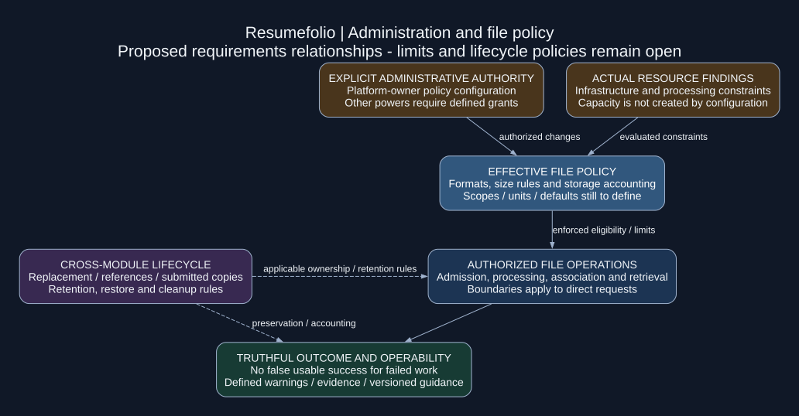
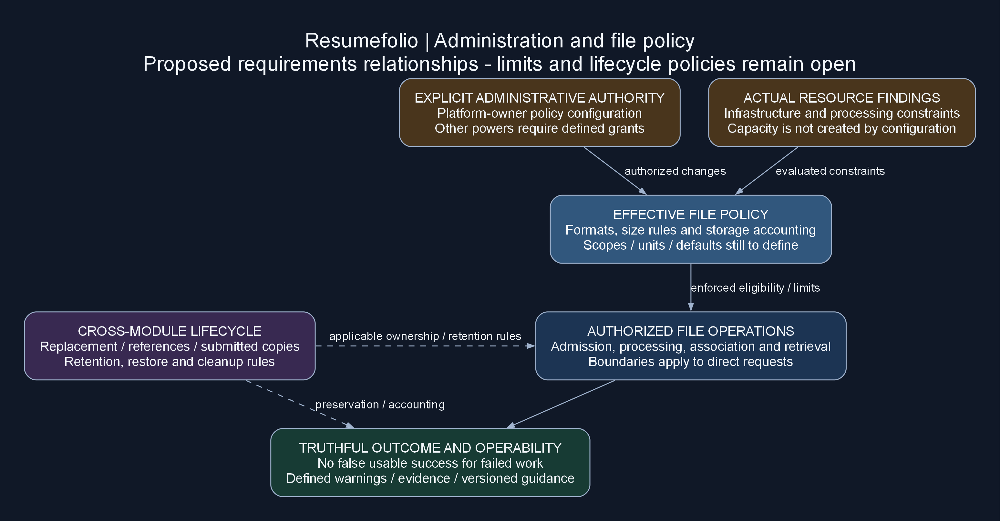
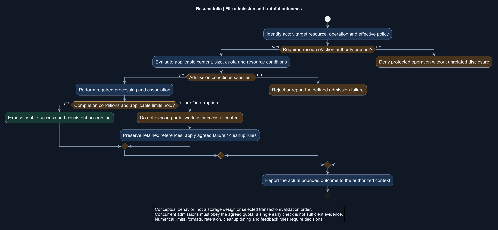
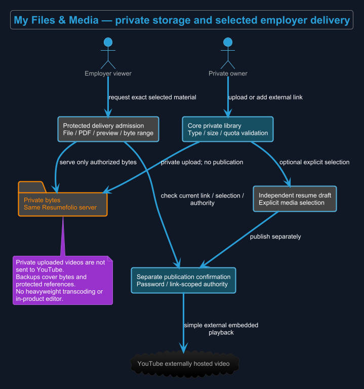

<a id="requirements-specification-administration-files-and-operational-behavior"></a>

<a id="requirements-specification-administration-files-and-operational-behavior--heading-resumefolio--administration-files-and-operational-behavior"></a>
# Resumefolio — Administration, Files and Operational Behavior

**Quick read — Files and operations.** Private file handling, owner-controlled operating policies and bounded storage. Check applicable admission, authorization and recovery criteria before exposing content.

[Selected Policies and Future Proposals](#requirements-specification-administration-files-and-operational-behavior--heading-selected-policies-and-future-proposals) · [3. Proposed Requirements and Acceptance Criteria](#requirements-specification-administration-files-and-operational-behavior--heading-3-proposed-requirements-and-acceptance-criteria) · [7. Open Policy Decisions and Gates](#requirements-specification-administration-files-and-operational-behavior--heading-7-open-policy-decisions-and-gates)

[Domain index](README.md) · [Acceptance trace](../../03-Requirements-Traceability-Matrix/README.md)


**Status.** MVP file and operating policies are selected. Enforcement, capacity and recovery still need evidence.

[Decisions and rationale](#requirements-specification-administration-files-and-operational-behavior--heading-selected-policies-and-future-proposals) · [Requirements](#requirements-specification-administration-files-and-operational-behavior--heading-3-proposed-requirements-and-acceptance-criteria) · [File flow](#requirements-specification-administration-files-and-operational-behavior--heading-4-file-operation-and-failure-flow) · [Verification](#requirements-specification-administration-files-and-operational-behavior--heading-6-scenarios-and-planned-verification)

<a id="requirements-specification-administration-files-and-operational-behavior--heading-mvp-same-server-private-storage"></a>
## MVP same-server private storage

Core stores uploaded files and media privately on the Resumefolio host. Direct file access, previews, thumbnails and byte ranges require current authorization. Independent backups protect recovery.

<a id="requirements-specification-administration-files-and-operational-behavior--heading-selected-policies-and-future-proposals"></a>
## Selected Policies and Future Proposals

<a id="requirements-specification-administration-files-and-operational-behavior--id-resolution-q-d24"></a>

<a id="requirements-specification-administration-files-and-operational-behavior--heading-q-d24-selected-policy"></a>
### Q-D24: Selected policy

- **Decision.** Enforce the selected file types, per-file and aggregate quotas, concurrent reservations and disk reserve. Limit administrative access and audit evidence to their defined purposes.
- **Why.** Concurrent uploads and temporary files can exhaust shared disk space. Reservations protect headroom, while private storage and scoped access protect user content.
- **Evidence.** Verify enforcement and actual host headroom before admitting production data. [Selected file policy](https://github.com/Farhad-V/Web-Resumefolio/blob/1f2acaa351ac306cb57cbe4fe9742e8bd90720d9/docs/MVP/baseline/policy-decisions.md#q-d24)

**Operating decision.** Verify the selected environment, queues, system mail and independent backup on the target host. A file operation needs a dependable way to report completion and recover after interruption. [Operating policy](https://github.com/Farhad-V/Web-Resumefolio/blob/1f2acaa351ac306cb57cbe4fe9742e8bd90720d9/docs/MVP/baseline/policy-decisions.md#q-d27)

<a id="requirements-specification-administration-files-and-operational-behavior--heading-1-scope-sources-and-domain-ownership"></a>
## 1. Scope, Sources and Domain Ownership

| Source | Existing direction | Specification implication |
| --- | --- | --- |
| [DEC-018](https://github.com/Farhad-V/Web-Resumefolio/blob/1f2acaa351ac306cb57cbe4fe9742e8bd90720d9/docs/MVP/SDLC/01-project-planning/02-scope.md#dec-018) | Platform owner can configure upload sizes and storage consumption limits through administration; limits respect actual infrastructure | Policy configuration and enforcement need explicit units, scope and capacity evidence |
| [DEC-026](https://github.com/Farhad-V/Web-Resumefolio/blob/1f2acaa351ac306cb57cbe4fe9742e8bd90720d9/docs/MVP/SDLC/01-project-planning/02-scope.md#dec-026) / [DEC-025](https://github.com/Farhad-V/Web-Resumefolio/blob/1f2acaa351ac306cb57cbe4fe9742e8bd90720d9/docs/MVP/SDLC/01-project-planning/02-scope.md#dec-025) | Support externally created evidence/media/files/diagrams/links and generated/uploaded PDFs | Define supported content and file behavior without introducing an editor or every possible format |
| [DEC-024](https://github.com/Farhad-V/Web-Resumefolio/blob/1f2acaa351ac306cb57cbe4fe9742e8bd90720d9/docs/MVP/SDLC/01-project-planning/02-scope.md#dec-024) / [DEC-028](https://github.com/Farhad-V/Web-Resumefolio/blob/1f2acaa351ac306cb57cbe4fe9742e8bd90720d9/docs/MVP/SDLC/01-project-planning/02-scope.md#dec-028) | Shared/direct file access follows authorization; account/collaboration scope is limited | File operations must use the access rules rather than treating a URL as permission |
| [DEC-023](https://github.com/Farhad-V/Web-Resumefolio/blob/1f2acaa351ac306cb57cbe4fe9742e8bd90720d9/docs/MVP/SDLC/01-project-planning/02-scope.md#dec-023) | Actual submitted resume/cover-letter materials are preserved against later source edits | Replacement and cleanup must respect preserved application-history boundaries |
| [RSK-08 / DEC-067](https://github.com/Farhad-V/Web-Resumefolio/blob/1f2acaa351ac306cb57cbe4fe9742e8bd90720d9/docs/MVP/SDLC/01-project-planning/07-risks.md#dec-067) | Configurable quotas, capacity checks, warnings and interrupted/failed-operation behavior need definition and verification | Define observable enforcement, accurate results and eventual cleanup criteria |
| [RSK-04 / DEC-071](https://github.com/Farhad-V/Web-Resumefolio/blob/1f2acaa351ac306cb57cbe4fe9742e8bd90720d9/docs/MVP/SDLC/01-project-planning/07-risks.md#dec-071), [RSK-05 / DEC-070](https://github.com/Farhad-V/Web-Resumefolio/blob/1f2acaa351ac306cb57cbe4fe9742e8bd90720d9/docs/MVP/SDLC/01-project-planning/07-risks.md#dec-070), [RSK-09 / DEC-066](https://github.com/Farhad-V/Web-Resumefolio/blob/1f2acaa351ac306cb57cbe4fe9742e8bd90720d9/docs/MVP/SDLC/01-project-planning/07-risks.md#dec-066) | Authorization, recoverability and cross-module lifecycle risks remain open | Review allowed/denied and data-consistency/failure scenarios with actual evidence later |
| [DEC-017](https://github.com/Farhad-V/Web-Resumefolio/blob/1f2acaa351ac306cb57cbe4fe9742e8bd90720d9/docs/MVP/SDLC/01-project-planning/02-scope.md#dec-017) and [Deliverables](../../../01-Project-Planning/02-Project-Management-Plan.md#deliverables-and-control) | Setup/maintenance guidance, backup procedures, demonstrated restoration and identified verification evidence | Operational readiness needs produced guidance and actual candidate/environment evidence |

This file owns shared administrative file-policy and operational expectations.
[Accounts/Permissions](01-Accounts-Authentication-And-Permissions.md#requirements-specification-accounts-authentication-and-permissions) owns role/action
authorization. [PDF/Sharing](11-Pdf-And-Controlled-Sharing.md#requirements-specification-pdf-and-controlled-sharing) owns download/language
and protected-view behavior. [Business Rules/Lifecycle](04-Business-Rules-And-Data-Lifecycle.md#requirements-specification-business-rules-and-data-lifecycle)
owns cross-module retention/deletion rules; [Quality/Security/Recovery](14-Quality-Security-And-Recovery-Requirements.md#requirements-specification-quality-security-and-recovery-requirements)
owns measurable quality and recovery targets. Link shared requirements rather
than defining contradictory policies in each domain.

Real Git storage, workflow outputs and provider email attachments are not assumed
to use exactly the same admission rules or accounting pool as resume media. Their
applicability and boundaries need explicit decisions with the relevant domains.

<a id="requirements-specification-administration-files-and-operational-behavior--heading-2-administration-and-policy-model"></a>
## 2. Administration and Policy Model



[Scalable SVG](../../Diagrams/Administration-Files-Policy-Map.svg) ·
[Editable Graphviz](../../Diagrams/Administration-Files-Policy-Map.dot)

Amber identifies administrative/capacity decisions; blue identifies policy and
file operations; purple identifies cross-module lifecycle; green identifies
truthful operational outcomes. Arrows show requirements relationships, not a
physical storage architecture, deployed service or unlimited administrative power.

| Policy aspect | Meaning to define |
| --- | --- |
| Administrative scope | Who can inspect/change each setting or perform a sensitive operation on which target |
| Upload limit | Maximum admitted size with an explicit unit, comparison rule and applicable content/path scope |
| Storage quota | Consumption allowance with explicit accounting subjects, units and success/deletion/replacement effects |
| Format/content policy | Supported content categories, validation, processing/display behavior and rejection criteria |
| Infrastructure envelope | Actual lower-level limits, available capacity and processing constraints supported by evidence |
| Policy change | Effective point, concurrent/in-progress operations, existing over-quota content and clear result |
| Operational feedback | Who may see which operation status, failures, consumption or warnings, without secrets/unrelated content |

Configure policy through the agreed administrative interface; no code edits should
be required for the policy values covered by DEC-018. Configuration does not create
physical capacity. [Q-D24](../07-Change-And-Baseline/03-Requirements-Questions-And-Decisions.md#change-and-baseline-open-questions-and-decisions--id-q-d24) records the selected policy and limits; verify enforcement and actual capacity before admitting production data.

<a id="requirements-specification-administration-files-and-operational-behavior--heading-3-proposed-requirements-and-acceptance-criteria"></a>
## 3. Proposed Requirements and Acceptance Criteria

<a id="requirements-specification-administration-files-and-operational-behavior--heading-shared-record-metadata"></a>
### Shared record metadata

Farhad owns these records. Read their retained IDs and original criteria using the [current record rules](15-Requirement-Priority-And-Readiness.md#current-record-rules). Only the selected MVP criteria are current delivery obligations. Planned checks do not establish executed results or personal owner acceptance.

- **Policy and capacity:** [AFO-D01](#requirements-specification-administration-files-and-operational-behavior--heading-afo-d01-owner-configurable-upload-and-storage-policy), [AFO-D02](#requirements-specification-administration-files-and-operational-behavior--heading-afo-d02-policy-consistent-with-evaluated-infrastructure), [AFO-D03](#requirements-specification-administration-files-and-operational-behavior--heading-afo-d03-per-file-admission-limit), [AFO-D04](#requirements-specification-administration-files-and-operational-behavior--heading-afo-d04-aggregate-quota-and-concurrent-admission)
- **Admission, access and file lifecycle:** [AFO-D05](#requirements-specification-administration-files-and-operational-behavior--heading-afo-d05-supported-content-and-validation), [AFO-D06](#requirements-specification-administration-files-and-operational-behavior--heading-afo-d06-file-resource-authorization-and-isolation), [AFO-D07](#requirements-specification-administration-files-and-operational-behavior--heading-afo-d07-truthful-completion-and-interrupted-operation-handling), [AFO-D08](#requirements-specification-administration-files-and-operational-behavior--heading-afo-d08-safe-replacement-and-lifecycle-effects)
- **Operations and recovery:** [AFO-D09](#requirements-specification-administration-files-and-operational-behavior--heading-afo-d09-operational-outcomes-and-capacity-warnings), [AFO-D10](#requirements-specification-administration-files-and-operational-behavior--heading-afo-d10-administrative-operation-evidence), [AFO-D11](#requirements-specification-administration-files-and-operational-behavior--heading-afo-d11-bounded-cleanup-and-storage-reclamation), [AFO-D12](#requirements-specification-administration-files-and-operational-behavior--heading-afo-d12-version-specific-operational-guidance-and-readiness)

<a id="requirements-specification-administration-files-and-operational-behavior--heading-afo-d01-owner-configurable-upload-and-storage-policy"></a>
### AFO-D01: Owner-configurable Upload and Storage Policy

- **Release allocation (owner decision, November 4):** MVP foundation where used by core/basic ProjectForge; future-domain clauses deferred.

- **Source / rationale:** DEC-018; adapt policy without changing application code.
- **Actor / conditions:** Platform-owner context with the configuration authority
  defined in the accounts/permissions domain.

- **Proposed obligation:** The product shall let the authorized platform owner
  inspect and change the defined upload-size and storage-consumption policy values
  through administration, within their agreed valid ranges and resource constraints.

- **Acceptance criteria**
  - An authorized configuration change can be made without editing source code; the resulting effective policy values are identifiable through the agreed administration view.
  - A caller lacking the applicable administrative grant cannot change those values through UI or direct requests.
  - An invalid value is not silently reported as successfully active; the previous effective policy or explicit failed/unapplied state remains identifiable.

- **Planned verification:** Configuration and denied-request integration/browser
  cases. **Open detail:** Valid units/ranges, quota scopes, feedback and effective point.

<a id="requirements-specification-administration-files-and-operational-behavior--heading-afo-d02-policy-consistent-with-evaluated-infrastructure"></a>
### AFO-D02: Policy Consistent with Evaluated Infrastructure

- **Release allocation (owner decision, November 4):** MVP foundation where used by core/basic ProjectForge; future-domain clauses deferred.

- **Source / rationale:** DEC-018; ASM-01/DEP-01 and RSK-08. Avoid treating configurable
  limits as evidence of unlimited capacity.

- **Proposed obligation:** The product's effective file policy shall respect the
  agreed deployment constraints; an administrator's configured value shall not
  bypass an applicable lower-level admission or resource constraint.

- **Acceptance criteria**
  - Given a request exceeds an applicable lower-level constraint, increasing the application setting does not make the request falsely succeed.
  - Where the administrative design validates policy against a defined supported envelope, an incompatible setting is rejected or explicitly identified as unapplied rather than silently accepted as effective.
  - The configuration guide identifies applicable external limits and the scope of actual verification.

- **Planned verification:** Inspect actual environment/configuration constraints and
  perform bounded limit cases. **Acceptance blocker:** Infrastructure findings and
  supported-envelope behavior must be defined. No automatic capacity controller or
  margin is mandated here.

<a id="requirements-specification-administration-files-and-operational-behavior--heading-afo-d03-per-file-admission-limit"></a>
### AFO-D03: Per-file Admission Limit

- **Release allocation (owner decision, November 4):** MVP foundation where used by core/basic ProjectForge; future-domain clauses deferred.

- **Source / rationale:** DEC-018 and RSK-08; enforce configured size policy.
- **Actor / conditions:** Authorized user submits a file on a path covered by the policy.

- **Proposed obligation:** The product shall evaluate the actual admitted file size
  against the applicable upload limit and shall not make a rejected oversized file
  available as successfully stored content.

- **Acceptance criteria**
  - With agreed unit and inclusive/exclusive boundary semantics, a file exceeding the applicable limit is rejected without becoming usable successful content.
  - Boundary cases just below, at and above the limit match that agreed policy when other eligibility conditions are satisfied.
  - Supplying inaccurate client size metadata alone cannot bypass the size rule.

- **Planned verification:** Controlled boundary uploads and manipulated metadata.
- **Open detail:** Units, boundary semantics, empty files, transport failures and path applicability.

<a id="requirements-specification-administration-files-and-operational-behavior--heading-afo-d04-aggregate-quota-and-concurrent-admission"></a>
### AFO-D04: Aggregate Quota and Concurrent Admission

- **Release allocation (owner decision, November 4):** MVP foundation where used by core/basic ProjectForge; future-domain clauses deferred.

- **Source / rationale:** DEC-018; proposed RSK-08 enforcement refinement.
- **Actor / conditions:** File operations consume storage in an agreed quota scope.

- **Proposed obligation:** The product shall enforce the applicable aggregate quota
  using its agreed accounting rules, including overlapping admissions, rather than
  allowing each operation to ignore consumption committed by other successful operations.

- **Acceptance criteria**
  - An admission that exceeds the available allowance under the agreed accounting rule is not reported as successful usable content.
  - Concurrent controlled requests that individually appear to fit but jointly exceed that allowance cannot all succeed in violation of the defined quota.
  - Accounted usage after successful/failed operations matches the agreed inclusion and release rules; failed work is not silently counted as permanent successful content.

- **Planned verification:** Bounded concurrent admissions, usage comparison and failed
  operation cases. **Acceptance blocker:** Counted subjects, units, reservation/release
  semantics and existing over-quota behavior need decisions. No transaction/storage
  mechanism is selected.

<a id="requirements-specification-administration-files-and-operational-behavior--heading-afo-d05-supported-content-and-validation"></a>
### AFO-D05: Supported Content and Validation

- **Release allocation (owner decision, November 4):** MVP foundation where used by core/basic ProjectForge; future-domain clauses deferred.

- **Source / rationale:** DEC-026/DEC-025 with RSK-08/RSK-04; accept intended material
  without assuming every extension or file is safe/supported.

- **Proposed obligation:** The product shall validate submitted content against the
  agreed supported-format and content policy before making it available in its
  intended usable state.

- **Acceptance criteria**
  - Content that fails a required validation is not presented as valid usable evidence/PDF merely because its filename or declared type looks acceptable.
  - Agreed supported samples can complete the intended upload/processing/display path when access and resource conditions are met.
  - Rejection or processing failure has an identifiable result; no false successful preview/download is shown.

- **Planned verification:** Supported/unsupported/mismatched/invalid controlled
  samples. **Open detail:** Format list, validation depth, active content, rendering,
  malware-analysis needs and safe serving require security/design review; no scanner
  or processing technology is selected.

<a id="requirements-specification-administration-files-and-operational-behavior--heading-afo-d06-file-resource-authorization-and-isolation"></a>
### AFO-D06: File-resource Authorization and Isolation

- **Owner-scope acceptance additions (MVP; planned, not executed):**

  - Private upload bytes are stored outside publicly served directories on the same core server and are delivered only through current owner or protected selected-resume authorization.
  - Type/size/quota checks and safe serving also apply to media; recoverable backup coverage includes private bytes and their protected references.

- **Release allocation (owner decision, November 4):** MVP foundation where used by core/basic ProjectForge; future-domain clauses deferred.

- **Source / rationale:** DEC-024/DEC-025/DEC-028 and RSK-04; keep file access within
  the same boundary as its intended resource context.

- **Proposed obligation:** File upload, retrieval, association, replacement and
  removal shall enforce the applicable resource/action authority, including direct
  requests and altered resource references.

- **Acceptance criteria**
  - A caller lacking an action grant cannot modify another user's protected file/association through a direct request.
  - Direct protected retrieval does not disclose file/PDF contents without the applicable authorization and sharing availability.
  - A legitimate shared or collaboration context grants no unrelated file access merely because identifiers/paths are supplied.

- **Planned verification:** Allowed/denied file actions, cross-user identifiers and
  direct requests. **Dependencies:** ACC-D03–ACC-D10 in
  [Accounts/Permissions](01-Accounts-Authentication-And-Permissions.md#requirements-specification-accounts-authentication-and-permissions), shared download
  rules and final action/state matrix; these are cross-references, not accepted controls.

<a id="requirements-specification-administration-files-and-operational-behavior--heading-afo-d07-truthful-completion-and-interrupted-operation-handling"></a>
### AFO-D07: Truthful Completion and Interrupted-operation Handling

- **Release allocation (owner decision, November 4):** MVP foundation where used by core/basic ProjectForge; future-domain clauses deferred.

- **Source / rationale:** RSK-08/DEC-067; failed work must not be mistaken for complete storage.

- **Proposed obligation:** The product shall report a file operation as successfully
  usable only after its required admission, processing and association conditions
  have completed; interruption/failure shall retain an outcome distinguishable from success.

- **Acceptance criteria**
  - Interrupted upload or required processing failure does not leave the file presented as complete usable content.
  - A completed operation exposes only the content/result associated with its successful request and allowed resource context.
  - Failure handling does not silently damage unrelated existing content or release quota still needed by retained material.

- **Planned verification:** Controlled interruptions/failures and content/accounting
  comparison. **Open detail:** Retry behavior, intermediate states, timeout, recovery,
  cleanup and same-request repetition semantics require specification.

<a id="requirements-specification-administration-files-and-operational-behavior--heading-afo-d08-safe-replacement-and-lifecycle-effects"></a>
### AFO-D08: Safe Replacement and Lifecycle Effects

- **Release allocation (owner decision, November 4):** MVP foundation where used by core/basic ProjectForge; future-domain clauses deferred.

- **Source / rationale:** DEC-023 and RSK-09; preserve submitted history and avoid
  unintended cross-module file changes.

- **Proposed obligation:** Replacement/removal of source files or associations shall
  follow explicit ownership and lifecycle rules and shall not overwrite preserved
  submitted resume/cover-letter copies through a later source edit.

- **Acceptance criteria**
  - After replacing editable source content, preserved material captured as actually submitted remains unchanged by that replacement.
  - A replacement that fails before its required completion does not falsely report the new content as successfully available.
  - Removing one association does not silently remove unrelated content or retained references contrary to the agreed lifecycle rules.

- **Planned verification:** Source replacement, preserved-copy comparison and shared
  reference/failure scenarios. **Acceptance blockers:** Delete/restore behavior,
  reference ownership, existing-file handling during failed replacement and physical
  retention/reclamation policy need explicit decisions.

<a id="requirements-specification-administration-files-and-operational-behavior--heading-afo-d09-operational-outcomes-and-capacity-warnings"></a>
### AFO-D09: Operational Outcomes and Capacity Warnings

- **Release allocation (owner decision, November 4):** MVP foundation where used by core/basic ProjectForge; future-domain clauses deferred.

- **Source / rationale:** Original operational-visibility topic, RSK-08/DEC-067 and
  operational readiness; proposed detail for feasible solo administration.

- **Proposed obligation:** Authorized users/operators shall be able to identify the
  outcome of relevant file/policy operations and applicable capacity/quota warnings
  through the agreed feedback mechanisms without exposure of unrelated private data.

- **Acceptance criteria**
  - Successful, failed and still-incomplete operations are distinguishable in the agreed relevant view/feedback.
  - Once warning conditions and timing are defined, controlled threshold scenarios produce the specified warning to the authorized recipient.
  - A normal user cannot obtain unrelated users' private file content or secret operational configuration through failure/warning details.

- **Planned verification:** Operation-state and threshold/failure feedback cases after
  policy completion. **Open detail:** Thresholds, measurement freshness, recipients,
  channels and frequency. No external monitoring service, dashboard purchase or
  unattended job is configured by this requirement draft.

<a id="requirements-specification-administration-files-and-operational-behavior--heading-afo-d10-administrative-operation-evidence"></a>
### AFO-D10: Administrative Operation Evidence

- **Release allocation (owner decision, November 4):** MVP foundation where used by core/basic ProjectForge; future-domain clauses deferred.

- **Source / rationale:** Proposed refinement of authorized administration/operational
  visibility; supports investigating sensitive changes under RSK-04/RSK-09.

- **Proposed obligation:** For the administrative operations selected by the agreed
  audit policy, the product shall retain the specified actor, target, time and
  outcome information and restrict access to that evidence according to explicit rules.

- **Acceptance criteria**
  - Once audited events/fields are defined, controlled selected operations produce records consistent with their actual actor/target/outcome.
  - Callers lacking audit-view/change authority cannot retrieve or modify protected audit evidence through a direct request.
  - Ordinary audit/output records do not disclose passwords, private keys, access tokens or authentication codes.

- **Planned verification:** Selected event/permission cases and sanitized-record
  inspection. **Acceptance blockers:** Event list, success/failure coverage, integrity,
  visibility/mutation, retention and time semantics. This proposal does not invent an
  immutable log or a retention duration.

<a id="requirements-specification-administration-files-and-operational-behavior--heading-afo-d11-bounded-cleanup-and-storage-reclamation"></a>
### AFO-D11: Bounded Cleanup and Storage Reclamation

- **Release allocation (owner decision, November 4):** MVP foundation where used by core/basic ProjectForge; future-domain clauses deferred.

- **Source / rationale:** Proposed RSK-08/RSK-09/RSK-05 refinement; cleanup must be
  deliberate and preserve required data.

- **Proposed obligation:** Temporary, failed, replaced or retired material shall be
  reclaimed only under the agreed eligibility/reference/retention rules, with
  accounting updated consistently and protected retained data preserved.

- **Acceptance criteria**
  - Controlled eligible cleanup candidates are reclaimed under the selected procedure and release only the usage defined by the accounting policy.
  - Material still required by another valid reference or preserved submission is not removed merely because a source operation failed or a source association changed.
  - Partial cleanup failure remains identifiable and does not falsely report complete reclamation or remove unrelated protected material.

- **Planned verification:** Safe isolated eligible/ineligible/reference cases and
  controlled failures. **Acceptance blockers:** Eligibility, timing, deleted-content
  retention, recovery expectations and manual/automatic procedure need decisions.
  No deletion, cleanup schedule or production operation is authorized by this draft.

<a id="requirements-specification-administration-files-and-operational-behavior--heading-afo-d12-version-specific-operational-guidance-and-readiness"></a>
### AFO-D12: Version-specific Operational Guidance and Readiness

- **Release allocation (owner decision, November 4):** MVP foundation where used by core/basic ProjectForge; future-domain clauses deferred.

- **Source / rationale:** DEC-017 and DEL-06/DEL-07/DEL-10; delivery needs operable,
  reviewable procedures and actual evidence.

- **Proposed obligation:** The delivery package shall provide version/environment-specific
  guidance for effective file-policy constraints, required processes, failure handling,
  updates and backup/recovery coverage, with actual checks and limitations recorded
  before the affected readiness outcome is accepted.

- **Acceptance criteria**
  - Guidance identifies the application/configuration/environment it describes, relevant dependencies and responsibility without secrets.
  - Unperformed procedure checks are identified as such; no successful recovery is inferred from backup-file existence.
  - Before relevant release/readiness acceptance, actual restoration/integrity evidence and remaining blockers are linked as required by the existing milestone/deliverable criteria.

- **Planned verification:** Inspect guidance, execute appropriate procedures later in
  authorized target/isolated environments and inspect evidence. **Dependencies:**
  Recovery coverage/targets, resource findings, actual deployment and maintenance
  design; this documentation requirement is not proof the procedures have run.

<a id="requirements-specification-administration-files-and-operational-behavior--heading-4-file-operation-and-failure-flow"></a>
## 4. File Operation and Failure Flow


[Scalable SVG](../../Diagrams/Administration-File-Admission-Flow.svg) ·
[Editable PlantUML](../../Diagrams/Administration-File-Admission-Flow.puml)

This is a conceptual requirements flow. Validation order, concurrency controls,
intermediate state handling and storage implementation are design decisions.
Recheck whichever conditions must hold at completion; the diagram does not imply
one early quota check is sufficient for concurrent admissions.

If access, validation, quota/capacity or processing fails, do not expose partial
content as successful or silently remove existing referenced data. Define whether
the user may retry, what remains visible and how temporary state/accounting is
handled. Product feedback must describe the actual bounded outcome without
leaking secrets or unrelated content.

<a id="requirements-specification-administration-files-and-operational-behavior--heading-5-cross-module-lifecycle-and-accounting"></a>
## 5. Cross-module Lifecycle and Accounting

| Subject / event | Relationship to resolve | Preserve |
| --- | --- | --- |
| Evidence media/file | Owner, skill/project association and per-resume selection | Resource authorization and independence of unrelated content |
| Generated/uploaded PDF | Represented revision, language, download availability and replacement | Explicit PDF/sharing rules and authorized direct retrieval |
| Submitted materials | Capture, retained artifact references and deletion/restoration authority | Later source edits must not overwrite actual submitted copies |
| Provider attachment/import | Provider/local authority, association and disconnection | No silent provider deletion or retention policy inferred from local file rules |
| Git repositories/releases | Quota pool, object/assets accounting and repository visibility | Real Git/lifecycle rules; do not assume a media-upload limit applies identically |
| Workflow logs/artifacts | Run authority, secret protection, retention and failed-run cleanup | Execution isolation and explicit output access policy |
| Deleted/replaced/temporary content | Logical eligibility versus physical retention/reclamation and restored access | Agreed retention/reference/recovery behavior; no invented cascade or automatic reactivation |
| Backup/restoration | Coverage across database, files, repositories and required configuration/keys | Consistency/integrity and appropriate restored access, demonstrated later |

The [dictionary](../05-Data-Definitions/02-Data-Dictionary.md#data-definitions-data-dictionary) provides conceptual
subjects. Required/optional metadata, file naming/display, time semantics, units,
retained versions and source-of-truth rules remain to be refined. This draft does
not define database tables, object-store paths or filesystem permissions.

<a id="requirements-specification-administration-files-and-operational-behavior--heading-6-scenarios-and-planned-verification"></a>
## 6. Scenarios and Planned Verification

The coverage below is a plan, not executed tests or allocated scenario IDs. Use
controlled data and authorized environments; interruption/cleanup/recovery checks
must protect existing services and production information.

| Scenario group | Candidate references | Paths to develop |
| --- | --- | --- |
| Policy configuration | AFO-D01/D02 | Authorized/unauthorized edits, invalid settings, lower-level constraint and effective-value feedback |
| Admission boundaries | AFO-D03/D05 | Agreed below/at/above limit, inaccurate metadata, supported/unsupported/mismatched content |
| Aggregate usage | AFO-D04 | Scope accounting, concurrent admissions, failed work, retained versions and release rules |
| Protected operations | AFO-D06 | Cross-user direct requests, allowed/denied actions, shared content and unrelated references |
| Failure/replacement | AFO-D07/D08 | Interrupted transfer/processing, failed replacement, preserved submitted material and valid shared references |
| Operational visibility | AFO-D09/D10 | Defined outcome/warning/audit events, authorized viewing and secret-safe feedback |
| Cleanup/readiness | AFO-D11/D12 | Eligible/ineligible reclamation, partial failure, accurate accounting and version-specific guide/recovery evidence |

Each later run identifies candidate/environment, effective policy, relevant
actor/grants, workload/data, expected/actual results and limits. A successful
single upload does not prove quota enforcement, safe serving, concurrency,
resource capacity or recoverability.

<a id="requirements-specification-administration-files-and-operational-behavior--heading-7-open-policy-decisions-and-gates"></a>
## 7. Open Policy Decisions and Gates

These are local question topics, not claimed entries/decisions in the shared
register. Farhad coordinates them; link real question/decision IDs when recorded.

| Topic | Decisions / evidence needed | Dependent gate |
| --- | --- | --- |
| Administrative powers | Exact view/change/delete/restore/cleanup/audit authority; sensitive checks and reasons | Affected account/administration requirement acceptance |
| File categories and validation | Supported formats, content inspection, serving/rendering, metadata and failure behavior | AFO-D05/D06 and domain requirements/security design |
| Units and limits | Size boundary/unit semantics, numerical defaults, valid ranges, per-user/project/global scopes and path applicability | AFO-D01–D04; M-02 criteria and actual M-03 resource findings |
| Accounting and concurrent work | Originals/generated copies/archives/trash/Git/outputs/imports, quota reservations/releases and partially completed work | AFO-D04/D07/D11 acceptance and dependent storage/concurrency design |
| Policy-change effect | Existing over-quota content, active uploads/jobs and effective point; no silent destructive reduction | AFO-D01/D02/D04 and lifecycle requirements |
| Retention, replacement and cleanup | Eligibility, reference checks, capture/archive rules, retention durations, restoration and reclamation schedule/procedure | AFO-D08/D11 and business-lifecycle/recovery requirements |
| Operational visibility/audit | Views/recipients/channels, warning thresholds/freshness, audited events, integrity/privacy and retention | AFO-D09/D10; administration/quality requirements |
| Resource/processing feasibility | Actual storage/free capacity, competing services, processing demand and safe limits | ASM-01/DEP-01/GAP-D01/D10; before dependent M-03 design and later verification |
| Recovery/maintenance | Independent backup coverage/storage, actual procedures, RPO/RTO, update recovery and solo workload | ASM-04/DEP-05/GAP-D04/D08; design gates and actual restoration before M-09 |

Use [Open Questions](../07-Change-And-Baseline/03-Requirements-Questions-And-Decisions.md#change-and-baseline-open-questions-and-decisions),
[Change Control](../07-Change-And-Baseline/02-Requirements-Change-Control.md#change-and-baseline-change-control) and the
[feasibility plan](../01-Process-And-Approach/01-Feasibility-Study.md#process-and-approach-02-feasibility-study). A proposed
threshold or retention value remains unaccepted until its source, rationale and
actual decision are recorded. No paid storage, extra server or cleanup automation
is assumed or purchased by this document.

<a id="requirements-specification-administration-files-and-operational-behavior--heading-8-traceability-and-review-readiness"></a>
## 8. Traceability and Review Readiness

| Group | Source basis | Related records |
| --- | --- | --- |
| AFO-D01–D05 | DEC-018, DEC-026/DEC-025, RSK-08 and ASM-01/DEP-01 | Administration/file-policy dictionary, media/PDF domains, resource findings and later enforcement checks |
| AFO-D06–D08 | DEC-024/DEC-028/DEC-023, RSK-04/RSK-09 | Account/permission drafts, sharing, application history and lifecycle scenarios |
| AFO-D09–D11 | Proposed operational/audit/cleanup refinements from RSK-08/RSK-04/RSK-09/RSK-05 | Quality/security, explicit administrative powers, output/retention rules and isolated checks |
| AFO-D12 | DEC-017, deliverables and M-03/M-09/M-10 outcome criteria | Actual guides, deployment/recovery design and later evidence |

Maintain actual allocated records and artifact links in
[Traceability](../06-Validation-And-Traceability/07-Validation-And-Traceability.md#validation-and-traceability-validation-and-traceability--heading-traceability).
Use [Review Findings](../06-Validation-And-Traceability/07-Validation-And-Traceability.md#validation-and-traceability-validation-and-traceability--heading-review-findings)
for real inspections, dispositions and rechecks; no product checks are recorded here.

- [ ] Reconcile provisional AFO-D references with the final identifier convention.
- [ ] Review source-derived boundaries separately from proposed detailed operational/audit refinements.
- [ ] Resolve critical units, quota/validation, permissions and lifecycle policies before affected acceptance.
- [ ] Ensure criteria have defined conditions and planned methods; conditional criteria are not ready until the referenced policies are decided.
- [ ] Check account, PDF/media, submitted materials, provider/Git/CI, quality and recovery rules agree.
- [ ] Record actual decisions, reviewed revision, evidence and remaining blockers without inventing Pass results.

**Current outcome:** Proposed product draft. No AFO-D candidate is accepted and
no numerical capacity, retention, administrator grant, operational automation or
recovery result is established. M-02 and the wider pre-implementation agreement
remain pending.

**Revision note — October 31, 2026:** Replaced the generic scaffold with twelve
provisional requirements, criteria, methods, policy/lifecycle questions and source
mapping. Added policy/context and file-admission diagrams. Existing scope and
planning acceptance remain unchanged; no actual file, server or account operation
is performed by this documentation revision.

<a id="requirements-specification-administration-files-and-operational-behavior--heading-9-diagram-maintenance"></a>
<details>
<summary>Supporting reference: 9. Diagram Maintenance</summary>

## 9. Diagram Maintenance

| Diagram | Editable source | Scalable view | Preview |
| --- | --- | --- | --- |
| Administration/file-policy relationships | [Graphviz](../../Diagrams/Administration-Files-Policy-Map.dot) | [SVG](../../Diagrams/Administration-Files-Policy-Map.svg) |  |
| File admission and failure flow | [PlantUML](../../Diagrams/Administration-File-Admission-Flow.puml) | [SVG](../../Diagrams/Administration-File-Admission-Flow.svg) |  |

Keep text, captions, sources and renders synchronized. Colors supplement labels.
Inspect readable arrows/labels and verify file/section links after edits. Run from
the repository root:

```powershell
$diagramFolder = 'docs\MVP\SDLC\02-requirements-engineering\diagrams'
$graphvizExe = 'C:\Program Files\Graphviz\bin\dot.exe'
$plantUmlJar = 'C:\Users\fvali\AppData\Local\Resumefolio\DiagramTools\plantuml.jar'
foreach ($format in 'svg', 'png') {
    & $graphvizExe "-T$format" -Gdpi=140 `
        "$diagramFolder\administration-files-policy-map.dot" `
        -o "$diagramFolder\administration-files-policy-map.$format"
    if ($LASTEXITCODE -ne 0) { throw "Graphviz failed: $format" }
    java '-Djava.awt.headless=true' -jar $plantUmlJar -charset UTF-8 "-t$format" `
        "$diagramFolder\administration-file-admission-flow.puml"
    if ($LASTEXITCODE -ne 0) { throw "PlantUML failed: $format" }
}
```

Save as UTF-8 without BOM. Under another account, use the actual installed JAR path.
Retain source and SVG/PNG outputs in version control.

[Specification index](16-Requirements-Specification-Guide.md#requirements-specification-requirements-specification-overview) · [SRS entry point](17-Software-Requirements-Specification.md#requirements-specification-requirements-specification)
· [Requirements index]()

</details>


<a id="requirements-specification-administration-files-and-operational-behavior--heading-mvp-private-media-flow"></a>
## MVP private-media flow


[Editable source](../../../04-System-Design/01-High-Level-Design/14-Appendices.md#design-record-01-software-architecture-diagrams-mvp-private-media-puml) · .
