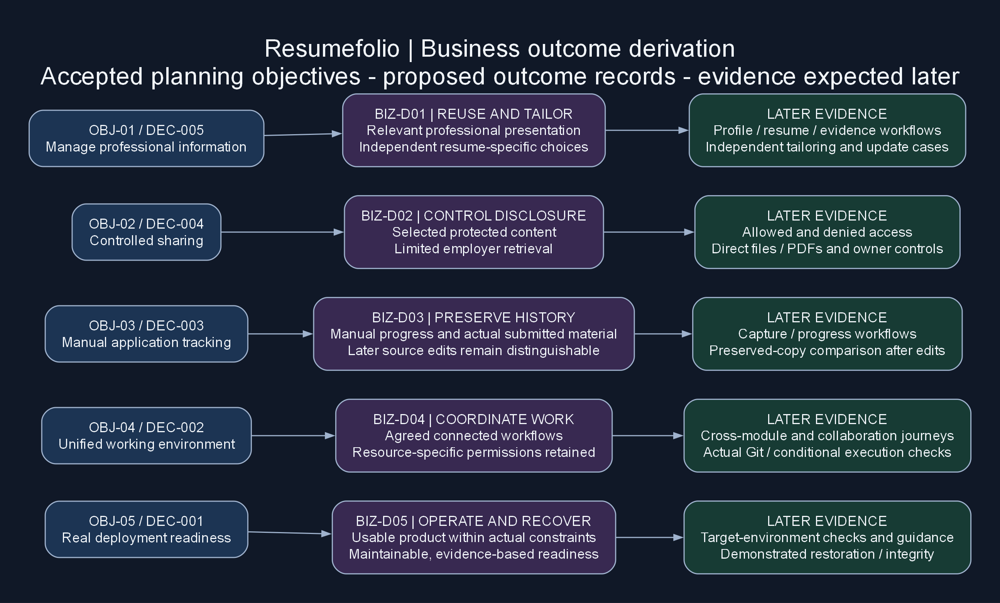
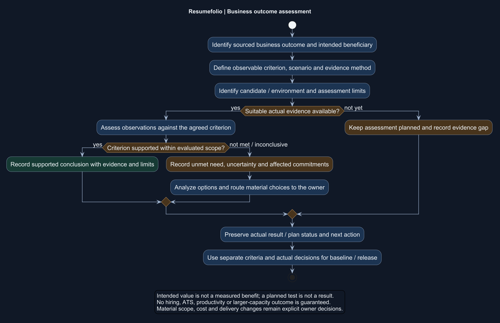

<a id="requirements-specification-business-requirements"></a>

<a id="requirements-specification-business-requirements--heading-resumefolio--business-requirements"></a>
# Resumefolio — Business Requirements

Current implementation choices and scope: [Baseline](https://github.com/Farhad-V/Web-Resumefolio/blob/1f2acaa351ac306cb57cbe4fe9742e8bd90720d9/docs/MVP/baseline/README.md). Runtime verification remains subject to its gates.

| Item | Current position |
| --- | --- |
| Purpose | Express the business outcomes and value expected from the accepted product direction |
| Responsible person / business decision-maker | Farhad; sole delivery and operations owner |
| Document status | Current MVP applicability follows the Baseline; future clauses remain proposals |
| Source authority | Owner scope plus selected Baseline policies; original sources retained below |
| Draft references | BIZ-D01–BIZ-D05 are provisional document-local references, not final BIZ identifier allocation |
| Evidence position | Intended outcomes and proposed assessment criteria; no measured benefit or delivery success is claimed |
| Revision | October 31, 2026 |

**At a glance:** Resumefolio should help users reuse professional information,
prepare relevant presentations, control disclosure, preserve application history
and coordinate related work in an operable product. The outcomes below derive
from accepted planning direction. User, functional, quality and interface
requirements explain how those outcomes become observable product behavior.

**Read this document for:** why the product is needed, what value it should
provide and what evidence would support its business outcomes. The
[Purpose and Objectives](../../../01-Project-Planning/01-Project-Charter.md#purpose-and-success)
document remains authoritative for the original problem, value and accepted
objective decisions; this document derives requirements without replacing them.

[Basis](#requirements-specification-business-requirements--heading-1-business-context-and-source-authority) · [Outcomes](#requirements-specification-business-requirements--heading-2-proposed-business-requirements)
· [Assessment](#requirements-specification-business-requirements--heading-3-success-measures-and-evidence-plan) · [Scope](#requirements-specification-business-requirements--heading-4-outcome-to-scope-and-requirement-links)
· [Constraints](#requirements-specification-business-requirements--heading-5-business-constraints-dependencies-and-open-decisions) · [Review](#requirements-specification-business-requirements--heading-6-review-and-current-position)
· [Diagrams](#requirements-specification-business-requirements--heading-7-diagram-maintenance)

<a id="requirements-specification-business-requirements--heading-1-business-context-and-source-authority"></a>
## 1. Business Context and Source Authority

Professional information, application materials, repositories, communication,
schedules and tasks are fragmented across tools and documents. Accepted planning
identifies repeated entry, inconsistent versions, opportunity-specific preparation
and follow-up gaps as problems to address. These are planning statements, not
measured research findings about all users.

| Source | Business meaning retained |
| --- | --- |
| [DEC-008 / purpose](https://github.com/Farhad-V/Web-Resumefolio/blob/1f2acaa351ac306cb57cbe4fe9742e8bd90720d9/docs/MVP/SDLC/01-project-planning/01-purpose-and-objectives.md#dec-008) | Build a unified product for reusable professional information, targeted presentation, evidence and controlled sharing for real daily use |
| [DEC-007 / problem](https://github.com/Farhad-V/Web-Resumefolio/blob/1f2acaa351ac306cb57cbe4fe9742e8bd90720d9/docs/MVP/SDLC/01-project-planning/01-purpose-and-objectives.md#dec-007) | Address fragmented information, deliberate application preparation and traceable follow-up |
| [DEC-006 / value](https://github.com/Farhad-V/Web-Resumefolio/blob/1f2acaa351ac306cb57cbe4fe9742e8bd90720d9/docs/MVP/SDLC/01-project-planning/01-purpose-and-objectives.md#dec-006) | Reuse information, tailor materials, control presentation/access, preserve history and coordinate related work |
| [OBJ-01–OBJ-05](https://github.com/Farhad-V/Web-Resumefolio/blob/1f2acaa351ac306cb57cbe4fe9742e8bd90720d9/docs/MVP/SDLC/01-project-planning/01-purpose-and-objectives.md#4-objectives-and-success-criteria) | Five accepted outcome directions and planning-level success criteria |
| [Version 1 Scope](../../../01-Project-Planning/01-Project-Charter.md#mvp-scope) | Exact inclusions, exclusions and conditional commitments; reference features are not automatically included |
| [Stakeholders](../../../01-Project-Planning/01-Project-Charter.md#responsibilities) | Product stakeholder interests distinct from the current solo delivery arrangement |

Business requirements describe desired results and constraints. They are distinct
from user goals, button behavior, database structures, code tasks or a technology
shopping list. A business outcome may depend on several modules and multiple
quality/access rules; a business requirement does not select their implementation.

<a id="requirements-specification-business-requirements--heading-2-proposed-business-requirements"></a>
## 2. Proposed Business Requirements



[Scalable SVG](../../Diagrams/Business-Outcomes-Map.svg) ·
[Editable Graphviz](../../Diagrams/Business-Outcomes-Map.dot)

Blue identifies accepted planning objectives, purple identifies proposed outcome
records and green identifies evidence expected later. Arrows show derivation and
assessment relationships, not implementation sequence, completed benefits or a
new baseline decision.

<a id="requirements-specification-business-requirements--heading-shared-record-metadata"></a>
### Shared record metadata

All five BIZ-D records are **Proposed**, coordinated by Farhad and pending actual
owner review. Their document-local references do not allocate the final BIZ
convention. No priority ranking, target improvement percentage, actual review date
or benefit measurement is invented. Sources retain their existing planning-level
acceptance; the detailed outcome records below do not inherit new acceptance.

<a id="requirements-specification-business-requirements--heading-biz-d01-reusable-information-and-relevant-professional-presentation"></a>
### BIZ-D01: Reusable Information and Relevant Professional Presentation

**Release allocation (owner decision, November 4):** MVP foundation where used by core/basic ProjectForge; future-domain clauses deferred.

**Source:** [OBJ-01 / DEC-005](https://github.com/Farhad-V/Web-Resumefolio/blob/1f2acaa351ac306cb57cbe4fe9742e8bd90720d9/docs/MVP/SDLC/01-project-planning/01-purpose-and-objectives.md#dec-005),
DEC-027/DEC-026 and the manually entered language boundary DEC-015.
**Beneficiary:** Registered user/job applicant; employer viewers benefit from relevant evidence.

**Problem / rationale:** Re-entering professional information and keeping separate
resume variants can create inconsistency and unnecessary work; each opportunity
also needs deliberate selection of relevant experience and evidence.

**Proposed business outcome:** Users shall be able to reuse professional
information to prepare opportunity-specific presentations while retaining
independent tailoring and relevant supporting evidence.

**Observable assessment criteria**
- A reviewed representative workflow starts from reusable professional information and produces a tailored resume with selected supporting content.
- Resume-specific selections, presentation and overrides can differ without unintentionally changing unrelated resumes.
- Intended shared-information updates and language-specific content follow explicit reviewed rules, preserving resume-specific overrides.

**Success evidence:** Later demonstrated profile-to-resume/evidence workflows,
independence/update cases and relevant user review, tied to an identified candidate.
**Limits / open detail:** No numerical time-saving or improved-employment claim;
exact fields, propagation, presentation, languages and missing-input rules need
the relevant user/domain requirements.

<a id="requirements-specification-business-requirements--heading-biz-d02-controlled-disclosure-of-professional-information"></a>
### BIZ-D02: Controlled Disclosure of Professional Information

**Release allocation (owner decision, November 4):** MVP foundation where used by core/basic ProjectForge; future-domain clauses deferred.

**Source:** [OBJ-02 / DEC-004](https://github.com/Farhad-V/Web-Resumefolio/blob/1f2acaa351ac306cb57cbe4fe9742e8bd90720d9/docs/MVP/SDLC/01-project-planning/01-purpose-and-objectives.md#dec-004),
DEC-024/DEC-025 and EXT-001.
**Beneficiary:** Resume owner and intended employer viewer.

**Problem / rationale:** Sharing must make relevant professional content available
without exposing the private workspace or unrelated material.

**Proposed business outcome:** Users shall retain control over which resume,
supporting material and permitted downloads are disclosed through protected
employer sharing, with owner controls over subsequent access.

**Observable assessment criteria**
- The intended viewer can access selected content through the agreed password-protected path without requiring a product account.
- Incorrect credentials, disabled links and unauthorized direct file/PDF requests do not disclose protected content under the reviewed policy.
- Shared access does not grant unrelated private-resource access; owner sharing controls affect subsequent retrieval as explicitly specified.

**Success evidence:** Later allowed/denied viewer journeys, direct file/PDF checks
and owner-control cases against the agreed session/revocation rules.
**Limits / open detail:** Link/password access does not prove real-world identity
or retract legitimately downloaded copies. Session/caching/in-flight revocation
and exact download/language behavior remain detailed policy questions.

<a id="requirements-specification-business-requirements--heading-biz-d03-traceable-manual-applications-and-preserved-submission-history"></a>
### BIZ-D03: Traceable Manual Applications and Preserved Submission History

**Release allocation (owner decision, November 4):** MVP foundation where used by core/basic ProjectForge; future-domain clauses deferred.

**Source:** [OBJ-03 / DEC-003](https://github.com/Farhad-V/Web-Resumefolio/blob/1f2acaa351ac306cb57cbe4fe9742e8bd90720d9/docs/MVP/SDLC/01-project-planning/01-purpose-and-objectives.md#dec-003),
DEC-023 and EXT-002.
**Beneficiary:** Registered user/job applicant.

**Problem / rationale:** Users need to know which opportunity they pursued, what
they actually submitted and what follow-up remains, even after source materials change.

**Proposed business outcome:** Users shall be able to prepare and track
applications manually and retain a reliable, distinguishable record of the
resume and cover letter actually submitted for each recorded submission context.

**Observable assessment criteria**
- A reviewed workflow records company/position, associates a resume, saves a manually written cover letter and records application progress.
- The record identifies the actual submitted material separately from later editable/live content.
- Later source edits do not overwrite the preserved submitted resume/cover-letter copies; follow-up uses the corresponding application context.

**Success evidence:** Later application walkthroughs, capture/progress scenarios
and source-edit/preserved-copy checks, plus feedback on intended use.
**Limits / open detail:** No automatic external submission or product AI is
implied. Detailed capture trigger, states, archive/access/correction/deletion and
restoration rules must be specified before affected acceptance.

<a id="requirements-specification-business-requirements--heading-biz-d04-coordinated-authorized-work-in-one-product-experience"></a>
### BIZ-D04: Coordinated Authorized Work in One Product Experience

**Release allocation (owner decision, November 4):** MVP foundation where used by core/basic ProjectForge; future-domain clauses deferred.

**Source:** [OBJ-04 / DEC-002](https://github.com/Farhad-V/Web-Resumefolio/blob/1f2acaa351ac306cb57cbe4fe9742e8bd90720d9/docs/MVP/SDLC/01-project-planning/01-purpose-and-objectives.md#dec-002),
DEC-028 and DEC-022–DEC-019.
**Beneficiary:** Registered users and authorized collaborators; owner/operator for administration.

**Problem / rationale:** Disconnected tools and repeated sign-in/data entry make
related communication, scheduling, planning and code collaboration harder to coordinate.

**Proposed business outcome:** Users shall be able to continue agreed connected
workflows across professional presentation, manual applications, email/calendar,
work management and real Git collaboration in a consistent experience with
resource-specific access retained.

**Observable assessment criteria**
- The agreed representative cross-section workflows do not require separate sign-in solely because the section changes while the account context remains valid.
- Information intended for reuse is available in its defined authorized context without unnecessary duplicate entry under the reviewed rules.
- Collaborator and employer-sharing contexts remain limited; access to one resource does not expose unrelated email, resumes or repositories.
- Real Git/work collaboration and conditional workflow execution remain within the agreed scope and their actual verification/feasibility gates.

**Success evidence:** Later cross-module journeys, collaboration/private-access
checks and actual Git/workflow capability evidence, bounded by defined scenarios.
**Limits / open detail:** “Unified” does not choose one database, a monolith,
microservices, SSO provider or any particular frontend. Exact integrations,
synchronization, permissions and safe execution require detailed requirements/design.

<a id="requirements-specification-business-requirements--heading-biz-d05-usable-maintainable-and-recoverable-initial-operation"></a>
### BIZ-D05: Usable, Maintainable and Recoverable Initial Operation

**Release allocation (owner decision, November 4):** MVP foundation where used by core/basic ProjectForge; future-domain clauses deferred.

**Source:** [OBJ-05 / DEC-001](https://github.com/Farhad-V/Web-Resumefolio/blob/1f2acaa351ac306cb57cbe4fe9742e8bd90720d9/docs/MVP/SDLC/01-project-planning/01-purpose-and-objectives.md#dec-001),
DEC-017/DEC-013/DEC-012 and the accepted deliverable/readiness definitions.
**Beneficiary:** Users relying on the product and the current sole operator.

**Problem / rationale:** Source-code existence alone does not provide a dependable
daily-use product. Operation must fit actual resources and retain evidence of
access control, maintenance and recoverability.

**Proposed business outcome:** The initial product shall be suitable for the
agreed daily-use workflows on the evaluated target infrastructure within the
owner's actual resource/budget decisions, with reviewable operating guidance and
demonstrated recovery before relevant readiness acceptance.

**Observable assessment criteria**
- Agreed workflows and access boundaries are evaluated against an identified candidate in the intended environment before release acceptance.
- Measurable workload, performance and recovery criteria are defined through requirements/design and assessed with actual evidence rather than assumed from user counts.
- Restoration is demonstrated in a separate environment with relevant data-integrity/consistency checks, and operating/update/recovery guidance corresponds to the evaluated version.
- Material resource, cost or delivery conflicts are recorded with options and actual owner decisions, not hidden by scope reduction or unsupported readiness claims.

**Success evidence:** Later target-environment workflow results, actual capacity/
quality checks, restoration evidence, version-specific guidance and owner readiness decision.
**Limits / open detail:** Initial target is 10 accounts/users, not a concurrency
specification or verified capacity. Growth toward roughly 1,000 users is a design
direction. Numerical availability/RPO/RTO targets, storage arrangements and a
feasible forecast remain open at their assigned gates.

<a id="requirements-specification-business-requirements--heading-3-success-measures-and-evidence-plan"></a>
## 3. Success Measures and Evidence Plan

Assess observable outcomes first. Benefit measurement such as time saved or
reduced duplicate entry needs an explicit baseline, method, population and target;
none is established by this draft. The table distinguishes workflow evidence from
broader business-benefit claims.

| Outcome | Proposed assessment indicator | Required context / evidence | Interpretation limit |
| --- | --- | --- | --- |
| BIZ-D01 | Reuse and independent tailoring succeed in agreed representative cases | Defined data, resume variants, update/override rules, candidate and actual results/feedback | Does not quantify time saved or prove every professional use case |
| BIZ-D02 | Allowed viewers see intended content; denied requests do not expose protected content | Defined sharing/session/download policy, allowed/denied cases, direct file requests and actual results | Does not establish viewer real-world identity or revoke downloaded copies |
| BIZ-D03 | Submitted material remains distinguishable and unchanged by later source edits | Capture/progress/lifecycle rules, controlled before/after content and actual candidate results | Does not prove employer receipt, automatic submission or a hiring outcome |
| BIZ-D04 | Agreed connected workflows continue with relevant reuse and limited authorization | Named cross-module journeys, actor grants and actual workflow/isolation evidence | Does not prove unrestricted synchronization or implementation of all scope from one successful journey |
| BIZ-D05 | Evaluated candidate meets agreed readiness/quality/recovery criteria | Environment/workload, defined targets, actual checks, restoration/guides and decision | Does not establish untested larger capacity, zero loss or unlimited availability |

For each actual assessment record: outcome reference, criterion, inspected source/
candidate, environment, method, actual date/reviewer or participants, expected and
actual observations, findings and limitations. Use controlled/sanitized material.
Do not add production telemetry, a new analytics service or personal-data collection
solely to make a benefit table appear measurable.

<a id="requirements-specification-business-requirements--heading-outcome-assessment-workflow"></a>
### Outcome assessment workflow



[Scalable SVG](../../Diagrams/Business-Outcome-Assessment.svg) ·
[Editable PlantUML](../../Diagrams/Business-Outcome-Assessment.puml)

Blue prepares an assessment; amber identifies missing evidence or unmet criteria;
green records a supported bounded conclusion. The flow does not report existing
product results or automatically approve a release.

Until a usable candidate or relevant evidence exists, keep the assessment planned.
Do not replace missing implementation evidence with document polish or a prototype
that cannot demonstrate the property under assessment. Recheck affected evidence
when criteria or candidate behavior change.

<a id="requirements-specification-business-requirements--heading-4-outcome-to-scope-and-requirement-links"></a>
## 4. Outcome-to-Scope and Requirement Links

SCP labels are navigation references from the Scope catalog, not new scope
decisions. A scope area may contribute to several outcomes; this mapping does not
force one requirement per feature or replace detailed bidirectional traceability.

| Business outcome | Main scope contribution | Requirement homes |
| --- | --- | --- |
| BIZ-D01 | SCP-02/03/04: profiles, tailored resumes, evidence and PDFs | [User Requirements](18-User-Requirements.md#requirements-specification-user-requirements), [Profiles/Portfolio](12-Profiles-Resumes-And-Portfolio.md#requirements-specification-profiles-resumes-and-portfolio), [PDF/Sharing](11-Pdf-And-Controlled-Sharing.md#requirements-specification-pdf-and-controlled-sharing) |
| BIZ-D02 | SCP-01/04/05: permissions, PDFs and controlled employer sharing | [Accounts/Permissions](01-Accounts-Authentication-And-Permissions.md#requirements-specification-accounts-authentication-and-permissions), [PDF/Sharing](11-Pdf-And-Controlled-Sharing.md#requirements-specification-pdf-and-controlled-sharing), quality/security |
| BIZ-D03 | SCP-06 and related SCP-07: manual applications and communication/schedules | [Manual Applications](09-Manual-Application-Management.md#requirements-specification-manual-application-management), [Business Rules/Lifecycle](04-Business-Rules-And-Data-Lifecycle.md#requirements-specification-business-rules-and-data-lifecycle), [Email/Calendar](06-Email-Calendar-And-Google-Integration.md#requirements-specification-email-calendar-and-google-integration)  **After MVP.** |
| BIZ-D04 | SCP-01/07/08/09/10: unified access, integrations, work, Git and conditional execution | Accounts, email/calendar, [Work Management](13-Projects-Kanban-And-Sprints.md#requirements-specification-projects-kanban-and-sprints), [Git Collaboration](08-Git-Hosting-And-Collaboration.md#requirements-specification-git-hosting-and-collaboration), [YAML/CI](19-Yaml-Workflows-And-Cicd.md#requirements-specification-yaml-workflows-and-cicd), interfaces |
| BIZ-D05 | SCP-11/12 with all protected workflows: file policy and operational readiness | [Administration/Files](02-Administration-Files-And-Operational-Behavior.md#requirements-specification-administration-files-and-operational-behavior), [Quality/Recovery](14-Quality-Security-And-Recovery-Requirements.md#requirements-specification-quality-security-and-recovery-requirements), [Constraints](05-Domain-Requirements-And-Constraints.md#requirements-specification-domain-requirements-and-constraints), later deployment/maintenance guidance |

Maintain actual allocated requirement, scenario, acceptance-criterion, backlog,
design and evidence references in [Traceability](../06-Validation-And-Traceability/07-Validation-And-Traceability.md#validation-and-traceability-validation-and-traceability--heading-traceability).
Document-local BIZ-D locators can support current draft discussion; reconcile
their final notation before baseline allocation. No final UR/FR/NFR records are
invented by this outcome map.

<a id="requirements-specification-business-requirements--heading-5-business-constraints-dependencies-and-open-decisions"></a>
## 5. Business Constraints, Dependencies and Open Decisions

| Boundary / question | Existing position | Next decision or evidence |
| --- | --- | --- |
| Version 1 scope | Full agreed scope retained; product AI/automatic translation/automatic demo migration excluded | Material changes require explicit owner decision and impacts; no silent reduction |
| Resource/budget | Existing server/resources; no assumed paid service or new infrastructure | Inspect actual capacity/cost allowance and compare options before commitment |
| Solo delivery/operation | Work follows the selected scope, dependencies and demonstrated outcomes. | Quantify usable capacity and full engineering/maintenance effort when forecasting |
| Delivery target | November 8, 2026 requested; current schedule snapshots provisional | Forecast after analysis/design, then reconcile backlog/Sprints/milestones before coding |
| Success measures | Observable criteria proposed above; no quantified benefit baseline or target improvement agreed | Decide whether extra benefit measurement is needed and, if so, its method/population/target |
| External service and execution viability | Google/email/server/recovery/CI findings remain open | Respect existing ASM/DEP/RSK and GAP-D01–GAP-D11 gates before dependent acceptance |
| Intended-use validation | Actor goals have planning sources; detailed interpretation/user feedback remains to develop | Perform actual scoped walkthroughs/reviews, recording participants and evidence limits |

Business priority is not a new permission to drop a capability. The five outcomes
are complementary and interdependent; order investigations and increments using
value, risk and dependencies. Keep effort/likelihood Unknown where evidence is
missing rather than generating a precise score. Live delivery priorities remain
in the existing tracker.

No employment offer, interview rate, ATS success, revenue, user-growth rate or
measured productivity improvement is promised. Such claims would require separate
goals, evidence and decisions beyond the accepted intended-value statements.

<a id="requirements-specification-business-requirements--heading-6-review-and-current-position"></a>
## 6. Review and Current Position

- [ ] Each business outcome has an exact objective/decision source, problem, beneficiary and rationale.
- [ ] Criteria describe observable value/outcomes without accidental implementation prescription.
- [ ] Scope mapping covers the agreed product areas without silently adding or excluding capability.
- [ ] Benefit claims, workflow evidence and actual measured results are distinguishable.
- [ ] Numerical targets/populations, if later introduced, have explicit sources, methods, rationale and actual review status.
- [ ] Dependencies, resource/cost conflicts and unresolved policies have an owner, next action and gate.
- [ ] User/functional/quality/interface detail links to the appropriate domain, with consistent terminology and traceability.
- [ ] Actual review/decision and candidate revision are recorded before declaring acceptance.

**Current outcome:** Five proposed business records derived from accepted planning
objectives. No new business outcome approval, measured benefit, implemented
workflow, feasibility finding or requirements baseline is recorded. The project
owner coordinates remaining review and decisions.

Record actual findings in [Review Plan and Findings](../06-Validation-And-Traceability/07-Validation-And-Traceability.md#validation-and-traceability-validation-and-traceability--heading-review-findings),
questions in [Open Questions](../07-Change-And-Baseline/03-Requirements-Questions-And-Decisions.md#change-and-baseline-open-questions-and-decisions)
and material changes in [Change Control](../07-Change-And-Baseline/02-Requirements-Change-Control.md#change-and-baseline-change-control).
M-02 acceptance uses the separate baseline criteria; the wider pre-implementation
agreement remains required before product coding.

**Revision note — October 31, 2026:** Expanded the scaffold into five provisional
business outcomes with source/rationale, beneficiaries, assessment criteria,
evidence limits, scope mappings and review questions. Added two diagrams. The
original accepted purpose/objectives remain authoritative and unchanged.

<a id="requirements-specification-business-requirements--heading-7-diagram-maintenance"></a>
## 7. Diagram Maintenance

| Diagram | Editable source | Scalable view | Preview |
| --- | --- | --- | --- |
| Objective-to-outcome map | [Graphviz](../../Diagrams/Business-Outcomes-Map.dot) | [SVG](../../Diagrams/Business-Outcomes-Map.svg) |  |
| Outcome assessment workflow | [PlantUML](../../Diagrams/Business-Outcome-Assessment.puml) | [SVG](../../Diagrams/Business-Outcome-Assessment.svg) |  |

Keep diagrams, captions and text synchronized. Color complements labels/shapes.
Inspect readable labels/arrows and verify file/section links after edits. Run from
the repository root:

```powershell
$diagramFolder = 'docs\MVP\SDLC\02-requirements-engineering\diagrams'
$graphvizExe = 'C:\Program Files\Graphviz\bin\dot.exe'
$plantUmlJar = 'C:\Users\fvali\AppData\Local\Resumefolio\DiagramTools\plantuml.jar'
foreach ($format in 'svg', 'png') {
    & $graphvizExe "-T$format" -Gdpi=140 `
        "$diagramFolder\business-outcomes-map.dot" `
        -o "$diagramFolder\business-outcomes-map.$format"
    if ($LASTEXITCODE -ne 0) { throw "Graphviz failed: $format" }
    java '-Djava.awt.headless=true' -jar $plantUmlJar -charset UTF-8 "-t$format" `
        "$diagramFolder\business-outcome-assessment.puml"
    if ($LASTEXITCODE -ne 0) { throw "PlantUML failed: $format" }
}
```

Save as UTF-8 without BOM. Under another account, use the actual installed JAR path.
Retain sources and SVG/PNG outputs in version control.

[Specification index](16-Requirements-Specification-Guide.md#requirements-specification-requirements-specification-overview) · [SRS entry point](17-Software-Requirements-Specification.md#requirements-specification-requirements-specification)
· [Requirements index]()
