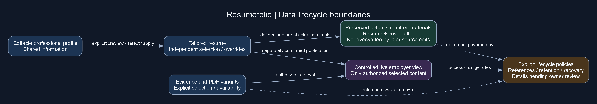
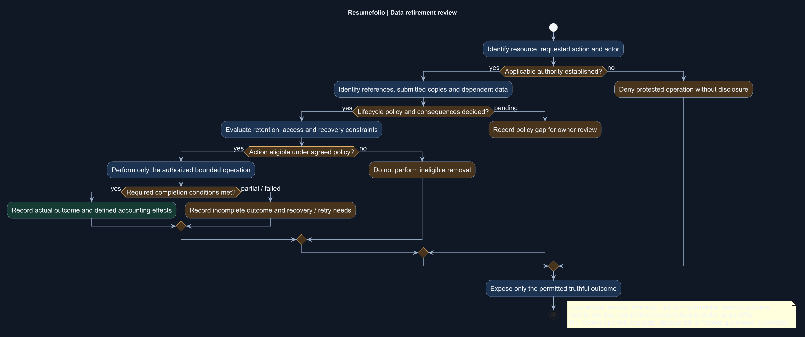

<a id="requirements-specification-business-rules-and-data-lifecycle"></a>

<a id="requirements-specification-business-rules-and-data-lifecycle--heading-resumefolio--business-rules-and-data-lifecycle"></a>
# Resumefolio — Business Rules and Data Lifecycle

**Quick read — Business rules and lifecycle.** Defines relationships, publication rules and retained history across records. Read the applicable invariant before designing a state change.

[6. Open Decisions and Gates](#requirements-specification-business-rules-and-data-lifecycle--heading-6-open-decisions-and-gates)

[Domain index](README.md) · [Acceptance trace](../../03-Requirements-Traceability-Matrix/README.md)


Current implementation choices and scope: [Baseline](https://github.com/Farhad-V/Web-Resumefolio/blob/1f2acaa351ac306cb57cbe4fe9742e8bd90720d9/docs/MVP/baseline/README.md). Runtime verification remains subject to its gates.

| Item | Current position |
| --- | --- |
| Owner | Farhad |
| Status | Proposed requirements — detailed policies and acceptance pending |
| Basis | Accepted Version 1 scope; proposed cross-module refinements identified below |
| References | BRL-D01–BRL-D10 are provisional, document-local references, not allocated global requirement IDs |
| Priority | Not yet assigned; no ordering implies delivery priority |
| Revision | October 31, 2026 |

**At a glance:** Keep editable professional information, controlled live sharing
and preserved application history distinct. Define authority and consequences
before propagating changes, synchronizing external data or removing information.
No retention duration, deletion cascade or recovery guarantee is established here.

[Rules](#requirements-specification-business-rules-and-data-lifecycle--heading-2-proposed-business-rules) · [Lifecycle](#requirements-specification-business-rules-and-data-lifecycle--heading-3-lifecycle-boundaries)
· [Retirement review](#requirements-specification-business-rules-and-data-lifecycle--heading-4-retirement-and-recovery-review) · [Open decisions](#requirements-specification-business-rules-and-data-lifecycle--heading-6-open-decisions-and-gates)

<a id="requirements-specification-business-rules-and-data-lifecycle--heading-1-purpose-and-source-authority"></a>
## 1. Purpose and Source Authority

This document defines cross-module invariants and the lifecycle questions needed
to turn accepted scope into testable behavior. A business rule constrains permitted
behavior; a lifecycle rule describes what a creation, change or retirement event
does to information and its dependents. Neither selects storage architecture.

Use [Version 1 Scope](../../../01-Project-Planning/01-Project-Charter.md#mvp-scope) as the source for
DEC-028–DEC-017 and DEC-015, and [Planning Completion Criteria](https://github.com/Farhad-V/Web-Resumefolio/blob/1f2acaa351ac306cb57cbe4fe9742e8bd90720d9/docs/MVP/SDLC/01-project-planning/10-planning-completion-criteria.md)
for dependent gates. Scope inclusion is accepted; the detailed obligations below
remain proposed. Their planned checks have not been executed.

Related definitions and domain owners:

| Subject | Working reference |
| --- | --- |
| Meaning, responsibility and conceptual data inventory | [Data Dictionary](../05-Data-Definitions/02-Data-Dictionary.md#data-definitions-data-dictionary) and [Glossary](../05-Data-Definitions/03-Requirements-Glossary.md#data-definitions-glossary) |
| Resource/action permissions | [Accounts and Permissions](01-Accounts-Authentication-And-Permissions.md#requirements-specification-accounts-authentication-and-permissions) |
| Resume/PDF availability and employer access | [PDF and Controlled Sharing](11-Pdf-And-Controlled-Sharing.md#requirements-specification-pdf-and-controlled-sharing) |
| Submission capture and application history | [Manual Application Management](09-Manual-Application-Management.md#requirements-specification-manual-application-management) |
| Provider authority and conflicts | [Email, Calendar and Google Integration](06-Email-Calendar-And-Google-Integration.md#requirements-specification-email-calendar-and-google-integration) |
| File accounting, replacement and cleanup | [Administration, Files and Operations](02-Administration-Files-And-Operational-Behavior.md#requirements-specification-administration-files-and-operational-behavior) |
| Intended business value | [Business Requirements](03-Business-Requirements.md#requirements-specification-business-requirements) |

These links identify where details must agree; they do not claim each domain
document is complete or accepted. Farhad coordinates review and unresolved policy.

<a id="requirements-specification-business-rules-and-data-lifecycle--heading-2-proposed-business-rules"></a>
## 2. Proposed Business Rules

All records below share status **Proposed**, owner **Farhad**, and
priority **Unassigned**. Each contains a source/rationale, obligation, observable
criteria, planned verification and remaining definition. Use the
[requirement template](17-Software-Requirements-Specification.md#requirements-specification-requirements-specification) when allocating final IDs.

<a id="requirements-specification-business-rules-and-data-lifecycle--heading-brl-d01-resource-specific-authority"></a>
### BRL-D01: Resource-specific Authority

**Release allocation (owner decision, November 4):** MVP foundation where used by core/basic ProjectForge; future-domain clauses deferred.

**Source / rationale:** DEC-028/DEC-024; a shared workspace experience must retain
private-resource boundaries.

**Proposed rule:** Creation, reading, modification, association, sharing and
retirement shall require the authority defined for that resource and operation.
Ownership or membership in one context shall not imply authority over unrelated data.

**Acceptance criteria**
- A board collaborator cannot obtain private email, unrelated resumes or repositories through that membership.
- A caller without the applicable grant cannot perform the protected operation by changing a resource reference or making a direct request.
- Administrative view, transfer, delete and restore operations are permitted only as explicitly defined in the reviewed action matrix.

**Planned verification:** Allowed/denied cross-user and direct-operation scenarios.
**Open:** Complete actor/resource/action/state matrix, ownership transfer, account
closure and administrative powers; do not infer universal administrator access.

<a id="requirements-specification-business-rules-and-data-lifecycle--heading-brl-d02-shared-information-and-independent-tailoring"></a>
### BRL-D02: Shared Information and Independent Tailoring

**Release allocation (owner decision, November 4):** MVP foundation where used by core/basic ProjectForge; future-domain clauses deferred.

**Source / rationale:** DEC-027; reuse professional information without unintended
cross-resume changes.

**Proposed rule:** Profile edits shall not automatically change existing resume drafts or published views.
The owner shall preview and explicitly apply selected source changes, preserving
resume-specific selections, layouts and overrides; publication requires separate
confirmation and actual submitted documents remain unchanged.

**Acceptance criteria**
- Editing one resume's selection, layout or override does not silently apply that edit to another resume.
- Defined shared-profile update cases produce the reviewed result for linked, omitted and overridden content.
- Source removal produces the agreed reference/visibility result without silently altering preserved submitted material.

**Planned verification:** Two-resume source-edit, override and source-removal cases.
**Open:** Link versus copy semantics, update trigger, precedence, user preview and
conflict handling; automatic propagation is not selected.

<a id="requirements-specification-business-rules-and-data-lifecycle--heading-brl-d03-explicit-shared-content-and-download-availability"></a>
### BRL-D03: Explicit Shared Content and Download Availability

**Release allocation (owner decision, November 4):** MVP foundation where used by core/basic ProjectForge; future-domain clauses deferred.

**Source / rationale:** DEC-026/DEC-025/DEC-024; the intended resume and selected
content define the employer disclosure boundary.

**Proposed rule:** Employer retrieval shall expose only the intended shared resume,
selected evidence and enabled PDF variants under the applicable access rules.

**Acceptance criteria**
- Unselected evidence and unrelated private resources are not retrievable through the employer context.
- Generated/uploaded/both/neither settings and separately available English/German uploaded PDFs yield only the permitted downloads.
- A direct file/PDF request cannot bypass authorization or disabled download availability.

**Planned verification:** Selection/variant/language matrix and direct retrieval.
**Open:** Save versus publish trigger, live revision visibility, missing-language
behavior, generation revision and stale rendition invalidation. No separate
publication workflow or automatic language fallback is assumed.

<a id="requirements-specification-business-rules-and-data-lifecycle--heading-brl-d04-access-changes-govern-subsequent-retrieval"></a>
### BRL-D04: Access Changes Govern Subsequent Retrieval

**Release allocation (owner decision, November 4):** MVP foundation where used by core/basic ProjectForge; future-domain clauses deferred.

**Source / rationale:** DEC-024/DEC-025; owners can change the password or disable
the link, while already downloaded copies remain outside product revocation.

**Proposed rule:** Sharing changes shall enforce the reviewed subsequent-access
policy across pages, files and PDFs without claiming removal of downloaded copies.

**Acceptance criteria**
- A disabled link cannot authorize a new protected retrieval under the agreed effective-change semantics.
- Password-change and existing-session cases follow the explicitly reviewed revocation policy for all protected resource paths.
- Product wording distinguishes retrieval restrictions from possession of an already legitimately downloaded copy.

**Planned verification:** Before/after change cases, existing sessions and direct
requests. **Open:** Effective instant, active/in-flight requests, sessions and
cached delivery controls; no duration or instantaneous global revocation promise.

<a id="requirements-specification-business-rules-and-data-lifecycle--heading-brl-d05-preserve-actual-submitted-materials"></a>
### BRL-D05: Preserve Actual Submitted Materials

**Release allocation (owner decision, November 4):** MVP foundation where used by core/basic ProjectForge; future-domain clauses deferred.

**Source / rationale:** DEC-023; later edits must not rewrite application history.

**Proposed rule:** Recording submitted materials shall preserve the resume and
cover letter actually submitted, distinct from editable source and live sharing.

**Acceptance criteria**
- Later profile, resume, cover-letter or source-PDF edits do not overwrite preserved submitted copies.
- The user can distinguish preserved submission material from a current source or live view.
- Incomplete/failed capture is distinguishable from successful preservation; no success claim is made for missing required material.

**Planned verification:** Capture followed by independent source edits and controlled
failure. **Open:** Exact capture trigger, represented revision/artifacts, manually
supplied actual materials, provenance, correction/resubmission and explicit
deletion authority. Preservation does not imply indefinite retention or a backup.

<a id="requirements-specification-business-rules-and-data-lifecycle--heading-brl-d06-validation-and-truthful-state-changes"></a>
### BRL-D06: Validation and Truthful State Changes

**Release allocation (owner decision, November 4):** MVP foundation where used by core/basic ProjectForge; future-domain clauses deferred.

**Source / rationale:** Proposed refinement of DEC-027/DEC-023/DEC-018; avoid invalid
or partially completed data being treated as a completed business operation.

**Proposed rule:** An operation shall satisfy its defined input, authority and
relationship conditions before it is reported as successfully completed.

**Acceptance criteria**
- Inputs outside agreed required-field/value/format/reference rules produce the defined rejected or incomplete outcome.
- Interrupted save, file replacement or capture is not presented as successful completion.
- Defined concurrent/repeated-change cases preserve the reviewed invariant or report a distinguishable conflict/failure.

**Planned verification:** Valid/invalid boundaries, interrupted operations and
conflicting/repeated requests after semantics are defined. **Open:** Field rules,
application statuses/transitions, duplicate handling, concurrency and retry policy.
No transaction mechanism or database constraint implementation is selected.

<a id="requirements-specification-business-rules-and-data-lifecycle--heading-brl-d07-explicit-provider-synchronization-authority"></a>
### BRL-D07: Explicit Provider Synchronization Authority

**Release allocation:** After MVP — provider synchronization.

**Source / rationale:** DEC-022; connected Gmail/calendar behavior depends on
explicit synchronization rules and authorized provider access.

**Proposed rule:** Each synchronized data/action category shall define its source
of truth, direction, identity mapping, conflict/deletion semantics and observable
outcome before synchronization is accepted.

**Acceptance criteria**
- Reviewed local/provider edit and deletion cases produce the specified result for the selected account and data category.
- Provider rejection, access loss or conflict is distinguishable from successful synchronization or delivery.
- Disconnecting does not silently delete provider data or imply a local purge unless an explicit authorized policy requires that action.

**Planned verification:** Controlled provider/local divergence, conflict, rejection,
disconnect and reconnect cases after feasibility/access checks. **Open:** Scope,
refresh timing, retries, duplication, pending work, local retention, mappings and
reconnect reconciliation; no bidirectional or last-write-wins policy is assumed.

<a id="requirements-specification-business-rules-and-data-lifecycle--heading-brl-d08-reference-aware-retirement"></a>
### BRL-D08: Reference-aware Retirement

**Release allocation (owner decision, November 4):** MVP foundation where used by core/basic ProjectForge; future-domain clauses deferred.

**Source / rationale:** Proposed refinement of DEC-023/DEC-026/DEC-018; removing a
source or association must not accidentally destroy other required information.

**Proposed rule:** Archive, unlink, delete and physical reclamation shall have
distinct defined consequences, checked against authority, valid references and
retention obligations before affected information is removed.

**Acceptance criteria**
- Removing a single association does not remove unrelated content contrary to the reviewed reference policy.
- Source deletion does not implicitly destroy required preserved submissions.
- Ineligible or partially failed reclamation is reported as such, with no false claim that all data or storage usage has been removed.

**Planned verification:** Shared-reference, submission-reference, eligible/ineligible
and partial-failure cases. **Open:** Cascade/block/detach decisions per relationship,
archive availability, retention, trash if any, purge timing and quota release.
Soft deletion and automatic cleanup are not established requirements.

<a id="requirements-specification-business-rules-and-data-lifecycle--heading-brl-d09-recovery-preserves-defined-business-consistency"></a>
### BRL-D09: Recovery Preserves Defined Business Consistency

**Release allocation (owner decision, November 4):** MVP foundation where used by core/basic ProjectForge; future-domain clauses deferred.

**Source / rationale:** DEC-017 and proposed lifecycle refinement; backup existence
alone does not prove usable recovery.

**Proposed rule:** Recovery shall follow defined coverage and consistency rules for
related records/artifacts and re-establish only the access permitted by the agreed
restoration policy.

**Acceptance criteria**
- A later isolated restoration check verifies required records, files and relationships for the selected recovery point.
- Restored sharing/membership/connection state is reconciled under an explicit access policy rather than assumed safe because it was backed up.
- Missing artifacts or unreconciled references are recorded as limitations/failures, not a complete successful restoration.

**Planned verification:** Later authorized isolated restore/integrity/access checks.
**Open:** Coverage including repositories/configuration/required keys, recovery
points, RPO/RTO, expired/revoked access and deleted-data reappearance. No recovery
target, retention period or successful restoration is claimed.

<a id="requirements-specification-business-rules-and-data-lifecycle--heading-brl-d10-defined-language-and-time-meaning"></a>
### BRL-D10: Defined Language and Time Meaning

**Release allocation (owner decision, November 4):** MVP foundation where used by core/basic ProjectForge; future-domain clauses deferred.

**Source / rationale:** DEC-015/DEC-025/DEC-022/DEC-023 plus proposed consistency
detail; prevent ambiguous language variants and event/history ordering.

**Proposed rule:** Language-specific content and lifecycle timestamps shall retain
the meanings established in the reviewed dictionary and domain rules.

**Acceptance criteria**
- Manually maintained English/German content follows the defined availability policy without an automatic translation step.
- Agreed event-time, recorded-time and displayed-time cases remain distinguishable where the domain requires them.
- Calendar/time-zone and submission-history examples produce the reviewed dates/order, including relevant boundary cases.

**Planned verification:** Language availability and domain-specific time examples.
**Open:** Required metadata, precision/time zones, correction/provenance and missing
values; this does not prescribe timestamp fields or a storage representation.

<a id="requirements-specification-business-rules-and-data-lifecycle--heading-3-lifecycle-boundaries"></a>
## 3. Lifecycle Boundaries



[Scalable SVG](../../Diagrams/Data-Lifecycle-Boundaries.svg) ·
[Editable Graphviz](../../Diagrams/Data-Lifecycle-Boundaries.dot)

Arrows express conceptual relationships, not automatic copying, database design
or a mandatory sequence. The preservation boundary applies to actual submitted
materials, not every editable revision. Colors supplement the labels.

| Information / event | Rule to define | Boundary to preserve |
| --- | --- | --- |
| Profile → tailored resume | Propagation trigger, overrides, omitted/removed entries | Independent tailoring; BRL-D02 |
| Evidence association/selection | Owner, reference use, unlink/delete effect | Unselected material stays outside shared view; BRL-D03/D08 |
| Generated/uploaded PDF | Revision, language, replacement and availability | Authorized variants; source replacement must not rewrite history |
| Live employer view | Saved/published revision and changed access | Scoped retrieval, not a submitted-copy guarantee |
| Application/submission | State transitions, actual-material capture and corrections | Later source edits cannot overwrite preserved copies |
| Provider connection/data | Authoritative properties, mappings and pending work | Disconnect ≠ provider deletion or automatic local purge |
| Board/project/repository | Membership, ownership transfer, archive and dependent references | Private-resource isolation; real Git history has domain-specific semantics |
| Workflow run/log/artifact | Authority, execution outputs, secrets and retention | CI/CD feasibility/security gates; no universal file policy assumption |
| Account closure | Ownership, memberships, provider access, shares and retained data | No invented cascade or obligation to retain forever |
| Backup/restore | Coverage, consistency, access reconciliation and deleted-data handling | Restoration evidence and explicit limitations |

For each subject, complete: creator/controller, authoritative source, allowed
operations/states, validation, transition trigger, dependent references, visible
outcome, failure/retry/concurrency, retention/reclamation and restoration. These
are review fields, not a mandatory schema. No universal draft→published→archived
state machine applies to all product data.

<a id="requirements-specification-business-rules-and-data-lifecycle--heading-4-retirement-and-recovery-review"></a>
## 4. Retirement and Recovery Review



[Scalable SVG](../../Diagrams/Data-Retirement-Review.svg) ·
[Editable PlantUML](../../Diagrams/Data-Retirement-Review.puml)

This is a proposed decision roadmap. A missing policy blocks the affected
commitment; it does not authorize inventing a deletion cascade. Apply it to the
specific resource and action. Archive, unlink, logical deletion and physical
reclamation can have different access, quota and recovery effects.

Restoration is a separate authorized operation. Define how restored old grants,
disabled shares, removed memberships and disconnected providers are reconciled
before access is exposed. A preserved application artifact is historical content;
a backup is recovery material. Neither substitutes for the other's requirement.

<a id="requirements-specification-business-rules-and-data-lifecycle--heading-5-scenarios-and-evidence-plan"></a>
## 5. Scenarios and Evidence Plan

| Scenario group | References | Planned coverage |
| --- | --- | --- |
| Ownership and isolation | D01/D03/D04 | Cross-user changes, selected/unselected evidence, direct files and changed grants |
| Reuse versus history | D02/D05 | Two independent resumes; capture actual submission; edit/remove source afterward |
| State and validation | D06/D10 | Invalid/missing input, language/time boundaries, failed and conflicting changes |
| Provider lifecycle | D07 | Local/provider divergence, rejection, disconnect, pending actions and reconnect |
| Retirement | D08 | Unlink versus deletion, referenced files, eligible retention, partial reclamation |
| Recovery | D09 | Isolated consistent restore, missing artifact, stale access and deleted-data reconciliation |

Dxx in this table abbreviates BRL-Dxx. Before execution, specify exact data,
actor/grants, initial state, operation, expected observable result and policy
revision. Later evidence records candidate/environment, actual result and limits.
No scenario above is a recorded Pass. Conditional criteria remain blocked until
the referenced policy is decided.

<a id="requirements-specification-business-rules-and-data-lifecycle--heading-6-open-decisions-and-gates"></a>
## 6. Open Decisions and Gates

| Decision topic | Definition needed before affected acceptance |
| --- | --- |
| Ownership/account exit | Resource ownership, transfer, collaborator removal, account closure and administrator actions |
| Tailoring/publication | Profile propagation, override precedence, save/publish/live revision, rendition invalidation |
| Sharing changes | Password changes, sessions, in-flight access, link lifecycle and delivery caches |
| Submission record | Capture trigger/artifacts, proof of actual materials, correction/resubmission, deletion and retention |
| Relationship removal | Per-reference block/detach/cascade behavior; no default universal cascade |
| Retention/accounting | Per-category periods/triggers, backups/trash/logs/Git outputs, physical reclamation and quota effects |
| Provider synchronization | Authority by property/action, direction, conflict/deletion/retry/reconnect semantics and verified access |
| Recovery | Coverage, points/targets, relationship consistency, revoked access and restored deleted data |
| Validation/time | Required fields/states, duplication/concurrency, language absence and time meanings |

These are local review topics, not newly allocated question IDs. Farhad records
actual decisions in [Open Questions and Decisions](../07-Change-And-Baseline/03-Requirements-Questions-And-Decisions.md#change-and-baseline-open-questions-and-decisions),
and routes material impacts through [Change Control](../07-Change-And-Baseline/02-Requirements-Change-Control.md#change-and-baseline-change-control).
Provider access, storage and recovery findings must satisfy the existing planning
follow-up gates before dependent design/delivery commitments. Any applicable legal
retention/deletion obligations need their own verified context; none is asserted here.

<a id="requirements-specification-business-rules-and-data-lifecycle--heading-7-traceability-and-review-readiness"></a>
## 7. Traceability and Review Readiness

| Candidate group | Basis | Dependent records |
| --- | --- | --- |
| BRL-D01–D04 | DEC-028/027/026/025/024 | Permissions matrix, profile/resume, PDF and sharing criteria |
| BRL-D05 | DEC-023 | Application capture and submitted-copy dictionary definitions |
| BRL-D06/D08 | Proposed cross-module detail from scope behavior/file policies | Validation, administration/files and per-domain lifecycle rules |
| BRL-D07/D10 | DEC-022/015/025/023 and proposed consistency detail | Provider operations, language and time definitions |
| BRL-D09 | DEC-017 and proposed recovery detail | Quality/recovery requirements and later actual restore evidence |

Maintain allocated links in [Requirements Traceability](../06-Validation-And-Traceability/07-Validation-And-Traceability.md#validation-and-traceability-validation-and-traceability--heading-traceability)
and real inspection results in [Review Findings](../06-Validation-And-Traceability/07-Validation-And-Traceability.md#validation-and-traceability-validation-and-traceability--heading-review-findings).

- [ ] Reconcile provisional IDs and assign justified priorities.
- [ ] Confirm each source-derived invariant separately from proposed refinements.
- [ ] Resolve affected authority, propagation, capture, synchronization and retirement policies.
- [ ] Complete criteria with decided states/values and normal, denied, failure and recovery paths.
- [ ] Reconcile dictionary and domain rules; link actual owner decisions and reviewed revision.
- [ ] Record actual verification later; do not treat diagram rendering as product validation.

**Current outcome:** Proposed cross-module draft; no policy acceptance or product
test result recorded. M-02 and the wider pre-implementation agreement remain
pending. This revision authorizes no deletion, synchronization, cleanup or recovery
operation and changes no accepted scope.

<a id="requirements-specification-business-rules-and-data-lifecycle--heading-8-diagram-maintenance"></a>
<details>
<summary>Supporting reference: 8. Diagram Maintenance</summary>

## 8. Diagram Maintenance

| Diagram | Editable source | Scalable view | Preview |
| --- | --- | --- | --- |
| Data lifecycle boundaries | [Graphviz](../../Diagrams/Data-Lifecycle-Boundaries.dot) | [SVG](../../Diagrams/Data-Lifecycle-Boundaries.svg) |  |
| Data retirement review | [PlantUML](../../Diagrams/Data-Retirement-Review.puml) | [SVG](../../Diagrams/Data-Retirement-Review.svg) |  |

Keep sources, captions and PNG/SVG renders synchronized. From the repository root:

```powershell
$diagramFolder = 'docs\MVP\SDLC\02-requirements-engineering\diagrams'
$graphvizExe = 'C:\Program Files\Graphviz\bin\dot.exe'
$plantUmlJar = 'C:\Users\fvali\AppData\Local\Resumefolio\DiagramTools\plantuml.jar'
foreach ($format in 'svg', 'png') {
    & $graphvizExe "-T$format" -Gdpi=140 "$diagramFolder\data-lifecycle-boundaries.dot" -o "$diagramFolder\data-lifecycle-boundaries.$format"
    if ($LASTEXITCODE -ne 0) { throw "Graphviz failed: $format" }
    java '-Djava.awt.headless=true' -jar $plantUmlJar -charset UTF-8 "-t$format" "$diagramFolder\data-retirement-review.puml"
    if ($LASTEXITCODE -ne 0) { throw "PlantUML failed: $format" }
}
```

Save as UTF-8 without BOM; use the actual installed tool paths on other machines.

[Specification index](16-Requirements-Specification-Guide.md#requirements-specification-requirements-specification-overview) · [SRS entry point](17-Software-Requirements-Specification.md#requirements-specification-requirements-specification)
· [Requirements index]()

</details>


<a id="requirements-specification-business-rules-and-data-lifecycle--heading-owner-accepted-source-update-rule--november-1-2026"></a>
## Owner-accepted Source-update Rule — November 1, 2026

The owner explicitly accepted the no-automatic-update, preview/select/apply, separately confirmed publication and preserved-submission rule. [Actual decision](../07-Change-And-Baseline/03-Requirements-Questions-And-Decisions.md#change-and-baseline-open-questions-and-decisions--id-owner-accepted-profile-update-policy). This settles that core behavior of BRL-D02, not the still-proposed source-removal/conflict/retention details or all BRL candidates. No runtime behavior is claimed.
