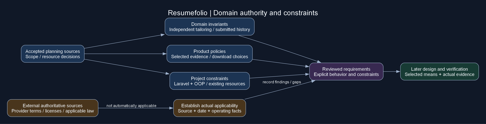
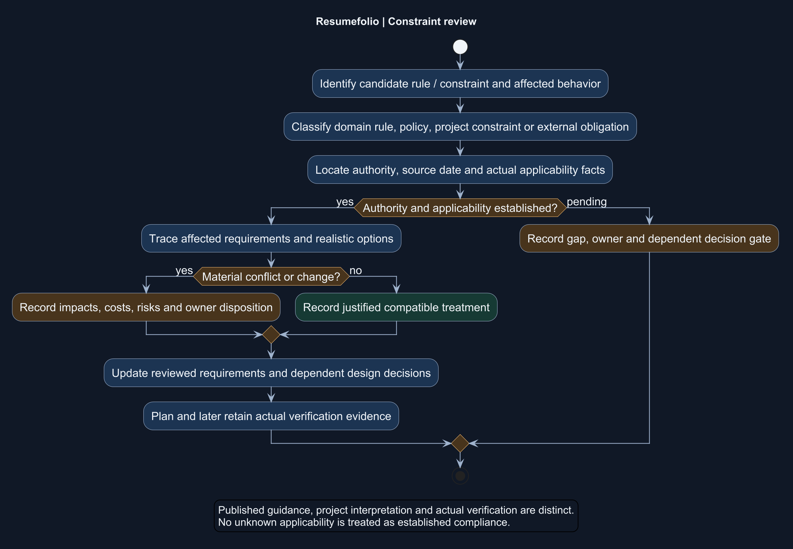

# Resumefolio — Domain Requirements and Constraints

**Quick read — Domain constraints.** Records constraints that cross feature boundaries. Apply them alongside the relevant functional criteria.

[Selected Policies and Future Proposals](#requirements-specification-domain-requirements-and-constraints--heading-selected-policies-and-future-proposals)

[Domain index](README.md) · [Acceptance trace](../../03-Requirements-Traceability-Matrix/README.md)

Current implementation choices and scope: [Baseline](https://github.com/Farhad-V/Web-Resumefolio/blob/1f2acaa351ac306cb57cbe4fe9742e8bd90720d9/docs/MVP/baseline/README.md). Runtime verification remains subject to its gates.

| Item | Current position |
| --- | --- |
| Owner | Farhad; sole delivery and operations owner |
| Status | Selected MVP slice; future clauses remain deferred; implementation and acceptance evidence remain required; see [current record rules](15-Requirement-Priority-And-Readiness.md#current-record-rules) |
| References | DOM-D01–DOM-D08: retained stable source IDs; criterion scope follows [current record rules](15-Requirement-Priority-And-Readiness.md#current-record-rules) |
| Priority | [current record rules](15-Requirement-Priority-And-Readiness.md#current-record-rules) define Must within MVP slice / Later; file order is not execution order |
| Source record date | October 31, 2026 |

**At a glance:** Preserve professional-information, application-history and
resource-access meaning while working within accepted project constraints.
Investigate external obligations against the actual operating model. A technical
preference, a project mandate and a legal obligation have different authority.

[Classification](#requirements-specification-domain-requirements-and-constraints--heading-1-classification-and-authority) · [Candidates](#requirements-specification-domain-requirements-and-constraints--heading-2-proposed-domain-requirements)
· [Constraints](#requirements-specification-domain-requirements-and-constraints--heading-3-accepted-project-constraints-and-open-evidence)
· [Review roadmap](#requirements-specification-domain-requirements-and-constraints--heading-5-constraint-review-roadmap) · [Completion](#requirements-specification-domain-requirements-and-constraints--heading-6-review-and-traceability)

## 1. Classification and Authority

Use [Version 1 Scope](../../../01-Project-Planning/01-Project-Charter.md#mvp-scope),
[Resources and Constraints](../../../01-Project-Planning/03-Feasibility-And-Risk-Assessment.md#resource-constraints)
and [Planning Completion Criteria](https://github.com/Farhad-V/Web-Resumefolio/blob/1f2acaa351ac306cb57cbe4fe9742e8bd90720d9/docs/MVP/SDLC/01-project-planning/10-planning-completion-criteria.md)
as planning authority. This document derives proposed detailed requirements and
organizes investigations; it does not reopen accepted decisions or record a new baseline.

| Category | Meaning | Example / authority |
| --- | --- | --- |
| Domain invariant | Meaning that must remain consistent across capabilities | Actual submitted materials differ from editable source; DEC-023 |
| Product policy | Deliberate product behavior within the domain | Owner-selected evidence and PDF availability; DEC-026/025 |
| Project constraint | Agreed restriction on delivery or operation | Laravel/OOP and existing resources; accepted resource decisions |
| External obligation | Provider, license or applicable legal restriction | Establish current source and actual applicability before treating it as binding |
| Design choice | Means of satisfying requirements | Frontend, database, synchronization mechanism; not selected by this document |

[Scalable SVG](../../Diagrams/Domain-Authority-Map.svg) ·
[Editable Graphviz](../../Diagrams/Domain-Authority-Map.dot)

Arrows classify evidence and authority; they do not define a software architecture.
Labels carry the meaning independently of color.

## 2. Proposed Domain Requirements

Farhad owns these records. Read their retained IDs and original criteria using the [current record rules](15-Requirement-Priority-And-Readiness.md#current-record-rules). Only the selected MVP criteria are current delivery obligations. Planned checks do not establish executed results or personal owner acceptance.

### DOM-D01: Consistent Professional-information Meaning

**Release allocation (owner decision, November 4):** MVP foundation where used by core/basic ProjectForge; future-domain clauses deferred.

**Source / rationale:** DEC-027/026/025 and the
[Data Dictionary](../05-Data-Definitions/02-Data-Dictionary.md#data-definitions-data-dictionary); consistent terms
prevent resume, evidence and file rules drifting between modules.

**Proposed obligation:** Profile information, tailored resumes, evidence and PDF
variants shall retain their reviewed domain meanings across affected workflows.

**Acceptance criteria**
- A reviewed example distinguishes reusable profile content, resume-specific selection/override, evidence selection and a PDF rendition.
- Domain documents use the same term for the same concept, or explicitly record a justified distinction.
- Changing a resume-specific choice does not silently change unrelated resumes.

**Planned verification:** Dictionary/document walkthrough and later cross-resume
examples. **Source refinement note:** Exact fields, required values, propagation and rendition revision.

### DOM-D02: Application History Represents Actual Submitted Material

**Release allocation (owner decision, November 4):** MVP foundation where used by core/basic ProjectForge; future-domain clauses deferred.

**Source / rationale:** DEC-023; historical application evidence must not be
confused with current editable content or a live employer view.

**Proposed obligation:** Application history shall distinguish actual submitted
resume/cover-letter material from later source changes and current shared views.

**Acceptance criteria**
- After capture and later source edits, preserved actual submitted material remains distinguishable and is not overwritten by those edits.
- Recording application progress does not imply automatic submission to a job platform or proof an employer received/read it.
- Correction, resubmission and deletion cases follow explicit history policies once reviewed.

**Planned verification:** Submission/source-edit walkthrough and later history
checks. **Source refinement note:** Capture/artifact boundaries, provenance, correction and retention;
see [Business Rules and Lifecycle](04-Business-Rules-And-Data-Lifecycle.md#requirements-specification-business-rules-and-data-lifecycle).

### DOM-D03: Authorization Follows the Resource and Operation

**Release allocation (owner decision, November 4):** MVP foundation where used by core/basic ProjectForge; future-domain clauses deferred.

**Source / rationale:** DEC-028/024/025/021/020; unified sign-in and collaboration
must preserve unrelated private contexts.

**Proposed obligation:** Access shall remain bounded by applicable actor, resource,
operation and state, including direct file/PDF retrieval and provider operations.

**Acceptance criteria**
- Board membership grants no unrelated private email, resume or repository access.
- Employer access exposes only the intended resume and selected permitted material.
- Altered references or direct requests do not bypass denied operations.

**Planned verification:** Later cross-user/action matrix checks.
**Source refinement note:** Exact roles/grants and lifecycle effects; the
[Accounts matrix](01-Accounts-Authentication-And-Permissions.md#requirements-specification-accounts-authentication-and-permissions--heading-7-role-resource-and-operation-matrix)
remains the permission specification entry point.

### DOM-D04: Explicit Human-authored Language and Application Work

**Release allocation (owner decision, November 4):** MVP foundation where used by core/basic ProjectForge; future-domain clauses deferred.

**Source / rationale:** DEC-016/015 and DEC-023; preserve Version 1 exclusions.

**Proposed obligation:** Version 1 professional content and application work shall
support the agreed manual workflows without depending on product AI, automatic
translation or automatic external application submission.

**Acceptance criteria**
- Required workflows allow manually entered/reviewed English and German content under defined availability rules.
- A missing translation is handled by an explicit policy rather than an assumed automatic translation step.
- Scope/requirements do not make an excluded AI or submission service a prerequisite.

**Planned verification:** Scope review and later manual journeys.
**Source refinement note:** Language completeness and fallback; no ATS, hiring or productivity outcome is guaranteed.

### DOM-D05: Explicit External-service Applicability

**Release allocation (owner decision, November 4):** MVP foundation where used by core/basic ProjectForge; future-domain clauses deferred.

**Source / rationale:** DEC-022, ASM-02/DEP-03/GAP-D02 and proposed external-interface
refinement; provider capability alone does not establish usable project access.

**Proposed obligation:** Each required external operation shall have an operation,
permission, account/audience, policy, resource and cost assessment before dependent
integration commitments are accepted.

**Acceptance criteria**
- Gmail/Calendar operations map to justified access and a dated official-source assessment.
- Applicable verification, restrictions, limits and unresolved costs/exceptions are recorded against the actual deployment model.
- A blocked required operation produces an explicit owner decision path, not silent scope removal or a feasibility claim.

**Planned verification:** Assessment record inspection and later authorized operation
checks. **Source refinement note:** Actual project credentials/configuration, access findings and
costs; see [Google Integration](06-Email-Calendar-And-Google-Integration.md#requirements-specification-email-calendar-and-google-integration).

### DOM-D06: Establish Information-handling Applicability

**Release allocation (owner decision, November 4):** MVP foundation where used by core/basic ProjectForge; future-domain clauses deferred.

**Source / rationale:** Proposed privacy/lifecycle investigation for personal,
professional, communication and collaboration information in accepted scope.

**Proposed obligation:** Before affected operating requirements are accepted, the
project shall document its actual information flows and applicable handling
obligations, with unresolved questions and decision owners visible.

**Acceptance criteria**
- The assessment identifies data categories, purpose, access recipients, provider/hosting flows, retention/deletion questions and backup implications.
- Each asserted external obligation identifies an authoritative source, date, applicability rationale and affected requirement.
- Unknown controller/processor, user-location, contractual or legal questions remain explicit rather than becoming an unsupported compliance statement.

**Planned verification:** Review actual operating model and evidence; obtain
appropriate clarification where necessary. **Source refinement note:** Actual roles/jurisdictions,
notices, rights handling, service terms and retention obligations. Server location
alone is not a completed applicability assessment. No legal conclusion is made here.

### DOM-D07: Verify Reuse and Licensing Before Adoption

**Release allocation (owner decision, November 4):** MVP foundation where used by core/basic ProjectForge; future-domain clauses deferred.

**Source / rationale:** DEC-011/014 and DEP-06/GAP-D08, with proposed licensing
refinement; references are not automatic scope or permission to reuse.

**Proposed obligation:** Proposed dependencies, templates, assets and reused code
shall have documented provenance, applicable license/terms and compatibility
findings before adoption; existing reference projects shall remain preserved.

**Acceptance criteria**
- A selected component/asset has a specific version/source, actual license/terms, obligations and review disposition.
- Unknown or conflicting reuse rights remain blockers for affected adoption until resolved.
- No automatic demo migration or reference-project modification is introduced as an implicit requirement.

**Planned verification:** Later component/asset inventory and license inspection.
**Source refinement note:** Actual selections, attribution/distribution duties and compatibility;
no component license or ownership claim is invented.

### DOM-D08: Evidence-based Operation Within Constraints

**Release allocation (owner decision, November 4):** MVP foundation where used by core/basic ProjectForge; future-domain clauses deferred.

**Source / rationale:** DEC-019/018/017/013/012 and accepted resource constraints;
combined workloads, recovery and solo maintenance must be feasible in reality.

**Proposed obligation:** Design and readiness decisions shall respect accepted
resource/development constraints and retain actual evidence for required capacity,
execution safety and recovery outcomes.

**Acceptance criteria**
- Selected options identify how they satisfy Laravel/OOP and actual resource/budget constraints.
- Initial 10-user checks specify workload/concurrency; approximately 1,000 users remain a growth direction until separately demonstrated.
- CI/CD enabling depends on reviewed feasibility/security limits, and recovery acceptance depends on actual restoration evidence.

**Planned verification:** Design review, resource findings and later bounded
capacity/execution/recovery checks. **Source refinement note:** Numerical limits, architecture,
RPO/RTO, cost allowance and actual forecast; no new purchase is assumed.

## 3. Accepted Project Constraints and Open Evidence

| Constraint / basis | Preserve | Evidence still required |
| --- | --- | --- |
| Laravel and object-oriented development | Mandated approach | Selected runtime/components and compatibility; no frontend/database selection implied |
| Existing server/resources and available budget | No assumed paid services or added infrastructure | Inventory, competing demand, costs and explicit owner spending decisions |
| Full-time solo delivery/operation | Farhad owns the work | Actual usable capacity, learning, integration and maintenance effort |
| 10 initial users; growth toward roughly 1,000 | Distinguish account population from concurrent workload | Representative load model, combined-workload findings and scaling options |
| Requested November 8, 2026 target | Requested date, not validated forecast | Analysis/design, effort ranges, dependency findings and reconciliation |
| Reference projects preserved | No automatic migration or inherited feature set | Specific adoption/provenance decisions |
| Required Gmail/Calendar and real Git | Retain accepted inclusions | Provider access and actual operation evidence; product Git differs from development GitHub |
| Conditional YAML/CI/CD | Retain feasibility/security gates | Isolation, permissions, secrets, limits, cleanup and controlled deployment |
| Operational readiness | Guidance, backups and demonstrated restoration | Actual procedures, coverage, integrity and access recovery evidence |

See the linked resource/planning records for authority. This table is a reading
aid, not a new decision register or a positive feasibility result.

## 4. External-obligation Evidence Record

For each candidate obligation, record: local reference, category, authoritative
publisher/source, version/date checked, exact relevant clause or concise finding,
actual operating facts, applicability rationale, affected requirements/design,
evidence limitations, owner, status and next gate. Separate a provider statement
from the project's interpretation and from actual access verification.

The [Google integration source notes](06-Email-Calendar-And-Google-Integration.md#requirements-specification-email-calendar-and-google-integration--heading-7-official-provider-source-notes)
provide a limited dated documentation check. They do not resolve the actual
project's verification/assessment applicability or establish Google access.
Privacy/legal, hosting and selected-component licensing assessments remain open.

## 5. Constraint Review Roadmap

[Scalable SVG](../../Diagrams/Domain-Constraint-Review.svg) ·
[Editable PlantUML](../../Diagrams/Domain-Constraint-Review.puml)

Review sequence: classify → establish authority/applicability → trace affected
behavior → compare options → record disposition → verify later. Investigate
high-impact blockers early; the diagram is not a dated delivery schedule.
Unknown applicability remains a gap. Material scope, cost or delivery changes
require an owner decision under [Change Control](../07-Change-And-Baseline/02-Requirements-Change-Control.md#change-and-baseline-change-control).

## 6. Review and Traceability

| Group | Related records / gate |
| --- | --- |
| DOM-D01–D04 | Dictionary, business rules and domain scenarios before affected M-02 acceptance |
| DOM-D05 | ASM-02/DEP-03/GAP-D02; actual access before dependent development |
| DOM-D06/D07 | Actual applicability/licensing evidence before affected operating/component adoption decisions |
| DOM-D08 | GAP-D01/D04/D05/D08/D09/D10; dependent design, forecast and readiness gates |

- [ ] Reconcile provisional IDs, priorities and exact source links.
- [ ] Review source-derived boundaries separately from proposed refinements.
- [ ] Resolve critical applicability and operation evidence before dependent acceptance.
- [ ] Reconcile provider, privacy, licensing, lifecycle and resource constraints across documents.
- [ ] Record reviewed revision, actual owner decisions, unresolved blockers and later verification evidence.

Use [Questions and Decisions](../07-Change-And-Baseline/03-Requirements-Questions-And-Decisions.md#change-and-baseline-open-questions-and-decisions),
[Traceability](../06-Validation-And-Traceability/07-Validation-And-Traceability.md#validation-and-traceability-validation-and-traceability--heading-traceability) and
[Review Findings](../06-Validation-And-Traceability/07-Validation-And-Traceability.md#validation-and-traceability-validation-and-traceability--heading-review-findings).
No global question IDs, accepted legal obligations, product Pass results or new
baseline acceptance are allocated by this revision. M-02 remains pending.

Supporting reference: 7. Diagram Maintenance

## 7. Diagram Maintenance

| Diagram | Source | SVG | PNG |
| --- | --- | --- | --- |
| Domain authority map | [DOT](../../Diagrams/Domain-Authority-Map.dot) | [SVG](../../Diagrams/Domain-Authority-Map.svg) |  |
| Constraint review | [PlantUML](../../Diagrams/Domain-Constraint-Review.puml) | [SVG](../../Diagrams/Domain-Constraint-Review.svg) |  |

Keep editable sources and renders synchronized; follow the
[diagram guide](../../Diagrams/Diagram-Catalog.md). Colors supplement labels. Check readable
arrows, render output and file/section links after changes. Save UTF-8 without BOM.

[Specification index](16-Requirements-Specification-Guide.md#requirements-specification-requirements-specification-overview) · [SRS entry point](17-Software-Requirements-Specification.md#requirements-specification-requirements-specification)
· [Requirements index]()

## Selected Policies and Future Proposals

Use the [current record rules](15-Requirement-Priority-And-Readiness.md#current-record-rules) and the [decision index](../07-Change-And-Baseline/03-Requirements-Questions-And-Decisions.md#change-and-baseline-open-questions-and-decisions--heading-current-dispositions) to distinguish selected MVP policies, deferred proposals and remaining evidence.

### Q-D27: Selected policy

[Selected answer and remaining evidence](https://github.com/Farhad-V/Web-Resumefolio/blob/1f2acaa351ac306cb57cbe4fe9742e8bd90720d9/docs/MVP/baseline/policy-decisions.md#q-d27). Apply this policy to the MVP slice; the original criteria above remain subject to their [current dispositions](https://github.com/Farhad-V/Web-Resumefolio/blob/1f2acaa351ac306cb57cbe4fe9742e8bd90720d9/docs/MVP/baseline/criterion-dispositions.csv).

Dated supporting record: November 1, 2026 — Q-D27 Operating Findings

## November 1, 2026 — Q-D27 Operating Findings

The [bounded operating assessment](../06-Validation-And-Traceability/07-Validation-And-Traceability.md#validation-and-traceability-validation-and-traceability--heading-remaining-verification) and [sanitized observations](../06-Validation-And-Traceability/02-Operating-Check-2026-11-01json.md#validation-and-traceability-operating-check-2026-11-01) now establish the inspected mail/OAuth declarations, absence of matching workers/cron in the checked paths, current certificate dates, enabled renewal timer and selected tool/license metadata. No cached config file was found. These are facts about the existing deployment, not proof of absent external accounts/backups or acceptance of that deployment as the future design. Actual delivery, renewal execution, background processing, complete license/applicability review and recovery remain gated.

