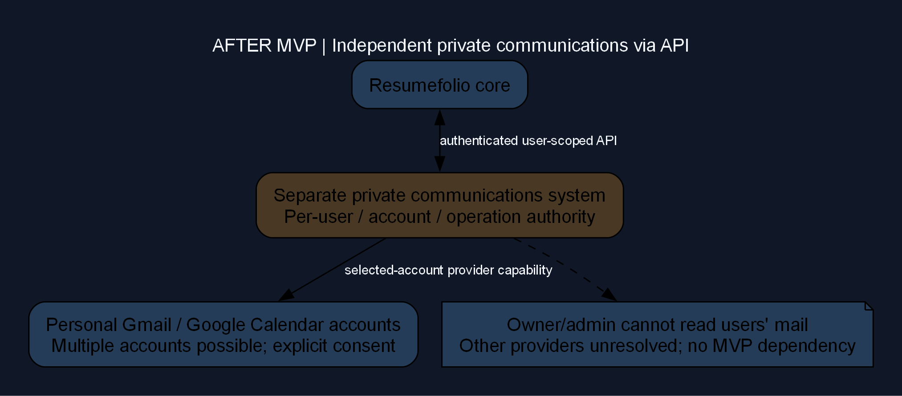
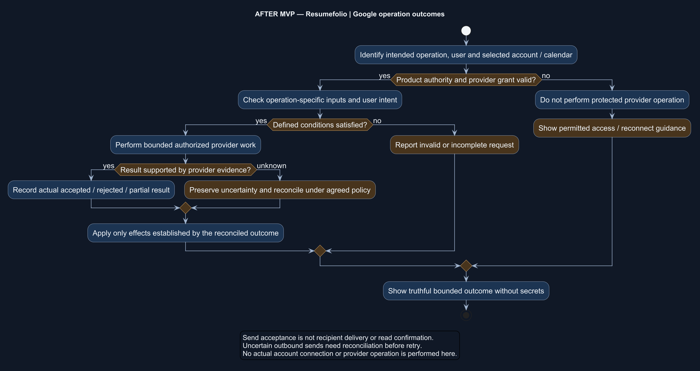

# Resumefolio — Email, Calendar and Google Integration

Current implementation choices and scope: [Baseline](https://github.com/Farhad-V/Web-Resumefolio/blob/1f2acaa351ac306cb57cbe4fe9742e8bd90720d9/docs/MVP/baseline/README.md). Runtime verification remains subject to its gates.

| Item | Current position |
| --- | --- |
| Owner | Farhad |
| Status | Proposed product requirements — detailed behavior and provider access pending |
| Planning authority | DEC-022/028/023; ASM-02/DEP-03/GAP-D02 |
| Candidate references | EGC-D01–EGC-D12 are provisional document-local IDs, not allocated global requirements  **After MVP.** |
| Priority | Unassigned; no delivery ordering implied |
| Revision / source check | October 31, 2026 |

**At a glance:** Users work with their Gmail and agreed calendar activities within
authorized product workflows. Sending, receiving, synchronization and reminders
need explicit outcomes. Google documentation has been checked for selected access
and synchronization considerations; actual project access, scope selection,
verification applicability, quotas/costs and feasibility remain unverified.

[Boundary](#requirements-specification-email-calendar-and-google-integration--heading-1-purpose-and-accepted-boundary) · [Operations](#requirements-specification-email-calendar-and-google-integration--heading-2-operation-inventory)
· [Requirements](#requirements-specification-email-calendar-and-google-integration--heading-3-proposed-requirements) · [Synchronization](#requirements-specification-email-calendar-and-google-integration--heading-4-synchronization-and-lifecycle-contract)
· [Failures](#requirements-specification-email-calendar-and-google-integration--heading-5-operation-and-failure-roadmap) · [Sources](#requirements-specification-email-calendar-and-google-integration--heading-7-official-provider-source-notes)
· [Gates](#requirements-specification-email-calendar-and-google-integration--heading-8-open-decisions-and-review-gates)

## Deferred private communications system

The entire mail/calendar feature is after MVP. Retain the requirements for a future independent private communications system connected through API, with Gmail and Google Calendar provider connections. Each user may consent to connecting their own personal Google accounts, potentially multiple. Authority is explicit per user/account/operation. Owner/admin role never grants reading user mail. Other provider support remains unresolved. Provider OAuth/read/send/sync evidence is a future gate, not an MVP dependency.

Authority: [OWNER-MVP-2026-11-04](../../../01-Project-Planning/01-Project-Charter.md#release-decision). [Candidate allocation](10-Mvp-Candidate-Release-Allocation.md#requirements-specification-mvp-release-allocation).

## 1. Purpose and Accepted Boundary

The older inclusion references in this section are historical. Every product obligation in this document is deferred after MVP; the new allocation supersedes its old Version 1 commitment.

[Scope DEC-022](https://github.com/Farhad-V/Web-Resumefolio/blob/1f2acaa351ac306cb57cbe4fe9742e8bd90720d9/docs/MVP/SDLC/01-project-planning/02-scope.md#dec-022) includes connecting
Gmail accounts to read, compose, send and reply; a calendar for interviews,
deadlines, follow-ups, personal and project activities; and Google Calendar
integration under explicit synchronization rules. Relevant correspondence and
activities can relate to application work.

DEC-028 preserves private-resource permissions despite unified sign-in.
DEC-023 retains manual job application management and actual submitted materials. Gmail access
does not prove an employer received/read a message or that an application was
submitted. Authentication/recovery/notification delivery arrangements are a
separate dependency (ASM-03/DEP-04), not automatically supplied by a user's Gmail.

[Scalable SVG](../../Diagrams/Google-Integration-Context.svg) ·
[Editable Graphviz](../../Diagrams/Google-Integration-Context.dot)

Arrows show conceptual operation contexts, not a chosen API architecture or
synchronization direction. A board collaborator or employer viewer receives no
private Gmail access merely through that role. Multiple accounts/calendars,
recurrence and invitation behavior need explicit decisions; no default is assumed.

## 2. Operation Inventory

| Category | Scope-supported outcome | Detail to specify before acceptance |
| --- | --- | --- |
| Connect/select account | User-authorized Gmail and Google Calendar access | Account identity/count, calendar selection, permission mapping, consent and reconnect |
| Read Gmail | View authorized correspondence | Lists/threads, search/filter, pagination, body formats, unread state, attachments and freshness |
| Compose/send/reply | User-authored communication | Draft persistence, sender/recipients, threading, attachments, confirmation and uncertain send |
| Calendar | Coordinate agreed activity types | Views, create/read/change/remove actions, required fields, time zones and reminder behavior |
| Google Calendar integration | Explicitly defined selected synchronization | Direction by operation/property, authoritative data, mapping, conflicts, deletion and timing |
| Application relationships | Relate relevant correspondence/activities to work | Link/copy behavior, visibility, removal and preserved-submission distinction |
| Lifecycle | Loss of access, disconnect and reconnect | Pending work, retained local data, authorization and reconciliation |

The inventory distinguishes known outcomes from unresolved details. It neither
silently adds every Gmail/Calendar feature nor excludes agreed capabilities.
Record material refinements and scope changes explicitly.

## 3. Proposed Requirements

Each candidate has owner **Farhad**, status **Proposed**, priority **Unassigned**.
Sources identify accepted inclusions or proposed supporting detail. Acceptance
criteria are planned observations, not evidence of an implemented integration.

### EGC-D01: Authorized Connection and Account Context

**Release allocation (owner decision, November 4):** Deferred after MVP.

**Source / rationale:** DEC-022/028; operations must use the intended user's
authorized connection rather than unrelated accounts.

**Proposed obligation:** The product shall establish and show the relevant account
and connection context for provider operations under the reviewed access policy.

**Acceptance criteria**
- A controlled authorized connection identifies the intended account without exposing credential/token values.
- Denied or incomplete consent does not appear as a successfully usable connection for unavailable operations.
- Account/calendar selection cases do not silently read or change a different account/calendar.

**Planned verification:** Later controlled connect/deny/select cases.
**Open:** Supported account count/types, account linking, consent details and
connection states; product sign-in is distinct from provider authorization.

### EGC-D02: Justified Permissions and Private-resource Isolation

**Release allocation (owner decision, November 4):** Deferred after MVP.

**Source / rationale:** DEC-028 and proposed provider-security refinement; request
only access justified by agreed operations and preserve product permissions.

**Proposed obligation:** Provider operations shall require applicable product
authority and provider-granted access, with requested permissions mapped to
required capabilities and credentials excluded from normal output.

**Acceptance criteria**
- The operation/permission matrix justifies each requested permission and identifies unavailable operations after partial/lost grants.
- Another user, board collaborator or employer context cannot read/use the private connection through altered references or direct requests.
- Ordinary errors, logs and exported review evidence do not expose tokens, codes or secrets.

**Planned verification:** Matrix review and later allowed/denied/grant-loss cases.
**Open:** Exact scopes, token protection, revocation and administrative powers;
no broad mailbox permission or Google sign-in choice is selected here.

### EGC-D03: Read Authorized Correspondence

**Release allocation (owner decision, November 4):** Deferred after MVP.

**Source / rationale:** DEC-022; users must read the relevant Gmail correspondence.

**Proposed obligation:** The product shall display the agreed message/thread
information from the selected authorized Gmail context with defined freshness and
safe content/attachment behavior.

**Acceptance criteria**
- Controlled messages show the defined sender, recipient, time, subject and content in the correct account context once the field/view rules are agreed.
- Empty, loading, unavailable and stale/partial data are distinguishable from a complete current mailbox result.
- Message content and attachment retrieval respect resource access and the reviewed safe-rendering/file policy.

**Planned verification:** Later representative plain/rich/attachment and empty/error
cases. **Open:** Thread/list/search coverage, pagination, unread actions, content
format, remote content/tracking, sanitization and download handling.

### EGC-D04: Manual Compose and Draft Handling

**Release allocation (owner decision, November 4):** Deferred after MVP.

**Source / rationale:** DEC-022/023 and proposed persistence detail; keep user-authored
communication and its actual saved state clear.

**Proposed obligation:** Users shall compose the agreed email fields manually, with
draft persistence, validation and abandonment behavior explicitly defined.

**Acceptance criteria**
- Defined valid recipient/content inputs remain in the intended compose context.
- Invalid inputs and failed draft persistence do not produce a false saved/sent outcome.
- Restoring or discarding a draft follows the reviewed local/provider authority and does not overwrite an unrelated draft.

**Planned verification:** Later validation/save/failure/abandon cases.
**Open:** Required fields, recipient limits, CC/BCC, formatting, attachments,
local/provider drafts, autosave/recovery and duplicate handling.

### EGC-D05: Deliberate Send and Truthful Outcome

**Release allocation (owner decision, November 4):** Deferred after MVP.

**Source / rationale:** DEC-022 and proposed failure refinement; outbound mail is an
external side effect whose outcome may be uncertain.

**Proposed obligation:** Send shall follow explicit user intent for the reviewed
sender, recipients, content and attachments, and report only the outcome supported
by available provider evidence.

**Acceptance criteria**
- A controlled send uses the intended account/message under the agreed send/confirmation interaction.
- Provider acceptance, rejection, pending work and unknown outcome are distinguishable as applicable; acceptance is not labeled recipient delivery/read confirmation.
- Retry after an ambiguous response follows a defined reconciliation policy rather than blindly duplicating the external send.

**Planned verification:** Later authorized test-recipient cases and controlled
rejection/timeout/uncertainty. **Open:** Confirmation UX, pending/cancel semantics,
provider evidence, duplicate prevention and safe retry; no exactly-once guarantee.

### EGC-D06: Reply Context and Conversation Association

**Release allocation (owner decision, November 4):** Deferred after MVP.

**Source / rationale:** DEC-022; replies must address the intended correspondence.

**Proposed obligation:** Reply shall retain the reviewed sender, recipient and
conversation context while allowing user review before sending.

**Acceptance criteria**
- A controlled reply identifies the intended original message/conversation and sender account.
- Recipient/reply behavior matches the reviewed rules rather than silently sending to unrelated addresses.
- Reply failures retain a distinguishable outcome without a false successful-send claim.

**Planned verification:** Later representative thread/reply/failure cases.
**Open:** Reply-all, quoted content, signatures, threading rules and attachments;
not every mail-client feature is implied by the accepted reply inclusion.

### EGC-D07: Calendar Activities and Time Meaning

**Release allocation (owner decision, November 4):** Deferred after MVP.

**Source / rationale:** DEC-022; interviews, deadlines, follow-ups and agreed
personal/project activities need unambiguous scheduling behavior.

**Proposed obligation:** The product shall support the reviewed calendar activity
operations and required fields with explicit time-zone, access and validation rules.

**Acceptance criteria**
- Representative agreed activity types can be recorded/viewed and changed under the approved operation matrix.
- Invalid required fields/time intervals produce defined feedback rather than a false saved event.
- Agreed all-day/time-zone/daylight-saving cases preserve intended time meaning in relevant views and provider mappings.

**Planned verification:** Later activity/permission/time-boundary cases.
**Open:** Views, local versus provider events, allowed actions, all-day rules,
recurrence, attendees/invitations, shared calendars and cancellation side effects.

### EGC-D08: Explicit Synchronization Contract

**Release allocation (owner decision, November 4):** Deferred after MVP.

**Source / rationale:** DEC-022; synchronization direction and conflicts cannot be
inferred from the word integration.

**Proposed obligation:** Each integrated data/action category shall follow a
reviewed authority, identity mapping, direction, conflict, deletion and refresh
contract with observable success, partial and failed outcomes.

**Acceptance criteria**
- Defined local/provider edits and deletions produce the agreed result for the selected category/calendar.
- Concurrent divergence or invalid synchronization state invokes the defined reconciliation path without silently destroying unrelated local data.
- Partial/failed refresh is not presented as fully current; reconnect/repeated-refresh cases follow the reviewed duplicate policy.

**Planned verification:** Later divergence, deletion, partial refresh and recovery
cases. **Open:** Complete contract in section 4, cadence, scope and implementation;
no bidirectional, real-time, webhook or last-write-wins choice is assumed.

### EGC-D09: Application Relationships Preserve Boundaries

**Release allocation (owner decision, November 4):** Deferred after MVP.

**Source / rationale:** DEC-022/023/028; useful correspondence/activity relationships
must not leak private communication or rewrite application history.

**Proposed obligation:** Users shall relate agreed correspondence/activities to
application work using explicit link/copy, access and removal semantics.

**Acceptance criteria**
- Related items resolve to the correct application and authorized account/activity.
- Association does not grant unrelated collaborators/employer viewers private message access.
- Later source changes/removal follow the reviewed policy and do not overwrite preserved actual submitted material.

**Planned verification:** Later application association/access/removal cases.
**Open:** Relation cardinality, displayed/copied fields, provider deletion and
whether any actual sent content is part of submission capture; no automatic capture assumed.

### EGC-D10: Reminders and Notification Outcomes

**Release allocation (owner decision, November 4):** Deferred after MVP.

**Source / rationale:** DEC-022 and its explicit reminder-definition follow-up;
timely prompts need clear recipients, timing and delivery evidence.

**Proposed obligation:** Agreed reminders shall follow defined scheduling,
permission-change, cancellation and outcome rules for selected activities.

**Acceptance criteria**
- Defined reminder examples target the authorized recipient and intended activity/time context.
- Activity cancellation/change or loss of access yields the reviewed pending-reminder result.
- Scheduled, attempted, failed and confirmed outcomes are distinguished according to the selected channel's evidence.

**Planned verification:** Later controlled timing/change/denial/delivery cases.
**Open:** Local/provider authority, channels, timing/tolerance, retry and duplicate
behavior; no external notification service or guaranteed delivery is selected.

### EGC-D11: Disconnect, Revocation and Reconnect

**Release allocation (owner decision, November 4):** Deferred after MVP.

**Source / rationale:** Proposed lifecycle refinement of DEC-022/028 and
[Business Rules](04-Business-Rules-And-Data-Lifecycle.md#requirements-specification-business-rules-and-data-lifecycle); access loss is distinct from data deletion.

**Proposed obligation:** Lost/revoked access, disconnect and reconnect shall have
explicit consequences for operations, pending work, credentials and retained local data.

**Acceptance criteria**
- Unavailable grants do not permit protected provider operations or a false connected/usable status for those operations.
- Disconnect does not silently delete provider data or imply a local purge unless explicitly authorized by reviewed policy.
- Reconnect reconciles selected identity/mappings/pending work under the agreed policy without silently sending stale queued mail or duplicating events.

**Planned verification:** Later revoke/disconnect/reconnect and account-mismatch
cases. **Open:** Local retention, credential invalidation/revocation scope, pending
work, stale views and application references; no retention duration is set.

### EGC-D12: Bounded Failures, Recovery and Feasibility Evidence

**Release allocation (owner decision, November 4):** Deferred after MVP.

**Source / rationale:** ASM-02/DEP-03/GAP-D02; service availability and actual
project access cannot be inferred from official API capability.

**Proposed obligation:** Provider failures/limits shall produce defined bounded
outcomes and recovery guidance; dependent acceptance shall retain actual access
and representative operation evidence within applicable conditions and resources.

**Acceptance criteria**
- Consent denial, expired/revoked access, rate/resource limits, provider outage and ambiguous outbound outcomes have explicit user-visible handling.
- Retrying/reconciling follows operation-specific safety rules and does not bypass grants or falsely claim success.
- Evidence identifies actual account/audience, configuration, granted operations, observed limits and blockers without exposing secrets.

**Planned verification:** Source/configuration inspection and later controlled
operation/failure checks. **Open:** Limits, timeout/backoff, refresh/recovery methods,
verification obligations/costs and support effort; none is proven here.

## 4. Synchronization and Lifecycle Contract

Complete a separate reviewed row per message/draft/event/property/action category;
Gmail correspondence and Calendar synchronization need not use the same policy.

| Contract item | Decision needed |
| --- | --- |
| Identity and selection | Product user, provider account, mailbox/calendar, item mapping and duplicate identity |
| Authority and direction | Authoritative properties/actions; local-only, inbound or outbound effects as selected |
| Initial scope and freshness | Date/data selection, paging, initial completeness, refresh trigger/cadence and freshness display |
| Changes/conflicts | Concurrent local/provider edits, supported conflict resolution and user action |
| Deletion | Provider delete versus local unlink/archive/delete; effect on related applications and copies |
| Failure/repetition | Partial work, cursor/history loss, retries, ambiguous sends and safe reprocessing |
| Disconnection | Pending work, credential/access consequences, local retention and later reconnect |
| Time/reminders | Time zones, all-day/recurring behavior if selected, reminder authority and changed events |
| Recovery | Local restoration versus newer provider state, mappings and stale grants |

These are unresolved decision fields, not selected database columns. Do not
discard user-authored local content merely because a provider sync cursor must
be rebuilt. Later design must distinguish cached provider data from authoritative
local content and preserved submission artifacts.

## 5. Operation and Failure Roadmap

[Scalable SVG](../../Diagrams/Google-Operation-Outcomes.svg) ·
[Editable PlantUML](../../Diagrams/Google-Operation-Outcomes.puml)

This conceptual flow applies different retry rules to reads, state changes and
outbound sends. It does not authorize sending email, changing calendars or
connecting actual user accounts during this documentation task. Unknown outcomes
remain unknown until appropriate reconciliation establishes more.

## 6. Planned Scenario Coverage

| Group | Candidates | Representative paths |
| --- | --- | --- |
| Connection/isolation | D01/D02/D11 | Correct/wrong account, denied/partial/revoked grants, cross-user/direct references |
| Correspondence | D03/D04/D06 | Representative content, attachment safety, draft failure, intended reply context |
| Outbound send | D05/D12 | Authorized test recipient, rejection, ambiguous timeout, reconciliation and duplicate risk |
| Calendar | D07/D08/D10 | Activity validation, zones/daylight saving, selected actions, conflicts, deletion/reminders |
| Application history | D09 | Association, permission isolation, provider/source removal and preserved copies |
| Recovery | D08/D11/D12 | Stale/partial data, invalid sync state, disconnect/reconnect, limits and provider outage |

Dxx abbreviates EGC-Dxx. Each later test records policy/candidate revision,
environment/account type, grants, inputs/state, expected/actual outcomes and
limits. Use controlled accounts/recipients and authorized data; no tests have run.
No production messages, contacts, secrets or event content belong in repository evidence.

## 7. Official Provider Source Notes

Limited documentation check dated **October 31, 2026**. These findings describe
published guidance, not this project's configuration or approval. Recheck sources
at scope selection and release; record actual applicability separately.

| Official source | Bounded finding | Project consequence / remaining evidence |
| --- | --- | --- |
| [Choose Gmail API scopes](https://developers.google.com/workspace/gmail/api/auth/scopes) | Google defines operation-related scopes and recommends narrowly focused access | Map each required operation to necessary permissions; final scope set remains open |
| [Restricted scope verification](https://developers.google.com/identity/protocols/oauth2/production-readiness/restricted-scope-verification) | Sensitive/restricted access has verification requirements, with exceptions and potential security assessment depending on use | Establish actual audience, deployment/data handling and exception applicability; do not assume approval, exemption, cost or completion |
| [Calendar synchronization guide](https://developers.google.com/workspace/calendar/api/guides/sync) | Incremental synchronization includes invalid-token recovery requiring a full resynchronization | Define safe reconciliation and protect unrelated local content if this API approach is selected |
| [Gmail synchronization guide](https://developers.google.com/workspace/gmail/api/guides/sync) | Full and partial synchronization have different recovery needs when history is unavailable | Define initial scope/freshness/recovery and bound resource work if this API approach is selected |

This check does not choose API versus another permitted integration mechanism,
prove current project access, audit all Google terms or satisfy GAP-D02. No exact
quota, price, grant lifetime, approval deadline or assessment exemption is asserted.

## 8. Open Decisions and Review Gates

| Topic | Required decision/evidence | Dependent gate |
| --- | --- | --- |
| Operation coverage | Mail views/actions/attachments, calendar actions/views and account/calendar count | Affected M-02 requirement acceptance |
| Permissions/provider conditions | Operation-scope mapping, audience, consent, verification/assessment applicability, costs and actual access | GAP-D02; before dependent design acceptance/development |
| Synchronization | Full contract in section 4, including conflicts and deletion | Affected M-02 acceptance and M-03 design |
| Send/reply | Review/confirmation, drafts, threading, uncertain send and duplicate reconciliation | Before outbound behavior acceptance/design |
| Time/reminders | Zones, recurrence/invitations if selected, channels, scheduling and cancellation | Affected requirements and dependency review |
| Privacy/content safety | Local/provider data, retention, logs, rich content/attachments and access changes | Security/lifecycle requirements and design |
| Disconnection/recovery | Grants, pending work, local retention, mapping and restore/reconnect reconciliation | Before dependent lifecycle/design acceptance |
| Actual operation limits | Account/service conditions, representative operations, resource demand and failure evidence | Access before development; readiness evidence before affected capability acceptance |

Farhad coordinates every row. These are local topics, not newly allocated shared
question/decision IDs. Keep [Questions](../07-Change-And-Baseline/03-Requirements-Questions-And-Decisions.md#change-and-baseline-open-questions-and-decisions),
[Feasibility](../01-Process-And-Approach/01-Feasibility-Study.md#process-and-approach-02-feasibility-study) and
[Change Control](../07-Change-And-Baseline/02-Requirements-Change-Control.md#change-and-baseline-change-control) consistent. A provider
blocker needs an explicit owner disposition; it does not silently remove DEC-022.

## 9. Traceability and Review Readiness

Link final requirements/scenarios and actual evidence in
[Traceability](../06-Validation-And-Traceability/07-Validation-And-Traceability.md#validation-and-traceability-validation-and-traceability--heading-traceability).
Use [Review Findings](../06-Validation-And-Traceability/07-Validation-And-Traceability.md#validation-and-traceability-validation-and-traceability--heading-review-findings)
for real inspection outcomes. Reconcile ACC-D permissions, BRL-D07 synchronization,
BRL-D05 submitted history, AFO-D file policies and DOM-D05 applicability.

- [ ] Reconcile provisional references and assign justified priorities.
- [ ] Review accepted outcomes separately from proposed supporting detail.
- [ ] Decide operation, permission and synchronization matrices before conditional criteria are accepted.
- [ ] Obtain actual provider-access findings and resolve dependent conditions/costs.
- [ ] Reconcile application history, private access, file handling, reminders and recovery.
- [ ] Record actual owner review/revision and later results without inventing Pass status.

**Current outcome:** Proposed specification with limited official-source notes.
No EGC candidate is accepted, no account is connected, no message/event operation
is performed, no access/feasibility approval is claimed, and M-02 remains pending.

## 10. Diagram Maintenance

| Diagram | Source | SVG | PNG |
| --- | --- | --- | --- |
| Google integration context | [DOT](../../Diagrams/Google-Integration-Context.dot) | [SVG](../../Diagrams/Google-Integration-Context.svg) |  |
| Operation outcomes | [PlantUML](../../Diagrams/Google-Operation-Outcomes.puml) | [SVG](../../Diagrams/Google-Operation-Outcomes.svg) |  |

Keep sources and PNG/SVG outputs synchronized. Follow the
[diagram guide](../../Diagrams/Diagram-Catalog.md), inspect arrow/label readability and verify
file/section links. Colors supplement labels; save UTF-8 without BOM.

[Specification index](16-Requirements-Specification-Guide.md#requirements-specification-requirements-specification-overview) · [SRS entry point](17-Software-Requirements-Specification.md#requirements-specification-requirements-specification)
· [Requirements index]()

## Selected Policies and Future Proposals

Current MVP answers are selected in the Baseline. Only explicitly deferred details below remain proposals; product tests and operational evidence are still required.

### Proposed answer Q-D15: Google access and applicability

**Affected records:** EGC-D01/D02/D12; DOM-D05; ASM-02/DEP-03/GAP-D02. **Disposition:** Evidence-gated investigation with a complete proposal.

1. Require per-user explicit OAuth authorization for the selected Google account; show connected identity and granted capability state. Users own their private mail/calendar context. Do not assume a product-wide service account can read personal Gmail or that a Codex connector proves this product has credentials.

2. Propose Gmail operation scope set gmail.readonly for search/read and gmail.compose for remote drafts/send; do not request mail.google.com or gmail.modify unless a separately reviewed operation needs the additional rights. gmail.compose includes draft management and sending, so a separate send scope is unnecessary for that contract. Scope classification/verification must be assessed against the actual app/audience/data handling.

3. For Calendar propose calendar.events for selected permitted calendar-event read/write, adding calendar.calendarlist.readonly only for the picker; validate target-calendar authority on each operation. Do not request calendar ACL administration. Broader provider scope does not itself authorize showing every accessible event in this product.

4. Record OAuth project owner, publishing audience, consent status, redirect URLs, scope list and token/refresh/revoke/reconnect results in a sanitized checklist. Perform actual read/draft/test-send/calendar checks only with a controlled account and explicit send authorization. Provider documentation establishes possible scopes, not actual project access, quota, verification outcome or cost.

**Assessable review cases:** [RC-Q15-01 through RC-Q15-03](../04-Scenarios-And-Models/02-User-Stories-And-Scenarios.md#scenarios-and-models-user-stories-and-scenarios--id-review-q-d15). These are planned checks, not executed results.

**Remaining evidence / acceptance condition:** Actual OAuth project/consent/audience, permitted credentials, verification applicability, quota/cost and controlled operation evidence are not available in repository or SSH checks. This remains an external-evidence gate.

### Proposed answer Q-D16: Mail operations and uncertain outcomes

**Affected records:** EGC-D03–EGC-D06/D09/D12; EIF-D05/D08. **Disposition:** Answer proposed; owner acceptance pending.

1. Support provider-backed mailbox search, paged message/thread reading, compose, draft save/edit, deliberate send and reply with explicit recipient/subject/body/attachment review. Preserve provider message/thread identity. Sanitized HTML and protected attachments must not execute mail content or load tracking resources automatically.

2. A send action uses the selected connected sender and a displayed final recipient/attachment set; changes before send require re-review. Product acceptance of a send request, provider acceptance, delivery and recipient read are separate facts. Store provider confirmation/reference when supplied; never claim delivery/read from a successful API submission.

3. After an ambiguous timeout, mark outcome unknown and reconcile against the provider before allowing an explicit retry with duplication warning. Do not blindly resend or infer failure from missing immediate confirmation. Save draft or read retries may be safely repeated only under their defined identity/version behavior.

4. Reply binds the intended thread and To/Cc recipients; do not silently reply-all. Draft autosave records actual save state and protects newer edits from stale writes. Application association links correspondence explicitly without granting access to an entire mailbox or automatically advancing progress.

**Assessable review cases:** [RC-Q16-01 through RC-Q16-03](../04-Scenarios-And-Models/02-User-Stories-And-Scenarios.md#scenarios-and-models-user-stories-and-scenarios--id-review-q-d16). These are planned checks, not executed results.

**Remaining evidence / acceptance condition:** Owner review of the proposed rule and its affected criteria is required; no product test is reported.

### Proposed answer Q-D17: Calendar authority, conflicts and disconnection

**Affected records:** EGC-D07–EGC-D11; BRL-D07/D10. **Disposition:** Answer proposed; owner acceptance pending.

1. Support local tasks/reminders and explicitly selected Google calendar events as distinct subjects. Store timed events with an instant and source/display time zone; all-day events use calendar dates with exclusive end date, not midnight converted through arbitrary user zones. Preserve provider recurrence/exception identity.

2. For imported Google events, provider fields are authoritative until the user explicitly edits and a permitted provider update succeeds. Local private notes/application links remain local. Local-only activities do not automatically publish; explicit publish creates a mapped provider event. No implicit whole-account bidirectional mirroring.

3. Reconcile mapped events using version/change evidence. Concurrent local/provider edits create a conflict requiring explicit choice/review, not silent last-write-wins. Provider deletion marks the mirror removed/unavailable; deleting a local association does not delete the provider event. External deletion needs an explicit confirmation.

4. Disconnect stops new fetch/push/reminder work relying on that connection, revokes usable local credentials and marks retained local copies stale/disconnected; users may explicitly delete retained private copies under retention rules. Reconnect refreshes identity/permissions and reconciles pending work; it never blindly replays old sends or duplicate event creation. Reminder delivery channel must be actually available.

**Assessable review cases:** [RC-Q17-01 through RC-Q17-03](../04-Scenarios-And-Models/02-User-Stories-And-Scenarios.md#scenarios-and-models-user-stories-and-scenarios--id-review-q-d17). These are planned checks, not executed results.

**Remaining evidence / acceptance condition:** Owner review of the proposed rule and its affected criteria is required; no product test is reported.

## November 1, 2026 — Q-D15 Owner Clarification

The owner confirmed no OAuth project has been created. Treat Google integration setup as not yet established; do not keep asking for an existing project ID or infer readiness from an installed package. The proposed operations/scopes remain inputs to later setup. Intended audience, project ownership, consent/client/redirect configuration, applicable provider conditions and controlled actual operation evidence are still required before the dependent gate. This clarification neither removes the agreed integration nor creates an account or credentials.
