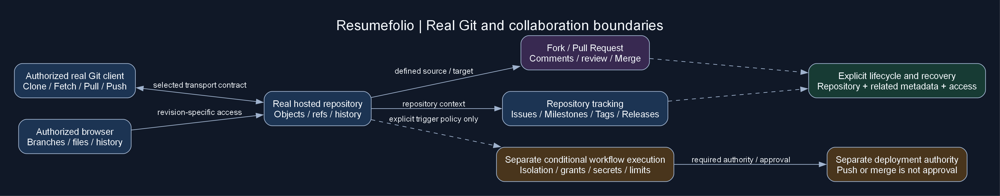
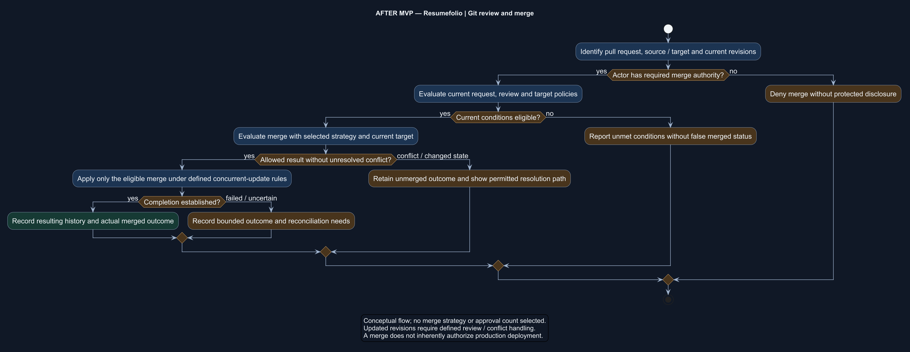

<a id="requirements-specification-git-hosting-and-collaboration"></a>

<a id="requirements-specification-git-hosting-and-collaboration--heading-resumefolio--git-hosting-and-collaboration"></a>
# Resumefolio — Git Hosting and Collaboration

Current implementation choices and scope: [Baseline](https://github.com/Farhad-V/Web-Resumefolio/blob/1f2acaa351ac306cb57cbe4fe9742e8bd90720d9/docs/MVP/baseline/README.md). Runtime verification remains subject to its gates.

| Item | Current position |
| --- | --- |
| Owner | Farhad; sole delivery and operations owner |
| Status | Proposed product specification — detailed policy and acceptance pending |
| Planning basis | DEC-020/028; conditional CI/CD is separately DEC-019 |
| Candidate references | GIT-D01–GIT-D10 are provisional document-local references, not allocated global requirement IDs |
| Priority | Unassigned; document order is not delivery priority |
| Revision | October 31, 2026 |

**At a glance:** Host and collaborate on real Git repositories, not only repository links or a browser simulation. Define browser and Git-client authority together, preserve revision context during review/merge, and keep workflow execution and deployment authorization separate.

[Basis](#requirements-specification-git-hosting-and-collaboration--heading-1-purpose-and-accepted-boundary) · [Inventory](#requirements-specification-git-hosting-and-collaboration--heading-2-capability-and-information-inventory)
· [Requirements](#requirements-specification-git-hosting-and-collaboration--heading-3-proposed-requirements) · [Models](#requirements-specification-git-hosting-and-collaboration--heading-4-behavior-and-boundary-models)
· [Scenarios](#requirements-specification-git-hosting-and-collaboration--heading-5-planned-verification) · [Decisions](#requirements-specification-git-hosting-and-collaboration--heading-6-open-decisions-and-gates)
· [Review](#requirements-specification-git-hosting-and-collaboration--heading-7-traceability-and-review-readiness)

<a id="requirements-specification-git-hosting-and-collaboration--heading-projectforge-mvp-responsibility-and-boundary"></a>
## ProjectForge MVP responsibility and boundary

ProjectForge is a separate system connected to the core through an authenticated user-scoped API. MVP includes real repositories, clone/fetch/pull/push, repository permissions, file/history browsing, issues and simple Kanban. Git commits normally occur in the client. Full advanced review/merge/releases, fork/review workflows, milestones, advanced backlog/Sprints and YAML execution/deployment are deferred. The engine, database, physical deployment and Git transport remain undecided. No shared core database/transaction or full GitHub parity is promised.

Authority: [OWNER-MVP-2026-11-04](../../../01-Project-Planning/01-Project-Charter.md#release-decision). [Candidate allocation](10-Mvp-Candidate-Release-Allocation.md#requirements-specification-mvp-release-allocation).

<a id="requirements-specification-git-hosting-and-collaboration--heading-1-purpose-and-accepted-boundary"></a>
## 1. Purpose and Accepted Boundary

[Scope DEC-020](https://github.com/Farhad-V/Web-Resumefolio/blob/1f2acaa351ac306cb57cbe4fe9742e8bd90720d9/docs/MVP/SDLC/01-project-planning/02-scope.md#dec-020) includes repository
creation, Clone/Fetch/Pull/Push, branches, file/history browsing, Fork, Pull Requests,
comments, review, Merge, Issues, Milestones, Tags and Releases. That was the historical full-product inclusion. The November 4 allocation keeps basic ProjectForge in MVP and defers advanced collaboration; detailed behavior remains proposed and unimplemented.

Product hosting differs from using GitHub to develop Resumefolio. A product Push,
merge, tag or release does not inherently authorize production deployment.
[YAML/CI/CD](19-Yaml-Workflows-And-Cicd.md#requirements-specification-yaml-workflows-and-cicd) retains DEC-019 feasibility/security gates.
No Git engine, transport, frontend, public visibility model or client version is selected.

Use [Accounts](01-Accounts-Authentication-And-Permissions.md#requirements-specification-accounts-authentication-and-permissions),
[External Interfaces](07-External-Interface-Requirements.md#requirements-specification-external-interface-requirements),
[Business Lifecycle](04-Business-Rules-And-Data-Lifecycle.md#requirements-specification-business-rules-and-data-lifecycle) and the
[Data Dictionary](../05-Data-Definitions/02-Data-Dictionary.md#data-definitions-data-dictionary) for cross-module boundaries.

<a id="requirements-specification-git-hosting-and-collaboration--heading-2-capability-and-information-inventory"></a>
## 2. Capability and Information Inventory

| Area | Conceptual information | Definition still needed |
| --- | --- | --- |
| Repository/access | Ownership, namespace, visibility, grants, refs and credentials | Exact actor/action/state matrix and transfer/revocation |
| Real Git transfer | Objects/history, branches and client-visible outcomes | Supported transport/client contract, limits and integrity/failure cases |
| Browser presentation | Selected revision, files/history and comparisons | Views, formats, binary/large content and safe rendering |
| Collaboration | Fork provenance, request source/target, comments/review and merge outcome | States, approvals, updated revisions and conflict policies |
| Work tracking | Issues and milestones tied to a repository | Fields, lifecycle, roles and intentional Kanban relationships |
| Delivery labels | Tags, releases and any agreed assets | Mutation, assets, visibility and version meaning |
| Operations | Accounting, retained data, backups and execution references | Resource findings, retention, recovery and conditional execution boundary |

<a id="requirements-specification-git-hosting-and-collaboration--heading-3-proposed-requirements"></a>
## 3. Proposed Requirements

All records are **Proposed**, owner **Farhad**, priority **Unassigned**. Actor/condition
descriptions identify scenario contexts, not newly granted permissions.

<a id="requirements-specification-git-hosting-and-collaboration--heading-git-d01-repository-creation-and-ownership"></a>
### GIT-D01: Repository Creation and Ownership

**Release allocation (owner decision, November 4):** MVP — ProjectForge.

**Source / rationale:** DEC-020/028; real hosted repositories need explicit ownership and resource authority.

**Actor / conditions:** Authorized user requests a new repository or a permitted metadata change.

**Proposed obligation:** The product shall create real hosted repositories under the reviewed ownership, naming and visibility policy and report the actual result.

**Acceptance criteria**
- A valid authorized creation produces an identifiable hosted repository usable by the agreed Git interface, not merely an external link.
- Invalid/conflicting creation inputs and failed provisioning do not appear as successful usable repositories.
- Creation or metadata changes do not grant access to unrelated private resources.

**Planned verification:** Later real-repository creation, validation, failure and isolation cases.

**Open detail:** Name/namespace rules, empty/initialized repositories, visibility classes, transfer, provisioning cleanup and numerical quotas; none is selected here.

<a id="requirements-specification-git-hosting-and-collaboration--heading-git-d02-repository-and-ref-authorization"></a>
### GIT-D02: Repository and Ref Authorization

**Release allocation (owner decision, November 4):** MVP — ProjectForge.

**Source / rationale:** DEC-020/028; repository collaboration is resource-specific and must apply beyond browser buttons.

**Actor / conditions:** User/client requests read, write or collaboration-management operations.

**Proposed obligation:** Each repository/ref operation shall require the applicable grant across browser and selected Git-client paths.

**Acceptance criteria**
- A caller without read authority cannot clone/fetch or browse protected content/history through a direct path.
- A caller without write/management authority cannot push, merge, change visibility or grant themselves privileges.
- Changing membership/credentials produces the reviewed subsequent-access result; unrelated board membership supplies no repository grant.

**Planned verification:** Later cross-user/client/ref allowed-denied matrix and changed-grant cases.

**Open detail:** Role/action matrix, public visibility if any, protected refs, credentials, invitation/membership and in-flight revocation rules.

<a id="requirements-specification-git-hosting-and-collaboration--heading-git-d03-real-clone-fetch-pull-and-push"></a>
### GIT-D03: Real Clone, Fetch, Pull and Push

**Owner-scope acceptance additions (MVP; planned, not executed):**

- A normal client-created commit can be pushed and subsequently fetched through authorized real Git transport; core API access and Git transport each enforce their own user/resource scope. No server-created commit is implied.

**Release allocation (owner decision, November 4):** MVP — ProjectForge.

**Source / rationale:** DEC-020 and EIF-D06; accepted scope requires actual Git-client interoperability.

**Actor / conditions:** Authorized supported client accesses a selected hosted repository.

**Proposed obligation:** The product shall support the agreed real Clone/Fetch/Pull/Push interactions using the selected transport and credential contract.

**Acceptance criteria**
- Later supported-client checks retrieve the expected repository content and history through real Clone/Fetch operations.
- Client Pull integrates fetched data according to the reviewed supported-client scenarios; client conflicts are not mislabeled server success.
- Authorized Push updates the intended allowed refs; denied/rejected/interrupted operations expose truthful outcomes under defined integrity rules.

**Planned verification:** Later isolated real-client transfer, history comparison and failure cases.

**Open detail:** Transport(s), credentials, supported clients/versions, object/transfer limits, concurrent updates and interrupted-transfer handling; no SSH/HTTPS or Git engine selection.

<a id="requirements-specification-git-hosting-and-collaboration--heading-git-d04-branches-files-and-history-browsing"></a>
### GIT-D04: Branches, Files and History Browsing

**Release allocation (owner decision, November 4):** Split — MVP file/history browsing and normal Git refs; advanced branch management deferred.

**Source / rationale:** DEC-020; users need meaningful repository presentation and navigation.

**Actor / conditions:** Authorized user browses or performs an agreed branch operation.

**Proposed obligation:** The product shall expose agreed branch, file and history views and branch actions for the intended repository/revision under its permissions.

**Acceptance criteria**
- A selected branch/revision shows the correct permitted file content and associated history in representative examples.
- Missing/deleted revisions and unsupported/binary/large content have defined feedback rather than incorrect content or a false empty repository.
- Branch changes require the agreed authority and do not silently rewrite unrelated refs.

**Planned verification:** Later multi-branch/revision, content-format, missing-ref and authorization cases.

**Open detail:** Branch creation/deletion/protection, default branch, history/diff views, safe content rendering, pagination and size boundaries.

<a id="requirements-specification-git-hosting-and-collaboration--heading-git-d05-fork-provenance-and-permission-boundaries"></a>
### GIT-D05: Fork Provenance and Permission Boundaries

**Release allocation (owner decision, November 4):** Deferred after MVP — advanced Git collaboration.

**Source / rationale:** DEC-020 and proposed isolation refinement; a fork is a separate collaboration context.

**Actor / conditions:** User requests an allowed fork of a readable repository.

**Proposed obligation:** Fork creation shall retain the defined source relationship while applying explicit target ownership, visibility and access rules.

**Acceptance criteria**
- An authorized fork contains the expected source revision/history under the agreed capture semantics.
- Forking does not implicitly grant write authority over the source repository.
- Unauthorized forks or visibility changes cannot expose protected source content contrary to the reviewed fork policy.

**Planned verification:** Later source/fork content, provenance, permission and failure checks.

**Open detail:** Eligible source visibility, target namespace, inherited visibility restrictions, subsequent synchronization and source deletion consequences.

<a id="requirements-specification-git-hosting-and-collaboration--heading-git-d06-pull-requests-comments-and-review"></a>
### GIT-D06: Pull Requests, Comments and Review

**Release allocation (owner decision, November 4):** Deferred after MVP — advanced Git collaboration.

**Source / rationale:** DEC-020; proposed changes and review must identify the actual comparison context.

**Actor / conditions:** Authorized contributor/reviewer opens, comments on or reviews a proposed change.

**Proposed obligation:** The product shall support pull requests, comments and review against defined source/target repository/ref and revision contexts.

**Acceptance criteria**
- A valid pull request identifies the intended source and target and displays the agreed comparison.
- Authorized comments/review outcomes remain associated with their intended request/context.
- Changed source/target revisions produce the defined update/stale-review behavior rather than silently treating an old review as approval of new content.

**Planned verification:** Later same-repository/fork request, review/comment, changed-revision and denied cases.

**Open detail:** States, reviewers, comment editing/deletion, review types, stale-review policy, required approvals and private-fork comparisons.

<a id="requirements-specification-git-hosting-and-collaboration--heading-git-d07-controlled-merge-and-conflict-outcomes"></a>
### GIT-D07: Controlled Merge and Conflict Outcomes

**Release allocation (owner decision, November 4):** Deferred after MVP — advanced Git collaboration.

**Source / rationale:** DEC-020 and proposed integrity refinement; a review or push is not universal merge authority.

**Actor / conditions:** Authorized actor requests merge of an eligible pull request.

**Proposed obligation:** Merge shall evaluate the current reviewed target/source conditions and merge policy, apply only an allowed result and distinguish conflicts or rejection.

**Acceptance criteria**
- A permitted merge produces the expected target history/content for the chosen merge policy.
- Conflict or failed eligibility prevents a false merged status and does not silently overwrite unrelated target work.
- Concurrent target/source changes invoke the defined recheck/conflict behavior; merge does not inherently authorize production deployment.

**Planned verification:** Later clean/conflicting/concurrent/denied merge and history comparisons.

**Open detail:** Merge strategy, approvals/checks, protected refs, conflict resolution UX, failure recovery and request-state transitions.

<a id="requirements-specification-git-hosting-and-collaboration--heading-git-d08-issues-and-milestones"></a>
### GIT-D08: Issues and Milestones

**Release allocation (owner decision, November 4):** Split — MVP ProjectForge issues; milestones deferred.

**Source / rationale:** DEC-020; repository work tracking is an agreed product feature.

**Actor / conditions:** Authorized user records or updates repository issues/milestones.

**Proposed obligation:** The product shall support reviewed repository issue and milestone operations with explicit relationships, states and permission rules.

**Acceptance criteria**
- Representative issue/milestone records remain associated with the intended repository and permitted relationships.
- Valid transitions/updates follow the reviewed action matrix; invalid or unauthorized changes are rejected.
- Repository issue tracking does not automatically become the product Kanban/Sprint model or expose unrelated project data.

**Planned verification:** Later record/relationship/state and cross-resource permission cases.

**Open detail:** Fields, assignment, states, issue-milestone relations, comments, deletion, notifications and any deliberate Kanban linkage.

<a id="requirements-specification-git-hosting-and-collaboration--heading-git-d09-tags-and-releases"></a>
### GIT-D09: Tags and Releases

**Release allocation (owner decision, November 4):** Deferred after MVP — advanced Git collaboration.

**Source / rationale:** DEC-020; released labels/content must refer to the intended repository revision.

**Actor / conditions:** Authorized user creates/views/changes a tag or release under agreed rules.

**Proposed obligation:** The product shall support tags and releases with explicit revision, visibility, mutation and asset policies.

**Acceptance criteria**
- A representative tag/release resolves to its defined repository/ref/revision and reviewed descriptive information.
- Unauthorized tag/release mutation or protected asset retrieval is denied.
- If release assets are included by the reviewed policy, admission, download and replacement follow applicable file/access rules.

**Planned verification:** Later tag/release revision, mutation, asset and access cases.

**Open detail:** Annotated/lightweight support, tag mutation/deletion, release states, asset scope, limits and relation to workflow outputs; tags/releases do not prove deployment.

<a id="requirements-specification-git-hosting-and-collaboration--heading-git-d10-lifecycle-capacity-and-recovery"></a>
### GIT-D10: Lifecycle, Capacity and Recovery

**Release allocation (owner decision, November 4):** MVP — ProjectForge.

**Source / rationale:** DEC-018/017/020 and proposed operational refinement; repository data and collaboration metadata need coordinated handling.

**Actor / conditions:** Authorized operator/user archives, transfers, removes or restores repository-related information.

**Proposed obligation:** Repository lifecycle and resource policy shall preserve defined integrity, references and access, with actual recovery evidence before affected readiness acceptance.

**Acceptance criteria**
- Archive/delete/transfer cases follow explicit consequences for forks, requests, comments, issues, releases and artifacts rather than an invented cascade.
- Defined size/quota/failed-work scenarios enforce the selected accounting policy without falsely reporting completed reclamation.
- Later isolated restoration checks required repository objects/refs and related metadata/permissions; backup existence alone is not a recovery Pass.

**Planned verification:** Later bounded lifecycle/quota and isolated consistency/access restore checks.

**Open detail:** Retention/reclamation, quota units/pools, recovery coverage/targets, credential reconciliation and actual combined server capacity.

<a id="requirements-specification-git-hosting-and-collaboration--heading-4-behavior-and-boundary-models"></a>
## 4. Behavior and Boundary Models



[Scalable SVG](../../Diagrams/Git-Hosting-Capability-Map.svg) · [Graphviz source](../../Diagrams/Git-Hosting-Capability-Map.dot)

Connections group requirements, not selected services or protocols. Repository
history and pull-request/review metadata have related but distinct meaning.



[Scalable SVG](../../Diagrams/Git-Review-Merge-Flow.svg) · [PlantUML source](../../Diagrams/Git-Review-Merge-Flow.puml)

The merge flow is conceptual; it does not define a required approval count or
merge strategy. Current-revision checks and concurrent-update handling need
explicit requirements/design before criteria can be finalized.

<a id="requirements-specification-git-hosting-and-collaboration--heading-5-planned-verification"></a>
## 5. Planned Verification

| Family | Candidate coverage | Cases to develop |
| --- | --- | --- |
| Provisioning/access | GIT-D01/D02 | Valid/duplicate/failed creation, cross-user paths and changed grants |
| Real transfer/browser | GIT-D03/D04 | Supported real-client operations, selected revision/history, rejected/interrupted transfer |
| Fork and review | GIT-D05/D06 | Source/target provenance, private boundary, new commits after review, comment context  **Advanced paths after MVP; any retained core/basic path follows the release register.** |
| Merge | GIT-D07 | Clean/conflicting/denied merge, concurrent target/source changes and resulting history  **Advanced paths after MVP; any retained core/basic path follows the release register.** |
| Tracking/release | GIT-D08/D09 | States/relationships, tag/release revision and asset permission/mutation |
| Lifecycle | GIT-D10 | References, quota/cleanup failures and isolated repository+metadata restoration |

Later evidence identifies candidate, repository/ref revisions, client/transport,
grants, initial data, operation, expected/actual outcomes and limitations. Use
isolated authorized repositories. None of these scenarios is a recorded Pass.

<a id="requirements-specification-git-hosting-and-collaboration--heading-6-open-decisions-and-gates"></a>
## 6. Open Decisions and Gates

| Topic | Decision/evidence needed | Gate |
| --- | --- | --- |
| Repository access | Roles, visibility, namespaces, ownership, refs, credentials and revocation | Affected M-02 acceptance/security design |
| Real client interface | Transport(s), versions, transfer limits and concurrency/integrity outcomes | Dependent design; actual interoperability before capability acceptance |
| Fork/request/review/merge | Provenance, states, allowed operations, strategy, stale approvals and conflicts | Before accepting related detailed behavior/design |
| Issues/milestones/releases | Fields, lifecycle, assets and intentional cross-module relationships | Affected requirements and file/lifecycle decisions |
| Combined resource use | Git storage/processing, competing loads, policy/accounting and maintenance | GAP-D01/D08/D10; dependent design/resource commitments |
| Recovery/lifecycle | Reference consequences, coverage, retention and actual isolated restoration | GAP-D04; design and later M-09 evidence |
| Execution boundary | Separate execution and deployment authority; isolation/secret/limit evidence | GAP-D09; before enabling conditional execution |

Farhad coordinates the topics. Track actual findings in
[Questions and Decisions](../07-Change-And-Baseline/03-Requirements-Questions-And-Decisions.md#change-and-baseline-open-questions-and-decisions),
retain [Planning Gates](https://github.com/Farhad-V/Web-Resumefolio/blob/1f2acaa351ac306cb57cbe4fe9742e8bd90720d9/docs/MVP/SDLC/01-project-planning/10-planning-completion-criteria.md)
and route material impacts through [Change Control](../07-Change-And-Baseline/02-Requirements-Change-Control.md#change-and-baseline-change-control).
No new question IDs or completed resource investigations are claimed.

<a id="requirements-specification-git-hosting-and-collaboration--heading-7-traceability-and-review-readiness"></a>
## 7. Traceability and Review Readiness

GIT-D01–D09 derive from DEC-020 with permission refinements from DEC-028. GIT-D10
links DEC-018/017 and proposed lifecycle detail. Reconcile EIF-D06 real-client
contracts, ACC-D access, AFO-D file/accounting and BRL-D recovery rules; these
cross-references do not approve the candidate requirements.

Use the [requirement template](17-Software-Requirements-Specification.md#requirements-specification-requirements-specification) when allocating
final IDs. Link allocated records/scenarios and actual evidence in
[Traceability](../06-Validation-And-Traceability/07-Validation-And-Traceability.md#validation-and-traceability-validation-and-traceability--heading-traceability).
Record actual inspection outcomes in [Review Findings](../06-Validation-And-Traceability/07-Validation-And-Traceability.md#validation-and-traceability-validation-and-traceability--heading-review-findings).

- [ ] Reconcile provisional GIT-D references and assign justified priorities.
- [ ] Review source-derived boundaries separately from proposed supporting detail.
- [ ] Resolve policy/state/permission questions blocking affected acceptance.
- [ ] Reconcile dictionary, lifecycle, interface and related domain specifications.
- [ ] Complete normal, denied, failure, concurrent and recovery scenarios where applicable.
- [ ] Record actual owner decision, reviewed revision, evidence and remaining blockers.

**Current outcome:** Proposed specification; no candidate is accepted and no product
test result is recorded. Conditional criteria are not acceptance-ready until their
referenced policies are decided. M-02 and the wider pre-implementation agreement
remain pending. This revision changes no accepted scope and performs no live
repository, application-submission, sharing, file or provider operation.

<a id="requirements-specification-git-hosting-and-collaboration--heading-8-diagram-maintenance"></a>
## 8. Diagram Maintenance

| Diagram | Source | SVG | PNG |
| --- | --- | --- | --- |
| Git capability boundaries | [Graphviz](../../Diagrams/Git-Hosting-Capability-Map.dot) | [SVG](../../Diagrams/Git-Hosting-Capability-Map.svg) |  |
| Review and merge flow | [PlantUML](../../Diagrams/Git-Review-Merge-Flow.puml) | [SVG](../../Diagrams/Git-Review-Merge-Flow.svg) |  |

Keep sources, captions and renders synchronized. Colors supplement labels. Follow
the [diagram guide](../../Diagrams/Diagram-Catalog.md); inspect readable arrows/labels and check
file/section links after changes. From repository root:

```powershell
$diagramFolder = 'docs\MVP\SDLC\02-requirements-engineering\diagrams'
$graphvizExe = 'C:\Program Files\Graphviz\bin\dot.exe'
$plantUmlJar = 'C:\Users\fvali\AppData\Local\Resumefolio\DiagramTools\plantuml.jar'
foreach ($format in 'svg', 'png') {
    & $graphvizExe "-T$format" -Gdpi=140 "$diagramFolder\git-hosting-capability-map.dot" -o "$diagramFolder\git-hosting-capability-map.$format"
    if ($LASTEXITCODE -ne 0) { throw "Graphviz failed: $format" }
    java '-Djava.awt.headless=true' -jar $plantUmlJar -charset UTF-8 "-t$format" "$diagramFolder\git-review-merge-flow.puml"
    if ($LASTEXITCODE -ne 0) { throw "PlantUML failed: $format" }
}
```

Use actual tool paths on other machines; save UTF-8 without BOM.

[Specification index](16-Requirements-Specification-Guide.md#requirements-specification-requirements-specification-overview) · [SRS entry point](17-Software-Requirements-Specification.md#requirements-specification-requirements-specification)
· [Requirements index]()

<a id="requirements-specification-git-hosting-and-collaboration--heading-selected-policies-and-future-proposals"></a>
## Selected Policies and Future Proposals

Current MVP answers are selected in the Baseline. Only explicitly deferred details below remain proposals; product tests and operational evidence are still required.

<a id="requirements-specification-git-hosting-and-collaboration--id-resolution-q-d21"></a>
<a id="requirements-specification-git-hosting-and-collaboration--heading-q-d21-selected-policy"></a>
### Q-D21: Selected policy

[Selected answer and remaining evidence](https://github.com/Farhad-V/Web-Resumefolio/blob/1f2acaa351ac306cb57cbe4fe9742e8bd90720d9/docs/MVP/baseline/policy-decisions.md#q-d21). Apply this policy to the MVP slice; the original criteria above remain subject to their [current dispositions](https://github.com/Farhad-V/Web-Resumefolio/blob/1f2acaa351ac306cb57cbe4fe9742e8bd90720d9/docs/MVP/baseline/criterion-dispositions.csv).

<a id="requirements-specification-git-hosting-and-collaboration--id-resolution-q-d22"></a>
<a id="requirements-specification-git-hosting-and-collaboration--heading-proposed-answer-q-d22-review-merge-and-release-semantics"></a>
### Proposed answer Q-D22: Review, merge and release semantics

**Affected records:** GIT-D05–GIT-D10; PKS-D10. **Disposition:** MVP slice selected in [Q-D22](https://github.com/Farhad-V/Web-Resumefolio/blob/1f2acaa351ac306cb57cbe4fe9742e8bd90720d9/docs/MVP/baseline/policy-decisions.md#q-d22); advanced future details below remain proposals.

1. Forks retain upstream provenance but get their own explicit access rules; a private fork must not widen visibility or retain source access after required revocation without an explicit retention decision. Pull requests identify source and target repository/ref revisions, author and state Open/Merged/Closed.

2. Propose one current non-author approval for protected default-branch merge where an eligible separate reviewer exists; in solo ownership, allow an explicitly recorded owner self-review exception rather than inventing a second person. Any source-code change invalidates prior approval; target changes require conflict/status re-evaluation.

3. Propose merge-commit as the initial merge strategy; fast-forward/squash need separately reviewed support. Merge requires current authority, current source/target, no unresolved conflict and required checks for the exact revision. Missing or unknown checks are not success. Closing a request is not merging it.

4. Issues/milestones belong to a repository and remain distinct from work-project items, with explicit associations only. Tags name exact revisions; published release assets are protected and revision-identified. Replacing a published tag/asset requires explicit owner action and retained history. A release or merge does not authorize production deployment.

**Assessable review cases:** [RC-Q22-01 through RC-Q22-03](../04-Scenarios-And-Models/02-User-Stories-And-Scenarios.md#scenarios-and-models-user-stories-and-scenarios--id-review-q-d22). These are planned checks, not executed results.

**Remaining evidence / acceptance condition:** Owner review of the proposed rule and its affected criteria is required; no product test is reported.
