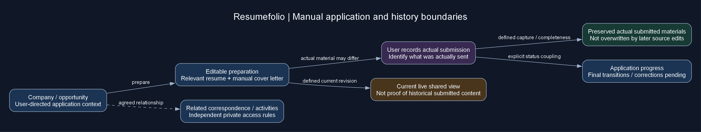
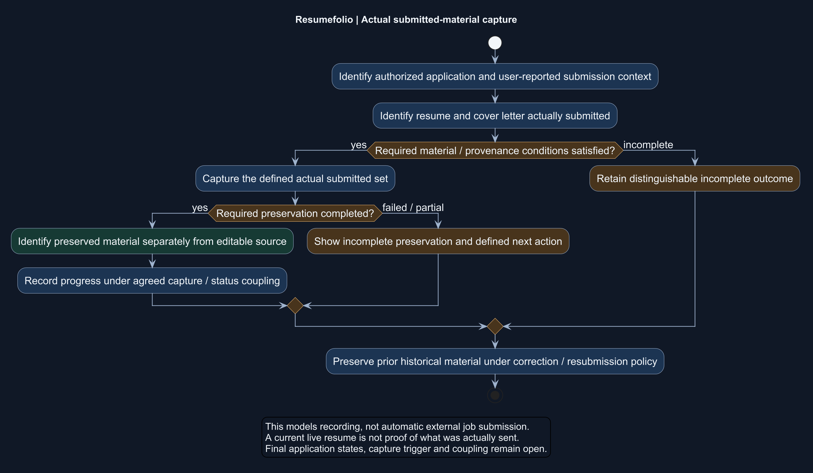

<a id="requirements-specification-manual-application-management"></a>

<a id="requirements-specification-manual-application-management--heading-resumefolio--manual-application-management"></a>
# Resumefolio — Manual Application Management

Current implementation choices and scope: [Baseline](https://github.com/Farhad-V/Web-Resumefolio/blob/1f2acaa351ac306cb57cbe4fe9742e8bd90720d9/docs/MVP/baseline/README.md). Runtime verification remains subject to its gates.

| Item | Current position |
| --- | --- |
| Owner | Farhad; sole delivery and operations owner |
| Status | Proposed product specification — detailed policy and acceptance pending |
| Planning basis | DEC-023/027/022/028; submitted-copy source EXT-002 |
| Candidate references | APP-D01–APP-D09 are provisional document-local references, not allocated global requirement IDs |
| Priority | Unassigned; document order is not delivery priority |
| Revision | October 31, 2026 |

**At a glance:** Record companies, opportunities, manually written cover letters and progress. Preserve the resume and cover letter actually submitted so later edits do not rewrite history. A live sharing link, current source, recorded status and preserved submitted copy are different things.

[Basis](#requirements-specification-manual-application-management--heading-1-purpose-and-accepted-boundary) · [Inventory](#requirements-specification-manual-application-management--heading-2-capability-and-information-inventory)
· [Requirements](#requirements-specification-manual-application-management--heading-3-proposed-requirements) · [Models](#requirements-specification-manual-application-management--heading-4-behavior-and-boundary-models)
· [Scenarios](#requirements-specification-manual-application-management--heading-5-planned-verification) · [Decisions](#requirements-specification-manual-application-management--heading-6-open-decisions-and-gates)
· [Review](#requirements-specification-manual-application-management--heading-7-traceability-and-review-readiness)

<a id="requirements-specification-manual-application-management--heading-mvp-integrated-job-applications"></a>
## MVP integrated job applications

Manual job application management belongs to the Resumefolio core; ApplyFlow is its former name, not a separate branded platform. Each application preserves actual submitted materials, status, next action and follow-up date, together with its company/opportunity and selected resume/cover letter. Later source edits cannot change the recorded submitted set. Recording a submission is manual. APP-D08 requires manual follow-up fields in MVP; correspondence/calendar/provider links are deferred and cannot be required for tracking.

Authority: [OWNER-MVP-2026-11-04](../../../01-Project-Planning/01-Project-Charter.md#release-decision). [Candidate allocation](10-Mvp-Candidate-Release-Allocation.md#requirements-specification-mvp-release-allocation).

<a id="requirements-specification-manual-application-management--heading-1-purpose-and-accepted-boundary"></a>
## 1. Purpose and Accepted Boundary

[Scope DEC-023](https://github.com/Farhad-V/Web-Resumefolio/blob/1f2acaa351ac306cb57cbe4fe9742e8bd90720d9/docs/MVP/SDLC/01-project-planning/02-scope.md#dec-023) includes manual
ApplyFlow: company/position, relevant resume, user-written cover letter, progress
and preservation of actual submitted resume/cover-letter material. AI-assisted
analysis/drafting is excluded. Recording submission is not an integration that
automatically submits applications to external job platforms.

[EXT-002](../02-Stakeholders-And-Elicitation/02-Elicitation-Log.md#stakeholders-and-elicitation-elicitation-log--heading-ext-002-manual-applications-and-preserved-submissions)
is a documentary source extraction, not a new interview or detailed policy approval.
Use [Business Lifecycle](04-Business-Rules-And-Data-Lifecycle.md#requirements-specification-business-rules-and-data-lifecycle),
[PDF and Sharing](11-Pdf-And-Controlled-Sharing.md#requirements-specification-pdf-and-controlled-sharing),
[Google Integration](06-Email-Calendar-And-Google-Integration.md#requirements-specification-email-calendar-and-google-integration) and the
[Data Dictionary](../05-Data-Definitions/02-Data-Dictionary.md#data-definitions-data-dictionary) to reconcile boundaries.

<a id="requirements-specification-manual-application-management--heading-2-capability-and-information-inventory"></a>
## 2. Capability and Information Inventory

| Subject | Meaning | Definition still needed |
| --- | --- | --- |
| Company/opportunity | Context for the user's application | Fields, validation, reuse and duplicates |
| Editable preparation | Relevant resume association and manually authored cover letter | Save/revision behavior, formats and independence |
| Progress | User-recorded application stage/events | Final state/transition table, corrections and time semantics |
| Submission recording | User identifies what was actually sent and relevant context | Capture trigger, required set, provenance and incomplete outcomes |
| Preserved submitted set | Actual historical resume/cover-letter material | Artifact boundaries, resubmissions, retention and access |
| Correspondence/activity | Related authorized Gmail/calendar information | Link/copy, provider lifecycle and reminders |
| Archive/recovery | Deliberate retention/removal and restored relationships | Permissions, reference policy, coverage and actual evidence |

<a id="requirements-specification-manual-application-management--heading-3-proposed-requirements"></a>
## 3. Proposed Requirements

All records are **Proposed**, owner **Farhad**, priority **Unassigned**. The final
status set, capture mechanism and retention policy remain undecided.

<a id="requirements-specification-manual-application-management--heading-app-d01-company-and-opportunity-context"></a>
### APP-D01: Company and Opportunity Context

**Release allocation (owner decision, November 4):** MVP — Resumefolio core.

**Source / rationale:** DEC-023; application records need an identifiable company and position.

**Actor / conditions:** Authorized user creates or updates a manual application context.

**Proposed obligation:** Users shall record the company and job position associated with an application under reviewed field and validation rules.

**Acceptance criteria**
- A valid application identifies the intended company/position without silently substituting another opportunity.
- Missing or invalid required information produces the agreed incomplete/rejected outcome rather than false completion.
- Editing one application context does not silently change unrelated applications contrary to the reviewed reuse policy.

**Planned verification:** Later valid/incomplete/duplicate/reused-company cases.

**Open detail:** Fields, identifiers, required inputs, source URLs/attachments, company reuse, duplicate applications and opportunities without a structured job advertisement.

<a id="requirements-specification-manual-application-management--heading-app-d02-relevant-resume-association"></a>
### APP-D02: Relevant Resume Association

**Release allocation (owner decision, November 4):** MVP — Resumefolio core.

**Source / rationale:** DEC-023/027; users choose opportunity-specific material while retaining independent tailoring.

**Actor / conditions:** Authorized user selects or changes the resume for a preparation-stage application.

**Proposed obligation:** The product shall associate the intended authorized resume with the application and distinguish that editable source from preserved submitted material.

**Acceptance criteria**
- The selected resume belongs to an allowed resource context and is identifiable from the application.
- Cross-user or invalid resume references cannot associate or disclose unrelated protected content.
- Changing the current association does not overwrite material already preserved as actually submitted.

**Planned verification:** Later authorized/denied association and post-submission source-change cases.

**Open detail:** Association cardinality, source-revision display, replacement/removal behavior, independently supplied files and source deletion.

<a id="requirements-specification-manual-application-management--heading-app-d03-manually-authored-cover-letter"></a>
### APP-D03: Manually Authored Cover Letter

**Release allocation (owner decision, November 4):** MVP — Resumefolio core.

**Source / rationale:** DEC-023/016; preparation remains user-authored without product AI.

**Actor / conditions:** Authorized user writes or edits application-specific cover-letter content.

**Proposed obligation:** Users shall manually prepare and save cover-letter content with explicit editing, validation and save-result rules.

**Acceptance criteria**
- Agreed valid manually entered content is retained for the intended application.
- Failed/incomplete save does not appear as successfully saved content.
- Later source edits do not overwrite a cover-letter copy already preserved as submitted.

**Planned verification:** Later edit/save/interruption and preserved-copy comparison cases.

**Open detail:** Required/optional content, format/language, draft recovery, duplication/reuse, export and independently prepared submitted letters; no AI drafting or automatic translation.

<a id="requirements-specification-manual-application-management--heading-app-d04-explicit-progress-states-and-transitions"></a>
### APP-D04: Explicit Progress States and Transitions

<a id="owner-selected-manual-application-status"></a>

**Owner-selected manual status policy.** The owner explicitly selected unrestricted manual movement between the existing MVP statuses: Preparing, Ready, Submitted, Interview, Offer, Rejected and Withdrawn. The authorized user may choose any of these statuses from any current status, at any time, including backward moves, reopening after rejection/withdrawal and corrections. No mandatory workflow sequence, prerequisite interview, locked terminal state or required reason blocks that choice. A deliberate same-status progress record is permitted for another interview or progress occurrence; an ordinary page load or unrelated save never invents an event.

Each explicit progress record preserves the previous history and appends actor, previous/new status, effective time and recorded time; a reason is optional. Default effective time is the confirmed action time; a user-supplied valid effective time records when the event actually occurred. Current ownership/authorization, valid status input and optimistic concurrency still apply. A stale write returns a conflict for review rather than overwriting a later change. Only the user's explicit confirmed action changes the current status; no mail, calendar, sharing, capture or automated inference changes it.

Status and actual-material capture remain independent: selecting Submitted does not send an application, prove employer receipt or certify that submitted files were preserved. Missing/failed capture stays explicitly incomplete and does not block the user's status choice. A backward/correction move never changes or deletes previously preserved actual submitted materials. Leaving Offer clears the current offer-outcome field if set, while any previously recorded outcome remains in attributed progress history.

This current owner decision supersedes older proposed transition restrictions for the MVP. The existing status vocabulary, private access, immutable material history and runtime verification gates remain in force.

**Owner-scope acceptance additions (MVP; planned, not executed):**

- The user can save status, a manual next action and follow-up date without any email/calendar connection; later edits do not change actual submitted materials.

**Release allocation (owner decision, November 4):** MVP — Resumefolio core.

**Source / rationale:** DEC-023; preparation, submission, interview and outcome are examples, not a finalized universal state machine.

**Actor / conditions:** Authorized user records or corrects application progress.

**Selected obligation:** Application progress uses the existing status set with unrestricted user-directed movement, append-only attributed progress records and the owner-selected manual policy above.

**Acceptance criteria**
- A permitted transition yields the intended current state and reviewed history information.
- An invalid or unauthorized transition produces defined feedback without false state completion.
- Examples such as withdrawal, rejection, repeated interviews or correction are handled according to explicitly chosen rules rather than an assumed one-way sequence.

**Planned verification:** Later transition-table walkthrough and valid/invalid/correction tests.

**Decision resolved:** The owner-selected manual policy above fixes movement, repeated same-status events, optional reasons, effective/recorded time, preserved history and stale-write behavior. Implementation and transition/history tests remain unexecuted.

<a id="requirements-specification-manual-application-management--heading-app-d05-user-directed-submission-recording"></a>
### APP-D05: User-directed Submission Recording

**Release allocation (owner decision, November 4):** MVP — Resumefolio core.

**Source / rationale:** DEC-023; marking submitted records a user-reported action, not automated external submission.

**Actor / conditions:** User records materials actually sent through an external/manual channel.

**Proposed obligation:** Submission recording shall identify the intended application and actual material context under an explicit capture/validation workflow.

**Acceptance criteria**
- The user can distinguish source selection, recorded submission progress and successfully preserved actual materials.
- A saved status alone is not represented as evidence of an external platform submission, employer receipt or message read.
- If required capture is missing/failed, preservation remains distinguishably incomplete; progress/capture atomicity follows a reviewed rule.

**Planned verification:** Later external-channel examples, missing-material and capture-failure walkthroughs.

**Open detail:** Capture trigger, channel/time/provenance, material completeness, status coupling and later supply/correction; no actual applications are submitted here.

<a id="requirements-specification-manual-application-management--heading-app-d06-preserved-actual-submitted-copies"></a>
### APP-D06: Preserved Actual Submitted Copies

**Release allocation (owner decision, November 4):** MVP — Resumefolio core.

**Source / rationale:** DEC-023 and elicitation EXT-002; later editable-source changes must not rewrite application history.

**Actor / conditions:** The reviewed submission-recording process captures the resume and cover letter actually submitted.

**Proposed obligation:** The product shall preserve the actual submitted resume and cover-letter material in an identifiable historical context independent of subsequent source edits.

**Acceptance criteria**
- After capture, profile/resume/cover-letter/source-PDF edits do not overwrite preserved material.
- The preserved set corresponds to the actual user-identified submitted materials/revision under the reviewed capture policy, not an assumed latest live resume.
- Retrieval distinguishes historical material from editable source and follows applicable access rules.

**Planned verification:** Later capture comparison, source edits/replacement/deletion and authorized retrieval cases.

**Open detail:** Exact artifact boundaries, generated/uploaded/external resume variants, attachment set, manual attestation/provenance, storage/format and failed capture; no indefinite retention or immutable legal record is promised.

<a id="requirements-specification-manual-application-management--heading-app-d07-correction-and-repeated-submissions"></a>
### APP-D07: Correction and Repeated Submissions

**Release allocation (owner decision, November 4):** MVP — Resumefolio core.

**Source / rationale:** Proposed history refinement of DEC-023; genuine corrections and resubmissions must not silently rewrite prior actual materials.

**Actor / conditions:** Authorized user corrects a record or records another submitted set for an application.

**Proposed obligation:** Corrections and resubmissions shall follow explicit history policies that keep relevant prior versus new material distinguishable.

**Acceptance criteria**
- Defined correction examples identify the affected record and produce the reviewed history/result.
- A newly submitted set is not silently substituted for a previously preserved set as though it were the original.
- Failed/repeated capture attempts yield the defined outcome without falsely claiming a complete new set.

**Planned verification:** Later correction/resubmission/duplicate/failure cases after policy review.

**Open detail:** Whether/how multiple sets are supported, provenance, correction versus replacement, permissions, retained versions and explicit deletion; no append-only architecture is selected.

<a id="requirements-specification-manual-application-management--heading-app-d08-correspondence-calendar-and-follow-up-links"></a>
### APP-D08: Correspondence, Calendar and Follow-up Links

**MVP obligation:** Store a manually maintained next action and follow-up date with the application status. No provider connection is required; mail/calendar link criteria below are deferred.

**Release allocation (owner decision, November 4):** Split — MVP manual next action/follow-up date; mail/calendar association deferred.

**Source / rationale:** DEC-022/023/028; application work can relate to relevant communications without leaking private data.

**Actor / conditions:** Authorized user associates an application with agreed correspondence or activity.

**Proposed obligation:** Agreed relationships shall identify the correct application and authorized message/activity while preserving independent access and lifecycle boundaries.

**Acceptance criteria**
- A related message/activity resolves to the intended account/application context.
- A collaborator or employer viewer gains no private correspondence access merely from an application relationship.
- Provider changes/removal do not silently overwrite preserved actual submitted copies.

**Planned verification:** Later association/permission/provider-removal scenarios.

**Open detail:** Link versus copy, displayed fields, reminders, relationship count, availability after disconnect and whether sent correspondence contributes to capture; EGC-D rules retain provider gates.

<a id="requirements-specification-manual-application-management--heading-app-d09-private-access-archive-and-recovery"></a>
### APP-D09: Private Access, Archive and Recovery

**Release allocation (owner decision, November 4):** MVP — Resumefolio core.

**Source / rationale:** DEC-028/023/017 and proposed lifecycle refinement; application information and historical copies require deliberate retirement/recovery rules.

**Actor / conditions:** User/operator requests a protected read, archive, deletion or restoration operation.

**Proposed obligation:** Application lifecycle operations shall follow explicit authority, reference, retention and restoration policies without an implicit cascade from source removal.

**Acceptance criteria**
- Direct/cross-user requests cannot read or mutate unrelated protected application/history material.
- Source unlink/replacement does not implicitly erase preserved submissions; deliberate archive/delete follows the reviewed consequences.
- Later isolated restoration checks the application, preserved artifacts and access consistency; partial recovery is not a complete Pass.

**Planned verification:** Later denial/archive/delete/reference and isolated restore checks.

**Open detail:** Archive visibility, deletion authority/retention, account closure, recovery targets and deleted-data reappearance; no period or administrator power is invented.

<a id="requirements-specification-manual-application-management--heading-4-behavior-and-boundary-models"></a>
## 4. Behavior and Boundary Models



[Scalable SVG](../../Diagrams/Manual-Application-History-Map.svg) · [Graphviz source](../../Diagrams/Manual-Application-History-Map.dot)

Arrows express conceptual relationships, not copying implementation or automatic
submission. A current generated PDF is not proof it was the file actually sent.



[Scalable SVG](../../Diagrams/Application-Submission-Capture.svg) · [PlantUML source](../../Diagrams/Application-Submission-Capture.puml)

This flow describes capture review, not the final application state machine.
Capture completeness and progress status need an explicit coupling/failure rule.
No external sending step is performed or authorized by the model.

<a id="requirements-specification-manual-application-management--heading-5-planned-verification"></a>
## 5. Planned Verification

| Family | Candidates | Cases to develop |
| --- | --- | --- |
| Preparation | APP-D01–D03 | Required fields, duplicates, allowed/denied resume association, cover-letter save failures |
| Progress | APP-D04/D05 | Final valid/invalid transitions, correction, recorded versus actual event time |
| Actual history | APP-D05/D06 | Correct actual material, incomplete capture, source edits/replacement/deletion afterward |
| Repeated work | APP-D07 | Corrections, resubmission sets, failed/repeated capture and prior-set distinction |
| Cross-module | APP-D08 | Message/activity relationships, access isolation and provider source removal |
| Lifecycle | APP-D09 | Direct denial, archive/delete/reference policy and isolated consistent recovery |

Later evidence identifies candidate/policy revision, actor, application, source and
preserved artifact versions, initial state, expected/actual result and limits.
Use synthetic applications/materials; no real job submission is needed for
documentation verification and no product tests are recorded here.

<a id="requirements-specification-manual-application-management--heading-6-open-decisions-and-gates"></a>
## 6. Open Decisions and Gates

| Topic | Decisions/evidence needed | Gate |
| --- | --- | --- |
| Input/workflow | Fields, incomplete records, duplicates, source associations and draft behavior | Affected M-02 acceptance |
| Progress history | Final states/transitions, corrections, times and concurrency | Before accepting progress criteria/design |
| Actual-material capture | Trigger, file/revision set, user provenance, status coupling and failures | Before accepting capture/history requirements |
| Resubmission/correction | Prior/new sets, permitted changes, access and deletion | Affected history/lifecycle acceptance |
| Communication | Relationships, sent content versus history, reminders and provider data availability | EGC-D requirements; GAP-D02 before provider-dependent development |
| Privacy/retention/recovery | Exact grants, archive/delete, source references, coverage and actual restore | Domain/lifecycle design; GAP-D04 and later M-09 evidence |

Farhad coordinates all topics. Record actual findings in
[Questions and Decisions](../07-Change-And-Baseline/03-Requirements-Questions-And-Decisions.md#change-and-baseline-open-questions-and-decisions)
and retain [Planning Gates](https://github.com/Farhad-V/Web-Resumefolio/blob/1f2acaa351ac306cb57cbe4fe9742e8bd90720d9/docs/MVP/SDLC/01-project-planning/10-planning-completion-criteria.md).
Material scope/cost/delivery changes follow [Change Control](../07-Change-And-Baseline/02-Requirements-Change-Control.md#change-and-baseline-change-control).
No local topic is claimed as an allocated shared question or accepted policy.

<a id="requirements-specification-manual-application-management--heading-7-traceability-and-review-readiness"></a>
## 7. Traceability and Review Readiness

APP-D01–D06 derive from DEC-023 with DEC-027 source independence and EXT-002.
APP-D07/D09 include proposed correction/lifecycle detail; APP-D08 links DEC-022/028.
Reconcile BRL-D05 history, EGC-D09 communication relationships, ACC-D permissions
and AFO-D replacement/cleanup without treating those drafts as approved policies.

Use the [requirement template](17-Software-Requirements-Specification.md#requirements-specification-requirements-specification) when allocating
final IDs. Link allocated records/scenarios and actual evidence in
[Traceability](../06-Validation-And-Traceability/07-Validation-And-Traceability.md#validation-and-traceability-validation-and-traceability--heading-traceability).
Record actual inspection outcomes in [Review Findings](../06-Validation-And-Traceability/07-Validation-And-Traceability.md#validation-and-traceability-validation-and-traceability--heading-review-findings).

- [ ] Reconcile provisional APP-D references and assign justified priorities.
- [ ] Review source-derived boundaries separately from proposed supporting detail.
- [ ] Resolve policy/state/permission questions blocking affected acceptance.
- [ ] Reconcile dictionary, lifecycle, interface and related domain specifications.
- [ ] Complete normal, denied, failure, concurrent and recovery scenarios where applicable.
- [ ] Record actual owner decision, reviewed revision, evidence and remaining blockers.

**Current outcome:** Proposed specification; no candidate is accepted and no product
test result is recorded. Conditional criteria are not acceptance-ready until their
referenced policies are decided. M-02 and the wider pre-implementation agreement
remain pending. This revision changes no accepted scope and performs no live
repository, application-submission, sharing, file or provider operation.

<a id="requirements-specification-manual-application-management--heading-8-diagram-maintenance"></a>
## 8. Diagram Maintenance

| Diagram | Source | SVG | PNG |
| --- | --- | --- | --- |
| Application history boundaries | [Graphviz](../../Diagrams/Manual-Application-History-Map.dot) | [SVG](../../Diagrams/Manual-Application-History-Map.svg) |  |
| Submitted-material capture | [PlantUML](../../Diagrams/Application-Submission-Capture.puml) | [SVG](../../Diagrams/Application-Submission-Capture.svg) |  |

Keep sources, captions and renders synchronized. Colors supplement labels. Follow
the [diagram guide](../../Diagrams/Diagram-Catalog.md); inspect readable arrows/labels and check
file/section links after changes. From repository root:

```powershell
$diagramFolder = 'docs\MVP\SDLC\02-requirements-engineering\diagrams'
$graphvizExe = 'C:\Program Files\Graphviz\bin\dot.exe'
$plantUmlJar = 'C:\Users\fvali\AppData\Local\Resumefolio\DiagramTools\plantuml.jar'
foreach ($format in 'svg', 'png') {
    & $graphvizExe "-T$format" -Gdpi=140 "$diagramFolder\manual-application-history-map.dot" -o "$diagramFolder\manual-application-history-map.$format"
    if ($LASTEXITCODE -ne 0) { throw "Graphviz failed: $format" }
    java '-Djava.awt.headless=true' -jar $plantUmlJar -charset UTF-8 "-t$format" "$diagramFolder\application-submission-capture.puml"
    if ($LASTEXITCODE -ne 0) { throw "PlantUML failed: $format" }
}
```

Use actual tool paths on other machines; save UTF-8 without BOM.

[Specification index](16-Requirements-Specification-Guide.md#requirements-specification-requirements-specification-overview) · [SRS entry point](17-Software-Requirements-Specification.md#requirements-specification-requirements-specification)
· [Requirements index]()

<a id="requirements-specification-manual-application-management--heading-selected-policies-and-future-proposals"></a>
## Selected Policies and Future Proposals

Current MVP answers are selected in the Baseline. Only explicitly deferred details below remain proposals; product tests and operational evidence are still required.

<a id="requirements-specification-manual-application-management--id-resolution-q-d12"></a>
<a id="requirements-specification-manual-application-management--heading-q-d12-selected-policy"></a>
### Q-D12: Selected policy

[Selected answer and remaining evidence](https://github.com/Farhad-V/Web-Resumefolio/blob/1f2acaa351ac306cb57cbe4fe9742e8bd90720d9/docs/MVP/baseline/policy-decisions.md#q-d12). Apply this policy to the MVP slice; the original criteria above remain subject to their [current dispositions](https://github.com/Farhad-V/Web-Resumefolio/blob/1f2acaa351ac306cb57cbe4fe9742e8bd90720d9/docs/MVP/baseline/criterion-dispositions.csv).

<a id="requirements-specification-manual-application-management--id-resolution-q-d13"></a>
<a id="requirements-specification-manual-application-management--heading-q-d13-selected-policy"></a>
### Q-D13: Selected policy

[Selected answer and remaining evidence](https://github.com/Farhad-V/Web-Resumefolio/blob/1f2acaa351ac306cb57cbe4fe9742e8bd90720d9/docs/MVP/baseline/policy-decisions.md#q-d13). Apply this policy to the MVP slice; the original criteria above remain subject to their [current dispositions](https://github.com/Farhad-V/Web-Resumefolio/blob/1f2acaa351ac306cb57cbe4fe9742e8bd90720d9/docs/MVP/baseline/criterion-dispositions.csv).

<a id="requirements-specification-manual-application-management--id-resolution-q-d14"></a>
<a id="requirements-specification-manual-application-management--heading-q-d14-selected-policy"></a>
### Q-D14: Selected policy

[Selected answer and remaining evidence](https://github.com/Farhad-V/Web-Resumefolio/blob/1f2acaa351ac306cb57cbe4fe9742e8bd90720d9/docs/MVP/baseline/policy-decisions.md#q-d14). Apply this policy to the MVP slice; the original criteria above remain subject to their [current dispositions](https://github.com/Farhad-V/Web-Resumefolio/blob/1f2acaa351ac306cb57cbe4fe9742e8bd90720d9/docs/MVP/baseline/criterion-dispositions.csv).
