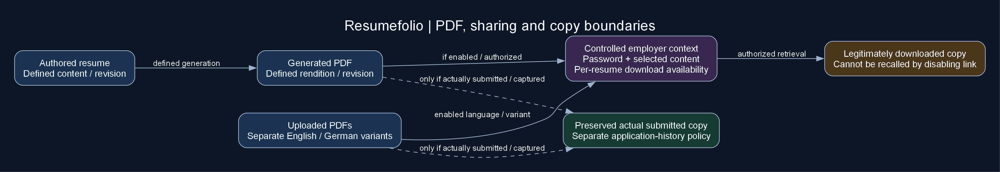
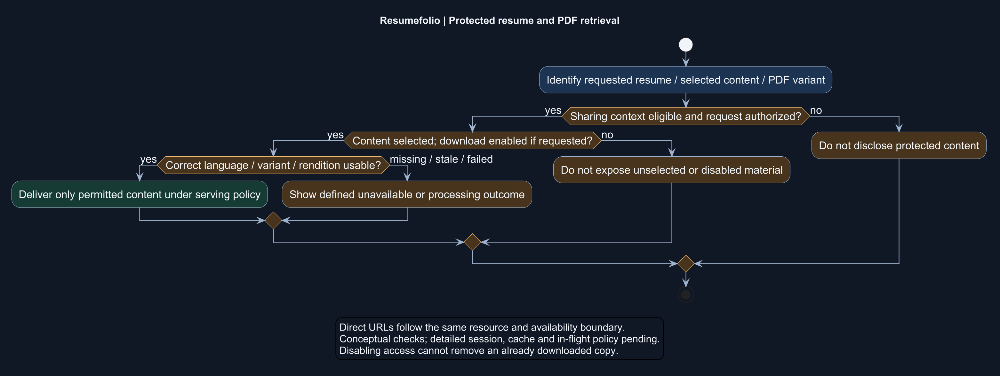
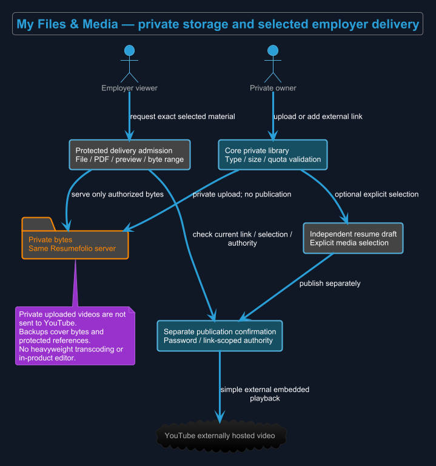

<a id="requirements-specification-pdf-and-controlled-sharing"></a>

<a id="requirements-specification-pdf-and-controlled-sharing--heading-resumefolio--pdf-and-controlled-sharing"></a>
# Resumefolio — PDF and Controlled Sharing

**Quick read — PDF and controlled sharing.** Covers generated/uploaded PDFs and employer disclosure. Verify permissions and retrieval rules for the intended content and current access state.

[3. Proposed Requirements](#requirements-specification-pdf-and-controlled-sharing--heading-3-proposed-requirements) · [6. Open Decisions and Gates](#requirements-specification-pdf-and-controlled-sharing--heading-6-open-decisions-and-gates) · [Selected Policies and Future Proposals](#requirements-specification-pdf-and-controlled-sharing--heading-selected-policies-and-future-proposals)

[Domain index](README.md) · [Acceptance trace](../../03-Requirements-Traceability-Matrix/README.md)


Current implementation choices and scope: [Baseline](https://github.com/Farhad-V/Web-Resumefolio/blob/1f2acaa351ac306cb57cbe4fe9742e8bd90720d9/docs/MVP/baseline/README.md). Runtime verification remains subject to its gates.

| Item | Current position |
| --- | --- |
| Owner | Farhad; sole delivery and operations owner |
| Status | Proposed product specification — detailed policy and acceptance pending |
| Planning basis | DEC-025/024/026/027/028; EXT-001 |
| Candidate references | PDF-D01–PDF-D10 are provisional document-local references, not allocated global requirement IDs |
| Priority | Unassigned; document order is not delivery priority |
| Revision | October 31, 2026 |

**At a glance:** Provide generated and uploaded resume PDFs with per-resume download choices and separately controlled English/German uploaded availability. Protect employer access and direct file paths, retain owner controls, and distinguish live views from downloaded or preserved submitted copies.

[Basis](#requirements-specification-pdf-and-controlled-sharing--heading-1-purpose-and-accepted-boundary) · [Inventory](#requirements-specification-pdf-and-controlled-sharing--heading-2-capability-and-information-inventory)
· [Requirements](#requirements-specification-pdf-and-controlled-sharing--heading-3-proposed-requirements) · [Models](#requirements-specification-pdf-and-controlled-sharing--heading-4-behavior-and-boundary-models)
· [Scenarios](#requirements-specification-pdf-and-controlled-sharing--heading-5-planned-verification) · [Decisions](#requirements-specification-pdf-and-controlled-sharing--heading-6-open-decisions-and-gates)
· [Review](#requirements-specification-pdf-and-controlled-sharing--heading-7-traceability-and-review-readiness)

<a id="requirements-specification-pdf-and-controlled-sharing--heading-mvp-employer-media-and-pdf-access"></a>
## MVP employer media and PDF access

Retain generated/uploaded PDF availability and password-protected resume sharing without an employer account or owner login. Only explicitly selected material is visible. Apply current resume/viewer authorization to media playback, direct retrieval and byte ranges as well as PDFs; a storage path or cached rendition cannot bypass it. Uploading to My Files & Media alone grants no employer access. Revocation controls subsequent admissions; it cannot retract legitimately downloaded bytes.

Authority: [OWNER-MVP-2026-11-04](../../../01-Project-Planning/01-Project-Charter.md#release-decision). [Candidate allocation](10-Mvp-Candidate-Release-Allocation.md#requirements-specification-mvp-release-allocation).

<a id="requirements-specification-pdf-and-controlled-sharing--heading-1-purpose-and-accepted-boundary"></a>
## 1. Purpose and Accepted Boundary

[DEC-025](https://github.com/Farhad-V/Web-Resumefolio/blob/1f2acaa351ac306cb57cbe4fe9742e8bd90720d9/docs/MVP/SDLC/01-project-planning/02-scope.md#dec-025) includes generated and
uploaded PDFs with generated/uploaded/both/neither download selection and separately
provided English/German uploaded PDFs. [DEC-024](https://github.com/Farhad-V/Web-Resumefolio/blob/1f2acaa351ac306cb57cbe4fe9742e8bd90720d9/docs/MVP/SDLC/01-project-planning/02-scope.md#dec-024)
includes password-protected employer links without viewer accounts; selected
content only, owner password/disable controls and protected direct files/PDFs.

[EXT-001](../02-Stakeholders-And-Elicitation/02-Elicitation-Log.md#stakeholders-and-elicitation-elicitation-log--heading-ext-001-controlled-employer-access)
extracts this existing scope; it is not approval of detailed password/session policy.
An already downloaded copy cannot be removed by disabling the link. Access
revocation, live revision changes and submitted-material preservation are separate concerns.

Use [Accounts](01-Accounts-Authentication-And-Permissions.md#requirements-specification-accounts-authentication-and-permissions),
[Applications](09-Manual-Application-Management.md#requirements-specification-manual-application-management),
[Files/Operations](02-Administration-Files-And-Operational-Behavior.md#requirements-specification-administration-files-and-operational-behavior),
[Business Lifecycle](04-Business-Rules-And-Data-Lifecycle.md#requirements-specification-business-rules-and-data-lifecycle) and the
[Data Dictionary](../05-Data-Definitions/02-Data-Dictionary.md#data-definitions-data-dictionary) to reconcile detailed rules.

<a id="requirements-specification-pdf-and-controlled-sharing--heading-2-capability-and-information-inventory"></a>
## 2. Capability and Information Inventory

| Subject | Meaning | Definition still needed |
| --- | --- | --- |
| Generated PDF | Rendition of authored resume content | Represented revision, template, format, generation and stale/failure behavior |
| Uploaded PDF | Independently prepared language-specific artifact | Validation, language metadata, replacement and retained versions |
| Download choice | Generated/uploaded/both/neither for each resume | Missing artifacts, language choices and effective changes |
| Employer link | Password-protected path to intended selected content | Link/password/session lifecycle, abuse controls and revocation |
| Direct retrieval | Actual page/file/PDF delivery | Authorization/availability across every serving path |
| Historical copy | Actual resume/cover-letter material preserved for an application | Capture, correction, retention and distinction from current source/live view |

<a id="requirements-specification-pdf-and-controlled-sharing--heading-download-availability-review-matrix"></a>
### Download Availability Review Matrix

| Selected mode | Eligible generated PDF | Eligible uploaded PDF |
| --- | --- | --- |
| Generated only | May be offered if generation/language policy and authorization permit | Not offered through employer download |
| Uploaded only | Not offered through employer download | Only enabled and available language variant(s) |
| Both | May be offered under the same conditions | Only enabled and available language variant(s) |
| Neither | Not offered through employer download | Not offered through employer download |

Mode is not entitlement: every offered artifact must exist/be usable under the
reviewed rendition policy and pass retrieval authorization. Missing-language or
missing-artifact fallback remains undecided. This matrix does not decide whether
an authorized owner may privately preview/download an otherwise unshared artifact.

<a id="requirements-specification-pdf-and-controlled-sharing--heading-3-proposed-requirements"></a>
## 3. Proposed Requirements

All records are **Proposed**, owner **Farhad**, priority **Unassigned**. Detailed
layout, availability and password/session policies remain pending.

<a id="requirements-specification-pdf-and-controlled-sharing--heading-pdf-d01-generated-resume-pdf"></a>
### PDF-D01: Generated Resume PDF

**Release allocation (owner decision, November 4):** MVP — Resumefolio core.

**Source / rationale:** DEC-025/027; authored resume content needs a defined portable rendition.

**Actor / conditions:** Authorized actor requests an eligible PDF rendition of an authored resume.

**Proposed obligation:** The product shall generate a PDF representing the intended resume content/revision under reviewed layout and language rules.

**Acceptance criteria**
- Representative generated output corresponds to the intended resume and defined revision, not an unrelated or silently stale source.
- Agreed text, selected evidence treatment and formatting/pagination examples produce the reviewed output.
- Failed/incomplete generation is distinguishable from a successfully available PDF.

**Planned verification:** Later render/content/revision comparison and generation-failure cases.

**Open detail:** Templates, fonts, page size, links/media representation, accessibility, pagination, generation trigger/cache and numerical processing limits; no PDF library chosen.

<a id="requirements-specification-pdf-and-controlled-sharing--heading-pdf-d02-uploaded-pdf-and-language-identity"></a>
### PDF-D02: Uploaded PDF and Language Identity

**Release allocation (owner decision, November 4):** MVP — Resumefolio core.

**Source / rationale:** DEC-025/015; users may supply independently prepared English and German PDFs.

**Actor / conditions:** Authorized owner uploads or replaces a resume-specific PDF variant.

**Proposed obligation:** The product shall associate valid uploaded PDFs with the intended resume and language under explicit validation and replacement rules.

**Acceptance criteria**
- Separately provided English/German uploaded PDFs retain the intended resume/language association.
- Unsupported/invalid/over-limit input produces the reviewed rejection without a false completed upload.
- Replacement does not silently alter another language/resume or overwrite preserved actual submitted copies.

**Planned verification:** Later two-language upload/replacement, invalid-file and preserved-copy checks.

**Open detail:** Required metadata, file validation/limits, multiple versions, same-language replacement, source naming and failure recovery; missing language policy remains open.

<a id="requirements-specification-pdf-and-controlled-sharing--heading-pdf-d03-per-resume-download-choices"></a>
### PDF-D03: Per-resume Download Choices

**Release allocation (owner decision, November 4):** MVP — Resumefolio core.

**Source / rationale:** DEC-025; owners choose generated, uploaded, both or neither for employer download.

**Actor / conditions:** Authorized owner configures download availability for a resume.

**Proposed obligation:** The product shall enforce the selected PDF download choices, including language-specific uploaded availability, independently for each resume.

**Acceptance criteria**
- Generated-only, uploaded-only, both and neither cases expose only the permitted available variants.
- English/German uploaded availability is respected without silently substituting a disabled/unavailable language.
- Changes for one resume do not silently alter another resume or bypass retrieval authorization.

**Planned verification:** Later availability matrix, two-resume isolation and direct retrieval checks.

**Open detail:** Missing-variant behavior, owner preview/download distinction, generated-language policy and timing during active requests; no automatic fallback assumed.

<a id="requirements-specification-pdf-and-controlled-sharing--heading-pdf-d04-scoped-password-protected-employer-access"></a>
### PDF-D04: Scoped Password-protected Employer Access

**Release allocation (owner decision, November 4):** MVP — Resumefolio core.

**Source / rationale:** DEC-024/026 and EXT-001; viewers need no product account and receive only selected content.

**Actor / conditions:** Employer viewer opens an eligible protected link for a specific resume.

**Proposed obligation:** The product shall require the sharing password and confine authorized employer access to the intended resume and selected permitted content.

**Acceptance criteria**
- A fresh viewer can access eligible shared content using the correct password without creating a product account.
- Missing/incorrect password does not newly authorize protected content.
- The sharing context grants no private workspace, unrelated resumes, mail, repositories or unselected evidence.

**Planned verification:** Later fresh-viewer valid/invalid access and cross-resource cases.

**Open detail:** Link count/lifecycle, password rules, abuse controls, attempt feedback/session lifetime and viewer identification; password possession is not proof of employer identity.

<a id="requirements-specification-pdf-and-controlled-sharing--heading-pdf-d05-direct-file-and-pdf-authorization"></a>
### PDF-D05: Direct File and PDF Authorization

**Owner-scope acceptance additions (MVP; planned, not executed):**

- A direct URL, media preview or byte-range request without valid selected-resume authority yields no private bytes. Selection/removal and revocation affect subsequent retrieval admission.

**Release allocation (owner decision, November 4):** MVP — Resumefolio core.

**Source / rationale:** DEC-024/025/028; a visible control alone is not access enforcement.

**Actor / conditions:** Any caller requests shared content or a file/PDF through a direct or altered path.

**Proposed obligation:** Protected pages, files and PDFs shall enforce the applicable resource authority, selected sharing content and download availability at retrieval.

**Acceptance criteria**
- A direct file/PDF URL cannot bypass missing/invalid sharing authorization or disabled variant availability.
- Changing resume/file identifiers cannot disclose unrelated or unselected protected material.
- Authorized retrieval returns only the intended permitted artifact in its reviewed context.

**Planned verification:** Later direct-path, changed-reference, selected/unselected and allowed/denied cases.

**Open detail:** All delivery/cache/temporary URL paths, request methods, expiration and active/in-flight behavior require design and policy review; no storage mechanism selected.

<a id="requirements-specification-pdf-and-controlled-sharing--heading-pdf-d06-owner-password-and-link-controls"></a>
### PDF-D06: Owner Password and Link Controls

**Release allocation (owner decision, November 4):** MVP — Resumefolio core.

**Source / rationale:** DEC-024 and ACC-D08; owners can change password or disable subsequent access.

**Actor / conditions:** Authorized owner changes sharing password or disables a link.

**Proposed obligation:** The product shall allow authorized owner controls and enforce their defined subsequent-access consequences across shared content paths.

**Acceptance criteria**
- An unrelated actor cannot change another owner's password/link state through direct requests.
- After disabling, a fresh viewer context cannot obtain protected content through the link.
- After a password change, the old password does not newly authorize a fresh viewer; the current password works only for an eligible link.

**Planned verification:** Later owner/non-owner changes, fresh-viewer rechecks and selected-resource paths.

**Open detail:** Already authorized sessions, in-flight requests, caches, re-enable behavior and effective change timing; no immediate global revocation or session duration is established.

<a id="requirements-specification-pdf-and-controlled-sharing--heading-pdf-d07-explicit-live-revision-and-rendition-behavior"></a>
### PDF-D07: Explicit Live-revision and Rendition Behavior

**Release allocation (owner decision, November 4):** MVP — Resumefolio core.

**Source / rationale:** DEC-027/025/024 and proposed revision refinement; live sharing must not be confused with historical submission.

**Actor / conditions:** Owner saves source changes or updates generated/uploaded shared material.

**Proposed obligation:** The live shared view and PDF availability shall follow an explicit revision/publication policy with stale/failed rendition outcomes distinguishable.

**Acceptance criteria**
- Defined source edits produce the agreed live-view revision rather than an assumed automatic publish action.
- The artifact offered as a current generated rendition corresponds to the defined revision or is identified as stale/unavailable under the reviewed policy.
- Changing live content does not overwrite the separately preserved actual submitted material.

**Planned verification:** Later save/live-view/rendition-revision/failure and historical-copy comparison cases.

**Open detail:** Save versus publish, generation invalidation, uploaded PDF relation to authored content, version display and pending changes; no new publication state machine assumed.

<a id="requirements-specification-pdf-and-controlled-sharing--heading-pdf-d08-downloaded-copy-and-submission-distinctions"></a>
### PDF-D08: Downloaded-copy and Submission Distinctions

**Release allocation (owner decision, November 4):** MVP — Resumefolio core.

**Source / rationale:** DEC-025/024/023; retrieval controls cannot recall copies already legitimately downloaded.

**Actor / conditions:** Owner/viewer considers disabling access or recording actual submitted materials.

**Proposed obligation:** The product shall distinguish live retrieval control, legitimately downloaded copies and preserved actual submitted history in behavior and relevant guidance.

**Acceptance criteria**
- Owner-facing guidance does not claim disabling/changing password removes a previously downloaded copy.
- A live shared resume/PDF is not presented as proof of the exact material previously submitted.
- If a PDF is captured as actual submitted material, later source replacement does not overwrite that preserved copy.

**Planned verification:** Later wording review and capture/source-replacement comparisons.

**Open detail:** Exact artifact capture and permitted history deletion remain in APP-D requirements; no DRM, read-tracking, recipient identity or delivery guarantee is introduced.

<a id="requirements-specification-pdf-and-controlled-sharing--heading-pdf-d09-failure-safe-processing-and-content-handling"></a>
### PDF-D09: Failure-safe Processing and Content Handling

**Release allocation (owner decision, November 4):** MVP — Resumefolio core.

**Source / rationale:** DEC-025/026/018 and proposed reliability/security refinement; invalid or failed file processing must not be mistaken for usable delivery.

**Actor / conditions:** Upload, generation, serving or replacement encounters invalid content, resource limits or interruption.

**Proposed obligation:** PDF/file operations shall follow reviewed validation, safe serving, quota and failure rules with truthful bounded outcomes.

**Acceptance criteria**
- Defined invalid/oversized/processing-failure cases do not publish partial output as a successful usable PDF.
- A failed replacement follows the agreed existing-artifact/reference policy without silently damaging unrelated data.
- Error output does not expose private paths, tokens/passwords or unrelated file content.

**Planned verification:** Later controlled validation, quota, failure/interruption and diagnostic-inspection cases.

**Open detail:** Validation depth, active/external content, resource limits, cleanup/retry and retained-old-version behavior; no malware scanner or numerical limit assumed.

<a id="requirements-specification-pdf-and-controlled-sharing--heading-pdf-d10-reference-aware-retirement-and-recovery"></a>
### PDF-D10: Reference-aware Retirement and Recovery

**Release allocation (owner decision, November 4):** MVP — Resumefolio core.

**Source / rationale:** DEC-023/017 and proposed lifecycle refinement; shared and historical artifacts have distinct dependencies.

**Actor / conditions:** Authorized actor removes a link, source/association or artifact, or restores data.

**Proposed obligation:** Retirement and restoration shall follow explicit reference, retention and access reconciliation rules for live shares, files and submitted copies.

**Acceptance criteria**
- Removing a link does not imply physical deletion of every referenced artifact or unrelated historical copy.
- Source-file removal does not silently destroy a required preserved submitted set.
- Later isolated restoration checks artifacts, references and permitted restored access; old enabled links/grants are reconciled under an explicit policy.

**Planned verification:** Later unlink/delete/reference scenarios and isolated artifact/access restoration.

**Open detail:** Archive/delete authority, quota reclamation, retention/backup coverage, restored disabled shares and RPO/RTO; no cascade, period or recovery result claimed.

<a id="requirements-specification-pdf-and-controlled-sharing--heading-4-behavior-and-boundary-models"></a>
## 4. Behavior and Boundary Models



[Scalable SVG](../../Diagrams/Pdf-Sharing-Boundaries.svg) · [Graphviz source](../../Diagrams/Pdf-Sharing-Boundaries.dot)

Arrows show conceptual delivery/history boundaries, not implementation copying.
Downloaded copies are outside product retrieval control; historical material is
preserved under a distinct application policy, not necessarily retained forever.



[Scalable SVG](../../Diagrams/Pdf-Protected-Retrieval.svg) · [PlantUML source](../../Diagrams/Pdf-Protected-Retrieval.puml)

This is a conceptual requirements flow, not a prescribed check order. Revalidate
conditions as required by the later concurrency/session/serving design. The
diagram does not settle active-session, cached or in-flight revocation behavior.

<a id="requirements-specification-pdf-and-controlled-sharing--heading-5-planned-verification"></a>
## 5. Planned Verification

| Family | Candidates | Cases to develop |
| --- | --- | --- |
| PDF content | PDF-D01/D02 | Correct revision/language, formatting, upload replacement, invalid and failed processing |
| Availability | PDF-D03 | Four download modes × available/unavailable language/variant × authorized/denied context |
| Protected boundary | PDF-D04/D05 | Fresh correct/wrong password, no viewer account, direct paths and changed identifiers |
| Owner changes | PDF-D06/D07 | Owner/non-owner change, fresh-viewer denial; later decided sessions/caches/live revisions |
| Copies/history | PDF-D08/D10 | Already downloaded limits, actual submitted copy independence and reference-aware retirement |
| Failures/recovery | PDF-D09/D10 | Interrupted generation/transfer/replacement, safe feedback and isolated restored access |

Later evidence identifies resume/source/artifact revisions, mode/language/link
state, actor/context, expected/actual result, candidate/environment and limits.
Use controlled documents/passwords; never retain real sharing secrets in repository
evidence. No tests, live links or download/revocation results are recorded here.

<a id="requirements-specification-pdf-and-controlled-sharing--heading-6-open-decisions-and-gates"></a>
## 6. Open Decisions and Gates

| Topic | Decisions/evidence needed | Gate |
| --- | --- | --- |
| Generated output | Content/layout/fonts/pagination, represented revision, generation/cache and accessibility | Before affected M-02 criteria/design acceptance |
| Upload/language | Validation, limits, English/German metadata, replacement and unavailable-language behavior | PDF/file-policy acceptance; GAP-D01/D10 resource evidence |
| Sharing/session | Link lifecycle, password/abuse controls, session lifetime, active/in-flight/cached change behavior | Affected access requirements and security/serving design |
| Publication/availability | Save/live revision, current/stale rendition, effective mode changes and owner preview | Before accepting live-share/retrieval criteria |
| Historical material | Actual-artifact capture, correction, resubmission and access | APP-D/BRL-D history review |
| Retirement/recovery | References, retention/cleanup, backup coverage and restored grants/disabled links | Lifecycle/design gates and actual restoration before M-09 |

Farhad coordinates these local topics. Record real findings in
[Questions and Decisions](../07-Change-And-Baseline/03-Requirements-Questions-And-Decisions.md#change-and-baseline-open-questions-and-decisions),
retain [Planning Gates](https://github.com/Farhad-V/Web-Resumefolio/blob/1f2acaa351ac306cb57cbe4fe9742e8bd90720d9/docs/MVP/SDLC/01-project-planning/10-planning-completion-criteria.md)
and use [Change Control](../07-Change-And-Baseline/02-Requirements-Change-Control.md#change-and-baseline-change-control) for material impacts.
No local row is a newly allocated decision or proof of security/capacity.

<a id="requirements-specification-pdf-and-controlled-sharing--heading-7-traceability-and-review-readiness"></a>
## 7. Traceability and Review Readiness

PDF-D01–D06 derive from DEC-025/024 with DEC-026/027/028 and EXT-001. PDF-D07–D10
include proposed revision, failure and lifecycle detail linked to DEC-023/017/018.
Reconcile ACC-D07/D08 direct access/owner controls, EIF-D04 file contracts, APP-D06
actual submitted material and BRL-D access/history invariants.

Use the [requirement template](17-Software-Requirements-Specification.md#requirements-specification-requirements-specification) when allocating
final IDs. Link allocated records/scenarios and actual evidence in
[Traceability](../06-Validation-And-Traceability/07-Validation-And-Traceability.md#validation-and-traceability-validation-and-traceability--heading-traceability).
Record actual inspection outcomes in [Review Findings](../06-Validation-And-Traceability/07-Validation-And-Traceability.md#validation-and-traceability-validation-and-traceability--heading-review-findings).

- [ ] Reconcile provisional PDF-D references and assign justified priorities.
- [ ] Review source-derived boundaries separately from proposed supporting detail.
- [ ] Resolve policy/state/permission questions blocking affected acceptance.
- [ ] Reconcile dictionary, lifecycle, interface and related domain specifications.
- [ ] Complete normal, denied, failure, concurrent and recovery scenarios where applicable.
- [ ] Record actual owner decision, reviewed revision, evidence and remaining blockers.

**Current outcome:** Proposed specification; no candidate is accepted and no product
test result is recorded. Conditional criteria are not acceptance-ready until their
referenced policies are decided. M-02 and the wider pre-implementation agreement
remain pending. This revision changes no accepted scope and performs no live
repository, application-submission, sharing, file or provider operation.

<a id="requirements-specification-pdf-and-controlled-sharing--heading-8-diagram-maintenance"></a>
<details>
<summary>Supporting reference: 8. Diagram Maintenance</summary>

## 8. Diagram Maintenance

| Diagram | Source | SVG | PNG |
| --- | --- | --- | --- |
| PDF and sharing boundaries | [Graphviz](../../Diagrams/Pdf-Sharing-Boundaries.dot) | [SVG](../../Diagrams/Pdf-Sharing-Boundaries.svg) |  |
| Protected retrieval flow | [PlantUML](../../Diagrams/Pdf-Protected-Retrieval.puml) | [SVG](../../Diagrams/Pdf-Protected-Retrieval.svg) |  |

Keep sources, captions and renders synchronized. Colors supplement labels. Follow
the [diagram guide](../../Diagrams/Diagram-Catalog.md); inspect readable arrows/labels and check
file/section links after changes. From repository root:

```powershell
$diagramFolder = 'docs\MVP\SDLC\02-requirements-engineering\diagrams'
$graphvizExe = 'C:\Program Files\Graphviz\bin\dot.exe'
$plantUmlJar = 'C:\Users\fvali\AppData\Local\Resumefolio\DiagramTools\plantuml.jar'
foreach ($format in 'svg', 'png') {
    & $graphvizExe "-T$format" -Gdpi=140 "$diagramFolder\pdf-sharing-boundaries.dot" -o "$diagramFolder\pdf-sharing-boundaries.$format"
    if ($LASTEXITCODE -ne 0) { throw "Graphviz failed: $format" }
    java '-Djava.awt.headless=true' -jar $plantUmlJar -charset UTF-8 "-t$format" "$diagramFolder\pdf-protected-retrieval.puml"
    if ($LASTEXITCODE -ne 0) { throw "PlantUML failed: $format" }
}
```

Use actual tool paths on other machines; save UTF-8 without BOM.

[Specification index](16-Requirements-Specification-Guide.md#requirements-specification-requirements-specification-overview) · [SRS entry point](17-Software-Requirements-Specification.md#requirements-specification-requirements-specification)
· [Requirements index]()

</details>


<a id="requirements-specification-pdf-and-controlled-sharing--heading-selected-policies-and-future-proposals"></a>
## Selected Policies and Future Proposals

Current MVP answers are selected in the Baseline. Only explicitly deferred details below remain proposals; product tests and operational evidence are still required.

<a id="requirements-specification-pdf-and-controlled-sharing--id-resolution-q-d10"></a>
<a id="requirements-specification-pdf-and-controlled-sharing--heading-q-d10-selected-policy"></a>
### Q-D10: Selected policy

[Selected answer and remaining evidence](https://github.com/Farhad-V/Web-Resumefolio/blob/1f2acaa351ac306cb57cbe4fe9742e8bd90720d9/docs/MVP/baseline/policy-decisions.md#q-d10). Apply this policy to the MVP slice; the original criteria above remain subject to their [current dispositions](https://github.com/Farhad-V/Web-Resumefolio/blob/1f2acaa351ac306cb57cbe4fe9742e8bd90720d9/docs/MVP/baseline/criterion-dispositions.csv).

<a id="requirements-specification-pdf-and-controlled-sharing--id-resolution-q-d11"></a>
<a id="requirements-specification-pdf-and-controlled-sharing--heading-q-d11-selected-policy"></a>
### Q-D11: Selected policy

[Selected answer and remaining evidence](https://github.com/Farhad-V/Web-Resumefolio/blob/1f2acaa351ac306cb57cbe4fe9742e8bd90720d9/docs/MVP/baseline/policy-decisions.md#q-d11). Apply this policy to the MVP slice; the original criteria above remain subject to their [current dispositions](https://github.com/Farhad-V/Web-Resumefolio/blob/1f2acaa351ac306cb57cbe4fe9742e8bd90720d9/docs/MVP/baseline/criterion-dispositions.csv).

<a id="requirements-specification-pdf-and-controlled-sharing--heading-mvp-private-media-flow"></a>
## MVP private-media flow


[Editable source](../../../04-System-Design/01-High-Level-Design/14-Appendices.md#design-record-01-software-architecture-diagrams-mvp-private-media-puml) · .
