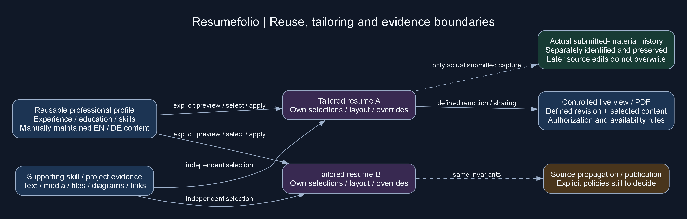
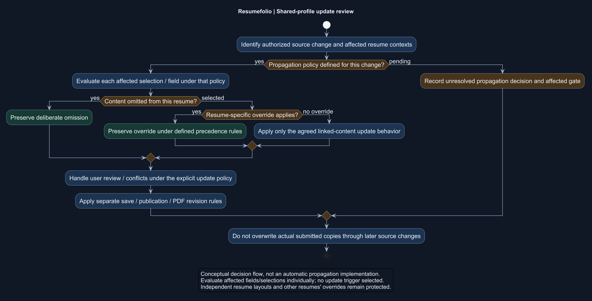
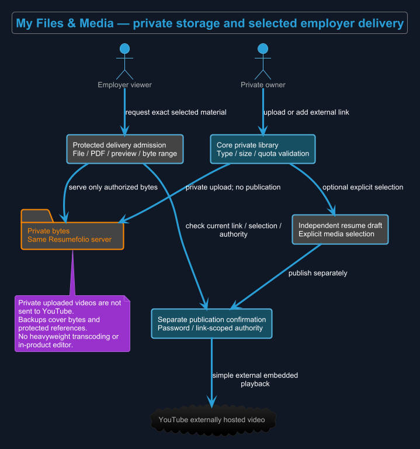

<a id="requirements-specification-profiles-resumes-and-portfolio"></a>

<a id="requirements-specification-profiles-resumes-and-portfolio--heading-resumefolio--profiles-resumes-and-portfolio"></a>
# Resumefolio — Profiles, Resumes and Portfolio

Current implementation choices and scope: [Baseline](https://github.com/Farhad-V/Web-Resumefolio/blob/1f2acaa351ac306cb57cbe4fe9742e8bd90720d9/docs/MVP/baseline/README.md). Runtime verification remains subject to its gates.

| Item | Current position |
| --- | --- |
| Owner | Farhad |
| Status | Core source-update/apply/publication/history policy owner-accepted November 1, 2026; remaining detailed requirements pending |
| Planning basis | DEC-027/026/015; related DEC-028/025/024/023/018 |
| Candidate references | PRP-D01–PRP-D10 are provisional document-local references, not allocated global requirement IDs |
| Priority | Unassigned; document order is not delivery priority |
| Revision | October 31, 2026 |

**At a glance:** Reuse professional information without losing control of each
tailored resume. Associate externally created evidence with skills/projects,
select what each resume shows, and manage English/German content manually.
Source-update, publication, validation and lifecycle policies remain explicit
review decisions rather than assumed automatic behavior.

[Basis](#requirements-specification-profiles-resumes-and-portfolio--heading-1-purpose-and-accepted-boundary) · [Information](#requirements-specification-profiles-resumes-and-portfolio--heading-2-conceptual-information-and-editing-boundaries)
· [Requirements](#requirements-specification-profiles-resumes-and-portfolio--heading-3-proposed-requirements) · [Models](#requirements-specification-profiles-resumes-and-portfolio--heading-4-tailoring-and-update-models)
· [Scenarios](#requirements-specification-profiles-resumes-and-portfolio--heading-5-planned-verification) · [Decisions](#requirements-specification-profiles-resumes-and-portfolio--heading-6-open-decisions-and-gates)
· [Review](#requirements-specification-profiles-resumes-and-portfolio--heading-7-traceability-and-review-readiness)

<a id="requirements-specification-profiles-resumes-and-portfolio--heading-mvp-my-files--media-and-deliberate-publication"></a>
## MVP My Files & Media and deliberate publication

The core provides My Files & Media as a private user library for supported video, audio, images, text/documents and external YouTube links. Files need not be attached to a resume. Resume selection is optional and explicit. Upload does not publish; employer access requires selection and protected resume authorization. YouTube links use simple embedded externally hosted playback; private uploaded videos stay on the same Resumefolio server. No in-product editor or heavyweight transcoding is added. Preview/select/apply, independent overrides, separate publication confirmation and preserved actual submitted history remain required.

Authority: [OWNER-MVP-2026-11-04](../../../01-Project-Planning/01-Project-Charter.md#release-decision). [Candidate allocation](10-Mvp-Candidate-Release-Allocation.md#requirements-specification-mvp-release-allocation).

<a id="requirements-specification-profiles-resumes-and-portfolio--heading-1-purpose-and-accepted-boundary"></a>
## 1. Purpose and Accepted Boundary

[DEC-027](https://github.com/Farhad-V/Web-Resumefolio/blob/1f2acaa351ac306cb57cbe4fe9742e8bd90720d9/docs/MVP/SDLC/01-project-planning/02-scope.md#dec-027) includes professional
profiles with experience, education, skills and other agreed information;
opportunity-specific resumes reuse shared content while retaining independent
selections, layouts and overrides. Shared-profile updates must follow explicit
rules and preserve resume-specific overrides.

[DEC-026](https://github.com/Farhad-V/Web-Resumefolio/blob/1f2acaa351ac306cb57cbe4fe9742e8bd90720d9/docs/MVP/SDLC/01-project-planning/02-scope.md#dec-026) includes explanatory text,
images, video, files, diagrams and repository/other relevant links associated with
skills/projects. Users select evidence per resume and its controlled sharing.
This covers content created with external tools, not an in-product video editor
or diagram-authoring tool. Accepted scope does not establish supported file
formats, rendering safety, capacity or detailed workflow behavior.

Version 1 supports manually entered/reviewed English and German content; automatic
translation, product AI and automatic legacy-demo migration remain excluded by
[Scope](../../../01-Project-Planning/01-Project-Charter.md#mvp-scope). A portfolio reference to a repository
does not prove the separate real Git-hosting capability is implemented.

Related specification boundaries:

| Reference | Responsibility |
| --- | --- |
| [Data Dictionary](../05-Data-Definitions/02-Data-Dictionary.md#data-definitions-data-dictionary) / [Glossary](../05-Data-Definitions/03-Requirements-Glossary.md#data-definitions-glossary) | Concept meanings; fields/validation still need refinement |
| [Accounts](01-Accounts-Authentication-And-Permissions.md#requirements-specification-accounts-authentication-and-permissions) | Resource/action authority and private contexts |
| [Business Lifecycle](04-Business-Rules-And-Data-Lifecycle.md#requirements-specification-business-rules-and-data-lifecycle) | Shared-source propagation, references, retirement and recovery |
| [PDF and Sharing](11-Pdf-And-Controlled-Sharing.md#requirements-specification-pdf-and-controlled-sharing) | Generated/uploaded PDFs, download variants and employer retrieval |
| [Manual Applications](09-Manual-Application-Management.md#requirements-specification-manual-application-management) | Actual submitted resume/cover-letter history, distinct from current sources |
| [Files and Operations](02-Administration-Files-And-Operational-Behavior.md#requirements-specification-administration-files-and-operational-behavior) | Admission, limits, safe replacement, accounting and cleanup |
| [External Interfaces](07-External-Interface-Requirements.md#requirements-specification-external-interface-requirements) | Supported clients, representations, rendering and observable outcomes |

These links identify consistency obligations, not acceptance of the related drafts.

<a id="requirements-specification-profiles-resumes-and-portfolio--heading-2-conceptual-information-and-editing-boundaries"></a>
## 2. Conceptual Information and Editing Boundaries

| Subject | Scope-supported meaning | Detail to define |
| --- | --- | --- |
| Professional profile | Reusable experience, education, skills and agreed professional content | Exact fields, required/optional rules, ordering and number of profiles per account |
| Tailored resume | Opportunity-specific information selections, layout and content overrides | Creation/editing workflow, source relationships, duplication and naming |
| Supporting evidence | Explanatory content and externally created media/files/diagrams/links | Metadata, supported formats, associations and safe display |
| Evidence selection | Content deliberately shown on a particular resume | Independent visibility/order and changed-source behavior |
| Language-specific content | Manually authored/reviewed English/German variants | Which fields vary, completeness, default display and missing-language handling |
| Presentation/rendition | Resume view and related PDF representation | Layout options, save/preview/live revision and PDF treatment of media |
| Historical submission | Material actually submitted and separately preserved | Capture/revision/artifacts, correction, retention and access; APP-D owns detail |

<a id="requirements-specification-profiles-resumes-and-portfolio--heading-change-impact-review-matrix"></a>
### Change-impact Review Matrix

| Requested change | Must preserve | Policy still needed |
| --- | --- | --- |
| Profile field updated | Resume-specific selections/layouts/overrides; submitted history | Which linked values update, trigger and conflict behavior |
| One resume override/layout changed | Other resumes and shared source are not silently edited | Override scope, reset-to-source and layout inheritance |
| Evidence added/edited/replaced | Unrelated evidence and per-resume access boundary | Revision propagation, rendering, replacement failure and reference effects |
| Evidence omitted from one resume | Other resumes' deliberate selections and private evidence | Ordering, default selection and active shared-view change timing |
| Source item/association removed | Required preserved submitted copies and valid references | Block/detach/cascade per relationship, retained versions and cleanup |
| Language-specific content changed | Other language content is not automatically translated or overwritten | Shared versus translated fields and missing-content availability |

This is a semantic review matrix, not a copying strategy or database schema.
Profile-to-resume propagation and save-to-live publication remain separate decisions.

<a id="requirements-specification-profiles-resumes-and-portfolio--heading-3-proposed-requirements"></a>
## 3. Proposed Requirements

Every candidate is **Proposed**, owner **Farhad**, priority **Unassigned**. Criteria
are planned observations, not actual product results. A criterion depending on an
undecided field/propagation/presentation policy remains blocked for acceptance.

<a id="requirements-specification-profiles-resumes-and-portfolio--heading-prp-d01-reusable-professional-information"></a>
### PRP-D01: Reusable Professional Information

**Release allocation (owner decision, November 4):** MVP — Resumefolio core.

**Source / rationale:** DEC-027; maintain shared professional information without
repeated entry for every resume.

**Actor / conditions:** Authorized user creates or edits their professional profile.

**Proposed obligation:** Users shall maintain experience, education, skills and
other agreed professional information as reusable content under explicit field
and validation rules.

**Acceptance criteria**
- Representative valid records retain the intended user/content context and agreed information.
- Missing/invalid required input has defined feedback rather than false successful completion.
- Agreed information can be selected for a tailored resume without manually re-entering the same shared content as a prerequisite.

**Planned verification:** Later representative create/edit/validation and reuse cases.
**Open detail:** Exact fields, required/optional conditions, dates/units, ordering,
duplicates, profile count, contact/personal details and incomplete-profile behavior.

<a id="requirements-specification-profiles-resumes-and-portfolio--heading-prp-d02-opportunity-specific-resume-composition"></a>
### PRP-D02: Opportunity-specific Resume Composition

**Release allocation (owner decision, November 4):** MVP — Resumefolio core.

**Source / rationale:** DEC-027; each resume supports a particular opportunity.

**Actor / conditions:** Authorized user creates or edits a tailored resume.

**Proposed obligation:** Users shall compose a resume by selecting relevant shared
information and adjusting its presentation under the reviewed composition rules.

**Acceptance criteria**
- A representative resume contains the intended selected information and omits deliberately unselected information.
- The resume remains identifiable independently from another tailored resume and its intended content choices.
- Invalid or inaccessible source references cannot disclose unrelated private information or appear as a successful association.

**Planned verification:** Later two-opportunity composition, omitted-content and
denied-reference cases. **Open detail:** Resume naming, section/order/layout options,
minimum completeness, duplication, source-item availability and opportunity linkage.

<a id="requirements-specification-profiles-resumes-and-portfolio--heading-prp-d03-independent-selections-layouts-and-overrides"></a>
### PRP-D03: Independent Selections, Layouts and Overrides

**Release allocation (owner decision, November 4):** MVP — Resumefolio core.

**Source / rationale:** DEC-027; tailoring one resume must not rewrite another.

**Actor / conditions:** User changes one resume's selection, layout or content override.

**Proposed obligation:** Resume-specific selections, layouts and overrides shall
remain independent; editing them shall not silently modify other resumes or the
shared source contrary to the explicit editing policy.

**Acceptance criteria**
- With two resumes using a shared source item, changing an override in one leaves the other's independent content choices intact.
- Changing one resume's layout/selection does not silently apply that same change to the other resume.
- Intended source edits versus resume overrides are distinguishable in the reviewed editing workflow.

**Planned verification:** Later two-resume override/layout/selection comparison.
**Open detail:** Override granularity, source editing affordance, reset-to-source,
inheritance and whether/how intentionally shared presentation settings are supported.

<a id="requirements-specification-profiles-resumes-and-portfolio--heading-prp-d04-explicit-shared-source-update-rules"></a>
### PRP-D04: Explicit Shared-source Update Rules

**Release allocation (owner decision, November 4):** MVP — Resumefolio core.

**Source / rationale:** DEC-027 and BRL-D02; source reuse must not destroy tailoring.

**Actor / conditions:** Shared profile content used by one or more resumes changes.

**Proposed obligation:** Intended updates from shared information shall follow a
reviewed propagation policy that preserves resume-specific overrides and selected
content boundaries.

**Acceptance criteria**
- Editing shared profile information does not automatically change an existing resume draft or published view; the owner previews the changes, explicitly applies selected source changes without overwriting resume-specific overrides, and separately confirms publication.
- An overridden field retains its independent meaning under the reviewed precedence rules rather than being silently replaced by the source change.
- Omitted content is not silently added to a resume, and source updates do not overwrite preserved actual submitted copies.

**Planned verification:** Later linked/overridden/omitted two-resume cases plus
historical-copy comparisons. **Open detail:** Automatic versus user-triggered update,
preview/confirmation, source revision, conflicts, concurrency and source deletion.
No automatic propagation or copy-on-edit mechanism is selected.

<a id="requirements-specification-profiles-resumes-and-portfolio--heading-prp-d05-skill-and-project-evidence-management"></a>
### PRP-D05: Skill and Project Evidence Management

**Owner-scope acceptance additions (MVP; planned, not executed):**

- A user can keep supported material in My Files & Media without attaching it to any resume. Upload alone makes no material visible to an employer.
- External YouTube links embed externally hosted playback; private uploaded media remains private on the same Resumefolio server.

**Release allocation (owner decision, November 4):** MVP — Resumefolio core.

**Source / rationale:** DEC-026; evidence gives concrete context to professional claims.

**Actor / conditions:** Authorized user adds or organizes evidence associated with a skill/project.

**Proposed obligation:** Users shall add, organize and display agreed explanatory
text, images, video, files, diagrams and relevant repository/other links with explicit
skill/project association and content rules.

**Acceptance criteria**
- Representative supported evidence categories retain the intended skill/project relationship and agreed descriptive content.
- Invalid/unsupported/inaccessible items produce defined feedback without a false completed association.
- A repository link is treated as the intended reference, not as evidence that the product hosts that repository or controls its external availability.

**Planned verification:** Later representative category, association and unavailable-link
cases. **Open detail:** Metadata, relation multiplicity, ordering, link validation,
uploads versus embeds, supported formats and project-description fields. A portfolio
project is not automatically the same object as a work-management project.

<a id="requirements-specification-profiles-resumes-and-portfolio--heading-prp-d06-per-resume-evidence-selection-and-disclosure"></a>
### PRP-D06: Per-resume Evidence Selection and Disclosure

**Release allocation (owner decision, November 4):** MVP — Resumefolio core.

**Source / rationale:** DEC-026/024; each resume shows only deliberately selected evidence.

**Actor / conditions:** Owner selects evidence for a resume; a viewer requests its content.

**Proposed obligation:** Evidence presentation and controlled sharing shall honor
the intended resume's independent selections and applicable access rules.

**Acceptance criteria**
- Selecting or omitting evidence on one resume does not silently change another resume's selection.
- Employer context exposes only selected permitted evidence and grants no general access to the private evidence collection.
- Direct requests for unselected/unrelated protected files cannot bypass the boundary merely because their identifiers are known.

**Planned verification:** Later two-resume selection and selected/unselected direct-path
retrieval cases. **Open detail:** Default selection, per-resume ordering/description,
selection of evidence parts, changed-content effects and active-view/session timing.

<a id="requirements-specification-profiles-resumes-and-portfolio--heading-prp-d07-manually-maintained-english-and-german-content"></a>
### PRP-D07: Manually Maintained English and German Content

**Release allocation (owner decision, November 4):** MVP — Resumefolio core.

**Source / rationale:** DEC-015/025; professional wording stays under user control.

**Actor / conditions:** User edits or requests language-specific profile/resume/evidence content.

**Proposed obligation:** Agreed English/German content variants shall be manually
maintained and displayed under explicit language/completeness rules without an
automatic translation dependency.

**Acceptance criteria**
- Representative manually entered language variants retain their intended text and language context.
- Editing one variant does not automatically translate or overwrite another language's professional wording.
- Missing/incomplete-language cases produce the reviewed availability/fallback result rather than a silently fabricated translation.

**Planned verification:** Later bilingual/partial/missing-language editing and display
cases. **Open detail:** Which fields are language-dependent/shared, default language,
fallback, mixed-language sections and completeness. Interface localization and
uploaded PDF language availability are separate contracts.

<a id="requirements-specification-profiles-resumes-and-portfolio--heading-prp-d08-clear-presentation-and-rendition-boundaries"></a>
### PRP-D08: Clear Presentation and Rendition Boundaries

**Release allocation (owner decision, November 4):** MVP — Resumefolio core.

**Source / rationale:** DEC-027/026/025 and proposed presentation refinement;
screen presentation and PDF renditions must have deliberate content meaning.

**Actor / conditions:** User previews saved content or requests an eligible shared/PDF view.

**Proposed obligation:** Profile/resume/evidence views shall represent the intended
content/revision under reviewed presentation rules, with explicit treatment of
media and links in screen versus PDF output.

**Acceptance criteria**
- A reviewed representative view shows the intended selected text/evidence and distinguishes missing or unavailable content.
- Layout/long-content/link/media examples have defined results in the agreed supported client/viewport matrix.
- PDF evidence representation follows the reviewed rendition contract; it does not imply interactive video or every web behavior is embedded in a PDF.

**Planned verification:** Later preview/live/PDF content comparisons and selected
client/accessibility examples. **Open detail:** Save/preview/publication revision,
templates, layout, pagination, fonts, link/media representation and measurable
accessibility criteria; no renderer, theme library or PDF tool is selected.

<a id="requirements-specification-profiles-resumes-and-portfolio--heading-prp-d09-safe-content-admission-and-truthful-save-outcomes"></a>
### PRP-D09: Safe Content Admission and Truthful Save Outcomes

**Release allocation (owner decision, November 4):** MVP — Resumefolio core.

**Source / rationale:** DEC-026/018 and proposed reliability/security refinement;
externally created content can fail admission, processing or rendering.

**Actor / conditions:** User saves text/links or uploads/replaces evidence content.

**Proposed obligation:** Content admission, rendering and replacement shall follow
reviewed validation, authority, resource and safe-display rules, reporting only
the actual completed outcome.

**Acceptance criteria**
- Defined invalid/over-limit/unsupported input has the reviewed result and is not presented as successfully usable evidence.
- Interrupted save/upload/required processing is distinguishable from complete success and follows explicit existing-content/reference rules.
- Defined rich-content/file/link cases do not bypass reviewed safe-display or privacy controls, and ordinary feedback exposes no secrets/unrelated content.

**Planned verification:** Later boundary, interruption, replacement, unsafe-content
and permission examples using controlled data. **Open detail:** Format list,
sanitization, external embeds/tracking, link-fetch behavior, processing, quotas,
retry/conflict handling and cleanup; no scanner or numerical limit is invented.

<a id="requirements-specification-profiles-resumes-and-portfolio--heading-prp-d10-reference-aware-retirement-and-historical-independence"></a>
### PRP-D10: Reference-aware Retirement and Historical Independence

**Release allocation (owner decision, November 4):** MVP — Resumefolio core.

**Source / rationale:** DEC-023/017 and proposed lifecycle detail; removing a source
or association must not accidentally destroy unrelated or preserved information.

**Actor / conditions:** Authorized actor removes/replaces a source, resume, evidence
item or association, or later restores related information.

**Proposed obligation:** Lifecycle operations shall follow explicit reference,
retention and recovery rules while preserving required actual submitted copies
against later source edits/removal.

**Acceptance criteria**
- Unlinking evidence from one resume does not implicitly delete unrelated evidence or another valid association contrary to reviewed policy.
- Source edit/replacement/removal does not silently overwrite or erase required preserved actual submitted resume/cover-letter material.
- Later isolated restoration checks required records/artifacts/references and restored access; missing artifacts are not reported as complete recovery.

**Planned verification:** Later shared-reference, source-removal, historical-copy
and isolated restore checks. **Open detail:** Archive/delete authority, cascade/block/
detach per relation, retained revisions, account closure, quota reclamation,
backup coverage/targets and restored sharing state; no retention period is set.

<a id="requirements-specification-profiles-resumes-and-portfolio--heading-4-tailoring-and-update-models"></a>
## 4. Tailoring and Update Models



[Scalable SVG](../../Diagrams/Profile-Resume-Evidence-Map.svg) ·
[Editable Graphviz](../../Diagrams/Profile-Resume-Evidence-Map.dot)

Arrows identify conceptual reuse and selection, not database cardinalities or an
automatic copying policy. A live view can change under an explicit publication
rule; preserved actual submitted material remains a distinct history context.
Colors supplement labels.



[Scalable SVG](../../Diagrams/Profile-Update-Review.svg) ·
[Editable PlantUML](../../Diagrams/Profile-Update-Review.puml)

This is a requirements decision flow, not selected propagation implementation.
An undefined update policy is a review gap. Per-field/section behavior, update
trigger, confirmation and concurrent edits require explicit decisions. A profile
save does not inherently publish new shared content or regenerate every PDF.

<a id="requirements-specification-profiles-resumes-and-portfolio--heading-5-planned-verification"></a>
## 5. Planned Verification

| Family | Candidates | Cases to develop |
| --- | --- | --- |
| Profile/composition | PRP-D01/D02 | Valid/incomplete fields, reusable content, opportunity-specific selections and denied references |
| Independence/update | PRP-D03/D04 | Two resumes; linked/no-override, overridden, omitted and deleted-source examples |
| Portfolio/evidence | PRP-D05/D06 | Supported categories, skill/project associations, independent selections and direct retrieval |
| Language | PRP-D07 | English/German edits, shared versus variant fields and incomplete/missing language |
| Presentation | PRP-D08 | Long content, links/media, preview/live revisions, defined PDF representation and supported clients |
| Admission/lifecycle | PRP-D09/D10 | Invalid/over-limit/failed content, reference removal, historical copies and isolated recovery |

A useful later end-to-end example: create shared experience/skills, create two
opportunity-specific resumes, override one description and select different
evidence, then change the source. Compare both resumes against the agreed update
policy. Capture actual submitted material, change live sources again, and check
that history remains independent. Test denied cross-user/direct-file paths too.

Each run later records candidate/policy revision, actor/grants, source/resume/
artifact versions, language, initial data, expected/actual outcome and limits.
Use synthetic professional data and controlled media/links. No product tests or
actual preservation/recovery results are recorded here.

<a id="requirements-specification-profiles-resumes-and-portfolio--heading-6-open-decisions-and-gates"></a>
## 6. Open Decisions and Gates

| Topic | Definition/evidence needed | Dependent gate |
| --- | --- | --- |
| Profile/resume structure | Fields, required inputs, identifiers, count, duplication, ordering and incomplete content | Affected M-02 acceptance; GAP-D06 definition follow-up |
| Tailoring/update | Override granularity/precedence, source relation, update trigger, conflicts and reset behavior | Before accepting propagation criteria/data design |
| Evidence semantics | Categories/formats, metadata, skill/project associations and distinction from work projects | Affected requirements and dictionary review |
| Selection/disclosure | Defaults, per-resume overrides/order, unselected parts, direct retrieval and changed access | Access/sharing requirements and security design |
| Language | Variant/shared fields, completeness, fallback and mixed-language presentation | Affected content/PDF requirements |
| Presentation/revision | Layout, preview/save/live/PDF revisions, media treatment and measurable client/accessibility criteria | Requirements then design/compatibility evidence |
| Content/resources | Validation, external embeds/fetching, safe serving, quotas, processing and failed replacement | AFO-D policies; GAP-D01/D10 actual resource findings |
| Retirement/history/recovery | Reference consequences, submitted-copy capture, retention/cleanup and restored access | APP-D/BRL-D review; GAP-D04 and actual restoration before M-09 |

Farhad coordinates every topic. Local rows do not allocate shared question IDs or
record completed investigations. Use [Questions and Decisions](../07-Change-And-Baseline/03-Requirements-Questions-And-Decisions.md#change-and-baseline-open-questions-and-decisions),
retain [Planning Gates](https://github.com/Farhad-V/Web-Resumefolio/blob/1f2acaa351ac306cb57cbe4fe9742e8bd90720d9/docs/MVP/SDLC/01-project-planning/10-planning-completion-criteria.md)
and route material scope/cost/delivery effects through [Change Control](../07-Change-And-Baseline/02-Requirements-Change-Control.md#change-and-baseline-change-control).
No missing policy silently removes an accepted capability or establishes feasibility.

<a id="requirements-specification-profiles-resumes-and-portfolio--heading-7-traceability-and-review-readiness"></a>
## 7. Traceability and Review Readiness

| Candidate group | Source basis | Related drafts |
| --- | --- | --- |
| PRP-D01–D04 | DEC-027 | Dictionary, BRL-D02 propagation, DOM-D01 consistent professional meaning |
| PRP-D05/D06 | DEC-026/024/028 | ACC-D access, PDF-D04/D05 shared retrieval, AFO-D content handling |
| PRP-D07 | DEC-015/025 | Language definitions, PDF-D02/D03 variant availability |
| PRP-D08/D09 | DEC-027/026/025/018 plus proposed presentation/failure refinements | EIF-D02/D04/D10 interface/representation, PDF-D01 generation, AFO-D policies |
| PRP-D10 | DEC-023/017 plus proposed lifecycle detail | APP-D06 actual submitted material, BRL-D08/D09 retirement/recovery |

Use the [requirement template](17-Software-Requirements-Specification.md#requirements-specification-requirements-specification) when allocating
final IDs. Link actual records/scenarios/evidence in [Traceability](../06-Validation-And-Traceability/07-Validation-And-Traceability.md#validation-and-traceability-validation-and-traceability--heading-traceability)
and record real inspection findings in [Review Findings](../06-Validation-And-Traceability/07-Validation-And-Traceability.md#validation-and-traceability-validation-and-traceability--heading-review-findings).

- [ ] Reconcile provisional PRP references and assign justified priorities.
- [ ] Review source-derived invariants separately from proposed detailed refinements.
- [ ] Decide field, propagation, presentation, language and lifecycle policies blocking criteria.
- [ ] Reconcile profile/evidence meanings, permissions, PDF/live revisions and actual submission history.
- [ ] Complete normal, denied, invalid, concurrent, failure and recovery cases as applicable.
- [ ] Record owner review, exact revision, decisions and later verification evidence.

**Historical outcome before the later owner decision:** Proposed product specification; no PRP candidate had been accepted,
no product test Pass or numerical capacity claim is recorded. M-02 and the wider
pre-implementation agreement remain pending. This revision changes no accepted
scope, selects no architecture and performs no account/file/publication operation.

<a id="requirements-specification-profiles-resumes-and-portfolio--heading-8-diagram-maintenance"></a>
## 8. Diagram Maintenance

| Diagram | Source | SVG | PNG |
| --- | --- | --- | --- |
| Profile, resume and evidence boundaries | [Graphviz](../../Diagrams/Profile-Resume-Evidence-Map.dot) | [SVG](../../Diagrams/Profile-Resume-Evidence-Map.svg) |  |
| Source-update review | [PlantUML](../../Diagrams/Profile-Update-Review.puml) | [SVG](../../Diagrams/Profile-Update-Review.svg) |  |

Keep text, captions, sources and renders synchronized. Follow the
[diagram guide](../../Diagrams/Diagram-Catalog.md); inspect arrows/labels and verify file/section
links after changes. Run from the repository root:

```powershell
$diagramFolder = 'docs\MVP\SDLC\02-requirements-engineering\diagrams'
$graphvizExe = 'C:\Program Files\Graphviz\bin\dot.exe'
$plantUmlJar = 'C:\Users\fvali\AppData\Local\Resumefolio\DiagramTools\plantuml.jar'
foreach ($format in 'svg', 'png') {
    & $graphvizExe "-T$format" -Gdpi=140 "$diagramFolder\profile-resume-evidence-map.dot" -o "$diagramFolder\profile-resume-evidence-map.$format"
    if ($LASTEXITCODE -ne 0) { throw "Graphviz failed: $format" }
    java '-Djava.awt.headless=true' -jar $plantUmlJar -charset UTF-8 "-t$format" "$diagramFolder\profile-update-review.puml"
    if ($LASTEXITCODE -ne 0) { throw "PlantUML failed: $format" }
}
```

Use actual installed paths on other machines; save UTF-8 without BOM.

[Specification index](16-Requirements-Specification-Guide.md#requirements-specification-requirements-specification-overview) · [SRS entry point](17-Software-Requirements-Specification.md#requirements-specification-requirements-specification)
· [Requirements index]()

<a id="requirements-specification-profiles-resumes-and-portfolio--heading-selected-policies-and-future-proposals"></a>
## Selected Policies and Future Proposals

Current MVP answers are selected in the Baseline. Only explicitly deferred details below remain proposals; product tests and operational evidence are still required.

<a id="requirements-specification-profiles-resumes-and-portfolio--id-resolution-q-d06"></a>
<a id="requirements-specification-profiles-resumes-and-portfolio--heading-q-d06-selected-policy"></a>
### Q-D06: Selected policy

[Selected answer and remaining evidence](https://github.com/Farhad-V/Web-Resumefolio/blob/1f2acaa351ac306cb57cbe4fe9742e8bd90720d9/docs/MVP/baseline/policy-decisions.md#q-d06). Apply this policy to the MVP slice; the original criteria above remain subject to their [current dispositions](https://github.com/Farhad-V/Web-Resumefolio/blob/1f2acaa351ac306cb57cbe4fe9742e8bd90720d9/docs/MVP/baseline/criterion-dispositions.csv).

<a id="requirements-specification-profiles-resumes-and-portfolio--id-resolution-q-d07"></a>
<a id="requirements-specification-profiles-resumes-and-portfolio--heading-q-d07-selected-policy"></a>
### Q-D07: Selected policy

[Selected answer and remaining evidence](https://github.com/Farhad-V/Web-Resumefolio/blob/1f2acaa351ac306cb57cbe4fe9742e8bd90720d9/docs/MVP/baseline/policy-decisions.md#q-d07). Apply this policy to the MVP slice; the original criteria above remain subject to their [current dispositions](https://github.com/Farhad-V/Web-Resumefolio/blob/1f2acaa351ac306cb57cbe4fe9742e8bd90720d9/docs/MVP/baseline/criterion-dispositions.csv).

<a id="requirements-specification-profiles-resumes-and-portfolio--id-resolution-q-d08"></a>
<a id="requirements-specification-profiles-resumes-and-portfolio--heading-q-d08-selected-policy"></a>
### Q-D08: Selected policy

[Selected answer and remaining evidence](https://github.com/Farhad-V/Web-Resumefolio/blob/1f2acaa351ac306cb57cbe4fe9742e8bd90720d9/docs/MVP/baseline/policy-decisions.md#q-d08). Apply this policy to the MVP slice; the original criteria above remain subject to their [current dispositions](https://github.com/Farhad-V/Web-Resumefolio/blob/1f2acaa351ac306cb57cbe4fe9742e8bd90720d9/docs/MVP/baseline/criterion-dispositions.csv).

<a id="requirements-specification-profiles-resumes-and-portfolio--id-resolution-q-d09"></a>
<a id="requirements-specification-profiles-resumes-and-portfolio--heading-q-d09-selected-policy"></a>
### Q-D09: Selected policy

[Selected answer and remaining evidence](https://github.com/Farhad-V/Web-Resumefolio/blob/1f2acaa351ac306cb57cbe4fe9742e8bd90720d9/docs/MVP/baseline/policy-decisions.md#q-d09). Apply this policy to the MVP slice; the original criteria above remain subject to their [current dispositions](https://github.com/Farhad-V/Web-Resumefolio/blob/1f2acaa351ac306cb57cbe4fe9742e8bd90720d9/docs/MVP/baseline/criterion-dispositions.csv).

<a id="requirements-specification-profiles-resumes-and-portfolio--heading-mvp-private-media-flow"></a>
## MVP private-media flow


[Editable source](../../../04-System-Design/01-High-Level-Design/14-Appendices.md#design-record-01-software-architecture-diagrams-mvp-private-media-puml) · .
