<a id="requirements-specification-requirements-specification-overview"></a>

<a id="requirements-specification-requirements-specification-overview--heading-resumefolio--requirements-specification-guide"></a>
# Resumefolio — Requirements Specification Guide

Current implementation choices and scope: [Baseline](https://github.com/Farhad-V/Web-Resumefolio/blob/1f2acaa351ac306cb57cbe4fe9742e8bd90720d9/docs/MVP/baseline/README.md). Runtime verification remains subject to its gates.

| Item | Current position |
| --- | --- |
| Purpose | Navigate the distributed Software Requirements Specification (SRS), its detailed drafts and remaining review work |
| Owner | Farhad; sole project delivery and operations owner |
| Status | Proposed documentation set — M-02 requirements baseline pending |
| Inventory | 16 primary specification documents: 15 detailed proposed drafts and one SRS entry point; plus a supporting priority/readiness register |
| Candidate records | 157 provisional document-local records in the 15 detailed drafts; not final global IDs, approved requirements or verified capabilities |
| Revision | November 1, 2026 — functional/non-functional reading routes added |

**Start with [Functional Requirements](17-Software-Requirements-Specification.md#requirements-specification-requirements-specification--id-functional-requirements) and [Non-Functional Requirements](17-Software-Requirements-Specification.md#requirements-specification-requirements-specification--id-non-functional-requirements)** for explicit classification. Continue with **[the SRS entry point](17-Software-Requirements-Specification.md#requirements-specification-requirements-specification)** for product
boundary and requirement levels. Use this guide to find the primary record owner,
choose a reading path and identify unfinished work. Keep detailed requirements in
their domain files rather than duplicating them in this index.

[Reading paths](#requirements-specification-requirements-specification-overview--heading-1-reading-paths) · [Documents](#requirements-specification-requirements-specification-overview--heading-documents)
· [Consistency](#requirements-specification-requirements-specification-overview--heading-3-cross-document-boundaries) · [Remaining work](#requirements-specification-requirements-specification-overview--heading-4-remaining-work-and-review-roadmap)
· [Diagrams](#requirements-specification-requirements-specification-overview--heading-5-diagram-catalog) · [Maintenance](#requirements-specification-requirements-specification-overview--heading-6-maintenance)

<a id="requirements-specification-requirements-specification-overview--heading-1-reading-paths"></a>
## 1. Reading Paths

| Your question | Suggested route |
| --- | --- |
| Why is the product needed, and what is its boundary? | [SRS](17-Software-Requirements-Specification.md#requirements-specification-requirements-specification) → [Business outcomes](03-Business-Requirements.md#requirements-specification-business-requirements) → [Accepted Scope](../../../01-Project-Planning/01-Project-Charter.md#mvp-scope) |
| Who needs what, and with which authority? | [Actors](../02-Stakeholders-And-Elicitation/01-Actors-And-System-Context.md#stakeholders-and-elicitation-actors-and-system-context) → [User Requirements](18-User-Requirements.md#requirements-specification-user-requirements) → [Accounts](01-Accounts-Authentication-And-Permissions.md#requirements-specification-accounts-authentication-and-permissions) → [Scenarios](../04-Scenarios-And-Models/02-User-Stories-And-Scenarios.md#scenarios-and-models-user-stories-and-scenarios) |
| How do professional information and applications fit together? | [Profiles/Resumes](12-Profiles-Resumes-And-Portfolio.md#requirements-specification-profiles-resumes-and-portfolio) → [PDF/Sharing](11-Pdf-And-Controlled-Sharing.md#requirements-specification-pdf-and-controlled-sharing) → [Applications](09-Manual-Application-Management.md#requirements-specification-manual-application-management) → [Google Integration](06-Email-Calendar-And-Google-Integration.md#requirements-specification-email-calendar-and-google-integration) |
| How is collaborative work organized? | [Projects/Kanban/Sprints](13-Projects-Kanban-And-Sprints.md#requirements-specification-projects-kanban-and-sprints) → [Git Hosting](08-Git-Hosting-And-Collaboration.md#requirements-specification-git-hosting-and-collaboration) → [YAML/CI/CD](19-Yaml-Workflows-And-Cicd.md#requirements-specification-yaml-workflows-and-cicd) |
| Which rules apply across all features? | [Business Lifecycle](04-Business-Rules-And-Data-Lifecycle.md#requirements-specification-business-rules-and-data-lifecycle) → [Domain Constraints](05-Domain-Requirements-And-Constraints.md#requirements-specification-domain-requirements-and-constraints) → [Interfaces](07-External-Interface-Requirements.md#requirements-specification-external-interface-requirements) → [Quality/Security/Recovery](14-Quality-Security-And-Recovery-Requirements.md#requirements-specification-quality-security-and-recovery-requirements) |
| What is needed to operate and review the release? | [Administration/Files](02-Administration-Files-And-Operational-Behavior.md#requirements-specification-administration-files-and-operational-behavior) → [Quality/Recovery](14-Quality-Security-And-Recovery-Requirements.md#requirements-specification-quality-security-and-recovery-requirements) → [Traceability](../06-Validation-And-Traceability/07-Validation-And-Traceability.md#validation-and-traceability-validation-and-traceability--heading-traceability) → [Baseline criteria](../07-Change-And-Baseline/04-Requirements-Review-And-Baseline-Criteria.md#change-and-baseline-requirements-review-and-baseline-criteria) |

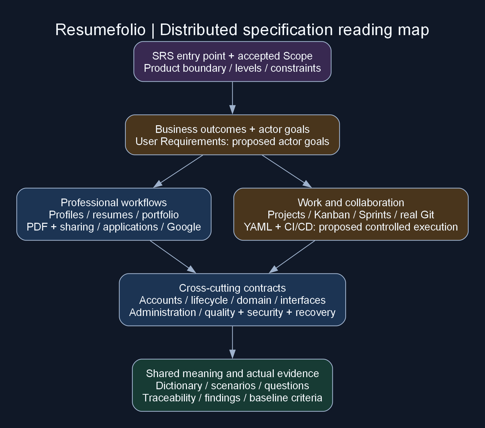

[Scalable SVG](../../Diagrams/Specification-Reading-Map.svg) ·
[Editable Graphviz](../../Diagrams/Specification-Reading-Map.dot)

The map groups reading topics, not services, delivery increments or staffing.
Read cross-cutting rules alongside domain behavior. Colors supplement labels;
draft status and open decisions are explicit rather than distinguished by color alone.

<a id="requirements-specification-requirements-specification-overview--heading-documents"></a>
## Documents

The table covers the 16 primary specification documents in this folder. The [priority/readiness register](15-Requirement-Priority-And-Readiness.md#requirements-specification-requirements-priority-and-readiness) is a supporting attribute view, not an additional primary requirements draft.
**Detailed draft** means proposed records with criteria/methods/open decisions; it
does not mean the questions are resolved, the records approved or the product tested.

| Document | Primary responsibility | Current content / remaining boundary |
| --- | --- | --- |
| [Software Requirements Specification](17-Software-Requirements-Specification.md#requirements-specification-requirements-specification) | SRS entry point, product boundary and requirement levels | Expanded overview, scope/primary ownership, conventions and review gates; baseline pending |
| [Business Requirements](03-Business-Requirements.md#requirements-specification-business-requirements) | Intended business outcomes and success evidence | Detailed draft; 5 BIZ-D records; intended benefit is not measured benefit |
| [User Requirements](18-User-Requirements.md#requirements-specification-user-requirements) | Actor goals, contexts and expected outcomes | Detailed draft; 12 USR-D records; derived actor goals and scenarios still require owner review |
| [Accounts, Authentication and Permissions](01-Accounts-Authentication-And-Permissions.md#requirements-specification-accounts-authentication-and-permissions) | Identity, resource/action isolation, sharing and explicit administrative powers | Detailed draft; 12 ACC-D records; exact auth/grant/session policies pending |
| [Profiles, Resumes and Portfolio](12-Profiles-Resumes-And-Portfolio.md#requirements-specification-profiles-resumes-and-portfolio) | Reusable information, independent tailoring, evidence and manual language variants | Detailed draft; 10 PRP-D records; fields, propagation and presentation policies pending |
| [PDF and Controlled Sharing](11-Pdf-And-Controlled-Sharing.md#requirements-specification-pdf-and-controlled-sharing) | Generated/uploaded PDFs, availability, employer links and direct retrieval | Detailed draft; 10 PDF-D records; rendition, session/revocation and lifecycle details pending |
| [Manual Application Management](09-Manual-Application-Management.md#requirements-specification-manual-application-management) | Company/opportunity, manual cover letters, progress and actual submitted copies | Detailed draft; 9 APP-D records; capture, transitions, corrections and retention pending |
| [Email, Calendar and Google Integration](06-Email-Calendar-And-Google-Integration.md#requirements-specification-email-calendar-and-google-integration) | Authorized mail/calendar operations, synchronization and failures | Detailed draft; 12 EGC-D records; limited dated provider-source notes, actual project access unverified |
| [Projects, Kanban and Sprints](13-Projects-Kanban-And-Sprints.md#requirements-specification-projects-kanban-and-sprints) | Boards, items/tasks, assignments, collaboration and Sprint Backlog | Detailed draft; 11 PKS-D records; relationships, workflows and completion policies pending |
| [Git Hosting and Collaboration](08-Git-Hosting-And-Collaboration.md#requirements-specification-git-hosting-and-collaboration) | Real Git clients, repository presentation, forks/review/merge and tracking/releases | Detailed draft; 10 GIT-D records; transports, grants, review and lifecycle policies pending |
| [YAML Workflows and CI/CD](19-Yaml-Workflows-And-Cicd.md#requirements-specification-yaml-workflows-and-cicd) | Supported syntax/execution, isolation, secrets, limits and deployment controls | Detailed draft; 12 YML-D records; execution, isolation, limits and deployment policies/evidence pending |
| [Administration, Files and Operational Behavior](02-Administration-Files-And-Operational-Behavior.md#requirements-specification-administration-files-and-operational-behavior) | Policy configuration, file admission, quotas, failures, cleanup and operational evidence | Detailed draft; 12 AFO-D records; limits, powers, accounting and retention pending |
| [Business Rules and Data Lifecycle](04-Business-Rules-And-Data-Lifecycle.md#requirements-specification-business-rules-and-data-lifecycle) | Cross-module invariants, ownership, updates, history, retirement and recovery | Detailed draft; 10 BRL-D records; detailed propagation/synchronization/removal rules pending |
| [Domain Requirements and Constraints](05-Domain-Requirements-And-Constraints.md#requirements-specification-domain-requirements-and-constraints) | Domain meaning, product policies, project mandates and external applicability | Detailed draft; 8 DOM-D records; provider/legal/licensing applicability investigations incomplete |
| [External Interface Requirements](07-External-Interface-Requirements.md#requirements-specification-external-interface-requirements) | Eight boundary inventories and explicit interaction contracts | Detailed draft; 10 EIF-D records; exact protocols, representations, clients and actual access findings pending |
| [Quality, Security and Recovery](14-Quality-Security-And-Recovery-Requirements.md#requirements-specification-quality-security-and-recovery-requirements) | Measurement contracts, controls, capacity, backup coverage and demonstrated recovery | Detailed draft; 14 QSR-D records; targets, controls and actual verification/restoration pending |

Counts describe this working set on the revision date and require updating when
records change. Prefixes are local draft references; they do not establish the
final FR/NFR/business-rule identifier convention. No priority order or approval is
inferred from row order or document length.

<a id="requirements-specification-requirements-specification-overview--heading-3-cross-document-boundaries"></a>
## 3. Cross-document Boundaries

| Invariant | Read together |
| --- | --- |
| Shared profile information does not erase independent resume selections/layouts/overrides | PRP-D + BRL-D + dictionary |
| Current sources, live employer views and actual submitted copies have distinct meaning | PRP-D + PDF-D + APP-D + BRL-D |
| Employer links expose selected authorized content, including direct file/PDF paths | ACC-D + PDF-D + EIF-D + QSR-D |
| A downloaded copy cannot be recalled by disabling product retrieval | PDF-D + APP-D distinction + BRL-D |
| Unified sign-in or board membership supplies no unrelated private-resource grant | ACC-D + EGC-D + PKS-D + GIT-D |
| Product Backlog Item, task, board position and acceptance are not interchangeable | PKS-D + dictionary; Sprint Backlog includes goal, selected items and delivery plan |
| Real Git hosting differs from development GitHub; Push/merge does not inherently authorize deployment | GIT-D + YML-D + EIF-D + QSR-D |
| Provider guidance differs from actual project access; synchronization direction must be decided | EGC-D + DOM-D + BRL-D + feasibility findings |
| Backup existence differs from demonstrated usable, consistent and safely authorized recovery | QSR-D + AFO-D + domain artifacts/access + actual later evidence |

Detailed permissions, lifecycles and numerical targets remain open. These rows
summarize review boundaries; primary candidate wording remains in the linked files.

<a id="requirements-specification-requirements-specification-overview--heading-4-remaining-work-and-review-roadmap"></a>
## 4. Remaining Work and Review Roadmap

The set is organized, but the requirements baseline is not complete. In particular:

1. Review the new actor-specific **User Requirements** and detailed **YAML/CI/CD** records; resolve open goal, execution and deployment policies while retaining explicit gates.
2. Resolve affected fields, relationships, state/transition, authority, propagation, language, capture, synchronization and retention questions with actual owner decisions.
3. Establish measurable quality/resource/recovery criteria and actual provider/feasibility findings at their dependent gates; do not invent targets or assume access.
4. Reconcile the SRS entry point, dictionary, scenarios and all domain drafts; allocate the final identifier convention and justified priorities.
5. Populate actual traceability and review findings, assess unresolved blockers and record owner review against an identifiable candidate before M-02 acceptance.

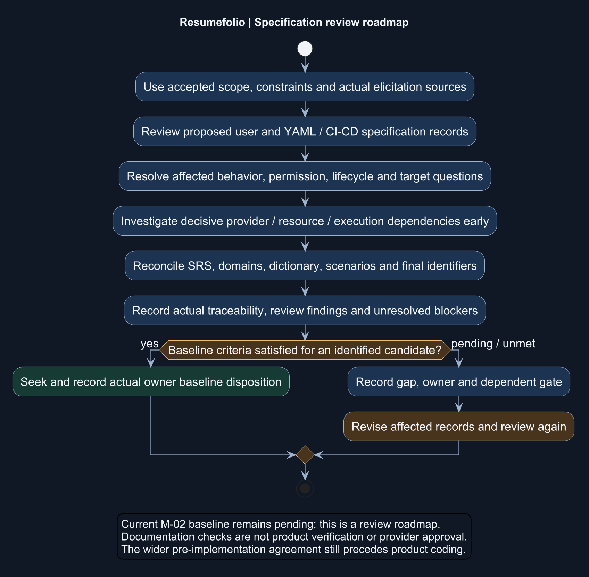

[Scalable SVG](../../Diagrams/Specification-Baseline-Review.svg) ·
[Editable PlantUML](../../Diagrams/Specification-Baseline-Review.puml)

This is a review roadmap, not a dated forecast or proof that a gate has passed.
Investigate decisive feasibility/security questions early and iterate related
requirements together. M-02 review is separate from product verification/release.
The agreed initial SDLC documentation, analysis/design, tracking reconciliation
and pre-implementation agreement still precede product coding.

| Supporting source / register | Use |
| --- | --- |
| [Version 1 Scope](../../../01-Project-Planning/01-Project-Charter.md#mvp-scope) | Accepted inclusions/exclusions and conditional commitments |
| [Resources](../../../01-Project-Planning/03-Feasibility-And-Risk-Assessment.md#resource-constraints) / [Planning Gates](https://github.com/Farhad-V/Web-Resumefolio/blob/1f2acaa351ac306cb57cbe4fe9742e8bd90720d9/docs/MVP/SDLC/01-project-planning/10-planning-completion-criteria.md) | Existing constraints, planning-only acceptance and retained GAP-D follow-up |
| [Elicitation Plan](../02-Stakeholders-And-Elicitation/03-Elicitation-Plan-And-Techniques.md#stakeholders-and-elicitation-elicitation-plan-and-techniques) / [Log](../02-Stakeholders-And-Elicitation/02-Elicitation-Log.md#stakeholders-and-elicitation-elicitation-log) | Planned clarification versus actual documented source extraction |
| [Dictionary](../05-Data-Definitions/02-Data-Dictionary.md#data-definitions-data-dictionary) / [Scenarios](../04-Scenarios-And-Models/02-User-Stories-And-Scenarios.md#scenarios-and-models-user-stories-and-scenarios) | Shared meaning and actor/normal/alternative/denied/failure examples |
| [Questions and Decisions](../07-Change-And-Baseline/03-Requirements-Questions-And-Decisions.md#change-and-baseline-open-questions-and-decisions) / [Change Control](../07-Change-And-Baseline/02-Requirements-Change-Control.md#change-and-baseline-change-control) | Actual decisions, impact and unresolved commitments |
| [Traceability](../06-Validation-And-Traceability/07-Validation-And-Traceability.md#validation-and-traceability-validation-and-traceability--heading-traceability) / [Review Findings](../06-Validation-And-Traceability/07-Validation-And-Traceability.md#validation-and-traceability-validation-and-traceability--heading-review-findings) | Allocated links, actual inspections, dispositions and rechecks |
| [Baseline Criteria](../07-Change-And-Baseline/04-Requirements-Review-And-Baseline-Criteria.md#change-and-baseline-requirements-review-and-baseline-criteria) | Separate acceptance conditions and identifiable owner outcome |

No current documentation count, rendered diagram or link check establishes a
product Pass, provider approval, recovery result, M-02 completion or new baseline
acceptance. Accepted planning history remains attached to its identified snapshot.

<a id="requirements-specification-requirements-specification-overview--heading-5-diagram-catalog"></a>
## 5. Diagram Catalog

Every row links editable source and SVG/PNG output. The catalog includes two guide
diagrams, two SRS diagrams and the 30 diagrams referenced by the 15 detailed drafts. None is an
implemented architecture or an executed test result.

| Topic / diagram | Editable source | SVG | PNG |
| --- | --- | --- | --- |
| Guide: reading map | [DOT](../../Diagrams/Specification-Reading-Map.dot) | [SVG](../../Diagrams/Specification-Reading-Map.svg) |  |
| Guide: baseline review | [PUML](../../Diagrams/Specification-Baseline-Review.puml) | [SVG](../../Diagrams/Specification-Baseline-Review.svg) |  |
| Accounts, Authentication and Permissions — accounts access contexts | [DOT](../../Diagrams/Accounts-Access-Contexts.dot) | [SVG](../../Diagrams/Accounts-Access-Contexts.svg) | 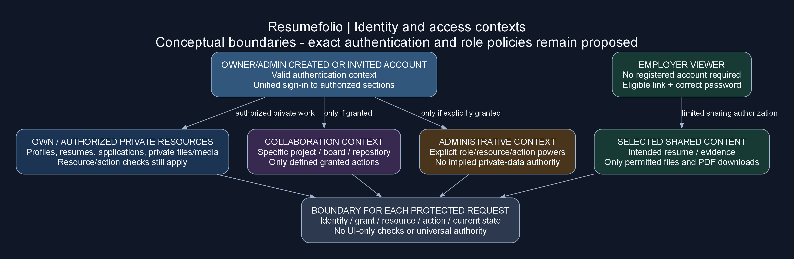 |
| Accounts, Authentication and Permissions — accounts request authorization | [PUML](../../Diagrams/Accounts-Request-Authorization.puml) | [SVG](../../Diagrams/Accounts-Request-Authorization.svg) | 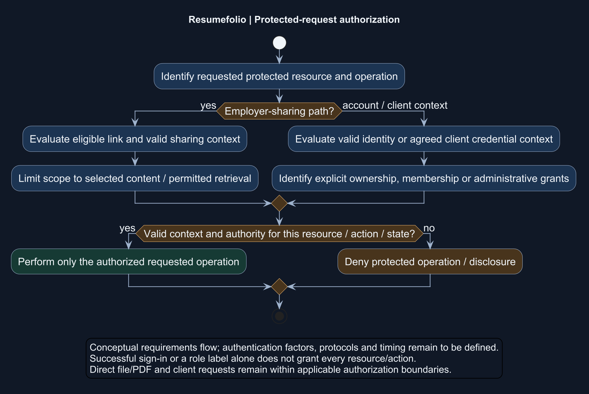 |
| Administration, Files and Operational Behavior — administration file admission flow | [PUML](../../Diagrams/Administration-File-Admission-Flow.puml) | [SVG](../../Diagrams/Administration-File-Admission-Flow.svg) | 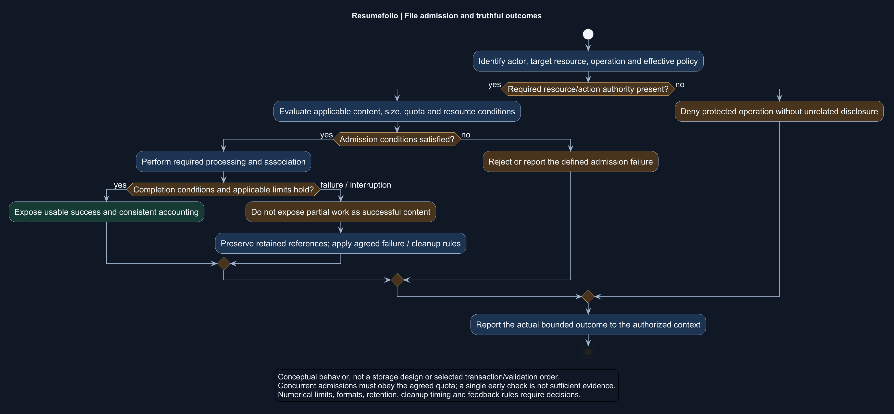 |
| Administration, Files and Operational Behavior — administration files policy map | [DOT](../../Diagrams/Administration-Files-Policy-Map.dot) | [SVG](../../Diagrams/Administration-Files-Policy-Map.svg) | 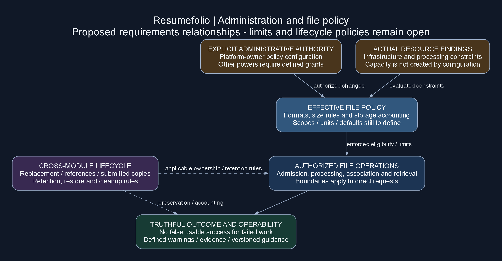 |
| Business Requirements — business outcome assessment | [PUML](../../Diagrams/Business-Outcome-Assessment.puml) | [SVG](../../Diagrams/Business-Outcome-Assessment.svg) | 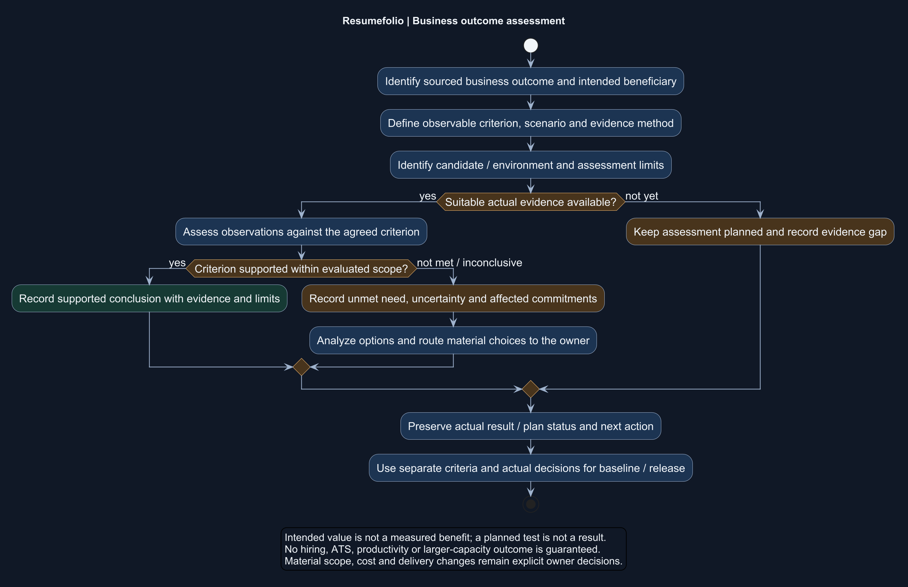 |
| Business Requirements — business outcomes map | [DOT](../../Diagrams/Business-Outcomes-Map.dot) | [SVG](../../Diagrams/Business-Outcomes-Map.svg) | 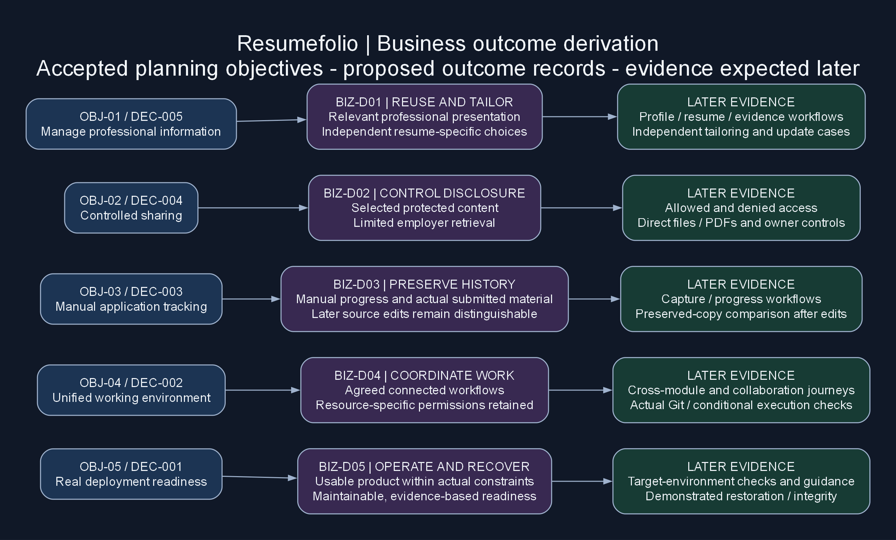 |
| Business Rules and Data Lifecycle — data lifecycle boundaries | [DOT](../../Diagrams/Data-Lifecycle-Boundaries.dot) | [SVG](../../Diagrams/Data-Lifecycle-Boundaries.svg) | 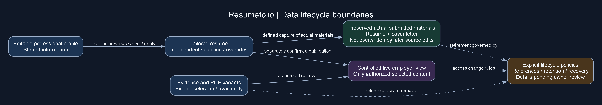 |
| Business Rules and Data Lifecycle — data retirement review | [PUML](../../Diagrams/Data-Retirement-Review.puml) | [SVG](../../Diagrams/Data-Retirement-Review.svg) | 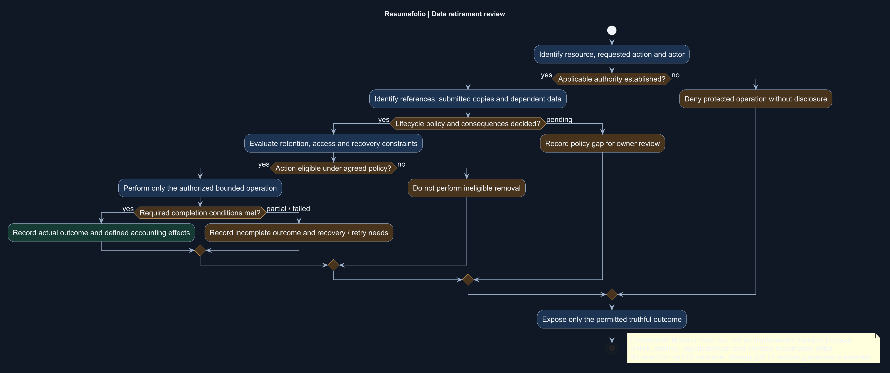 |
| Domain Requirements and Constraints — domain authority map | [DOT](../../Diagrams/Domain-Authority-Map.dot) | [SVG](../../Diagrams/Domain-Authority-Map.svg) | 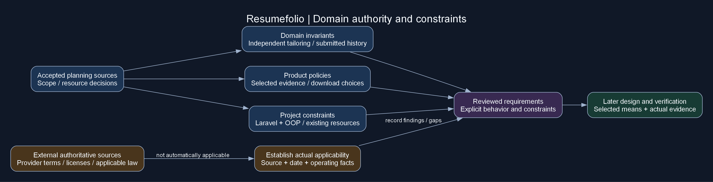 |
| Domain Requirements and Constraints — domain constraint review | [PUML](../../Diagrams/Domain-Constraint-Review.puml) | [SVG](../../Diagrams/Domain-Constraint-Review.svg) | 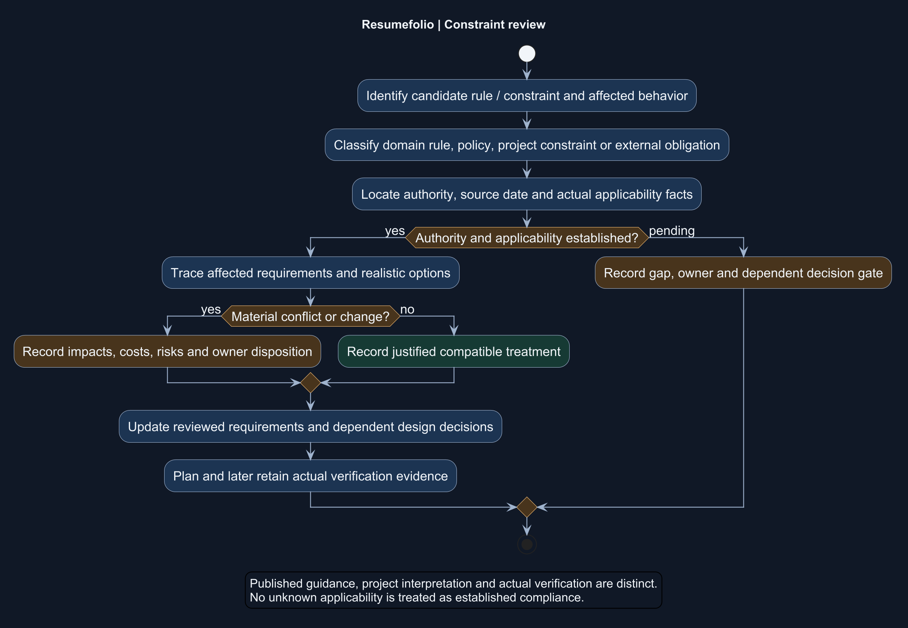 |
| Email, Calendar and Google Integration — google integration context | [DOT](../../Diagrams/Google-Integration-Context.dot) | [SVG](../../Diagrams/Google-Integration-Context.svg) | 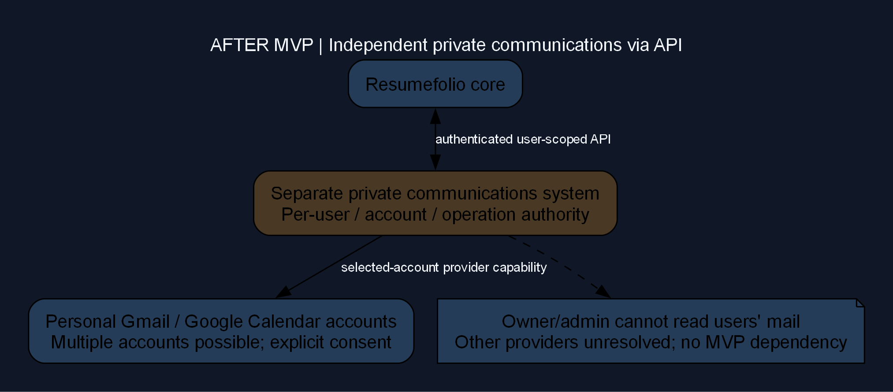 |
| Email, Calendar and Google Integration — google operation outcomes | [PUML](../../Diagrams/Google-Operation-Outcomes.puml) | [SVG](../../Diagrams/Google-Operation-Outcomes.svg) | 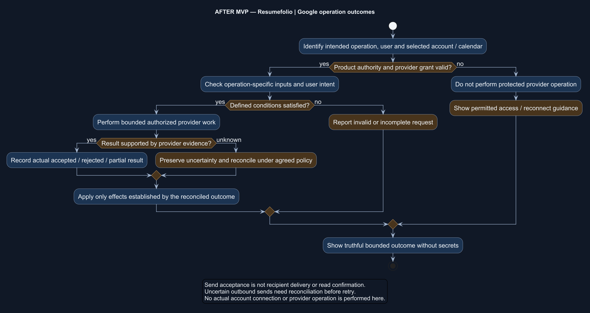 |
| External Interface Requirements — external interface context | [DOT](https://github.com/Farhad-V/Web-Resumefolio/blob/1f2acaa351ac306cb57cbe4fe9742e8bd90720d9/docs/MVP/SDLC/04-system-design/01-software-architecture/diagrams/logical-component-ownership.dot) | [SVG](https://github.com/Farhad-V/Web-Resumefolio/blob/1f2acaa351ac306cb57cbe4fe9742e8bd90720d9/docs/MVP/SDLC/04-system-design/01-software-architecture/diagrams/logical-component-ownership.svg) | 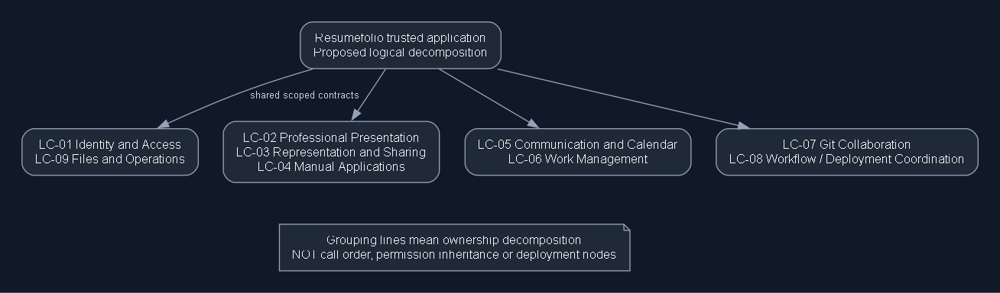 |
| External Interface Requirements — external interface outcomes | [PUML](../../Diagrams/External-Interface-Outcomes.puml) | [SVG](../../Diagrams/External-Interface-Outcomes.svg) | 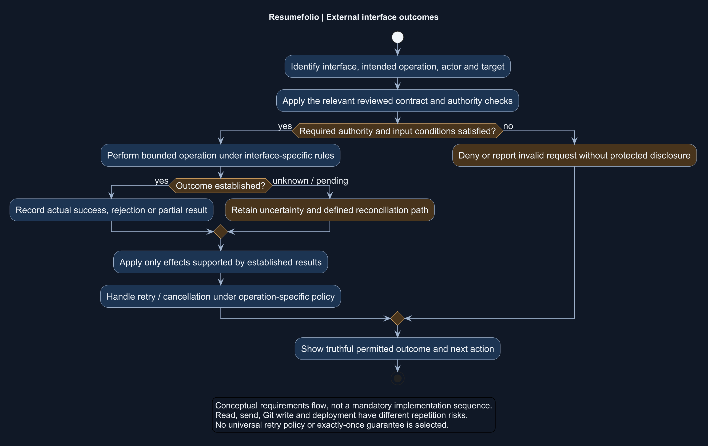 |
| Git Hosting and Collaboration — git hosting capability map | [DOT](../../Diagrams/Git-Hosting-Capability-Map.dot) | [SVG](../../Diagrams/Git-Hosting-Capability-Map.svg) | 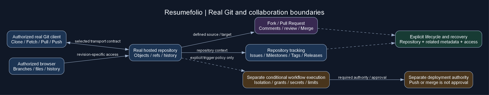 |
| Git Hosting and Collaboration — git review merge flow | [PUML](../../Diagrams/Git-Review-Merge-Flow.puml) | [SVG](../../Diagrams/Git-Review-Merge-Flow.svg) | 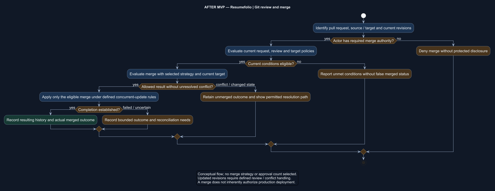 |
| Manual Application Management — application submission capture | [PUML](../../Diagrams/Application-Submission-Capture.puml) | [SVG](../../Diagrams/Application-Submission-Capture.svg) | 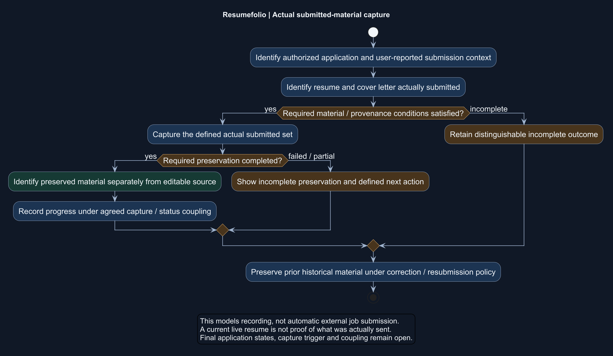 |
| Manual Application Management — manual application history map | [DOT](../../Diagrams/Manual-Application-History-Map.dot) | [SVG](../../Diagrams/Manual-Application-History-Map.svg) | 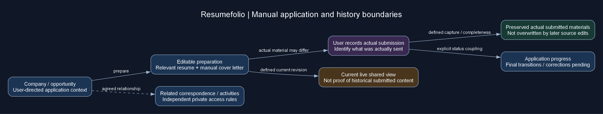 |
| PDF and Controlled Sharing — pdf protected retrieval | [PUML](../../Diagrams/Pdf-Protected-Retrieval.puml) | [SVG](../../Diagrams/Pdf-Protected-Retrieval.svg) | 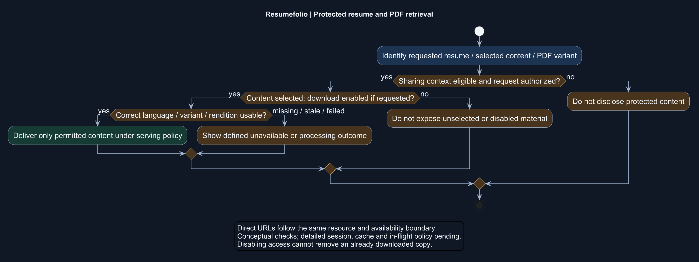 |
| PDF and Controlled Sharing — pdf sharing boundaries | [DOT](../../Diagrams/Pdf-Sharing-Boundaries.dot) | [SVG](../../Diagrams/Pdf-Sharing-Boundaries.svg) | 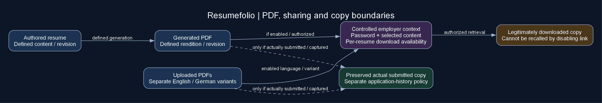 |
| Profiles, Resumes and Portfolio — profile resume evidence map | [DOT](../../Diagrams/Profile-Resume-Evidence-Map.dot) | [SVG](../../Diagrams/Profile-Resume-Evidence-Map.svg) | 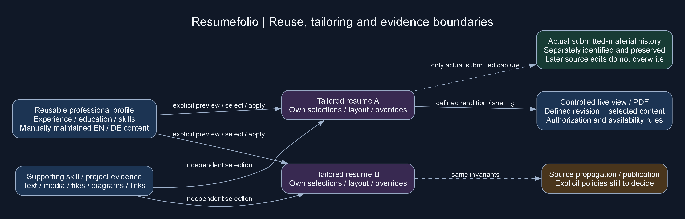 |
| Profiles, Resumes and Portfolio — profile update review | [PUML](../../Diagrams/Profile-Update-Review.puml) | [SVG](../../Diagrams/Profile-Update-Review.svg) | 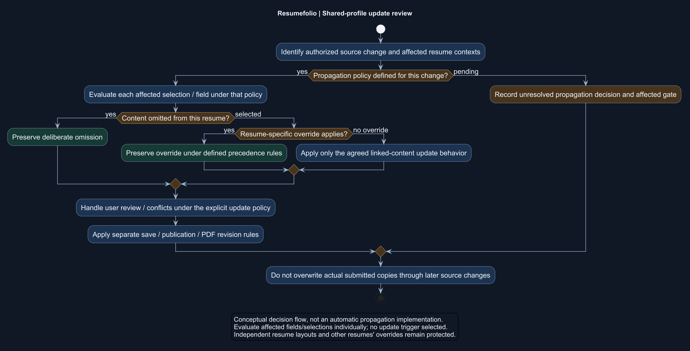 |
| Projects, Kanban and Sprints — kanban sprint concept map | [DOT](../../Diagrams/Kanban-Sprint-Concept-Map.dot) | [SVG](../../Diagrams/Kanban-Sprint-Concept-Map.svg) | 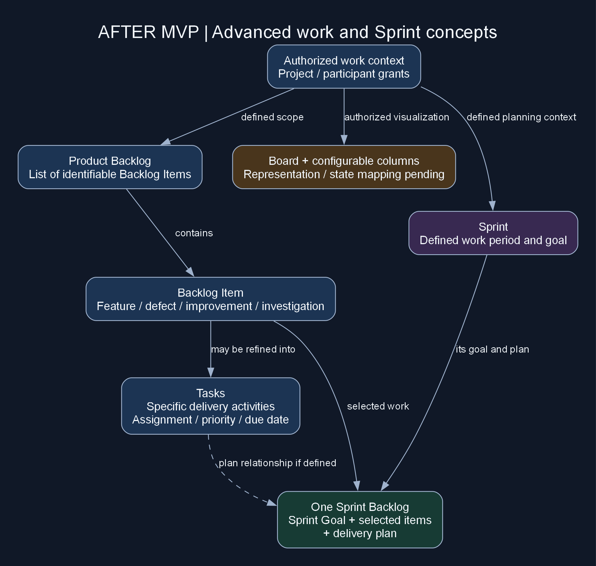 |
| Projects, Kanban and Sprints — sprint planning review flow | [PUML](../../Diagrams/Sprint-Planning-Review-Flow.puml) | [SVG](../../Diagrams/Sprint-Planning-Review-Flow.svg) | 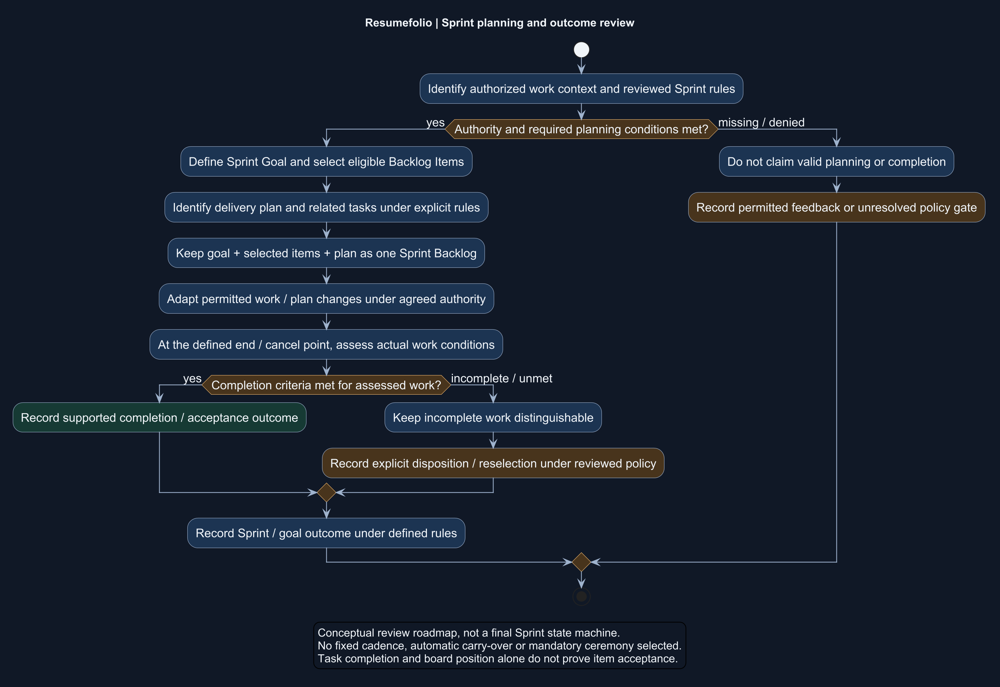 |
| Quality, Security and Recovery Requirements — quality evidence map | [DOT](../../Diagrams/Quality-Evidence-Map.dot) | [SVG](../../Diagrams/Quality-Evidence-Map.svg) | 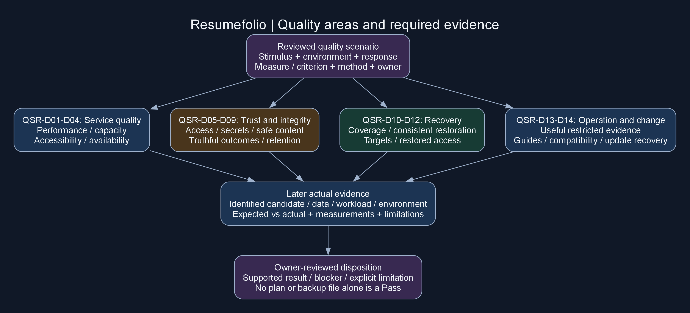 |
| Quality, Security and Recovery Requirements — recovery evidence roadmap | [PUML](../../Diagrams/Recovery-Evidence-Roadmap.puml) | [SVG](../../Diagrams/Recovery-Evidence-Roadmap.svg) | 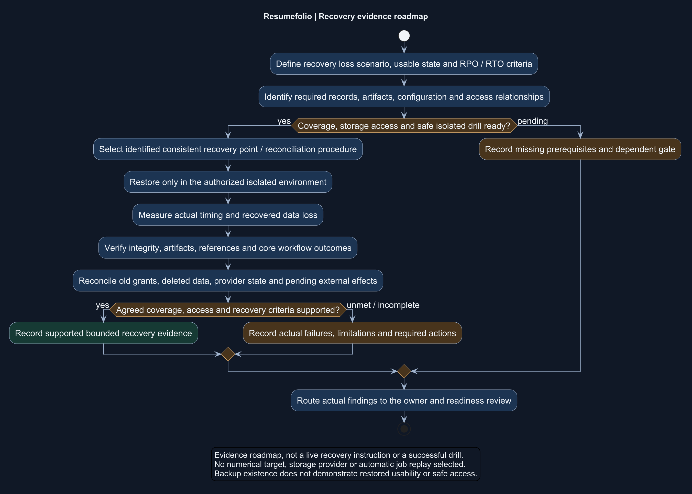 |
| Software Requirements Specification — srs baseline decision | [PUML](../../Diagrams/Srs-Baseline-Decision.puml) | [SVG](../../Diagrams/Srs-Baseline-Decision.svg) | 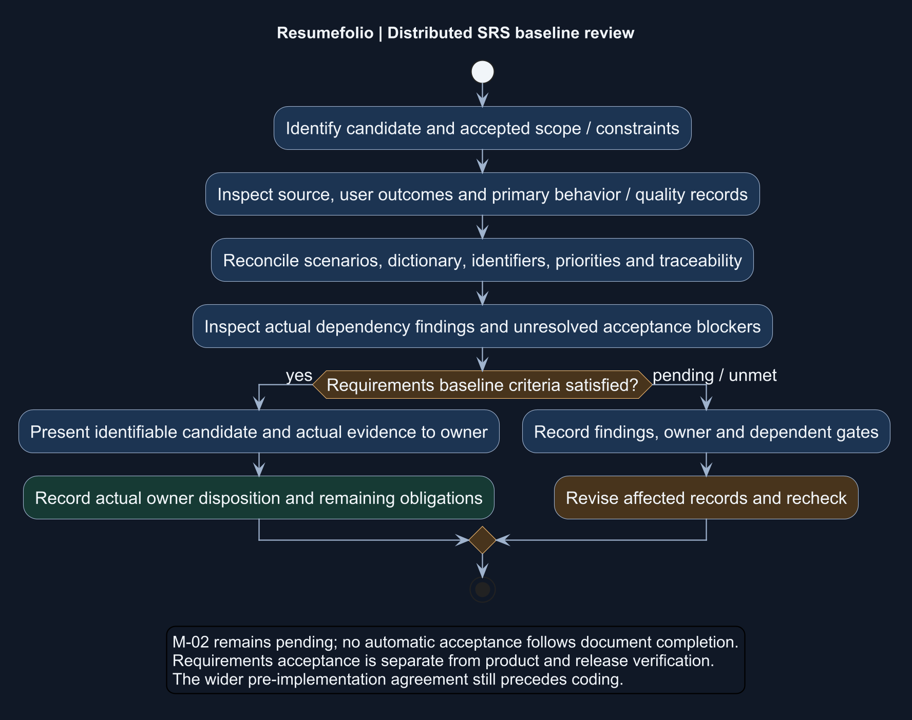 |
| Software Requirements Specification — srs traceability map | [DOT](../../Diagrams/Srs-Traceability-Map.dot) | [SVG](../../Diagrams/Srs-Traceability-Map.svg) | 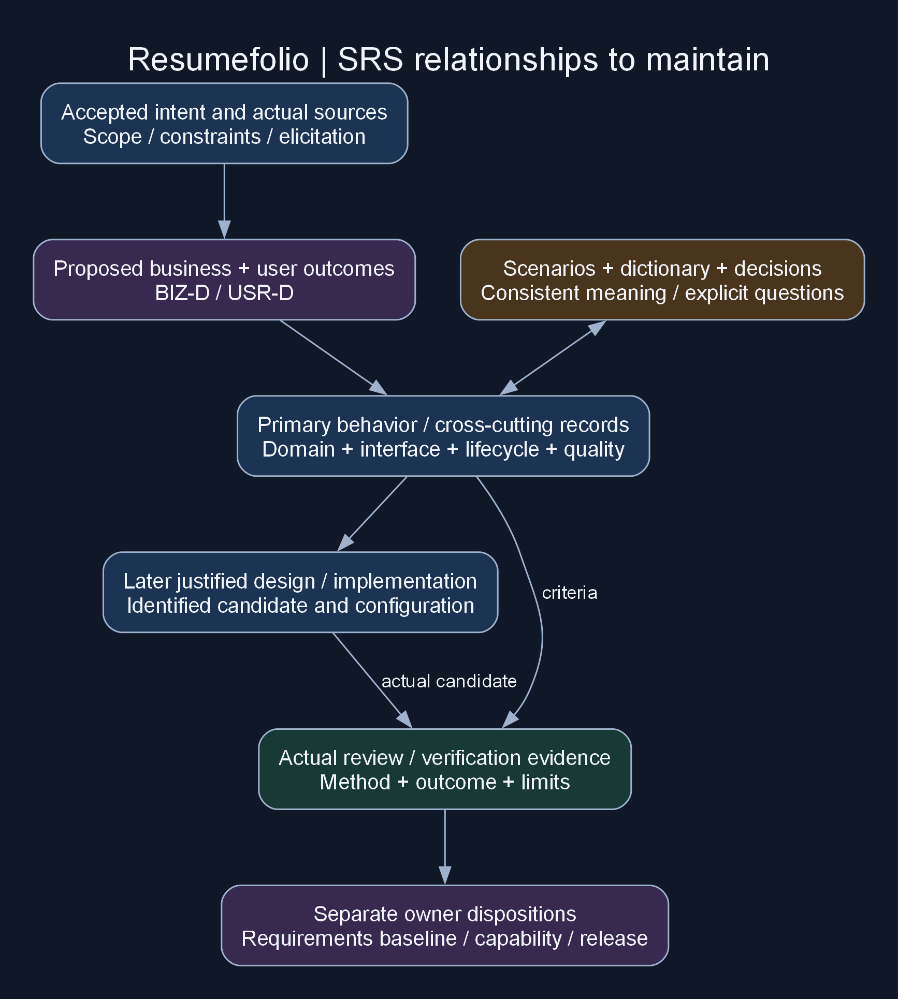 |
| User Requirements — user goal map | [DOT](../../Diagrams/User-Goal-Map.dot) | [SVG](../../Diagrams/User-Goal-Map.svg) | 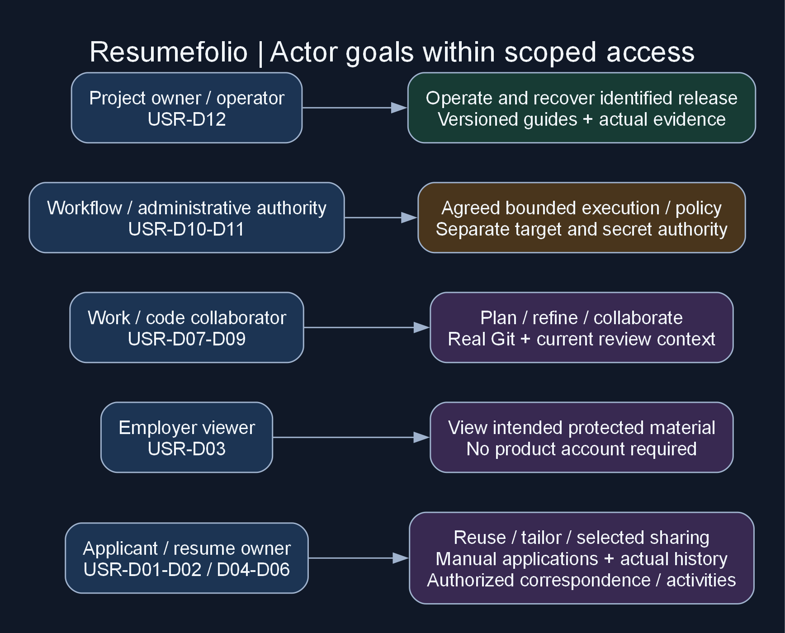 |
| User Requirements — user requirement review | [PUML](../../Diagrams/User-Requirement-Review.puml) | [SVG](../../Diagrams/User-Requirement-Review.svg) | 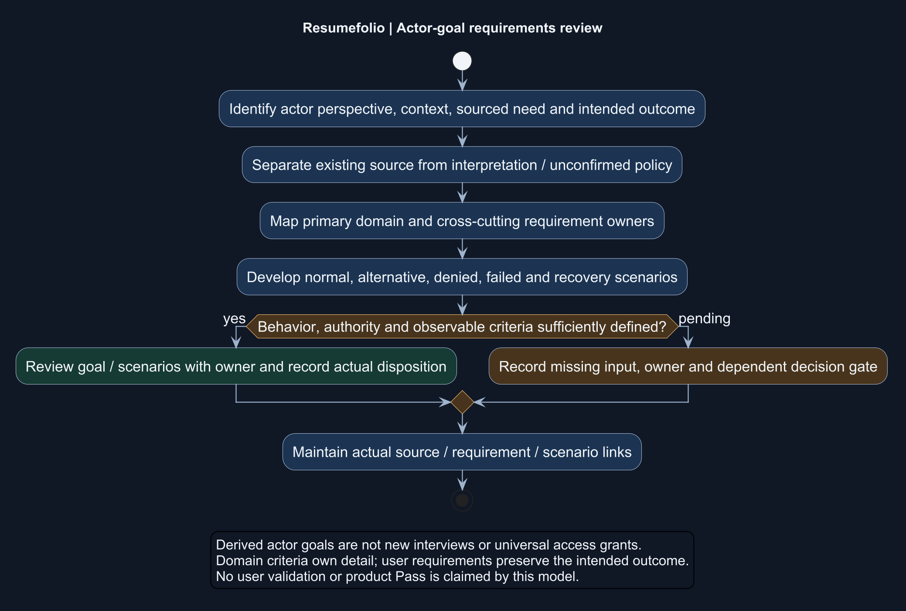 |
| YAML Workflows and CI/CD — workflow execution boundaries | [DOT](../../Diagrams/Workflow-Execution-Boundaries.dot) | [SVG](../../Diagrams/Workflow-Execution-Boundaries.svg) | 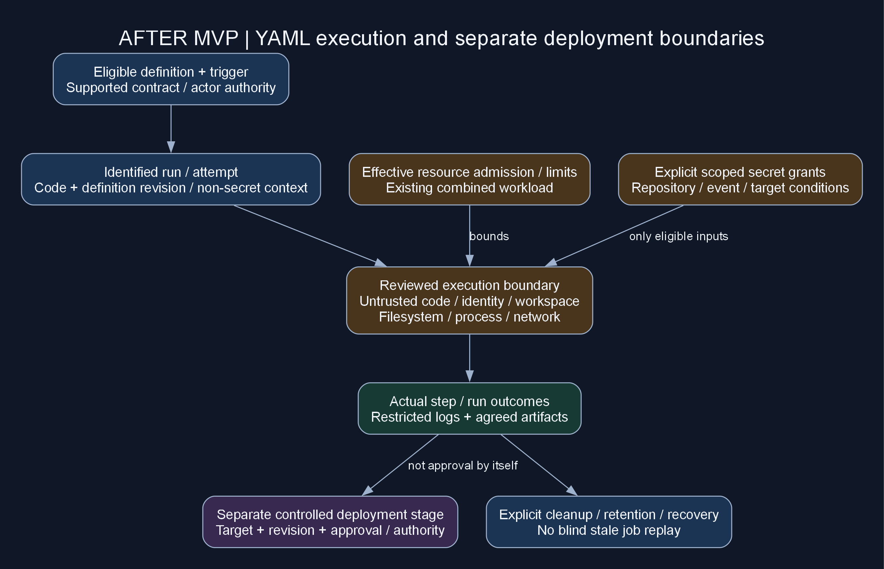 |
| YAML Workflows and CI/CD — workflow run control flow | [PUML](../../Diagrams/Workflow-Run-Control-Flow.puml) | [SVG](../../Diagrams/Workflow-Run-Control-Flow.svg) | 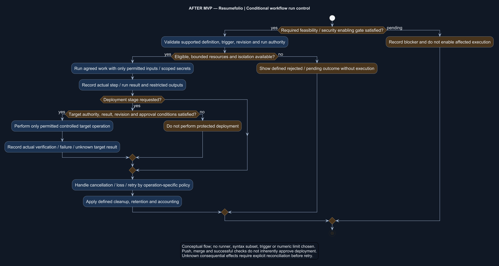 |

<a id="requirements-specification-requirements-specification-overview--heading-6-maintenance"></a>
## 6. Maintenance

When a specification changes, update its sources, status, criteria, open decisions,
related dictionary/scenario/traceability links and diagrams together. Keep this
catalog and record counts accurate. Read primary records before summarizing them;
do not copy detailed obligations into multiple competing files.

Check local file/section links, readable labels/arrows, table layout and synchronized
editable/rendered diagrams. Render the two guide diagrams from repository root:

```powershell
$diagramFolder = 'docs\MVP\SDLC\02-requirements-engineering\diagrams'
$graphvizExe = 'C:\Program Files\Graphviz\bin\dot.exe'
$plantUmlJar = 'C:\Users\fvali\AppData\Local\Resumefolio\DiagramTools\plantuml.jar'
foreach ($format in 'svg', 'png') {
    & $graphvizExe "-T$format" -Gdpi=140 "$diagramFolder\specification-reading-map.dot" -o "$diagramFolder\specification-reading-map.$format"
    if ($LASTEXITCODE -ne 0) { throw "Graphviz failed: $format" }
    java '-Djava.awt.headless=true' -jar $plantUmlJar -charset UTF-8 "-t$format" "$diagramFolder\specification-baseline-review.puml"
    if ($LASTEXITCODE -ne 0) { throw "PlantUML failed: $format" }
}
```

Use actual installed paths on other machines. Save UTF-8 without BOM and retain
source/SVG/PNG outputs together. See the [shared diagram guide](../../Diagrams/Diagram-Catalog.md).

[Requirements index]() · [SRS entry point](17-Software-Requirements-Specification.md#requirements-specification-requirements-specification)

<a id="requirements-specification-requirements-specification-overview--heading-course-aligned-refinement--november-1-2026"></a>
## Course-Aligned Refinement — November 1, 2026

Use the [proposed priority/readiness register](15-Requirement-Priority-And-Readiness.md#requirements-specification-requirements-priority-and-readiness) as a supporting attribute view, not a sixteenth primary requirement draft. The 15 primary drafts still contain 157 candidates. Their actual priorities remain unassigned; proposals are explicitly separate. Quality targets have decision contracts, and external scenario narratives are separated from later verification steps. M-02 remains pending.
