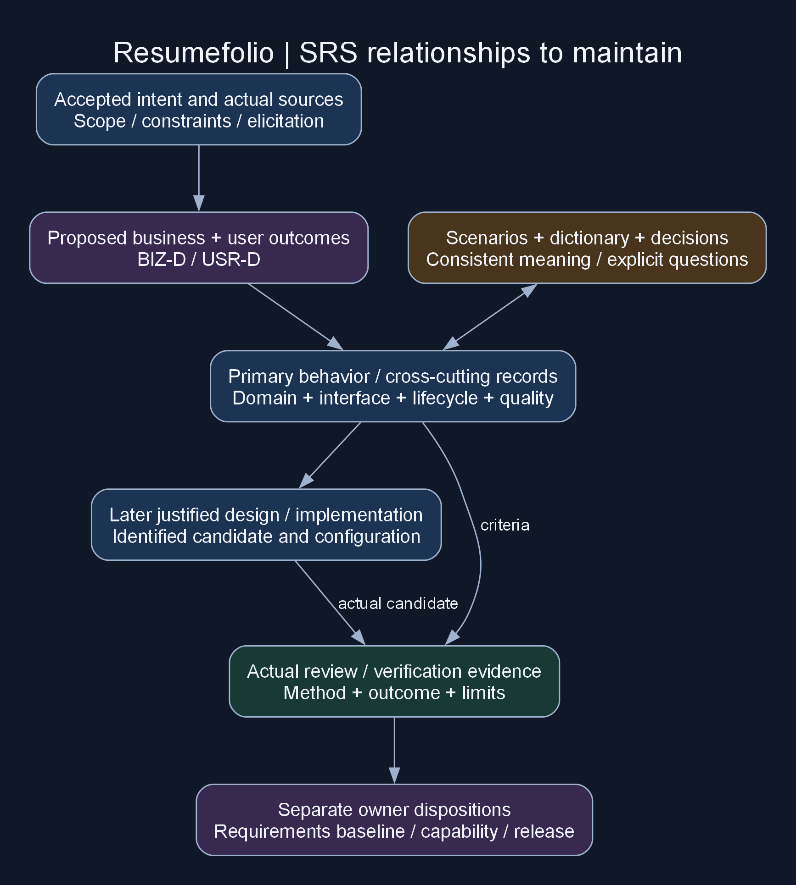
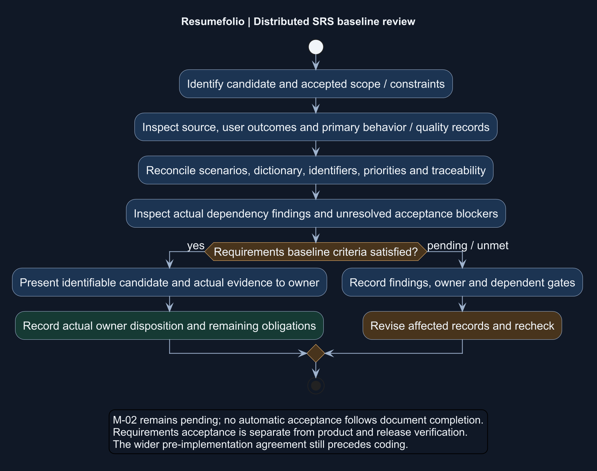

# Resumefolio — Software Requirements Specification

Current implementation choices and scope: [Baseline](https://github.com/Farhad-V/Web-Resumefolio/blob/1f2acaa351ac306cb57cbe4fe9742e8bd90720d9/docs/MVP/baseline/README.md). Runtime verification remains subject to its gates.

| Item | Current position |
| --- | --- |
| Purpose | Coordinate the distributed SRS: authority, product boundary, requirement levels, source ownership and acceptance gates |
| Owner | Farhad; sole delivery and operations owner |
| Status | Selected MVP specification and retained future proposals; runtime, actor and release evidence remain separate |
| Detailed content | 15 domain record sets with 157 retained stable IDs; no duplicate requirements allocated by this overview |
| Planning authority | Accepted Version 1 scope and constraints; M-01 accepted only for the identified snapshot under DEC-116 |
| Source record date | November 1, 2026; read subsequent selected decisions through the [current record rules](15-Requirement-Priority-And-Readiness.md#current-record-rules) |

**At a glance:** the MVP combines core professional presentation/private media/manual applications with separately authorized basic ProjectForge. Mail/calendar and advanced work/Git/execution are future. All paths retain resource-specific access. This SRS coordinates required outcomes and evidence;
domain files own the primary wording. Current policies and remaining verification follow the [current record rules](15-Requirement-Priority-And-Readiness.md#current-record-rules). Documentation completion does not establish product or release acceptance.

[Authority](#requirements-specification-requirements-specification--heading-1-status-and-authority) · [Context](#requirements-specification-requirements-specification--heading-2-introduction-system-boundary-and-operating-context)
· [Levels](#requirements-specification-requirements-specification--heading-3-requirement-levels-and-record-conventions) · [Functional requirements](#requirements-specification-requirements-specification--id-functional-requirements)
· [Non-functional requirements](#requirements-specification-requirements-specification--id-non-functional-requirements) · [Coverage](#requirements-specification-requirements-specification--heading-4-functional-areas-and-primary-record-ownership)
· [Supporting views](#requirements-specification-requirements-specification--heading-5-supporting-views-and-traceability) · [Acceptance](#requirements-specification-requirements-specification--heading-6-review-baseline-and-later-verification)
· [Gaps](#requirements-specification-requirements-specification--heading-7-open-definitions-and-dependent-gates) · [Maintenance](#requirements-specification-requirements-specification--heading-8-maintenance-and-diagrams)

## 1. Status and Authority

This is the entry point to a **distributed** Software Requirements Specification.
Use the [folder guide](16-Requirements-Specification-Guide.md#requirements-specification-requirements-specification-overview) for reading paths, document statuses and diagrams.
Accepted [Version 1 Scope](../../../01-Project-Planning/01-Project-Charter.md#mvp-scope) governs inclusions,
exclusions and conditional commitments. [Resources and Constraints](../../../01-Project-Planning/03-Feasibility-And-Risk-Assessment.md#resource-constraints)
governs agreed delivery restrictions; [Planning Completion](https://github.com/Farhad-V/Web-Resumefolio/blob/1f2acaa351ac306cb57cbe4fe9742e8bd90720d9/docs/MVP/SDLC/01-project-planning/10-planning-completion-criteria.md)
retains actual M-01 acceptance and GAP-D follow-up. Later working drafts do not
silently replace the accepted planning snapshot or record a new owner decision.

| Statement type | Authority and treatment |
| --- | --- |
| Accepted scope/constraint | Link the exact original source; preserve its limits and conditions |
| Proposed requirement/refinement | Review source, rationale, actors/conditions, behavior and acceptance criteria separately |
| Interpretation or open question | Identify uncertainty/owner/gate; do not present as stakeholder approval |
| External-source finding | Retain publisher/date/applicability and distinguish it from actual project access/configuration |
| Verification/review result | Record actual candidate, method, outcome/evidence and limits only when performed |
| Baseline/change decision | Identify owner outcome and reviewed revision; document material impacts and follow-up |

The retained IDs identify the original records. Current priority, selected policy and criterion scope follow the [current record rules](15-Requirement-Priority-And-Readiness.md#current-record-rules). Presentation order does not establish implementation order, measured capability or release acceptance.

## 2. Introduction, System Boundary and Operating Context

The MVP core supports private professional information and independent resumes/portfolio, generated/uploaded PDFs, protected sharing, My Files & Media on the same server, cover letters and manual application status/next action/follow-up with actual submitted materials. The separate ProjectForge supports real Git repositories/transfers/permissions/file-history, issues and simple Kanban through user-scoped API. Gmail/calendar, advanced backlog/Sprints/review/releases and YAML execution/deployment are future-only.

| Boundary | Required context / limit |
| --- | --- |
| Human participants | Registered applicant/resource owner, invited collaborator, employer viewer, administrator/platform owner and project owner/operator; roles are contexts, not inherited universal grants |
| Private workspace | Individual identity and resource/action/state permissions; unified sign-in does not expose unrelated private mail/resumes/repositories |
| Employer disclosure | No viewer account required; password-protected intended resume and selected content, including authorized direct files/PDFs |
| External exchange | Browser/Git clients, selected Google operations and operational dependencies; exact contracts/actual access remain to be established |
| Execution/deployment | Real agreed execution only after required feasibility/security/resource gates; Push/merge does not inherently authorize production deployment |
| Operating scale | Initial target 10 users; workload/concurrency/capacity need evidence; roughly 1,000 users is a growth direction |
| Delivery resources | Work follows the selected scope, dependencies and demonstrated outcomes. |
| Historical requested date | November 8, 2026; retained source context, not a current delivery commitment or forecast |

Product AI, automatic translation and automatic legacy-demo migration remain
excluded. Manually maintained English/German content is included. Portfolio
media/diagrams are externally authored content, not new in-product authoring tools.
Automatic external job submission and universal GitHub Actions compatibility are
not implied. Existing demo/reference projects remain preserved references.

[Actors and Context](../02-Stakeholders-And-Elicitation/01-Actors-And-System-Context.md#stakeholders-and-elicitation-actors-and-system-context)
owns actor definitions; [Assumptions and Dependencies](../../../01-Project-Planning/03-Feasibility-And-Risk-Assessment.md#assumptions-and-dependencies)
owns ASM/DEP status. A reference project's features, development GitHub or a prior
tool demonstration does not prove a product requirement has been implemented.

## 3. Requirement Levels and Record Conventions

| Level / view | Question answered | Primary file |
| --- | --- | --- |
| Business | Why is the product needed, and what outcome evidence matters? | [Business Requirements](03-Business-Requirements.md#requirements-specification-business-requirements), BIZ-D |
| User | Which actor needs what observable outcome in which context? | [User Requirements](18-User-Requirements.md#requirements-specification-user-requirements), USR-D |
| Functional | What behavior is required, including normal/denied/failure paths? | Domain files in section 4 |
| Business rule/lifecycle | Which cross-module invariants and change/removal effects apply? | [Business Rules](04-Business-Rules-And-Data-Lifecycle.md#requirements-specification-business-rules-and-data-lifecycle), BRL-D |
| Domain/constraint | What is inherent meaning, deliberate policy, imposed project constraint or externally applicable obligation? | [Domain Constraints](05-Domain-Requirements-And-Constraints.md#requirements-specification-domain-requirements-and-constraints), DOM-D |
| Interface | What crosses a boundary, under whose authority and with what outcome? | [External Interfaces](07-External-Interface-Requirements.md#requirements-specification-external-interface-requirements), EIF-D |
| Quality | Under which conditions/measure does behavior or recovery satisfy the agreed criterion? | [Quality/Security/Recovery](14-Quality-Security-And-Recovery-Requirements.md#requirements-specification-quality-security-and-recovery-requirements), QSR-D |

Each final allocated record needs identifier, level/type, source, rationale,
actor/context, obligation, observable criteria, owner, justified priority, actual
status, planned method, dependencies and unresolved decisions. Use the
[requirement template](#requirements-specification-requirements-specification). Retain stable source references such as PRP-D01; the selected registers map their applicable criteria without renumbering.

Use explicit stimulus/environment/response/measurement for quantitative quality.
Do not replace undecided thresholds, retention or recovery targets with arbitrary
numbers. Conditional criteria are not ready for acceptance until their referenced
policies are decided. Architecture/schema/tool selections belong in later justified design.

### 3.1 Functional Requirements

Functional requirements describe **what the system does**: inputs it accepts, information it manages, operations it performs and observable responses to actors or external events. This is the explicit functional index of the distributed SRS. The linked primary records own the complete proposed obligation, criteria, source and open detail; this index does not duplicate or accept their wording.

| Functional capability | Primary records | Observable behavior covered |
| --- | --- | --- |
| Accounts, sign-in and permission enforcement | [ACC-D01–ACC-D12](01-Accounts-Authentication-And-Permissions.md#requirements-specification-accounts-authentication-and-permissions) | Establish the required account context; continue authorized journeys; allow/deny resource operations; handle sharing and access changes under explicit policies. |
| Professional profiles, tailored resumes and evidence | [PRP-D01–PRP-D10](12-Profiles-Resumes-And-Portfolio.md#requirements-specification-profiles-resumes-and-portfolio) | Maintain reusable content, select/override it independently, manage selected evidence and manually maintained language variants, and report save/lifecycle outcomes. |
| PDF generation, uploaded variants and protected sharing | [PDF-D01–PDF-D10](11-Pdf-And-Controlled-Sharing.md#requirements-specification-pdf-and-controlled-sharing) | Generate or associate PDFs, configure download availability, authorize selected retrieval and apply owner link/password controls. |
| Manual application management | [APP-D01–APP-D09](09-Manual-Application-Management.md#requirements-specification-manual-application-management) | Record opportunities, prepare cover letters, associate resumes, record progress and preserve actual submitted materials. |
| Gmail and calendar operations | [EGC-D01–EGC-D12](06-Email-Calendar-And-Google-Integration.md#requirements-specification-email-calendar-and-google-integration) | Connect the intended account, read/compose/send/reply, manage agreed activities, synchronize selected information and handle disconnection/outcomes.  **After MVP.** |
| Work, Kanban and Sprint planning | [PKS-D01–PKS-D11](13-Projects-Kanban-And-Sprints.md#requirements-specification-projects-kanban-and-sprints) | Manage work contexts, items/tasks, assignments, authorized collaboration and a coherent Sprint Backlog. |
| Real Git hosting and collaboration | [GIT-D01–GIT-D10](08-Git-Hosting-And-Collaboration.md#requirements-specification-git-hosting-and-collaboration) | Create/browse repositories, support agreed real-client transfer, forks, pull requests, reviews, merge and repository tracking/releases. |
| Conditional workflow execution and deployment | [YML-D01–YML-D12](19-Yaml-Workflows-And-Cicd.md#requirements-specification-yaml-workflows-and-cicd) | Validate definitions, admit eligible runs, expose results, handle cancellation and separately authorize deployment, subject to retained enabling gates.  **After MVP.** |
| Administration and file operations | [AFO-D01–AFO-D12](02-Administration-Files-And-Operational-Behavior.md#requirements-specification-administration-files-and-operational-behavior) | Configure effective policy, validate/admit files, enforce quotas and expose authorized operational information and lifecycle actions. |
| Boundary operations | [EIF-D03–EIF-D08](07-External-Interface-Requirements.md#requirements-specification-external-interface-requirements) | Apply authorization, file exchange, Google, real Git and execution contracts with operation-specific outcomes. |

These are functional **aspects** of the cited records. A range does not assert that every sentence or criterion in a domain file is exclusively functional: security, timing, integrity and lifecycle constraints also apply through the next section. Use the [external scenarios](../04-Scenarios-And-Models/02-User-Stories-And-Scenarios.md#scenarios-and-models-user-stories-and-scenarios) for actor-facing examples; internal implementation design is not specified here.

### 3.2 Non-Functional Requirements

Non-functional requirements describe **the quality and conditions under which the required functions must operate**, together with imposed technical and management constraints. They are not optional merely because they are non-functional, and they also require assessable criteria. This category is broader than the quality file alone.

| Non-functional aspect | Primary records / authoritative source | Required assessment boundary |
| --- | --- | --- |
| Response performance and capacity | [QSR-D01/D02](14-Quality-Security-And-Recovery-Requirements.md#requirements-specification-quality-security-and-recovery-requirements) | Defined operations, workload, data volumes, concurrency, measurement and decided thresholds; initial user count alone is not a load model. |
| Usability, accessibility and client compatibility | [QSR-D03](14-Quality-Security-And-Recovery-Requirements.md#requirements-specification-quality-security-and-recovery-requirements), [EIF-D02](07-External-Interface-Requirements.md#requirements-specification-external-interface-requirements) | Reviewable task, supported-client/input and accessibility criteria with understandable outcomes. |
| Availability, reliability and degradation | [QSR-D04](14-Quality-Security-And-Recovery-Requirements.md#requirements-specification-quality-security-and-recovery-requirements), [EIF-D08](07-External-Interface-Requirements.md#requirements-specification-external-interface-requirements) | Define usable/degraded/unavailable outcomes, observation conditions and safe failure/reconciliation expectations. |
| Confidentiality, isolation and secret protection | [QSR-D05–QSR-D07](14-Quality-Security-And-Recovery-Requirements.md#requirements-specification-quality-security-and-recovery-requirements), [ACC](01-Accounts-Authentication-And-Permissions.md#requirements-specification-accounts-authentication-and-permissions), [YML](19-Yaml-Workflows-And-Cicd.md#requirements-specification-yaml-workflows-and-cicd) | Cross-user/trust boundaries, direct access and secret/content handling; exact mechanisms remain later justified design. |
| Integrity and lifecycle consistency | [QSR-D08/D09](14-Quality-Security-And-Recovery-Requirements.md#requirements-specification-quality-security-and-recovery-requirements), [BRL-D01–BRL-D10](04-Business-Rules-And-Data-Lifecycle.md#requirements-specification-business-rules-and-data-lifecycle) | Independent tailoring, actual submitted history, references, changes and retention/restore semantics remain coherent. |
| Backup and recoverability | [QSR-D10–QSR-D12](14-Quality-Security-And-Recovery-Requirements.md#requirements-specification-quality-security-and-recovery-requirements) | Explicit coverage, recovery point/time targets, consistent usable restoration and current-access/external-state reconciliation. |
| Operational evidence and maintainability | [QSR-D13/D14](14-Quality-Security-And-Recovery-Requirements.md#requirements-specification-quality-security-and-recovery-requirements), [AFO-D09–AFO-D12](02-Administration-Files-And-Operational-Behavior.md#requirements-specification-administration-files-and-operational-behavior) | Restricted useful diagnostics and version/environment-specific procedures with actual evidence and stated limitations. |
| Interoperability and representation constraints | [EIF-D01/D05/D06/D09/D10](07-External-Interface-Requirements.md#requirements-specification-external-interface-requirements), [DOM-D05–DOM-D08](05-Domain-Requirements-And-Constraints.md#requirements-specification-domain-requirements-and-constraints) | Review supported clients/exchanges, identity/time/language semantics and actual external applicability; documentation is not provider access or compliance proof. |
| Technical and platform constraints | [Resources and Constraints](../../../01-Project-Planning/03-Feasibility-And-Risk-Assessment.md#resource-constraints), [DOM-D08](05-Domain-Requirements-And-Constraints.md#requirements-specification-domain-requirements-and-constraints) | Preserve Laravel/OOP, existing resource/budget boundaries and actual platform feasibility; no database/frontend/Git engine/runner is selected here. |
| Management and delivery constraints | [Resources](../../../01-Project-Planning/03-Feasibility-And-Risk-Assessment.md#resource-constraints), [Roadmap](../../../01-Project-Planning/02-Project-Management-Plan.md#delivery-sequence), [Working Method](../../../01-Project-Planning/02-Project-Management-Plan.md#delivery-approach) | Solo capacity, spending authority, agreed phase gates and requested dates; a requested deadline is not a verified forecast. |

Operation and quality are complementary aspects, not mutually exclusive file labels. For example, rejecting an unauthorized PDF request is functional behavior; protecting confidentiality across every retrieval path is a cross-cutting quality requirement. Configuring a quota is a function; respecting actual combined capacity is a constraint. Do not allocate duplicate FR/NFR records merely to repeat those meanings.

### 3.3 Business Outcomes, User Goals and Rules

[BIZ-D](03-Business-Requirements.md#requirements-specification-business-requirements) explains why the product is needed; [USR-D](18-User-Requirements.md#requirements-specification-user-requirements) expresses actor outcomes. [BRL-D](04-Business-Rules-And-Data-Lifecycle.md#requirements-specification-business-rules-and-data-lifecycle) and [DOM-D](05-Domain-Requirements-And-Constraints.md#requirements-specification-domain-requirements-and-constraints) constrain or explain the functions and qualities. These are additional levels/aspects, not reasons to force every business statement into one exclusive FR or NFR bucket.

### 3.4 Shared Readiness and Identifier Rules

Functional and non-functional headings organize the existing 157 records; they create no new IDs. Apply the [current record rules](15-Requirement-Priority-And-Readiness.md#current-record-rules) to scope, priority and selected target decisions. Actual performance, recovery and user validation require their own evidence.

## 4. Functional Areas and Primary Record Ownership

| Scope coverage | Primary specification | Candidate count / related rules |
| --- | --- | --- |
| SCP-01 / DEC-028: identity, grants, unified sign-in | [Accounts](01-Accounts-Authentication-And-Permissions.md#requirements-specification-accounts-authentication-and-permissions) | 12 ACC-D; every domain enforces applicable resource/action authority |
| SCP-02/03 / DEC-027/026: reusable content and selected evidence | [Profiles/Resumes/Portfolio](12-Profiles-Resumes-And-Portfolio.md#requirements-specification-profiles-resumes-and-portfolio) | 10 PRP-D; BRL-D propagation and independent tailoring |
| SCP-04/05 / DEC-025/024: PDF variants and employer sharing | [PDF/Sharing](11-Pdf-And-Controlled-Sharing.md#requirements-specification-pdf-and-controlled-sharing) | 10 PDF-D; ACC-D direct access and owner controls |
| SCP-06 / DEC-023: manual applications and submitted copies | [Applications](09-Manual-Application-Management.md#requirements-specification-manual-application-management) | 9 APP-D; actual submitted set differs from current source/live view |
| SCP-07 / DEC-022: correspondence/calendar | [Google Integration](06-Email-Calendar-And-Google-Integration.md#requirements-specification-email-calendar-and-google-integration) | 12 EGC-D; provider permissions/source notes differ from actual access  **After MVP.** |
| SCP-08 / DEC-021: projects, Kanban, backlogs/Sprints | [Work Management](13-Projects-Kanban-And-Sprints.md#requirements-specification-projects-kanban-and-sprints) | 11 PKS-D; item/task distinction and composite Sprint Backlog |
| SCP-09 / DEC-020: real Git hosting/collaboration | [Git Hosting](08-Git-Hosting-And-Collaboration.md#requirements-specification-git-hosting-and-collaboration) | 10 GIT-D; real-client and current revision context |
| SCP-10 / DEC-019: conditional execution | [YAML/CI/CD](19-Yaml-Workflows-And-Cicd.md#requirements-specification-yaml-workflows-and-cicd) | 12 YML-D; isolation/resources/secrets and separate deployment grants  **After MVP.** |
| SCP-11 / DEC-018: effective file/storage policy | [Administration/Files](02-Administration-Files-And-Operational-Behavior.md#requirements-specification-administration-files-and-operational-behavior) | 12 AFO-D; infrastructure/accounting/lifecycle consistency |
| SCP-12 / DEC-017: operational readiness | [Quality/Recovery](14-Quality-Security-And-Recovery-Requirements.md#requirements-specification-quality-security-and-recovery-requirements) and [Administration](02-Administration-Files-And-Operational-Behavior.md#requirements-specification-administration-files-and-operational-behavior) | 14 QSR-D overall; actual restoration and versioned guidance required later |

The remaining primary views are 5 BIZ-D, 12 USR-D, 10 BRL-D, 8 DOM-D and 10 EIF-D.
Together the 15 detailed files contain **157 provisional records**. Counts are
working inventory, not approved scope size, effort estimates, tests or acceptance
evidence. Detailed wording belongs in the primary file; cross-cutting rules apply
to it without creating competing duplicates in this overview.

## 5. Supporting Views and Traceability

[Scalable SVG](../../Diagrams/Srs-Traceability-Map.svg) · [Graphviz source](../../Diagrams/Srs-Traceability-Map.dot)

Arrows indicate relationships to maintain, not a populated formal traceability
register or an implementation sequence. Colors supplement labels. One user goal
may need several functional/quality records, and one cross-cutting rule may affect
many scenarios; no one-to-one relation is imposed.

| Supporting view | Use / evidence boundary |
| --- | --- |
| [Elicitation Plan](../02-Stakeholders-And-Elicitation/03-Elicitation-Plan-And-Techniques.md#stakeholders-and-elicitation-elicitation-plan-and-techniques) / [Log](../02-Stakeholders-And-Elicitation/02-Elicitation-Log.md#stakeholders-and-elicitation-elicitation-log) | Planned research versus actual documentary extraction and unresolved interpretation |
| [Scenarios](../04-Scenarios-And-Models/02-User-Stories-And-Scenarios.md#scenarios-and-models-user-stories-and-scenarios) | Actor/context, preconditions, normal/alternative/denied/failure/recovery examples |
| [Dictionary](../05-Data-Definitions/02-Data-Dictionary.md#data-definitions-data-dictionary) / [Glossary](../05-Data-Definitions/03-Requirements-Glossary.md#data-definitions-glossary) | Shared conceptual meaning, authority and lifecycle; not schema |
| [Traceability](../06-Validation-And-Traceability/07-Validation-And-Traceability.md#validation-and-traceability-validation-and-traceability--heading-traceability) | Final allocated source/requirement/scenario/design/verification links; do not infer population from this map |
| [Review Findings](../06-Validation-And-Traceability/07-Validation-And-Traceability.md#validation-and-traceability-validation-and-traceability--heading-review-findings) | Actual inspection issues, dispositions and rechecks |
| [Questions](../07-Change-And-Baseline/03-Requirements-Questions-And-Decisions.md#change-and-baseline-open-questions-and-decisions) / [Change Control](../07-Change-And-Baseline/02-Requirements-Change-Control.md#change-and-baseline-change-control) | Actual decisions, owner/gate and material impact |

**Consistency anchors:** independent resume selections/overrides; actual submitted
materials not overwritten by later source edits; selected direct-file sharing;
downloaded copies outside product revocation; no private-resource access from
unrelated membership; Product Backlog Items distinct from tasks; Sprint Backlog
includes goal/items/plan; Git hosting distinct from execution; deployment separately
authorized; provider synchronization explicit; backup existence distinct from recovery.

## 6. Review, Baseline and Later Verification

[Scalable SVG](../../Diagrams/Srs-Baseline-Decision.svg) · [PlantUML source](../../Diagrams/Srs-Baseline-Decision.puml)

Apply the [requirements baseline criteria](../07-Change-And-Baseline/04-Requirements-Review-And-Baseline-Criteria.md#change-and-baseline-requirements-review-and-baseline-criteria):

1. Check scope coverage, source/status, actor outcomes and exclusions/conditions.
2. Resolve acceptance-blocking inputs, states, permissions, lifecycles, contracts and quantitative targets; retain justified dependency gates and real findings.
3. Reconcile identifiers/priorities, scenarios/dictionary and traceability; record actual inspections and addressed contradictions.
4. Present an identifiable candidate and evidence to the owner; record the actual outcome and remaining obligations separately from file creation.

M-02 acceptance is not a product test Pass, provider approval, successful recovery
or release decision. Actual integrated behavior/quality/restoration belongs to
later capability and M-09/M-10 evidence under [Milestones](../../../01-Project-Planning/02-Project-Management-Plan.md#delivery-sequence).
The agreed initial SDLC documentation, analysis/design and tracking reconciliation,
and wider pre-implementation agreement still precede product coding.

## 7. Open Definitions and Dependent Gates

| Group | Required next decisions/findings | Existing gate |
| --- | --- | --- |
| Core behavior | Fields/required inputs, states, task/item/Sprint relations, source update and submission capture | GAP-D06; affected M-02 acceptance |
| Identity/access/content | Role/action matrix, authentication/session/revocation, safe serving, languages and lifecycle | Affected M-02/M-03 security/data decisions |
| Provider/delivery | Required Google operations/access/conditions, sync/conflicts; distinct authentication/notification delivery | GAP-D02/D03; access before dependent development |
| Resources/quality | Actual combined demand, file limits, client matrix, performance/availability/accessibility and costs | GAP-D01/D08/D10; dependent design/target commitments |
| Recovery | Coverage/storage, retention, RPO/RTO, restored grants/deleted-data and external-state reconciliation | GAP-D04; M-03 design, actual restoration before M-09 |
| Conditional execution | Syntax/triggers, untrusted-code isolation, secrets/limits and target approval | GAP-D09; before execution design acceptance/enabling |
| Delivery/baseline | Feasible effort/solo operation, domain/TLS, compatibility and tracking alignment | GAP-D05/D07/D08/D11 and agreed pre-coding gate |

Farhad coordinates all gaps. This table summarizes retained follow-up; it does
not allocate new shared questions or claim completed investigations. Material scope,
cost or delivery changes need documented owner decisions, not silent scope reduction.

## 8. Maintenance and Diagrams

- [ ] Reconcile this overview and folder counts whenever primary records change.
- [ ] Preserve source decisions, semantic boundaries, explicit open policies and exact review status.
- [ ] Keep actual question/scenario/traceability/evidence links current; avoid duplicate detailed obligations.
- [ ] Check diagram labels/arrows, source-render synchronization and file/section links.
- [ ] Record identifiable owner review before changing baseline status.

| Diagram | Source | SVG | PNG |
| --- | --- | --- | --- |
| SRS traceability relationships | [DOT](../../Diagrams/Srs-Traceability-Map.dot) | [SVG](../../Diagrams/Srs-Traceability-Map.svg) |  |
| SRS baseline decision | [PlantUML](../../Diagrams/Srs-Baseline-Decision.puml) | [SVG](../../Diagrams/Srs-Baseline-Decision.svg) |  |

Follow the [diagram guide](../../Diagrams/Diagram-Catalog.md). Save UTF-8 without BOM; retain
editable sources and SVG/PNG outputs together. Colors supplement labels; diagrams
are conceptual requirements models, not selected architecture or actual acceptance.

**Document outcome:** Coordinated SRS overview with selected MVP dispositions and retained source history. No duplicate SRS
candidate IDs are allocated; no owner baseline acceptance or implementation,
provider, capacity, security or recovery result is established by this revision.

[Specification guide](16-Requirements-Specification-Guide.md#requirements-specification-requirements-specification-overview) · [Requirements index]()

## Course Alignment: Stakeholder View and Assessable Detail

The stakeholder-facing specification is provided by business/user outcomes, actor/context descriptions and concise external use cases. The system/software view adds necessary behavioral, quality, interface and imposed-constraint detail in the primary domain records. These are linked views of one specification, not duplicated competing requirements or a mandated two-file layout. FAU V02 slides 10–12 and 25 permit domain-specific organization.

The [priority/readiness register](15-Requirement-Priority-And-Readiness.md) owns interpretation of selected priorities and mixed criteria. The quality records preserve target-selection provenance and remaining measurement gates. Requirements Engineering models external behavior; System Analysis refines internal relationships.

Keep stakeholder goals concise. Supporting audit/administration obligations remain in their appropriate detailed records rather than crowding high-level use cases with implementation detail. Existing candidate IDs are usable unique locators; preservation matters more than adopting a particular FR/NFR spelling.

## Selected Policies and Future Proposals

Current MVP answers are selected in the Baseline. Only explicitly deferred details below remain proposals; product tests and operational evidence are still required.

### Q-D01: Selected policy

[Selected answer and remaining evidence](https://github.com/Farhad-V/Web-Resumefolio/blob/1f2acaa351ac306cb57cbe4fe9742e8bd90720d9/docs/MVP/baseline/policy-decisions.md#q-d01). Apply this policy to the MVP slice; the original criteria above remain subject to their [current dispositions](https://github.com/Farhad-V/Web-Resumefolio/blob/1f2acaa351ac306cb57cbe4fe9742e8bd90720d9/docs/MVP/baseline/criterion-dispositions.csv).

### Q-D28: Selected policy

[Selected answer and remaining evidence](https://github.com/Farhad-V/Web-Resumefolio/blob/1f2acaa351ac306cb57cbe4fe9742e8bd90720d9/docs/MVP/baseline/policy-decisions.md#q-d28). Apply this policy to the MVP slice; the original criteria above remain subject to their [current dispositions](https://github.com/Farhad-V/Web-Resumefolio/blob/1f2acaa351ac306cb57cbe4fe9742e8bd90720d9/docs/MVP/baseline/criterion-dispositions.csv).

## November 1, 2026 — Q-D28 Capacity Evidence

Exact design-dependent effort, live tracking reconciliation and baseline disposition remain pending. This updates a current working constraint without changing requirement IDs or historical accepted scope.
