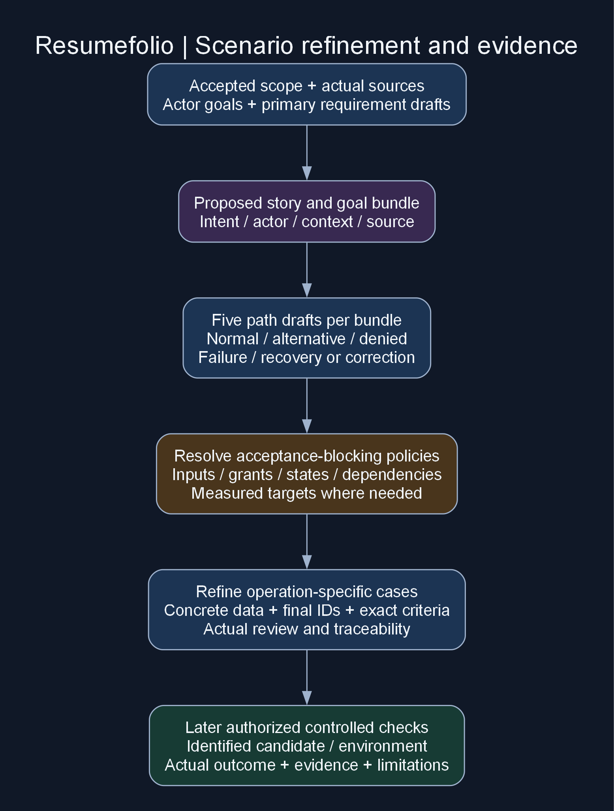
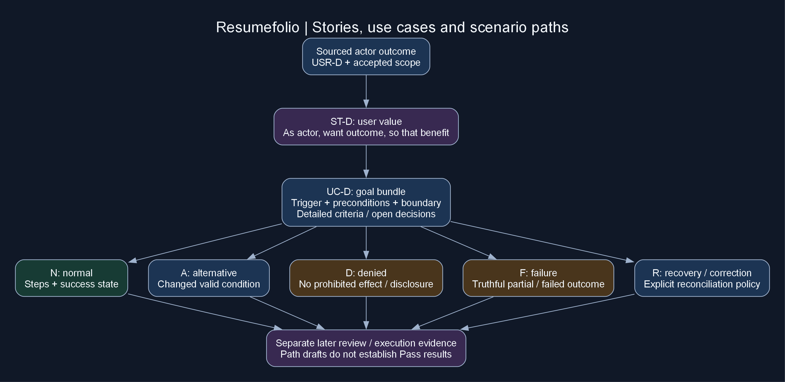
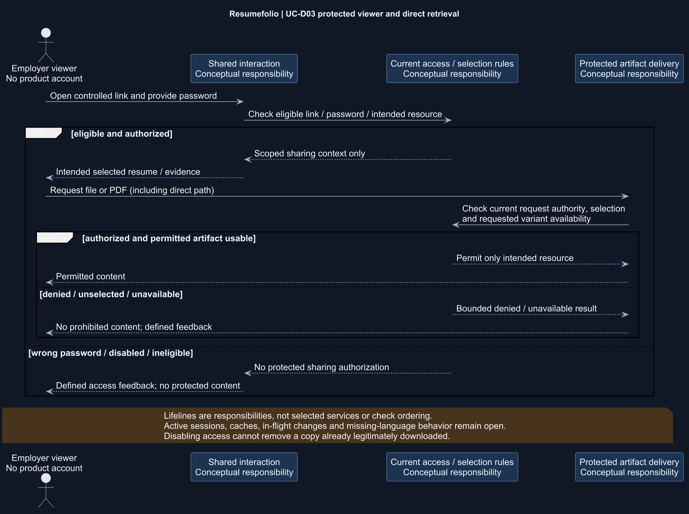
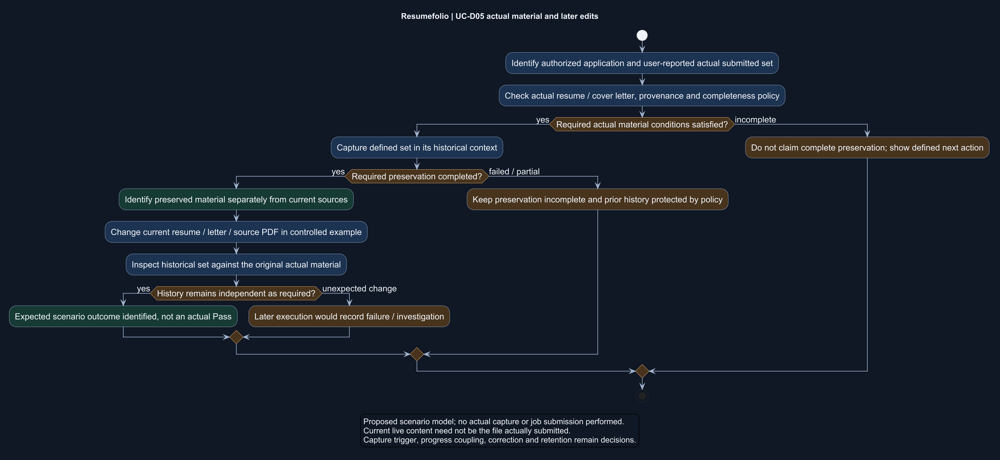

<a id="scenarios-and-models-scenarios-and-models"></a>

<a id="scenarios-and-models-scenarios-and-models--heading-resumefolio--scenarios-and-models-guide"></a>
# Resumefolio — Scenarios and Models Guide

Current implementation choices and scope: [Baseline](https://github.com/Farhad-V/Web-Resumefolio/blob/1f2acaa351ac306cb57cbe4fe9742e8bd90720d9/docs/MVP/baseline/README.md). Runtime verification remains subject to its gates.

| Item | Current position |
| --- | --- |
| Purpose | Navigate actor stories, goal-based use cases, scenario paths and visual models |
| Owner | Farhad |
| Status | Proposed documentation set — owner review, policy refinement and execution pending |
| Inventory | 12 use-case bundles, 12 stories and 60 path drafts in one primary document; four diagrams including this guide |
| Revision | October 31, 2026 |

**Start with [User Stories and Scenarios](02-User-Stories-And-Scenarios.md#scenarios-and-models-user-stories-and-scenarios).** Use the
catalog to find an actor goal, then read its conditions, normal steps, alternative,
denied, failure and recovery/correction paths. These are reviewable examples,
not an approved baseline, exhaustive use-case model or completed test suite.

[Reading routes](#scenarios-and-models-scenarios-and-models--heading-1-reading-routes) · [Documents](#scenarios-and-models-scenarios-and-models--heading-documents)
· [Coverage](#scenarios-and-models-scenarios-and-models--heading-3-coverage-and-boundaries) · [Roadmap](#scenarios-and-models-scenarios-and-models--heading-4-refinement-roadmap)
· [Diagrams](#scenarios-and-models-scenarios-and-models--heading-5-diagram-catalog) · [Maintenance](#scenarios-and-models-scenarios-and-models--heading-6-maintenance)

<a id="scenarios-and-models-scenarios-and-models--heading-1-reading-routes"></a>
## 1. Reading Routes

| Your question | Suggested route |
| --- | --- |
| What goal/path should I review? | [Goal catalog](02-User-Stories-And-Scenarios.md#scenarios-and-models-user-stories-and-scenarios--heading-2-use-case-and-story-catalog) → selected UC/ST bundle → N/A/D/F/R path |
| Where do the stories come from? | [Actors](../02-Stakeholders-And-Elicitation/01-Actors-And-System-Context.md#stakeholders-and-elicitation-actors-and-system-context) → [User Requirements](../03-Requirements-Specification/18-User-Requirements.md#requirements-specification-user-requirements) → linked story/source |
| Which detailed rule decides the outcome? | Bundle trace references → [primary specifications](../03-Requirements-Specification/16-Requirements-Specification-Guide.md#requirements-specification-requirements-specification-overview) → exact obligation/criterion and open policy |
| Can I treat this as an executable test? | [Refinement/evidence contract](02-User-Stories-And-Scenarios.md#scenarios-and-models-user-stories-and-scenarios--heading-5-refinement-and-later-execution-evidence) → resolve conditions → later authorized checks and separate evidence |
| What must be consistent across scenarios? | [Dictionary](../05-Data-Definitions/02-Data-Dictionary.md#data-definitions-data-dictionary) → [Lifecycle](../03-Requirements-Specification/04-Business-Rules-And-Data-Lifecycle.md#requirements-specification-business-rules-and-data-lifecycle) → [Accounts](../03-Requirements-Specification/01-Accounts-Authentication-And-Permissions.md#requirements-specification-accounts-authentication-and-permissions) → [Quality](../03-Requirements-Specification/14-Quality-Security-And-Recovery-Requirements.md#requirements-specification-quality-security-and-recovery-requirements) |

<a id="scenarios-and-models-scenarios-and-models--heading-documents"></a>
## Documents

| Document | Primary responsibility | Current content / limitation |
| --- | --- | --- |
| [User Stories and Scenarios](02-User-Stories-And-Scenarios.md#scenarios-and-models-user-stories-and-scenarios) | Sourced actor goals, preconditions, interactions, observable outcomes, variants and open review gates | 12 proposed UC bundles / 12 ST stories / 60 SCN path drafts; no actual user validation or product results recorded |

The folder keeps related small records together for review. It does not decide a
permanent one-file storage strategy. Split individual use cases/scenarios when
needed, preserve references and update this guide. UC-D/ST-D/SCN-D references are
provisional local navigation, not allocated final global identifiers or approved priorities.

<a id="scenarios-and-models-scenarios-and-models--heading-3-coverage-and-boundaries"></a>
## 3. Coverage and Boundaries

| Goal group | Bundle links | Main review concern |
| --- | --- | --- |
| Professional tailoring | [UC-D01](02-User-Stories-And-Scenarios.md#scenarios-and-models-user-stories-and-scenarios--id-uc-d01) | Independent resumes, selected evidence and explicit shared-source updates |
| Owner/employer sharing | [UC-D02](02-User-Stories-And-Scenarios.md#scenarios-and-models-user-stories-and-scenarios--id-uc-d02), [UC-D03](02-User-Stories-And-Scenarios.md#scenarios-and-models-user-stories-and-scenarios--id-uc-d03) | PDF/language availability, passwords, direct paths and changed access |
| Applications/history | [UC-D04](02-User-Stories-And-Scenarios.md#scenarios-and-models-user-stories-and-scenarios--id-uc-d04), [UC-D05](02-User-Stories-And-Scenarios.md#scenarios-and-models-user-stories-and-scenarios--id-uc-d05) | Manual progress versus actual submitted copies, capture failure and correction |
| Correspondence/calendar | [UC-D06](02-User-Stories-And-Scenarios.md#scenarios-and-models-user-stories-and-scenarios--id-uc-d06) | Account/grants, actual provider conditions, conflict and uncertain external effects  **After MVP.** |
| Work/collaboration | [UC-D07](02-User-Stories-And-Scenarios.md#scenarios-and-models-user-stories-and-scenarios--id-uc-d07), [UC-D08](02-User-Stories-And-Scenarios.md#scenarios-and-models-user-stories-and-scenarios--id-uc-d08) | Items/tasks/Sprint Backlog, invitations and scoped membership |
| Real Git | [UC-D09](02-User-Stories-And-Scenarios.md#scenarios-and-models-user-stories-and-scenarios--id-uc-d09) | Actual client operations, current source/target, denied actions and merge conflict |
| Conditional execution | [UC-D10](02-User-Stories-And-Scenarios.md#scenarios-and-models-user-stories-and-scenarios--id-uc-d10) | Isolation/resources, secret scope, actual run outcomes and separate deployment approval  **After MVP.** |
| Administration/recovery | [UC-D11](02-User-Stories-And-Scenarios.md#scenarios-and-models-user-stories-and-scenarios--id-uc-d11), [UC-D12](02-User-Stories-And-Scenarios.md#scenarios-and-models-user-stories-and-scenarios--id-uc-d12) | Effective limits/powers, reference-aware cleanup and consistent safely authorized restoration |

Each bundle has five path drafts; categories do not prove exhaustive coverage.
Complex mail/calendar, Git, Sprint and execution interactions still need more
operation-specific cases as their policies stabilize. Quantitative performance,
availability, accessibility and recovery targets require separate decided
measurement contracts in QSR-D; these narratives do not set those values.

**Keep these distinctions visible:** source versus live share versus actual
submitted copy; downloaded copy versus future retrieval; item/task versus accepted
work; scoped membership versus unrelated private access; Git transfer versus job
execution; Push/merge versus deployment authority; backup existence versus demonstrated recovery.

<a id="scenarios-and-models-scenarios-and-models--heading-4-refinement-roadmap"></a>
## 4. Refinement Roadmap



[Scalable SVG](../../Diagrams/Scenario-Refinement-Map.svg) ·
[Editable Graphviz](../../Diagrams/Scenario-Refinement-Map.dot)

Arrows describe review/refinement relationships, not a dated schedule, software
architecture or a completed evidence chain. Colors supplement labels.

1. Confirm the scope-derived actor goal and identify its primary domain/criteria.
2. Review each path's conditions, allowed/denied actions and observable state/effect.
3. Resolve policy, input/state, dependency and measurement gaps at their existing gates.
4. Split complex paths, allocate final IDs and concrete data, then maintain actual trace links and review findings.
5. Later run only authorized controlled checks; record candidate/environment, actual results and limitations separately from the proposed path.

Use [Questions and Decisions](../07-Change-And-Baseline/03-Requirements-Questions-And-Decisions.md#change-and-baseline-open-questions-and-decisions),
[Traceability](../06-Validation-And-Traceability/07-Validation-And-Traceability.md#validation-and-traceability-validation-and-traceability--heading-traceability),
[Review Findings](../06-Validation-And-Traceability/07-Validation-And-Traceability.md#validation-and-traceability-validation-and-traceability--heading-review-findings) and
[Baseline Criteria](../07-Change-And-Baseline/04-Requirements-Review-And-Baseline-Criteria.md#change-and-baseline-requirements-review-and-baseline-criteria).
The model does not populate these registers or resolve their acceptance conditions.

M-02 remains pending. Scope interpretation, owner review, feasibility, later product
verification and release acceptance are separate outcomes. The agreed wider
pre-implementation baseline still precedes product coding. No scenario draft
authorizes real email/job submissions, live resource mutation, job execution or production recovery.

<a id="scenarios-and-models-scenarios-and-models--heading-5-diagram-catalog"></a>
## 5. Diagram Catalog

| Diagram | Purpose | Editable source | SVG | PNG |
| --- | --- | --- | --- | --- |
| Scenario refinement roadmap | This folder's review/evidence route | [DOT](../../Diagrams/Scenario-Refinement-Map.dot) | [SVG](../../Diagrams/Scenario-Refinement-Map.svg) |  |
| Story/scenario relationships | Sources, goals and the five path categories | [DOT](../../Diagrams/Story-Scenario-Relationships.dot) | [SVG](../../Diagrams/Story-Scenario-Relationships.svg) |  |
| Protected sharing sequence | UC-D03's viewer/direct-file boundary | [PlantUML](../../Diagrams/Protected-Sharing-Sequence.puml) | [SVG](../../Diagrams/Protected-Sharing-Sequence.svg) |  |
| Submitted-history scenario | UC-D05's actual-material capture and later source edits | [PlantUML](../../Diagrams/Submission-History-Scenario.puml) | [SVG](../../Diagrams/Submission-History-Scenario.svg) |  |

<a id="scenarios-and-models-scenarios-and-models--heading-6-maintenance"></a>
## 6. Maintenance

- Keep the catalog, local references and path counts synchronized with the primary document.
- Preserve the legacy protected-resume walkthrough anchor retained at UC-D03 for existing method links.
- Link primary obligations instead of creating competing copies of permission/lifecycle policies.
- Distinguish actual review/execution from planned paths, including exact revisions and limits.
- Keep editable diagrams and PNG/SVG renders together; inspect labels/arrows and local links after changes.

Follow the [diagram guide](../../Diagrams/Diagram-Catalog.md). From the repository root:

```powershell
$diagramFolder = 'docs\SDLC\02-requirements-engineering\diagrams'
$graphvizExe = 'C:\Program Files\Graphviz\bin\dot.exe'
$plantUmlJar = 'C:\Users\fvali\AppData\Local\Resumefolio\DiagramTools\plantuml.jar'
foreach ($format in 'svg', 'png') {
    foreach ($stem in 'scenario-refinement-map', 'story-scenario-relationships') {
        & $graphvizExe "-T$format" -Gdpi=140 "$diagramFolder\$stem.dot" -o "$diagramFolder\$stem.$format"
        if ($LASTEXITCODE -ne 0) { throw "Graphviz failed: $stem / $format" }
    }
    foreach ($stem in 'protected-sharing-sequence', 'submission-history-scenario') {
        java '-Djava.awt.headless=true' -jar $plantUmlJar -charset UTF-8 "-t$format" "$diagramFolder\$stem.puml"
        if ($LASTEXITCODE -ne 0) { throw "PlantUML failed: $stem / $format" }
    }
}
```

Use actual installed tool paths elsewhere; save UTF-8 without BOM. A readable
render and working link establish document quality, not a modeled product result.

[Requirements index]() · [Specification guide](../03-Requirements-Specification/16-Requirements-Specification-Guide.md#requirements-specification-requirements-specification-overview)
