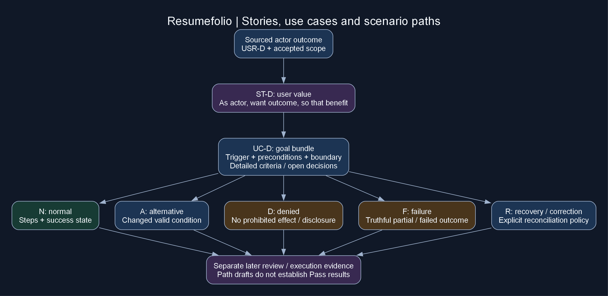
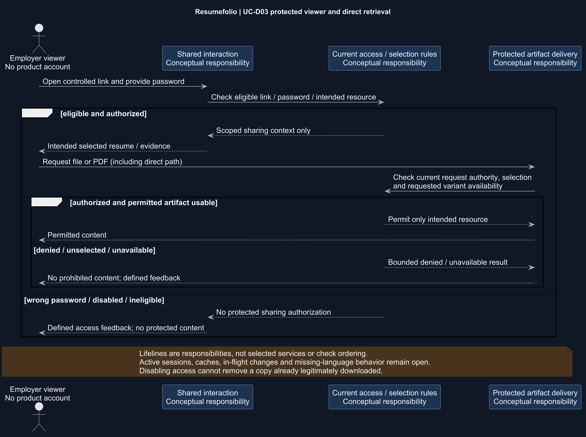
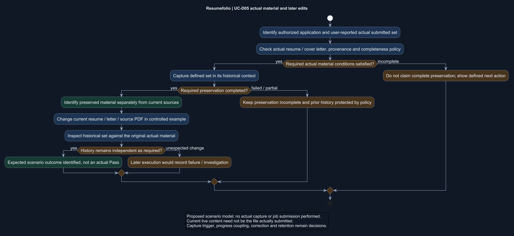
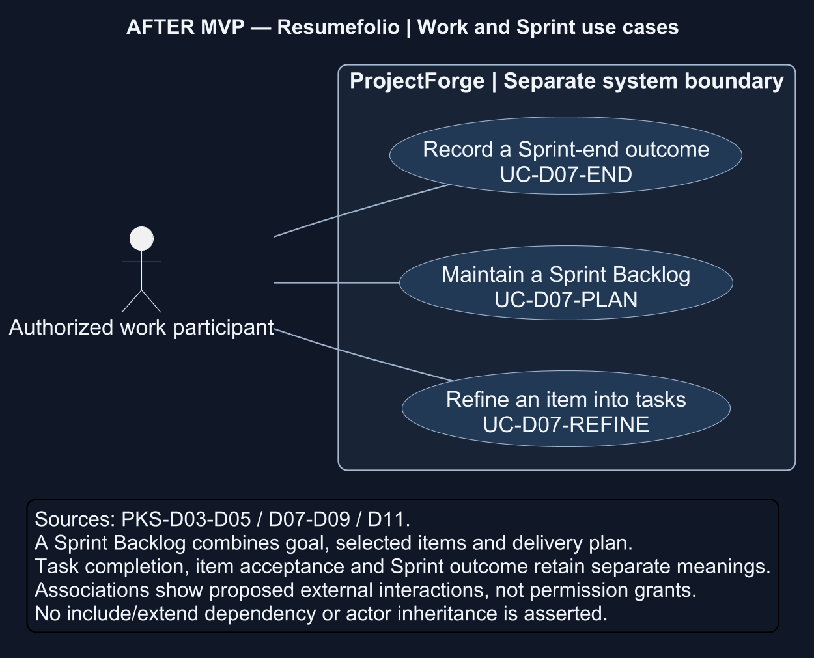
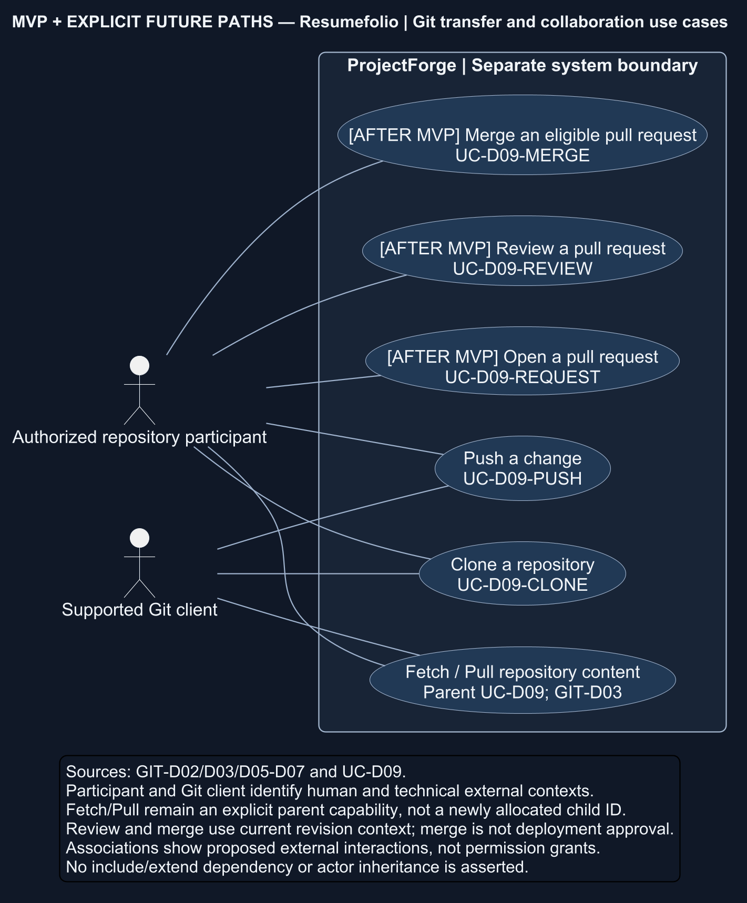
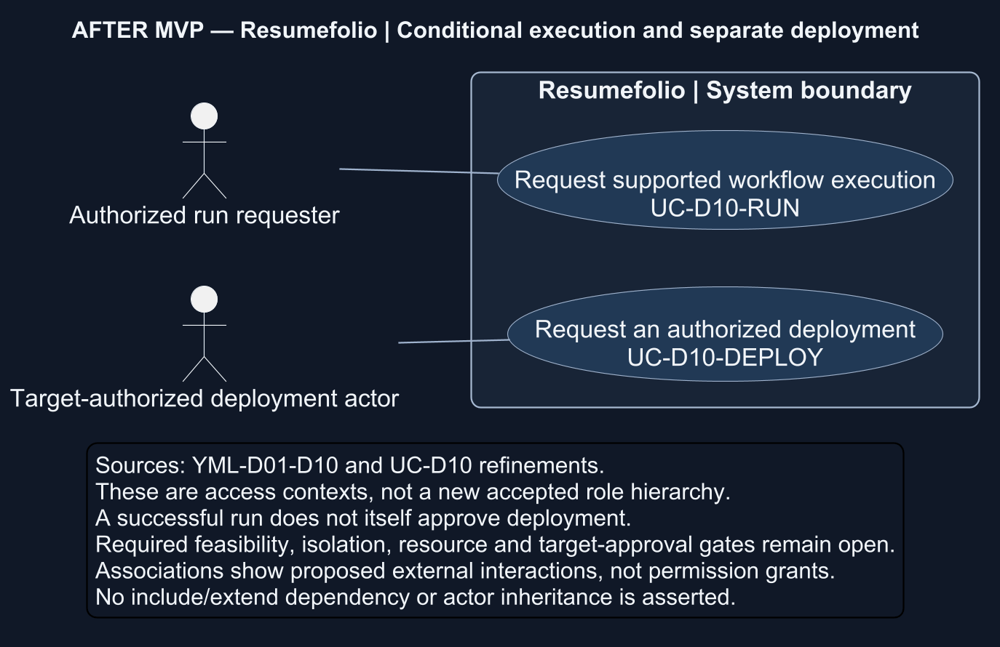
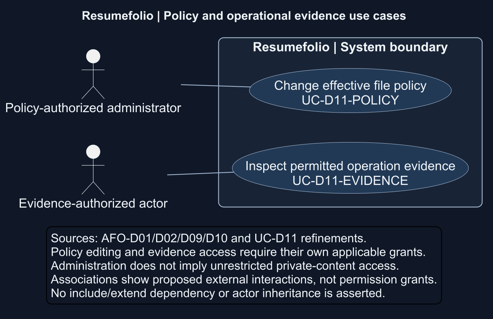

# Resumefolio — User Stories and Scenarios

**Scope and status:** Interpret this supporting view using the [current record rules](../03-Requirements-Specification/15-Requirement-Priority-And-Readiness.md#current-record-rules). Original open fields do not override selected policies. Personal Google integration, advanced Sprint/review features and YAML execution remain after MVP; only the selected criteria apply to current work.

Start with [resume tailoring](#scenarios-and-models-user-stories-and-scenarios--heading-uc-d01-tailor-two-resumes-without-losing-independent-choices), [protected sharing](#scenarios-and-models-user-stories-and-scenarios--heading-uc-d03-view-a-protected-resume-and-retrieve-only-selected-material) or [manual applications](#scenarios-and-models-user-stories-and-scenarios--heading-uc-d04-prepare-a-manual-application-and-record-progress). The [MVP baseline](https://github.com/Farhad-V/Web-Resumefolio/blob/1f2acaa351ac306cb57cbe4fe9742e8bd90720d9/docs/MVP/baseline/README.md) identifies which behaviors apply to the current release.

Each bundle describes an actor goal and its normal, alternative, denied, failure and recovery paths. The scenarios are proposed and await review and execution. Use the [catalog](#scenarios-and-models-user-stories-and-scenarios--heading-2-use-case-and-story-catalog) to find other flows, including provider and workflow scenarios for later releases.

## 1. Purpose and Record Conventions

Use [Accepted Scope](../../../01-Project-Planning/01-Project-Charter.md#mvp-scope),
[Actors](../02-Stakeholders-And-Elicitation/01-Actors-And-System-Context.md#stakeholders-and-elicitation-actors-and-system-context) and the
[SRS](../03-Requirements-Specification/17-Software-Requirements-Specification.md#requirements-specification-requirements-specification) for authority.
[User Requirements](../03-Requirements-Specification/18-User-Requirements.md#requirements-specification-user-requirements) provides
the 12 actor-goal sources; domain drafts own detailed obligations/criteria.
No new interviews, actor permissions or scope decisions are recorded here.

| Record | Meaning | How to read this set |
| --- | --- | --- |
| Story ST-Dxx | Actor, desired outcome and value | Read with linked use case, criteria and limitations; not an implementation task |
| Use case UC-Dxx | A goal within an actor/resource boundary | Shared source, trigger/preconditions, normal flow and path variations |
| Scenario SCN-Dxx-N | Normal success-path draft | The numbered steps plus observable resulting state |
| A / D / F / R paths | Alternative / denied / failure / recovery or correction variants | Each specifies a changed condition/action and expected bounded result |
| Later evidence | Actual review or executed check | Separate dated record with identified policy/candidate/environment and results |

Every bundle shares **Proposed**, **Farhad**, **Unassigned priority**, and
**not executed / owner review not recorded**. All variants inherit the bundle's
source, actor/context, preconditions and trace links unless explicitly changed.
N/A/D/F/R are navigation suffixes, not formal test classifications or proof of coverage.

Controlled A/B, R1/R2 and other labels are synthetic example identities, not real
accounts/records. Normal paths assume decided required policies and applicable
access. A missing decision blocks dependent execution/acceptance; it is not filled
with an invented role, duration, transition, quota or recovery promise.

Use the [story template](../03-Requirements-Specification/17-Software-Requirements-Specification.md#requirements-specification-requirements-specification) and
[scenario template](../03-Requirements-Specification/17-Software-Requirements-Specification.md#requirements-specification-requirements-specification) when allocating/refining
individual records. A story does not replace business rules, denied paths or
acceptance criteria. Complex provider, Git, Sprint and execution bundles need
further operation-specific cases; the 60 drafts are not exhaustive coverage.

## 2. Use-case and Story Catalog

| Use case / story | Actor outcome | Related user goal | Paths |
| --- | --- | --- | --- |
| [UC-D01 / ST-D01](#scenarios-and-models-user-stories-and-scenarios--id-uc-d01) | Tailor two resumes without losing independent choices | USR-D01 | N / A / D / F / R |
| [UC-D02 / ST-D02](#scenarios-and-models-user-stories-and-scenarios--id-uc-d02) | Configure PDF availability and owner sharing controls | USR-D02 | N / A / D / F / R |
| [UC-D03 / ST-D03](#scenarios-and-models-user-stories-and-scenarios--id-uc-d03) | View a protected resume and retrieve only selected material | USR-D03 | N / A / D / F / R |
| [UC-D04 / ST-D04](#scenarios-and-models-user-stories-and-scenarios--id-uc-d04) | Prepare a manual application and record progress | USR-D04 | N / A / D / F / R |
| [UC-D05 / ST-D05](#scenarios-and-models-user-stories-and-scenarios--id-uc-d05) | Preserve the resume and cover letter actually submitted | USR-D05 | N / A / D / F / R |
| [UC-D06 / ST-D06](#scenarios-and-models-user-stories-and-scenarios--id-uc-d06) | Coordinate authorized Gmail and calendar activity | USR-D06 | N / A / D / F / R  **After MVP.** |
| [UC-D07 / ST-D07](#scenarios-and-models-user-stories-and-scenarios--id-uc-d07) | Refine work and maintain a coherent Sprint Backlog | USR-D07 | N / A / D / F / R |
| [UC-D08 / ST-D08](#scenarios-and-models-user-stories-and-scenarios--id-uc-d08) | Collaborate under a scoped invitation and changed membership | USR-D08 | N / A / D / F / R |
| [UC-D09 / ST-D09](#scenarios-and-models-user-stories-and-scenarios--id-uc-d09) | Use real Git transfer and review a current change | USR-D09 | N / A / D / F / R |
| [UC-D10 / ST-D10](#scenarios-and-models-user-stories-and-scenarios--id-uc-d10) | Run supported work with separately controlled deployment | USR-D10 | N / A / D / F / R  **After MVP.** |
| [UC-D11 / ST-D11](#scenarios-and-models-user-stories-and-scenarios--id-uc-d11) | Configure effective limits and inspect permitted operation evidence | USR-D11 | N / A / D / F / R |
| [UC-D12 / ST-D12](#scenarios-and-models-user-stories-and-scenarios--id-uc-d12) | Restore an identified release and reconcile access safely | USR-D12 | N / A / D / F / R |

The catalog follows the USR-D goal sequence for traceability, not a required
one-to-one final model. Split mail reading/sending, calendar synchronization,
Git transfer/review and other independent goals further when policies stabilize.
Link each allocated case to exact criteria; local associations here are candidate
coverage suggestions, not populated formal traceability or a claim of completeness.

## 3. Proposed Use-case, Story and Path Bundles

### UC-D01: Tailor two resumes without losing independent choices

**Current release allocation:** MVP core.

**Story ST-D01:** As a registered applicant / resume owner, I want to tailor two resumes without losing independent choices,
so that I can reuse professional information while presenting relevant material for each opportunity.

**Source / rationale:** DEC-027/026/015; USR-D01. This is a derived draft; no new stakeholder answer is claimed.

**Actor, goal and boundary:** Registered applicant / resume owner; reuse professional information while presenting relevant material for each opportunity. Other resources and
external actors remain outside this actor's grant unless explicitly permitted.

**Trigger:** A selects information and adjusts R1 for an opportunity.

**Preconditions / controlled data:** Controlled user A owns a profile, a shared experience entry and two independently editable resumes R1/R2. Selected evidence and manual language variants are identified; source-update/override rules must be reviewed before execution.

**Trace / detailed criteria:** PRP-D01–D07; BRL-D02; QSR-D08; [primary specification](../03-Requirements-Specification/12-Profiles-Resumes-And-Portfolio.md#requirements-specification-profiles-resumes-and-portfolio).
The applicable obligation/criteria remain authoritative in those proposed records;
cross-cutting [access](../03-Requirements-Specification/01-Accounts-Authentication-And-Permissions.md#requirements-specification-accounts-authentication-and-permissions),
[lifecycle](../03-Requirements-Specification/04-Business-Rules-And-Data-Lifecycle.md#requirements-specification-business-rules-and-data-lifecycle) and
[interfaces](../03-Requirements-Specification/07-External-Interface-Requirements.md#requirements-specification-external-interface-requirements) also apply.

**Normal scenario SCN-D01-N**

1. The applicant selects shared professional information for each intended tailored resume.
2. The system presents the selected content in the intended resume context.
3. The applicant saves resume-specific presentation or content overrides and, when needed, updates shared source information.
4. The system saves the authorized changes, preserves independent tailoring and applies only the reviewed propagation policy.

**Success / resulting state:** Each resume retains its independent selections/layout/overrides; only the reviewed source-update effects occur. No preserved submitted material is rewritten.

**Story assessment criteria:** Under the stated conditions, the normal result
matches the linked domain criteria; the denied path discloses no prohibited
content/authority; failure is distinguishable from successful completion. Decisions
identified below must be resolved before these become acceptance-ready cases.

| Scenario variant | Changed condition / action and expected result |
| --- | --- |
| SCN-D01-A — alternative | Given R2 omits the changed source entry, save the source edit and inspect R2: deliberately omitted content is not silently added. |
| SCN-D01-D — denied | Given user B lacks access to A’s profile/resume, request its edit/association directly: no protected content or change is authorized. |
| SCN-D01-F — failure | Interrupt an evidence/source save before required completion and inspect the result: the product distinguishes incomplete/failed work and follows the decided prior-content policy. |
| SCN-D01-R — recovery/correction | After a conflicting source/resume edit, invoke only the reviewed reconciliation/retry path: retain independent overrides and report unresolved conflict rather than silently replacing them. |

**Denied/failure postcondition:** Do not infer a prohibited effect or successful
completion. Exact partial state, retained references and recovery actions follow
the reviewed domain policy; no universal rollback/atomicity guarantee is assumed.

**Open questions / review gate:** Fields, source relation, override granularity, propagation trigger, confirmation, concurrency and language absence; before affected PRP acceptance.

**Planned verification / evidence:** Refine concrete inputs, exact criteria and
observable checks for these paths, then perform only authorized controlled
walkthroughs/checks later. Actual review outcome, reviewed revision, environment,
execution date/results and evidence: **not recorded**. Owner: **Farhad**.

### UC-D02: Configure PDF availability and owner sharing controls

**Current release allocation:** MVP core.

**Story ST-D02:** As a resume owner, I want to configure PDF availability and owner sharing controls,
so that I can choose what a particular employer may retrieve and stop new access when required.

**Source / rationale:** DEC-025/024; USR-D02. This is a derived draft; no new stakeholder answer is claimed.

**Actor, goal and boundary:** Resume owner; choose what a particular employer may retrieve and stop new access when required. Other resources and
external actors remain outside this actor's grant unless explicitly permitted.

**Trigger:** The owner requests a change to the intended resume's PDF download configuration. Disabling a sharing link has its own independent trigger and path below.

**Preconditions / controlled data:** A owns R1 and eligible generated/uploaded artifacts; uploaded English/German variants have explicit availability. A controlled protected link and fresh viewer contexts are available; no existing-session policy is assumed.

**Trace / detailed criteria:** PDF-D02/D03/D06; ACC-D08; EIF-D04; [primary specification](../03-Requirements-Specification/11-Pdf-And-Controlled-Sharing.md#requirements-specification-pdf-and-controlled-sharing).
The applicable obligation/criteria remain authoritative in those proposed records;
cross-cutting [access](../03-Requirements-Specification/01-Accounts-Authentication-And-Permissions.md#requirements-specification-accounts-authentication-and-permissions),
[lifecycle](../03-Requirements-Specification/04-Business-Rules-And-Data-Lifecycle.md#requirements-specification-business-rules-and-data-lifecycle) and
[interfaces](../03-Requirements-Specification/07-External-Interface-Requirements.md#requirements-specification-external-interface-requirements) also apply.

**Normal scenario SCN-D02-N**

1. The owner opens PDF download settings for the intended resume.
2. The system presents its current generated/uploaded download configuration and language-specific availability.
3. The owner chooses the intended generated/uploaded/both/neither mode and applicable language choices, then requests save.
4. The system validates authority and the requested configuration, records the permitted effective choices and reports the actual save result.

**Success / resulting state:** The intended resume has the saved permitted PDF download choices. Authorized retrieval follows those choices and actual variant availability under the reviewed effective-timing policy. Saving this configuration does not itself disable or re-enable the sharing link. Selecting neither disables employer PDF downloads through that sharing context, not the resume page or link itself.

**Separate operation: Disable the sharing link**

This is a separate owner action within the existing UC-D02 goal bundle, not a step automatically performed when PDF settings are saved. It introduces no new UC/ST/SCN identifier or mandatory sequence between configuration and link management.

**Sources / required outcome:** PDF-D06 and ACC-D08, retaining DEC-024. The requirement concerns denying new access through a disabled link; already authorized sessions, caches and in-flight requests remain under the unresolved revocation policy.

**Trigger:** The owner explicitly requests disablement of the intended sharing link.

**Preconditions:** The intended active link and resume are identified; the actor has the applicable owner-control authority. PDF download settings need not have been changed first.

1. The owner selects the intended link and requests disablement.
2. The system checks authority for that link and applies the permitted link-state change.
3. After the change completes, the system reports the link as disabled.
4. If a fresh viewer subsequently attempts to gain protected access through that link, the system denies that new access, including protected file/PDF retrieval through the disabled sharing context.

**Successful postcondition:** The intended link is disabled and cannot grant new protected access. This operation does not itself replace the saved PDF configuration or revoke copies legitimately downloaded earlier.

**Denied / failed outcome:** An unauthorized request does not disable the link. A failed or unconfirmed state change is not reported as successfully completed; a denial of future viewing is claimed only after effective disablement. Exact failure recovery and already-authorized-session behavior remain open in the primary records; no automatic re-enable or universal rollback is assumed.

**Planned verification, separately:** Compare the recorded link-state result with a new viewer-context access attempt after effective disablement. Configuration saving must not imply link disablement, and link disablement requires no prior configuration save. This is a proposed check, not an executed product result.

**Story assessment criteria:** Under the stated conditions, the normal result
matches the linked domain criteria; the denied path discloses no prohibited
content/authority; failure is distinguishable from successful completion. Decisions
identified below must be resolved before these become acceptance-ready cases.

| Scenario variant | Changed condition / action and expected result |
| --- | --- |
| SCN-D02-A — alternative | Given mode is neither, request generated and uploaded employer downloads: neither is available through that sharing context; the resume page is not thereby assumed disabled. |
| SCN-D02-D — denied | Given B lacks owner-control authority, request a password/link/mode change directly: R1 settings remain unchanged and no protected management information is disclosed. |
| SCN-D02-F — failure | Make the permitted PDF variant unavailable or fail its required processing: show defined unavailability/failure, not a wrong-language substitute or false complete PDF. |
| SCN-D02-R — recovery/correction | Restore a previously saved configuration only through the reviewed authorized correction policy; recheck fresh access and record active-session/cache/in-flight behavior as unresolved until decided. |

**Denied/failure postcondition:** Do not infer a prohibited effect or successful
completion. Exact partial state, retained references and recovery actions follow
the reviewed domain policy; no universal rollback/atomicity guarantee is assumed.

**Open questions / review gate:** Mode-change timing, artifact/language absence, owner preview, link re-enable and active/cached/in-flight revocation; before PDF/access acceptance.

**Planned verification / evidence:** Refine concrete inputs, exact criteria and
observable checks for these paths, then perform only authorized controlled
walkthroughs/checks later. Actual review outcome, reviewed revision, environment,
execution date/results and evidence: **not recorded**. Owner: **Farhad**.

### UC-D03: View a protected resume and retrieve only selected material

**Current release allocation:** MVP core.

**Story ST-D03:** As a employer viewer without product account, I want to view a protected resume and retrieve only selected material,
so that I can inspect the intended professional material without creating a product account.

**Source / rationale:** DEC-024/025/026; EXT-001; USR-D03. This is a derived draft; no new stakeholder answer is claimed.

**Actor, goal and boundary:** Employer viewer without product account; inspect the intended professional material without creating a product account. Other resources and
external actors remain outside this actor's grant unless explicitly permitted.

**Trigger:** Viewer opens L1.

**Preconditions / controlled data:** A has prepared R1, an eligible password-protected link L1, selected evidence E1 and a permitted available PDF P1. E2/unrelated R2 remain outside L1. Use controlled passwords and a fresh viewer context.

**Trace / detailed criteria:** PDF-D03–D06; ACC-D06–D08; EIF-D03/D04; [primary specification](../03-Requirements-Specification/11-Pdf-And-Controlled-Sharing.md#requirements-specification-pdf-and-controlled-sharing).
The applicable obligation/criteria remain authoritative in those proposed records;
cross-cutting [access](../03-Requirements-Specification/01-Accounts-Authentication-And-Permissions.md#requirements-specification-accounts-authentication-and-permissions),
[lifecycle](../03-Requirements-Specification/04-Business-Rules-And-Data-Lifecycle.md#requirements-specification-business-rules-and-data-lifecycle) and
[interfaces](../03-Requirements-Specification/07-External-Interface-Requirements.md#requirements-specification-external-interface-requirements) also apply.

**Normal scenario SCN-D03-N**

1. The employer viewer opens the intended sharing link.
2. The system requests the required sharing password without requiring a product account.
3. The viewer supplies the correct password and requests selected resume/evidence or an enabled available PDF.
4. The system evaluates the applicable current authority and exposes only the permitted selected content or requested available variant.

**Success / resulting state:** The viewer receives only eligible selected content/P1. No private workspace or unrelated resource access is granted. A retrieved copy is not proof of employer identity or later recall.

**Story assessment criteria:** Under the stated conditions, the normal result
matches the linked domain criteria; the denied path discloses no prohibited
content/authority; failure is distinguishable from successful completion. Decisions
identified below must be resolved before these become acceptance-ready cases.

**Scenario variant:** SCN-D03-A — alternative

**Changed condition / action and expected result:** Request an unselected E2 or disabled/unavailable language variant from an otherwise valid sharing context: do not expose it; apply the reviewed availability feedback.

**Scenario variant:** SCN-D03-D — denied

**Changed condition / action and expected result:** Supply the wrong password, use a disabled link or alter the direct file/resume reference: do not disclose protected content or newly grant access.

**Scenario variant:** SCN-D03-F — failure

**Changed condition / action and expected result:** Fail file retrieval or rendering after authorization: expose defined bounded failure without unrelated fallback content, secrets or false download success.

**Scenario variant:** SCN-D03-R — recovery/correction

**Changed condition / action and expected result:** After an authorized password change, use fresh contexts with old/current password: the old one cannot newly authorize; the current one works only for an eligible link. Existing sessions/cache/in-flight policy remains a blocker.

**Denied/failure postcondition:** Do not infer a prohibited effect or successful
completion. Exact partial state, retained references and recovery actions follow
the reviewed domain policy; no universal rollback/atomicity guarantee is assumed.

**Open questions / review gate:** Password attempts/feedback, session lifetime, visitor tracking if any, language fallback, current revision and active-session revocation; before dependent access acceptance.

**Planned verification / evidence:** Refine concrete inputs, exact criteria and
observable checks for these paths, then perform only authorized controlled
walkthroughs/checks later. Actual review outcome, reviewed revision, environment,
execution date/results and evidence: **not recorded**. Owner: **Farhad**.

### UC-D04: Prepare a manual application and record progress

**Current release allocation:** MVP core.

**Story ST-D04:** As a registered applicant, I want to prepare a manual application and record progress,
so that I can keep company, opportunity, relevant resume and user-authored cover letter together.

**Source / rationale:** DEC-023/027; USR-D04. This is a derived draft; no new stakeholder answer is claimed.

**Actor, goal and boundary:** Registered applicant; keep company, opportunity, relevant resume and user-authored cover letter together. Other resources and
external actors remain outside this actor's grant unless explicitly permitted.

**Trigger:** A starts preparing an application for the opportunity.

**Preconditions / controlled data:** A has an authorized resume R1 and a controlled opportunity. Required company/position/cover-letter fields and allowed progress transitions must be reviewed before execution.

**Trace / detailed criteria:** APP-D01–D05; ACC-D03/D04; BRL-D06/D10; [primary specification](../03-Requirements-Specification/09-Manual-Application-Management.md#requirements-specification-manual-application-management).
The applicable obligation/criteria remain authoritative in those proposed records;
cross-cutting [access](../03-Requirements-Specification/01-Accounts-Authentication-And-Permissions.md#requirements-specification-accounts-authentication-and-permissions),
[lifecycle](../03-Requirements-Specification/04-Business-Rules-And-Data-Lifecycle.md#requirements-specification-business-rules-and-data-lifecycle) and
[interfaces](../03-Requirements-Specification/07-External-Interface-Requirements.md#requirements-specification-external-interface-requirements) also apply.

**Normal scenario SCN-D04-N**

1. The applicant enters company and opportunity information under the reviewed field rules.
2. The system validates that information and presents the intended application context.
3. The applicant associates an authorized resume, writes the cover letter manually and requests save.
4. The system retains the permitted preparation information and reports its actual result; a later progress update follows its separately reviewed transition rules.

**Success / resulting state:** The application retains intended preparation/progress context. No AI drafting, automatic external submission or employer receipt is inferred from the status.

**Story assessment criteria:** Under the stated conditions, the normal result
matches the linked domain criteria; the denied path discloses no prohibited
content/authority; failure is distinguishable from successful completion. Decisions
identified below must be resolved before these become acceptance-ready cases.

| Scenario variant | Changed condition / action and expected result |
| --- | --- |
| SCN-D04-A — alternative | Keep an incomplete preparation record only if the reviewed workflow permits it: the missing inputs and incomplete state remain distinguishable from completion. |
| SCN-D04-D — denied | Attempt to associate another user’s inaccessible resume or change their application by direct reference: no unauthorized association, mutation or disclosure occurs. |
| SCN-D04-F — failure | Interrupt a cover-letter save or progress change: do not falsely present it as successfully persisted; expose the defined next action. |
| SCN-D04-R — recovery/correction | Correct a mistaken progress value through the reviewed correction transition: preserve the required event/recorded-time distinction and correction history if specified. |

**Denied/failure postcondition:** Do not infer a prohibited effect or successful
completion. Exact partial state, retained references and recovery actions follow
the reviewed domain policy; no universal rollback/atomicity guarantee is assumed.

**Open questions / review gate:** Fields, duplicate opportunities/applications, statuses/transitions, required material, dates and correction rules; before APP workflow acceptance.

**Planned verification / evidence:** Refine concrete inputs, exact criteria and
observable checks for these paths, then perform only authorized controlled
walkthroughs/checks later. Actual review outcome, reviewed revision, environment,
execution date/results and evidence: **not recorded**. Owner: **Farhad**.

### UC-D05: Preserve the resume and cover letter actually submitted

**Current release allocation:** MVP core.

**Story ST-D05:** As a applicant recording an actual submitted set, I want to preserve the resume and cover letter actually submitted,
so that I can retain a historical record that later source edits cannot silently rewrite.

**Source / rationale:** DEC-023; EXT-002; USR-D05. This is a derived draft; no new stakeholder answer is claimed.

**Actor, goal and boundary:** Applicant recording an actual submitted set; retain a historical record that later source edits cannot silently rewrite. Other resources and
external actors remain outside this actor's grant unless explicitly permitted.

**Trigger:** A requests recording/preservation of the actual submitted materials.

**Preconditions / controlled data:** A identifies controlled resume material M1 and cover letter C1 as the actual submitted set for application AP1. The capture/provenance/completeness and progress-coupling policy must be reviewed; current live content is not assumed identical.

**Trace / detailed criteria:** APP-D05–D09; BRL-D05/D08; PDF-D08/D10; QSR-D08; [primary specification](../03-Requirements-Specification/09-Manual-Application-Management.md#requirements-specification-manual-application-management).
The applicable obligation/criteria remain authoritative in those proposed records;
cross-cutting [access](../03-Requirements-Specification/01-Accounts-Authentication-And-Permissions.md#requirements-specification-accounts-authentication-and-permissions),
[lifecycle](../03-Requirements-Specification/04-Business-Rules-And-Data-Lifecycle.md#requirements-specification-business-rules-and-data-lifecycle) and
[interfaces](../03-Requirements-Specification/07-External-Interface-Requirements.md#requirements-specification-external-interface-requirements) also apply.

**Normal scenario SCN-D05-N**

1. The applicant identifies the application and the actual resume and cover-letter material reported as submitted.
2. The system checks the required identity, provenance and completeness conditions under the reviewed capture policy.
3. The applicant requests preservation of the identified actual material.
4. The system preserves the permitted historical set separately from editable sources and reports whether capture completed, partially completed or failed.

**Success / resulting state:** The historical set remains identifiable and unchanged by later source edits. Progress status and complete preservation are represented according to their explicit coupling policy.

**Story assessment criteria:** Under the stated conditions, the normal result
matches the linked domain criteria; the denied path discloses no prohibited
content/authority; failure is distinguishable from successful completion. Decisions
identified below must be resolved before these become acceptance-ready cases.

| Scenario variant | Changed condition / action and expected result |
| --- | --- |
| SCN-D05-A — alternative | Given the file actually sent differs from the current generated PDF, identify that actual material under the reviewed capture policy: do not silently capture the latest live rendition instead. |
| SCN-D05-D — denied | As B without AP1 authority, retrieve/change the historical artifacts directly: no protected material or mutation is authorized. |
| SCN-D05-F — failure | Provide an incomplete required set or fail one capture step: mark preservation incomplete/failed, not successfully complete; prior historical material follows its reviewed protection rules. |
| SCN-D05-R — recovery/correction | Record a correction or genuine resubmission using the reviewed policy: prior/new sets and provenance remain distinguishable rather than silently replacing the original. |

**Denied/failure postcondition:** Do not infer a prohibited effect or successful
completion. Exact partial state, retained references and recovery actions follow
the reviewed domain policy; no universal rollback/atomicity guarantee is assumed.

**Open questions / review gate:** Trigger, artifacts/format, provenance, external copies, status coupling, correction/resubmission and explicit retention/deletion; before history acceptance.

**Planned verification / evidence:** Refine concrete inputs, exact criteria and
observable checks for these paths, then perform only authorized controlled
walkthroughs/checks later. Actual review outcome, reviewed revision, environment,
execution date/results and evidence: **not recorded**. Owner: **Farhad**.

### UC-D06: Coordinate authorized Gmail and calendar activity

After MVP · open scenario and exceptions

**Current release allocation:** Deferred after MVP.

**Story ST-D06:** As a connected registered user, I want to coordinate authorized Gmail and calendar activity,
so that I can work with correspondence and activities in the intended account/application context.

**Source / rationale:** DEC-022/028; USR-D06. This is a derived draft; no new stakeholder answer is claimed.

**Actor, goal and boundary:** Connected registered user; work with correspondence and activities in the intended account/application context. Other resources and
external actors remain outside this actor's grant unless explicitly permitted.

**Trigger:** A works with a relevant message and application-related activity.

**Preconditions / controlled data:** Provider access/conditions have been validated for the later check; A has an authorized selected account/calendar and controlled recipient/event data. Required operations, synchronization and time rules must be decided.

**Trace / detailed criteria:** EGC-D01–D12; BRL-D07; EIF-D05/D08; [primary specification](../03-Requirements-Specification/06-Email-Calendar-And-Google-Integration.md#requirements-specification-email-calendar-and-google-integration).
The applicable obligation/criteria remain authoritative in those proposed records;
cross-cutting [access](../03-Requirements-Specification/01-Accounts-Authentication-And-Permissions.md#requirements-specification-accounts-authentication-and-permissions),
[lifecycle](../03-Requirements-Specification/04-Business-Rules-And-Data-Lifecycle.md#requirements-specification-business-rules-and-data-lifecycle) and
[interfaces](../03-Requirements-Specification/07-External-Interface-Requirements.md#requirements-specification-external-interface-requirements) also apply.

**Normal scenario SCN-D06-N**

1. The user selects the intended connected account and a permitted correspondence or calendar action.
2. The system presents the relevant authorized account/message/activity context.
3. The user supplies or reviews the information needed for that action and explicitly requests the intended operation.
4. The system performs only the permitted action and reports the outcome supported by provider/local evidence. Reading, sending, activity management and synchronization are separate goals refined below.

**Success / resulting state:** Account/application/time context and private permissions remain correct. Provider acceptance is not reported as recipient delivery/read confirmation.

**Story assessment criteria:** Under the stated conditions, the normal result
matches the linked domain criteria; the denied path discloses no prohibited
content/authority; failure is distinguishable from successful completion. Decisions
identified below must be resolved before these become acceptance-ready cases.

| Scenario variant | Changed condition / action and expected result |
| --- | --- |
| SCN-D06-A — alternative | Introduce concurrent local/provider event changes: follow the explicit conflict/source-of-truth policy instead of assuming last-write-wins or bidirectional behavior. |
| SCN-D06-D — denied | Use a revoked/missing provider grant or another user’s connection reference: do not perform protected provider operations or expose private data. |
| SCN-D06-F — failure | Make the outbound response ambiguous or provider unavailable: retain the unknown/failed outcome and defined next action without blind duplicate send. |
| SCN-D06-R — recovery/correction | Disconnect/reconnect only through the reviewed lifecycle; reconcile mapping/pending work without silently deleting provider data or sending stale queued mail. |

**Denied/failure postcondition:** Do not infer a prohibited effect or successful
completion. Exact partial state, retained references and recovery actions follow
the reviewed domain policy; no universal rollback/atomicity guarantee is assumed.

**Open questions / review gate:** Actual access, operations/scopes, account selection, messages/drafts, synchronization/deletion/conflicts, reminders, safe retry and reconnect; GAP-D02 and EGC gates.

**Planned verification / evidence:** Refine concrete inputs, exact criteria and
observable checks for these paths, then perform only authorized controlled
walkthroughs/checks later. Actual review outcome, reviewed revision, environment,
execution date/results and evidence: **not recorded**. Owner: **Farhad**.

### UC-D07: Refine work and maintain a coherent Sprint Backlog

After MVP · open scenario and exceptions

**Current release allocation:** Deferred after MVP.

**Story ST-D07:** As a authorized project participant, I want to refine work and maintain a coherent Sprint Backlog,
so that I can coordinate goal-directed work without confusing items, tasks and completion.

**Source / rationale:** DEC-021; USR-D07. This is a derived draft; no new stakeholder answer is claimed.

**Actor, goal and boundary:** Authorized project participant; coordinate goal-directed work without confusing items, tasks and completion. Other resources and
external actors remain outside this actor's grant unless explicitly permitted.

**Trigger:** A plans selected work for a Sprint.

**Preconditions / controlled data:** A has applicable work authority and controlled project/board/backlog data. Relationship, state, assignment, date, completion and Sprint-end rules must be decided.

**Trace / detailed criteria:** PKS-D01–D05/D07–D11; BRL-D06; [primary specification](../03-Requirements-Specification/13-Projects-Kanban-And-Sprints.md#requirements-specification-projects-kanban-and-sprints).
The applicable obligation/criteria remain authoritative in those proposed records;
cross-cutting [access](../03-Requirements-Specification/01-Accounts-Authentication-And-Permissions.md#requirements-specification-accounts-authentication-and-permissions),
[lifecycle](../03-Requirements-Specification/04-Business-Rules-And-Data-Lifecycle.md#requirements-specification-business-rules-and-data-lifecycle) and
[interfaces](../03-Requirements-Specification/07-External-Interface-Requirements.md#requirements-specification-external-interface-requirements) also apply.

**Normal scenario SCN-D07-N**

1. The authorized participant selects the intended project/backlog and work item.
2. The system presents permitted work information and applicable relationships.
3. The participant requests a permitted refinement, planning or completion action.
4. The system validates authority and reviewed work rules, records the allowed change and distinguishes task progress, item acceptance and Sprint outcome.

**Success / resulting state:** Goal, selected items and delivery plan remain coherent; task/card state alone is not item acceptance, and incomplete work stays identifiable.

**Story assessment criteria:** Under the stated conditions, the normal result
matches the linked domain criteria; the denied path discloses no prohibited
content/authority; failure is distinguishable from successful completion. Decisions
identified below must be resolved before these become acceptance-ready cases.

| Scenario variant | Changed condition / action and expected result |
| --- | --- |
| SCN-D07-A — alternative | End the Sprint with an incomplete item: apply the reviewed disposition/reselection rule without silently accepting, erasing or automatically carrying over work. |
| SCN-D07-D — denied | Attempt an unauthorized board move/assignment or select inaccessible work through a direct reference: no protected change/disclosure occurs. |
| SCN-D07-F — failure | Interrupt/conflict a move or remove an occupied column: follow defined state/reference handling and do not falsely show a completed coherent update. |
| SCN-D07-R — recovery/correction | Reconcile a conflicting plan/relationship update under the reviewed policy; retain correct item/task/Sprint meaning and do not duplicate a completion claim. |

**Denied/failure postcondition:** Do not infer a prohibited effect or successful
completion. Exact partial state, retained references and recovery actions follow
the reviewed domain policy; no universal rollback/atomicity guarantee is assumed.

**Open questions / review gate:** Structure/cardinality, columns/states, roles, completion, dates, carry-over and concurrency; GAP-D06 and PKS review gates.

**Planned verification / evidence:** Refine concrete inputs, exact criteria and
observable checks for these paths, then perform only authorized controlled
walkthroughs/checks later. Actual review outcome, reviewed revision, environment,
execution date/results and evidence: **not recorded**. Owner: **Farhad**.

### UC-D08: Collaborate under a scoped invitation and changed membership

**Current release allocation:** MVP core.

**Story ST-D08:** As a invited board/project/repository collaborator, I want to collaborate under a scoped invitation and changed membership,
so that I can participate in permitted work while private resources remain isolated.

**Source / rationale:** DEC-028/021/020; USR-D08. This is a derived draft; no new stakeholder answer is claimed.

**Actor, goal and boundary:** Invited board/project/repository collaborator; participate in permitted work while private resources remain isolated. Other resources and
external actors remain outside this actor's grant unless explicitly permitted.

**Trigger:** B receives an eligible resource invitation.

**Preconditions / controlled data:** Resource owner A can grant only the reviewed scoped action; B has no unrelated mail/resume/repository grant. Invitation/state/revocation rules must be decided before execution.

**Trace / detailed criteria:** ACC-D03/D04/D05/D10/D12; PKS-D06; GIT-D02; [primary specification](../03-Requirements-Specification/01-Accounts-Authentication-And-Permissions.md#requirements-specification-accounts-authentication-and-permissions).
The applicable obligation/criteria remain authoritative in those proposed records;
cross-cutting [access](../03-Requirements-Specification/01-Accounts-Authentication-And-Permissions.md#requirements-specification-accounts-authentication-and-permissions),
[lifecycle](../03-Requirements-Specification/04-Business-Rules-And-Data-Lifecycle.md#requirements-specification-business-rules-and-data-lifecycle) and
[interfaces](../03-Requirements-Specification/07-External-Interface-Requirements.md#requirements-specification-external-interface-requirements) also apply.

**Normal scenario SCN-D08-N**

1. The invited person opens the intended collaboration invitation.
2. The system presents the intended resource scope and the reviewed eligibility conditions.
3. The person completes the required acceptance interaction and requests a permitted resource action.
4. The system applies only the granted resource/action authority and does not expose unrelated private information.

**Success / resulting state:** B can perform only the reviewed granted actions. Resource membership is not a global private-data or secret-management grant.

**Story assessment criteria:** Under the stated conditions, the normal result
matches the linked domain criteria; the denied path discloses no prohibited
content/authority; failure is distinguishable from successful completion. Decisions
identified below must be resolved before these become acceptance-ready cases.

| Scenario variant | Changed condition / action and expected result |
| --- | --- |
| SCN-D08-A — alternative | Attempt acceptance of an ineligible/expired invitation if expiry is adopted: follow its explicit state policy without inventing a duration or granting stale access. |
| SCN-D08-D — denied | B tries to self-escalate permissions or read A’s private mail/resume through direct references: no escalation/disclosure occurs. |
| SCN-D08-F — failure | Fail acceptance/grant persistence: do not present an unconfirmed invitation as effective membership; required state remains distinguishable. |
| SCN-D08-R — recovery/correction | A removes or changes membership; B makes a new protected request. Enforce reviewed changed-grant policy and separately test existing/in-flight contexts once defined. |

**Denied/failure postcondition:** Do not infer a prohibited effect or successful
completion. Exact partial state, retained references and recovery actions follow
the reviewed domain policy; no universal rollback/atomicity guarantee is assumed.

**Open questions / review gate:** Grant/role matrix, invitation count/states/expiry, ownership, administrative powers and active/in-flight revocation; before dependent permission acceptance.

**Planned verification / evidence:** Refine concrete inputs, exact criteria and
observable checks for these paths, then perform only authorized controlled
walkthroughs/checks later. Actual review outcome, reviewed revision, environment,
execution date/results and evidence: **not recorded**. Owner: **Farhad**.

### UC-D09: Use real Git transfer and review a current change

**Current release allocation:** MVP ProjectForge transfer; advanced request/review/merge paths deferred.

**Story ST-D09:** As a authorized repository contributor/reviewer, I want to use real Git transfer and review a current change,
so that I can collaborate on actual hosted code with trustworthy revision and merge context.

**Source / rationale:** DEC-020; USR-D09. This is a derived draft; no new stakeholder answer is claimed.

**Actor, goal and boundary:** Authorized repository contributor/reviewer; collaborate on actual hosted code with trustworthy revision and merge context. Other resources and
external actors remain outside this actor's grant unless explicitly permitted.

**Trigger:** Contributor prepares a change for review.

**Preconditions / controlled data:** A controlled real repository, supported client/transport and explicit read/write/review/merge grants exist for the later check. Source/target/ref, fork and merge policies must be decided.

**Trace / detailed criteria:** GIT-D01–D10; EIF-D06; QSR-D05/D08; [primary specification](../03-Requirements-Specification/08-Git-Hosting-And-Collaboration.md#requirements-specification-git-hosting-and-collaboration).
The applicable obligation/criteria remain authoritative in those proposed records;
cross-cutting [access](../03-Requirements-Specification/01-Accounts-Authentication-And-Permissions.md#requirements-specification-accounts-authentication-and-permissions),
[lifecycle](../03-Requirements-Specification/04-Business-Rules-And-Data-Lifecycle.md#requirements-specification-business-rules-and-data-lifecycle) and
[interfaces](../03-Requirements-Specification/07-External-Interface-Requirements.md#requirements-specification-external-interface-requirements) also apply.

**Normal scenario SCN-D09-N**

1. The user selects the intended repository and a supported authorized transfer or collaboration action.
2. The system identifies the applicable repository/ref or source/target revision context.
3. The user requests the intended transfer, pull-request, review or merge action.
4. The system applies the operation-specific authority and current-state conditions and reports the actual result. Independent repository goals are refined below.

**Success / resulting state:** Actual Git data/history and collaboration metadata correspond to the intended context. A merge/tag/release does not inherently authorize deployment.

**Story assessment criteria:** Under the stated conditions, the normal result
matches the linked domain criteria; the denied path discloses no prohibited
content/authority; failure is distinguishable from successful completion. Decisions
identified below must be resolved before these become acceptance-ready cases.

| Scenario variant | Changed condition / action and expected result |
| --- | --- |
| SCN-D09-A — alternative | Change the source or target after review: apply the reviewed stale-review/recheck policy; old review is not silently treated as approval of different code. |
| SCN-D09-D — denied | Attempt a protected clone/push/merge or private fork exposure without its grant: client and direct/browser paths cannot bypass denial. |
| SCN-D09-F — failure | Introduce a merge conflict or interrupted transfer: report the bounded rejected/incomplete outcome without false merged/success status or unrelated ref damage. |
| SCN-D09-R — recovery/correction | Reconcile a failed/conflicting merge or rerun transfer only under the reviewed current-ref/repetition policy; retain correct history and truthful outcome. |

**Denied/failure postcondition:** Do not infer a prohibited effect or successful
completion. Exact partial state, retained references and recovery actions follow
the reviewed domain policy; no universal rollback/atomicity guarantee is assumed.

**Open questions / review gate:** Engine/transport/client support, credentials, refs/visibility, fork/review/merge, tracking/releases and lifecycle; actual interoperability before acceptance.

**Planned verification / evidence:** Refine concrete inputs, exact criteria and
observable checks for these paths, then perform only authorized controlled
walkthroughs/checks later. Actual review outcome, reviewed revision, environment,
execution date/results and evidence: **not recorded**. Owner: **Farhad**.

### UC-D10: Run supported work with separately controlled deployment

After MVP · open scenario and exceptions

**Current release allocation:** Deferred after MVP.

**Story ST-D10:** As a authorized workflow actor / target authority, I want to run supported work with separately controlled deployment,
so that I can obtain repeatable checks/build results without granting unrestricted execution or target access.

**Source / rationale:** DEC-019; USR-D10. This is a derived draft; no new stakeholder answer is claimed.

**Actor, goal and boundary:** Authorized workflow actor / target authority; obtain repeatable checks/build results without granting unrestricted execution or target access. Other resources and
external actors remain outside this actor's grant unless explicitly permitted.

**Trigger:** An eligible actor/event requests a controlled run.

**Preconditions / controlled data:** Required feasibility/security/resource gates are satisfied for a later isolated check. A supported definition, trigger/code revision, run authority, bounded resources and target/secret policies are explicit.

**Trace / detailed criteria:** YML-D01–D12; EIF-D07; QSR-D07/D12; [primary specification](../03-Requirements-Specification/19-Yaml-Workflows-And-Cicd.md#requirements-specification-yaml-workflows-and-cicd).
The applicable obligation/criteria remain authoritative in those proposed records;
cross-cutting [access](../03-Requirements-Specification/01-Accounts-Authentication-And-Permissions.md#requirements-specification-accounts-authentication-and-permissions),
[lifecycle](../03-Requirements-Specification/04-Business-Rules-And-Data-Lifecycle.md#requirements-specification-business-rules-and-data-lifecycle) and
[interfaces](../03-Requirements-Specification/07-External-Interface-Requirements.md#requirements-specification-external-interface-requirements) also apply.

**Normal scenario SCN-D10-N**

1. The authorized actor selects an eligible workflow definition and trigger/revision context.
2. The system checks the required enabling gate, operation authority and supported contract.
3. The actor requests the permitted work or supplies the required intent for the eligible trigger.
4. The system creates an identifiable bounded run and exposes its actual result. Deployment requires a distinct target-authorized action and is described separately below.

**Success / resulting state:** Run/result context is truthful and outputs restricted. Push, merge or successful checks alone do not approve a protected target.

**Story assessment criteria:** Under the stated conditions, the normal result
matches the linked domain criteria; the denied path discloses no prohibited
content/authority; failure is distinguishable from successful completion. Decisions
identified below must be resolved before these become acceptance-ready cases.

| Scenario variant | Changed condition / action and expected result |
| --- | --- |
| SCN-D10-A — alternative | Use unsupported YAML or an ineligible trigger: defined validation/rejection/pending outcome occurs without executing unsupported behavior. |
| SCN-D10-D — denied | Attempt cross-resource execution, unrelated secret access or deployment without target approval: protected action/content is denied even if code execution otherwise succeeds. |
| SCN-D10-F — failure | Lose the runner, exceed a decided limit or receive an unknown deployment outcome: retain distinguishable failure/uncertainty and do not blindly replay consequential steps. |
| SCN-D10-R — recovery/correction | Cancel/reconcile/retry only under the reviewed policy; distinguish request from actual termination, protect prior evidence and apply reference-aware cleanup/accounting. |

**Denied/failure postcondition:** Do not infer a prohibited effect or successful
completion. Exact partial state, retained references and recovery actions follow
the reviewed domain policy; no universal rollback/atomicity guarantee is assumed.

**Open questions / review gate:** Actual isolation/resources, syntax/triggers, grants/secrets, limits, state/cancel/retry, outputs, target approvals and cleanup; GAP-D09 before enabling execution.

**Planned verification / evidence:** Refine concrete inputs, exact criteria and
observable checks for these paths, then perform only authorized controlled
walkthroughs/checks later. Actual review outcome, reviewed revision, environment,
execution date/results and evidence: **not recorded**. Owner: **Farhad**.

### UC-D11: Configure effective limits and inspect permitted operation evidence

**Current release allocation:** MVP core.

**Story ST-D11:** As a platform owner / administrator with explicit action authority, I want to configure effective limits and inspect permitted operation evidence,
so that I can operate within actual resources and understand failures without universal private-content access.

**Source / rationale:** DEC-018/028 and stakeholder responsibilities; USR-D11. This is a derived draft; no new stakeholder answer is claimed.

**Actor, goal and boundary:** Platform owner / administrator with explicit action authority; operate within actual resources and understand failures without universal private-content access. Other resources and
external actors remain outside this actor's grant unless explicitly permitted.

**Trigger:** Authorized actor changes policy and inspects its effective behavior.

**Preconditions / controlled data:** Reviewed configuration ranges, infrastructure limits, quota/accounting semantics and explicit admin/audit actions exist for the later check. Controlled below/at/above-boundary data uses decided units.

**Trace / detailed criteria:** AFO-D01–D12; ACC-D09; QSR-D02/D13; [primary specification](../03-Requirements-Specification/02-Administration-Files-And-Operational-Behavior.md#requirements-specification-administration-files-and-operational-behavior).
The applicable obligation/criteria remain authoritative in those proposed records;
cross-cutting [access](../03-Requirements-Specification/01-Accounts-Authentication-And-Permissions.md#requirements-specification-accounts-authentication-and-permissions),
[lifecycle](../03-Requirements-Specification/04-Business-Rules-And-Data-Lifecycle.md#requirements-specification-business-rules-and-data-lifecycle) and
[interfaces](../03-Requirements-Specification/07-External-Interface-Requirements.md#requirements-specification-external-interface-requirements) also apply.

**Normal scenario SCN-D11-N**

1. The authorized administrator opens the permitted effective file/storage policy context.
2. The system presents applicable non-secret values and supported constraints.
3. The administrator requests a valid policy change.
4. The system validates the change, records its actual effective or failed/unapplied outcome and exposes only permitted operation evidence.

**Success / resulting state:** Effective limits and outcomes match reviewed policy; configuration does not exceed applicable infrastructure constraints or grant unrelated private-content access.

**Story assessment criteria:** Under the stated conditions, the normal result
matches the linked domain criteria; the denied path discloses no prohibited
content/authority; failure is distinguishable from successful completion. Decisions
identified below must be resolved before these become acceptance-ready cases.

| Scenario variant | Changed condition / action and expected result |
| --- | --- |
| SCN-D11-A — alternative | Lower a limit below existing usage: apply the explicit existing-content/in-flight policy without silently deleting files or declaring stored data invalid by assumption. |
| SCN-D11-D — denied | As a normal user or unauthorized admin context, request policy/audit/private-content access directly: no prohibited operation or disclosure occurs. |
| SCN-D11-F — failure | Fail policy persistence, upload processing or cleanup: distinguish effective/failed/partial state and avoid false complete admission/reclamation. |
| SCN-D11-R — recovery/correction | Correct configuration or reclaim only eligible material using reviewed authorization/reference rules; verify accounting and retained submissions before claiming completion. |

**Denied/failure postcondition:** Do not infer a prohibited effect or successful
completion. Exact partial state, retained references and recovery actions follow
the reviewed domain policy; no universal rollback/atomicity guarantee is assumed.

**Open questions / review gate:** Exact powers, numerical values/ranges/units, quota pools/concurrency, warnings/audit, retained references and cleanup; GAP-D01/D10 and AFO gates.

**Planned verification / evidence:** Refine concrete inputs, exact criteria and
observable checks for these paths, then perform only authorized controlled
walkthroughs/checks later. Actual review outcome, reviewed revision, environment,
execution date/results and evidence: **not recorded**. Owner: **Farhad**.

### UC-D12: Restore an identified release and reconcile access safely

**Current release allocation:** MVP core.

**Story ST-D12:** As a authorized sole operator, I want to restore an identified release and reconcile access safely,
so that I can recover usable consistent workflows without reviving obsolete access or external actions.

**Source / rationale:** DEC-017/028/024/022; USR-D12. This is a derived draft; no new stakeholder answer is claimed.

**Actor, goal and boundary:** Authorized sole operator; recover usable consistent workflows without reviving obsolete access or external actions. Other resources and
external actors remain outside this actor's grant unless explicitly permitted.

**Trigger:** Controlled loss scenario starts the reviewed recovery drill.

**Preconditions / controlled data:** Later drill is explicitly authorized in isolation, with identified candidate/backup/recovery point, required artifacts/configuration, access, coverage and owner-decided RPO/RTO measurement boundaries. Existing services/data are protected.

**Trace / detailed criteria:** QSR-D10–D14; BRL-D08/D09; AFO-D12; [primary specification](../03-Requirements-Specification/14-Quality-Security-And-Recovery-Requirements.md#requirements-specification-quality-security-and-recovery-requirements).
The applicable obligation/criteria remain authoritative in those proposed records;
cross-cutting [access](../03-Requirements-Specification/01-Accounts-Authentication-And-Permissions.md#requirements-specification-accounts-authentication-and-permissions),
[lifecycle](../03-Requirements-Specification/04-Business-Rules-And-Data-Lifecycle.md#requirements-specification-business-rules-and-data-lifecycle) and
[interfaces](../03-Requirements-Specification/07-External-Interface-Requirements.md#requirements-specification-external-interface-requirements) also apply.

**Normal scenario SCN-D12-N**

1. The operator identifies the authorized loss/recovery scenario and selected recovery point.
2. The recovery procedure restores covered information in the authorized isolated environment.
3. The operator follows the defined integrity, workflow and current-access/external-state reconciliation checks.
4. The operator records measured recovery results, usable-state outcome and remaining limitations against the agreed targets; the procedure does not imply successful recovery before it is performed.

**Success / resulting state:** Record actual bounded recovery evidence, access disposition and measured comparison to agreed targets. No stale sends/deployments/reminders are blindly replayed.

**Story assessment criteria:** Under the stated conditions, the normal result
matches the linked domain criteria; the denied path discloses no prohibited
content/authority; failure is distinguishable from successful completion. Decisions
identified below must be resolved before these become acceptance-ready cases.

| Scenario variant | Changed condition / action and expected result |
| --- | --- |
| SCN-D12-A — alternative | A selected coverage item is deliberately reconstructible/excluded: apply the documented rationale/reconstruction and disclose impact; it is not silently counted restored. |
| SCN-D12-D — denied | Attempt backup/configuration access or restoration without required authority: do not expose protected material or alter target data. |
| SCN-D12-F — failure | Encounter missing/corrupt material, inconsistent refs or a missed target: record incomplete/failed evidence and remaining actions rather than a recovery Pass. |
| SCN-D12-R — recovery/correction | Revisit the recovery point/procedure under the reviewed isolated retry/reconciliation policy; recheck artifacts, safe access and measured criteria before any supported conclusion. |

**Denied/failure postcondition:** Do not infer a prohibited effect or successful
completion. Exact partial state, retained references and recovery actions follow
the reviewed domain policy; no universal rollback/atomicity guarantee is assumed.

**Open questions / review gate:** Actual storage/separation/coverage, required keys, RPO/RTO, old grants/deleted-data/provider reconciliation and procedure safety; GAP-D04 and actual evidence before M-09.

**Planned verification / evidence:** Refine concrete inputs, exact criteria and
observable checks for these paths, then perform only authorized controlled
walkthroughs/checks later. Actual review outcome, reviewed revision, environment,
execution date/results and evidence: **not recorded**. Owner: **Farhad**.

## 4. Visual Models

[Scalable SVG](../../Diagrams/Story-Scenario-Relationships.svg) ·
[Editable Graphviz](../../Diagrams/Story-Scenario-Relationships.dot)

Relationships organize proposed coverage, not final one-to-one cardinalities,
implementation architecture or an executed test suite. Colors supplement labels.

[Scalable SVG](../../Diagrams/Protected-Sharing-Sequence.svg) ·
[Editable PlantUML](../../Diagrams/Protected-Sharing-Sequence.puml)

The sequence illustrates UC-D03. Lifelines represent conceptual responsibilities,
not selected services. Active-session/cache/in-flight revocation and missing-language
behavior remain undecided. Protect direct retrieval as well as visible controls.

[Scalable SVG](../../Diagrams/Submission-History-Scenario.svg) ·
[Editable PlantUML](../../Diagrams/Submission-History-Scenario.puml)

This conceptual UC-D05 path identifies actual material and incomplete outcomes;
it does not send an application or decide the final progress/capture coupling.

## 5. Refinement and Later Execution Evidence

| Before treating a path as executable/acceptance-ready | Record |
| --- | --- |
| Policy and authority | Reviewed requirement/criterion, exact actor/resource/action/state and unresolved blockers |
| Concrete data | Valid/invalid inputs, identities/revisions, language/variant, grants, limits/time values only after decisions |
| Conditions and steps | Initial state, trigger, specific action, relevant dependency state and expected observable outcome per step |
| Failure/recovery | Injection/isolation boundaries, partial retained state, safe repetition/reconciliation and cleanup |
| Traceability | Allocated story/use-case/scenario IDs and exact source/criterion links in the formal register |
| Actual result later | Candidate/environment/configuration, date/method/participant, expected/actual result, evidence, limitations and disposition |

Assess paths independently. A successful normal case is not evidence for denied,
concurrent, failure or restore cases. Recovery/correction suffix R does not always
mean backup restoration; read each path's stated operation and limits. Capture and
restore are separate: actual submitted copies preserve history, backups support recovery.

No tool action in this documentation task connects accounts, sends mail, applies
for jobs, changes live boards/repos, runs untrusted code or restores production
data. Later external-side-effect/load/security/recovery checks need suitable
authorized controlled environments and decided operation contracts.

## 6. Open Questions, Traceability and Review

| Group | Main blockers / related gates |
| --- | --- |
| Professional/sharing | Fields, propagation, languages, variants, direct paths and session changes; affected PRP/PDF/ACC acceptance |
| Applications/provider | Actual capture/provenance, progress coupling, provider access/synchronization/retry; APP/EGC and GAP-D02 |
| Collaboration/work/Git | Resource grants, task/item/Sprint states, real clients, current review and merge; PKS/GIT and GAP-D06 |
| Execution/admin | Actual isolation/resources, triggers, secrets/targets, effective quotas and outputs; YML/AFO and GAP-D01/D09/D10 |
| Operation/recovery | Actual storage/coverage/targets, restored grants/deleted data and external effects; QSR/BRL and GAP-D04 |

Use [Questions and Decisions](../07-Change-And-Baseline/03-Requirements-Questions-And-Decisions.md#change-and-baseline-open-questions-and-decisions),
[Traceability](../06-Validation-And-Traceability/07-Validation-And-Traceability.md#validation-and-traceability-validation-and-traceability--heading-traceability) and
[Review Findings](../06-Validation-And-Traceability/07-Validation-And-Traceability.md#validation-and-traceability-validation-and-traceability--heading-review-findings).
Local questions/links are not claimed allocated entries. Preserve [Planning Gates](https://github.com/Farhad-V/Web-Resumefolio/blob/1f2acaa351ac306cb57cbe4fe9742e8bd90720d9/docs/MVP/SDLC/01-project-planning/10-planning-completion-criteria.md)
and route material impacts through [Change Control](../07-Change-And-Baseline/02-Requirements-Change-Control.md#change-and-baseline-change-control).

- [ ] Reconcile local UC/ST/SCN references with the final convention and justified priorities.
- [ ] Validate actor goals/scope separately from proposed policy and scenario interpretation.
- [ ] Split multi-operation bundles and specify exact input/state/result criteria where needed.
- [ ] Resolve affected grants, fields, transitions, limits, lifecycle and dependency findings.
- [ ] Reconcile scenarios/models with the dictionary and primary requirement revisions.
- [ ] Record actual review, allocated trace links and later controlled results separately.

**Current outcome:** Proposed scenario set, not an approved test plan or populated
test-results register. M-02 remains pending; no actor validation, provider access,
execution safety or product/recovery Pass is established. The former protected-resume
walkthrough anchor is retained at UC-D03 so existing method links remain usable.

## 7. Diagram Maintenance

| Diagram | Source | SVG | PNG |
| --- | --- | --- | --- |
| Story/scenario relationships | [DOT](../../Diagrams/Story-Scenario-Relationships.dot) | [SVG](../../Diagrams/Story-Scenario-Relationships.svg) |  |
| Protected sharing sequence | [PlantUML](../../Diagrams/Protected-Sharing-Sequence.puml) | [SVG](../../Diagrams/Protected-Sharing-Sequence.svg) |  |
| Submitted-history scenario | [PlantUML](../../Diagrams/Submission-History-Scenario.puml) | [SVG](../../Diagrams/Submission-History-Scenario.svg) |  |

Follow the [diagram guide](../../Diagrams/Diagram-Catalog.md). Keep text, captions, sources and
PNG/SVG renders synchronized; check arrows/labels and file/section links. Use
UTF-8 without BOM and retain source/rendered outputs together. Rendering a model
checks the document asset, not the modeled product behavior.

[Scenario guide](01-Scenarios-And-Models-Guide.md#scenarios-and-models-scenarios-and-models) · [SRS](../03-Requirements-Specification/17-Software-Requirements-Specification.md#requirements-specification-requirements-specification)
· [Requirements index]()

## 8. Operation-Specific External Use Cases — Proposed Refinements

The original UC-D01–UC-D12 remain stable goal bundles, not twelve necessarily indivisible final use cases. The following 16 local refinements separate independent external goals. Their suffixes are provisional readable locators, not new product requirement IDs. Normal narratives describe actor/system interaction, not instructions to execute product tests. Internal algorithms and GUI design are outside this view.

Each refinement inherits its parent actor/context and source limits. Preconditions: intended identity/resource context exists and the operation's required policies and enabling gates are decided; these conditions are currently open where the primary record says so. Denied/failure/alternative/recovery cases refer to the parent's existing A/D/F/R drafts and must be refined per operation before acceptance. No complete exception coverage or executed evidence is claimed.

### UC-D06-READ: Read correspondence

**Current release allocation:** Deferred after MVP.

**Parent / source:** [UC-D06](#scenarios-and-models-user-stories-and-scenarios--id-uc-d06); EGC-D03. Status: Proposed; owner Farhad; no actual priority approval.

**Goal / trigger:** Read correspondence; the actor requests this specific permitted operation.

**Normal interaction**
1. The user selects an authorized account and requests a message/thread.
2. The system validates the applicable input, resource/action authority and reviewed state conditions.
3. The system presents only authorized content with the reviewed freshness/content rules.

**Postcondition:** Only the specified permitted result is reported as completed. A denied, partial or unknown result is not silently relabeled as success; exact operation-specific limits remain in the primary criteria.

**Verification, separately:** Later checks identify concrete inputs, the primary criterion, actual result and candidate/environment. They are not steps of this user narrative.

### UC-D06-SEND: Send a manually prepared message

**Current release allocation:** Deferred after MVP.

**Parent / source:** [UC-D06](#scenarios-and-models-user-stories-and-scenarios--id-uc-d06); EGC-D04, EGC-D05, EGC-D06. Status: Proposed; owner Farhad; no actual priority approval.

**Goal / trigger:** Send a manually prepared message; the actor requests this specific permitted operation.

**Normal interaction**
1. The user reviews the intended sender, recipients, content and attachments and deliberately requests send.
2. The system validates the applicable input, resource/action authority and reviewed state conditions.
3. The system submits only that permitted message and reports provider-supported, failed or uncertain outcomes without claiming recipient delivery.

**Postcondition:** Only the specified permitted result is reported as completed. A denied, partial or unknown result is not silently relabeled as success; exact operation-specific limits remain in the primary criteria.

**Verification, separately:** Later checks identify concrete inputs, the primary criterion, actual result and candidate/environment. They are not steps of this user narrative.

### UC-D06-ACTIVITY: Manage a calendar activity

**Current release allocation:** Deferred after MVP.

**Parent / source:** [UC-D06](#scenarios-and-models-user-stories-and-scenarios--id-uc-d06); EGC-D07, EGC-D09, EGC-D10. Status: Proposed; owner Farhad; no actual priority approval.

**Goal / trigger:** Manage a calendar activity; the actor requests this specific permitted operation.

**Normal interaction**
1. The user identifies the permitted activity operation and supplies reviewed date/time information.
2. The system validates the applicable input, resource/action authority and reviewed state conditions.
3. The system records only the authorized change with explicit time/context and truthful outcome.

**Postcondition:** Only the specified permitted result is reported as completed. A denied, partial or unknown result is not silently relabeled as success; exact operation-specific limits remain in the primary criteria.

**Verification, separately:** Later checks identify concrete inputs, the primary criterion, actual result and candidate/environment. They are not steps of this user narrative.

### UC-D06-SYNC: Synchronize selected calendar information

**Current release allocation:** Deferred after MVP.

**Parent / source:** [UC-D06](#scenarios-and-models-user-stories-and-scenarios--id-uc-d06); EGC-D08, EGC-D11, EGC-D12. Status: Proposed; owner Farhad; no actual priority approval.

**Goal / trigger:** Synchronize selected calendar information; the actor requests this specific permitted operation.

**Normal interaction**
1. The user requests an agreed synchronization action in the authorized connected context.
2. The system validates the applicable input, resource/action authority and reviewed state conditions.
3. The system follows the decided direction/conflict/deletion policy and distinguishes success, partial and uncertain state.

**Postcondition:** Only the specified permitted result is reported as completed. A denied, partial or unknown result is not silently relabeled as success; exact operation-specific limits remain in the primary criteria.

**Verification, separately:** Later checks identify concrete inputs, the primary criterion, actual result and candidate/environment. They are not steps of this user narrative.

### UC-D07-REFINE: Refine a Backlog Item into tasks

**Current release allocation:** Deferred after MVP.

**Parent / source:** [UC-D07](#scenarios-and-models-user-stories-and-scenarios--id-uc-d07); PKS-D03, PKS-D04, PKS-D05. Status: Proposed; owner Farhad; no actual priority approval.

**Goal / trigger:** Refine a Backlog Item into tasks; the actor requests this specific permitted operation.

**Normal interaction**
1. The participant identifies the item and requests eligible task refinement.
2. The system validates the applicable input, resource/action authority and reviewed state conditions.
3. The system retains distinct item/task relationships and valid assignments without equating task completion with item acceptance.

**Postcondition:** Only the specified permitted result is reported as completed. A denied, partial or unknown result is not silently relabeled as success; exact operation-specific limits remain in the primary criteria.

**Verification, separately:** Later checks identify concrete inputs, the primary criterion, actual result and candidate/environment. They are not steps of this user narrative.

### UC-D07-PLAN: Maintain a Sprint Backlog

**Current release allocation:** Deferred after MVP.

**Parent / source:** [UC-D07](#scenarios-and-models-user-stories-and-scenarios--id-uc-d07); PKS-D07, PKS-D08. Status: Proposed; owner Farhad; no actual priority approval.

**Goal / trigger:** Maintain a Sprint Backlog; the actor requests this specific permitted operation.

**Normal interaction**
1. The participant supplies the Sprint Goal, selected eligible items and delivery plan.
2. The system validates the applicable input, resource/action authority and reviewed state conditions.
3. The system retains one coherent Sprint Backlog under reviewed change authority.

**Postcondition:** Only the specified permitted result is reported as completed. A denied, partial or unknown result is not silently relabeled as success; exact operation-specific limits remain in the primary criteria.

**Verification, separately:** Later checks identify concrete inputs, the primary criterion, actual result and candidate/environment. They are not steps of this user narrative.

### UC-D07-END: Record a Sprint-end outcome

**Current release allocation:** Deferred after MVP.

**Parent / source:** [UC-D07](#scenarios-and-models-user-stories-and-scenarios--id-uc-d07); PKS-D09, PKS-D11. Status: Proposed; owner Farhad; no actual priority approval.

**Goal / trigger:** Record a Sprint-end outcome; the actor requests this specific permitted operation.

**Normal interaction**
1. The participant requests the permitted end/completion action on the intended Sprint.
2. The system validates the applicable input, resource/action authority and reviewed state conditions.
3. The system applies reviewed conditions and preserves explicit incomplete-work disposition rather than silently carrying work over.

**Postcondition:** Only the specified permitted result is reported as completed. A denied, partial or unknown result is not silently relabeled as success; exact operation-specific limits remain in the primary criteria.

**Verification, separately:** Later checks identify concrete inputs, the primary criterion, actual result and candidate/environment. They are not steps of this user narrative.

### UC-D09-CLONE: Clone an authorized repository

**Current release allocation:** MVP ProjectForge transfer; advanced request/review/merge paths deferred.

**Parent / source:** [UC-D09](#scenarios-and-models-user-stories-and-scenarios--id-uc-d09); GIT-D02, GIT-D03. Status: Proposed; owner Farhad; no actual priority approval.

**Goal / trigger:** Clone an authorized repository; the actor requests this specific permitted operation.

**Normal interaction**
1. The Git client requests Clone for the intended repository using the supported credential contract.
2. The system validates the applicable input, resource/action authority and reviewed state conditions.
3. The system transfers only authorized repository information and exposes the actual transfer outcome.

**Postcondition:** Only the specified permitted result is reported as completed. A denied, partial or unknown result is not silently relabeled as success; exact operation-specific limits remain in the primary criteria.

**Verification, separately:** Later checks identify concrete inputs, the primary criterion, actual result and candidate/environment. They are not steps of this user narrative.

### UC-D09-PUSH: Push a repository change

**Current release allocation:** MVP ProjectForge transfer; advanced request/review/merge paths deferred.

**Parent / source:** [UC-D09](#scenarios-and-models-user-stories-and-scenarios--id-uc-d09); GIT-D02, GIT-D03. Status: Proposed; owner Farhad; no actual priority approval.

**Goal / trigger:** Push a repository change; the actor requests this specific permitted operation.

**Normal interaction**
1. The Git client supplies a change for the intended authorized repository/ref.
2. The system validates the applicable input, resource/action authority and reviewed state conditions.
3. The system applies current authority/ref/concurrency rules and reports actual acceptance or rejection without implying deployment.

**Postcondition:** Only the specified permitted result is reported as completed. A denied, partial or unknown result is not silently relabeled as success; exact operation-specific limits remain in the primary criteria.

**Verification, separately:** Later checks identify concrete inputs, the primary criterion, actual result and candidate/environment. They are not steps of this user narrative.

### UC-D09-REQUEST: Open a pull request

**Current release allocation:** Deferred after MVP.

**Parent / source:** [UC-D09](#scenarios-and-models-user-stories-and-scenarios--id-uc-d09); GIT-D05, GIT-D06. Status: Proposed; owner Farhad; no actual priority approval.

**Goal / trigger:** Open a pull request; the actor requests this specific permitted operation.

**Normal interaction**
1. The participant identifies intended eligible source and target repositories/refs.
2. The system validates the applicable input, resource/action authority and reviewed state conditions.
3. The system records the authorized request with its defined revision context.

**Postcondition:** Only the specified permitted result is reported as completed. A denied, partial or unknown result is not silently relabeled as success; exact operation-specific limits remain in the primary criteria.

**Verification, separately:** Later checks identify concrete inputs, the primary criterion, actual result and candidate/environment. They are not steps of this user narrative.

### UC-D09-REVIEW: Review a pull request

**Current release allocation:** Deferred after MVP.

**Parent / source:** [UC-D09](#scenarios-and-models-user-stories-and-scenarios--id-uc-d09); GIT-D06. Status: Proposed; owner Farhad; no actual priority approval.

**Goal / trigger:** Review a pull request; the actor requests this specific permitted operation.

**Normal interaction**
1. The reviewer identifies the request and revision and supplies the permitted comment/review.
2. The system validates the applicable input, resource/action authority and reviewed state conditions.
3. The system retains that actual revision context and applies the defined changed-revision policy.

**Postcondition:** Only the specified permitted result is reported as completed. A denied, partial or unknown result is not silently relabeled as success; exact operation-specific limits remain in the primary criteria.

**Verification, separately:** Later checks identify concrete inputs, the primary criterion, actual result and candidate/environment. They are not steps of this user narrative.

### UC-D09-MERGE: Merge an eligible pull request

**Current release allocation:** Deferred after MVP.

**Parent / source:** [UC-D09](#scenarios-and-models-user-stories-and-scenarios--id-uc-d09); GIT-D07. Status: Proposed; owner Farhad; no actual priority approval.

**Goal / trigger:** Merge an eligible pull request; the actor requests this specific permitted operation.

**Normal interaction**
1. The authorized participant requests merge of the identified current source/target.
2. The system validates the applicable input, resource/action authority and reviewed state conditions.
3. The system evaluates current eligibility and reports actual integration, conflict or rejection without inheriting deployment approval.

**Postcondition:** Only the specified permitted result is reported as completed. A denied, partial or unknown result is not silently relabeled as success; exact operation-specific limits remain in the primary criteria.

**Verification, separately:** Later checks identify concrete inputs, the primary criterion, actual result and candidate/environment. They are not steps of this user narrative.

### UC-D10-RUN: Request supported workflow execution

**Current release allocation:** Deferred after MVP.

**Parent / source:** [UC-D10](#scenarios-and-models-user-stories-and-scenarios--id-uc-d10); YML-D01, YML-D02, YML-D03, YML-D04, YML-D05, YML-D06, YML-D07, YML-D08, YML-D09. Status: Proposed; owner Farhad; no actual priority approval.

**Goal / trigger:** Request supported workflow execution; the actor requests this specific permitted operation.

**Normal interaction**
1. The actor requests eligible work under the reviewed definition/trigger context.
2. The system validates the applicable input, resource/action authority and reviewed state conditions.
3. The system enforces the enabling/authority/isolation/resource contract and exposes actual run/attempt outcomes.

**Postcondition:** Only the specified permitted result is reported as completed. A denied, partial or unknown result is not silently relabeled as success; exact operation-specific limits remain in the primary criteria.

**Verification, separately:** Later checks identify concrete inputs, the primary criterion, actual result and candidate/environment. They are not steps of this user narrative.

### UC-D10-DEPLOY: Request an authorized deployment

**Current release allocation:** Deferred after MVP.

**Parent / source:** [UC-D10](#scenarios-and-models-user-stories-and-scenarios--id-uc-d10); YML-D10. Status: Proposed; owner Farhad; no actual priority approval.

**Goal / trigger:** Request an authorized deployment; the actor requests this specific permitted operation.

**Normal interaction**
1. The actor identifies the target and intended artifact/revision and supplies required approval.
2. The system validates the applicable input, resource/action authority and reviewed state conditions.
3. The system performs only the separately eligible target action and distinguishes successful, failed and unknown effects.

**Postcondition:** Only the specified permitted result is reported as completed. A denied, partial or unknown result is not silently relabeled as success; exact operation-specific limits remain in the primary criteria.

**Verification, separately:** Later checks identify concrete inputs, the primary criterion, actual result and candidate/environment. They are not steps of this user narrative.

### UC-D11-POLICY: Change effective file policy

**Current release allocation:** MVP core.

**Parent / source:** [UC-D11](#scenarios-and-models-user-stories-and-scenarios--id-uc-d11); AFO-D01, AFO-D02. Status: Proposed; owner Farhad; no actual priority approval.

**Goal / trigger:** Change effective file policy; the actor requests this specific permitted operation.

**Normal interaction**
1. The administrator supplies a permitted valid policy change.
2. The system validates the applicable input, resource/action authority and reviewed state conditions.
3. The system reports actual effective or unapplied values within deployment constraints.

**Postcondition:** Only the specified permitted result is reported as completed. A denied, partial or unknown result is not silently relabeled as success; exact operation-specific limits remain in the primary criteria.

**Verification, separately:** Later checks identify concrete inputs, the primary criterion, actual result and candidate/environment. They are not steps of this user narrative.

### UC-D11-EVIDENCE: Inspect permitted operation evidence

**Current release allocation:** MVP core.

**Parent / source:** [UC-D11](#scenarios-and-models-user-stories-and-scenarios--id-uc-d11); AFO-D09, AFO-D10. Status: Proposed; owner Farhad; no actual priority approval.

**Goal / trigger:** Inspect permitted operation evidence; the actor requests this specific permitted operation.

**Normal interaction**
1. The authorized actor requests the intended warning/outcome/audit information.
2. The system validates the applicable input, resource/action authority and reviewed state conditions.
3. The system shows only permitted non-secret evidence for the correct resource/action context.

**Postcondition:** Only the specified permitted result is reported as completed. A denied, partial or unknown result is not silently relabeled as success; exact operation-specific limits remain in the primary criteria.

**Verification, separately:** Later checks identify concrete inputs, the primary criterion, actual result and candidate/environment. They are not steps of this user narrative.

## 9. Updated External Use-Case Diagrams

The [actor/use-case overview](../../Diagrams/Actors-Goal-Overview.svg) shows the main MVP actor goals. Focused diagrams below show the 16 operation-specific refinements; arrows are actor associations, not a workflow order or an accepted permission hierarchy.

| View | Editable source | Preview | Scalable |
| --- | --- | --- | --- |
| Mail and calendar | [PlantUML](../../Diagrams/Use-Cases-Mail-And-Calendar.puml) |  | [SVG](../../Diagrams/Use-Cases-Mail-And-Calendar.svg) |
| Work and Sprints | [PlantUML](../../Diagrams/Use-Cases-Work-And-Sprints.puml) |  | [SVG](../../Diagrams/Use-Cases-Work-And-Sprints.svg) |
| Git transfer and collaboration | [PlantUML](../../Diagrams/Use-Cases-Git-Collaboration.puml) |  | [SVG](../../Diagrams/Use-Cases-Git-Collaboration.svg) |
| Conditional execution and deployment | [PlantUML](../../Diagrams/Use-Cases-Execution-And-Deployment.puml) |  | [SVG](../../Diagrams/Use-Cases-Execution-And-Deployment.svg) |
| Policy and operational evidence | [PlantUML](../../Diagrams/Use-Cases-Administration.puml) |  | [SVG](../../Diagrams/Use-Cases-Administration.svg) |

Each use-case oval links from its SVG to the relevant narrative anchor. Fetch/Pull references its existing parent UC-D09 and GIT-D03, without a new child case ID. Diagram presence does not close criterion-level coverage findings or establish actual product behavior.

## Proposed Question-Resolution Review Cases — November 1, 2026

The following 84 provisional RC locators are review/check specifications for the 28 answer proposals. They are not additional allocated UC/ST/SCN goals, are not executed tests, and do not supersede the historical twelve goal bundles, sixty path drafts or sixteen operation refinements. Unless stated otherwise, use synthetic A (owner), B (unrelated user), C (collaborator), V (employer viewer), R1/R2 (separate resumes), and explicit old/new revisions. Verify the proposed result only after the relevant proposal and environment are accepted. An RC association does not prove every primary acceptance criterion is covered.

### Q-D01 — Identifiers, priorities and traceability

[Proposed source answer](../03-Requirements-Specification/17-Software-Requirements-Specification.md#requirements-specification-requirements-specification--id-resolution-q-d01).

- **RC-Q01-01:** Inventory all 157 candidate locators and derived criterion suffixes; reject duplicates and unresolved links before proposing a baseline.
- **RC-Q01-02:** For a requirement with several criteria, record the specific input/expected result and review/test method for each criterion; an association to one broad UC is not a Pass.
- **RC-Q01-03:** Change one candidate in a synthetic review and identify affected question, scenario, analysis and work links without altering unrelated accepted decisions.

**Status:** Awaiting execution and owner review.

### Q-D02 — Actor outcomes and validation

[Proposed source answer](../03-Requirements-Specification/18-User-Requirements.md#requirements-specification-user-requirements--id-resolution-q-d02).

- **RC-Q02-01:** Walk the twelve goals with A/B/C/V and identify which context may reach each outcome.
- **RC-Q02-02:** Verify that V has no private account workspace and C has no unrelated mail/resume/repository rights.
- **RC-Q02-03:** A review log with no actual participant response must remain pending rather than becoming a validated requirement.

**Status:** Awaiting execution and owner review.

### Q-D03 — Account lifecycle and authentication

[Proposed source answer](../03-Requirements-Specification/01-Accounts-Authentication-And-Permissions.md#requirements-specification-accounts-authentication-and-permissions--id-resolution-q-d03).

- **RC-Q03-01:** Accept an unexpired invitation for its intended verified recipient once; reject replay and expired or mismatched use.
- **RC-Q03-02:** Suspended B cannot sign in or regain access with a password-reset flow; platform administration requires the extra factor.
- **RC-Q03-03:** A failed notification/reset delivery is reported truthfully and never activates an account or creates a valid session.

**Status:** Awaiting execution and owner review.

### Q-D04 — Resource grants and administrative boundaries

[Proposed source answer](../03-Requirements-Specification/01-Accounts-Authentication-And-Permissions.md#requirements-specification-accounts-authentication-and-permissions--id-resolution-q-d04).

- **RC-Q04-01:** B requests A's private file through a guessed direct identifier; deny without disclosing content.
- **RC-Q04-02:** C with project-editor rights changes a work item but cannot invite a member or clone an ungranted repository.
- **RC-Q04-03:** Revoke C, then deny C's next read/write request and prevent C from assigning new work; preserve earlier history attribution.

**Status:** Awaiting execution and owner review.

### Q-D05 — Revocation and active access

[Proposed source answer](../03-Requirements-Specification/01-Accounts-Authentication-And-Permissions.md#requirements-specification-accounts-authentication-and-permissions--id-resolution-q-d05).

- **RC-Q05-01:** V authenticates, owner disables the link, then V attempts a fresh file/page request using the old session; deny it.
- **RC-Q05-02:** A download authorized before disablement may finish; a new range/request after completion of revocation is denied.
- **RC-Q05-03:** After account password reset, an old account session is rejected; a separately scoped valid employer link is evaluated under its own policy.

**Status:** Awaiting execution and owner review.

### Q-D06 — Profile fields and composition

[Proposed source answer](../03-Requirements-Specification/12-Profiles-Resumes-And-Portfolio.md#requirements-specification-profiles-resumes-and-portfolio--id-resolution-q-d06).

- **RC-Q06-01:** Save an incomplete draft without a phone/photo; publish is blocked until name and one nonempty selected section exist.
- **RC-Q06-02:** Create R1/R2 from one profile, reorder/override R1, and verify R2 and shared source remain unchanged.
- **RC-Q06-03:** Reject a known end-before-start date while retaining the previously saved entry and unsaved-input feedback.

**Status:** Awaiting execution and owner review.

### Q-D07 — Shared updates, conflicts and publication

[Proposed source answer](../03-Requirements-Specification/12-Profiles-Resumes-And-Portfolio.md#requirements-specification-profiles-resumes-and-portfolio--id-resolution-q-d07).

- **RC-Q07-01:** Change source S1 to S2: R1 override and R2 published view stay unchanged until explicit review/apply/publish.
- **RC-Q07-02:** Apply an unoverridden field update to R2; omitted evidence remains omitted and R1 is unchanged.
- **RC-Q07-03:** Two clients save from the same old revision: the second gets a conflict, not silent last-write-wins or a false success.

**Status:** Awaiting execution and owner review.

### Q-D08 — Evidence formats, display and references

[Proposed source answer](../03-Requirements-Specification/12-Profiles-Resumes-And-Portfolio.md#requirements-specification-profiles-resumes-and-portfolio--id-resolution-q-d08).

- **RC-Q08-01:** Select evidence E in R1 only; V viewing R2 cannot fetch E directly.
- **RC-Q08-02:** A file named photo.png containing active HTML is rejected without replacing the previous valid artifact.
- **RC-Q08-03:** Save an HTTPS evidence link without contacting its destination automatically; reject javascript/file/data schemes.

**Status:** Awaiting execution and owner review.

### Q-D09 — English/German variants and fallback

[Proposed source answer](../03-Requirements-Specification/12-Profiles-Resumes-And-Portfolio.md#requirements-specification-profiles-resumes-and-portfolio--id-resolution-q-d09).

- **RC-Q09-01:** Request German with only English published: show unavailable and an explicit English option, not an automatic redirect.
- **RC-Q09-02:** Edit the English summary; German wording and its uploaded artifact identity remain unchanged.
- **RC-Q09-03:** Disable German uploaded PDF; a German direct-download request cannot fall back to the English upload without explicit user selection.

**Status:** Awaiting execution and owner review.

### Q-D10 — PDF representations and downloads

[Proposed source answer](../03-Requirements-Specification/11-Pdf-And-Controlled-Sharing.md#requirements-specification-pdf-and-controlled-sharing--id-resolution-q-d10).

- **RC-Q10-01:** Generate for published revision P2, then compare selected content/language with P2; P1 is never served as a P2 artifact.
- **RC-Q10-02:** Exercise all four download modes with missing/enabled/disabled language variants and direct requests.
- **RC-Q10-03:** Fail generation or replacement; show unavailable/failure truthfully, retain valid prior history and deny unintended fallback.

**Status:** Awaiting execution and owner review.

### Q-D11 — Employer links and password controls

[Proposed source answer](../03-Requirements-Specification/11-Pdf-And-Controlled-Sharing.md#requirements-specification-pdf-and-controlled-sharing--id-resolution-q-d11).

- **RC-Q11-01:** Enable a password-protected link and access it in a fresh browser context without creating an account.
- **RC-Q11-02:** Save PDF mode neither: web sharing remains enabled; separately disable the link and deny new page/file requests.
- **RC-Q11-03:** Rotate the password and reject old-password/old-session new requests without modifying another link.

**Status:** Awaiting execution and owner review.

### Q-D12 — Application fields and progress

[Proposed source answer](../03-Requirements-Specification/09-Manual-Application-Management.md#requirements-specification-manual-application-management--id-resolution-q-d12).

- **RC-Q12-01:** Create a Preparing draft and manually record an external submission; only the explicit confirmed action records Submitted.
- **RC-Q12-02:** An unrelated user cannot view/change the application; a matching email subject does not change its status.
- **RC-Q12-03:** Correct an erroneous date/status with a reason and preserve the previous recorded value/provenance.

**Status:** Awaiting execution and owner review.

### Q-D13 — Actual submitted materials

[Proposed source answer](../03-Requirements-Specification/09-Manual-Application-Management.md#requirements-specification-manual-application-management--id-resolution-q-d13).

- **RC-Q13-01:** Capture actual file F for submission S, edit the live resume afterward, and verify S still identifies F and its checksum.
- **RC-Q13-02:** Record a portal submission without files: label incomplete and never display preserved-set complete.
- **RC-Q13-03:** Fail one attachment capture; retain truthful per-item completion and prevent a false complete-set result.

**Status:** Awaiting execution and owner review.

### Q-D14 — Corrections, repeated submissions and retirement

[Proposed source answer](../03-Requirements-Specification/09-Manual-Application-Management.md#requirements-specification-manual-application-management--id-resolution-q-d14).

- **RC-Q14-01:** Create S1 then S2 for the same application; preserve both identities/materials and their asserted submission times.
- **RC-Q14-02:** Correct S1 metadata with a reason; the old value remains attributable and no unrelated set changes.
- **RC-Q14-03:** Restore a deleted record in isolation: prior disabled links remain disabled and no notification/send is replayed.

**Status:** Awaiting execution and owner review.

### Q-D15 — Google access and applicability

[Proposed source answer](../03-Requirements-Specification/06-Email-Calendar-And-Google-Integration.md#requirements-specification-email-calendar-and-google-integration--id-resolution-q-d15).

- **RC-Q15-01:** In a controlled OAuth project compare requested/consented scopes and deny unavailable operations clearly.
- **RC-Q15-02:** Connect account A: B and project collaborators cannot access A's imported mailbox/calendar data.
- **RC-Q15-03:** Revoke provider consent and record a disconnected outcome without falsely reporting successful reads/sends.

**Status:** Awaiting execution and owner review.

### Q-D16 — Mail operations and uncertain outcomes

[Proposed source answer](../03-Requirements-Specification/06-Email-Calendar-And-Google-Integration.md#requirements-specification-email-calendar-and-google-integration--id-resolution-q-d16).

- **RC-Q16-01:** Review To/Cc and attachments, deliberately send once, and display provider accepted separately from delivery/read.
- **RC-Q16-02:** Simulate timeout after provider acceptance: show unknown, reconcile, and prevent an automatic duplicate send.
- **RC-Q16-03:** A collaborator with application/project access receives no mailbox access by following a correspondence link.

**Status:** Awaiting execution and owner review.

### Q-D17 — Calendar authority, conflicts and disconnection

[Proposed source answer](../03-Requirements-Specification/06-Email-Calendar-And-Google-Integration.md#requirements-specification-email-calendar-and-google-integration--id-resolution-q-d17).

- **RC-Q17-01:** Display the same timed event across daylight-saving zones and preserve an all-day date without a day shift.
- **RC-Q17-02:** Change a mapped event locally and externally from the same old revision: display conflict and retain both intentions.
- **RC-Q17-03:** Disconnect before a pending provider change: stop execution; reconnect reconciles rather than duplicating it.

**Status:** Awaiting execution and owner review.

### Q-D18 — Work structures and workflow

[Proposed source answer](../03-Requirements-Specification/13-Projects-Kanban-And-Sprints.md#requirements-specification-projects-kanban-and-sprints--id-resolution-q-d18).

- **RC-Q18-01:** Create item I with tasks T1/T2: completing T1 alone cannot mark I Done.
- **RC-Q18-02:** Attempt deleting an occupied column without a target mapping; reject with existing work retained.
- **RC-Q18-03:** B without project rights cannot move a card; a stale competing move is reported as a conflict.

**Status:** Awaiting execution and owner review.

### Q-D19 — Sprint Backlog and incomplete work

[Proposed source answer](../03-Requirements-Specification/13-Projects-Kanban-And-Sprints.md#requirements-specification-projects-kanban-and-sprints--id-resolution-q-d19).

- **RC-Q19-01:** Start a Sprint with goal, selected I and task plan; reject a second Active Sprint for that project.
- **RC-Q19-02:** End with I incomplete: record incomplete outcome and return I to backlog without selecting it into a future Sprint.
- **RC-Q19-03:** Attempt to mark I Done solely because its tasks are done; require acceptance criteria and owner disposition.

**Status:** Awaiting execution and owner review.

### Q-D20 — Cross-module associations and bounded reporting

[Proposed source answer](../03-Requirements-Specification/13-Projects-Kanban-And-Sprints.md#requirements-specification-projects-kanban-and-sprints--id-resolution-q-d20).

- **RC-Q20-01:** Link an authorized item to a repository, revoke repository access and deny follow-through without deleting item history.
- **RC-Q20-02:** Report two accepted items and five completed tasks as distinct measures, not seven completed items.
- **RC-Q20-03:** Link a due event/commit to an application and verify no send/status change/deployment occurs implicitly.

**Status:** Awaiting execution and owner review.

### Q-D21 — Real Git clients and repository contract

[Proposed source answer](../03-Requirements-Specification/08-Git-Hosting-And-Collaboration.md#requirements-specification-git-hosting-and-collaboration--id-resolution-q-d21).

- **RC-Q21-01:** With two real clients, create/clone/push/fetch and verify actual object/ref agreement in an isolated repository.
- **RC-Q21-02:** B without grant or with revoked key/token cannot clone/push; project membership alone is insufficient.
- **RC-Q21-03:** Two writers update from an old ref: reject the conflicting update rather than silently losing accepted history.

**Status:** Awaiting execution and owner review.

### Q-D22 — Review, merge and release semantics

[Proposed source answer](../03-Requirements-Specification/08-Git-Hosting-And-Collaboration.md#requirements-specification-git-hosting-and-collaboration--id-resolution-q-d22).

- **RC-Q22-01:** Approve a request then push new source content: old approval cannot satisfy merge.
- **RC-Q22-02:** Reject a merge on conflicts or unknown required checks; no partial merged status is reported.
- **RC-Q22-03:** Publish a release/tag and verify no deployment occurs without a separate target-authorized action.

**Status:** Awaiting execution and owner review.

### Q-D23 — Workflow contract and enabling gate

[Proposed source answer](../03-Requirements-Specification/19-Yaml-Workflows-And-Cicd.md#requirements-specification-yaml-workflows-and-cicd--id-resolution-q-d23).

- **RC-Q23-01:** Reject unknown YAML keys/unauthorized triggers and prevent a run from using a later moving branch revision.
- **RC-Q23-02:** In an isolated lab, prove a job cannot reach another job's data, host socket or production network/credentials; no production execution is authorized by this proposal.
- **RC-Q23-03:** Exceed timeout/memory/log limits and record truthful termination/cleanup; retain execution disabled if isolation or cleanup cannot be demonstrated.

**Status:** Awaiting execution and owner review.

### Q-D24 — File formats, quotas and accounting

[Proposed source answer](../03-Requirements-Specification/02-Administration-Files-And-Operational-Behavior.md#requirements-specification-administration-files-and-operational-behavior--id-resolution-q-d24).

- **RC-Q24-01:** Test below/at/above each byte limit using synthetic files; the exact maximum is admitted only if all other policy checks pass.
- **RC-Q24-02:** Two concurrent uploads compete for the last allocation: at most the permitted reserved amount becomes available.
- **RC-Q24-03:** Lower a quota below existing usage: preserve data, mark over-limit, and reject new growth without silent purge.

**Status:** Awaiting execution and owner review.

### Q-D25 — Measurable quality and supported clients

[Proposed source answer](../03-Requirements-Specification/14-Quality-Security-And-Recovery-Requirements.md#requirements-specification-quality-security-and-recovery-requirements--id-resolution-q-d25).

- **RC-Q25-01:** Run the defined staging workload and retain raw observations/configuration; compare p95/errors with proposed thresholds without labelling unexecuted tests Pass.
- **RC-Q25-02:** Use a keyboard/zoom and representative screen-reader check for publication/sharing workflows against applicable WCAG criteria.
- **RC-Q25-03:** During simulated provider outage return truthful unavailable/unknown states; never treat a 200 login page as all core workflows healthy.

**Status:** Awaiting execution and owner review.

### Q-D26 — Backup, retention and recoverability

[Proposed source answer](../03-Requirements-Specification/14-Quality-Security-And-Recovery-Requirements.md#requirements-specification-quality-security-and-recovery-requirements--id-resolution-q-d26).

- **RC-Q26-01:** Verify the independent destination, usable keys, coverage manifest and successful recovery point before claiming backup ready.
- **RC-Q26-02:** Restore DB/files/repository data together into an isolated target and compare record/artifact/ref integrity plus current access rules.
- **RC-Q26-03:** Simulate missing key/incomplete component or exceeded recovery target: record failure/blocker, not success based on file existence.

**Status:** Awaiting execution and owner review.

### Q-D27 — Operating dependencies and maintainability

[Proposed source answer](../03-Requirements-Specification/05-Domain-Requirements-And-Constraints.md#requirements-specification-domain-requirements-and-constraints--id-resolution-q-d27).

- **RC-Q27-01:** Match a selected deployment manifest to actual runtime/dependencies and document compatibility/license findings before adopting it.
- **RC-Q27-02:** Exercise notification delivery and certificate renewal in a controlled authorized check; a page response alone is insufficient.
- **RC-Q27-03:** Update staging then verify owner/share/history workflows and a data-compatible recovery procedure before production change approval.

**Status:** Awaiting execution and owner review.

### Q-D28 — Forecast, work mapping and baseline candidate

[Proposed source answer](../03-Requirements-Specification/17-Software-Requirements-Specification.md#requirements-specification-requirements-specification--id-resolution-q-d28).

- **RC-Q28-01:** Choose one criterion group and trace it to actual analysis/design/work and planned verification without fabricated artifacts.
- **RC-Q28-02:** Compare forecast inputs with available time, dependencies and full scope; expose target conflict explicitly.
- **RC-Q28-03:** Freeze an identified candidate and record actual owner review/conditions; uncommitted working copies alone are not an accepted baseline.

**Status:** Awaiting execution and owner review.

