# System Context and Gap Analysis

## Analysis documents

- [Domain and Information Analysis](02-Domain-And-Information-Analysis.md)
- [Processes, Scenarios and Business Rules](03-Processes-Scenarios-And-Business-Rules.md)
- [Interfaces, Security and Quality](04-Interfaces-Security-And-Quality.md)
- [Analysis Review and Design Handoff](05-Analysis-Review-And-Design-Handoff.md)

**How does the required behavior work in the domain?** Analysis owns the logical models of actors, information, states, rules, operations and failure paths. Use the [selected criteria](https://github.com/Farhad-V/Web-Resumefolio/blob/1f2acaa351ac306cb57cbe4fe9742e8bd90720d9/docs/MVP/baseline/criterion-dispositions.md) as input. Hand the logical models and open questions to [System Design](../01-Project-Planning/02-Project-Management-Plan.md#stage-4-system-design).

## 1. Current system and gaps

The documented starting point consists of manual professional-presentation and application workflows and an existing demo used as a reference. The current-process record distinguishes documentary observations from hypotheses. No observed workflow baseline has been recorded.

| Workflow | Gap to resolve in the proposed system |
| --- | --- |
| Prepare and tailor a resume | Define how reusable profile data, independent drafts and explicit updates relate so a profile edit cannot silently change an existing resume. |
| Share a resume with an employer | Identify the publication and explicitly selected materials that the employer may retrieve, including after access changes. |
| Track a job application | Preserve what was actually submitted and distinguish it from later edits. Keep status, next action and follow-up tied to the application. |
| Collaborate on a repository | Distinguish repository permissions, Git operations and issue or board actions across the Core and ProjectForge boundary. |

See the [current-process and gap analysis](03-Processes-Scenarios-And-Business-Rules.md#analysis-functional-and-process-analysis--15-current-processes-and-bottleneck-analysis) for findings, untested hypotheses and measurement definitions.

## 2. Requirements analysis

Use the [SRS](../02-Requirements-Engineering/01-Software-Requirements-Specification.md) for requirement wording and the [traceability matrix](../02-Requirements-Engineering/03-Requirements-Traceability-Matrix.md) for criterion IDs and scope. Clarify the actor, authority, preconditions, state changes and failure behavior for each selected scenario.

Resolve ambiguity around publication versus submission and around cross-system access before dependent design work. Record new or changed obligations in the SRS, flag unresolved questions and link proposed follow-up in the [product backlog](../02-Requirements-Engineering/02-Product-Backlog.md). The [cross-view review](05-Analysis-Review-And-Design-Handoff.md#analysis-review-and-design-handoff--11-model-consistency-traceability-and-review) records the documentary findings and the remaining comparison work.

## 3. Scenarios and models

| Model | What it explains | Owning record |
| --- | --- | --- |
| System context and actors | Users, external systems and logical scope | [Context and boundaries](#foundation-02-system-context-and-boundaries) |
| Data-flow and activity models | Movement of information, process steps and guards | [Data-flow view](03-Processes-Scenarios-And-Business-Rules.md#analysis-functional-and-process-analysis--04-function-oriented-view) and [activity view](03-Processes-Scenarios-And-Business-Rules.md#analysis-functional-and-process-analysis--08-control-flow-based-view) |
| Entity relationships and domain classes | Drafts, publications, applications and their logical relationships | [Data view](02-Domain-And-Information-Analysis.md#analysis-domain-and-information-analysis--05-data-oriented-view) and [domain model](02-Domain-And-Information-Analysis.md#analysis-domain-and-information-analysis--03-domain-model-and-object-oriented-view) |
| Use cases and interaction sequences | Actor journeys and success, denial and failure paths | [Scenario view](03-Processes-Scenarios-And-Business-Rules.md#analysis-behavioral-and-scenario-analysis--06-scenario-based-view) |
| State diagrams | Allowed transitions and their guards | [State view](03-Processes-Scenarios-And-Business-Rules.md#analysis-behavioral-and-scenario-analysis--07-state-based-view) |
| Decision tables and operation contracts | Rules for publication, resource access and preservation of submitted materials | [Rule view](03-Processes-Scenarios-And-Business-Rules.md#analysis-business-rules-and-operation-contracts--09-rule-based-view) and [operation contracts](03-Processes-Scenarios-And-Business-Rules.md#analysis-business-rules-and-operation-contracts--10-domain-constraints-and-operation-contracts) |

The [SRS data definitions](../02-Requirements-Engineering/01-Software-Requirements-Specification.md#data-definitions) remain the authority for term and field meaning. The [diagram catalog](Diagrams/Diagram-Catalog.md) links editable models and rendered diagrams.

## 4. Feasibility and options

Start with the [project feasibility and risk assessment](../01-Project-Planning/03-Feasibility-And-Risk-Assessment.md). At this stage, identify what evidence would make an option viable: isolated application setup, Git operations across the agreed permission boundary, protected retrieval of shared materials and recoverable storage. Compare unresolved options by scope fit, operational impact, security and recovery. The [dependency and options analysis](05-Analysis-Review-And-Design-Handoff.md#analysis-review-and-design-handoff--14-feasibility-dependencies-and-design-handoff) records the comparisons and open prerequisites.

Record technical selection and its rationale in [System Design](../01-Project-Planning/02-Project-Management-Plan.md#stage-4-system-design). Candidate analysis and earlier observations do not establish that an option works in the actual environment.

## 5. Design handoff and continuing analysis

For each capability entering design, pass the applicable requirement and criterion IDs, actors, preconditions, domain rules, information model, scenarios and failure paths. Include unresolved feasibility questions and the evidence needed before making a dependent choice. Use the [review and handoff record](05-Analysis-Review-And-Design-Handoff.md#analysis-review-and-design-handoff--review-and-design-handoff) to track findings and disposition.

Under Agile with Upfront Architecture, shared analysis starts before design. Continue feature-level analysis during [backlog refinement](../05-Agile-Iterative-Development/Sprints/Sprint-01/01-Sprint-Planning.md) and [detailed analysis and design](../05-Agile-Iterative-Development/Sprints/Sprint-01/01-Sprint-Planning.md). Update the owning SRS or analysis model when the evidence changes it.

## Foundations and System Context

System analysis starts with the accepted MVP scope and the SRS. Identify the actors, the boundary of each system, the information exchanged and the behavior that must remain consistent across the models. The workspace owner, invited users, employers with protected shares and repository collaborators each act within a distinct authority boundary.

Resumefolio Core owns professional profiles, presentation, private files and application tracking. ProjectForge owns repositories and their collaboration behavior. Treat the handoff between the systems as an authorized interaction. Keep provider integrations and other deferred capabilities outside the MVP analysis unless a specific dependency is being investigated.

The existing foundations, analysis approach and context records are included below with their original decisions, diagrams and evidence limits.

Resumefolio — Start Here: System Analysis

### Resumefolio — Start Here: System Analysis

[Diagram types and reading guide](#foundation-00-start-here--heading-diagram-types-and-reading-guide) · [Full diagram catalog](Diagrams/Diagram-Catalog.md)

Owner: Farhad · Updated: November 1, 2026

**Purpose:** Use this page to choose the next analysis task, find its inputs, produce a real model and check the result. This guide is populated; it does not declare the whole analysis phase complete.

**Current step:** Reconcile the populated domain and data models with functions and behavior, beginning with **profile, tailored resume, published presentation, PDF representations and actual submitted material**. The approach and whole-product context are already populated. Keep their boundaries and develop the remaining models from existing requirements.

[Current position](#foundation-00-start-here--id-current-position) · [Working route](#foundation-00-start-here--id-working-route) · [Accepted core workflow](#foundation-00-start-here--id-accepted-workflow) · [Files and outputs](#foundation-00-start-here--id-files-and-outputs) · [One working iteration](#foundation-00-start-here--id-working-iteration) · [Open gates](#foundation-00-start-here--id-open-gates) · [Completion](#foundation-00-start-here--id-completion)

Current MVP scope and selected mechanisms: [Baseline](https://github.com/Farhad-V/Web-Resumefolio/blob/1f2acaa351ac306cb57cbe4fe9742e8bd90720d9/docs/MVP/baseline/README.md). Deferred provider, advanced collaboration and workflow-execution designs are not MVP prerequisites.

#### 1. Where We Stand and What to Do Next

| Area | Actual current position | Consequence for this phase |
| --- | --- | --- |
| Planning | Work follows the selected scope, dependencies and demonstrated outcomes. | Reuse accepted scope/constraints; do not treat an old requested date as a verified forecast |
| Requirements | 157 candidate records, 470 proposed criterion locators and 84 planned question-review cases; most detailed policies remain proposed | Read the exact source and its status; a count or link is not evidence that a requirement is verified |
| Owner decision | No automatic profile-to-resume changes; explicit preview/select/apply; separate publication confirmation; independent text and actual submitted materials preserved | Use this accepted behavior now. Do not ask for its approval again |
| System context | Full logical context draft with actor/external-boundary diagrams; twelve scope and eight interface inventory areas represented | Refine the domain inside that boundary; context coverage is not complete behavioral analysis |
| Domain and data | Full-product domain and conceptual data views are populated; functional/behavioral reconciliation remains pending | Produce sourced concepts, associations, information authority and change-impact rules next |
| Other views | Selected scenario interactions are populated; functions now have decomposition and balanced DFDs; exact semantic review remains; state, activity, rule and selected contract models are populated | Populate the views needed for each behavior and cross-check them; do not merely add more headings |
| Technical setup | OAuth not created; backups not set up; runtime inventory has bounded observations | Model required interactions/failures now; keep actual setup, feasibility and verification at their dependent gates |

Source authority: [scope](../01-Project-Planning/01-Project-Charter.md#mvp-scope), [planning acceptance](https://github.com/Farhad-V/Web-Resumefolio/blob/1f2acaa351ac306cb57cbe4fe9742e8bd90720d9/docs/MVP/SDLC/01-project-planning/10-planning-completion-criteria.md), [current resources](../01-Project-Planning/03-Feasibility-And-Risk-Assessment.md#resource-constraints), [SRS](../02-Requirements-Engineering/01-Software-Requirements-Specification.md#requirements-specification-requirements-specification), [accepted update decision](../02-Requirements-Engineering/01-Software-Requirements-Specification.md#change-and-baseline-open-questions-and-decisions--id-owner-accepted-profile-update-policy), [analysis input review](05-Analysis-Review-And-Design-Handoff.md#analysis-review-and-design-handoff--11-model-consistency-traceability-and-review).

##### Immediate bounded task

1. Read the accepted core decision and PRP-D03/D04/D08, BRL-D02, PDF-D07 and APP-D06/PDF-D08 in their primary records.

2. Refine **document 03** with concepts, responsibilities and named associations for shared profile information, an independently tailored resume, its draft/live meaning, representations and actual submitted material.

3. Review/refine the populated **document 05** subjects, information authority and explicitly proposed optionality/cardinality. Do not decide physical tables, foreign keys or a storage engine.

4. Refine **documents 06–10** for preview/apply/save/publish, unavailable representations, denied requests and preservation of submitted materials. Accepted core behavior is settled; source-removal and detailed concurrent-edit handling remain distinct follow-up.

5. Add exact source/criterion/model links and the actual review outcome in **document 11**. Stop this task when those bounded outputs are reviewable, then take the next scope area.

The next task is not another folder redesign or another request to describe workflows already written in the project.

#### 2. The Working Route

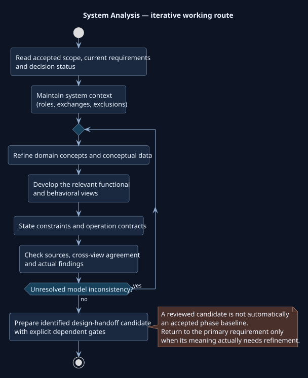

 · [Editable PlantUML source](Diagrams/Start-Here-Analysis-Route.puml)

Read downward. The feedback arrow means refine a model or its authoritative requirement when a real conflict appears. It does not mean restart every phase. Colors supplement the labels: blue is an input/context, teal is modeling, amber is review/handoff. These are logical work products, not application services or a guaranteed schedule. The repeat decision returns to affected models; it does not require restarting accepted phases.

##### Chosen approach

Follow the existing domain-oriented approach recorded for FAU Applied Software Engineering. Use its seven complementary views to answer specific questions. Their selection and file organization are project adaptations; this guide does not claim the university prescribes this folder tree or that every possible diagram is mandatory.

| View | Analysis question | Typical useful representation |
| --- | --- | --- |
| Object-oriented | What domain concepts exist, what do they mean and how are they related? | Conceptual class/association diagram with responsibilities and justified multiplicities |
| Function-oriented | What transformations does the system perform and what information enters/leaves them? | Function decomposition and balanced domain-level data-flow diagrams |
| Data-oriented | What information is authoritative, selected, versioned and preserved? | Conceptual ER/data relationship model and dictionary links |
| Scenario-based | Which actors/domain objects interact to achieve one outcome? | Domain sequence/communication diagram linked to an existing scenario |
| State-based | What states and allowed transitions govern a subject? | Statechart with triggers, guards and effects |
| Control-flow-based | In what order do actions, decisions and concurrent steps occur? | Activity/workflow diagram with explicit outcomes |
| Rule-based | Which combinations of conditions determine an outcome? | Decision table/tree with conflicts and missing combinations identified |

Textual constraints and operation contracts complement the views. A logical class is not automatically a code class; a data subject is not automatically a database table; a context relationship is not a network connection.

#### 3. Accepted Core Workflow: Profile Update to Publication

**After MVP.** Shared operating and recovery controls still apply where relevant.

The owner explicitly accepted this behavior in the conversation and instructed its immediate application. The [question/decision record](../02-Requirements-Engineering/01-Software-Requirements-Specification.md#change-and-baseline-open-questions-and-decisions--id-owner-accepted-profile-update-policy) is authoritative for the bounded acceptance. The four accepted points are:

1. A shared profile edit does **not automatically change existing resumes or live presentations**.

2. The owner **previews, selects and explicitly applies** intended changes; resume-specific text/overrides and other resumes remain independent.

3. **Applying/saving and publishing are separate actions**; publication requires separate confirmation.

4. **Actual previously submitted documents remain preserved** after later edits/publication.

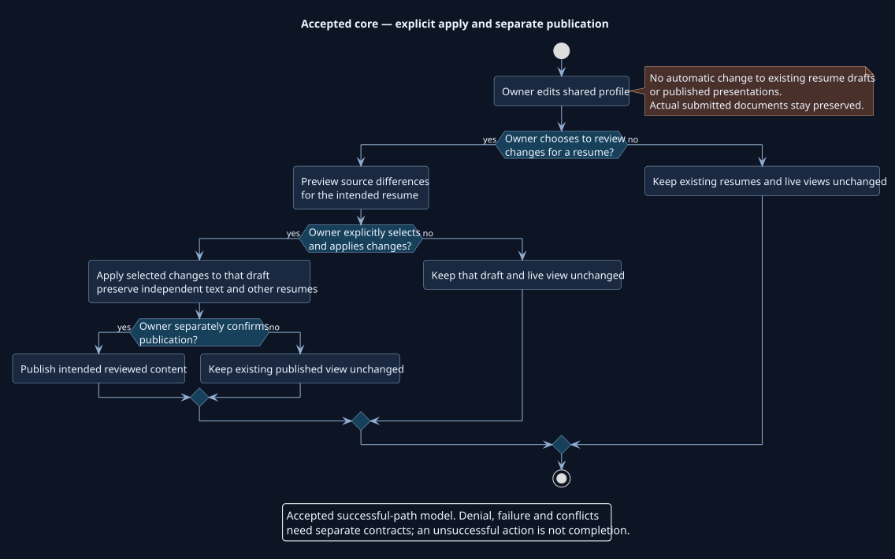

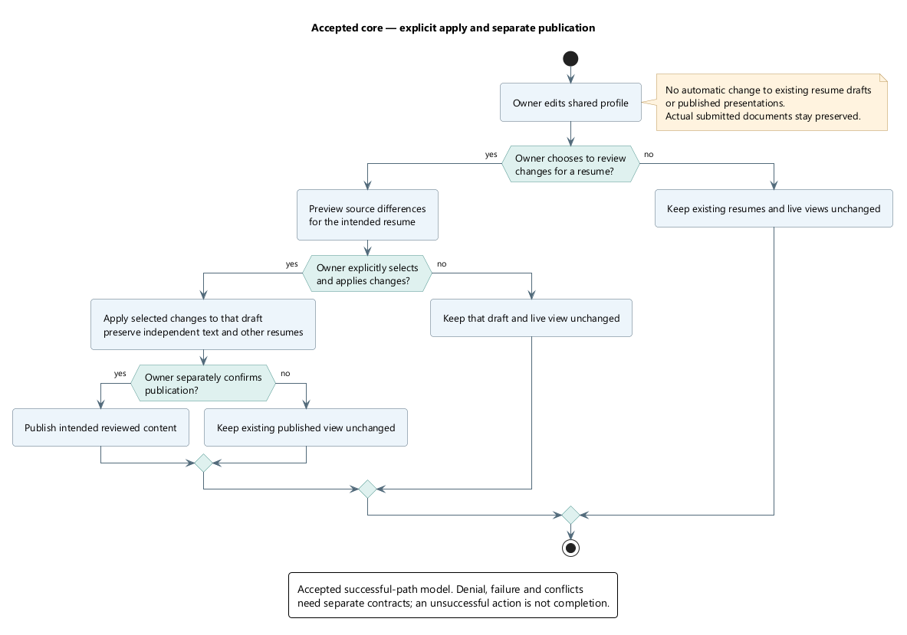 · [Editable PlantUML source](Diagrams/Start-Here-Profile-Publication.puml)

Reviewing differences is optional: a source edit does not automatically start a resume update. Each “No” branch leaves the draft or live content indicated in the figure unchanged. The preservation statement applies throughout; the picture does not claim how bytes/revisions are stored. Denied, failed and conflicting operations require their own outcomes and must not be reported as completed.

##### Worked example for modeling

Profile information is used by resumes **R1** and **R2**. R1 contains a resume-specific description. Both have an existing live presentation; an application already preserves actual submitted material **S1**.

| Event | R1 / R2 draft meaning | Existing live presentation | Submitted material S1 |
| --- | --- | --- | --- |
| Owner edits the shared profile | No automatic resume change | Unchanged | Unchanged |
| Owner previews changes for R2 | Preview only | Unchanged | Unchanged |
| Owner applies selected changes to R2 and saves | Only the intended R2 draft changes; independent overrides remain protected | Unchanged until separate publication | Unchanged |
| Owner separately confirms publication of R2 | Saved draft remains identifiable | Intended R2 live presentation changes | Unchanged |
| Owner makes no apply/publication request | No corresponding transition occurs | No corresponding live update occurs | Unchanged |

Use this example across the domain, data, interaction, activity, state and contract views. Link to [Profiles/Resumes](../02-Requirements-Engineering/01-Software-Requirements-Specification.md#requirements-specification-profiles-resumes-and-portfolio--id-resolution-q-d07), [Business Lifecycle](../02-Requirements-Engineering/01-Software-Requirements-Specification.md#requirements-specification-business-rules-and-data-lifecycle), [PDF/Sharing](../02-Requirements-Engineering/01-Software-Requirements-Specification.md#requirements-specification-pdf-and-controlled-sharing) and [Applications](../02-Requirements-Engineering/01-Software-Requirements-Specification.md#requirements-specification-manual-application-management).

This acceptance does not settle source deletion, exact concurrent-edit resolution, every field/cardinality, renderer/storage choice, retention duration or all other proposals. Do not reopen the four accepted points when examining those distinct issues.

#### 4. Which File to Use and What Belongs in It

| File | Required substantive output | Current position |
| --- | --- | --- |
| [01 — Purpose and approach](#foundation-01-analysis-purpose-scope-and-approach) | Analysis questions, source authority, scope and dependency-aware work sequence | Populated working approach |
| [02 — Context](#foundation-02-system-context-and-boundaries) | System responsibility boundary, actors, external exchanges, exclusions and source-linked context figures | Populated draft; owner acceptance pending |
| [03 — Domain model](02-Domain-And-Information-Analysis.md#analysis-domain-and-information-analysis--03-domain-model-and-object-oriented-view) | Concepts/responsibilities, associations, justified bounds and domain operations | Populated full-product conceptual model; reconcile with data/behavior next |
| [04 — Functions](03-Processes-Scenarios-And-Business-Rules.md#analysis-functional-and-process-analysis--04-function-oriented-view) | Domain functions and consistent input/output/data flows | Populated decomposition/DFDs; semantic review pending |
| [05 — Data](02-Domain-And-Information-Analysis.md#analysis-domain-and-information-analysis--05-data-oriented-view) | Conceptual subjects/relationships, authority, lifecycle and dictionary reconciliation | Populated ER/catalog draft; review and reconcile |
| [06 — Scenarios](03-Processes-Scenarios-And-Business-Rules.md#analysis-behavioral-and-scenario-analysis--06-scenario-based-view) | Selected domain interactions tied to existing use cases and exceptional paths | Populated: 16 sequence models; cross-view contract reconciliation pending |
| [07 — States](03-Processes-Scenarios-And-Business-Rules.md#analysis-behavioral-and-scenario-analysis--07-state-based-view) | States, triggers, guards/effects and valid/invalid transitions | Populated: 18 statecharts and 128 transition contracts |
| [08 — Control flow](03-Processes-Scenarios-And-Business-Rules.md#analysis-functional-and-process-analysis--08-control-flow-based-view) | Activities, decisions, responsible contexts and justified concurrency | Populated: 17 activity models with explicit branches and step responsibilities |
| [09 — Rules](03-Processes-Scenarios-And-Business-Rules.md#analysis-business-rules-and-operation-contracts--09-rule-based-view) | Explicit decision conditions/results and unresolved combinations | Populated: 18 decision tables and eight decision-tree diagrams |
| [10 — Constraints/contracts](03-Processes-Scenarios-And-Business-Rules.md#analysis-business-rules-and-operation-contracts--10-domain-constraints-and-operation-contracts) | Invariants; operation inputs, authority, pre/postconditions and failure/concurrency meaning | Populated: 18 typed constraints and 39 selected operation contracts |
| [11 — Consistency/review](05-Analysis-Review-And-Design-Handoff.md#analysis-review-and-design-handoff--11-model-consistency-traceability-and-review) | Exact source-to-model links, actual checks, findings, limitations and disposition | Bounded input/context review; cross-view completion pending |
| [12 — Interfaces](04-Interfaces-Security-And-Quality.md#analysis-interfaces-security-and-quality-analysis--12-interfaces-and-external-interactions) | Domain interaction boundaries and observable results, linked to primary interface requirements | Populated: eight interface families and 27 bounded interaction cases |
| [13 — Security/quality/operations](04-Interfaces-Security-And-Quality.md#analysis-interfaces-security-and-quality-analysis--13-security-quality-and-operational-analysis) | Cross-cutting constraints and dependency consequences with evidence limits | Populated: 24 authority rows, 14 quality scenarios and scoped trust/recovery analysis |
| [14 — Design handoff](05-Analysis-Review-And-Design-Handoff.md#analysis-review-and-design-handoff--14-feasibility-dependencies-and-design-handoff) | Identified coherent models, reviewed decisions and explicit dependent gates for design | Populated: conditional package, eleven existing-gate mappings and twelve design questions; acceptance pending |
| [15 — Current processes/bottlenecks](03-Processes-Scenarios-And-Business-Rules.md#analysis-functional-and-process-analysis--15-current-processes-and-bottleneck-analysis) | Actual sourced workflow observations and justified problems/improvements | Populated source-based analysis; daily-task baseline and improvement results unmeasured |

The [folder index]() is the full document catalog. The [diagram catalog](Diagrams/Diagram-Catalog.md) identifies existing figures and editable sources. This entry guide adds navigation/workflow illustrations; they do not complete the detailed models listed above.

##### Apply the same route across the full product

Begin with professional presentation/sharing, then extend the models to manual applications and submission history; communication/calendar; projects/Kanban/backlogs/Sprints; real Git collaboration; and conditional execution/operations. Keep identity, permission, language, references, failures and recovery linked across every area. The twelve accepted scope areas stay included; working on the core first is an analysis order, not scope reduction or an accepted release priority.

#### 5. How to Finish One Working Iteration

| Step | Action | Reviewable result |
| --- | --- | --- |
| 1. Identify the behavior | Select existing source requirement/criterion and relevant scenario; read its actual decision status | Exact links and a bounded question the model must answer |
| 2. State authority | Mark accepted facts, proposed refinements and genuine unknowns distinctly | Assumptions visible at the affected element/transition |
| 3. Model it | Add the smallest useful domain/data/behavior representation with consistent vocabulary | Editable diagram plus explanation of nodes, relationships, guards and effects |
| 4. Challenge it | Walk normal, denied, failed/unknown, concurrent and recovery cases where relevant | Concrete before/action/after examples and retained findings |
| 5. Reconcile views | Compare concepts, data, messages, transitions, rules and contract postconditions | Corrected cross-view meanings and exact trace links |
| 6. Verify the artifact | Render images, inspect labels/arrows, resolve local links and check source/figure consistency | Readable SVG/PNG and documented actual checks |
| 7. Record the outcome | Update the appropriate source/question/review record; preserve actual approval and historical evidence | Identified result, limits and next task; no fabricated Pass |

Keep a single primary home for each requirement, vocabulary definition and question. Models reference those homes. A finding returns to the affected authoritative record; it does not create another competing SRS.

##### Diagram quality checklist

- Give each figure one clear question, title and reading direction.

- Keep labels short; explain detail in nearby text/tables.

- Name relationship meaning; label decisions and alternatives explicitly.

- Separate a domain interaction from operational dependence, and an optional action from an automatic consequence.

- Do not rely on color alone. Check text size, crossings, clipped labels and arrowheads in the rendered output.

- Keep editable source, SVG and PNG together, with the source/status/date explained nearby.

#### 6. Open Matters Without Stopping All Analysis

| Matter | What is known | What may continue now | What must wait for evidence/decision |
| --- | --- | --- | --- |
| Core profile/apply/publication behavior | Four-point rule accepted by the owner | Model its domain/data/workflow/contracts directly | Unrelated source-removal/concurrency/storage choices retain their own review |
| Google access | Owner has not created OAuth | Provider responsibilities, account context and denied/disconnected/unknown outcomes | Actual setup, applicable access conditions and controlled operations before dependent commitments |
| Backup/recovery | Owner has not set up backups | Coverage, preservation/restored-access obligations and recovery concepts | Suitable independent storage/recovery design; actual restore proof before readiness |
| CI/CD isolation | No demonstrated suitable execution environment; feasibility conditions remain | Logical definition/run/attempt/result and target-authority model | Justified runner/isolation/resource design and actual controls before enabling execution |
| Quality/file limits | Concrete targets/limits are proposals; idle resources do not prove capacity | Identify workloads, boundary cases and constraints | Acceptance of affected values and later measured compliance |
| Delivery | Work follows the selected scope, dependencies and demonstrated outcomes. | Analysis/design and traceable work decomposition | A justified accepted forecast and reconciled execution baseline |

Use the [question register](../02-Requirements-Engineering/01-Software-Requirements-Specification.md#change-and-baseline-open-questions-and-decisions), [feasibility study](../02-Requirements-Engineering/01-Software-Requirements-Specification.md#process-and-approach-02-feasibility-study) and [gate assessment](../02-Requirements-Engineering/01-Software-Requirements-Specification.md#validation-and-traceability-validation-and-traceability--heading-remaining-verification). A later implemented test is not needed merely to draw a provisional model, but a known decisive conflict cannot be waived by calling it future work.

Ask the owner only when a genuinely new material choice is missing. Present a concrete recommendation, consequence and one precise question. Reuse known facts and already accepted rules instead of requesting the same approval repeatedly.

#### 7. Where the Six Broad Activities Fit

These activities are a coverage checklist across existing records, not a second parallel method.

| Activity | Authoritative home | Use during analysis |
| --- | --- | --- |
| Problem and scope | [Purpose](../01-Project-Planning/01-Project-Charter.md#purpose-and-success), [Scope](../01-Project-Planning/01-Project-Charter.md#mvp-scope) | Preserve boundaries and refine context |
| Feasibility | [Existing study](../02-Requirements-Engineering/01-Software-Requirements-Specification.md#process-and-approach-02-feasibility-study) | Link actual findings and dependent gates; do not infer a favorable result |
| Requirements gathering | [Elicitation plan](../02-Requirements-Engineering/01-Software-Requirements-Specification.md#stakeholders-and-elicitation-elicitation-plan-and-techniques), [actual log](../02-Requirements-Engineering/01-Software-Requirements-Specification.md#stakeholders-and-elicitation-elicitation-log) | Reuse evidence and record actual new answers |
| System modeling | Documents 03–10 and cross-cutting 12–13 | Develop connected models that answer domain questions |
| Bottleneck analysis | [Current processes](03-Processes-Scenarios-And-Business-Rules.md#analysis-functional-and-process-analysis--15-current-processes-and-bottleneck-analysis) | Distinguish observed problems from hypotheses |
| Documentation/validation | [SRS](../02-Requirements-Engineering/01-Software-Requirements-Specification.md#requirements-specification-requirements-specification), dictionary, questions and [analysis review](05-Analysis-Review-And-Design-Handoff.md#analysis-review-and-design-handoff--11-model-consistency-traceability-and-review) | Update primary records and retain actual review evidence |

#### 8. When This Phase Is Ready for Design Handoff

Use the existing phase gates; creating this guide or a set of diagrams does not accept a baseline.

- Every included domain area has the models needed to explain its intended behavior and constraints, with meaningful source links.

- Model vocabulary/relationships, data authority, interactions, states, activities, rules and contracts agree.

- Relevant allowed/denied/failure/unknown/concurrency/recovery outcomes are explicit or remain at a justified, permitted dependent gate.

- Accepted decisions are recorded as accepted; proposed choices and unverified technical claims remain distinguishable.

- Criterion-level analysis coverage is reviewed; broad source ranges or similar names do not count as exhaustive coverage.

- Diagram sources/renders and document links are readable and consistent.

- The [design handoff](05-Analysis-Review-And-Design-Handoff.md#analysis-review-and-design-handoff--14-feasibility-dependencies-and-design-handoff) identifies the candidate, actual review outcome, evidence limits and remaining prerequisites.

**Current completion position:** This entry guide and its two workflow illustrations are populated. The complete System Analysis phase, detailed design and pre-implementation baseline remain unfinished. Continue with the bounded domain/data task in section 1; do not restart planning or repeat the accepted core-policy question.

[Analysis approach](#foundation-01-analysis-purpose-scope-and-approach) · [Whole-product context](#foundation-02-system-context-and-boundaries) · [Domain model](02-Domain-And-Information-Analysis.md#analysis-domain-and-information-analysis--03-domain-model-and-object-oriented-view) · [Data view](02-Domain-And-Information-Analysis.md#analysis-domain-and-information-analysis--05-data-oriented-view) · [Review record](05-Analysis-Review-And-Design-Handoff.md#analysis-review-and-design-handoff--11-model-consistency-traceability-and-review)

##### Current cross-view review — SA-RV03

[File 11](05-Analysis-Review-And-Design-Handoff.md#analysis-review-and-design-handoff--11-model-consistency-traceability-and-review) records current structural checks and a 470-criterion trace register, including 39 bounded semantic comparisons. The other 431 criteria remain source-context indexed pending individual semantic review. The 20 earlier walkthroughs are preserved as historical evidence. Views 04 and 12–14 are populated; their existence does not certify semantic completeness. Accepted profile policy remains accepted; criterion sufficiency and dependent capability evidence are not inferred from diagram counts.

#### Diagram Types and Reading Guide

Follow the graph as a reading route. Return to affected views when a rule changes; arrows do not require finishing every file before reading another. All sixteen numbered documents are represented.

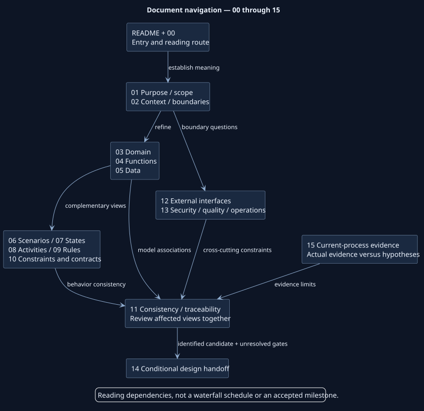

[Editable source](Diagrams/Documentation-Navigation.puml) · 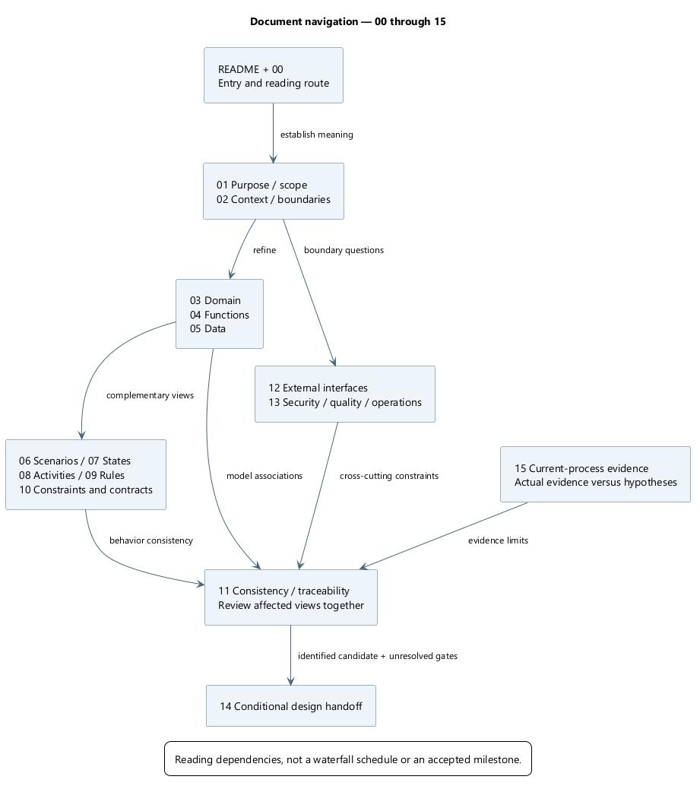

Resumefolio — Analysis Purpose, Scope and Approach

### Resumefolio — Analysis Purpose, Scope and Approach

[Diagram types and reading guide](#foundation-01-analysis-purpose-scope-and-approach--heading-diagram-types-and-reading-guide) · [Full diagram catalog](Diagrams/Diagram-Catalog.md)

Owner: Farhad. Revision: November 1, 2026.

Status: working analysis charter and execution plan. This document defines the work; it does not assert completion of the models or acceptance of M-02/M-03.

Current MVP scope and selected mechanisms: [Baseline](https://github.com/Farhad-V/Web-Resumefolio/blob/1f2acaa351ac306cb57cbe4fe9742e8bd90720d9/docs/MVP/baseline/README.md). Deferred provider, advanced collaboration and workflow-execution designs are not MVP prerequisites.

#### 1. Purpose and Intended Outcome

System Analysis develops a coherent domain-oriented description of how Resumefolio fulfills its requirements: the concepts involved, their responsibilities, information relationships, interactions, lifecycle, transformations and constraints. The outcome is a traceable model package that System Design can use without inventing product behavior.

The [Start Here guide](#foundation-00-start-here) provides navigation and the immediate starting task. This document defines the analysis objectives, coverage, method, responsibilities and completion conditions. [System context](#foundation-02-system-context-and-boundaries) defines the actual product boundary.

| Analysis question | Expected output |
| --- | --- |
| Who interacts with the product, and where does responsibility stop? | Actors, boundary exchanges and scope coverage in document 02 |
| What information is shared, tailored, published and preserved? | Domain responsibilities in 03; conceptual data relationships in 05 |
| Which inputs become which outputs? | Functions and data flows in 04; operation contracts in 10 |
| What happens during normal, denied, failed or competing actions? | Interactions in 06, lifecycle in 07, activities in 08 and decisions in 09 |
| Which obligations cross a provider or operational boundary? | Interface analysis in 12 and quality/operational analysis in 13 |
| What can design rely on, and what still needs evidence or a decision? | Consistency findings in 11 and qualified handoff in 14 |

Analysis may identify candidate responsibilities and logical solution behavior. Framework versions, physical schemas, endpoint signatures, deployment topology, Git engine and execution isolation mechanisms require design decisions and their supporting evidence.

#### 2. Inputs, Authority and Decision Status

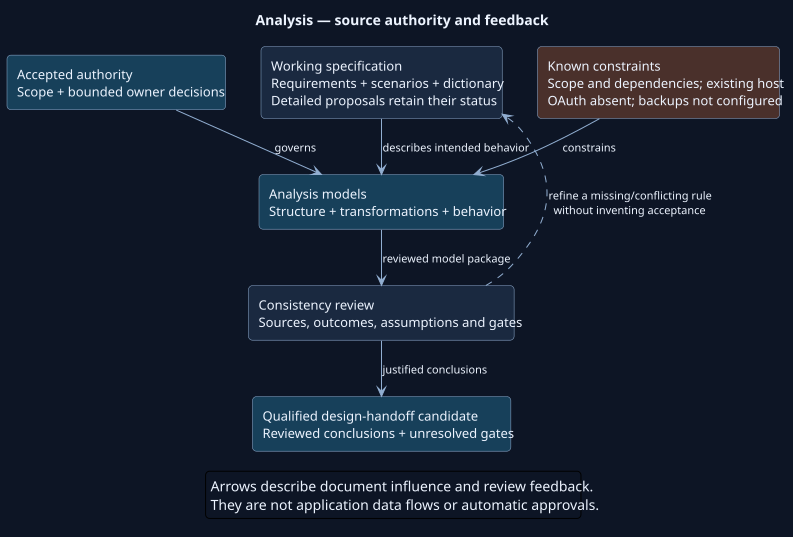

[Editable PlantUML](Diagrams/Analysis-Inputs-And-Outputs.puml) · 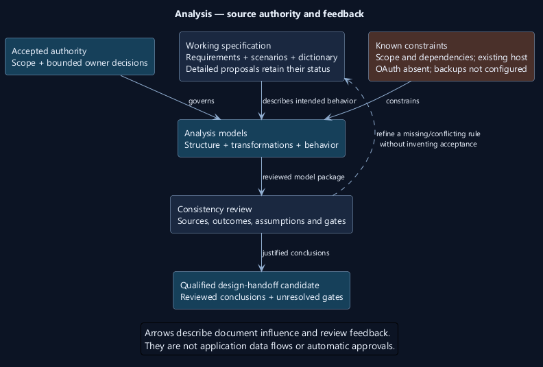

The diagram shows document authority and the feedback path for missing requirements. Its arrows represent information and review flow, not an assertion that every input or output is accepted.

| Input | Authority and use |
| --- | --- |
| [Project scope](../01-Project-Planning/01-Project-Charter.md#mvp-scope) | Accepted capability boundaries and exclusions, including DEC-028–DEC-017; maintain all twelve scope areas |
| [Planning completion criteria](https://github.com/Farhad-V/Web-Resumefolio/blob/1f2acaa351ac306cb57cbe4fe9742e8bd90720d9/docs/MVP/SDLC/01-project-planning/10-planning-completion-criteria.md) | Historical identified M-01 acceptance; later working copies require their own review |
| [Resources and constraints](../01-Project-Planning/03-Feasibility-And-Risk-Assessment.md#resource-constraints) | Work follows the selected scope, dependencies and demonstrated outcomes. |
| [Requirements specification](../02-Requirements-Engineering/01-Software-Requirements-Specification.md#requirements-specification-requirements-specification) | Entry point to primary obligations; preserve requirement IDs and link to their authoritative text |
| [Actors and context](../02-Requirements-Engineering/01-Software-Requirements-Specification.md#stakeholders-and-elicitation-actors-and-system-context) and [scenarios](../02-Requirements-Engineering/01-Software-Requirements-Specification.md#scenarios-and-models-user-stories-and-scenarios) | Intended goals and externally visible paths; review their detailed policy status |
| [Data dictionary](../02-Requirements-Engineering/01-Software-Requirements-Specification.md#data-definitions-data-dictionary) | Shared terminology; resolve competing definitions at their source |
| [Questions and decisions](../02-Requirements-Engineering/01-Software-Requirements-Specification.md#change-and-baseline-open-questions-and-decisions) | Distinguish owner decisions, partial resolution, proposals and investigation |
| [Answer review](../02-Requirements-Engineering/01-Software-Requirements-Specification.md#change-and-baseline-open-questions-and-decisions) | Working proposals may support explicit provisional models; they are not automatically accepted |
| [Bounded input evidence](https://github.com/Farhad-V/Web-Resumefolio/blob/1f2acaa351ac306cb57cbe4fe9742e8bd90720d9/docs/MVP/SDLC/03-system-analysis/evidence/context-input-review-2026-11-01.json) | Historical source hashes and review limits; it does not verify every later revision |

The [owner-accepted profile policy](../02-Requirements-Engineering/01-Software-Requirements-Specification.md#change-and-baseline-open-questions-and-decisions--id-owner-accepted-profile-update-policy) is a firm input: profile edits do not automatically alter existing resumes or published views; the owner previews and explicitly applies selected changes; publication requires a separate confirmation; resume-specific content and actual previously submitted documents remain preserved. Do not seek the same approval again. Source removal and other unresolved details are not implicitly accepted by this policy.

Keep four statuses distinct: accepted decision, proposed behavior, observed fact and unresolved dependency. A model can be useful while containing clearly marked proposals. Drawing it does not close the related question.

#### 3. Product Coverage and Exclusions

All twelve accepted scope areas remain in analysis. Work order changes the depth reached first, not the product boundary. The detailed source mapping remains in the [context coverage table](#foundation-02-system-context-and-boundaries--id-scope-coverage).

| Scope | Domain analysis focus | Principal model concerns |
| --- | --- | --- |
| SCP-01 Accounts and access | Identity, roles, grants and actor authority | Access conditions, denial and revocation |
| SCP-02 Profiles and resumes | Shared source, independent resume content and publication | Accepted preview/apply/publish behavior; preserved overrides |
| SCP-03 Portfolio evidence | Text, media, files and externally authored diagram links | Evidence identity, selection and access lifecycle |
| SCP-04 PDF and language availability | Generated/uploaded PDF modes; independent English/German content | Availability rules and artifact identity |
| SCP-05 Employer sharing | Password-protected links and selected content | Authorization, direct file access and disable behavior |
| SCP-06 Application tracking | Companies, opportunities, cover letters and progress | Actual submitted materials and historical integrity |
| SCP-07 Google communication | Gmail and selected calendar interactions | Consent, provider boundaries, failure and synchronization  **After MVP.** |
| SCP-08 Work management | Projects, boards, tasks, backlog and Sprints | Grants; Sprint goal, selected items and plan |
| SCP-09 Real Git | Repositories, changes, collaboration and releases | Actual Git operations, permissions and operation outcomes |
| SCP-10 YAML workflows and CI | Authorized workflow execution and separate deployment approval | Execution lifecycle, isolation obligations and cleanup  **After MVP.** |
| SCP-11 File/storage policy | Effective limits and configurable platform policy | Enforcement points, capacity constraints and rejected operations |
| SCP-12 Deployment and operations | Hosting, verification, backup and restoration responsibilities | Recovery expectations, operational dependencies and evidence gates |

Excluded capabilities remain excluded: product AI, automatic translation and automatic migration of the old demo. External evidence authoring does not introduce an internal video or diagram editor. Manual application tracking does not introduce automatic job-platform submission. The development repository or board does not fulfill the product's real Git/work-management scope. YAML support does not imply compatibility with every third-party action.

Current-process and bottleneck analysis belongs in [document 15](03-Processes-Scenarios-And-Business-Rules.md#analysis-functional-and-process-analysis--15-current-processes-and-bottleneck-analysis). Separate documented observations from assumptions; do not invent interviews, timings or measured improvements.

#### 4. Modeling Method and Complementary Views

Use the domain-oriented approach already established in this folder. Choose each notation to answer a question; a diagram count is not a completion measure. Course references retained in the [folder index]() explain the organizing approach. This revision does not independently certify formal compliance with the lecture PDFs or a standard.

[Editable PlantUML](Diagrams/Analysis-Seven-View-Consistency.puml) · 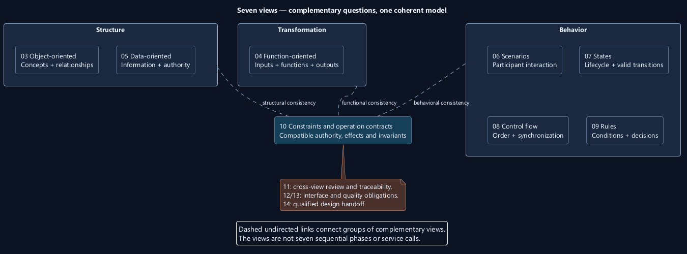

The dashed undirected relationships mean consistency obligations, not calls or processing order. The seven views describe compatible aspects of one system. They are not seven sequential development phases. Contracts connect the views by stating the effects and limits of an operation.

| View and authoritative file | Use when answering | Required consistency |
| --- | --- | --- |
| [03 Object-oriented](02-Domain-And-Information-Analysis.md#analysis-domain-and-information-analysis--03-domain-model-and-object-oriented-view) | Which domain concepts hold which responsibilities? | Classes and associations use dictionary terms and agree with conceptual data |
| [04 Function-oriented](03-Processes-Scenarios-And-Business-Rules.md#analysis-functional-and-process-analysis--04-function-oriented-view) | What transformations consume and produce information? | Data flows balance across decomposition and match operation effects |
| [05 Data-oriented](02-Domain-And-Information-Analysis.md#analysis-domain-and-information-analysis--05-data-oriented-view) | What information exists, and how is it related? | Relationships and justified multiplicities agree with rules and lifecycle |
| [06 Scenario-based](03-Processes-Scenarios-And-Business-Rules.md#analysis-behavioral-and-scenario-analysis--06-scenario-based-view) | Which participants exchange what during a goal? | Messages correspond to allowed operations and stated outcomes |
| [07 State-based](03-Processes-Scenarios-And-Business-Rules.md#analysis-behavioral-and-scenario-analysis--07-state-based-view) | Which states and transitions are valid? | Guards, events and terminal states agree with scenarios and contracts |
| [08 Control-flow-based](03-Processes-Scenarios-And-Business-Rules.md#analysis-functional-and-process-analysis--08-control-flow-based-view) | Which steps, decisions and parallel activities occur? | Ordering, failure paths and synchronization preserve state/rule constraints |
| [09 Rule-based](03-Processes-Scenarios-And-Business-Rules.md#analysis-business-rules-and-operation-contracts--09-rule-based-view) | What result follows a combination of conditions? | Decision tables/trees cover relevant alternatives without conflicting outcomes |

Use [document 10](03-Processes-Scenarios-And-Business-Rules.md#analysis-business-rules-and-operation-contracts--10-domain-constraints-and-operation-contracts) for invariants and preconditions, effects, denial/failure outcomes and information that must remain unchanged. Keep actual interfaces in [12](04-Interfaces-Security-And-Quality.md#analysis-interfaces-security-and-quality-analysis--12-interfaces-and-external-interactions), cross-cutting constraints in [13](04-Interfaces-Security-And-Quality.md#analysis-interfaces-security-and-quality-analysis--13-security-quality-and-operational-analysis), and review evidence in [11](05-Analysis-Review-And-Design-Handoff.md#analysis-review-and-design-handoff--11-model-consistency-traceability-and-review).

For each diagram, record its question, source references, meaning of arrows/notation, assumptions and related views. Store editable source, SVG and PNG together in the [diagram catalog](Diagrams/Diagram-Catalog.md). Keep technical implementation detail out of conceptual models unless needed to express an actual constraint.

#### 5. Execution Packages and Dependencies

**After MVP.** Shared operating and recovery controls still apply where relevant.

| Order | Work package | Concrete outputs and dependency |
| --- | --- | --- |
| 1 | Boundary and input alignment | Maintain document 02 and source authority; existing context diagrams provide a starting point, not whole-phase completion |
| 2 | Professional presentation core | Populate 03 and 05 for profile, resume, evidence, PDF, sharing and submitted artifacts; apply the accepted core policy and label unresolved multiplicities/policies |
| 3 | Core behavior | Populate 10 and coordinated 06–09 for preview/apply, publication, PDF settings, link disable and actual submission; keep PDF settings separate from disabling a link |
| 4 | Applications and Google exchanges | Extend concepts, scenarios and interfaces for tracking, mail and calendar; model missing consent/provider failure explicitly |
| 5 | Work, Git and workflow execution | Extend structural and behavioral views for backlog/Sprints, real Git and authorized execution; preserve separate deployment approval |
| 6 | Quality, operations and complete coverage | Populate 12–15; check cross-cutting access, file/storage constraints, recovery and feasibility against all twelve areas |
| 7 | Consolidation and design handoff | Complete 11 and 14 with criterion-to-model references, findings, owner dispositions and explicitly conditional design inputs |

Within each package, follow a short iteration: read the primary obligations; model the relevant concepts; describe normal and relevant alternative paths; state contracts; compare views; resolve or record findings. Correct a discovered source inconsistency immediately when its resolution is authorized. Carry a genuinely unresolved question with its impact and dependent work instead of restarting the whole review.

Parallel conceptual work is possible where dependencies allow it. OAuth is not created and backups are not configured: those are answered facts, not recurring questions to the owner. They do not prevent logical domain models. Actual provider access, a suitable execution arrangement and verified recovery remain prerequisites for dependent design/implementation/release conclusions.

#### 6. Traceability and Review Contract

For each modeled behavior, retain a navigable chain: primary requirement and acceptance criterion → relevant concept/function → interaction or transition → rule/contract → review finding or disposition. Reuse stable primary IDs; identify model elements locally without creating a competing requirements catalog.

| Review check | Evidence required |
| --- | --- |
| Coverage | Each scope area and relevant criterion has an exact model reference, or an explicit justified gap |
| Vocabulary | Identical domain terms have compatible definitions across diagrams, dictionary and prose |
| Structure and behavior | Participants exist; referenced operations are meaningful; state changes and data effects agree |
| Access and failure | Relevant denial, missing input, provider failure and revocation outcomes are explicit |
| History and publication | Save/apply/publication are distinguishable; submitted artifacts are not silently replaced |
| Uncertainty | Every material proposal or open dependency states its impact and the work it gates |
| Readability | Rendered labels and arrows are legible; source and exported figures agree; links resolve |

A structural link check is not semantic validation. A proposed review case is not an executed test. Observing available host memory does not establish peak-load capacity, successful restoration or safe workflow isolation.

#### 7. Responsibility, Constraints and Change Handling

Farhad owns product decisions and acceptance and is the sole delivery/operations owner. Codex prepares models, checks consistency and documents evidence within the authorized task; its review is not owner acceptance. Keep effort estimates provisional until the scope and dependency findings support them.

Maintain one primary source for each requirement, term and decision. When analysis exposes a missing rule, link the finding back to that source, record the proposed or accepted resolution, and update affected views together. Do not silently convert a proposal into an accepted obligation or infer approval of unrelated policy details.

Existing Ubuntu hosting and the deployed Laravel demo are constraints/evidence about the current environment. They do not prove that the planned scope is implemented, that capacity is sufficient under load, or that OAuth, backup and execution prerequisites are satisfied. Investigation must target the specific dependent conclusion.

#### 8. Completion Conditions and Handoff

This charter is populated. The detailed analysis package remains in progress. A useful handoff must identify exactly which models and conclusions have been reviewed; diagrams alone do not establish phase acceptance.

- [ ] All twelve scope areas have appropriate structural and behavioral coverage, with justified omissions recorded.

- [ ] Primary requirements and criteria have exact model references or explicitly owned gaps.

- [ ] Cross-view contradictions are resolved or carry a clear impact and disposition.

- [ ] Accepted decisions are reflected consistently; proposed details remain visibly proposed.

- [ ] Interfaces, security/quality obligations and operational dependencies are analyzed to the depth needed by design.

- [ ] Design inputs distinguish established constraints, candidate choices and unresolved feasibility gates.

- [ ] The owner disposition and the exact reviewed version are recorded for the intended handoff scope.

The immediate next modeling output is the professional-presentation domain model in document 03 and its conceptual data counterpart in 05, followed by the corresponding operation contracts and behavioral views. This sequence advances analysis without waiting for unrelated setup, while keeping dependent acceptance gates visible.

[System Analysis index]() · [Start Here](#foundation-00-start-here) · [Review and traceability](05-Analysis-Review-And-Design-Handoff.md#analysis-review-and-design-handoff--11-model-consistency-traceability-and-review)

#### Diagram Types and Reading Guide

This scope map summarizes the authoritative scope and actor contexts, not a role-permission grant matrix. See the existing scope and actor links above for primary authority.

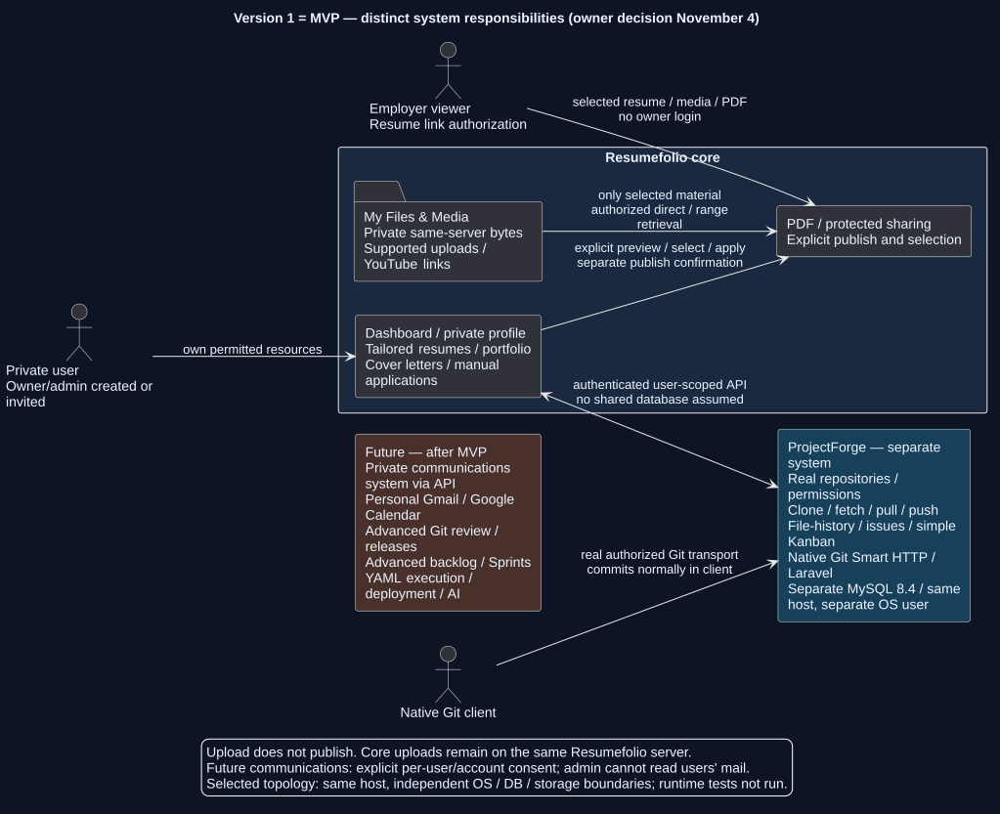

[Editable source](Diagrams/Scope-Stakeholder-Map.puml) · 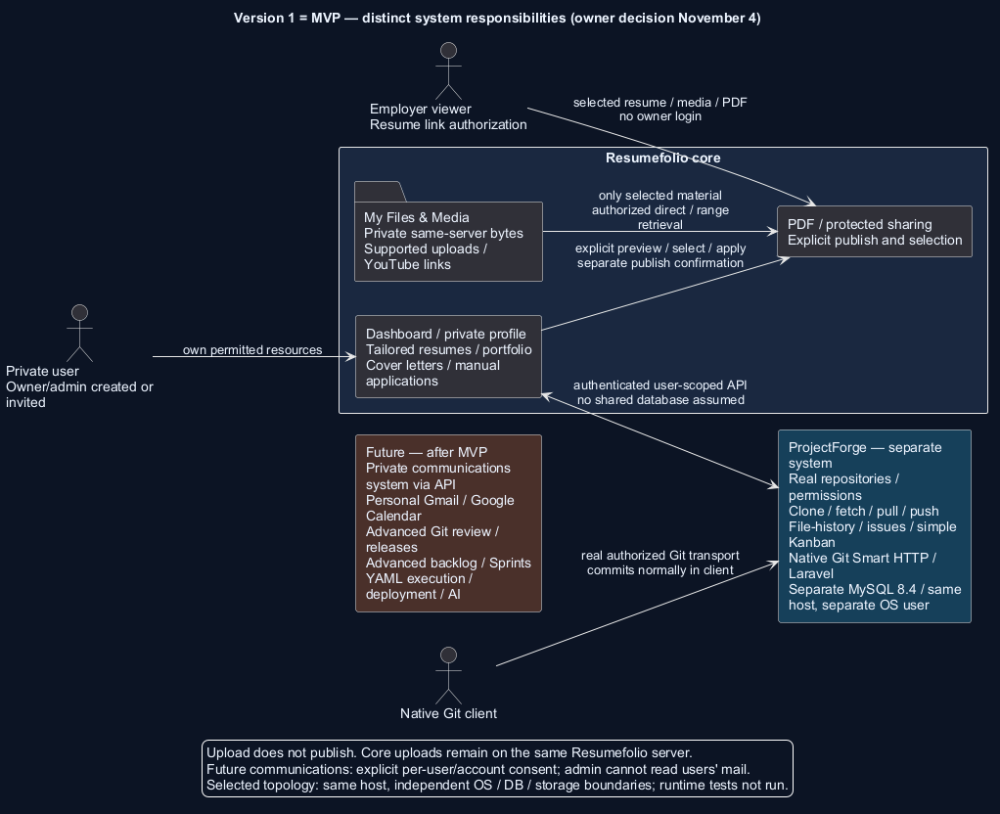

Resumefolio — System Context and Boundaries

### Resumefolio — System Context and Boundaries

[Diagram types and reading guide](#foundation-02-system-context-and-boundaries--heading-diagram-types-and-reading-guide) · [Full diagram catalog](Diagrams/Diagram-Catalog.md)

Owner: Farhad. Revision: November 1, 2026.

Status: populated full-product logical context model, with accepted scope and accepted core profile policy distinguished from proposed detailed contracts. Whole-model review and phase acceptance remain pending. This document does not establish deployment architecture or runtime access.

**Read this document for:** the product responsibility boundary, interacting roles, external exchanges, information authority and dependency limits. Use [the analysis approach](#foundation-01-analysis-purpose-scope-and-approach) for work order and [the domain model](02-Domain-And-Information-Analysis.md#analysis-domain-and-information-analysis--03-domain-model-and-object-oriented-view) for internal concepts.

#### Current MVP boundary figure

[Accepted core and separate ProjectForge boundary](https://github.com/Farhad-V/Web-Resumefolio/blob/1f2acaa351ac306cb57cbe4fe9742e8bd90720d9/docs/MVP/SDLC/04-system-design/01-software-architecture/diagrams/mvp-system-boundaries.svg)

[Editable source](https://github.com/Farhad-V/Web-Resumefolio/blob/1f2acaa351ac306cb57cbe4fe9742e8bd90720d9/docs/MVP/SDLC/04-system-design/01-software-architecture/diagrams/mvp-system-boundaries.puml) · 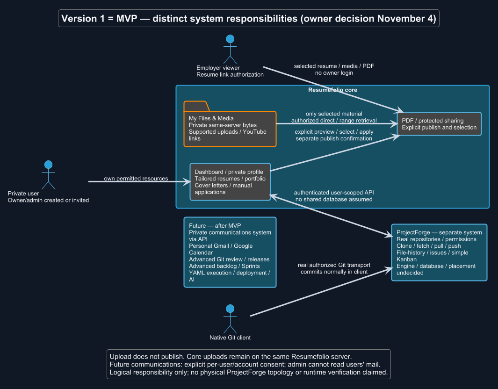. Historical broader-product figures below retain earlier alternatives/detail; they do not define the current system boundary.

Current MVP scope and selected mechanisms: [Baseline](https://github.com/Farhad-V/Web-Resumefolio/blob/1f2acaa351ac306cb57cbe4fe9742e8bd90720d9/docs/MVP/baseline/README.md). Deferred provider, advanced collaboration and workflow-execution designs are not MVP prerequisites.

#### Ecosystem and Connected Platforms

These two coordinated views provide the whole-product map without forcing internal relationships and external exchanges into one crowded diagram. Internal areas are logical product capabilities, not separately deployed platforms. External participants include clients and operating facilities as well as provider platforms.

##### Internal areas and relationships

[Internal ecosystem: product areas and information relationships](https://github.com/Farhad-V/Web-Resumefolio/blob/1f2acaa351ac306cb57cbe4fe9742e8bd90720d9/docs/MVP/SDLC/04-system-design/01-software-architecture/diagrams/mvp-system-boundaries.svg)

[PlantUML source](https://github.com/Farhad-V/Web-Resumefolio/blob/1f2acaa351ac306cb57cbe4fe9742e8bd90720d9/docs/MVP/SDLC/04-system-design/01-software-architecture/diagrams/mvp-system-boundaries.puml) · [View diagram: mvp system boundaries](#figure-01-mvp-system-boundaries)

The overview covers profile/resume, portfolio/evidence, PDF/sharing, applications, communication, work/Sprints, Git, execution, deployment and shared administration/operations. Relationship arrows show selected references or information movement; they do not create automatic synchronization or authorization. Actual submitted materials remain independent of later live changes. Shared access and lifecycle rules apply to every area, including those without a drawn cross-cutting arrow.

##### External connections and current evidence

[Connected platforms: directions, boundaries and status](https://github.com/Farhad-V/Web-Resumefolio/blob/1f2acaa351ac306cb57cbe4fe9742e8bd90720d9/docs/MVP/SDLC/04-system-design/01-software-architecture/diagrams/mvp-system-boundaries.svg)

[PlantUML source](https://github.com/Farhad-V/Web-Resumefolio/blob/1f2acaa351ac306cb57cbe4fe9742e8bd90720d9/docs/MVP/SDLC/04-system-design/01-software-architecture/diagrams/mvp-system-boundaries.puml) · [View diagram: mvp system boundaries](#figure-01-mvp-system-boundaries)

| Product area / participant | Detailed interface and connection status |
| --- | --- |
| Private workspace, administration and local files | [IF-01](04-Interfaces-Security-And-Quality.md#analysis-interfaces-security-and-quality-analysis--12-interfaces-and-external-interactions--id-if-01), [IF-03](04-Interfaces-Security-And-Quality.md#analysis-interfaces-security-and-quality-analysis--12-interfaces-and-external-interactions--id-if-03): intended browser/file exchanges; full Version 1 implementation is not established. |
| Employer access to selected resume, evidence and PDF | [IF-02](04-Interfaces-Security-And-Quality.md#analysis-interfaces-security-and-quality-analysis--12-interfaces-and-external-interactions--id-if-02), [IF-03](04-Interfaces-Security-And-Quality.md#analysis-interfaces-security-and-quality-analysis--12-interfaces-and-external-interactions--id-if-03): protected representation requests and permitted/denied results. |
| Application correspondence through communication | [IF-04](04-Interfaces-Security-And-Quality.md#analysis-interfaces-security-and-quality-analysis--12-interfaces-and-external-interactions--id-if-04): Gmail operations and outcomes; OAuth not created. Application association does not automatically send messages. |
| Selected activities through communication | [IF-05](04-Interfaces-Security-And-Quality.md#analysis-interfaces-security-and-quality-analysis--12-interfaces-and-external-interactions--id-if-05): Calendar operations and event/version outcomes; access not established. Local-only activities remain possible. |
| Work-linked repositories and real Git clients | [IF-06](04-Interfaces-Security-And-Quality.md#analysis-interfaces-security-and-quality-analysis--12-interfaces-and-external-interactions--id-if-06): authorized Git exchange is planned; native Git Smart HTTP is selected in the Baseline; actual interoperability remains unverified. GitHub used for project development is not the product Git-hosting implementation. |
| Exact-revision execution and separate deployment | [IF-07](04-Interfaces-Security-And-Quality.md#analysis-interfaces-security-and-quality-analysis--12-interfaces-and-external-interactions--id-if-07): conditional execution capability and independently approved target; neither runner placement nor target is selected. |
| Hosting and domain/TLS operation | [IF-08](04-Interfaces-Security-And-Quality.md#analysis-interfaces-security-and-quality-analysis--12-interfaces-and-external-interactions--id-if-08): Hetzner demo and domain are dated observations, not validated whole-product capacity or security. |
| System notification delivery | [IF-08](04-Interfaces-Security-And-Quality.md#analysis-interfaces-security-and-quality-analysis--12-interfaces-and-external-interactions--id-if-08): actual delivery facility unverified; do not equate it with a user's connected Gmail account. |
| Backup and isolated recovery | [IF-08](04-Interfaces-Security-And-Quality.md#analysis-interfaces-security-and-quality-analysis--12-interfaces-and-external-interactions--id-if-08): not configured; destination and usable recovery evidence remain unresolved. No existing HA/failover is implied. |

**Source and interpretation:** the [scope inventory](#foundation-02-system-context-and-boundaries--id-scope-coverage), the eight primary interface families carried into [file 12](04-Interfaces-Security-And-Quality.md#analysis-interfaces-security-and-quality-analysis--12-interfaces-and-external-interactions--heading-1-interface-inventory), and the [dated server observation](../02-Requirements-Engineering/01-Software-Requirements-Specification.md#validation-and-traceability-server-readonly-check-2026-11-01). Planned means included in the target analysis, not configured. Conditional means the dependent capability requires its gate to be satisfied. Observed means the dated demo fact only. Unknown provider choices stay unknown; no LinkedIn, job-board, GitHub or GitLab product integration is introduced by this map.

#### 1. System of Interest

The Resumefolio core owns private professional information, independent tailored resumes/portfolio, protected PDFs/sharing, private same-server My Files & Media and manual applications with actual submitted materials/status/next action/follow-up. ProjectForge is a separate user-scoped API system for basic real Git, issues and simple Kanban. Future independent communications, advanced work/Git and YAML execution/deployment remain outside the MVP commitment.

##### Scope-to-responsibility Coverage

| Accepted catalog reference | Product responsibility | Exact source locators | Required distinction |
| --- | --- | --- | --- |
| SCP-01 | Identity and resource authority | DEC-028; [ACC-D01](../02-Requirements-Engineering/01-Software-Requirements-Specification.md#requirements-specification-accounts-authentication-and-permissions--heading-acc-d01-individual-account-context), [ACC-D03](../02-Requirements-Engineering/01-Software-Requirements-Specification.md#requirements-specification-accounts-authentication-and-permissions--heading-acc-d03-resource-and-operation-authorization), [ACC-D04](../02-Requirements-Engineering/01-Software-Requirements-Specification.md#requirements-specification-accounts-authentication-and-permissions--heading-acc-d04-cross-user-private-data-isolation) | Account/private/collaboration contexts; sign-in is not a universal grant |
| SCP-02 | Shared profile and independent tailored resumes | DEC-027; [PRP-D01](../02-Requirements-Engineering/01-Software-Requirements-Specification.md#requirements-specification-profiles-resumes-and-portfolio--heading-prp-d01-reusable-professional-information), [PRP-D02](../02-Requirements-Engineering/01-Software-Requirements-Specification.md#requirements-specification-profiles-resumes-and-portfolio--heading-prp-d02-opportunity-specific-resume-composition), [PRP-D03](../02-Requirements-Engineering/01-Software-Requirements-Specification.md#requirements-specification-profiles-resumes-and-portfolio--heading-prp-d03-independent-selections-layouts-and-overrides), [PRP-D04](../02-Requirements-Engineering/01-Software-Requirements-Specification.md#requirements-specification-profiles-resumes-and-portfolio--heading-prp-d04-explicit-shared-source-update-rules) | Source information, selections/overrides and resume revisions stay distinct |
| SCP-03 | Portfolio/supporting evidence | DEC-026; [PRP-D05](../02-Requirements-Engineering/01-Software-Requirements-Specification.md#requirements-specification-profiles-resumes-and-portfolio--heading-prp-d05-skill-and-project-evidence-management), [PRP-D06](../02-Requirements-Engineering/01-Software-Requirements-Specification.md#requirements-specification-profiles-resumes-and-portfolio--heading-prp-d06-per-resume-evidence-selection-and-disclosure), [PRP-D09](../02-Requirements-Engineering/01-Software-Requirements-Specification.md#requirements-specification-profiles-resumes-and-portfolio--heading-prp-d09-safe-content-admission-and-truthful-save-outcomes) | Externally authored content, per-resume selection and safe admission |
| SCP-04 | Generated/uploaded PDF representations | DEC-025; [PDF-D01](../02-Requirements-Engineering/01-Software-Requirements-Specification.md#requirements-specification-pdf-and-controlled-sharing--heading-pdf-d01-generated-resume-pdf), [PDF-D02](../02-Requirements-Engineering/01-Software-Requirements-Specification.md#requirements-specification-pdf-and-controlled-sharing--heading-pdf-d02-uploaded-pdf-and-language-identity), [PDF-D03](../02-Requirements-Engineering/01-Software-Requirements-Specification.md#requirements-specification-pdf-and-controlled-sharing--heading-pdf-d03-per-resume-download-choices) | Representation provenance, language and availability are separate |
| SCP-05 | Protected employer sharing | DEC-024; [PDF-D04](../02-Requirements-Engineering/01-Software-Requirements-Specification.md#requirements-specification-pdf-and-controlled-sharing--heading-pdf-d04-scoped-password-protected-employer-access), [PDF-D05](../02-Requirements-Engineering/01-Software-Requirements-Specification.md#requirements-specification-pdf-and-controlled-sharing--heading-pdf-d05-direct-file-and-pdf-authorization), [PDF-D06](../02-Requirements-Engineering/01-Software-Requirements-Specification.md#requirements-specification-pdf-and-controlled-sharing--heading-pdf-d06-owner-password-and-link-controls) | No viewer account; current scoped access and protected direct paths |
| SCP-06 | Manual applications and actual submitted history | DEC-023; [APP-D01](../02-Requirements-Engineering/01-Software-Requirements-Specification.md#requirements-specification-manual-application-management--heading-app-d01-company-and-opportunity-context), [APP-D03](../02-Requirements-Engineering/01-Software-Requirements-Specification.md#requirements-specification-manual-application-management--heading-app-d03-manually-authored-cover-letter), [APP-D05](../02-Requirements-Engineering/01-Software-Requirements-Specification.md#requirements-specification-manual-application-management--heading-app-d05-user-directed-submission-recording), [APP-D06](../02-Requirements-Engineering/01-Software-Requirements-Specification.md#requirements-specification-manual-application-management--heading-app-d06-preserved-actual-submitted-copies) | Manual preparation/progress; preserved actual materials are not current live views |
| SCP-07 | Gmail/calendar operations and selected synchronization | DEC-022; [EGC-D01](../02-Requirements-Engineering/01-Software-Requirements-Specification.md#requirements-specification-email-calendar-and-google-integration--heading-egc-d01-authorized-connection-and-account-context), [EGC-D05](../02-Requirements-Engineering/01-Software-Requirements-Specification.md#requirements-specification-email-calendar-and-google-integration--heading-egc-d05-deliberate-send-and-truthful-outcome), [EGC-D08](../02-Requirements-Engineering/01-Software-Requirements-Specification.md#requirements-specification-email-calendar-and-google-integration--heading-egc-d08-explicit-synchronization-contract), [EGC-D11](../02-Requirements-Engineering/01-Software-Requirements-Specification.md#requirements-specification-email-calendar-and-google-integration--heading-egc-d11-disconnect-revocation-and-reconnect) | Connected user/provider account, explicit sends, time and reconnect boundaries  **After MVP.** |
| SCP-08 | Projects, boards, items/tasks and Sprint Backlog | DEC-021; [PKS-D01](../02-Requirements-Engineering/01-Software-Requirements-Specification.md#requirements-specification-projects-kanban-and-sprints--heading-pks-d01-project-and-board-context), [PKS-D03](../02-Requirements-Engineering/01-Software-Requirements-Specification.md#requirements-specification-projects-kanban-and-sprints--heading-pks-d03-product-backlog-and-item-definition), [PKS-D07](../02-Requirements-Engineering/01-Software-Requirements-Specification.md#requirements-specification-projects-kanban-and-sprints--heading-pks-d07-sprint-goal-and-selected-backlog-items), [PKS-D08](../02-Requirements-Engineering/01-Software-Requirements-Specification.md#requirements-specification-projects-kanban-and-sprints--heading-pks-d08-one-coherent-sprint-backlog) | Resource grants; item/task distinction; one composite Sprint Backlog  **Advanced paths after MVP; any retained core/basic path follows the release register.** |
| SCP-09 | Real Git hosting and collaboration | DEC-020; [GIT-D01](../02-Requirements-Engineering/01-Software-Requirements-Specification.md#requirements-specification-git-hosting-and-collaboration--heading-git-d01-repository-creation-and-ownership), [GIT-D03](../02-Requirements-Engineering/01-Software-Requirements-Specification.md#requirements-specification-git-hosting-and-collaboration--heading-git-d03-real-clone-fetch-pull-and-push), [GIT-D06](../02-Requirements-Engineering/01-Software-Requirements-Specification.md#requirements-specification-git-hosting-and-collaboration--heading-git-d06-pull-requests-comments-and-review), [GIT-D07](../02-Requirements-Engineering/01-Software-Requirements-Specification.md#requirements-specification-git-hosting-and-collaboration--heading-git-d07-controlled-merge-and-conflict-outcomes) | Real client operations, object/ref state, review and merge  **Advanced paths after MVP; any retained core/basic path follows the release register.** |
| SCP-10 | Real YAML workflow execution and controlled deployment | DEC-019; [YML-D01](../02-Requirements-Engineering/01-Software-Requirements-Specification.md#requirements-specification-yaml-workflows-and-cicd--heading-yml-d01-defined-supported-workflow-contract), [YML-D04](../02-Requirements-Engineering/01-Software-Requirements-Specification.md#requirements-specification-yaml-workflows-and-cicd--heading-yml-d04-isolation-and-untrusted-code-boundary), [YML-D10](../02-Requirements-Engineering/01-Software-Requirements-Specification.md#requirements-specification-yaml-workflows-and-cicd--heading-yml-d10-separate-controlled-deployment-stage), [YML-D12](../02-Requirements-Engineering/01-Software-Requirements-Specification.md#requirements-specification-yaml-workflows-and-cicd--heading-yml-d12-feasibility-operational-guidance-and-enabling-gate) | Feasibility/isolation/resource gates; validation alone is not execution  **After MVP.** |
| SCP-11 | Configurable effective file/storage policy | DEC-018; [AFO-D01](../02-Requirements-Engineering/01-Software-Requirements-Specification.md#requirements-specification-administration-files-and-operational-behavior--heading-afo-d01-owner-configurable-upload-and-storage-policy), [AFO-D03](../02-Requirements-Engineering/01-Software-Requirements-Specification.md#requirements-specification-administration-files-and-operational-behavior--heading-afo-d03-per-file-admission-limit), [AFO-D04](../02-Requirements-Engineering/01-Software-Requirements-Specification.md#requirements-specification-administration-files-and-operational-behavior--heading-afo-d04-aggregate-quota-and-concurrent-admission) | Permitted administrative changes, accounting and actual resource envelope |
| SCP-12 | Deployment and recoverable operation | DEC-017; [AFO-D12](../02-Requirements-Engineering/01-Software-Requirements-Specification.md#requirements-specification-administration-files-and-operational-behavior--heading-afo-d12-version-specific-operational-guidance-and-readiness), [QSR-D10](../02-Requirements-Engineering/01-Software-Requirements-Specification.md#requirements-specification-quality-security-and-recovery-requirements--heading-qsr-d10-defined-protected-and-observable-backups), [QSR-D11](../02-Requirements-Engineering/01-Software-Requirements-Specification.md#requirements-specification-quality-security-and-recovery-requirements--heading-qsr-d11-demonstrated-restoration-and-recovery-targets), [QSR-D12](../02-Requirements-Engineering/01-Software-Requirements-Specification.md#requirements-specification-quality-security-and-recovery-requirements--heading-qsr-d12-safe-restored-access-and-external-state-reconciliation) | Actual operating/recovery evidence at its gate; no existing backup implied |

SCP/DEC sources are in [accepted scope](https://github.com/Farhad-V/Web-Resumefolio/blob/1f2acaa351ac306cb57cbe4fe9742e8bd90720d9/docs/MVP/SDLC/01-project-planning/02-scope.md#2-in-scope-capability-catalog). Detailed candidate requirements retain their recorded statuses; the accepted core profile-update policy is identified below. A source association is not criterion-level coverage proof or whole-specification acceptance.

#### 2. Human Actors and Authority Boundaries

[Human contexts and source-derived domain interactions](https://github.com/Farhad-V/Web-Resumefolio/blob/1f2acaa351ac306cb57cbe4fe9742e8bd90720d9/docs/MVP/SDLC/04-system-design/01-software-architecture/diagrams/mvp-system-boundaries.svg)

[View diagram: mvp system boundaries](#figure-01-mvp-system-boundaries) · [Editable PlantUML](https://github.com/Farhad-V/Web-Resumefolio/blob/1f2acaa351ac306cb57cbe4fe9742e8bd90720d9/docs/MVP/SDLC/04-system-design/01-software-architecture/diagrams/mvp-system-boundaries.puml)

| Context | Requests / supplied information | Responses / result meaning | Authority limit |
| --- | --- | --- | --- |
| Registered applicant acting as resource owner | Professional content, tailoring/selection, application/cover-letter/progress, communication/work requests | Saved/denied/conflicted outcomes, own authorized views and attributable submission history | Sign-in never grants unrelated private resources; source/overrides/history are independent meanings |
| Employer viewer | Protected link/password and intended page/file/PDF requests | Only selected permitted content and available allowed representations, or denial/unavailability | No product account required; no private workspace/mail/repository rights; password is not verified employer identity |
| Invited collaborator | Authorized project/item/task/repository/review actions | Scoped work/repository results and denied/conflict outcomes | An invitation or project grant is not a private mail/resume/repository grant; evaluate the specific resource |
| Administrator | Explicit permitted account/lifecycle/operational actions | Actual administrative result and bounded attributable evidence | Role name is not a universal private-content grant; exact action matrix remains proposed |
| Platform owner | Effective file/storage policy and specified platform administration | Validated effective policy, usage/capacity feedback and denied/failed outcome | Cannot assume physical capacity or unreviewed private-data access from platform ownership |
| Project owner / operator | Governance decisions and authorized setup/maintenance/recovery work | Identified decisions, operating status and later actual verification evidence | Governance/host access is not an application role hierarchy; no extra delivery team assumed |

Source: [actor catalog](../02-Requirements-Engineering/01-Software-Requirements-Specification.md#stakeholders-and-elicitation-actors-and-system-context), DEC-029–DEC-032, [ACC-D03](../02-Requirements-Engineering/01-Software-Requirements-Specification.md#requirements-specification-accounts-authentication-and-permissions--heading-acc-d03-resource-and-operation-authorization), [ACC-D04](../02-Requirements-Engineering/01-Software-Requirements-Specification.md#requirements-specification-accounts-authentication-and-permissions--heading-acc-d04-cross-user-private-data-isolation), [ACC-D05](../02-Requirements-Engineering/01-Software-Requirements-Specification.md#requirements-specification-accounts-authentication-and-permissions--heading-acc-d05-limited-collaboration-authority), [ACC-D09](../02-Requirements-Engineering/01-Software-Requirements-Specification.md#requirements-specification-accounts-authentication-and-permissions--heading-acc-d09-explicit-administrative-powers), [ACC-D10](../02-Requirements-Engineering/01-Software-Requirements-Specification.md#requirements-specification-accounts-authentication-and-permissions--heading-acc-d10-authorization-of-access-grant-changes). One person can hold several contexts. Diagram association lines show interaction contexts, not grants, successful execution, response direction or inherited roles. The operator's dashed relation is an operational/governance relationship, not an added public product endpoint.

#### 3. External Participants, Exchanges and Dependencies

[External client/provider exchanges and operational dependencies](https://github.com/Farhad-V/Web-Resumefolio/blob/1f2acaa351ac306cb57cbe4fe9742e8bd90720d9/docs/MVP/SDLC/04-system-design/01-software-architecture/diagrams/mvp-system-boundaries.svg)

[View diagram: mvp system boundaries](#figure-01-mvp-system-boundaries) · [Editable PlantUML](https://github.com/Farhad-V/Web-Resumefolio/blob/1f2acaa351ac306cb57cbe4fe9742e8bd90720d9/docs/MVP/SDLC/04-system-design/01-software-architecture/diagrams/mvp-system-boundaries.puml)

**Existing interface:** IF-01

**Participant / boundary:** Browser/device for human interactions

**Into Resumefolio:** User actions and supplied content in an actor/resource context

**Out of Resumefolio:** Authorized views, validation, actual result/denial/conflict

**Source / open contract:** [EIF-D01](../02-Requirements-Engineering/01-Software-Requirements-Specification.md#requirements-specification-external-interface-requirements--heading-eif-d01-reviewable-interface-contracts), [EIF-D02](../02-Requirements-Engineering/01-Software-Requirements-Specification.md#requirements-specification-external-interface-requirements--heading-eif-d02-clear-operable-user-interaction), [ACC-D03](../02-Requirements-Engineering/01-Software-Requirements-Specification.md#requirements-specification-accounts-authentication-and-permissions--heading-acc-d03-resource-and-operation-authorization); supported clients/session rules proposed

**Existing interface:** IF-02

**Participant / boundary:** Employer browser context

**Into Resumefolio:** Link/password, language and content/retrieval request

**Out of Resumefolio:** Selected permitted view/artifact or denied/unavailable

**Source / open contract:** [PDF-D03](../02-Requirements-Engineering/01-Software-Requirements-Specification.md#requirements-specification-pdf-and-controlled-sharing--heading-pdf-d03-per-resume-download-choices), [PDF-D04](../02-Requirements-Engineering/01-Software-Requirements-Specification.md#requirements-specification-pdf-and-controlled-sharing--heading-pdf-d04-scoped-password-protected-employer-access), [PDF-D05](../02-Requirements-Engineering/01-Software-Requirements-Specification.md#requirements-specification-pdf-and-controlled-sharing--heading-pdf-d05-direct-file-and-pdf-authorization), [PDF-D06](../02-Requirements-Engineering/01-Software-Requirements-Specification.md#requirements-specification-pdf-and-controlled-sharing--heading-pdf-d06-owner-password-and-link-controls); Q-D05/Q-D09–Q-D11

**Existing interface:** IF-03

**Participant / boundary:** Authorized file transfer

**Into Resumefolio:** Evidence/PDF/asset input, metadata and replacement intent

**Out of Resumefolio:** Admission/processing state, protected retrieval and availability

**Source / open contract:** [AFO-D03](../02-Requirements-Engineering/01-Software-Requirements-Specification.md#requirements-specification-administration-files-and-operational-behavior--heading-afo-d03-per-file-admission-limit), [AFO-D04](../02-Requirements-Engineering/01-Software-Requirements-Specification.md#requirements-specification-administration-files-and-operational-behavior--heading-afo-d04-aggregate-quota-and-concurrent-admission), [AFO-D05](../02-Requirements-Engineering/01-Software-Requirements-Specification.md#requirements-specification-administration-files-and-operational-behavior--heading-afo-d05-supported-content-and-validation), [AFO-D06](../02-Requirements-Engineering/01-Software-Requirements-Specification.md#requirements-specification-administration-files-and-operational-behavior--heading-afo-d06-file-resource-authorization-and-isolation), [AFO-D07](../02-Requirements-Engineering/01-Software-Requirements-Specification.md#requirements-specification-administration-files-and-operational-behavior--heading-afo-d07-truthful-completion-and-interrupted-operation-handling); actual limits not inferred from disk free space

**Existing interface:** IF-04

**Participant / boundary:** Google Gmail account/provider

**Into Resumefolio:** Permitted message/draft data, provider confirmations/errors and access changes

**Out of Resumefolio:** Explicit authorized read/search/draft/send/reply requests

**Source / open contract:** [EGC-D01](../02-Requirements-Engineering/01-Software-Requirements-Specification.md#requirements-specification-email-calendar-and-google-integration--heading-egc-d01-authorized-connection-and-account-context), [EGC-D03](../02-Requirements-Engineering/01-Software-Requirements-Specification.md#requirements-specification-email-calendar-and-google-integration--heading-egc-d03-read-authorized-correspondence), [EGC-D04](../02-Requirements-Engineering/01-Software-Requirements-Specification.md#requirements-specification-email-calendar-and-google-integration--heading-egc-d04-manual-compose-and-draft-handling), [EGC-D05](../02-Requirements-Engineering/01-Software-Requirements-Specification.md#requirements-specification-email-calendar-and-google-integration--heading-egc-d05-deliberate-send-and-truthful-outcome), [EGC-D06](../02-Requirements-Engineering/01-Software-Requirements-Specification.md#requirements-specification-email-calendar-and-google-integration--heading-egc-d06-reply-context-and-conversation-association), [EGC-D11](../02-Requirements-Engineering/01-Software-Requirements-Specification.md#requirements-specification-email-calendar-and-google-integration--heading-egc-d11-disconnect-revocation-and-reconnect); OAuth not created, access not established

**Existing interface:** IF-05

**Participant / boundary:** Selected Google Calendar

**Into Resumefolio:** Authorized event/version/time/change data and provider outcomes

**Out of Resumefolio:** Authorized selected event operations/synchronization intent

**Source / open contract:** [EGC-D07](../02-Requirements-Engineering/01-Software-Requirements-Specification.md#requirements-specification-email-calendar-and-google-integration--heading-egc-d07-calendar-activities-and-time-meaning), [EGC-D08](../02-Requirements-Engineering/01-Software-Requirements-Specification.md#requirements-specification-email-calendar-and-google-integration--heading-egc-d08-explicit-synchronization-contract), [EGC-D11](../02-Requirements-Engineering/01-Software-Requirements-Specification.md#requirements-specification-email-calendar-and-google-integration--heading-egc-d11-disconnect-revocation-and-reconnect); mapping/conflict/disconnect proposals pending review

**Existing interface:** IF-06

**Participant / boundary:** Real Git clients

**Into Resumefolio:** Authorized clone/fetch/pull/push and object/ref operations

**Out of Resumefolio:** Permitted repository objects/refs and rejection/conflict/completion outcomes

**Source / open contract:** [GIT-D02](../02-Requirements-Engineering/01-Software-Requirements-Specification.md#requirements-specification-git-hosting-and-collaboration--heading-git-d02-repository-and-ref-authorization), [GIT-D03](../02-Requirements-Engineering/01-Software-Requirements-Specification.md#requirements-specification-git-hosting-and-collaboration--heading-git-d03-real-clone-fetch-pull-and-push), [EIF-D06](../02-Requirements-Engineering/01-Software-Requirements-Specification.md#requirements-specification-external-interface-requirements--heading-eif-d06-real-git-client-interoperability); transport proposal is not a selected engine

**Existing interface:** IF-07

**Participant / boundary:** Authorized execution inputs and approved deployment target

**Into Resumefolio:** Definition/code revision, scoped authorization, target/outcome evidence where defined

**Out of Resumefolio:** Scoped run/attempt outputs and separately approved deployment effects

**Source / open contract:** [YML-D01](../02-Requirements-Engineering/01-Software-Requirements-Specification.md#requirements-specification-yaml-workflows-and-cicd--heading-yml-d01-defined-supported-workflow-contract), [YML-D03](../02-Requirements-Engineering/01-Software-Requirements-Specification.md#requirements-specification-yaml-workflows-and-cicd--heading-yml-d03-run-identity-and-reproducible-context), [YML-D04](../02-Requirements-Engineering/01-Software-Requirements-Specification.md#requirements-specification-yaml-workflows-and-cicd--heading-yml-d04-isolation-and-untrusted-code-boundary), [YML-D10](../02-Requirements-Engineering/01-Software-Requirements-Specification.md#requirements-specification-yaml-workflows-and-cicd--heading-yml-d10-separate-controlled-deployment-stage), [YML-D12](../02-Requirements-Engineering/01-Software-Requirements-Specification.md#requirements-specification-yaml-workflows-and-cicd--heading-yml-d12-feasibility-operational-guidance-and-enabling-gate); runner location/mechanism remains design work

**Existing interface:** IF-08

**Participant / boundary:** Host/runtime, domain/TLS, notification delivery and independent backup facilities

**Into Resumefolio:** Operating constraints, delivery outcomes and authorized recovery inputs

**Out of Resumefolio:** Bounded notifications/operating actions and recoverable data under defined authority

**Source / open contract:** [EIF-D09](../02-Requirements-Engineering/01-Software-Requirements-Specification.md#requirements-specification-external-interface-requirements--heading-eif-d09-operational-configuration-and-recovery-boundaries), [QSR-D10](../02-Requirements-Engineering/01-Software-Requirements-Specification.md#requirements-specification-quality-security-and-recovery-requirements--heading-qsr-d10-defined-protected-and-observable-backups), [QSR-D11](../02-Requirements-Engineering/01-Software-Requirements-Specification.md#requirements-specification-quality-security-and-recovery-requirements--heading-qsr-d11-demonstrated-restoration-and-recovery-targets), [AFO-D12](../02-Requirements-Engineering/01-Software-Requirements-Specification.md#requirements-specification-administration-files-and-operational-behavior--heading-afo-d12-version-specific-operational-guidance-and-readiness); actual service/destination/operating readiness remains gated

IF references reuse the [external interface inventory](../02-Requirements-Engineering/01-Software-Requirements-Specification.md#requirements-specification-external-interface-requirements); they are not newly allocated requirements. Diagram solid undirected lines summarize bidirectional domain exchanges; the table specifies each direction. Dashed lines denote operational dependence, not data flow, architecture, network paths or existing facilities. Browser/file contexts are summarized together for readability; the table retains their separate authority checks. The execution capability stays inside logical product responsibility; drawing an approved target outside does not decide where runners run.

#### 4. Information Authority and Observable Outcome Rules

**Boundary / invariant:** Account context and permission remain distinct

**Why it matters:** A valid session cannot disclose unrelated private data

**Source criterion / model link:** ACC-D03-AC01, ACC-D04-AC01; [domain model](02-Domain-And-Information-Analysis.md#analysis-domain-and-information-analysis--03-domain-model-and-object-oriented-view)

**Boundary / invariant:** Shared profile source, independent resume content and published view remain distinct

**Why it matters:** Accepted core: profile edits do not automatically change resumes or live views; preview and explicit selected application precede separately confirmed publication; preserve resume-specific content and actual submitted documents

**Source criterion / model link:** PRP-D04-AC01; [owner-accepted policy](../02-Requirements-Engineering/01-Software-Requirements-Specification.md#change-and-baseline-open-questions-and-decisions--id-owner-accepted-profile-update-policy); other Q-D06/Q-D07 details remain proposed

**Boundary / invariant:** Generated/uploaded PDFs have intended revision/language and current availability

**Why it matters:** Download mode is not authorization or proof an artifact exists

**Source criterion / model link:** PDF-D01-AC01, PDF-D02-AC01, PDF-D03-AC01, PDF-D05-AC01

**Boundary / invariant:** Live sharing and preserved actual submitted artifacts are separate

**Why it matters:** Current source is not proof of historical submission; downloaded bytes cannot be recalled

**Source criterion / model link:** APP-D06-AC01, PDF-D08-AC01; Q-D13/Q-D14

**Boundary / invariant:** Provider acceptance, delivery/read and unknown result remain distinct

**Why it matters:** A timeout or API success cannot silently imply an external outcome or safe resend

**Source criterion / model link:** EGC-D05-AC01, EIF-D08-AC01

**Boundary / invariant:** Backlog item, task and composite Sprint Backlog are different

**Why it matters:** Finishing tasks or moving a card does not prove item acceptance or Sprint success

**Source criterion / model link:** PKS-D04-AC01, PKS-D08-AC01; Q-D18/Q-D19

**Boundary / invariant:** Development GitHub tools are external delivery tools

**Why it matters:** They do not implement product Kanban/Git hosting or establish product permissions

**Source criterion / model link:** GIT-D03-AC01; SCP-08/SCP-09

**Boundary / invariant:** Requested execution, usable isolation and target deployment are separate authorities

**Why it matters:** A push/merge or YAML validation does not grant production execution/deployment

**Source criterion / model link:** YML-D04-AC01, YML-D10-AC01; Q-D23

Criterion suffixes are the existing [proposed criterion locators](../02-Requirements-Engineering/01-Software-Requirements-Specification.md#validation-and-traceability-proposed-criterion-locators); they identify exact primary bullets, not executed checks or finalized global numbering. Similarity of model terms alone does not establish coverage.

#### 5. Exclusions, Uncertainty and Working Gates

Outside Version 1: product AI, automatic translation and automatic old-demo migration. Externally authored evidence remains supported, without an in-product video/diagram editor. Manual application recording is not automatic job-platform submission. Workflow support is not every GitHub Actions workflow. Existing demo/reference projects remain preserved and are not assumed to define the new design.

| Topic | Verified current knowledge / proposal status | Effect on continuation |
| --- | --- | --- |
| Capacity | Work follows the selected scope, dependencies and demonstrated outcomes. | Continue domain analysis; do not infer workload sufficiency, numerical service promises or a final forecast |
| OAuth | Owner confirmed not created | Model provider boundary and disconnected/failure states; preserve access gate for affected acceptance/development |
| Backups | Owner confirmed not set up | Model coverage/restored-access responsibilities; actual independent storage/recovery design and later restore evidence remain required |
| Core source-update behavior | Owner accepted preview/selected apply, separate publication and preservation of resume-specific content and actual submitted materials | Use this decision directly; do not request the same acceptance again |
| Other sharing, source, language and history details | Remaining Q-D03–Q-D14 details retain their own proposal/open status; Q-D07 is only partially resolved | Do not infer acceptance of source-removal behavior, cardinalities, access powers or exact revocation timing |
| Git/CI | Real capability remains included; isolation/resource suitability is not demonstrated | Describe logical responsibilities and denied/unknown outcomes; do not enable jobs or pick a runner in this context |
| Analysis completion | Context now populated; class/data/behavior views are partial or scaffolded | Next bounded work: refine core presentation domain/data and operation/state views; cross-view completion still pending |

See [questions](../02-Requirements-Engineering/01-Software-Requirements-Specification.md#change-and-baseline-open-questions-and-decisions), [latest gate findings](../02-Requirements-Engineering/01-Software-Requirements-Specification.md#validation-and-traceability-validation-and-traceability--heading-remaining-verification) and [review evidence](05-Analysis-Review-And-Design-Handoff.md#analysis-review-and-design-handoff--11-model-consistency-traceability-and-review). This context has no authority to close an unresolved requirement, accepted GAP, baseline or release gate.

#### 6. Logical Responsibility and Disclosure Boundaries

[Logical information and authority boundaries](https://github.com/Farhad-V/Web-Resumefolio/blob/1f2acaa351ac306cb57cbe4fe9742e8bd90720d9/docs/MVP/SDLC/04-system-design/01-software-architecture/diagrams/mvp-system-boundaries.svg)

[View diagram: mvp system boundaries](#figure-01-mvp-system-boundaries) · [Editable PlantUML](https://github.com/Farhad-V/Web-Resumefolio/blob/1f2acaa351ac306cb57cbe4fe9742e8bd90720d9/docs/MVP/SDLC/04-system-design/01-software-architecture/diagrams/mvp-system-boundaries.puml)

This is an information-authority view, not a database or network diagram. The enclosing box denotes product responsibilities. Internal groups are logical distinctions, not separately deployed components. Solid arrows show selected-content, request or result direction; dashed arrows identify explicit authority or captured-content provenance. They do not mean automatic propagation. Colors supplement the labels.

| Boundary | Inside product responsibility | Outside responsibility / limit |
| --- | --- | --- |
| Private workspace → selected presentation | Maintain private content, independent tailoring, explicit publication and selected disclosure | An employer does not receive the entire profile, workspace, correspondence or repository merely by opening a link |
| Presentation → file/PDF retrieval | Check permitted resource, representation, language and availability for the current request, including direct paths | Possession of a storage URL must not substitute for the required access decision; actual transport/storage design is later work |
| Application record → actual submitted materials | Retain the identity/content of what the user actually submitted, distinct from a later live resume | Recording an application does not prove that an external platform accepted it or an employer read it |
| Connected account → provider | Submit authorized operations and describe provider-confirmed, failed or uncertain results truthfully | Product sign-in is not Google consent; provider acceptance is not recipient delivery or reading |
| Collaboration → repository/work resource | Evaluate grants for the specific project, item, repository and operation | Membership in one context does not expose unrelated resumes, mail or repositories |
| Workflow definition/code → execution authority | Treat supplied code as untrusted; define permitted effects, limits and outcomes; preserve separate deployment approval | A valid YAML file, push or successful build does not authorize privileged execution or deployment |
| Application role → operating environment | Define supported administrative powers and accountable operational responsibilities | A product role is not an SSH account; host/root access is not evidence of a product permission hierarchy |
| Running system → independent recovery | Define recoverable data, coverage and reconciliation responsibilities | A disk, snapshot label or backup schedule alone does not demonstrate independent recoverability or successful restoration |

##### Accepted Profile Boundary Example

1. The owner edits shared professional information in the private workspace.

2. Existing resumes and published views remain unchanged by that edit alone.

3. The owner previews and selects which changes to apply to a particular resume. Resume-specific content is preserved.

4. Applying/saving those changes is distinct from separately confirming publication.

5. Later editing or publication does not replace actual previously submitted documents.

These five steps express the [accepted core decision](../02-Requirements-Engineering/01-Software-Requirements-Specification.md#change-and-baseline-open-questions-and-decisions--id-owner-accepted-profile-update-policy). They do not settle source deletion, exact concurrent-edit handling or all revision-retention details. Model those consequences in documents 03, 05, 06, 07 and 10 without relabeling the accepted core as a proposal.

#### 7. Boundary Walkthroughs and Observable Results

The following are analysis review examples, not executed tests or newly accepted detailed policies. They show which boundary must be respected. Exact timing, retry and session rules remain owned by the primary requirements and decisions.

| Interaction | Entry and authority context | Expected boundary behavior | Related interface / next model |
| --- | --- | --- | --- |
| Owner changes PDF download settings | Authorized owner requests a setting change for one resume | Report the actual setting outcome; do not treat that operation as an implicit request to disable its sharing link | IF-01/IF-02; scenario and operation contracts |
| Owner disables an employer link | Separate authorized link-control request | Evaluate subsequent access against the link state; previously downloaded bytes cannot be recalled; treatment of already open sessions remains a policy detail | IF-02/IF-03; sharing state and rules |
| Viewer requests an unavailable German PDF | Protected viewer context with requested language/representation | Do not imply that a missing artifact exists or that automatic translation is available; expose an appropriate unavailable/denied result without unrelated content | IF-02/IF-03; representation/data and decision views |
| Collaborator requests private applicant mail | Project/repository membership with no corresponding mail authority | Deny unrelated private access; collaboration membership is insufficient | IF-01/IF-04; actor/resource permission rules |
| User sends mail and provider response is uncertain | Connected account, explicit send intent, interrupted/unknown outcome | Preserve uncertainty; do not assert delivery or blindly equate a retry with a safe new send | IF-04; interaction and provider-operation states |
| User pushes code that contains a workflow | Authorized repository operation followed by a possible execution trigger | Keep repository authorization, workflow execution authority and target deployment approval distinct | IF-06/IF-07; execution state and operation contracts |
| File admission reaches a policy/resource limit | Authorized upload plus effective file/quota constraints | Return a truthful admission/processing outcome; free disk space does not itself define the permitted upload size | IF-03/IF-08; quota rules and concurrent-operation analysis |
| Operator restores an earlier dataset | Authorized recovery action using a candidate recovery source | Review restored access, secrets and provider state before claiming safe recovery; avoid silently replaying external effects | IF-08; recovery analysis and design handoff |

#### 8. Context Review, Downstream Links and Remaining Work

| Context output | Downstream use | Completion limit |
| --- | --- | --- |
| Twelve scope responsibilities | [03 Domain model](02-Domain-And-Information-Analysis.md#analysis-domain-and-information-analysis--03-domain-model-and-object-oriented-view), [04 Functions](03-Processes-Scenarios-And-Business-Rules.md#analysis-functional-and-process-analysis--04-function-oriented-view), [05 Data](02-Domain-And-Information-Analysis.md#analysis-domain-and-information-analysis--05-data-oriented-view) | Inclusion is established; detailed relationships and transformations still need modeling |
| Six human authority contexts | [06 Scenarios](03-Processes-Scenarios-And-Business-Rules.md#analysis-behavioral-and-scenario-analysis--06-scenario-based-view), [09 Rules](03-Processes-Scenarios-And-Business-Rules.md#analysis-business-rules-and-operation-contracts--09-rule-based-view), [10 Contracts](03-Processes-Scenarios-And-Business-Rules.md#analysis-business-rules-and-operation-contracts--10-domain-constraints-and-operation-contracts) | Interaction lines do not replace the detailed permission matrix |
| Eight external-interface references | [12 Interface analysis](04-Interfaces-Security-And-Quality.md#analysis-interfaces-security-and-quality-analysis--12-interfaces-and-external-interactions) | Logical exchanges do not select protocols, schemas, service purchases or runner location |
| Information and lifecycle boundaries | [07 States](03-Processes-Scenarios-And-Business-Rules.md#analysis-behavioral-and-scenario-analysis--07-state-based-view), [08 Control flow](03-Processes-Scenarios-And-Business-Rules.md#analysis-functional-and-process-analysis--08-control-flow-based-view), [13 Cross-cutting analysis](04-Interfaces-Security-And-Quality.md#analysis-interfaces-security-and-quality-analysis--13-security-quality-and-operational-analysis) | Detailed transitions, error handling and operational evidence remain to be completed |
| Explicit gates and uncertainty | [11 Consistency review](05-Analysis-Review-And-Design-Handoff.md#analysis-review-and-design-handoff--11-model-consistency-traceability-and-review), [14 Handoff](05-Analysis-Review-And-Design-Handoff.md#analysis-review-and-design-handoff--14-feasibility-dependencies-and-design-handoff) | Findings need exact dispositions; context completion does not close baseline or release gates |

Review this context again when scope, an interacting participant, an authority boundary or an external exchange changes. Update the primary record first where appropriate, then synchronize tables and diagrams. Internal implementation refactoring does not automatically change this logical boundary.

**Current disposition:** the context inventory, source links, information-boundary interpretation and walkthroughs are populated. The accepted profile policy is incorporated. Remaining work concerns detailed permissions and lifecycle policies, provider/operational evidence at dependent gates, downstream model consistency and owner disposition of the complete model. No live server changes, OAuth setup, backup configuration or product implementation are performed by this document.

#### Review Position

- [x] Populate full-product responsibility, actor, exchange and exclusion inventory with source references.

- [x] Check all twelve SCP and eight IF inventory entries are represented without adopting architecture.

- [x] Incorporate the accepted core profile-update policy without extending acceptance to unresolved details.

- [x] Document logical disclosure/authority boundaries and concrete boundary walkthroughs.

- [ ] Obtain whole-model owner disposition and reconcile remaining detailed policy choices.

- [ ] Complete domain/data/behavior models and exact criterion-level semantic coverage.

[System Analysis index]()

#### Diagram Types and Reading Guide

The first diagram models target scope. The second is an explicitly historical, partial demo container inventory, not the final product architecture. [C4 containers](https://c4model.com/diagrams/container) represent applications/data stores; deployment nodes are separate. Technology/service observations come from the [dated server record](../02-Requirements-Engineering/01-Software-Requirements-Specification.md#validation-and-traceability-server-readonly-check-2026-11-01). A complete target container design belongs to the design handoff; unobserved connections are not invented.

[c4-system-context](https://github.com/Farhad-V/Web-Resumefolio/blob/1f2acaa351ac306cb57cbe4fe9742e8bd90720d9/docs/MVP/SDLC/04-system-design/01-software-architecture/diagrams/drivers-c4-system-context.svg)

[Editable source](https://github.com/Farhad-V/Web-Resumefolio/blob/1f2acaa351ac306cb57cbe4fe9742e8bd90720d9/docs/MVP/SDLC/04-system-design/01-software-architecture/diagrams/drivers-c4-system-context.puml) · 

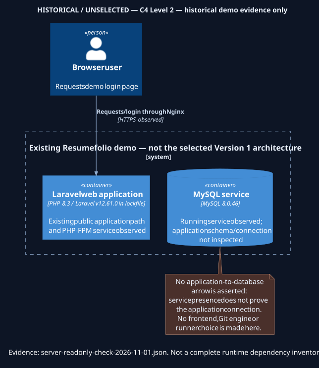

[Editable source](Diagrams/C4-Observed-Demo-Containers.puml) · 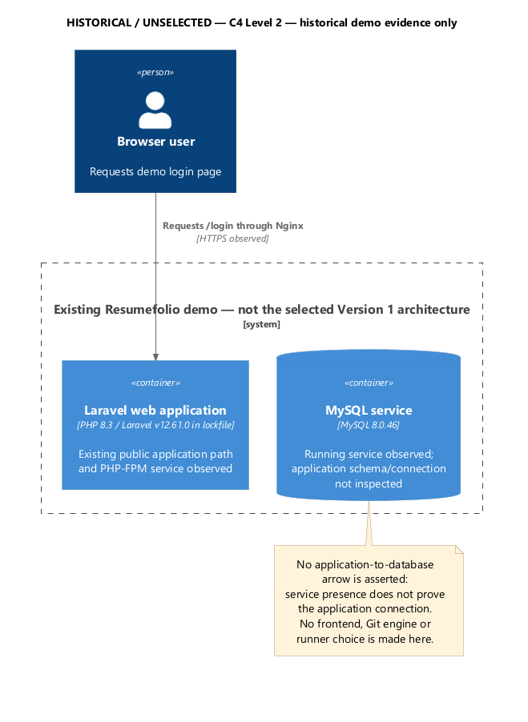

Resumefolio - Analysis Foundations and System Context

### Resumefolio - Analysis Foundations and System Context

This index groups existing System Analysis records. It changes navigation, not analysis scope, model meaning or acceptance status.

Current MVP scope and selected mechanisms: [Baseline](https://github.com/Farhad-V/Web-Resumefolio/blob/1f2acaa351ac306cb57cbe4fe9742e8bd90720d9/docs/MVP/baseline/README.md). Deferred provider, advanced collaboration and workflow-execution designs are not MVP prerequisites.

#### Documents

- [00-start-here.md](#foundation-00-start-here)
- [01-analysis-purpose-scope-and-approach.md](#foundation-01-analysis-purpose-scope-and-approach)
- [02-system-context-and-boundaries.md](#foundation-02-system-context-and-boundaries)

#### Shared Resources

- [System Analysis index]()
- [Shared diagram catalog](Diagrams/Diagram-Catalog.md)
- [Relocation map and historical evidence]()

## Purpose and Course Basis

Translate requirements into precise domain concepts, logical behavior and constraints. The complementary views follow the FAU Applied Software Engineering V03–V06 approach; this directory is a project-specific organization. Analysis explains required meaning and behavior; physical architecture and technology choices belong to justified design decisions.

## Reading Route and Documents

For a concrete example, start with the [scenario view](03-Processes-Scenarios-And-Business-Rules.md#analysis-behavioral-and-scenario-analysis--06-scenario-based-view). Use [operation contracts](03-Processes-Scenarios-And-Business-Rules.md#analysis-business-rules-and-operation-contracts--10-domain-constraints-and-operation-contracts) to check publication, protected sharing or a Git transfer. Use the [security analysis](04-Interfaces-Security-And-Quality.md#analysis-interfaces-security-and-quality-analysis--13-security-quality-and-operational-analysis) for access and recovery rules.

Open the full analysis document index

| File | Current content / remaining limitation |
| --- | --- |
| [00-start-here.md](#foundation-00-start-here) | Approach and activity mapping. |
| [01-analysis-purpose-scope-and-approach.md](#foundation-01-analysis-purpose-scope-and-approach) | Purpose, scope and approach. |
| [02-system-context-and-boundaries.md](#foundation-02-system-context-and-boundaries) | Logical context and external boundaries. |
| [03-domain-model-and-object-oriented-view.md](02-Domain-And-Information-Analysis.md#analysis-domain-and-information-analysis--03-domain-model-and-object-oriented-view) | Conceptual domain: 53 concepts and ten class views and one package view. |
| [04-function-oriented-view.md](03-Processes-Scenarios-And-Business-Rules.md#analysis-functional-and-process-analysis--04-function-oriented-view) | Populated functional decomposition, balanced context/Level 1 DFDs, logical stores and selected Level 2 refinement. |
| [05-data-oriented-view.md](02-Domain-And-Information-Analysis.md#analysis-domain-and-information-analysis--05-data-oriented-view) | Conceptual data: 34 dictionary subjects and nine ER views. |
| [06-scenario-based-view.md](03-Processes-Scenarios-And-Business-Rules.md#analysis-behavioral-and-scenario-analysis--06-scenario-based-view) | 16 sequence models; interaction models, not executed traces. |
| [07-state-based-view.md](03-Processes-Scenarios-And-Business-Rules.md#analysis-behavioral-and-scenario-analysis--07-state-based-view) | 18 state models and 128 transition contracts. |
| [08-control-flow-based-view.md](03-Processes-Scenarios-And-Business-Rules.md#analysis-functional-and-process-analysis--08-control-flow-based-view) | 17 activities and 276 steps/guards. |
| [09-rule-based-view.md](03-Processes-Scenarios-And-Business-Rules.md#analysis-business-rules-and-operation-contracts--09-rule-based-view) | 18 rule tables and eight diagrams; policies retain their source status. |
| [10-domain-constraints-and-operation-contracts.md](03-Processes-Scenarios-And-Business-Rules.md#analysis-business-rules-and-operation-contracts--10-domain-constraints-and-operation-contracts) | 18 typed constraints and 39 selected operation contracts. |
| [11-model-consistency-traceability-and-review.md](05-Analysis-Review-And-Design-Handoff.md#analysis-review-and-design-handoff--11-model-consistency-traceability-and-review) | SA-RV03 current inventory and 470-row trace register; exact semantic closure remains explicit and partial. |
| [12-interfaces-and-external-interactions.md](04-Interfaces-Security-And-Quality.md#analysis-interfaces-security-and-quality-analysis--12-interfaces-and-external-interactions) | Eight interface families and 27 bounded interaction cases. |
| [13-security-quality-and-operational-analysis.md](04-Interfaces-Security-And-Quality.md#analysis-interfaces-security-and-quality-analysis--13-security-quality-and-operational-analysis) | Conditional authority, trust cases, 14 quality scenarios and recovery analysis; no configured-control/test claims. |
| [14-feasibility-dependencies-and-design-handoff.md](05-Analysis-Review-And-Design-Handoff.md#analysis-review-and-design-handoff--14-feasibility-dependencies-and-design-handoff) | Qualified feasibility/dependency/design-handoff package; choices and acceptance remain conditional. |
| [15-current-processes-and-bottleneck-analysis.md](03-Processes-Scenarios-And-Business-Rules.md#analysis-functional-and-process-analysis--15-current-processes-and-bottleneck-analysis) | Eight source-defined process areas, five documentary findings, eight untested hypotheses and ten measurement definitions; no observed business-task baseline. |

## Authoritative Inputs

- [Planning and phase gates](../01-Project-Planning/02-Project-Management-Plan.md)

- [Accepted scope](../01-Project-Planning/01-Project-Charter.md#mvp-scope)

- [Distributed requirements specification](../02-Requirements-Engineering/01-Software-Requirements-Specification.md#requirements-specification-requirements-specification)

- [Existing scenarios](../02-Requirements-Engineering/01-Software-Requirements-Specification.md#scenarios-and-models-user-stories-and-scenarios)

- [Glossary and dictionary](../02-Requirements-Engineering/01-Software-Requirements-Specification.md#data-definitions-data-definitions)

- [Questions and actual decisions](../02-Requirements-Engineering/01-Software-Requirements-Specification.md#change-and-baseline-open-questions-and-decisions)

- [Traceability and review evidence](../02-Requirements-Engineering/01-Software-Requirements-Specification.md#validation-and-traceability-validation-and-traceability)

Refine these authoritative records when analysis exposes a missing requirement or definition. Do not create competing copies of requirements, vocabulary, questions or decisions.

## Working Boundaries and Completion

The models describe domain behavior and constraints. [System Design](../01-Project-Planning/02-Project-Management-Plan.md#stage-4-system-design) records technical choices. The review record below tracks consistency and acceptance evidence.

## Optional Supporting Artifacts

Use prototypes or a draft manual when they can help validate a specific scenario. Record observed feedback with that scenario.

## Diagrams

The [diagram catalog](Diagrams/Diagram-Catalog.md) links editable PlantUML sources, SVG previews and PNG exports. Read each diagram with its document's definitions, guards and limitations. Scenario, state, activity, rule and process diagrams describe different questions; they are not interchangeable evidence of implementation.

## Diagram Types and Reading Guide

This umbrella view summarizes the domain ecosystem. It is not a selected deployment architecture. The [notation alignment report](https://github.com/Farhad-V/Web-Resumefolio/blob/1f2acaa351ac306cb57cbe4fe9742e8bd90720d9/docs/MVP/SDLC/03-system-analysis/evidence/notation-alignment-review-2026-11-01.md) maps every numbered file to its diagram family and records remaining evidence/design limits.
