# Domain and Information Analysis

[System analysis overview](01-System-Context-And-Gap-Analysis.md)

### Domain and Information Analysis

Resumefolio — Domain Model and Object-Oriented View

#### Resumefolio — Domain Model and Object-Oriented View

[Diagram types and reading guide](#analysis-domain-and-information-analysis--03-domain-model-and-object-oriented-view--heading-diagram-types-and-reading-guide) · [Full diagram catalog](Diagrams/Diagram-Catalog.md)

| Item | Current position |
| --- | --- |
| Owner | Farhad; sole delivery and operations owner |
| Revision | November 1, 2026 |
| Status | Populated full-product conceptual domain model; detailed proposals, cross-view review and whole-model acceptance remain visible |
| Coverage | All twelve accepted scope areas; ten class views and one logical package view and a shared responsibility catalog |
| Interpretation | Domain concepts and associations, not implementation classes, physical tables, services or deployment units |

**Reading route:** read the notation/authority rules, then the diagrams and concept tables, followed by relationship bounds, change impact and invariants. The model develops the [system context](01-System-Context-And-Gap-Analysis.md#foundation-02-system-context-and-boundaries), following the [analysis approach](01-System-Context-And-Gap-Analysis.md#foundation-01-analysis-purpose-scope-and-approach).

Current MVP scope and selected mechanisms: [Baseline](https://github.com/Farhad-V/Web-Resumefolio/blob/1f2acaa351ac306cb57cbe4fe9742e8bd90720d9/docs/MVP/baseline/README.md). Deferred provider, advanced collaboration and workflow-execution designs are not MVP prerequisites.

##### 1. Sources and Interpretation

Accepted [Version 1 scope](../01-Project-Planning/01-Project-Charter.md#mvp-scope) governs capability inclusion/exclusions. The [distributed SRS](../02-Requirements-Engineering/01-Software-Requirements-Specification/03-Requirements-Specification/17-Software-Requirements-Specification.md#requirements-specification-requirements-specification) owns detailed obligations; the [dictionary](../02-Requirements-Engineering/01-Software-Requirements-Specification/05-Data-Definitions/02-Data-Dictionary.md#data-definitions-data-dictionary) and [glossary](../02-Requirements-Engineering/01-Software-Requirements-Specification/05-Data-Definitions/03-Requirements-Glossary.md#data-definitions-glossary) own shared terms. The [question register](../02-Requirements-Engineering/01-Software-Requirements-Specification/07-Change-And-Baseline/03-Requirements-Questions-And-Decisions.md#change-and-baseline-open-questions-and-decisions) and [answer review package](../02-Requirements-Engineering/01-Software-Requirements-Specification/07-Change-And-Baseline/03-Requirements-Questions-And-Decisions.md#change-and-baseline-open-questions-and-decisions) distinguish decisions, proposals and investigations. Exact primary requirement links appear in each concept table.

###### 1.1 Accepted Core and Remaining Proposals

The [owner-accepted profile policy](../02-Requirements-Engineering/01-Software-Requirements-Specification/07-Change-And-Baseline/03-Requirements-Questions-And-Decisions.md#change-and-baseline-open-questions-and-decisions--id-owner-accepted-profile-update-policy) applies directly:

1. Editing shared profile information does not automatically change existing resumes or their published views.

2. The owner previews and explicitly applies selected changes to a resume, preserving independent text/overrides and other resumes.

3. Applying/saving and publishing are separate; publication requires separate owner confirmation.

4. Actual previously submitted documents remain independent of later source, resume and publication changes.

These behaviors are accepted. Do not request the same approval again. Source deletion, exact concurrent-edit reconciliation, mandatory fields, language fallback, retention and numerical limits retain their recorded status. Accepted scope does not accept every detailed requirement, all of Q-D07 or the entire model.

###### 1.2 Notation and Object-Oriented Interpretation

| Modeling choice | Meaning and limit |
| --- | --- |
| UML-style concept class | Name/local ID and semantic properties. Actions remain in the adjacent responsibility table; no implementation methods or mandatory stored columns are implied |
| Solid labeled association | Domain relationship, not execution order, data transfer, authorization or lifetime ownership |
| Multiplicity | Sprint–Sprint Backlog is 1:1 from accepted scope. Other endpoint counts remain unspecified, not implicitly one-to-one; section 3 distinguishes candidate bounds from accepted meaning |
| Same concept repeated across views | Same ID and meaning, not a duplicate class; Tailored resume appears in both presentation and sharing |
| No inheritance/composition diamonds | Exclusive lifetime ownership, cascaded deletion and subtype hierarchies are not justified by the sources |
| Derived analysis concept | Selection, publication or attempt may become a value, association property or implementation component; boxes do not mandate separate entities |
| DM-Cxx / DM-Ixx | Local model/review references only; no new primary requirement IDs or physical keys |

These are PlantUML-rendered UML-style conceptual class views. Class boxes contain semantic properties; operations and full source traceability remain in the prose tables to keep the pictures readable. The diagrams are supported by textual constraints rather than claimed to form an executable UML model. Names such as Resource authority describe business responsibility, not a selected technical security component. [Input hashes and model inventory](https://github.com/Farhad-V/Web-Resumefolio/blob/1f2acaa351ac306cb57cbe4fe9742e8bd90720d9/docs/MVP/SDLC/03-system-analysis/evidence/domain-model-review-2026-11-01.json) identify this source-derived revision; they do not establish future baseline acceptance.

##### 2. Concepts and Responsibilities

###### 2.1 Professional information and independent tailoring

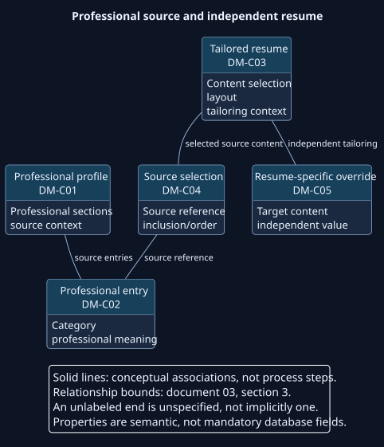

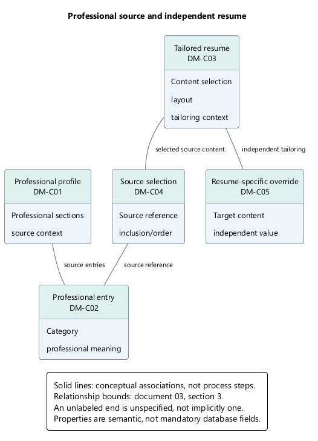 · [Editable PlantUML](Diagrams/Domain-Professional-Presentation.puml)

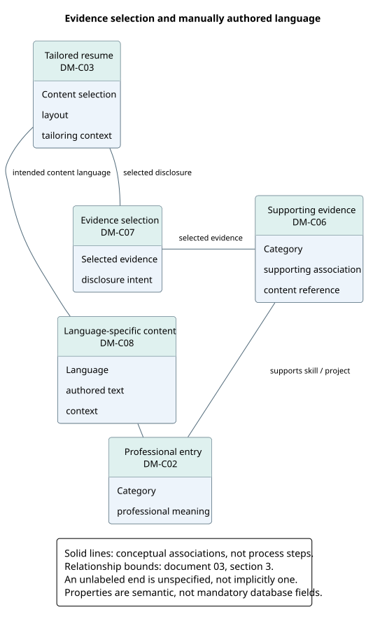

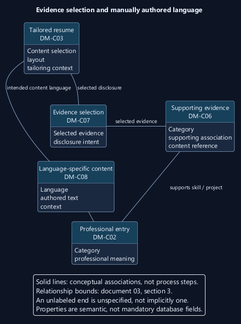 · [Editable PlantUML](Diagrams/Domain-Evidence-And-Language.puml)

Source selection, independent override and evidence selection answer different questions: what is reused, what is tailored and what is disclosed. Selection/override boxes can become values or association properties; they are not mandated database entities. Evidence support targets the skill/professional-project subjects in the grouped entry box, not automatically every entry category.

**Primary basis:** [PRP-D01](../02-Requirements-Engineering/01-Software-Requirements-Specification/03-Requirements-Specification/12-Profiles-Resumes-And-Portfolio.md#requirements-specification-profiles-resumes-and-portfolio--heading-prp-d01-reusable-professional-information), [PRP-D02](../02-Requirements-Engineering/01-Software-Requirements-Specification/03-Requirements-Specification/12-Profiles-Resumes-And-Portfolio.md#requirements-specification-profiles-resumes-and-portfolio--heading-prp-d02-opportunity-specific-resume-composition), [PRP-D03](../02-Requirements-Engineering/01-Software-Requirements-Specification/03-Requirements-Specification/12-Profiles-Resumes-And-Portfolio.md#requirements-specification-profiles-resumes-and-portfolio--heading-prp-d03-independent-selections-layouts-and-overrides), [PRP-D04](../02-Requirements-Engineering/01-Software-Requirements-Specification/03-Requirements-Specification/12-Profiles-Resumes-And-Portfolio.md#requirements-specification-profiles-resumes-and-portfolio--heading-prp-d04-explicit-shared-source-update-rules), [PRP-D05](../02-Requirements-Engineering/01-Software-Requirements-Specification/03-Requirements-Specification/12-Profiles-Resumes-And-Portfolio.md#requirements-specification-profiles-resumes-and-portfolio--heading-prp-d05-skill-and-project-evidence-management), [PRP-D06](../02-Requirements-Engineering/01-Software-Requirements-Specification/03-Requirements-Specification/12-Profiles-Resumes-And-Portfolio.md#requirements-specification-profiles-resumes-and-portfolio--heading-prp-d06-per-resume-evidence-selection-and-disclosure), [PRP-D07](../02-Requirements-Engineering/01-Software-Requirements-Specification/03-Requirements-Specification/12-Profiles-Resumes-And-Portfolio.md#requirements-specification-profiles-resumes-and-portfolio--heading-prp-d07-manually-maintained-english-and-german-content), [PRP-D09](../02-Requirements-Engineering/01-Software-Requirements-Specification/03-Requirements-Specification/12-Profiles-Resumes-And-Portfolio.md#requirements-specification-profiles-resumes-and-portfolio--heading-prp-d09-safe-content-admission-and-truthful-save-outcomes).

| Local element | Meaning / responsibility | Conceptual information and domain actions | Exact primary basis |
| --- | --- | --- | --- |
| DM-C01 — Professional profile | Reusable private professional source information, distinct from published presentation. | Professional sections; source context. Actions: Edit source; preview changes. | [PRP-D01](../02-Requirements-Engineering/01-Software-Requirements-Specification/03-Requirements-Specification/12-Profiles-Resumes-And-Portfolio.md#requirements-specification-profiles-resumes-and-portfolio--heading-prp-d01-reusable-professional-information), [PRP-D04](../02-Requirements-Engineering/01-Software-Requirements-Specification/03-Requirements-Specification/12-Profiles-Resumes-And-Portfolio.md#requirements-specification-profiles-resumes-and-portfolio--heading-prp-d04-explicit-shared-source-update-rules) |
| DM-C02 — Professional entry | Experience, education, skill or professional-project information; categories do not select implementation subclasses. | Category; professional meaning. Actions: Maintain source entry. | [PRP-D01](../02-Requirements-Engineering/01-Software-Requirements-Specification/03-Requirements-Specification/12-Profiles-Resumes-And-Portfolio.md#requirements-specification-profiles-resumes-and-portfolio--heading-prp-d01-reusable-professional-information), [PRP-D05](../02-Requirements-Engineering/01-Software-Requirements-Specification/03-Requirements-Specification/12-Profiles-Resumes-And-Portfolio.md#requirements-specification-profiles-resumes-and-portfolio--heading-prp-d05-skill-and-project-evidence-management) |
| DM-C03 — Tailored resume | Independent opportunity-specific selections, wording and presentation. | Content selection; layout; tailoring context. Actions: Compose; apply selected changes; request publication. | [PRP-D02](../02-Requirements-Engineering/01-Software-Requirements-Specification/03-Requirements-Specification/12-Profiles-Resumes-And-Portfolio.md#requirements-specification-profiles-resumes-and-portfolio--heading-prp-d02-opportunity-specific-resume-composition), [PRP-D03](../02-Requirements-Engineering/01-Software-Requirements-Specification/03-Requirements-Specification/12-Profiles-Resumes-And-Portfolio.md#requirements-specification-profiles-resumes-and-portfolio--heading-prp-d03-independent-selections-layouts-and-overrides), [PRP-D04](../02-Requirements-Engineering/01-Software-Requirements-Specification/03-Requirements-Specification/12-Profiles-Resumes-And-Portfolio.md#requirements-specification-profiles-resumes-and-portfolio--heading-prp-d04-explicit-shared-source-update-rules) |
| DM-C04 — Source selection | Meaning of selecting source information for one resume, without automatic propagation. | Source reference; inclusion/order. Actions: Select; omit; explicitly apply change. | [PRP-D02](../02-Requirements-Engineering/01-Software-Requirements-Specification/03-Requirements-Specification/12-Profiles-Resumes-And-Portfolio.md#requirements-specification-profiles-resumes-and-portfolio--heading-prp-d02-opportunity-specific-resume-composition), [PRP-D04](../02-Requirements-Engineering/01-Software-Requirements-Specification/03-Requirements-Specification/12-Profiles-Resumes-And-Portfolio.md#requirements-specification-profiles-resumes-and-portfolio--heading-prp-d04-explicit-shared-source-update-rules) |
| DM-C05 — Resume-specific override | Independent wording/presentation belonging to the intended resume. | Target content; independent value. Actions: Edit override; review source difference. | [PRP-D03](../02-Requirements-Engineering/01-Software-Requirements-Specification/03-Requirements-Specification/12-Profiles-Resumes-And-Portfolio.md#requirements-specification-profiles-resumes-and-portfolio--heading-prp-d03-independent-selections-layouts-and-overrides), [PRP-D04](../02-Requirements-Engineering/01-Software-Requirements-Specification/03-Requirements-Specification/12-Profiles-Resumes-And-Portfolio.md#requirements-specification-profiles-resumes-and-portfolio--heading-prp-d04-explicit-shared-source-update-rules) |
| DM-C06 — Supporting evidence | Externally authored text, media, files, diagrams or links supporting skills or professional projects. | Category; supporting association; content reference. Actions: Associate; revise safely. | [PRP-D05](../02-Requirements-Engineering/01-Software-Requirements-Specification/03-Requirements-Specification/12-Profiles-Resumes-And-Portfolio.md#requirements-specification-profiles-resumes-and-portfolio--heading-prp-d05-skill-and-project-evidence-management), [PRP-D09](../02-Requirements-Engineering/01-Software-Requirements-Specification/03-Requirements-Specification/12-Profiles-Resumes-And-Portfolio.md#requirements-specification-profiles-resumes-and-portfolio--heading-prp-d09-safe-content-admission-and-truthful-save-outcomes) |
| DM-C07 — Evidence selection | Deliberate per-resume disclosure, distinct from evidence existence. | Selected evidence; disclosure intent. Actions: Select; omit; review disclosure. | [PRP-D06](../02-Requirements-Engineering/01-Software-Requirements-Specification/03-Requirements-Specification/12-Profiles-Resumes-And-Portfolio.md#requirements-specification-profiles-resumes-and-portfolio--heading-prp-d06-per-resume-evidence-selection-and-disclosure) |
| DM-C08 — Language-specific content | Manually maintained English/German text in its relevant source/resume context. | Language; authored text; context. Actions: Edit language variant. | [PRP-D07](../02-Requirements-Engineering/01-Software-Requirements-Specification/03-Requirements-Specification/12-Profiles-Resumes-And-Portfolio.md#requirements-specification-profiles-resumes-and-portfolio--heading-prp-d07-manually-maintained-english-and-german-content) |

**Policy boundary:** Q-D06/Q-D08/Q-D09 remain proposals. Profile count, required fields, language fallback and evidence-removal behavior are not finalized. Accepted Q-D07 core behavior applies directly.

###### 2.2 Publication, representations and protected sharing

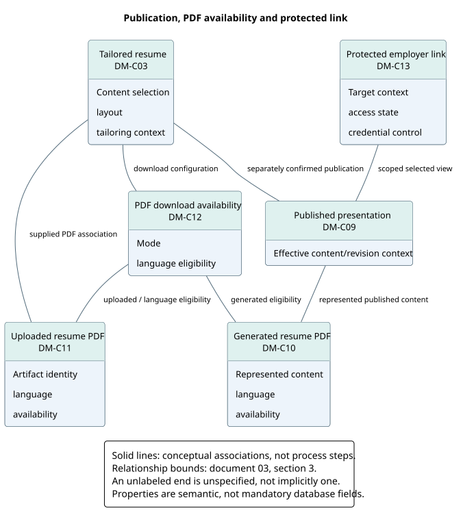

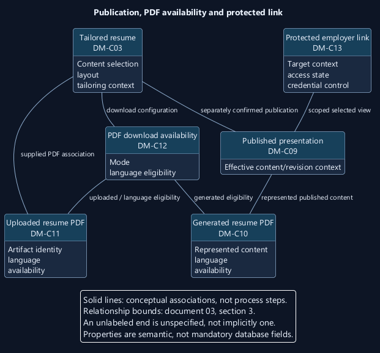 · [Editable PlantUML](Diagrams/Domain-Publication-And-Sharing.puml)

Published presentation differs from editable resume content. Generated and uploaded PDFs have different provenance; no shared implementation superclass is selected. Changing PDF availability and disabling a link remain independent operations.

**Primary basis:** [PRP-D04](../02-Requirements-Engineering/01-Software-Requirements-Specification/03-Requirements-Specification/12-Profiles-Resumes-And-Portfolio.md#requirements-specification-profiles-resumes-and-portfolio--heading-prp-d04-explicit-shared-source-update-rules), [PRP-D08](../02-Requirements-Engineering/01-Software-Requirements-Specification/03-Requirements-Specification/12-Profiles-Resumes-And-Portfolio.md#requirements-specification-profiles-resumes-and-portfolio--heading-prp-d08-clear-presentation-and-rendition-boundaries), [PDF-D01](../02-Requirements-Engineering/01-Software-Requirements-Specification/03-Requirements-Specification/11-Pdf-And-Controlled-Sharing.md#requirements-specification-pdf-and-controlled-sharing--heading-pdf-d01-generated-resume-pdf), [PDF-D02](../02-Requirements-Engineering/01-Software-Requirements-Specification/03-Requirements-Specification/11-Pdf-And-Controlled-Sharing.md#requirements-specification-pdf-and-controlled-sharing--heading-pdf-d02-uploaded-pdf-and-language-identity), [PDF-D03](../02-Requirements-Engineering/01-Software-Requirements-Specification/03-Requirements-Specification/11-Pdf-And-Controlled-Sharing.md#requirements-specification-pdf-and-controlled-sharing--heading-pdf-d03-per-resume-download-choices), [PDF-D04](../02-Requirements-Engineering/01-Software-Requirements-Specification/03-Requirements-Specification/11-Pdf-And-Controlled-Sharing.md#requirements-specification-pdf-and-controlled-sharing--heading-pdf-d04-scoped-password-protected-employer-access), [PDF-D05](../02-Requirements-Engineering/01-Software-Requirements-Specification/03-Requirements-Specification/11-Pdf-And-Controlled-Sharing.md#requirements-specification-pdf-and-controlled-sharing--heading-pdf-d05-direct-file-and-pdf-authorization), [PDF-D06](../02-Requirements-Engineering/01-Software-Requirements-Specification/03-Requirements-Specification/11-Pdf-And-Controlled-Sharing.md#requirements-specification-pdf-and-controlled-sharing--heading-pdf-d06-owner-password-and-link-controls), [PDF-D07](../02-Requirements-Engineering/01-Software-Requirements-Specification/03-Requirements-Specification/11-Pdf-And-Controlled-Sharing.md#requirements-specification-pdf-and-controlled-sharing--heading-pdf-d07-explicit-live-revision-and-rendition-behavior).

| Local element | Meaning / responsibility | Conceptual information and domain actions | Exact primary basis |
| --- | --- | --- | --- |
| DM-C03 (same concept) — Tailored resume | Independent opportunity-specific selections, wording and presentation. | Content selection; layout; tailoring context. Actions: Compose; apply selected changes; request publication. | [PRP-D02](../02-Requirements-Engineering/01-Software-Requirements-Specification/03-Requirements-Specification/12-Profiles-Resumes-And-Portfolio.md#requirements-specification-profiles-resumes-and-portfolio--heading-prp-d02-opportunity-specific-resume-composition), [PRP-D03](../02-Requirements-Engineering/01-Software-Requirements-Specification/03-Requirements-Specification/12-Profiles-Resumes-And-Portfolio.md#requirements-specification-profiles-resumes-and-portfolio--heading-prp-d03-independent-selections-layouts-and-overrides), [PRP-D04](../02-Requirements-Engineering/01-Software-Requirements-Specification/03-Requirements-Specification/12-Profiles-Resumes-And-Portfolio.md#requirements-specification-profiles-resumes-and-portfolio--heading-prp-d04-explicit-shared-source-update-rules) |
| DM-C09 — Published presentation | Owner-confirmed effective presentation, semantically distinct from the draft; not a mandatory snapshot table. | Effective content/revision context. Actions: Confirm publication; expose selected content. | [PRP-D04](../02-Requirements-Engineering/01-Software-Requirements-Specification/03-Requirements-Specification/12-Profiles-Resumes-And-Portfolio.md#requirements-specification-profiles-resumes-and-portfolio--heading-prp-d04-explicit-shared-source-update-rules), [PRP-D08](../02-Requirements-Engineering/01-Software-Requirements-Specification/03-Requirements-Specification/12-Profiles-Resumes-And-Portfolio.md#requirements-specification-profiles-resumes-and-portfolio--heading-prp-d08-clear-presentation-and-rendition-boundaries), [PDF-D07](../02-Requirements-Engineering/01-Software-Requirements-Specification/03-Requirements-Specification/11-Pdf-And-Controlled-Sharing.md#requirements-specification-pdf-and-controlled-sharing--heading-pdf-d07-explicit-live-revision-and-rendition-behavior) |
| DM-C10 — Generated resume PDF | Derived rendition with identifiable represented content and language. | Represented content; language; availability. Actions: Request generation; report availability. | [PDF-D01](../02-Requirements-Engineering/01-Software-Requirements-Specification/03-Requirements-Specification/11-Pdf-And-Controlled-Sharing.md#requirements-specification-pdf-and-controlled-sharing--heading-pdf-d01-generated-resume-pdf), [PDF-D07](../02-Requirements-Engineering/01-Software-Requirements-Specification/03-Requirements-Specification/11-Pdf-And-Controlled-Sharing.md#requirements-specification-pdf-and-controlled-sharing--heading-pdf-d07-explicit-live-revision-and-rendition-behavior) |
| DM-C11 — Uploaded resume PDF | Independently prepared PDF associated with the intended resume and language. | Artifact identity; language; availability. Actions: Admit; replace under validation. | [PDF-D02](../02-Requirements-Engineering/01-Software-Requirements-Specification/03-Requirements-Specification/11-Pdf-And-Controlled-Sharing.md#requirements-specification-pdf-and-controlled-sharing--heading-pdf-d02-uploaded-pdf-and-language-identity), [PDF-D09](../02-Requirements-Engineering/01-Software-Requirements-Specification/03-Requirements-Specification/11-Pdf-And-Controlled-Sharing.md#requirements-specification-pdf-and-controlled-sharing--heading-pdf-d09-failure-safe-processing-and-content-handling) |
| DM-C12 — PDF download availability | Per-resume generated/uploaded/both/neither choice with applicable language availability. | Mode; language eligibility. Actions: Change download configuration. | [PDF-D03](../02-Requirements-Engineering/01-Software-Requirements-Specification/03-Requirements-Specification/11-Pdf-And-Controlled-Sharing.md#requirements-specification-pdf-and-controlled-sharing--heading-pdf-d03-per-resume-download-choices) |
| DM-C13 — Protected employer link | Password-protected scoped presentation access without a viewer account; not verified employer identity. | Target context; access state; credential control. Actions: Change password; disable link. | [PDF-D04](../02-Requirements-Engineering/01-Software-Requirements-Specification/03-Requirements-Specification/11-Pdf-And-Controlled-Sharing.md#requirements-specification-pdf-and-controlled-sharing--heading-pdf-d04-scoped-password-protected-employer-access), [PDF-D06](../02-Requirements-Engineering/01-Software-Requirements-Specification/03-Requirements-Specification/11-Pdf-And-Controlled-Sharing.md#requirements-specification-pdf-and-controlled-sharing--heading-pdf-d06-owner-password-and-link-controls) |

**Policy boundary:** Q-D10/Q-D11 retain detailed generation/revision/language/link proposals. This model does not accept link count, expiry, exact session-revocation timing, retained revision count or rendering technology.

###### 2.3 Applications, submitted history and communication

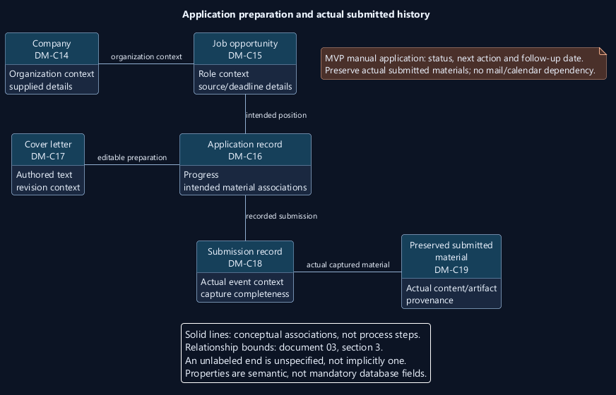 · [Editable PlantUML](Diagrams/Domain-Applications-And-Communication.puml)

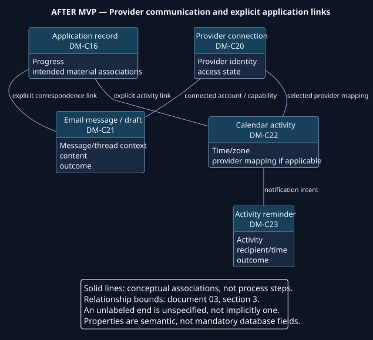

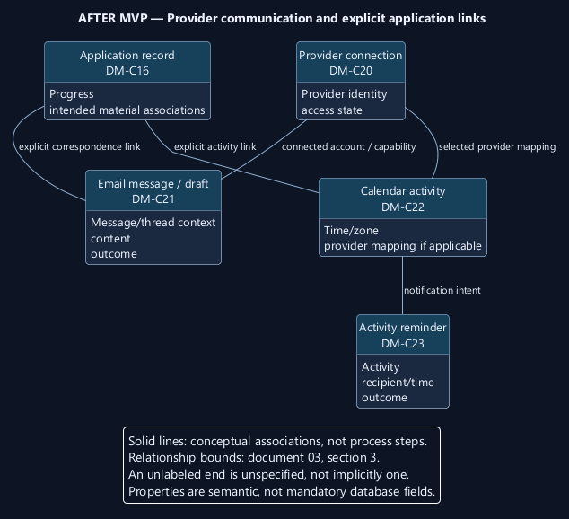 · [Editable PlantUML](Diagrams/Domain-Provider-Communication.puml)

Preparation, actual submission recording and provider operations have independent meanings. An application refers to its intended resume, while preserved materials identify what was actually submitted. A provider connection does not make every activity remote or every application send mail.

**Primary basis:** [APP-D01](../02-Requirements-Engineering/01-Software-Requirements-Specification/03-Requirements-Specification/09-Manual-Application-Management.md#requirements-specification-manual-application-management--heading-app-d01-company-and-opportunity-context), [APP-D02](../02-Requirements-Engineering/01-Software-Requirements-Specification/03-Requirements-Specification/09-Manual-Application-Management.md#requirements-specification-manual-application-management--heading-app-d02-relevant-resume-association), [APP-D03](../02-Requirements-Engineering/01-Software-Requirements-Specification/03-Requirements-Specification/09-Manual-Application-Management.md#requirements-specification-manual-application-management--heading-app-d03-manually-authored-cover-letter), [APP-D04](../02-Requirements-Engineering/01-Software-Requirements-Specification/03-Requirements-Specification/09-Manual-Application-Management.md#requirements-specification-manual-application-management--heading-app-d04-explicit-progress-states-and-transitions), [APP-D05](../02-Requirements-Engineering/01-Software-Requirements-Specification/03-Requirements-Specification/09-Manual-Application-Management.md#requirements-specification-manual-application-management--heading-app-d05-user-directed-submission-recording), [APP-D06](../02-Requirements-Engineering/01-Software-Requirements-Specification/03-Requirements-Specification/09-Manual-Application-Management.md#requirements-specification-manual-application-management--heading-app-d06-preserved-actual-submitted-copies), [APP-D07](../02-Requirements-Engineering/01-Software-Requirements-Specification/03-Requirements-Specification/09-Manual-Application-Management.md#requirements-specification-manual-application-management--heading-app-d07-correction-and-repeated-submissions), [APP-D08](../02-Requirements-Engineering/01-Software-Requirements-Specification/03-Requirements-Specification/09-Manual-Application-Management.md#requirements-specification-manual-application-management--heading-app-d08-correspondence-calendar-and-follow-up-links), [EGC-D01](../02-Requirements-Engineering/01-Software-Requirements-Specification/03-Requirements-Specification/06-Email-Calendar-And-Google-Integration.md#requirements-specification-email-calendar-and-google-integration--heading-egc-d01-authorized-connection-and-account-context), [EGC-D05](../02-Requirements-Engineering/01-Software-Requirements-Specification/03-Requirements-Specification/06-Email-Calendar-And-Google-Integration.md#requirements-specification-email-calendar-and-google-integration--heading-egc-d05-deliberate-send-and-truthful-outcome), [EGC-D07](../02-Requirements-Engineering/01-Software-Requirements-Specification/03-Requirements-Specification/06-Email-Calendar-And-Google-Integration.md#requirements-specification-email-calendar-and-google-integration--heading-egc-d07-calendar-activities-and-time-meaning), [EGC-D08](../02-Requirements-Engineering/01-Software-Requirements-Specification/03-Requirements-Specification/06-Email-Calendar-And-Google-Integration.md#requirements-specification-email-calendar-and-google-integration--heading-egc-d08-explicit-synchronization-contract), [EGC-D10](../02-Requirements-Engineering/01-Software-Requirements-Specification/03-Requirements-Specification/06-Email-Calendar-And-Google-Integration.md#requirements-specification-email-calendar-and-google-integration--heading-egc-d10-reminders-and-notification-outcomes), [EGC-D11](../02-Requirements-Engineering/01-Software-Requirements-Specification/03-Requirements-Specification/06-Email-Calendar-And-Google-Integration.md#requirements-specification-email-calendar-and-google-integration--heading-egc-d11-disconnect-revocation-and-reconnect).

| Local element | Meaning / responsibility | Conceptual information and domain actions | Exact primary basis |
| --- | --- | --- | --- |
| DM-C14 — Company | Organization information for private application work; no global public directory is implied. | Organization context; supplied details. Actions: Record; revise organization context. | [APP-D01](../02-Requirements-Engineering/01-Software-Requirements-Specification/03-Requirements-Specification/09-Manual-Application-Management.md#requirements-specification-manual-application-management--heading-app-d01-company-and-opportunity-context) |
| DM-C15 — Job opportunity | Position being considered, distinct from the application process for it. | Role context; source/deadline details. Actions: Record; associate with application. | [APP-D01](../02-Requirements-Engineering/01-Software-Requirements-Specification/03-Requirements-Specification/09-Manual-Application-Management.md#requirements-specification-manual-application-management--heading-app-d01-company-and-opportunity-context) |
| DM-C16 — Application record | Manual preparation and progress context relating an opportunity to intended materials. | Progress; intended material associations. Actions: Prepare; record progress/submission. | [APP-D02](../02-Requirements-Engineering/01-Software-Requirements-Specification/03-Requirements-Specification/09-Manual-Application-Management.md#requirements-specification-manual-application-management--heading-app-d02-relevant-resume-association), [APP-D04](../02-Requirements-Engineering/01-Software-Requirements-Specification/03-Requirements-Specification/09-Manual-Application-Management.md#requirements-specification-manual-application-management--heading-app-d04-explicit-progress-states-and-transitions), [APP-D05](../02-Requirements-Engineering/01-Software-Requirements-Specification/03-Requirements-Specification/09-Manual-Application-Management.md#requirements-specification-manual-application-management--heading-app-d05-user-directed-submission-recording) |
| DM-C17 — Cover letter | Manually authored editable application text, distinct from its actual submitted copy. | Authored text; revision context. Actions: Edit; save preparation. | [APP-D03](../02-Requirements-Engineering/01-Software-Requirements-Specification/03-Requirements-Specification/09-Manual-Application-Management.md#requirements-specification-manual-application-management--heading-app-d03-manually-authored-cover-letter) |
| DM-C18 — Submission record | User-recorded actual submission and completeness context, not proof of receipt. | Actual event context; capture completeness. Actions: Record submission; record correction. | [APP-D05](../02-Requirements-Engineering/01-Software-Requirements-Specification/03-Requirements-Specification/09-Manual-Application-Management.md#requirements-specification-manual-application-management--heading-app-d05-user-directed-submission-recording), [APP-D07](../02-Requirements-Engineering/01-Software-Requirements-Specification/03-Requirements-Specification/09-Manual-Application-Management.md#requirements-specification-manual-application-management--heading-app-d07-correction-and-repeated-submissions) |
| DM-C19 — Preserved submitted material | Identifiable actual submitted resume/cover-letter material independent of later live changes. | Actual content/artifact; provenance. Actions: Capture actual material; identify history. | [APP-D06](../02-Requirements-Engineering/01-Software-Requirements-Specification/03-Requirements-Specification/09-Manual-Application-Management.md#requirements-specification-manual-application-management--heading-app-d06-preserved-actual-submitted-copies), [APP-D07](../02-Requirements-Engineering/01-Software-Requirements-Specification/03-Requirements-Specification/09-Manual-Application-Management.md#requirements-specification-manual-application-management--heading-app-d07-correction-and-repeated-submissions), [PDF-D08](../02-Requirements-Engineering/01-Software-Requirements-Specification/03-Requirements-Specification/11-Pdf-And-Controlled-Sharing.md#requirements-specification-pdf-and-controlled-sharing--heading-pdf-d08-downloaded-copy-and-submission-distinctions) |
| DM-C20 — Provider connection | Selected user/provider identity and authorized capabilities; product login is not Google consent. | Provider identity; access state. Actions: Connect; disconnect; reconcile access. | [EGC-D01](../02-Requirements-Engineering/01-Software-Requirements-Specification/03-Requirements-Specification/06-Email-Calendar-And-Google-Integration.md#requirements-specification-email-calendar-and-google-integration--heading-egc-d01-authorized-connection-and-account-context), [EGC-D02](../02-Requirements-Engineering/01-Software-Requirements-Specification/03-Requirements-Specification/06-Email-Calendar-And-Google-Integration.md#requirements-specification-email-calendar-and-google-integration--heading-egc-d02-justified-permissions-and-private-resource-isolation), [EGC-D11](../02-Requirements-Engineering/01-Software-Requirements-Specification/03-Requirements-Specification/06-Email-Calendar-And-Google-Integration.md#requirements-specification-email-calendar-and-google-integration--heading-egc-d11-disconnect-revocation-and-reconnect)  **After MVP.** |
| DM-C21 — Email message / draft | Correspondence with provider message/thread identity and truthful save/send outcomes. | Message/thread context; content; outcome. Actions: Read; compose; save; send/reply deliberately. | [EGC-D03](../02-Requirements-Engineering/01-Software-Requirements-Specification/03-Requirements-Specification/06-Email-Calendar-And-Google-Integration.md#requirements-specification-email-calendar-and-google-integration--heading-egc-d03-read-authorized-correspondence), [EGC-D04](../02-Requirements-Engineering/01-Software-Requirements-Specification/03-Requirements-Specification/06-Email-Calendar-And-Google-Integration.md#requirements-specification-email-calendar-and-google-integration--heading-egc-d04-manual-compose-and-draft-handling), [EGC-D05](../02-Requirements-Engineering/01-Software-Requirements-Specification/03-Requirements-Specification/06-Email-Calendar-And-Google-Integration.md#requirements-specification-email-calendar-and-google-integration--heading-egc-d05-deliberate-send-and-truthful-outcome), [EGC-D06](../02-Requirements-Engineering/01-Software-Requirements-Specification/03-Requirements-Specification/06-Email-Calendar-And-Google-Integration.md#requirements-specification-email-calendar-and-google-integration--heading-egc-d06-reply-context-and-conversation-association)  **After MVP.** |
| DM-C22 — Calendar activity | Local activity or explicitly related provider event with meaningful time and authority. | Time/zone; provider mapping if applicable. Actions: Edit; request selected synchronization. | [EGC-D07](../02-Requirements-Engineering/01-Software-Requirements-Specification/03-Requirements-Specification/06-Email-Calendar-And-Google-Integration.md#requirements-specification-email-calendar-and-google-integration--heading-egc-d07-calendar-activities-and-time-meaning), [EGC-D08](../02-Requirements-Engineering/01-Software-Requirements-Specification/03-Requirements-Specification/06-Email-Calendar-And-Google-Integration.md#requirements-specification-email-calendar-and-google-integration--heading-egc-d08-explicit-synchronization-contract)  **After MVP.** |
| DM-C23 — Activity reminder | Notification intent for an authorized activity; scheduling is not demonstrated delivery. | Activity; recipient/time; outcome. Actions: Schedule; cancel; report outcome. | [EGC-D10](../02-Requirements-Engineering/01-Software-Requirements-Specification/03-Requirements-Specification/06-Email-Calendar-And-Google-Integration.md#requirements-specification-email-calendar-and-google-integration--heading-egc-d10-reminders-and-notification-outcomes)  **After MVP.** |

**Policy boundary:** Q-D12–Q-D17 retain progress, capture/correction, synchronization and uncertain-result proposals. OAuth is not created; this diagram does not assert provider access or delivery.

###### 2.4 Work projects, backlogs, boards and Sprints

**After MVP.** Shared operating and recovery controls still apply where relevant.

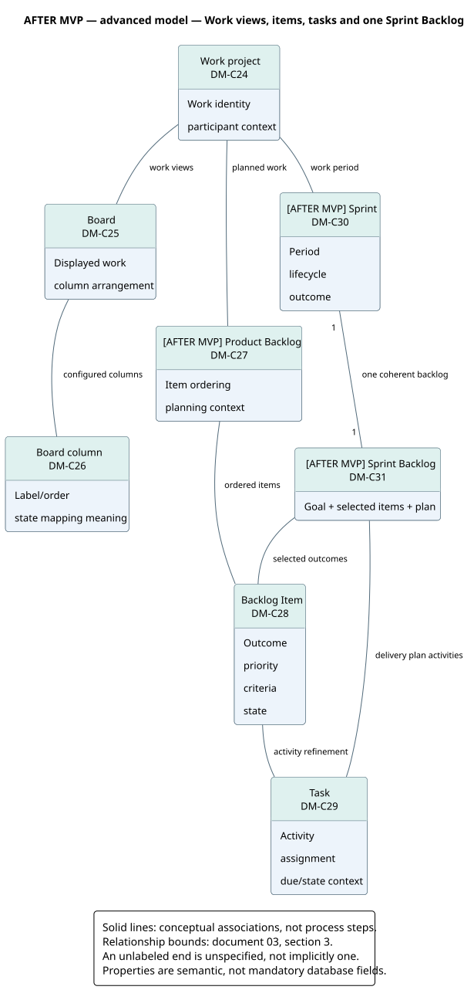

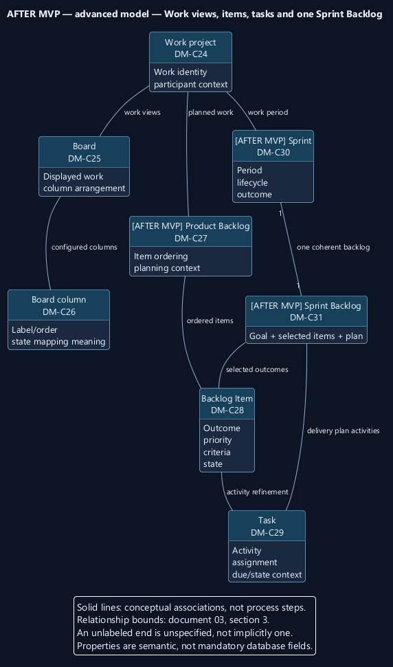 · [Editable PlantUML](Diagrams/Domain-Work-Management.puml)

A board presents work; it is not a second backlog. A Backlog Item expresses an outcome and acceptance meaning, while a Task expresses an activity. One Sprint Backlog comprises goal, selected items and delivery plan. Product work management differs from the board used to develop Resumefolio.

**Primary basis:** [PKS-D01](../02-Requirements-Engineering/01-Software-Requirements-Specification/03-Requirements-Specification/13-Projects-Kanban-And-Sprints.md#requirements-specification-projects-kanban-and-sprints--heading-pks-d01-project-and-board-context), [PKS-D02](../02-Requirements-Engineering/01-Software-Requirements-Specification/03-Requirements-Specification/13-Projects-Kanban-And-Sprints.md#requirements-specification-projects-kanban-and-sprints--heading-pks-d02-configurable-columns-and-valid-work-movement), [PKS-D03](../02-Requirements-Engineering/01-Software-Requirements-Specification/03-Requirements-Specification/13-Projects-Kanban-And-Sprints.md#requirements-specification-projects-kanban-and-sprints--heading-pks-d03-product-backlog-and-item-definition), [PKS-D04](../02-Requirements-Engineering/01-Software-Requirements-Specification/03-Requirements-Specification/13-Projects-Kanban-And-Sprints.md#requirements-specification-projects-kanban-and-sprints--heading-pks-d04-item-refinement-and-task-relationships), [PKS-D05](../02-Requirements-Engineering/01-Software-Requirements-Specification/03-Requirements-Specification/13-Projects-Kanban-And-Sprints.md#requirements-specification-projects-kanban-and-sprints--heading-pks-d05-assignment-priority-and-due-date-handling), [PKS-D06](../02-Requirements-Engineering/01-Software-Requirements-Specification/03-Requirements-Specification/13-Projects-Kanban-And-Sprints.md#requirements-specification-projects-kanban-and-sprints--heading-pks-d06-scoped-collaboration-and-membership-changes), [PKS-D07](../02-Requirements-Engineering/01-Software-Requirements-Specification/03-Requirements-Specification/13-Projects-Kanban-And-Sprints.md#requirements-specification-projects-kanban-and-sprints--heading-pks-d07-sprint-goal-and-selected-backlog-items), [PKS-D08](../02-Requirements-Engineering/01-Software-Requirements-Specification/03-Requirements-Specification/13-Projects-Kanban-And-Sprints.md#requirements-specification-projects-kanban-and-sprints--heading-pks-d08-one-coherent-sprint-backlog), [PKS-D09](../02-Requirements-Engineering/01-Software-Requirements-Specification/03-Requirements-Specification/13-Projects-Kanban-And-Sprints.md#requirements-specification-projects-kanban-and-sprints--heading-pks-d09-explicit-completion-and-sprint-end-outcomes), [PKS-D10](../02-Requirements-Engineering/01-Software-Requirements-Specification/03-Requirements-Specification/13-Projects-Kanban-And-Sprints.md#requirements-specification-projects-kanban-and-sprints--heading-pks-d10-deliberate-cross-module-links-reports-and-automation).

| Local element | Meaning / responsibility | Conceptual information and domain actions | Exact primary basis |
| --- | --- | --- | --- |
| DM-C24 — Work project | Authorized work organization, distinct from professional projects and Git repositories. | Work identity; participant context. Actions: Organize permitted work. | [PKS-D01](../02-Requirements-Engineering/01-Software-Requirements-Specification/03-Requirements-Specification/13-Projects-Kanban-And-Sprints.md#requirements-specification-projects-kanban-and-sprints--heading-pks-d01-project-and-board-context), [PKS-D06](../02-Requirements-Engineering/01-Software-Requirements-Specification/03-Requirements-Specification/13-Projects-Kanban-And-Sprints.md#requirements-specification-projects-kanban-and-sprints--heading-pks-d06-scoped-collaboration-and-membership-changes) |
| DM-C25 — Board | Organized work view, not another Product or Sprint Backlog. | Displayed work; column arrangement. Actions: Configure view; request movement. | [PKS-D01](../02-Requirements-Engineering/01-Software-Requirements-Specification/03-Requirements-Specification/13-Projects-Kanban-And-Sprints.md#requirements-specification-projects-kanban-and-sprints--heading-pks-d01-project-and-board-context), [PKS-D02](../02-Requirements-Engineering/01-Software-Requirements-Specification/03-Requirements-Specification/13-Projects-Kanban-And-Sprints.md#requirements-specification-projects-kanban-and-sprints--heading-pks-d02-configurable-columns-and-valid-work-movement) |
| DM-C26 — Board column | Configured display organization whose movement rules agree with actual work states. | Label/order; state mapping meaning. Actions: Configure; map valid movement. | [PKS-D02](../02-Requirements-Engineering/01-Software-Requirements-Specification/03-Requirements-Specification/13-Projects-Kanban-And-Sprints.md#requirements-specification-projects-kanban-and-sprints--heading-pks-d02-configurable-columns-and-valid-work-movement) |
| DM-C27 — Product Backlog | Ordered planned outcomes/work in an authorized work context. | Item ordering; planning context. Actions: Add; order; refine items. | [PKS-D03](../02-Requirements-Engineering/01-Software-Requirements-Specification/03-Requirements-Specification/13-Projects-Kanban-And-Sprints.md#requirements-specification-projects-kanban-and-sprints--heading-pks-d03-product-backlog-and-item-definition)  **Advanced paths after MVP; any retained core/basic path follows the release register.** |
| DM-C28 — Backlog Item | Planned outcome with criteria; not interchangeable with a Task or repository Issue. | Outcome; priority; criteria; state. Actions: Refine; select; evaluate completion. | [PKS-D03](../02-Requirements-Engineering/01-Software-Requirements-Specification/03-Requirements-Specification/13-Projects-Kanban-And-Sprints.md#requirements-specification-projects-kanban-and-sprints--heading-pks-d03-product-backlog-and-item-definition), [PKS-D04](../02-Requirements-Engineering/01-Software-Requirements-Specification/03-Requirements-Specification/13-Projects-Kanban-And-Sprints.md#requirements-specification-projects-kanban-and-sprints--heading-pks-d04-item-refinement-and-task-relationships), [PKS-D09](../02-Requirements-Engineering/01-Software-Requirements-Specification/03-Requirements-Specification/13-Projects-Kanban-And-Sprints.md#requirements-specification-projects-kanban-and-sprints--heading-pks-d09-explicit-completion-and-sprint-end-outcomes)  **Advanced paths after MVP; any retained core/basic path follows the release register.** |
| DM-C29 — Task | Specific activity contributing to work with its own assignment/completion meaning. | Activity; assignment; due/state context. Actions: Assign; update; complete activity. | [PKS-D04](../02-Requirements-Engineering/01-Software-Requirements-Specification/03-Requirements-Specification/13-Projects-Kanban-And-Sprints.md#requirements-specification-projects-kanban-and-sprints--heading-pks-d04-item-refinement-and-task-relationships), [PKS-D05](../02-Requirements-Engineering/01-Software-Requirements-Specification/03-Requirements-Specification/13-Projects-Kanban-And-Sprints.md#requirements-specification-projects-kanban-and-sprints--heading-pks-d05-assignment-priority-and-due-date-handling)  **Advanced paths after MVP; any retained core/basic path follows the release register.** |
| DM-C30 — Sprint | Work period with goal and actual outcome; elapsed time does not imply success. | Period; lifecycle; outcome. Actions: Start; adapt; end under authority. | [PKS-D07](../02-Requirements-Engineering/01-Software-Requirements-Specification/03-Requirements-Specification/13-Projects-Kanban-And-Sprints.md#requirements-specification-projects-kanban-and-sprints--heading-pks-d07-sprint-goal-and-selected-backlog-items), [PKS-D09](../02-Requirements-Engineering/01-Software-Requirements-Specification/03-Requirements-Specification/13-Projects-Kanban-And-Sprints.md#requirements-specification-projects-kanban-and-sprints--heading-pks-d09-explicit-completion-and-sprint-end-outcomes)  **Advanced paths after MVP; any retained core/basic path follows the release register.** |
| DM-C31 — Sprint Backlog | One coherent meaning comprising goal, selected Backlog Items and delivery plan. | Goal + selected items + plan. Actions: Select work; adapt plan; retain outcome. | [PKS-D07](../02-Requirements-Engineering/01-Software-Requirements-Specification/03-Requirements-Specification/13-Projects-Kanban-And-Sprints.md#requirements-specification-projects-kanban-and-sprints--heading-pks-d07-sprint-goal-and-selected-backlog-items), [PKS-D08](../02-Requirements-Engineering/01-Software-Requirements-Specification/03-Requirements-Specification/13-Projects-Kanban-And-Sprints.md#requirements-specification-projects-kanban-and-sprints--heading-pks-d08-one-coherent-sprint-backlog)  **Advanced paths after MVP; any retained core/basic path follows the release register.** |

**Policy boundary:** Q-D18–Q-D20 propose project/backlog counts, task-parent constraints, canonical states, at most one active Sprint and cross-module links. No mandatory cadence, team or extra delivery staff is inferred.

###### 2.5 Real Git and repository collaboration

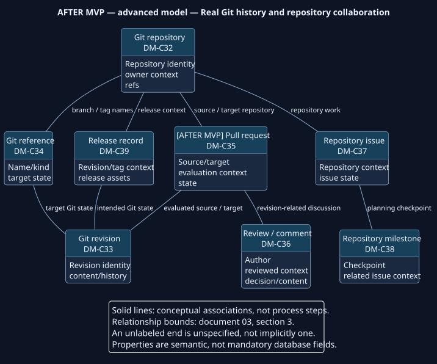

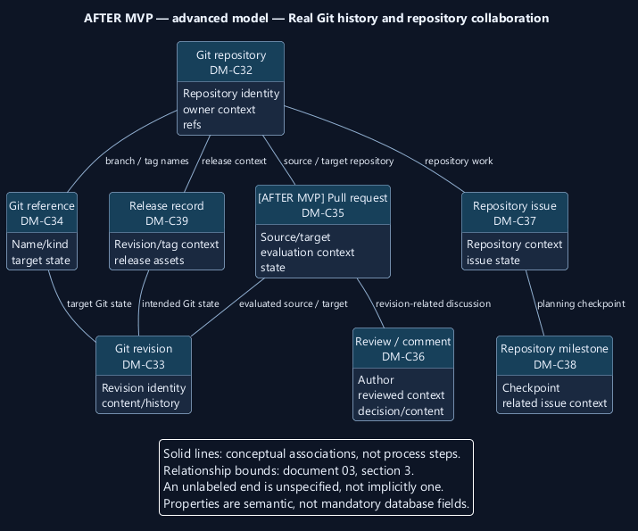 · [Editable PlantUML](Diagrams/Domain-Git-Collaboration.puml)

Repository identity, refs and identified revisions are separated so review, merge and execution cannot rely on an ambiguous moving branch name. A fork is another repository with explicit provenance and authority, not an inherited access grant. Issues/milestones differ from work-project items.

**Primary basis:** [GIT-D01](../02-Requirements-Engineering/01-Software-Requirements-Specification/03-Requirements-Specification/08-Git-Hosting-And-Collaboration.md#requirements-specification-git-hosting-and-collaboration--heading-git-d01-repository-creation-and-ownership), [GIT-D02](../02-Requirements-Engineering/01-Software-Requirements-Specification/03-Requirements-Specification/08-Git-Hosting-And-Collaboration.md#requirements-specification-git-hosting-and-collaboration--heading-git-d02-repository-and-ref-authorization), [GIT-D03](../02-Requirements-Engineering/01-Software-Requirements-Specification/03-Requirements-Specification/08-Git-Hosting-And-Collaboration.md#requirements-specification-git-hosting-and-collaboration--heading-git-d03-real-clone-fetch-pull-and-push), [GIT-D04](../02-Requirements-Engineering/01-Software-Requirements-Specification/03-Requirements-Specification/08-Git-Hosting-And-Collaboration.md#requirements-specification-git-hosting-and-collaboration--heading-git-d04-branches-files-and-history-browsing), [GIT-D05](../02-Requirements-Engineering/01-Software-Requirements-Specification/03-Requirements-Specification/08-Git-Hosting-And-Collaboration.md#requirements-specification-git-hosting-and-collaboration--heading-git-d05-fork-provenance-and-permission-boundaries), [GIT-D06](../02-Requirements-Engineering/01-Software-Requirements-Specification/03-Requirements-Specification/08-Git-Hosting-And-Collaboration.md#requirements-specification-git-hosting-and-collaboration--heading-git-d06-pull-requests-comments-and-review), [GIT-D07](../02-Requirements-Engineering/01-Software-Requirements-Specification/03-Requirements-Specification/08-Git-Hosting-And-Collaboration.md#requirements-specification-git-hosting-and-collaboration--heading-git-d07-controlled-merge-and-conflict-outcomes), [GIT-D08](../02-Requirements-Engineering/01-Software-Requirements-Specification/03-Requirements-Specification/08-Git-Hosting-And-Collaboration.md#requirements-specification-git-hosting-and-collaboration--heading-git-d08-issues-and-milestones), [GIT-D09](../02-Requirements-Engineering/01-Software-Requirements-Specification/03-Requirements-Specification/08-Git-Hosting-And-Collaboration.md#requirements-specification-git-hosting-and-collaboration--heading-git-d09-tags-and-releases).

| Local element | Meaning / responsibility | Conceptual information and domain actions | Exact primary basis |
| --- | --- | --- | --- |
| DM-C32 — Git repository | Real hosted content/history under repository-specific authority. | Repository identity; owner context; refs. Actions: Create; authorize real Git operations. | [GIT-D01](../02-Requirements-Engineering/01-Software-Requirements-Specification/03-Requirements-Specification/08-Git-Hosting-And-Collaboration.md#requirements-specification-git-hosting-and-collaboration--heading-git-d01-repository-creation-and-ownership), [GIT-D02](../02-Requirements-Engineering/01-Software-Requirements-Specification/03-Requirements-Specification/08-Git-Hosting-And-Collaboration.md#requirements-specification-git-hosting-and-collaboration--heading-git-d02-repository-and-ref-authorization), [GIT-D03](../02-Requirements-Engineering/01-Software-Requirements-Specification/03-Requirements-Specification/08-Git-Hosting-And-Collaboration.md#requirements-specification-git-hosting-and-collaboration--heading-git-d03-real-clone-fetch-pull-and-push) |
| DM-C33 — Git revision | Identified repository content/history state used in browsing, review and execution. | Revision identity; content/history. Actions: Identify; compare; browse. | [GIT-D04](../02-Requirements-Engineering/01-Software-Requirements-Specification/03-Requirements-Specification/08-Git-Hosting-And-Collaboration.md#requirements-specification-git-hosting-and-collaboration--heading-git-d04-branches-files-and-history-browsing), [YML-D03](../02-Requirements-Engineering/01-Software-Requirements-Specification/03-Requirements-Specification/19-Yaml-Workflows-And-Cicd.md#requirements-specification-yaml-workflows-and-cicd--heading-yml-d03-run-identity-and-reproducible-context)  **After MVP.** |
| DM-C34 — Git reference | Named branch or tag associated with Git history; ref names differ from identified revisions. | Name/kind; target state. Actions: Create/update under ref authority. | [GIT-D02](../02-Requirements-Engineering/01-Software-Requirements-Specification/03-Requirements-Specification/08-Git-Hosting-And-Collaboration.md#requirements-specification-git-hosting-and-collaboration--heading-git-d02-repository-and-ref-authorization), [GIT-D04](../02-Requirements-Engineering/01-Software-Requirements-Specification/03-Requirements-Specification/08-Git-Hosting-And-Collaboration.md#requirements-specification-git-hosting-and-collaboration--heading-git-d04-branches-files-and-history-browsing), [GIT-D09](../02-Requirements-Engineering/01-Software-Requirements-Specification/03-Requirements-Specification/08-Git-Hosting-And-Collaboration.md#requirements-specification-git-hosting-and-collaboration--heading-git-d09-tags-and-releases)  **Advanced paths after MVP; any retained core/basic path follows the release register.** |
| DM-C35 — Pull request | Proposed integration with explicit source/target repository/ref and evaluated revision context. | Source/target; evaluation context; state. Actions: Open; discuss; request controlled merge. | [GIT-D06](../02-Requirements-Engineering/01-Software-Requirements-Specification/03-Requirements-Specification/08-Git-Hosting-And-Collaboration.md#requirements-specification-git-hosting-and-collaboration--heading-git-d06-pull-requests-comments-and-review), [GIT-D07](../02-Requirements-Engineering/01-Software-Requirements-Specification/03-Requirements-Specification/08-Git-Hosting-And-Collaboration.md#requirements-specification-git-hosting-and-collaboration--heading-git-d07-controlled-merge-and-conflict-outcomes)  **Advanced paths after MVP; any retained core/basic path follows the release register.** |
| DM-C36 — Review / comment | Attributed discussion/review of an intended request/revision, not universal merge permission. | Author; reviewed context; decision/content. Actions: Comment; submit review. | [GIT-D06](../02-Requirements-Engineering/01-Software-Requirements-Specification/03-Requirements-Specification/08-Git-Hosting-And-Collaboration.md#requirements-specification-git-hosting-and-collaboration--heading-git-d06-pull-requests-comments-and-review), [GIT-D07](../02-Requirements-Engineering/01-Software-Requirements-Specification/03-Requirements-Specification/08-Git-Hosting-And-Collaboration.md#requirements-specification-git-hosting-and-collaboration--heading-git-d07-controlled-merge-and-conflict-outcomes)  **Advanced paths after MVP; any retained core/basic path follows the release register.** |
| DM-C37 — Repository issue | Repository work/discussion record distinct from a work-project Backlog Item. | Repository context; issue state. Actions: Record; discuss; update. | [GIT-D08](../02-Requirements-Engineering/01-Software-Requirements-Specification/03-Requirements-Specification/08-Git-Hosting-And-Collaboration.md#requirements-specification-git-hosting-and-collaboration--heading-git-d08-issues-and-milestones) |
| DM-C38 — Repository milestone | Repository planning checkpoint for related issue work. | Checkpoint; related issue context. Actions: Organize repository planning. | [GIT-D08](../02-Requirements-Engineering/01-Software-Requirements-Specification/03-Requirements-Specification/08-Git-Hosting-And-Collaboration.md#requirements-specification-git-hosting-and-collaboration--heading-git-d08-issues-and-milestones) |
| DM-C39 — Release record | Named release tied to intended Git state and protected assets; not deployment authorization. | Revision/tag context; release assets. Actions: Publish/manage under reviewed policy. | [GIT-D09](../02-Requirements-Engineering/01-Software-Requirements-Specification/03-Requirements-Specification/08-Git-Hosting-And-Collaboration.md#requirements-specification-git-hosting-and-collaboration--heading-git-d09-tags-and-releases)  **Advanced paths after MVP; any retained core/basic path follows the release register.** |

**Policy boundary:** Q-D21/Q-D22 retain transport, credential, protection, review and merge proposals. No Git engine, merge strategy or public-visibility policy is selected.

###### 2.6 Workflow execution and separate deployment authority

**After MVP.** Shared operating and recovery controls still apply where relevant.

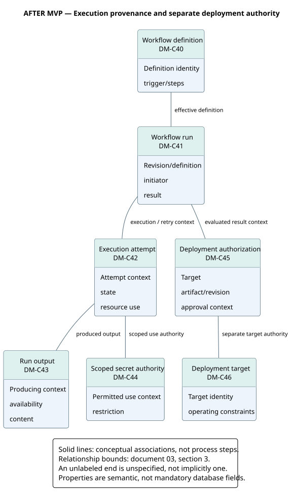

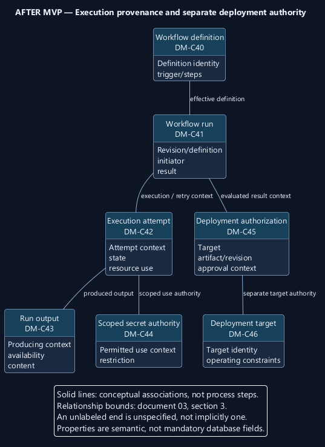 · [Editable PlantUML](Diagrams/Domain-Execution-And-Deployment.puml)

Validation, run request, actual execution, output and deployment approval remain distinct. Run/attempt is a provisional decomposition for retries and unknown outcomes. Deployment approval names target and exact artifact/revision; job code cannot grant itself that authority.

**Primary basis:** [YML-D01](../02-Requirements-Engineering/01-Software-Requirements-Specification/03-Requirements-Specification/19-Yaml-Workflows-And-Cicd.md#requirements-specification-yaml-workflows-and-cicd--heading-yml-d01-defined-supported-workflow-contract), [YML-D02](../02-Requirements-Engineering/01-Software-Requirements-Specification/03-Requirements-Specification/19-Yaml-Workflows-And-Cicd.md#requirements-specification-yaml-workflows-and-cicd--heading-yml-d02-explicit-triggers-and-run-authority), [YML-D03](../02-Requirements-Engineering/01-Software-Requirements-Specification/03-Requirements-Specification/19-Yaml-Workflows-And-Cicd.md#requirements-specification-yaml-workflows-and-cicd--heading-yml-d03-run-identity-and-reproducible-context), [YML-D04](../02-Requirements-Engineering/01-Software-Requirements-Specification/03-Requirements-Specification/19-Yaml-Workflows-And-Cicd.md#requirements-specification-yaml-workflows-and-cicd--heading-yml-d04-isolation-and-untrusted-code-boundary), [YML-D05](../02-Requirements-Engineering/01-Software-Requirements-Specification/03-Requirements-Specification/19-Yaml-Workflows-And-Cicd.md#requirements-specification-yaml-workflows-and-cicd--heading-yml-d05-scoped-secrets-and-credentials), [YML-D06](../02-Requirements-Engineering/01-Software-Requirements-Specification/03-Requirements-Specification/19-Yaml-Workflows-And-Cicd.md#requirements-specification-yaml-workflows-and-cicd--heading-yml-d06-resource-admission-and-limits), [YML-D07](../02-Requirements-Engineering/01-Software-Requirements-Specification/03-Requirements-Specification/19-Yaml-Workflows-And-Cicd.md#requirements-specification-yaml-workflows-and-cicd--heading-yml-d07-truthful-run-and-step-outcomes), [YML-D08](../02-Requirements-Engineering/01-Software-Requirements-Specification/03-Requirements-Specification/19-Yaml-Workflows-And-Cicd.md#requirements-specification-yaml-workflows-and-cicd--heading-yml-d08-restricted-logs-and-artifacts), [YML-D09](../02-Requirements-Engineering/01-Software-Requirements-Specification/03-Requirements-Specification/19-Yaml-Workflows-And-Cicd.md#requirements-specification-yaml-workflows-and-cicd--heading-yml-d09-cancellation-retry-and-runner-loss-recovery), [YML-D10](../02-Requirements-Engineering/01-Software-Requirements-Specification/03-Requirements-Specification/19-Yaml-Workflows-And-Cicd.md#requirements-specification-yaml-workflows-and-cicd--heading-yml-d10-separate-controlled-deployment-stage), [YML-D11](../02-Requirements-Engineering/01-Software-Requirements-Specification/03-Requirements-Specification/19-Yaml-Workflows-And-Cicd.md#requirements-specification-yaml-workflows-and-cicd--heading-yml-d11-workspace-cleanup-and-retained-evidence), [YML-D12](../02-Requirements-Engineering/01-Software-Requirements-Specification/03-Requirements-Specification/19-Yaml-Workflows-And-Cicd.md#requirements-specification-yaml-workflows-and-cicd--heading-yml-d12-feasibility-operational-guidance-and-enabling-gate).

| Local element | Meaning / responsibility | Conceptual information and domain actions | Exact primary basis |
| --- | --- | --- | --- |
| DM-C40 — Workflow definition | Supported YAML behavior at identified definition/code context; validation is not execution. | Definition identity; trigger/steps. Actions: Validate definition; evaluate eligibility. | [YML-D01](../02-Requirements-Engineering/01-Software-Requirements-Specification/03-Requirements-Specification/19-Yaml-Workflows-And-Cicd.md#requirements-specification-yaml-workflows-and-cicd--heading-yml-d01-defined-supported-workflow-contract), [YML-D02](../02-Requirements-Engineering/01-Software-Requirements-Specification/03-Requirements-Specification/19-Yaml-Workflows-And-Cicd.md#requirements-specification-yaml-workflows-and-cicd--heading-yml-d02-explicit-triggers-and-run-authority)  **After MVP.** |
| DM-C41 — Workflow run | Authorized execution request with evaluated code/definition and actual result context. | Revision/definition; initiator; result. Actions: Request; reconcile execution outcome. | [YML-D02](../02-Requirements-Engineering/01-Software-Requirements-Specification/03-Requirements-Specification/19-Yaml-Workflows-And-Cicd.md#requirements-specification-yaml-workflows-and-cicd--heading-yml-d02-explicit-triggers-and-run-authority), [YML-D03](../02-Requirements-Engineering/01-Software-Requirements-Specification/03-Requirements-Specification/19-Yaml-Workflows-And-Cicd.md#requirements-specification-yaml-workflows-and-cicd--heading-yml-d03-run-identity-and-reproducible-context), [YML-D07](../02-Requirements-Engineering/01-Software-Requirements-Specification/03-Requirements-Specification/19-Yaml-Workflows-And-Cicd.md#requirements-specification-yaml-workflows-and-cicd--heading-yml-d07-truthful-run-and-step-outcomes)  **After MVP.** |
| DM-C42 — Execution attempt | Candidate retry/execution distinction so earlier failed/unknown work is not silently rewritten. | Attempt context; state; resource use. Actions: Start; cancel; reconcile; retry explicitly. | [YML-D07](../02-Requirements-Engineering/01-Software-Requirements-Specification/03-Requirements-Specification/19-Yaml-Workflows-And-Cicd.md#requirements-specification-yaml-workflows-and-cicd--heading-yml-d07-truthful-run-and-step-outcomes), [YML-D09](../02-Requirements-Engineering/01-Software-Requirements-Specification/03-Requirements-Specification/19-Yaml-Workflows-And-Cicd.md#requirements-specification-yaml-workflows-and-cicd--heading-yml-d09-cancellation-retry-and-runner-loss-recovery)  **After MVP.** |
| DM-C43 — Run output | Logs/artifacts attributable to a producing execution context with protected access/lifecycle. | Producing context; availability; content. Actions: Expose permitted output; clean eligible data. | [YML-D08](../02-Requirements-Engineering/01-Software-Requirements-Specification/03-Requirements-Specification/19-Yaml-Workflows-And-Cicd.md#requirements-specification-yaml-workflows-and-cicd--heading-yml-d08-restricted-logs-and-artifacts), [YML-D11](../02-Requirements-Engineering/01-Software-Requirements-Specification/03-Requirements-Specification/19-Yaml-Workflows-And-Cicd.md#requirements-specification-yaml-workflows-and-cicd--heading-yml-d11-workspace-cleanup-and-retained-evidence)  **After MVP.** |
| DM-C44 — Scoped secret authority | Permission to use a secret for a specific repository/event/target; no secret values are modeled. | Permitted use context; restriction. Actions: Evaluate use authority; revoke. | [YML-D05](../02-Requirements-Engineering/01-Software-Requirements-Specification/03-Requirements-Specification/19-Yaml-Workflows-And-Cicd.md#requirements-specification-yaml-workflows-and-cicd--heading-yml-d05-scoped-secrets-and-credentials)  **After MVP.** |
| DM-C45 — Deployment authorization | Separate explicit approval for target and exact revision/artifact, not implied by a successful run. | Target; artifact/revision; approval context. Actions: Approve/reject intended deployment. | [YML-D10](../02-Requirements-Engineering/01-Software-Requirements-Specification/03-Requirements-Specification/19-Yaml-Workflows-And-Cicd.md#requirements-specification-yaml-workflows-and-cicd--heading-yml-d10-separate-controlled-deployment-stage)  **After MVP.** |
| DM-C46 — Deployment target | Intended environment whose effects and recovery conditions require review. | Target identity; operating constraints. Actions: Evaluate authorized deployment outcome. | [YML-D10](../02-Requirements-Engineering/01-Software-Requirements-Specification/03-Requirements-Specification/19-Yaml-Workflows-And-Cicd.md#requirements-specification-yaml-workflows-and-cicd--heading-yml-d10-separate-controlled-deployment-stage), [YML-D12](../02-Requirements-Engineering/01-Software-Requirements-Specification/03-Requirements-Specification/19-Yaml-Workflows-And-Cicd.md#requirements-specification-yaml-workflows-and-cicd--heading-yml-d12-feasibility-operational-guidance-and-enabling-gate)  **After MVP.** |

**Policy boundary:** Q-D23 remains evidence-gated. Syntax, limits, job/step detail, run/attempt structure and isolation need review/evidence. Real execution remains in scope but is not enabled or proven by this diagram; no runner is placed on the existing host.

###### 2.7 Shared access, files and recoverable operation

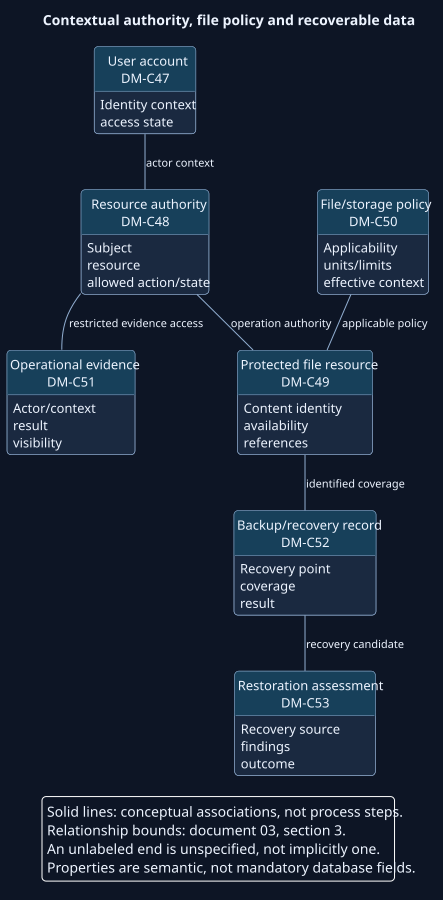

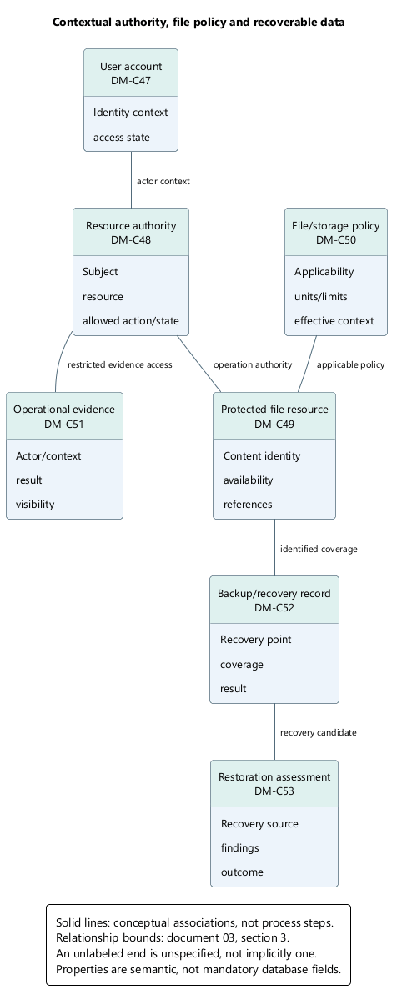 · [Editable PlantUML](Diagrams/Domain-Access-Files-And-Recovery.puml)

Resource authority applies across domain resources; the file edge is an example. Protected file resource is a shared access/reference meaning, not a requirement that Git objects, mail attachments and resume files use one storage engine or quota pool. Recovery records are not public presentation artifacts.

**Primary basis:** [ACC-D01](../02-Requirements-Engineering/01-Software-Requirements-Specification/03-Requirements-Specification/01-Accounts-Authentication-And-Permissions.md#requirements-specification-accounts-authentication-and-permissions--heading-acc-d01-individual-account-context), [ACC-D03](../02-Requirements-Engineering/01-Software-Requirements-Specification/03-Requirements-Specification/01-Accounts-Authentication-And-Permissions.md#requirements-specification-accounts-authentication-and-permissions--heading-acc-d03-resource-and-operation-authorization), [ACC-D05](../02-Requirements-Engineering/01-Software-Requirements-Specification/03-Requirements-Specification/01-Accounts-Authentication-And-Permissions.md#requirements-specification-accounts-authentication-and-permissions--heading-acc-d05-limited-collaboration-authority), [ACC-D09](../02-Requirements-Engineering/01-Software-Requirements-Specification/03-Requirements-Specification/01-Accounts-Authentication-And-Permissions.md#requirements-specification-accounts-authentication-and-permissions--heading-acc-d09-explicit-administrative-powers), [ACC-D10](../02-Requirements-Engineering/01-Software-Requirements-Specification/03-Requirements-Specification/01-Accounts-Authentication-And-Permissions.md#requirements-specification-accounts-authentication-and-permissions--heading-acc-d10-authorization-of-access-grant-changes), [ACC-D12](../02-Requirements-Engineering/01-Software-Requirements-Specification/03-Requirements-Specification/01-Accounts-Authentication-And-Permissions.md#requirements-specification-accounts-authentication-and-permissions--heading-acc-d12-end-of-access-and-lifecycle-enforcement), [AFO-D01](../02-Requirements-Engineering/01-Software-Requirements-Specification/03-Requirements-Specification/02-Administration-Files-And-Operational-Behavior.md#requirements-specification-administration-files-and-operational-behavior--heading-afo-d01-owner-configurable-upload-and-storage-policy), [AFO-D02](../02-Requirements-Engineering/01-Software-Requirements-Specification/03-Requirements-Specification/02-Administration-Files-And-Operational-Behavior.md#requirements-specification-administration-files-and-operational-behavior--heading-afo-d02-policy-consistent-with-evaluated-infrastructure), [AFO-D03](../02-Requirements-Engineering/01-Software-Requirements-Specification/03-Requirements-Specification/02-Administration-Files-And-Operational-Behavior.md#requirements-specification-administration-files-and-operational-behavior--heading-afo-d03-per-file-admission-limit), [AFO-D04](../02-Requirements-Engineering/01-Software-Requirements-Specification/03-Requirements-Specification/02-Administration-Files-And-Operational-Behavior.md#requirements-specification-administration-files-and-operational-behavior--heading-afo-d04-aggregate-quota-and-concurrent-admission), [AFO-D06](../02-Requirements-Engineering/01-Software-Requirements-Specification/03-Requirements-Specification/02-Administration-Files-And-Operational-Behavior.md#requirements-specification-administration-files-and-operational-behavior--heading-afo-d06-file-resource-authorization-and-isolation), [AFO-D10](../02-Requirements-Engineering/01-Software-Requirements-Specification/03-Requirements-Specification/02-Administration-Files-And-Operational-Behavior.md#requirements-specification-administration-files-and-operational-behavior--heading-afo-d10-administrative-operation-evidence), [QSR-D10](../02-Requirements-Engineering/01-Software-Requirements-Specification/03-Requirements-Specification/14-Quality-Security-And-Recovery-Requirements.md#requirements-specification-quality-security-and-recovery-requirements--heading-qsr-d10-defined-protected-and-observable-backups), [QSR-D11](../02-Requirements-Engineering/01-Software-Requirements-Specification/03-Requirements-Specification/14-Quality-Security-And-Recovery-Requirements.md#requirements-specification-quality-security-and-recovery-requirements--heading-qsr-d11-demonstrated-restoration-and-recovery-targets), [QSR-D12](../02-Requirements-Engineering/01-Software-Requirements-Specification/03-Requirements-Specification/14-Quality-Security-And-Recovery-Requirements.md#requirements-specification-quality-security-and-recovery-requirements--heading-qsr-d12-safe-restored-access-and-external-state-reconciliation), [QSR-D13](../02-Requirements-Engineering/01-Software-Requirements-Specification/03-Requirements-Specification/14-Quality-Security-And-Recovery-Requirements.md#requirements-specification-quality-security-and-recovery-requirements--heading-qsr-d13-useful-restricted-operational-evidence).

| Local element | Meaning / responsibility | Conceptual information and domain actions | Exact primary basis |
| --- | --- | --- | --- |
| DM-C47 — User account | Individual application identity and account state; role names do not grant universal access. | Identity context; access state. Actions: Identify actor; apply account lifecycle. | [ACC-D01](../02-Requirements-Engineering/01-Software-Requirements-Specification/03-Requirements-Specification/01-Accounts-Authentication-And-Permissions.md#requirements-specification-accounts-authentication-and-permissions--heading-acc-d01-individual-account-context), [ACC-D02](../02-Requirements-Engineering/01-Software-Requirements-Specification/03-Requirements-Specification/01-Accounts-Authentication-And-Permissions.md#requirements-specification-accounts-authentication-and-permissions--heading-acc-d02-unified-sign-in-across-authorized-sections), [ACC-D12](../02-Requirements-Engineering/01-Software-Requirements-Specification/03-Requirements-Specification/01-Accounts-Authentication-And-Permissions.md#requirements-specification-accounts-authentication-and-permissions--heading-acc-d12-end-of-access-and-lifecycle-enforcement) |
| DM-C48 — Resource authority | Role/permission, invitation or membership meaning for actor/resource/action/state; not an ACL schema. | Subject; resource; allowed action/state. Actions: Evaluate; grant/revoke under authority. | [ACC-D03](../02-Requirements-Engineering/01-Software-Requirements-Specification/03-Requirements-Specification/01-Accounts-Authentication-And-Permissions.md#requirements-specification-accounts-authentication-and-permissions--heading-acc-d03-resource-and-operation-authorization), [ACC-D05](../02-Requirements-Engineering/01-Software-Requirements-Specification/03-Requirements-Specification/01-Accounts-Authentication-And-Permissions.md#requirements-specification-accounts-authentication-and-permissions--heading-acc-d05-limited-collaboration-authority), [ACC-D09](../02-Requirements-Engineering/01-Software-Requirements-Specification/03-Requirements-Specification/01-Accounts-Authentication-And-Permissions.md#requirements-specification-accounts-authentication-and-permissions--heading-acc-d09-explicit-administrative-powers), [ACC-D10](../02-Requirements-Engineering/01-Software-Requirements-Specification/03-Requirements-Specification/01-Accounts-Authentication-And-Permissions.md#requirements-specification-accounts-authentication-and-permissions--heading-acc-d10-authorization-of-access-grant-changes) |
| DM-C49 — Protected file resource | Admitted content identity with its domain access/reference meaning; not a common storage engine. | Content identity; availability; references. Actions: Admit; retrieve; replace; retire. | [AFO-D03](../02-Requirements-Engineering/01-Software-Requirements-Specification/03-Requirements-Specification/02-Administration-Files-And-Operational-Behavior.md#requirements-specification-administration-files-and-operational-behavior--heading-afo-d03-per-file-admission-limit), [AFO-D05](../02-Requirements-Engineering/01-Software-Requirements-Specification/03-Requirements-Specification/02-Administration-Files-And-Operational-Behavior.md#requirements-specification-administration-files-and-operational-behavior--heading-afo-d05-supported-content-and-validation), [AFO-D06](../02-Requirements-Engineering/01-Software-Requirements-Specification/03-Requirements-Specification/02-Administration-Files-And-Operational-Behavior.md#requirements-specification-administration-files-and-operational-behavior--heading-afo-d06-file-resource-authorization-and-isolation), [AFO-D07](../02-Requirements-Engineering/01-Software-Requirements-Specification/03-Requirements-Specification/02-Administration-Files-And-Operational-Behavior.md#requirements-specification-administration-files-and-operational-behavior--heading-afo-d07-truthful-completion-and-interrupted-operation-handling) |
| DM-C50 — File/storage policy | Effective admission/accounting rules within an evaluated resource envelope. | Applicability; units/limits; effective context. Actions: Configure; evaluate policy. | [AFO-D01](../02-Requirements-Engineering/01-Software-Requirements-Specification/03-Requirements-Specification/02-Administration-Files-And-Operational-Behavior.md#requirements-specification-administration-files-and-operational-behavior--heading-afo-d01-owner-configurable-upload-and-storage-policy), [AFO-D02](../02-Requirements-Engineering/01-Software-Requirements-Specification/03-Requirements-Specification/02-Administration-Files-And-Operational-Behavior.md#requirements-specification-administration-files-and-operational-behavior--heading-afo-d02-policy-consistent-with-evaluated-infrastructure), [AFO-D04](../02-Requirements-Engineering/01-Software-Requirements-Specification/03-Requirements-Specification/02-Administration-Files-And-Operational-Behavior.md#requirements-specification-administration-files-and-operational-behavior--heading-afo-d04-aggregate-quota-and-concurrent-admission) |
| DM-C51 — Operational evidence | Restricted evidence of selected sensitive/administrative outcomes, not blanket content logging. | Actor/context; result; visibility. Actions: Record specified evidence; inspect permitted records. | [AFO-D10](../02-Requirements-Engineering/01-Software-Requirements-Specification/03-Requirements-Specification/02-Administration-Files-And-Operational-Behavior.md#requirements-specification-administration-files-and-operational-behavior--heading-afo-d10-administrative-operation-evidence), [QSR-D13](../02-Requirements-Engineering/01-Software-Requirements-Specification/03-Requirements-Specification/14-Quality-Security-And-Recovery-Requirements.md#requirements-specification-quality-security-and-recovery-requirements--heading-qsr-d13-useful-restricted-operational-evidence) |
| DM-C52 — Backup/recovery record | Identity, coverage and access context of recoverable material; existence is not restoration proof. | Recovery point; coverage; result. Actions: Identify coverage; record backup outcome. | [QSR-D10](../02-Requirements-Engineering/01-Software-Requirements-Specification/03-Requirements-Specification/14-Quality-Security-And-Recovery-Requirements.md#requirements-specification-quality-security-and-recovery-requirements--heading-qsr-d10-defined-protected-and-observable-backups) |
| DM-C53 — Restoration assessment | Evaluation of restored integrity, access and external-state reconciliation. | Recovery source; findings; outcome. Actions: Assess recovery; report actual result. | [QSR-D11](../02-Requirements-Engineering/01-Software-Requirements-Specification/03-Requirements-Specification/14-Quality-Security-And-Recovery-Requirements.md#requirements-specification-quality-security-and-recovery-requirements--heading-qsr-d11-demonstrated-restoration-and-recovery-targets), [QSR-D12](../02-Requirements-Engineering/01-Software-Requirements-Specification/03-Requirements-Specification/14-Quality-Security-And-Recovery-Requirements.md#requirements-specification-quality-security-and-recovery-requirements--heading-qsr-d12-safe-restored-access-and-external-state-reconciliation) |

**Policy boundary:** Q-D03–Q-D05 and Q-D24–Q-D27 retain detailed grants, quota applicability, retention and operational proposals. Backups are not configured; a backup record cannot substitute for demonstrated restoration.

##### 3. Named Relationships and Bounds

The answer package supplies usable proposals. Unspecified numeric multiplicity means the model can analyze their consequences without presenting them as accepted decisions. Relationship names below complement the pictures, including deliberate omissions for readability.

| Relationship | Domain meaning | Bounds / unresolved detail | Source and status |
| --- | --- | --- | --- |
| Account — profile — resume | Reusable information supports independent tailored resumes | One profile per account/many resumes is Q-D06's proposal; no accepted account-wide resume maximum | PRP-D01–D04; accepted Q-D07 core controls change |
| Profile — professional entry | Source information includes experience, education, skills and professional projects | Required fields, category structure and per-entry counts remain proposed | PRP-D01/D05; Q-D06 |
| Resume — selection — source entry | Identifies reused information without automatic propagation | Representation and source deletion/removal behavior remain open | PRP-D02/D04; accepted core plus remaining Q-D07 |
| Resume — independent override | Tailoring belongs to its specific resume context | Granularity, reset-to-source and conflict reconciliation remain detailed proposals | PRP-D03/D04; Q-D06/Q-D07 |
| Evidence — entry — resume selection | Supporting competence and disclosure are separate relationships | Several supporting associations, ordering/default selection and removal rules retain proposal status | PRP-D05/D06; Q-D08 |
| Source/resume — language content | Manually maintained English/German information | Which fields vary, completeness and fallback remain proposed; no automatic translation | PRP-D07; Q-D09 |
| Resume — publication | Separate confirmed publication controls the effective presentation | No snapshot implementation, old-revision count or retention period is chosen | PRP-D04; accepted core; PDF-D07/Q-D10 |
| Resume/publication — generated/uploaded PDF | Different provenance and intended content/language | Neither representation is assumed to exist for every resume; generation timing/version counts remain proposed | PDF-D01/D02/D07; Q-D10 |
| Resume — download availability | Generated/uploaded/both/neither modes are in scope | Configuration neither creates a missing artifact nor grants access; absent-language details remain proposed | DEC-025; PDF-D03/D05; Q-D09/Q-D10 |
| Link — intended presentation | Protected access to selected content without a viewer account | Link count/expiry/session/in-flight behavior remains at Q-D05/Q-D11 | PDF-D04/D06 |
| Company — opportunity — application | Organization/role context for manual application work | Reuse, duplicate handling, counts and required fields remain proposed | APP-D01/D02; Q-D12 |
| Application — submission — captured material | Actual history remains independent of live editable content | Repeated submission events, incomplete capture and corrections retain proposal status | APP-D05–D07; accepted preservation boundary |
| Application — message/activity | Explicit links identify relevant permitted records | No automatic grant, ownership transfer, progress transition or sending | APP-D08; EGC-D09; Q-D20  **After MVP.** |
| Provider connection — correspondence/activity | Intended user/account and granted scope govern operations | Connection counts, local/provider field authority, sync and reconnect are proposed details | EGC-D01/D08/D11; Q-D15–Q-D17  **After MVP.** |
| Work project — board/backlog/Sprint | Work organization with distinct views and planning contexts | One Product Backlog/project, board counts and active-Sprint maximum remain proposals | PKS-D01/D03/D07; Q-D18/Q-D19 |
| Board/column — displayed work | A view represents permitted items/tasks and movement semantics | Card representation is not a required entity; state/column mapping remains proposed | PKS-D02/D04; Q-D18 |
| Backlog Item — task | Outcome can be refined into activities | At most one parent item and optional standalone tasks remain proposals, not class inheritance | PKS-D04/D09; Q-D18/Q-D19  **Advanced paths after MVP; any retained core/basic path follows the release register.** |
| Sprint — Sprint Backlog | One coherent goal + selected items + delivery plan | Scope meaning is established; no fixed cadence, mandatory task count or physical composition follows | DEC-021; PKS-D07/D08  **Advanced paths after MVP; any retained core/basic path follows the release register.** |
| Repository — repository (fork) | Another repository retains explicit upstream provenance | Private visibility, lifetime and revocation effects need explicit rules; no inherited authority | GIT-D05; Q-D22  **Advanced paths after MVP; any retained core/basic path follows the release register.** |
| Repository — ref — revision | Names identify history states without equating moving refs to evaluated revisions | Transport, protection, update and concurrency policies remain proposed/design-dependent | GIT-D02–D04/D09; Q-D21/Q-D22 |
| Pull request — source/target — review | Source and target may be in one or different repositories, with evaluated revisions | Review validity/counts and merge strategy remain proposed; no extra reviewer is invented | GIT-D06/D07; Q-D22  **Advanced paths after MVP; any retained core/basic path follows the release register.** |
| Repository issue — work item | Distinct concepts may have intentional links | No automatic equivalence, cross-context deletion or authority follows the association | GIT-D08; PKS-D10; Q-D20  **Advanced paths after MVP; any retained core/basic path follows the release register.** |
| Definition — run — attempt — output | Identify effective code/definition and actual execution/retry outcomes | Attempt decomposition, job/step detail and numerical limits retain Q-D23 status | YML-D03/D07–D09  **After MVP.** |
| Run/result — approval — target | A result can inform a separately authorized deployment | Approval validity/counts/expiry after changed inputs require contracts/design review | YML-D10; Q-D23  **After MVP.** |
| File — policy — references | Admission/access/accounting use applicable policy and live/history references | Git objects, job output, mail attachments and resume media do not automatically share one storage/quota pool | AFO-D02–D08; Q-D24 |
| Recovery record — restoration assessment | Candidate backup and demonstrated consistent recovery differ | Destination, coverage, retention and targets remain evidence-gated; backups not configured | QSR-D10–D12; Q-D26 |

###### Cross-View Links Omitted from Individual Diagrams

Application associates its intended Tailored resume (APP-D02), while Preserved submitted material identifies the actual submitted content or rendition (APP-D06), not an arbitrary current PDF. Workflow run identifies the Repository/Git revision and effective definition (YML-D03). Release assets, run artifacts and submitted documents retain their own content/reference authority. Resource authority applies to resumes, applications, mail, work, repositories, runs, administration and recovery where required; the diagram's file edge is only an example. Fork provenance is the repository self-association described above.

##### 4. Information Authority and Change Impact

| Change / domain operation | Intended effect | Independent information that must survive | Remaining detailed policy |
| --- | --- | --- | --- |
| Edit shared information | Modify profile/source | Existing resumes, published views, overrides and actual submitted material | Source deletion and concurrent reconciliation |
| Preview/apply selected source change | Modify the intended resume through explicit owner choice | Other resumes, independent text and publication until separately confirmed | Field-level conflicts and source-provenance representation |
| Confirm publication | Modify effective selected presentation | Historical actual submissions and unrelated publications | Version retention, unavailable/stale rendition timing |
| Replace evidence/uploaded PDF | Modify a live association under admission rules | Other language/resume contexts and preserved actual material | Failure/retirement/invalidation rules |
| Save PDF availability | Modify intended eligible downloads | Do not disable link merely because settings were saved | Active-session/cache/in-flight retrieval |
| Disable link/change password | Modify the intended access path | Private contexts and unrelated links/grants; already delivered bytes cannot be recalled | Exact subsequent-session/retrieval effects |
| Record/correct actual submission | Identify actual event/material completeness and correction history | Do not substitute current source for captured actual documents | Capture, correction, deletion and retention |
| Link mail/activity to application | Associate intended permitted contexts | Mail/provider authority and application progress remain separate | Sync, deletion and uncertain-send/retry behavior |
| Move work/complete task/end Sprint | Report authorized work change and actual outcome | Card movement/task completion does not alone accept an item or satisfy goal | States, completion authority and carry-over |
| Push/fork/review/merge/release | Report actual repository/ref/review result | Do not implicitly accept work, send mail or deploy | Protection/review policy and client interoperability |
| Run/retry/cancel execution | Identify intended attempt and actual/unknown result | Prior results, unrelated resources and deployment approval | Isolation, side effects, runner loss and capacity fit |
| Change quota/clean material/restore | Apply authorized effective policy/recovery decisions | Required references, actual history, current access and external state | Accounting, eligibility, recovery target/evidence |

##### 5. Candidate Invariants and Concurrency Review

These local analysis obligations support cross-view review. Accepted-core rows reflect the actual owner decision. Other rows derive from scope and proposed requirements; precise detailed contracts retain primary-source status. Review cases are planned, not executed software tests.

| Local invariant | Status / primary basis | Review example |
| --- | --- | --- |
| DM-I01 — No automatic resume/live change from source editing | Accepted core; PRP-D04-AC01 | Edit a source reused in two resumes; neither draft nor live presentation changes automatically |
| DM-I02 — Explicit selected apply preserves overrides and other resumes | Accepted core; PRP-D04-AC01 | Apply to A while preserving independent text and B's content |
| DM-I03 — Apply/save differs from separately confirmed publication | Accepted core; PRP-D04-AC01 | Apply changes; employer view remains unchanged until confirmed publish |
| DM-I04 — Later editing/publication preserves actual submitted documents | Accepted core; PRP-D04-AC01, APP-D06 | Capture actual material, then edit and publish; history stays independent |
| DM-I05 — Evidence existence is not disclosure permission | Source-derived; PRP-D06, PDF-D04/D05 | Request an unselected evidence file via modified direct reference |
| DM-I06 — Download needs authorization, mode/language and actual availability | Source-derived; PDF-D03/D05/D07 | Review four modes against missing, processing and mismatched artifacts |
| DM-I07 — PDF settings do not implicitly disable sharing | Source-derived distinct operations; PDF-D03/D06 | Save settings; separately request disable; inspect independent effects |
| DM-I08 — Identity, membership and links are not universal authority | Source-derived; ACC-D03/D04/D05, EGC-D09 | Attempt unrelated resume, mailbox, repository and output access  **After MVP.** |
| DM-I09 — Provider acceptance, delivery/read and unknown are different facts | Source-derived; EGC-D05/D12, EIF-D08 | Send timeout must not imply delivered or safe automatic resend  **After MVP.** |
| DM-I10 — One coherent Sprint Backlog means goal/items/plan | Accepted scope meaning; DEC-021, PKS-D08 | Compare planning views without inventing a second Sprint Backlog  **Advanced paths after MVP; any retained core/basic path follows the release register.** |
| DM-I11 — Task completion, item acceptance and Sprint outcome differ | Source-derived; PKS-D04/D09 | Complete tasks with unmet item criteria; do not infer accepted outcome  **Advanced paths after MVP; any retained core/basic path follows the release register.** |
| DM-I12 — Ref names, evaluated revisions, review and deploy authority differ | Source-derived; GIT-D06/D07, YML-D03/D10 | Change source/target after review; inspect validity before merge/deploy  **After MVP.** |
| DM-I13 — Valid YAML or push permission is not safe execution authority | Source-derived; YML-D02/D04/D05/D06 | Denied resource/isolation/secret conditions cannot yield authorized execution  **After MVP.** |
| DM-I14 — Cleanup/accounting respect references and actual completion | Source-derived; AFO-D04/D07/D08/D11 | Competing admission/removal must not invent free capacity or destroy required history |
| DM-I15 — Backup identity differs from safe consistent restoration | Source-derived; QSR-D10/D11/D12 | Reconcile access/deletion/external state before claiming successful recovery |

###### Competing Operations for Behavioral Modeling

| Competing actions | Question to resolve | Primary question / downstream views |
| --- | --- | --- |
| Source apply versus override edit | Which preview/input is still current, without lost independent text? | Remaining Q-D07; scenarios/state/contracts |
| Publish versus artifact replacement | Which revision/content is effective and available after failure? | Q-D08/Q-D10; data/state/contracts |
| Link disable/password rotation versus retrieval | Which session/request remains permitted; which bytes already left control? | Q-D05/Q-D11; access/state/rules |
| Actual capture versus edit/correction | Which actual material was captured, and what is incomplete? | Q-D13/Q-D14; history/contracts |
| Provider send/sync versus disconnect/timeout | What is confirmed, uncertain or stale; what can safely be repeated? | Q-D16/Q-D17; interfaces/provider states |
| Item movement/selection versus Sprint end | Which scope/completion/history is authoritative? | Q-D18/Q-D19; work states/contracts |
| Review/merge versus ref updates | Which evaluated source/target/check is still valid? | Q-D21/Q-D22; Git contracts |
| Cancel/retry versus runner loss/deploy | What actually stopped or had effects; what approval remains valid? | Q-D23; execution states/feasibility |
| Admission/cleanup versus policy change/restore | Which policy, usage, references and restored access apply? | Q-D24/Q-D26; operations/data/contracts |

No locking scheme, transaction boundary or automatic conflict winner is chosen here. Continue provisional modeling; resolve the affected behavior before accepting dependent design.

##### 6. Traceability, Remaining Work and Review

| Scope | Principal concepts | Primary basis / diagram |
| --- | --- | --- |
| SCP-01 Accounts/access | User account, Resource authority, Protected employer link | ACC-D01–D12; 2.2/2.7 |
| SCP-02 Profiles/resumes | Profile, Entry, Resume, Selection, Override, Publication | PRP-D01–D04/D08; 2.1/2.2 |
| SCP-03 Supporting evidence | Evidence, Evidence selection, Professional entry | PRP-D05/D06/D09; 2.1 |
| SCP-04 PDFs/languages | Generated/uploaded PDF, Download availability, Language content | PRP-D07, PDF-D01–D03/D07; 2.1/2.2 |
| SCP-05 Protected sharing | Employer link, Publication, PDF availability, Resource authority | PDF-D04–D06, ACC-D06–D08; 2.2/2.7 |
| SCP-06 Applications/history | Company, Opportunity, Application, Letter, Submission, Actual material | APP-D01–D09; 2.3 |
| SCP-07 Mail/calendar | Connection, Message/draft, Activity, Reminder | EGC-D01–D12; 2.3  **After MVP.** |
| SCP-08 Work management | Project, Board/Column, Backlog/Item/Task, Sprint/Backlog | PKS-D01–D11; 2.4 |
| SCP-09 Real Git | Repository, Revision/Ref, PR/Review, Issue/Milestone, Release | GIT-D01–D10; 2.5 |
| SCP-10 Gated real execution | Workflow, Run/Attempt, Output, Secret authority, Deployment/Target | YML-D01–D12; 2.6  **After MVP.** |
| SCP-11 Effective file policy | Protected file, Policy, Authority | AFO-D01–D11; 2.7 |
| SCP-12 Recoverable operation | Evidence, Backup/recovery record, Restoration assessment | AFO-D12, QSR-D10–D14; 2.7 |

Source associations are not proof of complete acceptance-criterion coverage. [Existing criterion locators](../02-Requirements-Engineering/01-Software-Requirements-Specification/06-Validation-And-Traceability/03-Proposed-Criterion-Locatorsjson.md#validation-and-traceability-proposed-criterion-locators) are preserved; exact criterion-to-model coverage belongs in [document 11](05-Analysis-Review-And-Design-Handoff.md#analysis-review-and-design-handoff--11-model-consistency-traceability-and-review). A concept responsibility is not a detailed state or operation contract.

##### 7. Review Position and Explicit Limits

- [x] Populate a full-product source-linked concept/responsibility catalog.

- [x] Provide ten editable UML-style conceptual class diagrams and one package diagram with SVG/PNG exports.

- [x] Incorporate accepted profile/apply/publication/history behavior with actual status.

- [x] Distinguish proposed bounds, derived concepts and implementation decisions.

- [x] Define change impact, invariants and competing-operation review cases.

- [ ] Reconcile exact properties/bounds with the conceptual data view and dictionary refinements.

- [ ] Complete coordinated scenario/state/activity/rule views and operation contracts.

- [ ] Complete exact criterion-level cross-view coverage and owner disposition of the identified model.

- [ ] Obtain provider, safe execution and recovery evidence at their dependent gates.

This model is populated for analysis and review. It does not complete the whole System Analysis phase, accept M-02/M-03, implement the product or prove capacity. They do not prevent logical models; they still constrain dependent feasibility and acceptance. The existing Laravel demo is not implementation evidence for this full scope.

##### 8. Next Views and Maintenance

Use [04 Functions](03-Processes-Scenarios-And-Business-Rules.md#analysis-functional-and-process-analysis--04-function-oriented-view) for transformations/data flows; [05 Data](#analysis-domain-and-information-analysis--05-data-oriented-view) for identity, bounds, required information and provenance. Use [06 Scenarios](03-Processes-Scenarios-And-Business-Rules.md#analysis-behavioral-and-scenario-analysis--06-scenario-based-view), [07 States](03-Processes-Scenarios-And-Business-Rules.md#analysis-behavioral-and-scenario-analysis--07-state-based-view), [08 Activities](03-Processes-Scenarios-And-Business-Rules.md#analysis-functional-and-process-analysis--08-control-flow-based-view), [09 Rules](03-Processes-Scenarios-And-Business-Rules.md#analysis-business-rules-and-operation-contracts--09-rule-based-view) and [10 Contracts](03-Processes-Scenarios-And-Business-Rules.md#analysis-business-rules-and-operation-contracts--10-domain-constraints-and-operation-contracts) for observable operation consequences. [12 Interfaces](04-Interfaces-Security-And-Quality.md#analysis-interfaces-security-and-quality-analysis--12-interfaces-and-external-interactions), [13 Quality/operations](04-Interfaces-Security-And-Quality.md#analysis-interfaces-security-and-quality-analysis--13-security-quality-and-operational-analysis) and [14 Handoff](05-Analysis-Review-And-Design-Handoff.md#analysis-review-and-design-handoff--14-feasibility-dependencies-and-design-handoff) retain their cross-cutting responsibility.

Maintain one primary source for each term, obligation and decision. Synchronize changed meanings across concept tables, diagram sources/exports, relationship bounds and downstream views. The [diagram catalog](Diagrams/Diagram-Catalog.md) lists editable/exported artifacts. No product code, deployment, server configuration, OAuth, backup or execution is changed by this documentation work.

[System Analysis index]() · [System context](01-System-Context-And-Gap-Analysis.md#foundation-02-system-context-and-boundaries) · [Analysis approach](01-System-Context-And-Gap-Analysis.md#foundation-01-analysis-purpose-scope-and-approach)

##### Diagram Types and Reading Guide

Existing class diagrams carry the concept details. Their documented relationship bounds remain authoritative: unspecified ends are not implicitly one. The added detail makes existing file-05 proposed cardinalities visible in UML; do not turn proposals into accepted multiplicities. The package view groups concepts without introducing implementation components.

[domain-package-responsibilities](https://github.com/Farhad-V/Web-Resumefolio/blob/1f2acaa351ac306cb57cbe4fe9742e8bd90720d9/docs/MVP/SDLC/04-system-design/01-software-architecture/diagrams/mvp-system-boundaries.svg)

[Editable source](https://github.com/Farhad-V/Web-Resumefolio/blob/1f2acaa351ac306cb57cbe4fe9742e8bd90720d9/docs/MVP/SDLC/04-system-design/01-software-architecture/diagrams/mvp-system-boundaries.puml) · [View diagram: mvp system boundaries](01-System-Context-And-Gap-Analysis.md#figure-01-mvp-system-boundaries)

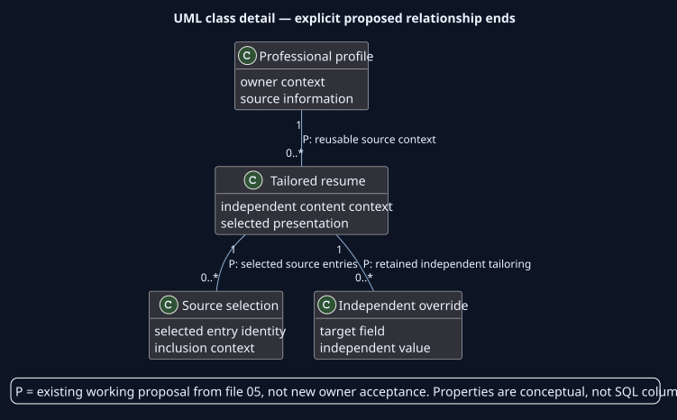

[Editable source](Diagrams/Domain-Proposed-Multiplicity.puml) · 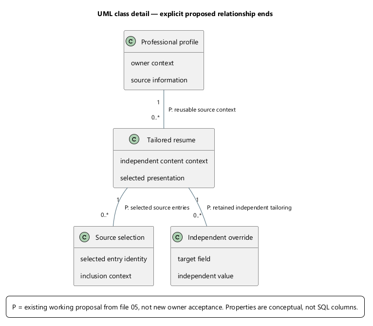

Resumefolio — Data-Oriented View

#### Resumefolio — Data-Oriented View

[Diagram types and reading guide](#analysis-domain-and-information-analysis--05-data-oriented-view--heading-diagram-types-and-reading-guide) · [Full diagram catalog](Diagrams/Diagram-Catalog.md)

Owner: Farhad. Revision: November 1, 2026.

Status: populated full-product conceptual data model. Accepted boundaries, proposed relationship bounds and dependent evidence gates are distinguished. This is not a physical schema or an accepted phase baseline.

**Purpose:** Explain what information must be distinguishable, who supplies or controls it, which relationships make it meaningful, and what must survive change. Document 03 describes domain responsibility; this view develops identity, requiredness, authority, provenance and lifecycle.

Current MVP scope and selected mechanisms: [Baseline](https://github.com/Farhad-V/Web-Resumefolio/blob/1f2acaa351ac306cb57cbe4fe9742e8bd90720d9/docs/MVP/baseline/README.md). Deferred provider, advanced collaboration and workflow-execution designs are not MVP prerequisites.

##### 1. Purpose and Sources

Use the [data dictionary](../02-Requirements-Engineering/01-Software-Requirements-Specification/05-Data-Definitions/02-Data-Dictionary.md#data-definitions-data-dictionary) and [glossary](../02-Requirements-Engineering/01-Software-Requirements-Specification/05-Data-Definitions/03-Requirements-Glossary.md#data-definitions-glossary) as terminology authorities; [document 03](#analysis-domain-and-information-analysis--03-domain-model-and-object-oriented-view) for the concept/responsibility model; [system context](01-System-Context-And-Gap-Analysis.md#foundation-02-system-context-and-boundaries) for boundaries; and [accepted scope](../01-Project-Planning/01-Project-Charter.md#mvp-scope) for all twelve included areas. Exact primary requirement links accompany the catalog and ER views.

The [owner-accepted profile policy](../02-Requirements-Engineering/01-Software-Requirements-Specification/07-Change-And-Baseline/03-Requirements-Questions-And-Decisions.md#change-and-baseline-open-questions-and-decisions--id-owner-accepted-profile-update-policy) is settled: source edits do not automatically change existing resumes or live views; selected application is explicit and preserves independent content; publication is separately confirmed; actual submitted documents remain preserved. Earlier dictionary paragraphs listing generic propagation questions do not reopen these four accepted behaviors. Remaining details retain their status in the [question register](../02-Requirements-Engineering/01-Software-Requirements-Specification/07-Change-And-Baseline/03-Requirements-Questions-And-Decisions.md#change-and-baseline-open-questions-and-decisions) and [answer package](../02-Requirements-Engineering/01-Software-Requirements-Specification/07-Change-And-Baseline/03-Requirements-Questions-And-Decisions.md#change-and-baseline-open-questions-and-decisions).

Local references `DA-Sxx`, `DA-Fxx` and `DA-Ixx` identify this analysis catalog, information exchanges and integrity checks. They do not allocate primary requirements or prescribe implementation names. [Source hashes and mapping evidence](https://github.com/Farhad-V/Web-Resumefolio/blob/1f2acaa351ac306cb57cbe4fe9742e8bd90720d9/docs/MVP/SDLC/03-system-analysis/evidence/data-oriented-review-2026-11-01.json) identify this revision.

##### 2. Conceptual Entity-Relationship Model

###### 2.1 Reading the ER Notation and Proposal Status

| Notation / status | Interpretation |
| --- | --- |
| Entity rectangle | Conceptual information subject, not a mandatory relational table or persisted class |
| Two bars at an association end | Exactly one |
| Circle and bar at an association end | Zero or one |
| Circle and crow-foot at an association end | Zero or many |
| A-labeled association | Established scope meaning: one coherent Sprint Backlog per Sprint |
| P-labeled counts | Explicit working cardinality proposal from the linked answer; not owner acceptance |
| Plain association without endpoint counts | Bounds remain unspecified; absence of symbols does not imply one-to-one |
| Attributes inside an entity | Semantic properties needed for reasoning; no PK/FK, SQL type, index, identifier format or storage engine is selected |

P counts instantiate existing proposals so their consequences can be reviewed. Some zero minima interpret the proposed incomplete-draft or not-yet-executed lifecycle; these are working interpretations, not newly accepted defaults. Each figure explains its boundary. A many-ended relationship permits distinguishable associations; it does not promise unlimited quota, indefinite retention or a fixed row-per-object design.

###### 2.2 source information and independent tailoring

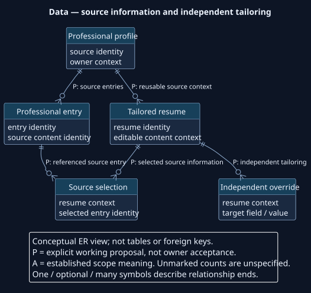

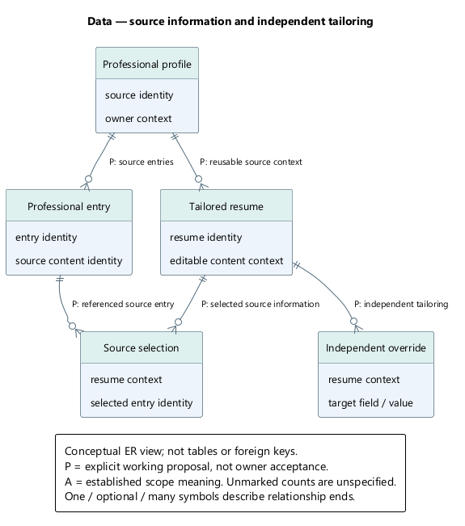 · [Editable PlantUML](Diagrams/Data-Profile-And-Tailoring.puml)

The resume has independent identity and editable content. Source selection describes provenance; it is not permission to read a changed source value automatically. Override values belong to the intended resume. The diagram does not prescribe copying, normalization or event storage.

**Bounds and status:** P uses the Q-D06 single-profile/multiple-resume proposal. Zero selection/override rows allow an incomplete draft in the working model. Entry/selection identity and exact granularity remain proposed. Accepted Q-D07 rules prohibit automatic draft/live changes and protect independent content regardless of representation.

**Primary basis:** [PRP-D01](../02-Requirements-Engineering/01-Software-Requirements-Specification/03-Requirements-Specification/12-Profiles-Resumes-And-Portfolio.md#requirements-specification-profiles-resumes-and-portfolio--heading-prp-d01-reusable-professional-information), [PRP-D02](../02-Requirements-Engineering/01-Software-Requirements-Specification/03-Requirements-Specification/12-Profiles-Resumes-And-Portfolio.md#requirements-specification-profiles-resumes-and-portfolio--heading-prp-d02-opportunity-specific-resume-composition), [PRP-D03](../02-Requirements-Engineering/01-Software-Requirements-Specification/03-Requirements-Specification/12-Profiles-Resumes-And-Portfolio.md#requirements-specification-profiles-resumes-and-portfolio--heading-prp-d03-independent-selections-layouts-and-overrides), [PRP-D04](../02-Requirements-Engineering/01-Software-Requirements-Specification/03-Requirements-Specification/12-Profiles-Resumes-And-Portfolio.md#requirements-specification-profiles-resumes-and-portfolio--heading-prp-d04-explicit-shared-source-update-rules).

###### 2.3 evidence disclosure and language context

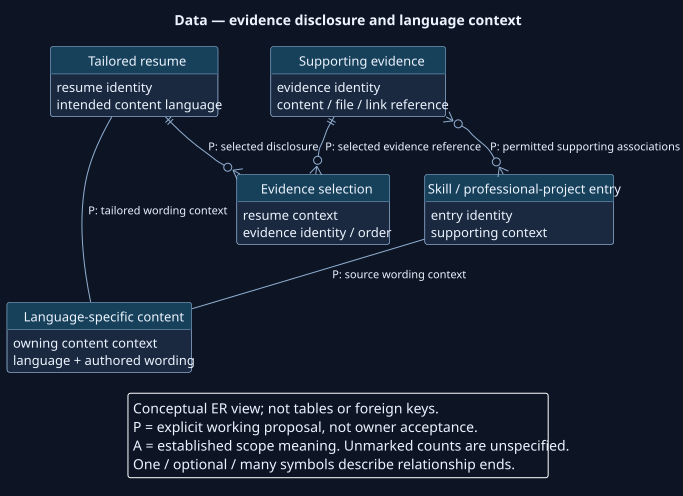

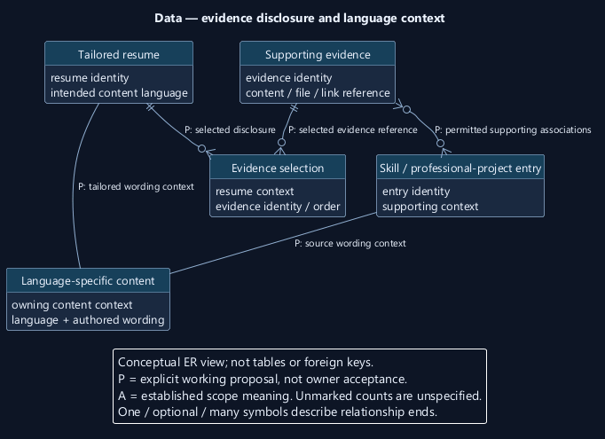 · [Editable PlantUML](Diagrams/Data-Evidence-Language-And-Selection.puml)

Evidence existence, professional association and per-resume disclosure are separate information. Content can be text, a permitted file or a link; no file is mandatory for every evidence item. Each language value belongs to a clearly identified content context rather than a global translation record.

**Bounds and status:** P follows Q-D08/Q-D09. Several supporting associations and per-resume inclusion/order are proposed. Language-owning context is exclusive per value: the two context lines are alternatives, not a requirement to belong to both entry and resume. Their exact counts are intentionally unspecified. Missing wording/artifact is never fabricated.

**Primary basis:** [PRP-D05](../02-Requirements-Engineering/01-Software-Requirements-Specification/03-Requirements-Specification/12-Profiles-Resumes-And-Portfolio.md#requirements-specification-profiles-resumes-and-portfolio--heading-prp-d05-skill-and-project-evidence-management), [PRP-D06](../02-Requirements-Engineering/01-Software-Requirements-Specification/03-Requirements-Specification/12-Profiles-Resumes-And-Portfolio.md#requirements-specification-profiles-resumes-and-portfolio--heading-prp-d06-per-resume-evidence-selection-and-disclosure), [PRP-D07](../02-Requirements-Engineering/01-Software-Requirements-Specification/03-Requirements-Specification/12-Profiles-Resumes-And-Portfolio.md#requirements-specification-profiles-resumes-and-portfolio--heading-prp-d07-manually-maintained-english-and-german-content), [PRP-D09](../02-Requirements-Engineering/01-Software-Requirements-Specification/03-Requirements-Specification/12-Profiles-Resumes-And-Portfolio.md#requirements-specification-profiles-resumes-and-portfolio--heading-prp-d09-safe-content-admission-and-truthful-save-outcomes).

###### 2.4 publication identity, PDF provenance and access

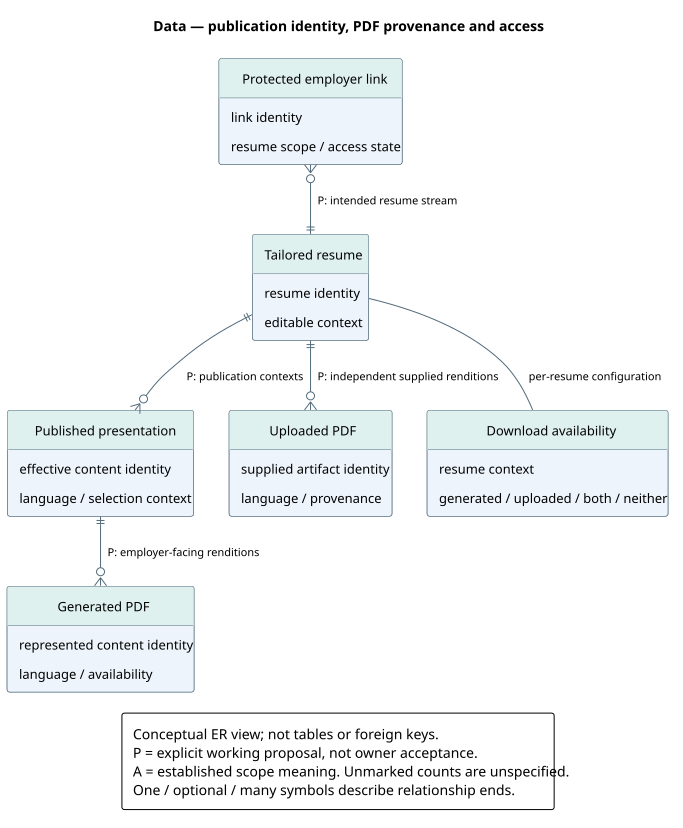

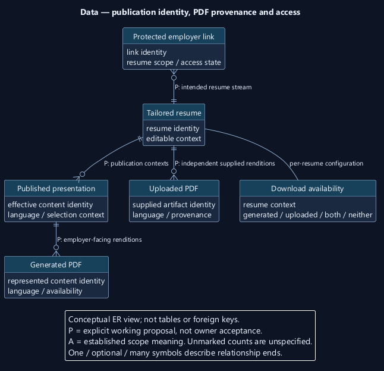 · [Editable PlantUML](Diagrams/Data-Publication-Pdf-And-Sharing.puml)

A link targets the intended resume/published presentation context; it is not hard-pinned to an actual submitted document. Effective publication and language are resolved under reviewed rules at retrieval. Employer-facing generated PDFs identify represented published content. Clearly labeled private draft previews can have separate draft provenance under Q-D10; this picture does not exclude them.

**Bounds and status:** P refines Q-D10/Q-D11. Zero published contexts allow never-published drafts; many denotes distinguishable publication events, not mandatory permanent retention. The diagram does not choose an effective-publication pointer or a universal single current language revision. Link multiplicity, expiry, configuration initialization and historical retention remain proposed. No extra grant follows a configuration or artifact association.

**Primary basis:** [PRP-D04](../02-Requirements-Engineering/01-Software-Requirements-Specification/03-Requirements-Specification/12-Profiles-Resumes-And-Portfolio.md#requirements-specification-profiles-resumes-and-portfolio--heading-prp-d04-explicit-shared-source-update-rules), [PRP-D08](../02-Requirements-Engineering/01-Software-Requirements-Specification/03-Requirements-Specification/12-Profiles-Resumes-And-Portfolio.md#requirements-specification-profiles-resumes-and-portfolio--heading-prp-d08-clear-presentation-and-rendition-boundaries), [PDF-D01](../02-Requirements-Engineering/01-Software-Requirements-Specification/03-Requirements-Specification/11-Pdf-And-Controlled-Sharing.md#requirements-specification-pdf-and-controlled-sharing--heading-pdf-d01-generated-resume-pdf), [PDF-D02](../02-Requirements-Engineering/01-Software-Requirements-Specification/03-Requirements-Specification/11-Pdf-And-Controlled-Sharing.md#requirements-specification-pdf-and-controlled-sharing--heading-pdf-d02-uploaded-pdf-and-language-identity), [PDF-D03](../02-Requirements-Engineering/01-Software-Requirements-Specification/03-Requirements-Specification/11-Pdf-And-Controlled-Sharing.md#requirements-specification-pdf-and-controlled-sharing--heading-pdf-d03-per-resume-download-choices), [PDF-D04](../02-Requirements-Engineering/01-Software-Requirements-Specification/03-Requirements-Specification/11-Pdf-And-Controlled-Sharing.md#requirements-specification-pdf-and-controlled-sharing--heading-pdf-d04-scoped-password-protected-employer-access), [PDF-D05](../02-Requirements-Engineering/01-Software-Requirements-Specification/03-Requirements-Specification/11-Pdf-And-Controlled-Sharing.md#requirements-specification-pdf-and-controlled-sharing--heading-pdf-d05-direct-file-and-pdf-authorization), [PDF-D07](../02-Requirements-Engineering/01-Software-Requirements-Specification/03-Requirements-Specification/11-Pdf-And-Controlled-Sharing.md#requirements-specification-pdf-and-controlled-sharing--heading-pdf-d07-explicit-live-revision-and-rendition-behavior).

###### 2.5 application preparation and actual submission records

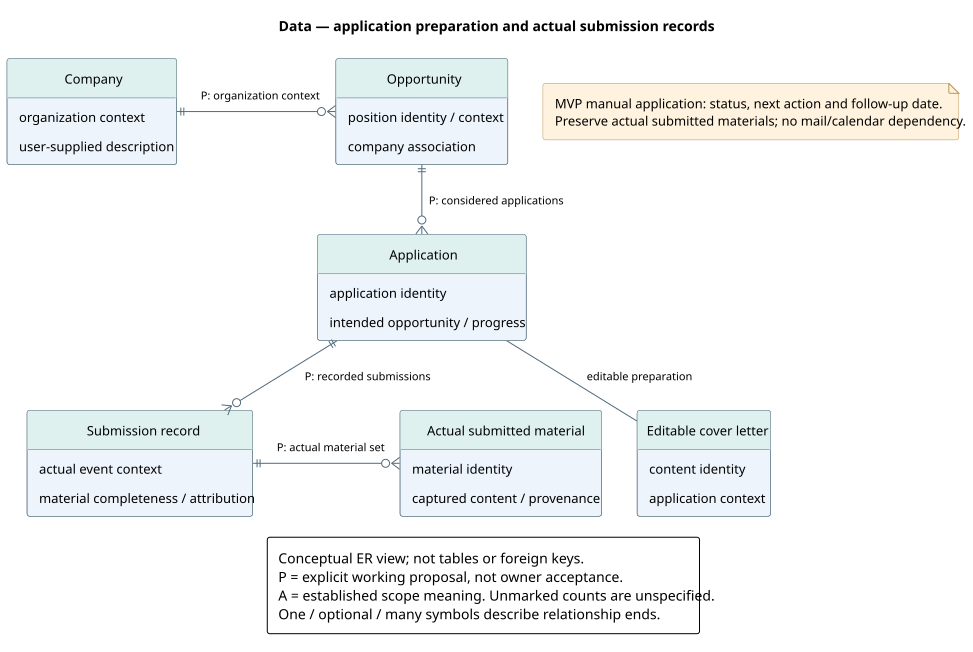

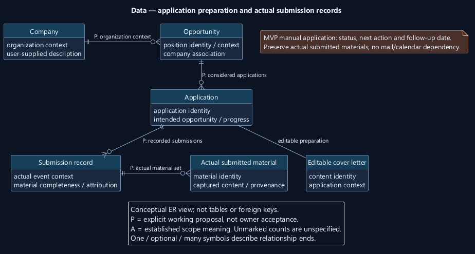 · [Editable PlantUML](Diagrams/Data-Applications-And-Actual-Material.puml)

An application can refer to its intended editable resume/cover letter, but the submitted set identifies actual material. User-recorded submission, complete captured material and external receipt are different claims. Material provenance may be an actual upload or the exact generated rendition confirmed as submitted.

**Bounds and status:** P follows Q-D12–Q-D14. Multiple submission events/corrections are distinguishable; zero captured materials permits an explicitly incomplete record, never a successful preserved-copy claim. Cover-letter identity/count and optional association during drafts remain under primary policy. Captured bytes or exact preserved content cannot later resolve through a mutable current-resume link.

**Primary basis:** [APP-D01](../02-Requirements-Engineering/01-Software-Requirements-Specification/03-Requirements-Specification/09-Manual-Application-Management.md#requirements-specification-manual-application-management--heading-app-d01-company-and-opportunity-context), [APP-D02](../02-Requirements-Engineering/01-Software-Requirements-Specification/03-Requirements-Specification/09-Manual-Application-Management.md#requirements-specification-manual-application-management--heading-app-d02-relevant-resume-association), [APP-D03](../02-Requirements-Engineering/01-Software-Requirements-Specification/03-Requirements-Specification/09-Manual-Application-Management.md#requirements-specification-manual-application-management--heading-app-d03-manually-authored-cover-letter), [APP-D04](../02-Requirements-Engineering/01-Software-Requirements-Specification/03-Requirements-Specification/09-Manual-Application-Management.md#requirements-specification-manual-application-management--heading-app-d04-explicit-progress-states-and-transitions), [APP-D05](../02-Requirements-Engineering/01-Software-Requirements-Specification/03-Requirements-Specification/09-Manual-Application-Management.md#requirements-specification-manual-application-management--heading-app-d05-user-directed-submission-recording), [APP-D06](../02-Requirements-Engineering/01-Software-Requirements-Specification/03-Requirements-Specification/09-Manual-Application-Management.md#requirements-specification-manual-application-management--heading-app-d06-preserved-actual-submitted-copies), [APP-D07](../02-Requirements-Engineering/01-Software-Requirements-Specification/03-Requirements-Specification/09-Manual-Application-Management.md#requirements-specification-manual-application-management--heading-app-d07-correction-and-repeated-submissions), [APP-D09](../02-Requirements-Engineering/01-Software-Requirements-Specification/03-Requirements-Specification/09-Manual-Application-Management.md#requirements-specification-manual-application-management--heading-app-d09-private-access-archive-and-recovery).

###### 2.6 provider identities and local associations

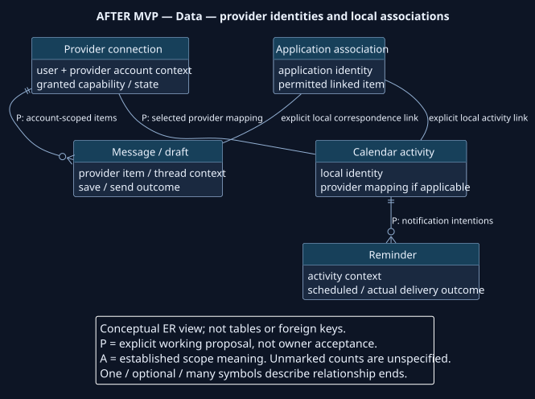

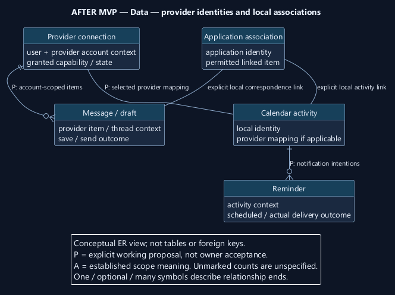 · [Editable PlantUML](Diagrams/Data-Provider-And-Calendar-Context.puml)

Provider item identity is scoped to its intended provider/account/type. Local notes and application associations are not provider-owned fields or access grants. Local-only activities have no invented provider identity. A request outcome may remain unknown after a timeout; absence of confirmation is not proof of a failed external effect.

**Bounds and status:** P follows Q-D15–Q-D17. Selected calendar mapping, local/provider field authority, reconnect and retention rules remain proposed. No one-to-one provider mapping is asserted where not decided. OAuth is not created; no real token, message or provider access is established by this view.

**Primary basis:** [EGC-D01](../02-Requirements-Engineering/01-Software-Requirements-Specification/03-Requirements-Specification/06-Email-Calendar-And-Google-Integration.md#requirements-specification-email-calendar-and-google-integration--heading-egc-d01-authorized-connection-and-account-context), [EGC-D02](../02-Requirements-Engineering/01-Software-Requirements-Specification/03-Requirements-Specification/06-Email-Calendar-And-Google-Integration.md#requirements-specification-email-calendar-and-google-integration--heading-egc-d02-justified-permissions-and-private-resource-isolation), [EGC-D05](../02-Requirements-Engineering/01-Software-Requirements-Specification/03-Requirements-Specification/06-Email-Calendar-And-Google-Integration.md#requirements-specification-email-calendar-and-google-integration--heading-egc-d05-deliberate-send-and-truthful-outcome), [EGC-D07](../02-Requirements-Engineering/01-Software-Requirements-Specification/03-Requirements-Specification/06-Email-Calendar-And-Google-Integration.md#requirements-specification-email-calendar-and-google-integration--heading-egc-d07-calendar-activities-and-time-meaning), [EGC-D08](../02-Requirements-Engineering/01-Software-Requirements-Specification/03-Requirements-Specification/06-Email-Calendar-And-Google-Integration.md#requirements-specification-email-calendar-and-google-integration--heading-egc-d08-explicit-synchronization-contract), [EGC-D09](../02-Requirements-Engineering/01-Software-Requirements-Specification/03-Requirements-Specification/06-Email-Calendar-And-Google-Integration.md#requirements-specification-email-calendar-and-google-integration--heading-egc-d09-application-relationships-preserve-boundaries), [EGC-D10](../02-Requirements-Engineering/01-Software-Requirements-Specification/03-Requirements-Specification/06-Email-Calendar-And-Google-Integration.md#requirements-specification-email-calendar-and-google-integration--heading-egc-d10-reminders-and-notification-outcomes), [EGC-D11](../02-Requirements-Engineering/01-Software-Requirements-Specification/03-Requirements-Specification/06-Email-Calendar-And-Google-Integration.md#requirements-specification-email-calendar-and-google-integration--heading-egc-d11-disconnect-revocation-and-reconnect), [EGC-D12](../02-Requirements-Engineering/01-Software-Requirements-Specification/03-Requirements-Specification/06-Email-Calendar-And-Google-Integration.md#requirements-specification-email-calendar-and-google-integration--heading-egc-d12-bounded-failures-recovery-and-feasibility-evidence).

###### 2.7 work identities and one coherent Sprint Backlog

**After MVP.** Shared operating and recovery controls still apply where relevant.

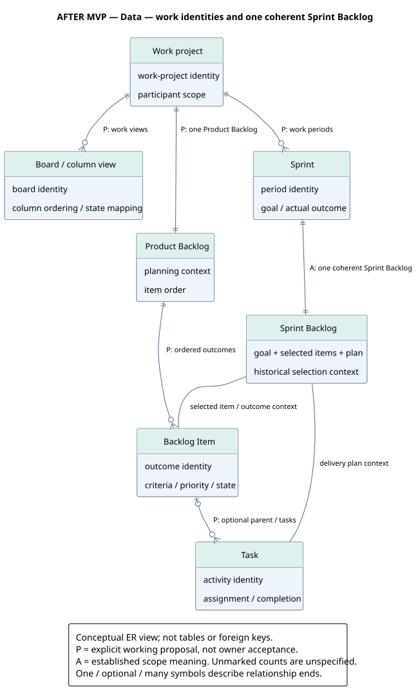

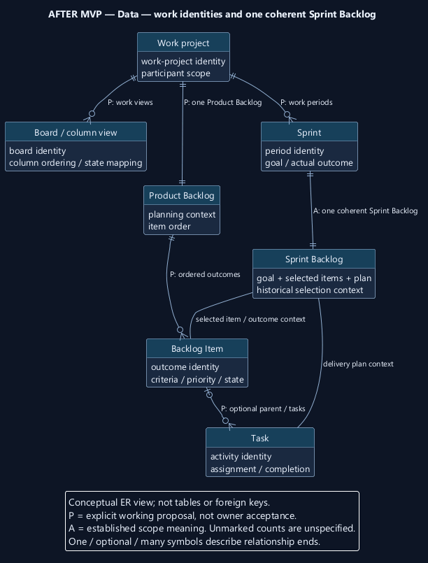 · [Editable PlantUML](Diagrams/Data-Work-And-Sprint-Planning.puml)

Item identity and Sprint selection/history are distinct. Historical selection must not be reconstructed solely from whichever Sprint currently displays the item. A board/column is a view organization; its label does not establish item acceptance. Sprint Goal, selected outcomes and plan comprise one Sprint Backlog, not three competing backlogs.

**Bounds and status:** A preserves DEC-021. P follows Q-D18/Q-D19: one Product Backlog per work project, optional standalone tasks and a single parent item per task. Selection across repeated Sprints is modeled as contextual history, so no unsupported global item-to-Sprint cardinality is drawn. Fixed cadence and active-Sprint count are not accepted here.

**Primary basis:** [PKS-D01](../02-Requirements-Engineering/01-Software-Requirements-Specification/03-Requirements-Specification/13-Projects-Kanban-And-Sprints.md#requirements-specification-projects-kanban-and-sprints--heading-pks-d01-project-and-board-context), [PKS-D02](../02-Requirements-Engineering/01-Software-Requirements-Specification/03-Requirements-Specification/13-Projects-Kanban-And-Sprints.md#requirements-specification-projects-kanban-and-sprints--heading-pks-d02-configurable-columns-and-valid-work-movement), [PKS-D03](../02-Requirements-Engineering/01-Software-Requirements-Specification/03-Requirements-Specification/13-Projects-Kanban-And-Sprints.md#requirements-specification-projects-kanban-and-sprints--heading-pks-d03-product-backlog-and-item-definition), [PKS-D04](../02-Requirements-Engineering/01-Software-Requirements-Specification/03-Requirements-Specification/13-Projects-Kanban-And-Sprints.md#requirements-specification-projects-kanban-and-sprints--heading-pks-d04-item-refinement-and-task-relationships), [PKS-D05](../02-Requirements-Engineering/01-Software-Requirements-Specification/03-Requirements-Specification/13-Projects-Kanban-And-Sprints.md#requirements-specification-projects-kanban-and-sprints--heading-pks-d05-assignment-priority-and-due-date-handling), [PKS-D07](../02-Requirements-Engineering/01-Software-Requirements-Specification/03-Requirements-Specification/13-Projects-Kanban-And-Sprints.md#requirements-specification-projects-kanban-and-sprints--heading-pks-d07-sprint-goal-and-selected-backlog-items), [PKS-D08](../02-Requirements-Engineering/01-Software-Requirements-Specification/03-Requirements-Specification/13-Projects-Kanban-And-Sprints.md#requirements-specification-projects-kanban-and-sprints--heading-pks-d08-one-coherent-sprint-backlog), [PKS-D09](../02-Requirements-Engineering/01-Software-Requirements-Specification/03-Requirements-Specification/13-Projects-Kanban-And-Sprints.md#requirements-specification-projects-kanban-and-sprints--heading-pks-d09-explicit-completion-and-sprint-end-outcomes), [PKS-D10](../02-Requirements-Engineering/01-Software-Requirements-Specification/03-Requirements-Specification/13-Projects-Kanban-And-Sprints.md#requirements-specification-projects-kanban-and-sprints--heading-pks-d10-deliberate-cross-module-links-reports-and-automation).

###### 2.8 repository identity and evaluated Git context

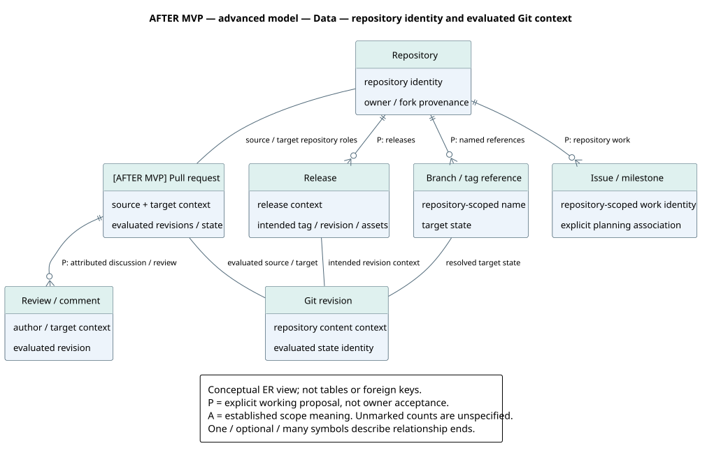

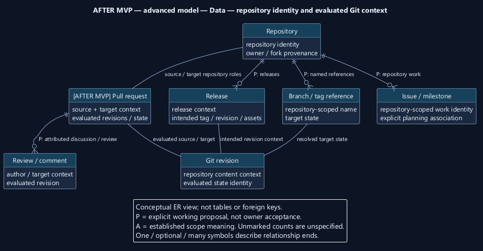 · [Editable PlantUML](Diagrams/Data-Git-Revisions-And-Collaboration.puml)

A ref name and an evaluated content revision are different data. Source and target role names must retain repository and revision context; a name alone cannot identify a reviewed change. Issue/milestone are grouped only to keep this conceptual picture compact; their separate meanings and domain IDs remain in document 03.

**Bounds and status:** P follows Q-D21/Q-D22. Fork is an explicitly related repository, not implicit shared permission. Review validity after a source/target change and release mutation are detailed policy. No Git object schema, engine, transport, revision-string format or physical duplication strategy is selected.

**Primary basis:** [GIT-D01](../02-Requirements-Engineering/01-Software-Requirements-Specification/03-Requirements-Specification/08-Git-Hosting-And-Collaboration.md#requirements-specification-git-hosting-and-collaboration--heading-git-d01-repository-creation-and-ownership), [GIT-D02](../02-Requirements-Engineering/01-Software-Requirements-Specification/03-Requirements-Specification/08-Git-Hosting-And-Collaboration.md#requirements-specification-git-hosting-and-collaboration--heading-git-d02-repository-and-ref-authorization), [GIT-D04](../02-Requirements-Engineering/01-Software-Requirements-Specification/03-Requirements-Specification/08-Git-Hosting-And-Collaboration.md#requirements-specification-git-hosting-and-collaboration--heading-git-d04-branches-files-and-history-browsing), [GIT-D05](../02-Requirements-Engineering/01-Software-Requirements-Specification/03-Requirements-Specification/08-Git-Hosting-And-Collaboration.md#requirements-specification-git-hosting-and-collaboration--heading-git-d05-fork-provenance-and-permission-boundaries), [GIT-D06](../02-Requirements-Engineering/01-Software-Requirements-Specification/03-Requirements-Specification/08-Git-Hosting-And-Collaboration.md#requirements-specification-git-hosting-and-collaboration--heading-git-d06-pull-requests-comments-and-review), [GIT-D07](../02-Requirements-Engineering/01-Software-Requirements-Specification/03-Requirements-Specification/08-Git-Hosting-And-Collaboration.md#requirements-specification-git-hosting-and-collaboration--heading-git-d07-controlled-merge-and-conflict-outcomes), [GIT-D08](../02-Requirements-Engineering/01-Software-Requirements-Specification/03-Requirements-Specification/08-Git-Hosting-And-Collaboration.md#requirements-specification-git-hosting-and-collaboration--heading-git-d08-issues-and-milestones), [GIT-D09](../02-Requirements-Engineering/01-Software-Requirements-Specification/03-Requirements-Specification/08-Git-Hosting-And-Collaboration.md#requirements-specification-git-hosting-and-collaboration--heading-git-d09-tags-and-releases), [GIT-D10](../02-Requirements-Engineering/01-Software-Requirements-Specification/03-Requirements-Specification/08-Git-Hosting-And-Collaboration.md#requirements-specification-git-hosting-and-collaboration--heading-git-d10-lifecycle-capacity-and-recovery).

###### 2.9 run provenance, attempts and deployment approval

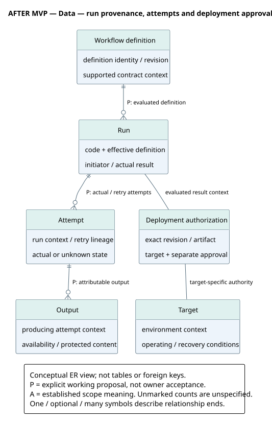

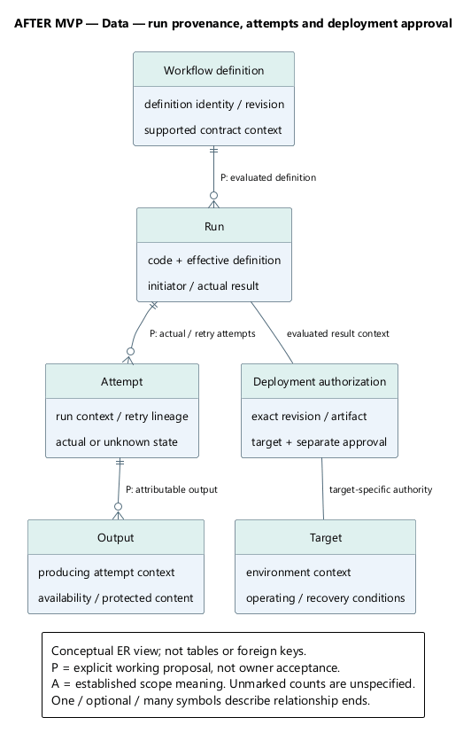 · [Editable PlantUML](Diagrams/Data-Execution-Provenance-And-Targets.puml)

Code revision and definition revision are identified at the evaluated execution context, not by later reading a moving branch. Request, attempt, output availability and external deployment effect remain distinct information. Secret-use scope may be recorded as protected authority metadata; no secret values belong in this document or ordinary logs.

**Bounds and status:** P follows the Q-D23 proposal; a queued request can have no started attempt and an attempt can have no usable output. Retry lineage does not erase earlier unknown outcomes. Exact attempt/job/step decomposition and approval counts remain design/policy work. Isolation and capacity are not established by these relationships.

**Primary basis:** [YML-D01](../02-Requirements-Engineering/01-Software-Requirements-Specification/03-Requirements-Specification/19-Yaml-Workflows-And-Cicd.md#requirements-specification-yaml-workflows-and-cicd--heading-yml-d01-defined-supported-workflow-contract), [YML-D02](../02-Requirements-Engineering/01-Software-Requirements-Specification/03-Requirements-Specification/19-Yaml-Workflows-And-Cicd.md#requirements-specification-yaml-workflows-and-cicd--heading-yml-d02-explicit-triggers-and-run-authority), [YML-D03](../02-Requirements-Engineering/01-Software-Requirements-Specification/03-Requirements-Specification/19-Yaml-Workflows-And-Cicd.md#requirements-specification-yaml-workflows-and-cicd--heading-yml-d03-run-identity-and-reproducible-context), [YML-D05](../02-Requirements-Engineering/01-Software-Requirements-Specification/03-Requirements-Specification/19-Yaml-Workflows-And-Cicd.md#requirements-specification-yaml-workflows-and-cicd--heading-yml-d05-scoped-secrets-and-credentials), [YML-D07](../02-Requirements-Engineering/01-Software-Requirements-Specification/03-Requirements-Specification/19-Yaml-Workflows-And-Cicd.md#requirements-specification-yaml-workflows-and-cicd--heading-yml-d07-truthful-run-and-step-outcomes), [YML-D08](../02-Requirements-Engineering/01-Software-Requirements-Specification/03-Requirements-Specification/19-Yaml-Workflows-And-Cicd.md#requirements-specification-yaml-workflows-and-cicd--heading-yml-d08-restricted-logs-and-artifacts), [YML-D09](../02-Requirements-Engineering/01-Software-Requirements-Specification/03-Requirements-Specification/19-Yaml-Workflows-And-Cicd.md#requirements-specification-yaml-workflows-and-cicd--heading-yml-d09-cancellation-retry-and-runner-loss-recovery), [YML-D10](../02-Requirements-Engineering/01-Software-Requirements-Specification/03-Requirements-Specification/19-Yaml-Workflows-And-Cicd.md#requirements-specification-yaml-workflows-and-cicd--heading-yml-d10-separate-controlled-deployment-stage), [YML-D11](../02-Requirements-Engineering/01-Software-Requirements-Specification/03-Requirements-Specification/19-Yaml-Workflows-And-Cicd.md#requirements-specification-yaml-workflows-and-cicd--heading-yml-d11-workspace-cleanup-and-retained-evidence), [YML-D12](../02-Requirements-Engineering/01-Software-Requirements-Specification/03-Requirements-Specification/19-Yaml-Workflows-And-Cicd.md#requirements-specification-yaml-workflows-and-cicd--heading-yml-d12-feasibility-operational-guidance-and-enabling-gate).

###### 2.10 contextual access, effective policy and recovery coverage

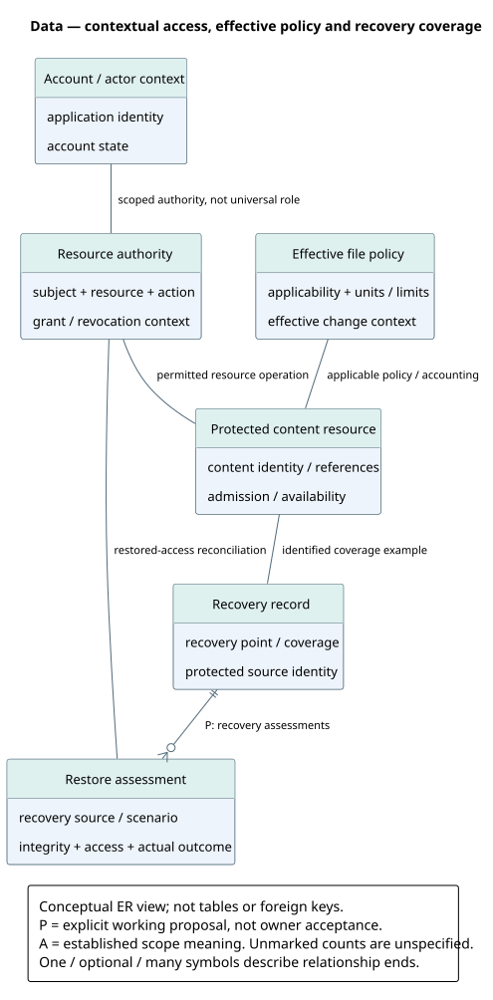

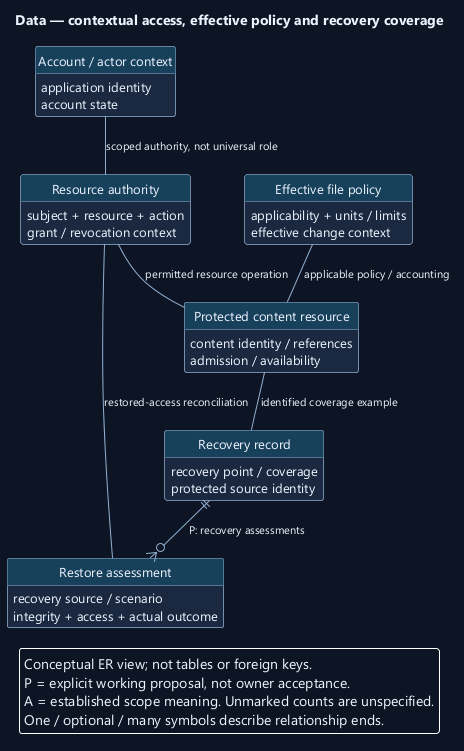 · [Editable PlantUML](Diagrams/Data-Authority-Policy-And-Recovery.puml)

Authority is contextual information rather than a universal owner/admin hierarchy. Protected file/content is a logical meaning; repositories, mail attachments, job outputs and resume media need their own applicability/accounting. Recovery coverage includes related records, repositories, files and required configuration, not only the file example drawn.

**Bounds and status:** P refines Q-D24/Q-D26. No universal grant-count, quota pool, retention duration or backup topology is inferred. A recovery record is not proof of a usable restore; current access/deletion decisions and external-state effects must be reconciled. Backups are not configured.

**Primary basis:** [ACC-D03](../02-Requirements-Engineering/01-Software-Requirements-Specification/03-Requirements-Specification/01-Accounts-Authentication-And-Permissions.md#requirements-specification-accounts-authentication-and-permissions--heading-acc-d03-resource-and-operation-authorization), [ACC-D04](../02-Requirements-Engineering/01-Software-Requirements-Specification/03-Requirements-Specification/01-Accounts-Authentication-And-Permissions.md#requirements-specification-accounts-authentication-and-permissions--heading-acc-d04-cross-user-private-data-isolation), [ACC-D05](../02-Requirements-Engineering/01-Software-Requirements-Specification/03-Requirements-Specification/01-Accounts-Authentication-And-Permissions.md#requirements-specification-accounts-authentication-and-permissions--heading-acc-d05-limited-collaboration-authority), [ACC-D09](../02-Requirements-Engineering/01-Software-Requirements-Specification/03-Requirements-Specification/01-Accounts-Authentication-And-Permissions.md#requirements-specification-accounts-authentication-and-permissions--heading-acc-d09-explicit-administrative-powers), [ACC-D10](../02-Requirements-Engineering/01-Software-Requirements-Specification/03-Requirements-Specification/01-Accounts-Authentication-And-Permissions.md#requirements-specification-accounts-authentication-and-permissions--heading-acc-d10-authorization-of-access-grant-changes), [ACC-D12](../02-Requirements-Engineering/01-Software-Requirements-Specification/03-Requirements-Specification/01-Accounts-Authentication-And-Permissions.md#requirements-specification-accounts-authentication-and-permissions--heading-acc-d12-end-of-access-and-lifecycle-enforcement), [AFO-D01](../02-Requirements-Engineering/01-Software-Requirements-Specification/03-Requirements-Specification/02-Administration-Files-And-Operational-Behavior.md#requirements-specification-administration-files-and-operational-behavior--heading-afo-d01-owner-configurable-upload-and-storage-policy), [AFO-D02](../02-Requirements-Engineering/01-Software-Requirements-Specification/03-Requirements-Specification/02-Administration-Files-And-Operational-Behavior.md#requirements-specification-administration-files-and-operational-behavior--heading-afo-d02-policy-consistent-with-evaluated-infrastructure), [AFO-D04](../02-Requirements-Engineering/01-Software-Requirements-Specification/03-Requirements-Specification/02-Administration-Files-And-Operational-Behavior.md#requirements-specification-administration-files-and-operational-behavior--heading-afo-d04-aggregate-quota-and-concurrent-admission), [AFO-D06](../02-Requirements-Engineering/01-Software-Requirements-Specification/03-Requirements-Specification/02-Administration-Files-And-Operational-Behavior.md#requirements-specification-administration-files-and-operational-behavior--heading-afo-d06-file-resource-authorization-and-isolation), [AFO-D07](../02-Requirements-Engineering/01-Software-Requirements-Specification/03-Requirements-Specification/02-Administration-Files-And-Operational-Behavior.md#requirements-specification-administration-files-and-operational-behavior--heading-afo-d07-truthful-completion-and-interrupted-operation-handling), [AFO-D08](../02-Requirements-Engineering/01-Software-Requirements-Specification/03-Requirements-Specification/02-Administration-Files-And-Operational-Behavior.md#requirements-specification-administration-files-and-operational-behavior--heading-afo-d08-safe-replacement-and-lifecycle-effects), [QSR-D10](../02-Requirements-Engineering/01-Software-Requirements-Specification/03-Requirements-Specification/14-Quality-Security-And-Recovery-Requirements.md#requirements-specification-quality-security-and-recovery-requirements--heading-qsr-d10-defined-protected-and-observable-backups), [QSR-D11](../02-Requirements-Engineering/01-Software-Requirements-Specification/03-Requirements-Specification/14-Quality-Security-And-Recovery-Requirements.md#requirements-specification-quality-security-and-recovery-requirements--heading-qsr-d11-demonstrated-restoration-and-recovery-targets), [QSR-D12](../02-Requirements-Engineering/01-Software-Requirements-Specification/03-Requirements-Specification/14-Quality-Security-And-Recovery-Requirements.md#requirements-specification-quality-security-and-recovery-requirements--heading-qsr-d12-safe-restored-access-and-external-state-reconciliation), [QSR-D13](../02-Requirements-Engineering/01-Software-Requirements-Specification/03-Requirements-Specification/14-Quality-Security-And-Recovery-Requirements.md#requirements-specification-quality-security-and-recovery-requirements--heading-qsr-d13-useful-restricted-operational-evidence).

##### 3. Data Catalogue and Flow Meaning

###### 3.1 Dictionary-to-Domain Reconciliation

All 34 existing dictionary subject keys map to all 53 concepts in document 03. Grouping is deliberate: one dictionary subject can refine into several information subjects, while a domain concept can have contextual representations. This is not a one-class/one-table mapping. Application-progress, for example, refines information carried in application history without requiring a new domain class.

The catalog identifies semantic information, not a mandatory field list. Requiredness and authority depend on the claim/lifecycle in sections 4–6. Dictionary links retain each subject's primary meaning; the local IDs only support navigation within this view.

**Local subject / dictionary authority:** DA-S01 — [User account](../02-Requirements-Engineering/01-Software-Requirements-Specification/05-Data-Definitions/02-Data-Dictionary.md#data-definitions-data-dictionary--id-account)

**Conceptual information and identity context:** Identity context; access state. Subject identity is distinguished from mutable names, revisions and authority under section 4.

**Domain references / exact primary basis:** [DM-C47](#analysis-domain-and-information-analysis--03-domain-model-and-object-oriented-view--id-dm-c47); [ACC-D01](../02-Requirements-Engineering/01-Software-Requirements-Specification/03-Requirements-Specification/01-Accounts-Authentication-And-Permissions.md#requirements-specification-accounts-authentication-and-permissions--heading-acc-d01-individual-account-context), [ACC-D02](../02-Requirements-Engineering/01-Software-Requirements-Specification/03-Requirements-Specification/01-Accounts-Authentication-And-Permissions.md#requirements-specification-accounts-authentication-and-permissions--heading-acc-d02-unified-sign-in-across-authorized-sections), [ACC-D12](../02-Requirements-Engineering/01-Software-Requirements-Specification/03-Requirements-Specification/01-Accounts-Authentication-And-Permissions.md#requirements-specification-accounts-authentication-and-permissions--heading-acc-d12-end-of-access-and-lifecycle-enforcement)

**Local subject / dictionary authority:** DA-S02 — [Role and permission](../02-Requirements-Engineering/01-Software-Requirements-Specification/05-Data-Definitions/02-Data-Dictionary.md#data-definitions-data-dictionary--id-role-permission)

**Conceptual information and identity context:** Subject; resource; allowed action/state. Subject identity is distinguished from mutable names, revisions and authority under section 4.

**Domain references / exact primary basis:** [DM-C48](#analysis-domain-and-information-analysis--03-domain-model-and-object-oriented-view--id-dm-c48); [ACC-D03](../02-Requirements-Engineering/01-Software-Requirements-Specification/03-Requirements-Specification/01-Accounts-Authentication-And-Permissions.md#requirements-specification-accounts-authentication-and-permissions--heading-acc-d03-resource-and-operation-authorization), [ACC-D05](../02-Requirements-Engineering/01-Software-Requirements-Specification/03-Requirements-Specification/01-Accounts-Authentication-And-Permissions.md#requirements-specification-accounts-authentication-and-permissions--heading-acc-d05-limited-collaboration-authority), [ACC-D09](../02-Requirements-Engineering/01-Software-Requirements-Specification/03-Requirements-Specification/01-Accounts-Authentication-And-Permissions.md#requirements-specification-accounts-authentication-and-permissions--heading-acc-d09-explicit-administrative-powers), [ACC-D10](../02-Requirements-Engineering/01-Software-Requirements-Specification/03-Requirements-Specification/01-Accounts-Authentication-And-Permissions.md#requirements-specification-accounts-authentication-and-permissions--heading-acc-d10-authorization-of-access-grant-changes)

**Local subject / dictionary authority:** DA-S03 — [Invitation or membership](../02-Requirements-Engineering/01-Software-Requirements-Specification/05-Data-Definitions/02-Data-Dictionary.md#data-definitions-data-dictionary--id-collaboration-grant)

**Conceptual information and identity context:** Subject; resource; allowed action/state. Subject identity is distinguished from mutable names, revisions and authority under section 4.

**Domain references / exact primary basis:** [DM-C48](#analysis-domain-and-information-analysis--03-domain-model-and-object-oriented-view--id-dm-c48); [ACC-D03](../02-Requirements-Engineering/01-Software-Requirements-Specification/03-Requirements-Specification/01-Accounts-Authentication-And-Permissions.md#requirements-specification-accounts-authentication-and-permissions--heading-acc-d03-resource-and-operation-authorization), [ACC-D05](../02-Requirements-Engineering/01-Software-Requirements-Specification/03-Requirements-Specification/01-Accounts-Authentication-And-Permissions.md#requirements-specification-accounts-authentication-and-permissions--heading-acc-d05-limited-collaboration-authority), [ACC-D09](../02-Requirements-Engineering/01-Software-Requirements-Specification/03-Requirements-Specification/01-Accounts-Authentication-And-Permissions.md#requirements-specification-accounts-authentication-and-permissions--heading-acc-d09-explicit-administrative-powers), [ACC-D10](../02-Requirements-Engineering/01-Software-Requirements-Specification/03-Requirements-Specification/01-Accounts-Authentication-And-Permissions.md#requirements-specification-accounts-authentication-and-permissions--heading-acc-d10-authorization-of-access-grant-changes)

**Local subject / dictionary authority:** DA-S04 — [External account connection](../02-Requirements-Engineering/01-Software-Requirements-Specification/05-Data-Definitions/02-Data-Dictionary.md#data-definitions-data-dictionary--id-provider-connection)

**Conceptual information and identity context:** Provider identity; access state. Subject identity is distinguished from mutable names, revisions and authority under section 4.

**Domain references / exact primary basis:** [DM-C20](#analysis-domain-and-information-analysis--03-domain-model-and-object-oriented-view--id-dm-c20); [EGC-D01](../02-Requirements-Engineering/01-Software-Requirements-Specification/03-Requirements-Specification/06-Email-Calendar-And-Google-Integration.md#requirements-specification-email-calendar-and-google-integration--heading-egc-d01-authorized-connection-and-account-context), [EGC-D02](../02-Requirements-Engineering/01-Software-Requirements-Specification/03-Requirements-Specification/06-Email-Calendar-And-Google-Integration.md#requirements-specification-email-calendar-and-google-integration--heading-egc-d02-justified-permissions-and-private-resource-isolation), [EGC-D11](../02-Requirements-Engineering/01-Software-Requirements-Specification/03-Requirements-Specification/06-Email-Calendar-And-Google-Integration.md#requirements-specification-email-calendar-and-google-integration--heading-egc-d11-disconnect-revocation-and-reconnect)

**Local subject / dictionary authority:** DA-S05 — [Profile](../02-Requirements-Engineering/01-Software-Requirements-Specification/05-Data-Definitions/02-Data-Dictionary.md#data-definitions-data-dictionary--id-professional-profile)

**Conceptual information and identity context:** Professional sections; source context; Category; professional meaning. Subject identity is distinguished from mutable names, revisions and authority under section 4.

**Domain references / exact primary basis:** [DM-C01](#analysis-domain-and-information-analysis--03-domain-model-and-object-oriented-view--id-dm-c01), [DM-C02](#analysis-domain-and-information-analysis--03-domain-model-and-object-oriented-view--id-dm-c02); [PRP-D01](../02-Requirements-Engineering/01-Software-Requirements-Specification/03-Requirements-Specification/12-Profiles-Resumes-And-Portfolio.md#requirements-specification-profiles-resumes-and-portfolio--heading-prp-d01-reusable-professional-information), [PRP-D04](../02-Requirements-Engineering/01-Software-Requirements-Specification/03-Requirements-Specification/12-Profiles-Resumes-And-Portfolio.md#requirements-specification-profiles-resumes-and-portfolio--heading-prp-d04-explicit-shared-source-update-rules), [PRP-D05](../02-Requirements-Engineering/01-Software-Requirements-Specification/03-Requirements-Specification/12-Profiles-Resumes-And-Portfolio.md#requirements-specification-profiles-resumes-and-portfolio--heading-prp-d05-skill-and-project-evidence-management)

**Local subject / dictionary authority:** DA-S06 — [Resume](../02-Requirements-Engineering/01-Software-Requirements-Specification/05-Data-Definitions/02-Data-Dictionary.md#data-definitions-data-dictionary--id-tailored-resume)

**Conceptual information and identity context:** Content selection; layout; tailoring context; Source reference; inclusion/order; Target content; independent value; Effective content/revision context. Subject identity is distinguished from mutable names, revisions and authority under section 4.

**Domain references / exact primary basis:** [DM-C03](#analysis-domain-and-information-analysis--03-domain-model-and-object-oriented-view--id-dm-c03), [DM-C04](#analysis-domain-and-information-analysis--03-domain-model-and-object-oriented-view--id-dm-c04), [DM-C05](#analysis-domain-and-information-analysis--03-domain-model-and-object-oriented-view--id-dm-c05), [DM-C09](#analysis-domain-and-information-analysis--03-domain-model-and-object-oriented-view--id-dm-c09); [PRP-D02](../02-Requirements-Engineering/01-Software-Requirements-Specification/03-Requirements-Specification/12-Profiles-Resumes-And-Portfolio.md#requirements-specification-profiles-resumes-and-portfolio--heading-prp-d02-opportunity-specific-resume-composition), [PRP-D03](../02-Requirements-Engineering/01-Software-Requirements-Specification/03-Requirements-Specification/12-Profiles-Resumes-And-Portfolio.md#requirements-specification-profiles-resumes-and-portfolio--heading-prp-d03-independent-selections-layouts-and-overrides), [PRP-D04](../02-Requirements-Engineering/01-Software-Requirements-Specification/03-Requirements-Specification/12-Profiles-Resumes-And-Portfolio.md#requirements-specification-profiles-resumes-and-portfolio--heading-prp-d04-explicit-shared-source-update-rules), [PRP-D08](../02-Requirements-Engineering/01-Software-Requirements-Specification/03-Requirements-Specification/12-Profiles-Resumes-And-Portfolio.md#requirements-specification-profiles-resumes-and-portfolio--heading-prp-d08-clear-presentation-and-rendition-boundaries), [PDF-D07](../02-Requirements-Engineering/01-Software-Requirements-Specification/03-Requirements-Specification/11-Pdf-And-Controlled-Sharing.md#requirements-specification-pdf-and-controlled-sharing--heading-pdf-d07-explicit-live-revision-and-rendition-behavior)

**Local subject / dictionary authority:** DA-S07 — [Supporting evidence](../02-Requirements-Engineering/01-Software-Requirements-Specification/05-Data-Definitions/02-Data-Dictionary.md#data-definitions-data-dictionary--id-professional-evidence)

**Conceptual information and identity context:** Category; supporting association; content reference; Selected evidence; disclosure intent. Subject identity is distinguished from mutable names, revisions and authority under section 4.

**Domain references / exact primary basis:** [DM-C06](#analysis-domain-and-information-analysis--03-domain-model-and-object-oriented-view--id-dm-c06), [DM-C07](#analysis-domain-and-information-analysis--03-domain-model-and-object-oriented-view--id-dm-c07); [PRP-D05](../02-Requirements-Engineering/01-Software-Requirements-Specification/03-Requirements-Specification/12-Profiles-Resumes-And-Portfolio.md#requirements-specification-profiles-resumes-and-portfolio--heading-prp-d05-skill-and-project-evidence-management), [PRP-D09](../02-Requirements-Engineering/01-Software-Requirements-Specification/03-Requirements-Specification/12-Profiles-Resumes-And-Portfolio.md#requirements-specification-profiles-resumes-and-portfolio--heading-prp-d09-safe-content-admission-and-truthful-save-outcomes), [PRP-D06](../02-Requirements-Engineering/01-Software-Requirements-Specification/03-Requirements-Specification/12-Profiles-Resumes-And-Portfolio.md#requirements-specification-profiles-resumes-and-portfolio--heading-prp-d06-per-resume-evidence-selection-and-disclosure)

**Local subject / dictionary authority:** DA-S08 — [Language-specific content](../02-Requirements-Engineering/01-Software-Requirements-Specification/05-Data-Definitions/02-Data-Dictionary.md#data-definitions-data-dictionary--id-content-language)

**Conceptual information and identity context:** Language; authored text; context. Subject identity is distinguished from mutable names, revisions and authority under section 4.

**Domain references / exact primary basis:** [DM-C08](#analysis-domain-and-information-analysis--03-domain-model-and-object-oriented-view--id-dm-c08); [PRP-D07](../02-Requirements-Engineering/01-Software-Requirements-Specification/03-Requirements-Specification/12-Profiles-Resumes-And-Portfolio.md#requirements-specification-profiles-resumes-and-portfolio--heading-prp-d07-manually-maintained-english-and-german-content)

**Local subject / dictionary authority:** DA-S09 — [Generated resume PDF](../02-Requirements-Engineering/01-Software-Requirements-Specification/05-Data-Definitions/02-Data-Dictionary.md#data-definitions-data-dictionary--id-generated-pdf)

**Conceptual information and identity context:** Represented content; language; availability. Subject identity is distinguished from mutable names, revisions and authority under section 4.

**Domain references / exact primary basis:** [DM-C10](#analysis-domain-and-information-analysis--03-domain-model-and-object-oriented-view--id-dm-c10); [PDF-D01](../02-Requirements-Engineering/01-Software-Requirements-Specification/03-Requirements-Specification/11-Pdf-And-Controlled-Sharing.md#requirements-specification-pdf-and-controlled-sharing--heading-pdf-d01-generated-resume-pdf), [PDF-D07](../02-Requirements-Engineering/01-Software-Requirements-Specification/03-Requirements-Specification/11-Pdf-And-Controlled-Sharing.md#requirements-specification-pdf-and-controlled-sharing--heading-pdf-d07-explicit-live-revision-and-rendition-behavior)

**Local subject / dictionary authority:** DA-S10 — [Uploaded resume PDF](../02-Requirements-Engineering/01-Software-Requirements-Specification/05-Data-Definitions/02-Data-Dictionary.md#data-definitions-data-dictionary--id-uploaded-pdf)

**Conceptual information and identity context:** Artifact identity; language; availability. Subject identity is distinguished from mutable names, revisions and authority under section 4.

**Domain references / exact primary basis:** [DM-C11](#analysis-domain-and-information-analysis--03-domain-model-and-object-oriented-view--id-dm-c11); [PDF-D02](../02-Requirements-Engineering/01-Software-Requirements-Specification/03-Requirements-Specification/11-Pdf-And-Controlled-Sharing.md#requirements-specification-pdf-and-controlled-sharing--heading-pdf-d02-uploaded-pdf-and-language-identity), [PDF-D09](../02-Requirements-Engineering/01-Software-Requirements-Specification/03-Requirements-Specification/11-Pdf-And-Controlled-Sharing.md#requirements-specification-pdf-and-controlled-sharing--heading-pdf-d09-failure-safe-processing-and-content-handling)

**Local subject / dictionary authority:** DA-S11 — [PDF download availability](../02-Requirements-Engineering/01-Software-Requirements-Specification/05-Data-Definitions/02-Data-Dictionary.md#data-definitions-data-dictionary--id-download-choice)

**Conceptual information and identity context:** Mode; language eligibility. Subject identity is distinguished from mutable names, revisions and authority under section 4.

**Domain references / exact primary basis:** [DM-C12](#analysis-domain-and-information-analysis--03-domain-model-and-object-oriented-view--id-dm-c12); [PDF-D03](../02-Requirements-Engineering/01-Software-Requirements-Specification/03-Requirements-Specification/11-Pdf-And-Controlled-Sharing.md#requirements-specification-pdf-and-controlled-sharing--heading-pdf-d03-per-resume-download-choices)

**Local subject / dictionary authority:** DA-S12 — [Protected sharing link](../02-Requirements-Engineering/01-Software-Requirements-Specification/05-Data-Definitions/02-Data-Dictionary.md#data-definitions-data-dictionary--id-employer-link)

**Conceptual information and identity context:** Target context; access state; credential control. Subject identity is distinguished from mutable names, revisions and authority under section 4.

**Domain references / exact primary basis:** [DM-C13](#analysis-domain-and-information-analysis--03-domain-model-and-object-oriented-view--id-dm-c13); [PDF-D04](../02-Requirements-Engineering/01-Software-Requirements-Specification/03-Requirements-Specification/11-Pdf-And-Controlled-Sharing.md#requirements-specification-pdf-and-controlled-sharing--heading-pdf-d04-scoped-password-protected-employer-access), [PDF-D06](../02-Requirements-Engineering/01-Software-Requirements-Specification/03-Requirements-Specification/11-Pdf-And-Controlled-Sharing.md#requirements-specification-pdf-and-controlled-sharing--heading-pdf-d06-owner-password-and-link-controls)

**Local subject / dictionary authority:** DA-S13 — [Company and opportunity](../02-Requirements-Engineering/01-Software-Requirements-Specification/05-Data-Definitions/02-Data-Dictionary.md#data-definitions-data-dictionary--id-company-opportunity)

**Conceptual information and identity context:** Organization context; supplied details; Role context; source/deadline details. Subject identity is distinguished from mutable names, revisions and authority under section 4.

**Domain references / exact primary basis:** [DM-C14](#analysis-domain-and-information-analysis--03-domain-model-and-object-oriented-view--id-dm-c14), [DM-C15](#analysis-domain-and-information-analysis--03-domain-model-and-object-oriented-view--id-dm-c15); [APP-D01](../02-Requirements-Engineering/01-Software-Requirements-Specification/03-Requirements-Specification/09-Manual-Application-Management.md#requirements-specification-manual-application-management--heading-app-d01-company-and-opportunity-context)

**Local subject / dictionary authority:** DA-S14 — [Application](../02-Requirements-Engineering/01-Software-Requirements-Specification/05-Data-Definitions/02-Data-Dictionary.md#data-definitions-data-dictionary--id-application-record)

**Conceptual information and identity context:** Progress; intended material associations. Subject identity is distinguished from mutable names, revisions and authority under section 4.

**Domain references / exact primary basis:** [DM-C16](#analysis-domain-and-information-analysis--03-domain-model-and-object-oriented-view--id-dm-c16); [APP-D02](../02-Requirements-Engineering/01-Software-Requirements-Specification/03-Requirements-Specification/09-Manual-Application-Management.md#requirements-specification-manual-application-management--heading-app-d02-relevant-resume-association), [APP-D04](../02-Requirements-Engineering/01-Software-Requirements-Specification/03-Requirements-Specification/09-Manual-Application-Management.md#requirements-specification-manual-application-management--heading-app-d04-explicit-progress-states-and-transitions), [APP-D05](../02-Requirements-Engineering/01-Software-Requirements-Specification/03-Requirements-Specification/09-Manual-Application-Management.md#requirements-specification-manual-application-management--heading-app-d05-user-directed-submission-recording)

**Local subject / dictionary authority:** DA-S15 — [Cover letter](../02-Requirements-Engineering/01-Software-Requirements-Specification/05-Data-Definitions/02-Data-Dictionary.md#data-definitions-data-dictionary--id-cover-letter)

**Conceptual information and identity context:** Authored text; revision context. Subject identity is distinguished from mutable names, revisions and authority under section 4.

**Domain references / exact primary basis:** [DM-C17](#analysis-domain-and-information-analysis--03-domain-model-and-object-oriented-view--id-dm-c17); [APP-D03](../02-Requirements-Engineering/01-Software-Requirements-Specification/03-Requirements-Specification/09-Manual-Application-Management.md#requirements-specification-manual-application-management--heading-app-d03-manually-authored-cover-letter)

**Local subject / dictionary authority:** DA-S16 — [Submitted copies](../02-Requirements-Engineering/01-Software-Requirements-Specification/05-Data-Definitions/02-Data-Dictionary.md#data-definitions-data-dictionary--id-submitted-materials)

**Conceptual information and identity context:** Actual event context; capture completeness; Actual content/artifact; provenance. Subject identity is distinguished from mutable names, revisions and authority under section 4.

**Domain references / exact primary basis:** [DM-C18](#analysis-domain-and-information-analysis--03-domain-model-and-object-oriented-view--id-dm-c18), [DM-C19](#analysis-domain-and-information-analysis--03-domain-model-and-object-oriented-view--id-dm-c19); [APP-D05](../02-Requirements-Engineering/01-Software-Requirements-Specification/03-Requirements-Specification/09-Manual-Application-Management.md#requirements-specification-manual-application-management--heading-app-d05-user-directed-submission-recording), [APP-D07](../02-Requirements-Engineering/01-Software-Requirements-Specification/03-Requirements-Specification/09-Manual-Application-Management.md#requirements-specification-manual-application-management--heading-app-d07-correction-and-repeated-submissions), [APP-D06](../02-Requirements-Engineering/01-Software-Requirements-Specification/03-Requirements-Specification/09-Manual-Application-Management.md#requirements-specification-manual-application-management--heading-app-d06-preserved-actual-submitted-copies), [PDF-D08](../02-Requirements-Engineering/01-Software-Requirements-Specification/03-Requirements-Specification/11-Pdf-And-Controlled-Sharing.md#requirements-specification-pdf-and-controlled-sharing--heading-pdf-d08-downloaded-copy-and-submission-distinctions)

**Local subject / dictionary authority:** DA-S17 — [Status/history](../02-Requirements-Engineering/01-Software-Requirements-Specification/05-Data-Definitions/02-Data-Dictionary.md#data-definitions-data-dictionary--id-application-progress)

**Conceptual information and identity context:** Progress; intended material associations. Subject identity is distinguished from mutable names, revisions and authority under section 4.

**Domain references / exact primary basis:** [DM-C16](#analysis-domain-and-information-analysis--03-domain-model-and-object-oriented-view--id-dm-c16); [APP-D02](../02-Requirements-Engineering/01-Software-Requirements-Specification/03-Requirements-Specification/09-Manual-Application-Management.md#requirements-specification-manual-application-management--heading-app-d02-relevant-resume-association), [APP-D04](../02-Requirements-Engineering/01-Software-Requirements-Specification/03-Requirements-Specification/09-Manual-Application-Management.md#requirements-specification-manual-application-management--heading-app-d04-explicit-progress-states-and-transitions), [APP-D05](../02-Requirements-Engineering/01-Software-Requirements-Specification/03-Requirements-Specification/09-Manual-Application-Management.md#requirements-specification-manual-application-management--heading-app-d05-user-directed-submission-recording)

**Local subject / dictionary authority:** DA-S18 — [Email](../02-Requirements-Engineering/01-Software-Requirements-Specification/05-Data-Definitions/02-Data-Dictionary.md#data-definitions-data-dictionary--id-email-message)

**Conceptual information and identity context:** Message/thread context; content; outcome. Subject identity is distinguished from mutable names, revisions and authority under section 4.

**Domain references / exact primary basis:** [DM-C21](#analysis-domain-and-information-analysis--03-domain-model-and-object-oriented-view--id-dm-c21); [EGC-D03](../02-Requirements-Engineering/01-Software-Requirements-Specification/03-Requirements-Specification/06-Email-Calendar-And-Google-Integration.md#requirements-specification-email-calendar-and-google-integration--heading-egc-d03-read-authorized-correspondence), [EGC-D04](../02-Requirements-Engineering/01-Software-Requirements-Specification/03-Requirements-Specification/06-Email-Calendar-And-Google-Integration.md#requirements-specification-email-calendar-and-google-integration--heading-egc-d04-manual-compose-and-draft-handling), [EGC-D05](../02-Requirements-Engineering/01-Software-Requirements-Specification/03-Requirements-Specification/06-Email-Calendar-And-Google-Integration.md#requirements-specification-email-calendar-and-google-integration--heading-egc-d05-deliberate-send-and-truthful-outcome), [EGC-D06](../02-Requirements-Engineering/01-Software-Requirements-Specification/03-Requirements-Specification/06-Email-Calendar-And-Google-Integration.md#requirements-specification-email-calendar-and-google-integration--heading-egc-d06-reply-context-and-conversation-association)

**Local subject / dictionary authority:** DA-S19 — [Calendar event](../02-Requirements-Engineering/01-Software-Requirements-Specification/05-Data-Definitions/02-Data-Dictionary.md#data-definitions-data-dictionary--id-calendar-activity)

**Conceptual information and identity context:** Time/zone; provider mapping if applicable. Subject identity is distinguished from mutable names, revisions and authority under section 4.

**Domain references / exact primary basis:** [DM-C22](#analysis-domain-and-information-analysis--03-domain-model-and-object-oriented-view--id-dm-c22); [EGC-D07](../02-Requirements-Engineering/01-Software-Requirements-Specification/03-Requirements-Specification/06-Email-Calendar-And-Google-Integration.md#requirements-specification-email-calendar-and-google-integration--heading-egc-d07-calendar-activities-and-time-meaning), [EGC-D08](../02-Requirements-Engineering/01-Software-Requirements-Specification/03-Requirements-Specification/06-Email-Calendar-And-Google-Integration.md#requirements-specification-email-calendar-and-google-integration--heading-egc-d08-explicit-synchronization-contract)

**Local subject / dictionary authority:** DA-S20 — [Reminder](../02-Requirements-Engineering/01-Software-Requirements-Specification/05-Data-Definitions/02-Data-Dictionary.md#data-definitions-data-dictionary--id-activity-reminder)

**Conceptual information and identity context:** Activity; recipient/time; outcome. Subject identity is distinguished from mutable names, revisions and authority under section 4.

**Domain references / exact primary basis:** [DM-C23](#analysis-domain-and-information-analysis--03-domain-model-and-object-oriented-view--id-dm-c23); [EGC-D10](../02-Requirements-Engineering/01-Software-Requirements-Specification/03-Requirements-Specification/06-Email-Calendar-And-Google-Integration.md#requirements-specification-email-calendar-and-google-integration--heading-egc-d10-reminders-and-notification-outcomes)

**Local subject / dictionary authority:** DA-S21 — [Project, board and column](../02-Requirements-Engineering/01-Software-Requirements-Specification/05-Data-Definitions/02-Data-Dictionary.md#data-definitions-data-dictionary--id-project-board)

**Conceptual information and identity context:** Work identity; participant context; Displayed work; column arrangement; Label/order; state mapping meaning. Subject identity is distinguished from mutable names, revisions and authority under section 4.

**Domain references / exact primary basis:** [DM-C24](#analysis-domain-and-information-analysis--03-domain-model-and-object-oriented-view--id-dm-c24), [DM-C25](#analysis-domain-and-information-analysis--03-domain-model-and-object-oriented-view--id-dm-c25), [DM-C26](#analysis-domain-and-information-analysis--03-domain-model-and-object-oriented-view--id-dm-c26); [PKS-D01](../02-Requirements-Engineering/01-Software-Requirements-Specification/03-Requirements-Specification/13-Projects-Kanban-And-Sprints.md#requirements-specification-projects-kanban-and-sprints--heading-pks-d01-project-and-board-context), [PKS-D06](../02-Requirements-Engineering/01-Software-Requirements-Specification/03-Requirements-Specification/13-Projects-Kanban-And-Sprints.md#requirements-specification-projects-kanban-and-sprints--heading-pks-d06-scoped-collaboration-and-membership-changes), [PKS-D02](../02-Requirements-Engineering/01-Software-Requirements-Specification/03-Requirements-Specification/13-Projects-Kanban-And-Sprints.md#requirements-specification-projects-kanban-and-sprints--heading-pks-d02-configurable-columns-and-valid-work-movement)

**Local subject / dictionary authority:** DA-S22 — [Backlog item](../02-Requirements-Engineering/01-Software-Requirements-Specification/05-Data-Definitions/02-Data-Dictionary.md#data-definitions-data-dictionary--id-backlog-item)

**Conceptual information and identity context:** Item ordering; planning context; Outcome; priority; criteria; state. Subject identity is distinguished from mutable names, revisions and authority under section 4.

**Domain references / exact primary basis:** [DM-C27](#analysis-domain-and-information-analysis--03-domain-model-and-object-oriented-view--id-dm-c27), [DM-C28](#analysis-domain-and-information-analysis--03-domain-model-and-object-oriented-view--id-dm-c28); [PKS-D03](../02-Requirements-Engineering/01-Software-Requirements-Specification/03-Requirements-Specification/13-Projects-Kanban-And-Sprints.md#requirements-specification-projects-kanban-and-sprints--heading-pks-d03-product-backlog-and-item-definition), [PKS-D04](../02-Requirements-Engineering/01-Software-Requirements-Specification/03-Requirements-Specification/13-Projects-Kanban-And-Sprints.md#requirements-specification-projects-kanban-and-sprints--heading-pks-d04-item-refinement-and-task-relationships), [PKS-D09](../02-Requirements-Engineering/01-Software-Requirements-Specification/03-Requirements-Specification/13-Projects-Kanban-And-Sprints.md#requirements-specification-projects-kanban-and-sprints--heading-pks-d09-explicit-completion-and-sprint-end-outcomes)

**Local subject / dictionary authority:** DA-S23 — [Task](../02-Requirements-Engineering/01-Software-Requirements-Specification/05-Data-Definitions/02-Data-Dictionary.md#data-definitions-data-dictionary--id-task)

**Conceptual information and identity context:** Activity; assignment; due/state context. Subject identity is distinguished from mutable names, revisions and authority under section 4.

**Domain references / exact primary basis:** [DM-C29](#analysis-domain-and-information-analysis--03-domain-model-and-object-oriented-view--id-dm-c29); [PKS-D04](../02-Requirements-Engineering/01-Software-Requirements-Specification/03-Requirements-Specification/13-Projects-Kanban-And-Sprints.md#requirements-specification-projects-kanban-and-sprints--heading-pks-d04-item-refinement-and-task-relationships), [PKS-D05](../02-Requirements-Engineering/01-Software-Requirements-Specification/03-Requirements-Specification/13-Projects-Kanban-And-Sprints.md#requirements-specification-projects-kanban-and-sprints--heading-pks-d05-assignment-priority-and-due-date-handling)

**Local subject / dictionary authority:** DA-S24 — [Sprint and Sprint Backlog](../02-Requirements-Engineering/01-Software-Requirements-Specification/05-Data-Definitions/02-Data-Dictionary.md#data-definitions-data-dictionary--id-sprint-plan)

**Conceptual information and identity context:** Period; lifecycle; outcome; Goal + selected items + plan. Subject identity is distinguished from mutable names, revisions and authority under section 4.

**Domain references / exact primary basis:** [DM-C30](#analysis-domain-and-information-analysis--03-domain-model-and-object-oriented-view--id-dm-c30), [DM-C31](#analysis-domain-and-information-analysis--03-domain-model-and-object-oriented-view--id-dm-c31); [PKS-D07](../02-Requirements-Engineering/01-Software-Requirements-Specification/03-Requirements-Specification/13-Projects-Kanban-And-Sprints.md#requirements-specification-projects-kanban-and-sprints--heading-pks-d07-sprint-goal-and-selected-backlog-items), [PKS-D09](../02-Requirements-Engineering/01-Software-Requirements-Specification/03-Requirements-Specification/13-Projects-Kanban-And-Sprints.md#requirements-specification-projects-kanban-and-sprints--heading-pks-d09-explicit-completion-and-sprint-end-outcomes), [PKS-D08](../02-Requirements-Engineering/01-Software-Requirements-Specification/03-Requirements-Specification/13-Projects-Kanban-And-Sprints.md#requirements-specification-projects-kanban-and-sprints--heading-pks-d08-one-coherent-sprint-backlog)

**Local subject / dictionary authority:** DA-S25 — [Repository](../02-Requirements-Engineering/01-Software-Requirements-Specification/05-Data-Definitions/02-Data-Dictionary.md#data-definitions-data-dictionary--id-git-repository)

**Conceptual information and identity context:** Repository identity; owner context; refs. Subject identity is distinguished from mutable names, revisions and authority under section 4.

**Domain references / exact primary basis:** [DM-C32](#analysis-domain-and-information-analysis--03-domain-model-and-object-oriented-view--id-dm-c32); [GIT-D01](../02-Requirements-Engineering/01-Software-Requirements-Specification/03-Requirements-Specification/08-Git-Hosting-And-Collaboration.md#requirements-specification-git-hosting-and-collaboration--heading-git-d01-repository-creation-and-ownership), [GIT-D02](../02-Requirements-Engineering/01-Software-Requirements-Specification/03-Requirements-Specification/08-Git-Hosting-And-Collaboration.md#requirements-specification-git-hosting-and-collaboration--heading-git-d02-repository-and-ref-authorization), [GIT-D03](../02-Requirements-Engineering/01-Software-Requirements-Specification/03-Requirements-Specification/08-Git-Hosting-And-Collaboration.md#requirements-specification-git-hosting-and-collaboration--heading-git-d03-real-clone-fetch-pull-and-push)

**Local subject / dictionary authority:** DA-S26 — [Branch and tag](../02-Requirements-Engineering/01-Software-Requirements-Specification/05-Data-Definitions/02-Data-Dictionary.md#data-definitions-data-dictionary--id-git-reference)

**Conceptual information and identity context:** Name/kind; target state; Revision identity; content/history. Subject identity is distinguished from mutable names, revisions and authority under section 4.

**Domain references / exact primary basis:** [DM-C34](#analysis-domain-and-information-analysis--03-domain-model-and-object-oriented-view--id-dm-c34), [DM-C33](#analysis-domain-and-information-analysis--03-domain-model-and-object-oriented-view--id-dm-c33); [GIT-D02](../02-Requirements-Engineering/01-Software-Requirements-Specification/03-Requirements-Specification/08-Git-Hosting-And-Collaboration.md#requirements-specification-git-hosting-and-collaboration--heading-git-d02-repository-and-ref-authorization), [GIT-D04](../02-Requirements-Engineering/01-Software-Requirements-Specification/03-Requirements-Specification/08-Git-Hosting-And-Collaboration.md#requirements-specification-git-hosting-and-collaboration--heading-git-d04-branches-files-and-history-browsing), [GIT-D09](../02-Requirements-Engineering/01-Software-Requirements-Specification/03-Requirements-Specification/08-Git-Hosting-And-Collaboration.md#requirements-specification-git-hosting-and-collaboration--heading-git-d09-tags-and-releases), [YML-D03](../02-Requirements-Engineering/01-Software-Requirements-Specification/03-Requirements-Specification/19-Yaml-Workflows-And-Cicd.md#requirements-specification-yaml-workflows-and-cicd--heading-yml-d03-run-identity-and-reproducible-context)

**Local subject / dictionary authority:** DA-S27 — [Pull request/review](../02-Requirements-Engineering/01-Software-Requirements-Specification/05-Data-Definitions/02-Data-Dictionary.md#data-definitions-data-dictionary--id-pull-request)

**Conceptual information and identity context:** Source/target; evaluation context; state; Author; reviewed context; decision/content. Subject identity is distinguished from mutable names, revisions and authority under section 4.

**Domain references / exact primary basis:** [DM-C35](#analysis-domain-and-information-analysis--03-domain-model-and-object-oriented-view--id-dm-c35), [DM-C36](#analysis-domain-and-information-analysis--03-domain-model-and-object-oriented-view--id-dm-c36); [GIT-D06](../02-Requirements-Engineering/01-Software-Requirements-Specification/03-Requirements-Specification/08-Git-Hosting-And-Collaboration.md#requirements-specification-git-hosting-and-collaboration--heading-git-d06-pull-requests-comments-and-review), [GIT-D07](../02-Requirements-Engineering/01-Software-Requirements-Specification/03-Requirements-Specification/08-Git-Hosting-And-Collaboration.md#requirements-specification-git-hosting-and-collaboration--heading-git-d07-controlled-merge-and-conflict-outcomes)

**Local subject / dictionary authority:** DA-S28 — [Issue and milestone](../02-Requirements-Engineering/01-Software-Requirements-Specification/05-Data-Definitions/02-Data-Dictionary.md#data-definitions-data-dictionary--id-repository-planning)

**Conceptual information and identity context:** Repository context; issue state; Checkpoint; related issue context. Subject identity is distinguished from mutable names, revisions and authority under section 4.

**Domain references / exact primary basis:** [DM-C37](#analysis-domain-and-information-analysis--03-domain-model-and-object-oriented-view--id-dm-c37), [DM-C38](#analysis-domain-and-information-analysis--03-domain-model-and-object-oriented-view--id-dm-c38); [GIT-D08](../02-Requirements-Engineering/01-Software-Requirements-Specification/03-Requirements-Specification/08-Git-Hosting-And-Collaboration.md#requirements-specification-git-hosting-and-collaboration--heading-git-d08-issues-and-milestones)

**Local subject / dictionary authority:** DA-S29 — [Repository release](../02-Requirements-Engineering/01-Software-Requirements-Specification/05-Data-Definitions/02-Data-Dictionary.md#data-definitions-data-dictionary--id-release-record)

**Conceptual information and identity context:** Revision/tag context; release assets. Subject identity is distinguished from mutable names, revisions and authority under section 4.

**Domain references / exact primary basis:** [DM-C39](#analysis-domain-and-information-analysis--03-domain-model-and-object-oriented-view--id-dm-c39); [GIT-D09](../02-Requirements-Engineering/01-Software-Requirements-Specification/03-Requirements-Specification/08-Git-Hosting-And-Collaboration.md#requirements-specification-git-hosting-and-collaboration--heading-git-d09-tags-and-releases)

**Local subject / dictionary authority:** DA-S30 — [YAML workflow](../02-Requirements-Engineering/01-Software-Requirements-Specification/05-Data-Definitions/02-Data-Dictionary.md#data-definitions-data-dictionary--id-workflow-definition)

**Conceptual information and identity context:** Definition identity; trigger/steps. Subject identity is distinguished from mutable names, revisions and authority under section 4.

**Domain references / exact primary basis:** [DM-C40](#analysis-domain-and-information-analysis--03-domain-model-and-object-oriented-view--id-dm-c40); [YML-D01](../02-Requirements-Engineering/01-Software-Requirements-Specification/03-Requirements-Specification/19-Yaml-Workflows-And-Cicd.md#requirements-specification-yaml-workflows-and-cicd--heading-yml-d01-defined-supported-workflow-contract), [YML-D02](../02-Requirements-Engineering/01-Software-Requirements-Specification/03-Requirements-Specification/19-Yaml-Workflows-And-Cicd.md#requirements-specification-yaml-workflows-and-cicd--heading-yml-d02-explicit-triggers-and-run-authority)

**Local subject / dictionary authority:** DA-S31 — [Run, result and outputs](../02-Requirements-Engineering/01-Software-Requirements-Specification/05-Data-Definitions/02-Data-Dictionary.md#data-definitions-data-dictionary--id-workflow-run)

**Conceptual information and identity context:** Revision/definition; initiator; result; Attempt context; state; resource use; Producing context; availability; content; Permitted use context; restriction; Target; artifact/revision; approval context; Target identity; operating constraints. Subject identity is distinguished from mutable names, revisions and authority under section 4.

**Domain references / exact primary basis:** [DM-C41](#analysis-domain-and-information-analysis--03-domain-model-and-object-oriented-view--id-dm-c41), [DM-C42](#analysis-domain-and-information-analysis--03-domain-model-and-object-oriented-view--id-dm-c42), [DM-C43](#analysis-domain-and-information-analysis--03-domain-model-and-object-oriented-view--id-dm-c43), [DM-C44](#analysis-domain-and-information-analysis--03-domain-model-and-object-oriented-view--id-dm-c44), [DM-C45](#analysis-domain-and-information-analysis--03-domain-model-and-object-oriented-view--id-dm-c45), [DM-C46](#analysis-domain-and-information-analysis--03-domain-model-and-object-oriented-view--id-dm-c46); [YML-D02](../02-Requirements-Engineering/01-Software-Requirements-Specification/03-Requirements-Specification/19-Yaml-Workflows-And-Cicd.md#requirements-specification-yaml-workflows-and-cicd--heading-yml-d02-explicit-triggers-and-run-authority), [YML-D03](../02-Requirements-Engineering/01-Software-Requirements-Specification/03-Requirements-Specification/19-Yaml-Workflows-And-Cicd.md#requirements-specification-yaml-workflows-and-cicd--heading-yml-d03-run-identity-and-reproducible-context), [YML-D07](../02-Requirements-Engineering/01-Software-Requirements-Specification/03-Requirements-Specification/19-Yaml-Workflows-And-Cicd.md#requirements-specification-yaml-workflows-and-cicd--heading-yml-d07-truthful-run-and-step-outcomes), [YML-D09](../02-Requirements-Engineering/01-Software-Requirements-Specification/03-Requirements-Specification/19-Yaml-Workflows-And-Cicd.md#requirements-specification-yaml-workflows-and-cicd--heading-yml-d09-cancellation-retry-and-runner-loss-recovery), [YML-D08](../02-Requirements-Engineering/01-Software-Requirements-Specification/03-Requirements-Specification/19-Yaml-Workflows-And-Cicd.md#requirements-specification-yaml-workflows-and-cicd--heading-yml-d08-restricted-logs-and-artifacts), [YML-D11](../02-Requirements-Engineering/01-Software-Requirements-Specification/03-Requirements-Specification/19-Yaml-Workflows-And-Cicd.md#requirements-specification-yaml-workflows-and-cicd--heading-yml-d11-workspace-cleanup-and-retained-evidence), [YML-D05](../02-Requirements-Engineering/01-Software-Requirements-Specification/03-Requirements-Specification/19-Yaml-Workflows-And-Cicd.md#requirements-specification-yaml-workflows-and-cicd--heading-yml-d05-scoped-secrets-and-credentials), [YML-D10](../02-Requirements-Engineering/01-Software-Requirements-Specification/03-Requirements-Specification/19-Yaml-Workflows-And-Cicd.md#requirements-specification-yaml-workflows-and-cicd--heading-yml-d10-separate-controlled-deployment-stage), [YML-D12](../02-Requirements-Engineering/01-Software-Requirements-Specification/03-Requirements-Specification/19-Yaml-Workflows-And-Cicd.md#requirements-specification-yaml-workflows-and-cicd--heading-yml-d12-feasibility-operational-guidance-and-enabling-gate)

**Local subject / dictionary authority:** DA-S32 — [Upload/storage policy](../02-Requirements-Engineering/01-Software-Requirements-Specification/05-Data-Definitions/02-Data-Dictionary.md#data-definitions-data-dictionary--id-file-policy)

**Conceptual information and identity context:** Applicability; units/limits; effective context; Content identity; availability; references. Subject identity is distinguished from mutable names, revisions and authority under section 4.

**Domain references / exact primary basis:** [DM-C50](#analysis-domain-and-information-analysis--03-domain-model-and-object-oriented-view--id-dm-c50), [DM-C49](#analysis-domain-and-information-analysis--03-domain-model-and-object-oriented-view--id-dm-c49); [AFO-D01](../02-Requirements-Engineering/01-Software-Requirements-Specification/03-Requirements-Specification/02-Administration-Files-And-Operational-Behavior.md#requirements-specification-administration-files-and-operational-behavior--heading-afo-d01-owner-configurable-upload-and-storage-policy), [AFO-D02](../02-Requirements-Engineering/01-Software-Requirements-Specification/03-Requirements-Specification/02-Administration-Files-And-Operational-Behavior.md#requirements-specification-administration-files-and-operational-behavior--heading-afo-d02-policy-consistent-with-evaluated-infrastructure), [AFO-D04](../02-Requirements-Engineering/01-Software-Requirements-Specification/03-Requirements-Specification/02-Administration-Files-And-Operational-Behavior.md#requirements-specification-administration-files-and-operational-behavior--heading-afo-d04-aggregate-quota-and-concurrent-admission), [AFO-D03](../02-Requirements-Engineering/01-Software-Requirements-Specification/03-Requirements-Specification/02-Administration-Files-And-Operational-Behavior.md#requirements-specification-administration-files-and-operational-behavior--heading-afo-d03-per-file-admission-limit), [AFO-D05](../02-Requirements-Engineering/01-Software-Requirements-Specification/03-Requirements-Specification/02-Administration-Files-And-Operational-Behavior.md#requirements-specification-administration-files-and-operational-behavior--heading-afo-d05-supported-content-and-validation), [AFO-D06](../02-Requirements-Engineering/01-Software-Requirements-Specification/03-Requirements-Specification/02-Administration-Files-And-Operational-Behavior.md#requirements-specification-administration-files-and-operational-behavior--heading-afo-d06-file-resource-authorization-and-isolation), [AFO-D07](../02-Requirements-Engineering/01-Software-Requirements-Specification/03-Requirements-Specification/02-Administration-Files-And-Operational-Behavior.md#requirements-specification-administration-files-and-operational-behavior--heading-afo-d07-truthful-completion-and-interrupted-operation-handling)

**Local subject / dictionary authority:** DA-S33 — [Audit information](../02-Requirements-Engineering/01-Software-Requirements-Specification/05-Data-Definitions/02-Data-Dictionary.md#data-definitions-data-dictionary--id-audit-event)

**Conceptual information and identity context:** Actor/context; result; visibility. Subject identity is distinguished from mutable names, revisions and authority under section 4.

**Domain references / exact primary basis:** [DM-C51](#analysis-domain-and-information-analysis--03-domain-model-and-object-oriented-view--id-dm-c51); [AFO-D10](../02-Requirements-Engineering/01-Software-Requirements-Specification/03-Requirements-Specification/02-Administration-Files-And-Operational-Behavior.md#requirements-specification-administration-files-and-operational-behavior--heading-afo-d10-administrative-operation-evidence), [QSR-D13](../02-Requirements-Engineering/01-Software-Requirements-Specification/03-Requirements-Specification/14-Quality-Security-And-Recovery-Requirements.md#requirements-specification-quality-security-and-recovery-requirements--heading-qsr-d13-useful-restricted-operational-evidence)

**Local subject / dictionary authority:** DA-S34 — [Backup/recovery information](../02-Requirements-Engineering/01-Software-Requirements-Specification/05-Data-Definitions/02-Data-Dictionary.md#data-definitions-data-dictionary--id-backup-record)

**Conceptual information and identity context:** Recovery point; coverage; result; Recovery source; findings; outcome. Subject identity is distinguished from mutable names, revisions and authority under section 4.

**Domain references / exact primary basis:** [DM-C52](#analysis-domain-and-information-analysis--03-domain-model-and-object-oriented-view--id-dm-c52), [DM-C53](#analysis-domain-and-information-analysis--03-domain-model-and-object-oriented-view--id-dm-c53); [QSR-D10](../02-Requirements-Engineering/01-Software-Requirements-Specification/03-Requirements-Specification/14-Quality-Security-And-Recovery-Requirements.md#requirements-specification-quality-security-and-recovery-requirements--heading-qsr-d10-defined-protected-and-observable-backups), [QSR-D11](../02-Requirements-Engineering/01-Software-Requirements-Specification/03-Requirements-Specification/14-Quality-Security-And-Recovery-Requirements.md#requirements-specification-quality-security-and-recovery-requirements--heading-qsr-d11-demonstrated-restoration-and-recovery-targets), [QSR-D12](../02-Requirements-Engineering/01-Software-Requirements-Specification/03-Requirements-Specification/14-Quality-Security-And-Recovery-Requirements.md#requirements-specification-quality-security-and-recovery-requirements--heading-qsr-d12-safe-restored-access-and-external-state-reconciliation)

###### 3.2 Information Exchanges to Reconcile with Functions and Interfaces

This is an information-meaning inventory, not a balanced Data Flow Diagram. [Document 04](03-Processes-Scenarios-And-Business-Rules.md#analysis-functional-and-process-analysis--04-function-oriented-view) still needs its function decomposition/DFD work. IF labels reuse the existing interface inventory; an exchange name is not an endpoint or message schema.

| Local flow | Producer / input | Retained or consumed meaning | Output / consumer and boundary |
| --- | --- | --- | --- |
| DA-F01 Source edit | Authorized owner supplies shared information | Source content and actual save result | Saved/denied/conflict result; existing resumes/live views stay independent |
| DA-F02 Selected application | Owner previews source changes for intended resume | Selected source context plus independent content to preserve | Intended draft change only; publication remains separate |
| DA-F03 Publication | Separate owner confirmation of intended content | Effective presentation/language/selection identity | Authorized view resolves the intended published context |
| DA-F04 Admission | Authorized actual file and intended context; IF-03 | Resource/language, admission state and actual content identity | Usable availability or explicit rejected/processing/failed result |
| DA-F05 Retrieval | Protected viewer page/file/PDF request; IF-02/03 | Current authority, selected disclosure, mode/language and availability | Scoped content or denied/unavailable result; no unrelated private data |
| DA-F06 Actual capture | Owner identifies actual submission event/material | Completeness and preserved actual content/provenance | Honest history record, not proof of employer receipt/read |
| DA-F07 Gmail operation | Connected account plus explicit read/draft/send/reply intent; IF-04 | Account/item/thread, intended content and provider outcome | Permitted data or confirmed/failed/unknown result; no blind resend inference |
| DA-F08 Calendar exchange | Local intent or selected provider change; IF-05 | Time/zone, mapping, freshness/version/conflict | Identified authorized outcome; no implicit whole-account mirroring |
| DA-F09 Work update | Authorized participant changes item/task/selection | Distinct work identity, ordering/state and historical Sprint context | Actual work outcome; task/column movement is not item acceptance |
| DA-F10 Git operation | Authorized browser/client action; IF-06 | Repository/ref/evaluated revisions, source/target and actual result | Correct history/review context or rejection/conflict; no implicit deploy |
| DA-F11 Execution | Eligible authorized trigger with evaluated code/definition; IF-07 | Run/attempt, scoped resources and actual/unknown result | Restricted outputs plus separate deployment-approval context |
| DA-F12 Policy/accounting | Authorized policy change or admitted growth/removal | Effective policy and actual referenced usage | Truthful allowance/rejection/usage; no automatic history deletion for space |
| DA-F13 Recovery | Authorized candidate source and recovery scenario; IF-08 | Covered data/configuration, integrity, current access and external state | Actual restore assessment against defined expectations; no automatic replay |

##### 4. Identity, Requiredness and Validation Meaning

###### 4.1 Identity and Uniqueness

Keep conceptual identity separate from mutable name, revision, provenance, ownership and credentials. Human-readable titles are not assumed unique. Renaming does not silently create a different application, resume, repository or work item. Key generation/encoding and database uniqueness enforcement belong in System Design.

| Family | Identity scope / candidate uniqueness | Important counterexample or limit |
| --- | --- | --- |
| Professional information | Profile/entry identity; resume identity independent of title/source; selection in its resume context | Two similarly named resumes remain distinct; source removal must not silently erase independent preserved content |
| Language value | Owning content context + intended language + relevant field meaning | English cannot be relabeled German; proper names need not be fabricated translations |
| File/PDF rendition | Actual content identity plus intended resume/language/provenance | Filename or language alone cannot distinguish replacement versions; a proposed checksum is not a chosen key |
| Publication | Identified effective content and selected disclosure | Current draft/live link is not the actual historical submitted document |
| Actual history | Application plus distinguishable actual event/material and correction context | Repeated company/role labels must not overwrite separate submissions |
| Provider data | Provider + selected account + item type/identifier; local association is distinct | Same raw identifier in another account/type is not the same authorized message |
| Work/Sprint | Project/item/task/Sprint identities; selected work in historical context | Card, task, item and issue are not one record; current membership does not reconstruct historical selection |
| Git | Repository/ref context, evaluated revision, explicit source/target roles | Branch name can point to changed content; issue numbers in different repositories are distinct |
| Execution | Run/attempt identity, code/definition and producing output context | Retrying does not prove the earlier unknown attempt had no effect |
| Access/recovery | Actor/resource/action context; recovery point/coverage versus restore result | Role, password, backup filename or schedule is not universal authority or recovery success |

###### 4.2 Requiredness Depends on the Claim and Lifecycle

These are analytical obligations or source-backed working proposals, not a newly accepted mandatory field list. Incomplete private drafts can exist under current proposals; missing data cannot silently support a stronger publication/completion/recovery claim. Exact fields/validation follow their primary records.

| Claim / stage | Information needed to make that claim meaningful | Missing/invalid information / status |
| --- | --- | --- |
| Saved private draft | Intended owner/subject and actual saved content state | Do not claim publication/submission; minimum fields remain Q-D06/Q-D12 proposals |
| Applied source change | Intended resume, selected preview context and independent content to preserve | Reconcile stale/conflicting input before reporting applied; accepted preservation applies |
| Published presentation | Intended separately confirmed content, language and disclosure | Do not infer confirmation from save/apply; exact completeness remains proposed |
| Available generated PDF | Represented content/revision, language, actual successful rendition and access context | Distinguish missing/processing/stale/failed; draft preview cannot masquerade as published rendition |
| Available uploaded PDF | Actual admitted file, intended resume/language and usable association | Do not fabricate absent variants or a successful failed replacement |
| Complete actual submitted set | Actual event and confirmed material with sufficient provenance | Q-D13 proposes incomplete records if files are missing; they do not satisfy preserved-copy completion |
| Provider success | Intended account/action/item and actual provider confirmation where supplied | Timeout may stay unknown; accepted request is not proof of delivery/read |
| Calendar time | Event meaning, precision and applicable zone/date context | Do not invent missing precision or unstated date/time conversions; exact semantics remain Q-D17 proposals |
| Accepted item / Sprint outcome | Criteria/acceptance and actual goal/selected-work/plan context | Completed tasks and elapsed dates cannot replace missing outcome evidence |
| Evaluated merge/run/deploy | Correct evaluated revisions/definition, actual results and separate target authority | Moving names, missing checks and unknown results are insufficient |
| Valid admission/accounting | Applicable effective policy, quantity/unit and actual references/usage | Free disk is not a safe quota; temporary/reserved/durable categories retain Q-D24 status |
| Demonstrated recovery | Identified coverage/source plus actual integrity/access/external-state findings | Backup existence/schedule is insufficient; RPO/RTO targets and evidence retain their gates |

###### 4.3 Cross-cutting Dictionary Elements

| Elements | Application in this view |
| --- | --- |
| E01–E04 Identity, ownership, references, revision | Catalog and ER roles separate identity/control/context from mutable content |
| E05–E08 Selection, language, downloads, eligibility | Independent selection, explicit publication and current retrieval filters remain separate |
| E09–E12 Actual set, provenance, state, assignment/order | Actual material and attributed work/history cannot be reconstructed from unrelated live values |
| E13–E16 Event/recorded time, calendar time, Sprint composite, provider mapping | Preserve time/selection/mapping meaning without choosing storage representation |
| E17–E20 Sync authority, Git context, run/target context, evidence | Property/action-level authority and actual evaluated outcomes remain attributable |
| E21–E24 Usage/limits, retention, recovery coverage, RPO/RTO | Accounting, retained references and demonstrated recovery are distinct claims |

See the [24 element definitions](../02-Requirements-Engineering/01-Software-Requirements-Specification/05-Data-Definitions/02-Data-Dictionary.md#data-definitions-data-dictionary--heading-10-cross-cutting-element-definitions). No field length, quota value, retention period, storage type or secret value is introduced here.

##### 5. Data Authority, Revision and Provenance

Authority is scoped to the information/property/action being evaluated; there is no universal source of truth for every property.

| Information | Authority / producer | Independent meaning preserved | Primary boundary |
| --- | --- | --- | --- |
| Shared information | Authorized profile owner for source content | Draft tailoring and publication do not change automatically | Accepted Q-D07 core |
| Resume tailoring | Authorized owner in intended resume context | Other resumes and independent overrides remain protected | PRP-D03/D04; accepted core plus details |
| Published view | Separate confirmation of intended presentation | Editable source/draft and actual submitted history differ | Accepted core; PDF-D07/Q-D10 details |
| Rendition | Identified generation context or actual supplied artifact | Provenance, language, availability and authority differ | PDF-D01–D03/D07; Q-D10 |
| Actual material | Identified actual content and user-recorded provenance | Later live changes do not replace it; receipt is not inferred | APP-D05–D07; accepted preservation |
| Provider fields | Selected account/provider response under reviewed mapping | Local notes/associations and permissions stay separate | EGC-D08/D09/D11; Q-D16/Q-D17  **After MVP.** |
| Work state/selection | Authorized change and actual acceptance/outcome | Board display, task completion and historical Sprint meaning differ | PKS-D02/D04/D08/D09 |
| Git/review context | Actual repository state plus evaluation of correct revisions | Moving names cannot silently revalidate stale review | GIT-D04/D06/D07; Q-D22 |
| Run/output/deploy | Actual evaluated attempt/result plus separate target authority | Requested, started, completed and externally effective differ | YML-D03/D07–D10; Q-D23  **After MVP.** |
| Policy/usage/recovery | Authorized effective policy and bounded observed outcome | Observation is not unlimited administrative access or future capacity proof | AFO-D02/D04; QSR-D10–D12 |

###### Worked Example: Source, Draft, Live and Actual History

The labels below are synthetic navigation examples, not key formats or a storage-copy strategy.

| Event | Shared source | Resume A / Resume B | Published B | Actual submitted material |
| --- | --- | --- | --- | --- |
| Initial context | Source content is identifiable | Independent content/selections exist | Prior presentation is identifiable | Actual documents are preserved |
| Owner edits source | Source changes | No automatic change | No automatic change | Unchanged |
| Owner previews changes for B | Edited source remains identifiable | Preview does not apply a change | Unchanged | Unchanged |
| Owner applies selected change to B | Applying does not edit the source | B changes as selected; A and independent text stay protected | Unchanged | Unchanged |
| Owner separately confirms publication | No automatic source effect | Draft remains distinguishable | Intended reviewed presentation becomes effective | Unchanged |
| Another actual submission is recorded | No historical replacement | Editable content stays distinct | Live view is not proof of submitted bytes | Distinguishable new event/material under Q-D13/Q-D14 proposal |

Independence is accepted; byte-copying, immutable-object storage, revision tables, retention duration and conflict algorithms are detail/design choices. They do not follow automatically from the word preserved.

##### 6. Lifecycle, Access and Data Integrity

###### 6.1 Reference-Aware Change and Recovery

| Operation | Data effect to analyze | Boundary that must survive | Remaining detail |
| --- | --- | --- | --- |
| Edit/rename | Change intended content/label without conflating identity | Independent tailoring, references and actual history | Validation and rename uniqueness scope |
| Unselect/unlink | Remove the intended association | Target data and unrelated selections/grants are not automatically deleted | Shared-reference/publication consequences |
| Replace file/content | Identify new admitted content and actual association outcome | Required usable/history material in other contexts | Failed replacement, stale output and retirement |
| Remove source | Evaluate references and intended state | Accepted independent resume/submitted-material preservation applies | Exact remaining Q-D07 removal rules |
| Archive/delete/purge | Distinguish visibility, references and reclamation | No unreviewed cascade or automatic history deletion for space | Q-D14/Q-D24/Q-D27 policy/applicability |
| Revoke/disconnect | Change relevant authority/capability and stale-copy status | A retained link/reference/cache does not grant access | Q-D05/Q-D11/Q-D17 session/reconnect detail |
| End Sprint/move work | Retain actual outcome/selection context | Earlier goal/items/plan are not inferred solely from current membership | Q-D19 carry-over/history proposal |
| Retry/reconcile | Distinguish attempts and actual/unknown external effects | Unknown cannot silently become no effect | Q-D16/Q-D17/Q-D23 repetition contract |
| Back up/restore | Identify point/coverage and actual findings | Current restrictions/history/external-state decisions need reconciliation | Q-D26/Q-D27 destination, targets and evidence |

Relationships do not prescribe cascade deletion, ownership transfer or wider permission. Protected direct retrieval must use current applicable authority. Legitimately delivered bytes cannot be recalled by removing a live reference. Retention/removal eligibility is not decided solely by whether a UI list still displays an item.

###### 6.2 Integrity Review Conditions

These are source-derived analysis checks, not new primary requirements or executed software tests.

| Local check | Condition / review example |
| --- | --- |
| DA-I01 | Editing a source shared by two resumes leaves both existing drafts and live views unchanged automatically |
| DA-I02 | Selected apply and separately confirmed publication differ; independent overrides survive |
| DA-I03 | Actual submitted content/provenance does not resolve through whichever live revision exists later |
| DA-I04 | Artifact/wording retains intended owner context, language and provenance; missing content is not relabeled |
| DA-I05 | Link, membership, selection and filename do not grant unrelated resource access |
| DA-I06 | Download configuration does not imply artifact existence or request authorization |
| DA-I07 | Correction/repeated submission distinguishes prior/new context; missing material remains explicit |
| DA-I08 | Provider mapping retains account/type context and field authority; disconnect/restore does not blindly replay effects |
| DA-I09 | Effective time, recorded time, due date and precision differ; unknown precision is not fabricated |
| DA-I10 | Backlog Item, Task, Board view and Sprint outcome differ; one coherent Sprint Backlog retains context |
| DA-I11 | Review/check/run/output retain evaluated repository/revision context, not only moving ref names |
| DA-I12 | Run, attempt and target approval remain distinguishable through retry/cancellation/runner loss |
| DA-I13 | Quota/cleanup considers actual references, temporary work and retained content before claiming freed capacity |
| DA-I14 | Recovery coverage, completed backup and demonstrated safe restoration are distinct facts |

For competing source/override changes, publish/replacement, revoke/retrieval, capture/correction, provider timeout, Sprint-end movement, ref/merge changes and cleanup/restore, reuse the [domain concurrency cases](#analysis-domain-and-information-analysis--03-domain-model-and-object-oriented-view--heading-5-candidate-invariants-and-concurrency-review) and develop exact pre/postconditions in [document 10](03-Processes-Scenarios-And-Business-Rules.md#analysis-business-rules-and-operation-contracts--10-domain-constraints-and-operation-contracts). No transaction, lock, database engine or automatic conflict winner is selected here.

##### 7. Coverage and Review Questions

| Accepted scope | Main information | Local coverage |
| --- | --- | --- |
| SCP-01 Accounts/access | Account, authority, collaboration/sharing context | DA-S01–S04/S12; access/recovery ER |
| SCP-02 Profiles/resumes | Source, entry, selection, override and publication | DA-S05/S06; profile/publication ER |
| SCP-03 Evidence | Supporting material and per-resume disclosure | DA-S07; evidence ER |
| SCP-04 PDFs/language | Manual wording, generated/uploaded artifacts and mode | DA-S08–S11; evidence/publication ER |
| SCP-05 Sharing | Link scope, current authority, selected retrieval | DA-S12; publication/access ER |
| SCP-06 Applications/history | Organization/role, application, letter, progress, actual set | DA-S13–S17; application ER |
| SCP-07 Communication | Account/item mapping, message, activity, reminder | DA-S04/S18–S20; provider ER  **After MVP.** |
| SCP-08 Work | Project/board, item/task, Sprint/selection/plan | DA-S21–S24; work ER |
| SCP-09 Git | Repository, ref/revision, review, issue/milestone, release | DA-S25–S29; Git ER |
| SCP-10 Execution | Definition, code context, run/attempt/output and target authority | DA-S30/S31; execution ER  **After MVP.** |
| SCP-11 File policy | Effective policy, resource and accounting meaning | DA-S32; access/policy ER |
| SCP-12 Recovery | Specified evidence, coverage, point and restore assessment | DA-S33/S34; recovery ER |

###### Actual Bounded Review Position

- [x] Populate nine locally rendered PlantUML conceptual ER views.

- [x] Map all 34 dictionary subjects to all 53 existing domain concepts, preserving primary IDs.

- [x] Distinguish accepted behavior, working cardinality proposals and unspecified counts.

- [x] Define identity/requiredness, authority/provenance, lifecycle and integrity checks.

- [x] Preserve source/draft/publication/actual-history independence in the model.

- [ ] Complete balanced function/DFD reconciliation in document 04; the exchange inventory alone does not prove balanced flows.

- [ ] Reconcile exact operation/state/rule outcomes with documents 06–10 as they are populated.

- [ ] Record owner disposition of proposed fields, cardinalities and lifecycle policies at the affected gates.

- [ ] Complete criterion-level cross-view traceability and actual dependent evidence.

These facts permit conceptual modeling but do not establish tested capacity, safe execution or successful recovery. Numerical file/performance/recovery proposals are not accepted by creating this view.

##### 8. Handoff and Maintenance

This file is populated for analysis/review. It does not select a relational schema, physical keys, indexes, migrations, cascade strategy, blob store, provider cache, Git engine or execution topology. System Design must justify those choices against these semantics and the actual relevant constraints.

Continue with [functions/data flows](03-Processes-Scenarios-And-Business-Rules.md#analysis-functional-and-process-analysis--04-function-oriented-view), [scenarios](03-Processes-Scenarios-And-Business-Rules.md#analysis-behavioral-and-scenario-analysis--06-scenario-based-view), [states](03-Processes-Scenarios-And-Business-Rules.md#analysis-behavioral-and-scenario-analysis--07-state-based-view), [activities](03-Processes-Scenarios-And-Business-Rules.md#analysis-functional-and-process-analysis--08-control-flow-based-view), [rules](03-Processes-Scenarios-And-Business-Rules.md#analysis-business-rules-and-operation-contracts--09-rule-based-view) and [contracts](03-Processes-Scenarios-And-Business-Rules.md#analysis-business-rules-and-operation-contracts--10-domain-constraints-and-operation-contracts). Track findings in [11](05-Analysis-Review-And-Design-Handoff.md#analysis-review-and-design-handoff--11-model-consistency-traceability-and-review); interfaces and quality/operations remain in [12](04-Interfaces-Security-And-Quality.md#analysis-interfaces-security-and-quality-analysis--12-interfaces-and-external-interactions) and [13](04-Interfaces-Security-And-Quality.md#analysis-interfaces-security-and-quality-analysis--13-security-quality-and-operational-analysis), with qualified handoff in [14](05-Analysis-Review-And-Design-Handoff.md#analysis-review-and-design-handoff--14-feasibility-dependencies-and-design-handoff).

When an actual decision changes, update the primary dictionary/requirement, affected ER role/bound, identity/requiredness/provenance/lifecycle meaning and downstream references together. Do not silently accept a proposal by copying it into a diagram.

[System Analysis index]() · [Domain model](#analysis-domain-and-information-analysis--03-domain-model-and-object-oriented-view) · [Diagram catalog](Diagrams/Diagram-Catalog.md)

##### Diagram Types and Reading Guide

Existing ER diagrams use explicit crow-foot relationship ends and mark proposed versus established meaning. Identity attributes are conceptual identifiers, not invented SQL primary/foreign keys. Physical tables, indexes and database-specific types remain design work. This satisfies the ERD option in the requested mapping without falsely labeling a conceptual model physical.

Resumefolio - Domain and Information Analysis

#### Resumefolio - Domain and Information Analysis

This index groups existing System Analysis records. It changes navigation, not analysis scope, model meaning or acceptance status.

Current MVP scope and selected mechanisms: [Baseline](https://github.com/Farhad-V/Web-Resumefolio/blob/1f2acaa351ac306cb57cbe4fe9742e8bd90720d9/docs/MVP/baseline/README.md). Deferred provider, advanced collaboration and workflow-execution designs are not MVP prerequisites.

##### Documents

- [03-domain-model-and-object-oriented-view.md](#analysis-domain-and-information-analysis--03-domain-model-and-object-oriented-view)
- [05-data-oriented-view.md](#analysis-domain-and-information-analysis--05-data-oriented-view)

##### Shared Resources

- [System Analysis index]()
- [Shared diagram catalog](Diagrams/Diagram-Catalog.md)
- [Relocation map and historical evidence]()

