# Processes, Scenarios and Business Rules

[System analysis overview](01-System-Context-And-Gap-Analysis.md)

### Functional and Process Analysis

Resumefolio — Function-Oriented View

#### Resumefolio — Function-Oriented View

[Diagram types and reading guide](#analysis-functional-and-process-analysis--04-function-oriented-view--heading-4-process-and-data-flow-models) · [Full diagram catalog](Diagrams/Diagram-Catalog.md)

Owner: Farhad. Updated: November 1, 2026.

Status: Populated logical analysis; exact criterion sufficiency and owner acceptance remain pending.

Current MVP scope and selected mechanisms: [Baseline](https://github.com/Farhad-V/Web-Resumefolio/blob/1f2acaa351ac306cb57cbe4fe9742e8bd90720d9/docs/MVP/baseline/README.md). Deferred provider, advanced collaboration and workflow-execution designs are not MVP prerequisites.

##### Authoritative Inputs

The [distributed SRS](../02-Requirements-Engineering/01-Software-Requirements-Specification/03-Requirements-Specification/17-Software-Requirements-Specification.md#requirements-specification-requirements-specification), [accepted scope](../01-Project-Planning/01-Project-Charter.md#mvp-scope), [scenarios](../02-Requirements-Engineering/01-Software-Requirements-Specification/04-Scenarios-And-Models/02-User-Stories-And-Scenarios.md#scenarios-and-models-user-stories-and-scenarios), [dictionary](../02-Requirements-Engineering/01-Software-Requirements-Specification/05-Data-Definitions/01-Data-Definitions-Guide.md#data-definitions-data-definitions) and [decisions](../02-Requirements-Engineering/01-Software-Requirements-Specification/07-Change-And-Baseline/03-Requirements-Questions-And-Decisions.md#change-and-baseline-open-questions-and-decisions) own primary meanings. Functions below are analysis responsibilities, not new product requirements, services, tables or selected technology.

##### 1. Capability coverage

All nine functional families in the SRS are represented. External-interface, quality, business-rule and domain constraints apply across them rather than becoming an invented tenth product feature. Initial user direction is not a workload or capacity proof. Conditional execution and deployment retain existing prerequisites.

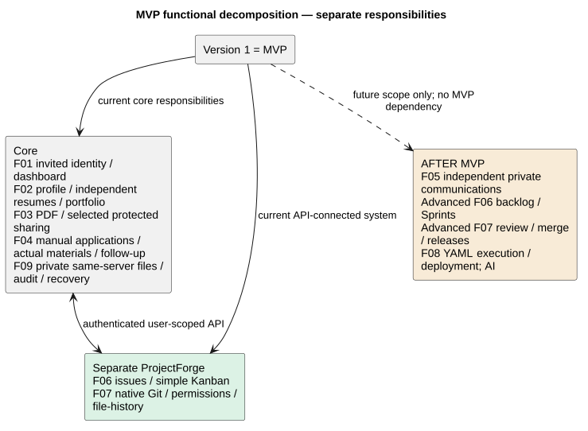

[Editable source](Diagrams/Function-Decomposition.puml) · 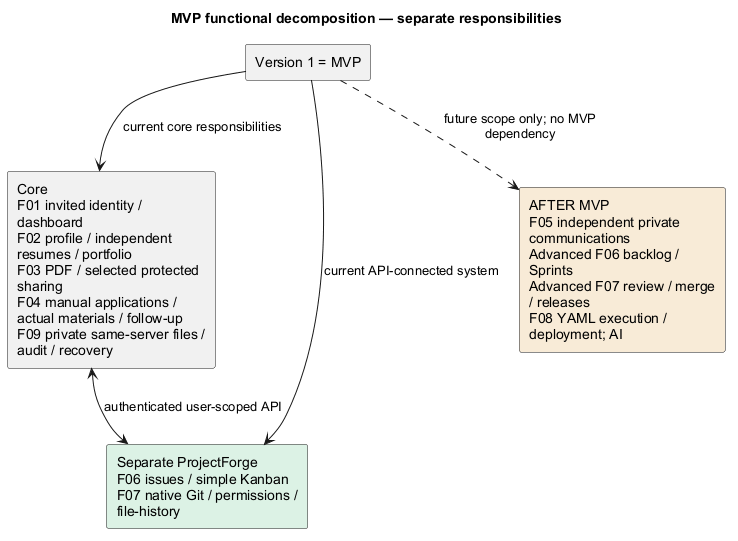

##### 2. Logical responsibilities

Each record describes a transformation and its information boundary. Primary family links identify source obligations, not a claim of complete criterion coverage.

###### Function index

| Function | Responsibility | Logical information |
| --- | --- | --- |
| [F01](#analysis-functional-and-process-analysis--04-function-oriented-view--id-f01) | Establish identity and enforce scoped authority | D1: Identity / scoped grants |
| [F02](#analysis-functional-and-process-analysis--04-function-oriented-view--id-f02) | Maintain independent professional presentation | D2: Professional content / publications |
| [F03](#analysis-functional-and-process-analysis--04-function-oriented-view--id-f03) | Generate PDFs and disclose selected material | D3: Representation / sharing context |
| [F04](#analysis-functional-and-process-analysis--04-function-oriented-view--id-f04) | Manage manual applications and actual history | D4: Applications / submitted history |
| [F05](#analysis-functional-and-process-analysis--04-function-oriented-view--id-f05) | Coordinate authorized mail and calendar | D5: Communication / calendar mappings |
| [F06](#analysis-functional-and-process-analysis--04-function-oriented-view--id-f06) | Organize work and collaboration | D6: Work / Sprint planning |
| [F07](#analysis-functional-and-process-analysis--04-function-oriented-view--id-f07) | Host real Git and repository collaboration | D7: Repositories / review context |
| [F08](#analysis-functional-and-process-analysis--04-function-oriented-view--id-f08) | Admit conditional execution and separate deployment | D8: Attempts / artifacts / target evidence |
| [F09](#analysis-functional-and-process-analysis--04-function-oriented-view--id-f09) | Administer files, policy and recoverable operation | D9: Policy / files / recovery evidence |

###### Function details

The source references are listed with each responsibility rather than compressed into a wide table.

###### F01: Establish identity and enforce scoped authority

**Transformation and result:** Actor identity, session or grant request + Current account/grant context → Authorized context or denial; resource checks remain mandatory

**Logical information:** D1: Identity / scoped grants

**Primary requirement references:**

- [ACC-D01](../02-Requirements-Engineering/01-Software-Requirements-Specification/03-Requirements-Specification/01-Accounts-Authentication-And-Permissions.md#requirements-specification-accounts-authentication-and-permissions--heading-acc-d01-individual-account-context), [ACC-D02](../02-Requirements-Engineering/01-Software-Requirements-Specification/03-Requirements-Specification/01-Accounts-Authentication-And-Permissions.md#requirements-specification-accounts-authentication-and-permissions--heading-acc-d02-unified-sign-in-across-authorized-sections), [ACC-D03](../02-Requirements-Engineering/01-Software-Requirements-Specification/03-Requirements-Specification/01-Accounts-Authentication-And-Permissions.md#requirements-specification-accounts-authentication-and-permissions--heading-acc-d03-resource-and-operation-authorization)
- [ACC-D04](../02-Requirements-Engineering/01-Software-Requirements-Specification/03-Requirements-Specification/01-Accounts-Authentication-And-Permissions.md#requirements-specification-accounts-authentication-and-permissions--heading-acc-d04-cross-user-private-data-isolation), [ACC-D05](../02-Requirements-Engineering/01-Software-Requirements-Specification/03-Requirements-Specification/01-Accounts-Authentication-And-Permissions.md#requirements-specification-accounts-authentication-and-permissions--heading-acc-d05-limited-collaboration-authority), [ACC-D06](../02-Requirements-Engineering/01-Software-Requirements-Specification/03-Requirements-Specification/01-Accounts-Authentication-And-Permissions.md#requirements-specification-accounts-authentication-and-permissions--heading-acc-d06-employer-access-without-a-viewer-account)
- [ACC-D07](../02-Requirements-Engineering/01-Software-Requirements-Specification/03-Requirements-Specification/01-Accounts-Authentication-And-Permissions.md#requirements-specification-accounts-authentication-and-permissions--heading-acc-d07-protected-shared-file-and-pdf-retrieval), [ACC-D08](../02-Requirements-Engineering/01-Software-Requirements-Specification/03-Requirements-Specification/01-Accounts-Authentication-And-Permissions.md#requirements-specification-accounts-authentication-and-permissions--heading-acc-d08-owner-control-of-employer-link-access), [ACC-D09](../02-Requirements-Engineering/01-Software-Requirements-Specification/03-Requirements-Specification/01-Accounts-Authentication-And-Permissions.md#requirements-specification-accounts-authentication-and-permissions--heading-acc-d09-explicit-administrative-powers)
- [ACC-D10](../02-Requirements-Engineering/01-Software-Requirements-Specification/03-Requirements-Specification/01-Accounts-Authentication-And-Permissions.md#requirements-specification-accounts-authentication-and-permissions--heading-acc-d10-authorization-of-access-grant-changes), [ACC-D11](../02-Requirements-Engineering/01-Software-Requirements-Specification/03-Requirements-Specification/01-Accounts-Authentication-And-Permissions.md#requirements-specification-accounts-authentication-and-permissions--heading-acc-d11-no-authentication-bypass-on-deliveryprovider-failure), [ACC-D12](../02-Requirements-Engineering/01-Software-Requirements-Specification/03-Requirements-Specification/01-Accounts-Authentication-And-Permissions.md#requirements-specification-accounts-authentication-and-permissions--heading-acc-d12-end-of-access-and-lifecycle-enforcement)

###### F02: Maintain independent professional presentation

**Transformation and result:** Source edits, selected apply or separate publication confirmation + Profile, draft, override and publication context → Saved selected draft or separately published presentation; actual history unchanged

**Logical information:** D2: Professional content / publications

**Primary requirement references:**

- [PRP-D01](../02-Requirements-Engineering/01-Software-Requirements-Specification/03-Requirements-Specification/12-Profiles-Resumes-And-Portfolio.md#requirements-specification-profiles-resumes-and-portfolio--heading-prp-d01-reusable-professional-information), [PRP-D02](../02-Requirements-Engineering/01-Software-Requirements-Specification/03-Requirements-Specification/12-Profiles-Resumes-And-Portfolio.md#requirements-specification-profiles-resumes-and-portfolio--heading-prp-d02-opportunity-specific-resume-composition), [PRP-D03](../02-Requirements-Engineering/01-Software-Requirements-Specification/03-Requirements-Specification/12-Profiles-Resumes-And-Portfolio.md#requirements-specification-profiles-resumes-and-portfolio--heading-prp-d03-independent-selections-layouts-and-overrides)
- [PRP-D04](../02-Requirements-Engineering/01-Software-Requirements-Specification/03-Requirements-Specification/12-Profiles-Resumes-And-Portfolio.md#requirements-specification-profiles-resumes-and-portfolio--heading-prp-d04-explicit-shared-source-update-rules), [PRP-D05](../02-Requirements-Engineering/01-Software-Requirements-Specification/03-Requirements-Specification/12-Profiles-Resumes-And-Portfolio.md#requirements-specification-profiles-resumes-and-portfolio--heading-prp-d05-skill-and-project-evidence-management), [PRP-D06](../02-Requirements-Engineering/01-Software-Requirements-Specification/03-Requirements-Specification/12-Profiles-Resumes-And-Portfolio.md#requirements-specification-profiles-resumes-and-portfolio--heading-prp-d06-per-resume-evidence-selection-and-disclosure)
- [PRP-D07](../02-Requirements-Engineering/01-Software-Requirements-Specification/03-Requirements-Specification/12-Profiles-Resumes-And-Portfolio.md#requirements-specification-profiles-resumes-and-portfolio--heading-prp-d07-manually-maintained-english-and-german-content), [PRP-D08](../02-Requirements-Engineering/01-Software-Requirements-Specification/03-Requirements-Specification/12-Profiles-Resumes-And-Portfolio.md#requirements-specification-profiles-resumes-and-portfolio--heading-prp-d08-clear-presentation-and-rendition-boundaries), [PRP-D09](../02-Requirements-Engineering/01-Software-Requirements-Specification/03-Requirements-Specification/12-Profiles-Resumes-And-Portfolio.md#requirements-specification-profiles-resumes-and-portfolio--heading-prp-d09-safe-content-admission-and-truthful-save-outcomes)
- [PRP-D10](../02-Requirements-Engineering/01-Software-Requirements-Specification/03-Requirements-Specification/12-Profiles-Resumes-And-Portfolio.md#requirements-specification-profiles-resumes-and-portfolio--heading-prp-d10-reference-aware-retirement-and-historical-independence)

###### F03: Generate PDFs and disclose selected material

**Transformation and result:** PDF settings, generation input, link control or protected request + Selected representation and current access policy → Authorized content or explicit denial; configuration is not link revocation

**Logical information:** D3: Representation / sharing context

**Primary requirement references:**

- [PDF-D01](../02-Requirements-Engineering/01-Software-Requirements-Specification/03-Requirements-Specification/11-Pdf-And-Controlled-Sharing.md#requirements-specification-pdf-and-controlled-sharing--heading-pdf-d01-generated-resume-pdf), [PDF-D02](../02-Requirements-Engineering/01-Software-Requirements-Specification/03-Requirements-Specification/11-Pdf-And-Controlled-Sharing.md#requirements-specification-pdf-and-controlled-sharing--heading-pdf-d02-uploaded-pdf-and-language-identity), [PDF-D03](../02-Requirements-Engineering/01-Software-Requirements-Specification/03-Requirements-Specification/11-Pdf-And-Controlled-Sharing.md#requirements-specification-pdf-and-controlled-sharing--heading-pdf-d03-per-resume-download-choices)
- [PDF-D04](../02-Requirements-Engineering/01-Software-Requirements-Specification/03-Requirements-Specification/11-Pdf-And-Controlled-Sharing.md#requirements-specification-pdf-and-controlled-sharing--heading-pdf-d04-scoped-password-protected-employer-access), [PDF-D05](../02-Requirements-Engineering/01-Software-Requirements-Specification/03-Requirements-Specification/11-Pdf-And-Controlled-Sharing.md#requirements-specification-pdf-and-controlled-sharing--heading-pdf-d05-direct-file-and-pdf-authorization), [PDF-D06](../02-Requirements-Engineering/01-Software-Requirements-Specification/03-Requirements-Specification/11-Pdf-And-Controlled-Sharing.md#requirements-specification-pdf-and-controlled-sharing--heading-pdf-d06-owner-password-and-link-controls)
- [PDF-D07](../02-Requirements-Engineering/01-Software-Requirements-Specification/03-Requirements-Specification/11-Pdf-And-Controlled-Sharing.md#requirements-specification-pdf-and-controlled-sharing--heading-pdf-d07-explicit-live-revision-and-rendition-behavior), [PDF-D08](../02-Requirements-Engineering/01-Software-Requirements-Specification/03-Requirements-Specification/11-Pdf-And-Controlled-Sharing.md#requirements-specification-pdf-and-controlled-sharing--heading-pdf-d08-downloaded-copy-and-submission-distinctions), [PDF-D09](../02-Requirements-Engineering/01-Software-Requirements-Specification/03-Requirements-Specification/11-Pdf-And-Controlled-Sharing.md#requirements-specification-pdf-and-controlled-sharing--heading-pdf-d09-failure-safe-processing-and-content-handling)
- [PDF-D10](../02-Requirements-Engineering/01-Software-Requirements-Specification/03-Requirements-Specification/11-Pdf-And-Controlled-Sharing.md#requirements-specification-pdf-and-controlled-sharing--heading-pdf-d10-reference-aware-retirement-and-recovery)

###### F04: Manage manual applications and actual history

**Transformation and result:** Opportunity, manual progress and actual submitted material + Application context and provenance → Explicit progress/history record; no inferred external submission

**Logical information:** D4: Applications / submitted history

**Primary requirement references:**

- [APP-D01](../02-Requirements-Engineering/01-Software-Requirements-Specification/03-Requirements-Specification/09-Manual-Application-Management.md#requirements-specification-manual-application-management--heading-app-d01-company-and-opportunity-context), [APP-D02](../02-Requirements-Engineering/01-Software-Requirements-Specification/03-Requirements-Specification/09-Manual-Application-Management.md#requirements-specification-manual-application-management--heading-app-d02-relevant-resume-association), [APP-D03](../02-Requirements-Engineering/01-Software-Requirements-Specification/03-Requirements-Specification/09-Manual-Application-Management.md#requirements-specification-manual-application-management--heading-app-d03-manually-authored-cover-letter)
- [APP-D04](../02-Requirements-Engineering/01-Software-Requirements-Specification/03-Requirements-Specification/09-Manual-Application-Management.md#requirements-specification-manual-application-management--heading-app-d04-explicit-progress-states-and-transitions), [APP-D05](../02-Requirements-Engineering/01-Software-Requirements-Specification/03-Requirements-Specification/09-Manual-Application-Management.md#requirements-specification-manual-application-management--heading-app-d05-user-directed-submission-recording), [APP-D06](../02-Requirements-Engineering/01-Software-Requirements-Specification/03-Requirements-Specification/09-Manual-Application-Management.md#requirements-specification-manual-application-management--heading-app-d06-preserved-actual-submitted-copies)
- [APP-D07](../02-Requirements-Engineering/01-Software-Requirements-Specification/03-Requirements-Specification/09-Manual-Application-Management.md#requirements-specification-manual-application-management--heading-app-d07-correction-and-repeated-submissions), [APP-D08](../02-Requirements-Engineering/01-Software-Requirements-Specification/03-Requirements-Specification/09-Manual-Application-Management.md#requirements-specification-manual-application-management--heading-app-d08-correspondence-calendar-and-follow-up-links), [APP-D09](../02-Requirements-Engineering/01-Software-Requirements-Specification/03-Requirements-Specification/09-Manual-Application-Management.md#requirements-specification-manual-application-management--heading-app-d09-private-access-archive-and-recovery)

###### F05: Coordinate authorized mail and calendar

**After MVP.** Shared operating and recovery controls still apply where relevant.

**Transformation and result:** Selected mail/calendar intent and provider connection context + Local records plus provider responses → Attributable local/provider outcome; unknown remote effect is not success

**Logical information:** D5: Communication / calendar mappings

**Primary requirement references:**

- [EGC-D01](../02-Requirements-Engineering/01-Software-Requirements-Specification/03-Requirements-Specification/06-Email-Calendar-And-Google-Integration.md#requirements-specification-email-calendar-and-google-integration--heading-egc-d01-authorized-connection-and-account-context), [EGC-D02](../02-Requirements-Engineering/01-Software-Requirements-Specification/03-Requirements-Specification/06-Email-Calendar-And-Google-Integration.md#requirements-specification-email-calendar-and-google-integration--heading-egc-d02-justified-permissions-and-private-resource-isolation), [EGC-D03](../02-Requirements-Engineering/01-Software-Requirements-Specification/03-Requirements-Specification/06-Email-Calendar-And-Google-Integration.md#requirements-specification-email-calendar-and-google-integration--heading-egc-d03-read-authorized-correspondence)
- [EGC-D04](../02-Requirements-Engineering/01-Software-Requirements-Specification/03-Requirements-Specification/06-Email-Calendar-And-Google-Integration.md#requirements-specification-email-calendar-and-google-integration--heading-egc-d04-manual-compose-and-draft-handling), [EGC-D05](../02-Requirements-Engineering/01-Software-Requirements-Specification/03-Requirements-Specification/06-Email-Calendar-And-Google-Integration.md#requirements-specification-email-calendar-and-google-integration--heading-egc-d05-deliberate-send-and-truthful-outcome), [EGC-D06](../02-Requirements-Engineering/01-Software-Requirements-Specification/03-Requirements-Specification/06-Email-Calendar-And-Google-Integration.md#requirements-specification-email-calendar-and-google-integration--heading-egc-d06-reply-context-and-conversation-association)
- [EGC-D07](../02-Requirements-Engineering/01-Software-Requirements-Specification/03-Requirements-Specification/06-Email-Calendar-And-Google-Integration.md#requirements-specification-email-calendar-and-google-integration--heading-egc-d07-calendar-activities-and-time-meaning), [EGC-D08](../02-Requirements-Engineering/01-Software-Requirements-Specification/03-Requirements-Specification/06-Email-Calendar-And-Google-Integration.md#requirements-specification-email-calendar-and-google-integration--heading-egc-d08-explicit-synchronization-contract), [EGC-D09](../02-Requirements-Engineering/01-Software-Requirements-Specification/03-Requirements-Specification/06-Email-Calendar-And-Google-Integration.md#requirements-specification-email-calendar-and-google-integration--heading-egc-d09-application-relationships-preserve-boundaries)
- [EGC-D10](../02-Requirements-Engineering/01-Software-Requirements-Specification/03-Requirements-Specification/06-Email-Calendar-And-Google-Integration.md#requirements-specification-email-calendar-and-google-integration--heading-egc-d10-reminders-and-notification-outcomes), [EGC-D11](../02-Requirements-Engineering/01-Software-Requirements-Specification/03-Requirements-Specification/06-Email-Calendar-And-Google-Integration.md#requirements-specification-email-calendar-and-google-integration--heading-egc-d11-disconnect-revocation-and-reconnect), [EGC-D12](../02-Requirements-Engineering/01-Software-Requirements-Specification/03-Requirements-Specification/06-Email-Calendar-And-Google-Integration.md#requirements-specification-email-calendar-and-google-integration--heading-egc-d12-bounded-failures-recovery-and-feasibility-evidence)

###### F06: Organize work and collaboration

**Transformation and result:** Work refinement, assignment, movement or Sprint selection + Authorized project/item/task/Sprint context → Coherent work plan or explicit denied/conflicting result; Sprint end is not acceptance

**Logical information:** D6: Work / Sprint planning

**Primary requirement references:**

- [PKS-D01](../02-Requirements-Engineering/01-Software-Requirements-Specification/03-Requirements-Specification/13-Projects-Kanban-And-Sprints.md#requirements-specification-projects-kanban-and-sprints--heading-pks-d01-project-and-board-context), [PKS-D02](../02-Requirements-Engineering/01-Software-Requirements-Specification/03-Requirements-Specification/13-Projects-Kanban-And-Sprints.md#requirements-specification-projects-kanban-and-sprints--heading-pks-d02-configurable-columns-and-valid-work-movement), [PKS-D03](../02-Requirements-Engineering/01-Software-Requirements-Specification/03-Requirements-Specification/13-Projects-Kanban-And-Sprints.md#requirements-specification-projects-kanban-and-sprints--heading-pks-d03-product-backlog-and-item-definition)
- [PKS-D04](../02-Requirements-Engineering/01-Software-Requirements-Specification/03-Requirements-Specification/13-Projects-Kanban-And-Sprints.md#requirements-specification-projects-kanban-and-sprints--heading-pks-d04-item-refinement-and-task-relationships), [PKS-D05](../02-Requirements-Engineering/01-Software-Requirements-Specification/03-Requirements-Specification/13-Projects-Kanban-And-Sprints.md#requirements-specification-projects-kanban-and-sprints--heading-pks-d05-assignment-priority-and-due-date-handling), [PKS-D06](../02-Requirements-Engineering/01-Software-Requirements-Specification/03-Requirements-Specification/13-Projects-Kanban-And-Sprints.md#requirements-specification-projects-kanban-and-sprints--heading-pks-d06-scoped-collaboration-and-membership-changes)
- [PKS-D07](../02-Requirements-Engineering/01-Software-Requirements-Specification/03-Requirements-Specification/13-Projects-Kanban-And-Sprints.md#requirements-specification-projects-kanban-and-sprints--heading-pks-d07-sprint-goal-and-selected-backlog-items), [PKS-D08](../02-Requirements-Engineering/01-Software-Requirements-Specification/03-Requirements-Specification/13-Projects-Kanban-And-Sprints.md#requirements-specification-projects-kanban-and-sprints--heading-pks-d08-one-coherent-sprint-backlog), [PKS-D09](../02-Requirements-Engineering/01-Software-Requirements-Specification/03-Requirements-Specification/13-Projects-Kanban-And-Sprints.md#requirements-specification-projects-kanban-and-sprints--heading-pks-d09-explicit-completion-and-sprint-end-outcomes)
- [PKS-D10](../02-Requirements-Engineering/01-Software-Requirements-Specification/03-Requirements-Specification/13-Projects-Kanban-And-Sprints.md#requirements-specification-projects-kanban-and-sprints--heading-pks-d10-deliberate-cross-module-links-reports-and-automation), [PKS-D11](../02-Requirements-Engineering/01-Software-Requirements-Specification/03-Requirements-Specification/13-Projects-Kanban-And-Sprints.md#requirements-specification-projects-kanban-and-sprints--heading-pks-d11-truthful-changes-retirement-and-recovery)

###### F07: Host real Git and repository collaboration

**Transformation and result:** Repository action, Git transfer, review or merge intent + Exact repository/revision/ref and grants → Authorized repository result; merge does not authorize deployment

**Logical information:** D7: Repositories / review context

**Primary requirement references:**

- [GIT-D01](../02-Requirements-Engineering/01-Software-Requirements-Specification/03-Requirements-Specification/08-Git-Hosting-And-Collaboration.md#requirements-specification-git-hosting-and-collaboration--heading-git-d01-repository-creation-and-ownership), [GIT-D02](../02-Requirements-Engineering/01-Software-Requirements-Specification/03-Requirements-Specification/08-Git-Hosting-And-Collaboration.md#requirements-specification-git-hosting-and-collaboration--heading-git-d02-repository-and-ref-authorization), [GIT-D03](../02-Requirements-Engineering/01-Software-Requirements-Specification/03-Requirements-Specification/08-Git-Hosting-And-Collaboration.md#requirements-specification-git-hosting-and-collaboration--heading-git-d03-real-clone-fetch-pull-and-push)
- [GIT-D04](../02-Requirements-Engineering/01-Software-Requirements-Specification/03-Requirements-Specification/08-Git-Hosting-And-Collaboration.md#requirements-specification-git-hosting-and-collaboration--heading-git-d04-branches-files-and-history-browsing), [GIT-D05](../02-Requirements-Engineering/01-Software-Requirements-Specification/03-Requirements-Specification/08-Git-Hosting-And-Collaboration.md#requirements-specification-git-hosting-and-collaboration--heading-git-d05-fork-provenance-and-permission-boundaries), [GIT-D06](../02-Requirements-Engineering/01-Software-Requirements-Specification/03-Requirements-Specification/08-Git-Hosting-And-Collaboration.md#requirements-specification-git-hosting-and-collaboration--heading-git-d06-pull-requests-comments-and-review)
- [GIT-D07](../02-Requirements-Engineering/01-Software-Requirements-Specification/03-Requirements-Specification/08-Git-Hosting-And-Collaboration.md#requirements-specification-git-hosting-and-collaboration--heading-git-d07-controlled-merge-and-conflict-outcomes), [GIT-D08](../02-Requirements-Engineering/01-Software-Requirements-Specification/03-Requirements-Specification/08-Git-Hosting-And-Collaboration.md#requirements-specification-git-hosting-and-collaboration--heading-git-d08-issues-and-milestones), [GIT-D09](../02-Requirements-Engineering/01-Software-Requirements-Specification/03-Requirements-Specification/08-Git-Hosting-And-Collaboration.md#requirements-specification-git-hosting-and-collaboration--heading-git-d09-tags-and-releases)
- [GIT-D10](../02-Requirements-Engineering/01-Software-Requirements-Specification/03-Requirements-Specification/08-Git-Hosting-And-Collaboration.md#requirements-specification-git-hosting-and-collaboration--heading-git-d10-lifecycle-capacity-and-recovery)

###### F08: Admit conditional execution and separate deployment

**After MVP.** Shared operating and recovery controls still apply where relevant.

**Transformation and result:** Supported definition, exact revision and separately authorized target action + Gate, resource, secret and execution context → Attributable attempt/output/target evidence; uncertainty requires reconciliation

**Logical information:** D8: Attempts / artifacts / target evidence

**Primary requirement references:**

- [YML-D01](../02-Requirements-Engineering/01-Software-Requirements-Specification/03-Requirements-Specification/19-Yaml-Workflows-And-Cicd.md#requirements-specification-yaml-workflows-and-cicd--heading-yml-d01-defined-supported-workflow-contract), [YML-D02](../02-Requirements-Engineering/01-Software-Requirements-Specification/03-Requirements-Specification/19-Yaml-Workflows-And-Cicd.md#requirements-specification-yaml-workflows-and-cicd--heading-yml-d02-explicit-triggers-and-run-authority), [YML-D03](../02-Requirements-Engineering/01-Software-Requirements-Specification/03-Requirements-Specification/19-Yaml-Workflows-And-Cicd.md#requirements-specification-yaml-workflows-and-cicd--heading-yml-d03-run-identity-and-reproducible-context)
- [YML-D04](../02-Requirements-Engineering/01-Software-Requirements-Specification/03-Requirements-Specification/19-Yaml-Workflows-And-Cicd.md#requirements-specification-yaml-workflows-and-cicd--heading-yml-d04-isolation-and-untrusted-code-boundary), [YML-D05](../02-Requirements-Engineering/01-Software-Requirements-Specification/03-Requirements-Specification/19-Yaml-Workflows-And-Cicd.md#requirements-specification-yaml-workflows-and-cicd--heading-yml-d05-scoped-secrets-and-credentials), [YML-D06](../02-Requirements-Engineering/01-Software-Requirements-Specification/03-Requirements-Specification/19-Yaml-Workflows-And-Cicd.md#requirements-specification-yaml-workflows-and-cicd--heading-yml-d06-resource-admission-and-limits)
- [YML-D07](../02-Requirements-Engineering/01-Software-Requirements-Specification/03-Requirements-Specification/19-Yaml-Workflows-And-Cicd.md#requirements-specification-yaml-workflows-and-cicd--heading-yml-d07-truthful-run-and-step-outcomes), [YML-D08](../02-Requirements-Engineering/01-Software-Requirements-Specification/03-Requirements-Specification/19-Yaml-Workflows-And-Cicd.md#requirements-specification-yaml-workflows-and-cicd--heading-yml-d08-restricted-logs-and-artifacts), [YML-D09](../02-Requirements-Engineering/01-Software-Requirements-Specification/03-Requirements-Specification/19-Yaml-Workflows-And-Cicd.md#requirements-specification-yaml-workflows-and-cicd--heading-yml-d09-cancellation-retry-and-runner-loss-recovery)
- [YML-D10](../02-Requirements-Engineering/01-Software-Requirements-Specification/03-Requirements-Specification/19-Yaml-Workflows-And-Cicd.md#requirements-specification-yaml-workflows-and-cicd--heading-yml-d10-separate-controlled-deployment-stage), [YML-D11](../02-Requirements-Engineering/01-Software-Requirements-Specification/03-Requirements-Specification/19-Yaml-Workflows-And-Cicd.md#requirements-specification-yaml-workflows-and-cicd--heading-yml-d11-workspace-cleanup-and-retained-evidence), [YML-D12](../02-Requirements-Engineering/01-Software-Requirements-Specification/03-Requirements-Specification/19-Yaml-Workflows-And-Cicd.md#requirements-specification-yaml-workflows-and-cicd--heading-yml-d12-feasibility-operational-guidance-and-enabling-gate)

###### F09: Administer files, policy and recoverable operation

**Transformation and result:** Policy/file/operating or recovery request + Effective limits, file references and recovery evidence → Admitted/rejected file, scoped policy or assessed recovery outcome; deletion is not inferred reclamation

**Logical information:** D9: Policy / files / recovery evidence

**Primary requirement references:**

- [AFO-D01](../02-Requirements-Engineering/01-Software-Requirements-Specification/03-Requirements-Specification/02-Administration-Files-And-Operational-Behavior.md#requirements-specification-administration-files-and-operational-behavior--heading-afo-d01-owner-configurable-upload-and-storage-policy), [AFO-D02](../02-Requirements-Engineering/01-Software-Requirements-Specification/03-Requirements-Specification/02-Administration-Files-And-Operational-Behavior.md#requirements-specification-administration-files-and-operational-behavior--heading-afo-d02-policy-consistent-with-evaluated-infrastructure), [AFO-D03](../02-Requirements-Engineering/01-Software-Requirements-Specification/03-Requirements-Specification/02-Administration-Files-And-Operational-Behavior.md#requirements-specification-administration-files-and-operational-behavior--heading-afo-d03-per-file-admission-limit)
- [AFO-D04](../02-Requirements-Engineering/01-Software-Requirements-Specification/03-Requirements-Specification/02-Administration-Files-And-Operational-Behavior.md#requirements-specification-administration-files-and-operational-behavior--heading-afo-d04-aggregate-quota-and-concurrent-admission), [AFO-D05](../02-Requirements-Engineering/01-Software-Requirements-Specification/03-Requirements-Specification/02-Administration-Files-And-Operational-Behavior.md#requirements-specification-administration-files-and-operational-behavior--heading-afo-d05-supported-content-and-validation), [AFO-D06](../02-Requirements-Engineering/01-Software-Requirements-Specification/03-Requirements-Specification/02-Administration-Files-And-Operational-Behavior.md#requirements-specification-administration-files-and-operational-behavior--heading-afo-d06-file-resource-authorization-and-isolation)
- [AFO-D07](../02-Requirements-Engineering/01-Software-Requirements-Specification/03-Requirements-Specification/02-Administration-Files-And-Operational-Behavior.md#requirements-specification-administration-files-and-operational-behavior--heading-afo-d07-truthful-completion-and-interrupted-operation-handling), [AFO-D08](../02-Requirements-Engineering/01-Software-Requirements-Specification/03-Requirements-Specification/02-Administration-Files-And-Operational-Behavior.md#requirements-specification-administration-files-and-operational-behavior--heading-afo-d08-safe-replacement-and-lifecycle-effects), [AFO-D09](../02-Requirements-Engineering/01-Software-Requirements-Specification/03-Requirements-Specification/02-Administration-Files-And-Operational-Behavior.md#requirements-specification-administration-files-and-operational-behavior--heading-afo-d09-operational-outcomes-and-capacity-warnings)
- [AFO-D10](../02-Requirements-Engineering/01-Software-Requirements-Specification/03-Requirements-Specification/02-Administration-Files-And-Operational-Behavior.md#requirements-specification-administration-files-and-operational-behavior--heading-afo-d10-administrative-operation-evidence), [AFO-D11](../02-Requirements-Engineering/01-Software-Requirements-Specification/03-Requirements-Specification/02-Administration-Files-And-Operational-Behavior.md#requirements-specification-administration-files-and-operational-behavior--heading-afo-d11-bounded-cleanup-and-storage-reclamation), [AFO-D12](../02-Requirements-Engineering/01-Software-Requirements-Specification/03-Requirements-Specification/02-Administration-Files-And-Operational-Behavior.md#requirements-specification-administration-files-and-operational-behavior--heading-afo-d12-version-specific-operational-guidance-and-readiness)

###### Relationship to the existing data-flow catalog

DA-F01–DA-F03 map to F02; DA-F04 to F09; DA-F05 to F03/F09; DA-F06 to F04; DA-F07/08 to F05; DA-F09 to F06; DA-F10 to F07; DA-F11 to F08; DA-F12/13 to F09. These DA-F records in file 05 retain their original meanings. F01 supplies the scoped identity/authority constraint across these information exchanges. The F identifiers here group responsibilities and do not rename DA-F records.

###### Uniform interpretation and failure boundaries

Identity does not confer resource authority. Each function checks applicable actor/resource/action/state and effective policy. Validation, denial, conflict, confirmed pending, confirmed completion, partial effect and unknown effect must remain distinguishable where applicable. Read-only retrieval is not a mutation. A timeout does not prove rollback; consequential repeats need operation-specific reconciliation as defined by [contracts](#analysis-business-rules-and-operation-contracts--10-domain-constraints-and-operation-contracts) and [interfaces](04-Interfaces-Security-And-Quality.md#analysis-interfaces-security-and-quality-analysis--12-interfaces-and-external-interactions).

##### 3. Cross-capability processes

###### F02 → F03

**Information:** Explicit selected presentation/revision/language and applicable PDF controls

**Completion boundary and failure limitation:** Only authorized representation is disclosed; source edit does not publish or disable a link

###### F02/F03 → F04

**Information:** User-identified preparation reference or actual submitted material

**Completion boundary and failure limitation:** Latest draft/live content is not evidence of what was actually submitted; preserve independent actual history

###### F04 ↔ F05

**Information:** Deliberately linked correspondence/activity context

**Completion boundary and failure limitation:** Provider acceptance, delivery and actual application progress are different facts; no automatic submission

###### F06 ↔ F07

**Information:** Explicit work/repository association under both scopes

**Completion boundary and failure limitation:** Work completion, review, merge and acceptance are distinct; links do not extend grants

###### F07 → F08

**Information:** Exact eligible revision and supported workflow definition

**Completion boundary and failure limitation:** Push/merge alone grants neither execution eligibility nor deployment permission

###### F08 → target

**Information:** Independently authorized target/artifact/revision

**Completion boundary and failure limitation:** Record observed target result; an unknown outcome requires reconciliation before consequential repetition

###### F09 ↔ other functions

**Information:** Effective policy, file/reference lifecycle and recovery disposition

**Completion boundary and failure limitation:** Preserve required references/history; logical retirement does not prove physical reclamation or usable restoration

###### F01 → each function

**Information:** Current identity/grant context

**Completion boundary and failure limitation:** Re-evaluate applicable resource authority at use; no one-time universal grant

These handoffs are named information dependencies. They do not impose a mandatory call chain. Their source/target data meanings are refined by [05](02-Domain-And-Information-Analysis.md#analysis-domain-and-information-analysis--05-data-oriented-view), [06](#analysis-behavioral-and-scenario-analysis--06-scenario-based-view) and [10](#analysis-business-rules-and-operation-contracts--10-domain-constraints-and-operation-contracts).

##### 4. Process and data-flow models

###### Notation and level rules

Rectangles denote external entities, ovals logical transformations, database-shaped symbols logical stores (a local DFD convention, not physical databases), and arrows information movement. Flow IDs refer to the dictionary below. Arrows are not control flow, temporal order or permission grants. The context has one process and no internal stores. Two Level 1 panels jointly decompose it; every Bxx input/output appears exactly once in their combined external boundary. The store panel adds only internal information. The F02 Level 2 view splits B02 by existing intent without adding a new external flow.

###### Context DFD

[function-dfd-context](https://github.com/Farhad-V/Web-Resumefolio/blob/1f2acaa351ac306cb57cbe4fe9742e8bd90720d9/docs/MVP/SDLC/04-system-design/01-software-architecture/diagrams/mvp-system-boundaries.svg)

[Editable source](https://github.com/Farhad-V/Web-Resumefolio/blob/1f2acaa351ac306cb57cbe4fe9742e8bd90720d9/docs/MVP/SDLC/04-system-design/01-software-architecture/diagrams/mvp-system-boundaries.puml) · [View diagram: mvp system boundaries](01-System-Context-And-Gap-Analysis.md#figure-01-mvp-system-boundaries)

###### Level 1 DFD for professional content and communication

**After MVP.** Shared operating and recovery controls still apply where relevant.

[Editable source](Diagrams/Function-Dfd-Level1-Content.puml) · 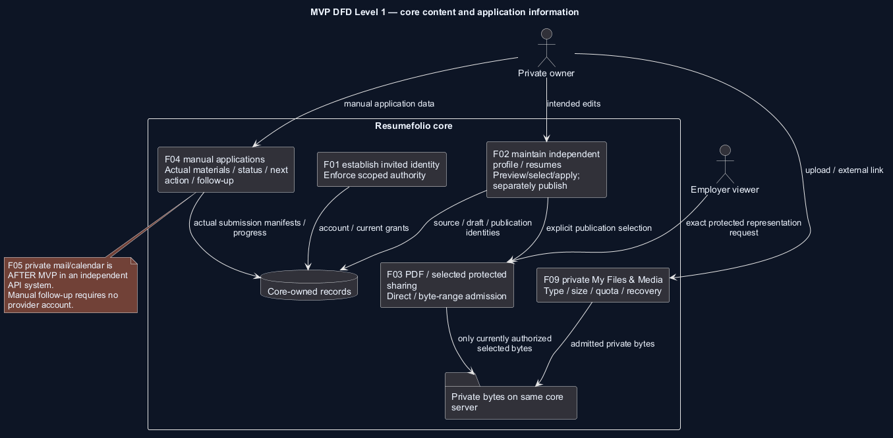

###### Level 1 DFD for work Git execution and operations

**After MVP.** Shared operating and recovery controls still apply where relevant.

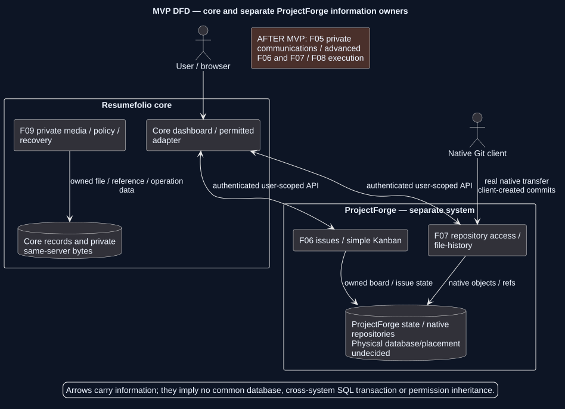

[Editable source](Diagrams/Function-Store-Information.puml) · 

###### Logical store information flows

[Editable source](Diagrams/Function-Store-Information.puml) · [View diagram: function store information](#figure-02-function-store-information)

###### Level 2 refinement of professional presentation

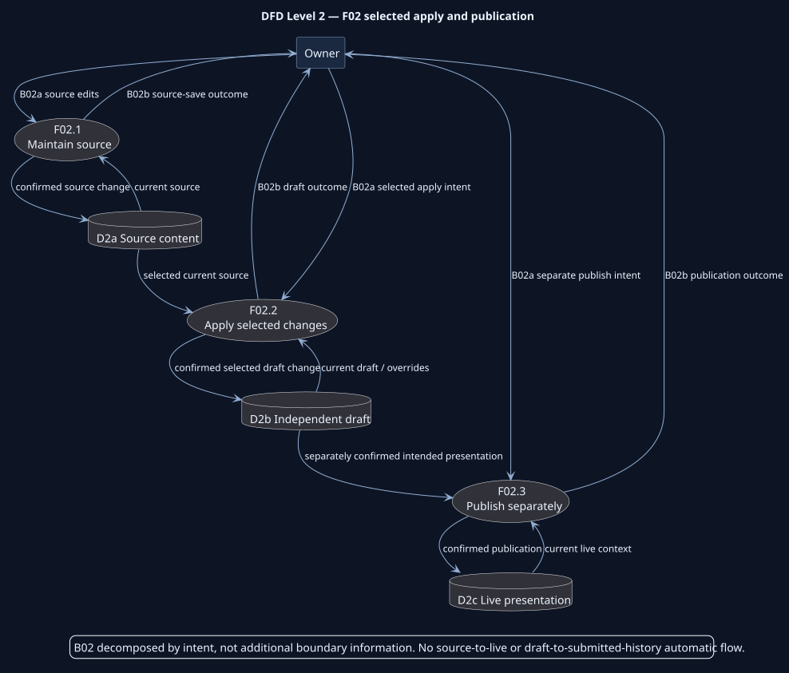

[Editable source](Diagrams/Function-Profile-Level2.puml) · 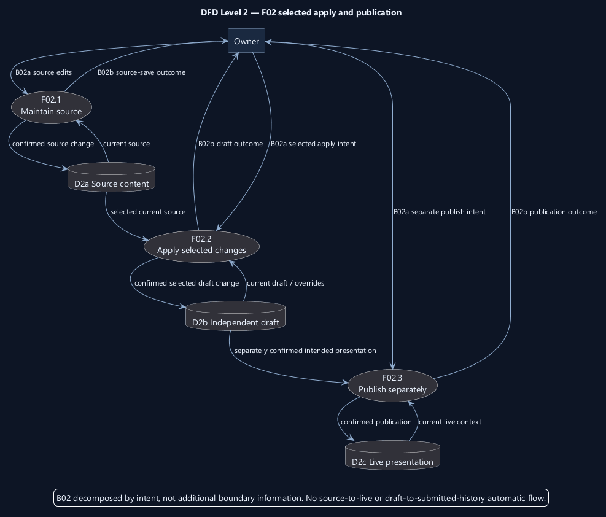

###### Boundary flow dictionary

For each row, suffix **a** means external entity → function; suffix **b** means function → external entity. The same IDs/meanings apply at context and Level 1. Names represent logical information, not selected payload schemas or transport protocols.

###### Incoming information

| Flow | External source | Function | Information |
| --- | --- | --- | --- |
| B01a | Private user / collaborator | F01 | Identity and grant request |
| B02a | Private user / collaborator | F02 | Source / selected apply / publish intent |
| B03a | Private user / collaborator | F03 | Representation and sharing intent |
| B04a | Employer viewer | F03 | Protected selected-content request |
| B05a | Private user / collaborator | F04 | Manual application and actual-material input |
| B06a | Private user / collaborator | F05 | Selected mail / calendar intent |
| B07a | Google services | F05 | Provider response / selected changes |
| B08a | Private user / collaborator | F06 | Work / Sprint intent |
| B09a | Private user / collaborator | F07 | Repository / review intent |
| B10a | Real Git client | F07 | Authorized Git transfer input |
| B11a | Private user / collaborator | F08 | Workflow / separate deploy intent |
| B12a | Conditional execution facility | F08 | Attempt evidence / output |
| B13a | Separate deployment target | F08 | Actual target outcome |
| B14a | Authorized operator / operating facilities | F09 | Policy / file / recovery request |
| B15a | Private user / collaborator | F09 | File / permitted administration input |

###### Outgoing information

| Flow | Function | External destination | Information |
| --- | --- | --- | --- |
| B01b | F01 | Private user / collaborator | Scoped context or denial |
| B02b | F02 | Private user / collaborator | Source / draft / publication outcome |
| B03b | F03 | Private user / collaborator | Representation / control outcome |
| B04b | F03 | Employer viewer | Authorized content or denial |
| B05b | F04 | Private user / collaborator | Progress / actual-history result |
| B06b | F05 | Private user / collaborator | Local / provider outcome |
| B07b | F05 | Google services | Scoped provider request |
| B08b | F06 | Private user / collaborator | Authorized plan / work result |
| B09b | F07 | Private user / collaborator | Repository / review result |
| B10b | F07 | Real Git client | Git transfer outcome |
| B11b | F08 | Private user / collaborator | Attempt / target disposition |
| B12b | F08 | Conditional execution facility | Scoped eligible execution input |
| B13b | F08 | Separate deployment target | Separately authorized target request |
| B14b | F09 | Authorized operator / operating facilities | Operating disposition / evidence |
| B15b | F09 | Private user / collaborator | Admission / policy result |

###### Internal-store flow dictionary

For I1–I9, suffix a supplies the corresponding function with its current logical context; suffix b records only the authorized confirmed change within that function's responsibility. The responsibility table defines D1–D9. A confirmed change to an attempt record does not assert that a remote effect succeeded. F02's D2a/D2b/D2c are a logical refinement of D2, not extra physical stores. Publication and actual submitted history remain separate.

##### 5. Consistency checks

- Context/Level 1 use the same catalog of 30 directed external information flows (15 input/output pairs).

- Nine logical responsibilities map to all primary functional families; none implies a microservice boundary.

- F02 source, draft and publication paths preserve accepted explicit-apply/separate-publication behavior.

- F07/F08 preserve real Git, execution prerequisites and separate target authority.

- Model association is not full criterion coverage. [11](05-Analysis-Review-And-Design-Handoff.md#analysis-review-and-design-handoff--11-model-consistency-traceability-and-review) distinguishes the current review from historical evidence and records the remaining semantic review work.

##### Review Status

The functional decomposition, flow dictionary and selected refinement are populated and mechanically balanced. Semantic completeness across all criteria and actual owner baseline disposition remain separate review work. No implementation, live service, performance, recovery or product acceptance test was run.

##### Function Trees and Data-Flow Diagrams

Editable PlantUML and SVG/PNG exports accompany every view. For sequence order use file 06; for control branches use 08; DFDs here answer what information is transformed and crosses a boundary.

[System Analysis index]()

Resumefolio — Control-Flow-Based View

#### Resumefolio — Control-Flow-Based View

[Diagram types and reading guide](#analysis-functional-and-process-analysis--08-control-flow-based-view--heading-diagram-types-and-reading-guide) · [Full diagram catalog](Diagrams/Diagram-Catalog.md)

Owner: Farhad. Updated: November 1, 2026.

Status: Populated analysis working view; selected source-backed workflows, not phase acceptance or execution evidence.

Current MVP scope and selected mechanisms: [Baseline](https://github.com/Farhad-V/Web-Resumefolio/blob/1f2acaa351ac306cb57cbe4fe9742e8bd90720d9/docs/MVP/baseline/README.md). Deferred provider, advanced collaboration and workflow-execution designs are not MVP prerequisites.

##### 1. Purpose

Describe how intended domain actions are ordered, selected and concluded. An activity view answers **what happens next under which condition**, while the scenario view describes participating interactions and the state view describes a subject over time. These are complementary projections of the same behavior, not new parallel requirements.

The 16 primary activities follow the 16 existing sequence models; CF-M17 is a shared result-classification subactivity. This is selected behavior coverage across the accepted scope, not a claim that every possible UI action, CRUD operation, import or correction has been modeled.

**Authoritative inputs:** [scope](../01-Project-Planning/01-Project-Charter.md#mvp-scope), [requirements](../02-Requirements-Engineering/01-Software-Requirements-Specification/03-Requirements-Specification/17-Software-Requirements-Specification.md#requirements-specification-requirements-specification), [source use cases/scenarios](../02-Requirements-Engineering/01-Software-Requirements-Specification/04-Scenarios-And-Models/02-User-Stories-And-Scenarios.md#scenarios-and-models-user-stories-and-scenarios), [decisions/proposals](../02-Requirements-Engineering/01-Software-Requirements-Specification/07-Change-And-Baseline/03-Requirements-Questions-And-Decisions.md#change-and-baseline-open-questions-and-decisions), [domain](02-Domain-And-Information-Analysis.md#analysis-domain-and-information-analysis--03-domain-model-and-object-oriented-view), [data](02-Domain-And-Information-Analysis.md#analysis-domain-and-information-analysis--05-data-oriented-view), [interactions](#analysis-behavioral-and-scenario-analysis--06-scenario-based-view) and [states](#analysis-behavioral-and-scenario-analysis--07-state-based-view).

**Authority:** The [accepted profile-update core](../02-Requirements-Engineering/01-Software-Requirements-Specification/07-Change-And-Baseline/03-Requirements-Questions-And-Decisions.md#change-and-baseline-open-questions-and-decisions--id-owner-accepted-profile-update-policy) remains accepted: no automatic resume update, explicit selected apply, separate publication, preserved independent text and actual submitted documents. Other detailed policies retain their primary proposed status. This view adds proposed ordering/branch refinements; diagrams do not elevate them to accepted requirements.

##### 2. Activity Model Content

###### Notation and execution boundary

- Rounded boxes are actions; the actor/context appears inside the box. Diamonds ask a guard question with explicit yes/no branches. The circle starts this scoped activity; the final marker ends that path or returns the current result to its caller, not necessarily the lifetime of the domain subject.

- CF-Mxx-Syy identifies the full step/decision in the adjacent table. Branch names are complements within the stated question; uncertain operational effect has its own result treatment, not an assumed successful yes branch.

- Arrows carry control, not bytes or a database transaction. Inputs, outputs and meaningful object handoffs are described below and linked to DA-F meanings. Actor labels identify responsibility, not a selected process/thread/service boundary.

- A multi-goal activity admits only its explicitly listed alternatives. An unknown/unsupported operation kind must not fall into an otherwise branch; reject it before dispatch. Each depicted no branch means the other named operation in that bounded selection.

- No fork/join is needed by these selected workflows. Alternative goals are not parallel work. Simultaneous external events and cancellation races are modeled as observations with current-context checks, without inventing a scheduling order or distributed atomicity.

- CF-M17 is a reusable analysis subactivity. Its caller retains exact operation/subject context and uses its actual result; the reference does not choose a runtime service or workflow engine.

###### Activity inventory

| Model | Goal | Interaction | State context |
| --- | --- | --- | --- |
| [CF-M01](#analysis-functional-and-process-analysis--08-control-flow-based-view--id-cf-m01) | Selected resume update and separate publication | [SB-M01](#analysis-behavioral-and-scenario-analysis--06-scenario-based-view--id-sb-m01) | [SM-M01](#analysis-behavioral-and-scenario-analysis--07-state-based-view--id-sm-m01), [SM-M07](#analysis-behavioral-and-scenario-analysis--07-state-based-view--id-sm-m07), [SM-M18](#analysis-behavioral-and-scenario-analysis--07-state-based-view--id-sm-m18) |
| [CF-M02](#analysis-functional-and-process-analysis--08-control-flow-based-view--id-cf-m02) | Download settings without link side effects | [SB-M02](#analysis-behavioral-and-scenario-analysis--06-scenario-based-view--id-sb-m02) | [SM-M04](#analysis-behavioral-and-scenario-analysis--07-state-based-view--id-sm-m04), [SM-M05](#analysis-behavioral-and-scenario-analysis--07-state-based-view--id-sm-m05), [SM-M18](#analysis-behavioral-and-scenario-analysis--07-state-based-view--id-sm-m18) |
| [CF-M03](#analysis-functional-and-process-analysis--08-control-flow-based-view--id-cf-m03) | Independent link disablement and fresh request | [SB-M03](#analysis-behavioral-and-scenario-analysis--06-scenario-based-view--id-sb-m03) | [SM-M04](#analysis-behavioral-and-scenario-analysis--07-state-based-view--id-sm-m04), [SM-M18](#analysis-behavioral-and-scenario-analysis--07-state-based-view--id-sm-m18) |
| [CF-M04](#analysis-functional-and-process-analysis--08-control-flow-based-view--id-cf-m04) | Controlled page and artifact retrieval | [SB-M04](#analysis-behavioral-and-scenario-analysis--06-scenario-based-view--id-sb-m04) | [SM-M04](#analysis-behavioral-and-scenario-analysis--07-state-based-view--id-sm-m04), [SM-M05](#analysis-behavioral-and-scenario-analysis--07-state-based-view--id-sm-m05), [SM-M18](#analysis-behavioral-and-scenario-analysis--07-state-based-view--id-sm-m18) |
| [CF-M05](#analysis-functional-and-process-analysis--08-control-flow-based-view--id-cf-m05) | Manual application preparation or progress recording | [SB-M05](#analysis-behavioral-and-scenario-analysis--06-scenario-based-view--id-sb-m05) | [SM-M06](#analysis-behavioral-and-scenario-analysis--07-state-based-view--id-sm-m06), [SM-M07](#analysis-behavioral-and-scenario-analysis--07-state-based-view--id-sm-m07), [SM-M18](#analysis-behavioral-and-scenario-analysis--07-state-based-view--id-sm-m18) |
| [CF-M06](#analysis-functional-and-process-analysis--08-control-flow-based-view--id-cf-m06) | Capture actual submitted materials | [SB-M06](#analysis-behavioral-and-scenario-analysis--06-scenario-based-view--id-sb-m06) | [SM-M07](#analysis-behavioral-and-scenario-analysis--07-state-based-view--id-sm-m07), [SM-M16](#analysis-behavioral-and-scenario-analysis--07-state-based-view--id-sm-m16), [SM-M18](#analysis-behavioral-and-scenario-analysis--07-state-based-view--id-sm-m18) |
| [CF-M07](#analysis-functional-and-process-analysis--08-control-flow-based-view--id-cf-m07) | Read correspondence or deliberately send | [SB-M07](#analysis-behavioral-and-scenario-analysis--06-scenario-based-view--id-sb-m07) | [SM-M08](#analysis-behavioral-and-scenario-analysis--07-state-based-view--id-sm-m08), [SM-M09](#analysis-behavioral-and-scenario-analysis--07-state-based-view--id-sm-m09), [SM-M18](#analysis-behavioral-and-scenario-analysis--07-state-based-view--id-sm-m18) |
| [CF-M08](#analysis-functional-and-process-analysis--08-control-flow-based-view--id-cf-m08) | Local activity versus selected calendar synchronization | [SB-M08](#analysis-behavioral-and-scenario-analysis--06-scenario-based-view--id-sb-m08) | [SM-M08](#analysis-behavioral-and-scenario-analysis--07-state-based-view--id-sm-m08), [SM-M10](#analysis-behavioral-and-scenario-analysis--07-state-based-view--id-sm-m10), [SM-M18](#analysis-behavioral-and-scenario-analysis--07-state-based-view--id-sm-m18) |
| [CF-M09](#analysis-functional-and-process-analysis--08-control-flow-based-view--id-cf-m09) | Refinement, Sprint planning and Sprint completion | [SB-M09](#analysis-behavioral-and-scenario-analysis--06-scenario-based-view--id-sb-m09) | [SM-M11](#analysis-behavioral-and-scenario-analysis--07-state-based-view--id-sm-m11), [SM-M12](#analysis-behavioral-and-scenario-analysis--07-state-based-view--id-sm-m12), [SM-M18](#analysis-behavioral-and-scenario-analysis--07-state-based-view--id-sm-m18) |
| [CF-M10](#analysis-functional-and-process-analysis--08-control-flow-based-view--id-cf-m10) | Invitation acceptance and subsequent scoped access | [SB-M10](#analysis-behavioral-and-scenario-analysis--06-scenario-based-view--id-sb-m10) | [SM-M02](#analysis-behavioral-and-scenario-analysis--07-state-based-view--id-sm-m02), [SM-M03](#analysis-behavioral-and-scenario-analysis--07-state-based-view--id-sm-m03), [SM-M18](#analysis-behavioral-and-scenario-analysis--07-state-based-view--id-sm-m18) |
| [CF-M11](#analysis-functional-and-process-analysis--08-control-flow-based-view--id-cf-m11) | Real Git read transfer or ref update | [SB-M11](#analysis-behavioral-and-scenario-analysis--06-scenario-based-view--id-sb-m11) | [SM-M03](#analysis-behavioral-and-scenario-analysis--07-state-based-view--id-sm-m03), [SM-M13](#analysis-behavioral-and-scenario-analysis--07-state-based-view--id-sm-m13), [SM-M18](#analysis-behavioral-and-scenario-analysis--07-state-based-view--id-sm-m18) |
| [CF-M12](#analysis-functional-and-process-analysis--08-control-flow-based-view--id-cf-m12) | Request, review or eligible integration | [SB-M12](#analysis-behavioral-and-scenario-analysis--06-scenario-based-view--id-sb-m12) | [SM-M13](#analysis-behavioral-and-scenario-analysis--07-state-based-view--id-sm-m13), [SM-M18](#analysis-behavioral-and-scenario-analysis--07-state-based-view--id-sm-m18) |
| [CF-M13](#analysis-functional-and-process-analysis--08-control-flow-based-view--id-cf-m13) | Gated execution attempt and cancellation race | [SB-M13](#analysis-behavioral-and-scenario-analysis--06-scenario-based-view--id-sb-m13) | [SM-M14](#analysis-behavioral-and-scenario-analysis--07-state-based-view--id-sm-m14), [SM-M18](#analysis-behavioral-and-scenario-analysis--07-state-based-view--id-sm-m18) |
| [CF-M14](#analysis-functional-and-process-analysis--08-control-flow-based-view--id-cf-m14) | Separate target-authorized deployment | [SB-M14](#analysis-behavioral-and-scenario-analysis--06-scenario-based-view--id-sb-m14) | [SM-M15](#analysis-behavioral-and-scenario-analysis--07-state-based-view--id-sm-m15), [SM-M18](#analysis-behavioral-and-scenario-analysis--07-state-based-view--id-sm-m18) |
| [CF-M15](#analysis-functional-and-process-analysis--08-control-flow-based-view--id-cf-m15) | Effective policy, file admission or restricted evidence | [SB-M15](#analysis-behavioral-and-scenario-analysis--06-scenario-based-view--id-sb-m15) | [SM-M05](#analysis-behavioral-and-scenario-analysis--07-state-based-view--id-sm-m05), [SM-M16](#analysis-behavioral-and-scenario-analysis--07-state-based-view--id-sm-m16), [SM-M18](#analysis-behavioral-and-scenario-analysis--07-state-based-view--id-sm-m18) |
| [CF-M16](#analysis-functional-and-process-analysis--08-control-flow-based-view--id-cf-m16) | Conditional isolated restore and usability assessment | [SB-M16](#analysis-behavioral-and-scenario-analysis--06-scenario-based-view--id-sb-m16) | [SM-M17](#analysis-behavioral-and-scenario-analysis--07-state-based-view--id-sm-m17), [SM-M18](#analysis-behavioral-and-scenario-analysis--07-state-based-view--id-sm-m18) |
| [CF-M17](#analysis-functional-and-process-analysis--08-control-flow-based-view--id-cf-m17) | Reusable actual operation-result classification | Cross-cutting result handling | [SM-M18](#analysis-behavioral-and-scenario-analysis--07-state-based-view--id-sm-m18) |

###### CF-M01 — Selected resume update and separate publication

**Trigger:** Owner has changed shared information and chooses whether to preview/apply it for one resume.

**Start conditions:** Authorized source/resume contexts and the saved source change are identified; independent text and prior publication are known.

**End condition:** Only explicitly selected draft changes apply; separate confirmation changes intended publication. Other resumes, independent text and actual submitted material remain preserved.

**Alternative/failure meaning:** No apply or no publish leaves the corresponding state unchanged. Stale/conflicting/failed application is not success; unauthorized paths are denied before content/change access.

**Control-flow interpretation:** Source, selected draft application and publication are three different meanings. The no-apply and no-publish branches are explicit.

**Policy/evidence boundary:** Accepted Q-D07 core applies now. Source removal and exact concurrency reconciliation remain distinct proposals. Accepted core governs preservation and explicit application/publication. Exact source-removal and concurrent-edit resolution remain proposals; failure is not a rollback guarantee.

**Primary requirement basis:** [PRP-D01](../02-Requirements-Engineering/01-Software-Requirements-Specification/03-Requirements-Specification/12-Profiles-Resumes-And-Portfolio.md#requirements-specification-profiles-resumes-and-portfolio--heading-prp-d01-reusable-professional-information), [PRP-D03](../02-Requirements-Engineering/01-Software-Requirements-Specification/03-Requirements-Specification/12-Profiles-Resumes-And-Portfolio.md#requirements-specification-profiles-resumes-and-portfolio--heading-prp-d03-independent-selections-layouts-and-overrides), [PRP-D04](../02-Requirements-Engineering/01-Software-Requirements-Specification/03-Requirements-Specification/12-Profiles-Resumes-And-Portfolio.md#requirements-specification-profiles-resumes-and-portfolio--heading-prp-d04-explicit-shared-source-update-rules), [PRP-D08](../02-Requirements-Engineering/01-Software-Requirements-Specification/03-Requirements-Specification/12-Profiles-Resumes-And-Portfolio.md#requirements-specification-profiles-resumes-and-portfolio--heading-prp-d08-clear-presentation-and-rendition-boundaries), [PDF-D07](../02-Requirements-Engineering/01-Software-Requirements-Specification/03-Requirements-Specification/11-Pdf-And-Controlled-Sharing.md#requirements-specification-pdf-and-controlled-sharing--heading-pdf-d07-explicit-live-revision-and-rendition-behavior)

**Domain objects:** [DM-C01](02-Domain-And-Information-Analysis.md#analysis-domain-and-information-analysis--03-domain-model-and-object-oriented-view--id-dm-c01), [DM-C03](02-Domain-And-Information-Analysis.md#analysis-domain-and-information-analysis--03-domain-model-and-object-oriented-view--id-dm-c03), [DM-C09](02-Domain-And-Information-Analysis.md#analysis-domain-and-information-analysis--03-domain-model-and-object-oriented-view--id-dm-c09)

**Source use cases:** [UC-D01](../02-Requirements-Engineering/01-Software-Requirements-Specification/04-Scenarios-And-Models/02-User-Stories-And-Scenarios.md#scenarios-and-models-user-stories-and-scenarios--id-uc-d01)

**Information-flow meanings:** DA-F01, DA-F02, DA-F03 in [the data view](02-Domain-And-Information-Analysis.md#analysis-domain-and-information-analysis--05-data-oriented-view). These links describe information meaning; they are not new function-model completion evidence.

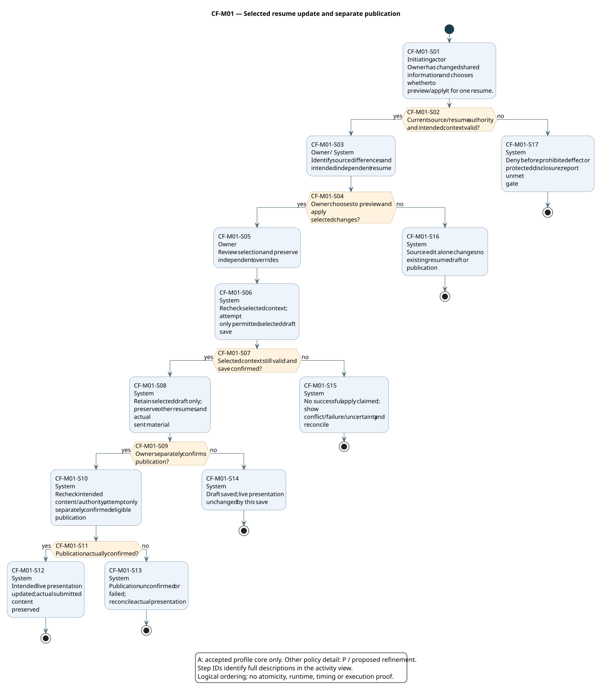

[Editable PlantUML](Diagrams/Activity-Profile-Apply-Publication.puml) · 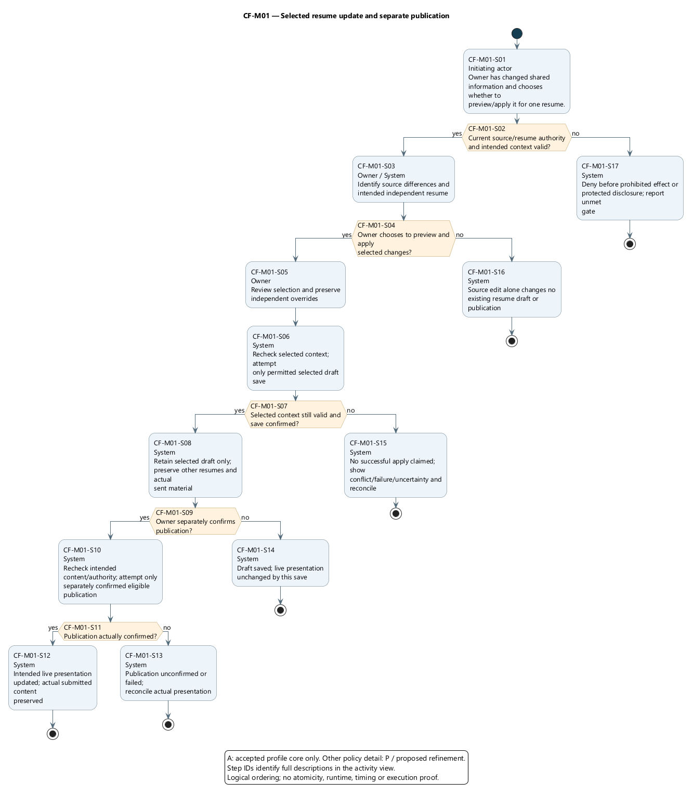

| Step | Kind / responsible context | Action or guard meaning |
| --- | --- | --- |
| **CF-M01-S01** | action; Initiating actor | Owner has changed shared information and chooses whether to preview/apply it for one resume. |
| **CF-M01-S02** | decision; Decision / current domain context | Current source/resume authority and intended context valid |
| **CF-M01-S03** | action; Owner / System | Identify source differences and intended independent resume |
| **CF-M01-S04** | decision; Decision / current domain context | Owner chooses to preview and apply selected changes |
| **CF-M01-S05** | action; Owner | Review selection and preserve independent overrides |
| **CF-M01-S06** | action; System | Recheck selected context; attempt only permitted selected draft save |
| **CF-M01-S07** | decision; Decision / current domain context | Selected context still valid and save confirmed |
| **CF-M01-S08** | action; System | Retain selected draft only; preserve other resumes and actual sent material |
| **CF-M01-S09** | decision; Decision / current domain context | Owner separately confirms publication |
| **CF-M01-S10** | action; System | Recheck intended content/authority; attempt only separately confirmed eligible publication |
| **CF-M01-S11** | decision; Decision / current domain context | Publication actually confirmed |
| **CF-M01-S12** | end; System | Intended live presentation updated; actual submitted content preserved |
| **CF-M01-S13** | end; System | Publication unconfirmed or failed; reconcile actual presentation |
| **CF-M01-S14** | end; System | Draft saved; live presentation unchanged by this save |
| **CF-M01-S15** | end; System | No successful apply claimed; show conflict/failure/uncertainty and reconcile |
| **CF-M01-S16** | end; System | Source edit alone changes no existing resume draft or publication |
| **CF-M01-S17** | end; System | Deny before prohibited effect or protected disclosure; report unmet gate |

###### CF-M02 — Download settings without link side effects

**Trigger:** Owner explicitly requests a download-configuration change.

**Start conditions:** Intended resume, current mode and language/artifact availability are identified.

**End condition:** Actual permitted mode/language choices are saved; link enabled/disabled state is not changed by this action.

**Alternative/failure meaning:** Unauthorized request changes no settings. Invalid/unavailable/failed processing is explicit; neither mode does not disable the resume page/link.

**Control-flow interpretation:** Mode selection is independent of link disablement and published-page visibility.

**Policy/evidence boundary:** Q-D10 mode timing and artifact details remain proposed; active-session/in-flight effects are not inferred. Artifact readiness and mode timing remain Q-D10 proposals. Neither-mode removes PDF choices, not protected-page access.

**Primary requirement basis:** [PDF-D02](../02-Requirements-Engineering/01-Software-Requirements-Specification/03-Requirements-Specification/11-Pdf-And-Controlled-Sharing.md#requirements-specification-pdf-and-controlled-sharing--heading-pdf-d02-uploaded-pdf-and-language-identity), [PDF-D03](../02-Requirements-Engineering/01-Software-Requirements-Specification/03-Requirements-Specification/11-Pdf-And-Controlled-Sharing.md#requirements-specification-pdf-and-controlled-sharing--heading-pdf-d03-per-resume-download-choices), [PDF-D05](../02-Requirements-Engineering/01-Software-Requirements-Specification/03-Requirements-Specification/11-Pdf-And-Controlled-Sharing.md#requirements-specification-pdf-and-controlled-sharing--heading-pdf-d05-direct-file-and-pdf-authorization), [PDF-D06](../02-Requirements-Engineering/01-Software-Requirements-Specification/03-Requirements-Specification/11-Pdf-And-Controlled-Sharing.md#requirements-specification-pdf-and-controlled-sharing--heading-pdf-d06-owner-password-and-link-controls), [ACC-D08](../02-Requirements-Engineering/01-Software-Requirements-Specification/03-Requirements-Specification/01-Accounts-Authentication-And-Permissions.md#requirements-specification-accounts-authentication-and-permissions--heading-acc-d08-owner-control-of-employer-link-access)

**Domain objects:** [DM-C03](02-Domain-And-Information-Analysis.md#analysis-domain-and-information-analysis--03-domain-model-and-object-oriented-view--id-dm-c03), [DM-C12](02-Domain-And-Information-Analysis.md#analysis-domain-and-information-analysis--03-domain-model-and-object-oriented-view--id-dm-c12), [DM-C10](02-Domain-And-Information-Analysis.md#analysis-domain-and-information-analysis--03-domain-model-and-object-oriented-view--id-dm-c10), [DM-C11](02-Domain-And-Information-Analysis.md#analysis-domain-and-information-analysis--03-domain-model-and-object-oriented-view--id-dm-c11), [DM-C13](02-Domain-And-Information-Analysis.md#analysis-domain-and-information-analysis--03-domain-model-and-object-oriented-view--id-dm-c13)

**Source use cases:** [UC-D02](../02-Requirements-Engineering/01-Software-Requirements-Specification/04-Scenarios-And-Models/02-User-Stories-And-Scenarios.md#scenarios-and-models-user-stories-and-scenarios--id-uc-d02)

**Information-flow meanings:** DA-F04, DA-F05 in [the data view](02-Domain-And-Information-Analysis.md#analysis-domain-and-information-analysis--05-data-oriented-view). These links describe information meaning; they are not new function-model completion evidence.

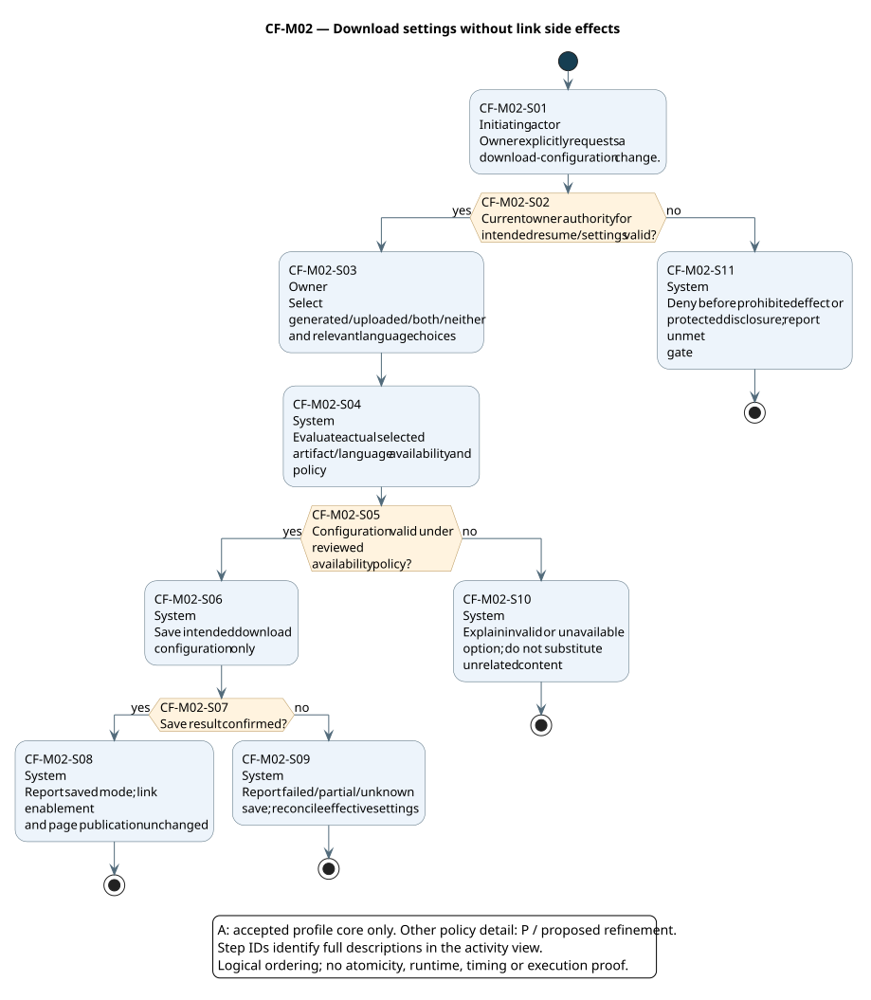

[Editable PlantUML](Diagrams/Activity-Pdf-Settings.puml) · 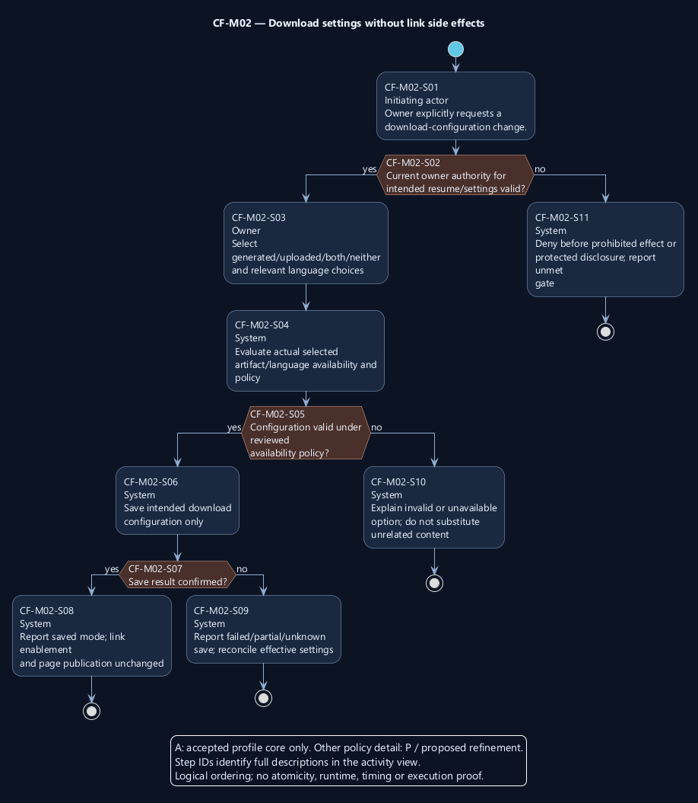

| Step | Kind / responsible context | Action or guard meaning |
| --- | --- | --- |
| **CF-M02-S01** | action; Initiating actor | Owner explicitly requests a download-configuration change. |
| **CF-M02-S02** | decision; Decision / current domain context | Current owner authority for intended resume/settings valid |
| **CF-M02-S03** | action; Owner | Select generated/uploaded/both/neither and relevant language choices |
| **CF-M02-S04** | action; System | Evaluate actual selected artifact/language availability and policy |
| **CF-M02-S05** | decision; Decision / current domain context | Configuration valid under reviewed availability policy |
| **CF-M02-S06** | action; System | Save intended download configuration only |
| **CF-M02-S07** | decision; Decision / current domain context | Save result confirmed |
| **CF-M02-S08** | end; System | Report saved mode; link enablement and page publication unchanged |
| **CF-M02-S09** | end; System | Report failed/partial/unknown save; reconcile effective settings |
| **CF-M02-S10** | end; System | Explain invalid or unavailable option; do not substitute unrelated content |
| **CF-M02-S11** | end; System | Deny before prohibited effect or protected disclosure; report unmet gate |

###### CF-M03 — Independent link disablement and fresh request

**Trigger:** Owner separately requests disablement of a specific link.

**Start conditions:** Link identity and current owner-control authority exist; no preceding PDF settings change is required.

**End condition:** After confirmed effective disablement, a fresh request cannot gain protected access through that link; download configuration is unchanged.

**Alternative/failure meaning:** Denied/failed/unconfirmed disablement is not reported complete. Already delivered bytes cannot be recalled; existing sessions/caches/in-flight effects remain policy-specific.

**Control-flow interpretation:** The post-disable check is a subsequent fresh-request observation, not an automatic viewer action or proof that delivered bytes vanished.

**Policy/evidence boundary:** Reuse the existing separate operation under UC-D02; do not allocate a new external use-case ID. Existing sessions, caches and in-flight output remain policy-specific proposals. Already delivered copies cannot be recalled.

**Primary requirement basis:** [PDF-D06](../02-Requirements-Engineering/01-Software-Requirements-Specification/03-Requirements-Specification/11-Pdf-And-Controlled-Sharing.md#requirements-specification-pdf-and-controlled-sharing--heading-pdf-d06-owner-password-and-link-controls), [ACC-D08](../02-Requirements-Engineering/01-Software-Requirements-Specification/03-Requirements-Specification/01-Accounts-Authentication-And-Permissions.md#requirements-specification-accounts-authentication-and-permissions--heading-acc-d08-owner-control-of-employer-link-access), [PDF-D05](../02-Requirements-Engineering/01-Software-Requirements-Specification/03-Requirements-Specification/11-Pdf-And-Controlled-Sharing.md#requirements-specification-pdf-and-controlled-sharing--heading-pdf-d05-direct-file-and-pdf-authorization)

**Domain objects:** [DM-C13](02-Domain-And-Information-Analysis.md#analysis-domain-and-information-analysis--03-domain-model-and-object-oriented-view--id-dm-c13), [DM-C48](02-Domain-And-Information-Analysis.md#analysis-domain-and-information-analysis--03-domain-model-and-object-oriented-view--id-dm-c48)

**Source use cases:** [UC-D02](../02-Requirements-Engineering/01-Software-Requirements-Specification/04-Scenarios-And-Models/02-User-Stories-And-Scenarios.md#scenarios-and-models-user-stories-and-scenarios--id-uc-d02)

**Information-flow meanings:** DA-F05 in [the data view](02-Domain-And-Information-Analysis.md#analysis-domain-and-information-analysis--05-data-oriented-view). These links describe information meaning; they are not new function-model completion evidence.

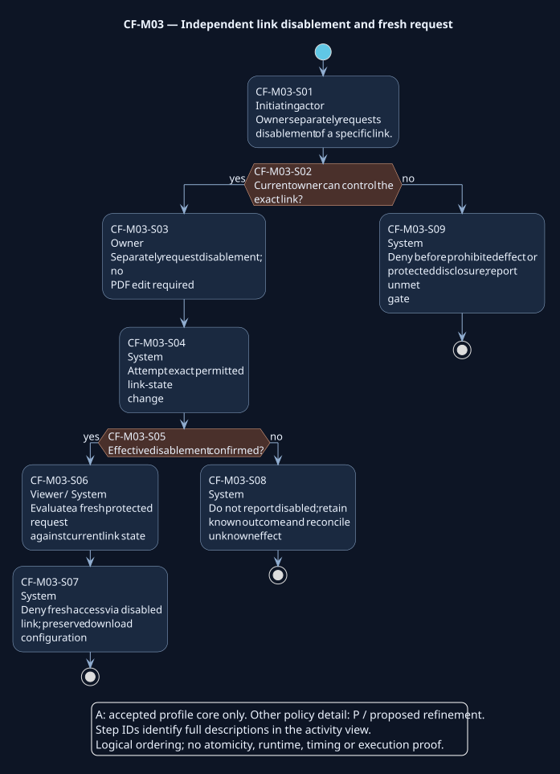

[Editable PlantUML](Diagrams/Activity-Disable-Sharing-Link.puml) · 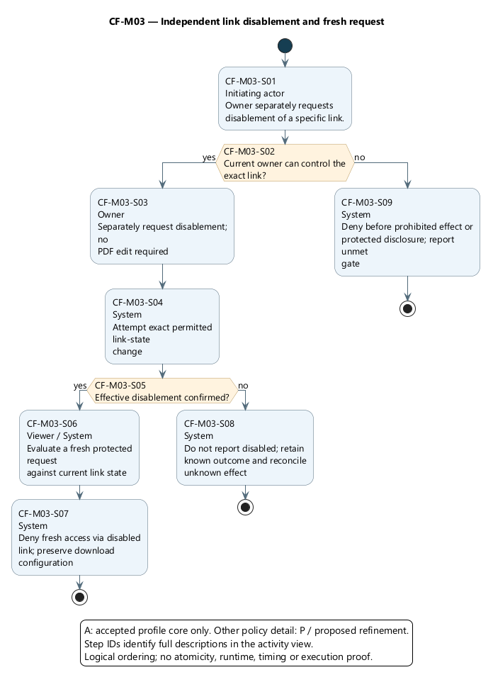

| Step | Kind / responsible context | Action or guard meaning |
| --- | --- | --- |
| **CF-M03-S01** | action; Initiating actor | Owner separately requests disablement of a specific link. |
| **CF-M03-S02** | decision; Decision / current domain context | Current owner can control the exact link |
| **CF-M03-S03** | action; Owner | Separately request disablement; no PDF edit required |
| **CF-M03-S04** | action; System | Attempt exact permitted link-state change |
| **CF-M03-S05** | decision; Decision / current domain context | Effective disablement confirmed |
| **CF-M03-S06** | action; Viewer / System | Evaluate a fresh protected request against current link state |
| **CF-M03-S07** | end; System | Deny fresh access via disabled link; preserve download configuration |
| **CF-M03-S08** | end; System | Do not report disabled; retain known outcome and reconcile unknown effect |
| **CF-M03-S09** | end; System | Deny before prohibited effect or protected disclosure; report unmet gate |

###### CF-M04 — Controlled page and artifact retrieval

**Trigger:** Employer viewer opens an intended link and requests a page, evidence or PDF.

**Start conditions:** Controlled link/password context and selected published content are identifiable; viewer account is not required.

**End condition:** Only currently permitted selected/available content is exposed; no private workspace or unrelated resource authority is granted.

**Alternative/failure meaning:** Wrong password, disabled link, altered resource and unselected content are denied. Missing language/artifact and retrieval failure are explicit; no unrelated fallback.

**Control-flow interpretation:** Viewer account is not required. Valid link/password context is limited to the intended selected resource, not every file.

**Policy/evidence boundary:** Password/session, exact revocation timing and language-fallback proposals retain Q-D05/Q-D09/Q-D11 status. Session/revocation timing and fallback remain proposed. Retrieval completion is not proof of the recipient reading the document.

**Primary requirement basis:** [PDF-D03](../02-Requirements-Engineering/01-Software-Requirements-Specification/03-Requirements-Specification/11-Pdf-And-Controlled-Sharing.md#requirements-specification-pdf-and-controlled-sharing--heading-pdf-d03-per-resume-download-choices), [PDF-D04](../02-Requirements-Engineering/01-Software-Requirements-Specification/03-Requirements-Specification/11-Pdf-And-Controlled-Sharing.md#requirements-specification-pdf-and-controlled-sharing--heading-pdf-d04-scoped-password-protected-employer-access), [PDF-D05](../02-Requirements-Engineering/01-Software-Requirements-Specification/03-Requirements-Specification/11-Pdf-And-Controlled-Sharing.md#requirements-specification-pdf-and-controlled-sharing--heading-pdf-d05-direct-file-and-pdf-authorization), [PDF-D06](../02-Requirements-Engineering/01-Software-Requirements-Specification/03-Requirements-Specification/11-Pdf-And-Controlled-Sharing.md#requirements-specification-pdf-and-controlled-sharing--heading-pdf-d06-owner-password-and-link-controls), [ACC-D06](../02-Requirements-Engineering/01-Software-Requirements-Specification/03-Requirements-Specification/01-Accounts-Authentication-And-Permissions.md#requirements-specification-accounts-authentication-and-permissions--heading-acc-d06-employer-access-without-a-viewer-account), [ACC-D07](../02-Requirements-Engineering/01-Software-Requirements-Specification/03-Requirements-Specification/01-Accounts-Authentication-And-Permissions.md#requirements-specification-accounts-authentication-and-permissions--heading-acc-d07-protected-shared-file-and-pdf-retrieval)

**Domain objects:** [DM-C13](02-Domain-And-Information-Analysis.md#analysis-domain-and-information-analysis--03-domain-model-and-object-oriented-view--id-dm-c13), [DM-C09](02-Domain-And-Information-Analysis.md#analysis-domain-and-information-analysis--03-domain-model-and-object-oriented-view--id-dm-c09), [DM-C07](02-Domain-And-Information-Analysis.md#analysis-domain-and-information-analysis--03-domain-model-and-object-oriented-view--id-dm-c07), [DM-C12](02-Domain-And-Information-Analysis.md#analysis-domain-and-information-analysis--03-domain-model-and-object-oriented-view--id-dm-c12), [DM-C10](02-Domain-And-Information-Analysis.md#analysis-domain-and-information-analysis--03-domain-model-and-object-oriented-view--id-dm-c10), [DM-C11](02-Domain-And-Information-Analysis.md#analysis-domain-and-information-analysis--03-domain-model-and-object-oriented-view--id-dm-c11)

**Source use cases:** [UC-D03](../02-Requirements-Engineering/01-Software-Requirements-Specification/04-Scenarios-And-Models/02-User-Stories-And-Scenarios.md#scenarios-and-models-user-stories-and-scenarios--id-uc-d03)

**Information-flow meanings:** DA-F05 in [the data view](02-Domain-And-Information-Analysis.md#analysis-domain-and-information-analysis--05-data-oriented-view). These links describe information meaning; they are not new function-model completion evidence.

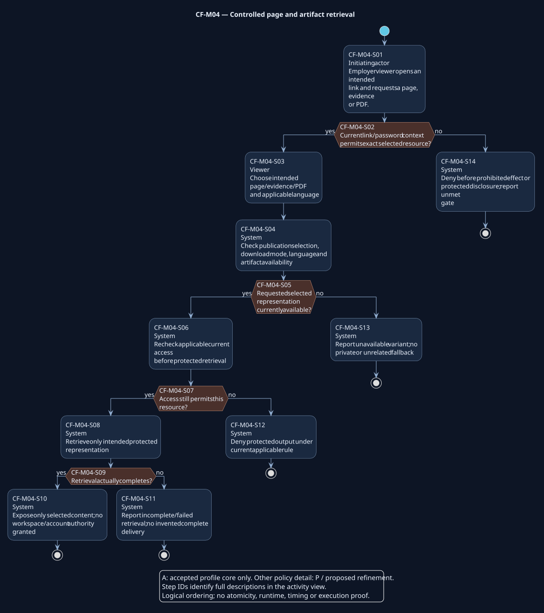

[Editable PlantUML](Diagrams/Activity-Protected-Retrieval.puml) · 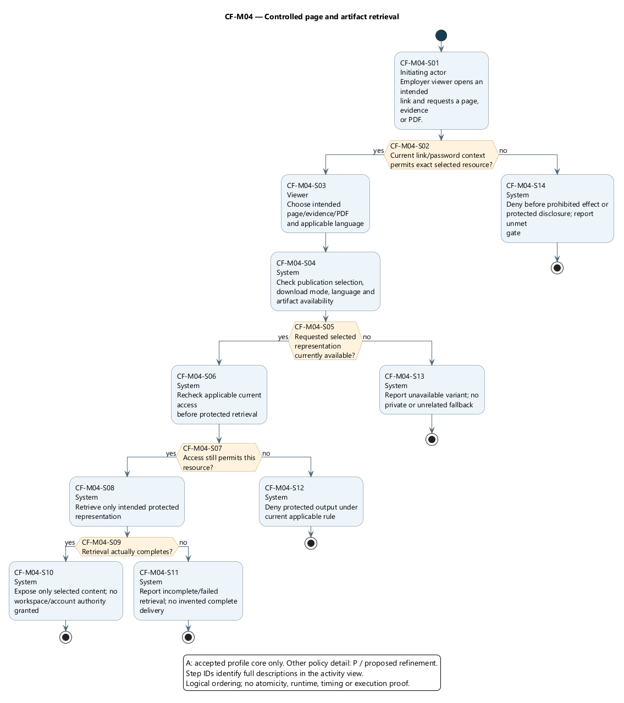

| Step | Kind / responsible context | Action or guard meaning |
| --- | --- | --- |
| **CF-M04-S01** | action; Initiating actor | Employer viewer opens an intended link and requests a page, evidence or PDF. |
| **CF-M04-S02** | decision; Decision / current domain context | Current link/password context permits exact selected resource |
| **CF-M04-S03** | action; Viewer | Choose intended page/evidence/PDF and applicable language |
| **CF-M04-S04** | action; System | Check publication selection, download mode, language and artifact availability |
| **CF-M04-S05** | decision; Decision / current domain context | Requested selected representation currently available |
| **CF-M04-S06** | action; System | Recheck applicable current access before protected retrieval |
| **CF-M04-S07** | decision; Decision / current domain context | Access still permits this resource |
| **CF-M04-S08** | action; System | Retrieve only intended protected representation |
| **CF-M04-S09** | decision; Decision / current domain context | Retrieval actually completes |
| **CF-M04-S10** | end; System | Expose only selected content; no workspace/account authority granted |
| **CF-M04-S11** | end; System | Report incomplete/failed retrieval; no invented complete delivery |
| **CF-M04-S12** | end; System | Deny protected output under current applicable rule |
| **CF-M04-S13** | end; System | Report unavailable variant; no private or unrelated fallback |
| **CF-M04-S14** | end; System | Deny before prohibited effect or protected disclosure; report unmet gate |

###### CF-M05 — Manual application preparation or progress recording

**Trigger:** Applicant prepares an application or explicitly updates progress.

**Start conditions:** Permitted company/opportunity, application and selected-resume contexts are identified.

**End condition:** Actual preparation is retained; separately permitted progress records reflect the requested transition, not inferred external receipt.

**Alternative/failure meaning:** Inaccessible resume/application is denied. Incomplete drafts follow proposed rules; save failure/conflict is explicit; correction preserves required time/history context.

**Control-flow interpretation:** Preparation and progress update are alternative requested goals, not mandatory sequential steps.

**Policy/evidence boundary:** Q-D12 fields/states, Q-D13 capture coupling and Q-D14 correction details remain proposed. Normal state routes do not define every manual correction/import route. Actual submission and capture completeness remain separate.

**Primary requirement basis:** [APP-D01](../02-Requirements-Engineering/01-Software-Requirements-Specification/03-Requirements-Specification/09-Manual-Application-Management.md#requirements-specification-manual-application-management--heading-app-d01-company-and-opportunity-context), [APP-D02](../02-Requirements-Engineering/01-Software-Requirements-Specification/03-Requirements-Specification/09-Manual-Application-Management.md#requirements-specification-manual-application-management--heading-app-d02-relevant-resume-association), [APP-D03](../02-Requirements-Engineering/01-Software-Requirements-Specification/03-Requirements-Specification/09-Manual-Application-Management.md#requirements-specification-manual-application-management--heading-app-d03-manually-authored-cover-letter), [APP-D04](../02-Requirements-Engineering/01-Software-Requirements-Specification/03-Requirements-Specification/09-Manual-Application-Management.md#requirements-specification-manual-application-management--heading-app-d04-explicit-progress-states-and-transitions), [APP-D05](../02-Requirements-Engineering/01-Software-Requirements-Specification/03-Requirements-Specification/09-Manual-Application-Management.md#requirements-specification-manual-application-management--heading-app-d05-user-directed-submission-recording)

**Domain objects:** [DM-C14](02-Domain-And-Information-Analysis.md#analysis-domain-and-information-analysis--03-domain-model-and-object-oriented-view--id-dm-c14), [DM-C15](02-Domain-And-Information-Analysis.md#analysis-domain-and-information-analysis--03-domain-model-and-object-oriented-view--id-dm-c15), [DM-C16](02-Domain-And-Information-Analysis.md#analysis-domain-and-information-analysis--03-domain-model-and-object-oriented-view--id-dm-c16), [DM-C17](02-Domain-And-Information-Analysis.md#analysis-domain-and-information-analysis--03-domain-model-and-object-oriented-view--id-dm-c17), [DM-C03](02-Domain-And-Information-Analysis.md#analysis-domain-and-information-analysis--03-domain-model-and-object-oriented-view--id-dm-c03)

**Source use cases:** [UC-D04](../02-Requirements-Engineering/01-Software-Requirements-Specification/04-Scenarios-And-Models/02-User-Stories-And-Scenarios.md#scenarios-and-models-user-stories-and-scenarios--id-uc-d04)

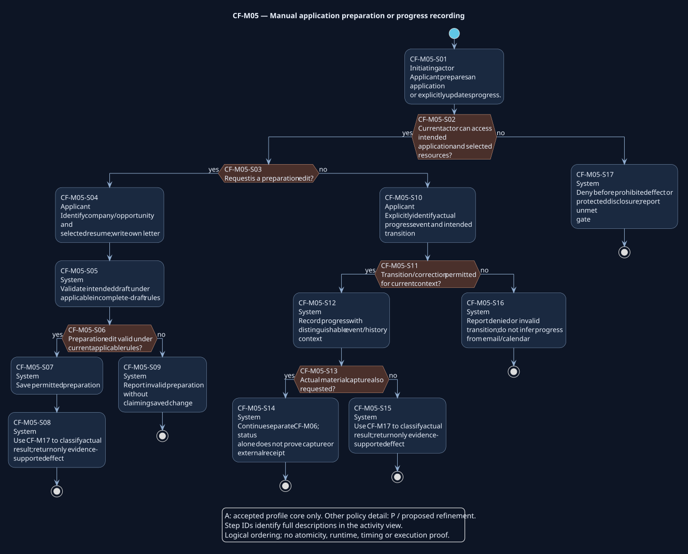

[Editable PlantUML](Diagrams/Activity-Application-Preparation.puml) · 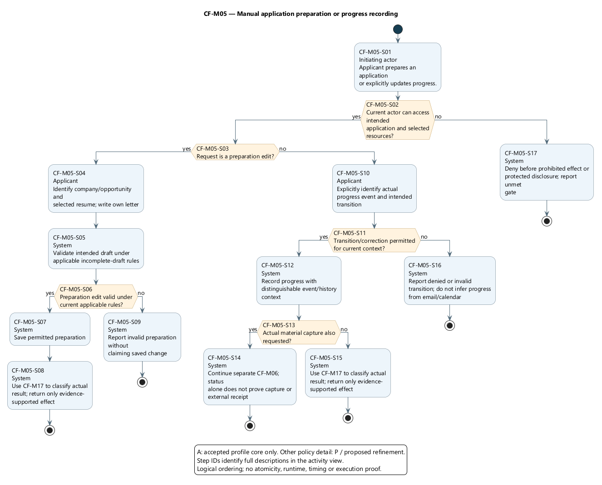

| Step | Kind / responsible context | Action or guard meaning |
| --- | --- | --- |
| **CF-M05-S01** | action; Initiating actor | Applicant prepares an application or explicitly updates progress. |
| **CF-M05-S02** | decision; Decision / current domain context | Current actor can access intended application and selected resources |
| **CF-M05-S03** | decision; Decision / current domain context | Request is a preparation edit |
| **CF-M05-S04** | action; Applicant | Identify company/opportunity and selected resume; write own letter |
| **CF-M05-S05** | action; System | Validate intended draft under applicable incomplete-draft rules |
| **CF-M05-S06** | decision; Decision / current domain context | Preparation edit valid under current applicable rules |
| **CF-M05-S07** | action; System | Save permitted preparation |
| **CF-M05-S08** | end; System | Use CF-M17 to classify actual result; return only evidence-supported effect |
| **CF-M05-S09** | end; System | Report invalid preparation without claiming saved change |
| **CF-M05-S10** | action; Applicant | Explicitly identify actual progress event and intended transition |
| **CF-M05-S11** | decision; Decision / current domain context | Transition/correction permitted for current context |
| **CF-M05-S12** | action; System | Record progress with distinguishable event/history context |
| **CF-M05-S13** | decision; Decision / current domain context | Actual material capture also requested |
| **CF-M05-S14** | end; System | Continue separate CF-M06; status alone does not prove capture or external receipt |
| **CF-M05-S15** | end; System | Use CF-M17 to classify actual result; return only evidence-supported effect |
| **CF-M05-S16** | end; System | Report denied or invalid transition; do not infer progress from email/calendar |
| **CF-M05-S17** | end; System | Deny before prohibited effect or protected disclosure; report unmet gate |

###### CF-M06 — Capture actual submitted materials

**Trigger:** Applicant identifies actual submitted resume/letter material for the intended application.

**Start conditions:** Actor/application authority and actual claimed material/event context are available; current live content is not presumed identical.

**End condition:** Confirmed captured material remains identifiable independently of later edits/publication; incomplete capture cannot claim complete preservation.

**Alternative/failure meaning:** Wrong-owner retrieval/change is denied. Actual upload may differ from current PDF. Missing/failed capture is incomplete/failed; corrections/resubmissions preserve distinguishable prior/new context.

**Control-flow interpretation:** A new submission or correction keeps distinguishable event/set context rather than silently replacing prior actual history.

**Policy/evidence boundary:** Q-D13 completeness/provenance and Q-D14 correction/retention remain proposed; accepted historical independence is already settled. Historical independence is accepted; detailed completeness/provenance/retention/correction policy remains proposed.

**Primary requirement basis:** [APP-D05](../02-Requirements-Engineering/01-Software-Requirements-Specification/03-Requirements-Specification/09-Manual-Application-Management.md#requirements-specification-manual-application-management--heading-app-d05-user-directed-submission-recording), [APP-D06](../02-Requirements-Engineering/01-Software-Requirements-Specification/03-Requirements-Specification/09-Manual-Application-Management.md#requirements-specification-manual-application-management--heading-app-d06-preserved-actual-submitted-copies), [APP-D07](../02-Requirements-Engineering/01-Software-Requirements-Specification/03-Requirements-Specification/09-Manual-Application-Management.md#requirements-specification-manual-application-management--heading-app-d07-correction-and-repeated-submissions), [APP-D09](../02-Requirements-Engineering/01-Software-Requirements-Specification/03-Requirements-Specification/09-Manual-Application-Management.md#requirements-specification-manual-application-management--heading-app-d09-private-access-archive-and-recovery), [PDF-D08](../02-Requirements-Engineering/01-Software-Requirements-Specification/03-Requirements-Specification/11-Pdf-And-Controlled-Sharing.md#requirements-specification-pdf-and-controlled-sharing--heading-pdf-d08-downloaded-copy-and-submission-distinctions)

**Domain objects:** [DM-C16](02-Domain-And-Information-Analysis.md#analysis-domain-and-information-analysis--03-domain-model-and-object-oriented-view--id-dm-c16), [DM-C18](02-Domain-And-Information-Analysis.md#analysis-domain-and-information-analysis--03-domain-model-and-object-oriented-view--id-dm-c18), [DM-C19](02-Domain-And-Information-Analysis.md#analysis-domain-and-information-analysis--03-domain-model-and-object-oriented-view--id-dm-c19), [DM-C10](02-Domain-And-Information-Analysis.md#analysis-domain-and-information-analysis--03-domain-model-and-object-oriented-view--id-dm-c10), [DM-C11](02-Domain-And-Information-Analysis.md#analysis-domain-and-information-analysis--03-domain-model-and-object-oriented-view--id-dm-c11), [DM-C17](02-Domain-And-Information-Analysis.md#analysis-domain-and-information-analysis--03-domain-model-and-object-oriented-view--id-dm-c17)

**Source use cases:** [UC-D05](../02-Requirements-Engineering/01-Software-Requirements-Specification/04-Scenarios-And-Models/02-User-Stories-And-Scenarios.md#scenarios-and-models-user-stories-and-scenarios--id-uc-d05)

**Information-flow meanings:** DA-F06 in [the data view](02-Domain-And-Information-Analysis.md#analysis-domain-and-information-analysis--05-data-oriented-view). These links describe information meaning; they are not new function-model completion evidence.

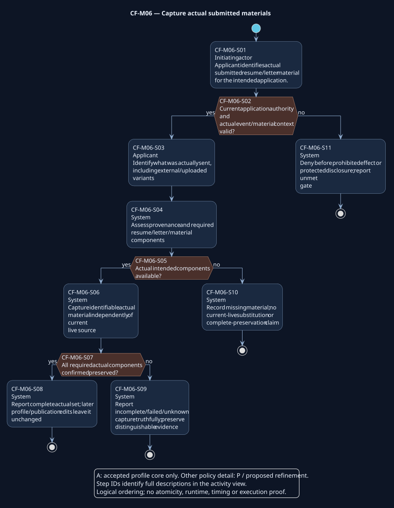

[Editable PlantUML](Diagrams/Activity-Actual-Submission-Capture.puml) · 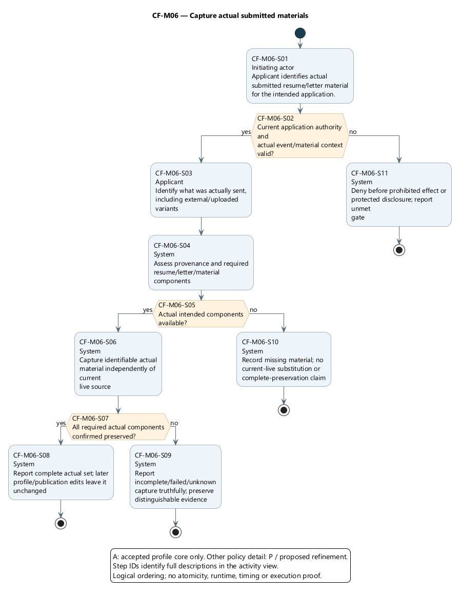

| Step | Kind / responsible context | Action or guard meaning |
| --- | --- | --- |
| **CF-M06-S01** | action; Initiating actor | Applicant identifies actual submitted resume/letter material for the intended application. |
| **CF-M06-S02** | decision; Decision / current domain context | Current application authority and actual event/material context valid |
| **CF-M06-S03** | action; Applicant | Identify what was actually sent, including external/uploaded variants |
| **CF-M06-S04** | action; System | Assess provenance and required resume/letter/material components |
| **CF-M06-S05** | decision; Decision / current domain context | Actual intended components available |
| **CF-M06-S06** | action; System | Capture identifiable actual material independently of current live source |
| **CF-M06-S07** | decision; Decision / current domain context | All required actual components confirmed preserved |
| **CF-M06-S08** | end; System | Report complete actual set; later profile/publication edits leave it unchanged |
| **CF-M06-S09** | end; System | Report incomplete/failed/unknown capture truthfully; preserve distinguishable evidence |
| **CF-M06-S10** | end; System | Record missing material; no current-live substitution or complete-preservation claim |
| **CF-M06-S11** | end; System | Deny before prohibited effect or protected disclosure; report unmet gate |

###### CF-M07 — Read correspondence or deliberately send

**Trigger:** User separately requests correspondence reading or a reviewed send/reply.

**Start conditions:** Intended account, product/resource authority and provider capability must be valid for the chosen operation; controlled access is a future gate.

**End condition:** Read exposes permitted content; send/reply reports only provider-supported acceptance, failure or uncertainty, never invented delivery/read.

**Alternative/failure meaning:** Missing/revoked/wrong-account authority prevents provider action. Unknown send is reconciled before a proposed explicit retry; no blind duplicate send.

**Control-flow interpretation:** Read capability and send capability are distinct. Timeout after submission is not evidence that a resend is safe.

**Policy/evidence boundary:** Q-D15 actual OAuth/access remains unestablished. Q-D16 compose/reply/draft/repetition policies are proposals, not verified behavior. OAuth is not configured. This is conditional future behavior, not an active connection. Composition/draft/reply/repetition detail remains proposed.

**Primary requirement basis:** [EGC-D01](../02-Requirements-Engineering/01-Software-Requirements-Specification/03-Requirements-Specification/06-Email-Calendar-And-Google-Integration.md#requirements-specification-email-calendar-and-google-integration--heading-egc-d01-authorized-connection-and-account-context), [EGC-D02](../02-Requirements-Engineering/01-Software-Requirements-Specification/03-Requirements-Specification/06-Email-Calendar-And-Google-Integration.md#requirements-specification-email-calendar-and-google-integration--heading-egc-d02-justified-permissions-and-private-resource-isolation), [EGC-D03](../02-Requirements-Engineering/01-Software-Requirements-Specification/03-Requirements-Specification/06-Email-Calendar-And-Google-Integration.md#requirements-specification-email-calendar-and-google-integration--heading-egc-d03-read-authorized-correspondence), [EGC-D04](../02-Requirements-Engineering/01-Software-Requirements-Specification/03-Requirements-Specification/06-Email-Calendar-And-Google-Integration.md#requirements-specification-email-calendar-and-google-integration--heading-egc-d04-manual-compose-and-draft-handling), [EGC-D05](../02-Requirements-Engineering/01-Software-Requirements-Specification/03-Requirements-Specification/06-Email-Calendar-And-Google-Integration.md#requirements-specification-email-calendar-and-google-integration--heading-egc-d05-deliberate-send-and-truthful-outcome), [EGC-D06](../02-Requirements-Engineering/01-Software-Requirements-Specification/03-Requirements-Specification/06-Email-Calendar-And-Google-Integration.md#requirements-specification-email-calendar-and-google-integration--heading-egc-d06-reply-context-and-conversation-association), [EGC-D11](../02-Requirements-Engineering/01-Software-Requirements-Specification/03-Requirements-Specification/06-Email-Calendar-And-Google-Integration.md#requirements-specification-email-calendar-and-google-integration--heading-egc-d11-disconnect-revocation-and-reconnect), [EGC-D12](../02-Requirements-Engineering/01-Software-Requirements-Specification/03-Requirements-Specification/06-Email-Calendar-And-Google-Integration.md#requirements-specification-email-calendar-and-google-integration--heading-egc-d12-bounded-failures-recovery-and-feasibility-evidence), [EIF-D08](../02-Requirements-Engineering/01-Software-Requirements-Specification/03-Requirements-Specification/07-External-Interface-Requirements.md#requirements-specification-external-interface-requirements--heading-eif-d08-operation-specific-failure-and-repetition-semantics)

**Domain objects:** [DM-C20](02-Domain-And-Information-Analysis.md#analysis-domain-and-information-analysis--03-domain-model-and-object-oriented-view--id-dm-c20), [DM-C21](02-Domain-And-Information-Analysis.md#analysis-domain-and-information-analysis--03-domain-model-and-object-oriented-view--id-dm-c21)

**Source use cases:** [UC-D06](../02-Requirements-Engineering/01-Software-Requirements-Specification/04-Scenarios-And-Models/02-User-Stories-And-Scenarios.md#scenarios-and-models-user-stories-and-scenarios--id-uc-d06), [UC-D06-READ](../02-Requirements-Engineering/01-Software-Requirements-Specification/04-Scenarios-And-Models/02-User-Stories-And-Scenarios.md#scenarios-and-models-user-stories-and-scenarios--id-uc-d06-read), [UC-D06-SEND](../02-Requirements-Engineering/01-Software-Requirements-Specification/04-Scenarios-And-Models/02-User-Stories-And-Scenarios.md#scenarios-and-models-user-stories-and-scenarios--id-uc-d06-send)

**Information-flow meanings:** DA-F07 in [the data view](02-Domain-And-Information-Analysis.md#analysis-domain-and-information-analysis--05-data-oriented-view). These links describe information meaning; they are not new function-model completion evidence.

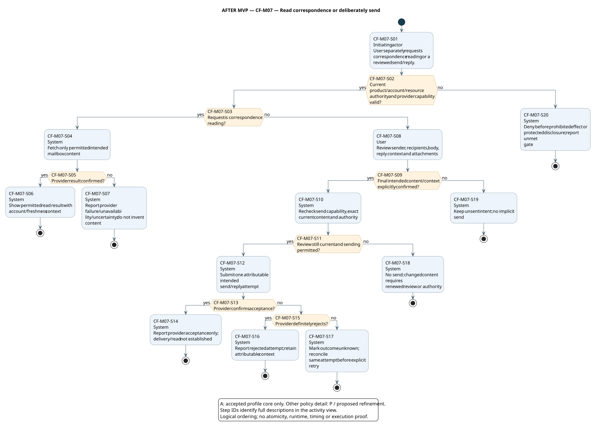

[Editable PlantUML](Diagrams/Activity-Gmail-Read-Send-Outcomes.puml) · 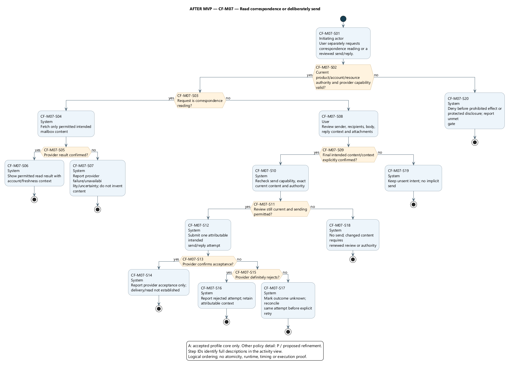

| Step | Kind / responsible context | Action or guard meaning |
| --- | --- | --- |
| **CF-M07-S01** | action; Initiating actor | User separately requests correspondence reading or a reviewed send/reply. |
| **CF-M07-S02** | decision; Decision / current domain context | Current product/account/resource authority and provider capability valid |
| **CF-M07-S03** | decision; Decision / current domain context | Request is correspondence reading |
| **CF-M07-S04** | action; System | Fetch only permitted intended mailbox content |
| **CF-M07-S05** | decision; Decision / current domain context | Provider result confirmed |
| **CF-M07-S06** | end; System | Show permitted read result with account/freshness context |
| **CF-M07-S07** | end; System | Report provider failure/unavailability/uncertainty; do not invent content |
| **CF-M07-S08** | action; User | Review sender, recipients, body, reply context and attachments |
| **CF-M07-S09** | decision; Decision / current domain context | Final intended content/context explicitly confirmed |
| **CF-M07-S10** | action; System | Recheck send capability, exact current content and authority |
| **CF-M07-S11** | decision; Decision / current domain context | Review still current and sending permitted |
| **CF-M07-S12** | action; System | Submit one attributable intended send/reply attempt |
| **CF-M07-S13** | decision; Decision / current domain context | Provider confirms acceptance |
| **CF-M07-S14** | end; System | Report provider acceptance only; delivery/read not established |
| **CF-M07-S15** | decision; Decision / current domain context | Provider definitely rejects |
| **CF-M07-S16** | end; System | Report rejected attempt; retain attributable context |
| **CF-M07-S17** | end; System | Mark outcome unknown; reconcile same attempt before explicit retry |
| **CF-M07-S18** | end; System | No send; changed content requires renewed review or authority |
| **CF-M07-S19** | end; System | Keep unsent intent; no implicit send |
| **CF-M07-S20** | end; System | Deny before prohibited effect or protected disclosure; report unmet gate |

###### CF-M08 — Local activity versus selected calendar synchronization

**After MVP.** Shared operating and recovery controls still apply where relevant.

**Trigger:** User requests a local activity action or a separate agreed synchronization action.

**Start conditions:** Actor/activity context, time meaning and optional selected provider mapping are identified; synchronization requires applicable connection authority.

**End condition:** Only the permitted local/provider action is reported; time, mapping, conflict/freshness and local notes/associations retain correct context.

**Alternative/failure meaning:** Wrong grant denies action. Concurrent local/provider changes are not silently overwritten. Missing/revoked access and uncertain provider update stay distinguishable; reconnect does not replay stale work.

**Control-flow interpretation:** Local save, mapping, provider mutation and local unlink are distinct goals. Local unlink does not require a functioning provider connection; reconnect does not authorize blind replay.

**Policy/evidence boundary:** Q-D17 direction/time/conflict/deletion/reconnect policies are proposed. Reminders require separately available delivery capability. Time-zone, conflict, direction, deletion and reminder policies retain Q-D17 proposal status; no reminder delivery capability is invented.

**Primary requirement basis:** [EGC-D07](../02-Requirements-Engineering/01-Software-Requirements-Specification/03-Requirements-Specification/06-Email-Calendar-And-Google-Integration.md#requirements-specification-email-calendar-and-google-integration--heading-egc-d07-calendar-activities-and-time-meaning), [EGC-D08](../02-Requirements-Engineering/01-Software-Requirements-Specification/03-Requirements-Specification/06-Email-Calendar-And-Google-Integration.md#requirements-specification-email-calendar-and-google-integration--heading-egc-d08-explicit-synchronization-contract), [EGC-D09](../02-Requirements-Engineering/01-Software-Requirements-Specification/03-Requirements-Specification/06-Email-Calendar-And-Google-Integration.md#requirements-specification-email-calendar-and-google-integration--heading-egc-d09-application-relationships-preserve-boundaries), [EGC-D10](../02-Requirements-Engineering/01-Software-Requirements-Specification/03-Requirements-Specification/06-Email-Calendar-And-Google-Integration.md#requirements-specification-email-calendar-and-google-integration--heading-egc-d10-reminders-and-notification-outcomes), [EGC-D11](../02-Requirements-Engineering/01-Software-Requirements-Specification/03-Requirements-Specification/06-Email-Calendar-And-Google-Integration.md#requirements-specification-email-calendar-and-google-integration--heading-egc-d11-disconnect-revocation-and-reconnect), [EGC-D12](../02-Requirements-Engineering/01-Software-Requirements-Specification/03-Requirements-Specification/06-Email-Calendar-And-Google-Integration.md#requirements-specification-email-calendar-and-google-integration--heading-egc-d12-bounded-failures-recovery-and-feasibility-evidence)

**Domain objects:** [DM-C20](02-Domain-And-Information-Analysis.md#analysis-domain-and-information-analysis--03-domain-model-and-object-oriented-view--id-dm-c20), [DM-C22](02-Domain-And-Information-Analysis.md#analysis-domain-and-information-analysis--03-domain-model-and-object-oriented-view--id-dm-c22), [DM-C23](02-Domain-And-Information-Analysis.md#analysis-domain-and-information-analysis--03-domain-model-and-object-oriented-view--id-dm-c23), [DM-C16](02-Domain-And-Information-Analysis.md#analysis-domain-and-information-analysis--03-domain-model-and-object-oriented-view--id-dm-c16)

**Source use cases:** [UC-D06](../02-Requirements-Engineering/01-Software-Requirements-Specification/04-Scenarios-And-Models/02-User-Stories-And-Scenarios.md#scenarios-and-models-user-stories-and-scenarios--id-uc-d06), [UC-D06-ACTIVITY](../02-Requirements-Engineering/01-Software-Requirements-Specification/04-Scenarios-And-Models/02-User-Stories-And-Scenarios.md#scenarios-and-models-user-stories-and-scenarios--id-uc-d06-activity), [UC-D06-SYNC](../02-Requirements-Engineering/01-Software-Requirements-Specification/04-Scenarios-And-Models/02-User-Stories-And-Scenarios.md#scenarios-and-models-user-stories-and-scenarios--id-uc-d06-sync)

**Information-flow meanings:** DA-F08 in [the data view](02-Domain-And-Information-Analysis.md#analysis-domain-and-information-analysis--05-data-oriented-view). These links describe information meaning; they are not new function-model completion evidence.

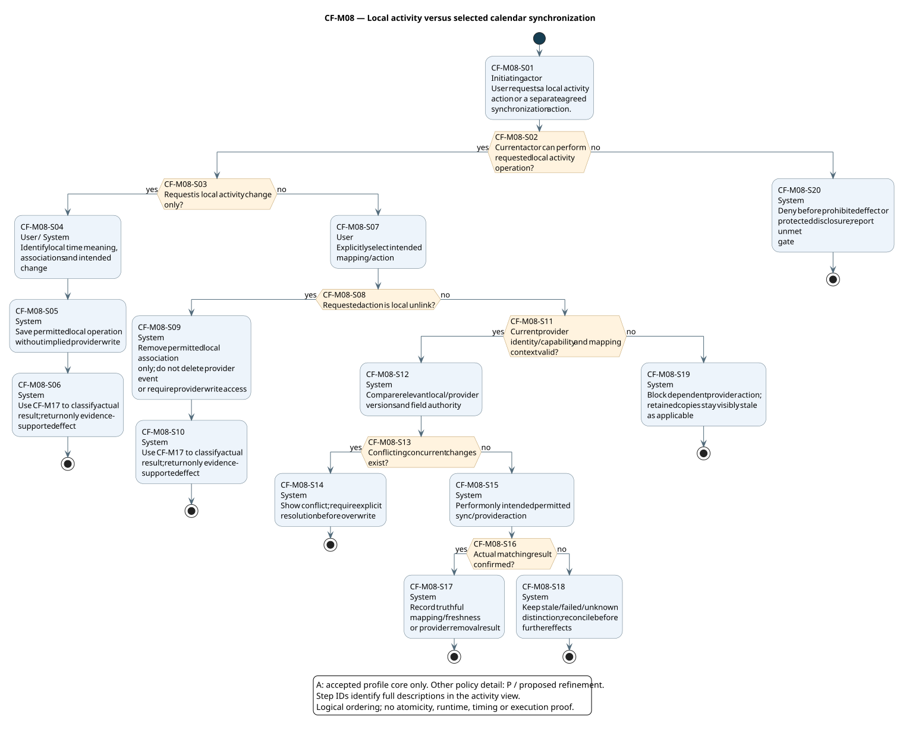

[Editable PlantUML](Diagrams/Activity-Calendar-Local-Sync.puml) · 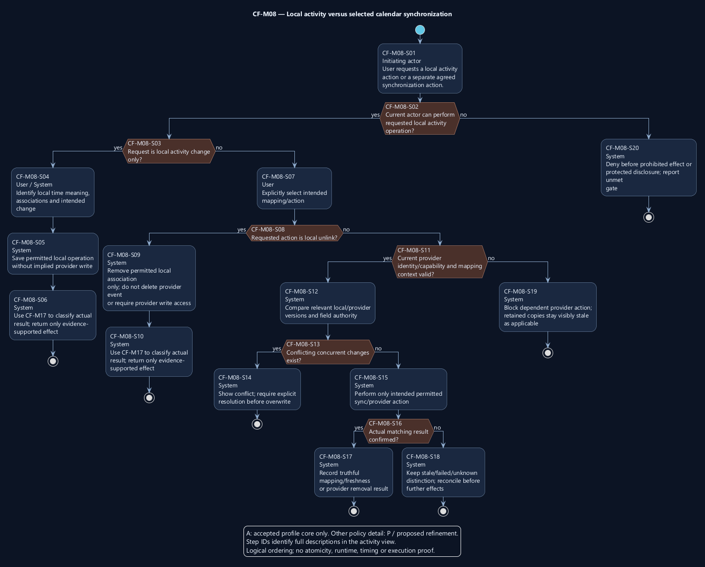

| Step | Kind / responsible context | Action or guard meaning |
| --- | --- | --- |
| **CF-M08-S01** | action; Initiating actor | User requests a local activity action or a separate agreed synchronization action. |
| **CF-M08-S02** | decision; Decision / current domain context | Current actor can perform requested local activity operation |
| **CF-M08-S03** | decision; Decision / current domain context | Request is local activity change only |
| **CF-M08-S04** | action; User / System | Identify local time meaning, associations and intended change |
| **CF-M08-S05** | action; System | Save permitted local operation without implied provider write |
| **CF-M08-S06** | end; System | Use CF-M17 to classify actual result; return only evidence-supported effect |
| **CF-M08-S07** | action; User | Explicitly select intended mapping/action |
| **CF-M08-S08** | decision; Decision / current domain context | Requested action is local unlink |
| **CF-M08-S09** | action; System | Remove permitted local association only; do not delete provider event or require provider write access |
| **CF-M08-S10** | end; System | Use CF-M17 to classify actual result; return only evidence-supported effect |
| **CF-M08-S11** | decision; Decision / current domain context | Current provider identity/capability and mapping context valid |
| **CF-M08-S12** | action; System | Compare relevant local/provider versions and field authority |
| **CF-M08-S13** | decision; Decision / current domain context | Conflicting concurrent changes exist |
| **CF-M08-S14** | end; System | Show conflict; require explicit resolution before overwrite |
| **CF-M08-S15** | action; System | Perform only intended permitted sync/provider action |
| **CF-M08-S16** | decision; Decision / current domain context | Actual matching result confirmed |
| **CF-M08-S17** | end; System | Record truthful mapping/freshness or provider removal result |
| **CF-M08-S18** | end; System | Keep stale/failed/unknown distinction; reconcile before further effects |
| **CF-M08-S19** | end; System | Block dependent provider action; retained copies stay visibly stale as applicable |
| **CF-M08-S20** | end; System | Deny before prohibited effect or protected disclosure; report unmet gate |

###### CF-M09 — Refinement, Sprint planning and Sprint completion

**After MVP.** Shared operating and recovery controls still apply where relevant.

**Trigger:** Authorized participant requests refinement, Sprint-plan change or a separate Sprint-end action.

**Start conditions:** Intended project/item/Sprint and current authority/state are identified; source-required relationship/transition policies govern the action.

**End condition:** Task refinement, coherent goal/items/plan or actual Sprint outcome is retained for the requested operation, without equating task progress with item acceptance.

**Alternative/failure meaning:** Denied or stale/conflicting moves do not succeed. Incomplete work stays identifiable and is not silently accepted, erased or automatically carried over.

**Control-flow interpretation:** Three alternative goals are not one mandatory giant transaction. Task completion does not automatically accept a backlog item; period end does not imply goal achieved.

**Policy/evidence boundary:** Q-D18/Q-D19 counts/states/acceptance/carry-over/concurrency are proposed; accepted one-composite-Sprint-Backlog meaning is preserved. Readiness-as-predicate is SM-F01 proposed refinement. No extra team, fixed cadence, count or automatic carryover is introduced.

**Primary requirement basis:** [PKS-D03](../02-Requirements-Engineering/01-Software-Requirements-Specification/03-Requirements-Specification/13-Projects-Kanban-And-Sprints.md#requirements-specification-projects-kanban-and-sprints--heading-pks-d03-product-backlog-and-item-definition), [PKS-D04](../02-Requirements-Engineering/01-Software-Requirements-Specification/03-Requirements-Specification/13-Projects-Kanban-And-Sprints.md#requirements-specification-projects-kanban-and-sprints--heading-pks-d04-item-refinement-and-task-relationships), [PKS-D05](../02-Requirements-Engineering/01-Software-Requirements-Specification/03-Requirements-Specification/13-Projects-Kanban-And-Sprints.md#requirements-specification-projects-kanban-and-sprints--heading-pks-d05-assignment-priority-and-due-date-handling), [PKS-D07](../02-Requirements-Engineering/01-Software-Requirements-Specification/03-Requirements-Specification/13-Projects-Kanban-And-Sprints.md#requirements-specification-projects-kanban-and-sprints--heading-pks-d07-sprint-goal-and-selected-backlog-items), [PKS-D08](../02-Requirements-Engineering/01-Software-Requirements-Specification/03-Requirements-Specification/13-Projects-Kanban-And-Sprints.md#requirements-specification-projects-kanban-and-sprints--heading-pks-d08-one-coherent-sprint-backlog), [PKS-D09](../02-Requirements-Engineering/01-Software-Requirements-Specification/03-Requirements-Specification/13-Projects-Kanban-And-Sprints.md#requirements-specification-projects-kanban-and-sprints--heading-pks-d09-explicit-completion-and-sprint-end-outcomes), [PKS-D11](../02-Requirements-Engineering/01-Software-Requirements-Specification/03-Requirements-Specification/13-Projects-Kanban-And-Sprints.md#requirements-specification-projects-kanban-and-sprints--heading-pks-d11-truthful-changes-retirement-and-recovery)

**Domain objects:** [DM-C24](02-Domain-And-Information-Analysis.md#analysis-domain-and-information-analysis--03-domain-model-and-object-oriented-view--id-dm-c24), [DM-C28](02-Domain-And-Information-Analysis.md#analysis-domain-and-information-analysis--03-domain-model-and-object-oriented-view--id-dm-c28), [DM-C29](02-Domain-And-Information-Analysis.md#analysis-domain-and-information-analysis--03-domain-model-and-object-oriented-view--id-dm-c29), [DM-C30](02-Domain-And-Information-Analysis.md#analysis-domain-and-information-analysis--03-domain-model-and-object-oriented-view--id-dm-c30), [DM-C31](02-Domain-And-Information-Analysis.md#analysis-domain-and-information-analysis--03-domain-model-and-object-oriented-view--id-dm-c31)

**Source use cases:** [UC-D07](../02-Requirements-Engineering/01-Software-Requirements-Specification/04-Scenarios-And-Models/02-User-Stories-And-Scenarios.md#scenarios-and-models-user-stories-and-scenarios--id-uc-d07), [UC-D07-REFINE](../02-Requirements-Engineering/01-Software-Requirements-Specification/04-Scenarios-And-Models/02-User-Stories-And-Scenarios.md#scenarios-and-models-user-stories-and-scenarios--id-uc-d07-refine), [UC-D07-PLAN](../02-Requirements-Engineering/01-Software-Requirements-Specification/04-Scenarios-And-Models/02-User-Stories-And-Scenarios.md#scenarios-and-models-user-stories-and-scenarios--id-uc-d07-plan), [UC-D07-END](../02-Requirements-Engineering/01-Software-Requirements-Specification/04-Scenarios-And-Models/02-User-Stories-And-Scenarios.md#scenarios-and-models-user-stories-and-scenarios--id-uc-d07-end)

**Information-flow meanings:** DA-F09 in [the data view](02-Domain-And-Information-Analysis.md#analysis-domain-and-information-analysis--05-data-oriented-view). These links describe information meaning; they are not new function-model completion evidence.

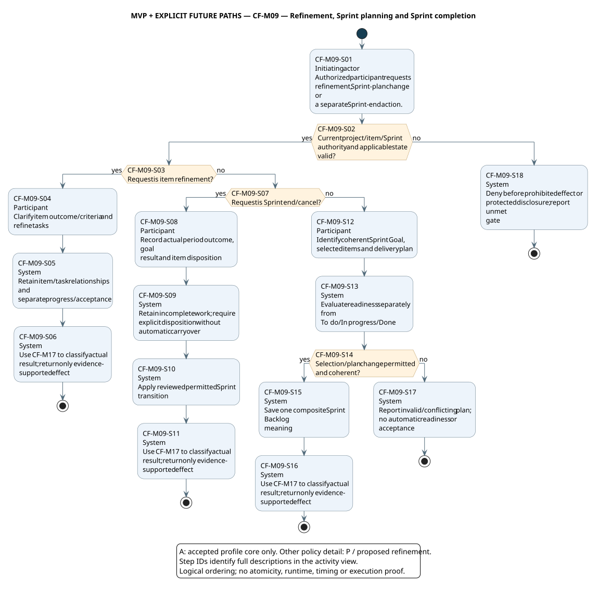

[Editable PlantUML](Diagrams/Activity-Work-Refine-Plan-End.puml) · 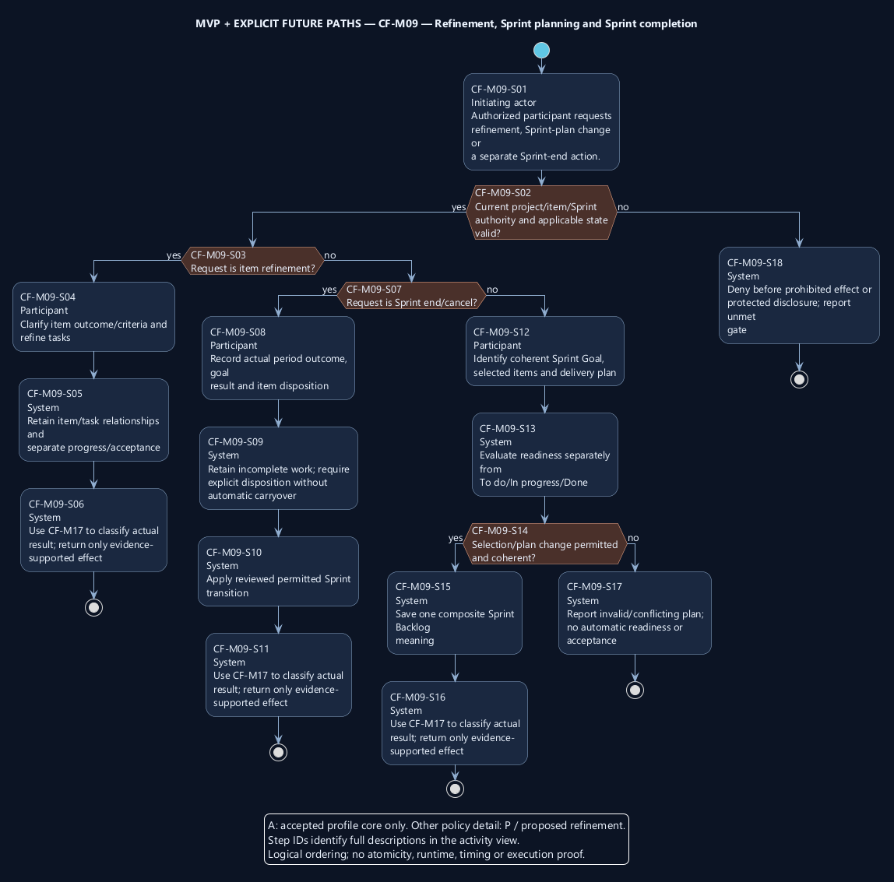

| Step | Kind / responsible context | Action or guard meaning |
| --- | --- | --- |
| **CF-M09-S01** | action; Initiating actor | Authorized participant requests refinement, Sprint-plan change or a separate Sprint-end action. |
| **CF-M09-S02** | decision; Decision / current domain context | Current project/item/Sprint authority and applicable state valid |
| **CF-M09-S03** | decision; Decision / current domain context | Request is item refinement |
| **CF-M09-S04** | action; Participant | Clarify item outcome/criteria and refine tasks |
| **CF-M09-S05** | action; System | Retain item/task relationships and separate progress/acceptance |
| **CF-M09-S06** | end; System | Use CF-M17 to classify actual result; return only evidence-supported effect |
| **CF-M09-S07** | decision; Decision / current domain context | Request is Sprint end/cancel |
| **CF-M09-S08** | action; Participant | Record actual period outcome, goal result and item disposition |
| **CF-M09-S09** | action; System | Retain incomplete work; require explicit disposition without automatic carryover |
| **CF-M09-S10** | action; System | Apply reviewed permitted Sprint transition |
| **CF-M09-S11** | end; System | Use CF-M17 to classify actual result; return only evidence-supported effect |
| **CF-M09-S12** | action; Participant | Identify coherent Sprint Goal, selected items and delivery plan |
| **CF-M09-S13** | action; System | Evaluate readiness separately from To do/In progress/Done |
| **CF-M09-S14** | decision; Decision / current domain context | Selection/plan change permitted and coherent |
| **CF-M09-S15** | action; System | Save one composite Sprint Backlog meaning |
| **CF-M09-S16** | end; System | Use CF-M17 to classify actual result; return only evidence-supported effect |
| **CF-M09-S17** | end; System | Report invalid/conflicting plan; no automatic readiness or acceptance |
| **CF-M09-S18** | end; System | Deny before prohibited effect or protected disclosure; report unmet gate |

###### CF-M10 — Invitation acceptance and subsequent scoped access

**Trigger:** Invited person accepts an eligible invitation and requests a granted action; owner may later change membership.

**Start conditions:** Specific invitation/resource/action scope is identified; neither invitation nor sign-in grants unrelated private content.

**End condition:** Only confirmed current resource grants permit the intended operation; unrelated mail/resume/repository/secret access remains denied.

**Alternative/failure meaning:** Expired/ineligible invitation follows adopted policy; unconfirmed persistence is not effective membership. Changed-grant and in-flight behavior retain separate policy review.

**Control-flow interpretation:** Acceptance and later resource use are temporally distinct. Every later operation uses current applicable grant rules; not a permanent authorization snapshot.

**Policy/evidence boundary:** Q-D04/Q-D05 exact grants, invitation lifecycle and revocation timing remain proposed; no role hierarchy or arbitrary expiry is invented. Role/expiry/revocation timing remain proposals. Changed-grant during a multi-effect action requires operation-specific reconciliation.

**Primary requirement basis:** [ACC-D03](../02-Requirements-Engineering/01-Software-Requirements-Specification/03-Requirements-Specification/01-Accounts-Authentication-And-Permissions.md#requirements-specification-accounts-authentication-and-permissions--heading-acc-d03-resource-and-operation-authorization), [ACC-D04](../02-Requirements-Engineering/01-Software-Requirements-Specification/03-Requirements-Specification/01-Accounts-Authentication-And-Permissions.md#requirements-specification-accounts-authentication-and-permissions--heading-acc-d04-cross-user-private-data-isolation), [ACC-D05](../02-Requirements-Engineering/01-Software-Requirements-Specification/03-Requirements-Specification/01-Accounts-Authentication-And-Permissions.md#requirements-specification-accounts-authentication-and-permissions--heading-acc-d05-limited-collaboration-authority), [ACC-D10](../02-Requirements-Engineering/01-Software-Requirements-Specification/03-Requirements-Specification/01-Accounts-Authentication-And-Permissions.md#requirements-specification-accounts-authentication-and-permissions--heading-acc-d10-authorization-of-access-grant-changes), [ACC-D12](../02-Requirements-Engineering/01-Software-Requirements-Specification/03-Requirements-Specification/01-Accounts-Authentication-And-Permissions.md#requirements-specification-accounts-authentication-and-permissions--heading-acc-d12-end-of-access-and-lifecycle-enforcement), [PKS-D06](../02-Requirements-Engineering/01-Software-Requirements-Specification/03-Requirements-Specification/13-Projects-Kanban-And-Sprints.md#requirements-specification-projects-kanban-and-sprints--heading-pks-d06-scoped-collaboration-and-membership-changes), [GIT-D02](../02-Requirements-Engineering/01-Software-Requirements-Specification/03-Requirements-Specification/08-Git-Hosting-And-Collaboration.md#requirements-specification-git-hosting-and-collaboration--heading-git-d02-repository-and-ref-authorization)

**Domain objects:** [DM-C48](02-Domain-And-Information-Analysis.md#analysis-domain-and-information-analysis--03-domain-model-and-object-oriented-view--id-dm-c48), [DM-C47](02-Domain-And-Information-Analysis.md#analysis-domain-and-information-analysis--03-domain-model-and-object-oriented-view--id-dm-c47), [DM-C24](02-Domain-And-Information-Analysis.md#analysis-domain-and-information-analysis--03-domain-model-and-object-oriented-view--id-dm-c24), [DM-C32](02-Domain-And-Information-Analysis.md#analysis-domain-and-information-analysis--03-domain-model-and-object-oriented-view--id-dm-c32)

**Source use cases:** [UC-D08](../02-Requirements-Engineering/01-Software-Requirements-Specification/04-Scenarios-And-Models/02-User-Stories-And-Scenarios.md#scenarios-and-models-user-stories-and-scenarios--id-uc-d08)

**Information-flow meanings:** DA-F09, DA-F10 in [the data view](02-Domain-And-Information-Analysis.md#analysis-domain-and-information-analysis--05-data-oriented-view). These links describe information meaning; they are not new function-model completion evidence.

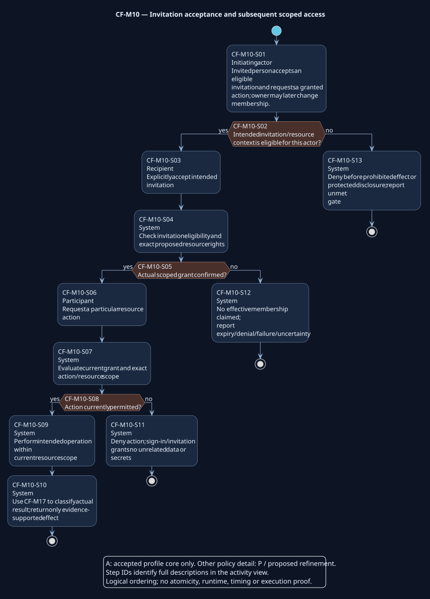

[Editable PlantUML](Diagrams/Activity-Collaboration-And-Changed-Grant.puml) · 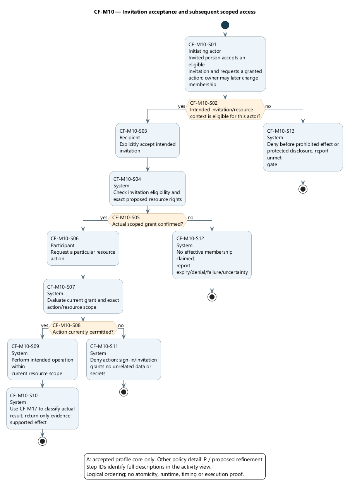

| Step | Kind / responsible context | Action or guard meaning |
| --- | --- | --- |
| **CF-M10-S01** | action; Initiating actor | Invited person accepts an eligible invitation and requests a granted action; owner may later change membership. |
| **CF-M10-S02** | decision; Decision / current domain context | Intended invitation/resource context is eligible for this actor |
| **CF-M10-S03** | action; Recipient | Explicitly accept intended invitation |
| **CF-M10-S04** | action; System | Check invitation eligibility and exact proposed resource rights |
| **CF-M10-S05** | decision; Decision / current domain context | Actual scoped grant confirmed |
| **CF-M10-S06** | action; Participant | Request a particular resource action |
| **CF-M10-S07** | action; System | Evaluate current grant and exact action/resource scope |
| **CF-M10-S08** | decision; Decision / current domain context | Action currently permitted |
| **CF-M10-S09** | action; System | Perform intended operation within current resource scope |
| **CF-M10-S10** | end; System | Use CF-M17 to classify actual result; return only evidence-supported effect |
| **CF-M10-S11** | end; System | Deny action; sign-in/invitation grants no unrelated data or secrets |
| **CF-M10-S12** | end; System | No effective membership claimed; report expiry/denial/failure/uncertainty |
| **CF-M10-S13** | end; System | Deny before prohibited effect or protected disclosure; report unmet gate |

###### CF-M11 — Real Git read transfer or ref update

**Trigger:** Authorized client requests clone/read transfer or supplies an intended push/ref change.

**Start conditions:** A future supported client/transport and real repository context must exist; actor/repository/ref authority and expected current context are explicit.

**End condition:** Only actual authorized repository transfer/ref result is reported; push does not imply merge approval, workflow execution or deployment.

**Alternative/failure meaning:** Wrong grant/protected ref is rejected. Changed ref or interrupted transfer produces conflict/incomplete/unknown as appropriate, not invented success or unrelated ref changes.

**Control-flow interpretation:** Push is a write goal, not proof that review, execution or deployment may proceed. Read transfer does not establish write permission.

**Policy/evidence boundary:** Q-D21 transports/credentials/protection/repetition and actual interoperability remain proposals/design evidence gates. Transport/client/credential/protection feasibility is still required. No Git transport, storage engine or implementation protocol is selected.

**Primary requirement basis:** [GIT-D02](../02-Requirements-Engineering/01-Software-Requirements-Specification/03-Requirements-Specification/08-Git-Hosting-And-Collaboration.md#requirements-specification-git-hosting-and-collaboration--heading-git-d02-repository-and-ref-authorization), [GIT-D03](../02-Requirements-Engineering/01-Software-Requirements-Specification/03-Requirements-Specification/08-Git-Hosting-And-Collaboration.md#requirements-specification-git-hosting-and-collaboration--heading-git-d03-real-clone-fetch-pull-and-push), [GIT-D04](../02-Requirements-Engineering/01-Software-Requirements-Specification/03-Requirements-Specification/08-Git-Hosting-And-Collaboration.md#requirements-specification-git-hosting-and-collaboration--heading-git-d04-branches-files-and-history-browsing), [EIF-D06](../02-Requirements-Engineering/01-Software-Requirements-Specification/03-Requirements-Specification/07-External-Interface-Requirements.md#requirements-specification-external-interface-requirements--heading-eif-d06-real-git-client-interoperability), [EIF-D08](../02-Requirements-Engineering/01-Software-Requirements-Specification/03-Requirements-Specification/07-External-Interface-Requirements.md#requirements-specification-external-interface-requirements--heading-eif-d08-operation-specific-failure-and-repetition-semantics)

**Domain objects:** [DM-C32](02-Domain-And-Information-Analysis.md#analysis-domain-and-information-analysis--03-domain-model-and-object-oriented-view--id-dm-c32), [DM-C34](02-Domain-And-Information-Analysis.md#analysis-domain-and-information-analysis--03-domain-model-and-object-oriented-view--id-dm-c34), [DM-C33](02-Domain-And-Information-Analysis.md#analysis-domain-and-information-analysis--03-domain-model-and-object-oriented-view--id-dm-c33)

**Source use cases:** [UC-D09](../02-Requirements-Engineering/01-Software-Requirements-Specification/04-Scenarios-And-Models/02-User-Stories-And-Scenarios.md#scenarios-and-models-user-stories-and-scenarios--id-uc-d09), [UC-D09-CLONE](../02-Requirements-Engineering/01-Software-Requirements-Specification/04-Scenarios-And-Models/02-User-Stories-And-Scenarios.md#scenarios-and-models-user-stories-and-scenarios--id-uc-d09-clone), [UC-D09-PUSH](../02-Requirements-Engineering/01-Software-Requirements-Specification/04-Scenarios-And-Models/02-User-Stories-And-Scenarios.md#scenarios-and-models-user-stories-and-scenarios--id-uc-d09-push)

**Information-flow meanings:** DA-F10 in [the data view](02-Domain-And-Information-Analysis.md#analysis-domain-and-information-analysis--05-data-oriented-view). These links describe information meaning; they are not new function-model completion evidence.

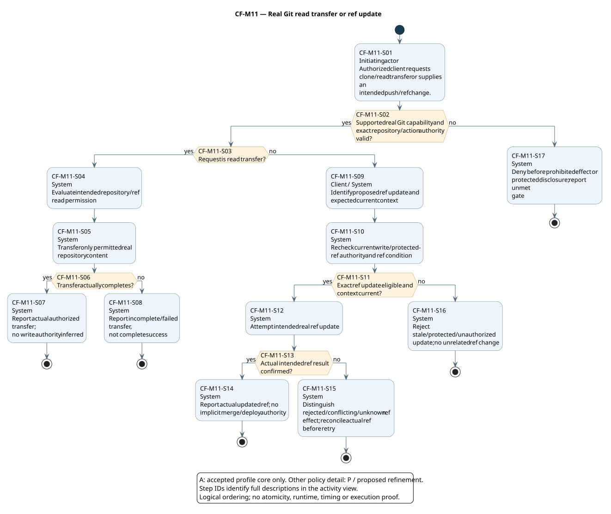

[Editable PlantUML](Diagrams/Activity-Git-Transfer.puml) · 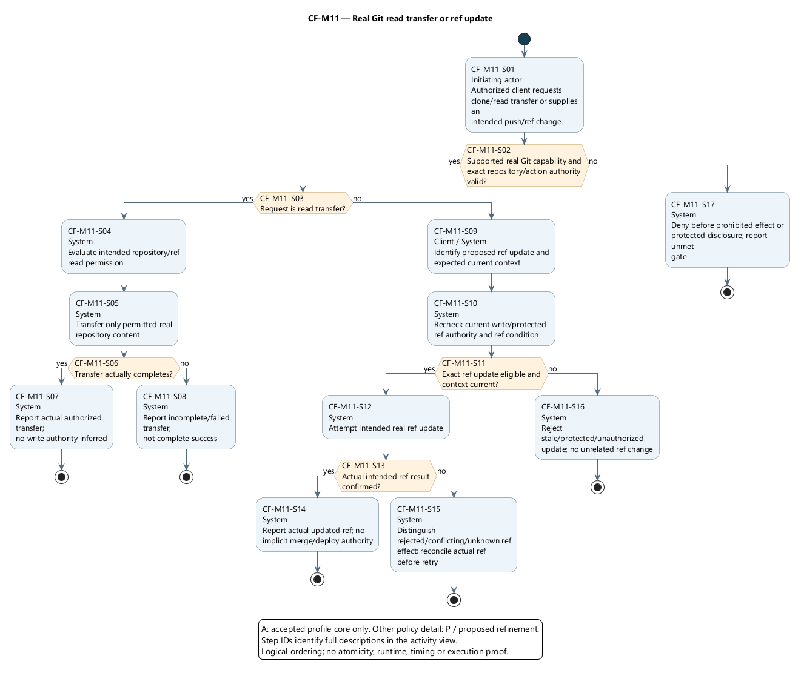

| Step | Kind / responsible context | Action or guard meaning |
| --- | --- | --- |
| **CF-M11-S01** | action; Initiating actor | Authorized client requests clone/read transfer or supplies an intended push/ref change. |
| **CF-M11-S02** | decision; Decision / current domain context | Supported real Git capability and exact repository/action authority valid |
| **CF-M11-S03** | decision; Decision / current domain context | Request is read transfer |
| **CF-M11-S04** | action; System | Evaluate intended repository/ref read permission |
| **CF-M11-S05** | action; System | Transfer only permitted real repository content |
| **CF-M11-S06** | decision; Decision / current domain context | Transfer actually completes |
| **CF-M11-S07** | end; System | Report actual authorized transfer; no write authority inferred |
| **CF-M11-S08** | end; System | Report incomplete/failed transfer, not complete success |
| **CF-M11-S09** | action; Client / System | Identify proposed ref update and expected current context |
| **CF-M11-S10** | action; System | Recheck current write/protected-ref authority and ref condition |
| **CF-M11-S11** | decision; Decision / current domain context | Exact ref update eligible and context current |
| **CF-M11-S12** | action; System | Attempt intended real ref update |
| **CF-M11-S13** | decision; Decision / current domain context | Actual intended ref result confirmed |
| **CF-M11-S14** | end; System | Report actual updated ref; no implicit merge/deploy authority |
| **CF-M11-S15** | end; System | Distinguish rejected/conflicting/unknown ref effect; reconcile actual ref before retry |
| **CF-M11-S16** | end; System | Reject stale/protected/unauthorized update; no unrelated ref change |
| **CF-M11-S17** | end; System | Deny before prohibited effect or protected disclosure; report unmet gate |

###### CF-M12 — Request, review or eligible integration

**Trigger:** Participant separately opens a request, records review/comment or requests merge.

**Start conditions:** Applicable repository/source/target and operation authority are explicit; no second delivery person or approval count is assumed.

**End condition:** Only the requested permitted record/review/current eligible integration is reported; evaluated source/target and actual result remain identifiable.

**Alternative/failure meaning:** Changed source/target is re-evaluated; stale review/checks and merge conflicts cannot masquerade as current successful integration. Unauthorized merge remains denied.

**Control-flow interpretation:** Request creation, feedback and merge are separate operations. Source or target changes require reevaluation rather than carrying stale eligibility forward.

**Policy/evidence boundary:** Q-D22 review validity, merge strategy, solo review exception and counts remain proposed. Merge/release never inherits deployment authority. No second delivery person, approval count, merge strategy or solo exception is invented. Actual unknown integration is not assumed to have left the request unchanged.

**Primary requirement basis:** [GIT-D05](../02-Requirements-Engineering/01-Software-Requirements-Specification/03-Requirements-Specification/08-Git-Hosting-And-Collaboration.md#requirements-specification-git-hosting-and-collaboration--heading-git-d05-fork-provenance-and-permission-boundaries), [GIT-D06](../02-Requirements-Engineering/01-Software-Requirements-Specification/03-Requirements-Specification/08-Git-Hosting-And-Collaboration.md#requirements-specification-git-hosting-and-collaboration--heading-git-d06-pull-requests-comments-and-review), [GIT-D07](../02-Requirements-Engineering/01-Software-Requirements-Specification/03-Requirements-Specification/08-Git-Hosting-And-Collaboration.md#requirements-specification-git-hosting-and-collaboration--heading-git-d07-controlled-merge-and-conflict-outcomes), [GIT-D09](../02-Requirements-Engineering/01-Software-Requirements-Specification/03-Requirements-Specification/08-Git-Hosting-And-Collaboration.md#requirements-specification-git-hosting-and-collaboration--heading-git-d09-tags-and-releases)

**Domain objects:** [DM-C32](02-Domain-And-Information-Analysis.md#analysis-domain-and-information-analysis--03-domain-model-and-object-oriented-view--id-dm-c32), [DM-C34](02-Domain-And-Information-Analysis.md#analysis-domain-and-information-analysis--03-domain-model-and-object-oriented-view--id-dm-c34), [DM-C33](02-Domain-And-Information-Analysis.md#analysis-domain-and-information-analysis--03-domain-model-and-object-oriented-view--id-dm-c33), [DM-C35](02-Domain-And-Information-Analysis.md#analysis-domain-and-information-analysis--03-domain-model-and-object-oriented-view--id-dm-c35), [DM-C36](02-Domain-And-Information-Analysis.md#analysis-domain-and-information-analysis--03-domain-model-and-object-oriented-view--id-dm-c36)

**Source use cases:** [UC-D09](../02-Requirements-Engineering/01-Software-Requirements-Specification/04-Scenarios-And-Models/02-User-Stories-And-Scenarios.md#scenarios-and-models-user-stories-and-scenarios--id-uc-d09), [UC-D09-REQUEST](../02-Requirements-Engineering/01-Software-Requirements-Specification/04-Scenarios-And-Models/02-User-Stories-And-Scenarios.md#scenarios-and-models-user-stories-and-scenarios--id-uc-d09-request), [UC-D09-REVIEW](../02-Requirements-Engineering/01-Software-Requirements-Specification/04-Scenarios-And-Models/02-User-Stories-And-Scenarios.md#scenarios-and-models-user-stories-and-scenarios--id-uc-d09-review), [UC-D09-MERGE](../02-Requirements-Engineering/01-Software-Requirements-Specification/04-Scenarios-And-Models/02-User-Stories-And-Scenarios.md#scenarios-and-models-user-stories-and-scenarios--id-uc-d09-merge)

**Information-flow meanings:** DA-F10 in [the data view](02-Domain-And-Information-Analysis.md#analysis-domain-and-information-analysis--05-data-oriented-view). These links describe information meaning; they are not new function-model completion evidence.

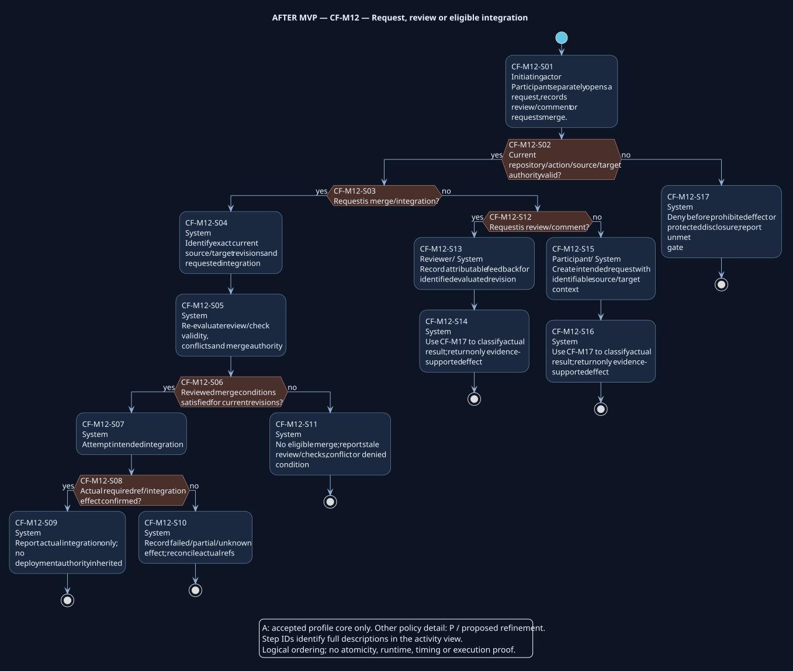

[Editable PlantUML](Diagrams/Activity-Pull-Request-Review-Merge.puml) · 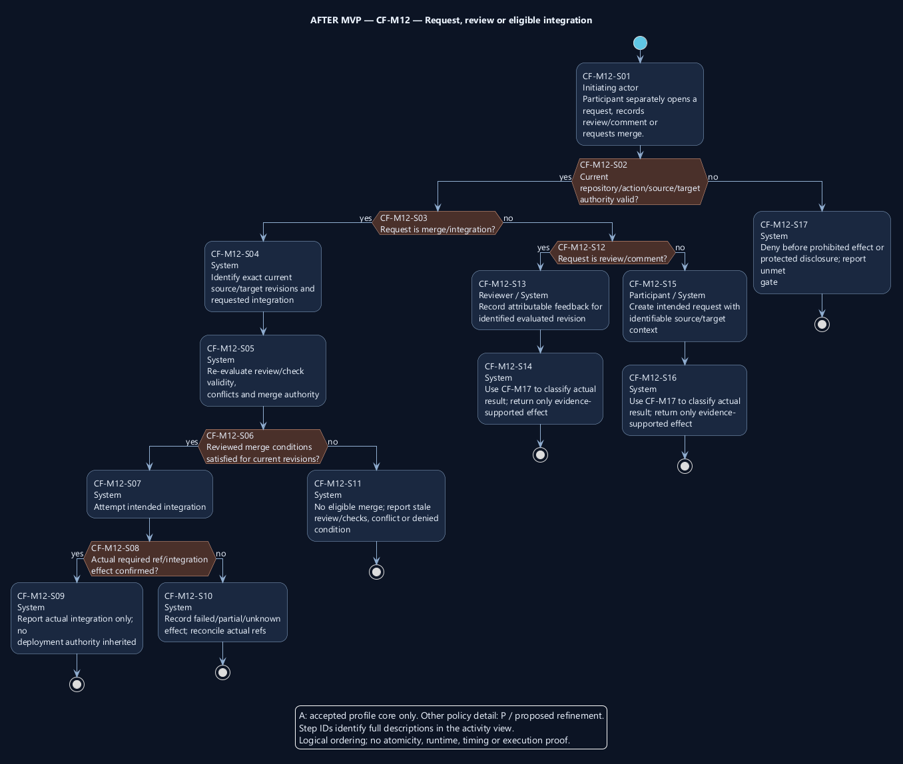

| Step | Kind / responsible context | Action or guard meaning |
| --- | --- | --- |
| **CF-M12-S01** | action; Initiating actor | Participant separately opens a request, records review/comment or requests merge. |
| **CF-M12-S02** | decision; Decision / current domain context | Current repository/action/source/target authority valid |
| **CF-M12-S03** | decision; Decision / current domain context | Request is merge/integration |
| **CF-M12-S04** | action; System | Identify exact current source/target revisions and requested integration |
| **CF-M12-S05** | action; System | Re-evaluate review/check validity, conflicts and merge authority |
| **CF-M12-S06** | decision; Decision / current domain context | Reviewed merge conditions satisfied for current revisions |
| **CF-M12-S07** | action; System | Attempt intended integration |
| **CF-M12-S08** | decision; Decision / current domain context | Actual required ref/integration effect confirmed |
| **CF-M12-S09** | end; System | Report actual integration only; no deployment authority inherited |
| **CF-M12-S10** | end; System | Record failed/partial/unknown effect; reconcile actual refs |
| **CF-M12-S11** | end; System | No eligible merge; report stale review/checks, conflict or denied condition |
| **CF-M12-S12** | decision; Decision / current domain context | Request is review/comment |
| **CF-M12-S13** | action; Reviewer / System | Record attributable feedback for identified evaluated revision |
| **CF-M12-S14** | end; System | Use CF-M17 to classify actual result; return only evidence-supported effect |
| **CF-M12-S15** | action; Participant / System | Create intended request with identifiable source/target context |
| **CF-M12-S16** | end; System | Use CF-M17 to classify actual result; return only evidence-supported effect |
| **CF-M12-S17** | end; System | Deny before prohibited effect or protected disclosure; report unmet gate |

###### CF-M13 — Gated execution attempt and cancellation race

**After MVP.** Shared operating and recovery controls still apply where relevant.

**Trigger:** Eligible actor/trigger requests supported workflow work for identified code/definition.

**Start conditions:** Future enabling evidence, permitted trigger, supported definition, scoped authority, isolation/resources/secrets and actual evaluated revision context must satisfy their gates before execution.

**End condition:** Admitted future run/attempt/output remains attributable to exact evaluated context; blocked/failed/unknown work is not reported successful.

**Alternative/failure meaning:** Unsupported contract or missing authority/enabling evidence means no execution. Runner loss/cancel/retry retains actual or unknown state; cancellation request is not proof of termination.

**Control-flow interpretation:** Attempt admission/start, cancellation request, actual termination and actual completion are different observations. Retry would be a new separately permitted attempt.

**Policy/evidence boundary:** Q-D23 isolation/resource/contract evidence is missing today. Model future eligibility without enabling work on the current host. The current demo host is not proven safe for untrusted workflows. No execution is enabled by this activity model; numeric limits and isolation mechanisms remain design/evidence gates.

**Primary requirement basis:** [YML-D01](../02-Requirements-Engineering/01-Software-Requirements-Specification/03-Requirements-Specification/19-Yaml-Workflows-And-Cicd.md#requirements-specification-yaml-workflows-and-cicd--heading-yml-d01-defined-supported-workflow-contract), [YML-D02](../02-Requirements-Engineering/01-Software-Requirements-Specification/03-Requirements-Specification/19-Yaml-Workflows-And-Cicd.md#requirements-specification-yaml-workflows-and-cicd--heading-yml-d02-explicit-triggers-and-run-authority), [YML-D03](../02-Requirements-Engineering/01-Software-Requirements-Specification/03-Requirements-Specification/19-Yaml-Workflows-And-Cicd.md#requirements-specification-yaml-workflows-and-cicd--heading-yml-d03-run-identity-and-reproducible-context), [YML-D04](../02-Requirements-Engineering/01-Software-Requirements-Specification/03-Requirements-Specification/19-Yaml-Workflows-And-Cicd.md#requirements-specification-yaml-workflows-and-cicd--heading-yml-d04-isolation-and-untrusted-code-boundary), [YML-D05](../02-Requirements-Engineering/01-Software-Requirements-Specification/03-Requirements-Specification/19-Yaml-Workflows-And-Cicd.md#requirements-specification-yaml-workflows-and-cicd--heading-yml-d05-scoped-secrets-and-credentials), [YML-D06](../02-Requirements-Engineering/01-Software-Requirements-Specification/03-Requirements-Specification/19-Yaml-Workflows-And-Cicd.md#requirements-specification-yaml-workflows-and-cicd--heading-yml-d06-resource-admission-and-limits), [YML-D07](../02-Requirements-Engineering/01-Software-Requirements-Specification/03-Requirements-Specification/19-Yaml-Workflows-And-Cicd.md#requirements-specification-yaml-workflows-and-cicd--heading-yml-d07-truthful-run-and-step-outcomes), [YML-D08](../02-Requirements-Engineering/01-Software-Requirements-Specification/03-Requirements-Specification/19-Yaml-Workflows-And-Cicd.md#requirements-specification-yaml-workflows-and-cicd--heading-yml-d08-restricted-logs-and-artifacts), [YML-D09](../02-Requirements-Engineering/01-Software-Requirements-Specification/03-Requirements-Specification/19-Yaml-Workflows-And-Cicd.md#requirements-specification-yaml-workflows-and-cicd--heading-yml-d09-cancellation-retry-and-runner-loss-recovery), [YML-D11](../02-Requirements-Engineering/01-Software-Requirements-Specification/03-Requirements-Specification/19-Yaml-Workflows-And-Cicd.md#requirements-specification-yaml-workflows-and-cicd--heading-yml-d11-workspace-cleanup-and-retained-evidence), [YML-D12](../02-Requirements-Engineering/01-Software-Requirements-Specification/03-Requirements-Specification/19-Yaml-Workflows-And-Cicd.md#requirements-specification-yaml-workflows-and-cicd--heading-yml-d12-feasibility-operational-guidance-and-enabling-gate)

**Domain objects:** [DM-C40](02-Domain-And-Information-Analysis.md#analysis-domain-and-information-analysis--03-domain-model-and-object-oriented-view--id-dm-c40), [DM-C41](02-Domain-And-Information-Analysis.md#analysis-domain-and-information-analysis--03-domain-model-and-object-oriented-view--id-dm-c41), [DM-C42](02-Domain-And-Information-Analysis.md#analysis-domain-and-information-analysis--03-domain-model-and-object-oriented-view--id-dm-c42), [DM-C43](02-Domain-And-Information-Analysis.md#analysis-domain-and-information-analysis--03-domain-model-and-object-oriented-view--id-dm-c43), [DM-C44](02-Domain-And-Information-Analysis.md#analysis-domain-and-information-analysis--03-domain-model-and-object-oriented-view--id-dm-c44)

**Source use cases:** [UC-D10](../02-Requirements-Engineering/01-Software-Requirements-Specification/04-Scenarios-And-Models/02-User-Stories-And-Scenarios.md#scenarios-and-models-user-stories-and-scenarios--id-uc-d10), [UC-D10-RUN](../02-Requirements-Engineering/01-Software-Requirements-Specification/04-Scenarios-And-Models/02-User-Stories-And-Scenarios.md#scenarios-and-models-user-stories-and-scenarios--id-uc-d10-run)

**Information-flow meanings:** DA-F11 in [the data view](02-Domain-And-Information-Analysis.md#analysis-domain-and-information-analysis--05-data-oriented-view). These links describe information meaning; they are not new function-model completion evidence.

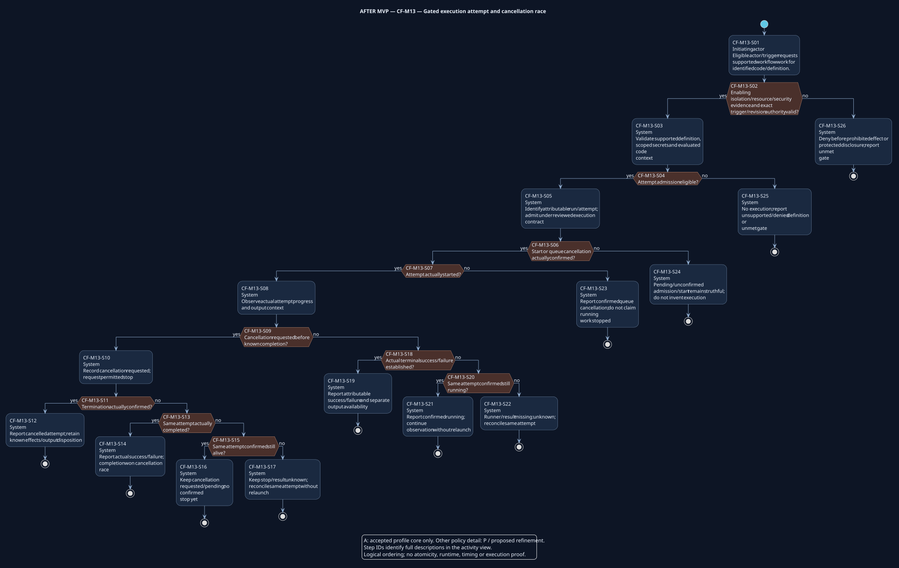

[Editable PlantUML](Diagrams/Activity-Workflow-Admission-Attempt.puml) · 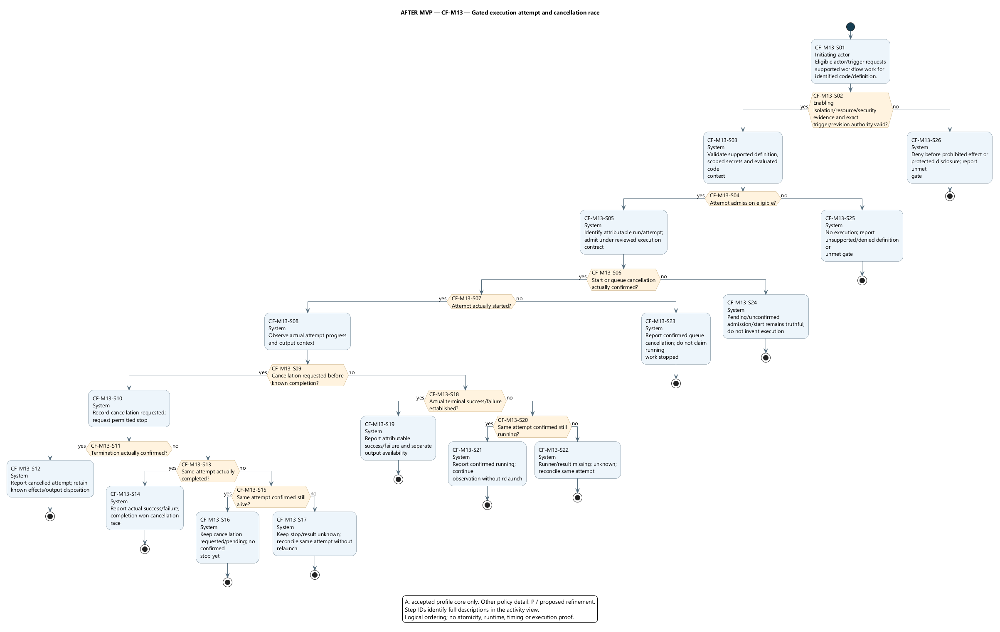

| Step | Kind / responsible context | Action or guard meaning |
| --- | --- | --- |
| **CF-M13-S01** | action; Initiating actor | Eligible actor/trigger requests supported workflow work for identified code/definition. |
| **CF-M13-S02** | decision; Decision / current domain context | Enabling isolation/resource/security evidence and exact trigger/revision authority valid |
| **CF-M13-S03** | action; System | Validate supported definition, scoped secrets and evaluated code context |
| **CF-M13-S04** | decision; Decision / current domain context | Attempt admission eligible |
| **CF-M13-S05** | action; System | Identify attributable run/attempt; admit under reviewed execution contract |
| **CF-M13-S06** | decision; Decision / current domain context | Start or queue cancellation actually confirmed |
| **CF-M13-S07** | decision; Decision / current domain context | Attempt actually started |
| **CF-M13-S08** | action; System | Observe actual attempt progress and output context |
| **CF-M13-S09** | decision; Decision / current domain context | Cancellation requested before known completion |
| **CF-M13-S10** | action; System | Record cancellation requested; request permitted stop |
| **CF-M13-S11** | decision; Decision / current domain context | Termination actually confirmed |
| **CF-M13-S12** | end; System | Report cancelled attempt; retain known effects/output disposition |
| **CF-M13-S13** | decision; Decision / current domain context | Same attempt actually completed |
| **CF-M13-S14** | end; System | Report actual success/failure; completion won cancellation race |
| **CF-M13-S15** | decision; Decision / current domain context | Same attempt confirmed still alive |
| **CF-M13-S16** | end; System | Keep cancellation requested/pending; no confirmed stop yet |
| **CF-M13-S17** | end; System | Keep stop/result unknown; reconcile same attempt without relaunch |
| **CF-M13-S18** | decision; Decision / current domain context | Actual terminal success/failure established |
| **CF-M13-S19** | end; System | Report attributable success/failure and separate output availability |
| **CF-M13-S20** | decision; Decision / current domain context | Same attempt confirmed still running |
| **CF-M13-S21** | end; System | Report confirmed running; continue observation without relaunch |
| **CF-M13-S22** | end; System | Runner/result missing: unknown; reconcile same attempt |
| **CF-M13-S23** | end; System | Report confirmed queue cancellation; do not claim running work stopped |
| **CF-M13-S24** | end; System | Pending/unconfirmed admission/start remains truthful; do not invent execution |
| **CF-M13-S25** | end; System | No execution; report unsupported/denied definition or unmet gate |
| **CF-M13-S26** | end; System | Deny before prohibited effect or protected disclosure; report unmet gate |

###### CF-M14 — Separate target-authorized deployment

**Trigger:** Actor separately requests deployment of an identified artifact/revision to an intended target.

**Start conditions:** Target authority/approval, compatible data/recovery conditions and exact artifact/revision are explicit; successful build alone is insufficient.

**End condition:** Only independently permitted intended target effects are attempted; actual confirmed, failed or unknown target outcome is retained.

**Alternative/failure meaning:** Missing target approval, stale artifact/revision or unsuitable conditions deny deployment. An unknown outcome is reconciled before further consequential action.

**Control-flow interpretation:** Target deployment is a separate requested goal from workflow success, merge, tag or release.

**Policy/evidence boundary:** Q-D23 target/approval/execution feasibility remains gated; no target or production change is created by this analysis. No live deployment or automatic rollback is authorized. Recovery or retry must be separately eligible for actual current target state.

**Primary requirement basis:** [YML-D03](../02-Requirements-Engineering/01-Software-Requirements-Specification/03-Requirements-Specification/19-Yaml-Workflows-And-Cicd.md#requirements-specification-yaml-workflows-and-cicd--heading-yml-d03-run-identity-and-reproducible-context), [YML-D08](../02-Requirements-Engineering/01-Software-Requirements-Specification/03-Requirements-Specification/19-Yaml-Workflows-And-Cicd.md#requirements-specification-yaml-workflows-and-cicd--heading-yml-d08-restricted-logs-and-artifacts), [YML-D10](../02-Requirements-Engineering/01-Software-Requirements-Specification/03-Requirements-Specification/19-Yaml-Workflows-And-Cicd.md#requirements-specification-yaml-workflows-and-cicd--heading-yml-d10-separate-controlled-deployment-stage), [YML-D12](../02-Requirements-Engineering/01-Software-Requirements-Specification/03-Requirements-Specification/19-Yaml-Workflows-And-Cicd.md#requirements-specification-yaml-workflows-and-cicd--heading-yml-d12-feasibility-operational-guidance-and-enabling-gate), [EIF-D08](../02-Requirements-Engineering/01-Software-Requirements-Specification/03-Requirements-Specification/07-External-Interface-Requirements.md#requirements-specification-external-interface-requirements--heading-eif-d08-operation-specific-failure-and-repetition-semantics)

**Domain objects:** [DM-C45](02-Domain-And-Information-Analysis.md#analysis-domain-and-information-analysis--03-domain-model-and-object-oriented-view--id-dm-c45), [DM-C46](02-Domain-And-Information-Analysis.md#analysis-domain-and-information-analysis--03-domain-model-and-object-oriented-view--id-dm-c46), [DM-C43](02-Domain-And-Information-Analysis.md#analysis-domain-and-information-analysis--03-domain-model-and-object-oriented-view--id-dm-c43), [DM-C41](02-Domain-And-Information-Analysis.md#analysis-domain-and-information-analysis--03-domain-model-and-object-oriented-view--id-dm-c41)

**Source use cases:** [UC-D10](../02-Requirements-Engineering/01-Software-Requirements-Specification/04-Scenarios-And-Models/02-User-Stories-And-Scenarios.md#scenarios-and-models-user-stories-and-scenarios--id-uc-d10), [UC-D10-DEPLOY](../02-Requirements-Engineering/01-Software-Requirements-Specification/04-Scenarios-And-Models/02-User-Stories-And-Scenarios.md#scenarios-and-models-user-stories-and-scenarios--id-uc-d10-deploy)

**Information-flow meanings:** DA-F11 in [the data view](02-Domain-And-Information-Analysis.md#analysis-domain-and-information-analysis--05-data-oriented-view). These links describe information meaning; they are not new function-model completion evidence.

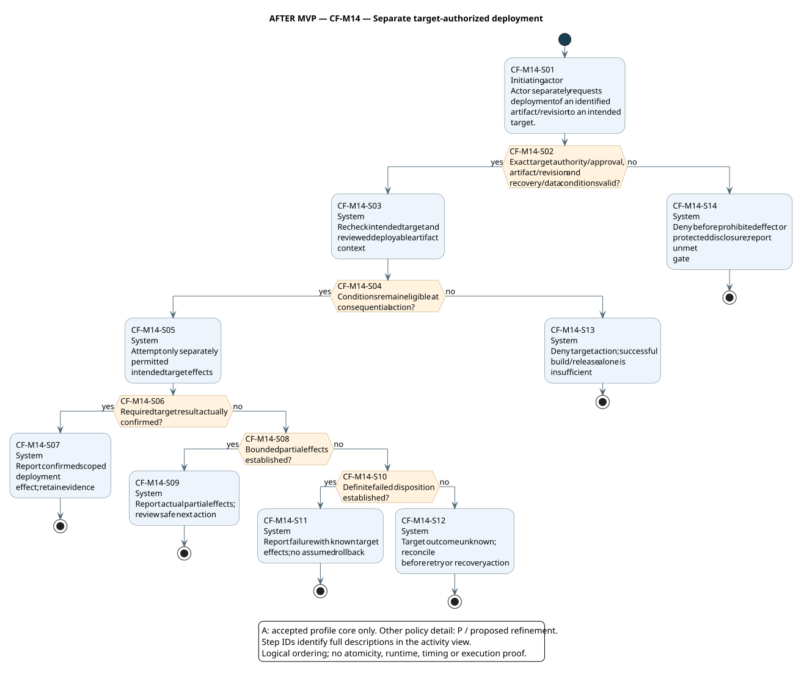

[Editable PlantUML](Diagrams/Activity-Separate-Deployment.puml) · 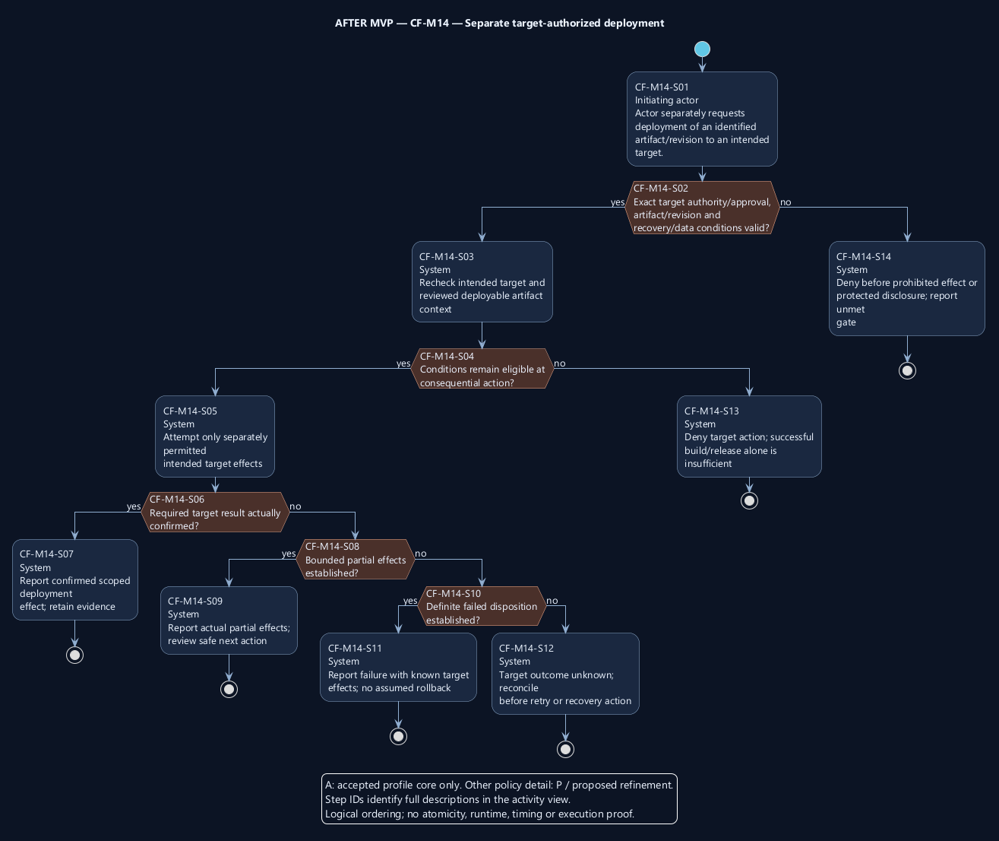

| Step | Kind / responsible context | Action or guard meaning |
| --- | --- | --- |
| **CF-M14-S01** | action; Initiating actor | Actor separately requests deployment of an identified artifact/revision to an intended target. |
| **CF-M14-S02** | decision; Decision / current domain context | Exact target authority/approval, artifact/revision and recovery/data conditions valid |
| **CF-M14-S03** | action; System | Recheck intended target and reviewed deployable artifact context |
| **CF-M14-S04** | decision; Decision / current domain context | Conditions remain eligible at consequential action |
| **CF-M14-S05** | action; System | Attempt only separately permitted intended target effects |
| **CF-M14-S06** | decision; Decision / current domain context | Required target result actually confirmed |
| **CF-M14-S07** | end; System | Report confirmed scoped deployment effect; retain evidence |
| **CF-M14-S08** | decision; Decision / current domain context | Bounded partial effects established |
| **CF-M14-S09** | end; System | Report actual partial effects; review safe next action |
| **CF-M14-S10** | decision; Decision / current domain context | Definite failed disposition established |
| **CF-M14-S11** | end; System | Report failure with known target effects; no assumed rollback |
| **CF-M14-S12** | end; System | Target outcome unknown; reconcile before retry or recovery action |
| **CF-M14-S13** | end; System | Deny target action; successful build/release alone is insufficient |
| **CF-M14-S14** | end; System | Deny before prohibited effect or protected disclosure; report unmet gate |

###### CF-M15 — Effective policy, file admission or restricted evidence

**Trigger:** Actor requests one permitted policy, file-admission or evidence operation. Admission refines supporting file paths in the existing scenarios rather than allocating a new external use case.

**Start conditions:** Current role/resource/action authority, effective policy and actual content/usage/reference context are identified; administrative authority differs from upload authority.

**End condition:** Actual effective policy, usable admitted resource or permitted bounded evidence is reported for the requested operation only.

**Alternative/failure meaning:** Denied operations expose no restricted data. Failed persistence/processing/cleanup does not claim effective settings, usable content or freed capacity; lower limit does not silently delete history.

**Control-flow interpretation:** Policy administration, upload and evidence access are separate powers and alternative goals. A lower quota is not a cleanup instruction.

**Policy/evidence boundary:** Q-D24 numerical values/pools/concurrency and Q-D27 applicability remain proposals; actual capacity is not inferred from idle free disk. Concurrent admissions require a reviewed current capacity contract, not a pre-check promise. Cleanup eligibility and confirmed reclamation remain distinct in SM-M16.

**Primary requirement basis:** [AFO-D01](../02-Requirements-Engineering/01-Software-Requirements-Specification/03-Requirements-Specification/02-Administration-Files-And-Operational-Behavior.md#requirements-specification-administration-files-and-operational-behavior--heading-afo-d01-owner-configurable-upload-and-storage-policy), [AFO-D02](../02-Requirements-Engineering/01-Software-Requirements-Specification/03-Requirements-Specification/02-Administration-Files-And-Operational-Behavior.md#requirements-specification-administration-files-and-operational-behavior--heading-afo-d02-policy-consistent-with-evaluated-infrastructure), [AFO-D03](../02-Requirements-Engineering/01-Software-Requirements-Specification/03-Requirements-Specification/02-Administration-Files-And-Operational-Behavior.md#requirements-specification-administration-files-and-operational-behavior--heading-afo-d03-per-file-admission-limit), [AFO-D04](../02-Requirements-Engineering/01-Software-Requirements-Specification/03-Requirements-Specification/02-Administration-Files-And-Operational-Behavior.md#requirements-specification-administration-files-and-operational-behavior--heading-afo-d04-aggregate-quota-and-concurrent-admission), [AFO-D05](../02-Requirements-Engineering/01-Software-Requirements-Specification/03-Requirements-Specification/02-Administration-Files-And-Operational-Behavior.md#requirements-specification-administration-files-and-operational-behavior--heading-afo-d05-supported-content-and-validation), [AFO-D06](../02-Requirements-Engineering/01-Software-Requirements-Specification/03-Requirements-Specification/02-Administration-Files-And-Operational-Behavior.md#requirements-specification-administration-files-and-operational-behavior--heading-afo-d06-file-resource-authorization-and-isolation), [AFO-D07](../02-Requirements-Engineering/01-Software-Requirements-Specification/03-Requirements-Specification/02-Administration-Files-And-Operational-Behavior.md#requirements-specification-administration-files-and-operational-behavior--heading-afo-d07-truthful-completion-and-interrupted-operation-handling), [AFO-D08](../02-Requirements-Engineering/01-Software-Requirements-Specification/03-Requirements-Specification/02-Administration-Files-And-Operational-Behavior.md#requirements-specification-administration-files-and-operational-behavior--heading-afo-d08-safe-replacement-and-lifecycle-effects), [AFO-D09](../02-Requirements-Engineering/01-Software-Requirements-Specification/03-Requirements-Specification/02-Administration-Files-And-Operational-Behavior.md#requirements-specification-administration-files-and-operational-behavior--heading-afo-d09-operational-outcomes-and-capacity-warnings), [AFO-D10](../02-Requirements-Engineering/01-Software-Requirements-Specification/03-Requirements-Specification/02-Administration-Files-And-Operational-Behavior.md#requirements-specification-administration-files-and-operational-behavior--heading-afo-d10-administrative-operation-evidence), [AFO-D11](../02-Requirements-Engineering/01-Software-Requirements-Specification/03-Requirements-Specification/02-Administration-Files-And-Operational-Behavior.md#requirements-specification-administration-files-and-operational-behavior--heading-afo-d11-bounded-cleanup-and-storage-reclamation)

**Domain objects:** [DM-C50](02-Domain-And-Information-Analysis.md#analysis-domain-and-information-analysis--03-domain-model-and-object-oriented-view--id-dm-c50), [DM-C49](02-Domain-And-Information-Analysis.md#analysis-domain-and-information-analysis--03-domain-model-and-object-oriented-view--id-dm-c49), [DM-C51](02-Domain-And-Information-Analysis.md#analysis-domain-and-information-analysis--03-domain-model-and-object-oriented-view--id-dm-c51), [DM-C48](02-Domain-And-Information-Analysis.md#analysis-domain-and-information-analysis--03-domain-model-and-object-oriented-view--id-dm-c48)

**Source use cases:** [UC-D11](../02-Requirements-Engineering/01-Software-Requirements-Specification/04-Scenarios-And-Models/02-User-Stories-And-Scenarios.md#scenarios-and-models-user-stories-and-scenarios--id-uc-d11), [UC-D11-POLICY](../02-Requirements-Engineering/01-Software-Requirements-Specification/04-Scenarios-And-Models/02-User-Stories-And-Scenarios.md#scenarios-and-models-user-stories-and-scenarios--id-uc-d11-policy), [UC-D11-EVIDENCE](../02-Requirements-Engineering/01-Software-Requirements-Specification/04-Scenarios-And-Models/02-User-Stories-And-Scenarios.md#scenarios-and-models-user-stories-and-scenarios--id-uc-d11-evidence)

**Information-flow meanings:** DA-F04, DA-F12 in [the data view](02-Domain-And-Information-Analysis.md#analysis-domain-and-information-analysis--05-data-oriented-view). These links describe information meaning; they are not new function-model completion evidence.

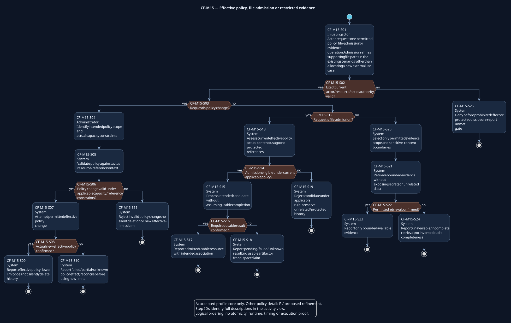

[Editable PlantUML](Diagrams/Activity-Policy-Admission-Evidence.puml) · 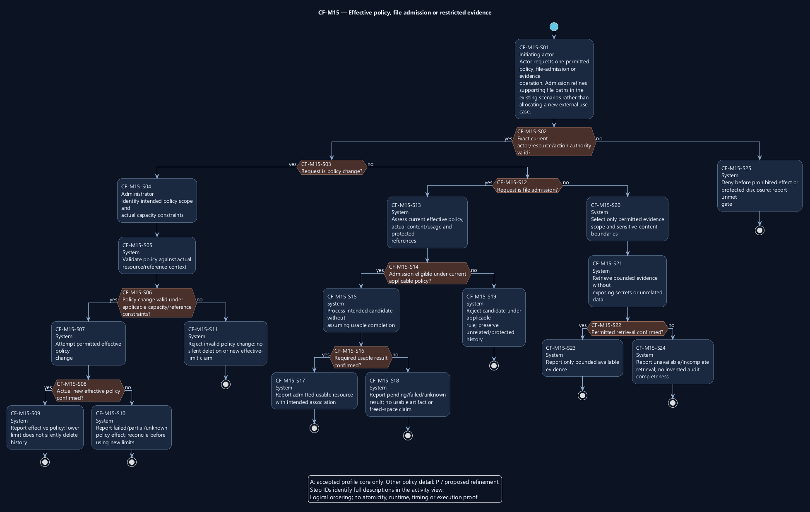

| Step | Kind / responsible context | Action or guard meaning |
| --- | --- | --- |
| **CF-M15-S01** | action; Initiating actor | Actor requests one permitted policy, file-admission or evidence operation. Admission refines supporting file paths in the existing scenarios rather than allocating a new external use case. |
| **CF-M15-S02** | decision; Decision / current domain context | Exact current actor/resource/action authority valid |
| **CF-M15-S03** | decision; Decision / current domain context | Request is policy change |
| **CF-M15-S04** | action; Administrator | Identify intended policy scope and actual capacity constraints |
| **CF-M15-S05** | action; System | Validate policy against actual resource/reference context |
| **CF-M15-S06** | decision; Decision / current domain context | Policy change valid under applicable capacity/reference constraints |
| **CF-M15-S07** | action; System | Attempt permitted effective policy change |
| **CF-M15-S08** | decision; Decision / current domain context | Actual new effective policy confirmed |
| **CF-M15-S09** | end; System | Report effective policy; lower limit does not silently delete history |
| **CF-M15-S10** | end; System | Report failed/partial/unknown policy effect; reconcile before using new limits |
| **CF-M15-S11** | end; System | Reject invalid policy change; no silent deletion or new effective-limit claim |
| **CF-M15-S12** | decision; Decision / current domain context | Request is file admission |
| **CF-M15-S13** | action; System | Assess current effective policy, actual content/usage and protected references |
| **CF-M15-S14** | decision; Decision / current domain context | Admission eligible under current applicable policy |
| **CF-M15-S15** | action; System | Process intended candidate without assuming usable completion |
| **CF-M15-S16** | decision; Decision / current domain context | Required usable result confirmed |
| **CF-M15-S17** | end; System | Report admitted usable resource with intended association |
| **CF-M15-S18** | end; System | Report pending/failed/unknown result; no usable artifact or freed-space claim |
| **CF-M15-S19** | end; System | Reject candidate under applicable rule; preserve unrelated/protected history |
| **CF-M15-S20** | action; System | Select only permitted evidence scope and sensitive-content boundaries |
| **CF-M15-S21** | action; System | Retrieve bounded evidence without exposing secrets or unrelated data |
| **CF-M15-S22** | decision; Decision / current domain context | Permitted retrieval confirmed |
| **CF-M15-S23** | end; System | Report only bounded available evidence |
| **CF-M15-S24** | end; System | Report unavailable/incomplete retrieval; no invented audit completeness |
| **CF-M15-S25** | end; System | Deny before prohibited effect or protected disclosure; report unmet gate |

###### CF-M16 — Conditional isolated restore and usability assessment

**Trigger:** Operator identifies a loss/recovery scenario and requests an explicitly authorized isolated drill.

**Start conditions:** Identified protected recovery source, required artifacts/configuration, defined coverage/targets, suitable isolation and operator authority must actually exist for a later drill.

**End condition:** Actual findings identify covered/restored information, integrity, safe current access, external-state disposition and measured target comparison; no success is assumed before evidence.

**Alternative/failure meaning:** No authority/source/safe target blocks the drill. Missing/corrupt/inconsistent material or missed targets remain failed/incomplete. Revisit only under isolated authorized recovery policy.

**Control-flow interpretation:** Restored bytes are only input to usability/access/external-state assessment. Repeated drills keep distinguishable evidence.

**Policy/evidence boundary:** Backups are not configured. Q-D26 source/coverage/targets/restore proof and Q-D27 operating evidence remain open; this is not execution authorization. Backups are not configured, so the current real path stops at the prerequisite gate. No live overwrite, old-grant resurrection or external replay is authorized.

**Primary requirement basis:** [QSR-D10](../02-Requirements-Engineering/01-Software-Requirements-Specification/03-Requirements-Specification/14-Quality-Security-And-Recovery-Requirements.md#requirements-specification-quality-security-and-recovery-requirements--heading-qsr-d10-defined-protected-and-observable-backups), [QSR-D11](../02-Requirements-Engineering/01-Software-Requirements-Specification/03-Requirements-Specification/14-Quality-Security-And-Recovery-Requirements.md#requirements-specification-quality-security-and-recovery-requirements--heading-qsr-d11-demonstrated-restoration-and-recovery-targets), [QSR-D12](../02-Requirements-Engineering/01-Software-Requirements-Specification/03-Requirements-Specification/14-Quality-Security-And-Recovery-Requirements.md#requirements-specification-quality-security-and-recovery-requirements--heading-qsr-d12-safe-restored-access-and-external-state-reconciliation), [QSR-D14](../02-Requirements-Engineering/01-Software-Requirements-Specification/03-Requirements-Specification/14-Quality-Security-And-Recovery-Requirements.md#requirements-specification-quality-security-and-recovery-requirements--heading-qsr-d14-maintainable-verifiable-and-recoverable-changes), [AFO-D12](../02-Requirements-Engineering/01-Software-Requirements-Specification/03-Requirements-Specification/02-Administration-Files-And-Operational-Behavior.md#requirements-specification-administration-files-and-operational-behavior--heading-afo-d12-version-specific-operational-guidance-and-readiness)

**Domain objects:** [DM-C52](02-Domain-And-Information-Analysis.md#analysis-domain-and-information-analysis--03-domain-model-and-object-oriented-view--id-dm-c52), [DM-C53](02-Domain-And-Information-Analysis.md#analysis-domain-and-information-analysis--03-domain-model-and-object-oriented-view--id-dm-c53), [DM-C48](02-Domain-And-Information-Analysis.md#analysis-domain-and-information-analysis--03-domain-model-and-object-oriented-view--id-dm-c48)

**Source use cases:** [UC-D12](../02-Requirements-Engineering/01-Software-Requirements-Specification/04-Scenarios-And-Models/02-User-Stories-And-Scenarios.md#scenarios-and-models-user-stories-and-scenarios--id-uc-d12)

**Information-flow meanings:** DA-F13 in [the data view](02-Domain-And-Information-Analysis.md#analysis-domain-and-information-analysis--05-data-oriented-view). These links describe information meaning; they are not new function-model completion evidence.

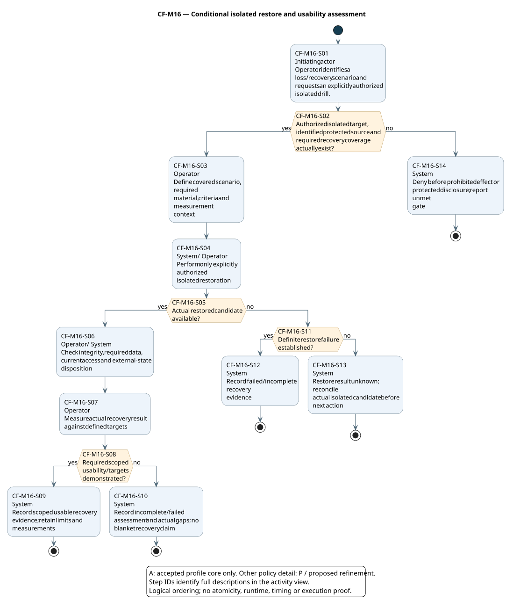

[Editable PlantUML](Diagrams/Activity-Isolated-Recovery-Assessment.puml) · 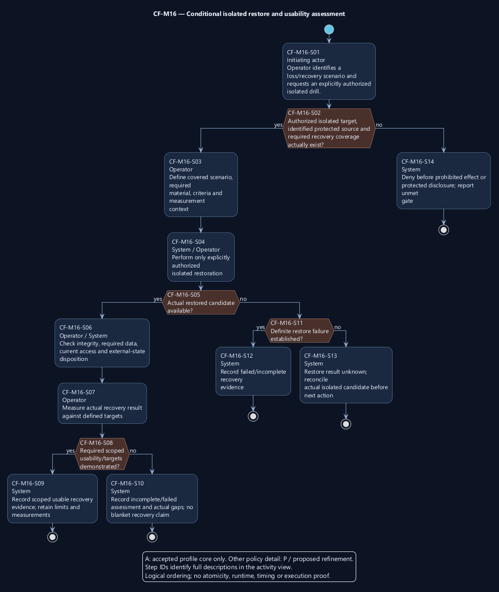

| Step | Kind / responsible context | Action or guard meaning |
| --- | --- | --- |
| **CF-M16-S01** | action; Initiating actor | Operator identifies a loss/recovery scenario and requests an explicitly authorized isolated drill. |
| **CF-M16-S02** | decision; Decision / current domain context | Authorized isolated target, identified protected source and required recovery coverage actually exist |
| **CF-M16-S03** | action; Operator | Define covered scenario, required material, criteria and measurement context |
| **CF-M16-S04** | action; System / Operator | Perform only explicitly authorized isolated restoration |
| **CF-M16-S05** | decision; Decision / current domain context | Actual restored candidate available |
| **CF-M16-S06** | action; Operator / System | Check integrity, required data, current access and external-state disposition |
| **CF-M16-S07** | action; Operator | Measure actual recovery result against defined targets |
| **CF-M16-S08** | decision; Decision / current domain context | Required scoped usability/targets demonstrated |
| **CF-M16-S09** | end; System | Record scoped usable recovery evidence; retain limits and measurements |
| **CF-M16-S10** | end; System | Record incomplete/failed assessment and actual gaps; no blanket recovery claim |
| **CF-M16-S11** | decision; Decision / current domain context | Definite restore failure established |
| **CF-M16-S12** | end; System | Record failed/incomplete recovery evidence |
| **CF-M16-S13** | end; System | Restore result unknown; reconcile actual isolated candidate before next action |
| **CF-M16-S14** | end; System | Deny before prohibited effect or protected disclosure; report unmet gate |

###### CF-M17 — Reusable actual operation-result classification

**Trigger:** An intended operation has a result or missing confirmation requiring classification.

**Start conditions:** Exact intended operation context and permitted observation scope are identified.

**End condition:** Only evidence-supported confirmed, pending, failed, partial or unknown effects are reported.

**Alternative/failure meaning:** Uncertain effect is not inferred failure, success or unchanged state; no blind retry.

**Control-flow interpretation:** Called by workflows after an attempted consequential action; each caller resumes/returns according to its actual domain result. This is a reusable analysis subactivity, not a selected runtime service.

**Policy/evidence boundary:** Classification refines existing failure semantics; no retry/transaction mechanism selected. Definite failure may include known effects and is not universal rollback. An unknown result requires same-operation reconciliation; retry is a separate authorized action. When context cannot be established, do not expose protected evidence or claim an attributed result.

**Primary requirement basis:** [AFO-D07](../02-Requirements-Engineering/01-Software-Requirements-Specification/03-Requirements-Specification/02-Administration-Files-And-Operational-Behavior.md#requirements-specification-administration-files-and-operational-behavior--heading-afo-d07-truthful-completion-and-interrupted-operation-handling), [AFO-D09](../02-Requirements-Engineering/01-Software-Requirements-Specification/03-Requirements-Specification/02-Administration-Files-And-Operational-Behavior.md#requirements-specification-administration-files-and-operational-behavior--heading-afo-d09-operational-outcomes-and-capacity-warnings), [EIF-D08](../02-Requirements-Engineering/01-Software-Requirements-Specification/03-Requirements-Specification/07-External-Interface-Requirements.md#requirements-specification-external-interface-requirements--heading-eif-d08-operation-specific-failure-and-repetition-semantics), [QSR-D08](../02-Requirements-Engineering/01-Software-Requirements-Specification/03-Requirements-Specification/14-Quality-Security-And-Recovery-Requirements.md#requirements-specification-quality-security-and-recovery-requirements--heading-qsr-d08-data-integrity-and-truthful-completion)

**Domain objects:** [DM-C50](02-Domain-And-Information-Analysis.md#analysis-domain-and-information-analysis--03-domain-model-and-object-oriented-view--id-dm-c50), [DM-C49](02-Domain-And-Information-Analysis.md#analysis-domain-and-information-analysis--03-domain-model-and-object-oriented-view--id-dm-c49), [DM-C51](02-Domain-And-Information-Analysis.md#analysis-domain-and-information-analysis--03-domain-model-and-object-oriented-view--id-dm-c51), [DM-C48](02-Domain-And-Information-Analysis.md#analysis-domain-and-information-analysis--03-domain-model-and-object-oriented-view--id-dm-c48)

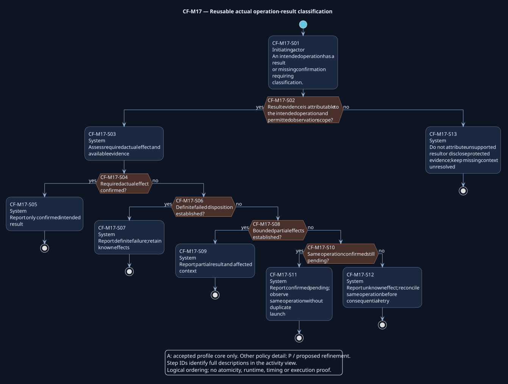

[Editable PlantUML](Diagrams/Activity-Operation-Result-Classification.puml) · 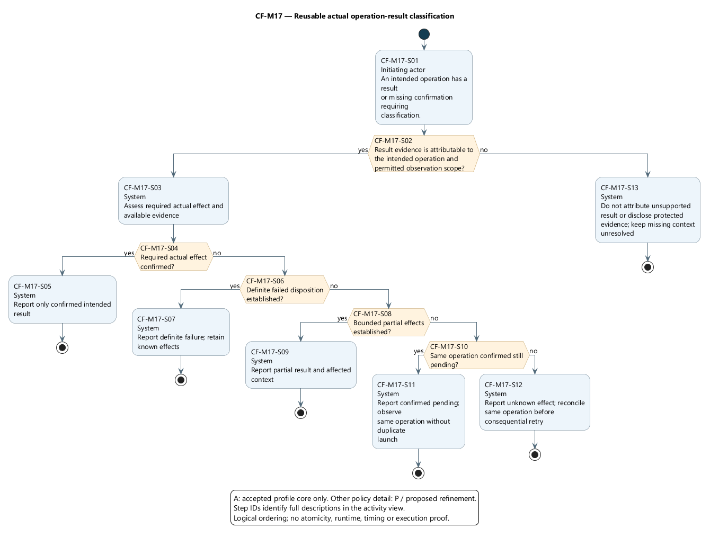

| Step | Kind / responsible context | Action or guard meaning |
| --- | --- | --- |
| **CF-M17-S01** | action; Initiating actor | An intended operation has a result or missing confirmation requiring classification. |
| **CF-M17-S02** | decision; Decision / current domain context | Result evidence is attributable to the intended operation and permitted observation scope |
| **CF-M17-S03** | action; System | Assess required actual effect and available evidence |
| **CF-M17-S04** | decision; Decision / current domain context | Required actual effect confirmed? |
| **CF-M17-S05** | end; System | Report only confirmed intended result |
| **CF-M17-S06** | decision; Decision / current domain context | Definite failed disposition established? |
| **CF-M17-S07** | end; System | Report definite failure; retain known effects |
| **CF-M17-S08** | decision; Decision / current domain context | Bounded partial effects established? |
| **CF-M17-S09** | end; System | Report partial result and affected context |
| **CF-M17-S10** | decision; Decision / current domain context | Same operation confirmed still pending |
| **CF-M17-S11** | end; System | Report confirmed pending; observe same operation without duplicate launch |
| **CF-M17-S12** | end; System | Report unknown effect; reconcile same operation before consequential retry |
| **CF-M17-S13** | end; System | Do not attribute unsupported result or disclose protected evidence; keep missing context unresolved |

##### 3. Contracts and Other Views

Every activity must retain identity, current authority and actual outcome from its source interaction/state models. Do not infer atomicity or safe repetition from vertical ordering. State changes occur only when their full guard/effect conditions apply; a timeout after a consequential action cannot prove unchanged state.

###### Object handoffs and authority

| Activity | Input objects / context | Output / handoff meaning |
| --- | --- | --- |
| CF-M01 | Source differences, intended resume, overrides, existing live presentation | Explicit selected draft; separately confirmed publication; actual history independent (DA-F01–03) |
| CF-M02–04 | Download choice, language/artifact, exact link and published selection | Effective saved mode, independent link change, or authorized selected representation (DA-F04–05) |
| CF-M05–06 | Company/opportunity, manual application, actual event and sent material | Preparation/progress separately retained; identifiable actual material set and completeness (DA-F06) |
| CF-M07 | Intended provider account, scoped capability, reviewed message intent | Permitted mailbox content or attributable provider acceptance/rejection/unknown send (DA-F07) |
| CF-M08 | Local activity/time, mapping, local/provider versions and field authority | Local state, explicit mapping/unlink, stale/conflict or confirmed provider result (DA-F08) |
| CF-M09–10 | Item/task/Sprint Goal/selection/plan or invitation/current grant | Coherent Sprint Backlog, actual period result, or exact scoped access (DA-F09) |
| CF-M11–12 | Repository/ref, expected/evaluated source and target revisions, review/check context | Actual transfer/ref/integration result; no inherited deployment permission (DA-F10) |
| CF-M13–14 | Evaluated code/definition, attempt, scoped secrets, artifact and exact target | Attributable actual/unknown attempt/output and separately authorized target effect (DA-F11) |
| CF-M15 | Effective policy, actual usage/content/protected references or evidence scope | Effective policy/usable admission/bounded evidence; no invented freed capacity (DA-F04/12) |
| CF-M16 | Identified recovery source, covered scenario and suitable isolated target | Assessed actual integrity/usability/current access and measured target comparison (DA-F13) |
| CF-M17 | Exact operation identity and permitted evidence about actual effects | Classified evidence-supported result, never an invented rollback or implicit retry |

This table records conceptual object flows without choosing payload formats, stored schemas or technical interfaces. The primary dictionary and data view retain meaning/authority. Function view 04 and operation contracts 10 must later make required inputs/preconditions and postconditions explicit without duplicating policy truth.

###### Cross-view invariants

| Check | Required agreement |
| --- | --- |
| CF-X01 Profile preservation | CF-M01 = SB-M01 = SM-M01/07: source edits alone do not update existing resumes or actual sent content |
| CF-X02 Independent controls | CF-M02–04 = SM-M04/05: PDF mode, link eligibility and artifact availability are separate |
| CF-X03 Actual evidence | CF-M05–06 = SM-M06/07: progress does not establish preservation or receipt |
| CF-X04 Provider effects | CF-M07–08 = SM-M08–10: capability, freshness and acceptance are distinct; no blind resend/replay |
| CF-X05 Work meaning | CF-M09 = SM-M11–12: readiness differs from progress; task completion/period end is not universal acceptance |
| CF-X06 Current access | CF-M10–12 = SM-M02/03/13: scoped grants and current evaluated revisions govern consequential operations |
| CF-X07 Safe enablement | CF-M13–14 = SM-M14/15: actual execution gates and separate target authority precede effects |
| CF-X08 Reference integrity | CF-M15 = SM-M05/16: admission/cleanup cannot silently destroy protected actual history |
| CF-X09 Recovery proof | CF-M16 = SM-M17: restored candidate is assessed before usable recovery is claimed |
| CF-X10 Result honesty | CF-M17 = SM-M18: denied, definite failed, partial and unknown outcomes stay distinguishable |

##### 4. Review Questions

| Review question | Current disposition |
| --- | --- |
| Are actions assigned to responsible contexts? | Yes: inline actor labels and complete step tables; no invented runtime component structure |
| Are decision alternatives visible? | Each declared decision has explicit yes/no branches; bounded dispatch assumption is stated. Source-policy finalization and guard sufficiency still need contract review |
| Are start/end and unsupported requests clear? | Yes: trigger/start/end per activity; reject unsupported operation kind before bounded alternatives |
| Is fork/join behavior justified? | No fork/join is introduced: no supported requirement demands waiting for concurrent branches here |
| Do exceptional paths avoid invented success? | Explicit failure/unknown branches and CF-M17 preserve actual outcome distinctions; review cases below remain future tests |
| Are implementation choices kept for design? | No transaction/lock/retry protocol, worker topology, transport, algorithm or execution environment is selected |
| Is every primary acceptance criterion proven? | No. Provenance and model structure checks are not exhaustive criterion coverage or execution evidence |

##### 5. Interruption, concurrency and resumption

| Event / interruption | Required observable handling | Prohibited inference |
| --- | --- | --- |
| Source changes while applying/publishing | Recheck intended current context; resolve stale/conflicting result explicitly | Source edit authorizes overwrite or publication |
| Link disabled while a request is open | Apply reviewed current-request/session policy; report actual effect | Previously emitted bytes can be recalled |
| Material capture interrupted | Identify confirmed versus missing/unconfirmed actual components | Current live PDF equals actual previously submitted file |
| Mail send times out | Reconcile attributable same attempt before separately reviewed resend | Timeout proves no message was accepted |
| Local/provider edits overlap | Keep conflict/stale status until reviewed resolution | Last observed writer automatically wins |
| Grant changes during multi-step work | Recheck at consequential access and reconcile actual partial effects | Initial check is permanent authority or universal rollback |
| Ref/review changes during merge | Evaluate exact current revisions and actual ref result | Prior approval proves current merge eligibility |
| Cancellation races with attempt completion | Observe confirmed stop or actual completion; unknown stays unknown | Cancel request equals termination |
| Concurrent admissions approach limit | Current effective policy/usage and actual admission result need a reviewed contract | Two independent prechecks prove both writes fit |
| Restore reveals obsolete external/grant context | Assess current authority and external disposition in isolation | Restore authorizes reactivation, resend or deployment |

These diagrams end an observation/request path when pending or unknown; the underlying queued attempt or external operation may continue. Reconciliation resumes with the same identity and known context, not a blind restart of the whole activity. Any compensation, retry, correction or new attempt requires its own explicit eligible contract. No universal rollback guarantee is made.

##### 6. Scope coverage and evidence gates

| Accepted scope | Selected activities |
| --- | --- |
| SCP-01 Accounts, permissions, unified sign-in | CF-M10, CF-M17; current-access gates throughout. Authentication onboarding is not exhaustively re-modeled |
| SCP-02 Profiles/resumes | CF-M01, CF-M06 |
| SCP-03 Portfolio/supporting evidence | CF-M01, CF-M04, CF-M15; all portfolio editing operations are not claimed covered |
| SCP-04 Generated/uploaded PDFs | CF-M02, CF-M04, CF-M06, CF-M15 |
| SCP-05 Protected employer sharing | CF-M02–04 |
| SCP-06 Manual job application management | CF-M05–06 |
| SCP-07 Gmail/calendar | CF-M07–08  **After MVP.** |
| SCP-08 Projects/Kanban/backlogs/Sprints | CF-M09–10; ordinary board operations remain source requirements |
| SCP-09 Real Git/collaboration | CF-M10–12; issues/tags/releases are not claimed fully detailed |
| SCP-10 YAML workflow/CI/CD | CF-M13–14  **After MVP.** |
| SCP-11 Upload/storage limits | CF-M15, CF-M17; detailed cleanup depends on SM-M16/contracts |
| SCP-12 Deployment/operational readiness | CF-M14, CF-M16–17 |

Known gates are carried forward without re-asking the owner: OAuth is not created; backups are not configured; suitable execution isolation/capacity is not demonstrated. The existing Ubuntu demo host has 2 vCPU, 4 GB RAM and 40 GB disk; idle resource readings do not prove multi-feature load, untrusted execution safety or recovery. These facts permit analysis of conditional workflows, not enabling dependent capabilities.

##### 7. Review cases for later verification

These are review/test-design inputs, not tests that were executed against the product.

| Case | Expected path / result |
| --- | --- |
| CF-V01 Edit source; decline apply | CF-M01 no-apply path; existing draft/live unchanged by source edit |
| CF-V02 Apply selected changes; decline publish | CF-M01 save-only result; preserve live and actual history |
| CF-V03 Set neither download mode | CF-M02; no implicit link disable or page removal |
| CF-V04 Disable link; issue fresh protected request | CF-M03 deny after confirmed effective disablement |
| CF-V05 Wrong password, unselected evidence or missing language variant | CF-M04 deny/unavailable without unrelated fallback |
| CF-V06 Record submitted progress with missing actual materials | CF-M05–06 truthful progress and incomplete set, no complete-preservation claim |
| CF-V07 Send with changed attachment after confirmation | CF-M07 recheck fails current review; no send until renewed explicit review |
| CF-V08 Lose send confirmation after provider acceptance may occur | CF-M07 unknown and same-attempt reconciliation; no blind resend |
| CF-V09 Local unlink or concurrent calendar edits | CF-M08 unlink does not delete provider event; conflicts require resolution |
| CF-V10 End Sprint with unfinished selected work | CF-M09 actual disposition, no automatic acceptance/carryover |
| CF-V11 Invitation pending or grant revoked before requested action | CF-M10 no unconfirmed membership or unrelated resource access |
| CF-V12 Protected ref push or stale merge review | CF-M11–12 reject/reevaluate; actual unknown ref state reconciled |
| CF-V13 No safe runner evidence; or completion wins cancel race | CF-M13 blocks execution, or reports actual completion/unknown rather than false cancelled |
| CF-V14 Successful build but no target authority | CF-M14 denies deployment |
| CF-V15 Policy save ambiguous or admission fails | CF-M15/17 no invented new limit, usable artifact or reclaimed bytes |
| CF-V16 No backup source; or restored bytes fail access/integrity checks | CF-M16 prerequisite block or incomplete recovery, no blanket success |

##### 8. Review Status and next work

This view contains 17 locally rendered PlantUML activity models: 16 source-aligned domain activities and one reusable outcome classifier. Each has bounded start/end conditions, responsible contexts, explicit guards/alternatives and provenance. Structural checks verify declared branches and scoped termination, not satisfiable guards, runtime concurrency or complete functional coverage.

Continue with [rule-based view 09](#analysis-business-rules-and-operation-contracts--09-rule-based-view) and [operation contracts 10](#analysis-business-rules-and-operation-contracts--10-domain-constraints-and-operation-contracts), then [cross-view review 11](05-Analysis-Review-And-Design-Handoff.md#analysis-review-and-design-handoff--11-model-consistency-traceability-and-review). Function view 04 and the interface/quality/handoff documents remain separate substantive work. No primary requirement text/identifier or accepted decision is changed by this view; System Analysis and its phase gate are not declared complete.

[Diagram catalog](Diagrams/Diagram-Catalog.md) · [Structured review evidence](https://github.com/Farhad-V/Web-Resumefolio/blob/1f2acaa351ac306cb57cbe4fe9742e8bd90720d9/docs/MVP/SDLC/03-system-analysis/evidence/control-flow-review-2026-11-01.json) · [System Analysis index]()

##### Diagram Types and Reading Guide

The seventeen existing activity diagrams show branching and workflow progression. Decision labels and failure/unknown-result paths must be read with the step/guard tables. Swimlanes or forks, where used, express responsibility or concurrency rather than deployment topology. No additional duplicate flowchart is needed.

Resumefolio — Current Processes and Bottleneck Analysis

#### Resumefolio — Current Processes and Bottleneck Analysis

> **Notation-alignment revision:** File 04 now contains functional decomposition and balanced DFDs. Earlier review findings/counts and their JSON/CSV evidence remain dated snapshots; references to an empty 04 describe that earlier candidate. Population does not automatically establish semantic sufficiency or close authoritative findings.

[Diagram types and reading guide](#analysis-functional-and-process-analysis--15-current-processes-and-bottleneck-analysis--heading-diagram-types-and-reading-guide) · [Full diagram catalog](Diagrams/Diagram-Catalog.md)

Owner: Farhad. Updated: November 1, 2026.

Status: Populated source-based analysis; actual daily-task observations and measured improvement results are not available. Not whole-phase acceptance.

Current MVP scope and selected mechanisms: [Baseline](https://github.com/Farhad-V/Web-Resumefolio/blob/1f2acaa351ac306cb57cbe4fe9742e8bd90720d9/docs/MVP/baseline/README.md). Deferred provider, advanced collaboration and workflow-execution designs are not MVP prerequisites.

##### 1. Purpose and Evidence Basis

Separate accepted problem direction, actual documentary/technical evidence, intended product behavior and untested explanations. These are different kinds of evidence. The records below cover the agreed product scope without inventing how the owner currently performs everyday work.

Historical Ubuntu/demo observations establish a dated environment, not current capacity or demonstrated recovery. No new interview, server session, reference-code inspection, business-task observation or benchmark was performed in this review.

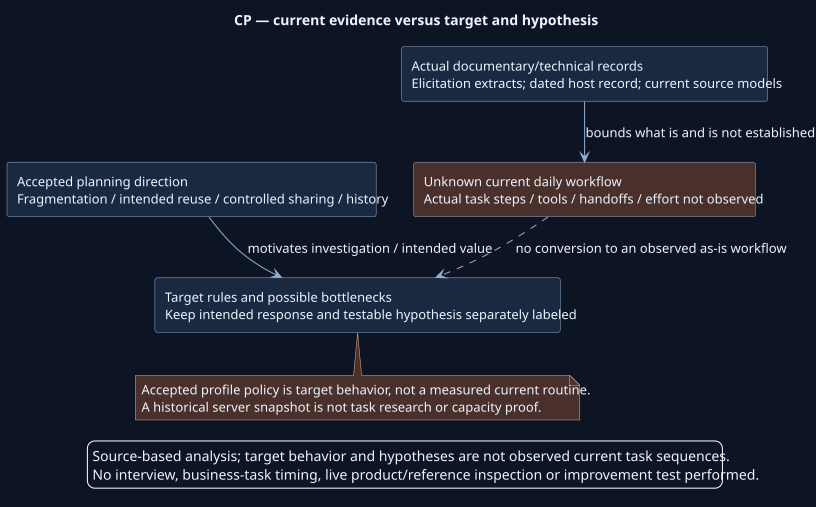

[Editable PlantUML](Diagrams/Process-Evidence-Classes.puml) · 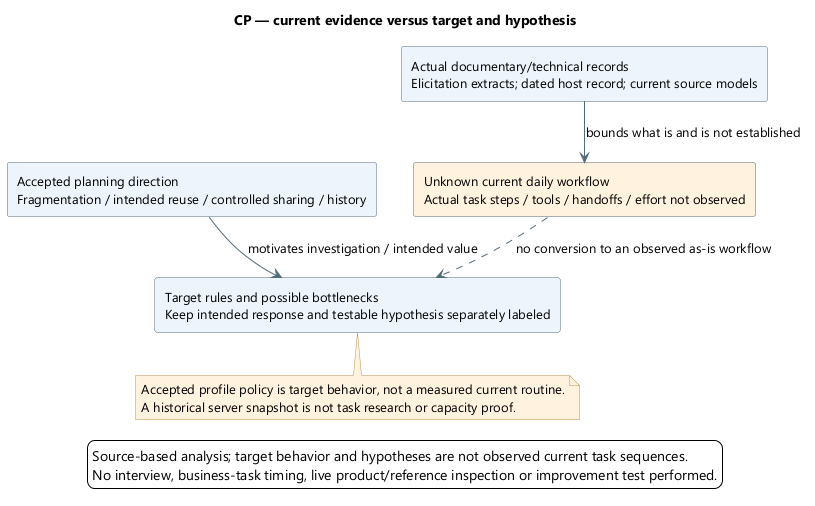

###### CP-E01 — Accepted problem and scope

**Kind:** Accepted planning direction

**Source:** [01-purpose-and-objectives.md](../01-Project-Planning/01-Project-Charter.md#purpose-and-success)

**Supported statement:** Fragmented professional/application work and intended benefits are accepted problem/objective direction.

**Limit:** Not measured frequency, observed universal user behavior or a quantified pain level.

###### CP-E02 — Elicitation activity and discovery pointers

**Kind:** Actual source register/document-extraction record

**Source:** [elicitation-log.md](../02-Requirements-Engineering/01-Software-Requirements-Specification/02-Stakeholders-And-Elicitation/02-Elicitation-Log.md#stakeholders-and-elicitation-elicitation-log)

**Supported statement:** LOG-001 records actual documentary extraction; LOG-002 records owner-supplied host observations; later owner inputs are explicitly recorded.

**Limit:** No new interview/workshop/daily-task observation is performed here. SRC-05/06 pointers are not inspected current workflows until exact extraction.

###### CP-E03 — Dated guest/demo inspection

**Kind:** Historical technical observation

**Source:** [server-readonly-check-2026-11-01.json](../02-Requirements-Engineering/01-Software-Requirements-Specification/06-Validation-And-Traceability/05-Server-Readonly-Check-2026-11-01json.md#validation-and-traceability-server-readonly-check-2026-11-01)

**Supported statement:** Dated allocated/guest resources, web/database/PHP services, Laravel lockfile and limited operating observations were recorded.

**Limit:** Not an end-to-end personal workflow, current capacity/security test or demonstrated backup/restore; original execution limits apply.

###### CP-E04 — Accepted core and owner facts

**Kind:** Recorded bounded owner decision / input

**Source:** [open-questions-and-decisions.md](../02-Requirements-Engineering/01-Software-Requirements-Specification/07-Change-And-Baseline/03-Requirements-Questions-And-Decisions.md#change-and-baseline-open-questions-and-decisions)

Work follows the selected scope, dependencies and demonstrated outcomes.

**Limit:** Intended product behavior and setup facts do not establish existing daily preparation/tool/sending procedure or measured effort.

###### CP-E05 — Primary intended cross-module boundaries

**Kind:** Proposed requirements with accepted scope basis

**Source:** [business-rules-and-data-lifecycle.md](../02-Requirements-Engineering/01-Software-Requirements-Specification/03-Requirements-Specification/04-Business-Rules-And-Data-Lifecycle.md#requirements-specification-business-rules-and-data-lifecycle)

**Supported statement:** Resource authority, selected disclosure, actual history, provider/lifecycle/recovery meanings are documented.

**Limit:** Proposed target rules are not observed current user/system behavior; older open wording must not reopen accepted profile core.

###### CP-E06 — Current qualified handoff

**Kind:** Current documentary model/review fact

**Source:** [14-feasibility-dependencies-and-design-handoff.md](05-Analysis-Review-And-Design-Handoff.md#analysis-review-and-design-handoff--14-feasibility-dependencies-and-design-handoff)

**Supported statement:** Working models, current source identity, conditional design questions and remaining function/semantic/dependency work are documented.

**Limit:** Document/model/check counts are not real task durations, user research, implementation outcomes or whole-phase acceptance.

###### CP-E07 — Proposed elicitation method and reference use

**Kind:** Investigation plan / discovery boundary

**Source:** [elicitation-plan-and-techniques.md](../02-Requirements-Engineering/01-Software-Requirements-Specification/02-Stakeholders-And-Elicitation/03-Elicitation-Plan-And-Techniques.md#stakeholders-and-elicitation-elicitation-plan-and-techniques)

**Supported statement:** Reuse existing sources/decisions and select a bounded method for genuine remaining gaps; reference projects need exact inspected provenance.

**Limit:** No reference repository/user workflow is inspected by this task; proposed activities are not performed sessions.

###### CP-E08 — Local work index and current planning input

**Kind:** Historical scheduling index / documented tracking authority

**Source:** [product-backlog.md](https://github.com/Farhad-V/Web-Resumefolio/blob/1f2acaa351ac306cb57cbe4fe9742e8bd90720d9/docs/MVP/Project-Management/product-backlog.md)

Work follows the selected scope, dependencies and demonstrated outcomes.

**Limit:** No live issue/board or actual Sprint execution is inspected; historical full-time wording is not a current numerical commitment.

##### 2. Current-Process Description

Each area identifies what is known, which current actions remain unobserved and the bounded evidence that would answer a specific question. Target use cases must not be relabeled as observed current workflows. Missing evidence does not mean the owner lacks an existing process.

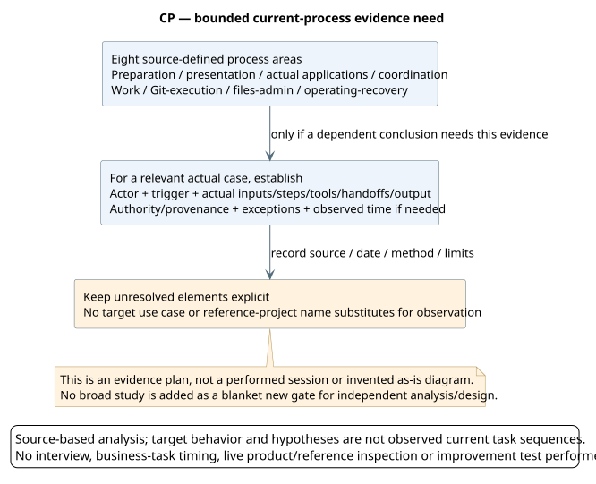

[Editable PlantUML](Diagrams/Process-Current-Workflow-Questions.puml) · 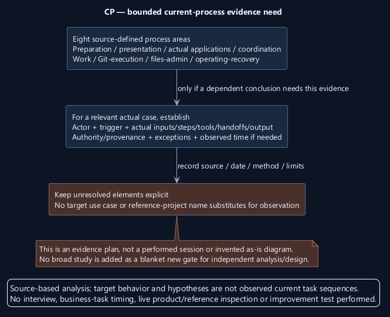

###### CP-P01 — Professional information and targeted preparation

**Actor context:** Intended professional-information/resume owner; actual observed participant/task sample not recorded.

**Known:** CP-E01 planning direction and CP-E04 accepted target rule support reuse plus independent tailoring; no actual field-entry session was supplied.

**Current trigger:** Preparation/update need is mentioned in planning; actual initiating event/time for a current case is not observed.

**Current sequence tools handoffs:** Actual source documents/tools, order of edits, manual variant handling, waits and handoffs are not established; do not import target UC-D01 as current routine.

**Information authority:** Identify current source of each fact, intended resume-specific override/language/omission and any actual current/live/sent copy distinction.

**Evidence needed:** A bounded authorized current preparation case with anonymized artifacts and explicitly observed edits/re-entry/intentional tailoring; no private source data needed in this document.

**Intended improvement:** Explicit selected reuse can preserve independent text while avoiding unintended propagation; actual efficiency benefit must later be demonstrated.

**Requirement ids:** [BIZ-D01](../02-Requirements-Engineering/01-Software-Requirements-Specification/03-Requirements-Specification/03-Business-Requirements.md#requirements-specification-business-requirements--heading-biz-d01-reusable-information-and-relevant-professional-presentation), [USR-D01](../02-Requirements-Engineering/01-Software-Requirements-Specification/03-Requirements-Specification/18-User-Requirements.md#requirements-specification-user-requirements--heading-usr-d01-reuse-and-tailor-professional-information), [DOM-D01](../02-Requirements-Engineering/01-Software-Requirements-Specification/03-Requirements-Specification/05-Domain-Requirements-And-Constraints.md#requirements-specification-domain-requirements-and-constraints--heading-dom-d01-consistent-professional-information-meaning), [DOM-D04](../02-Requirements-Engineering/01-Software-Requirements-Specification/03-Requirements-Specification/05-Domain-Requirements-And-Constraints.md#requirements-specification-domain-requirements-and-constraints--heading-dom-d04-explicit-human-authored-language-and-application-work), [PRP-D03](../02-Requirements-Engineering/01-Software-Requirements-Specification/03-Requirements-Specification/12-Profiles-Resumes-And-Portfolio.md#requirements-specification-profiles-resumes-and-portfolio--heading-prp-d03-independent-selections-layouts-and-overrides), [PRP-D04](../02-Requirements-Engineering/01-Software-Requirements-Specification/03-Requirements-Specification/12-Profiles-Resumes-And-Portfolio.md#requirements-specification-profiles-resumes-and-portfolio--heading-prp-d04-explicit-shared-source-update-rules), [BRL-D02](../02-Requirements-Engineering/01-Software-Requirements-Specification/03-Requirements-Specification/04-Business-Rules-And-Data-Lifecycle.md#requirements-specification-business-rules-and-data-lifecycle--heading-brl-d02-shared-information-and-independent-tailoring)

**Models:** SB-M01, SM-M01, RB-D02, IF-01

**Contracts:** DC-O01, DC-O02, DC-O03

**Parent questions:** Q-D06, Q-D07

**Status:** Source-defined process area; no observed daily-business task instance recorded by this review

###### CP-P02 — Presentation, evidence, PDFs and employer access

**Actor context:** Intended owner and employer viewer; actual employer interaction not observed.

**Known:** Planning accepts controlled selected presentation. A dated demo page/deployment observation is not a witnessed sharing/revocation workflow.

**Current trigger:** An intended viewing/sharing goal is in scope; no actual current link-creation/download/revocation event sequence recorded.

**Current sequence tools handoffs:** Current export/naming/upload/language choice, employer entry, sharing medium and any access problem not established from supplied sources.

**Information authority:** Distinguish intended selection/live presentation, generated/uploaded variant, language and current request authority; do not infer content from filename alone.

**Evidence needed:** A controlled current presentation/retrieval case and any actually supplied before/after access evidence; synthetic target access cases are separate tests, not current-use observations.

**Intended improvement:** Defined selected disclosure/direct retrieval and separate PDF/link controls address possible ambiguity; measured clarity/access outcomes not yet available.

**Requirement ids:** [BIZ-D02](../02-Requirements-Engineering/01-Software-Requirements-Specification/03-Requirements-Specification/03-Business-Requirements.md#requirements-specification-business-requirements--heading-biz-d02-controlled-disclosure-of-professional-information), [USR-D02](../02-Requirements-Engineering/01-Software-Requirements-Specification/03-Requirements-Specification/18-User-Requirements.md#requirements-specification-user-requirements--heading-usr-d02-control-pdf-and-employer-sharing), [USR-D03](../02-Requirements-Engineering/01-Software-Requirements-Specification/03-Requirements-Specification/18-User-Requirements.md#requirements-specification-user-requirements--heading-usr-d03-view-intended-professional-material-without-an-account), [PDF-D02](../02-Requirements-Engineering/01-Software-Requirements-Specification/03-Requirements-Specification/11-Pdf-And-Controlled-Sharing.md#requirements-specification-pdf-and-controlled-sharing--heading-pdf-d02-uploaded-pdf-and-language-identity), [PDF-D03](../02-Requirements-Engineering/01-Software-Requirements-Specification/03-Requirements-Specification/11-Pdf-And-Controlled-Sharing.md#requirements-specification-pdf-and-controlled-sharing--heading-pdf-d03-per-resume-download-choices), [PDF-D04](../02-Requirements-Engineering/01-Software-Requirements-Specification/03-Requirements-Specification/11-Pdf-And-Controlled-Sharing.md#requirements-specification-pdf-and-controlled-sharing--heading-pdf-d04-scoped-password-protected-employer-access), [PDF-D05](../02-Requirements-Engineering/01-Software-Requirements-Specification/03-Requirements-Specification/11-Pdf-And-Controlled-Sharing.md#requirements-specification-pdf-and-controlled-sharing--heading-pdf-d05-direct-file-and-pdf-authorization), [PDF-D06](../02-Requirements-Engineering/01-Software-Requirements-Specification/03-Requirements-Specification/11-Pdf-And-Controlled-Sharing.md#requirements-specification-pdf-and-controlled-sharing--heading-pdf-d06-owner-password-and-link-controls)

**Models:** SB-M02, SB-M03, SB-M04, SM-M04, RB-D03, RB-D04, RB-D05, IF-02

**Contracts:** DC-O04, DC-O05, DC-O06

**Parent questions:** Q-D05, Q-D08, Q-D09, Q-D10, Q-D11

**Status:** Source-defined process area; no observed daily-business task instance recorded by this review

###### CP-P03 — Manual application progress and actual sent history

**Actor context:** Intended applicant; no inspected actual application/submission task instance.

**Known:** CP-E01/05 require manual preparation and actual-material independence; no real sent resume/letter/email or current register was inspected.

**Current trigger:** Actual opportunity/submission/correction event and its time are not observed; desired manual behavior is not proof of current recording method.

**Current sequence tools handoffs:** Current company/opportunity intake, letter preparation, chosen document, submission channel, progress recording and correction steps/tools/handoffs are not established.

**Information authority:** Identify what was actually sent, actual event versus recorded time and how any old/current material is distinguished; latest live source cannot be assumed actual.

**Evidence needed:** A bounded anonymized current case showing stated actual material/event and existing record; distinguish absence of evidence from evidence no record exists.

**Intended improvement:** Explicit manual progress plus identifiable actual material may reduce history ambiguity; completeness/correction/retention outcome needs actual cases.

**Requirement ids:** [BIZ-D03](../02-Requirements-Engineering/01-Software-Requirements-Specification/03-Requirements-Specification/03-Business-Requirements.md#requirements-specification-business-requirements--heading-biz-d03-traceable-manual-applications-and-preserved-submission-history), [USR-D04](../02-Requirements-Engineering/01-Software-Requirements-Specification/03-Requirements-Specification/18-User-Requirements.md#requirements-specification-user-requirements--heading-usr-d04-prepare-and-track-applications-manually), [USR-D05](../02-Requirements-Engineering/01-Software-Requirements-Specification/03-Requirements-Specification/18-User-Requirements.md#requirements-specification-user-requirements--heading-usr-d05-keep-a-trustworthy-record-of-actual-submitted-materials), [APP-D01](../02-Requirements-Engineering/01-Software-Requirements-Specification/03-Requirements-Specification/09-Manual-Application-Management.md#requirements-specification-manual-application-management--heading-app-d01-company-and-opportunity-context), [APP-D05](../02-Requirements-Engineering/01-Software-Requirements-Specification/03-Requirements-Specification/09-Manual-Application-Management.md#requirements-specification-manual-application-management--heading-app-d05-user-directed-submission-recording), [APP-D06](../02-Requirements-Engineering/01-Software-Requirements-Specification/03-Requirements-Specification/09-Manual-Application-Management.md#requirements-specification-manual-application-management--heading-app-d06-preserved-actual-submitted-copies), [APP-D07](../02-Requirements-Engineering/01-Software-Requirements-Specification/03-Requirements-Specification/09-Manual-Application-Management.md#requirements-specification-manual-application-management--heading-app-d07-correction-and-repeated-submissions), [DOM-D02](../02-Requirements-Engineering/01-Software-Requirements-Specification/03-Requirements-Specification/05-Domain-Requirements-And-Constraints.md#requirements-specification-domain-requirements-and-constraints--heading-dom-d02-application-history-represents-actual-submitted-material)

**Models:** SB-M05, SB-M06, SM-M06, SM-M07, RB-D06

**Contracts:** DC-O07, DC-O08, DC-O09, DC-O10

**Parent questions:** Q-D12, Q-D13, Q-D14

**Status:** Source-defined process area; no observed daily-business task instance recorded by this review

###### CP-P04 — Correspondence, calendar and follow-up

**After MVP.** Shared operating and recovery controls still apply where relevant.

**Actor context:** Intended communication/calendar user; actual daily mailbox/calendar procedure not observed.

**Known:** Owner has not created the intended product OAuth project. This does not establish whether or how the person currently uses standalone Gmail/calendar.

**Current trigger:** Current received message/deadline/follow-up trigger and actual timing not observed.

**Current sequence tools handoffs:** Actual account/tool switching, message drafting/sending, deadline entry, reminder handling or misses are not measured or reconstructed from desired integration scope.

**Information authority:** Separate local notes/activity/mapping, selected account/provider-owned fields, final send intent, actual acceptance and recipient receipt.

**Evidence needed:** A relevant current coordination task with permitted anonymized timeline; account access/failure tests belong to separately authorized provider verification.

**Intended improvement:** Explicit local/provider authority, selected synchronization and truthful send outcomes address possible coordination gaps, not proven missed-follow-up rates.

**Requirement ids:** [BIZ-D04](../02-Requirements-Engineering/01-Software-Requirements-Specification/03-Requirements-Specification/03-Business-Requirements.md#requirements-specification-business-requirements--heading-biz-d04-coordinated-authorized-work-in-one-product-experience), [USR-D06](../02-Requirements-Engineering/01-Software-Requirements-Specification/03-Requirements-Specification/18-User-Requirements.md#requirements-specification-user-requirements--heading-usr-d06-coordinate-correspondence-and-activities), [EGC-D05](../02-Requirements-Engineering/01-Software-Requirements-Specification/03-Requirements-Specification/06-Email-Calendar-And-Google-Integration.md#requirements-specification-email-calendar-and-google-integration--heading-egc-d05-deliberate-send-and-truthful-outcome), [EGC-D08](../02-Requirements-Engineering/01-Software-Requirements-Specification/03-Requirements-Specification/06-Email-Calendar-And-Google-Integration.md#requirements-specification-email-calendar-and-google-integration--heading-egc-d08-explicit-synchronization-contract), [EGC-D11](../02-Requirements-Engineering/01-Software-Requirements-Specification/03-Requirements-Specification/06-Email-Calendar-And-Google-Integration.md#requirements-specification-email-calendar-and-google-integration--heading-egc-d11-disconnect-revocation-and-reconnect), [EIF-D08](../02-Requirements-Engineering/01-Software-Requirements-Specification/03-Requirements-Specification/07-External-Interface-Requirements.md#requirements-specification-external-interface-requirements--heading-eif-d08-operation-specific-failure-and-repetition-semantics), [DOM-D05](../02-Requirements-Engineering/01-Software-Requirements-Specification/03-Requirements-Specification/05-Domain-Requirements-And-Constraints.md#requirements-specification-domain-requirements-and-constraints--heading-dom-d05-explicit-external-service-applicability)

**Models:** SB-M07, SB-M08, SM-M08, SM-M09, SM-M10, RB-D07, RB-D08, IF-04, IF-05

**Contracts:** DC-O11, DC-O12, DC-O13, DC-O14, DC-O15

**Parent questions:** Q-D15, Q-D16, Q-D17

**Status:** Source-defined process area; no observed daily-business task instance recorded by this review

###### CP-P05 — Work management, collaboration and delivery tracking

**Actor context:** Sole project owner and intended collaborators; no independent team/Sprint execution observation.

**Known:** CP-E08 indexes historical work packages and identifies remote tracking authority; working models describe intended item/task/Sprint meaning.

**Current trigger:** Actual item selection, work start, acceptance and Sprint-end events not verified through live board or observed case.

**Current sequence tools handoffs:** Current board/membership/refinement/planning/review routines and actual carryover/rework not established from provisional local dates.

**Information authority:** Distinguish item/task, readiness/progress/acceptance, coherent Sprint Goal/selection/plan and actual period/goal outcome.

**Evidence needed:** An actual authorized local or live work-record review with source/revision/date and observed outcome; no remote assignments are queried or changed here.

**Intended improvement:** Explicit work/period meaning and deliberate cross-module links may improve coherence; actual user effort or completion benefit remains unmeasured.

**Requirement ids:** [BIZ-D04](../02-Requirements-Engineering/01-Software-Requirements-Specification/03-Requirements-Specification/03-Business-Requirements.md#requirements-specification-business-requirements--heading-biz-d04-coordinated-authorized-work-in-one-product-experience), [USR-D07](../02-Requirements-Engineering/01-Software-Requirements-Specification/03-Requirements-Specification/18-User-Requirements.md#requirements-specification-user-requirements--heading-usr-d07-plan-and-adapt-authorized-work), [USR-D08](../02-Requirements-Engineering/01-Software-Requirements-Specification/03-Requirements-Specification/18-User-Requirements.md#requirements-specification-user-requirements--heading-usr-d08-collaborate-within-invited-resource-boundaries), [PKS-D03](../02-Requirements-Engineering/01-Software-Requirements-Specification/03-Requirements-Specification/13-Projects-Kanban-And-Sprints.md#requirements-specification-projects-kanban-and-sprints--heading-pks-d03-product-backlog-and-item-definition), [PKS-D07](../02-Requirements-Engineering/01-Software-Requirements-Specification/03-Requirements-Specification/13-Projects-Kanban-And-Sprints.md#requirements-specification-projects-kanban-and-sprints--heading-pks-d07-sprint-goal-and-selected-backlog-items), [PKS-D09](../02-Requirements-Engineering/01-Software-Requirements-Specification/03-Requirements-Specification/13-Projects-Kanban-And-Sprints.md#requirements-specification-projects-kanban-and-sprints--heading-pks-d09-explicit-completion-and-sprint-end-outcomes), [PKS-D10](../02-Requirements-Engineering/01-Software-Requirements-Specification/03-Requirements-Specification/13-Projects-Kanban-And-Sprints.md#requirements-specification-projects-kanban-and-sprints--heading-pks-d10-deliberate-cross-module-links-reports-and-automation)

**Models:** SB-M09, SB-M10, SM-M11, SM-M12, RB-D09, RB-D10, IF-01

**Contracts:** DC-O16, DC-O17, DC-O18, DC-O19, DC-O20, DC-O21

**Parent questions:** Q-D18, Q-D19, Q-D20, Q-D28

**Status:** Source-defined process area; no observed daily-business task instance recorded by this review

###### CP-P06 — Git collaboration and conditional workflow execution

**After MVP.** Shared operating and recovery controls still apply where relevant.

**Actor context:** Intended real Git user/reviewer/trigger actor; no current product-hosting/client/job task sample inspected.

**Known:** Development Git/diagram workflows and named prior references do not establish product Git hosting or safe actual CI execution.

**Current trigger:** No observed current clone/push/review/merge/run/deploy trigger sequence; supported target operations are requirements, not current behavior.

**Current sequence tools handoffs:** Actual current repository hosting/client/ref/review/job/target workflow and failures are not established; no reference project or arbitrary code execution performed.

**Information authority:** Identify exact repository/ref/evaluated revision/review/attempt and separate actual target authority; client transport/admin SSH/development GitHub are not interchangeable evidence.

**Evidence needed:** Exact authorized repository/client/current-case evidence or a scoped future verification plan with source revision; isolate any later execution investigation under existing gate.

**Intended improvement:** Explicit real-ref/review/attempt/target boundaries address possible stale-context/unknown-effect problems; no actual interoperability/safety/latency improvement proved.

**Requirement ids:** [BIZ-D04](../02-Requirements-Engineering/01-Software-Requirements-Specification/03-Requirements-Specification/03-Business-Requirements.md#requirements-specification-business-requirements--heading-biz-d04-coordinated-authorized-work-in-one-product-experience), [USR-D09](../02-Requirements-Engineering/01-Software-Requirements-Specification/03-Requirements-Specification/18-User-Requirements.md#requirements-specification-user-requirements--heading-usr-d09-use-real-repository-collaboration), [USR-D10](../02-Requirements-Engineering/01-Software-Requirements-Specification/03-Requirements-Specification/18-User-Requirements.md#requirements-specification-user-requirements--heading-usr-d10-run-agreed-checks-and-control-deployment-separately), [GIT-D03](../02-Requirements-Engineering/01-Software-Requirements-Specification/03-Requirements-Specification/08-Git-Hosting-And-Collaboration.md#requirements-specification-git-hosting-and-collaboration--heading-git-d03-real-clone-fetch-pull-and-push), [GIT-D07](../02-Requirements-Engineering/01-Software-Requirements-Specification/03-Requirements-Specification/08-Git-Hosting-And-Collaboration.md#requirements-specification-git-hosting-and-collaboration--heading-git-d07-controlled-merge-and-conflict-outcomes), [GIT-D10](../02-Requirements-Engineering/01-Software-Requirements-Specification/03-Requirements-Specification/08-Git-Hosting-And-Collaboration.md#requirements-specification-git-hosting-and-collaboration--heading-git-d10-lifecycle-capacity-and-recovery), [YML-D04](../02-Requirements-Engineering/01-Software-Requirements-Specification/03-Requirements-Specification/19-Yaml-Workflows-And-Cicd.md#requirements-specification-yaml-workflows-and-cicd--heading-yml-d04-isolation-and-untrusted-code-boundary), [YML-D10](../02-Requirements-Engineering/01-Software-Requirements-Specification/03-Requirements-Specification/19-Yaml-Workflows-And-Cicd.md#requirements-specification-yaml-workflows-and-cicd--heading-yml-d10-separate-controlled-deployment-stage)

**Models:** SB-M11, SB-M12, SB-M13, SB-M14, SM-M13, SM-M14, SM-M15, IF-06, IF-07

**Contracts:** DC-O22, DC-O23, DC-O25, DC-O26, DC-O27, DC-O28, DC-O29, DC-O30

**Parent questions:** Q-D21, Q-D22, Q-D23

**Status:** Source-defined process area; no observed daily-business task instance recorded by this review

###### CP-P07 — File/setting/evidence administration and retirement

**Actor context:** Intended content owner and explicitly authorized administrator; actual daily admin cases not observed.

**Known:** CP-E03 reports historical guest free-resource snapshot, not current quota/replacement/access/cleanup behavior. Primary sources require effective reference-aware policies.

**Current trigger:** No actual current upload-replacement/policy/cleanup incident or frequency observed.

**Current sequence tools handoffs:** Current types/limits/tool/procedure, admission wait, temporary growth, actual accounting and removal/restore sequence are not established.

**Information authority:** Keep effective policy, intended candidate/usable content, actual required references/retained history, eligibility and confirmed usage release separate.

**Evidence needed:** An authorized bounded case with actual effective policy/usage/reference/result context; never delete data or run load/cleanup just to fill this analysis.

**Intended improvement:** Explicit current policy/reference/outcome semantics address potential false completion and unintended loss; no measured failure rate or freed-capacity result exists.

**Requirement ids:** [USR-D11](../02-Requirements-Engineering/01-Software-Requirements-Specification/03-Requirements-Specification/18-User-Requirements.md#requirements-specification-user-requirements--heading-usr-d11-administer-explicit-policy-and-understand-failures), [AFO-D01](../02-Requirements-Engineering/01-Software-Requirements-Specification/03-Requirements-Specification/02-Administration-Files-And-Operational-Behavior.md#requirements-specification-administration-files-and-operational-behavior--heading-afo-d01-owner-configurable-upload-and-storage-policy), [AFO-D04](../02-Requirements-Engineering/01-Software-Requirements-Specification/03-Requirements-Specification/02-Administration-Files-And-Operational-Behavior.md#requirements-specification-administration-files-and-operational-behavior--heading-afo-d04-aggregate-quota-and-concurrent-admission), [AFO-D07](../02-Requirements-Engineering/01-Software-Requirements-Specification/03-Requirements-Specification/02-Administration-Files-And-Operational-Behavior.md#requirements-specification-administration-files-and-operational-behavior--heading-afo-d07-truthful-completion-and-interrupted-operation-handling), [AFO-D08](../02-Requirements-Engineering/01-Software-Requirements-Specification/03-Requirements-Specification/02-Administration-Files-And-Operational-Behavior.md#requirements-specification-administration-files-and-operational-behavior--heading-afo-d08-safe-replacement-and-lifecycle-effects), [AFO-D11](../02-Requirements-Engineering/01-Software-Requirements-Specification/03-Requirements-Specification/02-Administration-Files-And-Operational-Behavior.md#requirements-specification-administration-files-and-operational-behavior--heading-afo-d11-bounded-cleanup-and-storage-reclamation), [QSR-D09](../02-Requirements-Engineering/01-Software-Requirements-Specification/03-Requirements-Specification/14-Quality-Security-And-Recovery-Requirements.md#requirements-specification-quality-security-and-recovery-requirements--heading-qsr-d09-deliberate-retention-and-reference-aware-removal)

**Models:** SB-M15, SM-M05, SM-M16, RB-D14, RB-D15, IF-03

**Contracts:** DC-O31, DC-O32, DC-O33, DC-O34, DC-O35, DC-O36

**Parent questions:** Q-D24, Q-D25

**Status:** Source-defined process area; no observed daily-business task instance recorded by this review

###### CP-P08 — Operating, maintenance and recovery

**Actor context:** Recorded sole project owner/operator; technical observation scope known, complete operating routine not observed.

OAuth setup absence is distinct from operating delivery.

**Current trigger:** The historical read-only inspection is recorded; no observed incident/update/backup/restore task timeline supplied.

**Current sequence tools handoffs:** Actual recurring maintenance/delivery/alert/recovery procedure, time burden and interruption history are not established. Narrow root cron/unit searches do not exclude other mechanisms.

**Information authority:** Separate actual effective configuration, protected source, consistent point/current rights/external pending work and demonstrated usable result.

**Evidence needed:** A later bounded authorized operating/procedure observation with non-secret evidence; backup/restore needs actual source/coverage/criteria and isolated scope.

**Intended improvement:** Defined evidence/procedures/coverage and reconciliation support operational readiness; no extra on-call budget, RPO/RTO or measured operational improvement is inferred.

**Requirement ids:** [BIZ-D05](../02-Requirements-Engineering/01-Software-Requirements-Specification/03-Requirements-Specification/03-Business-Requirements.md#requirements-specification-business-requirements--heading-biz-d05-usable-maintainable-and-recoverable-initial-operation), [USR-D12](../02-Requirements-Engineering/01-Software-Requirements-Specification/03-Requirements-Specification/18-User-Requirements.md#requirements-specification-user-requirements--heading-usr-d12-operate-and-recover-an-identified-release), [QSR-D10](../02-Requirements-Engineering/01-Software-Requirements-Specification/03-Requirements-Specification/14-Quality-Security-And-Recovery-Requirements.md#requirements-specification-quality-security-and-recovery-requirements--heading-qsr-d10-defined-protected-and-observable-backups), [QSR-D11](../02-Requirements-Engineering/01-Software-Requirements-Specification/03-Requirements-Specification/14-Quality-Security-And-Recovery-Requirements.md#requirements-specification-quality-security-and-recovery-requirements--heading-qsr-d11-demonstrated-restoration-and-recovery-targets), [QSR-D12](../02-Requirements-Engineering/01-Software-Requirements-Specification/03-Requirements-Specification/14-Quality-Security-And-Recovery-Requirements.md#requirements-specification-quality-security-and-recovery-requirements--heading-qsr-d12-safe-restored-access-and-external-state-reconciliation), [QSR-D14](../02-Requirements-Engineering/01-Software-Requirements-Specification/03-Requirements-Specification/14-Quality-Security-And-Recovery-Requirements.md#requirements-specification-quality-security-and-recovery-requirements--heading-qsr-d14-maintainable-verifiable-and-recoverable-changes), [DOM-D08](../02-Requirements-Engineering/01-Software-Requirements-Specification/03-Requirements-Specification/05-Domain-Requirements-And-Constraints.md#requirements-specification-domain-requirements-and-constraints--heading-dom-d08-evidence-based-operation-within-constraints)

**Models:** SB-M16, SM-M17, SM-M18, RB-D16, IF-08, SQ-Q10, SQ-Q11, SQ-Q12, SQ-Q14

**Contracts:** DC-O33, DC-O37, DC-O38

**Parent questions:** Q-D26, Q-D27, Q-D28

**Status:** Source-defined process area; no observed daily-business task instance recorded by this review

##### 3. Bottlenecks and Logic Gaps

###### Confirmed documentary conditions

These findings concern the documents reviewed. They do not establish measured user delays, a product failure or a root cause for project progress.

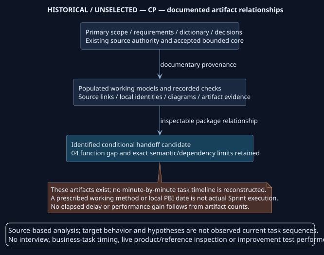

[Editable PlantUML](Diagrams/Process-Documented-Artifact-Trail.puml) · 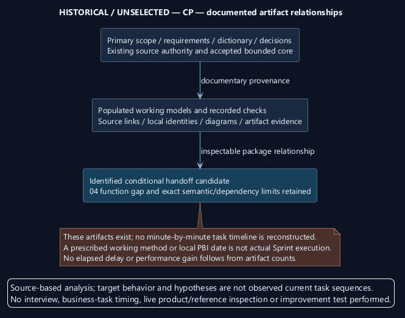

###### CP-F01 — Remaining function/flow substance

**Observed at the earlier CP review:** 04 contained five To develop prompts. **Current disposition:** the notation-alignment revision populates 04; the historical finding is no longer evidence that 04 is empty. Semantic review remains.

**Historical impact:** The earlier candidate lacked populated function/DFD analysis. The current package supplies it; exact semantic sufficiency is a separate review conclusion.

**Cause status:** Why the earlier section was left pending and any elapsed delay were not established; no measured process cause is inferred.

**Next action:** Review the now-populated 04 against existing scope/dictionary/DA-F meanings before claiming whole-analysis completion.

**Source:** [04-function-oriented-view.md](#analysis-functional-and-process-analysis--04-function-oriented-view)

**Parents:** SA-F01, RF-D02

**Status:** Confirmed bounded documentary condition; not a measured personal-process bottleneck

###### CP-F02 — Association is not semantic sufficiency

**Observed:** 11 records 20 bounded criterion walkthroughs, not a complete review of all 470; 14 retains exact semantic reconciliation.

**Impact:** Current source/model counts cannot establish all criteria/paths or readiness.

**Cause status:** Mapping scope is explicitly bounded; no runtime failure or user-delay cause inferred.

**Next action:** Refine affected exact cases/inputs/outcomes and justified direct/derived trace; retain historical inventory scope.

**Source:** [11-model-consistency-traceability-and-review.md](05-Analysis-Review-And-Design-Handoff.md#analysis-review-and-design-handoff--11-model-consistency-traceability-and-review)

**Parents:** SA-F02, SA-F03, RF-D01, RF-D02

**Status:** Confirmed bounded documentary condition; not a measured personal-process bottleneck

###### CP-F03 — Accepted core versus broad open wording

**Observed:** The accepted profile rule coexists with older BRL-D02/D03 open-definition wording, as already flagged by rule/handoff reviews.

**Impact:** Older wording must not reopen explicit apply/separate publication/history acceptance.

**Cause status:** Document wording needs scoped synchronization; actual user-data inconsistency is not demonstrated.

**Next action:** Preserve accepted core and synchronize only stale broad wording during appropriate source update; do not ask for the same acceptance again.

**Source:** [09-rule-based-view.md](#analysis-business-rules-and-operation-contracts--09-rule-based-view)

**Parents:** SA-F04, RB-F01, Q-D07

**Status:** Confirmed bounded documentary condition; not a measured personal-process bottleneck

###### CP-F04 — Historical availability wording

Work follows the selected scope, dependencies and demonstrated outcomes.

**Impact:** Using old wording as current capacity would invalidate a new estimate; no new forecast is accepted here.

**Cause status:** Historical/editorial boundary is documented; actual schedule slippage or rework duration not measured.

Work follows the selected scope, dependencies and demonstrated outcomes.

**Source:** [05-resources-and-constraints.md](../01-Project-Planning/03-Feasibility-And-Risk-Assessment.md#resource-constraints)

**Parents:** GAP-D05, GAP-D11, Q-D28

**Status:** Confirmed bounded documentary condition; not a measured personal-process bottleneck

###### CP-F05 — Selected operation/path detail remains bounded

**Observed:** 10/12/14 label supporting lifecycle mappings and missing exhaustive draft/credential/connection/output/retirement routes.

**Impact:** A selected contract association cannot prove every consequential path is fully specified.

**Cause status:** Deliberately selected coverage, not a confirmed product defect or demonstrated incident.

**Next action:** Refine affected exact operation/policy/path where a dependent decision needs it; allocate no fictitious verified UC coverage.

**Source:** [12-interfaces-and-external-interactions.md](04-Interfaces-Security-And-Quality.md#analysis-interfaces-security-and-quality-analysis--12-interfaces-and-external-interactions)

**Parents:** SA-F03, SA-F05, RF-D02, RF-D03

**Status:** Confirmed bounded documentary condition; not a measured personal-process bottleneck

###### Untested process hypotheses

No hypothesis below is a confirmed measured business bottleneck. Each includes a competing explanation and evidence that could reject or narrow it.

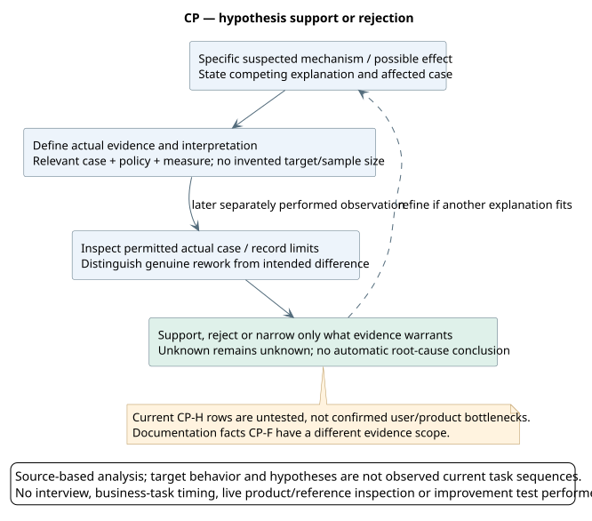

[Editable PlantUML](Diagrams/Process-Hypothesis-Validation.puml) · 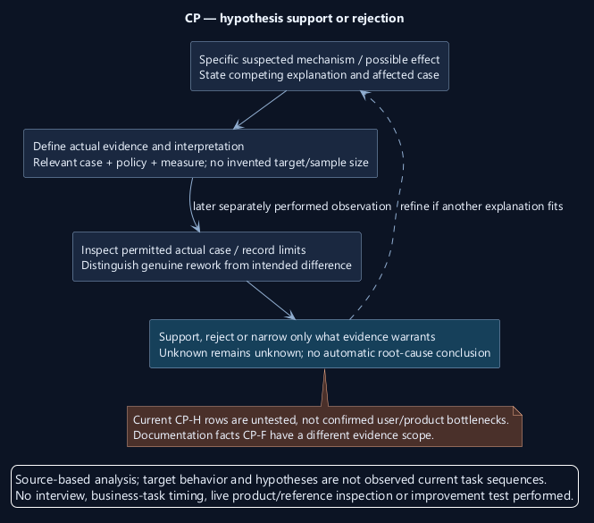

###### CP-H01 — Unnecessary repeated fact entry

**Process:** CP-P01

**Suspected mechanism:** The same professional fact might be independently re-entered where controlled reuse would be useful.

**Possible effect:** Potential extra effort or unintended divergence, if present in an actual case.

**Competing explanation:** Different wording/language/detail can be deliberate tailoring and has business value; low-frequency manual work may be appropriate.

**Supporting evidence needed:** Observe the same fact/intent across an actual bounded case; label copy/re-entry versus intentional tailoring and record effort/context.

**Rejection or limit:** Reject or narrow if no repeated entry is seen, variants are deliberate, or observed rework has another cause.

**Intended response:** Explicit selected reuse while preserving independent overrides is accepted target behavior; do not claim automatic propagation or measured time savings.

**Measures:** CP-M01, CP-M02, CP-M03

**Requirement ids:** [BIZ-D01](../02-Requirements-Engineering/01-Software-Requirements-Specification/03-Requirements-Specification/03-Business-Requirements.md#requirements-specification-business-requirements--heading-biz-d01-reusable-information-and-relevant-professional-presentation), [USR-D01](../02-Requirements-Engineering/01-Software-Requirements-Specification/03-Requirements-Specification/18-User-Requirements.md#requirements-specification-user-requirements--heading-usr-d01-reuse-and-tailor-professional-information), [DOM-D01](../02-Requirements-Engineering/01-Software-Requirements-Specification/03-Requirements-Specification/05-Domain-Requirements-And-Constraints.md#requirements-specification-domain-requirements-and-constraints--heading-dom-d01-consistent-professional-information-meaning), [DOM-D04](../02-Requirements-Engineering/01-Software-Requirements-Specification/03-Requirements-Specification/05-Domain-Requirements-And-Constraints.md#requirements-specification-domain-requirements-and-constraints--heading-dom-d04-explicit-human-authored-language-and-application-work), [PRP-D03](../02-Requirements-Engineering/01-Software-Requirements-Specification/03-Requirements-Specification/12-Profiles-Resumes-And-Portfolio.md#requirements-specification-profiles-resumes-and-portfolio--heading-prp-d03-independent-selections-layouts-and-overrides), [PRP-D04](../02-Requirements-Engineering/01-Software-Requirements-Specification/03-Requirements-Specification/12-Profiles-Resumes-And-Portfolio.md#requirements-specification-profiles-resumes-and-portfolio--heading-prp-d04-explicit-shared-source-update-rules), [BRL-D02](../02-Requirements-Engineering/01-Software-Requirements-Specification/03-Requirements-Specification/04-Business-Rules-And-Data-Lifecycle.md#requirements-specification-business-rules-and-data-lifecycle--heading-brl-d02-shared-information-and-independent-tailoring)

**Models:** SB-M01, SM-M01, RB-D02, IF-01

**Contracts:** DC-O01, DC-O02, DC-O03

**Parents:** Q-D06, Q-D07

**Status:** Untested bottleneck hypothesis; no frequency, delay, severity or root cause measured

###### CP-H02 — Ambiguity of intended shared variant

**Process:** CP-P02

**Suspected mechanism:** Current tools/naming/availability/access context might make it difficult to identify the intended page/file/language.

**Possible effect:** Potential selection/retrieval correction or confusing access result.

**Competing explanation:** Multiple legitimate language/presentation variants or deliberate access restriction are not errors; availability failure may have a different cause.

**Supporting evidence needed:** Record intended versus actually selected representation, applicable current policy, actual feedback and any correction in a controlled relevant case.

**Rejection or limit:** Reject or narrow when intended meaning/selection is clear or differences are legitimate; do not label every differing file a defect.

**Intended response:** Separate selected publication, mode, link access and actual variant availability; no unrelated fallback or claimed clarity improvement without evidence.

**Measures:** CP-M03, CP-M05, CP-M06

**Requirement ids:** [BIZ-D02](../02-Requirements-Engineering/01-Software-Requirements-Specification/03-Requirements-Specification/03-Business-Requirements.md#requirements-specification-business-requirements--heading-biz-d02-controlled-disclosure-of-professional-information), [USR-D02](../02-Requirements-Engineering/01-Software-Requirements-Specification/03-Requirements-Specification/18-User-Requirements.md#requirements-specification-user-requirements--heading-usr-d02-control-pdf-and-employer-sharing), [USR-D03](../02-Requirements-Engineering/01-Software-Requirements-Specification/03-Requirements-Specification/18-User-Requirements.md#requirements-specification-user-requirements--heading-usr-d03-view-intended-professional-material-without-an-account), [PDF-D02](../02-Requirements-Engineering/01-Software-Requirements-Specification/03-Requirements-Specification/11-Pdf-And-Controlled-Sharing.md#requirements-specification-pdf-and-controlled-sharing--heading-pdf-d02-uploaded-pdf-and-language-identity), [PDF-D03](../02-Requirements-Engineering/01-Software-Requirements-Specification/03-Requirements-Specification/11-Pdf-And-Controlled-Sharing.md#requirements-specification-pdf-and-controlled-sharing--heading-pdf-d03-per-resume-download-choices), [PDF-D04](../02-Requirements-Engineering/01-Software-Requirements-Specification/03-Requirements-Specification/11-Pdf-And-Controlled-Sharing.md#requirements-specification-pdf-and-controlled-sharing--heading-pdf-d04-scoped-password-protected-employer-access), [PDF-D05](../02-Requirements-Engineering/01-Software-Requirements-Specification/03-Requirements-Specification/11-Pdf-And-Controlled-Sharing.md#requirements-specification-pdf-and-controlled-sharing--heading-pdf-d05-direct-file-and-pdf-authorization), [PDF-D06](../02-Requirements-Engineering/01-Software-Requirements-Specification/03-Requirements-Specification/11-Pdf-And-Controlled-Sharing.md#requirements-specification-pdf-and-controlled-sharing--heading-pdf-d06-owner-password-and-link-controls)

**Models:** SB-M02, SB-M03, SB-M04, SM-M04, RB-D03, RB-D04, RB-D05, IF-02

**Contracts:** DC-O04, DC-O05, DC-O06

**Parents:** Q-D05, Q-D08, Q-D09, Q-D10, Q-D11

**Status:** Untested bottleneck hypothesis; no frequency, delay, severity or root cause measured

###### CP-H03 — Uncertain actual submission history

**Process:** CP-P03

**Suspected mechanism:** Current recording may not preserve an identifiable actual set/event independently of later editable/live content.

**Possible effect:** Potential inability to establish what was actually sent or to interpret corrections.

**Competing explanation:** A trustworthy external archive/manual method may already exist; absence of inspected evidence is not evidence the history is absent.

**Supporting evidence needed:** Inspect a permitted anonymized actual case and its material/provenance/recorded-time context, including deliberate resubmission/correction.

**Rejection or limit:** Reject or narrow if existing actual history is reliably identifiable; do not infer failure from current source differing from an older actual copy.

**Intended response:** Explicit actual-material capture and distinguishable manual progress/corrections support intended traceability, not a proven reduced error rate.

**Measures:** CP-M03, CP-M07, CP-M09

**Requirement ids:** [BIZ-D03](../02-Requirements-Engineering/01-Software-Requirements-Specification/03-Requirements-Specification/03-Business-Requirements.md#requirements-specification-business-requirements--heading-biz-d03-traceable-manual-applications-and-preserved-submission-history), [USR-D04](../02-Requirements-Engineering/01-Software-Requirements-Specification/03-Requirements-Specification/18-User-Requirements.md#requirements-specification-user-requirements--heading-usr-d04-prepare-and-track-applications-manually), [USR-D05](../02-Requirements-Engineering/01-Software-Requirements-Specification/03-Requirements-Specification/18-User-Requirements.md#requirements-specification-user-requirements--heading-usr-d05-keep-a-trustworthy-record-of-actual-submitted-materials), [APP-D01](../02-Requirements-Engineering/01-Software-Requirements-Specification/03-Requirements-Specification/09-Manual-Application-Management.md#requirements-specification-manual-application-management--heading-app-d01-company-and-opportunity-context), [APP-D05](../02-Requirements-Engineering/01-Software-Requirements-Specification/03-Requirements-Specification/09-Manual-Application-Management.md#requirements-specification-manual-application-management--heading-app-d05-user-directed-submission-recording), [APP-D06](../02-Requirements-Engineering/01-Software-Requirements-Specification/03-Requirements-Specification/09-Manual-Application-Management.md#requirements-specification-manual-application-management--heading-app-d06-preserved-actual-submitted-copies), [APP-D07](../02-Requirements-Engineering/01-Software-Requirements-Specification/03-Requirements-Specification/09-Manual-Application-Management.md#requirements-specification-manual-application-management--heading-app-d07-correction-and-repeated-submissions), [DOM-D02](../02-Requirements-Engineering/01-Software-Requirements-Specification/03-Requirements-Specification/05-Domain-Requirements-And-Constraints.md#requirements-specification-domain-requirements-and-constraints--heading-dom-d02-application-history-represents-actual-submitted-material)

**Models:** SB-M05, SB-M06, SM-M06, SM-M07, RB-D06

**Contracts:** DC-O07, DC-O08, DC-O09, DC-O10

**Parents:** Q-D12, Q-D13, Q-D14

**Status:** Untested bottleneck hypothesis; no frequency, delay, severity or root cause measured

###### CP-H04 — Coordination/handoff friction

**Process:** CP-P04

**Suspected mechanism:** Cross-tool/account/activity handoffs might obscure the next intended action or actual completion.

**Possible effect:** Potential retrieval effort, duplicated entry or missed defined follow-up.

**Competing explanation:** Tool separation may be intentional/effective; a late action may be user choice, changed deadline or unrelated interruption.

**Supporting evidence needed:** Record an actual intended handoff/deadline/action/time meaning and observed outcome; distinguish external acceptance from receipt and actual reminders.

**Rejection or limit:** Reject or narrow if handoffs work well or no agreed expectation was missed; tool-switch count alone proves no harm.

**Intended response:** Deliberate selected local/provider coordination and truthful outcomes address possible friction, not automatic send/sync or demonstrated productivity gain.

**Measures:** CP-M01, CP-M04, CP-M05, CP-M09

**Requirement ids:** [BIZ-D04](../02-Requirements-Engineering/01-Software-Requirements-Specification/03-Requirements-Specification/03-Business-Requirements.md#requirements-specification-business-requirements--heading-biz-d04-coordinated-authorized-work-in-one-product-experience), [USR-D06](../02-Requirements-Engineering/01-Software-Requirements-Specification/03-Requirements-Specification/18-User-Requirements.md#requirements-specification-user-requirements--heading-usr-d06-coordinate-correspondence-and-activities), [EGC-D05](../02-Requirements-Engineering/01-Software-Requirements-Specification/03-Requirements-Specification/06-Email-Calendar-And-Google-Integration.md#requirements-specification-email-calendar-and-google-integration--heading-egc-d05-deliberate-send-and-truthful-outcome), [EGC-D08](../02-Requirements-Engineering/01-Software-Requirements-Specification/03-Requirements-Specification/06-Email-Calendar-And-Google-Integration.md#requirements-specification-email-calendar-and-google-integration--heading-egc-d08-explicit-synchronization-contract), [EGC-D11](../02-Requirements-Engineering/01-Software-Requirements-Specification/03-Requirements-Specification/06-Email-Calendar-And-Google-Integration.md#requirements-specification-email-calendar-and-google-integration--heading-egc-d11-disconnect-revocation-and-reconnect), [EIF-D08](../02-Requirements-Engineering/01-Software-Requirements-Specification/03-Requirements-Specification/07-External-Interface-Requirements.md#requirements-specification-external-interface-requirements--heading-eif-d08-operation-specific-failure-and-repetition-semantics), [DOM-D05](../02-Requirements-Engineering/01-Software-Requirements-Specification/03-Requirements-Specification/05-Domain-Requirements-And-Constraints.md#requirements-specification-domain-requirements-and-constraints--heading-dom-d05-explicit-external-service-applicability)

**Models:** SB-M07, SB-M08, SM-M08, SM-M09, SM-M10, RB-D07, RB-D08, IF-04, IF-05

**Contracts:** DC-O11, DC-O12, DC-O13, DC-O14, DC-O15

**Parents:** Q-D15, Q-D16, Q-D17

**Status:** Untested bottleneck hypothesis; no frequency, delay, severity or root cause measured

###### CP-H05 — Work status versus actual accepted outcome

**Process:** CP-P05

**Suspected mechanism:** Current item/task/board/Sprint meaning may be interpreted inconsistently across records or participants.

**Possible effect:** Potential ambiguous acceptance, period result or explicit incomplete-work disposition.

**Competing explanation:** Different status views can represent different valid subjects; work may intentionally be incomplete or not accepted.

**Supporting evidence needed:** Inspect a real authorized work instance with explicit subject/criteria/period outcome and actual recorded disposition; no inference from dates/columns alone.

**Rejection or limit:** Reject or narrow if interpretations are clear and correct; never call all tasks Done equivalent to accepted item.

**Intended response:** Maintain separate item/task/readiness/acceptance and coherent Sprint Backlog/actual end meanings; no automatic carryover or measured throughput claim.

**Measures:** CP-M03, CP-M05, CP-M09

**Requirement ids:** [BIZ-D04](../02-Requirements-Engineering/01-Software-Requirements-Specification/03-Requirements-Specification/03-Business-Requirements.md#requirements-specification-business-requirements--heading-biz-d04-coordinated-authorized-work-in-one-product-experience), [USR-D07](../02-Requirements-Engineering/01-Software-Requirements-Specification/03-Requirements-Specification/18-User-Requirements.md#requirements-specification-user-requirements--heading-usr-d07-plan-and-adapt-authorized-work), [USR-D08](../02-Requirements-Engineering/01-Software-Requirements-Specification/03-Requirements-Specification/18-User-Requirements.md#requirements-specification-user-requirements--heading-usr-d08-collaborate-within-invited-resource-boundaries), [PKS-D03](../02-Requirements-Engineering/01-Software-Requirements-Specification/03-Requirements-Specification/13-Projects-Kanban-And-Sprints.md#requirements-specification-projects-kanban-and-sprints--heading-pks-d03-product-backlog-and-item-definition), [PKS-D07](../02-Requirements-Engineering/01-Software-Requirements-Specification/03-Requirements-Specification/13-Projects-Kanban-And-Sprints.md#requirements-specification-projects-kanban-and-sprints--heading-pks-d07-sprint-goal-and-selected-backlog-items), [PKS-D09](../02-Requirements-Engineering/01-Software-Requirements-Specification/03-Requirements-Specification/13-Projects-Kanban-And-Sprints.md#requirements-specification-projects-kanban-and-sprints--heading-pks-d09-explicit-completion-and-sprint-end-outcomes), [PKS-D10](../02-Requirements-Engineering/01-Software-Requirements-Specification/03-Requirements-Specification/13-Projects-Kanban-And-Sprints.md#requirements-specification-projects-kanban-and-sprints--heading-pks-d10-deliberate-cross-module-links-reports-and-automation)

**Models:** SB-M09, SB-M10, SM-M11, SM-M12, RB-D09, RB-D10, IF-01

**Contracts:** DC-O16, DC-O17, DC-O18, DC-O19, DC-O20, DC-O21

**Parents:** Q-D18, Q-D19, Q-D20, Q-D28

**Status:** Untested bottleneck hypothesis; no frequency, delay, severity or root cause measured

###### CP-H06 — Stale ref/review or ambiguous execution effect

**After MVP.** Shared operating and recovery controls still apply where relevant.

**Process:** CP-P06

**Suspected mechanism:** Current Git/review/job/target references may not retain exact evaluated revision or actual attempt effect.

**Possible effect:** Potential recheck/rework or unsafe repetition if such a case exists.

**Competing explanation:** Current external tools may already preserve correct revision/attempt context; no product hosting or unsafe runner has been observed here.

**Supporting evidence needed:** Use exact permitted source/client/ref/review/attempt evidence and relevant existing policy; any actual execution check requires its own safe authorized scope.

**Rejection or limit:** Reject or narrow where correct context/reconciliation already exists; no vulnerability, slow job or unsafe configuration claim from a missing inspection.

**Intended response:** Explicit revision/attempt/output and separate target authority constrain intended product behavior; actual interoperability/safety benefit needs evidence.

**Measures:** CP-M03, CP-M06, CP-M09

**Requirement ids:** [BIZ-D04](../02-Requirements-Engineering/01-Software-Requirements-Specification/03-Requirements-Specification/03-Business-Requirements.md#requirements-specification-business-requirements--heading-biz-d04-coordinated-authorized-work-in-one-product-experience), [USR-D09](../02-Requirements-Engineering/01-Software-Requirements-Specification/03-Requirements-Specification/18-User-Requirements.md#requirements-specification-user-requirements--heading-usr-d09-use-real-repository-collaboration), [USR-D10](../02-Requirements-Engineering/01-Software-Requirements-Specification/03-Requirements-Specification/18-User-Requirements.md#requirements-specification-user-requirements--heading-usr-d10-run-agreed-checks-and-control-deployment-separately), [GIT-D03](../02-Requirements-Engineering/01-Software-Requirements-Specification/03-Requirements-Specification/08-Git-Hosting-And-Collaboration.md#requirements-specification-git-hosting-and-collaboration--heading-git-d03-real-clone-fetch-pull-and-push), [GIT-D07](../02-Requirements-Engineering/01-Software-Requirements-Specification/03-Requirements-Specification/08-Git-Hosting-And-Collaboration.md#requirements-specification-git-hosting-and-collaboration--heading-git-d07-controlled-merge-and-conflict-outcomes), [GIT-D10](../02-Requirements-Engineering/01-Software-Requirements-Specification/03-Requirements-Specification/08-Git-Hosting-And-Collaboration.md#requirements-specification-git-hosting-and-collaboration--heading-git-d10-lifecycle-capacity-and-recovery), [YML-D04](../02-Requirements-Engineering/01-Software-Requirements-Specification/03-Requirements-Specification/19-Yaml-Workflows-And-Cicd.md#requirements-specification-yaml-workflows-and-cicd--heading-yml-d04-isolation-and-untrusted-code-boundary), [YML-D10](../02-Requirements-Engineering/01-Software-Requirements-Specification/03-Requirements-Specification/19-Yaml-Workflows-And-Cicd.md#requirements-specification-yaml-workflows-and-cicd--heading-yml-d10-separate-controlled-deployment-stage)

**Models:** SB-M11, SB-M12, SB-M13, SB-M14, SM-M13, SM-M14, SM-M15, IF-06, IF-07

**Contracts:** DC-O22, DC-O23, DC-O25, DC-O26, DC-O27, DC-O28, DC-O29, DC-O30

**Parents:** Q-D21, Q-D22, Q-D23

**Status:** Untested bottleneck hypothesis; no frequency, delay, severity or root cause measured

###### CP-H07 — Admission/replacement/accounting uncertainty

**Process:** CP-P07

**Suspected mechanism:** Current policy/usage/reference and completion meanings may not stay aligned during replacement, interruption or growth.

**Possible effect:** Potential false usable/freed-space result, rework or required-material loss if observed.

**Competing explanation:** Existing policy/procedure may handle this correctly; intentional rejection/retention is not a processing defect.

**Supporting evidence needed:** Observe a bounded permitted case with actual effective policy/current references/usage and result; no cleanup/load on live data just to create evidence.

**Rejection or limit:** Reject or narrow if actual semantics hold; do not infer capacity saturation from fixed allocation or a failed unrelated action.

**Intended response:** Effective reference-aware admission/cleanup and truthful partial results are proposed controls, not proven reclaimed capacity or a universal rollback.

**Measures:** CP-M05, CP-M06, CP-M07, CP-M09

**Requirement ids:** [USR-D11](../02-Requirements-Engineering/01-Software-Requirements-Specification/03-Requirements-Specification/18-User-Requirements.md#requirements-specification-user-requirements--heading-usr-d11-administer-explicit-policy-and-understand-failures), [AFO-D01](../02-Requirements-Engineering/01-Software-Requirements-Specification/03-Requirements-Specification/02-Administration-Files-And-Operational-Behavior.md#requirements-specification-administration-files-and-operational-behavior--heading-afo-d01-owner-configurable-upload-and-storage-policy), [AFO-D04](../02-Requirements-Engineering/01-Software-Requirements-Specification/03-Requirements-Specification/02-Administration-Files-And-Operational-Behavior.md#requirements-specification-administration-files-and-operational-behavior--heading-afo-d04-aggregate-quota-and-concurrent-admission), [AFO-D07](../02-Requirements-Engineering/01-Software-Requirements-Specification/03-Requirements-Specification/02-Administration-Files-And-Operational-Behavior.md#requirements-specification-administration-files-and-operational-behavior--heading-afo-d07-truthful-completion-and-interrupted-operation-handling), [AFO-D08](../02-Requirements-Engineering/01-Software-Requirements-Specification/03-Requirements-Specification/02-Administration-Files-And-Operational-Behavior.md#requirements-specification-administration-files-and-operational-behavior--heading-afo-d08-safe-replacement-and-lifecycle-effects), [AFO-D11](../02-Requirements-Engineering/01-Software-Requirements-Specification/03-Requirements-Specification/02-Administration-Files-And-Operational-Behavior.md#requirements-specification-administration-files-and-operational-behavior--heading-afo-d11-bounded-cleanup-and-storage-reclamation), [QSR-D09](../02-Requirements-Engineering/01-Software-Requirements-Specification/03-Requirements-Specification/14-Quality-Security-And-Recovery-Requirements.md#requirements-specification-quality-security-and-recovery-requirements--heading-qsr-d09-deliberate-retention-and-reference-aware-removal)

**Models:** SB-M15, SM-M05, SM-M16, RB-D14, RB-D15, IF-03

**Contracts:** DC-O31, DC-O32, DC-O33, DC-O34, DC-O35, DC-O36

**Parents:** Q-D24, Q-D25

**Status:** Untested bottleneck hypothesis; no frequency, delay, severity or root cause measured

###### CP-H08 — Operational effort or dependency interruption pressure

**Process:** CP-P08

**Suspected mechanism:** Required recurring maintenance/integration/recovery work might compete with the same limited owner time and shared resources.

**Possible effect:** Potential delayed operating response or engineering work if observed against defined expectations.

Work follows the selected scope, dependencies and demonstrated outcomes.

**Supporting evidence needed:** Record a relevant authorized procedure/event and actual effort/wait/result/resource context; distinguish known absent backups from a measured outage or recovery duration.

**Rejection or limit:** Reject or narrow if work fits the evaluated conditions; no schedule/resource/recovery conclusion from idle readings or no observed incident.

**Intended response:** Explicit operating scope, coverage/evidence and feasible work reconciliation support readiness; no additional staffing, service purchase or measured improvement claimed.

**Measures:** CP-M01, CP-M08, CP-M09, CP-M10

**Requirement ids:** [BIZ-D05](../02-Requirements-Engineering/01-Software-Requirements-Specification/03-Requirements-Specification/03-Business-Requirements.md#requirements-specification-business-requirements--heading-biz-d05-usable-maintainable-and-recoverable-initial-operation), [USR-D12](../02-Requirements-Engineering/01-Software-Requirements-Specification/03-Requirements-Specification/18-User-Requirements.md#requirements-specification-user-requirements--heading-usr-d12-operate-and-recover-an-identified-release), [QSR-D10](../02-Requirements-Engineering/01-Software-Requirements-Specification/03-Requirements-Specification/14-Quality-Security-And-Recovery-Requirements.md#requirements-specification-quality-security-and-recovery-requirements--heading-qsr-d10-defined-protected-and-observable-backups), [QSR-D11](../02-Requirements-Engineering/01-Software-Requirements-Specification/03-Requirements-Specification/14-Quality-Security-And-Recovery-Requirements.md#requirements-specification-quality-security-and-recovery-requirements--heading-qsr-d11-demonstrated-restoration-and-recovery-targets), [QSR-D12](../02-Requirements-Engineering/01-Software-Requirements-Specification/03-Requirements-Specification/14-Quality-Security-And-Recovery-Requirements.md#requirements-specification-quality-security-and-recovery-requirements--heading-qsr-d12-safe-restored-access-and-external-state-reconciliation), [QSR-D14](../02-Requirements-Engineering/01-Software-Requirements-Specification/03-Requirements-Specification/14-Quality-Security-And-Recovery-Requirements.md#requirements-specification-quality-security-and-recovery-requirements--heading-qsr-d14-maintainable-verifiable-and-recoverable-changes), [DOM-D08](../02-Requirements-Engineering/01-Software-Requirements-Specification/03-Requirements-Specification/05-Domain-Requirements-And-Constraints.md#requirements-specification-domain-requirements-and-constraints--heading-dom-d08-evidence-based-operation-within-constraints)

**Models:** SB-M16, SM-M17, SM-M18, RB-D16, IF-08, SQ-Q10, SQ-Q11, SQ-Q12, SQ-Q14

**Contracts:** DC-O33, DC-O37, DC-O38

**Parents:** Q-D26, Q-D27, Q-D28

**Status:** Untested bottleneck hypothesis; no frequency, delay, severity or root cause measured

##### 4. Intended Improvements and Model Links

Use each CP-P requirement/model/contract association and corresponding CP-H intended response as a proposed explanation of how the target system addresses the accepted problem. These associations are not exact criterion coverage or proof of benefit.

The [accepted profile policy](../02-Requirements-Engineering/01-Software-Requirements-Specification/07-Change-And-Baseline/03-Requirements-Questions-And-Decisions.md#change-and-baseline-open-questions-and-decisions--id-owner-accepted-profile-update-policy) remains authoritative: profile edits do not automatically change existing resumes; selected apply preserves independent text; publication is separately confirmed; actual submitted materials remain independent. This decision does not need renewed approval.

For other rules preserve the existing proposed/accepted status. Do not introduce new retention, session, capacity, response-time or recovery targets from these hypotheses.

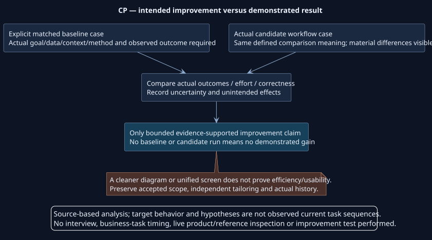

[Editable PlantUML](Diagrams/Process-Improvement-Evidence.puml) · 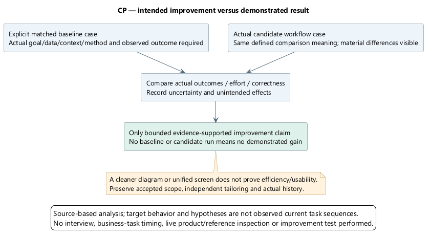

##### 5. Review and Follow-up

Continue the substantive [function-oriented view](#analysis-functional-and-process-analysis--04-function-oriented-view) and targeted [consistency review](05-Analysis-Review-And-Design-Handoff.md#analysis-review-and-design-handoff--11-model-consistency-traceability-and-review). Keep the [conditional handoff](05-Analysis-Review-And-Design-Handoff.md#analysis-review-and-design-handoff--14-feasibility-dependencies-and-design-handoff) distinct from accepted design or implementation permission.

A missing observed baseline limits claims about actual workflow and improvements. It is not a new blanket gate preventing independent domain analysis or design work. Collect evidence only where a dependent conclusion needs it. Existing questions/findings remain in their authoritative registers; CP identifiers are local analysis records, not new requirements or competing closure decisions.

##### 6. Measurement and Elicitation Method

For a permitted case record source/date, participant role, goal, actual trigger, inputs, observed actions/tools, handoffs, outputs, exception handling and what was not observed. Distinguish observation from participant recollection and intended behavior. Use anonymized evidence; do not copy credentials or private application correspondence into analysis records.

Record clock meaning and interruptions before comparing durations. Preserve intentional tailoring, access restrictions and legitimate variants as possible explanations. Select sample boundaries appropriate to the specific claim; no arbitrary sample size or success threshold is accepted here. Record contradictory evidence and unknown denominators. A future synthetic product test is not evidence that a personal current workflow was observed.

###### CP-M01 — Active/wait/elapsed case time

**Operational definition:** For one defined case, record declared start/end and distinguish observed active work, waiting and interruption intervals without double counting.

**Required data:** Task identity/goal, event/recorded-time meaning, observed timestamps/intervals, participant context and permitted data.

**Interpretation:** Elapsed time is not automatically system latency; unexplained idle time is not established waiting caused by a tool.

**Actual result:** Not measured in this task; no numerical baseline or target benefit

**Target status:** No sample size, threshold, time saving or improvement percentage selected

###### CP-M02 — Repeated-entry and intentional-tailoring events

**Operational definition:** Count observed same-fact re-entry separately from deliberate tailoring, language maintenance, correction and new information.

**Required data:** Exact factual identity/intent, relevant change events and observed reason/classification where available.

**Interpretation:** Repeated values or multiple resume versions alone are not waste; unknown reasons remain unknown.

**Actual result:** Not measured in this task; no numerical baseline or target benefit

**Target status:** No sample size, threshold, time saving or improvement percentage selected

###### CP-M03 — Identity/version/meaning ambiguity

**Operational definition:** Record observed cases where intended source/draft/live/actual material/revision/subject cannot be established, with exact evidence and consequences.

**Required data:** Expected representation/subject/event and actual available identity/provenance/policy at the observed moment.

**Interpretation:** A legitimate difference is not an error. Missing inspected evidence is not proof the real record is absent.

**Actual result:** Not measured in this task; no numerical baseline or target benefit

**Target status:** No sample size, threshold, time saving or improvement percentage selected

###### CP-M04 — Defined follow-up/handoff outcome

**Operational definition:** For an explicit agreed expected action/deadline, compare actual observed action/outcome and distinguish changed expectation or missing evidence.

**Required data:** Intended recipient/next action, defined time/timezone/criteria and actual records/observation.

**Interpretation:** Do not equate provider acceptance with recipient receipt, lateness with failure, or all tool switches with harmful delay.

**Actual result:** Not measured in this task; no numerical baseline or target benefit

**Target status:** No sample size, threshold, time saving or improvement percentage selected

###### CP-M05 — Context retrieval/transition effort

**Operational definition:** Record the actual steps/handoffs needed to locate intended resource/context, with optional observed active/wait intervals.

**Required data:** Bounded same-goal case, observed resource/actor context, tool/step transitions and interruptions.

**Interpretation:** A count of tools or clicks is not by itself a quality defect or proof one unified view is better.

**Actual result:** Not measured in this task; no numerical baseline or target benefit

**Target status:** No sample size, threshold, time saving or improvement percentage selected

###### CP-M06 — Applicable authorization/result correctness

**Operational definition:** For a defined current policy and authorized controlled case, compare expected exact scope/result with actual observation.

**Required data:** Reviewed actor/resource/action/state policy, intended entry path, controlled inputs and actual permitted evidence.

**Interpretation:** This is a separate verification design if synthetic; it is not an observed personal workflow or performed penetration test.

**Actual result:** Not measured in this task; no numerical baseline or target benefit

**Target status:** No sample size, threshold, time saving or improvement percentage selected

###### CP-M07 — Actual-material completeness

**Operational definition:** For an inspected actual-submission case, distinguish confirmed required components, missing and unknown provenance/retention under the reviewed capture policy.

**Required data:** Actual event/material identity, required component definition and permitted retained evidence.

**Interpretation:** No completeness rate with absent/undefined denominator; unknowns are reported separately and no latest-live substitution allowed.

**Actual result:** Not measured in this task; no numerical baseline or target benefit

**Target status:** No sample size, threshold, time saving or improvement percentage selected

###### CP-M08 — Procedure effort and coverage

**Operational definition:** For a defined actual operating task, record steps/effort/dependencies/known covered outcome and limitations within the same project-time budget.

**Required data:** Identified environment/procedure/source/date, authorized non-secret observation and actual result.

**Interpretation:** A plan or backup artifact is not a performed restore.

**Actual result:** Not measured in this task; no numerical baseline or target benefit

**Target status:** No sample size, threshold, time saving or improvement percentage selected

###### CP-M09 — Rework/interruption/repetition meaning

**Operational definition:** Classify actually observed correction, retry or new event by its intended cause/context and actual prior effect rather than counting every repeated action as rework.

**Required data:** Exact original/next operation context, observed state/evidence and stated reason if known.

**Interpretation:** Missing response is not proof no effect; distinguish legitimate new submission/correction from harmful duplicate.

**Actual result:** Not measured in this task; no numerical baseline or target benefit

**Target status:** No sample size, threshold, time saving or improvement percentage selected

###### CP-M10 — Paired improvement comparison

**Operational definition:** Compare explicitly matched baseline and candidate cases under defined equivalent goal/data/environment/criteria; record actual outcomes and limitations.

**Required data:** Real observed baseline and actual candidate run/feedback with compatible methods; annotate any material difference.

**Interpretation:** With no baseline or candidate run there is no demonstrated improvement. No percentage/success/effect estimate can be derived from diagram/model counts.

**Actual result:** Not measured in this task; no numerical baseline or target benefit

**Target status:** No sample size, threshold, time saving or improvement percentage selected

##### 7. Exported Records and Reproducibility

The five CSV files contain the same local records as this document. The JSON review includes input hashes and explicitly records zero new interviews, task observations, benchmarks or confirmed measured business bottlenecks.

- [Source Evidence](https://github.com/Farhad-V/Web-Resumefolio/blob/1f2acaa351ac306cb57cbe4fe9742e8bd90720d9/docs/MVP/SDLC/03-system-analysis/evidence/current-process-source-evidence-2026-11-01.csv)

- [Process Catalog](https://github.com/Farhad-V/Web-Resumefolio/blob/1f2acaa351ac306cb57cbe4fe9742e8bd90720d9/docs/MVP/SDLC/03-system-analysis/evidence/current-process-process-catalog-2026-11-01.csv)

- [Documentary Findings](05-Analysis-Review-And-Design-Handoff.md#analysis-process-findings)

- [Bottleneck Hypotheses](https://github.com/Farhad-V/Web-Resumefolio/blob/1f2acaa351ac306cb57cbe4fe9742e8bd90720d9/docs/MVP/SDLC/03-system-analysis/evidence/current-process-bottleneck-hypotheses-2026-11-01.csv)

- [Measurement Plan](https://github.com/Farhad-V/Web-Resumefolio/blob/1f2acaa351ac306cb57cbe4fe9742e8bd90720d9/docs/MVP/SDLC/03-system-analysis/evidence/current-process-measurement-plan-2026-11-01.csv)

- [Source review and artifact verification](https://github.com/Farhad-V/Web-Resumefolio/blob/1f2acaa351ac306cb57cbe4fe9742e8bd90720d9/docs/MVP/SDLC/03-system-analysis/evidence/current-process-review-2026-11-01.json)

##### 8. Disposition

The source-based analysis package is populated. Actual current-business workflows, bottleneck frequency/severity, quantitative baseline and demonstrated improvement remain unmeasured. No existing question, feasibility gate, owner acceptance or milestone is closed by generating these artifacts.

[Start here](01-System-Context-And-Gap-Analysis.md#foundation-00-start-here) · [System Analysis index]()

##### Diagram Types and Reading Guide

Native [BPMN 2.0](https://www.omg.org/spec/BPMN/2.0.2/About-BPMN) models are provided below; they are not UML activity diagrams relabeled BPMN. The As-Is black-box participant honestly records that current internal steps have not been observed. The To-Be lanes describe a selected confirmed-success target path from the accepted profile policy, not implemented automation or proven improvement. Exceptions remain in the detailed sequence/activity/contract views. CP-H01/02 are untested hypotheses, not measured bottleneck icons.

| Comparison | As-Is | To-Be |
| --- | --- | --- |
| Steps and responsibility | Internal sequence not observed | Owner selects/confirms; system applies; publication separately chosen |
| Source and authority | Existing source register and explicit evidence limits | Accepted profile/apply/publication policy; DC-O02/DC-O03 |
| Bottleneck conclusion | Not established | Intended reduction in unintended propagation; benefit unmeasured |
| Quantitative comparison | No baseline | No demonstrated improvement |

[Editable BPMN XML](Diagrams/Process-Bpmn-As-Is-Boundary.bpmn) · 

[Editable BPMN XML](Diagrams/Process-Bpmn-Target-Publication.bpmn) · 

Resumefolio - Functional and Process Analysis

#### Resumefolio - Functional and Process Analysis

This index groups existing System Analysis records. It changes navigation, not analysis scope, model meaning or acceptance status.

Current MVP scope and selected mechanisms: [Baseline](https://github.com/Farhad-V/Web-Resumefolio/blob/1f2acaa351ac306cb57cbe4fe9742e8bd90720d9/docs/MVP/baseline/README.md). Deferred provider, advanced collaboration and workflow-execution designs are not MVP prerequisites.

##### Documents

- [04-function-oriented-view.md](#analysis-functional-and-process-analysis--04-function-oriented-view)
- [08-control-flow-based-view.md](#analysis-functional-and-process-analysis--08-control-flow-based-view)
- [15-current-processes-and-bottleneck-analysis.md](#analysis-functional-and-process-analysis--15-current-processes-and-bottleneck-analysis)

##### Shared Resources

- [System Analysis index]()
- [Shared diagram catalog](Diagrams/Diagram-Catalog.md)
- [Relocation map and historical evidence]()

### Behavioral and Scenario Analysis

Resumefolio — Scenario-Based View

#### Resumefolio — Scenario-Based View

[Diagram types and reading guide](#analysis-behavioral-and-scenario-analysis--06-scenario-based-view--heading-diagram-types-and-reading-guide) · [Full diagram catalog](Diagrams/Diagram-Catalog.md)

Owner: Farhad. Revision: November 1, 2026.

Status: populated source-derived interaction model. Detailed policy proposals, dependent capability gates and cross-view acceptance remain explicit. Diagrams are models, not executed product traces.

This view refines external actor goals into logical domain interactions. It explains what is requested, which current authority/context is evaluated, what information changes, what remains unchanged, and how denied, partial, failed or uncertain outcomes differ.

Current MVP scope and selected mechanisms: [Baseline](https://github.com/Farhad-V/Web-Resumefolio/blob/1f2acaa351ac306cb57cbe4fe9742e8bd90720d9/docs/MVP/baseline/README.md). Deferred provider, advanced collaboration and workflow-execution designs are not MVP prerequisites.

##### Authoritative Inputs

Use [accepted scope](../01-Project-Planning/01-Project-Charter.md#mvp-scope), the [distributed SRS](../02-Requirements-Engineering/01-Software-Requirements-Specification/03-Requirements-Specification/17-Software-Requirements-Specification.md#requirements-specification-requirements-specification), the [existing use-case/story/path catalog](../02-Requirements-Engineering/01-Software-Requirements-Specification/04-Scenarios-And-Models/02-User-Stories-And-Scenarios.md#scenarios-and-models-user-stories-and-scenarios), [domain model](02-Domain-And-Information-Analysis.md#analysis-domain-and-information-analysis--03-domain-model-and-object-oriented-view), [data view](02-Domain-And-Information-Analysis.md#analysis-domain-and-information-analysis--05-data-oriented-view), [dictionary](../02-Requirements-Engineering/01-Software-Requirements-Specification/05-Data-Definitions/02-Data-Dictionary.md#data-definitions-data-dictionary) and [question register](../02-Requirements-Engineering/01-Software-Requirements-Specification/07-Change-And-Baseline/03-Requirements-Questions-And-Decisions.md#change-and-baseline-open-questions-and-decisions).

The [accepted core profile rule](../02-Requirements-Engineering/01-Software-Requirements-Specification/07-Change-And-Baseline/03-Requirements-Questions-And-Decisions.md#change-and-baseline-open-questions-and-decisions--id-owner-accepted-profile-update-policy) governs this refinement: source editing alone does not alter existing resumes/live presentations; preview and selected application preserve independent content; publication is separately confirmed; actual submitted documents remain preserved. Older generic propagation questions in the source bundle do not reopen those four behaviors. Remaining source-removal/concurrency details retain their separate status.

Local IDs `SB-Mxx`, `SB-Xxx` and `SB-Fxx` identify interaction models, cross-view checks and findings. They do not allocate new UC/ST/SCN records. [Source hashes and review inventory](https://github.com/Farhad-V/Web-Resumefolio/blob/1f2acaa351ac306cb57cbe4fe9742e8bd90720d9/docs/MVP/SDLC/03-system-analysis/evidence/scenario-based-review-2026-11-01.json) identify the inputs to this revision.

##### 1. Source Scenario Catalog

###### 1.1 Twelve Existing Goal Bundles

The source UC/ST/SCN families remain authoritative for external goals. The models below select/refine their important interactions; a link does not prove complete acceptance-criterion coverage or that an executable test passed.

| Existing external goal / source story | Normal source path | Local interaction refinements |
| --- | --- | --- |
| [UC-D01](../02-Requirements-Engineering/01-Software-Requirements-Specification/04-Scenarios-And-Models/02-User-Stories-And-Scenarios.md#scenarios-and-models-user-stories-and-scenarios--id-uc-d01) — Tailor two resumes without losing independent choices; ST-D01 remains in that bundle | [SCN-D01-N](../02-Requirements-Engineering/01-Software-Requirements-Specification/04-Scenarios-And-Models/02-User-Stories-And-Scenarios.md#scenarios-and-models-user-stories-and-scenarios--id-scn-d01-n) | [SB-M01](#analysis-behavioral-and-scenario-analysis--06-scenario-based-view--id-sb-m01) |
| [UC-D02](../02-Requirements-Engineering/01-Software-Requirements-Specification/04-Scenarios-And-Models/02-User-Stories-And-Scenarios.md#scenarios-and-models-user-stories-and-scenarios--id-uc-d02) — Configure PDF availability and owner sharing controls; ST-D02 remains in that bundle | [SCN-D02-N](../02-Requirements-Engineering/01-Software-Requirements-Specification/04-Scenarios-And-Models/02-User-Stories-And-Scenarios.md#scenarios-and-models-user-stories-and-scenarios--id-scn-d02-n) | [SB-M02](#analysis-behavioral-and-scenario-analysis--06-scenario-based-view--id-sb-m02), [SB-M03](#analysis-behavioral-and-scenario-analysis--06-scenario-based-view--id-sb-m03) |
| [UC-D03](../02-Requirements-Engineering/01-Software-Requirements-Specification/04-Scenarios-And-Models/02-User-Stories-And-Scenarios.md#scenarios-and-models-user-stories-and-scenarios--id-uc-d03) — View a protected resume and retrieve only selected material; ST-D03 remains in that bundle | [SCN-D03-N](../02-Requirements-Engineering/01-Software-Requirements-Specification/04-Scenarios-And-Models/02-User-Stories-And-Scenarios.md#scenarios-and-models-user-stories-and-scenarios--id-scn-d03-n) | [SB-M04](#analysis-behavioral-and-scenario-analysis--06-scenario-based-view--id-sb-m04) |
| [UC-D04](../02-Requirements-Engineering/01-Software-Requirements-Specification/04-Scenarios-And-Models/02-User-Stories-And-Scenarios.md#scenarios-and-models-user-stories-and-scenarios--id-uc-d04) — Prepare a manual application and record progress; ST-D04 remains in that bundle | [SCN-D04-N](../02-Requirements-Engineering/01-Software-Requirements-Specification/04-Scenarios-And-Models/02-User-Stories-And-Scenarios.md#scenarios-and-models-user-stories-and-scenarios--id-scn-d04-n) | [SB-M05](#analysis-behavioral-and-scenario-analysis--06-scenario-based-view--id-sb-m05) |
| [UC-D05](../02-Requirements-Engineering/01-Software-Requirements-Specification/04-Scenarios-And-Models/02-User-Stories-And-Scenarios.md#scenarios-and-models-user-stories-and-scenarios--id-uc-d05) — Preserve the resume and cover letter actually submitted; ST-D05 remains in that bundle | [SCN-D05-N](../02-Requirements-Engineering/01-Software-Requirements-Specification/04-Scenarios-And-Models/02-User-Stories-And-Scenarios.md#scenarios-and-models-user-stories-and-scenarios--id-scn-d05-n) | [SB-M06](#analysis-behavioral-and-scenario-analysis--06-scenario-based-view--id-sb-m06) |
| [UC-D06](../02-Requirements-Engineering/01-Software-Requirements-Specification/04-Scenarios-And-Models/02-User-Stories-And-Scenarios.md#scenarios-and-models-user-stories-and-scenarios--id-uc-d06) — Coordinate authorized Gmail and calendar activity; ST-D06 remains in that bundle | [SCN-D06-N](../02-Requirements-Engineering/01-Software-Requirements-Specification/04-Scenarios-And-Models/02-User-Stories-And-Scenarios.md#scenarios-and-models-user-stories-and-scenarios--id-scn-d06-n) | [SB-M07](#analysis-behavioral-and-scenario-analysis--06-scenario-based-view--id-sb-m07), [SB-M08](#analysis-behavioral-and-scenario-analysis--06-scenario-based-view--id-sb-m08)  **After MVP.** |
| [UC-D07](../02-Requirements-Engineering/01-Software-Requirements-Specification/04-Scenarios-And-Models/02-User-Stories-And-Scenarios.md#scenarios-and-models-user-stories-and-scenarios--id-uc-d07) — Refine work and maintain a coherent Sprint Backlog; ST-D07 remains in that bundle | [SCN-D07-N](../02-Requirements-Engineering/01-Software-Requirements-Specification/04-Scenarios-And-Models/02-User-Stories-And-Scenarios.md#scenarios-and-models-user-stories-and-scenarios--id-scn-d07-n) | [SB-M09](#analysis-behavioral-and-scenario-analysis--06-scenario-based-view--id-sb-m09) |
| [UC-D08](../02-Requirements-Engineering/01-Software-Requirements-Specification/04-Scenarios-And-Models/02-User-Stories-And-Scenarios.md#scenarios-and-models-user-stories-and-scenarios--id-uc-d08) — Collaborate under a scoped invitation and changed membership; ST-D08 remains in that bundle | [SCN-D08-N](../02-Requirements-Engineering/01-Software-Requirements-Specification/04-Scenarios-And-Models/02-User-Stories-And-Scenarios.md#scenarios-and-models-user-stories-and-scenarios--id-scn-d08-n) | [SB-M10](#analysis-behavioral-and-scenario-analysis--06-scenario-based-view--id-sb-m10) |
| [UC-D09](../02-Requirements-Engineering/01-Software-Requirements-Specification/04-Scenarios-And-Models/02-User-Stories-And-Scenarios.md#scenarios-and-models-user-stories-and-scenarios--id-uc-d09) — Use real Git transfer and review a current change; ST-D09 remains in that bundle | [SCN-D09-N](../02-Requirements-Engineering/01-Software-Requirements-Specification/04-Scenarios-And-Models/02-User-Stories-And-Scenarios.md#scenarios-and-models-user-stories-and-scenarios--id-scn-d09-n) | [SB-M11](#analysis-behavioral-and-scenario-analysis--06-scenario-based-view--id-sb-m11), [SB-M12](#analysis-behavioral-and-scenario-analysis--06-scenario-based-view--id-sb-m12) |
| [UC-D10](../02-Requirements-Engineering/01-Software-Requirements-Specification/04-Scenarios-And-Models/02-User-Stories-And-Scenarios.md#scenarios-and-models-user-stories-and-scenarios--id-uc-d10) — Run supported work with separately controlled deployment; ST-D10 remains in that bundle | [SCN-D10-N](../02-Requirements-Engineering/01-Software-Requirements-Specification/04-Scenarios-And-Models/02-User-Stories-And-Scenarios.md#scenarios-and-models-user-stories-and-scenarios--id-scn-d10-n) | [SB-M13](#analysis-behavioral-and-scenario-analysis--06-scenario-based-view--id-sb-m13), [SB-M14](#analysis-behavioral-and-scenario-analysis--06-scenario-based-view--id-sb-m14)  **After MVP.** |
| [UC-D11](../02-Requirements-Engineering/01-Software-Requirements-Specification/04-Scenarios-And-Models/02-User-Stories-And-Scenarios.md#scenarios-and-models-user-stories-and-scenarios--id-uc-d11) — Configure effective limits and inspect permitted operation evidence; ST-D11 remains in that bundle | [SCN-D11-N](../02-Requirements-Engineering/01-Software-Requirements-Specification/04-Scenarios-And-Models/02-User-Stories-And-Scenarios.md#scenarios-and-models-user-stories-and-scenarios--id-scn-d11-n) | [SB-M15](#analysis-behavioral-and-scenario-analysis--06-scenario-based-view--id-sb-m15) |
| [UC-D12](../02-Requirements-Engineering/01-Software-Requirements-Specification/04-Scenarios-And-Models/02-User-Stories-And-Scenarios.md#scenarios-and-models-user-stories-and-scenarios--id-uc-d12) — Restore an identified release and reconcile access safely; ST-D12 remains in that bundle | [SCN-D12-N](../02-Requirements-Engineering/01-Software-Requirements-Specification/04-Scenarios-And-Models/02-User-Stories-And-Scenarios.md#scenarios-and-models-user-stories-and-scenarios--id-scn-d12-n) | [SB-M16](#analysis-behavioral-and-scenario-analysis--06-scenario-based-view--id-sb-m16) |

###### 1.2 Sixteen Existing Operation-Specific Use Cases

Each operation remains a separate requested goal. Reading does not automatically send mail; a local activity edit does not automatically synchronize; refinement does not automatically start/end a Sprint; cloning/pushing/reviewing/merging and requesting a run/deployment are independent actions.

| Existing operation / source | Local model |
| --- | --- |
| [UC-D06-READ](../02-Requirements-Engineering/01-Software-Requirements-Specification/04-Scenarios-And-Models/02-User-Stories-And-Scenarios.md#scenarios-and-models-user-stories-and-scenarios--id-uc-d06-read) — Read correspondence | [SB-M07](#analysis-behavioral-and-scenario-analysis--06-scenario-based-view--id-sb-m07)  **After MVP.** |
| [UC-D06-SEND](../02-Requirements-Engineering/01-Software-Requirements-Specification/04-Scenarios-And-Models/02-User-Stories-And-Scenarios.md#scenarios-and-models-user-stories-and-scenarios--id-uc-d06-send) — Send a manually prepared message | [SB-M07](#analysis-behavioral-and-scenario-analysis--06-scenario-based-view--id-sb-m07)  **After MVP.** |
| [UC-D06-ACTIVITY](../02-Requirements-Engineering/01-Software-Requirements-Specification/04-Scenarios-And-Models/02-User-Stories-And-Scenarios.md#scenarios-and-models-user-stories-and-scenarios--id-uc-d06-activity) — Manage a calendar activity | [SB-M08](#analysis-behavioral-and-scenario-analysis--06-scenario-based-view--id-sb-m08)  **After MVP.** |
| [UC-D06-SYNC](../02-Requirements-Engineering/01-Software-Requirements-Specification/04-Scenarios-And-Models/02-User-Stories-And-Scenarios.md#scenarios-and-models-user-stories-and-scenarios--id-uc-d06-sync) — Synchronize selected calendar information | [SB-M08](#analysis-behavioral-and-scenario-analysis--06-scenario-based-view--id-sb-m08)  **After MVP.** |
| [UC-D07-REFINE](../02-Requirements-Engineering/01-Software-Requirements-Specification/04-Scenarios-And-Models/02-User-Stories-And-Scenarios.md#scenarios-and-models-user-stories-and-scenarios--id-uc-d07-refine) — Refine a Backlog Item into tasks | [SB-M09](#analysis-behavioral-and-scenario-analysis--06-scenario-based-view--id-sb-m09) |
| [UC-D07-PLAN](../02-Requirements-Engineering/01-Software-Requirements-Specification/04-Scenarios-And-Models/02-User-Stories-And-Scenarios.md#scenarios-and-models-user-stories-and-scenarios--id-uc-d07-plan) — Maintain a Sprint Backlog | [SB-M09](#analysis-behavioral-and-scenario-analysis--06-scenario-based-view--id-sb-m09) |
| [UC-D07-END](../02-Requirements-Engineering/01-Software-Requirements-Specification/04-Scenarios-And-Models/02-User-Stories-And-Scenarios.md#scenarios-and-models-user-stories-and-scenarios--id-uc-d07-end) — Record a Sprint-end outcome | [SB-M09](#analysis-behavioral-and-scenario-analysis--06-scenario-based-view--id-sb-m09) |
| [UC-D09-CLONE](../02-Requirements-Engineering/01-Software-Requirements-Specification/04-Scenarios-And-Models/02-User-Stories-And-Scenarios.md#scenarios-and-models-user-stories-and-scenarios--id-uc-d09-clone) — Clone an authorized repository | [SB-M11](#analysis-behavioral-and-scenario-analysis--06-scenario-based-view--id-sb-m11) |
| [UC-D09-PUSH](../02-Requirements-Engineering/01-Software-Requirements-Specification/04-Scenarios-And-Models/02-User-Stories-And-Scenarios.md#scenarios-and-models-user-stories-and-scenarios--id-uc-d09-push) — Push a repository change | [SB-M11](#analysis-behavioral-and-scenario-analysis--06-scenario-based-view--id-sb-m11) |
| [UC-D09-REQUEST](../02-Requirements-Engineering/01-Software-Requirements-Specification/04-Scenarios-And-Models/02-User-Stories-And-Scenarios.md#scenarios-and-models-user-stories-and-scenarios--id-uc-d09-request) — Open a pull request | [SB-M12](#analysis-behavioral-and-scenario-analysis--06-scenario-based-view--id-sb-m12) |
| [UC-D09-REVIEW](../02-Requirements-Engineering/01-Software-Requirements-Specification/04-Scenarios-And-Models/02-User-Stories-And-Scenarios.md#scenarios-and-models-user-stories-and-scenarios--id-uc-d09-review) — Review a pull request | [SB-M12](#analysis-behavioral-and-scenario-analysis--06-scenario-based-view--id-sb-m12) |
| [UC-D09-MERGE](../02-Requirements-Engineering/01-Software-Requirements-Specification/04-Scenarios-And-Models/02-User-Stories-And-Scenarios.md#scenarios-and-models-user-stories-and-scenarios--id-uc-d09-merge) — Merge an eligible pull request | [SB-M12](#analysis-behavioral-and-scenario-analysis--06-scenario-based-view--id-sb-m12) |
| [UC-D10-RUN](../02-Requirements-Engineering/01-Software-Requirements-Specification/04-Scenarios-And-Models/02-User-Stories-And-Scenarios.md#scenarios-and-models-user-stories-and-scenarios--id-uc-d10-run) — Request supported workflow execution | [SB-M13](#analysis-behavioral-and-scenario-analysis--06-scenario-based-view--id-sb-m13)  **After MVP.** |
| [UC-D10-DEPLOY](../02-Requirements-Engineering/01-Software-Requirements-Specification/04-Scenarios-And-Models/02-User-Stories-And-Scenarios.md#scenarios-and-models-user-stories-and-scenarios--id-uc-d10-deploy) — Request an authorized deployment | [SB-M14](#analysis-behavioral-and-scenario-analysis--06-scenario-based-view--id-sb-m14)  **After MVP.** |
| [UC-D11-POLICY](../02-Requirements-Engineering/01-Software-Requirements-Specification/04-Scenarios-And-Models/02-User-Stories-And-Scenarios.md#scenarios-and-models-user-stories-and-scenarios--id-uc-d11-policy) — Change effective file policy | [SB-M15](#analysis-behavioral-and-scenario-analysis--06-scenario-based-view--id-sb-m15) |
| [UC-D11-EVIDENCE](../02-Requirements-Engineering/01-Software-Requirements-Specification/04-Scenarios-And-Models/02-User-Stories-And-Scenarios.md#scenarios-and-models-user-stories-and-scenarios--id-uc-d11-evidence) — Inspect permitted operation evidence | [SB-M15](#analysis-behavioral-and-scenario-analysis--06-scenario-based-view--id-sb-m15) |

The existing [independent link-disable operation](../02-Requirements-Engineering/01-Software-Requirements-Specification/04-Scenarios-And-Models/02-User-Stories-And-Scenarios.md#scenarios-and-models-user-stories-and-scenarios--id-uc-d02-disable-link) belongs to UC-D02. SB-M03 refines it without introducing a new external use-case ID. PDF settings and link disablement require no mandatory order.

##### 2. System Interactions

###### 2.1 Interpretation and Common Interaction Contract

| Element / convention | Meaning and limit |
| --- | --- |
| Actor | A goal/authority context, not necessarily a different person or complete permission set |
| Named domain lifeline | Logical collaborator from document 03 or a clearly labeled contextual grouping; not a controller, service, queue or selected implementation class |
| External participant | Actual boundary role such as Google or an intended deployment target; showing it does not establish usable access |
| Solid message arrow | Requested interaction or local responsibility with intended meaning; labels are not endpoint or method signatures |
| Dashed return arrow | Result/information whose actual status must be truthful; not a promise of network transport or synchronous implementation |
| `alt` / `else` frame | Mutually exclusive outcomes or independent operation choices, as labeled |
| `opt` frame | Optional explicit action; it is not triggered merely because an earlier action happened |
| Self-message | Logical evaluation/change responsibility; not a selected internal algorithm or transaction |
| Sequence numbering | Reading order within a model; not allocated scenario step IDs or timing guarantees |

Common conditions apply before any protected effect: identify the actor/resource/action/current-state context, validate relevant input/authority, preserve the intended revision/account/language meaning, and report the actual result. Authorization may need re-evaluation at later consequential requests; a prior UI view is not a permanent grant. No universal session-revocation timing, atomic rollback, safe retry or all-or-nothing multi-object update is inferred.

Controlled fixture references in the source scenarios describe intended later checks, not current populated test accounts or verified capabilities. OAuth is not created, backups are not configured, and execution isolation remains unproven. Their successful future branches are conditional; their absent prerequisites are explicitly blocking at the dependent operation, not at model authoring.

###### External and Internal Domain Scenarios

External UC records express an actor goal. Internal refinement identifies the cooperating concepts and their information/state boundaries. A diagram can focus on a source-approved success path or a specific failure boundary; the accompanying record and section 3 retain other relevant alternatives. Responsibility groupings such as Rendition context, Resource authority/invitation, Repository/current refs or External-effect state do not create additional primary domain classes.

###### 2.2 SB-M01 — Explicit source application and separate publication

 · [Editable PlantUML](Diagrams/Scenario-Profile-Apply-Publication.puml)

| Interaction record | Meaning / boundary |
| --- | --- |
| Existing source | [UC-D01](../02-Requirements-Engineering/01-Software-Requirements-Specification/04-Scenarios-And-Models/02-User-Stories-And-Scenarios.md#scenarios-and-models-user-stories-and-scenarios--id-uc-d01) |
| Trigger | Owner has changed shared information and chooses whether to preview/apply it for one resume. |
| Preconditions / controlled context | Authorized source/resume contexts and the saved source change are identified; independent text and prior publication are known. |
| Successful postcondition | Only explicitly selected draft changes apply; separate confirmation changes intended publication. Other resumes, independent text and actual submitted material remain preserved. |
| Alternative, denied, failed and recovery limits | No apply or no publish leaves the corresponding state unchanged. Stale/conflicting/failed application is not success; unauthorized paths are denied before content/change access. |
| Decision / evidence status | Accepted Q-D07 core applies now. Source removal and exact concurrency reconciliation remain distinct proposals. |

**Relevant domain concepts:** [DM-C01](02-Domain-And-Information-Analysis.md#analysis-domain-and-information-analysis--03-domain-model-and-object-oriented-view--id-dm-c01), [DM-C03](02-Domain-And-Information-Analysis.md#analysis-domain-and-information-analysis--03-domain-model-and-object-oriented-view--id-dm-c03), [DM-C09](02-Domain-And-Information-Analysis.md#analysis-domain-and-information-analysis--03-domain-model-and-object-oriented-view--id-dm-c09). **Data:** DA-F01, DA-F02, DA-F03; [data view](02-Domain-And-Information-Analysis.md#analysis-domain-and-information-analysis--05-data-oriented-view).

**Exact primary basis:** [PRP-D01](../02-Requirements-Engineering/01-Software-Requirements-Specification/03-Requirements-Specification/12-Profiles-Resumes-And-Portfolio.md#requirements-specification-profiles-resumes-and-portfolio--heading-prp-d01-reusable-professional-information), [PRP-D03](../02-Requirements-Engineering/01-Software-Requirements-Specification/03-Requirements-Specification/12-Profiles-Resumes-And-Portfolio.md#requirements-specification-profiles-resumes-and-portfolio--heading-prp-d03-independent-selections-layouts-and-overrides), [PRP-D04](../02-Requirements-Engineering/01-Software-Requirements-Specification/03-Requirements-Specification/12-Profiles-Resumes-And-Portfolio.md#requirements-specification-profiles-resumes-and-portfolio--heading-prp-d04-explicit-shared-source-update-rules), [PRP-D08](../02-Requirements-Engineering/01-Software-Requirements-Specification/03-Requirements-Specification/12-Profiles-Resumes-And-Portfolio.md#requirements-specification-profiles-resumes-and-portfolio--heading-prp-d08-clear-presentation-and-rendition-boundaries), [PDF-D07](../02-Requirements-Engineering/01-Software-Requirements-Specification/03-Requirements-Specification/11-Pdf-And-Controlled-Sharing.md#requirements-specification-pdf-and-controlled-sharing--heading-pdf-d07-explicit-live-revision-and-rendition-behavior).

###### 2.3 SB-M02 — PDF settings without implicit link changes

 · [Editable PlantUML](Diagrams/Scenario-Pdf-Settings.puml)

| Interaction record | Meaning / boundary |
| --- | --- |
| Existing source | [UC-D02](../02-Requirements-Engineering/01-Software-Requirements-Specification/04-Scenarios-And-Models/02-User-Stories-And-Scenarios.md#scenarios-and-models-user-stories-and-scenarios--id-uc-d02) |
| Trigger | Owner explicitly requests a download-configuration change. |
| Preconditions / controlled context | Intended resume, current mode and language/artifact availability are identified. |
| Successful postcondition | Actual permitted mode/language choices are saved; link enabled/disabled state is not changed by this action. |
| Alternative, denied, failed and recovery limits | Unauthorized request changes no settings. Invalid/unavailable/failed processing is explicit; neither mode does not disable the resume page/link. |
| Decision / evidence status | Q-D10 mode timing and artifact details remain proposed; active-session/in-flight effects are not inferred. |

**Relevant domain concepts:** [DM-C03](02-Domain-And-Information-Analysis.md#analysis-domain-and-information-analysis--03-domain-model-and-object-oriented-view--id-dm-c03), [DM-C12](02-Domain-And-Information-Analysis.md#analysis-domain-and-information-analysis--03-domain-model-and-object-oriented-view--id-dm-c12), [DM-C10](02-Domain-And-Information-Analysis.md#analysis-domain-and-information-analysis--03-domain-model-and-object-oriented-view--id-dm-c10), [DM-C11](02-Domain-And-Information-Analysis.md#analysis-domain-and-information-analysis--03-domain-model-and-object-oriented-view--id-dm-c11), [DM-C13](02-Domain-And-Information-Analysis.md#analysis-domain-and-information-analysis--03-domain-model-and-object-oriented-view--id-dm-c13). **Data:** DA-F04, DA-F05; [data view](02-Domain-And-Information-Analysis.md#analysis-domain-and-information-analysis--05-data-oriented-view).

**Exact primary basis:** [PDF-D02](../02-Requirements-Engineering/01-Software-Requirements-Specification/03-Requirements-Specification/11-Pdf-And-Controlled-Sharing.md#requirements-specification-pdf-and-controlled-sharing--heading-pdf-d02-uploaded-pdf-and-language-identity), [PDF-D03](../02-Requirements-Engineering/01-Software-Requirements-Specification/03-Requirements-Specification/11-Pdf-And-Controlled-Sharing.md#requirements-specification-pdf-and-controlled-sharing--heading-pdf-d03-per-resume-download-choices), [PDF-D05](../02-Requirements-Engineering/01-Software-Requirements-Specification/03-Requirements-Specification/11-Pdf-And-Controlled-Sharing.md#requirements-specification-pdf-and-controlled-sharing--heading-pdf-d05-direct-file-and-pdf-authorization), [PDF-D06](../02-Requirements-Engineering/01-Software-Requirements-Specification/03-Requirements-Specification/11-Pdf-And-Controlled-Sharing.md#requirements-specification-pdf-and-controlled-sharing--heading-pdf-d06-owner-password-and-link-controls), [ACC-D08](../02-Requirements-Engineering/01-Software-Requirements-Specification/03-Requirements-Specification/01-Accounts-Authentication-And-Permissions.md#requirements-specification-accounts-authentication-and-permissions--heading-acc-d08-owner-control-of-employer-link-access).

###### 2.4 SB-M03 — Independent link disable and fresh access

 · [Editable PlantUML](Diagrams/Scenario-Disable-Sharing-Link.puml)

| Interaction record | Meaning / boundary |
| --- | --- |
| Existing source | [UC-D02](../02-Requirements-Engineering/01-Software-Requirements-Specification/04-Scenarios-And-Models/02-User-Stories-And-Scenarios.md#scenarios-and-models-user-stories-and-scenarios--id-uc-d02) |
| Trigger | Owner separately requests disablement of a specific link. |
| Preconditions / controlled context | Link identity and current owner-control authority exist; no preceding PDF settings change is required. |
| Successful postcondition | After confirmed effective disablement, a fresh request cannot gain protected access through that link; download configuration is unchanged. |
| Alternative, denied, failed and recovery limits | Denied/failed/unconfirmed disablement is not reported complete. Already delivered bytes cannot be recalled; existing sessions/caches/in-flight effects remain policy-specific. |
| Decision / evidence status | Reuse the existing separate operation under UC-D02; do not allocate a new external use-case ID. |

**Relevant domain concepts:** [DM-C13](02-Domain-And-Information-Analysis.md#analysis-domain-and-information-analysis--03-domain-model-and-object-oriented-view--id-dm-c13), [DM-C48](02-Domain-And-Information-Analysis.md#analysis-domain-and-information-analysis--03-domain-model-and-object-oriented-view--id-dm-c48). **Data:** DA-F05; [data view](02-Domain-And-Information-Analysis.md#analysis-domain-and-information-analysis--05-data-oriented-view).

**Exact primary basis:** [PDF-D06](../02-Requirements-Engineering/01-Software-Requirements-Specification/03-Requirements-Specification/11-Pdf-And-Controlled-Sharing.md#requirements-specification-pdf-and-controlled-sharing--heading-pdf-d06-owner-password-and-link-controls), [ACC-D08](../02-Requirements-Engineering/01-Software-Requirements-Specification/03-Requirements-Specification/01-Accounts-Authentication-And-Permissions.md#requirements-specification-accounts-authentication-and-permissions--heading-acc-d08-owner-control-of-employer-link-access), [PDF-D05](../02-Requirements-Engineering/01-Software-Requirements-Specification/03-Requirements-Specification/11-Pdf-And-Controlled-Sharing.md#requirements-specification-pdf-and-controlled-sharing--heading-pdf-d05-direct-file-and-pdf-authorization).

###### 2.5 SB-M04 — Selected protected retrieval and unavailable variants

 · [Editable PlantUML](Diagrams/Scenario-Protected-Retrieval.puml)

| Interaction record | Meaning / boundary |
| --- | --- |
| Existing source | [UC-D03](../02-Requirements-Engineering/01-Software-Requirements-Specification/04-Scenarios-And-Models/02-User-Stories-And-Scenarios.md#scenarios-and-models-user-stories-and-scenarios--id-uc-d03) |
| Trigger | Employer viewer opens an intended link and requests a page, evidence or PDF. |
| Preconditions / controlled context | Controlled link/password context and selected published content are identifiable; viewer account is not required. |
| Successful postcondition | Only currently permitted selected/available content is exposed; no private workspace or unrelated resource authority is granted. |
| Alternative, denied, failed and recovery limits | Wrong password, disabled link, altered resource and unselected content are denied. Missing language/artifact and retrieval failure are explicit; no unrelated fallback. |
| Decision / evidence status | Password/session, exact revocation timing and language-fallback proposals retain Q-D05/Q-D09/Q-D11 status. |

**Relevant domain concepts:** [DM-C13](02-Domain-And-Information-Analysis.md#analysis-domain-and-information-analysis--03-domain-model-and-object-oriented-view--id-dm-c13), [DM-C09](02-Domain-And-Information-Analysis.md#analysis-domain-and-information-analysis--03-domain-model-and-object-oriented-view--id-dm-c09), [DM-C07](02-Domain-And-Information-Analysis.md#analysis-domain-and-information-analysis--03-domain-model-and-object-oriented-view--id-dm-c07), [DM-C12](02-Domain-And-Information-Analysis.md#analysis-domain-and-information-analysis--03-domain-model-and-object-oriented-view--id-dm-c12), [DM-C10](02-Domain-And-Information-Analysis.md#analysis-domain-and-information-analysis--03-domain-model-and-object-oriented-view--id-dm-c10), [DM-C11](02-Domain-And-Information-Analysis.md#analysis-domain-and-information-analysis--03-domain-model-and-object-oriented-view--id-dm-c11). **Data:** DA-F05; [data view](02-Domain-And-Information-Analysis.md#analysis-domain-and-information-analysis--05-data-oriented-view).

**Exact primary basis:** [PDF-D03](../02-Requirements-Engineering/01-Software-Requirements-Specification/03-Requirements-Specification/11-Pdf-And-Controlled-Sharing.md#requirements-specification-pdf-and-controlled-sharing--heading-pdf-d03-per-resume-download-choices), [PDF-D04](../02-Requirements-Engineering/01-Software-Requirements-Specification/03-Requirements-Specification/11-Pdf-And-Controlled-Sharing.md#requirements-specification-pdf-and-controlled-sharing--heading-pdf-d04-scoped-password-protected-employer-access), [PDF-D05](../02-Requirements-Engineering/01-Software-Requirements-Specification/03-Requirements-Specification/11-Pdf-And-Controlled-Sharing.md#requirements-specification-pdf-and-controlled-sharing--heading-pdf-d05-direct-file-and-pdf-authorization), [PDF-D06](../02-Requirements-Engineering/01-Software-Requirements-Specification/03-Requirements-Specification/11-Pdf-And-Controlled-Sharing.md#requirements-specification-pdf-and-controlled-sharing--heading-pdf-d06-owner-password-and-link-controls), [ACC-D06](../02-Requirements-Engineering/01-Software-Requirements-Specification/03-Requirements-Specification/01-Accounts-Authentication-And-Permissions.md#requirements-specification-accounts-authentication-and-permissions--heading-acc-d06-employer-access-without-a-viewer-account), [ACC-D07](../02-Requirements-Engineering/01-Software-Requirements-Specification/03-Requirements-Specification/01-Accounts-Authentication-And-Permissions.md#requirements-specification-accounts-authentication-and-permissions--heading-acc-d07-protected-shared-file-and-pdf-retrieval).

###### 2.6 SB-M05 — Manual preparation and separate progress change

 · [Editable PlantUML](Diagrams/Scenario-Application-Preparation.puml)

| Interaction record | Meaning / boundary |
| --- | --- |
| Existing source | [UC-D04](../02-Requirements-Engineering/01-Software-Requirements-Specification/04-Scenarios-And-Models/02-User-Stories-And-Scenarios.md#scenarios-and-models-user-stories-and-scenarios--id-uc-d04) |
| Trigger | Applicant prepares an application or explicitly updates progress. |
| Preconditions / controlled context | Permitted company/opportunity, application and selected-resume contexts are identified. |
| Successful postcondition | Actual preparation is retained; separately permitted progress records reflect the requested transition, not inferred external receipt. |
| Alternative, denied, failed and recovery limits | Inaccessible resume/application is denied. Incomplete drafts follow proposed rules; save failure/conflict is explicit; correction preserves required time/history context. |
| Decision / evidence status | Q-D12 fields/states, Q-D13 capture coupling and Q-D14 correction details remain proposed. |

**Relevant domain concepts:** [DM-C14](02-Domain-And-Information-Analysis.md#analysis-domain-and-information-analysis--03-domain-model-and-object-oriented-view--id-dm-c14), [DM-C15](02-Domain-And-Information-Analysis.md#analysis-domain-and-information-analysis--03-domain-model-and-object-oriented-view--id-dm-c15), [DM-C16](02-Domain-And-Information-Analysis.md#analysis-domain-and-information-analysis--03-domain-model-and-object-oriented-view--id-dm-c16), [DM-C17](02-Domain-And-Information-Analysis.md#analysis-domain-and-information-analysis--03-domain-model-and-object-oriented-view--id-dm-c17), [DM-C03](02-Domain-And-Information-Analysis.md#analysis-domain-and-information-analysis--03-domain-model-and-object-oriented-view--id-dm-c03). **Data:** DA-S13–S17; preparation/progress flow refinement SB-F01; [data view](02-Domain-And-Information-Analysis.md#analysis-domain-and-information-analysis--05-data-oriented-view).

**Exact primary basis:** [APP-D01](../02-Requirements-Engineering/01-Software-Requirements-Specification/03-Requirements-Specification/09-Manual-Application-Management.md#requirements-specification-manual-application-management--heading-app-d01-company-and-opportunity-context), [APP-D02](../02-Requirements-Engineering/01-Software-Requirements-Specification/03-Requirements-Specification/09-Manual-Application-Management.md#requirements-specification-manual-application-management--heading-app-d02-relevant-resume-association), [APP-D03](../02-Requirements-Engineering/01-Software-Requirements-Specification/03-Requirements-Specification/09-Manual-Application-Management.md#requirements-specification-manual-application-management--heading-app-d03-manually-authored-cover-letter), [APP-D04](../02-Requirements-Engineering/01-Software-Requirements-Specification/03-Requirements-Specification/09-Manual-Application-Management.md#requirements-specification-manual-application-management--heading-app-d04-explicit-progress-states-and-transitions), [APP-D05](../02-Requirements-Engineering/01-Software-Requirements-Specification/03-Requirements-Specification/09-Manual-Application-Management.md#requirements-specification-manual-application-management--heading-app-d05-user-directed-submission-recording).

###### 2.7 SB-M06 — Preserve actual material, not current live substitutes

 · [Editable PlantUML](Diagrams/Scenario-Actual-Submission-Capture.puml)

| Interaction record | Meaning / boundary |
| --- | --- |
| Existing source | [UC-D05](../02-Requirements-Engineering/01-Software-Requirements-Specification/04-Scenarios-And-Models/02-User-Stories-And-Scenarios.md#scenarios-and-models-user-stories-and-scenarios--id-uc-d05) |
| Trigger | Applicant identifies actual submitted resume/letter material for the intended application. |
| Preconditions / controlled context | Actor/application authority and actual claimed material/event context are available; current live content is not presumed identical. |
| Successful postcondition | Confirmed captured material remains identifiable independently of later edits/publication; incomplete capture cannot claim complete preservation. |
| Alternative, denied, failed and recovery limits | Wrong-owner retrieval/change is denied. Actual upload may differ from current PDF. Missing/failed capture is incomplete/failed; corrections/resubmissions preserve distinguishable prior/new context. |
| Decision / evidence status | Q-D13 completeness/provenance and Q-D14 correction/retention remain proposed; accepted historical independence is already settled. |

**Relevant domain concepts:** [DM-C16](02-Domain-And-Information-Analysis.md#analysis-domain-and-information-analysis--03-domain-model-and-object-oriented-view--id-dm-c16), [DM-C18](02-Domain-And-Information-Analysis.md#analysis-domain-and-information-analysis--03-domain-model-and-object-oriented-view--id-dm-c18), [DM-C19](02-Domain-And-Information-Analysis.md#analysis-domain-and-information-analysis--03-domain-model-and-object-oriented-view--id-dm-c19), [DM-C10](02-Domain-And-Information-Analysis.md#analysis-domain-and-information-analysis--03-domain-model-and-object-oriented-view--id-dm-c10), [DM-C11](02-Domain-And-Information-Analysis.md#analysis-domain-and-information-analysis--03-domain-model-and-object-oriented-view--id-dm-c11), [DM-C17](02-Domain-And-Information-Analysis.md#analysis-domain-and-information-analysis--03-domain-model-and-object-oriented-view--id-dm-c17). **Data:** DA-F06; [data view](02-Domain-And-Information-Analysis.md#analysis-domain-and-information-analysis--05-data-oriented-view).

**Exact primary basis:** [APP-D05](../02-Requirements-Engineering/01-Software-Requirements-Specification/03-Requirements-Specification/09-Manual-Application-Management.md#requirements-specification-manual-application-management--heading-app-d05-user-directed-submission-recording), [APP-D06](../02-Requirements-Engineering/01-Software-Requirements-Specification/03-Requirements-Specification/09-Manual-Application-Management.md#requirements-specification-manual-application-management--heading-app-d06-preserved-actual-submitted-copies), [APP-D07](../02-Requirements-Engineering/01-Software-Requirements-Specification/03-Requirements-Specification/09-Manual-Application-Management.md#requirements-specification-manual-application-management--heading-app-d07-correction-and-repeated-submissions), [APP-D09](../02-Requirements-Engineering/01-Software-Requirements-Specification/03-Requirements-Specification/09-Manual-Application-Management.md#requirements-specification-manual-application-management--heading-app-d09-private-access-archive-and-recovery), [PDF-D08](../02-Requirements-Engineering/01-Software-Requirements-Specification/03-Requirements-Specification/11-Pdf-And-Controlled-Sharing.md#requirements-specification-pdf-and-controlled-sharing--heading-pdf-d08-downloaded-copy-and-submission-distinctions).

###### 2.8 SB-M07 — Read or deliberately send with truthful provider outcomes

 · [Editable PlantUML](Diagrams/Scenario-Gmail-Read-Send-Outcomes.puml)

| Interaction record | Meaning / boundary |
| --- | --- |
| Existing source | [UC-D06](../02-Requirements-Engineering/01-Software-Requirements-Specification/04-Scenarios-And-Models/02-User-Stories-And-Scenarios.md#scenarios-and-models-user-stories-and-scenarios--id-uc-d06), [UC-D06-READ](../02-Requirements-Engineering/01-Software-Requirements-Specification/04-Scenarios-And-Models/02-User-Stories-And-Scenarios.md#scenarios-and-models-user-stories-and-scenarios--id-uc-d06-read), [UC-D06-SEND](../02-Requirements-Engineering/01-Software-Requirements-Specification/04-Scenarios-And-Models/02-User-Stories-And-Scenarios.md#scenarios-and-models-user-stories-and-scenarios--id-uc-d06-send)  **After MVP.** |
| Trigger | User separately requests correspondence reading or a reviewed send/reply. |
| Preconditions / controlled context | Intended account, product/resource authority and provider capability must be valid for the chosen operation; controlled access is a future gate. |
| Successful postcondition | Read exposes permitted content; send/reply reports only provider-supported acceptance, failure or uncertainty, never invented delivery/read. |
| Alternative, denied, failed and recovery limits | Missing/revoked/wrong-account authority prevents provider action. Unknown send is reconciled before a proposed explicit retry; no blind duplicate send. |
| Decision / evidence status | Q-D15 actual OAuth/access remains unestablished. Q-D16 compose/reply/draft/repetition policies are proposals, not verified behavior. |

**Relevant domain concepts:** [DM-C20](02-Domain-And-Information-Analysis.md#analysis-domain-and-information-analysis--03-domain-model-and-object-oriented-view--id-dm-c20), [DM-C21](02-Domain-And-Information-Analysis.md#analysis-domain-and-information-analysis--03-domain-model-and-object-oriented-view--id-dm-c21). **Data:** DA-F07; [data view](02-Domain-And-Information-Analysis.md#analysis-domain-and-information-analysis--05-data-oriented-view).

**Exact primary basis:** [EGC-D01](../02-Requirements-Engineering/01-Software-Requirements-Specification/03-Requirements-Specification/06-Email-Calendar-And-Google-Integration.md#requirements-specification-email-calendar-and-google-integration--heading-egc-d01-authorized-connection-and-account-context), [EGC-D02](../02-Requirements-Engineering/01-Software-Requirements-Specification/03-Requirements-Specification/06-Email-Calendar-And-Google-Integration.md#requirements-specification-email-calendar-and-google-integration--heading-egc-d02-justified-permissions-and-private-resource-isolation), [EGC-D03](../02-Requirements-Engineering/01-Software-Requirements-Specification/03-Requirements-Specification/06-Email-Calendar-And-Google-Integration.md#requirements-specification-email-calendar-and-google-integration--heading-egc-d03-read-authorized-correspondence), [EGC-D04](../02-Requirements-Engineering/01-Software-Requirements-Specification/03-Requirements-Specification/06-Email-Calendar-And-Google-Integration.md#requirements-specification-email-calendar-and-google-integration--heading-egc-d04-manual-compose-and-draft-handling), [EGC-D05](../02-Requirements-Engineering/01-Software-Requirements-Specification/03-Requirements-Specification/06-Email-Calendar-And-Google-Integration.md#requirements-specification-email-calendar-and-google-integration--heading-egc-d05-deliberate-send-and-truthful-outcome), [EGC-D06](../02-Requirements-Engineering/01-Software-Requirements-Specification/03-Requirements-Specification/06-Email-Calendar-And-Google-Integration.md#requirements-specification-email-calendar-and-google-integration--heading-egc-d06-reply-context-and-conversation-association), [EGC-D11](../02-Requirements-Engineering/01-Software-Requirements-Specification/03-Requirements-Specification/06-Email-Calendar-And-Google-Integration.md#requirements-specification-email-calendar-and-google-integration--heading-egc-d11-disconnect-revocation-and-reconnect), [EGC-D12](../02-Requirements-Engineering/01-Software-Requirements-Specification/03-Requirements-Specification/06-Email-Calendar-And-Google-Integration.md#requirements-specification-email-calendar-and-google-integration--heading-egc-d12-bounded-failures-recovery-and-feasibility-evidence), [EIF-D08](../02-Requirements-Engineering/01-Software-Requirements-Specification/03-Requirements-Specification/07-External-Interface-Requirements.md#requirements-specification-external-interface-requirements--heading-eif-d08-operation-specific-failure-and-repetition-semantics).

###### 2.9 SB-M08 — Local calendar action versus selected provider synchronization

**After MVP.** Shared operating and recovery controls still apply where relevant.

 · [Editable PlantUML](Diagrams/Scenario-Calendar-Local-Sync.puml)

| Interaction record | Meaning / boundary |
| --- | --- |
| Existing source | [UC-D06](../02-Requirements-Engineering/01-Software-Requirements-Specification/04-Scenarios-And-Models/02-User-Stories-And-Scenarios.md#scenarios-and-models-user-stories-and-scenarios--id-uc-d06), [UC-D06-ACTIVITY](../02-Requirements-Engineering/01-Software-Requirements-Specification/04-Scenarios-And-Models/02-User-Stories-And-Scenarios.md#scenarios-and-models-user-stories-and-scenarios--id-uc-d06-activity), [UC-D06-SYNC](../02-Requirements-Engineering/01-Software-Requirements-Specification/04-Scenarios-And-Models/02-User-Stories-And-Scenarios.md#scenarios-and-models-user-stories-and-scenarios--id-uc-d06-sync)  **After MVP.** |
| Trigger | User requests a local activity action or a separate agreed synchronization action. |
| Preconditions / controlled context | Actor/activity context, time meaning and optional selected provider mapping are identified; synchronization requires applicable connection authority. |
| Successful postcondition | Only the permitted local/provider action is reported; time, mapping, conflict/freshness and local notes/associations retain correct context. |
| Alternative, denied, failed and recovery limits | Wrong grant denies action. Concurrent local/provider changes are not silently overwritten. Missing/revoked access and uncertain provider update stay distinguishable; reconnect does not replay stale work. |
| Decision / evidence status | Q-D17 direction/time/conflict/deletion/reconnect policies are proposed. Reminders require separately available delivery capability. |

**Relevant domain concepts:** [DM-C20](02-Domain-And-Information-Analysis.md#analysis-domain-and-information-analysis--03-domain-model-and-object-oriented-view--id-dm-c20), [DM-C22](02-Domain-And-Information-Analysis.md#analysis-domain-and-information-analysis--03-domain-model-and-object-oriented-view--id-dm-c22), [DM-C23](02-Domain-And-Information-Analysis.md#analysis-domain-and-information-analysis--03-domain-model-and-object-oriented-view--id-dm-c23), [DM-C16](02-Domain-And-Information-Analysis.md#analysis-domain-and-information-analysis--03-domain-model-and-object-oriented-view--id-dm-c16). **Data:** DA-F08; [data view](02-Domain-And-Information-Analysis.md#analysis-domain-and-information-analysis--05-data-oriented-view).

**Exact primary basis:** [EGC-D07](../02-Requirements-Engineering/01-Software-Requirements-Specification/03-Requirements-Specification/06-Email-Calendar-And-Google-Integration.md#requirements-specification-email-calendar-and-google-integration--heading-egc-d07-calendar-activities-and-time-meaning), [EGC-D08](../02-Requirements-Engineering/01-Software-Requirements-Specification/03-Requirements-Specification/06-Email-Calendar-And-Google-Integration.md#requirements-specification-email-calendar-and-google-integration--heading-egc-d08-explicit-synchronization-contract), [EGC-D09](../02-Requirements-Engineering/01-Software-Requirements-Specification/03-Requirements-Specification/06-Email-Calendar-And-Google-Integration.md#requirements-specification-email-calendar-and-google-integration--heading-egc-d09-application-relationships-preserve-boundaries), [EGC-D10](../02-Requirements-Engineering/01-Software-Requirements-Specification/03-Requirements-Specification/06-Email-Calendar-And-Google-Integration.md#requirements-specification-email-calendar-and-google-integration--heading-egc-d10-reminders-and-notification-outcomes), [EGC-D11](../02-Requirements-Engineering/01-Software-Requirements-Specification/03-Requirements-Specification/06-Email-Calendar-And-Google-Integration.md#requirements-specification-email-calendar-and-google-integration--heading-egc-d11-disconnect-revocation-and-reconnect), [EGC-D12](../02-Requirements-Engineering/01-Software-Requirements-Specification/03-Requirements-Specification/06-Email-Calendar-And-Google-Integration.md#requirements-specification-email-calendar-and-google-integration--heading-egc-d12-bounded-failures-recovery-and-feasibility-evidence).

###### 2.10 SB-M09 — Independent refinement, Sprint planning and Sprint-end actions

**After MVP.** Shared operating and recovery controls still apply where relevant.

 · [Editable PlantUML](Diagrams/Scenario-Work-Refine-Plan-End.puml)

| Interaction record | Meaning / boundary |
| --- | --- |
| Existing source | [UC-D07](../02-Requirements-Engineering/01-Software-Requirements-Specification/04-Scenarios-And-Models/02-User-Stories-And-Scenarios.md#scenarios-and-models-user-stories-and-scenarios--id-uc-d07), [UC-D07-REFINE](../02-Requirements-Engineering/01-Software-Requirements-Specification/04-Scenarios-And-Models/02-User-Stories-And-Scenarios.md#scenarios-and-models-user-stories-and-scenarios--id-uc-d07-refine), [UC-D07-PLAN](../02-Requirements-Engineering/01-Software-Requirements-Specification/04-Scenarios-And-Models/02-User-Stories-And-Scenarios.md#scenarios-and-models-user-stories-and-scenarios--id-uc-d07-plan), [UC-D07-END](../02-Requirements-Engineering/01-Software-Requirements-Specification/04-Scenarios-And-Models/02-User-Stories-And-Scenarios.md#scenarios-and-models-user-stories-and-scenarios--id-uc-d07-end) |
| Trigger | Authorized participant requests refinement, Sprint-plan change or a separate Sprint-end action. |
| Preconditions / controlled context | Intended project/item/Sprint and current authority/state are identified; source-required relationship/transition policies govern the action. |
| Successful postcondition | Task refinement, coherent goal/items/plan or actual Sprint outcome is retained for the requested operation, without equating task progress with item acceptance. |
| Alternative, denied, failed and recovery limits | Denied or stale/conflicting moves do not succeed. Incomplete work stays identifiable and is not silently accepted, erased or automatically carried over. |
| Decision / evidence status | Q-D18/Q-D19 counts/states/acceptance/carry-over/concurrency are proposed; accepted one-composite-Sprint-Backlog meaning is preserved. |

**Relevant domain concepts:** [DM-C24](02-Domain-And-Information-Analysis.md#analysis-domain-and-information-analysis--03-domain-model-and-object-oriented-view--id-dm-c24), [DM-C28](02-Domain-And-Information-Analysis.md#analysis-domain-and-information-analysis--03-domain-model-and-object-oriented-view--id-dm-c28), [DM-C29](02-Domain-And-Information-Analysis.md#analysis-domain-and-information-analysis--03-domain-model-and-object-oriented-view--id-dm-c29), [DM-C30](02-Domain-And-Information-Analysis.md#analysis-domain-and-information-analysis--03-domain-model-and-object-oriented-view--id-dm-c30), [DM-C31](02-Domain-And-Information-Analysis.md#analysis-domain-and-information-analysis--03-domain-model-and-object-oriented-view--id-dm-c31). **Data:** DA-F09; [data view](02-Domain-And-Information-Analysis.md#analysis-domain-and-information-analysis--05-data-oriented-view).

**Exact primary basis:** [PKS-D03](../02-Requirements-Engineering/01-Software-Requirements-Specification/03-Requirements-Specification/13-Projects-Kanban-And-Sprints.md#requirements-specification-projects-kanban-and-sprints--heading-pks-d03-product-backlog-and-item-definition), [PKS-D04](../02-Requirements-Engineering/01-Software-Requirements-Specification/03-Requirements-Specification/13-Projects-Kanban-And-Sprints.md#requirements-specification-projects-kanban-and-sprints--heading-pks-d04-item-refinement-and-task-relationships), [PKS-D05](../02-Requirements-Engineering/01-Software-Requirements-Specification/03-Requirements-Specification/13-Projects-Kanban-And-Sprints.md#requirements-specification-projects-kanban-and-sprints--heading-pks-d05-assignment-priority-and-due-date-handling), [PKS-D07](../02-Requirements-Engineering/01-Software-Requirements-Specification/03-Requirements-Specification/13-Projects-Kanban-And-Sprints.md#requirements-specification-projects-kanban-and-sprints--heading-pks-d07-sprint-goal-and-selected-backlog-items), [PKS-D08](../02-Requirements-Engineering/01-Software-Requirements-Specification/03-Requirements-Specification/13-Projects-Kanban-And-Sprints.md#requirements-specification-projects-kanban-and-sprints--heading-pks-d08-one-coherent-sprint-backlog), [PKS-D09](../02-Requirements-Engineering/01-Software-Requirements-Specification/03-Requirements-Specification/13-Projects-Kanban-And-Sprints.md#requirements-specification-projects-kanban-and-sprints--heading-pks-d09-explicit-completion-and-sprint-end-outcomes), [PKS-D11](../02-Requirements-Engineering/01-Software-Requirements-Specification/03-Requirements-Specification/13-Projects-Kanban-And-Sprints.md#requirements-specification-projects-kanban-and-sprints--heading-pks-d11-truthful-changes-retirement-and-recovery).

###### 2.11 SB-M10 — Invitation acceptance and resource-scoped changed access

 · [Editable PlantUML](Diagrams/Scenario-Collaboration-And-Changed-Grant.puml)

| Interaction record | Meaning / boundary |
| --- | --- |
| Existing source | [UC-D08](../02-Requirements-Engineering/01-Software-Requirements-Specification/04-Scenarios-And-Models/02-User-Stories-And-Scenarios.md#scenarios-and-models-user-stories-and-scenarios--id-uc-d08) |
| Trigger | Invited person accepts an eligible invitation and requests a granted action; owner may later change membership. |
| Preconditions / controlled context | Specific invitation/resource/action scope is identified; neither invitation nor sign-in grants unrelated private content. |
| Successful postcondition | Only confirmed current resource grants permit the intended operation; unrelated mail/resume/repository/secret access remains denied. |
| Alternative, denied, failed and recovery limits | Expired/ineligible invitation follows adopted policy; unconfirmed persistence is not effective membership. Changed-grant and in-flight behavior retain separate policy review. |
| Decision / evidence status | Q-D04/Q-D05 exact grants, invitation lifecycle and revocation timing remain proposed; no role hierarchy or arbitrary expiry is invented. |

**Relevant domain concepts:** [DM-C48](02-Domain-And-Information-Analysis.md#analysis-domain-and-information-analysis--03-domain-model-and-object-oriented-view--id-dm-c48), [DM-C47](02-Domain-And-Information-Analysis.md#analysis-domain-and-information-analysis--03-domain-model-and-object-oriented-view--id-dm-c47), [DM-C24](02-Domain-And-Information-Analysis.md#analysis-domain-and-information-analysis--03-domain-model-and-object-oriented-view--id-dm-c24), [DM-C32](02-Domain-And-Information-Analysis.md#analysis-domain-and-information-analysis--03-domain-model-and-object-oriented-view--id-dm-c32). **Data:** DA-F09, DA-F10; [data view](02-Domain-And-Information-Analysis.md#analysis-domain-and-information-analysis--05-data-oriented-view).

**Exact primary basis:** [ACC-D03](../02-Requirements-Engineering/01-Software-Requirements-Specification/03-Requirements-Specification/01-Accounts-Authentication-And-Permissions.md#requirements-specification-accounts-authentication-and-permissions--heading-acc-d03-resource-and-operation-authorization), [ACC-D04](../02-Requirements-Engineering/01-Software-Requirements-Specification/03-Requirements-Specification/01-Accounts-Authentication-And-Permissions.md#requirements-specification-accounts-authentication-and-permissions--heading-acc-d04-cross-user-private-data-isolation), [ACC-D05](../02-Requirements-Engineering/01-Software-Requirements-Specification/03-Requirements-Specification/01-Accounts-Authentication-And-Permissions.md#requirements-specification-accounts-authentication-and-permissions--heading-acc-d05-limited-collaboration-authority), [ACC-D10](../02-Requirements-Engineering/01-Software-Requirements-Specification/03-Requirements-Specification/01-Accounts-Authentication-And-Permissions.md#requirements-specification-accounts-authentication-and-permissions--heading-acc-d10-authorization-of-access-grant-changes), [ACC-D12](../02-Requirements-Engineering/01-Software-Requirements-Specification/03-Requirements-Specification/01-Accounts-Authentication-And-Permissions.md#requirements-specification-accounts-authentication-and-permissions--heading-acc-d12-end-of-access-and-lifecycle-enforcement), [PKS-D06](../02-Requirements-Engineering/01-Software-Requirements-Specification/03-Requirements-Specification/13-Projects-Kanban-And-Sprints.md#requirements-specification-projects-kanban-and-sprints--heading-pks-d06-scoped-collaboration-and-membership-changes), [GIT-D02](../02-Requirements-Engineering/01-Software-Requirements-Specification/03-Requirements-Specification/08-Git-Hosting-And-Collaboration.md#requirements-specification-git-hosting-and-collaboration--heading-git-d02-repository-and-ref-authorization).

###### 2.12 SB-M11 — Real Git read transfer versus authorized ref update

 · [Editable PlantUML](Diagrams/Scenario-Git-Transfer.puml)

| Interaction record | Meaning / boundary |
| --- | --- |
| Existing source | [UC-D09](../02-Requirements-Engineering/01-Software-Requirements-Specification/04-Scenarios-And-Models/02-User-Stories-And-Scenarios.md#scenarios-and-models-user-stories-and-scenarios--id-uc-d09), [UC-D09-CLONE](../02-Requirements-Engineering/01-Software-Requirements-Specification/04-Scenarios-And-Models/02-User-Stories-And-Scenarios.md#scenarios-and-models-user-stories-and-scenarios--id-uc-d09-clone), [UC-D09-PUSH](../02-Requirements-Engineering/01-Software-Requirements-Specification/04-Scenarios-And-Models/02-User-Stories-And-Scenarios.md#scenarios-and-models-user-stories-and-scenarios--id-uc-d09-push) |
| Trigger | Authorized client requests clone/read transfer or supplies an intended push/ref change. |
| Preconditions / controlled context | A future supported client/transport and real repository context must exist; actor/repository/ref authority and expected current context are explicit. |
| Successful postcondition | Only actual authorized repository transfer/ref result is reported; push does not imply merge approval, workflow execution or deployment. |
| Alternative, denied, failed and recovery limits | Wrong grant/protected ref is rejected. Changed ref or interrupted transfer produces conflict/incomplete/unknown as appropriate, not invented success or unrelated ref changes. |
| Decision / evidence status | Q-D21 transports/credentials/protection/repetition and actual interoperability remain proposals/design evidence gates. |

**Relevant domain concepts:** [DM-C32](02-Domain-And-Information-Analysis.md#analysis-domain-and-information-analysis--03-domain-model-and-object-oriented-view--id-dm-c32), [DM-C34](02-Domain-And-Information-Analysis.md#analysis-domain-and-information-analysis--03-domain-model-and-object-oriented-view--id-dm-c34), [DM-C33](02-Domain-And-Information-Analysis.md#analysis-domain-and-information-analysis--03-domain-model-and-object-oriented-view--id-dm-c33). **Data:** DA-F10; [data view](02-Domain-And-Information-Analysis.md#analysis-domain-and-information-analysis--05-data-oriented-view).

**Exact primary basis:** [GIT-D02](../02-Requirements-Engineering/01-Software-Requirements-Specification/03-Requirements-Specification/08-Git-Hosting-And-Collaboration.md#requirements-specification-git-hosting-and-collaboration--heading-git-d02-repository-and-ref-authorization), [GIT-D03](../02-Requirements-Engineering/01-Software-Requirements-Specification/03-Requirements-Specification/08-Git-Hosting-And-Collaboration.md#requirements-specification-git-hosting-and-collaboration--heading-git-d03-real-clone-fetch-pull-and-push), [GIT-D04](../02-Requirements-Engineering/01-Software-Requirements-Specification/03-Requirements-Specification/08-Git-Hosting-And-Collaboration.md#requirements-specification-git-hosting-and-collaboration--heading-git-d04-branches-files-and-history-browsing), [EIF-D06](../02-Requirements-Engineering/01-Software-Requirements-Specification/03-Requirements-Specification/07-External-Interface-Requirements.md#requirements-specification-external-interface-requirements--heading-eif-d06-real-git-client-interoperability), [EIF-D08](../02-Requirements-Engineering/01-Software-Requirements-Specification/03-Requirements-Specification/07-External-Interface-Requirements.md#requirements-specification-external-interface-requirements--heading-eif-d08-operation-specific-failure-and-repetition-semantics).

###### 2.13 SB-M12 — Current source/target and revision-related review

 · [Editable PlantUML](Diagrams/Scenario-Pull-Request-Review-Merge.puml)

| Interaction record | Meaning / boundary |
| --- | --- |
| Existing source | [UC-D09](../02-Requirements-Engineering/01-Software-Requirements-Specification/04-Scenarios-And-Models/02-User-Stories-And-Scenarios.md#scenarios-and-models-user-stories-and-scenarios--id-uc-d09), [UC-D09-REQUEST](../02-Requirements-Engineering/01-Software-Requirements-Specification/04-Scenarios-And-Models/02-User-Stories-And-Scenarios.md#scenarios-and-models-user-stories-and-scenarios--id-uc-d09-request), [UC-D09-REVIEW](../02-Requirements-Engineering/01-Software-Requirements-Specification/04-Scenarios-And-Models/02-User-Stories-And-Scenarios.md#scenarios-and-models-user-stories-and-scenarios--id-uc-d09-review), [UC-D09-MERGE](../02-Requirements-Engineering/01-Software-Requirements-Specification/04-Scenarios-And-Models/02-User-Stories-And-Scenarios.md#scenarios-and-models-user-stories-and-scenarios--id-uc-d09-merge) |
| Trigger | Participant separately opens a request, records review/comment or requests merge. |
| Preconditions / controlled context | Applicable repository/source/target and operation authority are explicit; no second delivery person or approval count is assumed. |
| Successful postcondition | Only the requested permitted record/review/current eligible integration is reported; evaluated source/target and actual result remain identifiable. |
| Alternative, denied, failed and recovery limits | Changed source/target is re-evaluated; stale review/checks and merge conflicts cannot masquerade as current successful integration. Unauthorized merge remains denied. |
| Decision / evidence status | Q-D22 review validity, merge strategy, solo review exception and counts remain proposed. Merge/release never inherits deployment authority. |

**Relevant domain concepts:** [DM-C32](02-Domain-And-Information-Analysis.md#analysis-domain-and-information-analysis--03-domain-model-and-object-oriented-view--id-dm-c32), [DM-C34](02-Domain-And-Information-Analysis.md#analysis-domain-and-information-analysis--03-domain-model-and-object-oriented-view--id-dm-c34), [DM-C33](02-Domain-And-Information-Analysis.md#analysis-domain-and-information-analysis--03-domain-model-and-object-oriented-view--id-dm-c33), [DM-C35](02-Domain-And-Information-Analysis.md#analysis-domain-and-information-analysis--03-domain-model-and-object-oriented-view--id-dm-c35), [DM-C36](02-Domain-And-Information-Analysis.md#analysis-domain-and-information-analysis--03-domain-model-and-object-oriented-view--id-dm-c36). **Data:** DA-F10; [data view](02-Domain-And-Information-Analysis.md#analysis-domain-and-information-analysis--05-data-oriented-view).

**Exact primary basis:** [GIT-D05](../02-Requirements-Engineering/01-Software-Requirements-Specification/03-Requirements-Specification/08-Git-Hosting-And-Collaboration.md#requirements-specification-git-hosting-and-collaboration--heading-git-d05-fork-provenance-and-permission-boundaries), [GIT-D06](../02-Requirements-Engineering/01-Software-Requirements-Specification/03-Requirements-Specification/08-Git-Hosting-And-Collaboration.md#requirements-specification-git-hosting-and-collaboration--heading-git-d06-pull-requests-comments-and-review), [GIT-D07](../02-Requirements-Engineering/01-Software-Requirements-Specification/03-Requirements-Specification/08-Git-Hosting-And-Collaboration.md#requirements-specification-git-hosting-and-collaboration--heading-git-d07-controlled-merge-and-conflict-outcomes), [GIT-D09](../02-Requirements-Engineering/01-Software-Requirements-Specification/03-Requirements-Specification/08-Git-Hosting-And-Collaboration.md#requirements-specification-git-hosting-and-collaboration--heading-git-d09-tags-and-releases).

###### 2.14 SB-M13 — Gated run admission and attributable actual attempts

 · [Editable PlantUML](Diagrams/Scenario-Workflow-Admission-Attempt.puml)

| Interaction record | Meaning / boundary |
| --- | --- |
| Existing source | [UC-D10](../02-Requirements-Engineering/01-Software-Requirements-Specification/04-Scenarios-And-Models/02-User-Stories-And-Scenarios.md#scenarios-and-models-user-stories-and-scenarios--id-uc-d10), [UC-D10-RUN](../02-Requirements-Engineering/01-Software-Requirements-Specification/04-Scenarios-And-Models/02-User-Stories-And-Scenarios.md#scenarios-and-models-user-stories-and-scenarios--id-uc-d10-run)  **After MVP.** |
| Trigger | Eligible actor/trigger requests supported workflow work for identified code/definition. |
| Preconditions / controlled context | Future enabling evidence, permitted trigger, supported definition, scoped authority, isolation/resources/secrets and actual evaluated revision context must satisfy their gates before execution. |
| Successful postcondition | Admitted future run/attempt/output remains attributable to exact evaluated context; blocked/failed/unknown work is not reported successful. |
| Alternative, denied, failed and recovery limits | Unsupported contract or missing authority/enabling evidence means no execution. Runner loss/cancel/retry retains actual or unknown state; cancellation request is not proof of termination. |
| Decision / evidence status | Q-D23 isolation/resource/contract evidence is missing today. Model future eligibility without enabling work on the current host. |

**Relevant domain concepts:** [DM-C40](02-Domain-And-Information-Analysis.md#analysis-domain-and-information-analysis--03-domain-model-and-object-oriented-view--id-dm-c40), [DM-C41](02-Domain-And-Information-Analysis.md#analysis-domain-and-information-analysis--03-domain-model-and-object-oriented-view--id-dm-c41), [DM-C42](02-Domain-And-Information-Analysis.md#analysis-domain-and-information-analysis--03-domain-model-and-object-oriented-view--id-dm-c42), [DM-C43](02-Domain-And-Information-Analysis.md#analysis-domain-and-information-analysis--03-domain-model-and-object-oriented-view--id-dm-c43), [DM-C44](02-Domain-And-Information-Analysis.md#analysis-domain-and-information-analysis--03-domain-model-and-object-oriented-view--id-dm-c44). **Data:** DA-F11; [data view](02-Domain-And-Information-Analysis.md#analysis-domain-and-information-analysis--05-data-oriented-view).

**Exact primary basis:** [YML-D01](../02-Requirements-Engineering/01-Software-Requirements-Specification/03-Requirements-Specification/19-Yaml-Workflows-And-Cicd.md#requirements-specification-yaml-workflows-and-cicd--heading-yml-d01-defined-supported-workflow-contract), [YML-D02](../02-Requirements-Engineering/01-Software-Requirements-Specification/03-Requirements-Specification/19-Yaml-Workflows-And-Cicd.md#requirements-specification-yaml-workflows-and-cicd--heading-yml-d02-explicit-triggers-and-run-authority), [YML-D03](../02-Requirements-Engineering/01-Software-Requirements-Specification/03-Requirements-Specification/19-Yaml-Workflows-And-Cicd.md#requirements-specification-yaml-workflows-and-cicd--heading-yml-d03-run-identity-and-reproducible-context), [YML-D04](../02-Requirements-Engineering/01-Software-Requirements-Specification/03-Requirements-Specification/19-Yaml-Workflows-And-Cicd.md#requirements-specification-yaml-workflows-and-cicd--heading-yml-d04-isolation-and-untrusted-code-boundary), [YML-D05](../02-Requirements-Engineering/01-Software-Requirements-Specification/03-Requirements-Specification/19-Yaml-Workflows-And-Cicd.md#requirements-specification-yaml-workflows-and-cicd--heading-yml-d05-scoped-secrets-and-credentials), [YML-D06](../02-Requirements-Engineering/01-Software-Requirements-Specification/03-Requirements-Specification/19-Yaml-Workflows-And-Cicd.md#requirements-specification-yaml-workflows-and-cicd--heading-yml-d06-resource-admission-and-limits), [YML-D07](../02-Requirements-Engineering/01-Software-Requirements-Specification/03-Requirements-Specification/19-Yaml-Workflows-And-Cicd.md#requirements-specification-yaml-workflows-and-cicd--heading-yml-d07-truthful-run-and-step-outcomes), [YML-D08](../02-Requirements-Engineering/01-Software-Requirements-Specification/03-Requirements-Specification/19-Yaml-Workflows-And-Cicd.md#requirements-specification-yaml-workflows-and-cicd--heading-yml-d08-restricted-logs-and-artifacts), [YML-D09](../02-Requirements-Engineering/01-Software-Requirements-Specification/03-Requirements-Specification/19-Yaml-Workflows-And-Cicd.md#requirements-specification-yaml-workflows-and-cicd--heading-yml-d09-cancellation-retry-and-runner-loss-recovery), [YML-D11](../02-Requirements-Engineering/01-Software-Requirements-Specification/03-Requirements-Specification/19-Yaml-Workflows-And-Cicd.md#requirements-specification-yaml-workflows-and-cicd--heading-yml-d11-workspace-cleanup-and-retained-evidence), [YML-D12](../02-Requirements-Engineering/01-Software-Requirements-Specification/03-Requirements-Specification/19-Yaml-Workflows-And-Cicd.md#requirements-specification-yaml-workflows-and-cicd--heading-yml-d12-feasibility-operational-guidance-and-enabling-gate).

###### 2.15 SB-M14 — Target-authorized deployment is a separate goal

 · [Editable PlantUML](Diagrams/Scenario-Separate-Deployment.puml)

| Interaction record | Meaning / boundary |
| --- | --- |
| Existing source | [UC-D10](../02-Requirements-Engineering/01-Software-Requirements-Specification/04-Scenarios-And-Models/02-User-Stories-And-Scenarios.md#scenarios-and-models-user-stories-and-scenarios--id-uc-d10), [UC-D10-DEPLOY](../02-Requirements-Engineering/01-Software-Requirements-Specification/04-Scenarios-And-Models/02-User-Stories-And-Scenarios.md#scenarios-and-models-user-stories-and-scenarios--id-uc-d10-deploy)  **After MVP.** |
| Trigger | Actor separately requests deployment of an identified artifact/revision to an intended target. |
| Preconditions / controlled context | Target authority/approval, compatible data/recovery conditions and exact artifact/revision are explicit; successful build alone is insufficient. |
| Successful postcondition | Only independently permitted intended target effects are attempted; actual confirmed, failed or unknown target outcome is retained. |
| Alternative, denied, failed and recovery limits | Missing target approval, stale artifact/revision or unsuitable conditions deny deployment. An unknown outcome is reconciled before further consequential action. |
| Decision / evidence status | Q-D23 target/approval/execution feasibility remains gated; no target or production change is created by this analysis. |

**Relevant domain concepts:** [DM-C45](02-Domain-And-Information-Analysis.md#analysis-domain-and-information-analysis--03-domain-model-and-object-oriented-view--id-dm-c45), [DM-C46](02-Domain-And-Information-Analysis.md#analysis-domain-and-information-analysis--03-domain-model-and-object-oriented-view--id-dm-c46), [DM-C43](02-Domain-And-Information-Analysis.md#analysis-domain-and-information-analysis--03-domain-model-and-object-oriented-view--id-dm-c43), [DM-C41](02-Domain-And-Information-Analysis.md#analysis-domain-and-information-analysis--03-domain-model-and-object-oriented-view--id-dm-c41). **Data:** DA-F11; [data view](02-Domain-And-Information-Analysis.md#analysis-domain-and-information-analysis--05-data-oriented-view).

**Exact primary basis:** [YML-D03](../02-Requirements-Engineering/01-Software-Requirements-Specification/03-Requirements-Specification/19-Yaml-Workflows-And-Cicd.md#requirements-specification-yaml-workflows-and-cicd--heading-yml-d03-run-identity-and-reproducible-context), [YML-D08](../02-Requirements-Engineering/01-Software-Requirements-Specification/03-Requirements-Specification/19-Yaml-Workflows-And-Cicd.md#requirements-specification-yaml-workflows-and-cicd--heading-yml-d08-restricted-logs-and-artifacts), [YML-D10](../02-Requirements-Engineering/01-Software-Requirements-Specification/03-Requirements-Specification/19-Yaml-Workflows-And-Cicd.md#requirements-specification-yaml-workflows-and-cicd--heading-yml-d10-separate-controlled-deployment-stage), [YML-D12](../02-Requirements-Engineering/01-Software-Requirements-Specification/03-Requirements-Specification/19-Yaml-Workflows-And-Cicd.md#requirements-specification-yaml-workflows-and-cicd--heading-yml-d12-feasibility-operational-guidance-and-enabling-gate), [EIF-D08](../02-Requirements-Engineering/01-Software-Requirements-Specification/03-Requirements-Specification/07-External-Interface-Requirements.md#requirements-specification-external-interface-requirements--heading-eif-d08-operation-specific-failure-and-repetition-semantics).

###### 2.16 SB-M15 — Effective policy, file admission and restricted evidence

 · [Editable PlantUML](Diagrams/Scenario-Policy-Admission-Evidence.puml)

| Interaction record | Meaning / boundary |
| --- | --- |
| Existing source | [UC-D11](../02-Requirements-Engineering/01-Software-Requirements-Specification/04-Scenarios-And-Models/02-User-Stories-And-Scenarios.md#scenarios-and-models-user-stories-and-scenarios--id-uc-d11), [UC-D11-POLICY](../02-Requirements-Engineering/01-Software-Requirements-Specification/04-Scenarios-And-Models/02-User-Stories-And-Scenarios.md#scenarios-and-models-user-stories-and-scenarios--id-uc-d11-policy), [UC-D11-EVIDENCE](../02-Requirements-Engineering/01-Software-Requirements-Specification/04-Scenarios-And-Models/02-User-Stories-And-Scenarios.md#scenarios-and-models-user-stories-and-scenarios--id-uc-d11-evidence) |
| Trigger | Actor requests one permitted policy, file-admission or evidence operation. Admission refines supporting file paths in the existing scenarios rather than allocating a new external use case. |
| Preconditions / controlled context | Current role/resource/action authority, effective policy and actual content/usage/reference context are identified; administrative authority differs from upload authority. |
| Successful postcondition | Actual effective policy, usable admitted resource or permitted bounded evidence is reported for the requested operation only. |
| Alternative, denied, failed and recovery limits | Denied operations expose no restricted data. Failed persistence/processing/cleanup does not claim effective settings, usable content or freed capacity; lower limit does not silently delete history. |
| Decision / evidence status | Q-D24 numerical values/pools/concurrency and Q-D27 applicability remain proposals; actual capacity is not inferred from idle free disk. |

**Relevant domain concepts:** [DM-C50](02-Domain-And-Information-Analysis.md#analysis-domain-and-information-analysis--03-domain-model-and-object-oriented-view--id-dm-c50), [DM-C49](02-Domain-And-Information-Analysis.md#analysis-domain-and-information-analysis--03-domain-model-and-object-oriented-view--id-dm-c49), [DM-C51](02-Domain-And-Information-Analysis.md#analysis-domain-and-information-analysis--03-domain-model-and-object-oriented-view--id-dm-c51), [DM-C48](02-Domain-And-Information-Analysis.md#analysis-domain-and-information-analysis--03-domain-model-and-object-oriented-view--id-dm-c48). **Data:** DA-F04, DA-F12; [data view](02-Domain-And-Information-Analysis.md#analysis-domain-and-information-analysis--05-data-oriented-view).

**Exact primary basis:** [AFO-D01](../02-Requirements-Engineering/01-Software-Requirements-Specification/03-Requirements-Specification/02-Administration-Files-And-Operational-Behavior.md#requirements-specification-administration-files-and-operational-behavior--heading-afo-d01-owner-configurable-upload-and-storage-policy), [AFO-D02](../02-Requirements-Engineering/01-Software-Requirements-Specification/03-Requirements-Specification/02-Administration-Files-And-Operational-Behavior.md#requirements-specification-administration-files-and-operational-behavior--heading-afo-d02-policy-consistent-with-evaluated-infrastructure), [AFO-D03](../02-Requirements-Engineering/01-Software-Requirements-Specification/03-Requirements-Specification/02-Administration-Files-And-Operational-Behavior.md#requirements-specification-administration-files-and-operational-behavior--heading-afo-d03-per-file-admission-limit), [AFO-D04](../02-Requirements-Engineering/01-Software-Requirements-Specification/03-Requirements-Specification/02-Administration-Files-And-Operational-Behavior.md#requirements-specification-administration-files-and-operational-behavior--heading-afo-d04-aggregate-quota-and-concurrent-admission), [AFO-D05](../02-Requirements-Engineering/01-Software-Requirements-Specification/03-Requirements-Specification/02-Administration-Files-And-Operational-Behavior.md#requirements-specification-administration-files-and-operational-behavior--heading-afo-d05-supported-content-and-validation), [AFO-D06](../02-Requirements-Engineering/01-Software-Requirements-Specification/03-Requirements-Specification/02-Administration-Files-And-Operational-Behavior.md#requirements-specification-administration-files-and-operational-behavior--heading-afo-d06-file-resource-authorization-and-isolation), [AFO-D07](../02-Requirements-Engineering/01-Software-Requirements-Specification/03-Requirements-Specification/02-Administration-Files-And-Operational-Behavior.md#requirements-specification-administration-files-and-operational-behavior--heading-afo-d07-truthful-completion-and-interrupted-operation-handling), [AFO-D08](../02-Requirements-Engineering/01-Software-Requirements-Specification/03-Requirements-Specification/02-Administration-Files-And-Operational-Behavior.md#requirements-specification-administration-files-and-operational-behavior--heading-afo-d08-safe-replacement-and-lifecycle-effects), [AFO-D09](../02-Requirements-Engineering/01-Software-Requirements-Specification/03-Requirements-Specification/02-Administration-Files-And-Operational-Behavior.md#requirements-specification-administration-files-and-operational-behavior--heading-afo-d09-operational-outcomes-and-capacity-warnings), [AFO-D10](../02-Requirements-Engineering/01-Software-Requirements-Specification/03-Requirements-Specification/02-Administration-Files-And-Operational-Behavior.md#requirements-specification-administration-files-and-operational-behavior--heading-afo-d10-administrative-operation-evidence), [AFO-D11](../02-Requirements-Engineering/01-Software-Requirements-Specification/03-Requirements-Specification/02-Administration-Files-And-Operational-Behavior.md#requirements-specification-administration-files-and-operational-behavior--heading-afo-d11-bounded-cleanup-and-storage-reclamation).

###### 2.17 SB-M16 — Conditional isolated restoration and safe reconciliation

 · [Editable PlantUML](Diagrams/Scenario-Isolated-Recovery-Assessment.puml)

| Interaction record | Meaning / boundary |
| --- | --- |
| Existing source | [UC-D12](../02-Requirements-Engineering/01-Software-Requirements-Specification/04-Scenarios-And-Models/02-User-Stories-And-Scenarios.md#scenarios-and-models-user-stories-and-scenarios--id-uc-d12) |
| Trigger | Operator identifies a loss/recovery scenario and requests an explicitly authorized isolated drill. |
| Preconditions / controlled context | Identified protected recovery source, required artifacts/configuration, defined coverage/targets, suitable isolation and operator authority must actually exist for a later drill. |
| Successful postcondition | Actual findings identify covered/restored information, integrity, safe current access, external-state disposition and measured target comparison; no success is assumed before evidence. |
| Alternative, denied, failed and recovery limits | No authority/source/safe target blocks the drill. Missing/corrupt/inconsistent material or missed targets remain failed/incomplete. Revisit only under isolated authorized recovery policy. |
| Decision / evidence status | Backups are not configured. Q-D26 source/coverage/targets/restore proof and Q-D27 operating evidence remain open; this is not execution authorization. |

**Relevant domain concepts:** [DM-C52](02-Domain-And-Information-Analysis.md#analysis-domain-and-information-analysis--03-domain-model-and-object-oriented-view--id-dm-c52), [DM-C53](02-Domain-And-Information-Analysis.md#analysis-domain-and-information-analysis--03-domain-model-and-object-oriented-view--id-dm-c53), [DM-C48](02-Domain-And-Information-Analysis.md#analysis-domain-and-information-analysis--03-domain-model-and-object-oriented-view--id-dm-c48). **Data:** DA-F13; [data view](02-Domain-And-Information-Analysis.md#analysis-domain-and-information-analysis--05-data-oriented-view).

**Exact primary basis:** [QSR-D10](../02-Requirements-Engineering/01-Software-Requirements-Specification/03-Requirements-Specification/14-Quality-Security-And-Recovery-Requirements.md#requirements-specification-quality-security-and-recovery-requirements--heading-qsr-d10-defined-protected-and-observable-backups), [QSR-D11](../02-Requirements-Engineering/01-Software-Requirements-Specification/03-Requirements-Specification/14-Quality-Security-And-Recovery-Requirements.md#requirements-specification-quality-security-and-recovery-requirements--heading-qsr-d11-demonstrated-restoration-and-recovery-targets), [QSR-D12](../02-Requirements-Engineering/01-Software-Requirements-Specification/03-Requirements-Specification/14-Quality-Security-And-Recovery-Requirements.md#requirements-specification-quality-security-and-recovery-requirements--heading-qsr-d12-safe-restored-access-and-external-state-reconciliation), [QSR-D14](../02-Requirements-Engineering/01-Software-Requirements-Specification/03-Requirements-Specification/14-Quality-Security-And-Recovery-Requirements.md#requirements-specification-quality-security-and-recovery-requirements--heading-qsr-d14-maintainable-verifiable-and-recoverable-changes), [AFO-D12](../02-Requirements-Engineering/01-Software-Requirements-Specification/03-Requirements-Specification/02-Administration-Files-And-Operational-Behavior.md#requirements-specification-administration-files-and-operational-behavior--heading-afo-d12-version-specific-operational-guidance-and-readiness).

##### 3. Alternative and Denied Paths

All five source path types remain linked: normal, alternative, denied, failure and recovery/correction. These are models of expected behavior, not executed results. Denied requests must not produce the prohibited new effect/content. They do not establish how existing or in-flight requests behave until their specific policy is decided.

**Parent bundle:** [UC-D01](../02-Requirements-Engineering/01-Software-Requirements-Specification/04-Scenarios-And-Models/02-User-Stories-And-Scenarios.md#scenarios-and-models-user-stories-and-scenarios--id-uc-d01)

**Alternative:** [SCN-D01-A](../02-Requirements-Engineering/01-Software-Requirements-Specification/04-Scenarios-And-Models/02-User-Stories-And-Scenarios.md#scenarios-and-models-user-stories-and-scenarios--id-scn-d01-a) — Omitted source entry stays omitted

**Denied:** [SCN-D01-D](../02-Requirements-Engineering/01-Software-Requirements-Specification/04-Scenarios-And-Models/02-User-Stories-And-Scenarios.md#scenarios-and-models-user-stories-and-scenarios--id-scn-d01-d) — Wrong-owner profile/resume association denied

**Failure:** [SCN-D01-F](../02-Requirements-Engineering/01-Software-Requirements-Specification/04-Scenarios-And-Models/02-User-Stories-And-Scenarios.md#scenarios-and-models-user-stories-and-scenarios--id-scn-d01-f) — Interrupted save stays failed/incomplete

**Recovery / correction:** [SCN-D01-R](../02-Requirements-Engineering/01-Software-Requirements-Specification/04-Scenarios-And-Models/02-User-Stories-And-Scenarios.md#scenarios-and-models-user-stories-and-scenarios--id-scn-d01-r) — Reconcile source/override conflict without lost independent text

**Parent bundle:** [UC-D02](../02-Requirements-Engineering/01-Software-Requirements-Specification/04-Scenarios-And-Models/02-User-Stories-And-Scenarios.md#scenarios-and-models-user-stories-and-scenarios--id-uc-d02)

**Alternative:** [SCN-D02-A](../02-Requirements-Engineering/01-Software-Requirements-Specification/04-Scenarios-And-Models/02-User-Stories-And-Scenarios.md#scenarios-and-models-user-stories-and-scenarios--id-scn-d02-a) — Neither mode does not disable page/link

**Denied:** [SCN-D02-D](../02-Requirements-Engineering/01-Software-Requirements-Specification/04-Scenarios-And-Models/02-User-Stories-And-Scenarios.md#scenarios-and-models-user-stories-and-scenarios--id-scn-d02-d) — Unauthorized PDF/link/password control denied

**Failure:** [SCN-D02-F](../02-Requirements-Engineering/01-Software-Requirements-Specification/04-Scenarios-And-Models/02-User-Stories-And-Scenarios.md#scenarios-and-models-user-stories-and-scenarios--id-scn-d02-f) — Unavailable/failed variant is explicit

**Recovery / correction:** [SCN-D02-R](../02-Requirements-Engineering/01-Software-Requirements-Specification/04-Scenarios-And-Models/02-User-Stories-And-Scenarios.md#scenarios-and-models-user-stories-and-scenarios--id-scn-d02-r) — Correct configuration only under authorized policy; session/in-flight detail separate

**Parent bundle:** [UC-D03](../02-Requirements-Engineering/01-Software-Requirements-Specification/04-Scenarios-And-Models/02-User-Stories-And-Scenarios.md#scenarios-and-models-user-stories-and-scenarios--id-uc-d03)

**Alternative:** [SCN-D03-A](../02-Requirements-Engineering/01-Software-Requirements-Specification/04-Scenarios-And-Models/02-User-Stories-And-Scenarios.md#scenarios-and-models-user-stories-and-scenarios--id-scn-d03-a) — Unselected evidence or unavailable language stays inaccessible

**Denied:** [SCN-D03-D](../02-Requirements-Engineering/01-Software-Requirements-Specification/04-Scenarios-And-Models/02-User-Stories-And-Scenarios.md#scenarios-and-models-user-stories-and-scenarios--id-scn-d03-d) — Wrong password/disabled link/altered resource denied

**Failure:** [SCN-D03-F](../02-Requirements-Engineering/01-Software-Requirements-Specification/04-Scenarios-And-Models/02-User-Stories-And-Scenarios.md#scenarios-and-models-user-stories-and-scenarios--id-scn-d03-f) — Retrieval/rendering failure has no unrelated fallback

**Recovery / correction:** [SCN-D03-R](../02-Requirements-Engineering/01-Software-Requirements-Specification/04-Scenarios-And-Models/02-User-Stories-And-Scenarios.md#scenarios-and-models-user-stories-and-scenarios--id-scn-d03-r) — Fresh old/current credential checks; existing-session policy remains separate

**Parent bundle:** [UC-D04](../02-Requirements-Engineering/01-Software-Requirements-Specification/04-Scenarios-And-Models/02-User-Stories-And-Scenarios.md#scenarios-and-models-user-stories-and-scenarios--id-uc-d04)

**Alternative:** [SCN-D04-A](../02-Requirements-Engineering/01-Software-Requirements-Specification/04-Scenarios-And-Models/02-User-Stories-And-Scenarios.md#scenarios-and-models-user-stories-and-scenarios--id-scn-d04-a) — Permitted incomplete preparation remains labeled incomplete

**Denied:** [SCN-D04-D](../02-Requirements-Engineering/01-Software-Requirements-Specification/04-Scenarios-And-Models/02-User-Stories-And-Scenarios.md#scenarios-and-models-user-stories-and-scenarios--id-scn-d04-d) — Inaccessible resume/application association denied

**Failure:** [SCN-D04-F](../02-Requirements-Engineering/01-Software-Requirements-Specification/04-Scenarios-And-Models/02-User-Stories-And-Scenarios.md#scenarios-and-models-user-stories-and-scenarios--id-scn-d04-f) — Failed preparation/progress is not saved-success

**Recovery / correction:** [SCN-D04-R](../02-Requirements-Engineering/01-Software-Requirements-Specification/04-Scenarios-And-Models/02-User-Stories-And-Scenarios.md#scenarios-and-models-user-stories-and-scenarios--id-scn-d04-r) — Authorized progress correction retains required time/history meaning

**Parent bundle:** [UC-D05](../02-Requirements-Engineering/01-Software-Requirements-Specification/04-Scenarios-And-Models/02-User-Stories-And-Scenarios.md#scenarios-and-models-user-stories-and-scenarios--id-uc-d05)

**Alternative:** [SCN-D05-A](../02-Requirements-Engineering/01-Software-Requirements-Specification/04-Scenarios-And-Models/02-User-Stories-And-Scenarios.md#scenarios-and-models-user-stories-and-scenarios--id-scn-d05-a) — Actual sent material differs from current PDF

**Denied:** [SCN-D05-D](../02-Requirements-Engineering/01-Software-Requirements-Specification/04-Scenarios-And-Models/02-User-Stories-And-Scenarios.md#scenarios-and-models-user-stories-and-scenarios--id-scn-d05-d) — Wrong-owner history retrieval/change denied

**Failure:** [SCN-D05-F](../02-Requirements-Engineering/01-Software-Requirements-Specification/04-Scenarios-And-Models/02-User-Stories-And-Scenarios.md#scenarios-and-models-user-stories-and-scenarios--id-scn-d05-f) — Missing/partial capture is not complete preservation

**Recovery / correction:** [SCN-D05-R](../02-Requirements-Engineering/01-Software-Requirements-Specification/04-Scenarios-And-Models/02-User-Stories-And-Scenarios.md#scenarios-and-models-user-stories-and-scenarios--id-scn-d05-r) — Correction/resubmission distinguishes prior/new material

**Parent bundle:** [UC-D06](../02-Requirements-Engineering/01-Software-Requirements-Specification/04-Scenarios-And-Models/02-User-Stories-And-Scenarios.md#scenarios-and-models-user-stories-and-scenarios--id-uc-d06)

**Alternative:** [SCN-D06-A](../02-Requirements-Engineering/01-Software-Requirements-Specification/04-Scenarios-And-Models/02-User-Stories-And-Scenarios.md#scenarios-and-models-user-stories-and-scenarios--id-scn-d06-a) — Concurrent mapped event change follows reviewed conflict policy

**Denied:** [SCN-D06-D](../02-Requirements-Engineering/01-Software-Requirements-Specification/04-Scenarios-And-Models/02-User-Stories-And-Scenarios.md#scenarios-and-models-user-stories-and-scenarios--id-scn-d06-d) — Missing/revoked/wrong-account access denied

**Failure:** [SCN-D06-F](../02-Requirements-Engineering/01-Software-Requirements-Specification/04-Scenarios-And-Models/02-User-Stories-And-Scenarios.md#scenarios-and-models-user-stories-and-scenarios--id-scn-d06-f) — Provider failure/ambiguous send stays failed/unknown

**Recovery / correction:** [SCN-D06-R](../02-Requirements-Engineering/01-Software-Requirements-Specification/04-Scenarios-And-Models/02-User-Stories-And-Scenarios.md#scenarios-and-models-user-stories-and-scenarios--id-scn-d06-r) — Reconnect reconciles mapping/pending effects without blind replay

**Parent bundle:** [UC-D07](../02-Requirements-Engineering/01-Software-Requirements-Specification/04-Scenarios-And-Models/02-User-Stories-And-Scenarios.md#scenarios-and-models-user-stories-and-scenarios--id-uc-d07)

**Alternative:** [SCN-D07-A](../02-Requirements-Engineering/01-Software-Requirements-Specification/04-Scenarios-And-Models/02-User-Stories-And-Scenarios.md#scenarios-and-models-user-stories-and-scenarios--id-scn-d07-a) — Incomplete work at Sprint end stays identifiable

**Denied:** [SCN-D07-D](../02-Requirements-Engineering/01-Software-Requirements-Specification/04-Scenarios-And-Models/02-User-Stories-And-Scenarios.md#scenarios-and-models-user-stories-and-scenarios--id-scn-d07-d) — Unauthorized work move/selection denied

**Failure:** [SCN-D07-F](../02-Requirements-Engineering/01-Software-Requirements-Specification/04-Scenarios-And-Models/02-User-Stories-And-Scenarios.md#scenarios-and-models-user-stories-and-scenarios--id-scn-d07-f) — Move/column/plan conflict is not completed coherent work

**Recovery / correction:** [SCN-D07-R](../02-Requirements-Engineering/01-Software-Requirements-Specification/04-Scenarios-And-Models/02-User-Stories-And-Scenarios.md#scenarios-and-models-user-stories-and-scenarios--id-scn-d07-r) — Reconcile plan/selection without duplicate acceptance

**Parent bundle:** [UC-D08](../02-Requirements-Engineering/01-Software-Requirements-Specification/04-Scenarios-And-Models/02-User-Stories-And-Scenarios.md#scenarios-and-models-user-stories-and-scenarios--id-uc-d08)

**Alternative:** [SCN-D08-A](../02-Requirements-Engineering/01-Software-Requirements-Specification/04-Scenarios-And-Models/02-User-Stories-And-Scenarios.md#scenarios-and-models-user-stories-and-scenarios--id-scn-d08-a) — Ineligible/expired invitation follows adopted state rule

**Denied:** [SCN-D08-D](../02-Requirements-Engineering/01-Software-Requirements-Specification/04-Scenarios-And-Models/02-User-Stories-And-Scenarios.md#scenarios-and-models-user-stories-and-scenarios--id-scn-d08-d) — No self-escalation or unrelated private data access

**Failure:** [SCN-D08-F](../02-Requirements-Engineering/01-Software-Requirements-Specification/04-Scenarios-And-Models/02-User-Stories-And-Scenarios.md#scenarios-and-models-user-stories-and-scenarios--id-scn-d08-f) — Unconfirmed acceptance is not effective membership

**Recovery / correction:** [SCN-D08-R](../02-Requirements-Engineering/01-Software-Requirements-Specification/04-Scenarios-And-Models/02-User-Stories-And-Scenarios.md#scenarios-and-models-user-stories-and-scenarios--id-scn-d08-r) — Changed-grant request is re-evaluated; in-flight policy separate

**Parent bundle:** [UC-D09](../02-Requirements-Engineering/01-Software-Requirements-Specification/04-Scenarios-And-Models/02-User-Stories-And-Scenarios.md#scenarios-and-models-user-stories-and-scenarios--id-uc-d09)

**Alternative:** [SCN-D09-A](../02-Requirements-Engineering/01-Software-Requirements-Specification/04-Scenarios-And-Models/02-User-Stories-And-Scenarios.md#scenarios-and-models-user-stories-and-scenarios--id-scn-d09-a) — Changed source/target triggers current-context evaluation

**Denied:** [SCN-D09-D](../02-Requirements-Engineering/01-Software-Requirements-Specification/04-Scenarios-And-Models/02-User-Stories-And-Scenarios.md#scenarios-and-models-user-stories-and-scenarios--id-scn-d09-d) — Protected clone/push/merge/fork exposure denied

**Failure:** [SCN-D09-F](../02-Requirements-Engineering/01-Software-Requirements-Specification/04-Scenarios-And-Models/02-User-Stories-And-Scenarios.md#scenarios-and-models-user-stories-and-scenarios--id-scn-d09-f) — Interrupted transfer/conflict has no false integrated state

**Recovery / correction:** [SCN-D09-R](../02-Requirements-Engineering/01-Software-Requirements-Specification/04-Scenarios-And-Models/02-User-Stories-And-Scenarios.md#scenarios-and-models-user-stories-and-scenarios--id-scn-d09-r) — Reconcile actual ref/history before repeating operation

**Parent bundle:** [UC-D10](../02-Requirements-Engineering/01-Software-Requirements-Specification/04-Scenarios-And-Models/02-User-Stories-And-Scenarios.md#scenarios-and-models-user-stories-and-scenarios--id-uc-d10)

**Alternative:** [SCN-D10-A](../02-Requirements-Engineering/01-Software-Requirements-Specification/04-Scenarios-And-Models/02-User-Stories-And-Scenarios.md#scenarios-and-models-user-stories-and-scenarios--id-scn-d10-a) — Unsupported syntax/trigger cannot execute unsupported work

**Denied:** [SCN-D10-D](../02-Requirements-Engineering/01-Software-Requirements-Specification/04-Scenarios-And-Models/02-User-Stories-And-Scenarios.md#scenarios-and-models-user-stories-and-scenarios--id-scn-d10-d) — Cross-resource/secret/target action without authority denied

**Failure:** [SCN-D10-F](../02-Requirements-Engineering/01-Software-Requirements-Specification/04-Scenarios-And-Models/02-User-Stories-And-Scenarios.md#scenarios-and-models-user-stories-and-scenarios--id-scn-d10-f) — Runner loss/limit/unknown deployment is explicit

**Recovery / correction:** [SCN-D10-R](../02-Requirements-Engineering/01-Software-Requirements-Specification/04-Scenarios-And-Models/02-User-Stories-And-Scenarios.md#scenarios-and-models-user-stories-and-scenarios--id-scn-d10-r) — Cancel/reconcile/retry distinguishes request from actual termination/effect

**Parent bundle:** [UC-D11](../02-Requirements-Engineering/01-Software-Requirements-Specification/04-Scenarios-And-Models/02-User-Stories-And-Scenarios.md#scenarios-and-models-user-stories-and-scenarios--id-uc-d11)

**Alternative:** [SCN-D11-A](../02-Requirements-Engineering/01-Software-Requirements-Specification/04-Scenarios-And-Models/02-User-Stories-And-Scenarios.md#scenarios-and-models-user-stories-and-scenarios--id-scn-d11-a) — Lower limit does not silently delete prior content

**Denied:** [SCN-D11-D](../02-Requirements-Engineering/01-Software-Requirements-Specification/04-Scenarios-And-Models/02-User-Stories-And-Scenarios.md#scenarios-and-models-user-stories-and-scenarios--id-scn-d11-d) — Unauthorized policy/evidence/private content access denied

**Failure:** [SCN-D11-F](../02-Requirements-Engineering/01-Software-Requirements-Specification/04-Scenarios-And-Models/02-User-Stories-And-Scenarios.md#scenarios-and-models-user-stories-and-scenarios--id-scn-d11-f) — Failed policy/admission/cleanup is not effective/usable/freed success

**Recovery / correction:** [SCN-D11-R](../02-Requirements-Engineering/01-Software-Requirements-Specification/04-Scenarios-And-Models/02-User-Stories-And-Scenarios.md#scenarios-and-models-user-stories-and-scenarios--id-scn-d11-r) — Correct configuration/reclaim only eligible references with actual accounting

**Parent bundle:** [UC-D12](../02-Requirements-Engineering/01-Software-Requirements-Specification/04-Scenarios-And-Models/02-User-Stories-And-Scenarios.md#scenarios-and-models-user-stories-and-scenarios--id-uc-d12)

**Alternative:** [SCN-D12-A](../02-Requirements-Engineering/01-Software-Requirements-Specification/04-Scenarios-And-Models/02-User-Stories-And-Scenarios.md#scenarios-and-models-user-stories-and-scenarios--id-scn-d12-a) — Explicit reconstruction/exclusion is not counted silently restored

**Denied:** [SCN-D12-D](../02-Requirements-Engineering/01-Software-Requirements-Specification/04-Scenarios-And-Models/02-User-Stories-And-Scenarios.md#scenarios-and-models-user-stories-and-scenarios--id-scn-d12-d) — Unauthorized backup/configuration/restore denied

**Failure:** [SCN-D12-F](../02-Requirements-Engineering/01-Software-Requirements-Specification/04-Scenarios-And-Models/02-User-Stories-And-Scenarios.md#scenarios-and-models-user-stories-and-scenarios--id-scn-d12-f) — Corrupt/missing/inconsistent material or missed target is not Pass

**Recovery / correction:** [SCN-D12-R](../02-Requirements-Engineering/01-Software-Requirements-Specification/04-Scenarios-And-Models/02-User-Stories-And-Scenarios.md#scenarios-and-models-user-stories-and-scenarios--id-scn-d12-r) — Isolated authorized retry rechecks integrity/access and actual measurement

###### Cross-Cutting Denial Checks

| Entry / attempted bypass | Required boundary |
| --- | --- |
| Change a profile/resume/application identifier | Current resource authority still applies; do not read/mutate another private context |
| Replace a selected evidence/file/PDF identifier | Check intended sharing selection, resource authority, language, mode and actual availability, including direct paths |
| Reuse membership on another project/repository/mailbox | Grant stays resource/action-specific; association or invitation is not a private-data grant |
| Use a revoked/wrong provider connection | No protected provider operation or private account disclosure follows |
| Change a ref/review/run/output identifier | Evaluate repository/ref/revision and output authority; stale review is not current approval |
| Submit YAML or target request without enabling/target authority | Validation or code/run success does not authorize unsafe execution, secrets or deployment |
| Inspect audit/backup data through an admin label | Exact permitted action and evidence visibility apply; no blanket private-content power |

No error-message template or HTTP status is selected. Interface/security views must later define feedback that is useful without leaking unrelated identities, content or secrets.

##### 4. Failure and Recovery Paths

###### 4.1 Result Vocabulary

| Result | Meaning | What must not be inferred |
| --- | --- | --- |
| Confirmed success | Actual result required by the operation's contract is established | Request accepted, button pressed, queued work or absence of error is not enough |
| Denied / rejected | Applicable authority/input/state condition does not permit the operation | Do not claim the prohibited new effect occurred |
| Pending / processing | Requested eligible work has not reached a confirmed final outcome | Do not expose it as a usable completed artifact or completed run |
| Definite failed | The relevant failure is known for the defined operation boundary | Do not infer universal rollback, no partial effects or automatic safe repetition |
| Partial / incomplete | Only part of the required material/effect is confirmed | Do not relabel the complete compound operation successful |
| Unknown / uncertain | Evidence does not establish the consequential result | Timeout is not proof of failure, no effect, safe resend or safe redeployment |
| Conflict / stale | Referenced source/revision/mapping/authority no longer supports the intended action | Do not silently choose an automatic winner or use old approval for changed content |
| Reconciled outcome | Later authorized examination establishes a bounded disposition | Do not invent provider confirmation, erase prior attempt history or assume all external effects are reversible |

###### 4.2 Recovery Is Operation-Specific

| Operation family | Required reconciliation question / permitted continuation boundary |
| --- | --- |
| Source apply/save/publish | Identify what was actually saved/applied/published and what context is stale; preserve independent and historical material |
| File/PDF processing/replacement | Identify usable versus temporary/partial/stale content and actual associations before retry/cleanup; no false completion or freed capacity |
| Actual submission capture | Identify the exact event/material and missing parts; correction/resubmission must not silently replace prior actual history |
| Mail send/reply | Establish provider-supported disposition and intended message before a proposed explicit retry; no blind duplicate send |
| Calendar synchronization | Reconcile mapped version/field authority and intended effect; local unlink/disconnect is not implicit provider deletion |
| Work/Sprint changes | Preserve item/task/goal/selected-plan meaning and actual incomplete-work disposition; no automatic acceptance/carry-over |
| Git transfer/review/merge | Re-examine current refs/evaluated revisions and actual integration/transfer outcome before reporting success or repeating |
| Run/cancel/retry/deploy | Distinguish request from actual termination/effect; retain attempt/result/target context and re-evaluate separate authority |
| Policy/admission/cleanup | Identify effective policy, actual usage/references and eligible material; a failed change is not a new effective limit |
| Isolated restoration | Identify source/coverage, current access and external-state findings and actual scenario-specific measurements; no recovery Pass from backup existence alone |

Exact persistence, transaction, idempotency, locking, retry/backoff, worker placement and recovery mechanisms belong to later justified design. These models identify the required product outcomes and unresolved constraints rather than selecting those mechanisms.

##### 5. Behavior Model Links

###### 5.1 Trace Each Interaction to Its Own Sources

The record beside each diagram links its existing external UC(s), exact primary obligations, relevant domain concepts and data-flow meanings. The source use-case tables above retain normal and variant path references. The [proposed criterion locator inventory](../02-Requirements-Engineering/01-Software-Requirements-Specification/06-Validation-And-Traceability/03-Proposed-Criterion-Locatorsjson.md#validation-and-traceability-proposed-criterion-locators) remains authoritative for its exact primary bullets; this document does not renumber them or claim that every criterion is covered.

**Local model:** [SB-M01](#analysis-behavioral-and-scenario-analysis--06-scenario-based-view--id-sb-m01)

**Existing UC(s):** [UC-D01](../02-Requirements-Engineering/01-Software-Requirements-Specification/04-Scenarios-And-Models/02-User-Stories-And-Scenarios.md#scenarios-and-models-user-stories-and-scenarios--id-uc-d01)

**Domain concepts:** [DM-C01](02-Domain-And-Information-Analysis.md#analysis-domain-and-information-analysis--03-domain-model-and-object-oriented-view--id-dm-c01), [DM-C03](02-Domain-And-Information-Analysis.md#analysis-domain-and-information-analysis--03-domain-model-and-object-oriented-view--id-dm-c03), [DM-C09](02-Domain-And-Information-Analysis.md#analysis-domain-and-information-analysis--03-domain-model-and-object-oriented-view--id-dm-c09)

**Data meaning:** DA-F01, DA-F02, DA-F03

**Exact primary basis:** [PRP-D01](../02-Requirements-Engineering/01-Software-Requirements-Specification/03-Requirements-Specification/12-Profiles-Resumes-And-Portfolio.md#requirements-specification-profiles-resumes-and-portfolio--heading-prp-d01-reusable-professional-information), [PRP-D03](../02-Requirements-Engineering/01-Software-Requirements-Specification/03-Requirements-Specification/12-Profiles-Resumes-And-Portfolio.md#requirements-specification-profiles-resumes-and-portfolio--heading-prp-d03-independent-selections-layouts-and-overrides), [PRP-D04](../02-Requirements-Engineering/01-Software-Requirements-Specification/03-Requirements-Specification/12-Profiles-Resumes-And-Portfolio.md#requirements-specification-profiles-resumes-and-portfolio--heading-prp-d04-explicit-shared-source-update-rules), [PRP-D08](../02-Requirements-Engineering/01-Software-Requirements-Specification/03-Requirements-Specification/12-Profiles-Resumes-And-Portfolio.md#requirements-specification-profiles-resumes-and-portfolio--heading-prp-d08-clear-presentation-and-rendition-boundaries), [PDF-D07](../02-Requirements-Engineering/01-Software-Requirements-Specification/03-Requirements-Specification/11-Pdf-And-Controlled-Sharing.md#requirements-specification-pdf-and-controlled-sharing--heading-pdf-d07-explicit-live-revision-and-rendition-behavior)

**Local model:** [SB-M02](#analysis-behavioral-and-scenario-analysis--06-scenario-based-view--id-sb-m02)

**Existing UC(s):** [UC-D02](../02-Requirements-Engineering/01-Software-Requirements-Specification/04-Scenarios-And-Models/02-User-Stories-And-Scenarios.md#scenarios-and-models-user-stories-and-scenarios--id-uc-d02)

**Domain concepts:** [DM-C03](02-Domain-And-Information-Analysis.md#analysis-domain-and-information-analysis--03-domain-model-and-object-oriented-view--id-dm-c03), [DM-C12](02-Domain-And-Information-Analysis.md#analysis-domain-and-information-analysis--03-domain-model-and-object-oriented-view--id-dm-c12), [DM-C10](02-Domain-And-Information-Analysis.md#analysis-domain-and-information-analysis--03-domain-model-and-object-oriented-view--id-dm-c10), [DM-C11](02-Domain-And-Information-Analysis.md#analysis-domain-and-information-analysis--03-domain-model-and-object-oriented-view--id-dm-c11), [DM-C13](02-Domain-And-Information-Analysis.md#analysis-domain-and-information-analysis--03-domain-model-and-object-oriented-view--id-dm-c13)

**Data meaning:** DA-F04, DA-F05

**Exact primary basis:** [PDF-D02](../02-Requirements-Engineering/01-Software-Requirements-Specification/03-Requirements-Specification/11-Pdf-And-Controlled-Sharing.md#requirements-specification-pdf-and-controlled-sharing--heading-pdf-d02-uploaded-pdf-and-language-identity), [PDF-D03](../02-Requirements-Engineering/01-Software-Requirements-Specification/03-Requirements-Specification/11-Pdf-And-Controlled-Sharing.md#requirements-specification-pdf-and-controlled-sharing--heading-pdf-d03-per-resume-download-choices), [PDF-D05](../02-Requirements-Engineering/01-Software-Requirements-Specification/03-Requirements-Specification/11-Pdf-And-Controlled-Sharing.md#requirements-specification-pdf-and-controlled-sharing--heading-pdf-d05-direct-file-and-pdf-authorization), [PDF-D06](../02-Requirements-Engineering/01-Software-Requirements-Specification/03-Requirements-Specification/11-Pdf-And-Controlled-Sharing.md#requirements-specification-pdf-and-controlled-sharing--heading-pdf-d06-owner-password-and-link-controls), [ACC-D08](../02-Requirements-Engineering/01-Software-Requirements-Specification/03-Requirements-Specification/01-Accounts-Authentication-And-Permissions.md#requirements-specification-accounts-authentication-and-permissions--heading-acc-d08-owner-control-of-employer-link-access)

**Local model:** [SB-M03](#analysis-behavioral-and-scenario-analysis--06-scenario-based-view--id-sb-m03)

**Existing UC(s):** [UC-D02](../02-Requirements-Engineering/01-Software-Requirements-Specification/04-Scenarios-And-Models/02-User-Stories-And-Scenarios.md#scenarios-and-models-user-stories-and-scenarios--id-uc-d02)

**Domain concepts:** [DM-C13](02-Domain-And-Information-Analysis.md#analysis-domain-and-information-analysis--03-domain-model-and-object-oriented-view--id-dm-c13), [DM-C48](02-Domain-And-Information-Analysis.md#analysis-domain-and-information-analysis--03-domain-model-and-object-oriented-view--id-dm-c48)

**Data meaning:** DA-F05

**Exact primary basis:** [PDF-D06](../02-Requirements-Engineering/01-Software-Requirements-Specification/03-Requirements-Specification/11-Pdf-And-Controlled-Sharing.md#requirements-specification-pdf-and-controlled-sharing--heading-pdf-d06-owner-password-and-link-controls), [ACC-D08](../02-Requirements-Engineering/01-Software-Requirements-Specification/03-Requirements-Specification/01-Accounts-Authentication-And-Permissions.md#requirements-specification-accounts-authentication-and-permissions--heading-acc-d08-owner-control-of-employer-link-access), [PDF-D05](../02-Requirements-Engineering/01-Software-Requirements-Specification/03-Requirements-Specification/11-Pdf-And-Controlled-Sharing.md#requirements-specification-pdf-and-controlled-sharing--heading-pdf-d05-direct-file-and-pdf-authorization)

**Local model:** [SB-M04](#analysis-behavioral-and-scenario-analysis--06-scenario-based-view--id-sb-m04)

**Existing UC(s):** [UC-D03](../02-Requirements-Engineering/01-Software-Requirements-Specification/04-Scenarios-And-Models/02-User-Stories-And-Scenarios.md#scenarios-and-models-user-stories-and-scenarios--id-uc-d03)

**Domain concepts:** [DM-C13](02-Domain-And-Information-Analysis.md#analysis-domain-and-information-analysis--03-domain-model-and-object-oriented-view--id-dm-c13), [DM-C09](02-Domain-And-Information-Analysis.md#analysis-domain-and-information-analysis--03-domain-model-and-object-oriented-view--id-dm-c09), [DM-C07](02-Domain-And-Information-Analysis.md#analysis-domain-and-information-analysis--03-domain-model-and-object-oriented-view--id-dm-c07), [DM-C12](02-Domain-And-Information-Analysis.md#analysis-domain-and-information-analysis--03-domain-model-and-object-oriented-view--id-dm-c12), [DM-C10](02-Domain-And-Information-Analysis.md#analysis-domain-and-information-analysis--03-domain-model-and-object-oriented-view--id-dm-c10), [DM-C11](02-Domain-And-Information-Analysis.md#analysis-domain-and-information-analysis--03-domain-model-and-object-oriented-view--id-dm-c11)

**Data meaning:** DA-F05

**Exact primary basis:** [PDF-D03](../02-Requirements-Engineering/01-Software-Requirements-Specification/03-Requirements-Specification/11-Pdf-And-Controlled-Sharing.md#requirements-specification-pdf-and-controlled-sharing--heading-pdf-d03-per-resume-download-choices), [PDF-D04](../02-Requirements-Engineering/01-Software-Requirements-Specification/03-Requirements-Specification/11-Pdf-And-Controlled-Sharing.md#requirements-specification-pdf-and-controlled-sharing--heading-pdf-d04-scoped-password-protected-employer-access), [PDF-D05](../02-Requirements-Engineering/01-Software-Requirements-Specification/03-Requirements-Specification/11-Pdf-And-Controlled-Sharing.md#requirements-specification-pdf-and-controlled-sharing--heading-pdf-d05-direct-file-and-pdf-authorization), [PDF-D06](../02-Requirements-Engineering/01-Software-Requirements-Specification/03-Requirements-Specification/11-Pdf-And-Controlled-Sharing.md#requirements-specification-pdf-and-controlled-sharing--heading-pdf-d06-owner-password-and-link-controls), [ACC-D06](../02-Requirements-Engineering/01-Software-Requirements-Specification/03-Requirements-Specification/01-Accounts-Authentication-And-Permissions.md#requirements-specification-accounts-authentication-and-permissions--heading-acc-d06-employer-access-without-a-viewer-account), [ACC-D07](../02-Requirements-Engineering/01-Software-Requirements-Specification/03-Requirements-Specification/01-Accounts-Authentication-And-Permissions.md#requirements-specification-accounts-authentication-and-permissions--heading-acc-d07-protected-shared-file-and-pdf-retrieval)

**Local model:** [SB-M05](#analysis-behavioral-and-scenario-analysis--06-scenario-based-view--id-sb-m05)

**Existing UC(s):** [UC-D04](../02-Requirements-Engineering/01-Software-Requirements-Specification/04-Scenarios-And-Models/02-User-Stories-And-Scenarios.md#scenarios-and-models-user-stories-and-scenarios--id-uc-d04)

**Domain concepts:** [DM-C14](02-Domain-And-Information-Analysis.md#analysis-domain-and-information-analysis--03-domain-model-and-object-oriented-view--id-dm-c14), [DM-C15](02-Domain-And-Information-Analysis.md#analysis-domain-and-information-analysis--03-domain-model-and-object-oriented-view--id-dm-c15), [DM-C16](02-Domain-And-Information-Analysis.md#analysis-domain-and-information-analysis--03-domain-model-and-object-oriented-view--id-dm-c16), [DM-C17](02-Domain-And-Information-Analysis.md#analysis-domain-and-information-analysis--03-domain-model-and-object-oriented-view--id-dm-c17), [DM-C03](02-Domain-And-Information-Analysis.md#analysis-domain-and-information-analysis--03-domain-model-and-object-oriented-view--id-dm-c03)

**Data meaning:** DA-S13–S17; preparation/progress flow refinement SB-F01

**Exact primary basis:** [APP-D01](../02-Requirements-Engineering/01-Software-Requirements-Specification/03-Requirements-Specification/09-Manual-Application-Management.md#requirements-specification-manual-application-management--heading-app-d01-company-and-opportunity-context), [APP-D02](../02-Requirements-Engineering/01-Software-Requirements-Specification/03-Requirements-Specification/09-Manual-Application-Management.md#requirements-specification-manual-application-management--heading-app-d02-relevant-resume-association), [APP-D03](../02-Requirements-Engineering/01-Software-Requirements-Specification/03-Requirements-Specification/09-Manual-Application-Management.md#requirements-specification-manual-application-management--heading-app-d03-manually-authored-cover-letter), [APP-D04](../02-Requirements-Engineering/01-Software-Requirements-Specification/03-Requirements-Specification/09-Manual-Application-Management.md#requirements-specification-manual-application-management--heading-app-d04-explicit-progress-states-and-transitions), [APP-D05](../02-Requirements-Engineering/01-Software-Requirements-Specification/03-Requirements-Specification/09-Manual-Application-Management.md#requirements-specification-manual-application-management--heading-app-d05-user-directed-submission-recording)

**Local model:** [SB-M06](#analysis-behavioral-and-scenario-analysis--06-scenario-based-view--id-sb-m06)

**Existing UC(s):** [UC-D05](../02-Requirements-Engineering/01-Software-Requirements-Specification/04-Scenarios-And-Models/02-User-Stories-And-Scenarios.md#scenarios-and-models-user-stories-and-scenarios--id-uc-d05)

**Domain concepts:** [DM-C16](02-Domain-And-Information-Analysis.md#analysis-domain-and-information-analysis--03-domain-model-and-object-oriented-view--id-dm-c16), [DM-C18](02-Domain-And-Information-Analysis.md#analysis-domain-and-information-analysis--03-domain-model-and-object-oriented-view--id-dm-c18), [DM-C19](02-Domain-And-Information-Analysis.md#analysis-domain-and-information-analysis--03-domain-model-and-object-oriented-view--id-dm-c19), [DM-C10](02-Domain-And-Information-Analysis.md#analysis-domain-and-information-analysis--03-domain-model-and-object-oriented-view--id-dm-c10), [DM-C11](02-Domain-And-Information-Analysis.md#analysis-domain-and-information-analysis--03-domain-model-and-object-oriented-view--id-dm-c11), [DM-C17](02-Domain-And-Information-Analysis.md#analysis-domain-and-information-analysis--03-domain-model-and-object-oriented-view--id-dm-c17)

**Data meaning:** DA-F06

**Exact primary basis:** [APP-D05](../02-Requirements-Engineering/01-Software-Requirements-Specification/03-Requirements-Specification/09-Manual-Application-Management.md#requirements-specification-manual-application-management--heading-app-d05-user-directed-submission-recording), [APP-D06](../02-Requirements-Engineering/01-Software-Requirements-Specification/03-Requirements-Specification/09-Manual-Application-Management.md#requirements-specification-manual-application-management--heading-app-d06-preserved-actual-submitted-copies), [APP-D07](../02-Requirements-Engineering/01-Software-Requirements-Specification/03-Requirements-Specification/09-Manual-Application-Management.md#requirements-specification-manual-application-management--heading-app-d07-correction-and-repeated-submissions), [APP-D09](../02-Requirements-Engineering/01-Software-Requirements-Specification/03-Requirements-Specification/09-Manual-Application-Management.md#requirements-specification-manual-application-management--heading-app-d09-private-access-archive-and-recovery), [PDF-D08](../02-Requirements-Engineering/01-Software-Requirements-Specification/03-Requirements-Specification/11-Pdf-And-Controlled-Sharing.md#requirements-specification-pdf-and-controlled-sharing--heading-pdf-d08-downloaded-copy-and-submission-distinctions)

**Local model:** [SB-M07](#analysis-behavioral-and-scenario-analysis--06-scenario-based-view--id-sb-m07)

**Existing UC(s):** [UC-D06](../02-Requirements-Engineering/01-Software-Requirements-Specification/04-Scenarios-And-Models/02-User-Stories-And-Scenarios.md#scenarios-and-models-user-stories-and-scenarios--id-uc-d06), [UC-D06-READ](../02-Requirements-Engineering/01-Software-Requirements-Specification/04-Scenarios-And-Models/02-User-Stories-And-Scenarios.md#scenarios-and-models-user-stories-and-scenarios--id-uc-d06-read), [UC-D06-SEND](../02-Requirements-Engineering/01-Software-Requirements-Specification/04-Scenarios-And-Models/02-User-Stories-And-Scenarios.md#scenarios-and-models-user-stories-and-scenarios--id-uc-d06-send)

**Domain concepts:** [DM-C20](02-Domain-And-Information-Analysis.md#analysis-domain-and-information-analysis--03-domain-model-and-object-oriented-view--id-dm-c20), [DM-C21](02-Domain-And-Information-Analysis.md#analysis-domain-and-information-analysis--03-domain-model-and-object-oriented-view--id-dm-c21)

**Data meaning:** DA-F07

**Exact primary basis:** [EGC-D01](../02-Requirements-Engineering/01-Software-Requirements-Specification/03-Requirements-Specification/06-Email-Calendar-And-Google-Integration.md#requirements-specification-email-calendar-and-google-integration--heading-egc-d01-authorized-connection-and-account-context), [EGC-D02](../02-Requirements-Engineering/01-Software-Requirements-Specification/03-Requirements-Specification/06-Email-Calendar-And-Google-Integration.md#requirements-specification-email-calendar-and-google-integration--heading-egc-d02-justified-permissions-and-private-resource-isolation), [EGC-D03](../02-Requirements-Engineering/01-Software-Requirements-Specification/03-Requirements-Specification/06-Email-Calendar-And-Google-Integration.md#requirements-specification-email-calendar-and-google-integration--heading-egc-d03-read-authorized-correspondence), [EGC-D04](../02-Requirements-Engineering/01-Software-Requirements-Specification/03-Requirements-Specification/06-Email-Calendar-And-Google-Integration.md#requirements-specification-email-calendar-and-google-integration--heading-egc-d04-manual-compose-and-draft-handling), [EGC-D05](../02-Requirements-Engineering/01-Software-Requirements-Specification/03-Requirements-Specification/06-Email-Calendar-And-Google-Integration.md#requirements-specification-email-calendar-and-google-integration--heading-egc-d05-deliberate-send-and-truthful-outcome), [EGC-D06](../02-Requirements-Engineering/01-Software-Requirements-Specification/03-Requirements-Specification/06-Email-Calendar-And-Google-Integration.md#requirements-specification-email-calendar-and-google-integration--heading-egc-d06-reply-context-and-conversation-association), [EGC-D11](../02-Requirements-Engineering/01-Software-Requirements-Specification/03-Requirements-Specification/06-Email-Calendar-And-Google-Integration.md#requirements-specification-email-calendar-and-google-integration--heading-egc-d11-disconnect-revocation-and-reconnect), [EGC-D12](../02-Requirements-Engineering/01-Software-Requirements-Specification/03-Requirements-Specification/06-Email-Calendar-And-Google-Integration.md#requirements-specification-email-calendar-and-google-integration--heading-egc-d12-bounded-failures-recovery-and-feasibility-evidence), [EIF-D08](../02-Requirements-Engineering/01-Software-Requirements-Specification/03-Requirements-Specification/07-External-Interface-Requirements.md#requirements-specification-external-interface-requirements--heading-eif-d08-operation-specific-failure-and-repetition-semantics)

**Local model:** [SB-M08](#analysis-behavioral-and-scenario-analysis--06-scenario-based-view--id-sb-m08)

**Existing UC(s):** [UC-D06](../02-Requirements-Engineering/01-Software-Requirements-Specification/04-Scenarios-And-Models/02-User-Stories-And-Scenarios.md#scenarios-and-models-user-stories-and-scenarios--id-uc-d06), [UC-D06-ACTIVITY](../02-Requirements-Engineering/01-Software-Requirements-Specification/04-Scenarios-And-Models/02-User-Stories-And-Scenarios.md#scenarios-and-models-user-stories-and-scenarios--id-uc-d06-activity), [UC-D06-SYNC](../02-Requirements-Engineering/01-Software-Requirements-Specification/04-Scenarios-And-Models/02-User-Stories-And-Scenarios.md#scenarios-and-models-user-stories-and-scenarios--id-uc-d06-sync)

**Domain concepts:** [DM-C20](02-Domain-And-Information-Analysis.md#analysis-domain-and-information-analysis--03-domain-model-and-object-oriented-view--id-dm-c20), [DM-C22](02-Domain-And-Information-Analysis.md#analysis-domain-and-information-analysis--03-domain-model-and-object-oriented-view--id-dm-c22), [DM-C23](02-Domain-And-Information-Analysis.md#analysis-domain-and-information-analysis--03-domain-model-and-object-oriented-view--id-dm-c23), [DM-C16](02-Domain-And-Information-Analysis.md#analysis-domain-and-information-analysis--03-domain-model-and-object-oriented-view--id-dm-c16)

**Data meaning:** DA-F08

**Exact primary basis:** [EGC-D07](../02-Requirements-Engineering/01-Software-Requirements-Specification/03-Requirements-Specification/06-Email-Calendar-And-Google-Integration.md#requirements-specification-email-calendar-and-google-integration--heading-egc-d07-calendar-activities-and-time-meaning), [EGC-D08](../02-Requirements-Engineering/01-Software-Requirements-Specification/03-Requirements-Specification/06-Email-Calendar-And-Google-Integration.md#requirements-specification-email-calendar-and-google-integration--heading-egc-d08-explicit-synchronization-contract), [EGC-D09](../02-Requirements-Engineering/01-Software-Requirements-Specification/03-Requirements-Specification/06-Email-Calendar-And-Google-Integration.md#requirements-specification-email-calendar-and-google-integration--heading-egc-d09-application-relationships-preserve-boundaries), [EGC-D10](../02-Requirements-Engineering/01-Software-Requirements-Specification/03-Requirements-Specification/06-Email-Calendar-And-Google-Integration.md#requirements-specification-email-calendar-and-google-integration--heading-egc-d10-reminders-and-notification-outcomes), [EGC-D11](../02-Requirements-Engineering/01-Software-Requirements-Specification/03-Requirements-Specification/06-Email-Calendar-And-Google-Integration.md#requirements-specification-email-calendar-and-google-integration--heading-egc-d11-disconnect-revocation-and-reconnect), [EGC-D12](../02-Requirements-Engineering/01-Software-Requirements-Specification/03-Requirements-Specification/06-Email-Calendar-And-Google-Integration.md#requirements-specification-email-calendar-and-google-integration--heading-egc-d12-bounded-failures-recovery-and-feasibility-evidence)

**Local model:** [SB-M09](#analysis-behavioral-and-scenario-analysis--06-scenario-based-view--id-sb-m09)

**Existing UC(s):** [UC-D07](../02-Requirements-Engineering/01-Software-Requirements-Specification/04-Scenarios-And-Models/02-User-Stories-And-Scenarios.md#scenarios-and-models-user-stories-and-scenarios--id-uc-d07), [UC-D07-REFINE](../02-Requirements-Engineering/01-Software-Requirements-Specification/04-Scenarios-And-Models/02-User-Stories-And-Scenarios.md#scenarios-and-models-user-stories-and-scenarios--id-uc-d07-refine), [UC-D07-PLAN](../02-Requirements-Engineering/01-Software-Requirements-Specification/04-Scenarios-And-Models/02-User-Stories-And-Scenarios.md#scenarios-and-models-user-stories-and-scenarios--id-uc-d07-plan), [UC-D07-END](../02-Requirements-Engineering/01-Software-Requirements-Specification/04-Scenarios-And-Models/02-User-Stories-And-Scenarios.md#scenarios-and-models-user-stories-and-scenarios--id-uc-d07-end)

**Domain concepts:** [DM-C24](02-Domain-And-Information-Analysis.md#analysis-domain-and-information-analysis--03-domain-model-and-object-oriented-view--id-dm-c24), [DM-C28](02-Domain-And-Information-Analysis.md#analysis-domain-and-information-analysis--03-domain-model-and-object-oriented-view--id-dm-c28), [DM-C29](02-Domain-And-Information-Analysis.md#analysis-domain-and-information-analysis--03-domain-model-and-object-oriented-view--id-dm-c29), [DM-C30](02-Domain-And-Information-Analysis.md#analysis-domain-and-information-analysis--03-domain-model-and-object-oriented-view--id-dm-c30), [DM-C31](02-Domain-And-Information-Analysis.md#analysis-domain-and-information-analysis--03-domain-model-and-object-oriented-view--id-dm-c31)

**Data meaning:** DA-F09

**Exact primary basis:** [PKS-D03](../02-Requirements-Engineering/01-Software-Requirements-Specification/03-Requirements-Specification/13-Projects-Kanban-And-Sprints.md#requirements-specification-projects-kanban-and-sprints--heading-pks-d03-product-backlog-and-item-definition), [PKS-D04](../02-Requirements-Engineering/01-Software-Requirements-Specification/03-Requirements-Specification/13-Projects-Kanban-And-Sprints.md#requirements-specification-projects-kanban-and-sprints--heading-pks-d04-item-refinement-and-task-relationships), [PKS-D05](../02-Requirements-Engineering/01-Software-Requirements-Specification/03-Requirements-Specification/13-Projects-Kanban-And-Sprints.md#requirements-specification-projects-kanban-and-sprints--heading-pks-d05-assignment-priority-and-due-date-handling), [PKS-D07](../02-Requirements-Engineering/01-Software-Requirements-Specification/03-Requirements-Specification/13-Projects-Kanban-And-Sprints.md#requirements-specification-projects-kanban-and-sprints--heading-pks-d07-sprint-goal-and-selected-backlog-items), [PKS-D08](../02-Requirements-Engineering/01-Software-Requirements-Specification/03-Requirements-Specification/13-Projects-Kanban-And-Sprints.md#requirements-specification-projects-kanban-and-sprints--heading-pks-d08-one-coherent-sprint-backlog), [PKS-D09](../02-Requirements-Engineering/01-Software-Requirements-Specification/03-Requirements-Specification/13-Projects-Kanban-And-Sprints.md#requirements-specification-projects-kanban-and-sprints--heading-pks-d09-explicit-completion-and-sprint-end-outcomes), [PKS-D11](../02-Requirements-Engineering/01-Software-Requirements-Specification/03-Requirements-Specification/13-Projects-Kanban-And-Sprints.md#requirements-specification-projects-kanban-and-sprints--heading-pks-d11-truthful-changes-retirement-and-recovery)

**Local model:** [SB-M10](#analysis-behavioral-and-scenario-analysis--06-scenario-based-view--id-sb-m10)

**Existing UC(s):** [UC-D08](../02-Requirements-Engineering/01-Software-Requirements-Specification/04-Scenarios-And-Models/02-User-Stories-And-Scenarios.md#scenarios-and-models-user-stories-and-scenarios--id-uc-d08)

**Domain concepts:** [DM-C48](02-Domain-And-Information-Analysis.md#analysis-domain-and-information-analysis--03-domain-model-and-object-oriented-view--id-dm-c48), [DM-C47](02-Domain-And-Information-Analysis.md#analysis-domain-and-information-analysis--03-domain-model-and-object-oriented-view--id-dm-c47), [DM-C24](02-Domain-And-Information-Analysis.md#analysis-domain-and-information-analysis--03-domain-model-and-object-oriented-view--id-dm-c24), [DM-C32](02-Domain-And-Information-Analysis.md#analysis-domain-and-information-analysis--03-domain-model-and-object-oriented-view--id-dm-c32)

**Data meaning:** DA-F09, DA-F10

**Exact primary basis:** [ACC-D03](../02-Requirements-Engineering/01-Software-Requirements-Specification/03-Requirements-Specification/01-Accounts-Authentication-And-Permissions.md#requirements-specification-accounts-authentication-and-permissions--heading-acc-d03-resource-and-operation-authorization), [ACC-D04](../02-Requirements-Engineering/01-Software-Requirements-Specification/03-Requirements-Specification/01-Accounts-Authentication-And-Permissions.md#requirements-specification-accounts-authentication-and-permissions--heading-acc-d04-cross-user-private-data-isolation), [ACC-D05](../02-Requirements-Engineering/01-Software-Requirements-Specification/03-Requirements-Specification/01-Accounts-Authentication-And-Permissions.md#requirements-specification-accounts-authentication-and-permissions--heading-acc-d05-limited-collaboration-authority), [ACC-D10](../02-Requirements-Engineering/01-Software-Requirements-Specification/03-Requirements-Specification/01-Accounts-Authentication-And-Permissions.md#requirements-specification-accounts-authentication-and-permissions--heading-acc-d10-authorization-of-access-grant-changes), [ACC-D12](../02-Requirements-Engineering/01-Software-Requirements-Specification/03-Requirements-Specification/01-Accounts-Authentication-And-Permissions.md#requirements-specification-accounts-authentication-and-permissions--heading-acc-d12-end-of-access-and-lifecycle-enforcement), [PKS-D06](../02-Requirements-Engineering/01-Software-Requirements-Specification/03-Requirements-Specification/13-Projects-Kanban-And-Sprints.md#requirements-specification-projects-kanban-and-sprints--heading-pks-d06-scoped-collaboration-and-membership-changes), [GIT-D02](../02-Requirements-Engineering/01-Software-Requirements-Specification/03-Requirements-Specification/08-Git-Hosting-And-Collaboration.md#requirements-specification-git-hosting-and-collaboration--heading-git-d02-repository-and-ref-authorization)

**Local model:** [SB-M11](#analysis-behavioral-and-scenario-analysis--06-scenario-based-view--id-sb-m11)

**Existing UC(s):** [UC-D09](../02-Requirements-Engineering/01-Software-Requirements-Specification/04-Scenarios-And-Models/02-User-Stories-And-Scenarios.md#scenarios-and-models-user-stories-and-scenarios--id-uc-d09), [UC-D09-CLONE](../02-Requirements-Engineering/01-Software-Requirements-Specification/04-Scenarios-And-Models/02-User-Stories-And-Scenarios.md#scenarios-and-models-user-stories-and-scenarios--id-uc-d09-clone), [UC-D09-PUSH](../02-Requirements-Engineering/01-Software-Requirements-Specification/04-Scenarios-And-Models/02-User-Stories-And-Scenarios.md#scenarios-and-models-user-stories-and-scenarios--id-uc-d09-push)

**Domain concepts:** [DM-C32](02-Domain-And-Information-Analysis.md#analysis-domain-and-information-analysis--03-domain-model-and-object-oriented-view--id-dm-c32), [DM-C34](02-Domain-And-Information-Analysis.md#analysis-domain-and-information-analysis--03-domain-model-and-object-oriented-view--id-dm-c34), [DM-C33](02-Domain-And-Information-Analysis.md#analysis-domain-and-information-analysis--03-domain-model-and-object-oriented-view--id-dm-c33)

**Data meaning:** DA-F10

**Exact primary basis:** [GIT-D02](../02-Requirements-Engineering/01-Software-Requirements-Specification/03-Requirements-Specification/08-Git-Hosting-And-Collaboration.md#requirements-specification-git-hosting-and-collaboration--heading-git-d02-repository-and-ref-authorization), [GIT-D03](../02-Requirements-Engineering/01-Software-Requirements-Specification/03-Requirements-Specification/08-Git-Hosting-And-Collaboration.md#requirements-specification-git-hosting-and-collaboration--heading-git-d03-real-clone-fetch-pull-and-push), [GIT-D04](../02-Requirements-Engineering/01-Software-Requirements-Specification/03-Requirements-Specification/08-Git-Hosting-And-Collaboration.md#requirements-specification-git-hosting-and-collaboration--heading-git-d04-branches-files-and-history-browsing), [EIF-D06](../02-Requirements-Engineering/01-Software-Requirements-Specification/03-Requirements-Specification/07-External-Interface-Requirements.md#requirements-specification-external-interface-requirements--heading-eif-d06-real-git-client-interoperability), [EIF-D08](../02-Requirements-Engineering/01-Software-Requirements-Specification/03-Requirements-Specification/07-External-Interface-Requirements.md#requirements-specification-external-interface-requirements--heading-eif-d08-operation-specific-failure-and-repetition-semantics)

**Local model:** [SB-M12](#analysis-behavioral-and-scenario-analysis--06-scenario-based-view--id-sb-m12)

**Existing UC(s):** [UC-D09](../02-Requirements-Engineering/01-Software-Requirements-Specification/04-Scenarios-And-Models/02-User-Stories-And-Scenarios.md#scenarios-and-models-user-stories-and-scenarios--id-uc-d09), [UC-D09-REQUEST](../02-Requirements-Engineering/01-Software-Requirements-Specification/04-Scenarios-And-Models/02-User-Stories-And-Scenarios.md#scenarios-and-models-user-stories-and-scenarios--id-uc-d09-request), [UC-D09-REVIEW](../02-Requirements-Engineering/01-Software-Requirements-Specification/04-Scenarios-And-Models/02-User-Stories-And-Scenarios.md#scenarios-and-models-user-stories-and-scenarios--id-uc-d09-review), [UC-D09-MERGE](../02-Requirements-Engineering/01-Software-Requirements-Specification/04-Scenarios-And-Models/02-User-Stories-And-Scenarios.md#scenarios-and-models-user-stories-and-scenarios--id-uc-d09-merge)

**Domain concepts:** [DM-C32](02-Domain-And-Information-Analysis.md#analysis-domain-and-information-analysis--03-domain-model-and-object-oriented-view--id-dm-c32), [DM-C34](02-Domain-And-Information-Analysis.md#analysis-domain-and-information-analysis--03-domain-model-and-object-oriented-view--id-dm-c34), [DM-C33](02-Domain-And-Information-Analysis.md#analysis-domain-and-information-analysis--03-domain-model-and-object-oriented-view--id-dm-c33), [DM-C35](02-Domain-And-Information-Analysis.md#analysis-domain-and-information-analysis--03-domain-model-and-object-oriented-view--id-dm-c35), [DM-C36](02-Domain-And-Information-Analysis.md#analysis-domain-and-information-analysis--03-domain-model-and-object-oriented-view--id-dm-c36)

**Data meaning:** DA-F10

**Exact primary basis:** [GIT-D05](../02-Requirements-Engineering/01-Software-Requirements-Specification/03-Requirements-Specification/08-Git-Hosting-And-Collaboration.md#requirements-specification-git-hosting-and-collaboration--heading-git-d05-fork-provenance-and-permission-boundaries), [GIT-D06](../02-Requirements-Engineering/01-Software-Requirements-Specification/03-Requirements-Specification/08-Git-Hosting-And-Collaboration.md#requirements-specification-git-hosting-and-collaboration--heading-git-d06-pull-requests-comments-and-review), [GIT-D07](../02-Requirements-Engineering/01-Software-Requirements-Specification/03-Requirements-Specification/08-Git-Hosting-And-Collaboration.md#requirements-specification-git-hosting-and-collaboration--heading-git-d07-controlled-merge-and-conflict-outcomes), [GIT-D09](../02-Requirements-Engineering/01-Software-Requirements-Specification/03-Requirements-Specification/08-Git-Hosting-And-Collaboration.md#requirements-specification-git-hosting-and-collaboration--heading-git-d09-tags-and-releases)

**Local model:** [SB-M13](#analysis-behavioral-and-scenario-analysis--06-scenario-based-view--id-sb-m13)

**Existing UC(s):** [UC-D10](../02-Requirements-Engineering/01-Software-Requirements-Specification/04-Scenarios-And-Models/02-User-Stories-And-Scenarios.md#scenarios-and-models-user-stories-and-scenarios--id-uc-d10), [UC-D10-RUN](../02-Requirements-Engineering/01-Software-Requirements-Specification/04-Scenarios-And-Models/02-User-Stories-And-Scenarios.md#scenarios-and-models-user-stories-and-scenarios--id-uc-d10-run)

**Domain concepts:** [DM-C40](02-Domain-And-Information-Analysis.md#analysis-domain-and-information-analysis--03-domain-model-and-object-oriented-view--id-dm-c40), [DM-C41](02-Domain-And-Information-Analysis.md#analysis-domain-and-information-analysis--03-domain-model-and-object-oriented-view--id-dm-c41), [DM-C42](02-Domain-And-Information-Analysis.md#analysis-domain-and-information-analysis--03-domain-model-and-object-oriented-view--id-dm-c42), [DM-C43](02-Domain-And-Information-Analysis.md#analysis-domain-and-information-analysis--03-domain-model-and-object-oriented-view--id-dm-c43), [DM-C44](02-Domain-And-Information-Analysis.md#analysis-domain-and-information-analysis--03-domain-model-and-object-oriented-view--id-dm-c44)

**Data meaning:** DA-F11

**Exact primary basis:** [YML-D01](../02-Requirements-Engineering/01-Software-Requirements-Specification/03-Requirements-Specification/19-Yaml-Workflows-And-Cicd.md#requirements-specification-yaml-workflows-and-cicd--heading-yml-d01-defined-supported-workflow-contract), [YML-D02](../02-Requirements-Engineering/01-Software-Requirements-Specification/03-Requirements-Specification/19-Yaml-Workflows-And-Cicd.md#requirements-specification-yaml-workflows-and-cicd--heading-yml-d02-explicit-triggers-and-run-authority), [YML-D03](../02-Requirements-Engineering/01-Software-Requirements-Specification/03-Requirements-Specification/19-Yaml-Workflows-And-Cicd.md#requirements-specification-yaml-workflows-and-cicd--heading-yml-d03-run-identity-and-reproducible-context), [YML-D04](../02-Requirements-Engineering/01-Software-Requirements-Specification/03-Requirements-Specification/19-Yaml-Workflows-And-Cicd.md#requirements-specification-yaml-workflows-and-cicd--heading-yml-d04-isolation-and-untrusted-code-boundary), [YML-D05](../02-Requirements-Engineering/01-Software-Requirements-Specification/03-Requirements-Specification/19-Yaml-Workflows-And-Cicd.md#requirements-specification-yaml-workflows-and-cicd--heading-yml-d05-scoped-secrets-and-credentials), [YML-D06](../02-Requirements-Engineering/01-Software-Requirements-Specification/03-Requirements-Specification/19-Yaml-Workflows-And-Cicd.md#requirements-specification-yaml-workflows-and-cicd--heading-yml-d06-resource-admission-and-limits), [YML-D07](../02-Requirements-Engineering/01-Software-Requirements-Specification/03-Requirements-Specification/19-Yaml-Workflows-And-Cicd.md#requirements-specification-yaml-workflows-and-cicd--heading-yml-d07-truthful-run-and-step-outcomes), [YML-D08](../02-Requirements-Engineering/01-Software-Requirements-Specification/03-Requirements-Specification/19-Yaml-Workflows-And-Cicd.md#requirements-specification-yaml-workflows-and-cicd--heading-yml-d08-restricted-logs-and-artifacts), [YML-D09](../02-Requirements-Engineering/01-Software-Requirements-Specification/03-Requirements-Specification/19-Yaml-Workflows-And-Cicd.md#requirements-specification-yaml-workflows-and-cicd--heading-yml-d09-cancellation-retry-and-runner-loss-recovery), [YML-D11](../02-Requirements-Engineering/01-Software-Requirements-Specification/03-Requirements-Specification/19-Yaml-Workflows-And-Cicd.md#requirements-specification-yaml-workflows-and-cicd--heading-yml-d11-workspace-cleanup-and-retained-evidence), [YML-D12](../02-Requirements-Engineering/01-Software-Requirements-Specification/03-Requirements-Specification/19-Yaml-Workflows-And-Cicd.md#requirements-specification-yaml-workflows-and-cicd--heading-yml-d12-feasibility-operational-guidance-and-enabling-gate)

**Local model:** [SB-M14](#analysis-behavioral-and-scenario-analysis--06-scenario-based-view--id-sb-m14)

**Existing UC(s):** [UC-D10](../02-Requirements-Engineering/01-Software-Requirements-Specification/04-Scenarios-And-Models/02-User-Stories-And-Scenarios.md#scenarios-and-models-user-stories-and-scenarios--id-uc-d10), [UC-D10-DEPLOY](../02-Requirements-Engineering/01-Software-Requirements-Specification/04-Scenarios-And-Models/02-User-Stories-And-Scenarios.md#scenarios-and-models-user-stories-and-scenarios--id-uc-d10-deploy)

**Domain concepts:** [DM-C45](02-Domain-And-Information-Analysis.md#analysis-domain-and-information-analysis--03-domain-model-and-object-oriented-view--id-dm-c45), [DM-C46](02-Domain-And-Information-Analysis.md#analysis-domain-and-information-analysis--03-domain-model-and-object-oriented-view--id-dm-c46), [DM-C43](02-Domain-And-Information-Analysis.md#analysis-domain-and-information-analysis--03-domain-model-and-object-oriented-view--id-dm-c43), [DM-C41](02-Domain-And-Information-Analysis.md#analysis-domain-and-information-analysis--03-domain-model-and-object-oriented-view--id-dm-c41)

**Data meaning:** DA-F11

**Exact primary basis:** [YML-D03](../02-Requirements-Engineering/01-Software-Requirements-Specification/03-Requirements-Specification/19-Yaml-Workflows-And-Cicd.md#requirements-specification-yaml-workflows-and-cicd--heading-yml-d03-run-identity-and-reproducible-context), [YML-D08](../02-Requirements-Engineering/01-Software-Requirements-Specification/03-Requirements-Specification/19-Yaml-Workflows-And-Cicd.md#requirements-specification-yaml-workflows-and-cicd--heading-yml-d08-restricted-logs-and-artifacts), [YML-D10](../02-Requirements-Engineering/01-Software-Requirements-Specification/03-Requirements-Specification/19-Yaml-Workflows-And-Cicd.md#requirements-specification-yaml-workflows-and-cicd--heading-yml-d10-separate-controlled-deployment-stage), [YML-D12](../02-Requirements-Engineering/01-Software-Requirements-Specification/03-Requirements-Specification/19-Yaml-Workflows-And-Cicd.md#requirements-specification-yaml-workflows-and-cicd--heading-yml-d12-feasibility-operational-guidance-and-enabling-gate), [EIF-D08](../02-Requirements-Engineering/01-Software-Requirements-Specification/03-Requirements-Specification/07-External-Interface-Requirements.md#requirements-specification-external-interface-requirements--heading-eif-d08-operation-specific-failure-and-repetition-semantics)

**Local model:** [SB-M15](#analysis-behavioral-and-scenario-analysis--06-scenario-based-view--id-sb-m15)

**Existing UC(s):** [UC-D11](../02-Requirements-Engineering/01-Software-Requirements-Specification/04-Scenarios-And-Models/02-User-Stories-And-Scenarios.md#scenarios-and-models-user-stories-and-scenarios--id-uc-d11), [UC-D11-POLICY](../02-Requirements-Engineering/01-Software-Requirements-Specification/04-Scenarios-And-Models/02-User-Stories-And-Scenarios.md#scenarios-and-models-user-stories-and-scenarios--id-uc-d11-policy), [UC-D11-EVIDENCE](../02-Requirements-Engineering/01-Software-Requirements-Specification/04-Scenarios-And-Models/02-User-Stories-And-Scenarios.md#scenarios-and-models-user-stories-and-scenarios--id-uc-d11-evidence)

**Domain concepts:** [DM-C50](02-Domain-And-Information-Analysis.md#analysis-domain-and-information-analysis--03-domain-model-and-object-oriented-view--id-dm-c50), [DM-C49](02-Domain-And-Information-Analysis.md#analysis-domain-and-information-analysis--03-domain-model-and-object-oriented-view--id-dm-c49), [DM-C51](02-Domain-And-Information-Analysis.md#analysis-domain-and-information-analysis--03-domain-model-and-object-oriented-view--id-dm-c51), [DM-C48](02-Domain-And-Information-Analysis.md#analysis-domain-and-information-analysis--03-domain-model-and-object-oriented-view--id-dm-c48)

**Data meaning:** DA-F04, DA-F12

**Exact primary basis:** [AFO-D01](../02-Requirements-Engineering/01-Software-Requirements-Specification/03-Requirements-Specification/02-Administration-Files-And-Operational-Behavior.md#requirements-specification-administration-files-and-operational-behavior--heading-afo-d01-owner-configurable-upload-and-storage-policy), [AFO-D02](../02-Requirements-Engineering/01-Software-Requirements-Specification/03-Requirements-Specification/02-Administration-Files-And-Operational-Behavior.md#requirements-specification-administration-files-and-operational-behavior--heading-afo-d02-policy-consistent-with-evaluated-infrastructure), [AFO-D03](../02-Requirements-Engineering/01-Software-Requirements-Specification/03-Requirements-Specification/02-Administration-Files-And-Operational-Behavior.md#requirements-specification-administration-files-and-operational-behavior--heading-afo-d03-per-file-admission-limit), [AFO-D04](../02-Requirements-Engineering/01-Software-Requirements-Specification/03-Requirements-Specification/02-Administration-Files-And-Operational-Behavior.md#requirements-specification-administration-files-and-operational-behavior--heading-afo-d04-aggregate-quota-and-concurrent-admission), [AFO-D05](../02-Requirements-Engineering/01-Software-Requirements-Specification/03-Requirements-Specification/02-Administration-Files-And-Operational-Behavior.md#requirements-specification-administration-files-and-operational-behavior--heading-afo-d05-supported-content-and-validation), [AFO-D06](../02-Requirements-Engineering/01-Software-Requirements-Specification/03-Requirements-Specification/02-Administration-Files-And-Operational-Behavior.md#requirements-specification-administration-files-and-operational-behavior--heading-afo-d06-file-resource-authorization-and-isolation), [AFO-D07](../02-Requirements-Engineering/01-Software-Requirements-Specification/03-Requirements-Specification/02-Administration-Files-And-Operational-Behavior.md#requirements-specification-administration-files-and-operational-behavior--heading-afo-d07-truthful-completion-and-interrupted-operation-handling), [AFO-D08](../02-Requirements-Engineering/01-Software-Requirements-Specification/03-Requirements-Specification/02-Administration-Files-And-Operational-Behavior.md#requirements-specification-administration-files-and-operational-behavior--heading-afo-d08-safe-replacement-and-lifecycle-effects), [AFO-D09](../02-Requirements-Engineering/01-Software-Requirements-Specification/03-Requirements-Specification/02-Administration-Files-And-Operational-Behavior.md#requirements-specification-administration-files-and-operational-behavior--heading-afo-d09-operational-outcomes-and-capacity-warnings), [AFO-D10](../02-Requirements-Engineering/01-Software-Requirements-Specification/03-Requirements-Specification/02-Administration-Files-And-Operational-Behavior.md#requirements-specification-administration-files-and-operational-behavior--heading-afo-d10-administrative-operation-evidence), [AFO-D11](../02-Requirements-Engineering/01-Software-Requirements-Specification/03-Requirements-Specification/02-Administration-Files-And-Operational-Behavior.md#requirements-specification-administration-files-and-operational-behavior--heading-afo-d11-bounded-cleanup-and-storage-reclamation)

**Local model:** [SB-M16](#analysis-behavioral-and-scenario-analysis--06-scenario-based-view--id-sb-m16)

**Existing UC(s):** [UC-D12](../02-Requirements-Engineering/01-Software-Requirements-Specification/04-Scenarios-And-Models/02-User-Stories-And-Scenarios.md#scenarios-and-models-user-stories-and-scenarios--id-uc-d12)

**Domain concepts:** [DM-C52](02-Domain-And-Information-Analysis.md#analysis-domain-and-information-analysis--03-domain-model-and-object-oriented-view--id-dm-c52), [DM-C53](02-Domain-And-Information-Analysis.md#analysis-domain-and-information-analysis--03-domain-model-and-object-oriented-view--id-dm-c53), [DM-C48](02-Domain-And-Information-Analysis.md#analysis-domain-and-information-analysis--03-domain-model-and-object-oriented-view--id-dm-c48)

**Data meaning:** DA-F13

**Exact primary basis:** [QSR-D10](../02-Requirements-Engineering/01-Software-Requirements-Specification/03-Requirements-Specification/14-Quality-Security-And-Recovery-Requirements.md#requirements-specification-quality-security-and-recovery-requirements--heading-qsr-d10-defined-protected-and-observable-backups), [QSR-D11](../02-Requirements-Engineering/01-Software-Requirements-Specification/03-Requirements-Specification/14-Quality-Security-And-Recovery-Requirements.md#requirements-specification-quality-security-and-recovery-requirements--heading-qsr-d11-demonstrated-restoration-and-recovery-targets), [QSR-D12](../02-Requirements-Engineering/01-Software-Requirements-Specification/03-Requirements-Specification/14-Quality-Security-And-Recovery-Requirements.md#requirements-specification-quality-security-and-recovery-requirements--heading-qsr-d12-safe-restored-access-and-external-state-reconciliation), [QSR-D14](../02-Requirements-Engineering/01-Software-Requirements-Specification/03-Requirements-Specification/14-Quality-Security-And-Recovery-Requirements.md#requirements-specification-quality-security-and-recovery-requirements--heading-qsr-d14-maintainable-verifiable-and-recoverable-changes), [AFO-D12](../02-Requirements-Engineering/01-Software-Requirements-Specification/03-Requirements-Specification/02-Administration-Files-And-Operational-Behavior.md#requirements-specification-administration-files-and-operational-behavior--heading-afo-d12-version-specific-operational-guidance-and-readiness)

The accepted-core model supports the intended meaning of PRP-D04-AC01 and DM-I01–I04 / DA-I01–I03: no automatic draft/live update, explicit selected application, separate publication and preserved actual submitted material. Other cited primary records retain their detailed proposal status. A source association is not a product-test result or acceptance decision.

###### 5.2 Guards and Contract Responsibilities

| Interaction boundary | Preconditions/guard to retain | Successful effect | Information that must remain independent |
| --- | --- | --- | --- |
| Selected source application | Current actor/resume/source context and explicit selection | Intended draft change only | Other resumes, independent text, current live view and actual history |
| Publication | Separate confirmation of intended permitted content | Intended effective presentation | Actual submitted documents and unrelated publications |
| PDF/settings/link control | Current specific resource/action authority; separate requested operation | Actual configuration or link-state result | No implicit cross-operation change; missing artifact stays missing |
| Protected retrieval | Current eligibility, selected resource, mode/language and availability | Only permitted requested material | Private workspace, unrelated evidence and prior downloaded bytes |
| Actual capture | Intended application/event/material and capture policy | Actual identifiable preserved set when complete | Live source/draft/view and distinguishable prior corrections/submissions |
| Provider operations | Intended connected account/capability and reviewed operation/mapping | Provider/local evidence supports the reported result | Private account boundaries, local-only fields and unresolved effects |
| Work/Sprint | Current action/state/selection authority | Actual requested refinement/plan/outcome | Task/item/goal/board distinctions and historical selection meaning |
| Git review/merge | Intended repositories/current refs/evaluated revisions and eligible conditions | Actual transfer, record or integration outcome | Changed code cannot inherit stale approval; no target approval |
| Execution/deployment | Separate supported/enabling/run/secret/resource/target conditions | Actual bounded result of the specific eligible action | Other resources, prior attempts, protected secrets and target authority |
| Policy/recovery | Specific operation authority, real applicable context and later required evidence | Actual effective policy/admission/evidence or isolated restore result | Required historical data, current restrictions and external state |

[Operation contracts](#analysis-business-rules-and-operation-contracts--10-domain-constraints-and-operation-contracts) must later define exact inputs, pre/postconditions, unchanged information, partial-state meaning and concurrency obligations. These responsibility statements do not declare those detailed contracts already complete.

##### 6. Cross-View Consistency Checks

| Local check | Domain/data/state relationship to reconcile |
| --- | --- |
| SB-X01 | Every relevant participant/context has a defined meaning in document 03, document 05 or the external context; grouping does not introduce a hidden implementation service |
| SB-X02 | Message input and result preserve resource, language, account, revision and actual/historical identity |
| SB-X03 | Optional apply and publication are explicit requests; no profile edit or preview implies a later command |
| SB-X04 | Save, apply, publication, generated availability, live retrieval and actual submission are different effects |
| SB-X05 | Denied direct/browser/client/provider paths cannot bypass the same applicable resource/action boundary |
| SB-X06 | Each changing interaction must correspond to a valid subject transition/contract when states are populated; the sequence is not itself a statechart |
| SB-X07 | Provider acceptance, delivery/read, processing, failure, partial and unknown outcomes must not collapse into one success flag |
| SB-X08 | Work selection/outcome and Git/ref/review/run provenance must retain the correct current versus historical/evaluated context |
| SB-X09 | Denied or unconfirmed permission/policy changes must not be displayed as effective; active/in-flight timing remains explicitly scoped |
| SB-X10 | Recovery/retry must preserve actual evidence and current access, without automatic replay of external effects |
| SB-X11 | Diagram branch/optional structure and prose pre/postconditions agree; separate source operations are not shown as a mandatory chain |
| SB-X12 | Capability-gated future branches remain conditional until actual provider/execution/recovery evidence exists |

No new numerical timeouts, limits, quorum, password rule, retention period, framework, engine or physical topology is introduced here.

##### 7. Scope Coverage and Findings

| Accepted scope | Scenario / model coverage |
| --- | --- |
| SCP-01 Accounts/access | Current authority across all models; scoped collaboration SB-M10; protected viewer SB-M04 |
| SCP-02 Profiles/resumes | Existing UC-D01 / SB-M01 and accepted source/apply/publication distinctions |
| SCP-03 Evidence | Selected disclosure SB-M04; safe admission SB-M15; independent actual history SB-M06 |
| SCP-04 PDF/language | SB-M02/SB-M04/SB-M15 distinguish configuration, actual artifacts, language and availability |
| SCP-05 Protected sharing | Separate PDF settings SB-M02, disable SB-M03 and current protected retrieval SB-M04 |
| SCP-06 Applications/history | Manual preparation/progress SB-M05 and actual captured material SB-M06 |
| SCP-07 Google communication | Separate read/send/reply SB-M07 and local activity/selected synchronization SB-M08  **After MVP.** |
| SCP-08 Work | Distinct refinement/plan/end branches SB-M09 plus collaboration SB-M10 |
| SCP-09 Real Git | Independent real transfer SB-M11 and request/review/current integration SB-M12 |
| SCP-10 Conditional real execution | Gated run/attempt/output SB-M13 and separately authorized target action SB-M14  **After MVP.** |
| SCP-11 File/storage policy | Action-specific effective policy, admission and evidence SB-M15 |
| SCP-12 Recoverable operation | Conditional isolated restore assessment SB-M16; restricted evidence SB-M15 |

This is selected source-level interaction coverage across the full boundary. It does not claim a sequence for every subsidiary account, evidence, Git/tag/release or operational operation, nor exhaustive acceptance-criterion coverage. Those operations remain in scope and use their primary records and later contract/state/rule refinements.

###### Findings Retained for the Next Modeling Views

**Local finding:** SB-F01 Preparation-flow refinement

**Established issue / consequence:** Document 05's 13-flow inventory has an actual-submission-capture flow (DA-F06), but no dedicated preparation/progress flow

**Disposition and next action:** SB-M05 is correctly sourced to APP-D01–D05 and DA-S13–S17; do not mislabel it as capture. Add the distinct preparation/progress information flow when reconciling document 04/05. This is documentation refinement, not a new owner product decision

**Local finding:** SB-F02 Existing detailed policy bounds

**Established issue / consequence:** Source bundles retain open concurrency, effective-revision, session, mapping, state and lifecycle rules; the four accepted profile behaviors are already settled

**Disposition and next action:** Continue proposed state/rule/contract models using actual recorded answers. Resolve only the dependent detail before its design acceptance; do not re-ask the accepted core

**Local finding:** SB-F03 Actual capability evidence

**Established issue / consequence:** OAuth absent, safe execution unproven and backups not configured

**Disposition and next action:** Keep successful dependent branches conditional. No live send, workflow, deployment or restore was run by creating these diagrams

**Local finding:** SB-F04 Cross-view completeness

**Established issue / consequence:** Functions and several state/activity/rule/contract views remain pending

**Disposition and next action:** This file provides messages/outcomes and checkable source links. It cannot mark those other views or an entire phase complete

The findings record real limits of this revision; they do not reopen every earlier phase or require another folder redesign. The owner need not answer the already known setup/capacity facts again.

##### 8. Review Status and Continuation

- [x] Reuse all 12 existing parent UC/ST/SCN families and all 16 operation-specific UC references.

- [x] Link normal and alternative/denied/failure/recovery paths to their existing source anchors.

- [x] Populate 16 logical interaction models with triggers, preconditions, results and policy limits.

- [x] Provide editable PlantUML sequence sources plus locally rendered and visually checked SVG/PNG.

- [x] Preserve accepted core behavior and independent PDF/link/run/deployment operations.

- [x] Keep source requirement IDs/text unchanged and distinguish proposed behavior from actual evidence.

- [ ] Finish exact criterion-to-message/contract mapping and cross-view semantic disposition in document 11.

- [ ] Reconcile complete function/data flows, states, activities, rules and operation contracts as those views are populated.

- [ ] Record owner disposition of the identified detailed candidate and actual dependent capability evidence at the relevant gates.

Continue with [07 States](#analysis-behavioral-and-scenario-analysis--07-state-based-view), [08 Control flow](#analysis-functional-and-process-analysis--08-control-flow-based-view), [09 Rules](#analysis-business-rules-and-operation-contracts--09-rule-based-view) and [10 Contracts](#analysis-business-rules-and-operation-contracts--10-domain-constraints-and-operation-contracts), coordinating [04 Functions](#analysis-functional-and-process-analysis--04-function-oriented-view) and [05 Data](02-Domain-And-Information-Analysis.md#analysis-domain-and-information-analysis--05-data-oriented-view). Use [11 Review](05-Analysis-Review-And-Design-Handoff.md#analysis-review-and-design-handoff--11-model-consistency-traceability-and-review), [12 Interfaces](04-Interfaces-Security-And-Quality.md#analysis-interfaces-security-and-quality-analysis--12-interfaces-and-external-interactions), [13 Quality/operations](04-Interfaces-Security-And-Quality.md#analysis-interfaces-security-and-quality-analysis--13-security-quality-and-operational-analysis) and [14 Handoff](05-Analysis-Review-And-Design-Handoff.md#analysis-review-and-design-handoff--14-feasibility-dependencies-and-design-handoff) for their respective conclusions.

The review here checks document/model artifacts and source consistency. It does not implement product behavior, perform runtime tests, configure OAuth/backups, enable code execution, change a server or accept M-02/M-03. No commit or deployment is performed.

[System Analysis index]() · [Diagram catalog](Diagrams/Diagram-Catalog.md) · [Existing external scenarios](../02-Requirements-Engineering/01-Software-Requirements-Specification/04-Scenarios-And-Models/02-User-Stories-And-Scenarios.md#scenarios-and-models-user-stories-and-scenarios)

##### Diagram Types and Reading Guide

The authoritative actor/use-case overview is embedded below; its editable source stays in Requirements Engineering to avoid divergent copies. The sixteen sequence views in this document refine those goals. Messages describe logical intent/results, not a selected HTTP API.

[Use-case source](../02-Requirements-Engineering/Diagrams/Actors-Goal-Overview.puml) · 

###### Detailed authoritative Use Case diagrams

These five views are maintained in Requirements Engineering. They complement the overview above and the operation-to-sequence mappings in this document; links do not create a second authoritative model.

| Area | View | Editable source |
| --- | --- | --- |
| Mail and calendar | [SVG](../02-Requirements-Engineering/Diagrams/Use-Cases-Mail-And-Calendar.svg) ·  | [PlantUML](../02-Requirements-Engineering/Diagrams/Use-Cases-Mail-And-Calendar.puml) |
| Work and Sprints | [SVG](../02-Requirements-Engineering/Diagrams/Use-Cases-Work-And-Sprints.svg) ·  | [PlantUML](../02-Requirements-Engineering/Diagrams/Use-Cases-Work-And-Sprints.puml) |
| Git collaboration | [SVG](../02-Requirements-Engineering/Diagrams/Use-Cases-Git-Collaboration.svg) ·  | [PlantUML](../02-Requirements-Engineering/Diagrams/Use-Cases-Git-Collaboration.puml) |
| Execution and deployment | [SVG](../02-Requirements-Engineering/Diagrams/Use-Cases-Execution-And-Deployment.svg) ·  | [PlantUML](../02-Requirements-Engineering/Diagrams/Use-Cases-Execution-And-Deployment.puml) |
| Administration | [SVG](../02-Requirements-Engineering/Diagrams/Use-Cases-Administration.svg) ·  | [PlantUML](../02-Requirements-Engineering/Diagrams/Use-Cases-Administration.puml) |

State-Based View

#### State-Based View

[Diagram types and reading guide](#analysis-behavioral-and-scenario-analysis--07-state-based-view--heading-diagram-types-and-reading-guide) · [Full diagram catalog](Diagrams/Diagram-Catalog.md)

Owner: Farhad. Updated: November 1, 2026.

Status: Populated analysis working model; primary proposals and remaining operational gates are not phase acceptance.

Current MVP scope and selected mechanisms: [Baseline](https://github.com/Farhad-V/Web-Resumefolio/blob/1f2acaa351ac306cb57cbe4fe9742e8bd90720d9/docs/MVP/baseline/README.md). Deferred provider, advanced collaboration and workflow-execution designs are not MVP prerequisites.

##### Authoritative Inputs

- [Scope](../01-Project-Planning/01-Project-Charter.md#mvp-scope), [requirements](../02-Requirements-Engineering/01-Software-Requirements-Specification/03-Requirements-Specification/17-Software-Requirements-Specification.md#requirements-specification-requirements-specification), and [existing scenarios](../02-Requirements-Engineering/01-Software-Requirements-Specification/04-Scenarios-And-Models/02-User-Stories-And-Scenarios.md#scenarios-and-models-user-stories-and-scenarios).

- [Decisions and proposals](../02-Requirements-Engineering/01-Software-Requirements-Specification/07-Change-And-Baseline/03-Requirements-Questions-And-Decisions.md#change-and-baseline-open-questions-and-decisions); [accepted profile policy](../02-Requirements-Engineering/01-Software-Requirements-Specification/07-Change-And-Baseline/03-Requirements-Questions-And-Decisions.md#change-and-baseline-open-questions-and-decisions--id-owner-accepted-profile-update-policy).

- [Domain view](02-Domain-And-Information-Analysis.md#analysis-domain-and-information-analysis--03-domain-model-and-object-oriented-view), [data view](02-Domain-And-Information-Analysis.md#analysis-domain-and-information-analysis--05-data-oriented-view), [scenario view](#analysis-behavioral-and-scenario-analysis--06-scenario-based-view).

##### 1. State subjects

A state describes one subject or one explicitly bounded observation context over time. It is not a screen, process step, database table, or proof that an operation succeeded. Separate dimensions remain separate rather than creating one huge combined state machine. Initial markers identify the modeled instance context, not every possible imported or historical record.

**Authority:** A = accepted profile-update core behavior; P = existing proposed behavior; R = source-derived proposed refinement. A does not approve the invented state labels. All state names are analysis vocabulary, not selected implementation enums. Requirement links establish provenance, not verified acceptance-criterion coverage.

| Model | Subject / lifecycle | Initial context | Related sequences |
| --- | --- | --- | --- |
| [SM-M01](#analysis-behavioral-and-scenario-analysis--07-state-based-view--id-sm-m01) | Independent draft and live presentation context | Draft exists; no published presentation | [SB-M01](#analysis-behavioral-and-scenario-analysis--06-scenario-based-view--id-sb-m01) |
| [SM-M02](#analysis-behavioral-and-scenario-analysis--07-state-based-view--id-sm-m02) | Proposed account access eligibility | Invitation pending | [SB-M10](#analysis-behavioral-and-scenario-analysis--06-scenario-based-view--id-sb-m10) |
| [SM-M03](#analysis-behavioral-and-scenario-analysis--07-state-based-view--id-sm-m03) | Invitation and scoped grant instance | Invitation pending | [SB-M10](#analysis-behavioral-and-scenario-analysis--06-scenario-based-view--id-sb-m10) |
| [SM-M04](#analysis-behavioral-and-scenario-analysis--07-state-based-view--id-sm-m04) | Enabled link is separate from current retrieval eligibility | Link disabled | [SB-M02](#analysis-behavioral-and-scenario-analysis--06-scenario-based-view--id-sb-m02), [SB-M03](#analysis-behavioral-and-scenario-analysis--06-scenario-based-view--id-sb-m03), [SB-M04](#analysis-behavioral-and-scenario-analysis--06-scenario-based-view--id-sb-m04) |
| [SM-M05](#analysis-behavioral-and-scenario-analysis--07-state-based-view--id-sm-m05) | Candidate admission and confirmed usable artifact | Candidate content identified | [SB-M02](#analysis-behavioral-and-scenario-analysis--06-scenario-based-view--id-sb-m02), [SB-M04](#analysis-behavioral-and-scenario-analysis--06-scenario-based-view--id-sb-m04), [SB-M15](#analysis-behavioral-and-scenario-analysis--06-scenario-based-view--id-sb-m15) |
| [SM-M06](#analysis-behavioral-and-scenario-analysis--07-state-based-view--id-sm-m06) | Proposed manual application progress | Preparing | [SB-M05](#analysis-behavioral-and-scenario-analysis--06-scenario-based-view--id-sb-m05), [SB-M06](#analysis-behavioral-and-scenario-analysis--06-scenario-based-view--id-sb-m06) |
| [SM-M07](#analysis-behavioral-and-scenario-analysis--07-state-based-view--id-sm-m07) | Actual submitted-set completeness | Recorded event; material set incomplete | [SB-M05](#analysis-behavioral-and-scenario-analysis--06-scenario-based-view--id-sb-m05), [SB-M06](#analysis-behavioral-and-scenario-analysis--06-scenario-based-view--id-sb-m06) |
| [SM-M08](#analysis-behavioral-and-scenario-analysis--07-state-based-view--id-sm-m08) | Usable provider capability versus disconnected data | Not connected / disconnected | [SB-M07](#analysis-behavioral-and-scenario-analysis--06-scenario-based-view--id-sb-m07), [SB-M08](#analysis-behavioral-and-scenario-analysis--06-scenario-based-view--id-sb-m08) |
| [SM-M09](#analysis-behavioral-and-scenario-analysis--07-state-based-view--id-sm-m09) | Provider acceptance and unknown mail outcome | Prepared message intent | [SB-M07](#analysis-behavioral-and-scenario-analysis--06-scenario-based-view--id-sb-m07) |
| [SM-M10](#analysis-behavioral-and-scenario-analysis--07-state-based-view--id-sm-m10) | Local/provider mapping and freshness | Local-only / unmapped activity | [SB-M08](#analysis-behavioral-and-scenario-analysis--06-scenario-based-view--id-sb-m08) |
| [SM-M11](#analysis-behavioral-and-scenario-analysis--07-state-based-view--id-sm-m11) | Work status with subject-specific completion guards | To do | [SB-M09](#analysis-behavioral-and-scenario-analysis--06-scenario-based-view--id-sb-m09) |
| [SM-M12](#analysis-behavioral-and-scenario-analysis--07-state-based-view--id-sm-m12) | Sprint period and recorded actual outcome | Planned | [SB-M09](#analysis-behavioral-and-scenario-analysis--06-scenario-based-view--id-sb-m09) |
| [SM-M13](#analysis-behavioral-and-scenario-analysis--07-state-based-view--id-sm-m13) | Request lifecycle with revision-specific eligibility | Open request | [SB-M11](#analysis-behavioral-and-scenario-analysis--06-scenario-based-view--id-sb-m11), [SB-M12](#analysis-behavioral-and-scenario-analysis--06-scenario-based-view--id-sb-m12) |
| [SM-M14](#analysis-behavioral-and-scenario-analysis--07-state-based-view--id-sm-m14) | Actual attempt, cancellation request and runner uncertainty | Queued admitted attempt | [SB-M13](#analysis-behavioral-and-scenario-analysis--06-scenario-based-view--id-sb-m13) |
| [SM-M15](#analysis-behavioral-and-scenario-analysis--07-state-based-view--id-sm-m15) | Separate target authority and actual deployment effect | Requested exact target effect | [SB-M14](#analysis-behavioral-and-scenario-analysis--06-scenario-based-view--id-sb-m14) |
| [SM-M16](#analysis-behavioral-and-scenario-analysis--07-state-based-view--id-sm-m16) | User-managed record retention and actual reclamation | Active record/content context | [SB-M05](#analysis-behavioral-and-scenario-analysis--06-scenario-based-view--id-sb-m05), [SB-M06](#analysis-behavioral-and-scenario-analysis--06-scenario-based-view--id-sb-m06), [SB-M15](#analysis-behavioral-and-scenario-analysis--06-scenario-based-view--id-sb-m15), [SB-M16](#analysis-behavioral-and-scenario-analysis--06-scenario-based-view--id-sb-m16) |
| [SM-M17](#analysis-behavioral-and-scenario-analysis--07-state-based-view--id-sm-m17) | Gated isolated restoration and demonstrated usable state | Recovery prerequisites missing | [SB-M16](#analysis-behavioral-and-scenario-analysis--06-scenario-based-view--id-sb-m16) |
| [SM-M18](#analysis-behavioral-and-scenario-analysis--07-state-based-view--id-sm-m18) | Observed operation result is separate from subject state | Intended operation requested | [SB-M01](#analysis-behavioral-and-scenario-analysis--06-scenario-based-view--id-sb-m01), [SB-M02](#analysis-behavioral-and-scenario-analysis--06-scenario-based-view--id-sb-m02), [SB-M05](#analysis-behavioral-and-scenario-analysis--06-scenario-based-view--id-sb-m05), [SB-M06](#analysis-behavioral-and-scenario-analysis--06-scenario-based-view--id-sb-m06), [SB-M07](#analysis-behavioral-and-scenario-analysis--06-scenario-based-view--id-sb-m07), [SB-M08](#analysis-behavioral-and-scenario-analysis--06-scenario-based-view--id-sb-m08), [SB-M11](#analysis-behavioral-and-scenario-analysis--06-scenario-based-view--id-sb-m11), [SB-M12](#analysis-behavioral-and-scenario-analysis--06-scenario-based-view--id-sb-m12), [SB-M13](#analysis-behavioral-and-scenario-analysis--06-scenario-based-view--id-sb-m13), [SB-M14](#analysis-behavioral-and-scenario-analysis--06-scenario-based-view--id-sb-m14), [SB-M15](#analysis-behavioral-and-scenario-analysis--06-scenario-based-view--id-sb-m15), [SB-M16](#analysis-behavioral-and-scenario-analysis--06-scenario-based-view--id-sb-m16) |

##### 2. Transition contracts

Read an arrow as **event [guard] / effect**. Diagrams abbreviate the event and guard; the matching SM-T row below is the full contract. A request alone is not its confirmed effect. Guards apply to the exact current subject, resource scope, revision and operation context; authorization must not be inferred from a stale page or a role name alone. Effects describe observable domain meaning without choosing transactions, queues, locks or service boundaries.

Denied means the prohibited effect is not admitted. A definite failure, partial effect and unknown effect are different results; none universally proves the subject kept its old state. Use SM-M18 to reconcile unconfirmed changes. Omitted arrows are not blanket permission or proof of impossibility: an unmodeled correction/import route needs an explicit contract.

###### SM-M01 — Independent draft and live presentation context

One resume context observed across its editable content and effective presentation. Aligned/diverged are descriptive relationships, not a selected revision-storage design.

**Basis:** [PRP-D03](../02-Requirements-Engineering/01-Software-Requirements-Specification/03-Requirements-Specification/12-Profiles-Resumes-And-Portfolio.md#requirements-specification-profiles-resumes-and-portfolio--heading-prp-d03-independent-selections-layouts-and-overrides), [PRP-D04](../02-Requirements-Engineering/01-Software-Requirements-Specification/03-Requirements-Specification/12-Profiles-Resumes-And-Portfolio.md#requirements-specification-profiles-resumes-and-portfolio--heading-prp-d04-explicit-shared-source-update-rules), [PRP-D08](../02-Requirements-Engineering/01-Software-Requirements-Specification/03-Requirements-Specification/12-Profiles-Resumes-And-Portfolio.md#requirements-specification-profiles-resumes-and-portfolio--heading-prp-d08-clear-presentation-and-rendition-boundaries), [PDF-D07](../02-Requirements-Engineering/01-Software-Requirements-Specification/03-Requirements-Specification/11-Pdf-And-Controlled-Sharing.md#requirements-specification-pdf-and-controlled-sharing--heading-pdf-d07-explicit-live-revision-and-rendition-behavior)

**Domain:** [DM-C03](02-Domain-And-Information-Analysis.md#analysis-domain-and-information-analysis--03-domain-model-and-object-oriented-view--id-dm-c03), [DM-C01](02-Domain-And-Information-Analysis.md#analysis-domain-and-information-analysis--03-domain-model-and-object-oriented-view--id-dm-c01), [DM-C09](02-Domain-And-Information-Analysis.md#analysis-domain-and-information-analysis--03-domain-model-and-object-oriented-view--id-dm-c09)

[Editable PlantUML](Diagrams/State-Resume-Draft-Publication.puml) · 

**Invariant:** Source editing and preview alone cannot publish or change existing resume content; explicit apply/save and separately confirmed publication remain different.

**Boundary / authority:** A marks the accepted Q-D07 behavior, not owner acceptance of these abstract state labels. Preview is an observation, not a persistent business-state transition. Failed/unknown save or publish uses SM-M18; do not infer rollback or a known current revision.

**Transition / source → target:** **SM-T001**: Draft exists; no published presentation → Draft exists; no published presentation

**Event; actor:** source edited; Profile owner

**Guard:** Authorized source edit only; no resume apply/publish request

**Effect / observable meaning:** Keep existing resume content and no-publication condition unchanged

**Authority:** A

**Transition / source → target:** **SM-T002**: Draft exists; no published presentation → Draft exists; no published presentation

**Event; actor:** apply selected / save; Resume owner

**Guard:** Explicit selected application; current authority/context; save confirmed

**Effect / observable meaning:** Retain intended independent draft and overrides; do not publish

**Authority:** A

**Transition / source → target:** **SM-T003**: Draft exists; no published presentation → Live presentation and saved draft aligned

**Event; actor:** publication confirmed; Resume owner

**Guard:** Separate explicit confirmation; eligible intended content; publication actually confirmed

**Effect / observable meaning:** Make intended presentation effective; actual submitted documents unchanged

**Authority:** A

**Transition / source → target:** **SM-T004**: Live presentation and saved draft aligned → Live unchanged; saved draft has unapplied-to-live changes

**Event; actor:** resume change saved; Resume owner

**Guard:** Explicit permitted apply or independent edit; actual save confirmed

**Effect / observable meaning:** Change intended draft only; preserve live content, other resumes and independent text

**Authority:** A

**Transition / source → target:** **SM-T005**: Live unchanged; saved draft has unapplied-to-live changes → Live presentation and saved draft aligned

**Event; actor:** publication confirmed; Resume owner

**Guard:** Separate confirmation of current intended content; actual eligible publication confirmed

**Effect / observable meaning:** Make reviewed presentation effective without changing actual submitted material

**Authority:** A

**Transition / source → target:** **SM-T006**: Live presentation and saved draft aligned → Live presentation and saved draft aligned

**Event; actor:** source edited; Profile owner

**Guard:** Source changed without explicit resume action

**Effect / observable meaning:** No automatic draft/live update

**Authority:** A

**Transition / source → target:** **SM-T007**: Live unchanged; saved draft has unapplied-to-live changes → Live unchanged; saved draft has unapplied-to-live changes

**Event; actor:** source edited; Profile owner

**Guard:** Source changed without explicit resume action

**Effect / observable meaning:** Preserve existing draft/live difference and independent content

**Authority:** A

###### SM-M02 — Proposed account access eligibility

Access-eligibility context under Q-D03; Pending refers to proposed invitation-based onboarding, not public registration.

**Basis:** [ACC-D01](../02-Requirements-Engineering/01-Software-Requirements-Specification/03-Requirements-Specification/01-Accounts-Authentication-And-Permissions.md#requirements-specification-accounts-authentication-and-permissions--heading-acc-d01-individual-account-context), [ACC-D02](../02-Requirements-Engineering/01-Software-Requirements-Specification/03-Requirements-Specification/01-Accounts-Authentication-And-Permissions.md#requirements-specification-accounts-authentication-and-permissions--heading-acc-d02-unified-sign-in-across-authorized-sections), [ACC-D09](../02-Requirements-Engineering/01-Software-Requirements-Specification/03-Requirements-Specification/01-Accounts-Authentication-And-Permissions.md#requirements-specification-accounts-authentication-and-permissions--heading-acc-d09-explicit-administrative-powers), [ACC-D11](../02-Requirements-Engineering/01-Software-Requirements-Specification/03-Requirements-Specification/01-Accounts-Authentication-And-Permissions.md#requirements-specification-accounts-authentication-and-permissions--heading-acc-d11-no-authentication-bypass-on-deliveryprovider-failure), [ACC-D12](../02-Requirements-Engineering/01-Software-Requirements-Specification/03-Requirements-Specification/01-Accounts-Authentication-And-Permissions.md#requirements-specification-accounts-authentication-and-permissions--heading-acc-d12-end-of-access-and-lifecycle-enforcement), [QSR-D05](../02-Requirements-Engineering/01-Software-Requirements-Specification/03-Requirements-Specification/14-Quality-Security-And-Recovery-Requirements.md#requirements-specification-quality-security-and-recovery-requirements--heading-qsr-d05-identity-resource-isolation-and-changed-access)

**Domain:** [DM-C47](02-Domain-And-Information-Analysis.md#analysis-domain-and-information-analysis--03-domain-model-and-object-oriented-view--id-dm-c47), [DM-C48](02-Domain-And-Information-Analysis.md#analysis-domain-and-information-analysis--03-domain-model-and-object-oriented-view--id-dm-c48)

[Editable PlantUML](Diagrams/State-Account-Eligibility.puml) · 

**Invariant:** Account activation or administrator label is not universal data authority; suspension is not deletion, and recovery does not bypass suspension.

**Boundary / authority:** All enumeration/onboarding/restoration details remain proposed. Deletion-pending is not proof of reclaimed data; category-specific retention handles that separately. No invitation/session timeout, password value or factor mechanism is chosen.

**Transition / source → target:** **SM-T008**: Invitation pending → Active account context

**Event; actor:** activation confirmed; Invited recipient / permitted operator

**Guard:** Intended recipient control and reviewed onboarding verified; actual activation confirmed

**Effect / observable meaning:** Establish active account context without unrelated resource grants

**Authority:** P

**Transition / source → target:** **SM-T009**: Active account context → Suspended account context

**Event; actor:** suspension confirmed; Authorized administrator

**Guard:** Exact permitted account-state power and actual suspension completion

**Effect / observable meaning:** Apply reviewed account-access consequences; retain data under policy

**Authority:** P

**Transition / source → target:** **SM-T010**: Suspended account context → Active account context

**Event; actor:** reinstatement confirmed; Authorized administrator

**Guard:** Reviewed reinstatement authority and eligibility; no authentication-recovery bypass

**Effect / observable meaning:** Re-establish only permitted account access; do not resurrect unrelated grants

**Authority:** R

**Transition / source → target:** **SM-T011**: Active account context → Deletion pending

**Event; actor:** deletion request accepted; Authorized account actor

**Guard:** Reviewed closure/deletion eligibility and actual accepted state change

**Effect / observable meaning:** Record deletion-pending; no immediate data purge inferred

**Authority:** P

**Transition / source → target:** **SM-T012**: Suspended account context → Deletion pending

**Event; actor:** deletion request accepted; Authorized account actor

**Guard:** Reviewed closure policy permits change despite suspension; actual result confirmed

**Effect / observable meaning:** Preserve applicable references and restrictions

**Authority:** R

###### SM-M03 — Invitation and scoped grant instance

One invitation/grant instance for an explicit resource. Project and repository grants are separate contexts.

**Basis:** [ACC-D03](../02-Requirements-Engineering/01-Software-Requirements-Specification/03-Requirements-Specification/01-Accounts-Authentication-And-Permissions.md#requirements-specification-accounts-authentication-and-permissions--heading-acc-d03-resource-and-operation-authorization), [ACC-D04](../02-Requirements-Engineering/01-Software-Requirements-Specification/03-Requirements-Specification/01-Accounts-Authentication-And-Permissions.md#requirements-specification-accounts-authentication-and-permissions--heading-acc-d04-cross-user-private-data-isolation), [ACC-D05](../02-Requirements-Engineering/01-Software-Requirements-Specification/03-Requirements-Specification/01-Accounts-Authentication-And-Permissions.md#requirements-specification-accounts-authentication-and-permissions--heading-acc-d05-limited-collaboration-authority), [ACC-D10](../02-Requirements-Engineering/01-Software-Requirements-Specification/03-Requirements-Specification/01-Accounts-Authentication-And-Permissions.md#requirements-specification-accounts-authentication-and-permissions--heading-acc-d10-authorization-of-access-grant-changes), [ACC-D12](../02-Requirements-Engineering/01-Software-Requirements-Specification/03-Requirements-Specification/01-Accounts-Authentication-And-Permissions.md#requirements-specification-accounts-authentication-and-permissions--heading-acc-d12-end-of-access-and-lifecycle-enforcement), [PKS-D06](../02-Requirements-Engineering/01-Software-Requirements-Specification/03-Requirements-Specification/13-Projects-Kanban-And-Sprints.md#requirements-specification-projects-kanban-and-sprints--heading-pks-d06-scoped-collaboration-and-membership-changes), [GIT-D02](../02-Requirements-Engineering/01-Software-Requirements-Specification/03-Requirements-Specification/08-Git-Hosting-And-Collaboration.md#requirements-specification-git-hosting-and-collaboration--heading-git-d02-repository-and-ref-authorization)

**Domain:** [DM-C48](02-Domain-And-Information-Analysis.md#analysis-domain-and-information-analysis--03-domain-model-and-object-oriented-view--id-dm-c48), [DM-C24](02-Domain-And-Information-Analysis.md#analysis-domain-and-information-analysis--03-domain-model-and-object-oriented-view--id-dm-c24), [DM-C32](02-Domain-And-Information-Analysis.md#analysis-domain-and-information-analysis--03-domain-model-and-object-oriented-view--id-dm-c32)

[Editable PlantUML](Diagrams/State-Collaboration-Grant.puml) · 

**Invariant:** Invitation is not effective membership before confirmation; revocation does not delete unrelated owned resources.

**Boundary / authority:** Q-D04/Q-D05 remain proposed, including active/in-flight timing. Expiry exists only if adopted; no duration is invented. Restoring data does not reactivate this revoked instance. Any fresh grant needs its own authorized lifecycle.

| Transition / source → target | Event; actor | Guard | Effect / observable meaning | Authority |
| --- | --- | --- | --- | --- |
| **SM-T013**: Invitation pending → Confirmed scoped grant | acceptance confirmed; Intended invited account | Recipient/resource eligibility and actual acceptance/grant completion | Establish only intended resource/action membership | P |
| **SM-T014**: Invitation pending → Invitation expired | adopted expiry reached; Policy evaluation | An expiry policy is adopted and its condition actually holds | Invitation cannot newly grant membership | P |
| **SM-T015**: Confirmed scoped grant → Confirmed scoped grant | grant change confirmed; Permitted resource owner | Current authority permits exact change; result confirmed | Apply new scoped rights; unrelated resources unchanged | P |
| **SM-T016**: Confirmed scoped grant → Grant revoked | revocation confirmed; Permitted resource owner | Reviewed removal authority and effective change confirmed | Use current grant state for later applicable authorization decisions | P |

###### SM-M04 — Enabled link is separate from current retrieval eligibility

Link enabled/disabled state from Q-D11 is distinct from per-request eligibility, optional expiry, selected disclosure and artifact availability.

**Basis:** [PDF-D03](../02-Requirements-Engineering/01-Software-Requirements-Specification/03-Requirements-Specification/11-Pdf-And-Controlled-Sharing.md#requirements-specification-pdf-and-controlled-sharing--heading-pdf-d03-per-resume-download-choices), [PDF-D04](../02-Requirements-Engineering/01-Software-Requirements-Specification/03-Requirements-Specification/11-Pdf-And-Controlled-Sharing.md#requirements-specification-pdf-and-controlled-sharing--heading-pdf-d04-scoped-password-protected-employer-access), [PDF-D05](../02-Requirements-Engineering/01-Software-Requirements-Specification/03-Requirements-Specification/11-Pdf-And-Controlled-Sharing.md#requirements-specification-pdf-and-controlled-sharing--heading-pdf-d05-direct-file-and-pdf-authorization), [PDF-D06](../02-Requirements-Engineering/01-Software-Requirements-Specification/03-Requirements-Specification/11-Pdf-And-Controlled-Sharing.md#requirements-specification-pdf-and-controlled-sharing--heading-pdf-d06-owner-password-and-link-controls), [ACC-D08](../02-Requirements-Engineering/01-Software-Requirements-Specification/03-Requirements-Specification/01-Accounts-Authentication-And-Permissions.md#requirements-specification-accounts-authentication-and-permissions--heading-acc-d08-owner-control-of-employer-link-access), [ACC-D12](../02-Requirements-Engineering/01-Software-Requirements-Specification/03-Requirements-Specification/01-Accounts-Authentication-And-Permissions.md#requirements-specification-accounts-authentication-and-permissions--heading-acc-d12-end-of-access-and-lifecycle-enforcement)

**Domain:** [DM-C13](02-Domain-And-Information-Analysis.md#analysis-domain-and-information-analysis--03-domain-model-and-object-oriented-view--id-dm-c13), [DM-C12](02-Domain-And-Information-Analysis.md#analysis-domain-and-information-analysis--03-domain-model-and-object-oriented-view--id-dm-c12), [DM-C48](02-Domain-And-Information-Analysis.md#analysis-domain-and-information-analysis--03-domain-model-and-object-oriented-view--id-dm-c48)

[Editable PlantUML](Diagrams/State-Protected-Link.puml) · 

**Invariant:** Fresh access through an effectively disabled link is denied. Already delivered bytes cannot be recalled.

**Boundary / authority:** Initial disabled, re-enable and password/session details are proposals. Expiry is evaluated as an adopted eligibility condition, not invented as a third persisted link state. Existing/in-flight response timing stays Q-D05/Q-D11 policy.

**Transition / source → target:** **SM-T017**: Link disabled → Link enabled

**Event; actor:** explicit enable confirmed; Resume/link owner

**Guard:** Reviewed owner authority; required password and intended publication conditions; actual enablement confirmed

**Effect / observable meaning:** Allow only subsequent eligible scoped requests

**Authority:** P

**Transition / source → target:** **SM-T018**: Link enabled → Link disabled

**Event; actor:** disable confirmed; Resume/link owner

**Guard:** Specific owner-control authority; effective disablement confirmed

**Effect / observable meaning:** Deny fresh protected access through link; PDF configuration stays independent

**Authority:** P

**Transition / source → target:** **SM-T019**: Link enabled → Link enabled

**Event; actor:** password changed; Resume/link owner

**Guard:** Authorized credential change actually confirmed

**Effect / observable meaning:** Apply reviewed credential/session consequences without changing PDF mode

**Authority:** P

**Transition / source → target:** **SM-T020**: Link disabled → Link disabled

**Event; actor:** PDF mode saved; Resume owner

**Guard:** Separate permitted PDF configuration save

**Effect / observable meaning:** Keep disabled link state; availability does not re-enable link

**Authority:** P

**Transition / source → target:** **SM-T021**: Link enabled → Link enabled

**Event; actor:** PDF mode saved; Resume owner

**Guard:** Separate permitted PDF configuration save

**Effect / observable meaning:** Keep enabled link state; neither mode does not disable page/link

**Authority:** P

###### SM-M05 — Candidate admission and confirmed usable artifact

One candidate/artifact instance, not a worker-process state. Awaiting completion means no usable result is confirmed, including unresolved processing.

**Basis:** [PRP-D09](../02-Requirements-Engineering/01-Software-Requirements-Specification/03-Requirements-Specification/12-Profiles-Resumes-And-Portfolio.md#requirements-specification-profiles-resumes-and-portfolio--heading-prp-d09-safe-content-admission-and-truthful-save-outcomes), [PDF-D01](../02-Requirements-Engineering/01-Software-Requirements-Specification/03-Requirements-Specification/11-Pdf-And-Controlled-Sharing.md#requirements-specification-pdf-and-controlled-sharing--heading-pdf-d01-generated-resume-pdf), [PDF-D02](../02-Requirements-Engineering/01-Software-Requirements-Specification/03-Requirements-Specification/11-Pdf-And-Controlled-Sharing.md#requirements-specification-pdf-and-controlled-sharing--heading-pdf-d02-uploaded-pdf-and-language-identity), [PDF-D07](../02-Requirements-Engineering/01-Software-Requirements-Specification/03-Requirements-Specification/11-Pdf-And-Controlled-Sharing.md#requirements-specification-pdf-and-controlled-sharing--heading-pdf-d07-explicit-live-revision-and-rendition-behavior), [PDF-D09](../02-Requirements-Engineering/01-Software-Requirements-Specification/03-Requirements-Specification/11-Pdf-And-Controlled-Sharing.md#requirements-specification-pdf-and-controlled-sharing--heading-pdf-d09-failure-safe-processing-and-content-handling), [AFO-D03](../02-Requirements-Engineering/01-Software-Requirements-Specification/03-Requirements-Specification/02-Administration-Files-And-Operational-Behavior.md#requirements-specification-administration-files-and-operational-behavior--heading-afo-d03-per-file-admission-limit), [AFO-D05](../02-Requirements-Engineering/01-Software-Requirements-Specification/03-Requirements-Specification/02-Administration-Files-And-Operational-Behavior.md#requirements-specification-administration-files-and-operational-behavior--heading-afo-d05-supported-content-and-validation), [AFO-D07](../02-Requirements-Engineering/01-Software-Requirements-Specification/03-Requirements-Specification/02-Administration-Files-And-Operational-Behavior.md#requirements-specification-administration-files-and-operational-behavior--heading-afo-d07-truthful-completion-and-interrupted-operation-handling), [AFO-D08](../02-Requirements-Engineering/01-Software-Requirements-Specification/03-Requirements-Specification/02-Administration-Files-And-Operational-Behavior.md#requirements-specification-administration-files-and-operational-behavior--heading-afo-d08-safe-replacement-and-lifecycle-effects)

**Domain:** [DM-C49](02-Domain-And-Information-Analysis.md#analysis-domain-and-information-analysis--03-domain-model-and-object-oriented-view--id-dm-c49), [DM-C10](02-Domain-And-Information-Analysis.md#analysis-domain-and-information-analysis--03-domain-model-and-object-oriented-view--id-dm-c10), [DM-C11](02-Domain-And-Information-Analysis.md#analysis-domain-and-information-analysis--03-domain-model-and-object-oriented-view--id-dm-c11), [DM-C06](02-Domain-And-Information-Analysis.md#analysis-domain-and-information-analysis--03-domain-model-and-object-oriented-view--id-dm-c06)

[Editable PlantUML](Diagrams/State-Artifact-Availability.puml) · 

**Invariant:** Available is not authorization or matching-current-revision eligibility. A failed replacement candidate does not by itself destroy the prior usable association.

**Boundary / authority:** Generation/replacement/retirement details remain Q-D08/Q-D10/Q-D24 proposals. Replacement uses a distinguishable candidate; do not loop a failed candidate into a fabricated success. Draft previews remain distinguished from employer-facing published renditions.

**Transition / source → target:** **SM-T022**: Candidate content identified → Awaiting usable completion

**Event; actor:** candidate admitted; Authorized content actor / processor

**Guard:** Intended resource/language; applicable validation/policy/authority permits processing

**Effect / observable meaning:** Retain pending candidate context; no usable-success claim

**Authority:** P

**Transition / source → target:** **SM-T023**: Candidate content identified → Admission rejected

**Event; actor:** admission rejected; Admission evaluation

**Guard:** Applicable authority/content/size/quota rule denies candidate

**Effect / observable meaning:** Do not expose candidate as usable content

**Authority:** P

**Transition / source → target:** **SM-T024**: Awaiting usable completion → Confirmed usable artifact

**Event; actor:** usable result confirmed; Processing observation

**Guard:** Actual validated usable content and intended association confirmed

**Effect / observable meaning:** Make this artifact available under its own authority/provenance

**Authority:** P

**Transition / source → target:** **SM-T025**: Awaiting usable completion → Definite processing failure

**Event; actor:** definite failure observed; Processing observation

**Guard:** Required processing definitively failed

**Effect / observable meaning:** Report failed candidate without false availability

**Authority:** P

**Transition / source → target:** **SM-T026**: Confirmed usable artifact → Confirmed usable artifact

**Event; actor:** live source changes; Authorized source actor

**Guard:** Different source/publication changed; this artifact identity/content not replaced

**Effect / observable meaning:** Retain bytes/identity; recompute eligibility for requested revision separately

**Authority:** R

###### SM-M06 — Proposed manual application progress

Q-D12 normal manual progress routes. A progress label is neither receipt proof nor proof that actual document capture completed.

**Basis:** [APP-D01](../02-Requirements-Engineering/01-Software-Requirements-Specification/03-Requirements-Specification/09-Manual-Application-Management.md#requirements-specification-manual-application-management--heading-app-d01-company-and-opportunity-context), [APP-D04](../02-Requirements-Engineering/01-Software-Requirements-Specification/03-Requirements-Specification/09-Manual-Application-Management.md#requirements-specification-manual-application-management--heading-app-d04-explicit-progress-states-and-transitions), [APP-D05](../02-Requirements-Engineering/01-Software-Requirements-Specification/03-Requirements-Specification/09-Manual-Application-Management.md#requirements-specification-manual-application-management--heading-app-d05-user-directed-submission-recording), [APP-D07](../02-Requirements-Engineering/01-Software-Requirements-Specification/03-Requirements-Specification/09-Manual-Application-Management.md#requirements-specification-manual-application-management--heading-app-d07-correction-and-repeated-submissions), [APP-D08](../02-Requirements-Engineering/01-Software-Requirements-Specification/03-Requirements-Specification/09-Manual-Application-Management.md#requirements-specification-manual-application-management--heading-app-d08-correspondence-calendar-and-follow-up-links)

**Domain:** [DM-C16](02-Domain-And-Information-Analysis.md#analysis-domain-and-information-analysis--03-domain-model-and-object-oriented-view--id-dm-c16), [DM-C15](02-Domain-And-Information-Analysis.md#analysis-domain-and-information-analysis--03-domain-model-and-object-oriented-view--id-dm-c15), [DM-C18](02-Domain-And-Information-Analysis.md#analysis-domain-and-information-analysis--03-domain-model-and-object-oriented-view--id-dm-c18)

[Editable PlantUML](Diagrams/State-Application-Progress.puml) · 

**Invariant:** Submitted requires a recorded actual event; progress, captured-set completeness and external receipt stay separate.

**Boundary / authority:** Other corrections, direct manual-channel entry and offer acceptance/decline use explicit reviewed history rules; no silent arbitrary reset is granted. This selected normal-route model is not an accepted exhaustive transition matrix. Offer outcome can be attributed without inventing additional accepted progress states.

**Transition / source → target:** **SM-T027**: Preparing → Ready

**Event; actor:** preparation reviewed; Application owner

**Guard:** Reviewed preparation/material readiness rules hold; authorized result confirmed

**Effect / observable meaning:** Record Ready without claiming external submission

**Authority:** P

**Transition / source → target:** **SM-T028**: Ready → Submitted

**Event; actor:** actual submission recorded; Application owner

**Guard:** Authorized actual submission context recorded under reviewed policy

**Effect / observable meaning:** Record Submitted; complete captured material is a separate condition

**Authority:** P

**Transition / source → target:** **SM-T029**: Submitted → Interview

**Event; actor:** interview progress recorded; Application owner

**Guard:** Permitted explicit progress change with attributable context

**Effect / observable meaning:** Record Interview; no automatic inference from email/calendar

**Authority:** P

**Transition / source → target:** **SM-T030**: Submitted → Offer

**Event; actor:** offer progress recorded; Application owner

**Guard:** Reviewed explicit transition and evidence/attribution conditions

**Effect / observable meaning:** Record Offer without rewriting submitted documents

**Authority:** P

**Transition / source → target:** **SM-T031**: Interview → Offer

**Event; actor:** offer progress recorded; Application owner

**Guard:** Reviewed permitted progress transition

**Effect / observable meaning:** Record intended offer context

**Authority:** P

**Transition / source → target:** **SM-T032**: Submitted → Rejected

**Event; actor:** rejection recorded; Application owner

**Guard:** Explicit permitted change/correction under progress policy

**Effect / observable meaning:** Record rejection with applicable history

**Authority:** P

**Transition / source → target:** **SM-T033**: Interview → Rejected

**Event; actor:** rejection recorded; Application owner

**Guard:** Explicit permitted progress update

**Effect / observable meaning:** Retain actual outcome/history

**Authority:** P

**Transition / source → target:** **SM-T034**: Submitted → Withdrawn

**Event; actor:** withdrawal recorded; Application owner

**Guard:** Reviewed explicit withdrawal transition

**Effect / observable meaning:** Record withdrawal without undoing past submission

**Authority:** P

**Transition / source → target:** **SM-T035**: Interview → Withdrawn

**Event; actor:** withdrawal recorded; Application owner

**Guard:** Reviewed explicit withdrawal transition

**Effect / observable meaning:** Retain actual prior history

**Authority:** P

###### SM-M07 — Actual submitted-set completeness

Completeness of one recorded actual submission set; application progress and current retrieval authority are separate subjects.

**Basis:** [APP-D05](../02-Requirements-Engineering/01-Software-Requirements-Specification/03-Requirements-Specification/09-Manual-Application-Management.md#requirements-specification-manual-application-management--heading-app-d05-user-directed-submission-recording), [APP-D06](../02-Requirements-Engineering/01-Software-Requirements-Specification/03-Requirements-Specification/09-Manual-Application-Management.md#requirements-specification-manual-application-management--heading-app-d06-preserved-actual-submitted-copies), [APP-D07](../02-Requirements-Engineering/01-Software-Requirements-Specification/03-Requirements-Specification/09-Manual-Application-Management.md#requirements-specification-manual-application-management--heading-app-d07-correction-and-repeated-submissions), [PDF-D08](../02-Requirements-Engineering/01-Software-Requirements-Specification/03-Requirements-Specification/11-Pdf-And-Controlled-Sharing.md#requirements-specification-pdf-and-controlled-sharing--heading-pdf-d08-downloaded-copy-and-submission-distinctions), [PRP-D04](../02-Requirements-Engineering/01-Software-Requirements-Specification/03-Requirements-Specification/12-Profiles-Resumes-And-Portfolio.md#requirements-specification-profiles-resumes-and-portfolio--heading-prp-d04-explicit-shared-source-update-rules)

**Domain:** [DM-C18](02-Domain-And-Information-Analysis.md#analysis-domain-and-information-analysis--03-domain-model-and-object-oriented-view--id-dm-c18), [DM-C19](02-Domain-And-Information-Analysis.md#analysis-domain-and-information-analysis--03-domain-model-and-object-oriented-view--id-dm-c19), [DM-C16](02-Domain-And-Information-Analysis.md#analysis-domain-and-information-analysis--03-domain-model-and-object-oriented-view--id-dm-c16)

[Editable PlantUML](Diagrams/State-Submitted-Set-Completeness.puml) · 

**Invariant:** A missing file or ambiguous capture cannot satisfy complete-preserved-copy acceptance. Later live changes do not rewrite actual submitted material.

**Boundary / authority:** Q-D13/Q-D14 capture/correction/retry details remain proposed. A new submission or correction/version is distinguishable from this set; do not silently replace the original. A caller-specific access denial does not itself prove global material loss.

**Transition / source → target:** **SM-T036**: Recorded event; material set incomplete → Capture under assessment

**Event; actor:** capture requested; Application owner

**Guard:** Actual event/material and capture authority identified; explicit permitted capture

**Effect / observable meaning:** Assess actual intended material; retain prior partial/history context

**Authority:** P

**Transition / source → target:** **SM-T037**: Capture under assessment → Actual required set confirmed preserved

**Event; actor:** complete capture confirmed; Capture observation

**Guard:** Every required actual material/provenance condition confirmed

**Effect / observable meaning:** Report complete identifiable actual set, not inferred current source

**Authority:** P

**Transition / source → target:** **SM-T038**: Capture under assessment → Recorded event; material set incomplete

**Event; actor:** missing / failed capture; Capture observation

**Guard:** Known missing or incomplete required capture

**Effect / observable meaning:** Report incomplete set without false full preservation

**Authority:** P

**Transition / source → target:** **SM-T039**: Capture under assessment → Capture result unconfirmed

**Event; actor:** confirmation ambiguous; Capture observation

**Guard:** Result evidence cannot establish completed or failed capture

**Effect / observable meaning:** Retain unknown outcome; reconcile before new consequential action

**Authority:** R

**Transition / source → target:** **SM-T040**: Capture result unconfirmed → Actual required set confirmed preserved

**Event; actor:** capture reconciled; Authorized reconciliation

**Guard:** Evidence confirms required actual material is preserved

**Effect / observable meaning:** Record bounded confirmed complete set

**Authority:** R

**Transition / source → target:** **SM-T041**: Capture result unconfirmed → Recorded event; material set incomplete

**Event; actor:** capture reconciled; Authorized reconciliation

**Guard:** Evidence establishes missing/incomplete actual material

**Effect / observable meaning:** Record honest incomplete result

**Authority:** R

**Transition / source → target:** **SM-T042**: Actual required set confirmed preserved → Actual required set confirmed preserved

**Event; actor:** source / live edited; Authorized source/resume owner

**Guard:** Only a later source, draft or publication change occurred

**Effect / observable meaning:** Keep actual submitted documents unchanged

**Authority:** A

**Transition / source → target:** **SM-T043**: Actual required set confirmed preserved → Required actual material unavailable

**Event; actor:** actual loss established; Authorized integrity observation

**Guard:** Required actual material is definitely unavailable, not merely denied to a caller

**Effect / observable meaning:** Report unavailable history rather than substitute a live artifact

**Authority:** R

**Transition / source → target:** **SM-T044**: Required actual material unavailable → Actual required set confirmed preserved

**Event; actor:** actual material restored; Authorized recovery

**Guard:** Same actual material identity/content/provenance verified under recovery policy

**Effect / observable meaning:** Restore truthful confirmed availability without fabricated current substitutes

**Authority:** R

###### SM-M08 — Usable provider capability versus disconnected data

Usability of the selected provider/account capability, not a token-store design or a claim that all provider operations are allowed.

**Basis:** [EGC-D01](../02-Requirements-Engineering/01-Software-Requirements-Specification/03-Requirements-Specification/06-Email-Calendar-And-Google-Integration.md#requirements-specification-email-calendar-and-google-integration--heading-egc-d01-authorized-connection-and-account-context), [EGC-D02](../02-Requirements-Engineering/01-Software-Requirements-Specification/03-Requirements-Specification/06-Email-Calendar-And-Google-Integration.md#requirements-specification-email-calendar-and-google-integration--heading-egc-d02-justified-permissions-and-private-resource-isolation), [EGC-D08](../02-Requirements-Engineering/01-Software-Requirements-Specification/03-Requirements-Specification/06-Email-Calendar-And-Google-Integration.md#requirements-specification-email-calendar-and-google-integration--heading-egc-d08-explicit-synchronization-contract), [EGC-D11](../02-Requirements-Engineering/01-Software-Requirements-Specification/03-Requirements-Specification/06-Email-Calendar-And-Google-Integration.md#requirements-specification-email-calendar-and-google-integration--heading-egc-d11-disconnect-revocation-and-reconnect), [EGC-D12](../02-Requirements-Engineering/01-Software-Requirements-Specification/03-Requirements-Specification/06-Email-Calendar-And-Google-Integration.md#requirements-specification-email-calendar-and-google-integration--heading-egc-d12-bounded-failures-recovery-and-feasibility-evidence)

**Domain:** [DM-C20](02-Domain-And-Information-Analysis.md#analysis-domain-and-information-analysis--03-domain-model-and-object-oriented-view--id-dm-c20)

[Editable PlantUML](Diagrams/State-Provider-Connection.puml) · 

**Invariant:** Connected/usable is not synchronized/fresh local content or permission to act on every accessible calendar. Disconnect does not silently send/delete/replay.

**Boundary / authority:** Q-D15 setup/access is missing now; initial not-connected is consistent with that fact. Q-D17 retained-data/reconnect details remain proposals. No token value, refresh algorithm or account-global source of truth is selected.

**Transition / source → target:** **SM-T045**: Not connected / disconnected → Current provider capability usable

**Event; actor:** connection confirmed; Connection owner

**Guard:** Explicit consent/identity/scopes and actual usable connection verified

**Effect / observable meaning:** Establish only permitted provider capability; no automatic stale replay

**Authority:** P

**Transition / source → target:** **SM-T046**: Current provider capability usable → Provider capability unavailable

**Event; actor:** access lost / revoked; Provider/current access observation

**Guard:** Applicable required capability is no longer usable

**Effect / observable meaning:** Prevent new dependent protected operations; retained copies have freshness limits

**Authority:** P

**Transition / source → target:** **SM-T047**: Current provider capability usable → Not connected / disconnected

**Event; actor:** disconnect confirmed; Connection owner

**Guard:** Authorized disconnect actually completed under policy

**Effect / observable meaning:** Stop dependent fetch/push/reminder work; preserve reviewed local data semantics

**Authority:** P

**Transition / source → target:** **SM-T048**: Provider capability unavailable → Not connected / disconnected

**Event; actor:** disconnect confirmed; Connection owner

**Guard:** Permitted disconnect cleanup confirmed

**Effect / observable meaning:** Do not imply provider-owned content was deleted

**Authority:** P

**Transition / source → target:** **SM-T049**: Provider capability unavailable → Current provider capability usable

**Event; actor:** reconnect verified; Connection owner

**Guard:** Explicit applicable reconnect; actual identity/permission verified

**Effect / observable meaning:** Restore current capability, then reconcile mappings/pending work separately

**Authority:** P

**Transition / source → target:** **SM-T050**: Current provider capability usable → Current provider capability usable

**Event; actor:** grants re-evaluated; Current access observation

**Guard:** Actual capabilities changed but required selected operation remains eligible

**Effect / observable meaning:** Re-evaluate operation-specific rights; no entire-account disclosure

**Authority:** R

###### SM-M09 — Provider acceptance and unknown mail outcome

One deliberately requested send/reply attempt, not the lifetime of an entire email thread or a draft-save operation.

**Basis:** [EGC-D04](../02-Requirements-Engineering/01-Software-Requirements-Specification/03-Requirements-Specification/06-Email-Calendar-And-Google-Integration.md#requirements-specification-email-calendar-and-google-integration--heading-egc-d04-manual-compose-and-draft-handling), [EGC-D05](../02-Requirements-Engineering/01-Software-Requirements-Specification/03-Requirements-Specification/06-Email-Calendar-And-Google-Integration.md#requirements-specification-email-calendar-and-google-integration--heading-egc-d05-deliberate-send-and-truthful-outcome), [EGC-D06](../02-Requirements-Engineering/01-Software-Requirements-Specification/03-Requirements-Specification/06-Email-Calendar-And-Google-Integration.md#requirements-specification-email-calendar-and-google-integration--heading-egc-d06-reply-context-and-conversation-association), [EGC-D11](../02-Requirements-Engineering/01-Software-Requirements-Specification/03-Requirements-Specification/06-Email-Calendar-And-Google-Integration.md#requirements-specification-email-calendar-and-google-integration--heading-egc-d11-disconnect-revocation-and-reconnect), [EGC-D12](../02-Requirements-Engineering/01-Software-Requirements-Specification/03-Requirements-Specification/06-Email-Calendar-And-Google-Integration.md#requirements-specification-email-calendar-and-google-integration--heading-egc-d12-bounded-failures-recovery-and-feasibility-evidence), [EIF-D08](../02-Requirements-Engineering/01-Software-Requirements-Specification/03-Requirements-Specification/07-External-Interface-Requirements.md#requirements-specification-external-interface-requirements--heading-eif-d08-operation-specific-failure-and-repetition-semantics)

**Domain:** [DM-C21](02-Domain-And-Information-Analysis.md#analysis-domain-and-information-analysis--03-domain-model-and-object-oriented-view--id-dm-c21), [DM-C20](02-Domain-And-Information-Analysis.md#analysis-domain-and-information-analysis--03-domain-model-and-object-oriented-view--id-dm-c20)

[Editable PlantUML](Diagrams/State-Mail-Send-Attempt.puml) · 

**Invariant:** Accepted is not delivered or read. Unknown is not failed, safe-to-repeat or proof no effect occurred.

**Boundary / authority:** Q-D16 safe retry and provider reconciliation are proposals; actual OAuth is not created. Retrying requires a separately authorized distinguishable attempt after the reviewed disposition, not an automatic Unknown→InFlight loop.

**Transition / source → target:** **SM-T051**: Prepared message intent → Prepared message intent

**Event; actor:** reviewed content changes; Message owner

**Guard:** Sender/recipient/content/attachment set changes before submit

**Effect / observable meaning:** Require renewed final review; no send follows automatically

**Authority:** R

**Transition / source → target:** **SM-T052**: Prepared message intent → Denied before submission

**Event; actor:** send request denied; Current authority evaluation

**Guard:** Wrong/missing account, resource or provider capability prevents action

**Effect / observable meaning:** No protected provider submission

**Authority:** P

**Transition / source → target:** **SM-T053**: Prepared message intent → Submitted; awaiting outcome

**Event; actor:** deliberate send / reply; Message owner

**Guard:** Current reviewed final intent; permitted sender/thread/recipients and usable capability

**Effect / observable meaning:** Submit only intended message and retain account/item context

**Authority:** P

**Transition / source → target:** **SM-T054**: Submitted; awaiting outcome → Provider acceptance confirmed

**Event; actor:** acceptance confirmed; Provider observation

**Guard:** Actual provider acceptance/reference supports this claim

**Effect / observable meaning:** Report accepted, not recipient delivered/read

**Authority:** P

**Transition / source → target:** **SM-T055**: Submitted; awaiting outcome → Provider rejection confirmed

**Event; actor:** rejection confirmed; Provider observation

**Guard:** Definite provider rejection/failure is established

**Effect / observable meaning:** Report rejected without confusing timeout and definite failure

**Authority:** P

**Transition / source → target:** **SM-T056**: Submitted; awaiting outcome → Provider outcome unknown

**Event; actor:** response ambiguous; Operation observation

**Guard:** Evidence does not establish provider effect

**Effect / observable meaning:** Retain unknown result and prevent blind automatic duplicate send

**Authority:** P

**Transition / source → target:** **SM-T057**: Provider outcome unknown → Provider acceptance confirmed

**Event; actor:** provider reconciled; Authorized reconciliation

**Guard:** Evidence identifies accepted intended message in its correct account/thread context

**Effect / observable meaning:** Record bounded provider acceptance

**Authority:** P

**Transition / source → target:** **SM-T058**: Provider outcome unknown → Provider rejection confirmed

**Event; actor:** provider reconciled; Authorized reconciliation

**Guard:** Authoritative evidence establishes definite rejected/no-accepted-effect disposition

**Effect / observable meaning:** Record known rejection; absence of immediate search result alone is insufficient

**Authority:** P

###### SM-M10 — Local/provider mapping and freshness

Mapping/freshness of an activity, not provider connection status, reminder delivery or the whole account calendar.

**Basis:** [EGC-D07](../02-Requirements-Engineering/01-Software-Requirements-Specification/03-Requirements-Specification/06-Email-Calendar-And-Google-Integration.md#requirements-specification-email-calendar-and-google-integration--heading-egc-d07-calendar-activities-and-time-meaning), [EGC-D08](../02-Requirements-Engineering/01-Software-Requirements-Specification/03-Requirements-Specification/06-Email-Calendar-And-Google-Integration.md#requirements-specification-email-calendar-and-google-integration--heading-egc-d08-explicit-synchronization-contract), [EGC-D09](../02-Requirements-Engineering/01-Software-Requirements-Specification/03-Requirements-Specification/06-Email-Calendar-And-Google-Integration.md#requirements-specification-email-calendar-and-google-integration--heading-egc-d09-application-relationships-preserve-boundaries), [EGC-D10](../02-Requirements-Engineering/01-Software-Requirements-Specification/03-Requirements-Specification/06-Email-Calendar-And-Google-Integration.md#requirements-specification-email-calendar-and-google-integration--heading-egc-d10-reminders-and-notification-outcomes), [EGC-D11](../02-Requirements-Engineering/01-Software-Requirements-Specification/03-Requirements-Specification/06-Email-Calendar-And-Google-Integration.md#requirements-specification-email-calendar-and-google-integration--heading-egc-d11-disconnect-revocation-and-reconnect), [EGC-D12](../02-Requirements-Engineering/01-Software-Requirements-Specification/03-Requirements-Specification/06-Email-Calendar-And-Google-Integration.md#requirements-specification-email-calendar-and-google-integration--heading-egc-d12-bounded-failures-recovery-and-feasibility-evidence)

**Domain:** [DM-C22](02-Domain-And-Information-Analysis.md#analysis-domain-and-information-analysis--03-domain-model-and-object-oriented-view--id-dm-c22), [DM-C20](02-Domain-And-Information-Analysis.md#analysis-domain-and-information-analysis--03-domain-model-and-object-oriented-view--id-dm-c20)

[Editable PlantUML](Diagrams/State-Calendar-Mapping.puml) · 

**Invariant:** Local save does not automatically publish externally; reconnect alone does not prove a stale mapping fresh or recreate a deleted event.

**Boundary / authority:** Q-D17 direction, version, conflict, deletion and reconnect rules are proposed. Unknown provider writes use SM-M18 and cannot establish Fresh. A new mapping to another event must have distinguishable intended identity and confirmation.

**Transition / source → target:** **SM-T059**: Local-only / unmapped activity → Mapped fields confirmed current

**Event; actor:** explicit mapping confirmed; Activity owner

**Guard:** Selected provider/account/event mapping permitted and actual result confirmed

**Effect / observable meaning:** Identify mapped fields and preserve local-only notes/associations

**Authority:** P

**Transition / source → target:** **SM-T060**: Mapped fields confirmed current → Mapped copy stale / disconnected

**Event; actor:** provider / connection changes; Provider/current-capability observation

**Guard:** Mapped version changes or dependent connection becomes unusable

**Effect / observable meaning:** Mark retained mapped information stale rather than currently synchronized

**Authority:** P

**Transition / source → target:** **SM-T061**: Mapped fields confirmed current → Mapped change requires resolution

**Event; actor:** concurrent edits found; Mapping evaluation

**Guard:** Reviewed local/provider version evidence conflicts

**Effect / observable meaning:** Do not silently overwrite with last-write-wins

**Authority:** P

**Transition / source → target:** **SM-T062**: Mapped copy stale / disconnected → Mapped change requires resolution

**Event; actor:** conflict established; Authorized reconciliation

**Guard:** Current comparable evidence establishes competing edits

**Effect / observable meaning:** Keep conflict visible until explicit resolution

**Authority:** P

**Transition / source → target:** **SM-T063**: Mapped copy stale / disconnected → Mapped fields confirmed current

**Event; actor:** mapped state reconciled; Authorized activity/connection actor

**Guard:** Usable capability and actual permitted refreshed field context confirmed

**Effect / observable meaning:** Re-establish only confirmed mapped freshness

**Authority:** P

**Transition / source → target:** **SM-T064**: Mapped change requires resolution → Mapped fields confirmed current

**Event; actor:** resolution confirmed; Activity owner / permitted resolver

**Guard:** Explicit permitted resolution and actual resulting provider/local outcome confirmed

**Effect / observable meaning:** Preserve local-only meaning and record actual selected mapping

**Authority:** P

**Transition / source → target:** **SM-T065**: Mapped fields confirmed current → Provider event removed / unavailable

**Event; actor:** provider deletion confirmed; Provider observation

**Guard:** Actual intended provider event deletion established

**Effect / observable meaning:** Report mapped event unavailable; do not invent a replacement

**Authority:** P

**Transition / source → target:** **SM-T066**: Mapped fields confirmed current → Local-only / unmapped activity

**Event; actor:** unlink local mapping; Activity owner

**Guard:** Explicit permitted local association removal

**Effect / observable meaning:** Do not delete the provider event solely because local association was removed

**Authority:** P

**Transition / source → target:** **SM-T067**: Provider event removed / unavailable → Local-only / unmapped activity

**Event; actor:** clear removed mapping; Activity owner

**Guard:** Reviewed permitted local mapping change

**Effect / observable meaning:** Retain permitted local meaning and history without recreating provider content

**Authority:** R

###### SM-M11 — Work status with subject-specific completion guards

One work subject at a time: Task and Backlog Item can share candidate labels without sharing identity or completion authority.

**Basis:** [PKS-D02](../02-Requirements-Engineering/01-Software-Requirements-Specification/03-Requirements-Specification/13-Projects-Kanban-And-Sprints.md#requirements-specification-projects-kanban-and-sprints--heading-pks-d02-configurable-columns-and-valid-work-movement), [PKS-D03](../02-Requirements-Engineering/01-Software-Requirements-Specification/03-Requirements-Specification/13-Projects-Kanban-And-Sprints.md#requirements-specification-projects-kanban-and-sprints--heading-pks-d03-product-backlog-and-item-definition), [PKS-D04](../02-Requirements-Engineering/01-Software-Requirements-Specification/03-Requirements-Specification/13-Projects-Kanban-And-Sprints.md#requirements-specification-projects-kanban-and-sprints--heading-pks-d04-item-refinement-and-task-relationships), [PKS-D05](../02-Requirements-Engineering/01-Software-Requirements-Specification/03-Requirements-Specification/13-Projects-Kanban-And-Sprints.md#requirements-specification-projects-kanban-and-sprints--heading-pks-d05-assignment-priority-and-due-date-handling), [PKS-D09](../02-Requirements-Engineering/01-Software-Requirements-Specification/03-Requirements-Specification/13-Projects-Kanban-And-Sprints.md#requirements-specification-projects-kanban-and-sprints--heading-pks-d09-explicit-completion-and-sprint-end-outcomes), [PKS-D11](../02-Requirements-Engineering/01-Software-Requirements-Specification/03-Requirements-Specification/13-Projects-Kanban-And-Sprints.md#requirements-specification-projects-kanban-and-sprints--heading-pks-d11-truthful-changes-retirement-and-recovery)

**Domain:** [DM-C28](02-Domain-And-Information-Analysis.md#analysis-domain-and-information-analysis--03-domain-model-and-object-oriented-view--id-dm-c28), [DM-C29](02-Domain-And-Information-Analysis.md#analysis-domain-and-information-analysis--03-domain-model-and-object-oriented-view--id-dm-c29), [DM-C25](02-Domain-And-Information-Analysis.md#analysis-domain-and-information-analysis--03-domain-model-and-object-oriented-view--id-dm-c25)

[Editable PlantUML](Diagrams/State-Work-Item-Task.puml) · 

**Invariant:** A board move/label or all tasks marked done does not alone satisfy item acceptance; ordering, priority and readiness are different meanings.

**Boundary / authority:** Q-D18/Q-D19 propose canonical To do/In progress/Done but also refer to Ready. This model treats selection readiness as a separate proposed predicate, not a silently accepted fourth canonical state. Exact direct completion/reopen/column mappings still require primary-policy disposition.

**Transition / source → target:** **SM-T068**: To do → In progress

**Event; actor:** start work; Authorized work participant

**Guard:** Current work/action authority and valid intended state change

**Effect / observable meaning:** Record in-progress activity/outcome context

**Authority:** P

**Transition / source → target:** **SM-T069**: In progress → Done under subject-specific policy

**Event; actor:** completion confirmed; Authorized completion/acceptance actor

**Guard:** Task: required activity completion; Item: criteria and authorized acceptance actually satisfied

**Effect / observable meaning:** Record Done for the correct subject; do not derive item acceptance solely from tasks

**Authority:** P

**Transition / source → target:** **SM-T070**: Done under subject-specific policy → In progress

**Event; actor:** reviewed correction; Authorized work actor

**Guard:** Adopted reopen/correction policy permits change with attribution/history

**Effect / observable meaning:** Preserve prior outcome history and explicit current state

**Authority:** R

**Transition / source → target:** **SM-T071**: To do → To do

**Event; actor:** view layout changes; Authorized board actor

**Guard:** Column/order/display changed without an actual mapped work-state change

**Effect / observable meaning:** Keep business work state independent of label/layout

**Authority:** R

###### SM-M12 — Sprint period and recorded actual outcome

**After MVP.** Shared operating and recovery controls still apply where relevant.

Lifecycle of a Sprint period; goal success, accepted-item counts and incomplete work are separate outcomes.

**Basis:** [PKS-D07](../02-Requirements-Engineering/01-Software-Requirements-Specification/03-Requirements-Specification/13-Projects-Kanban-And-Sprints.md#requirements-specification-projects-kanban-and-sprints--heading-pks-d07-sprint-goal-and-selected-backlog-items), [PKS-D08](../02-Requirements-Engineering/01-Software-Requirements-Specification/03-Requirements-Specification/13-Projects-Kanban-And-Sprints.md#requirements-specification-projects-kanban-and-sprints--heading-pks-d08-one-coherent-sprint-backlog), [PKS-D09](../02-Requirements-Engineering/01-Software-Requirements-Specification/03-Requirements-Specification/13-Projects-Kanban-And-Sprints.md#requirements-specification-projects-kanban-and-sprints--heading-pks-d09-explicit-completion-and-sprint-end-outcomes), [PKS-D11](../02-Requirements-Engineering/01-Software-Requirements-Specification/03-Requirements-Specification/13-Projects-Kanban-And-Sprints.md#requirements-specification-projects-kanban-and-sprints--heading-pks-d11-truthful-changes-retirement-and-recovery)

**Domain:** [DM-C30](02-Domain-And-Information-Analysis.md#analysis-domain-and-information-analysis--03-domain-model-and-object-oriented-view--id-dm-c30), [DM-C31](02-Domain-And-Information-Analysis.md#analysis-domain-and-information-analysis--03-domain-model-and-object-oriented-view--id-dm-c31), [DM-C28](02-Domain-And-Information-Analysis.md#analysis-domain-and-information-analysis--03-domain-model-and-object-oriented-view--id-dm-c28), [DM-C29](02-Domain-And-Information-Analysis.md#analysis-domain-and-information-analysis--03-domain-model-and-object-oriented-view--id-dm-c29)

[Editable PlantUML](Diagrams/State-Sprint-Lifecycle.puml) · 

**Invariant:** One coherent Sprint Backlog remains goal + selected items + delivery plan. Elapsed time is not automatic completion or success.

**Boundary / authority:** Q-D19 enumeration, active-Sprint count and change/end policies remain proposed. A completed/cancelled period is not deleted; future Sprint selection is explicit. Corrections and historical reporting must not rewrite earlier meaning.

**Transition / source → target:** **SM-T072**: Planned → Active

**Event; actor:** start confirmed; Permitted Sprint owner

**Guard:** Reviewed start/date/project rules and coherent goal/selected-items/plan hold

**Effect / observable meaning:** Activate the intended period; no extra team or cadence inferred

**Authority:** P

**Transition / source → target:** **SM-T073**: Planned → Cancelled period; history retained

**Event; actor:** cancel confirmed; Permitted Sprint owner

**Guard:** Authorized planned-period cancellation actually confirmed

**Effect / observable meaning:** Retain identified planning/history context

**Authority:** P

**Transition / source → target:** **SM-T074**: Active → Active

**Event; actor:** plan adaptation confirmed; Permitted planning actor

**Guard:** Reviewed active-change authority and required goal/scope confirmation/history

**Effect / observable meaning:** Retain one coherent Sprint Backlog with attributable adaptation

**Authority:** P

**Transition / source → target:** **SM-T075**: Active → Completed period; actual outcome recorded

**Event; actor:** end confirmed; Permitted Sprint owner

**Guard:** Actual goal/item outcomes and explicit incomplete-work disposition recorded

**Effect / observable meaning:** End period with history; completion does not imply goal achieved/all items accepted

**Authority:** P

**Transition / source → target:** **SM-T076**: Active → Cancelled period; history retained

**Event; actor:** cancel confirmed; Permitted Sprint owner

**Guard:** Authorized cancellation and actual work disposition confirmed

**Effect / observable meaning:** Preserve goal/items/plan/history; no automatic carry-over

**Authority:** P

###### SM-M13 — Request lifecycle with revision-specific eligibility

Lifecycle of one pull request. Current review/check eligibility is revision-specific accompanying information rather than a second accepted request-state enum.

**Basis:** [GIT-D02](../02-Requirements-Engineering/01-Software-Requirements-Specification/03-Requirements-Specification/08-Git-Hosting-And-Collaboration.md#requirements-specification-git-hosting-and-collaboration--heading-git-d02-repository-and-ref-authorization), [GIT-D05](../02-Requirements-Engineering/01-Software-Requirements-Specification/03-Requirements-Specification/08-Git-Hosting-And-Collaboration.md#requirements-specification-git-hosting-and-collaboration--heading-git-d05-fork-provenance-and-permission-boundaries), [GIT-D06](../02-Requirements-Engineering/01-Software-Requirements-Specification/03-Requirements-Specification/08-Git-Hosting-And-Collaboration.md#requirements-specification-git-hosting-and-collaboration--heading-git-d06-pull-requests-comments-and-review), [GIT-D07](../02-Requirements-Engineering/01-Software-Requirements-Specification/03-Requirements-Specification/08-Git-Hosting-And-Collaboration.md#requirements-specification-git-hosting-and-collaboration--heading-git-d07-controlled-merge-and-conflict-outcomes), [GIT-D09](../02-Requirements-Engineering/01-Software-Requirements-Specification/03-Requirements-Specification/08-Git-Hosting-And-Collaboration.md#requirements-specification-git-hosting-and-collaboration--heading-git-d09-tags-and-releases)

**Domain:** [DM-C35](02-Domain-And-Information-Analysis.md#analysis-domain-and-information-analysis--03-domain-model-and-object-oriented-view--id-dm-c35), [DM-C36](02-Domain-And-Information-Analysis.md#analysis-domain-and-information-analysis--03-domain-model-and-object-oriented-view--id-dm-c36), [DM-C32](02-Domain-And-Information-Analysis.md#analysis-domain-and-information-analysis--03-domain-model-and-object-oriented-view--id-dm-c32), [DM-C34](02-Domain-And-Information-Analysis.md#analysis-domain-and-information-analysis--03-domain-model-and-object-oriented-view--id-dm-c34), [DM-C33](02-Domain-And-Information-Analysis.md#analysis-domain-and-information-analysis--03-domain-model-and-object-oriented-view--id-dm-c33)

[Editable PlantUML](Diagrams/State-Pull-Request-Lifecycle.puml) · 

**Invariant:** Open does not imply merge-ready. A source change invalidates prior approval under the proposal; target changes need re-evaluation. Closed is not Merged.

**Boundary / authority:** Q-D22 review counts, solo-owner exception, merge strategy, reopen/correction and release mutations remain proposed. Unknown merge results require actual-ref reconciliation via SM-M18; do not assert Open or Merged merely from a lost response.

**Transition / source → target:** **SM-T077**: Open request → Open request

**Event; actor:** review recorded; Permitted reviewer

**Guard:** Review targets the intended current evaluated revision; actual record confirmed

**Effect / observable meaning:** Retain attributable review evidence, not universal merge authority

**Authority:** P

**Transition / source → target:** **SM-T078**: Open request → Open request

**Event; actor:** source / target changed; Repository observation

**Guard:** Actual source/target revision differs from evaluated context

**Effect / observable meaning:** Invalidate/re-evaluate applicable review/check eligibility without pretending request merged

**Authority:** P

**Transition / source → target:** **SM-T079**: Open request → Actual integration confirmed

**Event; actor:** merge confirmed; Authorized merge actor

**Guard:** Current source/target authority, reviewed checks/review eligibility and actual integration confirmed

**Effect / observable meaning:** Record actual integrated context; no deployment authority inherited

**Authority:** P

**Transition / source → target:** **SM-T080**: Open request → Closed without merge

**Event; actor:** close confirmed; Permitted request actor

**Guard:** Reviewed close authority and actual request-state change confirmed

**Effect / observable meaning:** Retain discussion/revision history without integration claim

**Authority:** R

###### SM-M14 — Actual attempt, cancellation request and runner uncertainty

One admitted attempt, not the request/enabling gate, aggregate multi-job result or lifetime of all retries. Admission/start requires future satisfied enabling conditions.

**Basis:** [YML-D02](../02-Requirements-Engineering/01-Software-Requirements-Specification/03-Requirements-Specification/19-Yaml-Workflows-And-Cicd.md#requirements-specification-yaml-workflows-and-cicd--heading-yml-d02-explicit-triggers-and-run-authority), [YML-D03](../02-Requirements-Engineering/01-Software-Requirements-Specification/03-Requirements-Specification/19-Yaml-Workflows-And-Cicd.md#requirements-specification-yaml-workflows-and-cicd--heading-yml-d03-run-identity-and-reproducible-context), [YML-D04](../02-Requirements-Engineering/01-Software-Requirements-Specification/03-Requirements-Specification/19-Yaml-Workflows-And-Cicd.md#requirements-specification-yaml-workflows-and-cicd--heading-yml-d04-isolation-and-untrusted-code-boundary), [YML-D05](../02-Requirements-Engineering/01-Software-Requirements-Specification/03-Requirements-Specification/19-Yaml-Workflows-And-Cicd.md#requirements-specification-yaml-workflows-and-cicd--heading-yml-d05-scoped-secrets-and-credentials), [YML-D06](../02-Requirements-Engineering/01-Software-Requirements-Specification/03-Requirements-Specification/19-Yaml-Workflows-And-Cicd.md#requirements-specification-yaml-workflows-and-cicd--heading-yml-d06-resource-admission-and-limits), [YML-D07](../02-Requirements-Engineering/01-Software-Requirements-Specification/03-Requirements-Specification/19-Yaml-Workflows-And-Cicd.md#requirements-specification-yaml-workflows-and-cicd--heading-yml-d07-truthful-run-and-step-outcomes), [YML-D08](../02-Requirements-Engineering/01-Software-Requirements-Specification/03-Requirements-Specification/19-Yaml-Workflows-And-Cicd.md#requirements-specification-yaml-workflows-and-cicd--heading-yml-d08-restricted-logs-and-artifacts), [YML-D09](../02-Requirements-Engineering/01-Software-Requirements-Specification/03-Requirements-Specification/19-Yaml-Workflows-And-Cicd.md#requirements-specification-yaml-workflows-and-cicd--heading-yml-d09-cancellation-retry-and-runner-loss-recovery), [YML-D11](../02-Requirements-Engineering/01-Software-Requirements-Specification/03-Requirements-Specification/19-Yaml-Workflows-And-Cicd.md#requirements-specification-yaml-workflows-and-cicd--heading-yml-d11-workspace-cleanup-and-retained-evidence), [YML-D12](../02-Requirements-Engineering/01-Software-Requirements-Specification/03-Requirements-Specification/19-Yaml-Workflows-And-Cicd.md#requirements-specification-yaml-workflows-and-cicd--heading-yml-d12-feasibility-operational-guidance-and-enabling-gate)

**Domain:** [DM-C41](02-Domain-And-Information-Analysis.md#analysis-domain-and-information-analysis--03-domain-model-and-object-oriented-view--id-dm-c41), [DM-C42](02-Domain-And-Information-Analysis.md#analysis-domain-and-information-analysis--03-domain-model-and-object-oriented-view--id-dm-c42), [DM-C43](02-Domain-And-Information-Analysis.md#analysis-domain-and-information-analysis--03-domain-model-and-object-oriented-view--id-dm-c43), [DM-C44](02-Domain-And-Information-Analysis.md#analysis-domain-and-information-analysis--03-domain-model-and-object-oriented-view--id-dm-c44)

[Editable PlantUML](Diagrams/State-Execution-Attempt.puml) · 

**Invariant:** Cancellation requested is not termination; runner loss is not success or automatically failure. Retrying creates a separately authorized distinguishable attempt.

**Boundary / authority:** Q-D23 canonical result states and cancellation/retry mechanisms remain proposals; Cancel requested/race handling are explicit R refinements. Real isolation/resources are unproven now. A successful attempt does not imply artifacts are available or deployment approved.

**Transition / source → target:** **SM-T081**: Queued admitted attempt → Running confirmed

**Event; actor:** start confirmed; Permitted execution authority

**Guard:** Required enabling/current authority/isolation/resources hold; actual start confirmed

**Effect / observable meaning:** Bind evaluated code/definition and bounded attempt context

**Authority:** P

**Transition / source → target:** **SM-T082**: Queued admitted attempt → Cancellation / stop confirmed

**Event; actor:** queued cancel confirmed; Permitted cancellation actor

**Guard:** Authorized queue cancellation actually confirmed before execution

**Effect / observable meaning:** Record cancelled attempt; no execution termination inferred from request alone

**Authority:** P

**Transition / source → target:** **SM-T083**: Running confirmed → Succeeded under result contract

**Event; actor:** success confirmed; Execution observation

**Guard:** Actual reviewed required success conditions for this revision/attempt confirmed

**Effect / observable meaning:** Record success; output availability/access and target approval remain separate

**Authority:** P

**Transition / source → target:** **SM-T084**: Running confirmed → Definite failed attempt

**Event; actor:** failure confirmed; Execution observation

**Guard:** Actual definite failed result under reviewed attempt contract

**Effect / observable meaning:** Retain failure evidence and any output context

**Authority:** P

**Transition / source → target:** **SM-T085**: Running confirmed → Cancellation requested

**Event; actor:** cancel requested; Authorized cancellation actor

**Guard:** Current cancellation authority; request recorded

**Effect / observable meaning:** Do not claim actual termination

**Authority:** R

**Transition / source → target:** **SM-T086**: Cancellation requested → Cancellation / stop confirmed

**Event; actor:** stop confirmed; Execution reconciliation

**Guard:** Actual intended attempt termination/cancellation established

**Effect / observable meaning:** Report cancelled without replaying side effects

**Authority:** P

**Transition / source → target:** **SM-T087**: Cancellation requested → Succeeded under result contract

**Event; actor:** completion won race; Execution observation

**Guard:** Same attempt actually met success conditions before cancellation took effect

**Effect / observable meaning:** Report actual success, not invented cancellation

**Authority:** R

**Transition / source → target:** **SM-T088**: Cancellation requested → Definite failed attempt

**Event; actor:** failure won race; Execution observation

**Guard:** Same attempt actual definite failure established

**Effect / observable meaning:** Retain actual failed result, not assumed cancellation

**Authority:** R

**Transition / source → target:** **SM-T089**: Running confirmed → Attempt state unknown

**Event; actor:** runner / result lost; Execution observation

**Guard:** Current actual attempt state is not established

**Effect / observable meaning:** Retain unresolved result; no blind retry

**Authority:** P

**Transition / source → target:** **SM-T090**: Cancellation requested → Attempt state unknown

**Event; actor:** stop outcome lost; Execution observation

**Guard:** Requested cancellation has no confirmed actual termination/result

**Effect / observable meaning:** Preserve uncertainty instead of declaring cancelled

**Authority:** R

**Transition / source → target:** **SM-T091**: Attempt state unknown → Running confirmed

**Event; actor:** runner reconciled; Authorized reconciliation

**Guard:** Authoritative evidence confirms the same attempt is still running

**Effect / observable meaning:** Observe same attempt; do not launch replacement work

**Authority:** R

**Transition / source → target:** **SM-T092**: Attempt state unknown → Succeeded under result contract

**Event; actor:** result reconciled; Authorized reconciliation

**Guard:** Actual same-attempt required success established

**Effect / observable meaning:** Record bounded success for evaluated code/definition

**Authority:** P

**Transition / source → target:** **SM-T093**: Attempt state unknown → Definite failed attempt

**Event; actor:** result reconciled; Authorized reconciliation

**Guard:** Definite same-attempt failed outcome established

**Effect / observable meaning:** Retain failure rather than inferring it from timeout

**Authority:** P

**Transition / source → target:** **SM-T094**: Attempt state unknown → Cancellation / stop confirmed

**Event; actor:** stop reconciled; Authorized reconciliation

**Guard:** Same attempt actual cancellation/termination established

**Effect / observable meaning:** Record confirmed cancellation

**Authority:** P

###### SM-M15 — Separate target authority and actual deployment effect

One bounded target-effect request/attempt with separate authority. A target approval is tied to intended context, not a permanent blanket flag.

**Basis:** [YML-D03](../02-Requirements-Engineering/01-Software-Requirements-Specification/03-Requirements-Specification/19-Yaml-Workflows-And-Cicd.md#requirements-specification-yaml-workflows-and-cicd--heading-yml-d03-run-identity-and-reproducible-context), [YML-D08](../02-Requirements-Engineering/01-Software-Requirements-Specification/03-Requirements-Specification/19-Yaml-Workflows-And-Cicd.md#requirements-specification-yaml-workflows-and-cicd--heading-yml-d08-restricted-logs-and-artifacts), [YML-D10](../02-Requirements-Engineering/01-Software-Requirements-Specification/03-Requirements-Specification/19-Yaml-Workflows-And-Cicd.md#requirements-specification-yaml-workflows-and-cicd--heading-yml-d10-separate-controlled-deployment-stage), [YML-D12](../02-Requirements-Engineering/01-Software-Requirements-Specification/03-Requirements-Specification/19-Yaml-Workflows-And-Cicd.md#requirements-specification-yaml-workflows-and-cicd--heading-yml-d12-feasibility-operational-guidance-and-enabling-gate), [EIF-D08](../02-Requirements-Engineering/01-Software-Requirements-Specification/03-Requirements-Specification/07-External-Interface-Requirements.md#requirements-specification-external-interface-requirements--heading-eif-d08-operation-specific-failure-and-repetition-semantics)

**Domain:** [DM-C45](02-Domain-And-Information-Analysis.md#analysis-domain-and-information-analysis--03-domain-model-and-object-oriented-view--id-dm-c45), [DM-C46](02-Domain-And-Information-Analysis.md#analysis-domain-and-information-analysis--03-domain-model-and-object-oriented-view--id-dm-c46), [DM-C41](02-Domain-And-Information-Analysis.md#analysis-domain-and-information-analysis--03-domain-model-and-object-oriented-view--id-dm-c41), [DM-C43](02-Domain-And-Information-Analysis.md#analysis-domain-and-information-analysis--03-domain-model-and-object-oriented-view--id-dm-c43)

[Editable PlantUML](Diagrams/State-Deployment-Effect.puml) · 

**Invariant:** No automatic Succeeded transition from push, merge, build, approval alone or timeout. Failed/Partial/Unknown do not promise rollback or safe repeat.

**Boundary / authority:** These effect labels refine Q-D23/YML-D10 and EIF-D08; they are proposed analysis states. Actual target/execution/recovery suitability remains gated. New corrective action/retry must retain distinguishable context and authority.

**Transition / source → target:** **SM-T095**: Requested exact target effect → Denied / blocked before action

**Event; actor:** eligibility denied; Target-authority evaluation

**Guard:** Missing target approval, wrong artifact/revision or unmet readiness conditions

**Effect / observable meaning:** No target action; run/push/merge success cannot grant approval

**Authority:** P

**Transition / source → target:** **SM-T096**: Requested exact target effect → Eligible target action underway

**Event; actor:** target action admitted; Authorized target actor

**Guard:** Separate current approval, exact artifact/revision and reviewed target/data/recovery conditions

**Effect / observable meaning:** Perform only the intended permitted target action

**Authority:** P

**Transition / source → target:** **SM-T097**: Eligible target action underway → Intended target effect confirmed

**Event; actor:** effect confirmed; Target observation

**Guard:** Actual intended usable target effect verified under the reviewed contract

**Effect / observable meaning:** Record bounded confirmed deployment; no general release-baseline acceptance

**Authority:** P

**Transition / source → target:** **SM-T098**: Eligible target action underway → Definite failed outcome

**Event; actor:** definite failure; Target observation

**Guard:** Definite failure for the defined effect boundary; no blanket rollback inference

**Effect / observable meaning:** Record actual failed outcome and known limitations

**Authority:** P

**Transition / source → target:** **SM-T099**: Eligible target action underway → Confirmed partial effects

**Event; actor:** partial effects known; Target observation

**Guard:** Some intended effects confirmed while required complete effect is not

**Effect / observable meaning:** Report partial state; recovery follows explicit reviewed policy

**Authority:** P

**Transition / source → target:** **SM-T100**: Eligible target action underway → Target effect unknown

**Event; actor:** effect unconfirmed; Target observation

**Guard:** Evidence cannot establish actual target result

**Effect / observable meaning:** Prevent blind consequential replay; reconcile target

**Authority:** P

**Transition / source → target:** **SM-T101**: Target effect unknown → Intended target effect confirmed

**Event; actor:** target reconciled; Authorized reconciliation

**Guard:** Matching intended effect actually confirmed

**Effect / observable meaning:** Record confirmed target result

**Authority:** P

**Transition / source → target:** **SM-T102**: Target effect unknown → Definite failed outcome

**Event; actor:** target reconciled; Authorized reconciliation

**Guard:** Definite failed disposition established

**Effect / observable meaning:** Record known failure rather than infer it from silence

**Authority:** P

**Transition / source → target:** **SM-T103**: Target effect unknown → Confirmed partial effects

**Event; actor:** target reconciled; Authorized reconciliation

**Guard:** Only bounded partial effects are established

**Effect / observable meaning:** Retain actual partial-result limitations

**Authority:** P

###### SM-M16 — User-managed record retention and actual reclamation

Illustrative user-managed application/content retention proposal from Q-D14; not a universal lifecycle or retention period for every data category.

**Basis:** [APP-D07](../02-Requirements-Engineering/01-Software-Requirements-Specification/03-Requirements-Specification/09-Manual-Application-Management.md#requirements-specification-manual-application-management--heading-app-d07-correction-and-repeated-submissions), [APP-D09](../02-Requirements-Engineering/01-Software-Requirements-Specification/03-Requirements-Specification/09-Manual-Application-Management.md#requirements-specification-manual-application-management--heading-app-d09-private-access-archive-and-recovery), [PRP-D10](../02-Requirements-Engineering/01-Software-Requirements-Specification/03-Requirements-Specification/12-Profiles-Resumes-And-Portfolio.md#requirements-specification-profiles-resumes-and-portfolio--heading-prp-d10-reference-aware-retirement-and-historical-independence), [PDF-D10](../02-Requirements-Engineering/01-Software-Requirements-Specification/03-Requirements-Specification/11-Pdf-And-Controlled-Sharing.md#requirements-specification-pdf-and-controlled-sharing--heading-pdf-d10-reference-aware-retirement-and-recovery), [AFO-D08](../02-Requirements-Engineering/01-Software-Requirements-Specification/03-Requirements-Specification/02-Administration-Files-And-Operational-Behavior.md#requirements-specification-administration-files-and-operational-behavior--heading-afo-d08-safe-replacement-and-lifecycle-effects), [AFO-D11](../02-Requirements-Engineering/01-Software-Requirements-Specification/03-Requirements-Specification/02-Administration-Files-And-Operational-Behavior.md#requirements-specification-administration-files-and-operational-behavior--heading-afo-d11-bounded-cleanup-and-storage-reclamation), [QSR-D09](../02-Requirements-Engineering/01-Software-Requirements-Specification/03-Requirements-Specification/14-Quality-Security-And-Recovery-Requirements.md#requirements-specification-quality-security-and-recovery-requirements--heading-qsr-d09-deliberate-retention-and-reference-aware-removal), [QSR-D12](../02-Requirements-Engineering/01-Software-Requirements-Specification/03-Requirements-Specification/14-Quality-Security-And-Recovery-Requirements.md#requirements-specification-quality-security-and-recovery-requirements--heading-qsr-d12-safe-restored-access-and-external-state-reconciliation)

**Domain:** [DM-C16](02-Domain-And-Information-Analysis.md#analysis-domain-and-information-analysis--03-domain-model-and-object-oriented-view--id-dm-c16), [DM-C19](02-Domain-And-Information-Analysis.md#analysis-domain-and-information-analysis--03-domain-model-and-object-oriented-view--id-dm-c19), [DM-C49](02-Domain-And-Information-Analysis.md#analysis-domain-and-information-analysis--03-domain-model-and-object-oriented-view--id-dm-c49), [DM-C48](02-Domain-And-Information-Analysis.md#analysis-domain-and-information-analysis--03-domain-model-and-object-oriented-view--id-dm-c48)

[Editable PlantUML](Diagrams/State-Reference-Aware-Retention.puml) · 

**Invariant:** Archive, unlink, trash, purge and storage accounting are different. Purge eligibility is a condition, not proof that cleanup ran or bytes were reclaimed.

**Boundary / authority:** No numerical retention period or legal conclusion is selected. Other categories need explicit applicability/coverage. A reclaimed local item cannot be fabricated from a different live resume; actual recovery is assessed separately. Failed/unknown reclamation uses SM-M18.

**Transition / source → target:** **SM-T104**: Active record/content context → Archived; retained under policy

**Event; actor:** archive confirmed; Authorized resource owner

**Guard:** Category-specific archive policy and actual change confirmed

**Effect / observable meaning:** Hide from active views as defined; preserve permitted history

**Authority:** P

**Transition / source → target:** **SM-T105**: Archived; retained under policy → Active record/content context

**Event; actor:** restore visibility; Authorized resource owner

**Guard:** Explicit category-specific restoration eligibility and current authority

**Effect / observable meaning:** Restore intended visible state without reopening revoked grants

**Authority:** P

**Transition / source → target:** **SM-T106**: Active record/content context → Deletion requested / retained trash

**Event; actor:** delete request confirmed; Authorized resource owner

**Guard:** Reviewed applicable deletion/trash policy permits operation

**Effect / observable meaning:** Retain protected references/material under adopted retention rules

**Authority:** P

**Transition / source → target:** **SM-T107**: Archived; retained under policy → Deletion requested / retained trash

**Event; actor:** delete request confirmed; Authorized resource owner

**Guard:** Applicable explicit deletion policy and actual request confirmed

**Effect / observable meaning:** Preserve required historical/reference limits

**Authority:** P

**Transition / source → target:** **SM-T108**: Deletion requested / retained trash → Active record/content context

**Event; actor:** restore retained item; Authorized resource owner

**Guard:** Within adopted restoration eligibility; actual material exists; current access reconciled

**Effect / observable meaning:** Restore only intended record context; do not resend/redeploy/re-enable links

**Authority:** P

**Transition / source → target:** **SM-T109**: Deletion requested / retained trash → Eligible reclamation confirmed

**Event; actor:** reclamation confirmed; Authorized cleanup authority

**Guard:** Applicable retention/removal eligibility, no protected retained references and actual permitted reclamation confirmed

**Effect / observable meaning:** Report actual reclamation only; do not invent restored material

**Authority:** P

###### SM-M17 — Gated isolated restoration and demonstrated usable state

One defined isolated drill/assessment, not a proof that a backup job ran or the production system is recovered.

**Basis:** [QSR-D10](../02-Requirements-Engineering/01-Software-Requirements-Specification/03-Requirements-Specification/14-Quality-Security-And-Recovery-Requirements.md#requirements-specification-quality-security-and-recovery-requirements--heading-qsr-d10-defined-protected-and-observable-backups), [QSR-D11](../02-Requirements-Engineering/01-Software-Requirements-Specification/03-Requirements-Specification/14-Quality-Security-And-Recovery-Requirements.md#requirements-specification-quality-security-and-recovery-requirements--heading-qsr-d11-demonstrated-restoration-and-recovery-targets), [QSR-D12](../02-Requirements-Engineering/01-Software-Requirements-Specification/03-Requirements-Specification/14-Quality-Security-And-Recovery-Requirements.md#requirements-specification-quality-security-and-recovery-requirements--heading-qsr-d12-safe-restored-access-and-external-state-reconciliation), [QSR-D14](../02-Requirements-Engineering/01-Software-Requirements-Specification/03-Requirements-Specification/14-Quality-Security-And-Recovery-Requirements.md#requirements-specification-quality-security-and-recovery-requirements--heading-qsr-d14-maintainable-verifiable-and-recoverable-changes), [AFO-D12](../02-Requirements-Engineering/01-Software-Requirements-Specification/03-Requirements-Specification/02-Administration-Files-And-Operational-Behavior.md#requirements-specification-administration-files-and-operational-behavior--heading-afo-d12-version-specific-operational-guidance-and-readiness)

**Domain:** [DM-C52](02-Domain-And-Information-Analysis.md#analysis-domain-and-information-analysis--03-domain-model-and-object-oriented-view--id-dm-c52), [DM-C53](02-Domain-And-Information-Analysis.md#analysis-domain-and-information-analysis--03-domain-model-and-object-oriented-view--id-dm-c53), [DM-C48](02-Domain-And-Information-Analysis.md#analysis-domain-and-information-analysis--03-domain-model-and-object-oriented-view--id-dm-c48)

[Editable PlantUML](Diagrams/State-Recovery-Assessment.puml) · 

**Invariant:** Restored data does not automatically re-enable revoked grants/links, replay sends/deployments or satisfy targets without measurements.

**Boundary / authority:** Backups are not configured now; Blocked reflects known prerequisites. Q-D26/Q-D27 sources/coverage/targets and actual proof remain gated. Any repeat drill is distinguishable evidence rather than overwriting this assessment. No live restoration is authorized here.

**Transition / source → target:** **SM-T110**: Recovery prerequisites missing → Defined isolated drill eligible

**Event; actor:** prerequisites verified; Authorized operator

**Guard:** Actual protected source/coverage, isolation, authority and measurement boundaries established

**Effect / observable meaning:** Identify eligible candidate drill; this is not restore success

**Authority:** P

**Transition / source → target:** **SM-T111**: Defined isolated drill eligible → Isolated restore underway

**Event; actor:** drill starts; Authorized operator

**Guard:** Current authorized isolated conditions and required sources remain valid

**Effect / observable meaning:** Restore only covered intended candidate information

**Authority:** P

**Transition / source → target:** **SM-T112**: Isolated restore underway → Integrity/access/effects under assessment

**Event; actor:** restore result observed; Recovery observation

**Guard:** Covered information actually restored sufficiently for defined checks

**Effect / observable meaning:** Evaluate integrity, references, current access and external-state disposition

**Authority:** P

**Transition / source → target:** **SM-T113**: Isolated restore underway → Failed / incomplete recovery evidence

**Event; actor:** known restore failure; Recovery observation

**Guard:** Definite missing/corrupt/inconsistent covered material or failed restoration

**Effect / observable meaning:** Record failed/incomplete evidence, not recovery Pass

**Authority:** P

**Transition / source → target:** **SM-T114**: Isolated restore underway → Actual restoration result unknown

**Event; actor:** result unconfirmed; Recovery observation

**Guard:** Actual restoration outcome not established

**Effect / observable meaning:** Retain uncertainty without declaring safe usable state

**Authority:** R

**Transition / source → target:** **SM-T115**: Integrity/access/effects under assessment → Scoped usable recovery demonstrated

**Event; actor:** criteria satisfied; Authorized assessment

**Guard:** Actual integrity/access/external-state findings and measured scenario targets satisfy defined criteria

**Effect / observable meaning:** Record bounded usable-state evidence and limitations

**Authority:** P

**Transition / source → target:** **SM-T116**: Integrity/access/effects under assessment → Failed / incomplete recovery evidence

**Event; actor:** criteria not satisfied; Authorized assessment

**Guard:** Defined integrity/access/target condition fails or remains insufficient

**Effect / observable meaning:** Record limitations and unmet criteria without successful acceptance

**Authority:** P

**Transition / source → target:** **SM-T117**: Actual restoration result unknown → Integrity/access/effects under assessment

**Event; actor:** restore reconciled; Authorized reconciliation

**Guard:** Actual covered restored candidate identified in safe isolation

**Effect / observable meaning:** Perform full required checks; reconciliation alone is not Pass

**Authority:** R

**Transition / source → target:** **SM-T118**: Actual restoration result unknown → Failed / incomplete recovery evidence

**Event; actor:** failure reconciled; Authorized reconciliation

**Guard:** Actual failed/incomplete recovery disposition established

**Effect / observable meaning:** Retain honest failed/incomplete assessment

**Authority:** R

###### SM-M18 — Observed operation result is separate from subject state

Semantic result vocabulary for a specific operation, including effective policy changes and evidence access; not a universal stored enum or state shared by all domain objects.

**Basis:** [AFO-D01](../02-Requirements-Engineering/01-Software-Requirements-Specification/03-Requirements-Specification/02-Administration-Files-And-Operational-Behavior.md#requirements-specification-administration-files-and-operational-behavior--heading-afo-d01-owner-configurable-upload-and-storage-policy), [AFO-D07](../02-Requirements-Engineering/01-Software-Requirements-Specification/03-Requirements-Specification/02-Administration-Files-And-Operational-Behavior.md#requirements-specification-administration-files-and-operational-behavior--heading-afo-d07-truthful-completion-and-interrupted-operation-handling), [AFO-D09](../02-Requirements-Engineering/01-Software-Requirements-Specification/03-Requirements-Specification/02-Administration-Files-And-Operational-Behavior.md#requirements-specification-administration-files-and-operational-behavior--heading-afo-d09-operational-outcomes-and-capacity-warnings), [AFO-D10](../02-Requirements-Engineering/01-Software-Requirements-Specification/03-Requirements-Specification/02-Administration-Files-And-Operational-Behavior.md#requirements-specification-administration-files-and-operational-behavior--heading-afo-d10-administrative-operation-evidence), [EIF-D08](../02-Requirements-Engineering/01-Software-Requirements-Specification/03-Requirements-Specification/07-External-Interface-Requirements.md#requirements-specification-external-interface-requirements--heading-eif-d08-operation-specific-failure-and-repetition-semantics), [QSR-D08](../02-Requirements-Engineering/01-Software-Requirements-Specification/03-Requirements-Specification/14-Quality-Security-And-Recovery-Requirements.md#requirements-specification-quality-security-and-recovery-requirements--heading-qsr-d08-data-integrity-and-truthful-completion)

**Domain:** [DM-C50](02-Domain-And-Information-Analysis.md#analysis-domain-and-information-analysis--03-domain-model-and-object-oriented-view--id-dm-c50), [DM-C49](02-Domain-And-Information-Analysis.md#analysis-domain-and-information-analysis--03-domain-model-and-object-oriented-view--id-dm-c49), [DM-C51](02-Domain-And-Information-Analysis.md#analysis-domain-and-information-analysis--03-domain-model-and-object-oriented-view--id-dm-c51), [DM-C48](02-Domain-And-Information-Analysis.md#analysis-domain-and-information-analysis--03-domain-model-and-object-oriented-view--id-dm-c48)

[Editable PlantUML](Diagrams/State-Operation-Observation.puml) · 

**Invariant:** Failed/Partial/Unknown does not universally prove old subject state was retained. A pending policy change is not the new effective policy until confirmed; unknown effect needs reconciliation.

**Boundary / authority:** R/P labels are proposed source-derived refinements of existing failure semantics. A retry/correction is explicit and context-preserving; this model does not choose idempotency, retry timing, locks, transactions or service architecture.

**Transition / source → target:** **SM-T119**: Intended operation requested → Denied before prohibited effect

**Event; actor:** request denied; Current authority/input evaluation

**Guard:** Applicable resource/action/state or validity condition forbids operation before effect

**Effect / observable meaning:** Do not perform prohibited action or disclose protected content

**Authority:** P

**Transition / source → target:** **SM-T120**: Intended operation requested → Eligible / pending outcome

**Event; actor:** eligible request accepted; Permitted operation actor

**Guard:** Reviewed current authority/context and eligible request actually accepted

**Effect / observable meaning:** Retain pending identity/context; request acceptance is not completion

**Authority:** P

**Transition / source → target:** **SM-T121**: Eligible / pending outcome → Required result confirmed

**Event; actor:** result confirmed; Operation observation

**Guard:** Actual required postconditions for this specific operation established

**Effect / observable meaning:** Report bounded success and corresponding known effective data

**Authority:** P

**Transition / source → target:** **SM-T122**: Eligible / pending outcome → Definite failed result

**Event; actor:** failure established; Operation observation

**Guard:** Definite operation-boundary failure established

**Effect / observable meaning:** Report failed result without inventing global rollback

**Authority:** P

**Transition / source → target:** **SM-T123**: Eligible / pending outcome → Confirmed partial result

**Event; actor:** partial result established; Operation observation

**Guard:** Known required subset completed but complete claim not established

**Effect / observable meaning:** Report actual partial result and limitations

**Authority:** P

**Transition / source → target:** **SM-T124**: Eligible / pending outcome → Actual result unknown

**Event; actor:** confirmation lost; Operation observation

**Guard:** Actual consequential result not established

**Effect / observable meaning:** Do not infer unchanged subject, failure, success or safe repetition

**Authority:** P

**Transition / source → target:** **SM-T125**: Actual result unknown → Required result confirmed

**Event; actor:** effect reconciled; Authorized reconciliation

**Guard:** Actual matching required postconditions now established

**Effect / observable meaning:** Record confirmed outcome without rewriting prior uncertainty

**Authority:** P

**Transition / source → target:** **SM-T126**: Actual result unknown → Definite failed result

**Event; actor:** effect reconciled; Authorized reconciliation

**Guard:** Definite failed disposition now established

**Effect / observable meaning:** Record failure based on evidence, not missing reply

**Authority:** P

**Transition / source → target:** **SM-T127**: Actual result unknown → Confirmed partial result

**Event; actor:** effect reconciled; Authorized reconciliation

**Guard:** Bounded actual partial effects established

**Effect / observable meaning:** Retain partial-state meaning and reviewed recovery needs

**Authority:** P

**Transition / source → target:** **SM-T128**: Actual result unknown → Eligible / pending outcome

**Event; actor:** progress reconciled; Authorized reconciliation

**Guard:** Evidence confirms same operation remains pending/in progress

**Effect / observable meaning:** Observe same operation; do not launch a blind duplicate

**Authority:** R

##### 3. Lifecycle and references

The source profile, an independent resume draft, the effective published presentation and actual submitted material have different authority and lifetimes. The accepted profile rule prevents automatic propagation into existing resumes and submitted documents. Explicit save is separate from publication; preview is an observation. A failed or ambiguous publication requires reconciliation, not an invented rollback guarantee.

| Dimension | Must remain independent from |
| --- | --- |
| Published presentation | PDF generation/availability, download mode and link eligibility |
| Artifact availability | Match to intended current revision and permission to retrieve it |
| Enabled link | Password verification, optional adopted expiry and current resource eligibility |
| Application progress | Actual submitted-material completeness and external receipt |
| Provider connection | Individual capabilities and freshness/conflict of each mapped object |
| Work progress | Readiness to select, acceptance criteria and sprint outcome |
| Pull request lifecycle | Current revision-specific review/check/merge eligibility |
| Execution result | Output availability and separate target deployment authority |
| Retention | Current access rights, protected references and actual physical reclamation |

Archive, unlink, trash, restore and physical reclamation are distinct operations. SM-M16 is a category-specific retention example, not one retention rule for every object. Protected actual-submission references must be considered before cleanup. No storage/cascade mechanism or new retention period is selected here.

##### 4. Revocation and recovery

Account suspension, scoped membership revocation, protected-link disablement and provider credential loss affect different subjects. A confirmed effective policy change governs subsequent checks in its scope. Details for already-open sessions and bytes already being emitted remain proposed in the primary decision register; these diagrams do not pretend that already downloaded bytes can be recalled. Updating PDF mode does not disable a link.

Restoring retained data must not silently reactivate old grants, send a message, replay provider changes or deploy code. Current authorization and current external state are reassessed. Unknown results are reconciled against the same operation/attempt before any separately authorized retry. Retry is not an automatic Unknown-to-success arrow.

Known constraints: OAuth is not configured; backups are not configured. The existing 2-vCPU / 4-GB / 40-GB Ubuntu demo host and idle resource readings do not establish safe execution isolation, load capacity or usable recovery. SM-M17 therefore begins with missing prerequisites. No live restore, deployment or server change is authorized by this document.

##### 5. Business-rule consistency

| Consistency condition | Models that must agree |
| --- | --- |
| Profile edits never auto-publish; overrides and actual sent content preserved | SM-M01, SM-M07; domain/data/scenario profile policy |
| PDF-mode save is independent of link disablement | SM-M04, SM-M05; SB-M02–04 |
| Invitation/account activation does not grant universal resource authority | SM-M02–03, SM-M04, SM-M18 |
| Submitted status does not certify complete actual evidence | SM-M06–07 |
| Provider acceptance is not recipient delivery/read proof | SM-M08–09 |
| Reconnection does not make a stale mapping fresh | SM-M08, SM-M10 |
| Completing a task or ending a sprint does not automatically accept all items | SM-M11–12 |
| Changed revisions require renewed merge eligibility | SM-M13 |
| Cancellation requested is not confirmed termination | SM-M14 |
| Successful build does not authorize deployment | SM-M14–15 |
| Eligible cleanup is not confirmed reclamation | SM-M16 |
| Successful byte restoration is not demonstrated usable recovery | SM-M17 |
| Unknown observation is distinct from the actual subject state | SM-M18 and all affected models |

Apply these conditions alongside the primary business/lifecycle requirements, not as replacement requirements. [Rules](#analysis-business-rules-and-operation-contracts--09-rule-based-view) and [operation contracts](#analysis-business-rules-and-operation-contracts--10-domain-constraints-and-operation-contracts) must carry the same exact scope and authority when developed.

##### 6. Concurrency and review cases

These are analysis review cases for later contracts and product tests, not execution results. A reachable drawing alone does not prove satisfiable guards or complete concurrency handling.

| Concurrent or exceptional case | Required distinction / review result |
| --- | --- |
| Source edit during selected apply | Confirm intended selected source/context; preserve independent text and other resumes |
| Publish while PDF processing | Live presentation and artifact availability remain independently observable |
| Link revoked during retrieval | Apply reviewed current-request policy; do not claim recall of emitted bytes |
| Submission recorded while material capture fails | Retain truthful progress with incomplete actual-set evidence |
| Mail timeout after possible acceptance | Unknown; reconcile same attempt before any explicit resend |
| Provider and local edits overlap | Conflict/staleness remains visible until explicit resolution |
| Sprint ends with incomplete items | Record actual outcome and explicit disposition; no automatic carryover |
| Source/target changes before merge | Re-evaluate exact revisions, checks and authority |
| Run finishes while cancellation pending | Actual completion may win; cancellation request alone is not stop evidence |
| Cleanup meets quota pressure but protected references exist | Do not infer purge eligibility from pressure alone |
| Restore reintroduces old membership/provider context | Reassess present authority and external effects; no automatic reactivation |

No locking, idempotency protocol, queue design, resource limit or retry interval is selected. Those mechanisms follow reviewed operation contracts and system design. Statecharts are sufficient for the questions above; add Petri nets only if a real synchronization question needs them.

##### 7. Coverage and identified refinements

| Scope | State models |
| --- | --- |
| SCP-01 Accounts/permissions/sign-in | SM-M02–03, SM-M18 |
| SCP-02 Profiles/resumes | SM-M01, SM-M05, SM-M07 |
| SCP-03 Portfolio/evidence | SM-M05, SM-M16, SM-M18 |
| SCP-04 Generated/uploaded PDFs | SM-M04–05, SM-M07 |
| SCP-05 Protected employer sharing | SM-M04–05, SM-M18 |
| SCP-06 Manual job application management | SM-M06–07, SM-M16 |
| SCP-07 Gmail/calendar | SM-M08–10  **After MVP.** |
| SCP-08 Projects/Kanban/backlogs/sprints | SM-M03, SM-M11–12 |
| SCP-09 Git hosting/collaboration | SM-M03, SM-M13 |
| SCP-10 YAML execution/CI/CD | SM-M14–15, SM-M18  **After MVP.** |
| SCP-11 Upload/storage limits | SM-M05, SM-M16, SM-M18 |
| SCP-12 Deployment/operational readiness | SM-M15–18 |

**SM-F01 — Readiness versus progress:** Q-D18 uses canonical To do / In progress / Done and also mentions Ready. This view proposes readiness as a separate selection predicate, not an accepted fourth progress state. Reconcile this explicitly in the rule/contract views and primary policy review.

**SM-F02 — Failure versus unchanged state:** A failed or missing response does not universally establish the previous business state. SM-M18 distinguishes definite, partial and unknown effects without selecting a recovery mechanism.

**SM-F03 — Application route coverage:** SM-M06 describes selected normal proposed routes. Direct manual recording, historical correction and outcome-specific extensions need explicit scoped contracts; absent arrows are not universal prohibitions.

**SM-F04 — Operational evidence:** Missing OAuth, backups and execution-isolation evidence are known gates for their dependent capabilities. They do not block conceptual modeling and are not repeatedly reopened as unanswered owner questions.

##### 8. Review Status

The state view now contains 18 PlantUML statecharts with 128 individually identified transition contracts, subject boundaries, guards/effects and authority labels. Render/link/state-reference checks are document evidence, not product tests or acceptance of M02/M03. Primary requirements and their identifiers are unchanged.

Continue with the activity view (08), reconcile rules (09) and operation contracts (10), then run cross-view consistency review (11). Function view (04) and remaining interface/quality/design-handoff work also remain substantive tasks. Completion of this document does not declare the whole System Analysis phase complete.

##### State Model Detail

Editable diagram sources, SVG and PNG renders are cataloged in [the diagram index](Diagrams/Diagram-Catalog.md). Structured transition/source evidence is in [the review record](https://github.com/Farhad-V/Web-Resumefolio/blob/1f2acaa351ac306cb57cbe4fe9742e8bd90720d9/docs/MVP/SDLC/03-system-analysis/evidence/state-based-review-2026-11-01.json). No implementation enum, database schema, release or deployment is created by these analysis artifacts.

##### Diagram Types and Reading Guide

The eighteen existing statecharts are the authoritative behavioral diagrams for this view. Read each edge with its transition record: trigger, guard and effect. States are analysis abstractions, not implemented enums; unknown operation effects are distinct from proven unchanged state. Do not reinterpret a state transition as an activity or data-flow arrow.

Resumefolio - Behavioral and Scenario Analysis

#### Resumefolio - Behavioral and Scenario Analysis

This index groups existing System Analysis records. It changes navigation, not analysis scope, model meaning or acceptance status.

Current MVP scope and selected mechanisms: [Baseline](https://github.com/Farhad-V/Web-Resumefolio/blob/1f2acaa351ac306cb57cbe4fe9742e8bd90720d9/docs/MVP/baseline/README.md). Deferred provider, advanced collaboration and workflow-execution designs are not MVP prerequisites.

##### Documents

- [06-scenario-based-view.md](#analysis-behavioral-and-scenario-analysis--06-scenario-based-view)
- [07-state-based-view.md](#analysis-behavioral-and-scenario-analysis--07-state-based-view)

##### Shared Resources

- [System Analysis index]()
- [Shared diagram catalog](Diagrams/Diagram-Catalog.md)
- [Relocation map and historical evidence]()

### Business Rules and Operation Contracts

Resumefolio — Rule-Based View

#### Resumefolio — Rule-Based View

[Diagram types and reading guide](#analysis-business-rules-and-operation-contracts--09-rule-based-view--heading-diagram-types-and-reading-guide) · [Full diagram catalog](Diagrams/Diagram-Catalog.md)

Owner: Farhad. Updated: November 1, 2026.

Status: Populated analysis working view; primary proposed policies remain proposed. No rule engine, implementation or whole-phase acceptance is selected.

Current MVP scope and selected mechanisms: [Baseline](https://github.com/Farhad-V/Web-Resumefolio/blob/1f2acaa351ac306cb57cbe4fe9742e8bd90720d9/docs/MVP/baseline/README.md). Deferred provider, advanced collaboration and workflow-execution designs are not MVP prerequisites.

##### 1. Purpose and Source Authority

Make domain decisions explicit as finite-domain decision tables: which facts matter, which combinations permit an outcome, and what must remain unresolved. Rules constrain behavior; they do not schedule execution. The [activity view](#analysis-functional-and-process-analysis--08-control-flow-based-view) describes ordering and the [state view](#analysis-behavioral-and-scenario-analysis--07-state-based-view) defines lifecycle context.

**Authority order:** accepted scope and explicit recorded owner decisions govern their exact scope. Primary detailed specifications own requirements; this view is a source-derived analysis refinement. [BRL-D01–BRL-D10](../02-Requirements-Engineering/01-Software-Requirements-Specification/03-Requirements-Specification/04-Business-Rules-And-Data-Lifecycle.md#requirements-specification-business-rules-and-data-lifecycle--heading-2-proposed-business-rules) remain provisional document-local source references. RB-Dxx/Rxx/Cxx below are local analysis locators, not newly allocated global requirements.

Sources: [scope](../01-Project-Planning/01-Project-Charter.md#mvp-scope), [distributed SRS](../02-Requirements-Engineering/01-Software-Requirements-Specification/03-Requirements-Specification/17-Software-Requirements-Specification.md#requirements-specification-requirements-specification), [dictionary](../02-Requirements-Engineering/01-Software-Requirements-Specification/05-Data-Definitions/02-Data-Dictionary.md#data-definitions-data-dictionary), [decisions/proposals](../02-Requirements-Engineering/01-Software-Requirements-Specification/07-Change-And-Baseline/03-Requirements-Questions-And-Decisions.md#change-and-baseline-open-questions-and-decisions), [domain](02-Domain-And-Information-Analysis.md#analysis-domain-and-information-analysis--03-domain-model-and-object-oriented-view), [data](02-Domain-And-Information-Analysis.md#analysis-domain-and-information-analysis--05-data-oriented-view), [scenarios](#analysis-behavioral-and-scenario-analysis--06-scenario-based-view), [states](#analysis-behavioral-and-scenario-analysis--07-state-based-view) and [activities](#analysis-functional-and-process-analysis--08-control-flow-based-view).

**A = accepted core behavior:** the [accepted profile policy](../02-Requirements-Engineering/01-Software-Requirements-Specification/07-Change-And-Baseline/03-Requirements-Questions-And-Decisions.md#change-and-baseline-open-questions-and-decisions--id-owner-accepted-profile-update-policy) forbids automatic propagation into existing resumes and actual sent history; selected apply and separately confirmed publication remain explicit. **P = primary proposed policy detail. R = proposed analysis refinement.** Most rows are R: a derived table is not a new acceptance decision. A labels the bounded rule core, not acceptance of every guard abstraction or physical representation.

##### 2. Decision Record

###### Table notation and condition meaning

- **T**: the precisely defined condition is established true in the intended current scope. **F**: established false. **U**: unresolved, including missing applicable policy/evidence or unconfirmed current state. U is not F, T or permission.

- `-` in a condition cell means do not care for this row because its result already applies within that bounded decision. It does not mean missing, false, any resource permission, or an input outside the declared domain.

- Rows are disjoint within each declared condition space. Gate tables use a first-non-T partition: earlier conditions are T, one condition is F/U, later conditions do not matter for that row. This is an explicit diagnostic classification convention, not required runtime check order, delivery priority or authority to disclose the failed condition.

- The all-T row establishes only its named conclusion. An eligibility decision does not prove execution, saved state, delivery, freed bytes or recovery. Observed effects are interpreted separately in RB-D18.

- Enumerated operation/mode/variant inputs are closed to the explicitly supported alternatives. Invalid/out-of-domain/unsupported inputs must be rejected or left unresolved before table use; a dash does not silently admit them.

- Composite conditions intentionally refer to existing scoped contracts; their meaning is stated in full. The finite-domain check proves table partitioning, not that every real-world fact can be resolved or that raw evidence is consistent. Semantic contradictions must be reconciled rather than forced into T.

- All tables operate on an intended exact subject/operation context. A table about completeness, variant mode or wording never grants underlying resource access. Apply the relevant current authority contract independently.

###### Decision inventory

| Decision | Question | State / activity links |
| --- | --- | --- |
| [RB-D01](#analysis-business-rules-and-operation-contracts--09-rule-based-view--id-rb-d01) — Resource-scoped operation eligibility | May the intended actor perform this exact protected operation? | [SM-M02](#analysis-behavioral-and-scenario-analysis--07-state-based-view--id-sm-m02), [SM-M03](#analysis-behavioral-and-scenario-analysis--07-state-based-view--id-sm-m03), [SM-M18](#analysis-behavioral-and-scenario-analysis--07-state-based-view--id-sm-m18); [CF-M10](#analysis-functional-and-process-analysis--08-control-flow-based-view--id-cf-m10), [CF-M17](#analysis-functional-and-process-analysis--08-control-flow-based-view--id-cf-m17) |
| [RB-D02](#analysis-business-rules-and-operation-contracts--09-rule-based-view--id-rb-d02) — Profile edit, selected apply and separate publication | Which requested action may affect which presentation? | [SM-M01](#analysis-behavioral-and-scenario-analysis--07-state-based-view--id-sm-m01), [SM-M07](#analysis-behavioral-and-scenario-analysis--07-state-based-view--id-sm-m07), [SM-M18](#analysis-behavioral-and-scenario-analysis--07-state-based-view--id-sm-m18); [CF-M01](#analysis-functional-and-process-analysis--08-control-flow-based-view--id-cf-m01), [CF-M06](#analysis-functional-and-process-analysis--08-control-flow-based-view--id-cf-m06) |
| [RB-D03](#analysis-business-rules-and-operation-contracts--09-rule-based-view--id-rb-d03) — PDF mode and requested variant | Does the saved mode enable the requested PDF category before other checks? | [SM-M04](#analysis-behavioral-and-scenario-analysis--07-state-based-view--id-sm-m04), [SM-M05](#analysis-behavioral-and-scenario-analysis--07-state-based-view--id-sm-m05); [CF-M02](#analysis-functional-and-process-analysis--08-control-flow-based-view--id-cf-m02), [CF-M04](#analysis-functional-and-process-analysis--08-control-flow-based-view--id-cf-m04) |
| [RB-D04](#analysis-business-rules-and-operation-contracts--09-rule-based-view--id-rb-d04) — Protected selected representation eligibility | May this exact page/evidence/PDF representation be exposed now? | [SM-M04](#analysis-behavioral-and-scenario-analysis--07-state-based-view--id-sm-m04), [SM-M05](#analysis-behavioral-and-scenario-analysis--07-state-based-view--id-sm-m05), [SM-M18](#analysis-behavioral-and-scenario-analysis--07-state-based-view--id-sm-m18); [CF-M03](#analysis-functional-and-process-analysis--08-control-flow-based-view--id-cf-m03), [CF-M04](#analysis-functional-and-process-analysis--08-control-flow-based-view--id-cf-m04) |
| [RB-D05](#analysis-business-rules-and-operation-contracts--09-rule-based-view--id-rb-d05) — Fresh request after confirmed link change | Can a fresh request obtain access through this specific link? | [SM-M04](#analysis-behavioral-and-scenario-analysis--07-state-based-view--id-sm-m04), [SM-M18](#analysis-behavioral-and-scenario-analysis--07-state-based-view--id-sm-m18); [CF-M02](#analysis-functional-and-process-analysis--08-control-flow-based-view--id-cf-m02), [CF-M03](#analysis-functional-and-process-analysis--08-control-flow-based-view--id-cf-m03), [CF-M04](#analysis-functional-and-process-analysis--08-control-flow-based-view--id-cf-m04) |
| [RB-D06](#analysis-business-rules-and-operation-contracts--09-rule-based-view--id-rb-d06) — Actual submitted-set completeness | May this recorded material set be described as complete preservation? | [SM-M06](#analysis-behavioral-and-scenario-analysis--07-state-based-view--id-sm-m06), [SM-M07](#analysis-behavioral-and-scenario-analysis--07-state-based-view--id-sm-m07), [SM-M16](#analysis-behavioral-and-scenario-analysis--07-state-based-view--id-sm-m16), [SM-M18](#analysis-behavioral-and-scenario-analysis--07-state-based-view--id-sm-m18); [CF-M05](#analysis-functional-and-process-analysis--08-control-flow-based-view--id-cf-m05), [CF-M06](#analysis-functional-and-process-analysis--08-control-flow-based-view--id-cf-m06) |
| [RB-D07](#analysis-business-rules-and-operation-contracts--09-rule-based-view--id-rb-d07) — Reviewed provider send eligibility | May the intended message/reply be submitted as a new explicit attempt? | [SM-M08](#analysis-behavioral-and-scenario-analysis--07-state-based-view--id-sm-m08), [SM-M09](#analysis-behavioral-and-scenario-analysis--07-state-based-view--id-sm-m09), [SM-M18](#analysis-behavioral-and-scenario-analysis--07-state-based-view--id-sm-m18); [CF-M07](#analysis-functional-and-process-analysis--08-control-flow-based-view--id-cf-m07), [CF-M17](#analysis-functional-and-process-analysis--08-control-flow-based-view--id-cf-m17) |
| [RB-D08](#analysis-business-rules-and-operation-contracts--09-rule-based-view--id-rb-d08) — Local calendar action versus provider mutation | Does this selected goal require provider capability or conflict resolution? | [SM-M08](#analysis-behavioral-and-scenario-analysis--07-state-based-view--id-sm-m08), [SM-M10](#analysis-behavioral-and-scenario-analysis--07-state-based-view--id-sm-m10), [SM-M18](#analysis-behavioral-and-scenario-analysis--07-state-based-view--id-sm-m18); [CF-M08](#analysis-functional-and-process-analysis--08-control-flow-based-view--id-cf-m08), [CF-M17](#analysis-functional-and-process-analysis--08-control-flow-based-view--id-cf-m17) |
| [RB-D09](#analysis-business-rules-and-operation-contracts--09-rule-based-view--id-rb-d09) — Subject-specific work completion | May this task or backlog item be described as completed/accepted? | [SM-M11](#analysis-behavioral-and-scenario-analysis--07-state-based-view--id-sm-m11), [SM-M18](#analysis-behavioral-and-scenario-analysis--07-state-based-view--id-sm-m18); [CF-M09](#analysis-functional-and-process-analysis--08-control-flow-based-view--id-cf-m09), [CF-M17](#analysis-functional-and-process-analysis--08-control-flow-based-view--id-cf-m17) |
| [RB-D10](#analysis-business-rules-and-operation-contracts--09-rule-based-view--id-rb-d10) — Sprint period end versus goal/item outcome | May the Sprint-end result be recorded as a concluded period? | [SM-M11](#analysis-behavioral-and-scenario-analysis--07-state-based-view--id-sm-m11), [SM-M12](#analysis-behavioral-and-scenario-analysis--07-state-based-view--id-sm-m12), [SM-M18](#analysis-behavioral-and-scenario-analysis--07-state-based-view--id-sm-m18); [CF-M09](#analysis-functional-and-process-analysis--08-control-flow-based-view--id-cf-m09), [CF-M17](#analysis-functional-and-process-analysis--08-control-flow-based-view--id-cf-m17) |
| [RB-D11](#analysis-business-rules-and-operation-contracts--09-rule-based-view--id-rb-d11) — Current revision-specific merge eligibility | May this exact intended integration be attempted? | [SM-M03](#analysis-behavioral-and-scenario-analysis--07-state-based-view--id-sm-m03), [SM-M13](#analysis-behavioral-and-scenario-analysis--07-state-based-view--id-sm-m13), [SM-M18](#analysis-behavioral-and-scenario-analysis--07-state-based-view--id-sm-m18); [CF-M11](#analysis-functional-and-process-analysis--08-control-flow-based-view--id-cf-m11), [CF-M12](#analysis-functional-and-process-analysis--08-control-flow-based-view--id-cf-m12), [CF-M17](#analysis-functional-and-process-analysis--08-control-flow-based-view--id-cf-m17) |
| [RB-D12](#analysis-business-rules-and-operation-contracts--09-rule-based-view--id-rb-d12) — Workflow execution admission | May an attributable attempt be admitted under the reviewed execution contract? | [SM-M14](#analysis-behavioral-and-scenario-analysis--07-state-based-view--id-sm-m14), [SM-M18](#analysis-behavioral-and-scenario-analysis--07-state-based-view--id-sm-m18); [CF-M13](#analysis-functional-and-process-analysis--08-control-flow-based-view--id-cf-m13), [CF-M17](#analysis-functional-and-process-analysis--08-control-flow-based-view--id-cf-m17) |
| [RB-D13](#analysis-business-rules-and-operation-contracts--09-rule-based-view--id-rb-d13) — Separate target deployment eligibility | May this exact artifact/revision affect this intended target? | [SM-M15](#analysis-behavioral-and-scenario-analysis--07-state-based-view--id-sm-m15), [SM-M18](#analysis-behavioral-and-scenario-analysis--07-state-based-view--id-sm-m18); [CF-M14](#analysis-functional-and-process-analysis--08-control-flow-based-view--id-cf-m14), [CF-M17](#analysis-functional-and-process-analysis--08-control-flow-based-view--id-cf-m17) |
| [RB-D14](#analysis-business-rules-and-operation-contracts--09-rule-based-view--id-rb-d14) — Effective file admission | May this exact candidate be admitted under the actual effective policy? | [SM-M05](#analysis-behavioral-and-scenario-analysis--07-state-based-view--id-sm-m05), [SM-M16](#analysis-behavioral-and-scenario-analysis--07-state-based-view--id-sm-m16), [SM-M18](#analysis-behavioral-and-scenario-analysis--07-state-based-view--id-sm-m18); [CF-M15](#analysis-functional-and-process-analysis--08-control-flow-based-view--id-cf-m15), [CF-M17](#analysis-functional-and-process-analysis--08-control-flow-based-view--id-cf-m17) |
| [RB-D15](#analysis-business-rules-and-operation-contracts--09-rule-based-view--id-rb-d15) — Reference-aware physical reclamation eligibility | May this specific retained information be physically reclaimed? | [SM-M16](#analysis-behavioral-and-scenario-analysis--07-state-based-view--id-sm-m16), [SM-M18](#analysis-behavioral-and-scenario-analysis--07-state-based-view--id-sm-m18); [CF-M15](#analysis-functional-and-process-analysis--08-control-flow-based-view--id-cf-m15), [CF-M17](#analysis-functional-and-process-analysis--08-control-flow-based-view--id-cf-m17) |
| [RB-D16](#analysis-business-rules-and-operation-contracts--09-rule-based-view--id-rb-d16) — Scoped usable recovery assessment | May this isolated recovery be described as demonstrated usable recovery? | [SM-M17](#analysis-behavioral-and-scenario-analysis--07-state-based-view--id-sm-m17), [SM-M18](#analysis-behavioral-and-scenario-analysis--07-state-based-view--id-sm-m18); [CF-M16](#analysis-functional-and-process-analysis--08-control-flow-based-view--id-cf-m16), [CF-M17](#analysis-functional-and-process-analysis--08-control-flow-based-view--id-cf-m17) |
| [RB-D17](#analysis-business-rules-and-operation-contracts--09-rule-based-view--id-rb-d17) — Meaningful language and historical time context | May the selected language/time-dependent record be interpreted as the intended value? | [SM-M06](#analysis-behavioral-and-scenario-analysis--07-state-based-view--id-sm-m06), [SM-M07](#analysis-behavioral-and-scenario-analysis--07-state-based-view--id-sm-m07), [SM-M10](#analysis-behavioral-and-scenario-analysis--07-state-based-view--id-sm-m10), [SM-M18](#analysis-behavioral-and-scenario-analysis--07-state-based-view--id-sm-m18); [CF-M04](#analysis-functional-and-process-analysis--08-control-flow-based-view--id-cf-m04), [CF-M05](#analysis-functional-and-process-analysis--08-control-flow-based-view--id-cf-m05), [CF-M06](#analysis-functional-and-process-analysis--08-control-flow-based-view--id-cf-m06), [CF-M08](#analysis-functional-and-process-analysis--08-control-flow-based-view--id-cf-m08) |
| [RB-D18](#analysis-business-rules-and-operation-contracts--09-rule-based-view--id-rb-d18) — Truthful observed result wording | What may be reported from the normalized evidence disposition for this exact operation? | [SM-M18](#analysis-behavioral-and-scenario-analysis--07-state-based-view--id-sm-m18); [CF-M17](#analysis-functional-and-process-analysis--08-control-flow-based-view--id-cf-m17) |

###### RB-D01 — Resource-scoped operation eligibility

**Decision question:** May the intended actor perform this exact protected operation?

**Primary basis:** [BRL-D01](../02-Requirements-Engineering/01-Software-Requirements-Specification/03-Requirements-Specification/04-Business-Rules-And-Data-Lifecycle.md#requirements-specification-business-rules-and-data-lifecycle--heading-brl-d01-resource-specific-authority), [BRL-D06](../02-Requirements-Engineering/01-Software-Requirements-Specification/03-Requirements-Specification/04-Business-Rules-And-Data-Lifecycle.md#requirements-specification-business-rules-and-data-lifecycle--heading-brl-d06-validation-and-truthful-state-changes), [ACC-D03](../02-Requirements-Engineering/01-Software-Requirements-Specification/03-Requirements-Specification/01-Accounts-Authentication-And-Permissions.md#requirements-specification-accounts-authentication-and-permissions--heading-acc-d03-resource-and-operation-authorization), [ACC-D04](../02-Requirements-Engineering/01-Software-Requirements-Specification/03-Requirements-Specification/01-Accounts-Authentication-And-Permissions.md#requirements-specification-accounts-authentication-and-permissions--heading-acc-d04-cross-user-private-data-isolation), [ACC-D05](../02-Requirements-Engineering/01-Software-Requirements-Specification/03-Requirements-Specification/01-Accounts-Authentication-And-Permissions.md#requirements-specification-accounts-authentication-and-permissions--heading-acc-d05-limited-collaboration-authority), [ACC-D10](../02-Requirements-Engineering/01-Software-Requirements-Specification/03-Requirements-Specification/01-Accounts-Authentication-And-Permissions.md#requirements-specification-accounts-authentication-and-permissions--heading-acc-d10-authorization-of-access-grant-changes), [ACC-D12](../02-Requirements-Engineering/01-Software-Requirements-Specification/03-Requirements-Specification/01-Accounts-Authentication-And-Permissions.md#requirements-specification-accounts-authentication-and-permissions--heading-acc-d12-end-of-access-and-lifecycle-enforcement)

**Domain context:** [DM-C47](02-Domain-And-Information-Analysis.md#analysis-domain-and-information-analysis--03-domain-model-and-object-oriented-view--id-dm-c47), [DM-C48](02-Domain-And-Information-Analysis.md#analysis-domain-and-information-analysis--03-domain-model-and-object-oriented-view--id-dm-c48)

**Policy / interpretation boundary:** Existing detailed grants/state policies remain proposed. This table does not create a complete role/action matrix, universal admin access or a persistent authorization cache.

| Condition | Allowed values | Exact meaning |
| --- | --- | --- |
| **RB-D01-C01 — Scoped authority valid** | T, F, U | Exact actor/resource/action scope has an applicable defined grant; invitation, sign-in, another-resource membership or administrator label alone is insufficient. |
| **RB-D01-C02 — Current state permits** | T, F, U | Applicable account/resource/grant state permits this operation under the current reviewed policy. |
| **RB-D01-C03 — Operation conditions met** | T, F, U | Required current subject/revision/relationship conditions are satisfied for the intended operation. |

**Rule:** **RB-D01-R01**

**C01:** F

**C02:** -

**C03:** -

**Result:** DENY_SCOPE

**Meaning:** Do not perform protected operation or disclose protected content.

**Authority:** R

**Rule:** **RB-D01-R02**

**C01:** U

**C02:** -

**C03:** -

**Result:** UNRESOLVED_SCOPE

**Meaning:** No positive authorization until intended scope/grant is established.

**Authority:** R

**Rule:** **RB-D01-R03**

**C01:** T

**C02:** F

**C03:** -

**Result:** DENY_CURRENT_STATE

**Meaning:** Do not use a revoked/ineligible context for the requested effect.

**Authority:** R

**Rule:** **RB-D01-R04**

**C01:** T

**C02:** U

**C03:** -

**Result:** UNRESOLVED_STATE

**Meaning:** Reconcile current eligibility; do not assume a stale permission remains effective.

**Authority:** R

**Rule:** **RB-D01-R05**

**C01:** T

**C02:** T

**C03:** F

**Result:** REJECT_CONDITIONS

**Meaning:** Report invalid/conflicting/ineligible request without claiming success.

**Authority:** R

**Rule:** **RB-D01-R06**

**C01:** T

**C02:** T

**C03:** U

**Result:** UNRESOLVED_CONDITIONS

**Meaning:** Keep missing policy/evidence visible; do not infer permission.

**Authority:** R

**Rule:** **RB-D01-R07**

**C01:** T

**C02:** T

**C03:** T

**Result:** ELIGIBLE_ONLY

**Meaning:** Eligibility is established for this scope; actual execution/result still requires its own contract.

**Authority:** R

[Editable PlantUML](Diagrams/Rule-Rb-D01-Decision.puml) · 

The tree is a reading aid for this table. It shows decision alternatives, not a temporal sequence of protected reads or side effects. Full meanings and authority remain in the rows.

###### RB-D02 — Profile edit, selected apply and separate publication

**Decision question:** Which requested action may affect which presentation?

**Primary basis:** [BRL-D02](../02-Requirements-Engineering/01-Software-Requirements-Specification/03-Requirements-Specification/04-Business-Rules-And-Data-Lifecycle.md#requirements-specification-business-rules-and-data-lifecycle--heading-brl-d02-shared-information-and-independent-tailoring), [BRL-D05](../02-Requirements-Engineering/01-Software-Requirements-Specification/03-Requirements-Specification/04-Business-Rules-And-Data-Lifecycle.md#requirements-specification-business-rules-and-data-lifecycle--heading-brl-d05-preserve-actual-submitted-materials), [PRP-D03](../02-Requirements-Engineering/01-Software-Requirements-Specification/03-Requirements-Specification/12-Profiles-Resumes-And-Portfolio.md#requirements-specification-profiles-resumes-and-portfolio--heading-prp-d03-independent-selections-layouts-and-overrides), [PRP-D04](../02-Requirements-Engineering/01-Software-Requirements-Specification/03-Requirements-Specification/12-Profiles-Resumes-And-Portfolio.md#requirements-specification-profiles-resumes-and-portfolio--heading-prp-d04-explicit-shared-source-update-rules), [PRP-D08](../02-Requirements-Engineering/01-Software-Requirements-Specification/03-Requirements-Specification/12-Profiles-Resumes-And-Portfolio.md#requirements-specification-profiles-resumes-and-portfolio--heading-prp-d08-clear-presentation-and-rendition-boundaries), [PDF-D07](../02-Requirements-Engineering/01-Software-Requirements-Specification/03-Requirements-Specification/11-Pdf-And-Controlled-Sharing.md#requirements-specification-pdf-and-controlled-sharing--heading-pdf-d07-explicit-live-revision-and-rendition-behavior)

**Domain context:** [DM-C01](02-Domain-And-Information-Analysis.md#analysis-domain-and-information-analysis--03-domain-model-and-object-oriented-view--id-dm-c01), [DM-C03](02-Domain-And-Information-Analysis.md#analysis-domain-and-information-analysis--03-domain-model-and-object-oriented-view--id-dm-c03), [DM-C05](02-Domain-And-Information-Analysis.md#analysis-domain-and-information-analysis--03-domain-model-and-object-oriented-view--id-dm-c05), [DM-C09](02-Domain-And-Information-Analysis.md#analysis-domain-and-information-analysis--03-domain-model-and-object-oriented-view--id-dm-c09), [DM-C19](02-Domain-And-Information-Analysis.md#analysis-domain-and-information-analysis--03-domain-model-and-object-oriented-view--id-dm-c19)

**Policy / interpretation boundary:** A labels accepted preservation/explicit-action core, not acceptance of abstract validation predicates or implementation labels. Eligibility is not confirmation that a save/publish actually happened.

| Condition | Allowed values | Exact meaning |
| --- | --- | --- |
| **RB-D02-C01 — Operation** | Source edit, Apply, Publish | Supported intended goal; no unsupported operation enters this table. |
| **RB-D02-C02 — Explicit confirmation** | T, F, U | Owner explicitly confirms this exact selected apply or separately intended publication; preview alone is not confirmation. |
| **RB-D02-C03 — Current eligible context** | T, F, U | Current intended scope/content is valid and eligible; this abstracts validation rather than choosing a concurrency mechanism. |

**Rule:** **RB-D02-R01**

**C01:** Source edit

**C02:** -

**C03:** -

**Result:** NO_PROPAGATION

**Meaning:** Source edit alone changes no existing resume draft/live presentation; actual sent content remains independent.

**Authority:** A

**Rule:** **RB-D02-R02**

**C01:** Apply

**C02:** F

**C03:** -

**Result:** NO_APPLY

**Meaning:** No requested application; keep existing resume content unchanged by source edit alone.

**Authority:** A

**Rule:** **RB-D02-R03**

**C01:** Apply

**C02:** U

**C03:** -

**Result:** UNRESOLVED_CONFIRMATION

**Meaning:** Do not infer consent to apply.

**Authority:** R

**Rule:** **RB-D02-R04**

**C01:** Apply

**C02:** T

**C03:** F

**Result:** REJECT_APPLY_CONTEXT

**Meaning:** Do not claim eligible selected application.

**Authority:** R

**Rule:** **RB-D02-R05**

**C01:** Apply

**C02:** T

**C03:** U

**Result:** UNRESOLVED_APPLY_CONTEXT

**Meaning:** Resolve intended selection/current context before claiming eligible apply.

**Authority:** R

**Rule:** **RB-D02-R06**

**C01:** Apply

**C02:** T

**C03:** T

**Result:** ELIGIBLE_SELECTED_APPLY

**Meaning:** Explicit selected apply affects intended draft only; preserve overrides/other resumes/actual history; does not publish.

**Authority:** A

**Rule:** **RB-D02-R07**

**C01:** Publish

**C02:** F

**C03:** -

**Result:** NO_PUBLICATION

**Meaning:** Saving/applying alone does not publish.

**Authority:** A

**Rule:** **RB-D02-R08**

**C01:** Publish

**C02:** U

**C03:** -

**Result:** UNRESOLVED_CONFIRMATION

**Meaning:** Do not infer separate publication consent.

**Authority:** R

**Rule:** **RB-D02-R09**

**C01:** Publish

**C02:** T

**C03:** F

**Result:** REJECT_PUBLICATION_CONTEXT

**Meaning:** Do not claim eligible publication.

**Authority:** R

**Rule:** **RB-D02-R10**

**C01:** Publish

**C02:** T

**C03:** U

**Result:** UNRESOLVED_PUBLICATION_CONTEXT

**Meaning:** Resolve exact intended current publication context.

**Authority:** R

**Rule:** **RB-D02-R11**

**C01:** Publish

**C02:** T

**C03:** T

**Result:** ELIGIBLE_SEPARATE_PUBLICATION

**Meaning:** Separate confirmed eligible publication may change intended live presentation; actual history stays independent.

**Authority:** A

###### RB-D03 — PDF mode and requested variant

**Decision question:** Does the saved mode enable the requested PDF category before other checks?

**Primary basis:** [BRL-D03](../02-Requirements-Engineering/01-Software-Requirements-Specification/03-Requirements-Specification/04-Business-Rules-And-Data-Lifecycle.md#requirements-specification-business-rules-and-data-lifecycle--heading-brl-d03-explicit-shared-content-and-download-availability), [BRL-D10](../02-Requirements-Engineering/01-Software-Requirements-Specification/03-Requirements-Specification/04-Business-Rules-And-Data-Lifecycle.md#requirements-specification-business-rules-and-data-lifecycle--heading-brl-d10-defined-language-and-time-meaning), [PDF-D01](../02-Requirements-Engineering/01-Software-Requirements-Specification/03-Requirements-Specification/11-Pdf-And-Controlled-Sharing.md#requirements-specification-pdf-and-controlled-sharing--heading-pdf-d01-generated-resume-pdf), [PDF-D02](../02-Requirements-Engineering/01-Software-Requirements-Specification/03-Requirements-Specification/11-Pdf-And-Controlled-Sharing.md#requirements-specification-pdf-and-controlled-sharing--heading-pdf-d02-uploaded-pdf-and-language-identity), [PDF-D03](../02-Requirements-Engineering/01-Software-Requirements-Specification/03-Requirements-Specification/11-Pdf-And-Controlled-Sharing.md#requirements-specification-pdf-and-controlled-sharing--heading-pdf-d03-per-resume-download-choices), [PDF-D05](../02-Requirements-Engineering/01-Software-Requirements-Specification/03-Requirements-Specification/11-Pdf-And-Controlled-Sharing.md#requirements-specification-pdf-and-controlled-sharing--heading-pdf-d05-direct-file-and-pdf-authorization), [PDF-D07](../02-Requirements-Engineering/01-Software-Requirements-Specification/03-Requirements-Specification/11-Pdf-And-Controlled-Sharing.md#requirements-specification-pdf-and-controlled-sharing--heading-pdf-d07-explicit-live-revision-and-rendition-behavior)

**Domain context:** [DM-C12](02-Domain-And-Information-Analysis.md#analysis-domain-and-information-analysis--03-domain-model-and-object-oriented-view--id-dm-c12), [DM-C10](02-Domain-And-Information-Analysis.md#analysis-domain-and-information-analysis--03-domain-model-and-object-oriented-view--id-dm-c10), [DM-C11](02-Domain-And-Information-Analysis.md#analysis-domain-and-information-analysis--03-domain-model-and-object-oriented-view--id-dm-c11), [DM-C08](02-Domain-And-Information-Analysis.md#analysis-domain-and-information-analysis--03-domain-model-and-object-oriented-view--id-dm-c08), [DM-C09](02-Domain-And-Information-Analysis.md#analysis-domain-and-information-analysis--03-domain-model-and-object-oriented-view--id-dm-c09)

**Policy / interpretation boundary:** Generated/uploaded/both/neither is a scope capability; timing, stale rendition and language fallback details retain Q-D09/Q-D10 proposal status. No automatic translation or unrelated fallback is inferred.

| Condition | Allowed values | Exact meaning |
| --- | --- | --- |
| **RB-D03-C01 — Mode** | Generated, Uploaded, Both, Neither | Actual effective per-resume mode, not a pending or assumed settings save. |
| **RB-D03-C02 — Variant** | Generated, Uploaded | Requested PDF category; uploaded language availability is checked separately. |

**Rule:** **RB-D03-R01**

**C01:** Generated

**C02:** Generated

**Result:** MODE_ENABLED

**Meaning:** Category is enabled only; still check intended publication/language, actual availability and protected access.

**Authority:** P

**Rule:** **RB-D03-R02**

**C01:** Generated

**C02:** Uploaded

**Result:** MODE_DISABLED

**Meaning:** Do not expose this PDF category through this mode; do not disable page/link or substitute a private variant.

**Authority:** P

**Rule:** **RB-D03-R03**

**C01:** Uploaded

**C02:** Generated

**Result:** MODE_DISABLED

**Meaning:** Do not expose this PDF category through this mode; do not disable page/link or substitute a private variant.

**Authority:** P

**Rule:** **RB-D03-R04**

**C01:** Uploaded

**C02:** Uploaded

**Result:** MODE_ENABLED

**Meaning:** Category is enabled only; still check intended publication/language, actual availability and protected access.

**Authority:** P

**Rule:** **RB-D03-R05**

**C01:** Both

**C02:** Generated

**Result:** MODE_ENABLED

**Meaning:** Category is enabled only; still check intended publication/language, actual availability and protected access.

**Authority:** P

**Rule:** **RB-D03-R06**

**C01:** Both

**C02:** Uploaded

**Result:** MODE_ENABLED

**Meaning:** Category is enabled only; still check intended publication/language, actual availability and protected access.

**Authority:** P

**Rule:** **RB-D03-R07**

**C01:** Neither

**C02:** Generated

**Result:** MODE_DISABLED

**Meaning:** Do not expose this PDF category through this mode; do not disable page/link or substitute a private variant.

**Authority:** P

**Rule:** **RB-D03-R08**

**C01:** Neither

**C02:** Uploaded

**Result:** MODE_DISABLED

**Meaning:** Do not expose this PDF category through this mode; do not disable page/link or substitute a private variant.

**Authority:** P

###### RB-D04 — Protected selected representation eligibility

**Decision question:** May this exact page/evidence/PDF representation be exposed now?

**Primary basis:** [BRL-D03](../02-Requirements-Engineering/01-Software-Requirements-Specification/03-Requirements-Specification/04-Business-Rules-And-Data-Lifecycle.md#requirements-specification-business-rules-and-data-lifecycle--heading-brl-d03-explicit-shared-content-and-download-availability), [BRL-D04](../02-Requirements-Engineering/01-Software-Requirements-Specification/03-Requirements-Specification/04-Business-Rules-And-Data-Lifecycle.md#requirements-specification-business-rules-and-data-lifecycle--heading-brl-d04-access-changes-govern-subsequent-retrieval), [BRL-D10](../02-Requirements-Engineering/01-Software-Requirements-Specification/03-Requirements-Specification/04-Business-Rules-And-Data-Lifecycle.md#requirements-specification-business-rules-and-data-lifecycle--heading-brl-d10-defined-language-and-time-meaning), [PDF-D03](../02-Requirements-Engineering/01-Software-Requirements-Specification/03-Requirements-Specification/11-Pdf-And-Controlled-Sharing.md#requirements-specification-pdf-and-controlled-sharing--heading-pdf-d03-per-resume-download-choices), [PDF-D04](../02-Requirements-Engineering/01-Software-Requirements-Specification/03-Requirements-Specification/11-Pdf-And-Controlled-Sharing.md#requirements-specification-pdf-and-controlled-sharing--heading-pdf-d04-scoped-password-protected-employer-access), [PDF-D05](../02-Requirements-Engineering/01-Software-Requirements-Specification/03-Requirements-Specification/11-Pdf-And-Controlled-Sharing.md#requirements-specification-pdf-and-controlled-sharing--heading-pdf-d05-direct-file-and-pdf-authorization), [PDF-D06](../02-Requirements-Engineering/01-Software-Requirements-Specification/03-Requirements-Specification/11-Pdf-And-Controlled-Sharing.md#requirements-specification-pdf-and-controlled-sharing--heading-pdf-d06-owner-password-and-link-controls), [ACC-D06](../02-Requirements-Engineering/01-Software-Requirements-Specification/03-Requirements-Specification/01-Accounts-Authentication-And-Permissions.md#requirements-specification-accounts-authentication-and-permissions--heading-acc-d06-employer-access-without-a-viewer-account), [ACC-D07](../02-Requirements-Engineering/01-Software-Requirements-Specification/03-Requirements-Specification/01-Accounts-Authentication-And-Permissions.md#requirements-specification-accounts-authentication-and-permissions--heading-acc-d07-protected-shared-file-and-pdf-retrieval)

**Domain context:** [DM-C13](02-Domain-And-Information-Analysis.md#analysis-domain-and-information-analysis--03-domain-model-and-object-oriented-view--id-dm-c13), [DM-C09](02-Domain-And-Information-Analysis.md#analysis-domain-and-information-analysis--03-domain-model-and-object-oriented-view--id-dm-c09), [DM-C07](02-Domain-And-Information-Analysis.md#analysis-domain-and-information-analysis--03-domain-model-and-object-oriented-view--id-dm-c07), [DM-C12](02-Domain-And-Information-Analysis.md#analysis-domain-and-information-analysis--03-domain-model-and-object-oriented-view--id-dm-c12), [DM-C10](02-Domain-And-Information-Analysis.md#analysis-domain-and-information-analysis--03-domain-model-and-object-oriented-view--id-dm-c10), [DM-C11](02-Domain-And-Information-Analysis.md#analysis-domain-and-information-analysis--03-domain-model-and-object-oriented-view--id-dm-c11), [DM-C08](02-Domain-And-Information-Analysis.md#analysis-domain-and-information-analysis--03-domain-model-and-object-oriented-view--id-dm-c08)

**Policy / interpretation boundary:** Current-request eligibility is distinct from already downloaded copies. Detailed active-session/in-flight/password-change timing remains proposed; no invented duration.

| Condition | Allowed values | Exact meaning |
| --- | --- | --- |
| **RB-D04-C01 — Protected access permits** | T, F, U | Applicable exact-link/password/current access context is valid for this request; employer viewer account is not required. |
| **RB-D04-C02 — Representation selected** | T, F, U | Intended published page/evidence or mode-enabled PDF is selected for this employer context; direct file reference cannot bypass selection. |
| **RB-D04-C03 — Exact variant available** | T, F, U | Exact requested revision/language/artifact is actually available and eligible under reviewed rendition policy. |

**Rule:** **RB-D04-R01**

**C01:** F

**C02:** -

**C03:** -

**Result:** DENY_PROTECTED_ACCESS

**Meaning:** Do not expose protected content.

**Authority:** R

**Rule:** **RB-D04-R02**

**C01:** U

**C02:** -

**C03:** -

**Result:** UNRESOLVED_ACCESS

**Meaning:** No positive exposure decision without established applicable access.

**Authority:** R

**Rule:** **RB-D04-R03**

**C01:** T

**C02:** F

**C03:** -

**Result:** DENY_UNSELECTED

**Meaning:** Do not expose unrelated/unselected content or a disabled PDF category.

**Authority:** R

**Rule:** **RB-D04-R04**

**C01:** T

**C02:** U

**C03:** -

**Result:** UNRESOLVED_SELECTION

**Meaning:** Resolve intended publication/selection/mode before exposure.

**Authority:** R

**Rule:** **RB-D04-R05**

**C01:** T

**C02:** T

**C03:** F

**Result:** UNAVAILABLE_VARIANT

**Meaning:** Report unavailable selection/variant; no unrelated or private fallback.

**Authority:** R

**Rule:** **RB-D04-R06**

**C01:** T

**C02:** T

**C03:** U

**Result:** UNRESOLVED_VARIANT

**Meaning:** Do not claim current available representation based on stale/ambiguous evidence.

**Authority:** R

**Rule:** **RB-D04-R07**

**C01:** T

**C02:** T

**C03:** T

**Result:** ELIGIBLE_RETRIEVAL

**Meaning:** Expose only permitted exact representation under current retrieval contract; actual completion is separate.

**Authority:** R

[Editable PlantUML](Diagrams/Rule-Rb-D04-Decision.puml) · 

The tree is a reading aid for this table. It shows decision alternatives, not a temporal sequence of protected reads or side effects. Full meanings and authority remain in the rows.

###### RB-D05 — Fresh request after confirmed link change

**Decision question:** Can a fresh request obtain access through this specific link?

**Primary basis:** [BRL-D04](../02-Requirements-Engineering/01-Software-Requirements-Specification/03-Requirements-Specification/04-Business-Rules-And-Data-Lifecycle.md#requirements-specification-business-rules-and-data-lifecycle--heading-brl-d04-access-changes-govern-subsequent-retrieval), [PDF-D04](../02-Requirements-Engineering/01-Software-Requirements-Specification/03-Requirements-Specification/11-Pdf-And-Controlled-Sharing.md#requirements-specification-pdf-and-controlled-sharing--heading-pdf-d04-scoped-password-protected-employer-access), [PDF-D05](../02-Requirements-Engineering/01-Software-Requirements-Specification/03-Requirements-Specification/11-Pdf-And-Controlled-Sharing.md#requirements-specification-pdf-and-controlled-sharing--heading-pdf-d05-direct-file-and-pdf-authorization), [PDF-D06](../02-Requirements-Engineering/01-Software-Requirements-Specification/03-Requirements-Specification/11-Pdf-And-Controlled-Sharing.md#requirements-specification-pdf-and-controlled-sharing--heading-pdf-d06-owner-password-and-link-controls), [ACC-D08](../02-Requirements-Engineering/01-Software-Requirements-Specification/03-Requirements-Specification/01-Accounts-Authentication-And-Permissions.md#requirements-specification-accounts-authentication-and-permissions--heading-acc-d08-owner-control-of-employer-link-access), [ACC-D12](../02-Requirements-Engineering/01-Software-Requirements-Specification/03-Requirements-Specification/01-Accounts-Authentication-And-Permissions.md#requirements-specification-accounts-authentication-and-permissions--heading-acc-d12-end-of-access-and-lifecycle-enforcement)

**Domain context:** [DM-C13](02-Domain-And-Information-Analysis.md#analysis-domain-and-information-analysis--03-domain-model-and-object-oriented-view--id-dm-c13), [DM-C48](02-Domain-And-Information-Analysis.md#analysis-domain-and-information-analysis--03-domain-model-and-object-oriented-view--id-dm-c48), [DM-C12](02-Domain-And-Information-Analysis.md#analysis-domain-and-information-analysis--03-domain-model-and-object-oriented-view--id-dm-c12)

**Policy / interpretation boundary:** Fresh-request disablement is required scope behavior; exact session/in-flight effects remain Q-D05/Q-D11 proposals. Password changes and enable/disable are independent from PDF-mode edits.

| Condition | Allowed values | Exact meaning |
| --- | --- | --- |
| **RB-D05-C01 — Effective enabled state** | T, F, U | Actual current link enablement is confirmed; saving PDF mode does not change this fact. |
| **RB-D05-C02 — Applicable credentials** | T, F, U | Exact current request satisfies adopted password/optional-expiry/current-access policy. |

**Rule:** **RB-D05-R01**

**C01:** F

**C02:** -

**Result:** DENY_DISABLED

**Meaning:** Fresh request cannot gain protected access via a confirmed disabled link.

**Authority:** R

**Rule:** **RB-D05-R02**

**C01:** U

**C02:** -

**Result:** UNRESOLVED_LINK_STATE

**Meaning:** Reconcile actual effective link state; do not report confirmed disablement or authorize from uncertainty.

**Authority:** R

**Rule:** **RB-D05-R03**

**C01:** T

**C02:** F

**Result:** DENY_CREDENTIAL_CONTEXT

**Meaning:** Reject this protected access context without claiming recall of delivered copies.

**Authority:** R

**Rule:** **RB-D05-R04**

**C01:** T

**C02:** U

**Result:** UNRESOLVED_CREDENTIAL_POLICY

**Meaning:** Do not invent credential/session/expiry timing or permission.

**Authority:** R

**Rule:** **RB-D05-R05**

**C01:** T

**C02:** T

**Result:** CONTINUE_SELECTION_CHECK

**Meaning:** Proceed to RB-D04 selection/representation checks, not unrestricted resource access.

**Authority:** R

###### RB-D06 — Actual submitted-set completeness

**Decision question:** May this recorded material set be described as complete preservation?

**Primary basis:** [BRL-D02](../02-Requirements-Engineering/01-Software-Requirements-Specification/03-Requirements-Specification/04-Business-Rules-And-Data-Lifecycle.md#requirements-specification-business-rules-and-data-lifecycle--heading-brl-d02-shared-information-and-independent-tailoring), [BRL-D05](../02-Requirements-Engineering/01-Software-Requirements-Specification/03-Requirements-Specification/04-Business-Rules-And-Data-Lifecycle.md#requirements-specification-business-rules-and-data-lifecycle--heading-brl-d05-preserve-actual-submitted-materials), [BRL-D06](../02-Requirements-Engineering/01-Software-Requirements-Specification/03-Requirements-Specification/04-Business-Rules-And-Data-Lifecycle.md#requirements-specification-business-rules-and-data-lifecycle--heading-brl-d06-validation-and-truthful-state-changes), [APP-D05](../02-Requirements-Engineering/01-Software-Requirements-Specification/03-Requirements-Specification/09-Manual-Application-Management.md#requirements-specification-manual-application-management--heading-app-d05-user-directed-submission-recording), [APP-D06](../02-Requirements-Engineering/01-Software-Requirements-Specification/03-Requirements-Specification/09-Manual-Application-Management.md#requirements-specification-manual-application-management--heading-app-d06-preserved-actual-submitted-copies), [APP-D07](../02-Requirements-Engineering/01-Software-Requirements-Specification/03-Requirements-Specification/09-Manual-Application-Management.md#requirements-specification-manual-application-management--heading-app-d07-correction-and-repeated-submissions), [APP-D09](../02-Requirements-Engineering/01-Software-Requirements-Specification/03-Requirements-Specification/09-Manual-Application-Management.md#requirements-specification-manual-application-management--heading-app-d09-private-access-archive-and-recovery), [PDF-D08](../02-Requirements-Engineering/01-Software-Requirements-Specification/03-Requirements-Specification/11-Pdf-And-Controlled-Sharing.md#requirements-specification-pdf-and-controlled-sharing--heading-pdf-d08-downloaded-copy-and-submission-distinctions)

**Domain context:** [DM-C16](02-Domain-And-Information-Analysis.md#analysis-domain-and-information-analysis--03-domain-model-and-object-oriented-view--id-dm-c16), [DM-C18](02-Domain-And-Information-Analysis.md#analysis-domain-and-information-analysis--03-domain-model-and-object-oriented-view--id-dm-c18), [DM-C19](02-Domain-And-Information-Analysis.md#analysis-domain-and-information-analysis--03-domain-model-and-object-oriented-view--id-dm-c19), [DM-C17](02-Domain-And-Information-Analysis.md#analysis-domain-and-information-analysis--03-domain-model-and-object-oriented-view--id-dm-c17), [DM-C10](02-Domain-And-Information-Analysis.md#analysis-domain-and-information-analysis--03-domain-model-and-object-oriented-view--id-dm-c10), [DM-C11](02-Domain-And-Information-Analysis.md#analysis-domain-and-information-analysis--03-domain-model-and-object-oriented-view--id-dm-c11)

**Policy / interpretation boundary:** Historical independence is accepted. Required components, provenance, corrections/resubmissions and retention remain detailed proposals. Complete actual history is not a backup or indefinite-retention guarantee.

| Condition | Allowed values | Exact meaning |
| --- | --- | --- |
| **RB-D06-C01 — Actual identity established** | T, F, U | Intended application/event and material actually submitted are identified; current live content is not presumed identical. |
| **RB-D06-C02 — Required components present** | T, F, U | All required components under the reviewed capture contract are present for this actual set. |
| **RB-D06-C03 — Preservation confirmed** | T, F, U | Actual required components and associations are confirmed retained in identifiable independent context. |

**Rule:** **RB-D06-R01**

**C01:** F

**C02:** -

**C03:** -

**Result:** NOT_ACTUAL_SET

**Meaning:** Do not substitute current source and claim actual preservation.

**Authority:** R

**Rule:** **RB-D06-R02**

**C01:** U

**C02:** -

**C03:** -

**Result:** UNRESOLVED_PROVENANCE

**Meaning:** Retain uncertainty about actual material/event identity.

**Authority:** R

**Rule:** **RB-D06-R03**

**C01:** T

**C02:** F

**C03:** -

**Result:** INCOMPLETE_SET

**Meaning:** Report missing required material; progress may still be separately truthful.

**Authority:** R

**Rule:** **RB-D06-R04**

**C01:** T

**C02:** U

**C03:** -

**Result:** UNRESOLVED_COMPLETENESS

**Meaning:** Do not claim all required actual components are present.

**Authority:** R

**Rule:** **RB-D06-R05**

**C01:** T

**C02:** T

**C03:** F

**Result:** CAPTURE_NOT_COMPLETE

**Meaning:** Report definite incomplete/failed preservation with known effects.

**Authority:** R

**Rule:** **RB-D06-R06**

**C01:** T

**C02:** T

**C03:** U

**Result:** CAPTURE_UNCONFIRMED

**Meaning:** Reconcile actual capture; do not replace uncertainty by a success claim.

**Authority:** R

**Rule:** **RB-D06-R07**

**C01:** T

**C02:** T

**C03:** T

**Result:** COMPLETE_ACTUAL_SET

**Meaning:** Describe only this confirmed actual set as complete; later source/live edits do not overwrite it.

**Authority:** R

[Editable PlantUML](Diagrams/Rule-Rb-D06-Decision.puml) · 

The tree is a reading aid for this table. It shows decision alternatives, not a temporal sequence of protected reads or side effects. Full meanings and authority remain in the rows.

###### RB-D07 — Reviewed provider send eligibility

**Decision question:** May the intended message/reply be submitted as a new explicit attempt?

**Primary basis:** [BRL-D06](../02-Requirements-Engineering/01-Software-Requirements-Specification/03-Requirements-Specification/04-Business-Rules-And-Data-Lifecycle.md#requirements-specification-business-rules-and-data-lifecycle--heading-brl-d06-validation-and-truthful-state-changes), [BRL-D07](../02-Requirements-Engineering/01-Software-Requirements-Specification/03-Requirements-Specification/04-Business-Rules-And-Data-Lifecycle.md#requirements-specification-business-rules-and-data-lifecycle--heading-brl-d07-explicit-provider-synchronization-authority), [EGC-D01](../02-Requirements-Engineering/01-Software-Requirements-Specification/03-Requirements-Specification/06-Email-Calendar-And-Google-Integration.md#requirements-specification-email-calendar-and-google-integration--heading-egc-d01-authorized-connection-and-account-context), [EGC-D02](../02-Requirements-Engineering/01-Software-Requirements-Specification/03-Requirements-Specification/06-Email-Calendar-And-Google-Integration.md#requirements-specification-email-calendar-and-google-integration--heading-egc-d02-justified-permissions-and-private-resource-isolation), [EGC-D04](../02-Requirements-Engineering/01-Software-Requirements-Specification/03-Requirements-Specification/06-Email-Calendar-And-Google-Integration.md#requirements-specification-email-calendar-and-google-integration--heading-egc-d04-manual-compose-and-draft-handling), [EGC-D05](../02-Requirements-Engineering/01-Software-Requirements-Specification/03-Requirements-Specification/06-Email-Calendar-And-Google-Integration.md#requirements-specification-email-calendar-and-google-integration--heading-egc-d05-deliberate-send-and-truthful-outcome), [EGC-D06](../02-Requirements-Engineering/01-Software-Requirements-Specification/03-Requirements-Specification/06-Email-Calendar-And-Google-Integration.md#requirements-specification-email-calendar-and-google-integration--heading-egc-d06-reply-context-and-conversation-association), [EGC-D11](../02-Requirements-Engineering/01-Software-Requirements-Specification/03-Requirements-Specification/06-Email-Calendar-And-Google-Integration.md#requirements-specification-email-calendar-and-google-integration--heading-egc-d11-disconnect-revocation-and-reconnect), [EGC-D12](../02-Requirements-Engineering/01-Software-Requirements-Specification/03-Requirements-Specification/06-Email-Calendar-And-Google-Integration.md#requirements-specification-email-calendar-and-google-integration--heading-egc-d12-bounded-failures-recovery-and-feasibility-evidence), [EIF-D08](../02-Requirements-Engineering/01-Software-Requirements-Specification/03-Requirements-Specification/07-External-Interface-Requirements.md#requirements-specification-external-interface-requirements--heading-eif-d08-operation-specific-failure-and-repetition-semantics)

**Domain context:** [DM-C20](02-Domain-And-Information-Analysis.md#analysis-domain-and-information-analysis--03-domain-model-and-object-oriented-view--id-dm-c20), [DM-C21](02-Domain-And-Information-Analysis.md#analysis-domain-and-information-analysis--03-domain-model-and-object-oriented-view--id-dm-c21)

**Policy / interpretation boundary:** OAuth has not been created. This is conditional proposed behavior; provider acceptance is not recipient delivery/read. No deduplication or retry mechanism is selected.

| Condition | Allowed values | Exact meaning |
| --- | --- | --- |
| **RB-D07-C01 — Send capability valid** | T, F, U | Intended account identity, product/resource authority and actual provider send capability are current. |
| **RB-D07-C02 — Final review current** | T, F, U | Explicit confirmation matches current sender/recipients/body/attachments/reply context; later changes require renewed review. |
| **RB-D07-C03 — Attempt eligible without blind retry** | T, F, U | No unresolved prior equivalent send effect is being blindly retried; proposed new attempt is separately eligible. |

**Rule:** **RB-D07-R01**

**C01:** F

**C02:** -

**C03:** -

**Result:** BLOCK_SEND_CAPABILITY

**Meaning:** No provider send action under denied/revoked/wrong-account context.

**Authority:** R

**Rule:** **RB-D07-R02**

**C01:** U

**C02:** -

**C03:** -

**Result:** UNPROVEN_SEND_CAPABILITY

**Meaning:** No enabled send claim; establish actual capability.

**Authority:** R

**Rule:** **RB-D07-R03**

**C01:** T

**C02:** F

**C03:** -

**Result:** NO_CURRENT_SEND_CONSENT

**Meaning:** Keep unsent intent; do not reuse stale confirmation.

**Authority:** R

**Rule:** **RB-D07-R04**

**C01:** T

**C02:** U

**C03:** -

**Result:** UNRESOLVED_REVIEW

**Meaning:** Do not infer final send consent from missing evidence.

**Authority:** R

**Rule:** **RB-D07-R05**

**C01:** T

**C02:** T

**C03:** F

**Result:** RECONCILE_BEFORE_RETRY

**Meaning:** Do not create blind duplicate; reconcile attributable prior effect.

**Authority:** R

**Rule:** **RB-D07-R06**

**C01:** T

**C02:** T

**C03:** U

**Result:** UNRESOLVED_PRIOR_EFFECT

**Meaning:** Keep prior acceptance uncertainty visible before consequential resend.

**Authority:** R

**Rule:** **RB-D07-R07**

**C01:** T

**C02:** T

**C03:** T

**Result:** ELIGIBLE_SEND_ATTEMPT

**Meaning:** May attempt exact reviewed send; classify actual provider outcome with RB-D18, never infer delivery/read.

**Authority:** R

[Editable PlantUML](Diagrams/Rule-Rb-D07-Decision.puml) · 

The tree is a reading aid for this table. It shows decision alternatives, not a temporal sequence of protected reads or side effects. Full meanings and authority remain in the rows.

###### RB-D08 — Local calendar action versus provider mutation

**After MVP.** Shared operating and recovery controls still apply where relevant.

**Decision question:** Does this selected goal require provider capability or conflict resolution?

**Primary basis:** [BRL-D07](../02-Requirements-Engineering/01-Software-Requirements-Specification/03-Requirements-Specification/04-Business-Rules-And-Data-Lifecycle.md#requirements-specification-business-rules-and-data-lifecycle--heading-brl-d07-explicit-provider-synchronization-authority), [BRL-D10](../02-Requirements-Engineering/01-Software-Requirements-Specification/03-Requirements-Specification/04-Business-Rules-And-Data-Lifecycle.md#requirements-specification-business-rules-and-data-lifecycle--heading-brl-d10-defined-language-and-time-meaning), [EGC-D07](../02-Requirements-Engineering/01-Software-Requirements-Specification/03-Requirements-Specification/06-Email-Calendar-And-Google-Integration.md#requirements-specification-email-calendar-and-google-integration--heading-egc-d07-calendar-activities-and-time-meaning), [EGC-D08](../02-Requirements-Engineering/01-Software-Requirements-Specification/03-Requirements-Specification/06-Email-Calendar-And-Google-Integration.md#requirements-specification-email-calendar-and-google-integration--heading-egc-d08-explicit-synchronization-contract), [EGC-D09](../02-Requirements-Engineering/01-Software-Requirements-Specification/03-Requirements-Specification/06-Email-Calendar-And-Google-Integration.md#requirements-specification-email-calendar-and-google-integration--heading-egc-d09-application-relationships-preserve-boundaries), [EGC-D10](../02-Requirements-Engineering/01-Software-Requirements-Specification/03-Requirements-Specification/06-Email-Calendar-And-Google-Integration.md#requirements-specification-email-calendar-and-google-integration--heading-egc-d10-reminders-and-notification-outcomes), [EGC-D11](../02-Requirements-Engineering/01-Software-Requirements-Specification/03-Requirements-Specification/06-Email-Calendar-And-Google-Integration.md#requirements-specification-email-calendar-and-google-integration--heading-egc-d11-disconnect-revocation-and-reconnect), [EGC-D12](../02-Requirements-Engineering/01-Software-Requirements-Specification/03-Requirements-Specification/06-Email-Calendar-And-Google-Integration.md#requirements-specification-email-calendar-and-google-integration--heading-egc-d12-bounded-failures-recovery-and-feasibility-evidence)

**Domain context:** [DM-C20](02-Domain-And-Information-Analysis.md#analysis-domain-and-information-analysis--03-domain-model-and-object-oriented-view--id-dm-c20), [DM-C22](02-Domain-And-Information-Analysis.md#analysis-domain-and-information-analysis--03-domain-model-and-object-oriented-view--id-dm-c22), [DM-C23](02-Domain-And-Information-Analysis.md#analysis-domain-and-information-analysis--03-domain-model-and-object-oriented-view--id-dm-c23), [DM-C16](02-Domain-And-Information-Analysis.md#analysis-domain-and-information-analysis--03-domain-model-and-object-oriented-view--id-dm-c16)

**Policy / interpretation boundary:** Local paths still require RB-D01/current validation; dashes ignore provider facts only. Reconnection does not make stale mappings fresh or authorize replay. Direction/time/delete/reminder policies remain proposed.

| Condition | Allowed values | Exact meaning |
| --- | --- | --- |
| **RB-D08-C01 — Goal** | Local change, Local unlink, Provider action | Supported requested goal; local unlink only removes association. |
| **RB-D08-C02 — Connection** | T, F, U | Actual intended provider identity/capability is usable. |
| **RB-D08-C03 — Mapping/context** | T, F, U | Relevant account/mapping/version/field-authority context is established and current. |
| **RB-D08-C04 — Conflict** | T, F, U | A relevant concurrent local/provider conflict is established. |

**Rule:** **RB-D08-R01**

**C01:** Local change

**C02:** -

**C03:** -

**C04:** -

**Result:** LOCAL_CONTRACT

**Meaning:** Use current local-operation authority/validation contract; no provider write or active connection inferred.

**Authority:** R

**Rule:** **RB-D08-R02**

**C01:** Local unlink

**C02:** -

**C03:** -

**C04:** -

**Result:** LOCAL_UNLINK_CONTRACT

**Meaning:** Use permitted local unlink contract; no provider delete or provider write capability required.

**Authority:** R

**Rule:** **RB-D08-R03**

**C01:** Provider action

**C02:** F

**C03:** -

**C04:** -

**Result:** BLOCK_PROVIDER_ACTION

**Meaning:** No dependent provider mutation; retained copy may remain stale.

**Authority:** R

**Rule:** **RB-D08-R04**

**C01:** Provider action

**C02:** U

**C03:** -

**C04:** -

**Result:** UNPROVEN_PROVIDER_ACTION

**Meaning:** Do not assume actual provider access.

**Authority:** R

**Rule:** **RB-D08-R05**

**C01:** Provider action

**C02:** T

**C03:** F

**C04:** -

**Result:** STALE_OR_INVALID_MAPPING

**Meaning:** Reconcile selected account/mapping/current context before mutation.

**Authority:** R

**Rule:** **RB-D08-R06**

**C01:** Provider action

**C02:** T

**C03:** U

**C04:** -

**Result:** UNRESOLVED_MAPPING

**Meaning:** Do not infer current mapping/field authority.

**Authority:** R

**Rule:** **RB-D08-R07**

**C01:** Provider action

**C02:** T

**C03:** T

**C04:** T

**Result:** RESOLVE_CONFLICT

**Meaning:** Do not silently overwrite conflicting local/provider changes.

**Authority:** R

**Rule:** **RB-D08-R08**

**C01:** Provider action

**C02:** T

**C03:** T

**C04:** U

**Result:** UNRESOLVED_CONFLICT

**Meaning:** Assess relevant versions; unknown conflict status is not conflict-free.

**Authority:** R

**Rule:** **RB-D08-R09**

**C01:** Provider action

**C02:** T

**C03:** T

**C04:** F

**Result:** ELIGIBLE_PROVIDER_CONTRACT

**Meaning:** Perform only exact permitted selected action; classify actual result and freshness separately.

**Authority:** R

###### RB-D09 — Subject-specific work completion

**Decision question:** May this task or backlog item be described as completed/accepted?

**Primary basis:** [BRL-D06](../02-Requirements-Engineering/01-Software-Requirements-Specification/03-Requirements-Specification/04-Business-Rules-And-Data-Lifecycle.md#requirements-specification-business-rules-and-data-lifecycle--heading-brl-d06-validation-and-truthful-state-changes), [PKS-D03](../02-Requirements-Engineering/01-Software-Requirements-Specification/03-Requirements-Specification/13-Projects-Kanban-And-Sprints.md#requirements-specification-projects-kanban-and-sprints--heading-pks-d03-product-backlog-and-item-definition), [PKS-D04](../02-Requirements-Engineering/01-Software-Requirements-Specification/03-Requirements-Specification/13-Projects-Kanban-And-Sprints.md#requirements-specification-projects-kanban-and-sprints--heading-pks-d04-item-refinement-and-task-relationships), [PKS-D05](../02-Requirements-Engineering/01-Software-Requirements-Specification/03-Requirements-Specification/13-Projects-Kanban-And-Sprints.md#requirements-specification-projects-kanban-and-sprints--heading-pks-d05-assignment-priority-and-due-date-handling), [PKS-D09](../02-Requirements-Engineering/01-Software-Requirements-Specification/03-Requirements-Specification/13-Projects-Kanban-And-Sprints.md#requirements-specification-projects-kanban-and-sprints--heading-pks-d09-explicit-completion-and-sprint-end-outcomes), [PKS-D11](../02-Requirements-Engineering/01-Software-Requirements-Specification/03-Requirements-Specification/13-Projects-Kanban-And-Sprints.md#requirements-specification-projects-kanban-and-sprints--heading-pks-d11-truthful-changes-retirement-and-recovery)

**Domain context:** [DM-C28](02-Domain-And-Information-Analysis.md#analysis-domain-and-information-analysis--03-domain-model-and-object-oriented-view--id-dm-c28), [DM-C29](02-Domain-And-Information-Analysis.md#analysis-domain-and-information-analysis--03-domain-model-and-object-oriented-view--id-dm-c29), [DM-C25](02-Domain-And-Information-Analysis.md#analysis-domain-and-information-analysis--03-domain-model-and-object-oriented-view--id-dm-c25), [DM-C26](02-Domain-And-Information-Analysis.md#analysis-domain-and-information-analysis--03-domain-model-and-object-oriented-view--id-dm-c26)

**Policy / interpretation boundary:** Readiness to select is a separate proposed predicate (SM-F01), not an accepted fourth To do/In progress/Done state. No counts or acceptance role are invented.

| Condition | Allowed values | Exact meaning |
| --- | --- | --- |
| **RB-D09-C01 — Subject operation** | T, F, U | Exact current subject and requested completion/correction are authorized and valid for its state. |
| **RB-D09-C02 — Subject criteria** | T, F, U | Reviewed criteria for this subject are actually satisfied; task progress alone is not backlog-item acceptance. |
| **RB-D09-C03 — Required acceptance** | T, F, U | Any separately required item acceptance is actually established; for a task this means its own applicable completion contract, not invented item approval. |

**Rule:** **RB-D09-R01**

**C01:** F

**C02:** -

**C03:** -

**Result:** REJECT_COMPLETION

**Meaning:** Do not force an invalid/unauthorized progress transition.

**Authority:** R

**Rule:** **RB-D09-R02**

**C01:** U

**C02:** -

**C03:** -

**Result:** UNRESOLVED_WORK_CONTEXT

**Meaning:** Establish exact subject/state/operation rather than inferring from board position.

**Authority:** R

**Rule:** **RB-D09-R03**

**C01:** T

**C02:** F

**C03:** -

**Result:** NOT_COMPLETE

**Meaning:** Retain incomplete result under applicable subject rules.

**Authority:** R

**Rule:** **RB-D09-R04**

**C01:** T

**C02:** U

**C03:** -

**Result:** UNPROVEN_COMPLETION

**Meaning:** Do not infer completion from missing criterion evidence.

**Authority:** R

**Rule:** **RB-D09-R05**

**C01:** T

**C02:** T

**C03:** F

**Result:** NOT_ACCEPTED

**Meaning:** Do not claim item acceptance because all tasks appear Done.

**Authority:** R

**Rule:** **RB-D09-R06**

**C01:** T

**C02:** T

**C03:** U

**Result:** UNRESOLVED_ACCEPTANCE

**Meaning:** Retain current acceptance uncertainty.

**Authority:** R

**Rule:** **RB-D09-R07**

**C01:** T

**C02:** T

**C03:** T

**Result:** SUBJECT_COMPLETION_ESTABLISHED

**Meaning:** Report completion/acceptance only for evaluated subject and reviewed contract.

**Authority:** R

###### RB-D10 — Sprint period end versus goal/item outcome

**After MVP.** Shared operating and recovery controls still apply where relevant.

**Decision question:** May the Sprint-end result be recorded as a concluded period?

**Primary basis:** [BRL-D06](../02-Requirements-Engineering/01-Software-Requirements-Specification/03-Requirements-Specification/04-Business-Rules-And-Data-Lifecycle.md#requirements-specification-business-rules-and-data-lifecycle--heading-brl-d06-validation-and-truthful-state-changes), [PKS-D07](../02-Requirements-Engineering/01-Software-Requirements-Specification/03-Requirements-Specification/13-Projects-Kanban-And-Sprints.md#requirements-specification-projects-kanban-and-sprints--heading-pks-d07-sprint-goal-and-selected-backlog-items), [PKS-D08](../02-Requirements-Engineering/01-Software-Requirements-Specification/03-Requirements-Specification/13-Projects-Kanban-And-Sprints.md#requirements-specification-projects-kanban-and-sprints--heading-pks-d08-one-coherent-sprint-backlog), [PKS-D09](../02-Requirements-Engineering/01-Software-Requirements-Specification/03-Requirements-Specification/13-Projects-Kanban-And-Sprints.md#requirements-specification-projects-kanban-and-sprints--heading-pks-d09-explicit-completion-and-sprint-end-outcomes), [PKS-D11](../02-Requirements-Engineering/01-Software-Requirements-Specification/03-Requirements-Specification/13-Projects-Kanban-And-Sprints.md#requirements-specification-projects-kanban-and-sprints--heading-pks-d11-truthful-changes-retirement-and-recovery)

**Domain context:** [DM-C30](02-Domain-And-Information-Analysis.md#analysis-domain-and-information-analysis--03-domain-model-and-object-oriented-view--id-dm-c30), [DM-C31](02-Domain-And-Information-Analysis.md#analysis-domain-and-information-analysis--03-domain-model-and-object-oriented-view--id-dm-c31), [DM-C28](02-Domain-And-Information-Analysis.md#analysis-domain-and-information-analysis--03-domain-model-and-object-oriented-view--id-dm-c28), [DM-C29](02-Domain-And-Information-Analysis.md#analysis-domain-and-information-analysis--03-domain-model-and-object-oriented-view--id-dm-c29)

**Policy / interpretation boundary:** One composite Sprint Backlog retains goal, selected items and plan. No fixed cadence, extra team member, automatic carryover or all-work-Done precondition is introduced.

| Condition | Allowed values | Exact meaning |
| --- | --- | --- |
| **RB-D10-C01 — End transition** | T, F, U | Current Sprint scope/state and end/cancel operation are permitted. |
| **RB-D10-C02 — Actual period result** | T, F, U | Actual period/goal result is identified truthfully; this is not a predicate requiring goal achievement. |
| **RB-D10-C03 — Work disposition** | T, F, U | Selected items and incomplete work have explicit reviewed disposition; no silent acceptance/erasure/carryover. |

**Rule:** **RB-D10-R01**

**C01:** F

**C02:** -

**C03:** -

**Result:** REJECT_END

**Meaning:** Do not claim invalid period transition.

**Authority:** R

**Rule:** **RB-D10-R02**

**C01:** U

**C02:** -

**C03:** -

**Result:** UNRESOLVED_END

**Meaning:** Establish current permitted transition.

**Authority:** R

**Rule:** **RB-D10-R03**

**C01:** T

**C02:** F

**C03:** -

**Result:** MISSING_ACTUAL_RESULT

**Meaning:** Do not invent achieved goal or completed work.

**Authority:** R

**Rule:** **RB-D10-R04**

**C01:** T

**C02:** U

**C03:** -

**Result:** UNRESOLVED_GOAL_RESULT

**Meaning:** Keep actual goal outcome unconfirmed.

**Authority:** R

**Rule:** **RB-D10-R05**

**C01:** T

**C02:** T

**C03:** F

**Result:** INCOMPLETE_END_RECORD

**Meaning:** Retain incomplete disposition rather than automatic carryover.

**Authority:** R

**Rule:** **RB-D10-R06**

**C01:** T

**C02:** T

**C03:** U

**Result:** UNRESOLVED_DISPOSITION

**Meaning:** Resolve required actual item disposition before complete end record.

**Authority:** R

**Rule:** **RB-D10-R07**

**C01:** T

**C02:** T

**C03:** T

**Result:** PERIOD_CONCLUSION_RECORDED

**Meaning:** May record actual permitted period conclusion even if goal was not achieved and items remain incomplete.

**Authority:** R

###### RB-D11 — Current revision-specific merge eligibility

**Decision question:** May this exact intended integration be attempted?

**Primary basis:** [BRL-D01](../02-Requirements-Engineering/01-Software-Requirements-Specification/03-Requirements-Specification/04-Business-Rules-And-Data-Lifecycle.md#requirements-specification-business-rules-and-data-lifecycle--heading-brl-d01-resource-specific-authority), [BRL-D06](../02-Requirements-Engineering/01-Software-Requirements-Specification/03-Requirements-Specification/04-Business-Rules-And-Data-Lifecycle.md#requirements-specification-business-rules-and-data-lifecycle--heading-brl-d06-validation-and-truthful-state-changes), [GIT-D02](../02-Requirements-Engineering/01-Software-Requirements-Specification/03-Requirements-Specification/08-Git-Hosting-And-Collaboration.md#requirements-specification-git-hosting-and-collaboration--heading-git-d02-repository-and-ref-authorization), [GIT-D05](../02-Requirements-Engineering/01-Software-Requirements-Specification/03-Requirements-Specification/08-Git-Hosting-And-Collaboration.md#requirements-specification-git-hosting-and-collaboration--heading-git-d05-fork-provenance-and-permission-boundaries), [GIT-D06](../02-Requirements-Engineering/01-Software-Requirements-Specification/03-Requirements-Specification/08-Git-Hosting-And-Collaboration.md#requirements-specification-git-hosting-and-collaboration--heading-git-d06-pull-requests-comments-and-review), [GIT-D07](../02-Requirements-Engineering/01-Software-Requirements-Specification/03-Requirements-Specification/08-Git-Hosting-And-Collaboration.md#requirements-specification-git-hosting-and-collaboration--heading-git-d07-controlled-merge-and-conflict-outcomes), [GIT-D09](../02-Requirements-Engineering/01-Software-Requirements-Specification/03-Requirements-Specification/08-Git-Hosting-And-Collaboration.md#requirements-specification-git-hosting-and-collaboration--heading-git-d09-tags-and-releases)

**Domain context:** [DM-C32](02-Domain-And-Information-Analysis.md#analysis-domain-and-information-analysis--03-domain-model-and-object-oriented-view--id-dm-c32), [DM-C34](02-Domain-And-Information-Analysis.md#analysis-domain-and-information-analysis--03-domain-model-and-object-oriented-view--id-dm-c34), [DM-C33](02-Domain-And-Information-Analysis.md#analysis-domain-and-information-analysis--03-domain-model-and-object-oriented-view--id-dm-c33), [DM-C35](02-Domain-And-Information-Analysis.md#analysis-domain-and-information-analysis--03-domain-model-and-object-oriented-view--id-dm-c35), [DM-C36](02-Domain-And-Information-Analysis.md#analysis-domain-and-information-analysis--03-domain-model-and-object-oriented-view--id-dm-c36)

**Policy / interpretation boundary:** No merge strategy, reviewer count or solo-review exception is selected. Clone/read/push/review/merge and deployment remain distinct authorities.

| Condition | Allowed values | Exact meaning |
| --- | --- | --- |
| **RB-D11-C01 — Merge authority valid** | T, F, U | Current repository/source/target and merge-operation authority permit intended integration. |
| **RB-D11-C02 — Evaluated revisions current** | T, F, U | Intended evaluated source/target revisions match the current relevant integration context. |
| **RB-D11-C03 — Review/check policy satisfied** | T, F, U | Applicable review/check validity, conflict conditions and reviewed merge policy are satisfied for those revisions. |

**Rule:** **RB-D11-R01**

**C01:** F

**C02:** -

**C03:** -

**Result:** DENY_MERGE

**Meaning:** Do not integrate under unrelated or stale resource authority.

**Authority:** R

**Rule:** **RB-D11-R02**

**C01:** U

**C02:** -

**C03:** -

**Result:** UNRESOLVED_MERGE_SCOPE

**Meaning:** Do not assume merge authority.

**Authority:** R

**Rule:** **RB-D11-R03**

**C01:** T

**C02:** F

**C03:** -

**Result:** REEVALUATE_REVISIONS

**Meaning:** Re-evaluate changed source/target; do not silently carry old eligibility.

**Authority:** R

**Rule:** **RB-D11-R04**

**C01:** T

**C02:** U

**C03:** -

**Result:** UNRESOLVED_REVISIONS

**Meaning:** Establish actual current evaluated context.

**Authority:** R

**Rule:** **RB-D11-R05**

**C01:** T

**C02:** T

**C03:** F

**Result:** INELIGIBLE_MERGE

**Meaning:** Report conflict/stale review/check or unmet policy without integration success.

**Authority:** R

**Rule:** **RB-D11-R06**

**C01:** T

**C02:** T

**C03:** U

**Result:** UNPROVEN_MERGE_ELIGIBILITY

**Meaning:** No positive merge decision from missing review/check/policy evidence.

**Authority:** R

**Rule:** **RB-D11-R07**

**C01:** T

**C02:** T

**C03:** T

**Result:** ELIGIBLE_INTEGRATION

**Meaning:** May attempt only intended integration; actual ref effect must be confirmed/reconciled separately.

**Authority:** R

[Editable PlantUML](Diagrams/Rule-Rb-D11-Decision.puml) · 

The tree is a reading aid for this table. It shows decision alternatives, not a temporal sequence of protected reads or side effects. Full meanings and authority remain in the rows.

###### RB-D12 — Workflow execution admission

**After MVP.** Shared operating and recovery controls still apply where relevant.

**Decision question:** May an attributable attempt be admitted under the reviewed execution contract?

**Primary basis:** [BRL-D01](../02-Requirements-Engineering/01-Software-Requirements-Specification/03-Requirements-Specification/04-Business-Rules-And-Data-Lifecycle.md#requirements-specification-business-rules-and-data-lifecycle--heading-brl-d01-resource-specific-authority), [BRL-D06](../02-Requirements-Engineering/01-Software-Requirements-Specification/03-Requirements-Specification/04-Business-Rules-And-Data-Lifecycle.md#requirements-specification-business-rules-and-data-lifecycle--heading-brl-d06-validation-and-truthful-state-changes), [YML-D01](../02-Requirements-Engineering/01-Software-Requirements-Specification/03-Requirements-Specification/19-Yaml-Workflows-And-Cicd.md#requirements-specification-yaml-workflows-and-cicd--heading-yml-d01-defined-supported-workflow-contract), [YML-D02](../02-Requirements-Engineering/01-Software-Requirements-Specification/03-Requirements-Specification/19-Yaml-Workflows-And-Cicd.md#requirements-specification-yaml-workflows-and-cicd--heading-yml-d02-explicit-triggers-and-run-authority), [YML-D03](../02-Requirements-Engineering/01-Software-Requirements-Specification/03-Requirements-Specification/19-Yaml-Workflows-And-Cicd.md#requirements-specification-yaml-workflows-and-cicd--heading-yml-d03-run-identity-and-reproducible-context), [YML-D04](../02-Requirements-Engineering/01-Software-Requirements-Specification/03-Requirements-Specification/19-Yaml-Workflows-And-Cicd.md#requirements-specification-yaml-workflows-and-cicd--heading-yml-d04-isolation-and-untrusted-code-boundary), [YML-D05](../02-Requirements-Engineering/01-Software-Requirements-Specification/03-Requirements-Specification/19-Yaml-Workflows-And-Cicd.md#requirements-specification-yaml-workflows-and-cicd--heading-yml-d05-scoped-secrets-and-credentials), [YML-D06](../02-Requirements-Engineering/01-Software-Requirements-Specification/03-Requirements-Specification/19-Yaml-Workflows-And-Cicd.md#requirements-specification-yaml-workflows-and-cicd--heading-yml-d06-resource-admission-and-limits), [YML-D07](../02-Requirements-Engineering/01-Software-Requirements-Specification/03-Requirements-Specification/19-Yaml-Workflows-And-Cicd.md#requirements-specification-yaml-workflows-and-cicd--heading-yml-d07-truthful-run-and-step-outcomes), [YML-D08](../02-Requirements-Engineering/01-Software-Requirements-Specification/03-Requirements-Specification/19-Yaml-Workflows-And-Cicd.md#requirements-specification-yaml-workflows-and-cicd--heading-yml-d08-restricted-logs-and-artifacts), [YML-D09](../02-Requirements-Engineering/01-Software-Requirements-Specification/03-Requirements-Specification/19-Yaml-Workflows-And-Cicd.md#requirements-specification-yaml-workflows-and-cicd--heading-yml-d09-cancellation-retry-and-runner-loss-recovery), [YML-D11](../02-Requirements-Engineering/01-Software-Requirements-Specification/03-Requirements-Specification/19-Yaml-Workflows-And-Cicd.md#requirements-specification-yaml-workflows-and-cicd--heading-yml-d11-workspace-cleanup-and-retained-evidence), [YML-D12](../02-Requirements-Engineering/01-Software-Requirements-Specification/03-Requirements-Specification/19-Yaml-Workflows-And-Cicd.md#requirements-specification-yaml-workflows-and-cicd--heading-yml-d12-feasibility-operational-guidance-and-enabling-gate)

**Domain context:** [DM-C40](02-Domain-And-Information-Analysis.md#analysis-domain-and-information-analysis--03-domain-model-and-object-oriented-view--id-dm-c40), [DM-C41](02-Domain-And-Information-Analysis.md#analysis-domain-and-information-analysis--03-domain-model-and-object-oriented-view--id-dm-c41), [DM-C42](02-Domain-And-Information-Analysis.md#analysis-domain-and-information-analysis--03-domain-model-and-object-oriented-view--id-dm-c42), [DM-C44](02-Domain-And-Information-Analysis.md#analysis-domain-and-information-analysis--03-domain-model-and-object-oriented-view--id-dm-c44), [DM-C43](02-Domain-And-Information-Analysis.md#analysis-domain-and-information-analysis--03-domain-model-and-object-oriented-view--id-dm-c43)

**Policy / interpretation boundary:** Safe execution environment is not demonstrated. No isolation technology, resource number, queue, retry protocol or runner topology is chosen.

| Condition | Allowed values | Exact meaning |
| --- | --- | --- |
| **RB-D12-C01 — Definition/revision valid** | T, F, U | Trigger, evaluated code/revision and supported workflow definition are identified and valid. |
| **RB-D12-C02 — Execution authority valid** | T, F, U | Current scoped execution/secret authority permits this intended attempt; unrelated repository access is insufficient. |
| **RB-D12-C03 — Safe execution demonstrated** | T, F, U | Suitable isolation, actual resources/limits, secret boundaries and cleanup/operational conditions are demonstrated for this attempt. |

**Rule:** **RB-D12-R01**

**C01:** F

**C02:** -

**C03:** -

**Result:** REJECT_WORKFLOW

**Meaning:** No unsupported/stale-context execution.

**Authority:** R

**Rule:** **RB-D12-R02**

**C01:** U

**C02:** -

**C03:** -

**Result:** UNRESOLVED_WORKFLOW

**Meaning:** Do not infer supported definition or evaluated code.

**Authority:** R

**Rule:** **RB-D12-R03**

**C01:** T

**C02:** F

**C03:** -

**Result:** DENY_EXECUTION

**Meaning:** No execution under missing intended authority.

**Authority:** R

**Rule:** **RB-D12-R04**

**C01:** T

**C02:** U

**C03:** -

**Result:** UNRESOLVED_EXECUTION_AUTHORITY

**Meaning:** No enablement based on assumed permissions.

**Authority:** R

**Rule:** **RB-D12-R05**

**C01:** T

**C02:** T

**C03:** F

**Result:** BLOCK_UNSAFE_OR_UNREADY

**Meaning:** Do not enable dependent execution without required conditions.

**Authority:** R

**Rule:** **RB-D12-R06**

**C01:** T

**C02:** T

**C03:** U

**Result:** UNPROVEN_EXECUTION_ENVIRONMENT

**Meaning:** Current demo/idle capacity does not prove safe suitable execution.

**Authority:** R

**Rule:** **RB-D12-R07**

**C01:** T

**C02:** T

**C03:** T

**Result:** ELIGIBLE_ADMISSION_ONLY

**Meaning:** May admit attributable attempt under actual reviewed contract; admission is not start/success/output/deploy proof.

**Authority:** R

[Editable PlantUML](Diagrams/Rule-Rb-D12-Decision.puml) · 

The tree is a reading aid for this table. It shows decision alternatives, not a temporal sequence of protected reads or side effects. Full meanings and authority remain in the rows.

###### RB-D13 — Separate target deployment eligibility

**Decision question:** May this exact artifact/revision affect this intended target?

**Primary basis:** [BRL-D01](../02-Requirements-Engineering/01-Software-Requirements-Specification/03-Requirements-Specification/04-Business-Rules-And-Data-Lifecycle.md#requirements-specification-business-rules-and-data-lifecycle--heading-brl-d01-resource-specific-authority), [BRL-D06](../02-Requirements-Engineering/01-Software-Requirements-Specification/03-Requirements-Specification/04-Business-Rules-And-Data-Lifecycle.md#requirements-specification-business-rules-and-data-lifecycle--heading-brl-d06-validation-and-truthful-state-changes), [BRL-D09](../02-Requirements-Engineering/01-Software-Requirements-Specification/03-Requirements-Specification/04-Business-Rules-And-Data-Lifecycle.md#requirements-specification-business-rules-and-data-lifecycle--heading-brl-d09-recovery-preserves-defined-business-consistency), [YML-D03](../02-Requirements-Engineering/01-Software-Requirements-Specification/03-Requirements-Specification/19-Yaml-Workflows-And-Cicd.md#requirements-specification-yaml-workflows-and-cicd--heading-yml-d03-run-identity-and-reproducible-context), [YML-D08](../02-Requirements-Engineering/01-Software-Requirements-Specification/03-Requirements-Specification/19-Yaml-Workflows-And-Cicd.md#requirements-specification-yaml-workflows-and-cicd--heading-yml-d08-restricted-logs-and-artifacts), [YML-D10](../02-Requirements-Engineering/01-Software-Requirements-Specification/03-Requirements-Specification/19-Yaml-Workflows-And-Cicd.md#requirements-specification-yaml-workflows-and-cicd--heading-yml-d10-separate-controlled-deployment-stage), [YML-D12](../02-Requirements-Engineering/01-Software-Requirements-Specification/03-Requirements-Specification/19-Yaml-Workflows-And-Cicd.md#requirements-specification-yaml-workflows-and-cicd--heading-yml-d12-feasibility-operational-guidance-and-enabling-gate), [EIF-D08](../02-Requirements-Engineering/01-Software-Requirements-Specification/03-Requirements-Specification/07-External-Interface-Requirements.md#requirements-specification-external-interface-requirements--heading-eif-d08-operation-specific-failure-and-repetition-semantics)

**Domain context:** [DM-C45](02-Domain-And-Information-Analysis.md#analysis-domain-and-information-analysis--03-domain-model-and-object-oriented-view--id-dm-c45), [DM-C46](02-Domain-And-Information-Analysis.md#analysis-domain-and-information-analysis--03-domain-model-and-object-oriented-view--id-dm-c46), [DM-C43](02-Domain-And-Information-Analysis.md#analysis-domain-and-information-analysis--03-domain-model-and-object-oriented-view--id-dm-c43), [DM-C41](02-Domain-And-Information-Analysis.md#analysis-domain-and-information-analysis--03-domain-model-and-object-oriented-view--id-dm-c41)

**Policy / interpretation boundary:** No live deployment, universal rollback or blind retry is authorized. Existing target state must be reconciled before further consequential recovery/retry.

| Condition | Allowed values | Exact meaning |
| --- | --- | --- |
| **RB-D13-C01 — Target authority** | T, F, U | Separate current exact-target operation/approval conditions are satisfied; merge/build/release is insufficient. |
| **RB-D13-C02 — Artifact identity** | T, F, U | Exact intended deployable artifact/revision is available and suitable for intended target. |
| **RB-D13-C03 — Target conditions** | T, F, U | Actual current target/data compatibility/recovery conditions required by reviewed deployment contract are met. |

**Rule:** **RB-D13-R01**

**C01:** F

**C02:** -

**C03:** -

**Result:** DENY_TARGET_EFFECT

**Meaning:** No target action from inherited build/merge permission.

**Authority:** R

**Rule:** **RB-D13-R02**

**C01:** U

**C02:** -

**C03:** -

**Result:** UNRESOLVED_TARGET_AUTHORITY

**Meaning:** Do not assume target approval.

**Authority:** R

**Rule:** **RB-D13-R03**

**C01:** T

**C02:** F

**C03:** -

**Result:** REJECT_ARTIFACT_CONTEXT

**Meaning:** Do not deploy stale/wrong/unavailable content.

**Authority:** R

**Rule:** **RB-D13-R04**

**C01:** T

**C02:** U

**C03:** -

**Result:** UNRESOLVED_ARTIFACT

**Meaning:** Establish intended artifact/revision before consequential action.

**Authority:** R

**Rule:** **RB-D13-R05**

**C01:** T

**C02:** T

**C03:** F

**Result:** BLOCK_TARGET_CONDITIONS

**Meaning:** Do not proceed under unmet target/recovery conditions.

**Authority:** R

**Rule:** **RB-D13-R06**

**C01:** T

**C02:** T

**C03:** U

**Result:** UNPROVEN_TARGET_CONDITIONS

**Meaning:** Do not infer safety or recovery ability from build success.

**Authority:** R

**Rule:** **RB-D13-R07**

**C01:** T

**C02:** T

**C03:** T

**Result:** ELIGIBLE_TARGET_ATTEMPT

**Meaning:** Only intended authorized target effect may be attempted; actual partial/unknown result remains separately assessed.

**Authority:** R

###### RB-D14 — Effective file admission

**Decision question:** May this exact candidate be admitted under the actual effective policy?

**Primary basis:** [BRL-D03](../02-Requirements-Engineering/01-Software-Requirements-Specification/03-Requirements-Specification/04-Business-Rules-And-Data-Lifecycle.md#requirements-specification-business-rules-and-data-lifecycle--heading-brl-d03-explicit-shared-content-and-download-availability), [BRL-D06](../02-Requirements-Engineering/01-Software-Requirements-Specification/03-Requirements-Specification/04-Business-Rules-And-Data-Lifecycle.md#requirements-specification-business-rules-and-data-lifecycle--heading-brl-d06-validation-and-truthful-state-changes), [BRL-D08](../02-Requirements-Engineering/01-Software-Requirements-Specification/03-Requirements-Specification/04-Business-Rules-And-Data-Lifecycle.md#requirements-specification-business-rules-and-data-lifecycle--heading-brl-d08-reference-aware-retirement), [AFO-D01](../02-Requirements-Engineering/01-Software-Requirements-Specification/03-Requirements-Specification/02-Administration-Files-And-Operational-Behavior.md#requirements-specification-administration-files-and-operational-behavior--heading-afo-d01-owner-configurable-upload-and-storage-policy), [AFO-D02](../02-Requirements-Engineering/01-Software-Requirements-Specification/03-Requirements-Specification/02-Administration-Files-And-Operational-Behavior.md#requirements-specification-administration-files-and-operational-behavior--heading-afo-d02-policy-consistent-with-evaluated-infrastructure), [AFO-D03](../02-Requirements-Engineering/01-Software-Requirements-Specification/03-Requirements-Specification/02-Administration-Files-And-Operational-Behavior.md#requirements-specification-administration-files-and-operational-behavior--heading-afo-d03-per-file-admission-limit), [AFO-D04](../02-Requirements-Engineering/01-Software-Requirements-Specification/03-Requirements-Specification/02-Administration-Files-And-Operational-Behavior.md#requirements-specification-administration-files-and-operational-behavior--heading-afo-d04-aggregate-quota-and-concurrent-admission), [AFO-D05](../02-Requirements-Engineering/01-Software-Requirements-Specification/03-Requirements-Specification/02-Administration-Files-And-Operational-Behavior.md#requirements-specification-administration-files-and-operational-behavior--heading-afo-d05-supported-content-and-validation), [AFO-D06](../02-Requirements-Engineering/01-Software-Requirements-Specification/03-Requirements-Specification/02-Administration-Files-And-Operational-Behavior.md#requirements-specification-administration-files-and-operational-behavior--heading-afo-d06-file-resource-authorization-and-isolation), [AFO-D07](../02-Requirements-Engineering/01-Software-Requirements-Specification/03-Requirements-Specification/02-Administration-Files-And-Operational-Behavior.md#requirements-specification-administration-files-and-operational-behavior--heading-afo-d07-truthful-completion-and-interrupted-operation-handling), [AFO-D08](../02-Requirements-Engineering/01-Software-Requirements-Specification/03-Requirements-Specification/02-Administration-Files-And-Operational-Behavior.md#requirements-specification-administration-files-and-operational-behavior--heading-afo-d08-safe-replacement-and-lifecycle-effects), [AFO-D11](../02-Requirements-Engineering/01-Software-Requirements-Specification/03-Requirements-Specification/02-Administration-Files-And-Operational-Behavior.md#requirements-specification-administration-files-and-operational-behavior--heading-afo-d11-bounded-cleanup-and-storage-reclamation)

**Domain context:** [DM-C50](02-Domain-And-Information-Analysis.md#analysis-domain-and-information-analysis--03-domain-model-and-object-oriented-view--id-dm-c50), [DM-C49](02-Domain-And-Information-Analysis.md#analysis-domain-and-information-analysis--03-domain-model-and-object-oriented-view--id-dm-c49), [DM-C10](02-Domain-And-Information-Analysis.md#analysis-domain-and-information-analysis--03-domain-model-and-object-oriented-view--id-dm-c10), [DM-C11](02-Domain-And-Information-Analysis.md#analysis-domain-and-information-analysis--03-domain-model-and-object-oriented-view--id-dm-c11), [DM-C19](02-Domain-And-Information-Analysis.md#analysis-domain-and-information-analysis--03-domain-model-and-object-oriented-view--id-dm-c19)

**Policy / interpretation boundary:** No numeric quota/retention/resource values or accounting algorithm are invented. Policy lowering is not cleanup; failed replacement does not itself authorize deletion of prior required material.

| Condition | Allowed values | Exact meaning |
| --- | --- | --- |
| **RB-D14-C01 — Effective policy** | T, F, U | Exact action authority and currently effective valid policy are established; a proposed/pending save is not effective. |
| **RB-D14-C02 — Candidate conditions** | T, F, U | Actual candidate/content/reference and processing requirements satisfy reviewed admission rules. |
| **RB-D14-C03 — Actual capacity** | T, F, U | Applicable current actual usage, configured limits and concurrent-admission/resource contract permit intended growth. |

**Rule:** **RB-D14-R01**

**C01:** F

**C02:** -

**C03:** -

**Result:** REJECT_POLICY_CONTEXT

**Meaning:** No admission under an invalid/unauthorized effective-policy claim.

**Authority:** R

**Rule:** **RB-D14-R02**

**C01:** U

**C02:** -

**C03:** -

**Result:** UNRESOLVED_POLICY

**Meaning:** Reconcile actual effective policy; do not use an unconfirmed new limit.

**Authority:** R

**Rule:** **RB-D14-R03**

**C01:** T

**C02:** F

**C03:** -

**Result:** REJECT_CANDIDATE

**Meaning:** Reject candidate without destroying unrelated/protected material.

**Authority:** R

**Rule:** **RB-D14-R04**

**C01:** T

**C02:** U

**C03:** -

**Result:** UNRESOLVED_CANDIDATE

**Meaning:** Do not claim an eligible/usable artifact from missing evidence.

**Authority:** R

**Rule:** **RB-D14-R05**

**C01:** T

**C02:** T

**C03:** F

**Result:** CAPACITY_REJECTED

**Meaning:** Do not exceed reviewed effective allowance or silently delete history for space.

**Authority:** R

**Rule:** **RB-D14-R06**

**C01:** T

**C02:** T

**C03:** U

**Result:** UNPROVEN_CAPACITY

**Meaning:** Idle free disk/two independent prechecks are not a proven concurrent-admission guarantee.

**Authority:** R

**Rule:** **RB-D14-R07**

**C01:** T

**C02:** T

**C03:** T

**Result:** ELIGIBLE_CANDIDATE_ONLY

**Meaning:** May process intended candidate; actual usable completion and any capacity reclamation need confirmation.

**Authority:** R

###### RB-D15 — Reference-aware physical reclamation eligibility

**Decision question:** May this specific retained information be physically reclaimed?

**Primary basis:** [BRL-D05](../02-Requirements-Engineering/01-Software-Requirements-Specification/03-Requirements-Specification/04-Business-Rules-And-Data-Lifecycle.md#requirements-specification-business-rules-and-data-lifecycle--heading-brl-d05-preserve-actual-submitted-materials), [BRL-D08](../02-Requirements-Engineering/01-Software-Requirements-Specification/03-Requirements-Specification/04-Business-Rules-And-Data-Lifecycle.md#requirements-specification-business-rules-and-data-lifecycle--heading-brl-d08-reference-aware-retirement), [APP-D07](../02-Requirements-Engineering/01-Software-Requirements-Specification/03-Requirements-Specification/09-Manual-Application-Management.md#requirements-specification-manual-application-management--heading-app-d07-correction-and-repeated-submissions), [APP-D09](../02-Requirements-Engineering/01-Software-Requirements-Specification/03-Requirements-Specification/09-Manual-Application-Management.md#requirements-specification-manual-application-management--heading-app-d09-private-access-archive-and-recovery), [PRP-D10](../02-Requirements-Engineering/01-Software-Requirements-Specification/03-Requirements-Specification/12-Profiles-Resumes-And-Portfolio.md#requirements-specification-profiles-resumes-and-portfolio--heading-prp-d10-reference-aware-retirement-and-historical-independence), [PDF-D10](../02-Requirements-Engineering/01-Software-Requirements-Specification/03-Requirements-Specification/11-Pdf-And-Controlled-Sharing.md#requirements-specification-pdf-and-controlled-sharing--heading-pdf-d10-reference-aware-retirement-and-recovery), [AFO-D08](../02-Requirements-Engineering/01-Software-Requirements-Specification/03-Requirements-Specification/02-Administration-Files-And-Operational-Behavior.md#requirements-specification-administration-files-and-operational-behavior--heading-afo-d08-safe-replacement-and-lifecycle-effects), [AFO-D11](../02-Requirements-Engineering/01-Software-Requirements-Specification/03-Requirements-Specification/02-Administration-Files-And-Operational-Behavior.md#requirements-specification-administration-files-and-operational-behavior--heading-afo-d11-bounded-cleanup-and-storage-reclamation), [QSR-D09](../02-Requirements-Engineering/01-Software-Requirements-Specification/03-Requirements-Specification/14-Quality-Security-And-Recovery-Requirements.md#requirements-specification-quality-security-and-recovery-requirements--heading-qsr-d09-deliberate-retention-and-reference-aware-removal), [QSR-D12](../02-Requirements-Engineering/01-Software-Requirements-Specification/03-Requirements-Specification/14-Quality-Security-And-Recovery-Requirements.md#requirements-specification-quality-security-and-recovery-requirements--heading-qsr-d12-safe-restored-access-and-external-state-reconciliation)

**Domain context:** [DM-C49](02-Domain-And-Information-Analysis.md#analysis-domain-and-information-analysis--03-domain-model-and-object-oriented-view--id-dm-c49), [DM-C19](02-Domain-And-Information-Analysis.md#analysis-domain-and-information-analysis--03-domain-model-and-object-oriented-view--id-dm-c19), [DM-C18](02-Domain-And-Information-Analysis.md#analysis-domain-and-information-analysis--03-domain-model-and-object-oriented-view--id-dm-c18), [DM-C48](02-Domain-And-Information-Analysis.md#analysis-domain-and-information-analysis--03-domain-model-and-object-oriented-view--id-dm-c48)

**Policy / interpretation boundary:** Category-specific policy is required; no universal soft delete, cascade, retention period or physical cleanup action is selected. Restore is independently authorized.

| Condition | Allowed values | Exact meaning |
| --- | --- | --- |
| **RB-D15-C01 — Category policy permits** | T, F, U | Exact resource/category reclamation authority and explicit reviewed lifecycle policy apply; archive/unlink/trash are distinct goals. |
| **RB-D15-C02 — Retention permits removal** | T, F, U | Applicable reviewed retention conditions actually permit reclamation now. |
| **RB-D15-C03 — References permit removal** | T, F, U | All affected required references/actual-submission obligations permit intended reclamation under reviewed relationship rules. |

**Rule:** **RB-D15-R01**

**C01:** F

**C02:** -

**C03:** -

**Result:** DENY_RECLAMATION_SCOPE

**Meaning:** Do not infer purge authority from archive, association removal or general admin label.

**Authority:** R

**Rule:** **RB-D15-R02**

**C01:** U

**C02:** -

**C03:** -

**Result:** UNRESOLVED_LIFECYCLE_POLICY

**Meaning:** No invented deletion cascade, trash period or purge contract.

**Authority:** R

**Rule:** **RB-D15-R03**

**C01:** T

**C02:** F

**C03:** -

**Result:** RETAIN_INELIGIBLE

**Meaning:** Do not reclaim merely due to quota pressure or a pending delete request.

**Authority:** R

**Rule:** **RB-D15-R04**

**C01:** T

**C02:** U

**C03:** -

**Result:** UNRESOLVED_RETENTION

**Meaning:** Resolve applicable eligibility without inventing a duration.

**Authority:** R

**Rule:** **RB-D15-R05**

**C01:** T

**C02:** T

**C03:** F

**Result:** PROTECT_REQUIRED_REFERENCES

**Meaning:** Do not silently destroy protected actual history or unrelated content.

**Authority:** R

**Rule:** **RB-D15-R06**

**C01:** T

**C02:** T

**C03:** U

**Result:** UNRESOLVED_REFERENCE_EFFECT

**Meaning:** Assess actual dependent references; missing evidence is not absence of references.

**Authority:** R

**Rule:** **RB-D15-R07**

**C01:** T

**C02:** T

**C03:** T

**Result:** ELIGIBLE_RECLAMATION_ONLY

**Meaning:** Eligibility only; report freed storage/data removed only after actual required effect is confirmed.

**Authority:** R

[Editable PlantUML](Diagrams/Rule-Rb-D15-Decision.puml) · 

The tree is a reading aid for this table. It shows decision alternatives, not a temporal sequence of protected reads or side effects. Full meanings and authority remain in the rows.

###### RB-D16 — Scoped usable recovery assessment

**Decision question:** May this isolated recovery be described as demonstrated usable recovery?

**Primary basis:** [BRL-D08](../02-Requirements-Engineering/01-Software-Requirements-Specification/03-Requirements-Specification/04-Business-Rules-And-Data-Lifecycle.md#requirements-specification-business-rules-and-data-lifecycle--heading-brl-d08-reference-aware-retirement), [BRL-D09](../02-Requirements-Engineering/01-Software-Requirements-Specification/03-Requirements-Specification/04-Business-Rules-And-Data-Lifecycle.md#requirements-specification-business-rules-and-data-lifecycle--heading-brl-d09-recovery-preserves-defined-business-consistency), [BRL-D10](../02-Requirements-Engineering/01-Software-Requirements-Specification/03-Requirements-Specification/04-Business-Rules-And-Data-Lifecycle.md#requirements-specification-business-rules-and-data-lifecycle--heading-brl-d10-defined-language-and-time-meaning), [QSR-D10](../02-Requirements-Engineering/01-Software-Requirements-Specification/03-Requirements-Specification/14-Quality-Security-And-Recovery-Requirements.md#requirements-specification-quality-security-and-recovery-requirements--heading-qsr-d10-defined-protected-and-observable-backups), [QSR-D11](../02-Requirements-Engineering/01-Software-Requirements-Specification/03-Requirements-Specification/14-Quality-Security-And-Recovery-Requirements.md#requirements-specification-quality-security-and-recovery-requirements--heading-qsr-d11-demonstrated-restoration-and-recovery-targets), [QSR-D12](../02-Requirements-Engineering/01-Software-Requirements-Specification/03-Requirements-Specification/14-Quality-Security-And-Recovery-Requirements.md#requirements-specification-quality-security-and-recovery-requirements--heading-qsr-d12-safe-restored-access-and-external-state-reconciliation), [QSR-D14](../02-Requirements-Engineering/01-Software-Requirements-Specification/03-Requirements-Specification/14-Quality-Security-And-Recovery-Requirements.md#requirements-specification-quality-security-and-recovery-requirements--heading-qsr-d14-maintainable-verifiable-and-recoverable-changes), [AFO-D12](../02-Requirements-Engineering/01-Software-Requirements-Specification/03-Requirements-Specification/02-Administration-Files-And-Operational-Behavior.md#requirements-specification-administration-files-and-operational-behavior--heading-afo-d12-version-specific-operational-guidance-and-readiness)

**Domain context:** [DM-C52](02-Domain-And-Information-Analysis.md#analysis-domain-and-information-analysis--03-domain-model-and-object-oriented-view--id-dm-c52), [DM-C53](02-Domain-And-Information-Analysis.md#analysis-domain-and-information-analysis--03-domain-model-and-object-oriented-view--id-dm-c53), [DM-C48](02-Domain-And-Information-Analysis.md#analysis-domain-and-information-analysis--03-domain-model-and-object-oriented-view--id-dm-c48), [DM-C49](02-Domain-And-Information-Analysis.md#analysis-domain-and-information-analysis--03-domain-model-and-object-oriented-view--id-dm-c49)

**Policy / interpretation boundary:** Backups are not configured. No backup provider, recovery target, retention number, live overwrite or automatic rights restoration is chosen.

| Condition | Allowed values | Exact meaning |
| --- | --- | --- |
| **RB-D16-C01 — Source/drill scope established** | T, F, U | Protected identified source, required material/coverage, operator authority and suitable isolated target actually exist for the authorized scenario. |
| **RB-D16-C02 — Consistency/access checks pass** | T, F, U | Restored candidate integrity, required relationships/artifacts, present access and external-state disposition pass defined scoped checks. |
| **RB-D16-C03 — Measured criteria satisfied** | T, F, U | Actual measurements and required scoped usability/target criteria are defined and satisfied for this drill. |

**Rule:** **RB-D16-R01**

**C01:** F

**C02:** -

**C03:** -

**Result:** BLOCK_MISSING_PREREQUISITES

**Meaning:** No drill/completeness claim without actual source/isolated scope.

**Authority:** R

**Rule:** **RB-D16-R02**

**C01:** U

**C02:** -

**C03:** -

**Result:** UNPROVEN_RECOVERY_SOURCE

**Meaning:** No readiness assumption from backup existence or host capacity.

**Authority:** R

**Rule:** **RB-D16-R03**

**C01:** T

**C02:** F

**C03:** -

**Result:** INCOMPLETE_RECOVERY

**Meaning:** Record actual gaps/failed checks; do not reactivate old grants or replay external effects by default.

**Authority:** R

**Rule:** **RB-D16-R04**

**C01:** T

**C02:** U

**C03:** -

**Result:** UNCONFIRMED_RECOVERY_CHECKS

**Meaning:** Restored bytes alone do not establish usable recovery.

**Authority:** R

**Rule:** **RB-D16-R05**

**C01:** T

**C02:** T

**C03:** F

**Result:** TARGETS_NOT_MET

**Meaning:** Record actual missed criteria/limits, not blanket success.

**Authority:** R

**Rule:** **RB-D16-R06**

**C01:** T

**C02:** T

**C03:** U

**Result:** UNPROVEN_TARGET_RESULT

**Meaning:** No invented RPO/RTO or success without defined measured evidence.

**Authority:** R

**Rule:** **RB-D16-R07**

**C01:** T

**C02:** T

**C03:** T

**Result:** SCOPED_RECOVERY_DEMONSTRATED

**Meaning:** Record demonstrated scoped usable recovery with measurements/limits; no universal guarantee or live-restore authority.

**Authority:** R

[Editable PlantUML](Diagrams/Rule-Rb-D16-Decision.puml) · 

The tree is a reading aid for this table. It shows decision alternatives, not a temporal sequence of protected reads or side effects. Full meanings and authority remain in the rows.

###### RB-D17 — Meaningful language and historical time context

**Decision question:** May the selected language/time-dependent record be interpreted as the intended value?

**Primary basis:** [BRL-D05](../02-Requirements-Engineering/01-Software-Requirements-Specification/03-Requirements-Specification/04-Business-Rules-And-Data-Lifecycle.md#requirements-specification-business-rules-and-data-lifecycle--heading-brl-d05-preserve-actual-submitted-materials), [BRL-D07](../02-Requirements-Engineering/01-Software-Requirements-Specification/03-Requirements-Specification/04-Business-Rules-And-Data-Lifecycle.md#requirements-specification-business-rules-and-data-lifecycle--heading-brl-d07-explicit-provider-synchronization-authority), [BRL-D10](../02-Requirements-Engineering/01-Software-Requirements-Specification/03-Requirements-Specification/04-Business-Rules-And-Data-Lifecycle.md#requirements-specification-business-rules-and-data-lifecycle--heading-brl-d10-defined-language-and-time-meaning), [PRP-D07](../02-Requirements-Engineering/01-Software-Requirements-Specification/03-Requirements-Specification/12-Profiles-Resumes-And-Portfolio.md#requirements-specification-profiles-resumes-and-portfolio--heading-prp-d07-manually-maintained-english-and-german-content), [PDF-D02](../02-Requirements-Engineering/01-Software-Requirements-Specification/03-Requirements-Specification/11-Pdf-And-Controlled-Sharing.md#requirements-specification-pdf-and-controlled-sharing--heading-pdf-d02-uploaded-pdf-and-language-identity), [APP-D05](../02-Requirements-Engineering/01-Software-Requirements-Specification/03-Requirements-Specification/09-Manual-Application-Management.md#requirements-specification-manual-application-management--heading-app-d05-user-directed-submission-recording), [APP-D06](../02-Requirements-Engineering/01-Software-Requirements-Specification/03-Requirements-Specification/09-Manual-Application-Management.md#requirements-specification-manual-application-management--heading-app-d06-preserved-actual-submitted-copies), [EGC-D07](../02-Requirements-Engineering/01-Software-Requirements-Specification/03-Requirements-Specification/06-Email-Calendar-And-Google-Integration.md#requirements-specification-email-calendar-and-google-integration--heading-egc-d07-calendar-activities-and-time-meaning), [EGC-D10](../02-Requirements-Engineering/01-Software-Requirements-Specification/03-Requirements-Specification/06-Email-Calendar-And-Google-Integration.md#requirements-specification-email-calendar-and-google-integration--heading-egc-d10-reminders-and-notification-outcomes)

**Domain context:** [DM-C08](02-Domain-And-Information-Analysis.md#analysis-domain-and-information-analysis--03-domain-model-and-object-oriented-view--id-dm-c08), [DM-C22](02-Domain-And-Information-Analysis.md#analysis-domain-and-information-analysis--03-domain-model-and-object-oriented-view--id-dm-c22), [DM-C16](02-Domain-And-Information-Analysis.md#analysis-domain-and-information-analysis--03-domain-model-and-object-oriented-view--id-dm-c16), [DM-C18](02-Domain-And-Information-Analysis.md#analysis-domain-and-information-analysis--03-domain-model-and-object-oriented-view--id-dm-c18), [DM-C19](02-Domain-And-Information-Analysis.md#analysis-domain-and-information-analysis--03-domain-model-and-object-oriented-view--id-dm-c19)

**Policy / interpretation boundary:** Apply this template to one specific language-dependent or time-dependent decision, not a requirement for both on every record. No automatic translation, timezone value, ordering precision or storage schema is selected.

| Condition | Allowed values | Exact meaning |
| --- | --- | --- |
| **RB-D17-C01 — Defined semantic role** | T, F, U | Requested manual language variant or relevant event/recorded/displayed-time role is identified under reviewed domain meaning. |
| **RB-D17-C02 — Actual value/context** | T, F, U | Exact intended variant/value and necessary language/time-zone/precision context are available where required by that domain operation. |
| **RB-D17-C03 — Provenance/correction** | T, F, U | Required original/corrected/history context remains distinguishable under applicable reviewed policy. |

**Rule:** **RB-D17-R01**

**C01:** F

**C02:** -

**C03:** -

**Result:** REJECT_AMBIGUOUS_ROLE

**Meaning:** Do not conflate manual language content or event/recorded/displayed times.

**Authority:** R

**Rule:** **RB-D17-R02**

**C01:** U

**C02:** -

**C03:** -

**Result:** UNRESOLVED_SEMANTICS

**Meaning:** Keep missing language/time meaning explicit.

**Authority:** R

**Rule:** **RB-D17-R03**

**C01:** T

**C02:** F

**C03:** -

**Result:** UNAVAILABLE_VALUE

**Meaning:** Report missing/unavailable intended value without automatic translation or unrelated fallback.

**Authority:** R

**Rule:** **RB-D17-R04**

**C01:** T

**C02:** U

**C03:** -

**Result:** UNPROVEN_VALUE_CONTEXT

**Meaning:** Do not guess time-zone, event order or variant identity.

**Authority:** R

**Rule:** **RB-D17-R05**

**C01:** T

**C02:** T

**C03:** F

**Result:** INVALID_HISTORY_MEANING

**Meaning:** Do not silently overwrite represented actual event/material meaning.

**Authority:** R

**Rule:** **RB-D17-R06**

**C01:** T

**C02:** T

**C03:** U

**Result:** UNRESOLVED_PROVENANCE

**Meaning:** Keep uncertain correction/event context visible.

**Authority:** R

**Rule:** **RB-D17-R07**

**C01:** T

**C02:** T

**C03:** T

**Result:** INTERPRETABLE_SCOPED_VALUE

**Meaning:** Use only established domain-specific meaning; this does not choose universal timestamp/language storage fields.

**Authority:** R

###### RB-D18 — Truthful observed result wording

**Decision question:** What may be reported from the normalized evidence disposition for this exact operation?

**Primary basis:** [BRL-D06](../02-Requirements-Engineering/01-Software-Requirements-Specification/03-Requirements-Specification/04-Business-Rules-And-Data-Lifecycle.md#requirements-specification-business-rules-and-data-lifecycle--heading-brl-d06-validation-and-truthful-state-changes), [BRL-D07](../02-Requirements-Engineering/01-Software-Requirements-Specification/03-Requirements-Specification/04-Business-Rules-And-Data-Lifecycle.md#requirements-specification-business-rules-and-data-lifecycle--heading-brl-d07-explicit-provider-synchronization-authority), [BRL-D08](../02-Requirements-Engineering/01-Software-Requirements-Specification/03-Requirements-Specification/04-Business-Rules-And-Data-Lifecycle.md#requirements-specification-business-rules-and-data-lifecycle--heading-brl-d08-reference-aware-retirement), [BRL-D09](../02-Requirements-Engineering/01-Software-Requirements-Specification/03-Requirements-Specification/04-Business-Rules-And-Data-Lifecycle.md#requirements-specification-business-rules-and-data-lifecycle--heading-brl-d09-recovery-preserves-defined-business-consistency), [EIF-D08](../02-Requirements-Engineering/01-Software-Requirements-Specification/03-Requirements-Specification/07-External-Interface-Requirements.md#requirements-specification-external-interface-requirements--heading-eif-d08-operation-specific-failure-and-repetition-semantics), [AFO-D07](../02-Requirements-Engineering/01-Software-Requirements-Specification/03-Requirements-Specification/02-Administration-Files-And-Operational-Behavior.md#requirements-specification-administration-files-and-operational-behavior--heading-afo-d07-truthful-completion-and-interrupted-operation-handling), [AFO-D09](../02-Requirements-Engineering/01-Software-Requirements-Specification/03-Requirements-Specification/02-Administration-Files-And-Operational-Behavior.md#requirements-specification-administration-files-and-operational-behavior--heading-afo-d09-operational-outcomes-and-capacity-warnings), [QSR-D08](../02-Requirements-Engineering/01-Software-Requirements-Specification/03-Requirements-Specification/14-Quality-Security-And-Recovery-Requirements.md#requirements-specification-quality-security-and-recovery-requirements--heading-qsr-d08-data-integrity-and-truthful-completion)

**Domain context:** [DM-C51](02-Domain-And-Information-Analysis.md#analysis-domain-and-information-analysis--03-domain-model-and-object-oriented-view--id-dm-c51), [DM-C48](02-Domain-And-Information-Analysis.md#analysis-domain-and-information-analysis--03-domain-model-and-object-oriented-view--id-dm-c48), [DM-C49](02-Domain-And-Information-Analysis.md#analysis-domain-and-information-analysis--03-domain-model-and-object-oriented-view--id-dm-c49), [DM-C50](02-Domain-And-Information-Analysis.md#analysis-domain-and-information-analysis--03-domain-model-and-object-oriented-view--id-dm-c50)

**Policy / interpretation boundary:** This table governs report meaning after evidence assessment, not a mechanism that derives truthful facts from arbitrary logs. Inconsistent/unsupported raw evidence stays unresolved; reporting eligibility does not grant protected evidence access.

| Condition | Allowed values | Exact meaning |
| --- | --- | --- |
| **RB-D18-C01 — Evidence disposition** | Confirmed required effect, Definite failed disposition, Bounded partial effects, Confirmed pending, Unconfirmed effect, Denied before effect, Contradictory evidence | Mutually exclusive normalized outcome of evidence assessment, not raw facts presumed mutually exclusive. |

**Rule:** **RB-D18-R01**

**C01:** Confirmed required effect

**Result:** CONFIRMED_RESULT

**Meaning:** Report only required confirmed effect; no inferred recipient reading, universal deployment success or recovery guarantee.

**Authority:** R

**Rule:** **RB-D18-R02**

**C01:** Definite failed disposition

**Result:** DEFINITE_FAILURE

**Meaning:** Report definite failure with known effects; failure does not universally prove rollback/old subject state.

**Authority:** R

**Rule:** **RB-D18-R03**

**C01:** Bounded partial effects

**Result:** PARTIAL_RESULT

**Meaning:** Report confirmed partial effects and remaining uncertainty; do not claim full success or full removal.

**Authority:** R

**Rule:** **RB-D18-R04**

**C01:** Confirmed pending

**Result:** PENDING

**Meaning:** Report same operation still pending/in progress; observation end is not subject termination.

**Authority:** R

**Rule:** **RB-D18-R05**

**C01:** Unconfirmed effect

**Result:** UNKNOWN_RESULT

**Meaning:** Reconcile attributable same operation; no automatic resend/restart/retry or assumption unchanged.

**Authority:** R

**Rule:** **RB-D18-R06**

**C01:** Denied before effect

**Result:** DENIED

**Meaning:** Report denied intended prohibited effect; do not imply a previous unknown operation was rolled back.

**Authority:** R

**Rule:** **RB-D18-R07**

**C01:** Contradictory evidence

**Result:** UNRESOLVED_EVIDENCE

**Meaning:** Do not fabricate normalized certainty; reconcile permitted authoritative evidence before consequential action.

**Authority:** R

##### 3. Correctness Checks

**Check:** Declared input coverage

**Defined treatment / evidence limit:** Enumerate each finite Cartesian condition domain and require exactly one matching row; U and mode/operation variants are included

**Check:** Overlap/conflict

**Defined treatment / evidence limit:** Require disjoint matches; multiple compatible or incompatible matches are both structural errors for these single-result tables

**Check:** Impossible versus unmodeled

**Defined treatment / evidence limit:** No declared combinations are silently excluded as impossible. Any future impossible-case claim needs a stated domain invariant and check. Unsupported real inputs remain outside the declared model and need an explicit rejected/unresolved handling contract

**Check:** Don’t-care correctness

**Defined treatment / evidence limit:** A dash may only cover declared values; earlier gate failure/unresolved classification makes later gate values irrelevant to this table result

**Check:** Dependency preservation

**Defined treatment / evidence limit:** Downstream eligibility never bypasses RB-D01/current applicable access; local calendar unlink is not blocked by provider connectivity

**Check:** Accepted/proposed distinction

**Defined treatment / evidence limit:** Only bounded profile core rows carry A; proposed validation/lifecycle details remain R/P

**Check:** Execution/result separation

**Defined treatment / evidence limit:** Eligibility rows do not imply actual effects; RB-D18 and SM-M18 preserve partial/pending/unknown results

**Check:** Time/revision/current authority

**Defined treatment / evidence limit:** Predicates refer to intended current context; a stale evaluated ref/grant is not assumed still valid

**Check:** Product proof

**Defined treatment / evidence limit:** Table partition/render/link checks are document checks; product tests, real guard resolution and exhaustive criterion coverage are not claimed

###### Combination audit

The review evidence records per-table combination counts, rule counts, zero uncovered combinations and zero overlaps for the declared abstract domains. This is a bounded logical consistency check. It does not decide missing policy, prove runtime atomicity or independently establish external facts.

##### 4. Candidate Applications

The original candidate topics are now populated for protected sharing/PDF availability, effective file admission and state-dependent eligibility. The selected families also cover profile preservation, actual history, provider operations, work/Sprint outcomes, Git integration, execution/deployment, reference-aware retirement and recovery. Not every ordinary CRUD, onboarding, board, issue or release operation is exhaustively defined here.

| Accepted scope | Selected rule families |
| --- | --- |
| SCP-01 Accounts, permissions, unified sign-in | RB-D01 and applicable current-context guards; no new complete role matrix |
| SCP-02 Profiles/resumes | RB-D02, RB-D06 |
| SCP-03 Portfolio/supporting evidence | RB-D04, RB-D14–15 |
| SCP-04 Generated/uploaded PDFs | RB-D03–04, RB-D06, RB-D17 |
| SCP-05 Protected employer sharing | RB-D04–05 |
| SCP-06 Manual job application management | RB-D06, RB-D17–18 |
| SCP-07 Gmail/calendar | RB-D07–08, RB-D17–18  **After MVP.** |
| SCP-08 Projects/Kanban/backlogs/Sprints | RB-D01, RB-D09–10 |
| SCP-09 Real Git/collaboration | RB-D01, RB-D11, RB-D18 |
| SCP-10 Workflow/CI/CD | RB-D12–13, RB-D18  **After MVP.** |
| SCP-11 Upload/storage limits | RB-D14–15, RB-D18 |
| SCP-12 Deployment/operational readiness | RB-D13, RB-D16, RB-D18 |

##### 5. Cross-view constraints and rule composition

| Cross-view check | Required agreement |
| --- | --- |
| RB-X01 Explicit apply/publication | RB-D02 agrees with SM-M01/07 and CF-M01/06; source edits alone cannot change existing resume/live/history |
| RB-X02 Representation selection | RB-D03 is only a mode-category decision; RB-D04 additionally requires exact authorized selected available representation |
| RB-X03 Current access | RB-D05 fresh-link state and RB-D01 scope remain distinct; no account requirement is invented for employer viewers |
| RB-X04 Progress/capture | RB-D06 completeness does not establish application progress/receipt, and submitted progress does not establish complete actual preservation |
| RB-X05 Provider effects | RB-D07 requires current final review before attempted send; RB-D18 provider acceptance never becomes delivery/read proof |
| RB-X06 Calendar goals | RB-D08 local unlink does not require provider write capability or delete provider data; reconnect does not refresh mapping automatically |
| RB-X07 Work/period outcomes | RB-D09 task completion does not automatically accept an item; RB-D10 period end may record an unachieved goal and unfinished work |
| RB-X08 Integration/execution/deployment | RB-D11, RB-D12 and RB-D13 are separate authorities; success in one is not eligibility in another |
| RB-X09 Admission/cleanup | RB-D14 eligibility is not a usable artifact; RB-D15 eligibility is not confirmed reclamation |
| RB-X10 Recovery | RB-D16 restored bytes are not scoped usability; current access/external disposition and actual criteria remain necessary |
| RB-X11 Unknown result | RB-D18 agrees with SM-M18/CF-M17; failed/partial/unknown does not universally prove unchanged business subject |

Composition is semantic, not an instruction to execute every table in sequence. A request selects its relevant rules and retains exact subject/revision/evidence context. No rule result overrides an independently applicable denial or preserves stale authorization through an operation. Where a policy is unreviewed, keep the affected conclusion unresolved and continue unrelated analysis.

##### 6. Source alignment and remaining refinements

**RB-F01 — Accepted profile decision versus older proposal wording:** The explicit accepted profile-update entry governs its exact scope. Older BRL-D02/D03 open-definition prose about update triggers/publication must not reopen that decision or override separate explicit publication. This view applies the accepted core; a later primary-document wording synchronization can remove stale broad open wording without asking the owner again. Source removal/concurrency details remain separate proposals.

**RB-F02 — Readiness versus progress:** As recorded in SM-F01, Ready is modeled as a proposed selection predicate, separate from To do/In progress/Done. This view does not accept an additional progress state or invent acceptance roles/counts.

**RB-F03 — Known dependent gates:** OAuth has not been created; backups are not configured; safe execution isolation/capacity is not demonstrated. These facts do not block domain-rule modeling. They prevent treating dependent provider, recovery or execution capabilities as proven ready.

**RB-F04 — Quantitative/technical policy:** No RPO/RTO, quota, resource limit, session/invitation duration, retention period, concurrency protocol, isolation technology or recovery guarantee is invented here. The existing 2-vCPU/4-GB/40-GB Ubuntu demo and idle readings do not prove those properties.

**RB-F05 — Predicate refinement:** Composite predicate definitions expose required questions without selecting storage/runtime mechanisms. Operation contracts must refine current authority, input relationships, result evidence and concurrent-change behavior for each consequential operation. Finite-domain completeness does not close these policy/evidence obligations.

##### 7. Verification cases for later product tests

| Case | Expected decision meaning |
| --- | --- |
| RB-V01 Grant absent, unrelated resource membership or unknown current scope | RB-D01 denied/unresolved; no universal administrator/sign-in authority |
| RB-V02 Source edit only; apply without publish | RB-D02 no propagation or draft-only eligible apply; actual sent content preserved |
| RB-V03 Generated/uploaded/both/neither × requested category | RB-D03 correct enabled category, followed by RB-D04 checks |
| RB-V04 Disabled link, changed reference, missing language or unselected evidence | RB-D04/05 deny/unavailable/unresolved without private fallback or delivered-copy recall |
| RB-V05 Progress Submitted but actual material missing | RB-D06 incomplete; no complete-history claim or current-live substitution |
| RB-V06 Message changed after review; prior send acceptance unknown | RB-D07 renewed review/reconciliation, never blind resend |
| RB-V07 Disconnected provider with permitted local unlink | RB-D08 local-only contract remains separate; no provider deletion |
| RB-V08 Calendar conflict or unknown conflict status | RB-D08 resolution/unresolved, never silently conflict-free |
| RB-V09 All tasks Done but required item acceptance absent | RB-D09 item not accepted |
| RB-V10 Sprint ends with goal unachieved and explicit unfinished-work disposition | RB-D10 may record actual concluded period without false goal success |
| RB-V11 Changed source/target or stale review/check | RB-D11 reevaluate/ineligible/unresolved; merge result remains separate |
| RB-V12 Valid workflow but isolation evidence absent | RB-D12 unproven/blocked, not enabled on demo host |
| RB-V13 Build succeeds but target approval missing | RB-D13 denied/unresolved target action |
| RB-V14 Policy save unknown, capacity under concurrent pressure | RB-D14 unresolved actual policy/capacity, no invented allowance |
| RB-V15 Delete requested but protected actual-set reference remains | RB-D15 retain/protect; no freed-byte claim |
| RB-V16 Backup missing or restored access/relationships incomplete | RB-D16 blocked/incomplete/unconfirmed, not demonstrated recovery |
| RB-V17 Missing language/time/provenance meaning | RB-D17 unavailable/unresolved; no guessed translation/timezone |
| RB-V18 Evidence partial/pending/unknown/contradictory | RB-D18 truthful bounded result, same-operation reconciliation and no blind retry |

These are test-design/review examples. They were not executed against the product.

##### 8. Review Status and next work

This view supplies 18 decision tables and eight focused PlantUML decision-tree diagrams, with conditions, finite values, explicit result meanings and authority labels. The structured [review record](https://github.com/Farhad-V/Web-Resumefolio/blob/1f2acaa351ac306cb57cbe4fe9742e8bd90720d9/docs/MVP/SDLC/03-system-analysis/evidence/rule-based-review-2026-11-01.json) contains the model and actual artifact checks. [The diagram catalog](Diagrams/Diagram-Catalog.md) includes editable sources and SVG/PNG outputs.

Continue with [operation contracts 10](#analysis-business-rules-and-operation-contracts--10-domain-constraints-and-operation-contracts) and [cross-view review 11](05-Analysis-Review-And-Design-Handoff.md#analysis-review-and-design-handoff--11-model-consistency-traceability-and-review). Function view 04 and interface/quality/handoff work remain substantive. Primary requirements/IDs are unchanged. This is a populated working rule view, not acceptance of the whole System Analysis phase or proof of product behavior.

[System Analysis index]()

##### Diagram Types and Reading Guide

The eighteen decision tables and eight existing decision-tree diagrams provide the requested rule notation. Conditions and outcomes are policy evaluations, not measured probabilities. Table rows and source status govern the interpretation; a tree does not accept a proposed policy or supply an undecided threshold.

Resumefolio — Domain Constraints and Operation Contracts

#### Resumefolio — Domain Constraints and Operation Contracts

Use the [MVP baseline](https://github.com/Farhad-V/Web-Resumefolio/blob/1f2acaa351ac306cb57cbe4fe9742e8bd90720d9/docs/MVP/baseline/README.md) to determine applicability. The contracts describe required domain behavior and the evidence needed to report an outcome. Implementation and verification status are recorded separately.

| Flow | Start here | What to check |
| --- | --- | --- |
| Profile, resume and publication | [DC-O01–03](#analysis-business-rules-and-operation-contracts--10-domain-constraints-and-operation-contracts--id-dc-o01) | Preserve independent drafts. Publish only the revision explicitly confirmed by the owner. |
| PDF and protected sharing | [DC-O04–06](#analysis-business-rules-and-operation-contracts--10-domain-constraints-and-operation-contracts--id-dc-o04) | Recheck the current link and selected representation before delivery. |
| Manual applications and submitted history | [DC-O07–10](#analysis-business-rules-and-operation-contracts--10-domain-constraints-and-operation-contracts--id-dc-o07) | Preserve the actual submission and record corrections or resubmissions separately. |
| ProjectForge grants and Git transfers | [DC-O20–23](#analysis-business-rules-and-operation-contracts--10-domain-constraints-and-operation-contracts--id-dc-o20) | Check current resource authority and confirm the intended transfer or ref update. Apply the baseline scope to invitation behavior. |
| Private files, access and recovery | [DC-O31–39](#analysis-business-rules-and-operation-contracts--10-domain-constraints-and-operation-contracts--id-dc-o31) | Check policy and reference eligibility, verify recovery and reconcile uncertain outcomes. |

Provider mail and calendar, advanced collaboration and user workflow execution remain available in the [full operation inventory](#analysis-business-rules-and-operation-contracts--10-domain-constraints-and-operation-contracts--heading-operation-inventory). See [typed constraints](#analysis-business-rules-and-operation-contracts--10-domain-constraints-and-operation-contracts--heading-2-typed-domain-constraints), [shared outcomes](#analysis-business-rules-and-operation-contracts--10-domain-constraints-and-operation-contracts--heading-shared-exceptional-result-contract), [verification cases](#analysis-business-rules-and-operation-contracts--10-domain-constraints-and-operation-contracts--heading-6-review-and-verification-cases) and the [diagram guide](#analysis-business-rules-and-operation-contracts--10-domain-constraints-and-operation-contracts--heading-diagram-types-and-reading-guide).

##### 1. Purpose

The constraints and contracts connect requirements to [scenarios](#analysis-behavioral-and-scenario-analysis--06-scenario-based-view), [states](#analysis-behavioral-and-scenario-analysis--07-state-based-view), [activities](#analysis-functional-and-process-analysis--08-control-flow-based-view) and [rules](#analysis-business-rules-and-operation-contracts--09-rule-based-view). Start with the [SRS](../02-Requirements-Engineering/01-Software-Requirements-Specification/03-Requirements-Specification/17-Software-Requirements-Specification.md#requirements-specification-requirements-specification) for requirement authority.

**Authority:** A = accepted bounded core. R = proposed refinement. A/R = accepted core with proposed contract details. DC-Ixx and DC-Oxx identify local analysis records. See the [accepted profile-update policy](../02-Requirements-Engineering/01-Software-Requirements-Specification/07-Change-And-Baseline/03-Requirements-Questions-And-Decisions.md#change-and-baseline-open-questions-and-decisions--id-owner-accepted-profile-update-policy) for its exact scope.

###### Contract interpretation

- Evaluate current authority and domain preconditions before a consequential effect. Unknown evidence leaves a required precondition unsatisfied.
- Confirm success only from the attributable effect in the identified context. The frame limits what the operation may change. Concurrent work and prior uncertain effects have their own outcomes.
- Apply the [shared outcome rules](#analysis-business-rules-and-operation-contracts--10-domain-constraints-and-operation-contracts--heading-shared-exceptional-result-contract) and the operation's specific exceptions. Reconcile uncertain effects before a consequential retry. A retry or correction may need a separate identity.
- These are conceptual obligations. API signatures, persistence and execution mechanisms are specified in design.

##### 2. Typed Domain Constraints

The catalog below types each statement. State/relationship invariants describe valid modeled information; temporal/frame statements constrain changes; precondition/authorization statements gate actions; evidence/output statements constrain claims. Calling all of them state invariants would conceal those differences.

| Constraint | Type | Authority |
| --- | --- | --- |
| [DC-I01 — Scoped identity](#analysis-business-rules-and-operation-contracts--10-domain-constraints-and-operation-contracts--id-dc-i01) | State/relationship invariant | R |
| [DC-I02 — Independent tailoring](#analysis-business-rules-and-operation-contracts--10-domain-constraints-and-operation-contracts--id-dc-i02) | Transition/frame constraint | A |
| [DC-I03 — Separate publication](#analysis-business-rules-and-operation-contracts--10-domain-constraints-and-operation-contracts--id-dc-i03) | Transition/precondition constraint | A |
| [DC-I04 — Actual historical independence](#analysis-business-rules-and-operation-contracts--10-domain-constraints-and-operation-contracts--id-dc-i04) | Temporal preservation constraint | A/R |
| [DC-I05 — Selected disclosure](#analysis-business-rules-and-operation-contracts--10-domain-constraints-and-operation-contracts--id-dc-i05) | Authorization/output constraint | R |
| [DC-I06 — Independent representation dimensions](#analysis-business-rules-and-operation-contracts--10-domain-constraints-and-operation-contracts--id-dc-i06) | State/relationship invariant | R |
| [DC-I07 — Completeness is an evidence claim](#analysis-business-rules-and-operation-contracts--10-domain-constraints-and-operation-contracts--id-dc-i07) | State/evidence invariant | R |
| [DC-I08 — Current scoped authority](#analysis-business-rules-and-operation-contracts--10-domain-constraints-and-operation-contracts--id-dc-i08) | Precondition/authorization constraint | R |
| [DC-I09 — Provider/local separation](#analysis-business-rules-and-operation-contracts--10-domain-constraints-and-operation-contracts--id-dc-i09) | State/relationship invariant | R |
| [DC-I10 — Work and period meaning](#analysis-business-rules-and-operation-contracts--10-domain-constraints-and-operation-contracts--id-dc-i10) | State/relationship invariant | R |
| [DC-I11 — Evaluated revision context](#analysis-business-rules-and-operation-contracts--10-domain-constraints-and-operation-contracts--id-dc-i11) | State/provenance invariant | R |
| [DC-I12 — Attempt and target separation](#analysis-business-rules-and-operation-contracts--10-domain-constraints-and-operation-contracts--id-dc-i12) | State/identity invariant | R |
| [DC-I13 — Effective versus requested policy](#analysis-business-rules-and-operation-contracts--10-domain-constraints-and-operation-contracts--id-dc-i13) | State/evidence invariant | R |
| [DC-I14 — Reference-aware retirement](#analysis-business-rules-and-operation-contracts--10-domain-constraints-and-operation-contracts--id-dc-i14) | Precondition/frame constraint | R |
| [DC-I15 — Language/time provenance](#analysis-business-rules-and-operation-contracts--10-domain-constraints-and-operation-contracts--id-dc-i15) | State/semantic invariant | R |
| [DC-I16 — Recovery evidence and access](#analysis-business-rules-and-operation-contracts--10-domain-constraints-and-operation-contracts--id-dc-i16) | Evidence/postcondition constraint | R |
| [DC-I17 — Truthful observed effects](#analysis-business-rules-and-operation-contracts--10-domain-constraints-and-operation-contracts--id-dc-i17) | Evidence/output constraint | R |
| [DC-I18 — No implicit consequential propagation](#analysis-business-rules-and-operation-contracts--10-domain-constraints-and-operation-contracts--id-dc-i18) | Transition/authorization constraint | R |

###### Constraint details

###### DC-I01 — Scoped identity

**Type:** State/relationship invariant. **Authority:** R.

A resource identity, association, provider mapping or artifact provenance retains its intended owner/resource/account/type context; a bare reference does not confer authority.

**Primary sources and concepts:**

- [BRL-D01](../02-Requirements-Engineering/01-Software-Requirements-Specification/03-Requirements-Specification/04-Business-Rules-And-Data-Lifecycle.md#requirements-specification-business-rules-and-data-lifecycle--heading-brl-d01-resource-specific-authority), [ACC-D04](../02-Requirements-Engineering/01-Software-Requirements-Specification/03-Requirements-Specification/01-Accounts-Authentication-And-Permissions.md#requirements-specification-accounts-authentication-and-permissions--heading-acc-d04-cross-user-private-data-isolation), [ACC-D05](../02-Requirements-Engineering/01-Software-Requirements-Specification/03-Requirements-Specification/01-Accounts-Authentication-And-Permissions.md#requirements-specification-accounts-authentication-and-permissions--heading-acc-d05-limited-collaboration-authority)

- [EGC-D11](../02-Requirements-Engineering/01-Software-Requirements-Specification/03-Requirements-Specification/06-Email-Calendar-And-Google-Integration.md#requirements-specification-email-calendar-and-google-integration--heading-egc-d11-disconnect-revocation-and-reconnect), [AFO-D03](../02-Requirements-Engineering/01-Software-Requirements-Specification/03-Requirements-Specification/02-Administration-Files-And-Operational-Behavior.md#requirements-specification-administration-files-and-operational-behavior--heading-afo-d03-per-file-admission-limit), [DM-C48](02-Domain-And-Information-Analysis.md#analysis-domain-and-information-analysis--03-domain-model-and-object-oriented-view--id-dm-c48)

- [DM-C49](02-Domain-And-Information-Analysis.md#analysis-domain-and-information-analysis--03-domain-model-and-object-oriented-view--id-dm-c49), [DM-C20](02-Domain-And-Information-Analysis.md#analysis-domain-and-information-analysis--03-domain-model-and-object-oriented-view--id-dm-c20), [DM-C32](02-Domain-And-Information-Analysis.md#analysis-domain-and-information-analysis--03-domain-model-and-object-oriented-view--id-dm-c32)

###### DC-I02 — Independent tailoring

**Type:** Transition/frame constraint. **Authority:** A.

A shared source edit alone cannot change existing resume drafts, live presentations, other resumes or their independent text.

**Primary sources and concepts:**

- [BRL-D02](../02-Requirements-Engineering/01-Software-Requirements-Specification/03-Requirements-Specification/04-Business-Rules-And-Data-Lifecycle.md#requirements-specification-business-rules-and-data-lifecycle--heading-brl-d02-shared-information-and-independent-tailoring), [PRP-D04](../02-Requirements-Engineering/01-Software-Requirements-Specification/03-Requirements-Specification/12-Profiles-Resumes-And-Portfolio.md#requirements-specification-profiles-resumes-and-portfolio--heading-prp-d04-explicit-shared-source-update-rules), [DM-C01](02-Domain-And-Information-Analysis.md#analysis-domain-and-information-analysis--03-domain-model-and-object-oriented-view--id-dm-c01)

- [DM-C03](02-Domain-And-Information-Analysis.md#analysis-domain-and-information-analysis--03-domain-model-and-object-oriented-view--id-dm-c03), [DM-C05](02-Domain-And-Information-Analysis.md#analysis-domain-and-information-analysis--03-domain-model-and-object-oriented-view--id-dm-c05), [DM-C09](02-Domain-And-Information-Analysis.md#analysis-domain-and-information-analysis--03-domain-model-and-object-oriented-view--id-dm-c09)

###### DC-I03 — Separate publication

**Type:** Transition/precondition constraint. **Authority:** A.

Explicit selected draft application and separately confirmed publication are different operations; successful apply alone does not change live presentation.

**Primary sources and concepts:**

- [PRP-D04](../02-Requirements-Engineering/01-Software-Requirements-Specification/03-Requirements-Specification/12-Profiles-Resumes-And-Portfolio.md#requirements-specification-profiles-resumes-and-portfolio--heading-prp-d04-explicit-shared-source-update-rules), [PRP-D08](../02-Requirements-Engineering/01-Software-Requirements-Specification/03-Requirements-Specification/12-Profiles-Resumes-And-Portfolio.md#requirements-specification-profiles-resumes-and-portfolio--heading-prp-d08-clear-presentation-and-rendition-boundaries), [PDF-D07](../02-Requirements-Engineering/01-Software-Requirements-Specification/03-Requirements-Specification/11-Pdf-And-Controlled-Sharing.md#requirements-specification-pdf-and-controlled-sharing--heading-pdf-d07-explicit-live-revision-and-rendition-behavior)

- [DM-C03](02-Domain-And-Information-Analysis.md#analysis-domain-and-information-analysis--03-domain-model-and-object-oriented-view--id-dm-c03), [DM-C09](02-Domain-And-Information-Analysis.md#analysis-domain-and-information-analysis--03-domain-model-and-object-oriented-view--id-dm-c09)

###### DC-I04 — Actual historical independence

**Type:** Temporal preservation constraint. **Authority:** A/R.

Later source/resume/letter/publication edits do not overwrite the actual previously submitted material; authorized correction/resubmission retains distinguishable context under reviewed policy. The accepted core is independence; correction details remain proposed.

**Primary sources and concepts:**

- [BRL-D05](../02-Requirements-Engineering/01-Software-Requirements-Specification/03-Requirements-Specification/04-Business-Rules-And-Data-Lifecycle.md#requirements-specification-business-rules-and-data-lifecycle--heading-brl-d05-preserve-actual-submitted-materials), [APP-D06](../02-Requirements-Engineering/01-Software-Requirements-Specification/03-Requirements-Specification/09-Manual-Application-Management.md#requirements-specification-manual-application-management--heading-app-d06-preserved-actual-submitted-copies), [APP-D07](../02-Requirements-Engineering/01-Software-Requirements-Specification/03-Requirements-Specification/09-Manual-Application-Management.md#requirements-specification-manual-application-management--heading-app-d07-correction-and-repeated-submissions)

- [PRP-D04](../02-Requirements-Engineering/01-Software-Requirements-Specification/03-Requirements-Specification/12-Profiles-Resumes-And-Portfolio.md#requirements-specification-profiles-resumes-and-portfolio--heading-prp-d04-explicit-shared-source-update-rules), [PDF-D08](../02-Requirements-Engineering/01-Software-Requirements-Specification/03-Requirements-Specification/11-Pdf-And-Controlled-Sharing.md#requirements-specification-pdf-and-controlled-sharing--heading-pdf-d08-downloaded-copy-and-submission-distinctions), [DM-C18](02-Domain-And-Information-Analysis.md#analysis-domain-and-information-analysis--03-domain-model-and-object-oriented-view--id-dm-c18)

- [DM-C19](02-Domain-And-Information-Analysis.md#analysis-domain-and-information-analysis--03-domain-model-and-object-oriented-view--id-dm-c19), [DM-C16](02-Domain-And-Information-Analysis.md#analysis-domain-and-information-analysis--03-domain-model-and-object-oriented-view--id-dm-c16), [DM-C17](02-Domain-And-Information-Analysis.md#analysis-domain-and-information-analysis--03-domain-model-and-object-oriented-view--id-dm-c17)

###### DC-I05 — Selected disclosure

**Type:** Authorization/output constraint. **Authority:** R.

Employer context exposes only the intended selected published representation and applicable PDF variant; direct file retrieval is not a bypass.

**Primary sources and concepts:**

- [BRL-D03](../02-Requirements-Engineering/01-Software-Requirements-Specification/03-Requirements-Specification/04-Business-Rules-And-Data-Lifecycle.md#requirements-specification-business-rules-and-data-lifecycle--heading-brl-d03-explicit-shared-content-and-download-availability), [PDF-D03](../02-Requirements-Engineering/01-Software-Requirements-Specification/03-Requirements-Specification/11-Pdf-And-Controlled-Sharing.md#requirements-specification-pdf-and-controlled-sharing--heading-pdf-d03-per-resume-download-choices), [PDF-D04](../02-Requirements-Engineering/01-Software-Requirements-Specification/03-Requirements-Specification/11-Pdf-And-Controlled-Sharing.md#requirements-specification-pdf-and-controlled-sharing--heading-pdf-d04-scoped-password-protected-employer-access)

- [PDF-D05](../02-Requirements-Engineering/01-Software-Requirements-Specification/03-Requirements-Specification/11-Pdf-And-Controlled-Sharing.md#requirements-specification-pdf-and-controlled-sharing--heading-pdf-d05-direct-file-and-pdf-authorization), [ACC-D06](../02-Requirements-Engineering/01-Software-Requirements-Specification/03-Requirements-Specification/01-Accounts-Authentication-And-Permissions.md#requirements-specification-accounts-authentication-and-permissions--heading-acc-d06-employer-access-without-a-viewer-account), [DM-C13](02-Domain-And-Information-Analysis.md#analysis-domain-and-information-analysis--03-domain-model-and-object-oriented-view--id-dm-c13)

- [DM-C09](02-Domain-And-Information-Analysis.md#analysis-domain-and-information-analysis--03-domain-model-and-object-oriented-view--id-dm-c09), [DM-C07](02-Domain-And-Information-Analysis.md#analysis-domain-and-information-analysis--03-domain-model-and-object-oriented-view--id-dm-c07), [DM-C12](02-Domain-And-Information-Analysis.md#analysis-domain-and-information-analysis--03-domain-model-and-object-oriented-view--id-dm-c12)

###### DC-I06 — Independent representation dimensions

**Type:** State/relationship invariant. **Authority:** R.

Publication, download-mode eligibility, artifact availability and current protected access remain independently distinguishable facts.

**Primary sources and concepts:**

- [PRP-D08](../02-Requirements-Engineering/01-Software-Requirements-Specification/03-Requirements-Specification/12-Profiles-Resumes-And-Portfolio.md#requirements-specification-profiles-resumes-and-portfolio--heading-prp-d08-clear-presentation-and-rendition-boundaries), [PDF-D03](../02-Requirements-Engineering/01-Software-Requirements-Specification/03-Requirements-Specification/11-Pdf-And-Controlled-Sharing.md#requirements-specification-pdf-and-controlled-sharing--heading-pdf-d03-per-resume-download-choices), [PDF-D05](../02-Requirements-Engineering/01-Software-Requirements-Specification/03-Requirements-Specification/11-Pdf-And-Controlled-Sharing.md#requirements-specification-pdf-and-controlled-sharing--heading-pdf-d05-direct-file-and-pdf-authorization)

- [PDF-D07](../02-Requirements-Engineering/01-Software-Requirements-Specification/03-Requirements-Specification/11-Pdf-And-Controlled-Sharing.md#requirements-specification-pdf-and-controlled-sharing--heading-pdf-d07-explicit-live-revision-and-rendition-behavior), [DM-C09](02-Domain-And-Information-Analysis.md#analysis-domain-and-information-analysis--03-domain-model-and-object-oriented-view--id-dm-c09), [DM-C10](02-Domain-And-Information-Analysis.md#analysis-domain-and-information-analysis--03-domain-model-and-object-oriented-view--id-dm-c10)

- [DM-C11](02-Domain-And-Information-Analysis.md#analysis-domain-and-information-analysis--03-domain-model-and-object-oriented-view--id-dm-c11), [DM-C12](02-Domain-And-Information-Analysis.md#analysis-domain-and-information-analysis--03-domain-model-and-object-oriented-view--id-dm-c12), [DM-C13](02-Domain-And-Information-Analysis.md#analysis-domain-and-information-analysis--03-domain-model-and-object-oriented-view--id-dm-c13)

###### DC-I07 — Completeness is an evidence claim

**Type:** State/evidence invariant. **Authority:** R.

Submitted application progress, complete preserved actual material, provider acceptance and recipient receipt are distinct claims; missing material cannot be labeled complete.

**Primary sources and concepts:**

- [BRL-D05](../02-Requirements-Engineering/01-Software-Requirements-Specification/03-Requirements-Specification/04-Business-Rules-And-Data-Lifecycle.md#requirements-specification-business-rules-and-data-lifecycle--heading-brl-d05-preserve-actual-submitted-materials), [BRL-D06](../02-Requirements-Engineering/01-Software-Requirements-Specification/03-Requirements-Specification/04-Business-Rules-And-Data-Lifecycle.md#requirements-specification-business-rules-and-data-lifecycle--heading-brl-d06-validation-and-truthful-state-changes), [APP-D05](../02-Requirements-Engineering/01-Software-Requirements-Specification/03-Requirements-Specification/09-Manual-Application-Management.md#requirements-specification-manual-application-management--heading-app-d05-user-directed-submission-recording)

- [APP-D07](../02-Requirements-Engineering/01-Software-Requirements-Specification/03-Requirements-Specification/09-Manual-Application-Management.md#requirements-specification-manual-application-management--heading-app-d07-correction-and-repeated-submissions), [EIF-D08](../02-Requirements-Engineering/01-Software-Requirements-Specification/03-Requirements-Specification/07-External-Interface-Requirements.md#requirements-specification-external-interface-requirements--heading-eif-d08-operation-specific-failure-and-repetition-semantics), [DM-C16](02-Domain-And-Information-Analysis.md#analysis-domain-and-information-analysis--03-domain-model-and-object-oriented-view--id-dm-c16)

- [DM-C18](02-Domain-And-Information-Analysis.md#analysis-domain-and-information-analysis--03-domain-model-and-object-oriented-view--id-dm-c18), [DM-C19](02-Domain-And-Information-Analysis.md#analysis-domain-and-information-analysis--03-domain-model-and-object-oriented-view--id-dm-c19), [DM-C21](02-Domain-And-Information-Analysis.md#analysis-domain-and-information-analysis--03-domain-model-and-object-oriented-view--id-dm-c21)

###### DC-I08 — Current scoped authority

**Type:** Precondition/authorization constraint. **Authority:** R.

Every consequential protected operation uses its applicable current exact-scope policy; initial sign-in or a membership on another resource does not grant universal authority.

**Primary sources and concepts:**

- [BRL-D01](../02-Requirements-Engineering/01-Software-Requirements-Specification/03-Requirements-Specification/04-Business-Rules-And-Data-Lifecycle.md#requirements-specification-business-rules-and-data-lifecycle--heading-brl-d01-resource-specific-authority), [BRL-D04](../02-Requirements-Engineering/01-Software-Requirements-Specification/03-Requirements-Specification/04-Business-Rules-And-Data-Lifecycle.md#requirements-specification-business-rules-and-data-lifecycle--heading-brl-d04-access-changes-govern-subsequent-retrieval), [ACC-D10](../02-Requirements-Engineering/01-Software-Requirements-Specification/03-Requirements-Specification/01-Accounts-Authentication-And-Permissions.md#requirements-specification-accounts-authentication-and-permissions--heading-acc-d10-authorization-of-access-grant-changes)

- [ACC-D12](../02-Requirements-Engineering/01-Software-Requirements-Specification/03-Requirements-Specification/01-Accounts-Authentication-And-Permissions.md#requirements-specification-accounts-authentication-and-permissions--heading-acc-d12-end-of-access-and-lifecycle-enforcement), [DM-C47](02-Domain-And-Information-Analysis.md#analysis-domain-and-information-analysis--03-domain-model-and-object-oriented-view--id-dm-c47), [DM-C48](02-Domain-And-Information-Analysis.md#analysis-domain-and-information-analysis--03-domain-model-and-object-oriented-view--id-dm-c48)

- [DM-C13](02-Domain-And-Information-Analysis.md#analysis-domain-and-information-analysis--03-domain-model-and-object-oriented-view--id-dm-c13)

###### DC-I09 — Provider/local separation

**Type:** State/relationship invariant. **Authority:** R.

A local association, provider object and provider capability have different authority; local unlink is not provider delete, and reconnect does not itself establish fresh synchronized state.

**Primary sources and concepts:**

- [BRL-D07](../02-Requirements-Engineering/01-Software-Requirements-Specification/03-Requirements-Specification/04-Business-Rules-And-Data-Lifecycle.md#requirements-specification-business-rules-and-data-lifecycle--heading-brl-d07-explicit-provider-synchronization-authority), [EGC-D08](../02-Requirements-Engineering/01-Software-Requirements-Specification/03-Requirements-Specification/06-Email-Calendar-And-Google-Integration.md#requirements-specification-email-calendar-and-google-integration--heading-egc-d08-explicit-synchronization-contract), [EGC-D09](../02-Requirements-Engineering/01-Software-Requirements-Specification/03-Requirements-Specification/06-Email-Calendar-And-Google-Integration.md#requirements-specification-email-calendar-and-google-integration--heading-egc-d09-application-relationships-preserve-boundaries)

- [EGC-D11](../02-Requirements-Engineering/01-Software-Requirements-Specification/03-Requirements-Specification/06-Email-Calendar-And-Google-Integration.md#requirements-specification-email-calendar-and-google-integration--heading-egc-d11-disconnect-revocation-and-reconnect), [EGC-D12](../02-Requirements-Engineering/01-Software-Requirements-Specification/03-Requirements-Specification/06-Email-Calendar-And-Google-Integration.md#requirements-specification-email-calendar-and-google-integration--heading-egc-d12-bounded-failures-recovery-and-feasibility-evidence), [DM-C20](02-Domain-And-Information-Analysis.md#analysis-domain-and-information-analysis--03-domain-model-and-object-oriented-view--id-dm-c20)

- [DM-C22](02-Domain-And-Information-Analysis.md#analysis-domain-and-information-analysis--03-domain-model-and-object-oriented-view--id-dm-c22), [DM-C23](02-Domain-And-Information-Analysis.md#analysis-domain-and-information-analysis--03-domain-model-and-object-oriented-view--id-dm-c23)

###### DC-I10 — Work and period meaning

**Type:** State/relationship invariant. **Authority:** R.

Task progress, backlog-item criteria/acceptance and Sprint period/goal outcomes stay distinct; one Sprint Backlog combines goal, selected items and delivery plan.

**Primary sources and concepts:**

- [PKS-D03](../02-Requirements-Engineering/01-Software-Requirements-Specification/03-Requirements-Specification/13-Projects-Kanban-And-Sprints.md#requirements-specification-projects-kanban-and-sprints--heading-pks-d03-product-backlog-and-item-definition), [PKS-D07](../02-Requirements-Engineering/01-Software-Requirements-Specification/03-Requirements-Specification/13-Projects-Kanban-And-Sprints.md#requirements-specification-projects-kanban-and-sprints--heading-pks-d07-sprint-goal-and-selected-backlog-items), [PKS-D08](../02-Requirements-Engineering/01-Software-Requirements-Specification/03-Requirements-Specification/13-Projects-Kanban-And-Sprints.md#requirements-specification-projects-kanban-and-sprints--heading-pks-d08-one-coherent-sprint-backlog)

- [PKS-D09](../02-Requirements-Engineering/01-Software-Requirements-Specification/03-Requirements-Specification/13-Projects-Kanban-And-Sprints.md#requirements-specification-projects-kanban-and-sprints--heading-pks-d09-explicit-completion-and-sprint-end-outcomes), [DM-C28](02-Domain-And-Information-Analysis.md#analysis-domain-and-information-analysis--03-domain-model-and-object-oriented-view--id-dm-c28), [DM-C29](02-Domain-And-Information-Analysis.md#analysis-domain-and-information-analysis--03-domain-model-and-object-oriented-view--id-dm-c29)

- [DM-C30](02-Domain-And-Information-Analysis.md#analysis-domain-and-information-analysis--03-domain-model-and-object-oriented-view--id-dm-c30), [DM-C31](02-Domain-And-Information-Analysis.md#analysis-domain-and-information-analysis--03-domain-model-and-object-oriented-view--id-dm-c31)

###### DC-I11 — Evaluated revision context

**Type:** State/provenance invariant. **Authority:** R.

Reviews/checks, integration and workflow results retain evaluated repository/revision context rather than treating moving ref names as identical evidence.

**Primary sources and concepts:**

- [GIT-D05](../02-Requirements-Engineering/01-Software-Requirements-Specification/03-Requirements-Specification/08-Git-Hosting-And-Collaboration.md#requirements-specification-git-hosting-and-collaboration--heading-git-d05-fork-provenance-and-permission-boundaries), [GIT-D06](../02-Requirements-Engineering/01-Software-Requirements-Specification/03-Requirements-Specification/08-Git-Hosting-And-Collaboration.md#requirements-specification-git-hosting-and-collaboration--heading-git-d06-pull-requests-comments-and-review), [GIT-D07](../02-Requirements-Engineering/01-Software-Requirements-Specification/03-Requirements-Specification/08-Git-Hosting-And-Collaboration.md#requirements-specification-git-hosting-and-collaboration--heading-git-d07-controlled-merge-and-conflict-outcomes)

- [YML-D02](../02-Requirements-Engineering/01-Software-Requirements-Specification/03-Requirements-Specification/19-Yaml-Workflows-And-Cicd.md#requirements-specification-yaml-workflows-and-cicd--heading-yml-d02-explicit-triggers-and-run-authority), [YML-D08](../02-Requirements-Engineering/01-Software-Requirements-Specification/03-Requirements-Specification/19-Yaml-Workflows-And-Cicd.md#requirements-specification-yaml-workflows-and-cicd--heading-yml-d08-restricted-logs-and-artifacts), [DM-C33](02-Domain-And-Information-Analysis.md#analysis-domain-and-information-analysis--03-domain-model-and-object-oriented-view--id-dm-c33)

- [DM-C34](02-Domain-And-Information-Analysis.md#analysis-domain-and-information-analysis--03-domain-model-and-object-oriented-view--id-dm-c34), [DM-C35](02-Domain-And-Information-Analysis.md#analysis-domain-and-information-analysis--03-domain-model-and-object-oriented-view--id-dm-c35), [DM-C36](02-Domain-And-Information-Analysis.md#analysis-domain-and-information-analysis--03-domain-model-and-object-oriented-view--id-dm-c36)

- [DM-C41](02-Domain-And-Information-Analysis.md#analysis-domain-and-information-analysis--03-domain-model-and-object-oriented-view--id-dm-c41), [DM-C43](02-Domain-And-Information-Analysis.md#analysis-domain-and-information-analysis--03-domain-model-and-object-oriented-view--id-dm-c43)

###### DC-I12 — Attempt and target separation

**Type:** State/identity invariant. **Authority:** R.

A run, its actual attempts, outputs and independently authorized target effects are distinguishable. Cancellation requested is not confirmed stop; retry is a distinct attempt.

**Primary sources and concepts:**

- [YML-D03](../02-Requirements-Engineering/01-Software-Requirements-Specification/03-Requirements-Specification/19-Yaml-Workflows-And-Cicd.md#requirements-specification-yaml-workflows-and-cicd--heading-yml-d03-run-identity-and-reproducible-context), [YML-D07](../02-Requirements-Engineering/01-Software-Requirements-Specification/03-Requirements-Specification/19-Yaml-Workflows-And-Cicd.md#requirements-specification-yaml-workflows-and-cicd--heading-yml-d07-truthful-run-and-step-outcomes), [YML-D08](../02-Requirements-Engineering/01-Software-Requirements-Specification/03-Requirements-Specification/19-Yaml-Workflows-And-Cicd.md#requirements-specification-yaml-workflows-and-cicd--heading-yml-d08-restricted-logs-and-artifacts)

- [YML-D10](../02-Requirements-Engineering/01-Software-Requirements-Specification/03-Requirements-Specification/19-Yaml-Workflows-And-Cicd.md#requirements-specification-yaml-workflows-and-cicd--heading-yml-d10-separate-controlled-deployment-stage), [YML-D12](../02-Requirements-Engineering/01-Software-Requirements-Specification/03-Requirements-Specification/19-Yaml-Workflows-And-Cicd.md#requirements-specification-yaml-workflows-and-cicd--heading-yml-d12-feasibility-operational-guidance-and-enabling-gate), [DM-C41](02-Domain-And-Information-Analysis.md#analysis-domain-and-information-analysis--03-domain-model-and-object-oriented-view--id-dm-c41)

- [DM-C42](02-Domain-And-Information-Analysis.md#analysis-domain-and-information-analysis--03-domain-model-and-object-oriented-view--id-dm-c42), [DM-C43](02-Domain-And-Information-Analysis.md#analysis-domain-and-information-analysis--03-domain-model-and-object-oriented-view--id-dm-c43), [DM-C45](02-Domain-And-Information-Analysis.md#analysis-domain-and-information-analysis--03-domain-model-and-object-oriented-view--id-dm-c45)

- [DM-C46](02-Domain-And-Information-Analysis.md#analysis-domain-and-information-analysis--03-domain-model-and-object-oriented-view--id-dm-c46)

###### DC-I13 — Effective versus requested policy

**Type:** State/evidence invariant. **Authority:** R.

Only actually confirmed effective policy governs a claimed new allowance; admission eligibility is not proof of a usable artifact or freed capacity.

**Primary sources and concepts:**

- [AFO-D01](../02-Requirements-Engineering/01-Software-Requirements-Specification/03-Requirements-Specification/02-Administration-Files-And-Operational-Behavior.md#requirements-specification-administration-files-and-operational-behavior--heading-afo-d01-owner-configurable-upload-and-storage-policy), [AFO-D02](../02-Requirements-Engineering/01-Software-Requirements-Specification/03-Requirements-Specification/02-Administration-Files-And-Operational-Behavior.md#requirements-specification-administration-files-and-operational-behavior--heading-afo-d02-policy-consistent-with-evaluated-infrastructure), [AFO-D07](../02-Requirements-Engineering/01-Software-Requirements-Specification/03-Requirements-Specification/02-Administration-Files-And-Operational-Behavior.md#requirements-specification-administration-files-and-operational-behavior--heading-afo-d07-truthful-completion-and-interrupted-operation-handling)

- [AFO-D11](../02-Requirements-Engineering/01-Software-Requirements-Specification/03-Requirements-Specification/02-Administration-Files-And-Operational-Behavior.md#requirements-specification-administration-files-and-operational-behavior--heading-afo-d11-bounded-cleanup-and-storage-reclamation), [DM-C50](02-Domain-And-Information-Analysis.md#analysis-domain-and-information-analysis--03-domain-model-and-object-oriented-view--id-dm-c50), [DM-C49](02-Domain-And-Information-Analysis.md#analysis-domain-and-information-analysis--03-domain-model-and-object-oriented-view--id-dm-c49)

###### DC-I14 — Reference-aware retirement

**Type:** Precondition/frame constraint. **Authority:** R.

Archive/unlink/trash/reclaim are distinct; removal must respect category authority, required references and reviewed retention, not silently erase protected actual history.

**Primary sources and concepts:**

- [BRL-D08](../02-Requirements-Engineering/01-Software-Requirements-Specification/03-Requirements-Specification/04-Business-Rules-And-Data-Lifecycle.md#requirements-specification-business-rules-and-data-lifecycle--heading-brl-d08-reference-aware-retirement), [APP-D07](../02-Requirements-Engineering/01-Software-Requirements-Specification/03-Requirements-Specification/09-Manual-Application-Management.md#requirements-specification-manual-application-management--heading-app-d07-correction-and-repeated-submissions), [AFO-D08](../02-Requirements-Engineering/01-Software-Requirements-Specification/03-Requirements-Specification/02-Administration-Files-And-Operational-Behavior.md#requirements-specification-administration-files-and-operational-behavior--heading-afo-d08-safe-replacement-and-lifecycle-effects)

- [AFO-D11](../02-Requirements-Engineering/01-Software-Requirements-Specification/03-Requirements-Specification/02-Administration-Files-And-Operational-Behavior.md#requirements-specification-administration-files-and-operational-behavior--heading-afo-d11-bounded-cleanup-and-storage-reclamation), [DM-C49](02-Domain-And-Information-Analysis.md#analysis-domain-and-information-analysis--03-domain-model-and-object-oriented-view--id-dm-c49), [DM-C19](02-Domain-And-Information-Analysis.md#analysis-domain-and-information-analysis--03-domain-model-and-object-oriented-view--id-dm-c19)

- [DM-C18](02-Domain-And-Information-Analysis.md#analysis-domain-and-information-analysis--03-domain-model-and-object-oriented-view--id-dm-c18)

###### DC-I15 — Language/time provenance

**Type:** State/semantic invariant. **Authority:** R.

Manual variant identity and required event/recorded/displayed-time meaning remain distinguishable; missing precision/language/context is not guessed or automatically translated.

**Primary sources and concepts:**

- [BRL-D10](../02-Requirements-Engineering/01-Software-Requirements-Specification/03-Requirements-Specification/04-Business-Rules-And-Data-Lifecycle.md#requirements-specification-business-rules-and-data-lifecycle--heading-brl-d10-defined-language-and-time-meaning), [PRP-D07](../02-Requirements-Engineering/01-Software-Requirements-Specification/03-Requirements-Specification/12-Profiles-Resumes-And-Portfolio.md#requirements-specification-profiles-resumes-and-portfolio--heading-prp-d07-manually-maintained-english-and-german-content), [PDF-D02](../02-Requirements-Engineering/01-Software-Requirements-Specification/03-Requirements-Specification/11-Pdf-And-Controlled-Sharing.md#requirements-specification-pdf-and-controlled-sharing--heading-pdf-d02-uploaded-pdf-and-language-identity)

- [EGC-D07](../02-Requirements-Engineering/01-Software-Requirements-Specification/03-Requirements-Specification/06-Email-Calendar-And-Google-Integration.md#requirements-specification-email-calendar-and-google-integration--heading-egc-d07-calendar-activities-and-time-meaning), [APP-D05](../02-Requirements-Engineering/01-Software-Requirements-Specification/03-Requirements-Specification/09-Manual-Application-Management.md#requirements-specification-manual-application-management--heading-app-d05-user-directed-submission-recording), [DM-C08](02-Domain-And-Information-Analysis.md#analysis-domain-and-information-analysis--03-domain-model-and-object-oriented-view--id-dm-c08)

- [DM-C22](02-Domain-And-Information-Analysis.md#analysis-domain-and-information-analysis--03-domain-model-and-object-oriented-view--id-dm-c22), [DM-C16](02-Domain-And-Information-Analysis.md#analysis-domain-and-information-analysis--03-domain-model-and-object-oriented-view--id-dm-c16), [DM-C18](02-Domain-And-Information-Analysis.md#analysis-domain-and-information-analysis--03-domain-model-and-object-oriented-view--id-dm-c18)

###### DC-I16 — Recovery evidence and access

**Type:** Evidence/postcondition constraint. **Authority:** R.

Restored bytes or a completed backup do not establish scoped usable recovery; required integrity/current access/external-state checks and measured criteria must actually be assessed.

**Primary sources and concepts:**

- [BRL-D09](../02-Requirements-Engineering/01-Software-Requirements-Specification/03-Requirements-Specification/04-Business-Rules-And-Data-Lifecycle.md#requirements-specification-business-rules-and-data-lifecycle--heading-brl-d09-recovery-preserves-defined-business-consistency), [QSR-D10](../02-Requirements-Engineering/01-Software-Requirements-Specification/03-Requirements-Specification/14-Quality-Security-And-Recovery-Requirements.md#requirements-specification-quality-security-and-recovery-requirements--heading-qsr-d10-defined-protected-and-observable-backups), [QSR-D11](../02-Requirements-Engineering/01-Software-Requirements-Specification/03-Requirements-Specification/14-Quality-Security-And-Recovery-Requirements.md#requirements-specification-quality-security-and-recovery-requirements--heading-qsr-d11-demonstrated-restoration-and-recovery-targets)

- [QSR-D12](../02-Requirements-Engineering/01-Software-Requirements-Specification/03-Requirements-Specification/14-Quality-Security-And-Recovery-Requirements.md#requirements-specification-quality-security-and-recovery-requirements--heading-qsr-d12-safe-restored-access-and-external-state-reconciliation), [QSR-D14](../02-Requirements-Engineering/01-Software-Requirements-Specification/03-Requirements-Specification/14-Quality-Security-And-Recovery-Requirements.md#requirements-specification-quality-security-and-recovery-requirements--heading-qsr-d14-maintainable-verifiable-and-recoverable-changes), [DM-C52](02-Domain-And-Information-Analysis.md#analysis-domain-and-information-analysis--03-domain-model-and-object-oriented-view--id-dm-c52)

- [DM-C53](02-Domain-And-Information-Analysis.md#analysis-domain-and-information-analysis--03-domain-model-and-object-oriented-view--id-dm-c53), [DM-C48](02-Domain-And-Information-Analysis.md#analysis-domain-and-information-analysis--03-domain-model-and-object-oriented-view--id-dm-c48)

###### DC-I17 — Truthful observed effects

**Type:** Evidence/output constraint. **Authority:** R.

Denied, definite failed, partial, confirmed pending and unknown effects have different meanings; a missing/failed response does not universally prove previous subject state or rollback.

**Primary sources and concepts:**

- [BRL-D06](../02-Requirements-Engineering/01-Software-Requirements-Specification/03-Requirements-Specification/04-Business-Rules-And-Data-Lifecycle.md#requirements-specification-business-rules-and-data-lifecycle--heading-brl-d06-validation-and-truthful-state-changes), [EIF-D08](../02-Requirements-Engineering/01-Software-Requirements-Specification/03-Requirements-Specification/07-External-Interface-Requirements.md#requirements-specification-external-interface-requirements--heading-eif-d08-operation-specific-failure-and-repetition-semantics), [AFO-D07](../02-Requirements-Engineering/01-Software-Requirements-Specification/03-Requirements-Specification/02-Administration-Files-And-Operational-Behavior.md#requirements-specification-administration-files-and-operational-behavior--heading-afo-d07-truthful-completion-and-interrupted-operation-handling)

- [QSR-D08](../02-Requirements-Engineering/01-Software-Requirements-Specification/03-Requirements-Specification/14-Quality-Security-And-Recovery-Requirements.md#requirements-specification-quality-security-and-recovery-requirements--heading-qsr-d08-data-integrity-and-truthful-completion), [DM-C51](02-Domain-And-Information-Analysis.md#analysis-domain-and-information-analysis--03-domain-model-and-object-oriented-view--id-dm-c51), [DM-C49](02-Domain-And-Information-Analysis.md#analysis-domain-and-information-analysis--03-domain-model-and-object-oriented-view--id-dm-c49)

- [DM-C50](02-Domain-And-Information-Analysis.md#analysis-domain-and-information-analysis--03-domain-model-and-object-oriented-view--id-dm-c50)

###### DC-I18 — No implicit consequential propagation

**Type:** Transition/authorization constraint. **Authority:** R.

Save, connection recovery, merge, build/release and data restore do not automatically authorize publication, provider resend/replay, deployment or restored old rights. Each needs its relevant exact contract.

**Primary sources and concepts:**

- [BRL-D01](../02-Requirements-Engineering/01-Software-Requirements-Specification/03-Requirements-Specification/04-Business-Rules-And-Data-Lifecycle.md#requirements-specification-business-rules-and-data-lifecycle--heading-brl-d01-resource-specific-authority), [BRL-D07](../02-Requirements-Engineering/01-Software-Requirements-Specification/03-Requirements-Specification/04-Business-Rules-And-Data-Lifecycle.md#requirements-specification-business-rules-and-data-lifecycle--heading-brl-d07-explicit-provider-synchronization-authority), [BRL-D09](../02-Requirements-Engineering/01-Software-Requirements-Specification/03-Requirements-Specification/04-Business-Rules-And-Data-Lifecycle.md#requirements-specification-business-rules-and-data-lifecycle--heading-brl-d09-recovery-preserves-defined-business-consistency)

- [YML-D10](../02-Requirements-Engineering/01-Software-Requirements-Specification/03-Requirements-Specification/19-Yaml-Workflows-And-Cicd.md#requirements-specification-yaml-workflows-and-cicd--heading-yml-d10-separate-controlled-deployment-stage), [ACC-D12](../02-Requirements-Engineering/01-Software-Requirements-Specification/03-Requirements-Specification/01-Accounts-Authentication-And-Permissions.md#requirements-specification-accounts-authentication-and-permissions--heading-acc-d12-end-of-access-and-lifecycle-enforcement), [DM-C09](02-Domain-And-Information-Analysis.md#analysis-domain-and-information-analysis--03-domain-model-and-object-oriented-view--id-dm-c09)

- [DM-C20](02-Domain-And-Information-Analysis.md#analysis-domain-and-information-analysis--03-domain-model-and-object-oriented-view--id-dm-c20), [DM-C45](02-Domain-And-Information-Analysis.md#analysis-domain-and-information-analysis--03-domain-model-and-object-oriented-view--id-dm-c45), [DM-C53](02-Domain-And-Information-Analysis.md#analysis-domain-and-information-analysis--03-domain-model-and-object-oriented-view--id-dm-c53)

- [DM-C48](02-Domain-And-Information-Analysis.md#analysis-domain-and-information-analysis--03-domain-model-and-object-oriented-view--id-dm-c48)

###### Constraint-to-contract index

This reverse index is derived from each contract's **Applicable typed constraints** field. It records explicit selected associations, not a claim of exhaustive applicability or test coverage. The common current-authority, truthful-result and frame rules in section 1 apply even where an operation's selected list does not repeat them. In particular, an omitted DC-I08/DC-I17 link never waives authorization or truthful outcome reporting.

**[DC-I01 — Scoped identity](#analysis-business-rules-and-operation-contracts--10-domain-constraints-and-operation-contracts--id-dc-i01)**

- [DC-O01](#analysis-business-rules-and-operation-contracts--10-domain-constraints-and-operation-contracts--id-dc-o01), [DC-O06](#analysis-business-rules-and-operation-contracts--10-domain-constraints-and-operation-contracts--id-dc-o06), [DC-O07](#analysis-business-rules-and-operation-contracts--10-domain-constraints-and-operation-contracts--id-dc-o07), [DC-O11](#analysis-business-rules-and-operation-contracts--10-domain-constraints-and-operation-contracts--id-dc-o11), [DC-O13](#analysis-business-rules-and-operation-contracts--10-domain-constraints-and-operation-contracts--id-dc-o13)

- [DC-O14](#analysis-business-rules-and-operation-contracts--10-domain-constraints-and-operation-contracts--id-dc-o14), [DC-O15](#analysis-business-rules-and-operation-contracts--10-domain-constraints-and-operation-contracts--id-dc-o15), [DC-O16](#analysis-business-rules-and-operation-contracts--10-domain-constraints-and-operation-contracts--id-dc-o16), [DC-O20](#analysis-business-rules-and-operation-contracts--10-domain-constraints-and-operation-contracts--id-dc-o20), [DC-O21](#analysis-business-rules-and-operation-contracts--10-domain-constraints-and-operation-contracts--id-dc-o21)

- [DC-O22](#analysis-business-rules-and-operation-contracts--10-domain-constraints-and-operation-contracts--id-dc-o22), [DC-O23](#analysis-business-rules-and-operation-contracts--10-domain-constraints-and-operation-contracts--id-dc-o23), [DC-O24](#analysis-business-rules-and-operation-contracts--10-domain-constraints-and-operation-contracts--id-dc-o24), [DC-O25](#analysis-business-rules-and-operation-contracts--10-domain-constraints-and-operation-contracts--id-dc-o25), [DC-O32](#analysis-business-rules-and-operation-contracts--10-domain-constraints-and-operation-contracts--id-dc-o32)

- [DC-O33](#analysis-business-rules-and-operation-contracts--10-domain-constraints-and-operation-contracts--id-dc-o33), [DC-O34](#analysis-business-rules-and-operation-contracts--10-domain-constraints-and-operation-contracts--id-dc-o34), [DC-O36](#analysis-business-rules-and-operation-contracts--10-domain-constraints-and-operation-contracts--id-dc-o36), [DC-O37](#analysis-business-rules-and-operation-contracts--10-domain-constraints-and-operation-contracts--id-dc-o37), [DC-O38](#analysis-business-rules-and-operation-contracts--10-domain-constraints-and-operation-contracts--id-dc-o38)

- [DC-O39](#analysis-business-rules-and-operation-contracts--10-domain-constraints-and-operation-contracts--id-dc-o39)

**[DC-I02 — Independent tailoring](#analysis-business-rules-and-operation-contracts--10-domain-constraints-and-operation-contracts--id-dc-i02)**

- [DC-O01](#analysis-business-rules-and-operation-contracts--10-domain-constraints-and-operation-contracts--id-dc-o01), [DC-O02](#analysis-business-rules-and-operation-contracts--10-domain-constraints-and-operation-contracts--id-dc-o02)

**[DC-I03 — Separate publication](#analysis-business-rules-and-operation-contracts--10-domain-constraints-and-operation-contracts--id-dc-i03)**

- [DC-O02](#analysis-business-rules-and-operation-contracts--10-domain-constraints-and-operation-contracts--id-dc-o02), [DC-O03](#analysis-business-rules-and-operation-contracts--10-domain-constraints-and-operation-contracts--id-dc-o03)

**[DC-I04 — Actual historical independence](#analysis-business-rules-and-operation-contracts--10-domain-constraints-and-operation-contracts--id-dc-i04)**

- [DC-O01](#analysis-business-rules-and-operation-contracts--10-domain-constraints-and-operation-contracts--id-dc-o01), [DC-O02](#analysis-business-rules-and-operation-contracts--10-domain-constraints-and-operation-contracts--id-dc-o02), [DC-O03](#analysis-business-rules-and-operation-contracts--10-domain-constraints-and-operation-contracts--id-dc-o03), [DC-O09](#analysis-business-rules-and-operation-contracts--10-domain-constraints-and-operation-contracts--id-dc-o09), [DC-O10](#analysis-business-rules-and-operation-contracts--10-domain-constraints-and-operation-contracts--id-dc-o10)

- [DC-O34](#analysis-business-rules-and-operation-contracts--10-domain-constraints-and-operation-contracts--id-dc-o34), [DC-O35](#analysis-business-rules-and-operation-contracts--10-domain-constraints-and-operation-contracts--id-dc-o35), [DC-O36](#analysis-business-rules-and-operation-contracts--10-domain-constraints-and-operation-contracts--id-dc-o36)

**[DC-I05 — Selected disclosure](#analysis-business-rules-and-operation-contracts--10-domain-constraints-and-operation-contracts--id-dc-i05)**

- [DC-O04](#analysis-business-rules-and-operation-contracts--10-domain-constraints-and-operation-contracts--id-dc-o04), [DC-O05](#analysis-business-rules-and-operation-contracts--10-domain-constraints-and-operation-contracts--id-dc-o05), [DC-O06](#analysis-business-rules-and-operation-contracts--10-domain-constraints-and-operation-contracts--id-dc-o06), [DC-O32](#analysis-business-rules-and-operation-contracts--10-domain-constraints-and-operation-contracts--id-dc-o32)

**[DC-I06 — Independent representation dimensions](#analysis-business-rules-and-operation-contracts--10-domain-constraints-and-operation-contracts--id-dc-i06)**

- [DC-O03](#analysis-business-rules-and-operation-contracts--10-domain-constraints-and-operation-contracts--id-dc-o03), [DC-O04](#analysis-business-rules-and-operation-contracts--10-domain-constraints-and-operation-contracts--id-dc-o04), [DC-O05](#analysis-business-rules-and-operation-contracts--10-domain-constraints-and-operation-contracts--id-dc-o05), [DC-O06](#analysis-business-rules-and-operation-contracts--10-domain-constraints-and-operation-contracts--id-dc-o06), [DC-O32](#analysis-business-rules-and-operation-contracts--10-domain-constraints-and-operation-contracts--id-dc-o32)

**[DC-I07 — Completeness is an evidence claim](#analysis-business-rules-and-operation-contracts--10-domain-constraints-and-operation-contracts--id-dc-i07)**

- [DC-O07](#analysis-business-rules-and-operation-contracts--10-domain-constraints-and-operation-contracts--id-dc-o07), [DC-O08](#analysis-business-rules-and-operation-contracts--10-domain-constraints-and-operation-contracts--id-dc-o08), [DC-O09](#analysis-business-rules-and-operation-contracts--10-domain-constraints-and-operation-contracts--id-dc-o09), [DC-O10](#analysis-business-rules-and-operation-contracts--10-domain-constraints-and-operation-contracts--id-dc-o10)

**[DC-I08 — Current scoped authority](#analysis-business-rules-and-operation-contracts--10-domain-constraints-and-operation-contracts--id-dc-i08)**

- [DC-O05](#analysis-business-rules-and-operation-contracts--10-domain-constraints-and-operation-contracts--id-dc-o05), [DC-O06](#analysis-business-rules-and-operation-contracts--10-domain-constraints-and-operation-contracts--id-dc-o06), [DC-O11](#analysis-business-rules-and-operation-contracts--10-domain-constraints-and-operation-contracts--id-dc-o11), [DC-O12](#analysis-business-rules-and-operation-contracts--10-domain-constraints-and-operation-contracts--id-dc-o12), [DC-O20](#analysis-business-rules-and-operation-contracts--10-domain-constraints-and-operation-contracts--id-dc-o20)

- [DC-O21](#analysis-business-rules-and-operation-contracts--10-domain-constraints-and-operation-contracts--id-dc-o21), [DC-O22](#analysis-business-rules-and-operation-contracts--10-domain-constraints-and-operation-contracts--id-dc-o22), [DC-O23](#analysis-business-rules-and-operation-contracts--10-domain-constraints-and-operation-contracts--id-dc-o23), [DC-O26](#analysis-business-rules-and-operation-contracts--10-domain-constraints-and-operation-contracts--id-dc-o26), [DC-O27](#analysis-business-rules-and-operation-contracts--10-domain-constraints-and-operation-contracts--id-dc-o27)

- [DC-O30](#analysis-business-rules-and-operation-contracts--10-domain-constraints-and-operation-contracts--id-dc-o30), [DC-O31](#analysis-business-rules-and-operation-contracts--10-domain-constraints-and-operation-contracts--id-dc-o31), [DC-O33](#analysis-business-rules-and-operation-contracts--10-domain-constraints-and-operation-contracts--id-dc-o33), [DC-O36](#analysis-business-rules-and-operation-contracts--10-domain-constraints-and-operation-contracts--id-dc-o36), [DC-O37](#analysis-business-rules-and-operation-contracts--10-domain-constraints-and-operation-contracts--id-dc-o37)

- [DC-O38](#analysis-business-rules-and-operation-contracts--10-domain-constraints-and-operation-contracts--id-dc-o38), [DC-O39](#analysis-business-rules-and-operation-contracts--10-domain-constraints-and-operation-contracts--id-dc-o39)

**[DC-I09 — Provider/local separation](#analysis-business-rules-and-operation-contracts--10-domain-constraints-and-operation-contracts--id-dc-i09)**

- [DC-O11](#analysis-business-rules-and-operation-contracts--10-domain-constraints-and-operation-contracts--id-dc-o11), [DC-O12](#analysis-business-rules-and-operation-contracts--10-domain-constraints-and-operation-contracts--id-dc-o12), [DC-O13](#analysis-business-rules-and-operation-contracts--10-domain-constraints-and-operation-contracts--id-dc-o13), [DC-O14](#analysis-business-rules-and-operation-contracts--10-domain-constraints-and-operation-contracts--id-dc-o14), [DC-O15](#analysis-business-rules-and-operation-contracts--10-domain-constraints-and-operation-contracts--id-dc-o15)

**[DC-I10 — Work and period meaning](#analysis-business-rules-and-operation-contracts--10-domain-constraints-and-operation-contracts--id-dc-i10)**

- [DC-O16](#analysis-business-rules-and-operation-contracts--10-domain-constraints-and-operation-contracts--id-dc-o16), [DC-O17](#analysis-business-rules-and-operation-contracts--10-domain-constraints-and-operation-contracts--id-dc-o17), [DC-O18](#analysis-business-rules-and-operation-contracts--10-domain-constraints-and-operation-contracts--id-dc-o18), [DC-O19](#analysis-business-rules-and-operation-contracts--10-domain-constraints-and-operation-contracts--id-dc-o19)

**[DC-I11 — Evaluated revision context](#analysis-business-rules-and-operation-contracts--10-domain-constraints-and-operation-contracts--id-dc-i11)**

- [DC-O22](#analysis-business-rules-and-operation-contracts--10-domain-constraints-and-operation-contracts--id-dc-o22), [DC-O23](#analysis-business-rules-and-operation-contracts--10-domain-constraints-and-operation-contracts--id-dc-o23), [DC-O24](#analysis-business-rules-and-operation-contracts--10-domain-constraints-and-operation-contracts--id-dc-o24), [DC-O25](#analysis-business-rules-and-operation-contracts--10-domain-constraints-and-operation-contracts--id-dc-o25), [DC-O26](#analysis-business-rules-and-operation-contracts--10-domain-constraints-and-operation-contracts--id-dc-o26)

- [DC-O27](#analysis-business-rules-and-operation-contracts--10-domain-constraints-and-operation-contracts--id-dc-o27), [DC-O29](#analysis-business-rules-and-operation-contracts--10-domain-constraints-and-operation-contracts--id-dc-o29), [DC-O30](#analysis-business-rules-and-operation-contracts--10-domain-constraints-and-operation-contracts--id-dc-o30)

**[DC-I12 — Attempt and target separation](#analysis-business-rules-and-operation-contracts--10-domain-constraints-and-operation-contracts--id-dc-i12)**

- [DC-O27](#analysis-business-rules-and-operation-contracts--10-domain-constraints-and-operation-contracts--id-dc-o27), [DC-O28](#analysis-business-rules-and-operation-contracts--10-domain-constraints-and-operation-contracts--id-dc-o28), [DC-O29](#analysis-business-rules-and-operation-contracts--10-domain-constraints-and-operation-contracts--id-dc-o29), [DC-O30](#analysis-business-rules-and-operation-contracts--10-domain-constraints-and-operation-contracts--id-dc-o30)

**[DC-I13 — Effective versus requested policy](#analysis-business-rules-and-operation-contracts--10-domain-constraints-and-operation-contracts--id-dc-i13)**

- [DC-O04](#analysis-business-rules-and-operation-contracts--10-domain-constraints-and-operation-contracts--id-dc-o04), [DC-O31](#analysis-business-rules-and-operation-contracts--10-domain-constraints-and-operation-contracts--id-dc-o31), [DC-O32](#analysis-business-rules-and-operation-contracts--10-domain-constraints-and-operation-contracts--id-dc-o32), [DC-O35](#analysis-business-rules-and-operation-contracts--10-domain-constraints-and-operation-contracts--id-dc-o35)

**[DC-I14 — Reference-aware retirement](#analysis-business-rules-and-operation-contracts--10-domain-constraints-and-operation-contracts--id-dc-i14)**

- [DC-O09](#analysis-business-rules-and-operation-contracts--10-domain-constraints-and-operation-contracts--id-dc-o09), [DC-O10](#analysis-business-rules-and-operation-contracts--10-domain-constraints-and-operation-contracts--id-dc-o10), [DC-O31](#analysis-business-rules-and-operation-contracts--10-domain-constraints-and-operation-contracts--id-dc-o31), [DC-O32](#analysis-business-rules-and-operation-contracts--10-domain-constraints-and-operation-contracts--id-dc-o32), [DC-O34](#analysis-business-rules-and-operation-contracts--10-domain-constraints-and-operation-contracts--id-dc-o34)

- [DC-O35](#analysis-business-rules-and-operation-contracts--10-domain-constraints-and-operation-contracts--id-dc-o35), [DC-O36](#analysis-business-rules-and-operation-contracts--10-domain-constraints-and-operation-contracts--id-dc-o36), [DC-O37](#analysis-business-rules-and-operation-contracts--10-domain-constraints-and-operation-contracts--id-dc-o37), [DC-O39](#analysis-business-rules-and-operation-contracts--10-domain-constraints-and-operation-contracts--id-dc-o39)

**[DC-I15 — Language/time provenance](#analysis-business-rules-and-operation-contracts--10-domain-constraints-and-operation-contracts--id-dc-i15)**

- [DC-O07](#analysis-business-rules-and-operation-contracts--10-domain-constraints-and-operation-contracts--id-dc-o07), [DC-O08](#analysis-business-rules-and-operation-contracts--10-domain-constraints-and-operation-contracts--id-dc-o08), [DC-O09](#analysis-business-rules-and-operation-contracts--10-domain-constraints-and-operation-contracts--id-dc-o09), [DC-O10](#analysis-business-rules-and-operation-contracts--10-domain-constraints-and-operation-contracts--id-dc-o10), [DC-O13](#analysis-business-rules-and-operation-contracts--10-domain-constraints-and-operation-contracts--id-dc-o13)

- [DC-O15](#analysis-business-rules-and-operation-contracts--10-domain-constraints-and-operation-contracts--id-dc-o15)

**[DC-I16 — Recovery evidence and access](#analysis-business-rules-and-operation-contracts--10-domain-constraints-and-operation-contracts--id-dc-i16)**

- [DC-O37](#analysis-business-rules-and-operation-contracts--10-domain-constraints-and-operation-contracts--id-dc-o37)

**[DC-I17 — Truthful observed effects](#analysis-business-rules-and-operation-contracts--10-domain-constraints-and-operation-contracts--id-dc-i17)**

- [DC-O08](#analysis-business-rules-and-operation-contracts--10-domain-constraints-and-operation-contracts--id-dc-o08), [DC-O11](#analysis-business-rules-and-operation-contracts--10-domain-constraints-and-operation-contracts--id-dc-o11), [DC-O12](#analysis-business-rules-and-operation-contracts--10-domain-constraints-and-operation-contracts--id-dc-o12), [DC-O17](#analysis-business-rules-and-operation-contracts--10-domain-constraints-and-operation-contracts--id-dc-o17), [DC-O19](#analysis-business-rules-and-operation-contracts--10-domain-constraints-and-operation-contracts--id-dc-o19)

- [DC-O27](#analysis-business-rules-and-operation-contracts--10-domain-constraints-and-operation-contracts--id-dc-o27), [DC-O28](#analysis-business-rules-and-operation-contracts--10-domain-constraints-and-operation-contracts--id-dc-o28), [DC-O29](#analysis-business-rules-and-operation-contracts--10-domain-constraints-and-operation-contracts--id-dc-o29), [DC-O30](#analysis-business-rules-and-operation-contracts--10-domain-constraints-and-operation-contracts--id-dc-o30), [DC-O31](#analysis-business-rules-and-operation-contracts--10-domain-constraints-and-operation-contracts--id-dc-o31)

- [DC-O33](#analysis-business-rules-and-operation-contracts--10-domain-constraints-and-operation-contracts--id-dc-o33), [DC-O35](#analysis-business-rules-and-operation-contracts--10-domain-constraints-and-operation-contracts--id-dc-o35), [DC-O37](#analysis-business-rules-and-operation-contracts--10-domain-constraints-and-operation-contracts--id-dc-o37), [DC-O38](#analysis-business-rules-and-operation-contracts--10-domain-constraints-and-operation-contracts--id-dc-o38)

**[DC-I18 — No implicit consequential propagation](#analysis-business-rules-and-operation-contracts--10-domain-constraints-and-operation-contracts--id-dc-i18)**

- [DC-O12](#analysis-business-rules-and-operation-contracts--10-domain-constraints-and-operation-contracts--id-dc-o12), [DC-O14](#analysis-business-rules-and-operation-contracts--10-domain-constraints-and-operation-contracts--id-dc-o14), [DC-O15](#analysis-business-rules-and-operation-contracts--10-domain-constraints-and-operation-contracts--id-dc-o15), [DC-O21](#analysis-business-rules-and-operation-contracts--10-domain-constraints-and-operation-contracts--id-dc-o21), [DC-O23](#analysis-business-rules-and-operation-contracts--10-domain-constraints-and-operation-contracts--id-dc-o23)

- [DC-O24](#analysis-business-rules-and-operation-contracts--10-domain-constraints-and-operation-contracts--id-dc-o24), [DC-O26](#analysis-business-rules-and-operation-contracts--10-domain-constraints-and-operation-contracts--id-dc-o26), [DC-O30](#analysis-business-rules-and-operation-contracts--10-domain-constraints-and-operation-contracts--id-dc-o30), [DC-O36](#analysis-business-rules-and-operation-contracts--10-domain-constraints-and-operation-contracts--id-dc-o36), [DC-O37](#analysis-business-rules-and-operation-contracts--10-domain-constraints-and-operation-contracts--id-dc-o37)

- [DC-O39](#analysis-business-rules-and-operation-contracts--10-domain-constraints-and-operation-contracts--id-dc-o39)

[Download the same association index](https://github.com/Farhad-V/Web-Resumefolio/blob/1f2acaa351ac306cb57cbe4fe9742e8bd90720d9/docs/MVP/SDLC/03-system-analysis/evidence/contract-constraint-index-2026-11-01.csv). Counts describe documentary associations only.

###### Preservation example and limit

For the same existing resume r and actual material set h, a source-only edit has no authorized effect on r.draft, r.live or h.actualContent. A selected-apply operation may affect its intended draft selection, while a publication operation may affect its separately confirmed intended live presentation. Neither operation authorizes rewriting h as the latest live content. This is a domain/frame statement, not a storage-copy design or a claim that a separate simultaneous authorized operation cannot occur. Reviewed retention/correction is separate from an ordinary source edit.

##### 3. Operation Contracts

The original template is now populated below. Each record supplies purpose, source/criterion context, actor/target, conceptual input, current preconditions, confirmed success, protected frame, exceptional outcomes, concurrency/repetition, typed constraints and known policy/evidence limits. No pending setup answer is repeatedly requested.

**How to read the mappings.** Transition links may show environmental, concurrent or result observations. A link does not assign a new transition or use case. Criterion counts refer to related candidates. Use the primary criteria for exact wording and check each applicable path separately.

###### Shared exceptional-result contract

| Disposition | Required meaning for all operations |
| --- | --- |
| Denied / invalid before intended effect | Do not perform the prohibited intended effect or reveal protected information through a failed authorization check. Report only permitted bounded context; denying a new request does not resolve a prior unknown effect |
| Definite failure | Report established failure and known attributable effects. Do not universally infer old subject state or completed rollback |
| Partial | Identify confirmed bounded effects and unresolved/missing remainder; do not claim full success, complete preserved set, all removed data or freed capacity |
| Confirmed pending / running | Report actual same-operation progress without duplicate launch; observation/request end does not terminate the business subject |
| Unknown / contradictory evidence | Keep actual effect unresolved and reconcile permitted authoritative same-operation context before consequential action. Never turn a missing response into assumed success, failure or safe resend |

The full result decision is [RB-D18](#analysis-business-rules-and-operation-contracts--09-rule-based-view--id-rb-d18), its state observation is [SM-M18](#analysis-behavioral-and-scenario-analysis--07-state-based-view--id-sm-m18), and its activity is [CF-M17](#analysis-functional-and-process-analysis--08-control-flow-based-view--id-cf-m17). These are analysis meanings, not one universal stored enum.

###### Constraint and result diagrams

The first graph shows selected constraints applied to operations; it is not a state machine or a claim that one constraint logically implies another. The second separates permission to attempt an operation from evidence supporting its reported outcome. Admission, cancellation request and provider acceptance have their own limited postconditions; none means deployment success, actual termination or recipient delivery.

[Editable PlantUML](Diagrams/Contract-Constraint-Application.puml) · 

[Editable PlantUML](Diagrams/Contract-Outcome-Interpretation.puml) · 

###### Operation inventory

Use this short index to open a contract. Rule links remain in each contract’s **Cross-view provenance** field.

###### Professional content and sharing

| Contract | Operation |
| --- | --- |
| [DC-O01](#analysis-business-rules-and-operation-contracts--10-domain-constraints-and-operation-contracts--id-dc-o01) | Edit shared professional information |
| [DC-O02](#analysis-business-rules-and-operation-contracts--10-domain-constraints-and-operation-contracts--id-dc-o02) | Apply selected source changes to one draft |
| [DC-O03](#analysis-business-rules-and-operation-contracts--10-domain-constraints-and-operation-contracts--id-dc-o03) | Publish separately confirmed intended presentation |
| [DC-O04](#analysis-business-rules-and-operation-contracts--10-domain-constraints-and-operation-contracts--id-dc-o04) | Save PDF download configuration |
| [DC-O05](#analysis-business-rules-and-operation-contracts--10-domain-constraints-and-operation-contracts--id-dc-o05) | Disable a specific protected link |
| [DC-O06](#analysis-business-rules-and-operation-contracts--10-domain-constraints-and-operation-contracts--id-dc-o06) | Retrieve selected protected representation |

###### Applications and actual history

| Contract | Operation |
| --- | --- |
| [DC-O07](#analysis-business-rules-and-operation-contracts--10-domain-constraints-and-operation-contracts--id-dc-o07) | Save manual application preparation |
| [DC-O08](#analysis-business-rules-and-operation-contracts--10-domain-constraints-and-operation-contracts--id-dc-o08) | Record actual application progress event |
| [DC-O09](#analysis-business-rules-and-operation-contracts--10-domain-constraints-and-operation-contracts--id-dc-o09) | Capture actual submitted material |
| [DC-O10](#analysis-business-rules-and-operation-contracts--10-domain-constraints-and-operation-contracts--id-dc-o10) | Record distinguishable correction or resubmission |

###### Mail and calendar

**After MVP.** Shared operating and recovery controls still apply where relevant.

| Contract | Operation |
| --- | --- |
| [DC-O11](#analysis-business-rules-and-operation-contracts--10-domain-constraints-and-operation-contracts--id-dc-o11) | Read permitted provider correspondence |
| [DC-O12](#analysis-business-rules-and-operation-contracts--10-domain-constraints-and-operation-contracts--id-dc-o12) | Submit a reviewed mail send/reply attempt |
| [DC-O13](#analysis-business-rules-and-operation-contracts--10-domain-constraints-and-operation-contracts--id-dc-o13) | Save a local calendar activity |
| [DC-O14](#analysis-business-rules-and-operation-contracts--10-domain-constraints-and-operation-contracts--id-dc-o14) | Unlink a local provider mapping |
| [DC-O15](#analysis-business-rules-and-operation-contracts--10-domain-constraints-and-operation-contracts--id-dc-o15) | Perform selected provider synchronization |

###### Work and Sprint planning

**After MVP.** Shared operating and recovery controls still apply where relevant.

| Contract | Operation |
| --- | --- |
| [DC-O16](#analysis-business-rules-and-operation-contracts--10-domain-constraints-and-operation-contracts--id-dc-o16) | Refine a backlog item into tasks |
| [DC-O17](#analysis-business-rules-and-operation-contracts--10-domain-constraints-and-operation-contracts--id-dc-o17) | Record subject-specific work completion |
| [DC-O18](#analysis-business-rules-and-operation-contracts--10-domain-constraints-and-operation-contracts--id-dc-o18) | Create/adapt a coherent Sprint plan |
| [DC-O19](#analysis-business-rules-and-operation-contracts--10-domain-constraints-and-operation-contracts--id-dc-o19) | End or cancel a Sprint with actual disposition |

###### Invitations and grants

| Contract | Operation |
| --- | --- |
| [DC-O20](#analysis-business-rules-and-operation-contracts--10-domain-constraints-and-operation-contracts--id-dc-o20) | Accept an eligible resource invitation |
| [DC-O21](#analysis-business-rules-and-operation-contracts--10-domain-constraints-and-operation-contracts--id-dc-o21) | Change or revoke an exact resource grant |

###### Git and repository collaboration

| Contract | Operation |
| --- | --- |
| [DC-O22](#analysis-business-rules-and-operation-contracts--10-domain-constraints-and-operation-contracts--id-dc-o22) | Read-transfer a real Git repository |
| [DC-O23](#analysis-business-rules-and-operation-contracts--10-domain-constraints-and-operation-contracts--id-dc-o23) | Push an intended real Git ref update |
| [DC-O24](#analysis-business-rules-and-operation-contracts--10-domain-constraints-and-operation-contracts--id-dc-o24) | Open a source/target integration request |
| [DC-O25](#analysis-business-rules-and-operation-contracts--10-domain-constraints-and-operation-contracts--id-dc-o25) | Record review/comment on evaluated revision |
| [DC-O26](#analysis-business-rules-and-operation-contracts--10-domain-constraints-and-operation-contracts--id-dc-o26) | Merge only current eligible evaluated revisions |

###### Execution and deployment

**After MVP.** Shared operating and recovery controls still apply where relevant.

| Contract | Operation |
| --- | --- |
| [DC-O27](#analysis-business-rules-and-operation-contracts--10-domain-constraints-and-operation-contracts--id-dc-o27) | Admit a gated attributable workflow attempt |
| [DC-O28](#analysis-business-rules-and-operation-contracts--10-domain-constraints-and-operation-contracts--id-dc-o28) | Request cancellation and assess actual stop |
| [DC-O29](#analysis-business-rules-and-operation-contracts--10-domain-constraints-and-operation-contracts--id-dc-o29) | Request a separate eligible retry attempt |
| [DC-O30](#analysis-business-rules-and-operation-contracts--10-domain-constraints-and-operation-contracts--id-dc-o30) | Attempt a separately target-authorized deployment |

###### Administration, files and lifecycle

| Contract | Operation |
| --- | --- |
| [DC-O31](#analysis-business-rules-and-operation-contracts--10-domain-constraints-and-operation-contracts--id-dc-o31) | Change an effective administration/file policy |
| [DC-O32](#analysis-business-rules-and-operation-contracts--10-domain-constraints-and-operation-contracts--id-dc-o32) | Admit and process an intended file candidate |
| [DC-O33](#analysis-business-rules-and-operation-contracts--10-domain-constraints-and-operation-contracts--id-dc-o33) | Read restricted operational/audit evidence |
| [DC-O34](#analysis-business-rules-and-operation-contracts--10-domain-constraints-and-operation-contracts--id-dc-o34) | Archive, unlink or request category-specific retirement |
| [DC-O35](#analysis-business-rules-and-operation-contracts--10-domain-constraints-and-operation-contracts--id-dc-o35) | Physically reclaim eligible retained information |
| [DC-O36](#analysis-business-rules-and-operation-contracts--10-domain-constraints-and-operation-contracts--id-dc-o36) | Restore retained category information/visibility |

###### Recovery, evidence and account access

| Contract | Operation |
| --- | --- |
| [DC-O37](#analysis-business-rules-and-operation-contracts--10-domain-constraints-and-operation-contracts--id-dc-o37) | Perform and assess an authorized isolated recovery drill |
| [DC-O38](#analysis-business-rules-and-operation-contracts--10-domain-constraints-and-operation-contracts--id-dc-o38) | Observe/reconcile same operation effect truthfully |
| [DC-O39](#analysis-business-rules-and-operation-contracts--10-domain-constraints-and-operation-contracts--id-dc-o39) | Change account access eligibility under reviewed policy |

###### DC-O01 — Edit shared professional information

**Contract authority:** A/R. **Acting context:** Profile owner.

**Primary requirements:** [PRP-D01](../02-Requirements-Engineering/01-Software-Requirements-Specification/03-Requirements-Specification/12-Profiles-Resumes-And-Portfolio.md#requirements-specification-profiles-resumes-and-portfolio--heading-prp-d01-reusable-professional-information), [PRP-D04](../02-Requirements-Engineering/01-Software-Requirements-Specification/03-Requirements-Specification/12-Profiles-Resumes-And-Portfolio.md#requirements-specification-profiles-resumes-and-portfolio--heading-prp-d04-explicit-shared-source-update-rules), [BRL-D02](../02-Requirements-Engineering/01-Software-Requirements-Specification/03-Requirements-Specification/04-Business-Rules-And-Data-Lifecycle.md#requirements-specification-business-rules-and-data-lifecycle--heading-brl-d02-shared-information-and-independent-tailoring)

**Concepts / responsibilities:** [DM-C01](02-Domain-And-Information-Analysis.md#analysis-domain-and-information-analysis--03-domain-model-and-object-oriented-view--id-dm-c01), [DM-C02](02-Domain-And-Information-Analysis.md#analysis-domain-and-information-analysis--03-domain-model-and-object-oriented-view--id-dm-c02), [DM-C03](02-Domain-And-Information-Analysis.md#analysis-domain-and-information-analysis--03-domain-model-and-object-oriented-view--id-dm-c03), [DM-C09](02-Domain-And-Information-Analysis.md#analysis-domain-and-information-analysis--03-domain-model-and-object-oriented-view--id-dm-c09). Consult their responsibility catalog; these contracts do not prescribe implementation methods.

**Inputs / target meaning:** Intended source fields/entries, source context and requested edit.

**Preconditions / current authority:** Current exact source-edit authority and reviewed field/reference validity; no implicit request to apply to a resume.

**Successful postcondition / result:** Confirmed permitted source edit is retained in its intended source context.

**Frame / information protected from this operation:** Existing resumes, overrides, live presentations and actual sent material remain unchanged by this source edit alone.

**Denied / invalid / failed / partial / unknown:** Denied/invalid edit is not a saved change; failed/partial/unknown source-save effect is reported from evidence without an assumed rollback. The shared disposition contract also applies; known pending progress remains distinct from lost outcome.

**Concurrency / repetition:** Concurrent source edits require explicit current-context/conflict handling; a repeat cannot silently overwrite newer source.

**Applicable typed constraints:** [DC-I01](#analysis-business-rules-and-operation-contracts--10-domain-constraints-and-operation-contracts--id-dc-i01), [DC-I02](#analysis-business-rules-and-operation-contracts--10-domain-constraints-and-operation-contracts--id-dc-i02), [DC-I04](#analysis-business-rules-and-operation-contracts--10-domain-constraints-and-operation-contracts--id-dc-i04)

**Policy / evidence boundary:** Accepted preservation core applies; detailed fields, source removal and concurrency remain proposed.

**Cross-view provenance:** Interactions: [SB-M01](#analysis-behavioral-and-scenario-analysis--06-scenario-based-view--id-sb-m01); Source use-case context: [UC-D01](../02-Requirements-Engineering/01-Software-Requirements-Specification/04-Scenarios-And-Models/02-User-Stories-And-Scenarios.md#scenarios-and-models-user-stories-and-scenarios--id-uc-d01); Activity context: [CF-M01](#analysis-functional-and-process-analysis--08-control-flow-based-view--id-cf-m01); Selected activity-step context: [CF-M01-S01](#analysis-functional-and-process-analysis--08-control-flow-based-view--id-cf-m01-s01); States: [SM-M01](#analysis-behavioral-and-scenario-analysis--07-state-based-view--id-sm-m01); Related transitions/observations: [SM-T001](#analysis-behavioral-and-scenario-analysis--07-state-based-view--id-sm-t001), [SM-T006](#analysis-behavioral-and-scenario-analysis--07-state-based-view--id-sm-t006), [SM-T007](#analysis-behavioral-and-scenario-analysis--07-state-based-view--id-sm-t007); Decisions: [RB-D01](#analysis-business-rules-and-operation-contracts--09-rule-based-view--id-rb-d01), [RB-D02](#analysis-business-rules-and-operation-contracts--09-rule-based-view--id-rb-d02).

**Mapping limit:** Supporting/upstream lifecycle refinement or adjacent context; step/use-case links are provenance, not complete direct-path coverage.

**Criterion context:** 9 existing proposed criterion locators belong to the linked primary candidates; exact locator/candidate/source records are preserved in [contract evidence](https://github.com/Farhad-V/Web-Resumefolio/blob/1f2acaa351ac306cb57cbe4fe9742e8bd90720d9/docs/MVP/SDLC/03-system-analysis/evidence/operation-contract-review-2026-11-01.json).

###### DC-O02 — Apply selected source changes to one draft

**Contract authority:** A/R. **Acting context:** Resume owner.

**Primary requirements:** [PRP-D03](../02-Requirements-Engineering/01-Software-Requirements-Specification/03-Requirements-Specification/12-Profiles-Resumes-And-Portfolio.md#requirements-specification-profiles-resumes-and-portfolio--heading-prp-d03-independent-selections-layouts-and-overrides), [PRP-D04](../02-Requirements-Engineering/01-Software-Requirements-Specification/03-Requirements-Specification/12-Profiles-Resumes-And-Portfolio.md#requirements-specification-profiles-resumes-and-portfolio--heading-prp-d04-explicit-shared-source-update-rules), [BRL-D02](../02-Requirements-Engineering/01-Software-Requirements-Specification/03-Requirements-Specification/04-Business-Rules-And-Data-Lifecycle.md#requirements-specification-business-rules-and-data-lifecycle--heading-brl-d02-shared-information-and-independent-tailoring)

**Concepts / responsibilities:** [DM-C01](02-Domain-And-Information-Analysis.md#analysis-domain-and-information-analysis--03-domain-model-and-object-oriented-view--id-dm-c01), [DM-C03](02-Domain-And-Information-Analysis.md#analysis-domain-and-information-analysis--03-domain-model-and-object-oriented-view--id-dm-c03), [DM-C05](02-Domain-And-Information-Analysis.md#analysis-domain-and-information-analysis--03-domain-model-and-object-oriented-view--id-dm-c05), [DM-C09](02-Domain-And-Information-Analysis.md#analysis-domain-and-information-analysis--03-domain-model-and-object-oriented-view--id-dm-c09). Consult their responsibility catalog; these contracts do not prescribe implementation methods.

**Inputs / target meaning:** Exact intended resume, selected source changes, preview/context and explicit apply confirmation.

**Preconditions / current authority:** Current resume/source scope, valid selected context and explicit owner choice; changed/stale selection must be re-evaluated before allowed effect.

**Successful postcondition / result:** Confirmed selected changes affect only intended saved draft with intended independent overrides preserved.

**Frame / information protected from this operation:** Other resumes, existing live presentation and actual submitted materials are not changed by applying this selection.

**Denied / invalid / failed / partial / unknown:** Decline/preview alone makes no apply; invalid/denied selection cannot claim success; partial/unknown save needs actual draft reconciliation. The shared disposition contract also applies; known pending progress remains distinct from lost outcome.

**Concurrency / repetition:** A changed source/draft does not authorize stale overwrite. Repeated request must reconcile actual effect before reapplying consequential changes.

**Applicable typed constraints:** [DC-I02](#analysis-business-rules-and-operation-contracts--10-domain-constraints-and-operation-contracts--id-dc-i02), [DC-I03](#analysis-business-rules-and-operation-contracts--10-domain-constraints-and-operation-contracts--id-dc-i03), [DC-I04](#analysis-business-rules-and-operation-contracts--10-domain-constraints-and-operation-contracts--id-dc-i04)

**Policy / evidence boundary:** Accepted explicit apply/preservation; exact concurrency/source-removal mechanism not selected.

**Cross-view provenance:** Interactions: [SB-M01](#analysis-behavioral-and-scenario-analysis--06-scenario-based-view--id-sb-m01); Source use-case context: [UC-D01](../02-Requirements-Engineering/01-Software-Requirements-Specification/04-Scenarios-And-Models/02-User-Stories-And-Scenarios.md#scenarios-and-models-user-stories-and-scenarios--id-uc-d01); Activity context: [CF-M01](#analysis-functional-and-process-analysis--08-control-flow-based-view--id-cf-m01); Selected activity-step context: [CF-M01-S05](#analysis-functional-and-process-analysis--08-control-flow-based-view--id-cf-m01-s05), [CF-M01-S06](#analysis-functional-and-process-analysis--08-control-flow-based-view--id-cf-m01-s06), [CF-M01-S08](#analysis-functional-and-process-analysis--08-control-flow-based-view--id-cf-m01-s08); States: [SM-M01](#analysis-behavioral-and-scenario-analysis--07-state-based-view--id-sm-m01); Related transitions/observations: [SM-T002](#analysis-behavioral-and-scenario-analysis--07-state-based-view--id-sm-t002), [SM-T004](#analysis-behavioral-and-scenario-analysis--07-state-based-view--id-sm-t004); Decisions: [RB-D01](#analysis-business-rules-and-operation-contracts--09-rule-based-view--id-rb-d01), [RB-D02](#analysis-business-rules-and-operation-contracts--09-rule-based-view--id-rb-d02).

**Mapping limit:** Selected operation-to-source association; semantic criterion/path completeness still requires cross-view review.

**Criterion context:** 9 existing proposed criterion locators belong to the linked primary candidates; exact locator/candidate/source records are preserved in [contract evidence](https://github.com/Farhad-V/Web-Resumefolio/blob/1f2acaa351ac306cb57cbe4fe9742e8bd90720d9/docs/MVP/SDLC/03-system-analysis/evidence/operation-contract-review-2026-11-01.json).

[Editable PlantUML](Diagrams/Contract-Dc-O02-Boundary.puml) · 

After applies only when the matching permitted success is actually confirmed. The frame constrains this operation; unknown effects do not justify claiming the drawn after-state or universal unchanged before-state.

###### DC-O03 — Publish separately confirmed intended presentation

**Contract authority:** A/R. **Acting context:** Resume owner.

**Primary requirements:** [PRP-D04](../02-Requirements-Engineering/01-Software-Requirements-Specification/03-Requirements-Specification/12-Profiles-Resumes-And-Portfolio.md#requirements-specification-profiles-resumes-and-portfolio--heading-prp-d04-explicit-shared-source-update-rules), [PRP-D08](../02-Requirements-Engineering/01-Software-Requirements-Specification/03-Requirements-Specification/12-Profiles-Resumes-And-Portfolio.md#requirements-specification-profiles-resumes-and-portfolio--heading-prp-d08-clear-presentation-and-rendition-boundaries), [PDF-D07](../02-Requirements-Engineering/01-Software-Requirements-Specification/03-Requirements-Specification/11-Pdf-And-Controlled-Sharing.md#requirements-specification-pdf-and-controlled-sharing--heading-pdf-d07-explicit-live-revision-and-rendition-behavior)

**Concepts / responsibilities:** [DM-C03](02-Domain-And-Information-Analysis.md#analysis-domain-and-information-analysis--03-domain-model-and-object-oriented-view--id-dm-c03), [DM-C09](02-Domain-And-Information-Analysis.md#analysis-domain-and-information-analysis--03-domain-model-and-object-oriented-view--id-dm-c09), [DM-C10](02-Domain-And-Information-Analysis.md#analysis-domain-and-information-analysis--03-domain-model-and-object-oriented-view--id-dm-c10). Consult their responsibility catalog; these contracts do not prescribe implementation methods.

**Inputs / target meaning:** Exact intended saved content/presentation context and separate publication confirmation.

**Preconditions / current authority:** Current publication authority, separately reviewed intended content and applicable publication validity; apply/save alone is insufficient.

**Successful postcondition / result:** Only actual confirmed publication establishes intended effective live presentation.

**Frame / information protected from this operation:** Actual sent history and other resumes remain independent; successful web publication does not itself certify PDF readiness.

**Denied / invalid / failed / partial / unknown:** No confirmation means no publication request; denied/invalid/failed/unknown effect cannot claim intended live state. The shared disposition contract also applies; known pending progress remains distinct from lost outcome.

**Concurrency / repetition:** Recheck changed intended content/authority; reconcile actual presentation after lost confirmation before retry.

**Applicable typed constraints:** [DC-I03](#analysis-business-rules-and-operation-contracts--10-domain-constraints-and-operation-contracts--id-dc-i03), [DC-I04](#analysis-business-rules-and-operation-contracts--10-domain-constraints-and-operation-contracts--id-dc-i04), [DC-I06](#analysis-business-rules-and-operation-contracts--10-domain-constraints-and-operation-contracts--id-dc-i06)

**Policy / evidence boundary:** Separate publication is accepted core; exact rendition/timing/concurrency details remain proposed.

**Cross-view provenance:** Interactions: [SB-M01](#analysis-behavioral-and-scenario-analysis--06-scenario-based-view--id-sb-m01); Source use-case context: [UC-D01](../02-Requirements-Engineering/01-Software-Requirements-Specification/04-Scenarios-And-Models/02-User-Stories-And-Scenarios.md#scenarios-and-models-user-stories-and-scenarios--id-uc-d01); Activity context: [CF-M01](#analysis-functional-and-process-analysis--08-control-flow-based-view--id-cf-m01); Selected activity-step context: [CF-M01-S10](#analysis-functional-and-process-analysis--08-control-flow-based-view--id-cf-m01-s10); States: [SM-M01](#analysis-behavioral-and-scenario-analysis--07-state-based-view--id-sm-m01); Related transitions/observations: [SM-T003](#analysis-behavioral-and-scenario-analysis--07-state-based-view--id-sm-t003), [SM-T005](#analysis-behavioral-and-scenario-analysis--07-state-based-view--id-sm-t005); Decisions: [RB-D01](#analysis-business-rules-and-operation-contracts--09-rule-based-view--id-rb-d01), [RB-D02](#analysis-business-rules-and-operation-contracts--09-rule-based-view--id-rb-d02), [RB-D18](#analysis-business-rules-and-operation-contracts--09-rule-based-view--id-rb-d18).

**Mapping limit:** Selected operation-to-source association; semantic criterion/path completeness still requires cross-view review.

**Criterion context:** 9 existing proposed criterion locators belong to the linked primary candidates; exact locator/candidate/source records are preserved in [contract evidence](https://github.com/Farhad-V/Web-Resumefolio/blob/1f2acaa351ac306cb57cbe4fe9742e8bd90720d9/docs/MVP/SDLC/03-system-analysis/evidence/operation-contract-review-2026-11-01.json).

[Editable PlantUML](Diagrams/Contract-Dc-O03-Boundary.puml) · 

After applies only when the matching permitted success is actually confirmed. The frame constrains this operation; unknown effects do not justify claiming the drawn after-state or universal unchanged before-state.

###### DC-O04 — Save PDF download configuration

**Contract authority:** R. **Acting context:** Resume owner.

**Primary requirements:** [PDF-D02](../02-Requirements-Engineering/01-Software-Requirements-Specification/03-Requirements-Specification/11-Pdf-And-Controlled-Sharing.md#requirements-specification-pdf-and-controlled-sharing--heading-pdf-d02-uploaded-pdf-and-language-identity), [PDF-D03](../02-Requirements-Engineering/01-Software-Requirements-Specification/03-Requirements-Specification/11-Pdf-And-Controlled-Sharing.md#requirements-specification-pdf-and-controlled-sharing--heading-pdf-d03-per-resume-download-choices), [PDF-D05](../02-Requirements-Engineering/01-Software-Requirements-Specification/03-Requirements-Specification/11-Pdf-And-Controlled-Sharing.md#requirements-specification-pdf-and-controlled-sharing--heading-pdf-d05-direct-file-and-pdf-authorization), [PDF-D06](../02-Requirements-Engineering/01-Software-Requirements-Specification/03-Requirements-Specification/11-Pdf-And-Controlled-Sharing.md#requirements-specification-pdf-and-controlled-sharing--heading-pdf-d06-owner-password-and-link-controls)

**Concepts / responsibilities:** [DM-C12](02-Domain-And-Information-Analysis.md#analysis-domain-and-information-analysis--03-domain-model-and-object-oriented-view--id-dm-c12), [DM-C03](02-Domain-And-Information-Analysis.md#analysis-domain-and-information-analysis--03-domain-model-and-object-oriented-view--id-dm-c03), [DM-C10](02-Domain-And-Information-Analysis.md#analysis-domain-and-information-analysis--03-domain-model-and-object-oriented-view--id-dm-c10), [DM-C11](02-Domain-And-Information-Analysis.md#analysis-domain-and-information-analysis--03-domain-model-and-object-oriented-view--id-dm-c11), [DM-C13](02-Domain-And-Information-Analysis.md#analysis-domain-and-information-analysis--03-domain-model-and-object-oriented-view--id-dm-c13). Consult their responsibility catalog; these contracts do not prescribe implementation methods.

**Inputs / target meaning:** Intended resume, generated/uploaded/both/neither choice and applicable language/artifact choices.

**Preconditions / current authority:** Current setting authority; validate requested mode/options against reviewed actual availability/timing policy.

**Successful postcondition / result:** Actual confirmed setting save establishes intended effective download configuration only.

**Frame / information protected from this operation:** Link enablement, page publication and actual sent documents are not changed by this setting operation.

**Denied / invalid / failed / partial / unknown:** Invalid/unavailable choices are explained; failed/unknown save does not establish a new effective mode or silently substitute private content. The shared disposition contract also applies; known pending progress remains distinct from lost outcome.

**Concurrency / repetition:** Concurrent settings/availability changes require current-context handling; mode does not prove artifact existence.

**Applicable typed constraints:** [DC-I05](#analysis-business-rules-and-operation-contracts--10-domain-constraints-and-operation-contracts--id-dc-i05), [DC-I06](#analysis-business-rules-and-operation-contracts--10-domain-constraints-and-operation-contracts--id-dc-i06), [DC-I13](#analysis-business-rules-and-operation-contracts--10-domain-constraints-and-operation-contracts--id-dc-i13)

**Policy / evidence boundary:** Q-D09/Q-D10 detailed availability/mode timing and session policy remain proposed.

**Cross-view provenance:** Interactions: [SB-M02](#analysis-behavioral-and-scenario-analysis--06-scenario-based-view--id-sb-m02); Source use-case context: [UC-D02](../02-Requirements-Engineering/01-Software-Requirements-Specification/04-Scenarios-And-Models/02-User-Stories-And-Scenarios.md#scenarios-and-models-user-stories-and-scenarios--id-uc-d02); Activity context: [CF-M02](#analysis-functional-and-process-analysis--08-control-flow-based-view--id-cf-m02); Selected activity-step context: [CF-M02-S03](#analysis-functional-and-process-analysis--08-control-flow-based-view--id-cf-m02-s03), [CF-M02-S04](#analysis-functional-and-process-analysis--08-control-flow-based-view--id-cf-m02-s04), [CF-M02-S06](#analysis-functional-and-process-analysis--08-control-flow-based-view--id-cf-m02-s06); States: [SM-M04](#analysis-behavioral-and-scenario-analysis--07-state-based-view--id-sm-m04); Related transitions/observations: [SM-T020](#analysis-behavioral-and-scenario-analysis--07-state-based-view--id-sm-t020), [SM-T021](#analysis-behavioral-and-scenario-analysis--07-state-based-view--id-sm-t021); Decisions: [RB-D01](#analysis-business-rules-and-operation-contracts--09-rule-based-view--id-rb-d01), [RB-D03](#analysis-business-rules-and-operation-contracts--09-rule-based-view--id-rb-d03), [RB-D04](#analysis-business-rules-and-operation-contracts--09-rule-based-view--id-rb-d04).

**Mapping limit:** Selected operation-to-source association; semantic criterion/path completeness still requires cross-view review.

**Criterion context:** 12 existing proposed criterion locators belong to the linked primary candidates; exact locator/candidate/source records are preserved in [contract evidence](https://github.com/Farhad-V/Web-Resumefolio/blob/1f2acaa351ac306cb57cbe4fe9742e8bd90720d9/docs/MVP/SDLC/03-system-analysis/evidence/operation-contract-review-2026-11-01.json).

###### DC-O05 — Disable a specific protected link

**Contract authority:** R. **Acting context:** Link owner.

**Primary requirements:** [PDF-D05](../02-Requirements-Engineering/01-Software-Requirements-Specification/03-Requirements-Specification/11-Pdf-And-Controlled-Sharing.md#requirements-specification-pdf-and-controlled-sharing--heading-pdf-d05-direct-file-and-pdf-authorization), [PDF-D06](../02-Requirements-Engineering/01-Software-Requirements-Specification/03-Requirements-Specification/11-Pdf-And-Controlled-Sharing.md#requirements-specification-pdf-and-controlled-sharing--heading-pdf-d06-owner-password-and-link-controls), [ACC-D08](../02-Requirements-Engineering/01-Software-Requirements-Specification/03-Requirements-Specification/01-Accounts-Authentication-And-Permissions.md#requirements-specification-accounts-authentication-and-permissions--heading-acc-d08-owner-control-of-employer-link-access), [ACC-D12](../02-Requirements-Engineering/01-Software-Requirements-Specification/03-Requirements-Specification/01-Accounts-Authentication-And-Permissions.md#requirements-specification-accounts-authentication-and-permissions--heading-acc-d12-end-of-access-and-lifecycle-enforcement)

**Concepts / responsibilities:** [DM-C13](02-Domain-And-Information-Analysis.md#analysis-domain-and-information-analysis--03-domain-model-and-object-oriented-view--id-dm-c13), [DM-C48](02-Domain-And-Information-Analysis.md#analysis-domain-and-information-analysis--03-domain-model-and-object-oriented-view--id-dm-c48), [DM-C12](02-Domain-And-Information-Analysis.md#analysis-domain-and-information-analysis--03-domain-model-and-object-oriented-view--id-dm-c12). Consult their responsibility catalog; these contracts do not prescribe implementation methods.

**Inputs / target meaning:** Specific link identity and independent explicit disable request.

**Preconditions / current authority:** Current exact link-control authority; no preceding download-mode change is required.

**Successful postcondition / result:** After actual effective disablement, fresh request cannot gain protected access via this link.

**Frame / information protected from this operation:** PDF download configuration and unrelated links are not changed; delivered copies are not recalled.

**Denied / invalid / failed / partial / unknown:** Denied/failed/unconfirmed disablement is not reported completed; actual state needs reconciliation. The shared disposition contract also applies; known pending progress remains distinct from lost outcome.

**Concurrency / repetition:** Recheck current link change; old session/in-flight output behavior follows its reviewed policy rather than a global immediate-revocation promise.

**Applicable typed constraints:** [DC-I05](#analysis-business-rules-and-operation-contracts--10-domain-constraints-and-operation-contracts--id-dc-i05), [DC-I06](#analysis-business-rules-and-operation-contracts--10-domain-constraints-and-operation-contracts--id-dc-i06), [DC-I08](#analysis-business-rules-and-operation-contracts--10-domain-constraints-and-operation-contracts--id-dc-i08)

**Policy / evidence boundary:** Fresh-disable scope required; active-session/password/in-flight details remain proposed.

**Cross-view provenance:** Interactions: [SB-M03](#analysis-behavioral-and-scenario-analysis--06-scenario-based-view--id-sb-m03); Source use-case context: [UC-D02](../02-Requirements-Engineering/01-Software-Requirements-Specification/04-Scenarios-And-Models/02-User-Stories-And-Scenarios.md#scenarios-and-models-user-stories-and-scenarios--id-uc-d02); Activity context: [CF-M03](#analysis-functional-and-process-analysis--08-control-flow-based-view--id-cf-m03); Selected activity-step context: [CF-M03-S03](#analysis-functional-and-process-analysis--08-control-flow-based-view--id-cf-m03-s03), [CF-M03-S04](#analysis-functional-and-process-analysis--08-control-flow-based-view--id-cf-m03-s04), [CF-M03-S06](#analysis-functional-and-process-analysis--08-control-flow-based-view--id-cf-m03-s06); States: [SM-M04](#analysis-behavioral-and-scenario-analysis--07-state-based-view--id-sm-m04); Related transitions/observations: [SM-T018](#analysis-behavioral-and-scenario-analysis--07-state-based-view--id-sm-t018); Decisions: [RB-D01](#analysis-business-rules-and-operation-contracts--09-rule-based-view--id-rb-d01), [RB-D05](#analysis-business-rules-and-operation-contracts--09-rule-based-view--id-rb-d05).

**Mapping limit:** Selected operation-to-source association; semantic criterion/path completeness still requires cross-view review.

**Criterion context:** 12 existing proposed criterion locators belong to the linked primary candidates; exact locator/candidate/source records are preserved in [contract evidence](https://github.com/Farhad-V/Web-Resumefolio/blob/1f2acaa351ac306cb57cbe4fe9742e8bd90720d9/docs/MVP/SDLC/03-system-analysis/evidence/operation-contract-review-2026-11-01.json).

[Editable PlantUML](Diagrams/Contract-Dc-O05-Boundary.puml) · 

After applies only when the matching permitted success is actually confirmed. The frame constrains this operation; unknown effects do not justify claiming the drawn after-state or universal unchanged before-state.

###### DC-O06 — Retrieve selected protected representation

**Contract authority:** R. **Acting context:** Employer viewer.

**Primary requirements:** [PDF-D03](../02-Requirements-Engineering/01-Software-Requirements-Specification/03-Requirements-Specification/11-Pdf-And-Controlled-Sharing.md#requirements-specification-pdf-and-controlled-sharing--heading-pdf-d03-per-resume-download-choices), [PDF-D04](../02-Requirements-Engineering/01-Software-Requirements-Specification/03-Requirements-Specification/11-Pdf-And-Controlled-Sharing.md#requirements-specification-pdf-and-controlled-sharing--heading-pdf-d04-scoped-password-protected-employer-access), [PDF-D05](../02-Requirements-Engineering/01-Software-Requirements-Specification/03-Requirements-Specification/11-Pdf-And-Controlled-Sharing.md#requirements-specification-pdf-and-controlled-sharing--heading-pdf-d05-direct-file-and-pdf-authorization), [PDF-D06](../02-Requirements-Engineering/01-Software-Requirements-Specification/03-Requirements-Specification/11-Pdf-And-Controlled-Sharing.md#requirements-specification-pdf-and-controlled-sharing--heading-pdf-d06-owner-password-and-link-controls), [ACC-D06](../02-Requirements-Engineering/01-Software-Requirements-Specification/03-Requirements-Specification/01-Accounts-Authentication-And-Permissions.md#requirements-specification-accounts-authentication-and-permissions--heading-acc-d06-employer-access-without-a-viewer-account), [ACC-D07](../02-Requirements-Engineering/01-Software-Requirements-Specification/03-Requirements-Specification/01-Accounts-Authentication-And-Permissions.md#requirements-specification-accounts-authentication-and-permissions--heading-acc-d07-protected-shared-file-and-pdf-retrieval)

**Concepts / responsibilities:** [DM-C13](02-Domain-And-Information-Analysis.md#analysis-domain-and-information-analysis--03-domain-model-and-object-oriented-view--id-dm-c13), [DM-C09](02-Domain-And-Information-Analysis.md#analysis-domain-and-information-analysis--03-domain-model-and-object-oriented-view--id-dm-c09), [DM-C07](02-Domain-And-Information-Analysis.md#analysis-domain-and-information-analysis--03-domain-model-and-object-oriented-view--id-dm-c07), [DM-C12](02-Domain-And-Information-Analysis.md#analysis-domain-and-information-analysis--03-domain-model-and-object-oriented-view--id-dm-c12), [DM-C10](02-Domain-And-Information-Analysis.md#analysis-domain-and-information-analysis--03-domain-model-and-object-oriented-view--id-dm-c10), [DM-C11](02-Domain-And-Information-Analysis.md#analysis-domain-and-information-analysis--03-domain-model-and-object-oriented-view--id-dm-c11). Consult their responsibility catalog; these contracts do not prescribe implementation methods.

**Inputs / target meaning:** Intended page/evidence/PDF, exact resource/variant/language and applicable link/password context.

**Preconditions / current authority:** Current applicable protected access, intended selected publication/mode and actual available representation; no viewer account invented.

**Successful postcondition / result:** Only permitted exact selected representation is exposed; report actual complete/incomplete retrieval truthfully.

**Frame / information protected from this operation:** No private workspace, unrelated evidence/file or account/repository authority is granted.

**Denied / invalid / failed / partial / unknown:** Wrong credentials/disabled/unselected/altered resource denied; unavailable variant is explicit without unrelated/private fallback. The shared disposition contract also applies; known pending progress remains distinct from lost outcome.

**Concurrency / repetition:** Current-request checks and interruption follow reviewed revocation/retrieval policy; no recall of emitted bytes.

**Applicable typed constraints:** [DC-I01](#analysis-business-rules-and-operation-contracts--10-domain-constraints-and-operation-contracts--id-dc-i01), [DC-I05](#analysis-business-rules-and-operation-contracts--10-domain-constraints-and-operation-contracts--id-dc-i05), [DC-I06](#analysis-business-rules-and-operation-contracts--10-domain-constraints-and-operation-contracts--id-dc-i06), [DC-I08](#analysis-business-rules-and-operation-contracts--10-domain-constraints-and-operation-contracts--id-dc-i08)

**Policy / evidence boundary:** Session/expiry/in-flight/fallback details retain primary proposed status; read-only domain operation has no invented state transition.

**Cross-view provenance:** Interactions: [SB-M04](#analysis-behavioral-and-scenario-analysis--06-scenario-based-view--id-sb-m04); Source use-case context: [UC-D03](../02-Requirements-Engineering/01-Software-Requirements-Specification/04-Scenarios-And-Models/02-User-Stories-And-Scenarios.md#scenarios-and-models-user-stories-and-scenarios--id-uc-d03); Activity context: [CF-M04](#analysis-functional-and-process-analysis--08-control-flow-based-view--id-cf-m04); Selected activity-step context: [CF-M04-S04](#analysis-functional-and-process-analysis--08-control-flow-based-view--id-cf-m04-s04), [CF-M04-S06](#analysis-functional-and-process-analysis--08-control-flow-based-view--id-cf-m04-s06), [CF-M04-S08](#analysis-functional-and-process-analysis--08-control-flow-based-view--id-cf-m04-s08); States: [SM-M04](#analysis-behavioral-and-scenario-analysis--07-state-based-view--id-sm-m04), [SM-M05](#analysis-behavioral-and-scenario-analysis--07-state-based-view--id-sm-m05); Decisions: [RB-D03](#analysis-business-rules-and-operation-contracts--09-rule-based-view--id-rb-d03), [RB-D04](#analysis-business-rules-and-operation-contracts--09-rule-based-view--id-rb-d04), [RB-D05](#analysis-business-rules-and-operation-contracts--09-rule-based-view--id-rb-d05).

**Mapping limit:** Selected operation-to-source association; semantic criterion/path completeness still requires cross-view review.

**Criterion context:** 18 existing proposed criterion locators belong to the linked primary candidates; exact locator/candidate/source records are preserved in [contract evidence](https://github.com/Farhad-V/Web-Resumefolio/blob/1f2acaa351ac306cb57cbe4fe9742e8bd90720d9/docs/MVP/SDLC/03-system-analysis/evidence/operation-contract-review-2026-11-01.json).

###### DC-O07 — Save manual application preparation

**Contract authority:** R. **Acting context:** Applicant.

**Primary requirements:** [APP-D01](../02-Requirements-Engineering/01-Software-Requirements-Specification/03-Requirements-Specification/09-Manual-Application-Management.md#requirements-specification-manual-application-management--heading-app-d01-company-and-opportunity-context), [APP-D02](../02-Requirements-Engineering/01-Software-Requirements-Specification/03-Requirements-Specification/09-Manual-Application-Management.md#requirements-specification-manual-application-management--heading-app-d02-relevant-resume-association), [APP-D03](../02-Requirements-Engineering/01-Software-Requirements-Specification/03-Requirements-Specification/09-Manual-Application-Management.md#requirements-specification-manual-application-management--heading-app-d03-manually-authored-cover-letter), [APP-D04](../02-Requirements-Engineering/01-Software-Requirements-Specification/03-Requirements-Specification/09-Manual-Application-Management.md#requirements-specification-manual-application-management--heading-app-d04-explicit-progress-states-and-transitions)

**Concepts / responsibilities:** [DM-C14](02-Domain-And-Information-Analysis.md#analysis-domain-and-information-analysis--03-domain-model-and-object-oriented-view--id-dm-c14), [DM-C15](02-Domain-And-Information-Analysis.md#analysis-domain-and-information-analysis--03-domain-model-and-object-oriented-view--id-dm-c15), [DM-C16](02-Domain-And-Information-Analysis.md#analysis-domain-and-information-analysis--03-domain-model-and-object-oriented-view--id-dm-c16), [DM-C17](02-Domain-And-Information-Analysis.md#analysis-domain-and-information-analysis--03-domain-model-and-object-oriented-view--id-dm-c17), [DM-C03](02-Domain-And-Information-Analysis.md#analysis-domain-and-information-analysis--03-domain-model-and-object-oriented-view--id-dm-c03). Consult their responsibility catalog; these contracts do not prescribe implementation methods.

**Inputs / target meaning:** Company/position, intended application, permitted selected resume and manually written letter/preparation.

**Preconditions / current authority:** Exact application/resource authority and applicable required-field/reference/incomplete-draft validity.

**Successful postcondition / result:** Confirmed permitted preparation is saved in intended application context.

**Frame / information protected from this operation:** Does not itself record actual submission, send mail, preserve a complete actual set or change live resume.

**Denied / invalid / failed / partial / unknown:** Invalid/inaccessible inputs rejected or explicitly incomplete under reviewed rules; save failure/unknown is not success. The shared disposition contract also applies; known pending progress remains distinct from lost outcome.

**Concurrency / repetition:** Concurrent preparation edit/correction keeps current context and distinguishable history where required; no blind stale overwrite.

**Applicable typed constraints:** [DC-I01](#analysis-business-rules-and-operation-contracts--10-domain-constraints-and-operation-contracts--id-dc-i01), [DC-I07](#analysis-business-rules-and-operation-contracts--10-domain-constraints-and-operation-contracts--id-dc-i07), [DC-I15](#analysis-business-rules-and-operation-contracts--10-domain-constraints-and-operation-contracts--id-dc-i15)

**Policy / evidence boundary:** Q-D12 fields/incomplete-draft/correction policies remain proposed; no automatic application automation.

**Cross-view provenance:** Interactions: [SB-M05](#analysis-behavioral-and-scenario-analysis--06-scenario-based-view--id-sb-m05); Source use-case context: [UC-D04](../02-Requirements-Engineering/01-Software-Requirements-Specification/04-Scenarios-And-Models/02-User-Stories-And-Scenarios.md#scenarios-and-models-user-stories-and-scenarios--id-uc-d04); Activity context: [CF-M05](#analysis-functional-and-process-analysis--08-control-flow-based-view--id-cf-m05); Selected activity-step context: [CF-M05-S04](#analysis-functional-and-process-analysis--08-control-flow-based-view--id-cf-m05-s04), [CF-M05-S05](#analysis-functional-and-process-analysis--08-control-flow-based-view--id-cf-m05-s05), [CF-M05-S07](#analysis-functional-and-process-analysis--08-control-flow-based-view--id-cf-m05-s07); States: [SM-M06](#analysis-behavioral-and-scenario-analysis--07-state-based-view--id-sm-m06), [SM-M18](#analysis-behavioral-and-scenario-analysis--07-state-based-view--id-sm-m18); Decisions: [RB-D01](#analysis-business-rules-and-operation-contracts--09-rule-based-view--id-rb-d01), [RB-D18](#analysis-business-rules-and-operation-contracts--09-rule-based-view--id-rb-d18).

**Mapping limit:** Selected operation-to-source association; semantic criterion/path completeness still requires cross-view review.

**Criterion context:** 12 existing proposed criterion locators belong to the linked primary candidates; exact locator/candidate/source records are preserved in [contract evidence](https://github.com/Farhad-V/Web-Resumefolio/blob/1f2acaa351ac306cb57cbe4fe9742e8bd90720d9/docs/MVP/SDLC/03-system-analysis/evidence/operation-contract-review-2026-11-01.json).

###### DC-O08 — Record actual application progress event

**Contract authority:** R. **Acting context:** Applicant.

**Primary requirements:** [APP-D04](../02-Requirements-Engineering/01-Software-Requirements-Specification/03-Requirements-Specification/09-Manual-Application-Management.md#requirements-specification-manual-application-management--heading-app-d04-explicit-progress-states-and-transitions), [APP-D05](../02-Requirements-Engineering/01-Software-Requirements-Specification/03-Requirements-Specification/09-Manual-Application-Management.md#requirements-specification-manual-application-management--heading-app-d05-user-directed-submission-recording), [APP-D07](../02-Requirements-Engineering/01-Software-Requirements-Specification/03-Requirements-Specification/09-Manual-Application-Management.md#requirements-specification-manual-application-management--heading-app-d07-correction-and-repeated-submissions), [BRL-D06](../02-Requirements-Engineering/01-Software-Requirements-Specification/03-Requirements-Specification/04-Business-Rules-And-Data-Lifecycle.md#requirements-specification-business-rules-and-data-lifecycle--heading-brl-d06-validation-and-truthful-state-changes)

**Concepts / responsibilities:** [DM-C16](02-Domain-And-Information-Analysis.md#analysis-domain-and-information-analysis--03-domain-model-and-object-oriented-view--id-dm-c16), [DM-C15](02-Domain-And-Information-Analysis.md#analysis-domain-and-information-analysis--03-domain-model-and-object-oriented-view--id-dm-c15), [DM-C18](02-Domain-And-Information-Analysis.md#analysis-domain-and-information-analysis--03-domain-model-and-object-oriented-view--id-dm-c18). Consult their responsibility catalog; these contracts do not prescribe implementation methods.

**Inputs / target meaning:** Intended actual progress/event, current application context and relevant event/recorded-time meaning.

**Preconditions / current authority:** Permitted current transition or explicitly reviewed manual correction/import route; no inference from email/calendar activity alone.

**Successful postcondition / result:** Actual confirmed progress event is retained with appropriate distinguishable context.

**Frame / information protected from this operation:** Submitted progress is not complete material capture or external receipt; prior actual set is not replaced by current live content.

**Denied / invalid / failed / partial / unknown:** Invalid/denied/stale transition cannot claim new status; partial/unknown record effect stays truthful. The shared disposition contract also applies; known pending progress remains distinct from lost outcome.

**Concurrency / repetition:** Re-evaluate changed status/event; repeated/corrected event must not silently erase earlier meaning.

**Applicable typed constraints:** [DC-I07](#analysis-business-rules-and-operation-contracts--10-domain-constraints-and-operation-contracts--id-dc-i07), [DC-I15](#analysis-business-rules-and-operation-contracts--10-domain-constraints-and-operation-contracts--id-dc-i15), [DC-I17](#analysis-business-rules-and-operation-contracts--10-domain-constraints-and-operation-contracts--id-dc-i17)

**Policy / evidence boundary:** SM-M06 selected normal routes are not exhaustive correction/import rules; Q-D12/Q-D14 detail remains proposed.

**Cross-view provenance:** Interactions: [SB-M05](#analysis-behavioral-and-scenario-analysis--06-scenario-based-view--id-sb-m05); Source use-case context: [UC-D04](../02-Requirements-Engineering/01-Software-Requirements-Specification/04-Scenarios-And-Models/02-User-Stories-And-Scenarios.md#scenarios-and-models-user-stories-and-scenarios--id-uc-d04); Activity context: [CF-M05](#analysis-functional-and-process-analysis--08-control-flow-based-view--id-cf-m05); Selected activity-step context: [CF-M05-S10](#analysis-functional-and-process-analysis--08-control-flow-based-view--id-cf-m05-s10), [CF-M05-S12](#analysis-functional-and-process-analysis--08-control-flow-based-view--id-cf-m05-s12); States: [SM-M06](#analysis-behavioral-and-scenario-analysis--07-state-based-view--id-sm-m06); Related transitions/observations: [SM-T027](#analysis-behavioral-and-scenario-analysis--07-state-based-view--id-sm-t027), [SM-T028](#analysis-behavioral-and-scenario-analysis--07-state-based-view--id-sm-t028), [SM-T029](#analysis-behavioral-and-scenario-analysis--07-state-based-view--id-sm-t029), [SM-T030](#analysis-behavioral-and-scenario-analysis--07-state-based-view--id-sm-t030), [SM-T031](#analysis-behavioral-and-scenario-analysis--07-state-based-view--id-sm-t031), [SM-T032](#analysis-behavioral-and-scenario-analysis--07-state-based-view--id-sm-t032), [SM-T033](#analysis-behavioral-and-scenario-analysis--07-state-based-view--id-sm-t033), [SM-T034](#analysis-behavioral-and-scenario-analysis--07-state-based-view--id-sm-t034), [SM-T035](#analysis-behavioral-and-scenario-analysis--07-state-based-view--id-sm-t035); Decisions: [RB-D01](#analysis-business-rules-and-operation-contracts--09-rule-based-view--id-rb-d01), [RB-D06](#analysis-business-rules-and-operation-contracts--09-rule-based-view--id-rb-d06), [RB-D17](#analysis-business-rules-and-operation-contracts--09-rule-based-view--id-rb-d17), [RB-D18](#analysis-business-rules-and-operation-contracts--09-rule-based-view--id-rb-d18).

**Mapping limit:** Selected operation-to-source association; semantic criterion/path completeness still requires cross-view review.

**Criterion context:** 12 existing proposed criterion locators belong to the linked primary candidates; exact locator/candidate/source records are preserved in [contract evidence](https://github.com/Farhad-V/Web-Resumefolio/blob/1f2acaa351ac306cb57cbe4fe9742e8bd90720d9/docs/MVP/SDLC/03-system-analysis/evidence/operation-contract-review-2026-11-01.json).

###### DC-O09 — Capture actual submitted material

**Contract authority:** A/R. **Acting context:** Applicant.

**Primary requirements:** [APP-D05](../02-Requirements-Engineering/01-Software-Requirements-Specification/03-Requirements-Specification/09-Manual-Application-Management.md#requirements-specification-manual-application-management--heading-app-d05-user-directed-submission-recording), [APP-D06](../02-Requirements-Engineering/01-Software-Requirements-Specification/03-Requirements-Specification/09-Manual-Application-Management.md#requirements-specification-manual-application-management--heading-app-d06-preserved-actual-submitted-copies), [APP-D07](../02-Requirements-Engineering/01-Software-Requirements-Specification/03-Requirements-Specification/09-Manual-Application-Management.md#requirements-specification-manual-application-management--heading-app-d07-correction-and-repeated-submissions), [PDF-D08](../02-Requirements-Engineering/01-Software-Requirements-Specification/03-Requirements-Specification/11-Pdf-And-Controlled-Sharing.md#requirements-specification-pdf-and-controlled-sharing--heading-pdf-d08-downloaded-copy-and-submission-distinctions), [BRL-D05](../02-Requirements-Engineering/01-Software-Requirements-Specification/03-Requirements-Specification/04-Business-Rules-And-Data-Lifecycle.md#requirements-specification-business-rules-and-data-lifecycle--heading-brl-d05-preserve-actual-submitted-materials)

**Concepts / responsibilities:** [DM-C16](02-Domain-And-Information-Analysis.md#analysis-domain-and-information-analysis--03-domain-model-and-object-oriented-view--id-dm-c16), [DM-C18](02-Domain-And-Information-Analysis.md#analysis-domain-and-information-analysis--03-domain-model-and-object-oriented-view--id-dm-c18), [DM-C19](02-Domain-And-Information-Analysis.md#analysis-domain-and-information-analysis--03-domain-model-and-object-oriented-view--id-dm-c19), [DM-C10](02-Domain-And-Information-Analysis.md#analysis-domain-and-information-analysis--03-domain-model-and-object-oriented-view--id-dm-c10), [DM-C11](02-Domain-And-Information-Analysis.md#analysis-domain-and-information-analysis--03-domain-model-and-object-oriented-view--id-dm-c11), [DM-C17](02-Domain-And-Information-Analysis.md#analysis-domain-and-information-analysis--03-domain-model-and-object-oriented-view--id-dm-c17). Consult their responsibility catalog; these contracts do not prescribe implementation methods.

**Inputs / target meaning:** Exact actual event and actually sent components/provenance, including external/uploaded variants.

**Preconditions / current authority:** Authority and intended actual-set context valid; assess required components without presuming current live PDF is identical.

**Successful postcondition / result:** Confirmed retained required actual components/associations establish identifiable complete actual set independent of later edits.

**Frame / information protected from this operation:** Profile/draft/live content and other actual submission contexts remain independent.

**Denied / invalid / failed / partial / unknown:** Missing/failed capture is incomplete; uncertain effect remains unconfirmed; never claim complete capture for missing required material. The shared disposition contract also applies; known pending progress remains distinct from lost outcome.

**Concurrency / repetition:** Concurrent source/publication changes cannot replace actual identity; reconcile same capture before any reviewed correction/new set.

**Applicable typed constraints:** [DC-I04](#analysis-business-rules-and-operation-contracts--10-domain-constraints-and-operation-contracts--id-dc-i04), [DC-I07](#analysis-business-rules-and-operation-contracts--10-domain-constraints-and-operation-contracts--id-dc-i07), [DC-I14](#analysis-business-rules-and-operation-contracts--10-domain-constraints-and-operation-contracts--id-dc-i14), [DC-I15](#analysis-business-rules-and-operation-contracts--10-domain-constraints-and-operation-contracts--id-dc-i15)

**Policy / evidence boundary:** Independence accepted; required components/provenance/capture coupling remain proposed.

**Cross-view provenance:** Interactions: [SB-M06](#analysis-behavioral-and-scenario-analysis--06-scenario-based-view--id-sb-m06); Source use-case context: [UC-D05](../02-Requirements-Engineering/01-Software-Requirements-Specification/04-Scenarios-And-Models/02-User-Stories-And-Scenarios.md#scenarios-and-models-user-stories-and-scenarios--id-uc-d05); Activity context: [CF-M06](#analysis-functional-and-process-analysis--08-control-flow-based-view--id-cf-m06); Selected activity-step context: [CF-M06-S03](#analysis-functional-and-process-analysis--08-control-flow-based-view--id-cf-m06-s03), [CF-M06-S04](#analysis-functional-and-process-analysis--08-control-flow-based-view--id-cf-m06-s04), [CF-M06-S06](#analysis-functional-and-process-analysis--08-control-flow-based-view--id-cf-m06-s06); States: [SM-M07](#analysis-behavioral-and-scenario-analysis--07-state-based-view--id-sm-m07); Related transitions/observations: [SM-T036](#analysis-behavioral-and-scenario-analysis--07-state-based-view--id-sm-t036), [SM-T037](#analysis-behavioral-and-scenario-analysis--07-state-based-view--id-sm-t037), [SM-T038](#analysis-behavioral-and-scenario-analysis--07-state-based-view--id-sm-t038), [SM-T039](#analysis-behavioral-and-scenario-analysis--07-state-based-view--id-sm-t039); Decisions: [RB-D01](#analysis-business-rules-and-operation-contracts--09-rule-based-view--id-rb-d01), [RB-D06](#analysis-business-rules-and-operation-contracts--09-rule-based-view--id-rb-d06), [RB-D18](#analysis-business-rules-and-operation-contracts--09-rule-based-view--id-rb-d18).

**Mapping limit:** Selected operation-to-source association; semantic criterion/path completeness still requires cross-view review.

**Criterion context:** 15 existing proposed criterion locators belong to the linked primary candidates; exact locator/candidate/source records are preserved in [contract evidence](https://github.com/Farhad-V/Web-Resumefolio/blob/1f2acaa351ac306cb57cbe4fe9742e8bd90720d9/docs/MVP/SDLC/03-system-analysis/evidence/operation-contract-review-2026-11-01.json).

###### DC-O10 — Record distinguishable correction or resubmission

**Contract authority:** R. **Acting context:** Applicant.

**Primary requirements:** [APP-D06](../02-Requirements-Engineering/01-Software-Requirements-Specification/03-Requirements-Specification/09-Manual-Application-Management.md#requirements-specification-manual-application-management--heading-app-d06-preserved-actual-submitted-copies), [APP-D07](../02-Requirements-Engineering/01-Software-Requirements-Specification/03-Requirements-Specification/09-Manual-Application-Management.md#requirements-specification-manual-application-management--heading-app-d07-correction-and-repeated-submissions), [APP-D09](../02-Requirements-Engineering/01-Software-Requirements-Specification/03-Requirements-Specification/09-Manual-Application-Management.md#requirements-specification-manual-application-management--heading-app-d09-private-access-archive-and-recovery), [BRL-D05](../02-Requirements-Engineering/01-Software-Requirements-Specification/03-Requirements-Specification/04-Business-Rules-And-Data-Lifecycle.md#requirements-specification-business-rules-and-data-lifecycle--heading-brl-d05-preserve-actual-submitted-materials), [BRL-D08](../02-Requirements-Engineering/01-Software-Requirements-Specification/03-Requirements-Specification/04-Business-Rules-And-Data-Lifecycle.md#requirements-specification-business-rules-and-data-lifecycle--heading-brl-d08-reference-aware-retirement)

**Concepts / responsibilities:** [DM-C16](02-Domain-And-Information-Analysis.md#analysis-domain-and-information-analysis--03-domain-model-and-object-oriented-view--id-dm-c16), [DM-C18](02-Domain-And-Information-Analysis.md#analysis-domain-and-information-analysis--03-domain-model-and-object-oriented-view--id-dm-c18), [DM-C19](02-Domain-And-Information-Analysis.md#analysis-domain-and-information-analysis--03-domain-model-and-object-oriented-view--id-dm-c19), [DM-C17](02-Domain-And-Information-Analysis.md#analysis-domain-and-information-analysis--03-domain-model-and-object-oriented-view--id-dm-c17). Consult their responsibility catalog; these contracts do not prescribe implementation methods.

**Inputs / target meaning:** Explicit corrected event/material or separate actual resubmission and reason/context where required.

**Preconditions / current authority:** Reviewed specific correction/resubmission authority and reference/retention semantics; distinguish corrected information from a new actual send.

**Successful postcondition / result:** Actual confirmed correction/new set remains distinguishable from represented earlier event/set under reviewed policy.

**Frame / information protected from this operation:** No silent replacement of prior actual history by later current source; unrelated material remains outside scope.

**Denied / invalid / failed / partial / unknown:** Unreviewed/ambiguous correction policy blocks affected claim; failure/unknown cannot invent a new complete historical set. The shared disposition contract also applies; known pending progress remains distinct from lost outcome.

**Concurrency / repetition:** Reconcile competing corrections and actual-set versions; no silent all-to-all status correction or duplicate send.

**Applicable typed constraints:** [DC-I04](#analysis-business-rules-and-operation-contracts--10-domain-constraints-and-operation-contracts--id-dc-i04), [DC-I07](#analysis-business-rules-and-operation-contracts--10-domain-constraints-and-operation-contracts--id-dc-i07), [DC-I14](#analysis-business-rules-and-operation-contracts--10-domain-constraints-and-operation-contracts--id-dc-i14), [DC-I15](#analysis-business-rules-and-operation-contracts--10-domain-constraints-and-operation-contracts--id-dc-i15)

**Policy / evidence boundary:** Detailed Q-D13/Q-D14 correction/retention remains proposed; no new external UC or arbitrary new state edge is allocated.

**Cross-view provenance:** Interactions: [SB-M06](#analysis-behavioral-and-scenario-analysis--06-scenario-based-view--id-sb-m06); Source use-case context: [UC-D05](../02-Requirements-Engineering/01-Software-Requirements-Specification/04-Scenarios-And-Models/02-User-Stories-And-Scenarios.md#scenarios-and-models-user-stories-and-scenarios--id-uc-d05); Activity context: [CF-M06](#analysis-functional-and-process-analysis--08-control-flow-based-view--id-cf-m06); Selected activity-step context: [CF-M06-S03](#analysis-functional-and-process-analysis--08-control-flow-based-view--id-cf-m06-s03), [CF-M06-S04](#analysis-functional-and-process-analysis--08-control-flow-based-view--id-cf-m06-s04); States: [SM-M07](#analysis-behavioral-and-scenario-analysis--07-state-based-view--id-sm-m07), [SM-M16](#analysis-behavioral-and-scenario-analysis--07-state-based-view--id-sm-m16); Decisions: [RB-D01](#analysis-business-rules-and-operation-contracts--09-rule-based-view--id-rb-d01), [RB-D06](#analysis-business-rules-and-operation-contracts--09-rule-based-view--id-rb-d06), [RB-D17](#analysis-business-rules-and-operation-contracts--09-rule-based-view--id-rb-d17), [RB-D18](#analysis-business-rules-and-operation-contracts--09-rule-based-view--id-rb-d18).

**Mapping limit:** Supporting/upstream lifecycle refinement or adjacent context; step/use-case links are provenance, not complete direct-path coverage.

**Criterion context:** 15 existing proposed criterion locators belong to the linked primary candidates; exact locator/candidate/source records are preserved in [contract evidence](https://github.com/Farhad-V/Web-Resumefolio/blob/1f2acaa351ac306cb57cbe4fe9742e8bd90720d9/docs/MVP/SDLC/03-system-analysis/evidence/operation-contract-review-2026-11-01.json).

###### DC-O11 — Read permitted provider correspondence

**Contract authority:** R. **Acting context:** Connected user.

**Primary requirements:** [EGC-D01](../02-Requirements-Engineering/01-Software-Requirements-Specification/03-Requirements-Specification/06-Email-Calendar-And-Google-Integration.md#requirements-specification-email-calendar-and-google-integration--heading-egc-d01-authorized-connection-and-account-context), [EGC-D02](../02-Requirements-Engineering/01-Software-Requirements-Specification/03-Requirements-Specification/06-Email-Calendar-And-Google-Integration.md#requirements-specification-email-calendar-and-google-integration--heading-egc-d02-justified-permissions-and-private-resource-isolation), [EGC-D03](../02-Requirements-Engineering/01-Software-Requirements-Specification/03-Requirements-Specification/06-Email-Calendar-And-Google-Integration.md#requirements-specification-email-calendar-and-google-integration--heading-egc-d03-read-authorized-correspondence), [EGC-D11](../02-Requirements-Engineering/01-Software-Requirements-Specification/03-Requirements-Specification/06-Email-Calendar-And-Google-Integration.md#requirements-specification-email-calendar-and-google-integration--heading-egc-d11-disconnect-revocation-and-reconnect), [EGC-D12](../02-Requirements-Engineering/01-Software-Requirements-Specification/03-Requirements-Specification/06-Email-Calendar-And-Google-Integration.md#requirements-specification-email-calendar-and-google-integration--heading-egc-d12-bounded-failures-recovery-and-feasibility-evidence)

**Concepts / responsibilities:** [DM-C20](02-Domain-And-Information-Analysis.md#analysis-domain-and-information-analysis--03-domain-model-and-object-oriented-view--id-dm-c20), [DM-C21](02-Domain-And-Information-Analysis.md#analysis-domain-and-information-analysis--03-domain-model-and-object-oriented-view--id-dm-c21). Consult their responsibility catalog; these contracts do not prescribe implementation methods.

**Inputs / target meaning:** Intended provider account, requested mailbox/message scope and read operation.

**Preconditions / current authority:** Actual product/resource/account authority and read capability valid for exact request.

**Successful postcondition / result:** Only actual permitted provider content/result is returned with intended account/freshness context.

**Frame / information protected from this operation:** No send/reply, unrelated mailbox disclosure or application-progress mutation is implied by reading.

**Denied / invalid / failed / partial / unknown:** Missing/revoked/wrong-account capability blocks dependent reading; unavailable/failed/uncertain fetch remains explicit. The shared disposition contract also applies; known pending progress remains distinct from lost outcome.

**Concurrency / repetition:** Recheck applicable current capability; retained stale copies are not represented as freshly retrieved.

**Applicable typed constraints:** [DC-I01](#analysis-business-rules-and-operation-contracts--10-domain-constraints-and-operation-contracts--id-dc-i01), [DC-I08](#analysis-business-rules-and-operation-contracts--10-domain-constraints-and-operation-contracts--id-dc-i08), [DC-I09](#analysis-business-rules-and-operation-contracts--10-domain-constraints-and-operation-contracts--id-dc-i09), [DC-I17](#analysis-business-rules-and-operation-contracts--10-domain-constraints-and-operation-contracts--id-dc-i17)

**Policy / evidence boundary:** OAuth is not created; conditional provider behavior only. Reading has no invented message lifecycle transition.

**Cross-view provenance:** Interactions: [SB-M07](#analysis-behavioral-and-scenario-analysis--06-scenario-based-view--id-sb-m07); Source use-case context: [UC-D06](../02-Requirements-Engineering/01-Software-Requirements-Specification/04-Scenarios-And-Models/02-User-Stories-And-Scenarios.md#scenarios-and-models-user-stories-and-scenarios--id-uc-d06), [UC-D06-READ](../02-Requirements-Engineering/01-Software-Requirements-Specification/04-Scenarios-And-Models/02-User-Stories-And-Scenarios.md#scenarios-and-models-user-stories-and-scenarios--id-uc-d06-read); Activity context: [CF-M07](#analysis-functional-and-process-analysis--08-control-flow-based-view--id-cf-m07); Selected activity-step context: [CF-M07-S04](#analysis-functional-and-process-analysis--08-control-flow-based-view--id-cf-m07-s04); States: [SM-M08](#analysis-behavioral-and-scenario-analysis--07-state-based-view--id-sm-m08); Decisions: [RB-D01](#analysis-business-rules-and-operation-contracts--09-rule-based-view--id-rb-d01), [RB-D18](#analysis-business-rules-and-operation-contracts--09-rule-based-view--id-rb-d18).

**Mapping limit:** Selected operation-to-source association; semantic criterion/path completeness still requires cross-view review.

**Criterion context:** 15 existing proposed criterion locators belong to the linked primary candidates; exact locator/candidate/source records are preserved in [contract evidence](https://github.com/Farhad-V/Web-Resumefolio/blob/1f2acaa351ac306cb57cbe4fe9742e8bd90720d9/docs/MVP/SDLC/03-system-analysis/evidence/operation-contract-review-2026-11-01.json).

###### DC-O12 — Submit a reviewed mail send/reply attempt

**Contract authority:** R. **Acting context:** Message sender.

**Primary requirements:** [EGC-D04](../02-Requirements-Engineering/01-Software-Requirements-Specification/03-Requirements-Specification/06-Email-Calendar-And-Google-Integration.md#requirements-specification-email-calendar-and-google-integration--heading-egc-d04-manual-compose-and-draft-handling), [EGC-D05](../02-Requirements-Engineering/01-Software-Requirements-Specification/03-Requirements-Specification/06-Email-Calendar-And-Google-Integration.md#requirements-specification-email-calendar-and-google-integration--heading-egc-d05-deliberate-send-and-truthful-outcome), [EGC-D06](../02-Requirements-Engineering/01-Software-Requirements-Specification/03-Requirements-Specification/06-Email-Calendar-And-Google-Integration.md#requirements-specification-email-calendar-and-google-integration--heading-egc-d06-reply-context-and-conversation-association), [EGC-D11](../02-Requirements-Engineering/01-Software-Requirements-Specification/03-Requirements-Specification/06-Email-Calendar-And-Google-Integration.md#requirements-specification-email-calendar-and-google-integration--heading-egc-d11-disconnect-revocation-and-reconnect), [EGC-D12](../02-Requirements-Engineering/01-Software-Requirements-Specification/03-Requirements-Specification/06-Email-Calendar-And-Google-Integration.md#requirements-specification-email-calendar-and-google-integration--heading-egc-d12-bounded-failures-recovery-and-feasibility-evidence), [EIF-D08](../02-Requirements-Engineering/01-Software-Requirements-Specification/03-Requirements-Specification/07-External-Interface-Requirements.md#requirements-specification-external-interface-requirements--heading-eif-d08-operation-specific-failure-and-repetition-semantics)

**Concepts / responsibilities:** [DM-C20](02-Domain-And-Information-Analysis.md#analysis-domain-and-information-analysis--03-domain-model-and-object-oriented-view--id-dm-c20), [DM-C21](02-Domain-And-Information-Analysis.md#analysis-domain-and-information-analysis--03-domain-model-and-object-oriented-view--id-dm-c21). Consult their responsibility catalog; these contracts do not prescribe implementation methods.

**Inputs / target meaning:** Exact sender/recipients/body/attachments/reply context, final review and intended attempt.

**Preconditions / current authority:** Current exact send capability, final confirmation still matches content, and no blind retry of unresolved prior effect.

**Successful postcondition / result:** Actual provider acceptance is confirmed for this attributable intended attempt; acceptance does not prove recipient delivery/read.

**Frame / information protected from this operation:** No unrelated message send, implicit application submission/progress or actual-set completeness is claimed.

**Denied / invalid / failed / partial / unknown:** Changed review means no eligible send; definite provider rejection is a failed send result; ambiguous response remains unknown even if provider may have accepted. The shared disposition contract also applies; known pending progress remains distinct from lost outcome.

**Concurrency / repetition:** Reconcile same prior attempt before separately confirmed eligible retry; changed final content requires renewed review.

**Applicable typed constraints:** [DC-I08](#analysis-business-rules-and-operation-contracts--10-domain-constraints-and-operation-contracts--id-dc-i08), [DC-I09](#analysis-business-rules-and-operation-contracts--10-domain-constraints-and-operation-contracts--id-dc-i09), [DC-I17](#analysis-business-rules-and-operation-contracts--10-domain-constraints-and-operation-contracts--id-dc-i17), [DC-I18](#analysis-business-rules-and-operation-contracts--10-domain-constraints-and-operation-contracts--id-dc-i18)

**Policy / evidence boundary:** OAuth absent; composition/draft/reply/repetition detail proposed; no chosen deduplication algorithm.

**Cross-view provenance:** Interactions: [SB-M07](#analysis-behavioral-and-scenario-analysis--06-scenario-based-view--id-sb-m07); Source use-case context: [UC-D06](../02-Requirements-Engineering/01-Software-Requirements-Specification/04-Scenarios-And-Models/02-User-Stories-And-Scenarios.md#scenarios-and-models-user-stories-and-scenarios--id-uc-d06), [UC-D06-SEND](../02-Requirements-Engineering/01-Software-Requirements-Specification/04-Scenarios-And-Models/02-User-Stories-And-Scenarios.md#scenarios-and-models-user-stories-and-scenarios--id-uc-d06-send); Activity context: [CF-M07](#analysis-functional-and-process-analysis--08-control-flow-based-view--id-cf-m07); Selected activity-step context: [CF-M07-S08](#analysis-functional-and-process-analysis--08-control-flow-based-view--id-cf-m07-s08), [CF-M07-S10](#analysis-functional-and-process-analysis--08-control-flow-based-view--id-cf-m07-s10), [CF-M07-S12](#analysis-functional-and-process-analysis--08-control-flow-based-view--id-cf-m07-s12); States: [SM-M09](#analysis-behavioral-and-scenario-analysis--07-state-based-view--id-sm-m09); Related transitions/observations: [SM-T051](#analysis-behavioral-and-scenario-analysis--07-state-based-view--id-sm-t051), [SM-T052](#analysis-behavioral-and-scenario-analysis--07-state-based-view--id-sm-t052), [SM-T053](#analysis-behavioral-and-scenario-analysis--07-state-based-view--id-sm-t053), [SM-T054](#analysis-behavioral-and-scenario-analysis--07-state-based-view--id-sm-t054), [SM-T055](#analysis-behavioral-and-scenario-analysis--07-state-based-view--id-sm-t055), [SM-T056](#analysis-behavioral-and-scenario-analysis--07-state-based-view--id-sm-t056); Decisions: [RB-D01](#analysis-business-rules-and-operation-contracts--09-rule-based-view--id-rb-d01), [RB-D07](#analysis-business-rules-and-operation-contracts--09-rule-based-view--id-rb-d07), [RB-D18](#analysis-business-rules-and-operation-contracts--09-rule-based-view--id-rb-d18).

**Mapping limit:** Selected operation-to-source association; semantic criterion/path completeness still requires cross-view review.

**Criterion context:** 18 existing proposed criterion locators belong to the linked primary candidates; exact locator/candidate/source records are preserved in [contract evidence](https://github.com/Farhad-V/Web-Resumefolio/blob/1f2acaa351ac306cb57cbe4fe9742e8bd90720d9/docs/MVP/SDLC/03-system-analysis/evidence/operation-contract-review-2026-11-01.json).

[Editable PlantUML](Diagrams/Contract-Dc-O12-Boundary.puml) · 

After applies only when the matching permitted success is actually confirmed. The frame constrains this operation; unknown effects do not justify claiming the drawn after-state or universal unchanged before-state.

###### DC-O13 — Save a local calendar activity

**After MVP.** Shared operating and recovery controls still apply where relevant.

**Contract authority:** R. **Acting context:** Activity owner.

**Primary requirements:** [EGC-D07](../02-Requirements-Engineering/01-Software-Requirements-Specification/03-Requirements-Specification/06-Email-Calendar-And-Google-Integration.md#requirements-specification-email-calendar-and-google-integration--heading-egc-d07-calendar-activities-and-time-meaning), [EGC-D10](../02-Requirements-Engineering/01-Software-Requirements-Specification/03-Requirements-Specification/06-Email-Calendar-And-Google-Integration.md#requirements-specification-email-calendar-and-google-integration--heading-egc-d10-reminders-and-notification-outcomes), [EGC-D11](../02-Requirements-Engineering/01-Software-Requirements-Specification/03-Requirements-Specification/06-Email-Calendar-And-Google-Integration.md#requirements-specification-email-calendar-and-google-integration--heading-egc-d11-disconnect-revocation-and-reconnect), [BRL-D10](../02-Requirements-Engineering/01-Software-Requirements-Specification/03-Requirements-Specification/04-Business-Rules-And-Data-Lifecycle.md#requirements-specification-business-rules-and-data-lifecycle--heading-brl-d10-defined-language-and-time-meaning)

**Concepts / responsibilities:** [DM-C22](02-Domain-And-Information-Analysis.md#analysis-domain-and-information-analysis--03-domain-model-and-object-oriented-view--id-dm-c22), [DM-C23](02-Domain-And-Information-Analysis.md#analysis-domain-and-information-analysis--03-domain-model-and-object-oriented-view--id-dm-c23), [DM-C16](02-Domain-And-Information-Analysis.md#analysis-domain-and-information-analysis--03-domain-model-and-object-oriented-view--id-dm-c16). Consult their responsibility catalog; these contracts do not prescribe implementation methods.

**Inputs / target meaning:** Intended local event/deadline/follow-up, time meaning and permitted local associations.

**Preconditions / current authority:** Current local operation authority/validation and required time/context rules; provider write capability not required for local-only change.

**Successful postcondition / result:** Confirmed local change retains intended time/association meaning.

**Frame / information protected from this operation:** No provider mutation, delivery of reminder, email send or application-progress update is implicitly performed.

**Denied / invalid / failed / partial / unknown:** Invalid/ambiguous local inputs rejected/unresolved as appropriate; failed/unknown save does not certify persisted new activity. The shared disposition contract also applies; known pending progress remains distinct from lost outcome.

**Concurrency / repetition:** Concurrent edits need current local context; local save does not erase provider conflict/freshness distinctions.

**Applicable typed constraints:** [DC-I01](#analysis-business-rules-and-operation-contracts--10-domain-constraints-and-operation-contracts--id-dc-i01), [DC-I09](#analysis-business-rules-and-operation-contracts--10-domain-constraints-and-operation-contracts--id-dc-i09), [DC-I15](#analysis-business-rules-and-operation-contracts--10-domain-constraints-and-operation-contracts--id-dc-i15)

**Policy / evidence boundary:** Time rules and actual reminder delivery capability remain proposed/dependent; no storage timezone or reminder backend selected.

**Cross-view provenance:** Interactions: [SB-M08](#analysis-behavioral-and-scenario-analysis--06-scenario-based-view--id-sb-m08); Source use-case context: [UC-D06](../02-Requirements-Engineering/01-Software-Requirements-Specification/04-Scenarios-And-Models/02-User-Stories-And-Scenarios.md#scenarios-and-models-user-stories-and-scenarios--id-uc-d06), [UC-D06-ACTIVITY](../02-Requirements-Engineering/01-Software-Requirements-Specification/04-Scenarios-And-Models/02-User-Stories-And-Scenarios.md#scenarios-and-models-user-stories-and-scenarios--id-uc-d06-activity); Activity context: [CF-M08](#analysis-functional-and-process-analysis--08-control-flow-based-view--id-cf-m08); Selected activity-step context: [CF-M08-S04](#analysis-functional-and-process-analysis--08-control-flow-based-view--id-cf-m08-s04), [CF-M08-S05](#analysis-functional-and-process-analysis--08-control-flow-based-view--id-cf-m08-s05); States: [SM-M10](#analysis-behavioral-and-scenario-analysis--07-state-based-view--id-sm-m10), [SM-M18](#analysis-behavioral-and-scenario-analysis--07-state-based-view--id-sm-m18); Decisions: [RB-D01](#analysis-business-rules-and-operation-contracts--09-rule-based-view--id-rb-d01), [RB-D08](#analysis-business-rules-and-operation-contracts--09-rule-based-view--id-rb-d08), [RB-D17](#analysis-business-rules-and-operation-contracts--09-rule-based-view--id-rb-d17), [RB-D18](#analysis-business-rules-and-operation-contracts--09-rule-based-view--id-rb-d18).

**Mapping limit:** Selected operation-to-source association; semantic criterion/path completeness still requires cross-view review.

**Criterion context:** 12 existing proposed criterion locators belong to the linked primary candidates; exact locator/candidate/source records are preserved in [contract evidence](https://github.com/Farhad-V/Web-Resumefolio/blob/1f2acaa351ac306cb57cbe4fe9742e8bd90720d9/docs/MVP/SDLC/03-system-analysis/evidence/operation-contract-review-2026-11-01.json).

###### DC-O14 — Unlink a local provider mapping

**Contract authority:** R. **Acting context:** Activity owner.

**Primary requirements:** [EGC-D08](../02-Requirements-Engineering/01-Software-Requirements-Specification/03-Requirements-Specification/06-Email-Calendar-And-Google-Integration.md#requirements-specification-email-calendar-and-google-integration--heading-egc-d08-explicit-synchronization-contract), [EGC-D09](../02-Requirements-Engineering/01-Software-Requirements-Specification/03-Requirements-Specification/06-Email-Calendar-And-Google-Integration.md#requirements-specification-email-calendar-and-google-integration--heading-egc-d09-application-relationships-preserve-boundaries), [EGC-D11](../02-Requirements-Engineering/01-Software-Requirements-Specification/03-Requirements-Specification/06-Email-Calendar-And-Google-Integration.md#requirements-specification-email-calendar-and-google-integration--heading-egc-d11-disconnect-revocation-and-reconnect), [EGC-D12](../02-Requirements-Engineering/01-Software-Requirements-Specification/03-Requirements-Specification/06-Email-Calendar-And-Google-Integration.md#requirements-specification-email-calendar-and-google-integration--heading-egc-d12-bounded-failures-recovery-and-feasibility-evidence), [BRL-D07](../02-Requirements-Engineering/01-Software-Requirements-Specification/03-Requirements-Specification/04-Business-Rules-And-Data-Lifecycle.md#requirements-specification-business-rules-and-data-lifecycle--heading-brl-d07-explicit-provider-synchronization-authority)

**Concepts / responsibilities:** [DM-C20](02-Domain-And-Information-Analysis.md#analysis-domain-and-information-analysis--03-domain-model-and-object-oriented-view--id-dm-c20), [DM-C22](02-Domain-And-Information-Analysis.md#analysis-domain-and-information-analysis--03-domain-model-and-object-oriented-view--id-dm-c22). Consult their responsibility catalog; these contracts do not prescribe implementation methods.

**Inputs / target meaning:** Exact local mapping/association and explicit unlink intention.

**Preconditions / current authority:** Current local unlink authority, identified association and reviewed local reference consequences; active provider connection/write capability is not required.

**Successful postcondition / result:** Confirmed local unlink removes only intended local association under reviewed policy.

**Frame / information protected from this operation:** Does not delete provider event, unrelated local content or grant provider mutation rights.

**Denied / invalid / failed / partial / unknown:** Denied/unknown unlink is not reported completed; provider availability is not used as an invented local-unlink gate. The shared disposition contract also applies; known pending progress remains distinct from lost outcome.

**Concurrency / repetition:** Changed mappings require exact current association check; repeat must reconcile actual unlink rather than delete a different newly linked provider object.

**Applicable typed constraints:** [DC-I01](#analysis-business-rules-and-operation-contracts--10-domain-constraints-and-operation-contracts--id-dc-i01), [DC-I09](#analysis-business-rules-and-operation-contracts--10-domain-constraints-and-operation-contracts--id-dc-i09), [DC-I18](#analysis-business-rules-and-operation-contracts--10-domain-constraints-and-operation-contracts--id-dc-i18)

**Policy / evidence boundary:** Q-D17 detailed local retention/mapping policy remains proposed; provider deletion is a different operation.

**Cross-view provenance:** Interactions: [SB-M08](#analysis-behavioral-and-scenario-analysis--06-scenario-based-view--id-sb-m08); Source use-case context: [UC-D06](../02-Requirements-Engineering/01-Software-Requirements-Specification/04-Scenarios-And-Models/02-User-Stories-And-Scenarios.md#scenarios-and-models-user-stories-and-scenarios--id-uc-d06), [UC-D06-SYNC](../02-Requirements-Engineering/01-Software-Requirements-Specification/04-Scenarios-And-Models/02-User-Stories-And-Scenarios.md#scenarios-and-models-user-stories-and-scenarios--id-uc-d06-sync); Activity context: [CF-M08](#analysis-functional-and-process-analysis--08-control-flow-based-view--id-cf-m08); Selected activity-step context: [CF-M08-S07](#analysis-functional-and-process-analysis--08-control-flow-based-view--id-cf-m08-s07), [CF-M08-S09](#analysis-functional-and-process-analysis--08-control-flow-based-view--id-cf-m08-s09); States: [SM-M10](#analysis-behavioral-and-scenario-analysis--07-state-based-view--id-sm-m10); Related transitions/observations: [SM-T066](#analysis-behavioral-and-scenario-analysis--07-state-based-view--id-sm-t066), [SM-T067](#analysis-behavioral-and-scenario-analysis--07-state-based-view--id-sm-t067); Decisions: [RB-D01](#analysis-business-rules-and-operation-contracts--09-rule-based-view--id-rb-d01), [RB-D08](#analysis-business-rules-and-operation-contracts--09-rule-based-view--id-rb-d08), [RB-D18](#analysis-business-rules-and-operation-contracts--09-rule-based-view--id-rb-d18).

**Mapping limit:** Supporting/upstream lifecycle refinement or adjacent context; step/use-case links are provenance, not complete direct-path coverage.

**Criterion context:** 15 existing proposed criterion locators belong to the linked primary candidates; exact locator/candidate/source records are preserved in [contract evidence](https://github.com/Farhad-V/Web-Resumefolio/blob/1f2acaa351ac306cb57cbe4fe9742e8bd90720d9/docs/MVP/SDLC/03-system-analysis/evidence/operation-contract-review-2026-11-01.json).

[Editable PlantUML](Diagrams/Contract-Dc-O14-Boundary.puml) · 

After applies only when the matching permitted success is actually confirmed. The frame constrains this operation; unknown effects do not justify claiming the drawn after-state or universal unchanged before-state.

###### DC-O15 — Perform selected provider synchronization

**Contract authority:** R. **Acting context:** Connected activity owner.

**Primary requirements:** [EGC-D08](../02-Requirements-Engineering/01-Software-Requirements-Specification/03-Requirements-Specification/06-Email-Calendar-And-Google-Integration.md#requirements-specification-email-calendar-and-google-integration--heading-egc-d08-explicit-synchronization-contract), [EGC-D09](../02-Requirements-Engineering/01-Software-Requirements-Specification/03-Requirements-Specification/06-Email-Calendar-And-Google-Integration.md#requirements-specification-email-calendar-and-google-integration--heading-egc-d09-application-relationships-preserve-boundaries), [EGC-D10](../02-Requirements-Engineering/01-Software-Requirements-Specification/03-Requirements-Specification/06-Email-Calendar-And-Google-Integration.md#requirements-specification-email-calendar-and-google-integration--heading-egc-d10-reminders-and-notification-outcomes), [EGC-D11](../02-Requirements-Engineering/01-Software-Requirements-Specification/03-Requirements-Specification/06-Email-Calendar-And-Google-Integration.md#requirements-specification-email-calendar-and-google-integration--heading-egc-d11-disconnect-revocation-and-reconnect), [EGC-D12](../02-Requirements-Engineering/01-Software-Requirements-Specification/03-Requirements-Specification/06-Email-Calendar-And-Google-Integration.md#requirements-specification-email-calendar-and-google-integration--heading-egc-d12-bounded-failures-recovery-and-feasibility-evidence), [BRL-D07](../02-Requirements-Engineering/01-Software-Requirements-Specification/03-Requirements-Specification/04-Business-Rules-And-Data-Lifecycle.md#requirements-specification-business-rules-and-data-lifecycle--heading-brl-d07-explicit-provider-synchronization-authority)

**Concepts / responsibilities:** [DM-C20](02-Domain-And-Information-Analysis.md#analysis-domain-and-information-analysis--03-domain-model-and-object-oriented-view--id-dm-c20), [DM-C22](02-Domain-And-Information-Analysis.md#analysis-domain-and-information-analysis--03-domain-model-and-object-oriented-view--id-dm-c22), [DM-C16](02-Domain-And-Information-Analysis.md#analysis-domain-and-information-analysis--03-domain-model-and-object-oriented-view--id-dm-c16). Consult their responsibility catalog; these contracts do not prescribe implementation methods.

**Inputs / target meaning:** Exact selected account/mapping/action, local/provider versions and applicable field authority.

**Preconditions / current authority:** Current provider capability/context, defined selected direction/action and conflict evaluation; unresolved conflicts cannot be silently overwritten.

**Successful postcondition / result:** Only actual confirmed permitted mapping/provider result establishes applicable fresh/removed state.

**Frame / information protected from this operation:** Local notes/associations outside provider-owned scope survive; reconnect does not automatically replay stale changes.

**Denied / invalid / failed / partial / unknown:** Conflict/stale/missing capability/unknown external effect remains distinct from confirmed synchronized result. The shared disposition contract also applies; known pending progress remains distinct from lost outcome.

**Concurrency / repetition:** Reconcile relevant concurrent versions and exact actual external effect before reviewed resolution/repetition; no last-write-wins assumption.

**Applicable typed constraints:** [DC-I01](#analysis-business-rules-and-operation-contracts--10-domain-constraints-and-operation-contracts--id-dc-i01), [DC-I09](#analysis-business-rules-and-operation-contracts--10-domain-constraints-and-operation-contracts--id-dc-i09), [DC-I15](#analysis-business-rules-and-operation-contracts--10-domain-constraints-and-operation-contracts--id-dc-i15), [DC-I18](#analysis-business-rules-and-operation-contracts--10-domain-constraints-and-operation-contracts--id-dc-i18)

**Policy / evidence boundary:** OAuth absent; direction/time/deletion/conflict/reminder policy remains Q-D17 proposed.

**Cross-view provenance:** Interactions: [SB-M08](#analysis-behavioral-and-scenario-analysis--06-scenario-based-view--id-sb-m08); Source use-case context: [UC-D06](../02-Requirements-Engineering/01-Software-Requirements-Specification/04-Scenarios-And-Models/02-User-Stories-And-Scenarios.md#scenarios-and-models-user-stories-and-scenarios--id-uc-d06), [UC-D06-SYNC](../02-Requirements-Engineering/01-Software-Requirements-Specification/04-Scenarios-And-Models/02-User-Stories-And-Scenarios.md#scenarios-and-models-user-stories-and-scenarios--id-uc-d06-sync); Activity context: [CF-M08](#analysis-functional-and-process-analysis--08-control-flow-based-view--id-cf-m08); Selected activity-step context: [CF-M08-S12](#analysis-functional-and-process-analysis--08-control-flow-based-view--id-cf-m08-s12), [CF-M08-S15](#analysis-functional-and-process-analysis--08-control-flow-based-view--id-cf-m08-s15); States: [SM-M08](#analysis-behavioral-and-scenario-analysis--07-state-based-view--id-sm-m08), [SM-M10](#analysis-behavioral-and-scenario-analysis--07-state-based-view--id-sm-m10); Related transitions/observations: [SM-T059](#analysis-behavioral-and-scenario-analysis--07-state-based-view--id-sm-t059), [SM-T060](#analysis-behavioral-and-scenario-analysis--07-state-based-view--id-sm-t060), [SM-T061](#analysis-behavioral-and-scenario-analysis--07-state-based-view--id-sm-t061), [SM-T062](#analysis-behavioral-and-scenario-analysis--07-state-based-view--id-sm-t062), [SM-T063](#analysis-behavioral-and-scenario-analysis--07-state-based-view--id-sm-t063), [SM-T064](#analysis-behavioral-and-scenario-analysis--07-state-based-view--id-sm-t064), [SM-T065](#analysis-behavioral-and-scenario-analysis--07-state-based-view--id-sm-t065); Decisions: [RB-D01](#analysis-business-rules-and-operation-contracts--09-rule-based-view--id-rb-d01), [RB-D08](#analysis-business-rules-and-operation-contracts--09-rule-based-view--id-rb-d08), [RB-D17](#analysis-business-rules-and-operation-contracts--09-rule-based-view--id-rb-d17), [RB-D18](#analysis-business-rules-and-operation-contracts--09-rule-based-view--id-rb-d18).

**Mapping limit:** Selected operation-to-source association; semantic criterion/path completeness still requires cross-view review.

**Criterion context:** 18 existing proposed criterion locators belong to the linked primary candidates; exact locator/candidate/source records are preserved in [contract evidence](https://github.com/Farhad-V/Web-Resumefolio/blob/1f2acaa351ac306cb57cbe4fe9742e8bd90720d9/docs/MVP/SDLC/03-system-analysis/evidence/operation-contract-review-2026-11-01.json).

###### DC-O16 — Refine a backlog item into tasks

**Contract authority:** R. **Acting context:** Authorized project participant.

**Primary requirements:** [PKS-D03](../02-Requirements-Engineering/01-Software-Requirements-Specification/03-Requirements-Specification/13-Projects-Kanban-And-Sprints.md#requirements-specification-projects-kanban-and-sprints--heading-pks-d03-product-backlog-and-item-definition), [PKS-D04](../02-Requirements-Engineering/01-Software-Requirements-Specification/03-Requirements-Specification/13-Projects-Kanban-And-Sprints.md#requirements-specification-projects-kanban-and-sprints--heading-pks-d04-item-refinement-and-task-relationships), [PKS-D05](../02-Requirements-Engineering/01-Software-Requirements-Specification/03-Requirements-Specification/13-Projects-Kanban-And-Sprints.md#requirements-specification-projects-kanban-and-sprints--heading-pks-d05-assignment-priority-and-due-date-handling), [PKS-D09](../02-Requirements-Engineering/01-Software-Requirements-Specification/03-Requirements-Specification/13-Projects-Kanban-And-Sprints.md#requirements-specification-projects-kanban-and-sprints--heading-pks-d09-explicit-completion-and-sprint-end-outcomes), [PKS-D11](../02-Requirements-Engineering/01-Software-Requirements-Specification/03-Requirements-Specification/13-Projects-Kanban-And-Sprints.md#requirements-specification-projects-kanban-and-sprints--heading-pks-d11-truthful-changes-retirement-and-recovery)

**Concepts / responsibilities:** [DM-C28](02-Domain-And-Information-Analysis.md#analysis-domain-and-information-analysis--03-domain-model-and-object-oriented-view--id-dm-c28), [DM-C29](02-Domain-And-Information-Analysis.md#analysis-domain-and-information-analysis--03-domain-model-and-object-oriented-view--id-dm-c29), [DM-C24](02-Domain-And-Information-Analysis.md#analysis-domain-and-information-analysis--03-domain-model-and-object-oriented-view--id-dm-c24). Consult their responsibility catalog; these contracts do not prescribe implementation methods.

**Inputs / target meaning:** Intended item outcome/criteria and requested task refinement/relationships.

**Preconditions / current authority:** Current exact project/item authority and valid task/reference refinement under reviewed policy.

**Successful postcondition / result:** Confirmed refinement preserves distinguishable item/task meanings and intended relationships.

**Frame / information protected from this operation:** Task decomposition or board arrangement alone does not accept item or alter unrelated Sprint commitments.

**Denied / invalid / failed / partial / unknown:** Denied/invalid/stale refinement rejected; partial/unknown save not labeled fully completed refinement. The shared disposition contract also applies; known pending progress remains distinct from lost outcome.

**Concurrency / repetition:** Recheck changed item/task context and distinguish progress from readiness/acceptance on repeat.

**Applicable typed constraints:** [DC-I01](#analysis-business-rules-and-operation-contracts--10-domain-constraints-and-operation-contracts--id-dc-i01), [DC-I10](#analysis-business-rules-and-operation-contracts--10-domain-constraints-and-operation-contracts--id-dc-i10)

**Policy / evidence boundary:** Field/acceptance/readiness policy remains proposed; no numeric task/item limits or new team roles.

**Cross-view provenance:** Interactions: [SB-M09](#analysis-behavioral-and-scenario-analysis--06-scenario-based-view--id-sb-m09); Source use-case context: [UC-D07](../02-Requirements-Engineering/01-Software-Requirements-Specification/04-Scenarios-And-Models/02-User-Stories-And-Scenarios.md#scenarios-and-models-user-stories-and-scenarios--id-uc-d07), [UC-D07-REFINE](../02-Requirements-Engineering/01-Software-Requirements-Specification/04-Scenarios-And-Models/02-User-Stories-And-Scenarios.md#scenarios-and-models-user-stories-and-scenarios--id-uc-d07-refine); Activity context: [CF-M09](#analysis-functional-and-process-analysis--08-control-flow-based-view--id-cf-m09); Selected activity-step context: [CF-M09-S04](#analysis-functional-and-process-analysis--08-control-flow-based-view--id-cf-m09-s04), [CF-M09-S05](#analysis-functional-and-process-analysis--08-control-flow-based-view--id-cf-m09-s05); States: [SM-M11](#analysis-behavioral-and-scenario-analysis--07-state-based-view--id-sm-m11); Decisions: [RB-D01](#analysis-business-rules-and-operation-contracts--09-rule-based-view--id-rb-d01), [RB-D09](#analysis-business-rules-and-operation-contracts--09-rule-based-view--id-rb-d09), [RB-D18](#analysis-business-rules-and-operation-contracts--09-rule-based-view--id-rb-d18).

**Mapping limit:** Selected operation-to-source association; semantic criterion/path completeness still requires cross-view review.

**Criterion context:** 15 existing proposed criterion locators belong to the linked primary candidates; exact locator/candidate/source records are preserved in [contract evidence](https://github.com/Farhad-V/Web-Resumefolio/blob/1f2acaa351ac306cb57cbe4fe9742e8bd90720d9/docs/MVP/SDLC/03-system-analysis/evidence/operation-contract-review-2026-11-01.json).

###### DC-O17 — Record subject-specific work completion

**Contract authority:** R. **Acting context:** Authorized project participant.

**Primary requirements:** [PKS-D03](../02-Requirements-Engineering/01-Software-Requirements-Specification/03-Requirements-Specification/13-Projects-Kanban-And-Sprints.md#requirements-specification-projects-kanban-and-sprints--heading-pks-d03-product-backlog-and-item-definition), [PKS-D04](../02-Requirements-Engineering/01-Software-Requirements-Specification/03-Requirements-Specification/13-Projects-Kanban-And-Sprints.md#requirements-specification-projects-kanban-and-sprints--heading-pks-d04-item-refinement-and-task-relationships), [PKS-D05](../02-Requirements-Engineering/01-Software-Requirements-Specification/03-Requirements-Specification/13-Projects-Kanban-And-Sprints.md#requirements-specification-projects-kanban-and-sprints--heading-pks-d05-assignment-priority-and-due-date-handling), [PKS-D09](../02-Requirements-Engineering/01-Software-Requirements-Specification/03-Requirements-Specification/13-Projects-Kanban-And-Sprints.md#requirements-specification-projects-kanban-and-sprints--heading-pks-d09-explicit-completion-and-sprint-end-outcomes), [PKS-D11](../02-Requirements-Engineering/01-Software-Requirements-Specification/03-Requirements-Specification/13-Projects-Kanban-And-Sprints.md#requirements-specification-projects-kanban-and-sprints--heading-pks-d11-truthful-changes-retirement-and-recovery)

**Concepts / responsibilities:** [DM-C28](02-Domain-And-Information-Analysis.md#analysis-domain-and-information-analysis--03-domain-model-and-object-oriented-view--id-dm-c28), [DM-C29](02-Domain-And-Information-Analysis.md#analysis-domain-and-information-analysis--03-domain-model-and-object-oriented-view--id-dm-c29), [DM-C25](02-Domain-And-Information-Analysis.md#analysis-domain-and-information-analysis--03-domain-model-and-object-oriented-view--id-dm-c25), [DM-C26](02-Domain-And-Information-Analysis.md#analysis-domain-and-information-analysis--03-domain-model-and-object-oriented-view--id-dm-c26). Consult their responsibility catalog; these contracts do not prescribe implementation methods.

**Inputs / target meaning:** Exact task or item, intended current transition and applicable criteria/acceptance evidence.

**Preconditions / current authority:** Current subject/state authority and reviewed subject-specific completion contract; required item acceptance cannot be inferred from all tasks Done.

**Successful postcondition / result:** Confirmed transition/completion pertains only to intended subject; item acceptance is claimed only when its separate applicable criteria are met.

**Frame / information protected from this operation:** Board movement/layout, task completion and item acceptance remain distinct; Sprint goal is not automatically achieved.

**Denied / invalid / failed / partial / unknown:** Incomplete/unsupported correction/unknown evidence is not complete/accepted work; no universal direct transition rule is invented. The shared disposition contract also applies; known pending progress remains distinct from lost outcome.

**Concurrency / repetition:** Changed work/context or reviewed reopening requires explicit conflict/current-state semantics.

**Applicable typed constraints:** [DC-I10](#analysis-business-rules-and-operation-contracts--10-domain-constraints-and-operation-contracts--id-dc-i10), [DC-I17](#analysis-business-rules-and-operation-contracts--10-domain-constraints-and-operation-contracts--id-dc-i17)

**Policy / evidence boundary:** SM-F01 readiness is a proposed separate predicate; exact acceptance roles/correction details remain proposed.

**Cross-view provenance:** Interactions: [SB-M09](#analysis-behavioral-and-scenario-analysis--06-scenario-based-view--id-sb-m09); Source use-case context: [UC-D07](../02-Requirements-Engineering/01-Software-Requirements-Specification/04-Scenarios-And-Models/02-User-Stories-And-Scenarios.md#scenarios-and-models-user-stories-and-scenarios--id-uc-d07); Activity context: [CF-M09](#analysis-functional-and-process-analysis--08-control-flow-based-view--id-cf-m09); Selected activity-step context: [CF-M09-S05](#analysis-functional-and-process-analysis--08-control-flow-based-view--id-cf-m09-s05); States: [SM-M11](#analysis-behavioral-and-scenario-analysis--07-state-based-view--id-sm-m11); Related transitions/observations: [SM-T068](#analysis-behavioral-and-scenario-analysis--07-state-based-view--id-sm-t068), [SM-T069](#analysis-behavioral-and-scenario-analysis--07-state-based-view--id-sm-t069), [SM-T070](#analysis-behavioral-and-scenario-analysis--07-state-based-view--id-sm-t070); Decisions: [RB-D01](#analysis-business-rules-and-operation-contracts--09-rule-based-view--id-rb-d01), [RB-D09](#analysis-business-rules-and-operation-contracts--09-rule-based-view--id-rb-d09), [RB-D18](#analysis-business-rules-and-operation-contracts--09-rule-based-view--id-rb-d18).

**Mapping limit:** Supporting/upstream lifecycle refinement or adjacent context; step/use-case links are provenance, not complete direct-path coverage.

**Criterion context:** 15 existing proposed criterion locators belong to the linked primary candidates; exact locator/candidate/source records are preserved in [contract evidence](https://github.com/Farhad-V/Web-Resumefolio/blob/1f2acaa351ac306cb57cbe4fe9742e8bd90720d9/docs/MVP/SDLC/03-system-analysis/evidence/operation-contract-review-2026-11-01.json).

###### DC-O18 — Create/adapt a coherent Sprint plan

**After MVP.** Shared operating and recovery controls still apply where relevant.

**Contract authority:** R. **Acting context:** Authorized project participant.

**Primary requirements:** [PKS-D07](../02-Requirements-Engineering/01-Software-Requirements-Specification/03-Requirements-Specification/13-Projects-Kanban-And-Sprints.md#requirements-specification-projects-kanban-and-sprints--heading-pks-d07-sprint-goal-and-selected-backlog-items), [PKS-D08](../02-Requirements-Engineering/01-Software-Requirements-Specification/03-Requirements-Specification/13-Projects-Kanban-And-Sprints.md#requirements-specification-projects-kanban-and-sprints--heading-pks-d08-one-coherent-sprint-backlog), [PKS-D09](../02-Requirements-Engineering/01-Software-Requirements-Specification/03-Requirements-Specification/13-Projects-Kanban-And-Sprints.md#requirements-specification-projects-kanban-and-sprints--heading-pks-d09-explicit-completion-and-sprint-end-outcomes), [PKS-D11](../02-Requirements-Engineering/01-Software-Requirements-Specification/03-Requirements-Specification/13-Projects-Kanban-And-Sprints.md#requirements-specification-projects-kanban-and-sprints--heading-pks-d11-truthful-changes-retirement-and-recovery)

**Concepts / responsibilities:** [DM-C30](02-Domain-And-Information-Analysis.md#analysis-domain-and-information-analysis--03-domain-model-and-object-oriented-view--id-dm-c30), [DM-C31](02-Domain-And-Information-Analysis.md#analysis-domain-and-information-analysis--03-domain-model-and-object-oriented-view--id-dm-c31), [DM-C28](02-Domain-And-Information-Analysis.md#analysis-domain-and-information-analysis--03-domain-model-and-object-oriented-view--id-dm-c28), [DM-C29](02-Domain-And-Information-Analysis.md#analysis-domain-and-information-analysis--03-domain-model-and-object-oriented-view--id-dm-c29), [DM-C24](02-Domain-And-Information-Analysis.md#analysis-domain-and-information-analysis--03-domain-model-and-object-oriented-view--id-dm-c24). Consult their responsibility catalog; these contracts do not prescribe implementation methods.

**Inputs / target meaning:** Intended Sprint Goal, selected items, delivery plan and requested start/adaptation.

**Preconditions / current authority:** Current Sprint/project authority/state; explicit valid selection/readiness and coherent plan; start versus adaptation is identified.

**Successful postcondition / result:** Confirmed permitted plan keeps one coherent Sprint Backlog meaning: goal, selected items and delivery plan; actual start only when start is confirmed.

**Frame / information protected from this operation:** No implicit item acceptance, completion, extra team member or automatically fixed future Sprint content.

**Denied / invalid / failed / partial / unknown:** Invalid/stale/incoherent plan cannot claim saved/started Sprint; unknown actual effect must be reconciled. The shared disposition contract also applies; known pending progress remains distinct from lost outcome.

**Concurrency / repetition:** Concurrent selection/plan changes re-evaluate coherent current context rather than silently replacing others.

**Applicable typed constraints:** [DC-I10](#analysis-business-rules-and-operation-contracts--10-domain-constraints-and-operation-contracts--id-dc-i10)

**Policy / evidence boundary:** Accepted composite meaning retained; cadence/counts/readiness/concurrency details remain proposed.

**Cross-view provenance:** Interactions: [SB-M09](#analysis-behavioral-and-scenario-analysis--06-scenario-based-view--id-sb-m09); Source use-case context: [UC-D07](../02-Requirements-Engineering/01-Software-Requirements-Specification/04-Scenarios-And-Models/02-User-Stories-And-Scenarios.md#scenarios-and-models-user-stories-and-scenarios--id-uc-d07), [UC-D07-PLAN](../02-Requirements-Engineering/01-Software-Requirements-Specification/04-Scenarios-And-Models/02-User-Stories-And-Scenarios.md#scenarios-and-models-user-stories-and-scenarios--id-uc-d07-plan); Activity context: [CF-M09](#analysis-functional-and-process-analysis--08-control-flow-based-view--id-cf-m09); Selected activity-step context: [CF-M09-S12](#analysis-functional-and-process-analysis--08-control-flow-based-view--id-cf-m09-s12), [CF-M09-S13](#analysis-functional-and-process-analysis--08-control-flow-based-view--id-cf-m09-s13), [CF-M09-S15](#analysis-functional-and-process-analysis--08-control-flow-based-view--id-cf-m09-s15); States: [SM-M12](#analysis-behavioral-and-scenario-analysis--07-state-based-view--id-sm-m12); Related transitions/observations: [SM-T072](#analysis-behavioral-and-scenario-analysis--07-state-based-view--id-sm-t072), [SM-T074](#analysis-behavioral-and-scenario-analysis--07-state-based-view--id-sm-t074); Decisions: [RB-D01](#analysis-business-rules-and-operation-contracts--09-rule-based-view--id-rb-d01), [RB-D09](#analysis-business-rules-and-operation-contracts--09-rule-based-view--id-rb-d09), [RB-D10](#analysis-business-rules-and-operation-contracts--09-rule-based-view--id-rb-d10), [RB-D18](#analysis-business-rules-and-operation-contracts--09-rule-based-view--id-rb-d18).

**Mapping limit:** Selected operation-to-source association; semantic criterion/path completeness still requires cross-view review.

**Criterion context:** 12 existing proposed criterion locators belong to the linked primary candidates; exact locator/candidate/source records are preserved in [contract evidence](https://github.com/Farhad-V/Web-Resumefolio/blob/1f2acaa351ac306cb57cbe4fe9742e8bd90720d9/docs/MVP/SDLC/03-system-analysis/evidence/operation-contract-review-2026-11-01.json).

###### DC-O19 — End or cancel a Sprint with actual disposition

**After MVP.** Shared operating and recovery controls still apply where relevant.

**Contract authority:** R. **Acting context:** Authorized project participant.

**Primary requirements:** [PKS-D07](../02-Requirements-Engineering/01-Software-Requirements-Specification/03-Requirements-Specification/13-Projects-Kanban-And-Sprints.md#requirements-specification-projects-kanban-and-sprints--heading-pks-d07-sprint-goal-and-selected-backlog-items), [PKS-D08](../02-Requirements-Engineering/01-Software-Requirements-Specification/03-Requirements-Specification/13-Projects-Kanban-And-Sprints.md#requirements-specification-projects-kanban-and-sprints--heading-pks-d08-one-coherent-sprint-backlog), [PKS-D09](../02-Requirements-Engineering/01-Software-Requirements-Specification/03-Requirements-Specification/13-Projects-Kanban-And-Sprints.md#requirements-specification-projects-kanban-and-sprints--heading-pks-d09-explicit-completion-and-sprint-end-outcomes), [PKS-D11](../02-Requirements-Engineering/01-Software-Requirements-Specification/03-Requirements-Specification/13-Projects-Kanban-And-Sprints.md#requirements-specification-projects-kanban-and-sprints--heading-pks-d11-truthful-changes-retirement-and-recovery)

**Concepts / responsibilities:** [DM-C30](02-Domain-And-Information-Analysis.md#analysis-domain-and-information-analysis--03-domain-model-and-object-oriented-view--id-dm-c30), [DM-C31](02-Domain-And-Information-Analysis.md#analysis-domain-and-information-analysis--03-domain-model-and-object-oriented-view--id-dm-c31), [DM-C28](02-Domain-And-Information-Analysis.md#analysis-domain-and-information-analysis--03-domain-model-and-object-oriented-view--id-dm-c28), [DM-C29](02-Domain-And-Information-Analysis.md#analysis-domain-and-information-analysis--03-domain-model-and-object-oriented-view--id-dm-c29). Consult their responsibility catalog; these contracts do not prescribe implementation methods.

**Inputs / target meaning:** Intended end/cancel action, actual period/goal result and selected-work disposition.

**Preconditions / current authority:** Permitted current period transition and defined truthful outcome/disposition; goal success and all-work-Done are not invented preconditions for end.

**Successful postcondition / result:** Confirmed end/cancel records actual period result and explicit incomplete-work disposition.

**Frame / information protected from this operation:** No automatic acceptance, erasure or carryover of unfinished items; historical Sprint context remains distinguishable.

**Denied / invalid / failed / partial / unknown:** Missing/unknown disposition or failed transition does not establish fully recorded period conclusion. The shared disposition contract also applies; known pending progress remains distinct from lost outcome.

**Concurrency / repetition:** Reconcile concurrent work/period updates; later re-selection is explicit and keeps prior actual context.

**Applicable typed constraints:** [DC-I10](#analysis-business-rules-and-operation-contracts--10-domain-constraints-and-operation-contracts--id-dc-i10), [DC-I17](#analysis-business-rules-and-operation-contracts--10-domain-constraints-and-operation-contracts--id-dc-i17)

**Policy / evidence boundary:** Q-D19 ending/carryover/concurrency policy remains proposed; no fixed cadence or calendar schedule selected.

**Cross-view provenance:** Interactions: [SB-M09](#analysis-behavioral-and-scenario-analysis--06-scenario-based-view--id-sb-m09); Source use-case context: [UC-D07](../02-Requirements-Engineering/01-Software-Requirements-Specification/04-Scenarios-And-Models/02-User-Stories-And-Scenarios.md#scenarios-and-models-user-stories-and-scenarios--id-uc-d07), [UC-D07-END](../02-Requirements-Engineering/01-Software-Requirements-Specification/04-Scenarios-And-Models/02-User-Stories-And-Scenarios.md#scenarios-and-models-user-stories-and-scenarios--id-uc-d07-end); Activity context: [CF-M09](#analysis-functional-and-process-analysis--08-control-flow-based-view--id-cf-m09); Selected activity-step context: [CF-M09-S08](#analysis-functional-and-process-analysis--08-control-flow-based-view--id-cf-m09-s08), [CF-M09-S09](#analysis-functional-and-process-analysis--08-control-flow-based-view--id-cf-m09-s09), [CF-M09-S10](#analysis-functional-and-process-analysis--08-control-flow-based-view--id-cf-m09-s10); States: [SM-M12](#analysis-behavioral-and-scenario-analysis--07-state-based-view--id-sm-m12); Related transitions/observations: [SM-T073](#analysis-behavioral-and-scenario-analysis--07-state-based-view--id-sm-t073), [SM-T075](#analysis-behavioral-and-scenario-analysis--07-state-based-view--id-sm-t075), [SM-T076](#analysis-behavioral-and-scenario-analysis--07-state-based-view--id-sm-t076); Decisions: [RB-D01](#analysis-business-rules-and-operation-contracts--09-rule-based-view--id-rb-d01), [RB-D10](#analysis-business-rules-and-operation-contracts--09-rule-based-view--id-rb-d10), [RB-D18](#analysis-business-rules-and-operation-contracts--09-rule-based-view--id-rb-d18).

**Mapping limit:** Selected operation-to-source association; semantic criterion/path completeness still requires cross-view review.

**Criterion context:** 12 existing proposed criterion locators belong to the linked primary candidates; exact locator/candidate/source records are preserved in [contract evidence](https://github.com/Farhad-V/Web-Resumefolio/blob/1f2acaa351ac306cb57cbe4fe9742e8bd90720d9/docs/MVP/SDLC/03-system-analysis/evidence/operation-contract-review-2026-11-01.json).

###### DC-O20 — Accept an eligible resource invitation

**Contract authority:** R. **Acting context:** Intended invitation recipient.

**Primary requirements:** [ACC-D03](../02-Requirements-Engineering/01-Software-Requirements-Specification/03-Requirements-Specification/01-Accounts-Authentication-And-Permissions.md#requirements-specification-accounts-authentication-and-permissions--heading-acc-d03-resource-and-operation-authorization), [ACC-D04](../02-Requirements-Engineering/01-Software-Requirements-Specification/03-Requirements-Specification/01-Accounts-Authentication-And-Permissions.md#requirements-specification-accounts-authentication-and-permissions--heading-acc-d04-cross-user-private-data-isolation), [ACC-D05](../02-Requirements-Engineering/01-Software-Requirements-Specification/03-Requirements-Specification/01-Accounts-Authentication-And-Permissions.md#requirements-specification-accounts-authentication-and-permissions--heading-acc-d05-limited-collaboration-authority), [ACC-D10](../02-Requirements-Engineering/01-Software-Requirements-Specification/03-Requirements-Specification/01-Accounts-Authentication-And-Permissions.md#requirements-specification-accounts-authentication-and-permissions--heading-acc-d10-authorization-of-access-grant-changes), [ACC-D12](../02-Requirements-Engineering/01-Software-Requirements-Specification/03-Requirements-Specification/01-Accounts-Authentication-And-Permissions.md#requirements-specification-accounts-authentication-and-permissions--heading-acc-d12-end-of-access-and-lifecycle-enforcement), [PKS-D06](../02-Requirements-Engineering/01-Software-Requirements-Specification/03-Requirements-Specification/13-Projects-Kanban-And-Sprints.md#requirements-specification-projects-kanban-and-sprints--heading-pks-d06-scoped-collaboration-and-membership-changes), [GIT-D02](../02-Requirements-Engineering/01-Software-Requirements-Specification/03-Requirements-Specification/08-Git-Hosting-And-Collaboration.md#requirements-specification-git-hosting-and-collaboration--heading-git-d02-repository-and-ref-authorization)

**Concepts / responsibilities:** [DM-C48](02-Domain-And-Information-Analysis.md#analysis-domain-and-information-analysis--03-domain-model-and-object-oriented-view--id-dm-c48), [DM-C47](02-Domain-And-Information-Analysis.md#analysis-domain-and-information-analysis--03-domain-model-and-object-oriented-view--id-dm-c47), [DM-C24](02-Domain-And-Information-Analysis.md#analysis-domain-and-information-analysis--03-domain-model-and-object-oriented-view--id-dm-c24), [DM-C32](02-Domain-And-Information-Analysis.md#analysis-domain-and-information-analysis--03-domain-model-and-object-oriented-view--id-dm-c32). Consult their responsibility catalog; these contracts do not prescribe implementation methods.

**Inputs / target meaning:** Exact invitation, intended resource/action scope and recipient acceptance.

**Preconditions / current authority:** Intended recipient/eligibility and reviewed invitation policy valid; pending invitation or sign-in alone is not effective membership.

**Successful postcondition / result:** Only actually confirmed acceptance/grant establishes intended current scoped resource rights.

**Frame / information protected from this operation:** No unrelated resumes/mail/repositories/secrets or universal administration rights are granted.

**Denied / invalid / failed / partial / unknown:** Ineligible/expired/denied or persistence-unconfirmed invitation cannot claim active membership. The shared disposition contract also applies; known pending progress remains distinct from lost outcome.

**Concurrency / repetition:** Recheck invitation/current resource grant; repeat acceptance must not widen scope or resurrect revoked rights.

**Applicable typed constraints:** [DC-I01](#analysis-business-rules-and-operation-contracts--10-domain-constraints-and-operation-contracts--id-dc-i01), [DC-I08](#analysis-business-rules-and-operation-contracts--10-domain-constraints-and-operation-contracts--id-dc-i08)

**Policy / evidence boundary:** Detailed roles, invitation expiry and account onboarding remain proposed; no duration or role hierarchy invented.

**Cross-view provenance:** Interactions: [SB-M10](#analysis-behavioral-and-scenario-analysis--06-scenario-based-view--id-sb-m10); Source use-case context: [UC-D08](../02-Requirements-Engineering/01-Software-Requirements-Specification/04-Scenarios-And-Models/02-User-Stories-And-Scenarios.md#scenarios-and-models-user-stories-and-scenarios--id-uc-d08); Activity context: [CF-M10](#analysis-functional-and-process-analysis--08-control-flow-based-view--id-cf-m10); Selected activity-step context: [CF-M10-S03](#analysis-functional-and-process-analysis--08-control-flow-based-view--id-cf-m10-s03), [CF-M10-S04](#analysis-functional-and-process-analysis--08-control-flow-based-view--id-cf-m10-s04); States: [SM-M03](#analysis-behavioral-and-scenario-analysis--07-state-based-view--id-sm-m03); Related transitions/observations: [SM-T013](#analysis-behavioral-and-scenario-analysis--07-state-based-view--id-sm-t013), [SM-T014](#analysis-behavioral-and-scenario-analysis--07-state-based-view--id-sm-t014); Decisions: [RB-D01](#analysis-business-rules-and-operation-contracts--09-rule-based-view--id-rb-d01), [RB-D18](#analysis-business-rules-and-operation-contracts--09-rule-based-view--id-rb-d18).

**Mapping limit:** Selected operation-to-source association; semantic criterion/path completeness still requires cross-view review.

**Criterion context:** 20 existing proposed criterion locators belong to the linked primary candidates; exact locator/candidate/source records are preserved in [contract evidence](https://github.com/Farhad-V/Web-Resumefolio/blob/1f2acaa351ac306cb57cbe4fe9742e8bd90720d9/docs/MVP/SDLC/03-system-analysis/evidence/operation-contract-review-2026-11-01.json).

###### DC-O21 — Change or revoke an exact resource grant

**Contract authority:** R. **Acting context:** Authorized grant controller.

**Primary requirements:** [ACC-D03](../02-Requirements-Engineering/01-Software-Requirements-Specification/03-Requirements-Specification/01-Accounts-Authentication-And-Permissions.md#requirements-specification-accounts-authentication-and-permissions--heading-acc-d03-resource-and-operation-authorization), [ACC-D04](../02-Requirements-Engineering/01-Software-Requirements-Specification/03-Requirements-Specification/01-Accounts-Authentication-And-Permissions.md#requirements-specification-accounts-authentication-and-permissions--heading-acc-d04-cross-user-private-data-isolation), [ACC-D05](../02-Requirements-Engineering/01-Software-Requirements-Specification/03-Requirements-Specification/01-Accounts-Authentication-And-Permissions.md#requirements-specification-accounts-authentication-and-permissions--heading-acc-d05-limited-collaboration-authority), [ACC-D10](../02-Requirements-Engineering/01-Software-Requirements-Specification/03-Requirements-Specification/01-Accounts-Authentication-And-Permissions.md#requirements-specification-accounts-authentication-and-permissions--heading-acc-d10-authorization-of-access-grant-changes), [ACC-D12](../02-Requirements-Engineering/01-Software-Requirements-Specification/03-Requirements-Specification/01-Accounts-Authentication-And-Permissions.md#requirements-specification-accounts-authentication-and-permissions--heading-acc-d12-end-of-access-and-lifecycle-enforcement), [PKS-D06](../02-Requirements-Engineering/01-Software-Requirements-Specification/03-Requirements-Specification/13-Projects-Kanban-And-Sprints.md#requirements-specification-projects-kanban-and-sprints--heading-pks-d06-scoped-collaboration-and-membership-changes), [GIT-D02](../02-Requirements-Engineering/01-Software-Requirements-Specification/03-Requirements-Specification/08-Git-Hosting-And-Collaboration.md#requirements-specification-git-hosting-and-collaboration--heading-git-d02-repository-and-ref-authorization)

**Concepts / responsibilities:** [DM-C48](02-Domain-And-Information-Analysis.md#analysis-domain-and-information-analysis--03-domain-model-and-object-oriented-view--id-dm-c48), [DM-C47](02-Domain-And-Information-Analysis.md#analysis-domain-and-information-analysis--03-domain-model-and-object-oriented-view--id-dm-c47), [DM-C24](02-Domain-And-Information-Analysis.md#analysis-domain-and-information-analysis--03-domain-model-and-object-oriented-view--id-dm-c24), [DM-C32](02-Domain-And-Information-Analysis.md#analysis-domain-and-information-analysis--03-domain-model-and-object-oriented-view--id-dm-c32). Consult their responsibility catalog; these contracts do not prescribe implementation methods.

**Inputs / target meaning:** Exact target grant/resource/action rights and explicit change/revoke request.

**Preconditions / current authority:** Current exact grant-management power and reviewed state/reference constraints; no universal admin assumption.

**Successful postcondition / result:** Confirmed effective grant change governs subsequent applicable checks for that exact scope.

**Frame / information protected from this operation:** Unrelated resource grants and protected content outside operation scope remain unaffected; restoration does not silently reinstate old grant.

**Denied / invalid / failed / partial / unknown:** Unconfirmed persistence is not effective revocation; already delivered copies are not recalled; actual partial/unknown effects remain explicit. The shared disposition contract also applies; known pending progress remains distinct from lost outcome.

**Concurrency / repetition:** Re-evaluate changed rights/current request context; ongoing-operation/session behavior follows scoped reviewed policy.

**Applicable typed constraints:** [DC-I01](#analysis-business-rules-and-operation-contracts--10-domain-constraints-and-operation-contracts--id-dc-i01), [DC-I08](#analysis-business-rules-and-operation-contracts--10-domain-constraints-and-operation-contracts--id-dc-i08), [DC-I18](#analysis-business-rules-and-operation-contracts--10-domain-constraints-and-operation-contracts--id-dc-i18)

**Policy / evidence boundary:** Q-D04/Q-D05 detailed management and in-flight policy remains proposed; no new role/count/session timeout.

**Cross-view provenance:** Interactions: [SB-M10](#analysis-behavioral-and-scenario-analysis--06-scenario-based-view--id-sb-m10); Source use-case context: [UC-D08](../02-Requirements-Engineering/01-Software-Requirements-Specification/04-Scenarios-And-Models/02-User-Stories-And-Scenarios.md#scenarios-and-models-user-stories-and-scenarios--id-uc-d08); Activity context: [CF-M10](#analysis-functional-and-process-analysis--08-control-flow-based-view--id-cf-m10); Selected activity-step context: [CF-M10-S07](#analysis-functional-and-process-analysis--08-control-flow-based-view--id-cf-m10-s07); States: [SM-M03](#analysis-behavioral-and-scenario-analysis--07-state-based-view--id-sm-m03); Related transitions/observations: [SM-T015](#analysis-behavioral-and-scenario-analysis--07-state-based-view--id-sm-t015), [SM-T016](#analysis-behavioral-and-scenario-analysis--07-state-based-view--id-sm-t016); Decisions: [RB-D01](#analysis-business-rules-and-operation-contracts--09-rule-based-view--id-rb-d01), [RB-D18](#analysis-business-rules-and-operation-contracts--09-rule-based-view--id-rb-d18).

**Mapping limit:** Supporting/upstream lifecycle refinement or adjacent context; step/use-case links are provenance, not complete direct-path coverage.

**Criterion context:** 20 existing proposed criterion locators belong to the linked primary candidates; exact locator/candidate/source records are preserved in [contract evidence](https://github.com/Farhad-V/Web-Resumefolio/blob/1f2acaa351ac306cb57cbe4fe9742e8bd90720d9/docs/MVP/SDLC/03-system-analysis/evidence/operation-contract-review-2026-11-01.json).

###### DC-O22 — Read-transfer a real Git repository

**Contract authority:** R. **Acting context:** Authorized Git client/user.

**Primary requirements:** [GIT-D02](../02-Requirements-Engineering/01-Software-Requirements-Specification/03-Requirements-Specification/08-Git-Hosting-And-Collaboration.md#requirements-specification-git-hosting-and-collaboration--heading-git-d02-repository-and-ref-authorization), [GIT-D03](../02-Requirements-Engineering/01-Software-Requirements-Specification/03-Requirements-Specification/08-Git-Hosting-And-Collaboration.md#requirements-specification-git-hosting-and-collaboration--heading-git-d03-real-clone-fetch-pull-and-push), [EIF-D06](../02-Requirements-Engineering/01-Software-Requirements-Specification/03-Requirements-Specification/07-External-Interface-Requirements.md#requirements-specification-external-interface-requirements--heading-eif-d06-real-git-client-interoperability), [EIF-D08](../02-Requirements-Engineering/01-Software-Requirements-Specification/03-Requirements-Specification/07-External-Interface-Requirements.md#requirements-specification-external-interface-requirements--heading-eif-d08-operation-specific-failure-and-repetition-semantics)

**Concepts / responsibilities:** [DM-C32](02-Domain-And-Information-Analysis.md#analysis-domain-and-information-analysis--03-domain-model-and-object-oriented-view--id-dm-c32), [DM-C34](02-Domain-And-Information-Analysis.md#analysis-domain-and-information-analysis--03-domain-model-and-object-oriented-view--id-dm-c34), [DM-C33](02-Domain-And-Information-Analysis.md#analysis-domain-and-information-analysis--03-domain-model-and-object-oriented-view--id-dm-c33), [DM-C48](02-Domain-And-Information-Analysis.md#analysis-domain-and-information-analysis--03-domain-model-and-object-oriented-view--id-dm-c48). Consult their responsibility catalog; these contracts do not prescribe implementation methods.

**Inputs / target meaning:** Intended real repository/ref and supported read-transfer request.

**Preconditions / current authority:** Actually supported client/transport and current exact repository/ref read permission.

**Successful postcondition / result:** Only actual authorized real content transfer/completion is reported.

**Frame / information protected from this operation:** No repository/ref mutation, merge approval, workflow execution or deployment is implied by read access.

**Denied / invalid / failed / partial / unknown:** Protected/wrong resource denied; interrupted/failed transfer is not complete; no fictitious real-Git interoperability claim. The shared disposition contract also applies; known pending progress remains distinct from lost outcome.

**Concurrency / repetition:** Current applicable grant/ref context governs transfer; retry is bounded to intended read and actual supported behavior.

**Applicable typed constraints:** [DC-I01](#analysis-business-rules-and-operation-contracts--10-domain-constraints-and-operation-contracts--id-dc-i01), [DC-I08](#analysis-business-rules-and-operation-contracts--10-domain-constraints-and-operation-contracts--id-dc-i08), [DC-I11](#analysis-business-rules-and-operation-contracts--10-domain-constraints-and-operation-contracts--id-dc-i11)

**Policy / evidence boundary:** Q-D21 transport/credentials/protection and real interoperability evidence remain design/dependent work.

**Cross-view provenance:** Interactions: [SB-M11](#analysis-behavioral-and-scenario-analysis--06-scenario-based-view--id-sb-m11); Source use-case context: [UC-D09](../02-Requirements-Engineering/01-Software-Requirements-Specification/04-Scenarios-And-Models/02-User-Stories-And-Scenarios.md#scenarios-and-models-user-stories-and-scenarios--id-uc-d09), [UC-D09-CLONE](../02-Requirements-Engineering/01-Software-Requirements-Specification/04-Scenarios-And-Models/02-User-Stories-And-Scenarios.md#scenarios-and-models-user-stories-and-scenarios--id-uc-d09-clone); Activity context: [CF-M11](#analysis-functional-and-process-analysis--08-control-flow-based-view--id-cf-m11); Selected activity-step context: [CF-M11-S04](#analysis-functional-and-process-analysis--08-control-flow-based-view--id-cf-m11-s04), [CF-M11-S05](#analysis-functional-and-process-analysis--08-control-flow-based-view--id-cf-m11-s05); States: [SM-M03](#analysis-behavioral-and-scenario-analysis--07-state-based-view--id-sm-m03), [SM-M18](#analysis-behavioral-and-scenario-analysis--07-state-based-view--id-sm-m18); Decisions: [RB-D01](#analysis-business-rules-and-operation-contracts--09-rule-based-view--id-rb-d01), [RB-D18](#analysis-business-rules-and-operation-contracts--09-rule-based-view--id-rb-d18).

**Mapping limit:** Selected operation-to-source association; semantic criterion/path completeness still requires cross-view review.

**Criterion context:** 12 existing proposed criterion locators belong to the linked primary candidates; exact locator/candidate/source records are preserved in [contract evidence](https://github.com/Farhad-V/Web-Resumefolio/blob/1f2acaa351ac306cb57cbe4fe9742e8bd90720d9/docs/MVP/SDLC/03-system-analysis/evidence/operation-contract-review-2026-11-01.json).

###### DC-O23 — Push an intended real Git ref update

**Contract authority:** R. **Acting context:** Authorized Git writer/client.

**Primary requirements:** [GIT-D02](../02-Requirements-Engineering/01-Software-Requirements-Specification/03-Requirements-Specification/08-Git-Hosting-And-Collaboration.md#requirements-specification-git-hosting-and-collaboration--heading-git-d02-repository-and-ref-authorization), [GIT-D03](../02-Requirements-Engineering/01-Software-Requirements-Specification/03-Requirements-Specification/08-Git-Hosting-And-Collaboration.md#requirements-specification-git-hosting-and-collaboration--heading-git-d03-real-clone-fetch-pull-and-push), [GIT-D04](../02-Requirements-Engineering/01-Software-Requirements-Specification/03-Requirements-Specification/08-Git-Hosting-And-Collaboration.md#requirements-specification-git-hosting-and-collaboration--heading-git-d04-branches-files-and-history-browsing), [EIF-D06](../02-Requirements-Engineering/01-Software-Requirements-Specification/03-Requirements-Specification/07-External-Interface-Requirements.md#requirements-specification-external-interface-requirements--heading-eif-d06-real-git-client-interoperability), [EIF-D08](../02-Requirements-Engineering/01-Software-Requirements-Specification/03-Requirements-Specification/07-External-Interface-Requirements.md#requirements-specification-external-interface-requirements--heading-eif-d08-operation-specific-failure-and-repetition-semantics)

**Concepts / responsibilities:** [DM-C32](02-Domain-And-Information-Analysis.md#analysis-domain-and-information-analysis--03-domain-model-and-object-oriented-view--id-dm-c32), [DM-C34](02-Domain-And-Information-Analysis.md#analysis-domain-and-information-analysis--03-domain-model-and-object-oriented-view--id-dm-c34), [DM-C33](02-Domain-And-Information-Analysis.md#analysis-domain-and-information-analysis--03-domain-model-and-object-oriented-view--id-dm-c33), [DM-C48](02-Domain-And-Information-Analysis.md#analysis-domain-and-information-analysis--03-domain-model-and-object-oriented-view--id-dm-c48). Consult their responsibility catalog; these contracts do not prescribe implementation methods.

**Inputs / target meaning:** Exact repository/ref, proposed change and expected current context.

**Preconditions / current authority:** Current write/protected-ref authority and valid intended update against actual relevant current ref conditions.

**Successful postcondition / result:** Only actual confirmed intended ref result is reported as updated.

**Frame / information protected from this operation:** No unrelated ref change, PR merge acceptance, workflow enablement or target deployment authority is inferred.

**Denied / invalid / failed / partial / unknown:** Denied/protected/stale update rejected; interrupted/partial/unknown ref result reconciled rather than assumed unchanged. The shared disposition contract also applies; known pending progress remains distinct from lost outcome.

**Concurrency / repetition:** Re-evaluate changed refs/current permission; unknown prior push effect needs actual-ref reconciliation before consequential repeat.

**Applicable typed constraints:** [DC-I01](#analysis-business-rules-and-operation-contracts--10-domain-constraints-and-operation-contracts--id-dc-i01), [DC-I08](#analysis-business-rules-and-operation-contracts--10-domain-constraints-and-operation-contracts--id-dc-i08), [DC-I11](#analysis-business-rules-and-operation-contracts--10-domain-constraints-and-operation-contracts--id-dc-i11), [DC-I18](#analysis-business-rules-and-operation-contracts--10-domain-constraints-and-operation-contracts--id-dc-i18)

**Policy / evidence boundary:** Transport/protection/repetition policy remains proposed; no Git hosting storage/transport engine selected.

**Cross-view provenance:** Interactions: [SB-M11](#analysis-behavioral-and-scenario-analysis--06-scenario-based-view--id-sb-m11); Source use-case context: [UC-D09](../02-Requirements-Engineering/01-Software-Requirements-Specification/04-Scenarios-And-Models/02-User-Stories-And-Scenarios.md#scenarios-and-models-user-stories-and-scenarios--id-uc-d09), [UC-D09-PUSH](../02-Requirements-Engineering/01-Software-Requirements-Specification/04-Scenarios-And-Models/02-User-Stories-And-Scenarios.md#scenarios-and-models-user-stories-and-scenarios--id-uc-d09-push); Activity context: [CF-M11](#analysis-functional-and-process-analysis--08-control-flow-based-view--id-cf-m11); Selected activity-step context: [CF-M11-S09](#analysis-functional-and-process-analysis--08-control-flow-based-view--id-cf-m11-s09), [CF-M11-S10](#analysis-functional-and-process-analysis--08-control-flow-based-view--id-cf-m11-s10), [CF-M11-S12](#analysis-functional-and-process-analysis--08-control-flow-based-view--id-cf-m11-s12); States: [SM-M13](#analysis-behavioral-and-scenario-analysis--07-state-based-view--id-sm-m13), [SM-M18](#analysis-behavioral-and-scenario-analysis--07-state-based-view--id-sm-m18); Decisions: [RB-D01](#analysis-business-rules-and-operation-contracts--09-rule-based-view--id-rb-d01), [RB-D11](#analysis-business-rules-and-operation-contracts--09-rule-based-view--id-rb-d11), [RB-D18](#analysis-business-rules-and-operation-contracts--09-rule-based-view--id-rb-d18).

**Mapping limit:** Selected operation-to-source association; semantic criterion/path completeness still requires cross-view review.

**Criterion context:** 15 existing proposed criterion locators belong to the linked primary candidates; exact locator/candidate/source records are preserved in [contract evidence](https://github.com/Farhad-V/Web-Resumefolio/blob/1f2acaa351ac306cb57cbe4fe9742e8bd90720d9/docs/MVP/SDLC/03-system-analysis/evidence/operation-contract-review-2026-11-01.json).

###### DC-O24 — Open a source/target integration request

**Contract authority:** R. **Acting context:** Authorized repository participant.

**Primary requirements:** [GIT-D05](../02-Requirements-Engineering/01-Software-Requirements-Specification/03-Requirements-Specification/08-Git-Hosting-And-Collaboration.md#requirements-specification-git-hosting-and-collaboration--heading-git-d05-fork-provenance-and-permission-boundaries), [GIT-D06](../02-Requirements-Engineering/01-Software-Requirements-Specification/03-Requirements-Specification/08-Git-Hosting-And-Collaboration.md#requirements-specification-git-hosting-and-collaboration--heading-git-d06-pull-requests-comments-and-review), [GIT-D07](../02-Requirements-Engineering/01-Software-Requirements-Specification/03-Requirements-Specification/08-Git-Hosting-And-Collaboration.md#requirements-specification-git-hosting-and-collaboration--heading-git-d07-controlled-merge-and-conflict-outcomes)

**Concepts / responsibilities:** [DM-C32](02-Domain-And-Information-Analysis.md#analysis-domain-and-information-analysis--03-domain-model-and-object-oriented-view--id-dm-c32), [DM-C34](02-Domain-And-Information-Analysis.md#analysis-domain-and-information-analysis--03-domain-model-and-object-oriented-view--id-dm-c34), [DM-C33](02-Domain-And-Information-Analysis.md#analysis-domain-and-information-analysis--03-domain-model-and-object-oriented-view--id-dm-c33), [DM-C35](02-Domain-And-Information-Analysis.md#analysis-domain-and-information-analysis--03-domain-model-and-object-oriented-view--id-dm-c35). Consult their responsibility catalog; these contracts do not prescribe implementation methods.

**Inputs / target meaning:** Intended repository/source/target and request context.

**Preconditions / current authority:** Current exact request-creation permission and valid identified source/target relationships.

**Successful postcondition / result:** Confirmed request retains intended source/target context for later evaluation.

**Frame / information protected from this operation:** Does not itself integrate refs, satisfy review/check policy or authorize deployment.

**Denied / invalid / failed / partial / unknown:** Invalid/denied/unconfirmed creation does not claim an actual current open request. The shared disposition contract also applies; known pending progress remains distinct from lost outcome.

**Concurrency / repetition:** Concurrent ref changes remain distinguishable for later reevaluation; repeat creation must not invent uniqueness/deduplication policy.

**Applicable typed constraints:** [DC-I01](#analysis-business-rules-and-operation-contracts--10-domain-constraints-and-operation-contracts--id-dc-i01), [DC-I11](#analysis-business-rules-and-operation-contracts--10-domain-constraints-and-operation-contracts--id-dc-i11), [DC-I18](#analysis-business-rules-and-operation-contracts--10-domain-constraints-and-operation-contracts--id-dc-i18)

**Policy / evidence boundary:** Detailed request/review policy remains proposed; SM-M13 initial Open is a context, not an invented creation transition.

**Cross-view provenance:** Interactions: [SB-M12](#analysis-behavioral-and-scenario-analysis--06-scenario-based-view--id-sb-m12); Source use-case context: [UC-D09](../02-Requirements-Engineering/01-Software-Requirements-Specification/04-Scenarios-And-Models/02-User-Stories-And-Scenarios.md#scenarios-and-models-user-stories-and-scenarios--id-uc-d09), [UC-D09-REQUEST](../02-Requirements-Engineering/01-Software-Requirements-Specification/04-Scenarios-And-Models/02-User-Stories-And-Scenarios.md#scenarios-and-models-user-stories-and-scenarios--id-uc-d09-request); Activity context: [CF-M12](#analysis-functional-and-process-analysis--08-control-flow-based-view--id-cf-m12); Selected activity-step context: [CF-M12-S15](#analysis-functional-and-process-analysis--08-control-flow-based-view--id-cf-m12-s15); States: [SM-M13](#analysis-behavioral-and-scenario-analysis--07-state-based-view--id-sm-m13); Decisions: [RB-D01](#analysis-business-rules-and-operation-contracts--09-rule-based-view--id-rb-d01), [RB-D11](#analysis-business-rules-and-operation-contracts--09-rule-based-view--id-rb-d11), [RB-D18](#analysis-business-rules-and-operation-contracts--09-rule-based-view--id-rb-d18).

**Mapping limit:** Selected operation-to-source association; semantic criterion/path completeness still requires cross-view review.

**Criterion context:** 9 existing proposed criterion locators belong to the linked primary candidates; exact locator/candidate/source records are preserved in [contract evidence](https://github.com/Farhad-V/Web-Resumefolio/blob/1f2acaa351ac306cb57cbe4fe9742e8bd90720d9/docs/MVP/SDLC/03-system-analysis/evidence/operation-contract-review-2026-11-01.json).

###### DC-O25 — Record review/comment on evaluated revision

**Contract authority:** R. **Acting context:** Authorized reviewer/participant.

**Primary requirements:** [GIT-D05](../02-Requirements-Engineering/01-Software-Requirements-Specification/03-Requirements-Specification/08-Git-Hosting-And-Collaboration.md#requirements-specification-git-hosting-and-collaboration--heading-git-d05-fork-provenance-and-permission-boundaries), [GIT-D06](../02-Requirements-Engineering/01-Software-Requirements-Specification/03-Requirements-Specification/08-Git-Hosting-And-Collaboration.md#requirements-specification-git-hosting-and-collaboration--heading-git-d06-pull-requests-comments-and-review), [GIT-D07](../02-Requirements-Engineering/01-Software-Requirements-Specification/03-Requirements-Specification/08-Git-Hosting-And-Collaboration.md#requirements-specification-git-hosting-and-collaboration--heading-git-d07-controlled-merge-and-conflict-outcomes), [GIT-D09](../02-Requirements-Engineering/01-Software-Requirements-Specification/03-Requirements-Specification/08-Git-Hosting-And-Collaboration.md#requirements-specification-git-hosting-and-collaboration--heading-git-d09-tags-and-releases)

**Concepts / responsibilities:** [DM-C32](02-Domain-And-Information-Analysis.md#analysis-domain-and-information-analysis--03-domain-model-and-object-oriented-view--id-dm-c32), [DM-C33](02-Domain-And-Information-Analysis.md#analysis-domain-and-information-analysis--03-domain-model-and-object-oriented-view--id-dm-c33), [DM-C35](02-Domain-And-Information-Analysis.md#analysis-domain-and-information-analysis--03-domain-model-and-object-oriented-view--id-dm-c35), [DM-C36](02-Domain-And-Information-Analysis.md#analysis-domain-and-information-analysis--03-domain-model-and-object-oriented-view--id-dm-c36). Consult their responsibility catalog; these contracts do not prescribe implementation methods.

**Inputs / target meaning:** Exact request, evaluated source/target revision context and attributable review/comment.

**Preconditions / current authority:** Current reviewed/comment operation authority and identifiable evaluated context; no second person/count assumed.

**Successful postcondition / result:** Confirmed feedback remains attributable to evaluated revision context; changing refs requires eligibility reevaluation.

**Frame / information protected from this operation:** Review/comment alone does not mutate integrated target or provide deployment authority.

**Denied / invalid / failed / partial / unknown:** Denied/stale/unconfirmed record cannot be shown as actual current merge eligibility. The shared disposition contract also applies; known pending progress remains distinct from lost outcome.

**Concurrency / repetition:** Source/target changes invalidate/re-evaluate applicable review/check meaning under reviewed policy; repeat record keeps attribution.

**Applicable typed constraints:** [DC-I01](#analysis-business-rules-and-operation-contracts--10-domain-constraints-and-operation-contracts--id-dc-i01), [DC-I11](#analysis-business-rules-and-operation-contracts--10-domain-constraints-and-operation-contracts--id-dc-i11)

**Policy / evidence boundary:** Q-D22 review validity, counts and solo exception remain proposed; no merge strategy selected.

**Cross-view provenance:** Interactions: [SB-M12](#analysis-behavioral-and-scenario-analysis--06-scenario-based-view--id-sb-m12); Source use-case context: [UC-D09](../02-Requirements-Engineering/01-Software-Requirements-Specification/04-Scenarios-And-Models/02-User-Stories-And-Scenarios.md#scenarios-and-models-user-stories-and-scenarios--id-uc-d09), [UC-D09-REVIEW](../02-Requirements-Engineering/01-Software-Requirements-Specification/04-Scenarios-And-Models/02-User-Stories-And-Scenarios.md#scenarios-and-models-user-stories-and-scenarios--id-uc-d09-review); Activity context: [CF-M12](#analysis-functional-and-process-analysis--08-control-flow-based-view--id-cf-m12); Selected activity-step context: [CF-M12-S13](#analysis-functional-and-process-analysis--08-control-flow-based-view--id-cf-m12-s13); States: [SM-M13](#analysis-behavioral-and-scenario-analysis--07-state-based-view--id-sm-m13); Related transitions/observations: [SM-T077](#analysis-behavioral-and-scenario-analysis--07-state-based-view--id-sm-t077), [SM-T078](#analysis-behavioral-and-scenario-analysis--07-state-based-view--id-sm-t078); Decisions: [RB-D01](#analysis-business-rules-and-operation-contracts--09-rule-based-view--id-rb-d01), [RB-D11](#analysis-business-rules-and-operation-contracts--09-rule-based-view--id-rb-d11), [RB-D18](#analysis-business-rules-and-operation-contracts--09-rule-based-view--id-rb-d18).

**Mapping limit:** Selected operation-to-source association; semantic criterion/path completeness still requires cross-view review.

**Criterion context:** 12 existing proposed criterion locators belong to the linked primary candidates; exact locator/candidate/source records are preserved in [contract evidence](https://github.com/Farhad-V/Web-Resumefolio/blob/1f2acaa351ac306cb57cbe4fe9742e8bd90720d9/docs/MVP/SDLC/03-system-analysis/evidence/operation-contract-review-2026-11-01.json).

###### DC-O26 — Merge only current eligible evaluated revisions

**Contract authority:** R. **Acting context:** Authorized integrator.

**Primary requirements:** [GIT-D02](../02-Requirements-Engineering/01-Software-Requirements-Specification/03-Requirements-Specification/08-Git-Hosting-And-Collaboration.md#requirements-specification-git-hosting-and-collaboration--heading-git-d02-repository-and-ref-authorization), [GIT-D05](../02-Requirements-Engineering/01-Software-Requirements-Specification/03-Requirements-Specification/08-Git-Hosting-And-Collaboration.md#requirements-specification-git-hosting-and-collaboration--heading-git-d05-fork-provenance-and-permission-boundaries), [GIT-D06](../02-Requirements-Engineering/01-Software-Requirements-Specification/03-Requirements-Specification/08-Git-Hosting-And-Collaboration.md#requirements-specification-git-hosting-and-collaboration--heading-git-d06-pull-requests-comments-and-review), [GIT-D07](../02-Requirements-Engineering/01-Software-Requirements-Specification/03-Requirements-Specification/08-Git-Hosting-And-Collaboration.md#requirements-specification-git-hosting-and-collaboration--heading-git-d07-controlled-merge-and-conflict-outcomes), [GIT-D09](../02-Requirements-Engineering/01-Software-Requirements-Specification/03-Requirements-Specification/08-Git-Hosting-And-Collaboration.md#requirements-specification-git-hosting-and-collaboration--heading-git-d09-tags-and-releases)

**Concepts / responsibilities:** [DM-C32](02-Domain-And-Information-Analysis.md#analysis-domain-and-information-analysis--03-domain-model-and-object-oriented-view--id-dm-c32), [DM-C34](02-Domain-And-Information-Analysis.md#analysis-domain-and-information-analysis--03-domain-model-and-object-oriented-view--id-dm-c34), [DM-C33](02-Domain-And-Information-Analysis.md#analysis-domain-and-information-analysis--03-domain-model-and-object-oriented-view--id-dm-c33), [DM-C35](02-Domain-And-Information-Analysis.md#analysis-domain-and-information-analysis--03-domain-model-and-object-oriented-view--id-dm-c35), [DM-C36](02-Domain-And-Information-Analysis.md#analysis-domain-and-information-analysis--03-domain-model-and-object-oriented-view--id-dm-c36). Consult their responsibility catalog; these contracts do not prescribe implementation methods.

**Inputs / target meaning:** Exact intended request/source/target revisions and required current review/check evidence.

**Preconditions / current authority:** Current exact merge authority, evaluated revisions current and applicable conflict/review/check conditions satisfied at consequential action.

**Successful postcondition / result:** Only actual confirmed intended integration/ref effect establishes merged result.

**Frame / information protected from this operation:** No unrelated refs, stale-approval reuse, workflow admission or target deployment permission follows automatically.

**Denied / invalid / failed / partial / unknown:** Conflict/denial prevents eligible merge; failed/partial/unknown integration does not prove target unchanged or request still Open. The shared disposition contract also applies; known pending progress remains distinct from lost outcome.

**Concurrency / repetition:** Changed source/target requires reevaluation; reconcile actual refs and attributable integration before repeat.

**Applicable typed constraints:** [DC-I08](#analysis-business-rules-and-operation-contracts--10-domain-constraints-and-operation-contracts--id-dc-i08), [DC-I11](#analysis-business-rules-and-operation-contracts--10-domain-constraints-and-operation-contracts--id-dc-i11), [DC-I18](#analysis-business-rules-and-operation-contracts--10-domain-constraints-and-operation-contracts--id-dc-i18)

**Policy / evidence boundary:** Q-D22 strategy/review policy remains proposed; no transaction/locking/merge algorithm selected.

**Cross-view provenance:** Interactions: [SB-M12](#analysis-behavioral-and-scenario-analysis--06-scenario-based-view--id-sb-m12); Source use-case context: [UC-D09](../02-Requirements-Engineering/01-Software-Requirements-Specification/04-Scenarios-And-Models/02-User-Stories-And-Scenarios.md#scenarios-and-models-user-stories-and-scenarios--id-uc-d09), [UC-D09-MERGE](../02-Requirements-Engineering/01-Software-Requirements-Specification/04-Scenarios-And-Models/02-User-Stories-And-Scenarios.md#scenarios-and-models-user-stories-and-scenarios--id-uc-d09-merge); Activity context: [CF-M12](#analysis-functional-and-process-analysis--08-control-flow-based-view--id-cf-m12); Selected activity-step context: [CF-M12-S04](#analysis-functional-and-process-analysis--08-control-flow-based-view--id-cf-m12-s04), [CF-M12-S05](#analysis-functional-and-process-analysis--08-control-flow-based-view--id-cf-m12-s05), [CF-M12-S07](#analysis-functional-and-process-analysis--08-control-flow-based-view--id-cf-m12-s07); States: [SM-M13](#analysis-behavioral-and-scenario-analysis--07-state-based-view--id-sm-m13); Related transitions/observations: [SM-T078](#analysis-behavioral-and-scenario-analysis--07-state-based-view--id-sm-t078), [SM-T079](#analysis-behavioral-and-scenario-analysis--07-state-based-view--id-sm-t079); Decisions: [RB-D01](#analysis-business-rules-and-operation-contracts--09-rule-based-view--id-rb-d01), [RB-D11](#analysis-business-rules-and-operation-contracts--09-rule-based-view--id-rb-d11), [RB-D18](#analysis-business-rules-and-operation-contracts--09-rule-based-view--id-rb-d18).

**Mapping limit:** Selected operation-to-source association; semantic criterion/path completeness still requires cross-view review.

**Criterion context:** 15 existing proposed criterion locators belong to the linked primary candidates; exact locator/candidate/source records are preserved in [contract evidence](https://github.com/Farhad-V/Web-Resumefolio/blob/1f2acaa351ac306cb57cbe4fe9742e8bd90720d9/docs/MVP/SDLC/03-system-analysis/evidence/operation-contract-review-2026-11-01.json).

[Editable PlantUML](Diagrams/Contract-Dc-O26-Boundary.puml) · 

After applies only when the matching permitted success is actually confirmed. The frame constrains this operation; unknown effects do not justify claiming the drawn after-state or universal unchanged before-state.

###### DC-O27 — Admit a gated attributable workflow attempt

**After MVP.** Shared operating and recovery controls still apply where relevant.

**Contract authority:** R. **Acting context:** Authorized trigger/actor.

**Primary requirements:** [YML-D01](../02-Requirements-Engineering/01-Software-Requirements-Specification/03-Requirements-Specification/19-Yaml-Workflows-And-Cicd.md#requirements-specification-yaml-workflows-and-cicd--heading-yml-d01-defined-supported-workflow-contract), [YML-D02](../02-Requirements-Engineering/01-Software-Requirements-Specification/03-Requirements-Specification/19-Yaml-Workflows-And-Cicd.md#requirements-specification-yaml-workflows-and-cicd--heading-yml-d02-explicit-triggers-and-run-authority), [YML-D03](../02-Requirements-Engineering/01-Software-Requirements-Specification/03-Requirements-Specification/19-Yaml-Workflows-And-Cicd.md#requirements-specification-yaml-workflows-and-cicd--heading-yml-d03-run-identity-and-reproducible-context), [YML-D04](../02-Requirements-Engineering/01-Software-Requirements-Specification/03-Requirements-Specification/19-Yaml-Workflows-And-Cicd.md#requirements-specification-yaml-workflows-and-cicd--heading-yml-d04-isolation-and-untrusted-code-boundary), [YML-D05](../02-Requirements-Engineering/01-Software-Requirements-Specification/03-Requirements-Specification/19-Yaml-Workflows-And-Cicd.md#requirements-specification-yaml-workflows-and-cicd--heading-yml-d05-scoped-secrets-and-credentials), [YML-D06](../02-Requirements-Engineering/01-Software-Requirements-Specification/03-Requirements-Specification/19-Yaml-Workflows-And-Cicd.md#requirements-specification-yaml-workflows-and-cicd--heading-yml-d06-resource-admission-and-limits), [YML-D07](../02-Requirements-Engineering/01-Software-Requirements-Specification/03-Requirements-Specification/19-Yaml-Workflows-And-Cicd.md#requirements-specification-yaml-workflows-and-cicd--heading-yml-d07-truthful-run-and-step-outcomes), [YML-D08](../02-Requirements-Engineering/01-Software-Requirements-Specification/03-Requirements-Specification/19-Yaml-Workflows-And-Cicd.md#requirements-specification-yaml-workflows-and-cicd--heading-yml-d08-restricted-logs-and-artifacts), [YML-D09](../02-Requirements-Engineering/01-Software-Requirements-Specification/03-Requirements-Specification/19-Yaml-Workflows-And-Cicd.md#requirements-specification-yaml-workflows-and-cicd--heading-yml-d09-cancellation-retry-and-runner-loss-recovery), [YML-D11](../02-Requirements-Engineering/01-Software-Requirements-Specification/03-Requirements-Specification/19-Yaml-Workflows-And-Cicd.md#requirements-specification-yaml-workflows-and-cicd--heading-yml-d11-workspace-cleanup-and-retained-evidence), [YML-D12](../02-Requirements-Engineering/01-Software-Requirements-Specification/03-Requirements-Specification/19-Yaml-Workflows-And-Cicd.md#requirements-specification-yaml-workflows-and-cicd--heading-yml-d12-feasibility-operational-guidance-and-enabling-gate)

**Concepts / responsibilities:** [DM-C40](02-Domain-And-Information-Analysis.md#analysis-domain-and-information-analysis--03-domain-model-and-object-oriented-view--id-dm-c40), [DM-C41](02-Domain-And-Information-Analysis.md#analysis-domain-and-information-analysis--03-domain-model-and-object-oriented-view--id-dm-c41), [DM-C42](02-Domain-And-Information-Analysis.md#analysis-domain-and-information-analysis--03-domain-model-and-object-oriented-view--id-dm-c42), [DM-C43](02-Domain-And-Information-Analysis.md#analysis-domain-and-information-analysis--03-domain-model-and-object-oriented-view--id-dm-c43), [DM-C44](02-Domain-And-Information-Analysis.md#analysis-domain-and-information-analysis--03-domain-model-and-object-oriented-view--id-dm-c44). Consult their responsibility catalog; these contracts do not prescribe implementation methods.

**Inputs / target meaning:** Supported exact definition, evaluated code/revision, scoped intended resources/secrets and trigger context.

**Preconditions / current authority:** Actual enabling isolation/resource/security evidence and exact execution authority/definition contract valid before dependent execution.

**Successful postcondition / result:** Admitted attributable run/attempt retains evaluated context; actual start/success/failure/output availability is reported only from matching evidence.

**Frame / information protected from this operation:** No implied target deployment, universal secret access or use of demo host as proven safe untrusted runner.

**Denied / invalid / failed / partial / unknown:** Missing authority/enabling evidence blocks execution; pending/failed/lost runner result remains truthful and may be unknown. The shared disposition contract also applies; known pending progress remains distinct from lost outcome.

**Concurrency / repetition:** Current definition/code/authority changes require reevaluation; observation of same live attempt is not a relaunch.

**Applicable typed constraints:** [DC-I08](#analysis-business-rules-and-operation-contracts--10-domain-constraints-and-operation-contracts--id-dc-i08), [DC-I11](#analysis-business-rules-and-operation-contracts--10-domain-constraints-and-operation-contracts--id-dc-i11), [DC-I12](#analysis-business-rules-and-operation-contracts--10-domain-constraints-and-operation-contracts--id-dc-i12), [DC-I17](#analysis-business-rules-and-operation-contracts--10-domain-constraints-and-operation-contracts--id-dc-i17)

**Policy / evidence boundary:** Safe suitable execution environment unproven; no runner/isolation/resource numeric choice is made.

**Cross-view provenance:** Interactions: [SB-M13](#analysis-behavioral-and-scenario-analysis--06-scenario-based-view--id-sb-m13); Source use-case context: [UC-D10](../02-Requirements-Engineering/01-Software-Requirements-Specification/04-Scenarios-And-Models/02-User-Stories-And-Scenarios.md#scenarios-and-models-user-stories-and-scenarios--id-uc-d10), [UC-D10-RUN](../02-Requirements-Engineering/01-Software-Requirements-Specification/04-Scenarios-And-Models/02-User-Stories-And-Scenarios.md#scenarios-and-models-user-stories-and-scenarios--id-uc-d10-run); Activity context: [CF-M13](#analysis-functional-and-process-analysis--08-control-flow-based-view--id-cf-m13); Selected activity-step context: [CF-M13-S03](#analysis-functional-and-process-analysis--08-control-flow-based-view--id-cf-m13-s03), [CF-M13-S05](#analysis-functional-and-process-analysis--08-control-flow-based-view--id-cf-m13-s05); States: [SM-M14](#analysis-behavioral-and-scenario-analysis--07-state-based-view--id-sm-m14); Related transitions/observations: [SM-T081](#analysis-behavioral-and-scenario-analysis--07-state-based-view--id-sm-t081), [SM-T083](#analysis-behavioral-and-scenario-analysis--07-state-based-view--id-sm-t083), [SM-T084](#analysis-behavioral-and-scenario-analysis--07-state-based-view--id-sm-t084), [SM-T089](#analysis-behavioral-and-scenario-analysis--07-state-based-view--id-sm-t089); Decisions: [RB-D01](#analysis-business-rules-and-operation-contracts--09-rule-based-view--id-rb-d01), [RB-D12](#analysis-business-rules-and-operation-contracts--09-rule-based-view--id-rb-d12), [RB-D18](#analysis-business-rules-and-operation-contracts--09-rule-based-view--id-rb-d18).

**Mapping limit:** Selected operation-to-source association; semantic criterion/path completeness still requires cross-view review.

**Criterion context:** 33 existing proposed criterion locators belong to the linked primary candidates; exact locator/candidate/source records are preserved in [contract evidence](https://github.com/Farhad-V/Web-Resumefolio/blob/1f2acaa351ac306cb57cbe4fe9742e8bd90720d9/docs/MVP/SDLC/03-system-analysis/evidence/operation-contract-review-2026-11-01.json).

###### DC-O28 — Request cancellation and assess actual stop

**Contract authority:** R. **Acting context:** Authorized run controller.

**Primary requirements:** [YML-D03](../02-Requirements-Engineering/01-Software-Requirements-Specification/03-Requirements-Specification/19-Yaml-Workflows-And-Cicd.md#requirements-specification-yaml-workflows-and-cicd--heading-yml-d03-run-identity-and-reproducible-context), [YML-D07](../02-Requirements-Engineering/01-Software-Requirements-Specification/03-Requirements-Specification/19-Yaml-Workflows-And-Cicd.md#requirements-specification-yaml-workflows-and-cicd--heading-yml-d07-truthful-run-and-step-outcomes), [YML-D08](../02-Requirements-Engineering/01-Software-Requirements-Specification/03-Requirements-Specification/19-Yaml-Workflows-And-Cicd.md#requirements-specification-yaml-workflows-and-cicd--heading-yml-d08-restricted-logs-and-artifacts), [YML-D09](../02-Requirements-Engineering/01-Software-Requirements-Specification/03-Requirements-Specification/19-Yaml-Workflows-And-Cicd.md#requirements-specification-yaml-workflows-and-cicd--heading-yml-d09-cancellation-retry-and-runner-loss-recovery), [YML-D12](../02-Requirements-Engineering/01-Software-Requirements-Specification/03-Requirements-Specification/19-Yaml-Workflows-And-Cicd.md#requirements-specification-yaml-workflows-and-cicd--heading-yml-d12-feasibility-operational-guidance-and-enabling-gate)

**Concepts / responsibilities:** [DM-C41](02-Domain-And-Information-Analysis.md#analysis-domain-and-information-analysis--03-domain-model-and-object-oriented-view--id-dm-c41), [DM-C42](02-Domain-And-Information-Analysis.md#analysis-domain-and-information-analysis--03-domain-model-and-object-oriented-view--id-dm-c42), [DM-C43](02-Domain-And-Information-Analysis.md#analysis-domain-and-information-analysis--03-domain-model-and-object-oriented-view--id-dm-c43). Consult their responsibility catalog; these contracts do not prescribe implementation methods.

**Inputs / target meaning:** Exact admitted/running attempt and explicit permitted cancel request.

**Preconditions / current authority:** Current cancellation authority and actual attempt context identified; distinguish queued work from running work.

**Successful postcondition / result:** Request establishes cancellation-requested only; cancelled/stop result is claimed only after actual matching termination or queue cancellation is confirmed.

**Frame / information protected from this operation:** Known effects/output remain attributable; no guarantee that prior side effects are reversed.

**Denied / invalid / failed / partial / unknown:** Completion may win race; still-alive means pending stop; lost stop/result evidence remains unknown, not cancelled. The shared disposition contract also applies; known pending progress remains distinct from lost outcome.

**Concurrency / repetition:** Reconcile same attempt; repeated cancel cannot imply duplicate execution or prove termination; actual completion/stop observations govern.

**Applicable typed constraints:** [DC-I12](#analysis-business-rules-and-operation-contracts--10-domain-constraints-and-operation-contracts--id-dc-i12), [DC-I17](#analysis-business-rules-and-operation-contracts--10-domain-constraints-and-operation-contracts--id-dc-i17)

**Policy / evidence boundary:** Cancellation-requested is a proposed analysis refinement; no signal/timeout/kill escalation mechanism or bound selected.

**Cross-view provenance:** Interactions: [SB-M13](#analysis-behavioral-and-scenario-analysis--06-scenario-based-view--id-sb-m13); Source use-case context: [UC-D10](../02-Requirements-Engineering/01-Software-Requirements-Specification/04-Scenarios-And-Models/02-User-Stories-And-Scenarios.md#scenarios-and-models-user-stories-and-scenarios--id-uc-d10), [UC-D10-RUN](../02-Requirements-Engineering/01-Software-Requirements-Specification/04-Scenarios-And-Models/02-User-Stories-And-Scenarios.md#scenarios-and-models-user-stories-and-scenarios--id-uc-d10-run); Activity context: [CF-M13](#analysis-functional-and-process-analysis--08-control-flow-based-view--id-cf-m13); Selected activity-step context: [CF-M13-S10](#analysis-functional-and-process-analysis--08-control-flow-based-view--id-cf-m13-s10); States: [SM-M14](#analysis-behavioral-and-scenario-analysis--07-state-based-view--id-sm-m14); Related transitions/observations: [SM-T082](#analysis-behavioral-and-scenario-analysis--07-state-based-view--id-sm-t082), [SM-T085](#analysis-behavioral-and-scenario-analysis--07-state-based-view--id-sm-t085), [SM-T086](#analysis-behavioral-and-scenario-analysis--07-state-based-view--id-sm-t086), [SM-T087](#analysis-behavioral-and-scenario-analysis--07-state-based-view--id-sm-t087), [SM-T088](#analysis-behavioral-and-scenario-analysis--07-state-based-view--id-sm-t088), [SM-T090](#analysis-behavioral-and-scenario-analysis--07-state-based-view--id-sm-t090), [SM-T094](#analysis-behavioral-and-scenario-analysis--07-state-based-view--id-sm-t094); Decisions: [RB-D01](#analysis-business-rules-and-operation-contracts--09-rule-based-view--id-rb-d01), [RB-D12](#analysis-business-rules-and-operation-contracts--09-rule-based-view--id-rb-d12), [RB-D18](#analysis-business-rules-and-operation-contracts--09-rule-based-view--id-rb-d18).

**Mapping limit:** Selected operation-to-source association; semantic criterion/path completeness still requires cross-view review.

**Criterion context:** 15 existing proposed criterion locators belong to the linked primary candidates; exact locator/candidate/source records are preserved in [contract evidence](https://github.com/Farhad-V/Web-Resumefolio/blob/1f2acaa351ac306cb57cbe4fe9742e8bd90720d9/docs/MVP/SDLC/03-system-analysis/evidence/operation-contract-review-2026-11-01.json).

###### DC-O29 — Request a separate eligible retry attempt

**Contract authority:** R. **Acting context:** Authorized run requester.

**Primary requirements:** [YML-D02](../02-Requirements-Engineering/01-Software-Requirements-Specification/03-Requirements-Specification/19-Yaml-Workflows-And-Cicd.md#requirements-specification-yaml-workflows-and-cicd--heading-yml-d02-explicit-triggers-and-run-authority), [YML-D03](../02-Requirements-Engineering/01-Software-Requirements-Specification/03-Requirements-Specification/19-Yaml-Workflows-And-Cicd.md#requirements-specification-yaml-workflows-and-cicd--heading-yml-d03-run-identity-and-reproducible-context), [YML-D07](../02-Requirements-Engineering/01-Software-Requirements-Specification/03-Requirements-Specification/19-Yaml-Workflows-And-Cicd.md#requirements-specification-yaml-workflows-and-cicd--heading-yml-d07-truthful-run-and-step-outcomes), [YML-D08](../02-Requirements-Engineering/01-Software-Requirements-Specification/03-Requirements-Specification/19-Yaml-Workflows-And-Cicd.md#requirements-specification-yaml-workflows-and-cicd--heading-yml-d08-restricted-logs-and-artifacts), [YML-D09](../02-Requirements-Engineering/01-Software-Requirements-Specification/03-Requirements-Specification/19-Yaml-Workflows-And-Cicd.md#requirements-specification-yaml-workflows-and-cicd--heading-yml-d09-cancellation-retry-and-runner-loss-recovery), [YML-D12](../02-Requirements-Engineering/01-Software-Requirements-Specification/03-Requirements-Specification/19-Yaml-Workflows-And-Cicd.md#requirements-specification-yaml-workflows-and-cicd--heading-yml-d12-feasibility-operational-guidance-and-enabling-gate)

**Concepts / responsibilities:** [DM-C41](02-Domain-And-Information-Analysis.md#analysis-domain-and-information-analysis--03-domain-model-and-object-oriented-view--id-dm-c41), [DM-C42](02-Domain-And-Information-Analysis.md#analysis-domain-and-information-analysis--03-domain-model-and-object-oriented-view--id-dm-c42), [DM-C33](02-Domain-And-Information-Analysis.md#analysis-domain-and-information-analysis--03-domain-model-and-object-oriented-view--id-dm-c33), [DM-C40](02-Domain-And-Information-Analysis.md#analysis-domain-and-information-analysis--03-domain-model-and-object-oriented-view--id-dm-c40). Consult their responsibility catalog; these contracts do not prescribe implementation methods.

**Inputs / target meaning:** Explicit new-attempt intention linked to prior run/attempt/evaluated context and known disposition.

**Preconditions / current authority:** Current execution gates still satisfied; prior uncertain consequential effect is reconciled sufficiently under reviewed retry contract; no blind relaunch of possibly live work.

**Successful postcondition / result:** Actually admitted retry is a distinguishable new attempt with intended evaluated context; it does not relabel old attempt.

**Frame / information protected from this operation:** Prior actual attempt evidence and independently affected target/material history remain distinguishable.

**Denied / invalid / failed / partial / unknown:** Unmet gate/unknown unsafe prior disposition prevents a claimed eligible retry; retry admission is not success. The shared disposition contract also applies; known pending progress remains distinct from lost outcome.

**Concurrency / repetition:** Re-evaluate changed code/definition/authority and actual prior effects; no automatic retry count or same-attempt transition to Queued invented.

**Applicable typed constraints:** [DC-I11](#analysis-business-rules-and-operation-contracts--10-domain-constraints-and-operation-contracts--id-dc-i11), [DC-I12](#analysis-business-rules-and-operation-contracts--10-domain-constraints-and-operation-contracts--id-dc-i12), [DC-I17](#analysis-business-rules-and-operation-contracts--10-domain-constraints-and-operation-contracts--id-dc-i17)

**Policy / evidence boundary:** Retry is new attempt; detailed repetition/reconciliation policy remains proposed, not a chosen idempotency protocol.

**Cross-view provenance:** Interactions: [SB-M13](#analysis-behavioral-and-scenario-analysis--06-scenario-based-view--id-sb-m13); Source use-case context: [UC-D10](../02-Requirements-Engineering/01-Software-Requirements-Specification/04-Scenarios-And-Models/02-User-Stories-And-Scenarios.md#scenarios-and-models-user-stories-and-scenarios--id-uc-d10), [UC-D10-RUN](../02-Requirements-Engineering/01-Software-Requirements-Specification/04-Scenarios-And-Models/02-User-Stories-And-Scenarios.md#scenarios-and-models-user-stories-and-scenarios--id-uc-d10-run); Activity context: [CF-M13](#analysis-functional-and-process-analysis--08-control-flow-based-view--id-cf-m13); Selected activity-step context: [CF-M13-S03](#analysis-functional-and-process-analysis--08-control-flow-based-view--id-cf-m13-s03), [CF-M13-S05](#analysis-functional-and-process-analysis--08-control-flow-based-view--id-cf-m13-s05); States: [SM-M14](#analysis-behavioral-and-scenario-analysis--07-state-based-view--id-sm-m14), [SM-M18](#analysis-behavioral-and-scenario-analysis--07-state-based-view--id-sm-m18); Decisions: [RB-D01](#analysis-business-rules-and-operation-contracts--09-rule-based-view--id-rb-d01), [RB-D12](#analysis-business-rules-and-operation-contracts--09-rule-based-view--id-rb-d12), [RB-D18](#analysis-business-rules-and-operation-contracts--09-rule-based-view--id-rb-d18).

**Mapping limit:** Supporting/upstream lifecycle refinement or adjacent context; step/use-case links are provenance, not complete direct-path coverage.

**Criterion context:** 18 existing proposed criterion locators belong to the linked primary candidates; exact locator/candidate/source records are preserved in [contract evidence](https://github.com/Farhad-V/Web-Resumefolio/blob/1f2acaa351ac306cb57cbe4fe9742e8bd90720d9/docs/MVP/SDLC/03-system-analysis/evidence/operation-contract-review-2026-11-01.json).

###### DC-O30 — Attempt a separately target-authorized deployment

**Contract authority:** R. **Acting context:** Authorized target deployer.

**Primary requirements:** [YML-D03](../02-Requirements-Engineering/01-Software-Requirements-Specification/03-Requirements-Specification/19-Yaml-Workflows-And-Cicd.md#requirements-specification-yaml-workflows-and-cicd--heading-yml-d03-run-identity-and-reproducible-context), [YML-D08](../02-Requirements-Engineering/01-Software-Requirements-Specification/03-Requirements-Specification/19-Yaml-Workflows-And-Cicd.md#requirements-specification-yaml-workflows-and-cicd--heading-yml-d08-restricted-logs-and-artifacts), [YML-D10](../02-Requirements-Engineering/01-Software-Requirements-Specification/03-Requirements-Specification/19-Yaml-Workflows-And-Cicd.md#requirements-specification-yaml-workflows-and-cicd--heading-yml-d10-separate-controlled-deployment-stage), [YML-D12](../02-Requirements-Engineering/01-Software-Requirements-Specification/03-Requirements-Specification/19-Yaml-Workflows-And-Cicd.md#requirements-specification-yaml-workflows-and-cicd--heading-yml-d12-feasibility-operational-guidance-and-enabling-gate), [EIF-D08](../02-Requirements-Engineering/01-Software-Requirements-Specification/03-Requirements-Specification/07-External-Interface-Requirements.md#requirements-specification-external-interface-requirements--heading-eif-d08-operation-specific-failure-and-repetition-semantics)

**Concepts / responsibilities:** [DM-C45](02-Domain-And-Information-Analysis.md#analysis-domain-and-information-analysis--03-domain-model-and-object-oriented-view--id-dm-c45), [DM-C46](02-Domain-And-Information-Analysis.md#analysis-domain-and-information-analysis--03-domain-model-and-object-oriented-view--id-dm-c46), [DM-C43](02-Domain-And-Information-Analysis.md#analysis-domain-and-information-analysis--03-domain-model-and-object-oriented-view--id-dm-c43), [DM-C41](02-Domain-And-Information-Analysis.md#analysis-domain-and-information-analysis--03-domain-model-and-object-oriented-view--id-dm-c41). Consult their responsibility catalog; these contracts do not prescribe implementation methods.

**Inputs / target meaning:** Exact intended target and deployable artifact/revision plus separate applicable approval/context.

**Preconditions / current authority:** Current exact target authority/approval, actual intended artifact availability and required target/data/recovery conditions valid; build/merge/release success alone insufficient.

**Successful postcondition / result:** Only actual required confirmed intended target effect is reported successful with matching context.

**Frame / information protected from this operation:** No unrelated target change or automatic rights/infrastructure mutation; no universal rollback promise.

**Denied / invalid / failed / partial / unknown:** Denied/missing gate means no eligible target action; actual definite failed, partial and unknown effects remain separate. The shared disposition contract also applies; known pending progress remains distinct from lost outcome.

**Concurrency / repetition:** Recheck changed artifact/target/authority; reconcile actual target before consequential retry/recovery, not blind redeploy.

**Applicable typed constraints:** [DC-I08](#analysis-business-rules-and-operation-contracts--10-domain-constraints-and-operation-contracts--id-dc-i08), [DC-I11](#analysis-business-rules-and-operation-contracts--10-domain-constraints-and-operation-contracts--id-dc-i11), [DC-I12](#analysis-business-rules-and-operation-contracts--10-domain-constraints-and-operation-contracts--id-dc-i12), [DC-I17](#analysis-business-rules-and-operation-contracts--10-domain-constraints-and-operation-contracts--id-dc-i17), [DC-I18](#analysis-business-rules-and-operation-contracts--10-domain-constraints-and-operation-contracts--id-dc-i18)

**Policy / evidence boundary:** Target/execution feasibility remains gated; no live action or deployment technology is authorized.

**Cross-view provenance:** Interactions: [SB-M14](#analysis-behavioral-and-scenario-analysis--06-scenario-based-view--id-sb-m14); Source use-case context: [UC-D10](../02-Requirements-Engineering/01-Software-Requirements-Specification/04-Scenarios-And-Models/02-User-Stories-And-Scenarios.md#scenarios-and-models-user-stories-and-scenarios--id-uc-d10), [UC-D10-DEPLOY](../02-Requirements-Engineering/01-Software-Requirements-Specification/04-Scenarios-And-Models/02-User-Stories-And-Scenarios.md#scenarios-and-models-user-stories-and-scenarios--id-uc-d10-deploy); Activity context: [CF-M14](#analysis-functional-and-process-analysis--08-control-flow-based-view--id-cf-m14); Selected activity-step context: [CF-M14-S03](#analysis-functional-and-process-analysis--08-control-flow-based-view--id-cf-m14-s03), [CF-M14-S05](#analysis-functional-and-process-analysis--08-control-flow-based-view--id-cf-m14-s05); States: [SM-M15](#analysis-behavioral-and-scenario-analysis--07-state-based-view--id-sm-m15); Related transitions/observations: [SM-T095](#analysis-behavioral-and-scenario-analysis--07-state-based-view--id-sm-t095), [SM-T096](#analysis-behavioral-and-scenario-analysis--07-state-based-view--id-sm-t096), [SM-T097](#analysis-behavioral-and-scenario-analysis--07-state-based-view--id-sm-t097), [SM-T098](#analysis-behavioral-and-scenario-analysis--07-state-based-view--id-sm-t098), [SM-T099](#analysis-behavioral-and-scenario-analysis--07-state-based-view--id-sm-t099), [SM-T100](#analysis-behavioral-and-scenario-analysis--07-state-based-view--id-sm-t100); Decisions: [RB-D01](#analysis-business-rules-and-operation-contracts--09-rule-based-view--id-rb-d01), [RB-D13](#analysis-business-rules-and-operation-contracts--09-rule-based-view--id-rb-d13), [RB-D18](#analysis-business-rules-and-operation-contracts--09-rule-based-view--id-rb-d18).

**Mapping limit:** Selected operation-to-source association; semantic criterion/path completeness still requires cross-view review.

**Criterion context:** 15 existing proposed criterion locators belong to the linked primary candidates; exact locator/candidate/source records are preserved in [contract evidence](https://github.com/Farhad-V/Web-Resumefolio/blob/1f2acaa351ac306cb57cbe4fe9742e8bd90720d9/docs/MVP/SDLC/03-system-analysis/evidence/operation-contract-review-2026-11-01.json).

[Editable PlantUML](Diagrams/Contract-Dc-O30-Boundary.puml) · 

After applies only when the matching permitted success is actually confirmed. The frame constrains this operation; unknown effects do not justify claiming the drawn after-state or universal unchanged before-state.

###### DC-O31 — Change an effective administration/file policy

**Contract authority:** R. **Acting context:** Explicitly authorized policy administrator.

**Primary requirements:** [AFO-D01](../02-Requirements-Engineering/01-Software-Requirements-Specification/03-Requirements-Specification/02-Administration-Files-And-Operational-Behavior.md#requirements-specification-administration-files-and-operational-behavior--heading-afo-d01-owner-configurable-upload-and-storage-policy), [AFO-D02](../02-Requirements-Engineering/01-Software-Requirements-Specification/03-Requirements-Specification/02-Administration-Files-And-Operational-Behavior.md#requirements-specification-administration-files-and-operational-behavior--heading-afo-d02-policy-consistent-with-evaluated-infrastructure), [AFO-D06](../02-Requirements-Engineering/01-Software-Requirements-Specification/03-Requirements-Specification/02-Administration-Files-And-Operational-Behavior.md#requirements-specification-administration-files-and-operational-behavior--heading-afo-d06-file-resource-authorization-and-isolation), [AFO-D07](../02-Requirements-Engineering/01-Software-Requirements-Specification/03-Requirements-Specification/02-Administration-Files-And-Operational-Behavior.md#requirements-specification-administration-files-and-operational-behavior--heading-afo-d07-truthful-completion-and-interrupted-operation-handling), [AFO-D10](../02-Requirements-Engineering/01-Software-Requirements-Specification/03-Requirements-Specification/02-Administration-Files-And-Operational-Behavior.md#requirements-specification-administration-files-and-operational-behavior--heading-afo-d10-administrative-operation-evidence), [AFO-D11](../02-Requirements-Engineering/01-Software-Requirements-Specification/03-Requirements-Specification/02-Administration-Files-And-Operational-Behavior.md#requirements-specification-administration-files-and-operational-behavior--heading-afo-d11-bounded-cleanup-and-storage-reclamation)

**Concepts / responsibilities:** [DM-C50](02-Domain-And-Information-Analysis.md#analysis-domain-and-information-analysis--03-domain-model-and-object-oriented-view--id-dm-c50), [DM-C49](02-Domain-And-Information-Analysis.md#analysis-domain-and-information-analysis--03-domain-model-and-object-oriented-view--id-dm-c49), [DM-C51](02-Domain-And-Information-Analysis.md#analysis-domain-and-information-analysis--03-domain-model-and-object-oriented-view--id-dm-c51), [DM-C48](02-Domain-And-Information-Analysis.md#analysis-domain-and-information-analysis--03-domain-model-and-object-oriented-view--id-dm-c48). Consult their responsibility catalog; these contracts do not prescribe implementation methods.

**Inputs / target meaning:** Exact setting scope, requested valid value/meaning and actual capacity/reference context.

**Preconditions / current authority:** Exact policy-management authority and reviewed validity against actual applicable constraints; general uploader permission is insufficient.

**Successful postcondition / result:** Only confirmed actual new effective policy establishes new allowance/behavior in intended scope.

**Frame / information protected from this operation:** Lowering limit does not silently remove history/content; unrelated policy/private evidence remains outside scope.

**Denied / invalid / failed / partial / unknown:** Invalid/denied save rejected; pending/failed/partial/unknown persistence cannot claim intended effective new setting. The shared disposition contract also applies; known pending progress remains distinct from lost outcome.

**Concurrency / repetition:** Concurrent policy/admission operations require reviewed current-effective-policy semantics; reconcile after ambiguous change before relying on new limits.

**Applicable typed constraints:** [DC-I08](#analysis-business-rules-and-operation-contracts--10-domain-constraints-and-operation-contracts--id-dc-i08), [DC-I13](#analysis-business-rules-and-operation-contracts--10-domain-constraints-and-operation-contracts--id-dc-i13), [DC-I14](#analysis-business-rules-and-operation-contracts--10-domain-constraints-and-operation-contracts--id-dc-i14), [DC-I17](#analysis-business-rules-and-operation-contracts--10-domain-constraints-and-operation-contracts--id-dc-i17)

**Policy / evidence boundary:** No numeric limit, policy pool or administrative powers beyond reviewed scope are invented.

**Cross-view provenance:** Interactions: [SB-M15](#analysis-behavioral-and-scenario-analysis--06-scenario-based-view--id-sb-m15); Source use-case context: [UC-D11](../02-Requirements-Engineering/01-Software-Requirements-Specification/04-Scenarios-And-Models/02-User-Stories-And-Scenarios.md#scenarios-and-models-user-stories-and-scenarios--id-uc-d11), [UC-D11-POLICY](../02-Requirements-Engineering/01-Software-Requirements-Specification/04-Scenarios-And-Models/02-User-Stories-And-Scenarios.md#scenarios-and-models-user-stories-and-scenarios--id-uc-d11-policy); Activity context: [CF-M15](#analysis-functional-and-process-analysis--08-control-flow-based-view--id-cf-m15); Selected activity-step context: [CF-M15-S04](#analysis-functional-and-process-analysis--08-control-flow-based-view--id-cf-m15-s04), [CF-M15-S05](#analysis-functional-and-process-analysis--08-control-flow-based-view--id-cf-m15-s05), [CF-M15-S07](#analysis-functional-and-process-analysis--08-control-flow-based-view--id-cf-m15-s07); States: [SM-M18](#analysis-behavioral-and-scenario-analysis--07-state-based-view--id-sm-m18); Related transitions/observations: [SM-T120](#analysis-behavioral-and-scenario-analysis--07-state-based-view--id-sm-t120), [SM-T121](#analysis-behavioral-and-scenario-analysis--07-state-based-view--id-sm-t121), [SM-T122](#analysis-behavioral-and-scenario-analysis--07-state-based-view--id-sm-t122), [SM-T123](#analysis-behavioral-and-scenario-analysis--07-state-based-view--id-sm-t123), [SM-T124](#analysis-behavioral-and-scenario-analysis--07-state-based-view--id-sm-t124); Decisions: [RB-D01](#analysis-business-rules-and-operation-contracts--09-rule-based-view--id-rb-d01), [RB-D14](#analysis-business-rules-and-operation-contracts--09-rule-based-view--id-rb-d14), [RB-D18](#analysis-business-rules-and-operation-contracts--09-rule-based-view--id-rb-d18).

**Mapping limit:** Selected operation-to-source association; semantic criterion/path completeness still requires cross-view review.

**Criterion context:** 18 existing proposed criterion locators belong to the linked primary candidates; exact locator/candidate/source records are preserved in [contract evidence](https://github.com/Farhad-V/Web-Resumefolio/blob/1f2acaa351ac306cb57cbe4fe9742e8bd90720d9/docs/MVP/SDLC/03-system-analysis/evidence/operation-contract-review-2026-11-01.json).

###### DC-O32 — Admit and process an intended file candidate

**Contract authority:** R. **Acting context:** Authorized uploader.

**Primary requirements:** [AFO-D03](../02-Requirements-Engineering/01-Software-Requirements-Specification/03-Requirements-Specification/02-Administration-Files-And-Operational-Behavior.md#requirements-specification-administration-files-and-operational-behavior--heading-afo-d03-per-file-admission-limit), [AFO-D04](../02-Requirements-Engineering/01-Software-Requirements-Specification/03-Requirements-Specification/02-Administration-Files-And-Operational-Behavior.md#requirements-specification-administration-files-and-operational-behavior--heading-afo-d04-aggregate-quota-and-concurrent-admission), [AFO-D05](../02-Requirements-Engineering/01-Software-Requirements-Specification/03-Requirements-Specification/02-Administration-Files-And-Operational-Behavior.md#requirements-specification-administration-files-and-operational-behavior--heading-afo-d05-supported-content-and-validation), [AFO-D07](../02-Requirements-Engineering/01-Software-Requirements-Specification/03-Requirements-Specification/02-Administration-Files-And-Operational-Behavior.md#requirements-specification-administration-files-and-operational-behavior--heading-afo-d07-truthful-completion-and-interrupted-operation-handling), [AFO-D08](../02-Requirements-Engineering/01-Software-Requirements-Specification/03-Requirements-Specification/02-Administration-Files-And-Operational-Behavior.md#requirements-specification-administration-files-and-operational-behavior--heading-afo-d08-safe-replacement-and-lifecycle-effects), [AFO-D11](../02-Requirements-Engineering/01-Software-Requirements-Specification/03-Requirements-Specification/02-Administration-Files-And-Operational-Behavior.md#requirements-specification-administration-files-and-operational-behavior--heading-afo-d11-bounded-cleanup-and-storage-reclamation), [PRP-D09](../02-Requirements-Engineering/01-Software-Requirements-Specification/03-Requirements-Specification/12-Profiles-Resumes-And-Portfolio.md#requirements-specification-profiles-resumes-and-portfolio--heading-prp-d09-safe-content-admission-and-truthful-save-outcomes), [PDF-D09](../02-Requirements-Engineering/01-Software-Requirements-Specification/03-Requirements-Specification/11-Pdf-And-Controlled-Sharing.md#requirements-specification-pdf-and-controlled-sharing--heading-pdf-d09-failure-safe-processing-and-content-handling)

**Concepts / responsibilities:** [DM-C49](02-Domain-And-Information-Analysis.md#analysis-domain-and-information-analysis--03-domain-model-and-object-oriented-view--id-dm-c49), [DM-C50](02-Domain-And-Information-Analysis.md#analysis-domain-and-information-analysis--03-domain-model-and-object-oriented-view--id-dm-c50), [DM-C10](02-Domain-And-Information-Analysis.md#analysis-domain-and-information-analysis--03-domain-model-and-object-oriented-view--id-dm-c10), [DM-C11](02-Domain-And-Information-Analysis.md#analysis-domain-and-information-analysis--03-domain-model-and-object-oriented-view--id-dm-c11), [DM-C19](02-Domain-And-Information-Analysis.md#analysis-domain-and-information-analysis--03-domain-model-and-object-oriented-view--id-dm-c19). Consult their responsibility catalog; these contracts do not prescribe implementation methods.

**Inputs / target meaning:** Intended candidate/content/owner/language/association and actual usage/reference context.

**Preconditions / current authority:** Current exact admission authority, effective policy/content rules and actual current capacity/concurrency conditions permit intended growth.

**Successful postcondition / result:** Actual confirmed usable processing establishes intended resource/association; admission alone is not usable completion.

**Frame / information protected from this operation:** No unrelated/private/protected historical material is deleted merely because replacement or space pressure exists.

**Denied / invalid / failed / partial / unknown:** Rejected/unavailable/failed/pending/unknown processing reported truthfully; failed new candidate does not itself authorize destroying required prior usable association. The shared disposition contract also applies; known pending progress remains distinct from lost outcome.

**Concurrency / repetition:** Re-evaluate concurrent effective limits, growth and replacement references; no two-precheck capacity guarantee or unreviewed silent overwrite.

**Applicable typed constraints:** [DC-I01](#analysis-business-rules-and-operation-contracts--10-domain-constraints-and-operation-contracts--id-dc-i01), [DC-I05](#analysis-business-rules-and-operation-contracts--10-domain-constraints-and-operation-contracts--id-dc-i05), [DC-I06](#analysis-business-rules-and-operation-contracts--10-domain-constraints-and-operation-contracts--id-dc-i06), [DC-I13](#analysis-business-rules-and-operation-contracts--10-domain-constraints-and-operation-contracts--id-dc-i13), [DC-I14](#analysis-business-rules-and-operation-contracts--10-domain-constraints-and-operation-contracts--id-dc-i14)

**Policy / evidence boundary:** Detailed quotas/replacement/cleanup policy remains proposed; no storage/processing technology or numeric maximum selected.

**Cross-view provenance:** Interactions: [SB-M15](#analysis-behavioral-and-scenario-analysis--06-scenario-based-view--id-sb-m15); Source use-case context: [UC-D11](../02-Requirements-Engineering/01-Software-Requirements-Specification/04-Scenarios-And-Models/02-User-Stories-And-Scenarios.md#scenarios-and-models-user-stories-and-scenarios--id-uc-d11); Activity context: [CF-M15](#analysis-functional-and-process-analysis--08-control-flow-based-view--id-cf-m15); Selected activity-step context: [CF-M15-S13](#analysis-functional-and-process-analysis--08-control-flow-based-view--id-cf-m15-s13), [CF-M15-S15](#analysis-functional-and-process-analysis--08-control-flow-based-view--id-cf-m15-s15); States: [SM-M05](#analysis-behavioral-and-scenario-analysis--07-state-based-view--id-sm-m05); Related transitions/observations: [SM-T022](#analysis-behavioral-and-scenario-analysis--07-state-based-view--id-sm-t022), [SM-T023](#analysis-behavioral-and-scenario-analysis--07-state-based-view--id-sm-t023), [SM-T024](#analysis-behavioral-and-scenario-analysis--07-state-based-view--id-sm-t024), [SM-T025](#analysis-behavioral-and-scenario-analysis--07-state-based-view--id-sm-t025); Decisions: [RB-D01](#analysis-business-rules-and-operation-contracts--09-rule-based-view--id-rb-d01), [RB-D14](#analysis-business-rules-and-operation-contracts--09-rule-based-view--id-rb-d14), [RB-D18](#analysis-business-rules-and-operation-contracts--09-rule-based-view--id-rb-d18).

**Mapping limit:** Supporting/upstream lifecycle refinement or adjacent context; step/use-case links are provenance, not complete direct-path coverage.

**Criterion context:** 24 existing proposed criterion locators belong to the linked primary candidates; exact locator/candidate/source records are preserved in [contract evidence](https://github.com/Farhad-V/Web-Resumefolio/blob/1f2acaa351ac306cb57cbe4fe9742e8bd90720d9/docs/MVP/SDLC/03-system-analysis/evidence/operation-contract-review-2026-11-01.json).

###### DC-O33 — Read restricted operational/audit evidence

**Contract authority:** R. **Acting context:** Authorized evidence viewer/operator.

**Primary requirements:** [AFO-D09](../02-Requirements-Engineering/01-Software-Requirements-Specification/03-Requirements-Specification/02-Administration-Files-And-Operational-Behavior.md#requirements-specification-administration-files-and-operational-behavior--heading-afo-d09-operational-outcomes-and-capacity-warnings), [AFO-D10](../02-Requirements-Engineering/01-Software-Requirements-Specification/03-Requirements-Specification/02-Administration-Files-And-Operational-Behavior.md#requirements-specification-administration-files-and-operational-behavior--heading-afo-d10-administrative-operation-evidence), [AFO-D12](../02-Requirements-Engineering/01-Software-Requirements-Specification/03-Requirements-Specification/02-Administration-Files-And-Operational-Behavior.md#requirements-specification-administration-files-and-operational-behavior--heading-afo-d12-version-specific-operational-guidance-and-readiness), [QSR-D08](../02-Requirements-Engineering/01-Software-Requirements-Specification/03-Requirements-Specification/14-Quality-Security-And-Recovery-Requirements.md#requirements-specification-quality-security-and-recovery-requirements--heading-qsr-d08-data-integrity-and-truthful-completion)

**Concepts / responsibilities:** [DM-C51](02-Domain-And-Information-Analysis.md#analysis-domain-and-information-analysis--03-domain-model-and-object-oriented-view--id-dm-c51), [DM-C48](02-Domain-And-Information-Analysis.md#analysis-domain-and-information-analysis--03-domain-model-and-object-oriented-view--id-dm-c48), [DM-C50](02-Domain-And-Information-Analysis.md#analysis-domain-and-information-analysis--03-domain-model-and-object-oriented-view--id-dm-c50). Consult their responsibility catalog; these contracts do not prescribe implementation methods.

**Inputs / target meaning:** Exact requested evidence scope and intended operational question.

**Preconditions / current authority:** Current specific evidence-read power and bounded sensitive-content policy; administration label does not grant all secrets/private content.

**Successful postcondition / result:** Only actual permitted bounded evidence is returned with known limits.

**Frame / information protected from this operation:** No secrets/unrelated private resources or operational state changes are implied by evidence access.

**Denied / invalid / failed / partial / unknown:** Denied/unavailable/incomplete evidence is explicit; no invented complete audit trail or successful product test. The shared disposition contract also applies; known pending progress remains distinct from lost outcome.

**Concurrency / repetition:** Recheck current scope and distinguish changing/partial observations; repeat read cannot imply replaying any operation.

**Applicable typed constraints:** [DC-I01](#analysis-business-rules-and-operation-contracts--10-domain-constraints-and-operation-contracts--id-dc-i01), [DC-I08](#analysis-business-rules-and-operation-contracts--10-domain-constraints-and-operation-contracts--id-dc-i08), [DC-I17](#analysis-business-rules-and-operation-contracts--10-domain-constraints-and-operation-contracts--id-dc-i17)

**Policy / evidence boundary:** Evidence applicability and actual controls remain dependent operational work; no log storage/retention scheme chosen.

**Cross-view provenance:** Interactions: [SB-M15](#analysis-behavioral-and-scenario-analysis--06-scenario-based-view--id-sb-m15); Source use-case context: [UC-D11](../02-Requirements-Engineering/01-Software-Requirements-Specification/04-Scenarios-And-Models/02-User-Stories-And-Scenarios.md#scenarios-and-models-user-stories-and-scenarios--id-uc-d11), [UC-D11-EVIDENCE](../02-Requirements-Engineering/01-Software-Requirements-Specification/04-Scenarios-And-Models/02-User-Stories-And-Scenarios.md#scenarios-and-models-user-stories-and-scenarios--id-uc-d11-evidence); Activity context: [CF-M15](#analysis-functional-and-process-analysis--08-control-flow-based-view--id-cf-m15); Selected activity-step context: [CF-M15-S20](#analysis-functional-and-process-analysis--08-control-flow-based-view--id-cf-m15-s20), [CF-M15-S21](#analysis-functional-and-process-analysis--08-control-flow-based-view--id-cf-m15-s21); States: [SM-M18](#analysis-behavioral-and-scenario-analysis--07-state-based-view--id-sm-m18); Decisions: [RB-D01](#analysis-business-rules-and-operation-contracts--09-rule-based-view--id-rb-d01), [RB-D18](#analysis-business-rules-and-operation-contracts--09-rule-based-view--id-rb-d18).

**Mapping limit:** Selected operation-to-source association; semantic criterion/path completeness still requires cross-view review.

**Criterion context:** 12 existing proposed criterion locators belong to the linked primary candidates; exact locator/candidate/source records are preserved in [contract evidence](https://github.com/Farhad-V/Web-Resumefolio/blob/1f2acaa351ac306cb57cbe4fe9742e8bd90720d9/docs/MVP/SDLC/03-system-analysis/evidence/operation-contract-review-2026-11-01.json).

###### DC-O34 — Archive, unlink or request category-specific retirement

**Contract authority:** R. **Acting context:** Authorized resource controller.

**Primary requirements:** [BRL-D08](../02-Requirements-Engineering/01-Software-Requirements-Specification/03-Requirements-Specification/04-Business-Rules-And-Data-Lifecycle.md#requirements-specification-business-rules-and-data-lifecycle--heading-brl-d08-reference-aware-retirement), [APP-D09](../02-Requirements-Engineering/01-Software-Requirements-Specification/03-Requirements-Specification/09-Manual-Application-Management.md#requirements-specification-manual-application-management--heading-app-d09-private-access-archive-and-recovery), [PRP-D10](../02-Requirements-Engineering/01-Software-Requirements-Specification/03-Requirements-Specification/12-Profiles-Resumes-And-Portfolio.md#requirements-specification-profiles-resumes-and-portfolio--heading-prp-d10-reference-aware-retirement-and-historical-independence), [PDF-D10](../02-Requirements-Engineering/01-Software-Requirements-Specification/03-Requirements-Specification/11-Pdf-And-Controlled-Sharing.md#requirements-specification-pdf-and-controlled-sharing--heading-pdf-d10-reference-aware-retirement-and-recovery), [AFO-D08](../02-Requirements-Engineering/01-Software-Requirements-Specification/03-Requirements-Specification/02-Administration-Files-And-Operational-Behavior.md#requirements-specification-administration-files-and-operational-behavior--heading-afo-d08-safe-replacement-and-lifecycle-effects), [AFO-D11](../02-Requirements-Engineering/01-Software-Requirements-Specification/03-Requirements-Specification/02-Administration-Files-And-Operational-Behavior.md#requirements-specification-administration-files-and-operational-behavior--heading-afo-d11-bounded-cleanup-and-storage-reclamation)

**Concepts / responsibilities:** [DM-C49](02-Domain-And-Information-Analysis.md#analysis-domain-and-information-analysis--03-domain-model-and-object-oriented-view--id-dm-c49), [DM-C19](02-Domain-And-Information-Analysis.md#analysis-domain-and-information-analysis--03-domain-model-and-object-oriented-view--id-dm-c19), [DM-C18](02-Domain-And-Information-Analysis.md#analysis-domain-and-information-analysis--03-domain-model-and-object-oriented-view--id-dm-c18), [DM-C48](02-Domain-And-Information-Analysis.md#analysis-domain-and-information-analysis--03-domain-model-and-object-oriented-view--id-dm-c48). Consult their responsibility catalog; these contracts do not prescribe implementation methods.

**Inputs / target meaning:** Explicit intended category/action and exact subject/association/reference context.

**Preconditions / current authority:** Current exact action authority and explicit reviewed category consequences; archive/unlink/trash/delete are not interchangeable.

**Successful postcondition / result:** Confirmed intended category action has only its defined visibility/reference/request consequences; no physical reclamation inferred.

**Frame / information protected from this operation:** Protected actual history and unrelated/shared information remain protected under reviewed reference policy.

**Denied / invalid / failed / partial / unknown:** Missing cascade/retention semantics prevents assumed removal; failed/partial/unknown action cannot claim all data removed or capacity freed. The shared disposition contract also applies; known pending progress remains distinct from lost outcome.

**Concurrency / repetition:** Re-evaluate changed required references/current action context; repeated association removal cannot target newly unrelated content.

**Applicable typed constraints:** [DC-I01](#analysis-business-rules-and-operation-contracts--10-domain-constraints-and-operation-contracts--id-dc-i01), [DC-I04](#analysis-business-rules-and-operation-contracts--10-domain-constraints-and-operation-contracts--id-dc-i04), [DC-I14](#analysis-business-rules-and-operation-contracts--10-domain-constraints-and-operation-contracts--id-dc-i14)

**Policy / evidence boundary:** Category policy remains proposed; SM-M16 is illustrative, not universal trash/soft-delete lifecycle or new external use case.

**Cross-view provenance:** States: [SM-M16](#analysis-behavioral-and-scenario-analysis--07-state-based-view--id-sm-m16); Related transitions/observations: [SM-T104](#analysis-behavioral-and-scenario-analysis--07-state-based-view--id-sm-t104), [SM-T106](#analysis-behavioral-and-scenario-analysis--07-state-based-view--id-sm-t106), [SM-T107](#analysis-behavioral-and-scenario-analysis--07-state-based-view--id-sm-t107); Decisions: [RB-D01](#analysis-business-rules-and-operation-contracts--09-rule-based-view--id-rb-d01), [RB-D15](#analysis-business-rules-and-operation-contracts--09-rule-based-view--id-rb-d15), [RB-D18](#analysis-business-rules-and-operation-contracts--09-rule-based-view--id-rb-d18).

**Mapping limit:** Supporting/upstream lifecycle refinement or adjacent context; step/use-case links are provenance, not complete direct-path coverage.

**Criterion context:** 18 existing proposed criterion locators belong to the linked primary candidates; exact locator/candidate/source records are preserved in [contract evidence](https://github.com/Farhad-V/Web-Resumefolio/blob/1f2acaa351ac306cb57cbe4fe9742e8bd90720d9/docs/MVP/SDLC/03-system-analysis/evidence/operation-contract-review-2026-11-01.json).

###### DC-O35 — Physically reclaim eligible retained information

**Contract authority:** R. **Acting context:** Specifically authorized reclamation operator.

**Primary requirements:** [BRL-D05](../02-Requirements-Engineering/01-Software-Requirements-Specification/03-Requirements-Specification/04-Business-Rules-And-Data-Lifecycle.md#requirements-specification-business-rules-and-data-lifecycle--heading-brl-d05-preserve-actual-submitted-materials), [BRL-D08](../02-Requirements-Engineering/01-Software-Requirements-Specification/03-Requirements-Specification/04-Business-Rules-And-Data-Lifecycle.md#requirements-specification-business-rules-and-data-lifecycle--heading-brl-d08-reference-aware-retirement), [APP-D07](../02-Requirements-Engineering/01-Software-Requirements-Specification/03-Requirements-Specification/09-Manual-Application-Management.md#requirements-specification-manual-application-management--heading-app-d07-correction-and-repeated-submissions), [APP-D09](../02-Requirements-Engineering/01-Software-Requirements-Specification/03-Requirements-Specification/09-Manual-Application-Management.md#requirements-specification-manual-application-management--heading-app-d09-private-access-archive-and-recovery), [AFO-D08](../02-Requirements-Engineering/01-Software-Requirements-Specification/03-Requirements-Specification/02-Administration-Files-And-Operational-Behavior.md#requirements-specification-administration-files-and-operational-behavior--heading-afo-d08-safe-replacement-and-lifecycle-effects), [AFO-D11](../02-Requirements-Engineering/01-Software-Requirements-Specification/03-Requirements-Specification/02-Administration-Files-And-Operational-Behavior.md#requirements-specification-administration-files-and-operational-behavior--heading-afo-d11-bounded-cleanup-and-storage-reclamation), [QSR-D09](../02-Requirements-Engineering/01-Software-Requirements-Specification/03-Requirements-Specification/14-Quality-Security-And-Recovery-Requirements.md#requirements-specification-quality-security-and-recovery-requirements--heading-qsr-d09-deliberate-retention-and-reference-aware-removal), [QSR-D12](../02-Requirements-Engineering/01-Software-Requirements-Specification/03-Requirements-Specification/14-Quality-Security-And-Recovery-Requirements.md#requirements-specification-quality-security-and-recovery-requirements--heading-qsr-d12-safe-restored-access-and-external-state-reconciliation)

**Concepts / responsibilities:** [DM-C49](02-Domain-And-Information-Analysis.md#analysis-domain-and-information-analysis--03-domain-model-and-object-oriented-view--id-dm-c49), [DM-C19](02-Domain-And-Information-Analysis.md#analysis-domain-and-information-analysis--03-domain-model-and-object-oriented-view--id-dm-c19), [DM-C18](02-Domain-And-Information-Analysis.md#analysis-domain-and-information-analysis--03-domain-model-and-object-oriented-view--id-dm-c18), [DM-C50](02-Domain-And-Information-Analysis.md#analysis-domain-and-information-analysis--03-domain-model-and-object-oriented-view--id-dm-c50). Consult their responsibility catalog; these contracts do not prescribe implementation methods.

**Inputs / target meaning:** Exact intended resource/category, retention decision, affected references and actual cleanup result context.

**Preconditions / current authority:** Current exact reclamation authority, reviewed category retention eligibility and all required references permit this actual action at its consequential point.

**Successful postcondition / result:** Claim only actual confirmed required removal/reclamation and measured accounting effect; eligibility alone is not freed bytes.

**Frame / information protected from this operation:** No unrelated/shared/protected actual history is destroyed by a general space-pressure or association-removal inference.

**Denied / invalid / failed / partial / unknown:** Ineligible/denied action blocked; actual failed/partial/unknown cleanup cannot report complete data/storage removal. The shared disposition contract also applies; known pending progress remains distinct from lost outcome.

**Concurrency / repetition:** Recheck newly created/changed references and actual accounting; repeated cleanup reconciles actual remaining material rather than assuming all prior effects.

**Applicable typed constraints:** [DC-I04](#analysis-business-rules-and-operation-contracts--10-domain-constraints-and-operation-contracts--id-dc-i04), [DC-I13](#analysis-business-rules-and-operation-contracts--10-domain-constraints-and-operation-contracts--id-dc-i13), [DC-I14](#analysis-business-rules-and-operation-contracts--10-domain-constraints-and-operation-contracts--id-dc-i14), [DC-I17](#analysis-business-rules-and-operation-contracts--10-domain-constraints-and-operation-contracts--id-dc-i17)

**Policy / evidence boundary:** No retention duration, cascade, cleanup schedule, universal purge semantics or physical backend chosen.

**Cross-view provenance:** States: [SM-M16](#analysis-behavioral-and-scenario-analysis--07-state-based-view--id-sm-m16); Related transitions/observations: [SM-T109](#analysis-behavioral-and-scenario-analysis--07-state-based-view--id-sm-t109); Decisions: [RB-D01](#analysis-business-rules-and-operation-contracts--09-rule-based-view--id-rb-d01), [RB-D15](#analysis-business-rules-and-operation-contracts--09-rule-based-view--id-rb-d15), [RB-D18](#analysis-business-rules-and-operation-contracts--09-rule-based-view--id-rb-d18).

**Mapping limit:** Supporting/upstream lifecycle refinement or adjacent context; step/use-case links are provenance, not complete direct-path coverage.

**Criterion context:** 24 existing proposed criterion locators belong to the linked primary candidates; exact locator/candidate/source records are preserved in [contract evidence](https://github.com/Farhad-V/Web-Resumefolio/blob/1f2acaa351ac306cb57cbe4fe9742e8bd90720d9/docs/MVP/SDLC/03-system-analysis/evidence/operation-contract-review-2026-11-01.json).

###### DC-O36 — Restore retained category information/visibility

**Contract authority:** R. **Acting context:** Authorized restoring controller.

**Primary requirements:** [BRL-D08](../02-Requirements-Engineering/01-Software-Requirements-Specification/03-Requirements-Specification/04-Business-Rules-And-Data-Lifecycle.md#requirements-specification-business-rules-and-data-lifecycle--heading-brl-d08-reference-aware-retirement), [APP-D09](../02-Requirements-Engineering/01-Software-Requirements-Specification/03-Requirements-Specification/09-Manual-Application-Management.md#requirements-specification-manual-application-management--heading-app-d09-private-access-archive-and-recovery), [AFO-D08](../02-Requirements-Engineering/01-Software-Requirements-Specification/03-Requirements-Specification/02-Administration-Files-And-Operational-Behavior.md#requirements-specification-administration-files-and-operational-behavior--heading-afo-d08-safe-replacement-and-lifecycle-effects), [QSR-D09](../02-Requirements-Engineering/01-Software-Requirements-Specification/03-Requirements-Specification/14-Quality-Security-And-Recovery-Requirements.md#requirements-specification-quality-security-and-recovery-requirements--heading-qsr-d09-deliberate-retention-and-reference-aware-removal), [QSR-D12](../02-Requirements-Engineering/01-Software-Requirements-Specification/03-Requirements-Specification/14-Quality-Security-And-Recovery-Requirements.md#requirements-specification-quality-security-and-recovery-requirements--heading-qsr-d12-safe-restored-access-and-external-state-reconciliation)

**Concepts / responsibilities:** [DM-C49](02-Domain-And-Information-Analysis.md#analysis-domain-and-information-analysis--03-domain-model-and-object-oriented-view--id-dm-c49), [DM-C19](02-Domain-And-Information-Analysis.md#analysis-domain-and-information-analysis--03-domain-model-and-object-oriented-view--id-dm-c19), [DM-C18](02-Domain-And-Information-Analysis.md#analysis-domain-and-information-analysis--03-domain-model-and-object-oriented-view--id-dm-c18), [DM-C48](02-Domain-And-Information-Analysis.md#analysis-domain-and-information-analysis--03-domain-model-and-object-oriented-view--id-dm-c48). Consult their responsibility catalog; these contracts do not prescribe implementation methods.

**Inputs / target meaning:** Exact retained subject/association or actual material and intended restoration scope.

**Preconditions / current authority:** Material actually retained and eligible under current category/access/reference policy; restoration of an actual set requires same actual-content identity verification.

**Successful postcondition / result:** Only confirmed permitted retained item/visibility or matching actual material is restored in its intended context.

**Frame / information protected from this operation:** No automatic reactivation of revoked grants/shares, provider send/replay or deployment; unrelated history remains independent.

**Denied / invalid / failed / partial / unknown:** Missing/reclaimed/corrupt/ineligible content not reported restored; actual partial/unknown effect stays explicit. The shared disposition contract also applies; known pending progress remains distinct from lost outcome.

**Concurrency / repetition:** Reconcile current retained identity/references and existing restoration effect; never replace prior actual material with a newer live substitute.

**Applicable typed constraints:** [DC-I01](#analysis-business-rules-and-operation-contracts--10-domain-constraints-and-operation-contracts--id-dc-i01), [DC-I04](#analysis-business-rules-and-operation-contracts--10-domain-constraints-and-operation-contracts--id-dc-i04), [DC-I08](#analysis-business-rules-and-operation-contracts--10-domain-constraints-and-operation-contracts--id-dc-i08), [DC-I14](#analysis-business-rules-and-operation-contracts--10-domain-constraints-and-operation-contracts--id-dc-i14), [DC-I18](#analysis-business-rules-and-operation-contracts--10-domain-constraints-and-operation-contracts--id-dc-i18)

**Policy / evidence boundary:** Category restore is distinct from backup restore; no new external UC, universal restore path or access resurrection policy.

**Cross-view provenance:** States: [SM-M16](#analysis-behavioral-and-scenario-analysis--07-state-based-view--id-sm-m16), [SM-M07](#analysis-behavioral-and-scenario-analysis--07-state-based-view--id-sm-m07); Related transitions/observations: [SM-T105](#analysis-behavioral-and-scenario-analysis--07-state-based-view--id-sm-t105), [SM-T108](#analysis-behavioral-and-scenario-analysis--07-state-based-view--id-sm-t108), [SM-T044](#analysis-behavioral-and-scenario-analysis--07-state-based-view--id-sm-t044); Decisions: [RB-D01](#analysis-business-rules-and-operation-contracts--09-rule-based-view--id-rb-d01), [RB-D15](#analysis-business-rules-and-operation-contracts--09-rule-based-view--id-rb-d15), [RB-D18](#analysis-business-rules-and-operation-contracts--09-rule-based-view--id-rb-d18).

**Mapping limit:** Supporting/upstream lifecycle refinement or adjacent context; step/use-case links are provenance, not complete direct-path coverage.

**Criterion context:** 15 existing proposed criterion locators belong to the linked primary candidates; exact locator/candidate/source records are preserved in [contract evidence](https://github.com/Farhad-V/Web-Resumefolio/blob/1f2acaa351ac306cb57cbe4fe9742e8bd90720d9/docs/MVP/SDLC/03-system-analysis/evidence/operation-contract-review-2026-11-01.json).

###### DC-O37 — Perform and assess an authorized isolated recovery drill

**Contract authority:** R. **Acting context:** Authorized recovery operator.

**Primary requirements:** [BRL-D09](../02-Requirements-Engineering/01-Software-Requirements-Specification/03-Requirements-Specification/04-Business-Rules-And-Data-Lifecycle.md#requirements-specification-business-rules-and-data-lifecycle--heading-brl-d09-recovery-preserves-defined-business-consistency), [QSR-D10](../02-Requirements-Engineering/01-Software-Requirements-Specification/03-Requirements-Specification/14-Quality-Security-And-Recovery-Requirements.md#requirements-specification-quality-security-and-recovery-requirements--heading-qsr-d10-defined-protected-and-observable-backups), [QSR-D11](../02-Requirements-Engineering/01-Software-Requirements-Specification/03-Requirements-Specification/14-Quality-Security-And-Recovery-Requirements.md#requirements-specification-quality-security-and-recovery-requirements--heading-qsr-d11-demonstrated-restoration-and-recovery-targets), [QSR-D12](../02-Requirements-Engineering/01-Software-Requirements-Specification/03-Requirements-Specification/14-Quality-Security-And-Recovery-Requirements.md#requirements-specification-quality-security-and-recovery-requirements--heading-qsr-d12-safe-restored-access-and-external-state-reconciliation), [QSR-D14](../02-Requirements-Engineering/01-Software-Requirements-Specification/03-Requirements-Specification/14-Quality-Security-And-Recovery-Requirements.md#requirements-specification-quality-security-and-recovery-requirements--heading-qsr-d14-maintainable-verifiable-and-recoverable-changes), [AFO-D12](../02-Requirements-Engineering/01-Software-Requirements-Specification/03-Requirements-Specification/02-Administration-Files-And-Operational-Behavior.md#requirements-specification-administration-files-and-operational-behavior--heading-afo-d12-version-specific-operational-guidance-and-readiness)

**Concepts / responsibilities:** [DM-C52](02-Domain-And-Information-Analysis.md#analysis-domain-and-information-analysis--03-domain-model-and-object-oriented-view--id-dm-c52), [DM-C53](02-Domain-And-Information-Analysis.md#analysis-domain-and-information-analysis--03-domain-model-and-object-oriented-view--id-dm-c53), [DM-C48](02-Domain-And-Information-Analysis.md#analysis-domain-and-information-analysis--03-domain-model-and-object-oriented-view--id-dm-c48), [DM-C49](02-Domain-And-Information-Analysis.md#analysis-domain-and-information-analysis--03-domain-model-and-object-oriented-view--id-dm-c49). Consult their responsibility catalog; these contracts do not prescribe implementation methods.

**Inputs / target meaning:** Defined loss scenario, actual protected source/required artifacts/configuration, covered point and isolated target/criteria.

**Preconditions / current authority:** Actual source/coverage/operator authority and suitable isolation exist; define required scoped checks/measurement before claiming success.

**Successful postcondition / result:** Only actual restored candidate followed by passing integrity/relationship/current-access/external-state and measured criteria assessment establishes scoped demonstrated usable recovery.

**Frame / information protected from this operation:** No live overwrite, blind external replay, old grant resurrection or blanket recovery guarantee; retain actual measured limitations.

**Denied / invalid / failed / partial / unknown:** No backup/prerequisite blocks drill; missing/corrupt/inconsistent material and failed/missed criteria remain incomplete; unknown result reconciled. The shared disposition contract also applies; known pending progress remains distinct from lost outcome.

**Concurrency / repetition:** Reconcile actual isolated candidate; repeated drills retain distinguishable evidence and require their own eligible scope.

**Applicable typed constraints:** [DC-I01](#analysis-business-rules-and-operation-contracts--10-domain-constraints-and-operation-contracts--id-dc-i01), [DC-I08](#analysis-business-rules-and-operation-contracts--10-domain-constraints-and-operation-contracts--id-dc-i08), [DC-I14](#analysis-business-rules-and-operation-contracts--10-domain-constraints-and-operation-contracts--id-dc-i14), [DC-I16](#analysis-business-rules-and-operation-contracts--10-domain-constraints-and-operation-contracts--id-dc-i16), [DC-I17](#analysis-business-rules-and-operation-contracts--10-domain-constraints-and-operation-contracts--id-dc-i17), [DC-I18](#analysis-business-rules-and-operation-contracts--10-domain-constraints-and-operation-contracts--id-dc-i18)

**Policy / evidence boundary:** Backups not configured; no RPO/RTO/retention/technology values or live-restore authority invented.

**Cross-view provenance:** Interactions: [SB-M16](#analysis-behavioral-and-scenario-analysis--06-scenario-based-view--id-sb-m16); Source use-case context: [UC-D12](../02-Requirements-Engineering/01-Software-Requirements-Specification/04-Scenarios-And-Models/02-User-Stories-And-Scenarios.md#scenarios-and-models-user-stories-and-scenarios--id-uc-d12); Activity context: [CF-M16](#analysis-functional-and-process-analysis--08-control-flow-based-view--id-cf-m16); Selected activity-step context: [CF-M16-S03](#analysis-functional-and-process-analysis--08-control-flow-based-view--id-cf-m16-s03), [CF-M16-S04](#analysis-functional-and-process-analysis--08-control-flow-based-view--id-cf-m16-s04), [CF-M16-S06](#analysis-functional-and-process-analysis--08-control-flow-based-view--id-cf-m16-s06), [CF-M16-S07](#analysis-functional-and-process-analysis--08-control-flow-based-view--id-cf-m16-s07); States: [SM-M17](#analysis-behavioral-and-scenario-analysis--07-state-based-view--id-sm-m17); Related transitions/observations: [SM-T110](#analysis-behavioral-and-scenario-analysis--07-state-based-view--id-sm-t110), [SM-T111](#analysis-behavioral-and-scenario-analysis--07-state-based-view--id-sm-t111), [SM-T112](#analysis-behavioral-and-scenario-analysis--07-state-based-view--id-sm-t112), [SM-T113](#analysis-behavioral-and-scenario-analysis--07-state-based-view--id-sm-t113), [SM-T114](#analysis-behavioral-and-scenario-analysis--07-state-based-view--id-sm-t114), [SM-T115](#analysis-behavioral-and-scenario-analysis--07-state-based-view--id-sm-t115), [SM-T116](#analysis-behavioral-and-scenario-analysis--07-state-based-view--id-sm-t116); Decisions: [RB-D01](#analysis-business-rules-and-operation-contracts--09-rule-based-view--id-rb-d01), [RB-D16](#analysis-business-rules-and-operation-contracts--09-rule-based-view--id-rb-d16), [RB-D18](#analysis-business-rules-and-operation-contracts--09-rule-based-view--id-rb-d18).

**Mapping limit:** Selected operation-to-source association; semantic criterion/path completeness still requires cross-view review.

**Criterion context:** 18 existing proposed criterion locators belong to the linked primary candidates; exact locator/candidate/source records are preserved in [contract evidence](https://github.com/Farhad-V/Web-Resumefolio/blob/1f2acaa351ac306cb57cbe4fe9742e8bd90720d9/docs/MVP/SDLC/03-system-analysis/evidence/operation-contract-review-2026-11-01.json).

[Editable PlantUML](Diagrams/Contract-Dc-O37-Boundary.puml) · 

After applies only when the matching permitted success is actually confirmed. The frame constrains this operation; unknown effects do not justify claiming the drawn after-state or universal unchanged before-state.

###### DC-O38 — Observe/reconcile same operation effect truthfully

**Contract authority:** R. **Acting context:** Authorized observer/reconciler.

**Primary requirements:** [BRL-D06](../02-Requirements-Engineering/01-Software-Requirements-Specification/03-Requirements-Specification/04-Business-Rules-And-Data-Lifecycle.md#requirements-specification-business-rules-and-data-lifecycle--heading-brl-d06-validation-and-truthful-state-changes), [BRL-D07](../02-Requirements-Engineering/01-Software-Requirements-Specification/03-Requirements-Specification/04-Business-Rules-And-Data-Lifecycle.md#requirements-specification-business-rules-and-data-lifecycle--heading-brl-d07-explicit-provider-synchronization-authority), [BRL-D08](../02-Requirements-Engineering/01-Software-Requirements-Specification/03-Requirements-Specification/04-Business-Rules-And-Data-Lifecycle.md#requirements-specification-business-rules-and-data-lifecycle--heading-brl-d08-reference-aware-retirement), [BRL-D09](../02-Requirements-Engineering/01-Software-Requirements-Specification/03-Requirements-Specification/04-Business-Rules-And-Data-Lifecycle.md#requirements-specification-business-rules-and-data-lifecycle--heading-brl-d09-recovery-preserves-defined-business-consistency), [EIF-D08](../02-Requirements-Engineering/01-Software-Requirements-Specification/03-Requirements-Specification/07-External-Interface-Requirements.md#requirements-specification-external-interface-requirements--heading-eif-d08-operation-specific-failure-and-repetition-semantics), [AFO-D07](../02-Requirements-Engineering/01-Software-Requirements-Specification/03-Requirements-Specification/02-Administration-Files-And-Operational-Behavior.md#requirements-specification-administration-files-and-operational-behavior--heading-afo-d07-truthful-completion-and-interrupted-operation-handling), [QSR-D08](../02-Requirements-Engineering/01-Software-Requirements-Specification/03-Requirements-Specification/14-Quality-Security-And-Recovery-Requirements.md#requirements-specification-quality-security-and-recovery-requirements--heading-qsr-d08-data-integrity-and-truthful-completion)

**Concepts / responsibilities:** [DM-C51](02-Domain-And-Information-Analysis.md#analysis-domain-and-information-analysis--03-domain-model-and-object-oriented-view--id-dm-c51), [DM-C48](02-Domain-And-Information-Analysis.md#analysis-domain-and-information-analysis--03-domain-model-and-object-oriented-view--id-dm-c48), [DM-C49](02-Domain-And-Information-Analysis.md#analysis-domain-and-information-analysis--03-domain-model-and-object-oriented-view--id-dm-c49), [DM-C50](02-Domain-And-Information-Analysis.md#analysis-domain-and-information-analysis--03-domain-model-and-object-oriented-view--id-dm-c50). Consult their responsibility catalog; these contracts do not prescribe implementation methods.

**Inputs / target meaning:** Exact intended original operation/attempt/subject and available permitted attributable evidence.

**Preconditions / current authority:** Exact evidence-observation scope and original operation context established; new mutation requires independent authority/contract.

**Successful postcondition / result:** Report only evidence-supported confirmed, definite failed, bounded partial, confirmed pending or unknown disposition; reconcile same attributable effect.

**Frame / information protected from this operation:** Observation/reconciliation does not itself grant resend/restart/deploy/restore authority or rewrite prior evidence as success.

**Denied / invalid / failed / partial / unknown:** Missing/contradictory/unattributable evidence stays unresolved; denial of evidence access does not prove original operation had no effect. The shared disposition contract also applies; known pending progress remains distinct from lost outcome.

**Concurrency / repetition:** Observe same actual pending work without relaunch; any correction/retry/compensation is a separately eligible operation with distinguishable context.

**Applicable typed constraints:** [DC-I01](#analysis-business-rules-and-operation-contracts--10-domain-constraints-and-operation-contracts--id-dc-i01), [DC-I08](#analysis-business-rules-and-operation-contracts--10-domain-constraints-and-operation-contracts--id-dc-i08), [DC-I17](#analysis-business-rules-and-operation-contracts--10-domain-constraints-and-operation-contracts--id-dc-i17)

**Policy / evidence boundary:** Analysis observation vocabulary, not universal stored enum, logging guarantee, idempotency service or recovery algorithm.

**Cross-view provenance:** Activity context: [CF-M17](#analysis-functional-and-process-analysis--08-control-flow-based-view--id-cf-m17); Selected activity-step context: [CF-M17-S03](#analysis-functional-and-process-analysis--08-control-flow-based-view--id-cf-m17-s03); States: [SM-M18](#analysis-behavioral-and-scenario-analysis--07-state-based-view--id-sm-m18); Related transitions/observations: [SM-T119](#analysis-behavioral-and-scenario-analysis--07-state-based-view--id-sm-t119), [SM-T120](#analysis-behavioral-and-scenario-analysis--07-state-based-view--id-sm-t120), [SM-T121](#analysis-behavioral-and-scenario-analysis--07-state-based-view--id-sm-t121), [SM-T122](#analysis-behavioral-and-scenario-analysis--07-state-based-view--id-sm-t122), [SM-T123](#analysis-behavioral-and-scenario-analysis--07-state-based-view--id-sm-t123), [SM-T124](#analysis-behavioral-and-scenario-analysis--07-state-based-view--id-sm-t124), [SM-T125](#analysis-behavioral-and-scenario-analysis--07-state-based-view--id-sm-t125), [SM-T126](#analysis-behavioral-and-scenario-analysis--07-state-based-view--id-sm-t126), [SM-T127](#analysis-behavioral-and-scenario-analysis--07-state-based-view--id-sm-t127), [SM-T128](#analysis-behavioral-and-scenario-analysis--07-state-based-view--id-sm-t128); Decisions: [RB-D01](#analysis-business-rules-and-operation-contracts--09-rule-based-view--id-rb-d01), [RB-D18](#analysis-business-rules-and-operation-contracts--09-rule-based-view--id-rb-d18).

**Mapping limit:** Selected operation-to-source association; semantic criterion/path completeness still requires cross-view review.

**Criterion context:** 21 existing proposed criterion locators belong to the linked primary candidates; exact locator/candidate/source records are preserved in [contract evidence](https://github.com/Farhad-V/Web-Resumefolio/blob/1f2acaa351ac306cb57cbe4fe9742e8bd90720d9/docs/MVP/SDLC/03-system-analysis/evidence/operation-contract-review-2026-11-01.json).

###### DC-O39 — Change account access eligibility under reviewed policy

**Contract authority:** R. **Acting context:** Specifically authorized account actor/operator.

**Primary requirements:** [ACC-D01](../02-Requirements-Engineering/01-Software-Requirements-Specification/03-Requirements-Specification/01-Accounts-Authentication-And-Permissions.md#requirements-specification-accounts-authentication-and-permissions--heading-acc-d01-individual-account-context), [ACC-D02](../02-Requirements-Engineering/01-Software-Requirements-Specification/03-Requirements-Specification/01-Accounts-Authentication-And-Permissions.md#requirements-specification-accounts-authentication-and-permissions--heading-acc-d02-unified-sign-in-across-authorized-sections), [ACC-D09](../02-Requirements-Engineering/01-Software-Requirements-Specification/03-Requirements-Specification/01-Accounts-Authentication-And-Permissions.md#requirements-specification-accounts-authentication-and-permissions--heading-acc-d09-explicit-administrative-powers), [ACC-D11](../02-Requirements-Engineering/01-Software-Requirements-Specification/03-Requirements-Specification/01-Accounts-Authentication-And-Permissions.md#requirements-specification-accounts-authentication-and-permissions--heading-acc-d11-no-authentication-bypass-on-deliveryprovider-failure), [ACC-D12](../02-Requirements-Engineering/01-Software-Requirements-Specification/03-Requirements-Specification/01-Accounts-Authentication-And-Permissions.md#requirements-specification-accounts-authentication-and-permissions--heading-acc-d12-end-of-access-and-lifecycle-enforcement), [QSR-D05](../02-Requirements-Engineering/01-Software-Requirements-Specification/03-Requirements-Specification/14-Quality-Security-And-Recovery-Requirements.md#requirements-specification-quality-security-and-recovery-requirements--heading-qsr-d05-identity-resource-isolation-and-changed-access)

**Concepts / responsibilities:** [DM-C47](02-Domain-And-Information-Analysis.md#analysis-domain-and-information-analysis--03-domain-model-and-object-oriented-view--id-dm-c47), [DM-C48](02-Domain-And-Information-Analysis.md#analysis-domain-and-information-analysis--03-domain-model-and-object-oriented-view--id-dm-c48). Consult their responsibility catalog; these contracts do not prescribe implementation methods.

**Inputs / target meaning:** Exact account and explicitly identified activation, suspension, reviewed reinstatement or closure-request goal.

**Preconditions / current authority:** Current goal-specific account-state authority and reviewed onboarding/closure eligibility; activation requires intended recipient/identity verification and recovery does not bypass suspension.

**Successful postcondition / result:** Only actual confirmed permitted goal establishes corresponding access-eligibility state; deletion-pending is not data purge and reinstatement is not unrelated grant resurrection.

**Frame / information protected from this operation:** Resource-specific grants, actual history, retained data and provider/target powers do not automatically follow account-state change.

**Denied / invalid / failed / partial / unknown:** Unreviewed/denied/invalid transition is not completed; failed/partial/unknown access-state effect must be reconciled without a false active/suspended/deleted claim. The shared disposition contract also applies; known pending progress remains distinct from lost outcome.

**Concurrency / repetition:** Recheck current account state, related powers and actual prior effect; repeat/recovery cannot bypass suspension or silently overwrite concurrent closure decisions.

**Applicable typed constraints:** [DC-I01](#analysis-business-rules-and-operation-contracts--10-domain-constraints-and-operation-contracts--id-dc-i01), [DC-I08](#analysis-business-rules-and-operation-contracts--10-domain-constraints-and-operation-contracts--id-dc-i08), [DC-I14](#analysis-business-rules-and-operation-contracts--10-domain-constraints-and-operation-contracts--id-dc-i14), [DC-I18](#analysis-business-rules-and-operation-contracts--10-domain-constraints-and-operation-contracts--id-dc-i18)

**Policy / evidence boundary:** Detailed onboarding/reinstatement/closure and session consequences remain proposed; no invitation duration, final purge path or authentication mechanism is selected.

**Cross-view provenance:** Activity context: [CF-M10](#analysis-functional-and-process-analysis--08-control-flow-based-view--id-cf-m10); States: [SM-M02](#analysis-behavioral-and-scenario-analysis--07-state-based-view--id-sm-m02); Related transitions/observations: [SM-T008](#analysis-behavioral-and-scenario-analysis--07-state-based-view--id-sm-t008), [SM-T009](#analysis-behavioral-and-scenario-analysis--07-state-based-view--id-sm-t009), [SM-T010](#analysis-behavioral-and-scenario-analysis--07-state-based-view--id-sm-t010), [SM-T011](#analysis-behavioral-and-scenario-analysis--07-state-based-view--id-sm-t011), [SM-T012](#analysis-behavioral-and-scenario-analysis--07-state-based-view--id-sm-t012); Decisions: [RB-D01](#analysis-business-rules-and-operation-contracts--09-rule-based-view--id-rb-d01), [RB-D18](#analysis-business-rules-and-operation-contracts--09-rule-based-view--id-rb-d18).

**Mapping limit:** Supporting/upstream lifecycle refinement or adjacent context; step/use-case links are provenance, not complete direct-path coverage.

**Criterion context:** 16 existing proposed criterion locators belong to the linked primary candidates; exact locator/candidate/source records are preserved in [contract evidence](https://github.com/Farhad-V/Web-Resumefolio/blob/1f2acaa351ac306cb57cbe4fe9742e8bd90720d9/docs/MVP/SDLC/03-system-analysis/evidence/operation-contract-review-2026-11-01.json).

##### 4. Cross-View Links

The catalogue associates all 16 selected sequence contexts, all 18 state subjects, all 18 rule-decision families and all 17 activity contexts with relevant constraints/contracts. This is association coverage, not a claim that all 128 state transitions, 276 activity steps, 131 decision rows or 470 primary criterion locators are semantically exhausted by these 39 operations.

Source-only editing, manual correction, task completion, grant changes, retry and category retirement/restoration have supporting/upstream/adjacent mappings explicitly labeled. In particular, DC-O34–36 use primary lifecycle obligations and SM-M16/07; they do not pretend the administration policy/evidence use cases already contain full archive/purge/restore activity paths. Further cross-view review can develop those paths without allocating imaginary verified coverage.

| Reconciliation | Required agreement |
| --- | --- |
| DC-X01 Apply/publish/history | DC-O01–03/09–10 preserve accepted profile core and independent actual material; RB-D02/06, SM-M01/07, CF-M01/06 agree |
| DC-X02 Settings/access/availability | DC-O04–06 never conflate PDF mode, enabled link, publication and artifact availability; RB-D03–05 remain separate |
| DC-X03 Progress and actual completeness | DC-O07–10 keep truthful application progress separate from capture/receipt; correction does not silently replace prior context |
| DC-X04 Provider actions | DC-O11–15 keep read/send/local/unlink/sync powers distinct; final review and unknown-send reconciliation remain required |
| DC-X05 Work and Sprint | DC-O16–19 distinguish readiness/progress/item acceptance/period result and preserve coherent Sprint Backlog meaning |
| DC-X06 Current grants and Git | DC-O20–26 retain exact scope/evaluated revisions and actual ref effect; no inferred private access or deployment |
| DC-X07 Attempt and target | DC-O27–30 separate admission, actual run, cancellation request, stop, new retry and target-authorized effect |
| DC-X08 Policy/file/retirement | DC-O31–36 distinguish effective settings, usable admission, bounded evidence and actual category reclamation/restore |
| DC-X09 Recovery/evidence | DC-O37–38 require scoped actual checks and current access/external disposition; no blind replay or universal rollback |

###### Selected scope associations

| Scope | Selected contracts / limit |
| --- | --- |
| SCP-01 Accounts/permissions | DC-O20–21/39; no claim that every authentication path is modeled |
| SCP-02 Profiles/resumes | DC-O01–03/09 |
| SCP-03 Portfolio/evidence | DC-O06/32/34–36; full editing catalog remains primary scope |
| SCP-04 PDFs | DC-O04/06/09/32 |
| SCP-05 Protected sharing | DC-O04–06 |
| SCP-06 Manual job application management | DC-O07–10 |
| SCP-07 Gmail/calendar | DC-O11–15  **After MVP.** |
| SCP-08 Projects/Kanban/Sprints | DC-O16–21; not every ordinary board action |
| SCP-09 Real Git/collaboration | DC-O20–26; issue/milestone/tag/release operations are not exhaustively contracted |
| SCP-10 Workflows/CI/CD | DC-O27–30  **After MVP.** |
| SCP-11 File/storage policy | DC-O31–36 |
| SCP-12 Operations/recovery | DC-O30/33/37–38 |

##### 5. Review Status

| Review item | Current position |
| --- | --- |
| Constraint typing | 18 local sourced statements distinguish invariant, frame, guard and evidence obligations |
| Contract completeness | All 39 selected records contain target/input, current preconditions, confirmed success, frame, exceptional results, repetition/concurrency and policy limits |
| Source identity | Exact primary headings/IDs and proposed criterion context are preserved; no new global requirements or external UC IDs |
| State/rule/activity links | Actual local IDs and anchors are checked. Association is not semantic proof or full transition/path/criterion coverage |
| Diagrams | Eleven editable PlantUML views: eight before/confirmed-after/frame boundaries, one object snapshot and two constraint/result guides; SVG/PNG outputs; no runtime execution claim |
| Policy acceptance | Accepted profile core retained; other primary detailed proposal status not silently changed |
| Product verification | Not performed by document checks. Review cases below remain inputs to later product tests |
| Whole phase | System Analysis is not declared complete or accepted; remaining views and cross-view consistency work remain |

##### 6. Review and verification cases

| Case | Required contract observation |
| --- | --- |
| DC-V01 Source edit with two existing resumes | DC-O01 changes source only; no automatic draft/live/history update |
| DC-V02 Selected apply without publication | DC-O02 confirmed intended draft only; preserve overrides/other resumes/live/history |
| DC-V03 Publication result lost | DC-O03/38 reconcile actual presentation; no assumed live update or rollback |
| DC-V04 Neither mode and independent link disable | DC-O04 does not disable link; DC-O05 fresh access denied only after actual effective disablement |
| DC-V05 Altered private file reference/missing selected language | DC-O06 deny/unavailable without unrelated fallback; no account authority invented |
| DC-V06 Submitted status with missing actual components | DC-O08–09 truthful status and incomplete capture, never complete actual preservation |
| DC-V07 New actual submission differs from current live PDF | DC-O09–10 retain actual identity and distinguish corrected/new context |
| DC-V08 Changed mail attachment or ambiguous provider response | DC-O12 requires current final review and same-attempt reconciliation before resend |
| DC-V09 Disconnected Google with permitted local unlink | DC-O14 removes local mapping only; no provider-delete/active-connection prerequisite |
| DC-V10 Concurrent local/provider versions | DC-O15 explicit conflict/freshness result; no silent last writer wins |
| DC-V11 All tasks Done but item criteria not accepted | DC-O17 no automatic item acceptance |
| DC-V12 End Sprint with unachieved goal/incomplete work | DC-O19 retains actual result and explicit disposition; no automatic carryover |
| DC-V13 Invitation pending or grant changed | DC-O20–21 no unconfirmed membership or stale universal access |
| DC-V14 Changed source/target during push/merge | DC-O23/26 re-evaluate exact current context and reconcile actual ref effect |
| DC-V15 Missing safe runner evidence | DC-O27/29 no enabled execution or blind duplicate retry |
| DC-V16 Completion wins cancel race | DC-O28 reports actual completion; cancel request not termination proof |
| DC-V17 Successful build without target approval | DC-O30 target effect denied/unresolved under actual applicable authority |
| DC-V18 Unknown policy save/failed candidate replacement | DC-O31–32 no unconfirmed new allowance, usable artifact or unauthorized old-content loss |
| DC-V19 Protected actual reference or partial cleanup | DC-O34–35 do not claim eligible/full reclamation or freed bytes |
| DC-V20 Retained restore or backup restore reintroduces old rights | DC-O36–37 reassess current policy; no grant resurrection/provider replay |
| DC-V21 No backup source, failed integrity or unmet recovery target | DC-O37 blocked/incomplete, not demonstrated usable recovery |
| DC-V22 Same operation is pending, unknown or contradictory | DC-O38 keeps exact actual evidence meaning without relaunch or arbitrary certainty |
| DC-V23 Activate/reinstate/suspend or request account closure | DC-O39 changes only confirmed permitted account eligibility; no unrelated grants, recovery bypass or implied physical purge |

These are planned review/test observations, not executed product tests. Concurrency frames must be evaluated against attributable operation effects rather than assuming the whole system stopped changing.

##### 7. Known decisions, gates and remaining specificity

Use the [feasibility evidence](../02-Requirements-Engineering/01-Software-Requirements-Specification/01-Process-And-Approach/01-Feasibility-Study.md#process-and-approach-02-feasibility-study) for operating inputs. Define conditional contracts and leave dependent provider, execution and recovery outcomes subject to observed evidence.

Already accepted source/apply/publication/history behavior is not reopened because older primary open-definition prose remains broad. Source-removal, exact current-context/concurrency resolution, detailed grants/sessions, provider mapping/retry, retention/correction, numeric targets and actual enabling evidence remain scoped proposed/investigation work. Unknown detail blocks the affected commitment, not unrelated modeling.

No fixed numeric quotas, RPO/RTO, retention/session durations, deployment target, isolation technology, transaction/locking or idempotency mechanism is invented. The contracts define what a later design must preserve; they do not pretend that those mechanisms or operational controls already exist.

##### 8. Maintenance and next work

Proceed to [cross-view consistency review 11](05-Analysis-Review-And-Design-Handoff.md#analysis-review-and-design-handoff--11-model-consistency-traceability-and-review), and reconcile the now-populated [function view 04](#analysis-functional-and-process-analysis--04-function-oriented-view), [interfaces 12](04-Interfaces-Security-And-Quality.md#analysis-interfaces-security-and-quality-analysis--12-interfaces-and-external-interactions), [quality/operations 13](04-Interfaces-Security-And-Quality.md#analysis-interfaces-security-and-quality-analysis--13-security-quality-and-operational-analysis) and [design handoff 14](05-Analysis-Review-And-Design-Handoff.md#analysis-review-and-design-handoff--14-feasibility-dependencies-and-design-handoff). Earlier dated review reports remain historical until their own review is updated; these artifacts do not silently revise their findings.

Maintain the authoritative rule/requirement at its source, synchronize affected contracts/diagrams, then verify cross-view references and actual behavior as applicable. [Earlier structured review evidence](https://github.com/Farhad-V/Web-Resumefolio/blob/1f2acaa351ac306cb57cbe4fe9742e8bd90720d9/docs/MVP/SDLC/03-system-analysis/evidence/operation-contract-review-2026-11-01.json) records the earlier candidate; [this scoped revision](https://github.com/Farhad-V/Web-Resumefolio/blob/1f2acaa351ac306cb57cbe4fe9742e8bd90720d9/docs/MVP/SDLC/03-system-analysis/evidence/contract-document-fix-2026-11-01.json) records the current document and diagram checks; [diagram catalog](Diagrams/Diagram-Catalog.md) links editable/rendered figures. No Git commit, server change, implementation or deployment is made by this documentation work.

[System Analysis index]()

##### Diagram Types and Reading Guide

The existing contract boundary graphs remain authoritative. The added object view illustrates the pre/post/frame meaning of DC-O02 for a confirmed operation. It is intentionally an object snapshot, not a mislabeled UML communication diagram. Separate publication follows DC-O03.

[Editable source](Diagrams/Contract-Apply-Object-Snapshots.puml) · 

Resumefolio - Business Rules and Operation Contracts

#### Resumefolio - Business Rules and Operation Contracts

This index groups existing System Analysis records. It changes navigation, not analysis scope, model meaning or acceptance status.

Current MVP scope and selected mechanisms: [Baseline](https://github.com/Farhad-V/Web-Resumefolio/blob/1f2acaa351ac306cb57cbe4fe9742e8bd90720d9/docs/MVP/baseline/README.md). Deferred provider, advanced collaboration and workflow-execution designs are not MVP prerequisites.

##### Documents

- [09-rule-based-view.md](#analysis-business-rules-and-operation-contracts--09-rule-based-view)
- [10-domain-constraints-and-operation-contracts.md](#analysis-business-rules-and-operation-contracts--10-domain-constraints-and-operation-contracts)

##### Shared Resources

- [System Analysis index]()
- [Shared diagram catalog](Diagrams/Diagram-Catalog.md)
- [Relocation map and historical evidence]()

