# Interfaces, Security and Quality

[System analysis overview](01-System-Context-And-Gap-Analysis.md)

### Interfaces, Security and Quality Analysis

Resumefolio — Interfaces and External Interactions

#### Resumefolio — Interfaces and External Interactions

[Diagram types and reading guide](#analysis-interfaces-security-and-quality-analysis--12-interfaces-and-external-interactions--heading-diagram-types-and-reading-guide) · [Full diagram catalog](Diagrams/Diagram-Catalog.md)

Owner: Farhad. Revision: November 1, 2026.

Status: Populated logical interface working view: eight existing IF families, 27 bounded interaction cases and eight focused diagrams. Primary proposed detail and actual enabling evidence retain their recorded status.

Current MVP scope and selected mechanisms: [Baseline](https://github.com/Farhad-V/Web-Resumefolio/blob/1f2acaa351ac306cb57cbe4fe9742e8bd90720d9/docs/MVP/baseline/README.md). Deferred provider, advanced collaboration and workflow-execution designs are not MVP prerequisites.

##### Authoritative Inputs

- [Accepted scope](../01-Project-Planning/01-Project-Charter.md#mvp-scope), [external interface specification](../02-Requirements-Engineering/01-Software-Requirements-Specification.md#requirements-specification-external-interface-requirements) and domain source requirements linked per family.

- [Dictionary](../02-Requirements-Engineering/01-Software-Requirements-Specification.md#data-definitions-data-dictionary), [business/lifecycle rules](../02-Requirements-Engineering/01-Software-Requirements-Specification.md#requirements-specification-business-rules-and-data-lifecycle) and [decisions/proposals](../02-Requirements-Engineering/01-Software-Requirements-Specification.md#change-and-baseline-open-questions-and-decisions).

- [Logical context 02](01-System-Context-And-Gap-Analysis.md#foundation-02-system-context-and-boundaries), [domain 03](02-Domain-And-Information-Analysis.md#analysis-domain-and-information-analysis--03-domain-model-and-object-oriented-view), [data 05](02-Domain-And-Information-Analysis.md#analysis-domain-and-information-analysis--05-data-oriented-view), [scenarios 06](03-Processes-Scenarios-And-Business-Rules.md#analysis-behavioral-and-scenario-analysis--06-scenario-based-view), [states 07](03-Processes-Scenarios-And-Business-Rules.md#analysis-behavioral-and-scenario-analysis--07-state-based-view), [activities 08](03-Processes-Scenarios-And-Business-Rules.md#analysis-functional-and-process-analysis--08-control-flow-based-view), [rules 09](03-Processes-Scenarios-And-Business-Rules.md#analysis-business-rules-and-operation-contracts--09-rule-based-view), [operation contracts 10](03-Processes-Scenarios-And-Business-Rules.md#analysis-business-rules-and-operation-contracts--10-domain-constraints-and-operation-contracts) and [bounded review 11](05-Analysis-Review-And-Design-Handoff.md#analysis-review-and-design-handoff--11-model-consistency-traceability-and-review).

**Authority and scope:** IF-01–IF-08 are reused local inventory references from the primary interface specification/context, not new requirements. IX-Xxx are document-local interaction-case locators. A logical boundary describes participants, information and authority; it is not a selected service, adapter, endpoint or wire schema. The [accepted profile-update core](../02-Requirements-Engineering/01-Software-Requirements-Specification.md#change-and-baseline-open-questions-and-decisions--id-owner-accepted-profile-update-policy) remains accepted; detailed provider/session/retention/compatibility policy remains proposed where its source says so.

##### Ecosystem Navigation

Start with the [whole-product ecosystem and connected-platform map](01-System-Context-And-Gap-Analysis.md#foundation-02-system-context-and-boundaries--heading-ecosystem-and-connected-platforms). Its arrows summarize the eight interface families below; each family supplies authority, input/output meaning, failure handling and links to its focused diagram. External status is qualified in the map: a planned exchange is not an active connection. Internal product relationships are distinct from external provider operations.

##### 1. Interface inventory

**Existing family:** [IF-01](#analysis-interfaces-security-and-quality-analysis--12-interfaces-and-external-interactions--id-if-01) — Private human interface

**Participants / boundary:** Owner/applicant, authorized work/Git collaborator/reviewer and specifically authorized operator using a supported browser/device context.

**Direction and conceptual exchange:** Actor to product: intended goal, supplied content and exact resource/revision context. Product to actor: only authorized views, validation and actual operation result.

**Existing family:** [IF-02](#analysis-interfaces-security-and-quality-analysis--12-interfaces-and-external-interactions--id-if-02) — Protected employer representation

**Participants / boundary:** Employer viewer without a product account; resume owner controls link/password separately in private context.

**Direction and conceptual exchange:** Viewer to product: exact link/password context and requested selected page/evidence/PDF/language. Product to viewer: permitted exact representation or bounded denied/unavailable result.

**Existing family:** [IF-03](#analysis-interfaces-security-and-quality-analysis--12-interfaces-and-external-interactions--id-if-03) — Authorized file/PDF exchange

**Participants / boundary:** Authorized uploader/requester, intended content owner/resource and product processing/retrieval responsibility; employer retrieval also applies IF-02.

**Direction and conceptual exchange:** Into product: intended evidence/PDF/asset bytes plus owner/resource/language/provenance/replacement intent. Out: truthful admission/processing/availability and permitted exact retrieval result.

**Existing family:** [IF-04](#analysis-interfaces-security-and-quality-analysis--12-interfaces-and-external-interactions--id-if-04) — Gmail provider operations

**Participants / boundary:** Connected user, selected intended Google account and Gmail provider, under conditional actual access.

**Direction and conceptual exchange:** Product to provider: explicitly authorized read/search/draft/send/reply intent for exact account/context. Provider to product: permitted content, identifiers and attributable acceptance/rejection/limit/access-loss/uncertain result.

**Existing family:** [IF-05](#analysis-interfaces-security-and-quality-analysis--12-interfaces-and-external-interactions--id-if-05) — Calendar provider and local mapping

**Participants / boundary:** Activity owner, selected intended account/calendar and Google Calendar provider; local-only goals are compared explicitly.

**Direction and conceptual exchange:** Product/provider: only selected authorized event operations and relevant event/version/time result. User/product local branch: local activity or association-only unlink, without implied provider mutation.

**Existing family:** [IF-06](#analysis-interfaces-security-and-quality-analysis--12-interfaces-and-external-interactions--id-if-06) — Real Git-client boundary

**Participants / boundary:** Actually supported real Git client/user and intended product-hosted repository/ref. Browser PR/review/merge management is IF-01 context, not an invented Git wire operation.

**Direction and conceptual exchange:** Client to product: intended authorized clone/fetch/pull or push/ref-change context. Product to client: real repository content/history/ref or explicit rejection/conflict/incomplete/unknown result.

**Existing family:** [IF-07](#analysis-interfaces-security-and-quality-analysis--12-interfaces-and-external-interactions--id-if-07) — Conditional execution and separate deployment target

**Participants / boundary:** Authorized trigger/actor, defined workflow/code context, conceptual execution boundary and separately approved intended deployment target.

**Direction and conceptual exchange:** Into execution: supported exact definition/revision, scoped authority/resources/secrets and permitted trigger. Back: attributable actual attempt/output/state. Separate target exchange: independently authorized artifact/revision effect and target outcome.

**Existing family:** [IF-08](#analysis-interfaces-security-and-quality-analysis--12-interfaces-and-external-interactions--id-if-08) — Operational configuration, delivery and recovery

**Participants / boundary:** Explicitly authorized operator and selected applicable runtime/domain/TLS, notification delivery and independent backup/recovery facilities; the grouping is not one service.

**Direction and conceptual exchange:** Into product/operation: permitted configuration/constraints, delivery disposition and actual protected recovery sources. Out: bounded operational requests/evidence, attributable notification attempt, eligible backup material and isolated restore findings as applicable.

Private user and employer contexts are separate. File/PDF direct entry is an authorization boundary, not merely a download button. User Gmail and calendar capability are separate from product sign-in and operational mail. Real Git hosting is not a browser simulation. Execution and target deployment have separate powers. IF-08 groups operational dependencies, not a required single facility or new purchase.

##### 2. Interaction contracts

###### Common record interpretation

| Contract field | Current logical definition / limit |
| --- | --- |
| Identity / ownership / status | Owner Farhad; exact existing IF reference, conceptual participants, proposed logical detail and source links per record |
| Initiator / direction / effect | Explicit direction and 27 bounded cases below; local-only alternatives are labeled and do not create a provider exchange |
| Connection / mechanism | Product browser/file/provider/Git/execution/operating boundary identified; exact endpoint/transport/mechanism/version not selected unless an authoritative later design does so |
| Inputs / outputs | Conceptual required meanings and identity/revision/language/time/resource context; primary dictionary and selected operation contract govern validity, not an invented JSON shape or field set |
| Preconditions | Applicable current product/resource/action/state authority, selected provider capability where needed, supported input and actual configured policy/resources |
| Result / actual effect | Confirmed, denied/invalid/unavailable/conflict, definite failed, bounded partial, confirmed pending and unknown are distinct as applicable |
| Repetition / concurrency | Specific operation identity/current context governs conflict/reconciliation; no exactly-once, universal retry/backoff, resumability or automatic rollback promise |
| Lifecycle / privacy | Current access, actual source of truth, reference/history/provenance, retention and disconnect semantics remain separate; credentials/private content excluded from examples/diagnostics |
| Capacity / compatibility | Applicable workload, payload/units, latency/freshness, supported consumer/provider/version and changes require actual scoped decisions/evidence; no universal compatibility |
| Verification / acceptance | Exact source and model links are associations; later consumer/provider tests and actual owner disposition remain separate evidence |

This record completes the logical contract fields while making undecided technical representations explicit. A transport/version cannot be marked inapplicable merely because it has not been chosen. Provider mutation is genuinely inapplicable to a local-only activity/unlink; Gmail capability is inapplicable as assumed authority for authentication/recovery delivery. Read-only operations have no invented domain mutation transition.

###### Per-family contract records

###### IF-01 — Private human interface

**Owner / status:** Farhad; Proposed logical interface refinement; accepted profile core retained where applicable.

**Participants / direction:** Owner/applicant, authorized work/Git collaborator/reviewer and specifically authorized operator using a supported browser/device context. Actor to product: intended goal, supplied content and exact resource/revision context. Product to actor: only authorized views, validation and actual operation result.

**Identity / authority / preconditions:** Product sign-in is not a universal grant. Check exact actor/resource/action/current state, including direct references and administrative powers. Employer context is IF-02, not implicit access to the private workspace.

**Information / result meaning:** Required/optional conceptual inputs follow the target operation and dictionary. Source/draft/live/actual material, task/item/Sprint, account/provider context and current versus stale evidence are distinguishable. English/German content is manual; time meaning follows relevant domain.

**Lifecycle / privacy / frame:** No automatic source propagation, publication, sending, progress inference, acceptance, deployment or physical reclamation from navigation/save alone. Restrict diagnostic context; no secret/private-content examples.

**Failure / concurrency / repetition:** Re-evaluate changed authority/revision. Unknown consequential save/action uses exact-operation reconciliation before repeat; browser refresh/back/duplicate submission is not a universal idempotency promise.

**Capacity / workload / limits:** Supported workloads, input limits and responsiveness/accessibility measures need scoped 13/primary criteria; no fixed number is inferred from demo resources.

**Mechanism / representation / compatibility:** Browser/device/viewport, keyboard/focus/labels/contrast, representation and supported language matrix remain to be reviewed; no native mobile app, public API or universal browser compatibility is introduced.

**Evidence and scoped gates:** Exact UI/client matrix, full action/state permissions and quantitative interaction criteria remain proposed. Accepted explicit apply/publication is not reopened.

**Primary basis:** [EIF-D01](../02-Requirements-Engineering/01-Software-Requirements-Specification.md#requirements-specification-external-interface-requirements--heading-eif-d01-reviewable-interface-contracts), [EIF-D02](../02-Requirements-Engineering/01-Software-Requirements-Specification.md#requirements-specification-external-interface-requirements--heading-eif-d02-clear-operable-user-interaction), [EIF-D03](../02-Requirements-Engineering/01-Software-Requirements-Specification.md#requirements-specification-external-interface-requirements--heading-eif-d03-consistent-authorization-across-entry-paths), [EIF-D08](../02-Requirements-Engineering/01-Software-Requirements-Specification.md#requirements-specification-external-interface-requirements--heading-eif-d08-operation-specific-failure-and-repetition-semantics), [EIF-D10](../02-Requirements-Engineering/01-Software-Requirements-Specification.md#requirements-specification-external-interface-requirements--heading-eif-d10-consistent-exchange-meaning-and-lifecycle), [ACC-D03](../02-Requirements-Engineering/01-Software-Requirements-Specification.md#requirements-specification-accounts-authentication-and-permissions--heading-acc-d03-resource-and-operation-authorization), [ACC-D04](../02-Requirements-Engineering/01-Software-Requirements-Specification.md#requirements-specification-accounts-authentication-and-permissions--heading-acc-d04-cross-user-private-data-isolation), [ACC-D10](../02-Requirements-Engineering/01-Software-Requirements-Specification.md#requirements-specification-accounts-authentication-and-permissions--heading-acc-d10-authorization-of-access-grant-changes), [PRP-D04](../02-Requirements-Engineering/01-Software-Requirements-Specification.md#requirements-specification-profiles-resumes-and-portfolio--heading-prp-d04-explicit-shared-source-update-rules), [PKS-D10](../02-Requirements-Engineering/01-Software-Requirements-Specification.md#requirements-specification-projects-kanban-and-sprints--heading-pks-d10-deliberate-cross-module-links-reports-and-automation)

**Concepts:** [DM-C47](02-Domain-And-Information-Analysis.md#analysis-domain-and-information-analysis--03-domain-model-and-object-oriented-view--id-dm-c47), [DM-C48](02-Domain-And-Information-Analysis.md#analysis-domain-and-information-analysis--03-domain-model-and-object-oriented-view--id-dm-c48), [DM-C01](02-Domain-And-Information-Analysis.md#analysis-domain-and-information-analysis--03-domain-model-and-object-oriented-view--id-dm-c01), [DM-C03](02-Domain-And-Information-Analysis.md#analysis-domain-and-information-analysis--03-domain-model-and-object-oriented-view--id-dm-c03), [DM-C16](02-Domain-And-Information-Analysis.md#analysis-domain-and-information-analysis--03-domain-model-and-object-oriented-view--id-dm-c16), [DM-C28](02-Domain-And-Information-Analysis.md#analysis-domain-and-information-analysis--03-domain-model-and-object-oriented-view--id-dm-c28), [DM-C29](02-Domain-And-Information-Analysis.md#analysis-domain-and-information-analysis--03-domain-model-and-object-oriented-view--id-dm-c29), [DM-C30](02-Domain-And-Information-Analysis.md#analysis-domain-and-information-analysis--03-domain-model-and-object-oriented-view--id-dm-c30), [DM-C35](02-Domain-And-Information-Analysis.md#analysis-domain-and-information-analysis--03-domain-model-and-object-oriented-view--id-dm-c35)

**Related operation contracts:** [DC-O01](03-Processes-Scenarios-And-Business-Rules.md#analysis-business-rules-and-operation-contracts--10-domain-constraints-and-operation-contracts--id-dc-o01), [DC-O02](03-Processes-Scenarios-And-Business-Rules.md#analysis-business-rules-and-operation-contracts--10-domain-constraints-and-operation-contracts--id-dc-o02), [DC-O03](03-Processes-Scenarios-And-Business-Rules.md#analysis-business-rules-and-operation-contracts--10-domain-constraints-and-operation-contracts--id-dc-o03), [DC-O07](03-Processes-Scenarios-And-Business-Rules.md#analysis-business-rules-and-operation-contracts--10-domain-constraints-and-operation-contracts--id-dc-o07), [DC-O08](03-Processes-Scenarios-And-Business-Rules.md#analysis-business-rules-and-operation-contracts--10-domain-constraints-and-operation-contracts--id-dc-o08), [DC-O16](03-Processes-Scenarios-And-Business-Rules.md#analysis-business-rules-and-operation-contracts--10-domain-constraints-and-operation-contracts--id-dc-o16), [DC-O17](03-Processes-Scenarios-And-Business-Rules.md#analysis-business-rules-and-operation-contracts--10-domain-constraints-and-operation-contracts--id-dc-o17), [DC-O18](03-Processes-Scenarios-And-Business-Rules.md#analysis-business-rules-and-operation-contracts--10-domain-constraints-and-operation-contracts--id-dc-o18), [DC-O19](03-Processes-Scenarios-And-Business-Rules.md#analysis-business-rules-and-operation-contracts--10-domain-constraints-and-operation-contracts--id-dc-o19), [DC-O20](03-Processes-Scenarios-And-Business-Rules.md#analysis-business-rules-and-operation-contracts--10-domain-constraints-and-operation-contracts--id-dc-o20), [DC-O21](03-Processes-Scenarios-And-Business-Rules.md#analysis-business-rules-and-operation-contracts--10-domain-constraints-and-operation-contracts--id-dc-o21), [DC-O24](03-Processes-Scenarios-And-Business-Rules.md#analysis-business-rules-and-operation-contracts--10-domain-constraints-and-operation-contracts--id-dc-o24), [DC-O25](03-Processes-Scenarios-And-Business-Rules.md#analysis-business-rules-and-operation-contracts--10-domain-constraints-and-operation-contracts--id-dc-o25), [DC-O26](03-Processes-Scenarios-And-Business-Rules.md#analysis-business-rules-and-operation-contracts--10-domain-constraints-and-operation-contracts--id-dc-o26), [DC-O31](03-Processes-Scenarios-And-Business-Rules.md#analysis-business-rules-and-operation-contracts--10-domain-constraints-and-operation-contracts--id-dc-o31), [DC-O33](03-Processes-Scenarios-And-Business-Rules.md#analysis-business-rules-and-operation-contracts--10-domain-constraints-and-operation-contracts--id-dc-o33), [DC-O39](03-Processes-Scenarios-And-Business-Rules.md#analysis-business-rules-and-operation-contracts--10-domain-constraints-and-operation-contracts--id-dc-o39)

**Related selected models:** [SB-M01](03-Processes-Scenarios-And-Business-Rules.md#analysis-behavioral-and-scenario-analysis--06-scenario-based-view--id-sb-m01), [SB-M05](03-Processes-Scenarios-And-Business-Rules.md#analysis-behavioral-and-scenario-analysis--06-scenario-based-view--id-sb-m05), [SB-M09](03-Processes-Scenarios-And-Business-Rules.md#analysis-behavioral-and-scenario-analysis--06-scenario-based-view--id-sb-m09), [SB-M10](03-Processes-Scenarios-And-Business-Rules.md#analysis-behavioral-and-scenario-analysis--06-scenario-based-view--id-sb-m10), [SB-M12](03-Processes-Scenarios-And-Business-Rules.md#analysis-behavioral-and-scenario-analysis--06-scenario-based-view--id-sb-m12), [CF-M01](03-Processes-Scenarios-And-Business-Rules.md#analysis-functional-and-process-analysis--08-control-flow-based-view--id-cf-m01), [CF-M05](03-Processes-Scenarios-And-Business-Rules.md#analysis-functional-and-process-analysis--08-control-flow-based-view--id-cf-m05), [CF-M09](03-Processes-Scenarios-And-Business-Rules.md#analysis-functional-and-process-analysis--08-control-flow-based-view--id-cf-m09), [CF-M10](03-Processes-Scenarios-And-Business-Rules.md#analysis-functional-and-process-analysis--08-control-flow-based-view--id-cf-m10), [CF-M12](03-Processes-Scenarios-And-Business-Rules.md#analysis-functional-and-process-analysis--08-control-flow-based-view--id-cf-m12), [RB-D01](03-Processes-Scenarios-And-Business-Rules.md#analysis-business-rules-and-operation-contracts--09-rule-based-view--id-rb-d01)

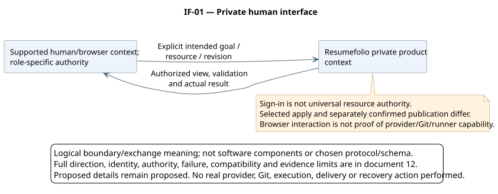

[Editable PlantUML](Diagrams/Interface-Private-Human-Context.puml) · 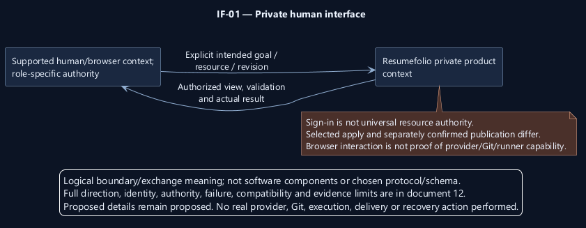

Arrows identify the exchange direction in this bounded family, not automatic propagation, permission inherited across arrows or a mandatory internal component chain. Conditional facilities/operations are not claims that they exist or have been exercised.

###### IF-02 — Protected employer representation

**Owner / status:** Farhad; Proposed logical interface refinement; accepted profile core retained where applicable.

**Participants / direction:** Employer viewer without a product account; resume owner controls link/password separately in private context. Viewer to product: exact link/password context and requested selected page/evidence/PDF/language. Product to viewer: permitted exact representation or bounded denied/unavailable result.

**Identity / authority / preconditions:** Current applicable link/password/optional adopted expiry and exact selected resource rules govern every entry path, including direct file/PDF references. No viewer account or private workspace authority is invented.

**Information / result meaning:** Published presentation, effective PDF mode, generated/uploaded variant, uploaded language identity and actual artifact availability are separate. Neither mode does not disable page/link; missing language cannot silently become private/unrelated fallback.

**Lifecycle / privacy / frame:** Confirmed link disablement prevents fresh protected access. Already downloaded bytes are outside recall. Actual submitted material is not whichever live view the employer later opens.

**Failure / concurrency / repetition:** Fresh password/link checks and existing/in-flight/cached contexts follow separately reviewed policy. Interrupted retrieval is not complete; safe repeated read does not grant access after revocation or imply content immutability.

**Capacity / workload / limits:** Representation size/processing/retrieval expectations need actual agreed limits/conditions; no download/session/expiry duration invented.

**Mechanism / representation / compatibility:** Exact presentation/encoding/content-serving/client details remain design/acceptance work; selected PDF categories are scope, not proof every variant exists.

**Evidence and scoped gates:** Credential rotation is a source/state policy with proposed details, not an exhaustively modeled new operation contract. Session/cache/in-flight/language/rendition policy remains scoped.

**Primary basis:** [EIF-D01](../02-Requirements-Engineering/01-Software-Requirements-Specification.md#requirements-specification-external-interface-requirements--heading-eif-d01-reviewable-interface-contracts), [EIF-D02](../02-Requirements-Engineering/01-Software-Requirements-Specification.md#requirements-specification-external-interface-requirements--heading-eif-d02-clear-operable-user-interaction), [EIF-D03](../02-Requirements-Engineering/01-Software-Requirements-Specification.md#requirements-specification-external-interface-requirements--heading-eif-d03-consistent-authorization-across-entry-paths), [EIF-D04](../02-Requirements-Engineering/01-Software-Requirements-Specification.md#requirements-specification-external-interface-requirements--heading-eif-d04-protected-file-and-pdf-exchange), [EIF-D08](../02-Requirements-Engineering/01-Software-Requirements-Specification.md#requirements-specification-external-interface-requirements--heading-eif-d08-operation-specific-failure-and-repetition-semantics), [EIF-D10](../02-Requirements-Engineering/01-Software-Requirements-Specification.md#requirements-specification-external-interface-requirements--heading-eif-d10-consistent-exchange-meaning-and-lifecycle), [PDF-D02](../02-Requirements-Engineering/01-Software-Requirements-Specification.md#requirements-specification-pdf-and-controlled-sharing--heading-pdf-d02-uploaded-pdf-and-language-identity), [PDF-D03](../02-Requirements-Engineering/01-Software-Requirements-Specification.md#requirements-specification-pdf-and-controlled-sharing--heading-pdf-d03-per-resume-download-choices), [PDF-D04](../02-Requirements-Engineering/01-Software-Requirements-Specification.md#requirements-specification-pdf-and-controlled-sharing--heading-pdf-d04-scoped-password-protected-employer-access), [PDF-D05](../02-Requirements-Engineering/01-Software-Requirements-Specification.md#requirements-specification-pdf-and-controlled-sharing--heading-pdf-d05-direct-file-and-pdf-authorization), [PDF-D06](../02-Requirements-Engineering/01-Software-Requirements-Specification.md#requirements-specification-pdf-and-controlled-sharing--heading-pdf-d06-owner-password-and-link-controls), [PDF-D07](../02-Requirements-Engineering/01-Software-Requirements-Specification.md#requirements-specification-pdf-and-controlled-sharing--heading-pdf-d07-explicit-live-revision-and-rendition-behavior), [ACC-D06](../02-Requirements-Engineering/01-Software-Requirements-Specification.md#requirements-specification-accounts-authentication-and-permissions--heading-acc-d06-employer-access-without-a-viewer-account), [ACC-D07](../02-Requirements-Engineering/01-Software-Requirements-Specification.md#requirements-specification-accounts-authentication-and-permissions--heading-acc-d07-protected-shared-file-and-pdf-retrieval), [ACC-D08](../02-Requirements-Engineering/01-Software-Requirements-Specification.md#requirements-specification-accounts-authentication-and-permissions--heading-acc-d08-owner-control-of-employer-link-access)

**Concepts:** [DM-C13](02-Domain-And-Information-Analysis.md#analysis-domain-and-information-analysis--03-domain-model-and-object-oriented-view--id-dm-c13), [DM-C48](02-Domain-And-Information-Analysis.md#analysis-domain-and-information-analysis--03-domain-model-and-object-oriented-view--id-dm-c48), [DM-C09](02-Domain-And-Information-Analysis.md#analysis-domain-and-information-analysis--03-domain-model-and-object-oriented-view--id-dm-c09), [DM-C12](02-Domain-And-Information-Analysis.md#analysis-domain-and-information-analysis--03-domain-model-and-object-oriented-view--id-dm-c12), [DM-C10](02-Domain-And-Information-Analysis.md#analysis-domain-and-information-analysis--03-domain-model-and-object-oriented-view--id-dm-c10), [DM-C11](02-Domain-And-Information-Analysis.md#analysis-domain-and-information-analysis--03-domain-model-and-object-oriented-view--id-dm-c11), [DM-C07](02-Domain-And-Information-Analysis.md#analysis-domain-and-information-analysis--03-domain-model-and-object-oriented-view--id-dm-c07), [DM-C08](02-Domain-And-Information-Analysis.md#analysis-domain-and-information-analysis--03-domain-model-and-object-oriented-view--id-dm-c08)

**Related operation contracts:** [DC-O04](03-Processes-Scenarios-And-Business-Rules.md#analysis-business-rules-and-operation-contracts--10-domain-constraints-and-operation-contracts--id-dc-o04), [DC-O05](03-Processes-Scenarios-And-Business-Rules.md#analysis-business-rules-and-operation-contracts--10-domain-constraints-and-operation-contracts--id-dc-o05), [DC-O06](03-Processes-Scenarios-And-Business-Rules.md#analysis-business-rules-and-operation-contracts--10-domain-constraints-and-operation-contracts--id-dc-o06)

**Related selected models:** [SB-M02](03-Processes-Scenarios-And-Business-Rules.md#analysis-behavioral-and-scenario-analysis--06-scenario-based-view--id-sb-m02), [SB-M03](03-Processes-Scenarios-And-Business-Rules.md#analysis-behavioral-and-scenario-analysis--06-scenario-based-view--id-sb-m03), [SB-M04](03-Processes-Scenarios-And-Business-Rules.md#analysis-behavioral-and-scenario-analysis--06-scenario-based-view--id-sb-m04), [SM-M04](03-Processes-Scenarios-And-Business-Rules.md#analysis-behavioral-and-scenario-analysis--07-state-based-view--id-sm-m04), [SM-M05](03-Processes-Scenarios-And-Business-Rules.md#analysis-behavioral-and-scenario-analysis--07-state-based-view--id-sm-m05), [CF-M02](03-Processes-Scenarios-And-Business-Rules.md#analysis-functional-and-process-analysis--08-control-flow-based-view--id-cf-m02), [CF-M03](03-Processes-Scenarios-And-Business-Rules.md#analysis-functional-and-process-analysis--08-control-flow-based-view--id-cf-m03), [CF-M04](03-Processes-Scenarios-And-Business-Rules.md#analysis-functional-and-process-analysis--08-control-flow-based-view--id-cf-m04), [RB-D03](03-Processes-Scenarios-And-Business-Rules.md#analysis-business-rules-and-operation-contracts--09-rule-based-view--id-rb-d03), [RB-D04](03-Processes-Scenarios-And-Business-Rules.md#analysis-business-rules-and-operation-contracts--09-rule-based-view--id-rb-d04), [RB-D05](03-Processes-Scenarios-And-Business-Rules.md#analysis-business-rules-and-operation-contracts--09-rule-based-view--id-rb-d05)

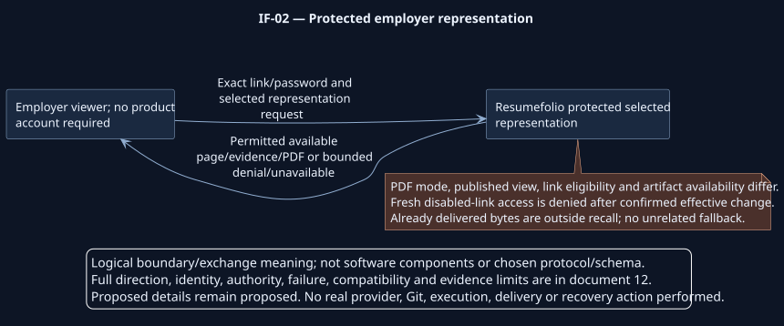

[Editable PlantUML](Diagrams/Interface-Employer-Protected-Representation.puml) · 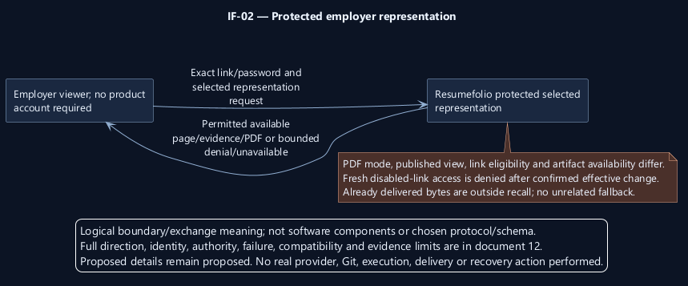

Arrows identify the exchange direction in this bounded family, not automatic propagation, permission inherited across arrows or a mandatory internal component chain. Conditional facilities/operations are not claims that they exist or have been exercised.

###### IF-03 — Authorized file/PDF exchange

**Owner / status:** Farhad; Proposed logical interface refinement; accepted profile core retained where applicable.

**Participants / direction:** Authorized uploader/requester, intended content owner/resource and product processing/retrieval responsibility; employer retrieval also applies IF-02. Into product: intended evidence/PDF/asset bytes plus owner/resource/language/provenance/replacement intent. Out: truthful admission/processing/availability and permitted exact retrieval result.

**Identity / authority / preconditions:** Upload, replacement, association, retrieval, cleanup and administration are separate powers. Actual effective policy/content/reference/current capacity conditions govern intended candidate; resource reference/filename is not permission.

**Information / result meaning:** Byte candidate versus admitted versus usable content are distinguishable. File identity, actual submitted-set provenance, language/variant and association survive interpretation; client metadata is not proof of valid type or historical equivalence.

**Lifecycle / privacy / frame:** A new candidate or failed replacement cannot silently destroy required prior/actual material. Source replacement does not rewrite actual sent history; cleanup and quota release need reference-aware eligibility and actual effect.

**Failure / concurrency / repetition:** Concurrent growth/replacement/changed policy require reviewed current capacity and reference semantics. Partial/unknown upload/processing is not usable success; no universal resumable-transfer/retry guarantee is chosen.

**Capacity / workload / limits:** Format/content validation, byte/aggregate units, current growth/temp/retained accounting and processing limits require reviewed values. Idle free disk is not a concurrent-admission proof.

**Mechanism / representation / compatibility:** Exact accepted representations/formats/encoding/metadata fields, transfer mechanism and safe-serving behavior remain design/criteria work; no arbitrary import/export or general file hosting is added.

**Evidence and scoped gates:** No quotas, whitelist, content-handling technology, storage backend, cleanup schedule or universal cancellation behavior is selected.

**Primary basis:** [EIF-D01](../02-Requirements-Engineering/01-Software-Requirements-Specification.md#requirements-specification-external-interface-requirements--heading-eif-d01-reviewable-interface-contracts), [EIF-D03](../02-Requirements-Engineering/01-Software-Requirements-Specification.md#requirements-specification-external-interface-requirements--heading-eif-d03-consistent-authorization-across-entry-paths), [EIF-D04](../02-Requirements-Engineering/01-Software-Requirements-Specification.md#requirements-specification-external-interface-requirements--heading-eif-d04-protected-file-and-pdf-exchange), [EIF-D08](../02-Requirements-Engineering/01-Software-Requirements-Specification.md#requirements-specification-external-interface-requirements--heading-eif-d08-operation-specific-failure-and-repetition-semantics), [EIF-D10](../02-Requirements-Engineering/01-Software-Requirements-Specification.md#requirements-specification-external-interface-requirements--heading-eif-d10-consistent-exchange-meaning-and-lifecycle), [AFO-D03](../02-Requirements-Engineering/01-Software-Requirements-Specification.md#requirements-specification-administration-files-and-operational-behavior--heading-afo-d03-per-file-admission-limit), [AFO-D04](../02-Requirements-Engineering/01-Software-Requirements-Specification.md#requirements-specification-administration-files-and-operational-behavior--heading-afo-d04-aggregate-quota-and-concurrent-admission), [AFO-D05](../02-Requirements-Engineering/01-Software-Requirements-Specification.md#requirements-specification-administration-files-and-operational-behavior--heading-afo-d05-supported-content-and-validation), [AFO-D06](../02-Requirements-Engineering/01-Software-Requirements-Specification.md#requirements-specification-administration-files-and-operational-behavior--heading-afo-d06-file-resource-authorization-and-isolation), [AFO-D07](../02-Requirements-Engineering/01-Software-Requirements-Specification.md#requirements-specification-administration-files-and-operational-behavior--heading-afo-d07-truthful-completion-and-interrupted-operation-handling), [AFO-D08](../02-Requirements-Engineering/01-Software-Requirements-Specification.md#requirements-specification-administration-files-and-operational-behavior--heading-afo-d08-safe-replacement-and-lifecycle-effects), [AFO-D11](../02-Requirements-Engineering/01-Software-Requirements-Specification.md#requirements-specification-administration-files-and-operational-behavior--heading-afo-d11-bounded-cleanup-and-storage-reclamation), [APP-D06](../02-Requirements-Engineering/01-Software-Requirements-Specification.md#requirements-specification-manual-application-management--heading-app-d06-preserved-actual-submitted-copies), [PDF-D02](../02-Requirements-Engineering/01-Software-Requirements-Specification.md#requirements-specification-pdf-and-controlled-sharing--heading-pdf-d02-uploaded-pdf-and-language-identity), [PDF-D09](../02-Requirements-Engineering/01-Software-Requirements-Specification.md#requirements-specification-pdf-and-controlled-sharing--heading-pdf-d09-failure-safe-processing-and-content-handling)

**Concepts:** [DM-C49](02-Domain-And-Information-Analysis.md#analysis-domain-and-information-analysis--03-domain-model-and-object-oriented-view--id-dm-c49), [DM-C50](02-Domain-And-Information-Analysis.md#analysis-domain-and-information-analysis--03-domain-model-and-object-oriented-view--id-dm-c50), [DM-C10](02-Domain-And-Information-Analysis.md#analysis-domain-and-information-analysis--03-domain-model-and-object-oriented-view--id-dm-c10), [DM-C11](02-Domain-And-Information-Analysis.md#analysis-domain-and-information-analysis--03-domain-model-and-object-oriented-view--id-dm-c11), [DM-C19](02-Domain-And-Information-Analysis.md#analysis-domain-and-information-analysis--03-domain-model-and-object-oriented-view--id-dm-c19), [DM-C18](02-Domain-And-Information-Analysis.md#analysis-domain-and-information-analysis--03-domain-model-and-object-oriented-view--id-dm-c18), [DM-C08](02-Domain-And-Information-Analysis.md#analysis-domain-and-information-analysis--03-domain-model-and-object-oriented-view--id-dm-c08)

**Related operation contracts:** [DC-O06](03-Processes-Scenarios-And-Business-Rules.md#analysis-business-rules-and-operation-contracts--10-domain-constraints-and-operation-contracts--id-dc-o06), [DC-O09](03-Processes-Scenarios-And-Business-Rules.md#analysis-business-rules-and-operation-contracts--10-domain-constraints-and-operation-contracts--id-dc-o09), [DC-O10](03-Processes-Scenarios-And-Business-Rules.md#analysis-business-rules-and-operation-contracts--10-domain-constraints-and-operation-contracts--id-dc-o10), [DC-O32](03-Processes-Scenarios-And-Business-Rules.md#analysis-business-rules-and-operation-contracts--10-domain-constraints-and-operation-contracts--id-dc-o32), [DC-O34](03-Processes-Scenarios-And-Business-Rules.md#analysis-business-rules-and-operation-contracts--10-domain-constraints-and-operation-contracts--id-dc-o34), [DC-O35](03-Processes-Scenarios-And-Business-Rules.md#analysis-business-rules-and-operation-contracts--10-domain-constraints-and-operation-contracts--id-dc-o35), [DC-O36](03-Processes-Scenarios-And-Business-Rules.md#analysis-business-rules-and-operation-contracts--10-domain-constraints-and-operation-contracts--id-dc-o36)

**Related selected models:** [SB-M04](03-Processes-Scenarios-And-Business-Rules.md#analysis-behavioral-and-scenario-analysis--06-scenario-based-view--id-sb-m04), [SB-M06](03-Processes-Scenarios-And-Business-Rules.md#analysis-behavioral-and-scenario-analysis--06-scenario-based-view--id-sb-m06), [SB-M15](03-Processes-Scenarios-And-Business-Rules.md#analysis-behavioral-and-scenario-analysis--06-scenario-based-view--id-sb-m15), [SM-M05](03-Processes-Scenarios-And-Business-Rules.md#analysis-behavioral-and-scenario-analysis--07-state-based-view--id-sm-m05), [SM-M07](03-Processes-Scenarios-And-Business-Rules.md#analysis-behavioral-and-scenario-analysis--07-state-based-view--id-sm-m07), [SM-M16](03-Processes-Scenarios-And-Business-Rules.md#analysis-behavioral-and-scenario-analysis--07-state-based-view--id-sm-m16), [CF-M06](03-Processes-Scenarios-And-Business-Rules.md#analysis-functional-and-process-analysis--08-control-flow-based-view--id-cf-m06), [CF-M15](03-Processes-Scenarios-And-Business-Rules.md#analysis-functional-and-process-analysis--08-control-flow-based-view--id-cf-m15), [RB-D06](03-Processes-Scenarios-And-Business-Rules.md#analysis-business-rules-and-operation-contracts--09-rule-based-view--id-rb-d06), [RB-D14](03-Processes-Scenarios-And-Business-Rules.md#analysis-business-rules-and-operation-contracts--09-rule-based-view--id-rb-d14), [RB-D15](03-Processes-Scenarios-And-Business-Rules.md#analysis-business-rules-and-operation-contracts--09-rule-based-view--id-rb-d15)

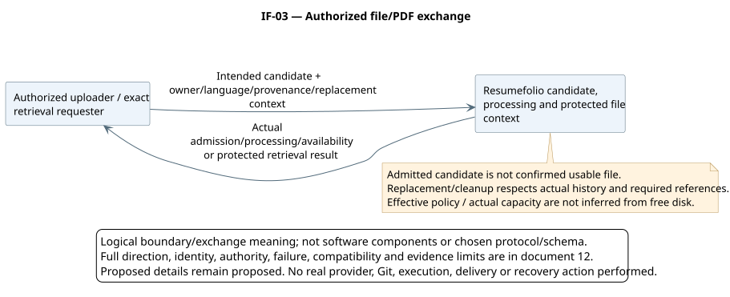

[Editable PlantUML](Diagrams/Interface-File-Candidate-Result.puml) · 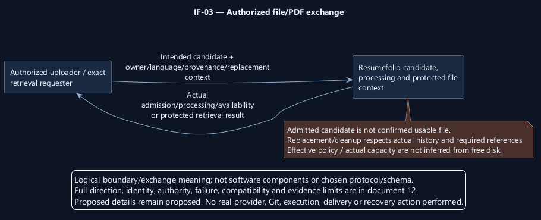

Arrows identify the exchange direction in this bounded family, not automatic propagation, permission inherited across arrows or a mandatory internal component chain. Conditional facilities/operations are not claims that they exist or have been exercised.

###### IF-04 — Gmail provider operations

**After MVP.** Shared operating and recovery controls still apply where relevant.

**Owner / status:** Farhad; Proposed logical interface refinement; accepted profile core retained where applicable.

**Participants / direction:** Connected user, selected intended Google account and Gmail provider, under conditional actual access. Product to provider: explicitly authorized read/search/draft/send/reply intent for exact account/context. Provider to product: permitted content, identifiers and attributable acceptance/rejection/limit/access-loss/uncertain result.

**Identity / authority / preconditions:** Product session/grants and actual selected-account provider capabilities are different prerequisites. Reading, composing/persisting drafts, sending and replying are not one implicit permission.

**Information / result meaning:** Provider/account/message/conversation/draft identity and current sender/recipient/body/attachment/reply context remain attributable. Final confirmation must match actual intended send content; acceptance is not recipient delivery/read.

**Lifecycle / privacy / frame:** Disconnect stops new dependent provider action under reviewed rules; retained local copies and draft ownership need explicit policy. Do not expose credentials/private mailbox through general project membership, logs or examples.

**Failure / concurrency / repetition:** Changed reviewed content requires renewed confirmation. Unknown send requires same-attempt reconciliation before separately eligible resend; reconnect does not blindly replay pending sends. Draft create/update/retry semantics need their own exact contract.

**Capacity / workload / limits:** Actual provider access, limits/cost/applicability and supported operation constraints need evidence. No polling, timeout/backoff, volume or quota values are invented.

**Mechanism / representation / compatibility:** Exact mechanism/scopes/representation/version and access/verification conditions are not chosen or newly verified here. Provider compatibility requires later applicable findings; no support for arbitrary mail providers is added.

**Evidence and scoped gates:** OAuth has not been created. User Gmail capability is not an authentication/recovery notification channel. Draft and connect/disconnect contracts are source-derived families, not falsely claimed among the 39 selected operations.

**Primary basis:** [EIF-D01](../02-Requirements-Engineering/01-Software-Requirements-Specification.md#requirements-specification-external-interface-requirements--heading-eif-d01-reviewable-interface-contracts), [EIF-D03](../02-Requirements-Engineering/01-Software-Requirements-Specification.md#requirements-specification-external-interface-requirements--heading-eif-d03-consistent-authorization-across-entry-paths), [EIF-D05](../02-Requirements-Engineering/01-Software-Requirements-Specification.md#requirements-specification-external-interface-requirements--heading-eif-d05-explicit-google-provider-contracts), [EIF-D08](../02-Requirements-Engineering/01-Software-Requirements-Specification.md#requirements-specification-external-interface-requirements--heading-eif-d08-operation-specific-failure-and-repetition-semantics), [EIF-D10](../02-Requirements-Engineering/01-Software-Requirements-Specification.md#requirements-specification-external-interface-requirements--heading-eif-d10-consistent-exchange-meaning-and-lifecycle), [EGC-D01](../02-Requirements-Engineering/01-Software-Requirements-Specification.md#requirements-specification-email-calendar-and-google-integration--heading-egc-d01-authorized-connection-and-account-context), [EGC-D02](../02-Requirements-Engineering/01-Software-Requirements-Specification.md#requirements-specification-email-calendar-and-google-integration--heading-egc-d02-justified-permissions-and-private-resource-isolation), [EGC-D03](../02-Requirements-Engineering/01-Software-Requirements-Specification.md#requirements-specification-email-calendar-and-google-integration--heading-egc-d03-read-authorized-correspondence), [EGC-D04](../02-Requirements-Engineering/01-Software-Requirements-Specification.md#requirements-specification-email-calendar-and-google-integration--heading-egc-d04-manual-compose-and-draft-handling), [EGC-D05](../02-Requirements-Engineering/01-Software-Requirements-Specification.md#requirements-specification-email-calendar-and-google-integration--heading-egc-d05-deliberate-send-and-truthful-outcome), [EGC-D06](../02-Requirements-Engineering/01-Software-Requirements-Specification.md#requirements-specification-email-calendar-and-google-integration--heading-egc-d06-reply-context-and-conversation-association), [EGC-D11](../02-Requirements-Engineering/01-Software-Requirements-Specification.md#requirements-specification-email-calendar-and-google-integration--heading-egc-d11-disconnect-revocation-and-reconnect), [EGC-D12](../02-Requirements-Engineering/01-Software-Requirements-Specification.md#requirements-specification-email-calendar-and-google-integration--heading-egc-d12-bounded-failures-recovery-and-feasibility-evidence)

**Concepts:** [DM-C20](02-Domain-And-Information-Analysis.md#analysis-domain-and-information-analysis--03-domain-model-and-object-oriented-view--id-dm-c20), [DM-C21](02-Domain-And-Information-Analysis.md#analysis-domain-and-information-analysis--03-domain-model-and-object-oriented-view--id-dm-c21), [DM-C48](02-Domain-And-Information-Analysis.md#analysis-domain-and-information-analysis--03-domain-model-and-object-oriented-view--id-dm-c48)

**Related operation contracts:** [DC-O11](03-Processes-Scenarios-And-Business-Rules.md#analysis-business-rules-and-operation-contracts--10-domain-constraints-and-operation-contracts--id-dc-o11), [DC-O12](03-Processes-Scenarios-And-Business-Rules.md#analysis-business-rules-and-operation-contracts--10-domain-constraints-and-operation-contracts--id-dc-o12), [DC-O38](03-Processes-Scenarios-And-Business-Rules.md#analysis-business-rules-and-operation-contracts--10-domain-constraints-and-operation-contracts--id-dc-o38)

**Related selected models:** [SB-M07](03-Processes-Scenarios-And-Business-Rules.md#analysis-behavioral-and-scenario-analysis--06-scenario-based-view--id-sb-m07), [SM-M08](03-Processes-Scenarios-And-Business-Rules.md#analysis-behavioral-and-scenario-analysis--07-state-based-view--id-sm-m08), [SM-M09](03-Processes-Scenarios-And-Business-Rules.md#analysis-behavioral-and-scenario-analysis--07-state-based-view--id-sm-m09), [CF-M07](03-Processes-Scenarios-And-Business-Rules.md#analysis-functional-and-process-analysis--08-control-flow-based-view--id-cf-m07), [RB-D07](03-Processes-Scenarios-And-Business-Rules.md#analysis-business-rules-and-operation-contracts--09-rule-based-view--id-rb-d07), [RB-D18](03-Processes-Scenarios-And-Business-Rules.md#analysis-business-rules-and-operation-contracts--09-rule-based-view--id-rb-d18)

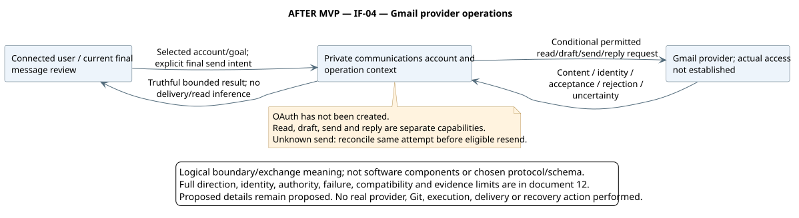

[Editable PlantUML](Diagrams/Interface-Gmail-Reviewed-Effects.puml) · 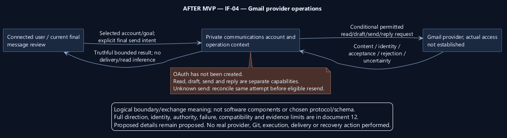

Arrows identify the exchange direction in this bounded family, not automatic propagation, permission inherited across arrows or a mandatory internal component chain. Conditional facilities/operations are not claims that they exist or have been exercised.

###### IF-05 — Calendar provider and local mapping

**After MVP.** Shared operating and recovery controls still apply where relevant.

**Owner / status:** Farhad; Proposed logical interface refinement; accepted profile core retained where applicable.

**Participants / direction:** Activity owner, selected intended account/calendar and Google Calendar provider; local-only goals are compared explicitly. Product/provider: only selected authorized event operations and relevant event/version/time result. User/product local branch: local activity or association-only unlink, without implied provider mutation.

**Identity / authority / preconditions:** Local operation authority differs from provider write capability. Exact account/calendar/mapping/action and field authority are established before dependent provider action; local unlink does not need active provider write access.

**Information / result meaning:** Local/provider identity, optional mapping, selected authoritative fields, relevant local/provider versions, all-day/time-zone meaning and freshness/conflict state are distinguishable. Local notes and application associations are not provider-owned grants.

**Lifecycle / privacy / frame:** Local unlink does not delete provider event; provider removal is a distinct observed external change. Disconnect/reconnect does not delete/recreate/replay local/provider state by default. Reminders need separate actually available delivery capability.

**Failure / concurrency / repetition:** Concurrent local/provider changes remain conflicts/stale until explicit reviewed resolution. Ambiguous provider mutation is reconciled against same intended object; reconnect alone does not make mapping Fresh.

**Capacity / workload / limits:** Actual provider limits, freshness/latency/workload and reminder-delivery conditions require defined evidence; no timing or automatic sync direction is invented.

**Mechanism / representation / compatibility:** Exact time representation, fields, event identity/mapping, mutation mechanism and compatibility/version policy remain scoped design/acceptance work; no bidirectional or last-write-wins default.

**Evidence and scoped gates:** OAuth absent. Direction/time/conflict/deletion/reconnect policy remains proposed; local-only paths can still be specified without a configured provider.

**Primary basis:** [EIF-D01](../02-Requirements-Engineering/01-Software-Requirements-Specification.md#requirements-specification-external-interface-requirements--heading-eif-d01-reviewable-interface-contracts), [EIF-D03](../02-Requirements-Engineering/01-Software-Requirements-Specification.md#requirements-specification-external-interface-requirements--heading-eif-d03-consistent-authorization-across-entry-paths), [EIF-D05](../02-Requirements-Engineering/01-Software-Requirements-Specification.md#requirements-specification-external-interface-requirements--heading-eif-d05-explicit-google-provider-contracts), [EIF-D08](../02-Requirements-Engineering/01-Software-Requirements-Specification.md#requirements-specification-external-interface-requirements--heading-eif-d08-operation-specific-failure-and-repetition-semantics), [EIF-D10](../02-Requirements-Engineering/01-Software-Requirements-Specification.md#requirements-specification-external-interface-requirements--heading-eif-d10-consistent-exchange-meaning-and-lifecycle), [EGC-D07](../02-Requirements-Engineering/01-Software-Requirements-Specification.md#requirements-specification-email-calendar-and-google-integration--heading-egc-d07-calendar-activities-and-time-meaning), [EGC-D08](../02-Requirements-Engineering/01-Software-Requirements-Specification.md#requirements-specification-email-calendar-and-google-integration--heading-egc-d08-explicit-synchronization-contract), [EGC-D09](../02-Requirements-Engineering/01-Software-Requirements-Specification.md#requirements-specification-email-calendar-and-google-integration--heading-egc-d09-application-relationships-preserve-boundaries), [EGC-D10](../02-Requirements-Engineering/01-Software-Requirements-Specification.md#requirements-specification-email-calendar-and-google-integration--heading-egc-d10-reminders-and-notification-outcomes), [EGC-D11](../02-Requirements-Engineering/01-Software-Requirements-Specification.md#requirements-specification-email-calendar-and-google-integration--heading-egc-d11-disconnect-revocation-and-reconnect), [EGC-D12](../02-Requirements-Engineering/01-Software-Requirements-Specification.md#requirements-specification-email-calendar-and-google-integration--heading-egc-d12-bounded-failures-recovery-and-feasibility-evidence), [BRL-D07](../02-Requirements-Engineering/01-Software-Requirements-Specification.md#requirements-specification-business-rules-and-data-lifecycle--heading-brl-d07-explicit-provider-synchronization-authority), [BRL-D10](../02-Requirements-Engineering/01-Software-Requirements-Specification.md#requirements-specification-business-rules-and-data-lifecycle--heading-brl-d10-defined-language-and-time-meaning)

**Concepts:** [DM-C20](02-Domain-And-Information-Analysis.md#analysis-domain-and-information-analysis--03-domain-model-and-object-oriented-view--id-dm-c20), [DM-C22](02-Domain-And-Information-Analysis.md#analysis-domain-and-information-analysis--03-domain-model-and-object-oriented-view--id-dm-c22), [DM-C23](02-Domain-And-Information-Analysis.md#analysis-domain-and-information-analysis--03-domain-model-and-object-oriented-view--id-dm-c23), [DM-C16](02-Domain-And-Information-Analysis.md#analysis-domain-and-information-analysis--03-domain-model-and-object-oriented-view--id-dm-c16), [DM-C48](02-Domain-And-Information-Analysis.md#analysis-domain-and-information-analysis--03-domain-model-and-object-oriented-view--id-dm-c48)

**Related operation contracts:** [DC-O13](03-Processes-Scenarios-And-Business-Rules.md#analysis-business-rules-and-operation-contracts--10-domain-constraints-and-operation-contracts--id-dc-o13), [DC-O14](03-Processes-Scenarios-And-Business-Rules.md#analysis-business-rules-and-operation-contracts--10-domain-constraints-and-operation-contracts--id-dc-o14), [DC-O15](03-Processes-Scenarios-And-Business-Rules.md#analysis-business-rules-and-operation-contracts--10-domain-constraints-and-operation-contracts--id-dc-o15), [DC-O38](03-Processes-Scenarios-And-Business-Rules.md#analysis-business-rules-and-operation-contracts--10-domain-constraints-and-operation-contracts--id-dc-o38)

**Related selected models:** [SB-M08](03-Processes-Scenarios-And-Business-Rules.md#analysis-behavioral-and-scenario-analysis--06-scenario-based-view--id-sb-m08), [SM-M08](03-Processes-Scenarios-And-Business-Rules.md#analysis-behavioral-and-scenario-analysis--07-state-based-view--id-sm-m08), [SM-M10](03-Processes-Scenarios-And-Business-Rules.md#analysis-behavioral-and-scenario-analysis--07-state-based-view--id-sm-m10), [CF-M08](03-Processes-Scenarios-And-Business-Rules.md#analysis-functional-and-process-analysis--08-control-flow-based-view--id-cf-m08), [RB-D08](03-Processes-Scenarios-And-Business-Rules.md#analysis-business-rules-and-operation-contracts--09-rule-based-view--id-rb-d08), [RB-D17](03-Processes-Scenarios-And-Business-Rules.md#analysis-business-rules-and-operation-contracts--09-rule-based-view--id-rb-d17)

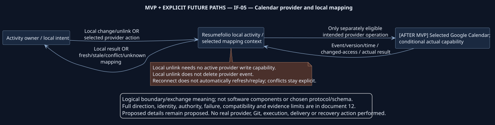

[Editable PlantUML](Diagrams/Interface-Calendar-Local-Provider.puml) · 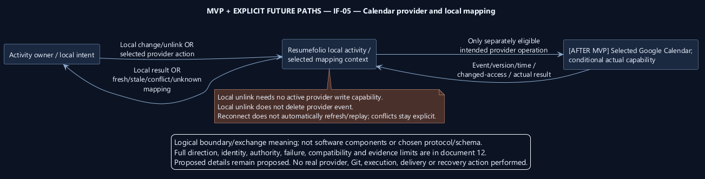

Arrows identify the exchange direction in this bounded family, not automatic propagation, permission inherited across arrows or a mandatory internal component chain. Conditional facilities/operations are not claims that they exist or have been exercised.

###### IF-06 — Real Git-client boundary

**Owner / status:** Farhad; Proposed logical interface refinement; accepted profile core retained where applicable.

**Participants / direction:** Actually supported real Git client/user and intended product-hosted repository/ref. Browser PR/review/merge management is IF-01 context, not an invented Git wire operation. Client to product: intended authorized clone/fetch/pull or push/ref-change context. Product to client: real repository content/history/ref or explicit rejection/conflict/incomplete/unknown result.

**Identity / authority / preconditions:** Repository read, ref write/protected-ref, review/merge and target deploy authority remain separate. Exact current intended repository/ref permission and expected/evaluated revision context apply to non-browser entry.

**Information / result meaning:** Repository/ref/object/revision meaning is real Git domain content, not a browser simulation. Moving ref names are not immutable evaluated review/check identities. Client transfer outcome and actual ref state require attributable evidence.

**Lifecycle / privacy / frame:** Rejected/stale/unknown ref changes do not imply an unchanged target or completed rollback. Required history/references and retention/recovery need repository-specific contracts, not a universal file purge.

**Failure / concurrency / repetition:** Interrupted read transfer is incomplete; unknown push needs actual intended ref reconciliation before consequential repetition. Changed source/target/reviews require re-evaluation for merge in IF-01.

**Capacity / workload / limits:** Object/transfer/history growth and real client compatibility/resource behavior need scoped conditions/evidence; no size, connection or client/version limit invented.

**Mechanism / representation / compatibility:** Neither SSH nor HTTPS transport nor Git engine is selected. Administrative root SSH previously used to inspect the demo host is not evidence of product Git-client authentication/interoperability; development GitHub is not product hosting proof.

**Evidence and scoped gates:** Actual supported client/transport/credential/protection/recovery choices remain proposed or unverified. No new public developer API, webhook or universal Git-client compatibility.

**Primary basis:** [EIF-D01](../02-Requirements-Engineering/01-Software-Requirements-Specification.md#requirements-specification-external-interface-requirements--heading-eif-d01-reviewable-interface-contracts), [EIF-D03](../02-Requirements-Engineering/01-Software-Requirements-Specification.md#requirements-specification-external-interface-requirements--heading-eif-d03-consistent-authorization-across-entry-paths), [EIF-D06](../02-Requirements-Engineering/01-Software-Requirements-Specification.md#requirements-specification-external-interface-requirements--heading-eif-d06-real-git-client-interoperability), [EIF-D08](../02-Requirements-Engineering/01-Software-Requirements-Specification.md#requirements-specification-external-interface-requirements--heading-eif-d08-operation-specific-failure-and-repetition-semantics), [EIF-D10](../02-Requirements-Engineering/01-Software-Requirements-Specification.md#requirements-specification-external-interface-requirements--heading-eif-d10-consistent-exchange-meaning-and-lifecycle), [GIT-D02](../02-Requirements-Engineering/01-Software-Requirements-Specification.md#requirements-specification-git-hosting-and-collaboration--heading-git-d02-repository-and-ref-authorization), [GIT-D03](../02-Requirements-Engineering/01-Software-Requirements-Specification.md#requirements-specification-git-hosting-and-collaboration--heading-git-d03-real-clone-fetch-pull-and-push), [GIT-D04](../02-Requirements-Engineering/01-Software-Requirements-Specification.md#requirements-specification-git-hosting-and-collaboration--heading-git-d04-branches-files-and-history-browsing), [GIT-D05](../02-Requirements-Engineering/01-Software-Requirements-Specification.md#requirements-specification-git-hosting-and-collaboration--heading-git-d05-fork-provenance-and-permission-boundaries), [GIT-D06](../02-Requirements-Engineering/01-Software-Requirements-Specification.md#requirements-specification-git-hosting-and-collaboration--heading-git-d06-pull-requests-comments-and-review), [GIT-D07](../02-Requirements-Engineering/01-Software-Requirements-Specification.md#requirements-specification-git-hosting-and-collaboration--heading-git-d07-controlled-merge-and-conflict-outcomes), [GIT-D10](../02-Requirements-Engineering/01-Software-Requirements-Specification.md#requirements-specification-git-hosting-and-collaboration--heading-git-d10-lifecycle-capacity-and-recovery)

**Concepts:** [DM-C32](02-Domain-And-Information-Analysis.md#analysis-domain-and-information-analysis--03-domain-model-and-object-oriented-view--id-dm-c32), [DM-C34](02-Domain-And-Information-Analysis.md#analysis-domain-and-information-analysis--03-domain-model-and-object-oriented-view--id-dm-c34), [DM-C33](02-Domain-And-Information-Analysis.md#analysis-domain-and-information-analysis--03-domain-model-and-object-oriented-view--id-dm-c33), [DM-C35](02-Domain-And-Information-Analysis.md#analysis-domain-and-information-analysis--03-domain-model-and-object-oriented-view--id-dm-c35), [DM-C36](02-Domain-And-Information-Analysis.md#analysis-domain-and-information-analysis--03-domain-model-and-object-oriented-view--id-dm-c36), [DM-C48](02-Domain-And-Information-Analysis.md#analysis-domain-and-information-analysis--03-domain-model-and-object-oriented-view--id-dm-c48)

**Related operation contracts:** [DC-O22](03-Processes-Scenarios-And-Business-Rules.md#analysis-business-rules-and-operation-contracts--10-domain-constraints-and-operation-contracts--id-dc-o22), [DC-O23](03-Processes-Scenarios-And-Business-Rules.md#analysis-business-rules-and-operation-contracts--10-domain-constraints-and-operation-contracts--id-dc-o23), [DC-O24](03-Processes-Scenarios-And-Business-Rules.md#analysis-business-rules-and-operation-contracts--10-domain-constraints-and-operation-contracts--id-dc-o24), [DC-O25](03-Processes-Scenarios-And-Business-Rules.md#analysis-business-rules-and-operation-contracts--10-domain-constraints-and-operation-contracts--id-dc-o25), [DC-O26](03-Processes-Scenarios-And-Business-Rules.md#analysis-business-rules-and-operation-contracts--10-domain-constraints-and-operation-contracts--id-dc-o26), [DC-O38](03-Processes-Scenarios-And-Business-Rules.md#analysis-business-rules-and-operation-contracts--10-domain-constraints-and-operation-contracts--id-dc-o38)

**Related selected models:** [SB-M11](03-Processes-Scenarios-And-Business-Rules.md#analysis-behavioral-and-scenario-analysis--06-scenario-based-view--id-sb-m11), [SB-M12](03-Processes-Scenarios-And-Business-Rules.md#analysis-behavioral-and-scenario-analysis--06-scenario-based-view--id-sb-m12), [SM-M13](03-Processes-Scenarios-And-Business-Rules.md#analysis-behavioral-and-scenario-analysis--07-state-based-view--id-sm-m13), [CF-M11](03-Processes-Scenarios-And-Business-Rules.md#analysis-functional-and-process-analysis--08-control-flow-based-view--id-cf-m11), [CF-M12](03-Processes-Scenarios-And-Business-Rules.md#analysis-functional-and-process-analysis--08-control-flow-based-view--id-cf-m12), [RB-D11](03-Processes-Scenarios-And-Business-Rules.md#analysis-business-rules-and-operation-contracts--09-rule-based-view--id-rb-d11)

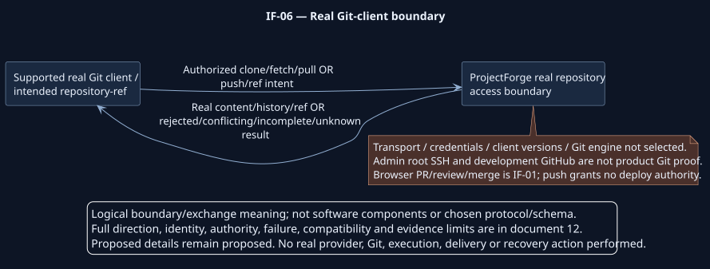

[Editable PlantUML](Diagrams/Interface-Real-Git-Client.puml) · 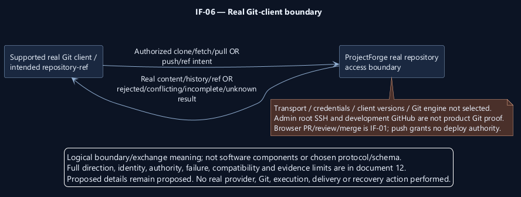

Arrows identify the exchange direction in this bounded family, not automatic propagation, permission inherited across arrows or a mandatory internal component chain. Conditional facilities/operations are not claims that they exist or have been exercised.

###### IF-07 — Conditional execution and separate deployment target

**After MVP.** Shared operating and recovery controls still apply where relevant.

**Owner / status:** Farhad; Proposed logical interface refinement; accepted profile core retained where applicable.

**Participants / direction:** Authorized trigger/actor, defined workflow/code context, conceptual execution boundary and separately approved intended deployment target. Into execution: supported exact definition/revision, scoped authority/resources/secrets and permitted trigger. Back: attributable actual attempt/output/state. Separate target exchange: independently authorized artifact/revision effect and target outcome.

**Identity / authority / preconditions:** Execution requires actual enabling isolation/resource/security evidence. No arbitrary YAML/code/secret/network/host access follows repository permission. Deployment requires current exact target authority/approval and valid artifact/data/recovery conditions.

**Information / result meaning:** Definition/evaluated revision, run/attempt, output identity, cancellation-request versus stop, actual terminal versus unknown and target effect are different. Logs/artifacts require separate bounded access; build/merge/release is not deploy permission.

**Lifecycle / privacy / frame:** Do not expose secrets through inputs/results/diagnostics or recover old authority by replay. Output retention/cleanup is scoped and reference-aware; failed work does not automatically remove required evidence or reverse target effects.

**Failure / concurrency / repetition:** Queue cancellation versus running stop is distinguished; completion can win cancellation race. Retry is a separately eligible new attempt after prior effect assessment; unknown target is reconciled before consequential retry/recovery.

**Capacity / workload / limits:** Suitable isolation, limits on actual resources/output/concurrency/cleanup and target readiness require actual evidence. Existing 2-vCPU/4-GB/40-GB demo/idle readings do not prove safe untrusted execution.

**Mechanism / representation / compatibility:** Supported workflow syntax/triggers/features, runner/isolation, output representation, target mechanism and compatibility are not chosen. No universal external CI ecosystem compatibility, marketplace actions or arbitrary remote target capability is promised.

**Evidence and scoped gates:** No demonstrated suitable execution environment or approved live target is created here; conditional logical boundary only, not execution authorization.

**Primary basis:** [EIF-D01](../02-Requirements-Engineering/01-Software-Requirements-Specification.md#requirements-specification-external-interface-requirements--heading-eif-d01-reviewable-interface-contracts), [EIF-D03](../02-Requirements-Engineering/01-Software-Requirements-Specification.md#requirements-specification-external-interface-requirements--heading-eif-d03-consistent-authorization-across-entry-paths), [EIF-D07](../02-Requirements-Engineering/01-Software-Requirements-Specification.md#requirements-specification-external-interface-requirements--heading-eif-d07-bounded-workflow-and-deployment-interfaces), [EIF-D08](../02-Requirements-Engineering/01-Software-Requirements-Specification.md#requirements-specification-external-interface-requirements--heading-eif-d08-operation-specific-failure-and-repetition-semantics), [EIF-D10](../02-Requirements-Engineering/01-Software-Requirements-Specification.md#requirements-specification-external-interface-requirements--heading-eif-d10-consistent-exchange-meaning-and-lifecycle), [YML-D01](../02-Requirements-Engineering/01-Software-Requirements-Specification.md#requirements-specification-yaml-workflows-and-cicd--heading-yml-d01-defined-supported-workflow-contract), [YML-D02](../02-Requirements-Engineering/01-Software-Requirements-Specification.md#requirements-specification-yaml-workflows-and-cicd--heading-yml-d02-explicit-triggers-and-run-authority), [YML-D03](../02-Requirements-Engineering/01-Software-Requirements-Specification.md#requirements-specification-yaml-workflows-and-cicd--heading-yml-d03-run-identity-and-reproducible-context), [YML-D04](../02-Requirements-Engineering/01-Software-Requirements-Specification.md#requirements-specification-yaml-workflows-and-cicd--heading-yml-d04-isolation-and-untrusted-code-boundary), [YML-D05](../02-Requirements-Engineering/01-Software-Requirements-Specification.md#requirements-specification-yaml-workflows-and-cicd--heading-yml-d05-scoped-secrets-and-credentials), [YML-D06](../02-Requirements-Engineering/01-Software-Requirements-Specification.md#requirements-specification-yaml-workflows-and-cicd--heading-yml-d06-resource-admission-and-limits), [YML-D07](../02-Requirements-Engineering/01-Software-Requirements-Specification.md#requirements-specification-yaml-workflows-and-cicd--heading-yml-d07-truthful-run-and-step-outcomes), [YML-D08](../02-Requirements-Engineering/01-Software-Requirements-Specification.md#requirements-specification-yaml-workflows-and-cicd--heading-yml-d08-restricted-logs-and-artifacts), [YML-D09](../02-Requirements-Engineering/01-Software-Requirements-Specification.md#requirements-specification-yaml-workflows-and-cicd--heading-yml-d09-cancellation-retry-and-runner-loss-recovery), [YML-D10](../02-Requirements-Engineering/01-Software-Requirements-Specification.md#requirements-specification-yaml-workflows-and-cicd--heading-yml-d10-separate-controlled-deployment-stage), [YML-D11](../02-Requirements-Engineering/01-Software-Requirements-Specification.md#requirements-specification-yaml-workflows-and-cicd--heading-yml-d11-workspace-cleanup-and-retained-evidence), [YML-D12](../02-Requirements-Engineering/01-Software-Requirements-Specification.md#requirements-specification-yaml-workflows-and-cicd--heading-yml-d12-feasibility-operational-guidance-and-enabling-gate)

**Concepts:** [DM-C40](02-Domain-And-Information-Analysis.md#analysis-domain-and-information-analysis--03-domain-model-and-object-oriented-view--id-dm-c40), [DM-C33](02-Domain-And-Information-Analysis.md#analysis-domain-and-information-analysis--03-domain-model-and-object-oriented-view--id-dm-c33), [DM-C41](02-Domain-And-Information-Analysis.md#analysis-domain-and-information-analysis--03-domain-model-and-object-oriented-view--id-dm-c41), [DM-C42](02-Domain-And-Information-Analysis.md#analysis-domain-and-information-analysis--03-domain-model-and-object-oriented-view--id-dm-c42), [DM-C43](02-Domain-And-Information-Analysis.md#analysis-domain-and-information-analysis--03-domain-model-and-object-oriented-view--id-dm-c43), [DM-C44](02-Domain-And-Information-Analysis.md#analysis-domain-and-information-analysis--03-domain-model-and-object-oriented-view--id-dm-c44), [DM-C45](02-Domain-And-Information-Analysis.md#analysis-domain-and-information-analysis--03-domain-model-and-object-oriented-view--id-dm-c45), [DM-C46](02-Domain-And-Information-Analysis.md#analysis-domain-and-information-analysis--03-domain-model-and-object-oriented-view--id-dm-c46)

**Related operation contracts:** [DC-O27](03-Processes-Scenarios-And-Business-Rules.md#analysis-business-rules-and-operation-contracts--10-domain-constraints-and-operation-contracts--id-dc-o27), [DC-O28](03-Processes-Scenarios-And-Business-Rules.md#analysis-business-rules-and-operation-contracts--10-domain-constraints-and-operation-contracts--id-dc-o28), [DC-O29](03-Processes-Scenarios-And-Business-Rules.md#analysis-business-rules-and-operation-contracts--10-domain-constraints-and-operation-contracts--id-dc-o29), [DC-O30](03-Processes-Scenarios-And-Business-Rules.md#analysis-business-rules-and-operation-contracts--10-domain-constraints-and-operation-contracts--id-dc-o30), [DC-O33](03-Processes-Scenarios-And-Business-Rules.md#analysis-business-rules-and-operation-contracts--10-domain-constraints-and-operation-contracts--id-dc-o33), [DC-O38](03-Processes-Scenarios-And-Business-Rules.md#analysis-business-rules-and-operation-contracts--10-domain-constraints-and-operation-contracts--id-dc-o38)

**Related selected models:** [SB-M13](03-Processes-Scenarios-And-Business-Rules.md#analysis-behavioral-and-scenario-analysis--06-scenario-based-view--id-sb-m13), [SB-M14](03-Processes-Scenarios-And-Business-Rules.md#analysis-behavioral-and-scenario-analysis--06-scenario-based-view--id-sb-m14), [SM-M14](03-Processes-Scenarios-And-Business-Rules.md#analysis-behavioral-and-scenario-analysis--07-state-based-view--id-sm-m14), [SM-M15](03-Processes-Scenarios-And-Business-Rules.md#analysis-behavioral-and-scenario-analysis--07-state-based-view--id-sm-m15), [CF-M13](03-Processes-Scenarios-And-Business-Rules.md#analysis-functional-and-process-analysis--08-control-flow-based-view--id-cf-m13), [CF-M14](03-Processes-Scenarios-And-Business-Rules.md#analysis-functional-and-process-analysis--08-control-flow-based-view--id-cf-m14), [RB-D12](03-Processes-Scenarios-And-Business-Rules.md#analysis-business-rules-and-operation-contracts--09-rule-based-view--id-rb-d12), [RB-D13](03-Processes-Scenarios-And-Business-Rules.md#analysis-business-rules-and-operation-contracts--09-rule-based-view--id-rb-d13)

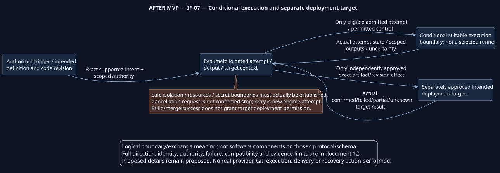

[Editable PlantUML](Diagrams/Interface-Execution-Separate-Target.puml) · 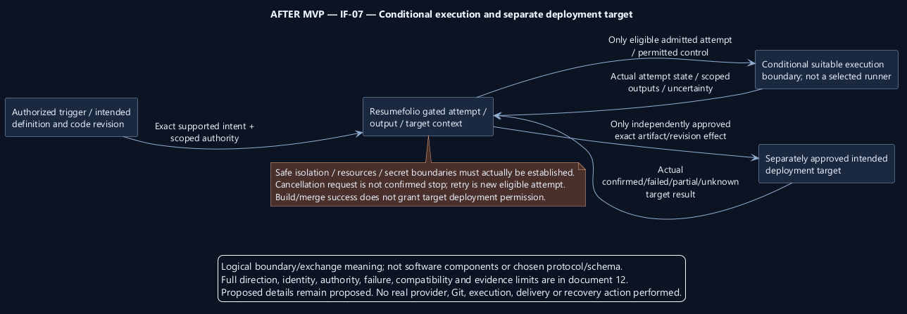

Arrows identify the exchange direction in this bounded family, not automatic propagation, permission inherited across arrows or a mandatory internal component chain. Conditional facilities/operations are not claims that they exist or have been exercised.

###### IF-08 — Operational configuration, delivery and recovery

**Owner / status:** Farhad; Proposed logical interface refinement; accepted profile core retained where applicable.

**Participants / direction:** Explicitly authorized operator and selected applicable runtime/domain/TLS, notification delivery and independent backup/recovery facilities; the grouping is not one service. Into product/operation: permitted configuration/constraints, delivery disposition and actual protected recovery sources. Out: bounded operational requests/evidence, attributable notification attempt, eligible backup material and isolated restore findings as applicable.

**Identity / authority / preconditions:** Configuration/evidence access, delivery credentials and recovery source/target powers are separate. A connected Gmail account is not assumed to provide identity/recovery mail. Restoration must re-evaluate current access/external effects.

**Information / result meaning:** Actual effective configuration, compatibility and measured operating result are distinct from planned setup. Delivery attempt/acceptance/receipt differ. Backup artifact/completed backup/restored bytes/scoped usable recovery are distinct evidence levels.

**Lifecycle / privacy / frame:** No credential/config secrets in documentation/examples; backup coverage includes whatever required data/artifacts/relationships/configuration/keys are actually defined, not assumed. Restore does not resurrect old grants or resend/deploy by default.

**Failure / concurrency / repetition:** Ambiguous delivery does not justify blind duplicate notification. Restore is explicitly authorized/isolated and same-candidate reconciliation precedes further effects; maintenance interruption and current environment must be identified.

**Capacity / workload / limits:** Actual backup/delivery/runtime suitability, coverage/retention and workload/recovery targets need scoped evidence. No RPO/RTO, extra infrastructure purchase, notification provider or backup schedule is invented.

**Mechanism / representation / compatibility:** Existing Ubuntu/Laravel demo software/resources are observations, not final technology selection or proof of current dependency health. Exact non-secret configuration/procedure/versions/TLS/delivery/recovery interfaces remain later justified design/operating work.

**Evidence and scoped gates:** Backups are not configured; no usable recovery demonstrated. Notification/runtime configuration evidence is not inferred from Gmail access or a working login page; no fresh host/provider operation is performed.

**Primary basis:** [EIF-D01](../02-Requirements-Engineering/01-Software-Requirements-Specification.md#requirements-specification-external-interface-requirements--heading-eif-d01-reviewable-interface-contracts), [EIF-D03](../02-Requirements-Engineering/01-Software-Requirements-Specification.md#requirements-specification-external-interface-requirements--heading-eif-d03-consistent-authorization-across-entry-paths), [EIF-D08](../02-Requirements-Engineering/01-Software-Requirements-Specification.md#requirements-specification-external-interface-requirements--heading-eif-d08-operation-specific-failure-and-repetition-semantics), [EIF-D09](../02-Requirements-Engineering/01-Software-Requirements-Specification.md#requirements-specification-external-interface-requirements--heading-eif-d09-operational-configuration-and-recovery-boundaries), [EIF-D10](../02-Requirements-Engineering/01-Software-Requirements-Specification.md#requirements-specification-external-interface-requirements--heading-eif-d10-consistent-exchange-meaning-and-lifecycle), [QSR-D10](../02-Requirements-Engineering/01-Software-Requirements-Specification.md#requirements-specification-quality-security-and-recovery-requirements--heading-qsr-d10-defined-protected-and-observable-backups), [QSR-D11](../02-Requirements-Engineering/01-Software-Requirements-Specification.md#requirements-specification-quality-security-and-recovery-requirements--heading-qsr-d11-demonstrated-restoration-and-recovery-targets), [QSR-D12](../02-Requirements-Engineering/01-Software-Requirements-Specification.md#requirements-specification-quality-security-and-recovery-requirements--heading-qsr-d12-safe-restored-access-and-external-state-reconciliation), [QSR-D14](../02-Requirements-Engineering/01-Software-Requirements-Specification.md#requirements-specification-quality-security-and-recovery-requirements--heading-qsr-d14-maintainable-verifiable-and-recoverable-changes), [AFO-D09](../02-Requirements-Engineering/01-Software-Requirements-Specification.md#requirements-specification-administration-files-and-operational-behavior--heading-afo-d09-operational-outcomes-and-capacity-warnings), [AFO-D10](../02-Requirements-Engineering/01-Software-Requirements-Specification.md#requirements-specification-administration-files-and-operational-behavior--heading-afo-d10-administrative-operation-evidence), [AFO-D12](../02-Requirements-Engineering/01-Software-Requirements-Specification.md#requirements-specification-administration-files-and-operational-behavior--heading-afo-d12-version-specific-operational-guidance-and-readiness), [DOM-D08](../02-Requirements-Engineering/01-Software-Requirements-Specification.md#requirements-specification-domain-requirements-and-constraints--heading-dom-d08-evidence-based-operation-within-constraints)

**Concepts:** [DM-C50](02-Domain-And-Information-Analysis.md#analysis-domain-and-information-analysis--03-domain-model-and-object-oriented-view--id-dm-c50), [DM-C51](02-Domain-And-Information-Analysis.md#analysis-domain-and-information-analysis--03-domain-model-and-object-oriented-view--id-dm-c51), [DM-C52](02-Domain-And-Information-Analysis.md#analysis-domain-and-information-analysis--03-domain-model-and-object-oriented-view--id-dm-c52), [DM-C53](02-Domain-And-Information-Analysis.md#analysis-domain-and-information-analysis--03-domain-model-and-object-oriented-view--id-dm-c53), [DM-C48](02-Domain-And-Information-Analysis.md#analysis-domain-and-information-analysis--03-domain-model-and-object-oriented-view--id-dm-c48), [DM-C49](02-Domain-And-Information-Analysis.md#analysis-domain-and-information-analysis--03-domain-model-and-object-oriented-view--id-dm-c49)

**Related operation contracts:** [DC-O30](03-Processes-Scenarios-And-Business-Rules.md#analysis-business-rules-and-operation-contracts--10-domain-constraints-and-operation-contracts--id-dc-o30), [DC-O31](03-Processes-Scenarios-And-Business-Rules.md#analysis-business-rules-and-operation-contracts--10-domain-constraints-and-operation-contracts--id-dc-o31), [DC-O33](03-Processes-Scenarios-And-Business-Rules.md#analysis-business-rules-and-operation-contracts--10-domain-constraints-and-operation-contracts--id-dc-o33), [DC-O37](03-Processes-Scenarios-And-Business-Rules.md#analysis-business-rules-and-operation-contracts--10-domain-constraints-and-operation-contracts--id-dc-o37), [DC-O38](03-Processes-Scenarios-And-Business-Rules.md#analysis-business-rules-and-operation-contracts--10-domain-constraints-and-operation-contracts--id-dc-o38)

**Related selected models:** [SB-M15](03-Processes-Scenarios-And-Business-Rules.md#analysis-behavioral-and-scenario-analysis--06-scenario-based-view--id-sb-m15), [SB-M16](03-Processes-Scenarios-And-Business-Rules.md#analysis-behavioral-and-scenario-analysis--06-scenario-based-view--id-sb-m16), [SM-M17](03-Processes-Scenarios-And-Business-Rules.md#analysis-behavioral-and-scenario-analysis--07-state-based-view--id-sm-m17), [SM-M18](03-Processes-Scenarios-And-Business-Rules.md#analysis-behavioral-and-scenario-analysis--07-state-based-view--id-sm-m18), [CF-M15](03-Processes-Scenarios-And-Business-Rules.md#analysis-functional-and-process-analysis--08-control-flow-based-view--id-cf-m15), [CF-M16](03-Processes-Scenarios-And-Business-Rules.md#analysis-functional-and-process-analysis--08-control-flow-based-view--id-cf-m16), [RB-D16](03-Processes-Scenarios-And-Business-Rules.md#analysis-business-rules-and-operation-contracts--09-rule-based-view--id-rb-d16), [RB-D18](03-Processes-Scenarios-And-Business-Rules.md#analysis-business-rules-and-operation-contracts--09-rule-based-view--id-rb-d18)

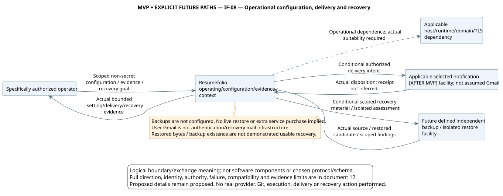

[Editable PlantUML](Diagrams/Interface-Operating-Delivery-Recovery.puml) · 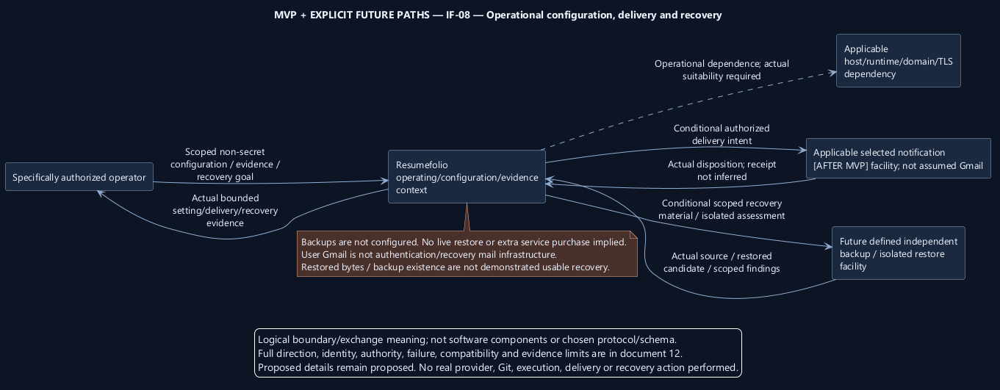

Arrows identify the exchange direction in this bounded family, not automatic propagation, permission inherited across arrows or a mandatory internal component chain. Conditional facilities/operations are not claims that they exist or have been exercised.

###### Bounded interaction cases

The 27 cases include local-only alternatives and operation families. They are not 27 APIs, transport commands, implemented features or complete external schemas. Contract links are deliberately bounded; draft persistence, connection lifecycle, output retrieval, operational delivery and backup capture are not falsely claimed exhaustively defined among the 39 selected operations.

**Case / family / kind:** **IX-X01 — Request a private authorized view/input context**; [IF-01](#analysis-interfaces-security-and-quality-analysis--12-interfaces-and-external-interactions--id-if-01); Human/product read or validation

**Request / target meaning:** Exact actor/resource/action and intended display/edit context.

**Allowed actual result:** Only permitted view, valid choices, field errors and current/pending/empty/actual result context.

**Exceptional / repeat meaning:** Denied reference cannot leak unrelated content; missing/loading/incomplete is not complete success. **Repeat:** Refresh/back/duplicate action re-evaluates current context; no blanket repeat guarantee.

**Contract association and limit:** Source-defined family; no exhaustive dedicated operation contract claimed. Generic private-view rendering is a source interface obligation, not a dedicated operation among the selected 39.

**Case / family / kind:** **IX-X02 — Apply selected source changes**; [IF-01](#analysis-interfaces-security-and-quality-analysis--12-interfaces-and-external-interactions--id-if-01); Consequential draft mutation

**Request / target meaning:** Explicit selected changes, intended resume and reviewed source/draft context.

**Allowed actual result:** Only actual confirmed selected draft update; no implicit publication.

**Exceptional / repeat meaning:** Denied/stale/failed/partial/unknown apply not claimed saved; preserve independent content. **Repeat:** Reconcile actual draft before consequential repeat; source changes do not silently overwrite current draft.

**Contract association and limit:** [DC-O01](03-Processes-Scenarios-And-Business-Rules.md#analysis-business-rules-and-operation-contracts--10-domain-constraints-and-operation-contracts--id-dc-o01), [DC-O02](03-Processes-Scenarios-And-Business-Rules.md#analysis-business-rules-and-operation-contracts--10-domain-constraints-and-operation-contracts--id-dc-o02). Selected association only; not exhaustive criterion/path sufficiency

**Case / family / kind:** **IX-X03 — Publish separately confirmed presentation**; [IF-01](#analysis-interfaces-security-and-quality-analysis--12-interfaces-and-external-interactions--id-if-01); Consequential publication

**Request / target meaning:** Separate owner confirmation matching intended current presentation.

**Allowed actual result:** Actual confirmed intended live presentation; PDF availability remains separate.

**Exceptional / repeat meaning:** No confirmation means no request; uncertain publication does not prove old or new live state. **Repeat:** Re-evaluate current content/authority; reconcile same publication before retry.

**Contract association and limit:** [DC-O03](03-Processes-Scenarios-And-Business-Rules.md#analysis-business-rules-and-operation-contracts--10-domain-constraints-and-operation-contracts--id-dc-o03). Selected association only; not exhaustive criterion/path sufficiency

**Case / family / kind:** **IX-X04 — Save manual preparation or record progress**; [IF-01](#analysis-interfaces-security-and-quality-analysis--12-interfaces-and-external-interactions--id-if-01); Local domain mutation

**Request / target meaning:** Explicit intended preparation or actual application event and selected resource context.

**Allowed actual result:** Only corresponding confirmed preparation/progress, distinguishable from actual-set completeness/receipt.

**Exceptional / repeat meaning:** Invalid/denied/stale/unknown record cannot claim intended new state. **Repeat:** Correction/repetition needs distinguishable actual event/current context, not automatic inference from Gmail.

**Contract association and limit:** [DC-O07](03-Processes-Scenarios-And-Business-Rules.md#analysis-business-rules-and-operation-contracts--10-domain-constraints-and-operation-contracts--id-dc-o07), [DC-O08](03-Processes-Scenarios-And-Business-Rules.md#analysis-business-rules-and-operation-contracts--10-domain-constraints-and-operation-contracts--id-dc-o08). Selected association only; not exhaustive criterion/path sufficiency

**Case / family / kind:** **IX-X05 — Work/collaboration or browser Git-management goal**; [IF-01](#analysis-interfaces-security-and-quality-analysis--12-interfaces-and-external-interactions--id-if-01); Scoped human/product mutation

**Request / target meaning:** Explicit supported item/task/Sprint/grant or browser request/review/merge goal.

**Allowed actual result:** Only exact permitted confirmed result; item acceptance, Sprint outcome and merge authority remain distinct.

**Exceptional / repeat meaning:** Unsupported goal rejected before dispatch; denied/stale/conflicting work not reported complete. **Repeat:** Current grant/revision/state checks apply; no automatic carryover/deploy or universal administrator rights.

**Contract association and limit:** [DC-O16](03-Processes-Scenarios-And-Business-Rules.md#analysis-business-rules-and-operation-contracts--10-domain-constraints-and-operation-contracts--id-dc-o16), [DC-O17](03-Processes-Scenarios-And-Business-Rules.md#analysis-business-rules-and-operation-contracts--10-domain-constraints-and-operation-contracts--id-dc-o17), [DC-O18](03-Processes-Scenarios-And-Business-Rules.md#analysis-business-rules-and-operation-contracts--10-domain-constraints-and-operation-contracts--id-dc-o18), [DC-O19](03-Processes-Scenarios-And-Business-Rules.md#analysis-business-rules-and-operation-contracts--10-domain-constraints-and-operation-contracts--id-dc-o19), [DC-O20](03-Processes-Scenarios-And-Business-Rules.md#analysis-business-rules-and-operation-contracts--10-domain-constraints-and-operation-contracts--id-dc-o20), [DC-O21](03-Processes-Scenarios-And-Business-Rules.md#analysis-business-rules-and-operation-contracts--10-domain-constraints-and-operation-contracts--id-dc-o21), [DC-O24](03-Processes-Scenarios-And-Business-Rules.md#analysis-business-rules-and-operation-contracts--10-domain-constraints-and-operation-contracts--id-dc-o24), [DC-O25](03-Processes-Scenarios-And-Business-Rules.md#analysis-business-rules-and-operation-contracts--10-domain-constraints-and-operation-contracts--id-dc-o25), [DC-O26](03-Processes-Scenarios-And-Business-Rules.md#analysis-business-rules-and-operation-contracts--10-domain-constraints-and-operation-contracts--id-dc-o26), [DC-O39](03-Processes-Scenarios-And-Business-Rules.md#analysis-business-rules-and-operation-contracts--10-domain-constraints-and-operation-contracts--id-dc-o39). Selected association only; not exhaustive criterion/path sufficiency

**Case / family / kind:** **IX-X06 — Retrieve selected published page/evidence**; [IF-02](#analysis-interfaces-security-and-quality-analysis--12-interfaces-and-external-interactions--id-if-02); Protected read

**Request / target meaning:** Exact link/password context and selected intended representation.

**Allowed actual result:** Only permitted currently selected available published content.

**Exceptional / repeat meaning:** Wrong/disabled/unselected/direct-reference bypass denied without private fallback. **Repeat:** Current applicable request policy governs repeated read; delivered bytes cannot be recalled.

**Contract association and limit:** [DC-O05](03-Processes-Scenarios-And-Business-Rules.md#analysis-business-rules-and-operation-contracts--10-domain-constraints-and-operation-contracts--id-dc-o05), [DC-O06](03-Processes-Scenarios-And-Business-Rules.md#analysis-business-rules-and-operation-contracts--10-domain-constraints-and-operation-contracts--id-dc-o06). Selected association only; not exhaustive criterion/path sufficiency

**Case / family / kind:** **IX-X07 — Retrieve permitted PDF variant/language**; [IF-02](#analysis-interfaces-security-and-quality-analysis--12-interfaces-and-external-interactions--id-if-02); Protected artifact read

**Request / target meaning:** Exact requested generated/uploaded category and language in intended published context.

**Allowed actual result:** Mode-enabled, selected, actually available and authorized exact variant, or unavailable.

**Exceptional / repeat meaning:** Neither mode means no PDF choices, not link/page disable; missing language not relabeled. **Repeat:** Recheck mode, access and actual eligible artifact; interrupted output not complete.

**Contract association and limit:** [DC-O04](03-Processes-Scenarios-And-Business-Rules.md#analysis-business-rules-and-operation-contracts--10-domain-constraints-and-operation-contracts--id-dc-o04), [DC-O06](03-Processes-Scenarios-And-Business-Rules.md#analysis-business-rules-and-operation-contracts--10-domain-constraints-and-operation-contracts--id-dc-o06). Selected association only; not exhaustive criterion/path sufficiency

**Case / family / kind:** **IX-X08 — Upload/admit/process candidate**; [IF-03](#analysis-interfaces-security-and-quality-analysis--12-interfaces-and-external-interactions--id-if-03); File candidate mutation

**Request / target meaning:** Candidate bytes and intended owner/resource/language/provenance under effective policy.

**Allowed actual result:** Admitted/pending/usable/failed actual result; admission is not usable completion.

**Exceptional / repeat meaning:** Invalid content/limit/authority rejected; interrupted processing not complete. **Repeat:** Concurrent growth/limits and same-candidate result require scoped current checks.

**Contract association and limit:** [DC-O32](03-Processes-Scenarios-And-Business-Rules.md#analysis-business-rules-and-operation-contracts--10-domain-constraints-and-operation-contracts--id-dc-o32). Selected association only; not exhaustive criterion/path sufficiency

**Case / family / kind:** **IX-X09 — Replace an intended source file/association**; [IF-03](#analysis-interfaces-security-and-quality-analysis--12-interfaces-and-external-interactions--id-if-03); Reference-aware file mutation

**Request / target meaning:** Explicit replacement candidate and exact source/association/reference context.

**Allowed actual result:** Only actual eligible confirmed new usable association under reviewed replacement policy.

**Exceptional / repeat meaning:** Failed replacement does not authorize destroying required prior/actual material. **Repeat:** Re-evaluate changed references/current candidate and reconcile actual effect.

**Contract association and limit:** [DC-O32](03-Processes-Scenarios-And-Business-Rules.md#analysis-business-rules-and-operation-contracts--10-domain-constraints-and-operation-contracts--id-dc-o32), [DC-O34](03-Processes-Scenarios-And-Business-Rules.md#analysis-business-rules-and-operation-contracts--10-domain-constraints-and-operation-contracts--id-dc-o34), [DC-O35](03-Processes-Scenarios-And-Business-Rules.md#analysis-business-rules-and-operation-contracts--10-domain-constraints-and-operation-contracts--id-dc-o35). Replacement association is supporting contract context; detailed category-specific path/semantics still require explicit review.

**Case / family / kind:** **IX-X10 — Identify/preserve actual submitted material**; [IF-03](#analysis-interfaces-security-and-quality-analysis--12-interfaces-and-external-interactions--id-if-03); Historical material capture

**Request / target meaning:** Actual user-identified sent components and event/provenance, including external variants.

**Allowed actual result:** Confirmed actual set with truthful completeness, independent of current live content.

**Exceptional / repeat meaning:** Missing/failed capture incomplete; no latest-live substitution. **Repeat:** New/corrected actual set stays distinguishable; reconcile prior capture before correction.

**Contract association and limit:** [DC-O09](03-Processes-Scenarios-And-Business-Rules.md#analysis-business-rules-and-operation-contracts--10-domain-constraints-and-operation-contracts--id-dc-o09), [DC-O10](03-Processes-Scenarios-And-Business-Rules.md#analysis-business-rules-and-operation-contracts--10-domain-constraints-and-operation-contracts--id-dc-o10). Selected association only; not exhaustive criterion/path sufficiency

**Case / family / kind:** **IX-X11 — Read/search intended mailbox content**; [IF-04](#analysis-interfaces-security-and-quality-analysis--12-interfaces-and-external-interactions--id-if-04); Provider read

**Request / target meaning:** Exact selected account, permitted content scope and actual read capability.

**Allowed actual result:** Only actual permitted attributable provider result with freshness/context.

**Exceptional / repeat meaning:** Missing/revoked/wrong-account/provider failure not a successful fresh fetch. **Repeat:** Recheck capability; no silently fresh label on retained stale copy.

**Contract association and limit:** [DC-O11](03-Processes-Scenarios-And-Business-Rules.md#analysis-business-rules-and-operation-contracts--10-domain-constraints-and-operation-contracts--id-dc-o11). Selected association only; not exhaustive criterion/path sufficiency

**Case / family / kind:** **IX-X12 — Compose/persist or discard an intended draft**; [IF-04](#analysis-interfaces-security-and-quality-analysis--12-interfaces-and-external-interactions--id-if-04); Local/provider draft family

**Request / target meaning:** Human-authored draft and exact selected draft/account/field-authority context.

**Allowed actual result:** Only actual local/provider draft result for requested scope; unsent is not accepted send.

**Exceptional / repeat meaning:** Failed/unknown persistence not saved/sent; unrelated draft not overwritten. **Repeat:** Draft identity/current version and operation-specific repetition must be defined.

**Contract association and limit:** Source-defined family; no exhaustive dedicated operation contract claimed. Primary EGC-D04 source family; no dedicated complete draft-persistence/discard contract is claimed among 39 selected operations.

**Case / family / kind:** **IX-X13 — Submit one reviewed send/reply**; [IF-04](#analysis-interfaces-security-and-quality-analysis--12-interfaces-and-external-interactions--id-if-04); Provider consequential send

**Request / target meaning:** Current final sender/recipients/body/attachment/reply confirmation and exact attempt.

**Allowed actual result:** Provider acceptance/rejection/unknown only as actually evidenced; no delivery/read inference.

**Exceptional / repeat meaning:** Changed final content blocks stale consent; ambiguous response remains unknown. **Repeat:** Same-attempt reconciliation before separately authorized resend; no blind duplicate.

**Contract association and limit:** [DC-O12](03-Processes-Scenarios-And-Business-Rules.md#analysis-business-rules-and-operation-contracts--10-domain-constraints-and-operation-contracts--id-dc-o12), [DC-O38](03-Processes-Scenarios-And-Business-Rules.md#analysis-business-rules-and-operation-contracts--10-domain-constraints-and-operation-contracts--id-dc-o38). Selected association only; not exhaustive criterion/path sufficiency

**Case / family / kind:** **IX-X14 — Connect/disconnect/reconcile intended account capability**; [IF-04](#analysis-interfaces-security-and-quality-analysis--12-interfaces-and-external-interactions--id-if-04); Provider capability lifecycle

**Request / target meaning:** Explicit selected intended account/capability goal and actual consent/access findings.

**Allowed actual result:** Only confirmed current capability/disconnect/reconnect context; retained copies and pending work distinct.

**Exceptional / repeat meaning:** Consent/access loss not active capability; reconnect does not silently send/replay. **Repeat:** Reassess actual account/capability and pending effect; no default purge/provider delete.

**Contract association and limit:** Source-defined family; no exhaustive dedicated operation contract claimed. Source/state lifecycle obligation; exact connection/credential contracts remain proposed and are not falsely claimed implemented.

**Case / family / kind:** **IX-X15 — Save local calendar activity**; [IF-05](#analysis-interfaces-security-and-quality-analysis--12-interfaces-and-external-interactions--id-if-05); Local-only branch; provider comparison context

**Request / target meaning:** Intended local time/association change under local authority.

**Allowed actual result:** Only confirmed local result; no provider mutation or reminder delivery inferred.

**Exceptional / repeat meaning:** Invalid/ambiguous time or failed save remains explicit. **Repeat:** Local current-context/repetition contract; provider access is not a local-write prerequisite.

**Contract association and limit:** [DC-O13](03-Processes-Scenarios-And-Business-Rules.md#analysis-business-rules-and-operation-contracts--10-domain-constraints-and-operation-contracts--id-dc-o13). Selected association only; not exhaustive criterion/path sufficiency

**Case / family / kind:** **IX-X16 — Unlink local provider association**; [IF-05](#analysis-interfaces-security-and-quality-analysis--12-interfaces-and-external-interactions--id-if-05); Local-only branch; provider comparison context

**Request / target meaning:** Exact local association and explicit permitted unlink request.

**Allowed actual result:** Confirmed local unlink only; provider event not deleted.

**Exceptional / repeat meaning:** Denied/unknown unlink not completed; missing provider capability is not an invented local gate. **Repeat:** Recheck actual association; do not delete a newly linked unrelated provider object.

**Contract association and limit:** [DC-O14](03-Processes-Scenarios-And-Business-Rules.md#analysis-business-rules-and-operation-contracts--10-domain-constraints-and-operation-contracts--id-dc-o14). Selected association only; not exhaustive criterion/path sufficiency

**Case / family / kind:** **IX-X17 — Perform selected provider event action/sync**; [IF-05](#analysis-interfaces-security-and-quality-analysis--12-interfaces-and-external-interactions--id-if-05); Provider consequential mapping/mutation

**Request / target meaning:** Exact account/calendar/mapping/action, relevant versions/time and field authority.

**Allowed actual result:** Only confirmed applicable fresh/removed/mapped result, or explicit stale/conflict/unknown state.

**Exceptional / repeat meaning:** Conflict not silently overwritten; provider deletion is distinct from local unlink. **Repeat:** Reconcile actual object/version effect and resolve explicitly; reconnect is not replay/freshness.

**Contract association and limit:** [DC-O15](03-Processes-Scenarios-And-Business-Rules.md#analysis-business-rules-and-operation-contracts--10-domain-constraints-and-operation-contracts--id-dc-o15), [DC-O38](03-Processes-Scenarios-And-Business-Rules.md#analysis-business-rules-and-operation-contracts--10-domain-constraints-and-operation-contracts--id-dc-o38). Selected association only; not exhaustive criterion/path sufficiency

**Case / family / kind:** **IX-X18 — Real clone/fetch/pull read transfer**; [IF-06](#analysis-interfaces-security-and-quality-analysis--12-interfaces-and-external-interactions--id-if-06); Real Git-client read

**Request / target meaning:** Intended real repository/ref and actually supported permitted client/transport.

**Allowed actual result:** Actual permitted repository/history transfer result.

**Exceptional / repeat meaning:** Wrong repository grant denied; interrupted transfer not complete; browser view is not proof. **Repeat:** Recheck applicable context on repeat; real compatibility needs actual controlled tests.

**Contract association and limit:** [DC-O22](03-Processes-Scenarios-And-Business-Rules.md#analysis-business-rules-and-operation-contracts--10-domain-constraints-and-operation-contracts--id-dc-o22). Selected association only; not exhaustive criterion/path sufficiency

**Case / family / kind:** **IX-X19 — Real push/ref change**; [IF-06](#analysis-interfaces-security-and-quality-analysis--12-interfaces-and-external-interactions--id-if-06); Real Git-client mutation

**Request / target meaning:** Proposed intended ref update and expected current repository/ref context.

**Allowed actual result:** Only actual intended ref effect or truthful rejection/conflict/unknown result.

**Exceptional / repeat meaning:** Protected/stale/denied update rejected; unknown effect does not prove unchanged ref. **Repeat:** Reconcile actual intended ref before retry; no inherited merge/deploy rights.

**Contract association and limit:** [DC-O23](03-Processes-Scenarios-And-Business-Rules.md#analysis-business-rules-and-operation-contracts--10-domain-constraints-and-operation-contracts--id-dc-o23), [DC-O38](03-Processes-Scenarios-And-Business-Rules.md#analysis-business-rules-and-operation-contracts--10-domain-constraints-and-operation-contracts--id-dc-o38). Selected association only; not exhaustive criterion/path sufficiency

**Case / family / kind:** **IX-X20 — Validate/admit supported execution attempt**; [IF-07](#analysis-interfaces-security-and-quality-analysis--12-interfaces-and-external-interactions--id-if-07); Conditional execution admission

**Request / target meaning:** Supported definition/evaluated revision/trigger plus scoped actual enabling evidence.

**Allowed actual result:** Attributable admitted/pending/started/result context only when actually confirmed.

**Exceptional / repeat meaning:** Missing safe isolation/resources/authority or unsupported definition blocks execution. **Repeat:** Re-evaluate current definition/authority and actual prior attempt before a distinguishable retry.

**Contract association and limit:** [DC-O27](03-Processes-Scenarios-And-Business-Rules.md#analysis-business-rules-and-operation-contracts--10-domain-constraints-and-operation-contracts--id-dc-o27), [DC-O29](03-Processes-Scenarios-And-Business-Rules.md#analysis-business-rules-and-operation-contracts--10-domain-constraints-and-operation-contracts--id-dc-o29). Selected association only; not exhaustive criterion/path sufficiency

**Case / family / kind:** **IX-X21 — Observe/cancel exact admitted attempt**; [IF-07](#analysis-interfaces-security-and-quality-analysis--12-interfaces-and-external-interactions--id-if-07); Conditional execution control

**Request / target meaning:** Current exact attempt and explicit permitted cancellation/observation intent.

**Allowed actual result:** Known running/pending, actual stop, completion-won-race or unknown state remain distinct.

**Exceptional / repeat meaning:** Cancel request not termination; lost result not success/failed by guess. **Repeat:** Observe/reconcile same actual attempt without duplicate launch.

**Contract association and limit:** [DC-O28](03-Processes-Scenarios-And-Business-Rules.md#analysis-business-rules-and-operation-contracts--10-domain-constraints-and-operation-contracts--id-dc-o28), [DC-O38](03-Processes-Scenarios-And-Business-Rules.md#analysis-business-rules-and-operation-contracts--10-domain-constraints-and-operation-contracts--id-dc-o38). Selected association only; not exhaustive criterion/path sufficiency

**Case / family / kind:** **IX-X22 — Retrieve permitted output/log/artifact evidence**; [IF-07](#analysis-interfaces-security-and-quality-analysis--12-interfaces-and-external-interactions--id-if-07); Conditional output access

**Request / target meaning:** Exact run/attempt/output/evaluated revision and separate bounded output-read permission.

**Allowed actual result:** Only actual available scoped output/evidence; secrets and unrelated content excluded.

**Exceptional / repeat meaning:** Successful run does not prove all outputs exist/readable; pending/missing/denied distinct. **Repeat:** Current authority/retention/current output identity governs repeat; no replay implied.

**Contract association and limit:** [DC-O27](03-Processes-Scenarios-And-Business-Rules.md#analysis-business-rules-and-operation-contracts--10-domain-constraints-and-operation-contracts--id-dc-o27), [DC-O33](03-Processes-Scenarios-And-Business-Rules.md#analysis-business-rules-and-operation-contracts--10-domain-constraints-and-operation-contracts--id-dc-o33). Run attribution and bounded evidence are related contracts, not an exhaustive dedicated workflow-output retrieval contract.

**Case / family / kind:** **IX-X23 — Attempt separately approved target effect**; [IF-07](#analysis-interfaces-security-and-quality-analysis--12-interfaces-and-external-interactions--id-if-07); Conditional deployment mutation

**Request / target meaning:** Exact target/artifact/revision and separate current approval/data/recovery conditions.

**Allowed actual result:** Actual scoped confirmed/failed/partial/unknown target result.

**Exceptional / repeat meaning:** Build/merge/release alone insufficient; no universal rollback on failure. **Repeat:** Reconcile actual target state before consequential redeploy/recovery.

**Contract association and limit:** [DC-O30](03-Processes-Scenarios-And-Business-Rules.md#analysis-business-rules-and-operation-contracts--10-domain-constraints-and-operation-contracts--id-dc-o30), [DC-O38](03-Processes-Scenarios-And-Business-Rules.md#analysis-business-rules-and-operation-contracts--10-domain-constraints-and-operation-contracts--id-dc-o38). Selected association only; not exhaustive criterion/path sufficiency

**Case / family / kind:** **IX-X24 — Inspect/change bounded operational configuration**; [IF-08](#analysis-interfaces-security-and-quality-analysis--12-interfaces-and-external-interactions--id-if-08); Operator/runtime dependency

**Request / target meaning:** Exact authorized non-secret environment/setting/evidence question.

**Allowed actual result:** Actual effective permitted setting/evidence with explicit environment/limits.

**Exceptional / repeat meaning:** General admin/healthy page does not prove every dependency/control; secrets not exposed. **Repeat:** Recheck current effective configuration; unknown change not established new setting.

**Contract association and limit:** [DC-O31](03-Processes-Scenarios-And-Business-Rules.md#analysis-business-rules-and-operation-contracts--10-domain-constraints-and-operation-contracts--id-dc-o31), [DC-O33](03-Processes-Scenarios-And-Business-Rules.md#analysis-business-rules-and-operation-contracts--10-domain-constraints-and-operation-contracts--id-dc-o33). Selected association only; not exhaustive criterion/path sufficiency

**Case / family / kind:** **IX-X25 — Attempt selected operational notification delivery**; [IF-08](#analysis-interfaces-security-and-quality-analysis--12-interfaces-and-external-interactions--id-if-08); Conditional delivery facility

**Request / target meaning:** Explicit intended notification/recipient/channel context and applicable actual delivery capability.

**Allowed actual result:** Actual attempted/accepted/failed/unknown disposition only; receipt not inferred.

**Exceptional / repeat meaning:** User Gmail permission is not authentication/recovery mail infrastructure. **Repeat:** Unknown delivery requires channel/operation-specific safe reconciliation, not global blind resend.

**Contract association and limit:** Source-defined family; no exhaustive dedicated operation contract claimed. Primary EIF-D09/QSR operating boundary; no chosen notification channel or complete delivery operation contract is claimed.

**Case / family / kind:** **IX-X26 — Produce/protect defined recovery material**; [IF-08](#analysis-interfaces-security-and-quality-analysis--12-interfaces-and-external-interactions--id-if-08); Conditional backup facility

**Request / target meaning:** Actually defined eligible source/coverage, required records/artifacts/configuration and scoped backup access.

**Allowed actual result:** Only actual completed protected recovery material/coverage evidence if produced.

**Exceptional / repeat meaning:** Planned source or file existence is not complete usable backup/recovery; secrets protected. **Repeat:** Snapshot consistency, retention/reference/accounting and repetition need defined scope/evidence.

**Contract association and limit:** Source-defined family; no exhaustive dedicated operation contract claimed. Backups not configured; capture/transfer/protection is a primary recovery obligation, not a performed backup or new public export capability.

**Case / family / kind:** **IX-X27 — Perform authorized isolated restore/assessment**; [IF-08](#analysis-interfaces-security-and-quality-analysis--12-interfaces-and-external-interactions--id-if-08); Conditional recovery facility

**Request / target meaning:** Actual protected source, suitable isolated target, scenario/coverage/checks and operator authority.

**Allowed actual result:** Actual scoped integrity/access/external-disposition/measurement result; demonstrated usability only if criteria pass.

**Exceptional / repeat meaning:** No source blocks drill; missing/corrupt/unknown result not usable recovery; no live overwrite. **Repeat:** Reconcile same isolated candidate; no old-right resurrection/provider resend/deployment replay.

**Contract association and limit:** [DC-O37](03-Processes-Scenarios-And-Business-Rules.md#analysis-business-rules-and-operation-contracts--10-domain-constraints-and-operation-contracts--id-dc-o37), [DC-O38](03-Processes-Scenarios-And-Business-Rules.md#analysis-business-rules-and-operation-contracts--10-domain-constraints-and-operation-contracts--id-dc-o38). Selected association only; not exhaustive criterion/path sufficiency

###### Synthetic meaning examples

| Example | Required interpretation |
| --- | --- |
| Intended resume A, independent draft D, published presentation P, actual sent set H | A selected draft apply may affect D; separately confirmed publication may affect P; neither rewrites H or another resume |
| Uploaded German variant absent; generated category disabled | Requested variant is unavailable/not permitted as applicable; do not silently relabel another language or expose private source |
| Provider account A, message intent M, attempt T with response lost | T remains attributable and unknown until actual evidence; composing M or a product login is not send permission |
| Local activity L linked to provider event E; connection disconnected | Authorized local unlink can remove L↔E association without provider write access or deleting E |
| Repository R, moving ref B, evaluated revision V | Expected/evaluated V must remain identifiable; observing B later does not prove the same review/check context |
| Run attempt T, artifact A and target Z | Successful T is not proof A is available/readable, and neither authorizes a target effect on Z |

These labels are explanatory placeholders, not selected identifier syntax, payload formats, field names, real account data or credentials. Exact representation choices must preserve these meanings.

##### 3. Provider authority and synchronization

| Authority / meaning | Gmail | Calendar | Operational delivery/recovery |
| --- | --- | --- | --- |
| Product authority | Current own/scoped mailbox goal required; project membership not private mailbox access | Current local/provider activity goal required | Explicit operator/evidence/delivery/recovery powers; no universal admin access |
| External capability | Intended account and separately permitted read/draft/send/reply operation | Exact selected account/calendar/action/mapping | Actual selected facility/configuration/access; user Gmail is not the notification facility |
| Source of truth | Provider-owned message identity/result versus local compose/review intent/draft ownership under reviewed contract | Selected authoritative fields and version/time meaning; local notes/associations not implicitly provider-owned | Actual effective configuration, delivery disposition, protected source and restored assessment evidence |
| Local-only alternative | Unsent intent/draft can exist under its reviewed local contract, without claiming provider persistence | Local change/unlink requires no invented active-provider-write prerequisite | No actual configured backup/delivery capability may be inferred from a plan or existing file |
| Conflict / stale evidence | Changed final content invalidates stale send review; uncertain prior effect must be reconciled | Relevant concurrent edits remain conflict/stale; missing evidence not conflict-free | Missing/contradictory configuration/delivery/recovery evidence remains unresolved |
| Disconnect / reconnect | No new dependent fetch/send under lost capability; no blind replay or default purge | Retained mapping can be stale; reconnect does not make Fresh or recreate/delete provider events automatically | Restored old access/credentials require current review; no automatic resend/deploy or rights resurrection |

No synchronization direction, polling period, field precedence, token lifetime, provider scope name or exactly-once mechanism is selected here. Existing primary provider notes own their dated applicability findings; this task does not perform a fresh provider-policy lookup or verify access. Q-D15/Q-D16/Q-D17 and dependent operating questions remain scoped to their actual decisions/evidence.

##### 4. Failures and repetition

| Observed category | Required interface meaning | Permitted next-action boundary |
| --- | --- | --- |
| Unsupported / invalid input | Intended operation/representation is outside supported contract or required validity | Explain permitted bounded corrective context; no fallback to another resource or unreviewed operation |
| Denied / changed authority | Applicable exact grant/state/capability does not permit intended effect | No protected disclosure/effect; recheck only under legitimately established current authority |
| Unavailable / absent variant | Intended selected artifact/language/content is not available | Report actual unavailable state; no private/unrelated substitution or fabricated content |
| Conflict / stale context | Relevant version/ref/mapping/current state differs or conflicts | Re-evaluate/resolve explicit intended context; no silent overwrite or automatic acceptance |
| Definite failure | Evidence establishes failed disposition and any known effects | Report actual limits; do not universally promise old state or rollback |
| Bounded partial effects | Some required effects/bytes/material are known completed; remainder is not full success | Preserve attributable known state and review scoped reconciliation/recovery, not blanket retry |
| Confirmed pending / running | Same operation/attempt actually remains pending/in progress | Observe same context without duplicate launch; ending a UI observation is not cancellation |
| Unknown / contradictory | Missing/ambiguous/inconsistent evidence does not establish actual effect | Reconcile exact original context with permitted evidence before consequential retry; no blind resend/redeploy/relaunch |

These meanings agree with [SM-M18](03-Processes-Scenarios-And-Business-Rules.md#analysis-behavioral-and-scenario-analysis--07-state-based-view--id-sm-m18), [CF-M17](03-Processes-Scenarios-And-Business-Rules.md#analysis-functional-and-process-analysis--08-control-flow-based-view--id-cf-m17), [RB-D18](03-Processes-Scenarios-And-Business-Rules.md#analysis-business-rules-and-operation-contracts--09-rule-based-view--id-rb-d18) and [DC-O38](03-Processes-Scenarios-And-Business-Rules.md#analysis-business-rules-and-operation-contracts--10-domain-constraints-and-operation-contracts--id-dc-o38). Domain consequences remain operation-specific: provider acceptance is not delivery/read; admission is not a usable file; eligible reclamation is not freed bytes; restored bytes are not demonstrated usable recovery.

For each consequential request, retain conceptual operation/attempt/target/evaluated context and actual known result. Do not assume that a correlation label chooses an idempotency mechanism or proves safe repetition. Cancellation and timeout/backoff are not one global cross-interface policy; in-flight/session effects remain explicitly scoped proposals. Diagnostic feedback must be useful without exposing unrelated resource existence/content or secrets.

##### 5. Design handoff

| Topic to resolve for affected design | Logical constraint already stated | Actual decision/evidence needed |
| --- | --- | --- |
| Consumer/client matrix | Relevant resource/action/context, usable feedback and supported input/outcome states | Actual browser/device/viewport/keyboard/language and accessibility criteria; selected later tests |
| Endpoint / protocol / transport / version | Exact identity, authority, direction, representation and side-effect meaning | Justified selected mechanism/schema/protocol/version and consumer impact; no public API or universal support assumed |
| Google account/capability | Product authority and actual selected external access remain distinct | Actual access/applicability/operation findings; OAuth not created is known, not a repeated owner question |
| Git clients/hosting | Real transfers/ref/history and non-browser access must obey exact current authority | Supported transport/credentials/client versions/protection and actual isolated interoperability evidence |
| Execution/deployment | Supported exact definition/revision, safe enabling evidence and separate target approval | Actual isolation/resource/secret/network/output/target controls and supported syntax/features before enablement |
| File/processing/representation | Actual mode/selection/language/provenance/current effective policy/reference-aware handling | Defined valid formats/metadata/safe serving, workload/units/limits and actual failure/compatibility cases |
| Delivery and recovery | Actual accepted delivery not receipt; backup/restoration evidence levels separate | Selected applicable facilities, non-secret configuration, actual coverage/retention/target measurements and authorized isolated checks |
| Interface change compatibility | Identify affected actor/consumer, meaning and changed lifecycle/outcome | A later change record needs exact supported old/new contract and tests; no automatic backward compatibility guarantee |

A future interface contract change should identify the IF family/operation, affected participants, authoritative field/identity/time/side-effect changes, changed preconditions and outcome/repetition meaning, compatibility impact and required evidence. This is a change-definition checklist, not a selected schema-version scheme or migration procedure.

##### 6. Cross-view consistency and coverage

| Check | Required agreement |
| --- | --- |
| IX-C01 Scope reuse | IF-01–08 match the existing primary/context inventory; no arbitrary service/provider/public API added |
| IX-C02 Accepted professional boundary | Source/apply/publication/history distinction is retained across private UI, employer view and file exchange |
| IX-C03 Direct entry | A direct file/PDF/provider/Git reference cannot bypass applicable current resource/action authority |
| IX-C04 Provider capabilities | Gmail read/draft/send/reply, local activity/unlink, provider sync and operational delivery have distinct powers/results |
| IX-C05 Git meaning | Real Git transport is distinct from browser PR/review/merge and demo administrative SSH |
| IX-C06 Run/target | Execution admission/start/output/stop/retry and separately approved target effect remain different claims |
| IX-C07 Policy/history | Effective limit, candidate processing, protected history, actual cleanup and retained restoration are not conflated |
| IX-C08 Result evidence | Confirmed, partial, pending and unknown remain consistent with shared observation models; no universal retry/rollback |

Primary EIF-D01–EIF-D10 all have explicit family source associations in the review record. Association is not full semantic criterion coverage. Draft lifecycle, account connections, credential rotation, workflow-output retrieval, notification delivery and backup capture still need exact operation/path details at their own contract/design gates; related links are not fabricated complete mappings.

Scope associations: SCP-01 accounts/access → IF-01/02; SCP-02 profiles/resumes → IF-01/02/03; SCP-03 portfolio/evidence → IF-01/02/03; SCP-04 PDFs → IF-02/03; SCP-05 protected sharing → IF-02; SCP-06 ApplyFlow → IF-01/03; SCP-07 Gmail/calendar → IF-04/05; SCP-08 work management → IF-01; SCP-09 Git → IF-01/06; SCP-10 workflows/CI/CD → IF-07; SCP-11 file/storage policy → IF-01/03/08; SCP-12 operations/recovery → IF-08 and separate target context in IF-07.

##### 7. Planned verification cases

| Case | Expected bounded observation |
| --- | --- |
| IX-V01 Product sign-in or board membership with unrelated private resource reference | IF-01/02/03/06 deny exact unauthorized entry; no universal grant |
| IX-V02 Apply selected source update without publication | IF-01 draft-only result; live/history/other resumes remain independent |
| IX-V03 Neither PDF mode, disabled link, unavailable German variant or direct private file | IF-02/03 evaluate mode/access/selection/availability separately; no unrelated fallback |
| IX-V04 Interrupted candidate/replacement and concurrent usage growth | IF-03 no usable success/freed-space claim or unauthorized destruction of protected history |
| IX-V05 Compose draft versus changed final send attachment | IF-04 unsent/draft result and renewed exact final review remain distinct |
| IX-V06 Provider consent denied/revoked or send response lost | IF-04 capability/unknown actual effect truthful; no blind resend/delivery claim |
| IX-V07 Disconnected calendar with permitted local unlink | IF-05 local association removal only, no provider write prerequisite/delete |
| IX-V08 Concurrent local/provider time/version changes and reconnect | IF-05 explicit stale/conflict/reconciliation, no silent replay or Fresh assumption |
| IX-V09 Real client read/push with protected or changed ref | IF-06 actual compatible transfer/ref result, explicit rejection/conflict/unknown; browser demo insufficient |
| IX-V10 Unsupported workflow or missing safe execution evidence | IF-07 no dependent execution, unrestricted host/secret/network access or universal syntax support |
| IX-V11 Cancel requested while attempt completes; output unavailable | IF-07 actual completion/stop/pending/unknown result; no false cancellation/output readiness |
| IX-V12 Successful build without target approval or ambiguous target effect | IF-07 no inherited deploy authority; reconcile actual target before retry |
| IX-V13 User Gmail connection but no established operational delivery facility | IF-08 no inferred authentication/recovery-mail capability or recipient receipt |
| IX-V14 Backup absent or restored integrity/current access incomplete | IF-08 no drill/readiness/usable-recovery claim or old-right resurrection |
| IX-V15 Relevant consumer/provider contract version or meaning changes | Identify affected participants, compatibility consequences and actual applicable test matrix; no silent universal compatibility |

These are review/test-design inputs, not executed provider/client/product tests. Later runs require exact contract/source revision, supported environment/consumer, actor/capability, initial state/input, expected/actual result and evidence limits using authorized controlled data/targets.

##### 8. Review Status

The former scaffold is now populated for all eight existing interface families, with 27 bounded interaction cases, eight locally rendered PlantUML views, conceptual request/result/authority/lifecycle/failure/repetition meanings and explicit design/evidence limits. [The interaction matrix](https://github.com/Farhad-V/Web-Resumefolio/blob/1f2acaa351ac306cb57cbe4fe9742e8bd90720d9/docs/MVP/SDLC/03-system-analysis/evidence/interface-interaction-matrix-2026-11-01.csv) and [review record](https://github.com/Farhad-V/Web-Resumefolio/blob/1f2acaa351ac306cb57cbe4fe9742e8bd90720d9/docs/MVP/SDLC/03-system-analysis/evidence/interface-review-2026-11-01.json) preserve source/model associations and actual document checks.

See the [feasibility evidence](../02-Requirements-Engineering/01-Software-Requirements-Specification.md#process-and-approach-02-feasibility-study) for dated operating inputs. Interface analysis specifies behavior under unavailable access, limited capacity and uncertain recovery. Operational checks remain separate.

The earlier SA-RV02 report/matrices in 11 describe their identified input snapshot, where 12 was still a scaffold. This revision supersedes that placeholder finding for file 12 only; it does not retroactively rewrite the 116/41 source-association counts, close RF/Q-D parents or prove full criterion sufficiency. Refresh the cross-view review when the remaining affected models are reconciled.

Continue [quality/operations 13](#analysis-interfaces-security-and-quality-analysis--13-security-quality-and-operational-analysis) and [qualified design handoff 14](05-Analysis-Review-And-Design-Handoff.md#analysis-review-and-design-handoff--14-feasibility-dependencies-and-design-handoff), with [function view 04](03-Processes-Scenarios-And-Business-Rules.md#analysis-functional-and-process-analysis--04-function-oriented-view) and exact semantic trace work still required. [15](03-Processes-Scenarios-And-Business-Rules.md#analysis-functional-and-process-analysis--15-current-processes-and-bottleneck-analysis) remains an unperformed current-process study; no observed bottleneck is invented. Whole System Analysis/Requirements baseline acceptance remains separate.

[Diagram catalog](Diagrams/Diagram-Catalog.md) · [System Analysis index]()

##### Diagram Types and Reading Guide

The component view locates existing IF-01–IF-08 responsibilities. The sequence makes request/response and uncertainty explicit without inventing HTTP/gRPC decisions. These are logical contract views; concrete endpoint/schema/version and protocol choices remain design deliverables. Existing per-family sequences supply the specialized cases.

[interface-logical-components](https://github.com/Farhad-V/Web-Resumefolio/blob/1f2acaa351ac306cb57cbe4fe9742e8bd90720d9/docs/MVP/SDLC/04-system-design/01-software-architecture/diagrams/mvp-system-boundaries.svg)

[Editable source](https://github.com/Farhad-V/Web-Resumefolio/blob/1f2acaa351ac306cb57cbe4fe9742e8bd90720d9/docs/MVP/SDLC/04-system-design/01-software-architecture/diagrams/mvp-system-boundaries.puml) · [View diagram: mvp system boundaries](01-System-Context-And-Gap-Analysis.md#figure-01-mvp-system-boundaries)

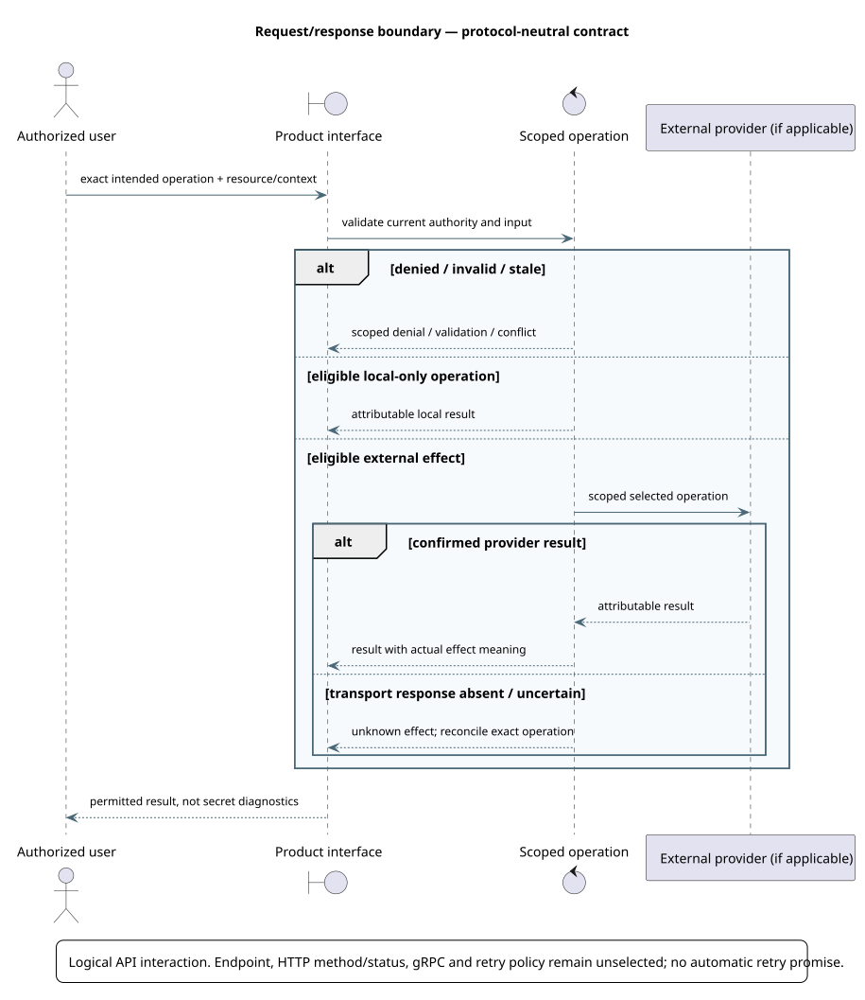

[Editable source](Diagrams/Interface-Request-Response-Contract.puml) · 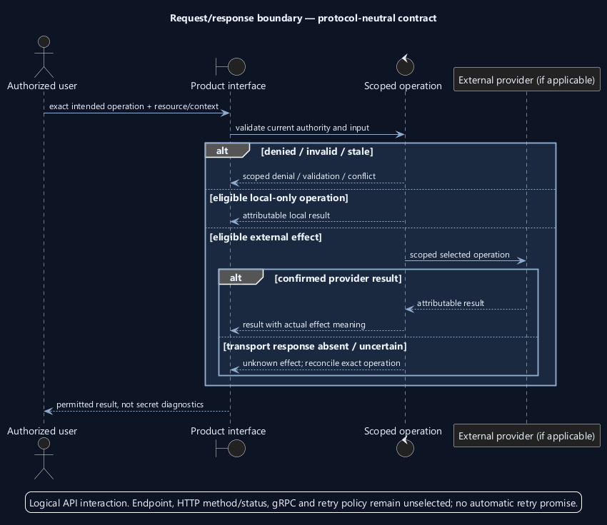

Resumefolio — Security, Quality and Operational Analysis

#### Resumefolio — Security, Quality and Operational Analysis

**Quick navigation:** [Authority](#analysis-interfaces-security-and-quality-analysis--13-security-quality-and-operational-analysis--heading-1-resources-and-authority) · [Trust cases](#analysis-interfaces-security-and-quality-analysis--13-security-quality-and-operational-analysis--heading-2-trust-and-execution-boundaries) · [HA/DR and failover](#analysis-interfaces-security-and-quality-analysis--13-security-quality-and-operational-analysis--heading-availability-disaster-recovery-and-failover-views) · [Threat model and infrastructure](#analysis-interfaces-security-and-quality-analysis--13-security-quality-and-operational-analysis--heading-diagram-types-and-reading-guide).

[Diagram types and reading guide](#analysis-interfaces-security-and-quality-analysis--13-security-quality-and-operational-analysis--heading-diagram-types-and-reading-guide) · [Full diagram catalog](Diagrams/Diagram-Catalog.md)

Owner: Farhad. Revision: November 1, 2026.

Status: Populated analysis working view: 24 conditional authority rows, 12 trust/failure cases, 14 quality scenarios, nine recovery-coverage subjects and ten focused diagrams. No security certification, load result, recovery proof or whole-phase acceptance is claimed.

Current MVP scope and selected mechanisms: [Baseline](https://github.com/Farhad-V/Web-Resumefolio/blob/1f2acaa351ac306cb57cbe4fe9742e8bd90720d9/docs/MVP/baseline/README.md). Deferred provider, advanced collaboration and workflow-execution designs are not MVP prerequisites.

##### Authoritative Inputs

- [Scope](../01-Project-Planning/01-Project-Charter.md#mvp-scope), [quality/security/recovery requirements](../02-Requirements-Engineering/01-Software-Requirements-Specification.md#requirements-specification-quality-security-and-recovery-requirements), [account permissions](../02-Requirements-Engineering/01-Software-Requirements-Specification.md#requirements-specification-accounts-authentication-and-permissions), and [business/lifecycle rules](../02-Requirements-Engineering/01-Software-Requirements-Specification.md#requirements-specification-business-rules-and-data-lifecycle).

- [Interface requirements](../02-Requirements-Engineering/01-Software-Requirements-Specification.md#requirements-specification-external-interface-requirements), [administration/files](../02-Requirements-Engineering/01-Software-Requirements-Specification.md#requirements-specification-administration-files-and-operational-behavior), [feasibility](../02-Requirements-Engineering/01-Software-Requirements-Specification.md#process-and-approach-02-feasibility-study), [decisions/proposals](../02-Requirements-Engineering/01-Software-Requirements-Specification.md#change-and-baseline-open-questions-and-decisions) and [shared findings](../02-Requirements-Engineering/01-Software-Requirements-Specification.md#validation-and-traceability-validation-and-traceability--heading-review-findings).

- [Domain/data/scenario models](02-Domain-And-Information-Analysis.md#analysis-domain-and-information-analysis--03-domain-model-and-object-oriented-view), [states](03-Processes-Scenarios-And-Business-Rules.md#analysis-behavioral-and-scenario-analysis--07-state-based-view), [activities](03-Processes-Scenarios-And-Business-Rules.md#analysis-functional-and-process-analysis--08-control-flow-based-view), [rules](03-Processes-Scenarios-And-Business-Rules.md#analysis-business-rules-and-operation-contracts--09-rule-based-view), [operation contracts](03-Processes-Scenarios-And-Business-Rules.md#analysis-business-rules-and-operation-contracts--10-domain-constraints-and-operation-contracts), [bounded cross-view review](05-Analysis-Review-And-Design-Handoff.md#analysis-review-and-design-handoff--11-model-consistency-traceability-and-review) and [interfaces](#analysis-interfaces-security-and-quality-analysis--12-interfaces-and-external-interactions).

**Authority:** The [accepted profile-update core](../02-Requirements-Engineering/01-Software-Requirements-Specification.md#change-and-baseline-open-questions-and-decisions--id-owner-accepted-profile-update-policy) remains accepted. The primary detailed QSR/permissions/quality/control/retention proposals retain their recorded status. SQ-A/T/Q/R/V references are local analysis locators, not new global requirements or new accepted role powers. This analysis describes required distinctions and later evidence; it does not select a runner, scanner, security product, monitoring facility, backup destination or cryptographic mechanism.

##### 1. Resources and authority

An actor is evaluated against the exact resource, requested action and applicable current state. Product sign-in, board membership, owning a repository, being called an administrator or having a stored provider connection is not universal authority. Employer viewing without a product account remains limited to the intended protected selected content. Identity/control, business validity and observed completion are distinct predicates.

###### Conditional actor/resource/action/state matrix

Each row below is a scoped analysis condition. It is not an approved full role/action matrix or evidence that the software enforces it. “Authorized” means the primary reviewed grant/policy actually permits that exact operation. Unknown scope or missing enabling evidence does not become an allowed result. Direct UI/reference/file/provider/Git/output paths must obey the same applicable resource rules.

| Record | Details |
| --- | --- |
| SQ-A01 — Profile owner | [Read record](#analysis-interfaces-security-and-quality-analysis--13-security-quality-and-operational-analysis--id-sq-a01) |
| SQ-A02 — Resume owner | [Read record](#analysis-interfaces-security-and-quality-analysis--13-security-quality-and-operational-analysis--id-sq-a02) |
| SQ-A03 — Resume owner | [Read record](#analysis-interfaces-security-and-quality-analysis--13-security-quality-and-operational-analysis--id-sq-a03) |
| SQ-A04 — Other private user / guessed reference | [Read record](#analysis-interfaces-security-and-quality-analysis--13-security-quality-and-operational-analysis--id-sq-a04) |
| SQ-A05 — Employer viewer without product account | [Read record](#analysis-interfaces-security-and-quality-analysis--13-security-quality-and-operational-analysis--id-sq-a05) |
| SQ-A06 — Resume/link owner | [Read record](#analysis-interfaces-security-and-quality-analysis--13-security-quality-and-operational-analysis--id-sq-a06) |
| SQ-A07 — Project collaborator | [Read record](#analysis-interfaces-security-and-quality-analysis--13-security-quality-and-operational-analysis--id-sq-a07) |
| SQ-A08 — Invitation recipient | [Read record](#analysis-interfaces-security-and-quality-analysis--13-security-quality-and-operational-analysis--id-sq-a08) |
| SQ-A09 — Explicit grant controller | [Read record](#analysis-interfaces-security-and-quality-analysis--13-security-quality-and-operational-analysis--id-sq-a09) |
| SQ-A10 — Permitted repository reader/client | [Read record](#analysis-interfaces-security-and-quality-analysis--13-security-quality-and-operational-analysis--id-sq-a10) |
| SQ-A11 — Permitted repository writer | [Read record](#analysis-interfaces-security-and-quality-analysis--13-security-quality-and-operational-analysis--id-sq-a11) |
| SQ-A12 — Permitted reviewer/integrator | [Read record](#analysis-interfaces-security-and-quality-analysis--13-security-quality-and-operational-analysis--id-sq-a12) |
| SQ-A13 — Connected mailbox user | [Read record](#analysis-interfaces-security-and-quality-analysis--13-security-quality-and-operational-analysis--id-sq-a13) |
| SQ-A14 — Reviewed message sender | [Read record](#analysis-interfaces-security-and-quality-analysis--13-security-quality-and-operational-analysis--id-sq-a14) |
| SQ-A15 — Local activity owner | [Read record](#analysis-interfaces-security-and-quality-analysis--13-security-quality-and-operational-analysis--id-sq-a15) |
| SQ-A16 — Connected calendar actor | [Read record](#analysis-interfaces-security-and-quality-analysis--13-security-quality-and-operational-analysis--id-sq-a16) |
| SQ-A17 — Authorized uploader | [Read record](#analysis-interfaces-security-and-quality-analysis--13-security-quality-and-operational-analysis--id-sq-a17) |
| SQ-A18 — Explicit policy administrator | [Read record](#analysis-interfaces-security-and-quality-analysis--13-security-quality-and-operational-analysis--id-sq-a18) |
| SQ-A19 — Restricted evidence viewer/operator | [Read record](#analysis-interfaces-security-and-quality-analysis--13-security-quality-and-operational-analysis--id-sq-a19) |
| SQ-A20 — Authorized workflow trigger | [Read record](#analysis-interfaces-security-and-quality-analysis--13-security-quality-and-operational-analysis--id-sq-a20) |
| SQ-A21 — Authorized run controller | [Read record](#analysis-interfaces-security-and-quality-analysis--13-security-quality-and-operational-analysis--id-sq-a21) |
| SQ-A22 — Authorized target deployer | [Read record](#analysis-interfaces-security-and-quality-analysis--13-security-quality-and-operational-analysis--id-sq-a22) |
| SQ-A23 — Authorized category controller/recovery operator | [Read record](#analysis-interfaces-security-and-quality-analysis--13-security-quality-and-operational-analysis--id-sq-a23) |
| SQ-A24 — Specifically authorized account actor | [Read record](#analysis-interfaces-security-and-quality-analysis--13-security-quality-and-operational-analysis--id-sq-a24) |

###### SQ-A01 — Profile owner

**Resource and action:**

Intended source profile/entries; Edit shared information

**Candidate permitted condition:**

Current own/source action authority and valid intended inputs.

**Negative / changed-state boundary:**

Source edit alone cannot update existing resume draft/live/history. **State:** Keep exact owner/source/current edit context; other resumes remain independent.

**Sources / selected models/contracts:**

[QSR-D05](../02-Requirements-Engineering/01-Software-Requirements-Specification.md#requirements-specification-quality-security-and-recovery-requirements--heading-qsr-d05-identity-resource-isolation-and-changed-access), [QSR-D08](../02-Requirements-Engineering/01-Software-Requirements-Specification.md#requirements-specification-quality-security-and-recovery-requirements--heading-qsr-d08-data-integrity-and-truthful-completion), [ACC-D03](../02-Requirements-Engineering/01-Software-Requirements-Specification.md#requirements-specification-accounts-authentication-and-permissions--heading-acc-d03-resource-and-operation-authorization), [ACC-D04](../02-Requirements-Engineering/01-Software-Requirements-Specification.md#requirements-specification-accounts-authentication-and-permissions--heading-acc-d04-cross-user-private-data-isolation), [PRP-D04](../02-Requirements-Engineering/01-Software-Requirements-Specification.md#requirements-specification-profiles-resumes-and-portfolio--heading-prp-d04-explicit-shared-source-update-rules); [IF-01](#analysis-interfaces-security-and-quality-analysis--12-interfaces-and-external-interactions--id-if-01), [RB-D01](03-Processes-Scenarios-And-Business-Rules.md#analysis-business-rules-and-operation-contracts--09-rule-based-view--id-rb-d01), [RB-D02](03-Processes-Scenarios-And-Business-Rules.md#analysis-business-rules-and-operation-contracts--09-rule-based-view--id-rb-d02), [SM-M01](03-Processes-Scenarios-And-Business-Rules.md#analysis-behavioral-and-scenario-analysis--07-state-based-view--id-sm-m01); [DC-O01](03-Processes-Scenarios-And-Business-Rules.md#analysis-business-rules-and-operation-contracts--10-domain-constraints-and-operation-contracts--id-dc-o01)

###### SQ-A02 — Resume owner

**Resource and action:**

One intended tailored draft; Apply selected source changes

**Candidate permitted condition:**

Explicit selected apply, current source/resume authority and reviewed context.

**Negative / changed-state boundary:**

No automatic override loss, update of other resumes or publication. **State:** Recheck changed source/draft before permitted effect; failed/unknown is not saved.

**Sources / selected models/contracts:**

[QSR-D05](../02-Requirements-Engineering/01-Software-Requirements-Specification.md#requirements-specification-quality-security-and-recovery-requirements--heading-qsr-d05-identity-resource-isolation-and-changed-access), [QSR-D08](../02-Requirements-Engineering/01-Software-Requirements-Specification.md#requirements-specification-quality-security-and-recovery-requirements--heading-qsr-d08-data-integrity-and-truthful-completion), [PRP-D03](../02-Requirements-Engineering/01-Software-Requirements-Specification.md#requirements-specification-profiles-resumes-and-portfolio--heading-prp-d03-independent-selections-layouts-and-overrides), [PRP-D04](../02-Requirements-Engineering/01-Software-Requirements-Specification.md#requirements-specification-profiles-resumes-and-portfolio--heading-prp-d04-explicit-shared-source-update-rules); [IF-01](#analysis-interfaces-security-and-quality-analysis--12-interfaces-and-external-interactions--id-if-01), [RB-D02](03-Processes-Scenarios-And-Business-Rules.md#analysis-business-rules-and-operation-contracts--09-rule-based-view--id-rb-d02), [CF-M01](03-Processes-Scenarios-And-Business-Rules.md#analysis-functional-and-process-analysis--08-control-flow-based-view--id-cf-m01); [DC-O02](03-Processes-Scenarios-And-Business-Rules.md#analysis-business-rules-and-operation-contracts--10-domain-constraints-and-operation-contracts--id-dc-o02)

###### SQ-A03 — Resume owner

**Resource and action:**

Intended presentation; Publish

**Candidate permitted condition:**

Separate confirmation and current eligible intended content/publication authority.

**Negative / changed-state boundary:**

Draft save alone is not publication; actual submitted material not rewritten. **State:** Actual confirmed publication differs from unavailable/unknown PDF generation.

**Sources / selected models/contracts:**

[QSR-D08](../02-Requirements-Engineering/01-Software-Requirements-Specification.md#requirements-specification-quality-security-and-recovery-requirements--heading-qsr-d08-data-integrity-and-truthful-completion), [PRP-D04](../02-Requirements-Engineering/01-Software-Requirements-Specification.md#requirements-specification-profiles-resumes-and-portfolio--heading-prp-d04-explicit-shared-source-update-rules), [PRP-D08](../02-Requirements-Engineering/01-Software-Requirements-Specification.md#requirements-specification-profiles-resumes-and-portfolio--heading-prp-d08-clear-presentation-and-rendition-boundaries), [PDF-D07](../02-Requirements-Engineering/01-Software-Requirements-Specification.md#requirements-specification-pdf-and-controlled-sharing--heading-pdf-d07-explicit-live-revision-and-rendition-behavior); [IF-01](#analysis-interfaces-security-and-quality-analysis--12-interfaces-and-external-interactions--id-if-01), [RB-D02](03-Processes-Scenarios-And-Business-Rules.md#analysis-business-rules-and-operation-contracts--09-rule-based-view--id-rb-d02), [SM-M01](03-Processes-Scenarios-And-Business-Rules.md#analysis-behavioral-and-scenario-analysis--07-state-based-view--id-sm-m01); [DC-O03](03-Processes-Scenarios-And-Business-Rules.md#analysis-business-rules-and-operation-contracts--10-domain-constraints-and-operation-contracts--id-dc-o03)

###### SQ-A04 — Other private user / guessed reference

**Resource and action:**

Private resume/mail/application/file; Read or mutate

**Candidate permitted condition:**

No relevant scoped grant means no protected operation.

**Negative / changed-state boundary:**

Valid sign-in, guessed identifiers, navigation/search or direct path cannot expose unrelated private content. **State:** Current exact resource/action/state authority; no implicit universal administrator.

**Sources / selected models/contracts:**

[QSR-D05](../02-Requirements-Engineering/01-Software-Requirements-Specification.md#requirements-specification-quality-security-and-recovery-requirements--heading-qsr-d05-identity-resource-isolation-and-changed-access), [ACC-D03](../02-Requirements-Engineering/01-Software-Requirements-Specification.md#requirements-specification-accounts-authentication-and-permissions--heading-acc-d03-resource-and-operation-authorization), [ACC-D04](../02-Requirements-Engineering/01-Software-Requirements-Specification.md#requirements-specification-accounts-authentication-and-permissions--heading-acc-d04-cross-user-private-data-isolation), [ACC-D05](../02-Requirements-Engineering/01-Software-Requirements-Specification.md#requirements-specification-accounts-authentication-and-permissions--heading-acc-d05-limited-collaboration-authority), [EIF-D03](../02-Requirements-Engineering/01-Software-Requirements-Specification.md#requirements-specification-external-interface-requirements--heading-eif-d03-consistent-authorization-across-entry-paths); [IF-01](#analysis-interfaces-security-and-quality-analysis--12-interfaces-and-external-interactions--id-if-01), [IF-02](#analysis-interfaces-security-and-quality-analysis--12-interfaces-and-external-interactions--id-if-02), [IF-03](#analysis-interfaces-security-and-quality-analysis--12-interfaces-and-external-interactions--id-if-03), [RB-D01](03-Processes-Scenarios-And-Business-Rules.md#analysis-business-rules-and-operation-contracts--09-rule-based-view--id-rb-d01); [DC-O06](03-Processes-Scenarios-And-Business-Rules.md#analysis-business-rules-and-operation-contracts--10-domain-constraints-and-operation-contracts--id-dc-o06), [DC-O11](03-Processes-Scenarios-And-Business-Rules.md#analysis-business-rules-and-operation-contracts--10-domain-constraints-and-operation-contracts--id-dc-o11)

###### SQ-A05 — Employer viewer without product account

**Resource and action:**

Intended selected published content; View/retrieve

**Candidate permitted condition:**

Exact eligible link/password plus selection/mode/actual representation availability.

**Negative / changed-state boundary:**

No private workspace/unselected evidence/disabled PDF or unrelated language fallback. **State:** Fresh disabled-link access denied after effective disable; delivered copies outside recall.

**Sources / selected models/contracts:**

[QSR-D05](../02-Requirements-Engineering/01-Software-Requirements-Specification.md#requirements-specification-quality-security-and-recovery-requirements--heading-qsr-d05-identity-resource-isolation-and-changed-access), [PDF-D03](../02-Requirements-Engineering/01-Software-Requirements-Specification.md#requirements-specification-pdf-and-controlled-sharing--heading-pdf-d03-per-resume-download-choices), [PDF-D04](../02-Requirements-Engineering/01-Software-Requirements-Specification.md#requirements-specification-pdf-and-controlled-sharing--heading-pdf-d04-scoped-password-protected-employer-access), [PDF-D05](../02-Requirements-Engineering/01-Software-Requirements-Specification.md#requirements-specification-pdf-and-controlled-sharing--heading-pdf-d05-direct-file-and-pdf-authorization), [PDF-D06](../02-Requirements-Engineering/01-Software-Requirements-Specification.md#requirements-specification-pdf-and-controlled-sharing--heading-pdf-d06-owner-password-and-link-controls); [IF-02](#analysis-interfaces-security-and-quality-analysis--12-interfaces-and-external-interactions--id-if-02), [RB-D03](03-Processes-Scenarios-And-Business-Rules.md#analysis-business-rules-and-operation-contracts--09-rule-based-view--id-rb-d03), [RB-D04](03-Processes-Scenarios-And-Business-Rules.md#analysis-business-rules-and-operation-contracts--09-rule-based-view--id-rb-d04), [RB-D05](03-Processes-Scenarios-And-Business-Rules.md#analysis-business-rules-and-operation-contracts--09-rule-based-view--id-rb-d05); [DC-O06](03-Processes-Scenarios-And-Business-Rules.md#analysis-business-rules-and-operation-contracts--10-domain-constraints-and-operation-contracts--id-dc-o06)

###### SQ-A06 — Resume/link owner

**Resource and action:**

Exact protected link/download configuration; Change settings or disable/change credential

**Candidate permitted condition:**

Distinct current control power for exact requested action.

**Negative / changed-state boundary:**

PDF-mode save does not disable link; unrelated actor cannot change owner controls. **State:** Credential rotation and existing/in-flight session timing retain separate reviewed policy.

**Sources / selected models/contracts:**

[QSR-D05](../02-Requirements-Engineering/01-Software-Requirements-Specification.md#requirements-specification-quality-security-and-recovery-requirements--heading-qsr-d05-identity-resource-isolation-and-changed-access), [ACC-D08](../02-Requirements-Engineering/01-Software-Requirements-Specification.md#requirements-specification-accounts-authentication-and-permissions--heading-acc-d08-owner-control-of-employer-link-access), [ACC-D12](../02-Requirements-Engineering/01-Software-Requirements-Specification.md#requirements-specification-accounts-authentication-and-permissions--heading-acc-d12-end-of-access-and-lifecycle-enforcement), [PDF-D03](../02-Requirements-Engineering/01-Software-Requirements-Specification.md#requirements-specification-pdf-and-controlled-sharing--heading-pdf-d03-per-resume-download-choices), [PDF-D06](../02-Requirements-Engineering/01-Software-Requirements-Specification.md#requirements-specification-pdf-and-controlled-sharing--heading-pdf-d06-owner-password-and-link-controls); [IF-01](#analysis-interfaces-security-and-quality-analysis--12-interfaces-and-external-interactions--id-if-01), [IF-02](#analysis-interfaces-security-and-quality-analysis--12-interfaces-and-external-interactions--id-if-02), [SM-M04](03-Processes-Scenarios-And-Business-Rules.md#analysis-behavioral-and-scenario-analysis--07-state-based-view--id-sm-m04), [RB-D05](03-Processes-Scenarios-And-Business-Rules.md#analysis-business-rules-and-operation-contracts--09-rule-based-view--id-rb-d05); [DC-O04](03-Processes-Scenarios-And-Business-Rules.md#analysis-business-rules-and-operation-contracts--10-domain-constraints-and-operation-contracts--id-dc-o04), [DC-O05](03-Processes-Scenarios-And-Business-Rules.md#analysis-business-rules-and-operation-contracts--10-domain-constraints-and-operation-contracts--id-dc-o05)

###### SQ-A07 — Project collaborator

**Resource and action:**

Granted project/item/task/Sprint; Perform exact granted work action

**Candidate permitted condition:**

Current project/resource/action/state grant and subject rules.

**Negative / changed-state boundary:**

Board membership does not grant private email, unrelated resumes/repos or secrets. **State:** Readiness/progress/item acceptance/period outcome are distinct; current grant can change.

**Sources / selected models/contracts:**

[QSR-D05](../02-Requirements-Engineering/01-Software-Requirements-Specification.md#requirements-specification-quality-security-and-recovery-requirements--heading-qsr-d05-identity-resource-isolation-and-changed-access), [QSR-D08](../02-Requirements-Engineering/01-Software-Requirements-Specification.md#requirements-specification-quality-security-and-recovery-requirements--heading-qsr-d08-data-integrity-and-truthful-completion), [PKS-D06](../02-Requirements-Engineering/01-Software-Requirements-Specification.md#requirements-specification-projects-kanban-and-sprints--heading-pks-d06-scoped-collaboration-and-membership-changes), [PKS-D09](../02-Requirements-Engineering/01-Software-Requirements-Specification.md#requirements-specification-projects-kanban-and-sprints--heading-pks-d09-explicit-completion-and-sprint-end-outcomes), [ACC-D04](../02-Requirements-Engineering/01-Software-Requirements-Specification.md#requirements-specification-accounts-authentication-and-permissions--heading-acc-d04-cross-user-private-data-isolation); [IF-01](#analysis-interfaces-security-and-quality-analysis--12-interfaces-and-external-interactions--id-if-01), [RB-D09](03-Processes-Scenarios-And-Business-Rules.md#analysis-business-rules-and-operation-contracts--09-rule-based-view--id-rb-d09), [RB-D10](03-Processes-Scenarios-And-Business-Rules.md#analysis-business-rules-and-operation-contracts--09-rule-based-view--id-rb-d10); [DC-O16](03-Processes-Scenarios-And-Business-Rules.md#analysis-business-rules-and-operation-contracts--10-domain-constraints-and-operation-contracts--id-dc-o16), [DC-O17](03-Processes-Scenarios-And-Business-Rules.md#analysis-business-rules-and-operation-contracts--10-domain-constraints-and-operation-contracts--id-dc-o17), [DC-O18](03-Processes-Scenarios-And-Business-Rules.md#analysis-business-rules-and-operation-contracts--10-domain-constraints-and-operation-contracts--id-dc-o18), [DC-O19](03-Processes-Scenarios-And-Business-Rules.md#analysis-business-rules-and-operation-contracts--10-domain-constraints-and-operation-contracts--id-dc-o19)

###### SQ-A08 — Invitation recipient

**Resource and action:**

Exact invitation/resource grant; Accept invitation

**Candidate permitted condition:**

Intended recipient and current invitation eligibility; actual scoped acceptance confirmed.

**Negative / changed-state boundary:**

Invitation/sign-in alone is not effective membership or unrelated private authority. **State:** Unconfirmed/expired invitation cannot claim active grant; no arbitrary expiry invented.

**Sources / selected models/contracts:**

[QSR-D05](../02-Requirements-Engineering/01-Software-Requirements-Specification.md#requirements-specification-quality-security-and-recovery-requirements--heading-qsr-d05-identity-resource-isolation-and-changed-access), [ACC-D03](../02-Requirements-Engineering/01-Software-Requirements-Specification.md#requirements-specification-accounts-authentication-and-permissions--heading-acc-d03-resource-and-operation-authorization), [ACC-D05](../02-Requirements-Engineering/01-Software-Requirements-Specification.md#requirements-specification-accounts-authentication-and-permissions--heading-acc-d05-limited-collaboration-authority), [ACC-D12](../02-Requirements-Engineering/01-Software-Requirements-Specification.md#requirements-specification-accounts-authentication-and-permissions--heading-acc-d12-end-of-access-and-lifecycle-enforcement); [IF-01](#analysis-interfaces-security-and-quality-analysis--12-interfaces-and-external-interactions--id-if-01), [SM-M03](03-Processes-Scenarios-And-Business-Rules.md#analysis-behavioral-and-scenario-analysis--07-state-based-view--id-sm-m03), [RB-D01](03-Processes-Scenarios-And-Business-Rules.md#analysis-business-rules-and-operation-contracts--09-rule-based-view--id-rb-d01); [DC-O20](03-Processes-Scenarios-And-Business-Rules.md#analysis-business-rules-and-operation-contracts--10-domain-constraints-and-operation-contracts--id-dc-o20)

###### SQ-A09 — Explicit grant controller

**Resource and action:**

Exact membership/grant; Change/revoke rights

**Candidate permitted condition:**

Reviewed current grant-management power, not generic title.

**Negative / changed-state boundary:**

No widening to unrelated resources or recall of delivered data. **State:** Confirmed current grant governs applicable subsequent checks; in-flight policy scoped.

**Sources / selected models/contracts:**

[QSR-D05](../02-Requirements-Engineering/01-Software-Requirements-Specification.md#requirements-specification-quality-security-and-recovery-requirements--heading-qsr-d05-identity-resource-isolation-and-changed-access), [ACC-D10](../02-Requirements-Engineering/01-Software-Requirements-Specification.md#requirements-specification-accounts-authentication-and-permissions--heading-acc-d10-authorization-of-access-grant-changes), [ACC-D12](../02-Requirements-Engineering/01-Software-Requirements-Specification.md#requirements-specification-accounts-authentication-and-permissions--heading-acc-d12-end-of-access-and-lifecycle-enforcement); [IF-01](#analysis-interfaces-security-and-quality-analysis--12-interfaces-and-external-interactions--id-if-01), [SM-M03](03-Processes-Scenarios-And-Business-Rules.md#analysis-behavioral-and-scenario-analysis--07-state-based-view--id-sm-m03), [RB-D01](03-Processes-Scenarios-And-Business-Rules.md#analysis-business-rules-and-operation-contracts--09-rule-based-view--id-rb-d01); [DC-O21](03-Processes-Scenarios-And-Business-Rules.md#analysis-business-rules-and-operation-contracts--10-domain-constraints-and-operation-contracts--id-dc-o21)

###### SQ-A10 — Permitted repository reader/client

**Resource and action:**

Intended real repository/ref; Clone/fetch/pull read

**Candidate permitted condition:**

Actually supported real client/transport and current read grant.

**Negative / changed-state boundary:**

Read/clone is not ref-write, merge, secret or target permission. **State:** Transfer incomplete/denied remains distinct; moving refs not evaluated immutable context.

**Sources / selected models/contracts:**

[QSR-D05](../02-Requirements-Engineering/01-Software-Requirements-Specification.md#requirements-specification-quality-security-and-recovery-requirements--heading-qsr-d05-identity-resource-isolation-and-changed-access), [GIT-D02](../02-Requirements-Engineering/01-Software-Requirements-Specification.md#requirements-specification-git-hosting-and-collaboration--heading-git-d02-repository-and-ref-authorization), [GIT-D03](../02-Requirements-Engineering/01-Software-Requirements-Specification.md#requirements-specification-git-hosting-and-collaboration--heading-git-d03-real-clone-fetch-pull-and-push), [EIF-D06](../02-Requirements-Engineering/01-Software-Requirements-Specification.md#requirements-specification-external-interface-requirements--heading-eif-d06-real-git-client-interoperability); [IF-06](#analysis-interfaces-security-and-quality-analysis--12-interfaces-and-external-interactions--id-if-06), [CF-M11](03-Processes-Scenarios-And-Business-Rules.md#analysis-functional-and-process-analysis--08-control-flow-based-view--id-cf-m11), [RB-D01](03-Processes-Scenarios-And-Business-Rules.md#analysis-business-rules-and-operation-contracts--09-rule-based-view--id-rb-d01); [DC-O22](03-Processes-Scenarios-And-Business-Rules.md#analysis-business-rules-and-operation-contracts--10-domain-constraints-and-operation-contracts--id-dc-o22)

###### SQ-A11 — Permitted repository writer

**Resource and action:**

Exact protected/unprotected ref; Push/ref change

**Candidate permitted condition:**

Current ref-write/protection authority and expected actual current ref conditions.

**Negative / changed-state boundary:**

No unrelated ref change, inherited merge approval or deploy authority. **State:** Stale/conflicting/unknown actual ref result requires reconciliation.

**Sources / selected models/contracts:**

[QSR-D05](../02-Requirements-Engineering/01-Software-Requirements-Specification.md#requirements-specification-quality-security-and-recovery-requirements--heading-qsr-d05-identity-resource-isolation-and-changed-access), [QSR-D08](../02-Requirements-Engineering/01-Software-Requirements-Specification.md#requirements-specification-quality-security-and-recovery-requirements--heading-qsr-d08-data-integrity-and-truthful-completion), [GIT-D02](../02-Requirements-Engineering/01-Software-Requirements-Specification.md#requirements-specification-git-hosting-and-collaboration--heading-git-d02-repository-and-ref-authorization), [GIT-D04](../02-Requirements-Engineering/01-Software-Requirements-Specification.md#requirements-specification-git-hosting-and-collaboration--heading-git-d04-branches-files-and-history-browsing), [GIT-D07](../02-Requirements-Engineering/01-Software-Requirements-Specification.md#requirements-specification-git-hosting-and-collaboration--heading-git-d07-controlled-merge-and-conflict-outcomes); [IF-06](#analysis-interfaces-security-and-quality-analysis--12-interfaces-and-external-interactions--id-if-06), [RB-D11](03-Processes-Scenarios-And-Business-Rules.md#analysis-business-rules-and-operation-contracts--09-rule-based-view--id-rb-d11), [SM-M13](03-Processes-Scenarios-And-Business-Rules.md#analysis-behavioral-and-scenario-analysis--07-state-based-view--id-sm-m13); [DC-O23](03-Processes-Scenarios-And-Business-Rules.md#analysis-business-rules-and-operation-contracts--10-domain-constraints-and-operation-contracts--id-dc-o23)

###### SQ-A12 — Permitted reviewer/integrator

**Resource and action:**

Exact request/source/target revisions; Review or merge

**Candidate permitted condition:**

Operation-specific current power and evaluated revision/check/review conditions.

**Negative / changed-state boundary:**

A comment or stale approval does not authorize integration/production deployment. **State:** Changed source/target re-evaluated; unknown merge does not prove unchanged target.

**Sources / selected models/contracts:**

[QSR-D05](../02-Requirements-Engineering/01-Software-Requirements-Specification.md#requirements-specification-quality-security-and-recovery-requirements--heading-qsr-d05-identity-resource-isolation-and-changed-access), [QSR-D08](../02-Requirements-Engineering/01-Software-Requirements-Specification.md#requirements-specification-quality-security-and-recovery-requirements--heading-qsr-d08-data-integrity-and-truthful-completion), [GIT-D05](../02-Requirements-Engineering/01-Software-Requirements-Specification.md#requirements-specification-git-hosting-and-collaboration--heading-git-d05-fork-provenance-and-permission-boundaries), [GIT-D06](../02-Requirements-Engineering/01-Software-Requirements-Specification.md#requirements-specification-git-hosting-and-collaboration--heading-git-d06-pull-requests-comments-and-review), [GIT-D07](../02-Requirements-Engineering/01-Software-Requirements-Specification.md#requirements-specification-git-hosting-and-collaboration--heading-git-d07-controlled-merge-and-conflict-outcomes); [IF-01](#analysis-interfaces-security-and-quality-analysis--12-interfaces-and-external-interactions--id-if-01), [RB-D11](03-Processes-Scenarios-And-Business-Rules.md#analysis-business-rules-and-operation-contracts--09-rule-based-view--id-rb-d11), [CF-M12](03-Processes-Scenarios-And-Business-Rules.md#analysis-functional-and-process-analysis--08-control-flow-based-view--id-cf-m12); [DC-O25](03-Processes-Scenarios-And-Business-Rules.md#analysis-business-rules-and-operation-contracts--10-domain-constraints-and-operation-contracts--id-dc-o25), [DC-O26](03-Processes-Scenarios-And-Business-Rules.md#analysis-business-rules-and-operation-contracts--10-domain-constraints-and-operation-contracts--id-dc-o26)

###### SQ-A13 — Connected mailbox user

**Resource and action:**

Exact provider account/message context; Read/search

**Candidate permitted condition:**

Product-resource scope plus actual intended provider read capability.

**Negative / changed-state boundary:**

Project membership or product login is not private mailbox access. **State:** Lost/revoked access and retained stale copy differ from current fetch.

**Sources / selected models/contracts:**

[QSR-D05](../02-Requirements-Engineering/01-Software-Requirements-Specification.md#requirements-specification-quality-security-and-recovery-requirements--heading-qsr-d05-identity-resource-isolation-and-changed-access), [QSR-D06](../02-Requirements-Engineering/01-Software-Requirements-Specification.md#requirements-specification-quality-security-and-recovery-requirements--heading-qsr-d06-sensitive-information-and-secret-protection), [EGC-D01](../02-Requirements-Engineering/01-Software-Requirements-Specification.md#requirements-specification-email-calendar-and-google-integration--heading-egc-d01-authorized-connection-and-account-context), [EGC-D02](../02-Requirements-Engineering/01-Software-Requirements-Specification.md#requirements-specification-email-calendar-and-google-integration--heading-egc-d02-justified-permissions-and-private-resource-isolation), [EGC-D03](../02-Requirements-Engineering/01-Software-Requirements-Specification.md#requirements-specification-email-calendar-and-google-integration--heading-egc-d03-read-authorized-correspondence), [EGC-D11](../02-Requirements-Engineering/01-Software-Requirements-Specification.md#requirements-specification-email-calendar-and-google-integration--heading-egc-d11-disconnect-revocation-and-reconnect); [IF-04](#analysis-interfaces-security-and-quality-analysis--12-interfaces-and-external-interactions--id-if-04), [SM-M08](03-Processes-Scenarios-And-Business-Rules.md#analysis-behavioral-and-scenario-analysis--07-state-based-view--id-sm-m08), [RB-D01](03-Processes-Scenarios-And-Business-Rules.md#analysis-business-rules-and-operation-contracts--09-rule-based-view--id-rb-d01); [DC-O11](03-Processes-Scenarios-And-Business-Rules.md#analysis-business-rules-and-operation-contracts--10-domain-constraints-and-operation-contracts--id-dc-o11)

###### SQ-A14 — Reviewed message sender

**Resource and action:**

Exact final send/reply attempt; Send/reply

**Candidate permitted condition:**

Current provider send power and final content confirmation; prior uncertain effect assessed.

**Negative / changed-state boundary:**

No stale confirmation, blind resend or recipient delivery/read claim. **State:** Acceptance/rejection/pending/unknown attributable to intended attempt.

**Sources / selected models/contracts:**

[QSR-D05](../02-Requirements-Engineering/01-Software-Requirements-Specification.md#requirements-specification-quality-security-and-recovery-requirements--heading-qsr-d05-identity-resource-isolation-and-changed-access), [QSR-D08](../02-Requirements-Engineering/01-Software-Requirements-Specification.md#requirements-specification-quality-security-and-recovery-requirements--heading-qsr-d08-data-integrity-and-truthful-completion), [EGC-D05](../02-Requirements-Engineering/01-Software-Requirements-Specification.md#requirements-specification-email-calendar-and-google-integration--heading-egc-d05-deliberate-send-and-truthful-outcome), [EGC-D06](../02-Requirements-Engineering/01-Software-Requirements-Specification.md#requirements-specification-email-calendar-and-google-integration--heading-egc-d06-reply-context-and-conversation-association), [EGC-D12](../02-Requirements-Engineering/01-Software-Requirements-Specification.md#requirements-specification-email-calendar-and-google-integration--heading-egc-d12-bounded-failures-recovery-and-feasibility-evidence); [IF-04](#analysis-interfaces-security-and-quality-analysis--12-interfaces-and-external-interactions--id-if-04), [SM-M09](03-Processes-Scenarios-And-Business-Rules.md#analysis-behavioral-and-scenario-analysis--07-state-based-view--id-sm-m09), [RB-D07](03-Processes-Scenarios-And-Business-Rules.md#analysis-business-rules-and-operation-contracts--09-rule-based-view--id-rb-d07); [DC-O12](03-Processes-Scenarios-And-Business-Rules.md#analysis-business-rules-and-operation-contracts--10-domain-constraints-and-operation-contracts--id-dc-o12), [DC-O38](03-Processes-Scenarios-And-Business-Rules.md#analysis-business-rules-and-operation-contracts--10-domain-constraints-and-operation-contracts--id-dc-o38)

###### SQ-A15 — Local activity owner

**Resource and action:**

Local calendar object/mapping; Local edit/unlink

**Candidate permitted condition:**

Current local authority and intended association, not active provider-write prerequisite.

**Negative / changed-state boundary:**

Local unlink cannot delete provider event or trigger mail/reminder delivery. **State:** Exact association/current local state; disconnected provider does not make local unlink unauthorized.

**Sources / selected models/contracts:**

[QSR-D05](../02-Requirements-Engineering/01-Software-Requirements-Specification.md#requirements-specification-quality-security-and-recovery-requirements--heading-qsr-d05-identity-resource-isolation-and-changed-access), [EGC-D07](../02-Requirements-Engineering/01-Software-Requirements-Specification.md#requirements-specification-email-calendar-and-google-integration--heading-egc-d07-calendar-activities-and-time-meaning), [EGC-D09](../02-Requirements-Engineering/01-Software-Requirements-Specification.md#requirements-specification-email-calendar-and-google-integration--heading-egc-d09-application-relationships-preserve-boundaries), [EGC-D11](../02-Requirements-Engineering/01-Software-Requirements-Specification.md#requirements-specification-email-calendar-and-google-integration--heading-egc-d11-disconnect-revocation-and-reconnect); [IF-05](#analysis-interfaces-security-and-quality-analysis--12-interfaces-and-external-interactions--id-if-05), [RB-D08](03-Processes-Scenarios-And-Business-Rules.md#analysis-business-rules-and-operation-contracts--09-rule-based-view--id-rb-d08), [SM-M10](03-Processes-Scenarios-And-Business-Rules.md#analysis-behavioral-and-scenario-analysis--07-state-based-view--id-sm-m10); [DC-O13](03-Processes-Scenarios-And-Business-Rules.md#analysis-business-rules-and-operation-contracts--10-domain-constraints-and-operation-contracts--id-dc-o13), [DC-O14](03-Processes-Scenarios-And-Business-Rules.md#analysis-business-rules-and-operation-contracts--10-domain-constraints-and-operation-contracts--id-dc-o14)

###### SQ-A16 — Connected calendar actor

**After MVP.** Shared operating and recovery controls still apply where relevant.

**Resource and action:**

Selected account/calendar/event; Provider action/sync

**Candidate permitted condition:**

Actual intended capability, mapping/field authority and reviewed conflict handling.

**Negative / changed-state boundary:**

No silent last writer wins, provider delete by local unlink, or reconnect replay. **State:** Current versions/time; stale/conflict/unknown distinguished before further effects.

**Sources / selected models/contracts:**

[QSR-D05](../02-Requirements-Engineering/01-Software-Requirements-Specification.md#requirements-specification-quality-security-and-recovery-requirements--heading-qsr-d05-identity-resource-isolation-and-changed-access), [QSR-D08](../02-Requirements-Engineering/01-Software-Requirements-Specification.md#requirements-specification-quality-security-and-recovery-requirements--heading-qsr-d08-data-integrity-and-truthful-completion), [EGC-D08](../02-Requirements-Engineering/01-Software-Requirements-Specification.md#requirements-specification-email-calendar-and-google-integration--heading-egc-d08-explicit-synchronization-contract), [EGC-D09](../02-Requirements-Engineering/01-Software-Requirements-Specification.md#requirements-specification-email-calendar-and-google-integration--heading-egc-d09-application-relationships-preserve-boundaries), [EGC-D12](../02-Requirements-Engineering/01-Software-Requirements-Specification.md#requirements-specification-email-calendar-and-google-integration--heading-egc-d12-bounded-failures-recovery-and-feasibility-evidence); [IF-05](#analysis-interfaces-security-and-quality-analysis--12-interfaces-and-external-interactions--id-if-05), [RB-D08](03-Processes-Scenarios-And-Business-Rules.md#analysis-business-rules-and-operation-contracts--09-rule-based-view--id-rb-d08), [SM-M10](03-Processes-Scenarios-And-Business-Rules.md#analysis-behavioral-and-scenario-analysis--07-state-based-view--id-sm-m10); [DC-O15](03-Processes-Scenarios-And-Business-Rules.md#analysis-business-rules-and-operation-contracts--10-domain-constraints-and-operation-contracts--id-dc-o15)

###### SQ-A17 — Authorized uploader

**Resource and action:**

Candidate/association/protected file; Upload/process/replace/retrieve

**Candidate permitted condition:**

Current action authority, effective content/policy/reference/capacity contract.

**Negative / changed-state boundary:**

Authorized upload does not make content trusted or allow history destruction. **State:** Candidate/admitted/usable and retained-reference state remain distinct.

**Sources / selected models/contracts:**

[QSR-D05](../02-Requirements-Engineering/01-Software-Requirements-Specification.md#requirements-specification-quality-security-and-recovery-requirements--heading-qsr-d05-identity-resource-isolation-and-changed-access), [QSR-D07](../02-Requirements-Engineering/01-Software-Requirements-Specification.md#requirements-specification-quality-security-and-recovery-requirements--heading-qsr-d07-safe-content-and-untrusted-execution-boundaries), [AFO-D03](../02-Requirements-Engineering/01-Software-Requirements-Specification.md#requirements-specification-administration-files-and-operational-behavior--heading-afo-d03-per-file-admission-limit), [AFO-D05](../02-Requirements-Engineering/01-Software-Requirements-Specification.md#requirements-specification-administration-files-and-operational-behavior--heading-afo-d05-supported-content-and-validation), [AFO-D06](../02-Requirements-Engineering/01-Software-Requirements-Specification.md#requirements-specification-administration-files-and-operational-behavior--heading-afo-d06-file-resource-authorization-and-isolation), [AFO-D07](../02-Requirements-Engineering/01-Software-Requirements-Specification.md#requirements-specification-administration-files-and-operational-behavior--heading-afo-d07-truthful-completion-and-interrupted-operation-handling); [IF-03](#analysis-interfaces-security-and-quality-analysis--12-interfaces-and-external-interactions--id-if-03), [RB-D14](03-Processes-Scenarios-And-Business-Rules.md#analysis-business-rules-and-operation-contracts--09-rule-based-view--id-rb-d14), [SM-M05](03-Processes-Scenarios-And-Business-Rules.md#analysis-behavioral-and-scenario-analysis--07-state-based-view--id-sm-m05); [DC-O32](03-Processes-Scenarios-And-Business-Rules.md#analysis-business-rules-and-operation-contracts--10-domain-constraints-and-operation-contracts--id-dc-o32)

###### SQ-A18 — Explicit policy administrator

**Resource and action:**

Intended effective limit/setting; Change policy

**Candidate permitted condition:**

Exact reviewed management power and actual valid capacity/reference conditions.

**Negative / changed-state boundary:**

Uploader role/general operator title does not imply every setting/private evidence power. **State:** New limit effective only after actual confirmed change; lowering is not cleanup.

**Sources / selected models/contracts:**

[QSR-D05](../02-Requirements-Engineering/01-Software-Requirements-Specification.md#requirements-specification-quality-security-and-recovery-requirements--heading-qsr-d05-identity-resource-isolation-and-changed-access), [AFO-D01](../02-Requirements-Engineering/01-Software-Requirements-Specification.md#requirements-specification-administration-files-and-operational-behavior--heading-afo-d01-owner-configurable-upload-and-storage-policy), [AFO-D02](../02-Requirements-Engineering/01-Software-Requirements-Specification.md#requirements-specification-administration-files-and-operational-behavior--heading-afo-d02-policy-consistent-with-evaluated-infrastructure), [AFO-D10](../02-Requirements-Engineering/01-Software-Requirements-Specification.md#requirements-specification-administration-files-and-operational-behavior--heading-afo-d10-administrative-operation-evidence); [IF-01](#analysis-interfaces-security-and-quality-analysis--12-interfaces-and-external-interactions--id-if-01), [IF-08](#analysis-interfaces-security-and-quality-analysis--12-interfaces-and-external-interactions--id-if-08), [RB-D14](03-Processes-Scenarios-And-Business-Rules.md#analysis-business-rules-and-operation-contracts--09-rule-based-view--id-rb-d14); [DC-O31](03-Processes-Scenarios-And-Business-Rules.md#analysis-business-rules-and-operation-contracts--10-domain-constraints-and-operation-contracts--id-dc-o31)

###### SQ-A19 — Restricted evidence viewer/operator

**Resource and action:**

Exact logs/audit/diagnostic scope; Read operational evidence

**Candidate permitted condition:**

Explicit bounded evidence-read grant and sensitive-content policy.

**Negative / changed-state boundary:**

No ordinary exposure of secrets, unrelated private content or immutable-audit guarantee. **State:** Actual incomplete/unknown evidence not universal product health/security proof.

**Sources / selected models/contracts:**

[QSR-D05](../02-Requirements-Engineering/01-Software-Requirements-Specification.md#requirements-specification-quality-security-and-recovery-requirements--heading-qsr-d05-identity-resource-isolation-and-changed-access), [QSR-D06](../02-Requirements-Engineering/01-Software-Requirements-Specification.md#requirements-specification-quality-security-and-recovery-requirements--heading-qsr-d06-sensitive-information-and-secret-protection), [QSR-D13](../02-Requirements-Engineering/01-Software-Requirements-Specification.md#requirements-specification-quality-security-and-recovery-requirements--heading-qsr-d13-useful-restricted-operational-evidence), [AFO-D09](../02-Requirements-Engineering/01-Software-Requirements-Specification.md#requirements-specification-administration-files-and-operational-behavior--heading-afo-d09-operational-outcomes-and-capacity-warnings); [IF-08](#analysis-interfaces-security-and-quality-analysis--12-interfaces-and-external-interactions--id-if-08), [RB-D01](03-Processes-Scenarios-And-Business-Rules.md#analysis-business-rules-and-operation-contracts--09-rule-based-view--id-rb-d01), [RB-D18](03-Processes-Scenarios-And-Business-Rules.md#analysis-business-rules-and-operation-contracts--09-rule-based-view--id-rb-d18); [DC-O33](03-Processes-Scenarios-And-Business-Rules.md#analysis-business-rules-and-operation-contracts--10-domain-constraints-and-operation-contracts--id-dc-o33)

###### SQ-A20 — Authorized workflow trigger

**After MVP.** Shared operating and recovery controls still apply where relevant.

**Resource and action:**

Exact definition/code/run/secret scope; Admit/start eligible attempt

**Candidate permitted condition:**

Actual suitable isolation/resources/secret authority and supported exact context before execution.

**Negative / changed-state boundary:**

Push/definition validity does not grant host/network/arbitrary secret access. **State:** Current demo not proven safe runner; admission/start/success/output availability distinct.

**Sources / selected models/contracts:**

[QSR-D05](../02-Requirements-Engineering/01-Software-Requirements-Specification.md#requirements-specification-quality-security-and-recovery-requirements--heading-qsr-d05-identity-resource-isolation-and-changed-access), [QSR-D07](../02-Requirements-Engineering/01-Software-Requirements-Specification.md#requirements-specification-quality-security-and-recovery-requirements--heading-qsr-d07-safe-content-and-untrusted-execution-boundaries), [YML-D02](../02-Requirements-Engineering/01-Software-Requirements-Specification.md#requirements-specification-yaml-workflows-and-cicd--heading-yml-d02-explicit-triggers-and-run-authority), [YML-D04](../02-Requirements-Engineering/01-Software-Requirements-Specification.md#requirements-specification-yaml-workflows-and-cicd--heading-yml-d04-isolation-and-untrusted-code-boundary), [YML-D05](../02-Requirements-Engineering/01-Software-Requirements-Specification.md#requirements-specification-yaml-workflows-and-cicd--heading-yml-d05-scoped-secrets-and-credentials), [YML-D06](../02-Requirements-Engineering/01-Software-Requirements-Specification.md#requirements-specification-yaml-workflows-and-cicd--heading-yml-d06-resource-admission-and-limits), [YML-D12](../02-Requirements-Engineering/01-Software-Requirements-Specification.md#requirements-specification-yaml-workflows-and-cicd--heading-yml-d12-feasibility-operational-guidance-and-enabling-gate); [IF-07](#analysis-interfaces-security-and-quality-analysis--12-interfaces-and-external-interactions--id-if-07), [RB-D12](03-Processes-Scenarios-And-Business-Rules.md#analysis-business-rules-and-operation-contracts--09-rule-based-view--id-rb-d12), [SM-M14](03-Processes-Scenarios-And-Business-Rules.md#analysis-behavioral-and-scenario-analysis--07-state-based-view--id-sm-m14); [DC-O27](03-Processes-Scenarios-And-Business-Rules.md#analysis-business-rules-and-operation-contracts--10-domain-constraints-and-operation-contracts--id-dc-o27)

###### SQ-A21 — Authorized run controller

**Resource and action:**

Exact admitted/running attempt; Cancel/observe or request new retry

**Candidate permitted condition:**

Current operation power and actual prior disposition/enabling gates.

**Negative / changed-state boundary:**

Cancel request not confirmed stop; retry not duplicate launch of uncertain possibly live work. **State:** Actual completion may win race; still-running, stop pending and unknown separate.

**Sources / selected models/contracts:**

[QSR-D07](../02-Requirements-Engineering/01-Software-Requirements-Specification.md#requirements-specification-quality-security-and-recovery-requirements--heading-qsr-d07-safe-content-and-untrusted-execution-boundaries), [QSR-D08](../02-Requirements-Engineering/01-Software-Requirements-Specification.md#requirements-specification-quality-security-and-recovery-requirements--heading-qsr-d08-data-integrity-and-truthful-completion), [YML-D07](../02-Requirements-Engineering/01-Software-Requirements-Specification.md#requirements-specification-yaml-workflows-and-cicd--heading-yml-d07-truthful-run-and-step-outcomes), [YML-D09](../02-Requirements-Engineering/01-Software-Requirements-Specification.md#requirements-specification-yaml-workflows-and-cicd--heading-yml-d09-cancellation-retry-and-runner-loss-recovery); [IF-07](#analysis-interfaces-security-and-quality-analysis--12-interfaces-and-external-interactions--id-if-07), [SM-M14](03-Processes-Scenarios-And-Business-Rules.md#analysis-behavioral-and-scenario-analysis--07-state-based-view--id-sm-m14), [RB-D18](03-Processes-Scenarios-And-Business-Rules.md#analysis-business-rules-and-operation-contracts--09-rule-based-view--id-rb-d18); [DC-O28](03-Processes-Scenarios-And-Business-Rules.md#analysis-business-rules-and-operation-contracts--10-domain-constraints-and-operation-contracts--id-dc-o28), [DC-O29](03-Processes-Scenarios-And-Business-Rules.md#analysis-business-rules-and-operation-contracts--10-domain-constraints-and-operation-contracts--id-dc-o29), [DC-O38](03-Processes-Scenarios-And-Business-Rules.md#analysis-business-rules-and-operation-contracts--10-domain-constraints-and-operation-contracts--id-dc-o38)

###### SQ-A22 — Authorized target deployer

**Resource and action:**

Exact artifact/revision and target; Target deployment effect

**Candidate permitted condition:**

Separate current target approval plus valid artifact/data/recovery conditions.

**Negative / changed-state boundary:**

Merge/build/release success is insufficient; no universal rollback or blind redeploy. **State:** Actual target partial/unknown needs scoped reconciliation before further consequences.

**Sources / selected models/contracts:**

[QSR-D05](../02-Requirements-Engineering/01-Software-Requirements-Specification.md#requirements-specification-quality-security-and-recovery-requirements--heading-qsr-d05-identity-resource-isolation-and-changed-access), [QSR-D07](../02-Requirements-Engineering/01-Software-Requirements-Specification.md#requirements-specification-quality-security-and-recovery-requirements--heading-qsr-d07-safe-content-and-untrusted-execution-boundaries), [QSR-D14](../02-Requirements-Engineering/01-Software-Requirements-Specification.md#requirements-specification-quality-security-and-recovery-requirements--heading-qsr-d14-maintainable-verifiable-and-recoverable-changes), [YML-D10](../02-Requirements-Engineering/01-Software-Requirements-Specification.md#requirements-specification-yaml-workflows-and-cicd--heading-yml-d10-separate-controlled-deployment-stage); [IF-07](#analysis-interfaces-security-and-quality-analysis--12-interfaces-and-external-interactions--id-if-07), [RB-D13](03-Processes-Scenarios-And-Business-Rules.md#analysis-business-rules-and-operation-contracts--09-rule-based-view--id-rb-d13), [SM-M15](03-Processes-Scenarios-And-Business-Rules.md#analysis-behavioral-and-scenario-analysis--07-state-based-view--id-sm-m15); [DC-O30](03-Processes-Scenarios-And-Business-Rules.md#analysis-business-rules-and-operation-contracts--10-domain-constraints-and-operation-contracts--id-dc-o30)

###### SQ-A23 — Authorized category controller/recovery operator

**Resource and action:**

Retained data / protected recovery source; Reclaim/restore/isolated recovery

**Candidate permitted condition:**

Exact category/reference/retention or protected source/isolated target/current access contract.

**Negative / changed-state boundary:**

No purge from space pressure, newer-live substitution, old-grant resurrection or provider replay. **State:** Eligibility, confirmed reclamation, restored bytes and demonstrated usable recovery differ.

**Sources / selected models/contracts:**

[QSR-D09](../02-Requirements-Engineering/01-Software-Requirements-Specification.md#requirements-specification-quality-security-and-recovery-requirements--heading-qsr-d09-deliberate-retention-and-reference-aware-removal), [QSR-D10](../02-Requirements-Engineering/01-Software-Requirements-Specification.md#requirements-specification-quality-security-and-recovery-requirements--heading-qsr-d10-defined-protected-and-observable-backups), [QSR-D11](../02-Requirements-Engineering/01-Software-Requirements-Specification.md#requirements-specification-quality-security-and-recovery-requirements--heading-qsr-d11-demonstrated-restoration-and-recovery-targets), [QSR-D12](../02-Requirements-Engineering/01-Software-Requirements-Specification.md#requirements-specification-quality-security-and-recovery-requirements--heading-qsr-d12-safe-restored-access-and-external-state-reconciliation), [BRL-D08](../02-Requirements-Engineering/01-Software-Requirements-Specification.md#requirements-specification-business-rules-and-data-lifecycle--heading-brl-d08-reference-aware-retirement); [IF-03](#analysis-interfaces-security-and-quality-analysis--12-interfaces-and-external-interactions--id-if-03), [IF-08](#analysis-interfaces-security-and-quality-analysis--12-interfaces-and-external-interactions--id-if-08), [RB-D15](03-Processes-Scenarios-And-Business-Rules.md#analysis-business-rules-and-operation-contracts--09-rule-based-view--id-rb-d15), [RB-D16](03-Processes-Scenarios-And-Business-Rules.md#analysis-business-rules-and-operation-contracts--09-rule-based-view--id-rb-d16); [DC-O35](03-Processes-Scenarios-And-Business-Rules.md#analysis-business-rules-and-operation-contracts--10-domain-constraints-and-operation-contracts--id-dc-o35), [DC-O36](03-Processes-Scenarios-And-Business-Rules.md#analysis-business-rules-and-operation-contracts--10-domain-constraints-and-operation-contracts--id-dc-o36), [DC-O37](03-Processes-Scenarios-And-Business-Rules.md#analysis-business-rules-and-operation-contracts--10-domain-constraints-and-operation-contracts--id-dc-o37)

###### SQ-A24 — Specifically authorized account actor

**Resource and action:**

Exact account eligibility; Activate/suspend/reinstate/closure request

**Candidate permitted condition:**

Current goal-specific account power and reviewed onboarding/closure policy.

**Negative / changed-state boundary:**

Authentication recovery does not bypass suspension; activation not universal grants; deletion-pending not physical purge. **State:** Current account/grant/session consequences remain scoped, not guessed.

**Sources / selected models/contracts:**

[QSR-D05](../02-Requirements-Engineering/01-Software-Requirements-Specification.md#requirements-specification-quality-security-and-recovery-requirements--heading-qsr-d05-identity-resource-isolation-and-changed-access), [ACC-D01](../02-Requirements-Engineering/01-Software-Requirements-Specification.md#requirements-specification-accounts-authentication-and-permissions--heading-acc-d01-individual-account-context), [ACC-D09](../02-Requirements-Engineering/01-Software-Requirements-Specification.md#requirements-specification-accounts-authentication-and-permissions--heading-acc-d09-explicit-administrative-powers), [ACC-D11](../02-Requirements-Engineering/01-Software-Requirements-Specification.md#requirements-specification-accounts-authentication-and-permissions--heading-acc-d11-no-authentication-bypass-on-deliveryprovider-failure), [ACC-D12](../02-Requirements-Engineering/01-Software-Requirements-Specification.md#requirements-specification-accounts-authentication-and-permissions--heading-acc-d12-end-of-access-and-lifecycle-enforcement); [IF-01](#analysis-interfaces-security-and-quality-analysis--12-interfaces-and-external-interactions--id-if-01), [SM-M02](03-Processes-Scenarios-And-Business-Rules.md#analysis-behavioral-and-scenario-analysis--07-state-based-view--id-sm-m02), [RB-D01](03-Processes-Scenarios-And-Business-Rules.md#analysis-business-rules-and-operation-contracts--09-rule-based-view--id-rb-d01); [DC-O39](03-Processes-Scenarios-And-Business-Rules.md#analysis-business-rules-and-operation-contracts--10-domain-constraints-and-operation-contracts--id-dc-o39)

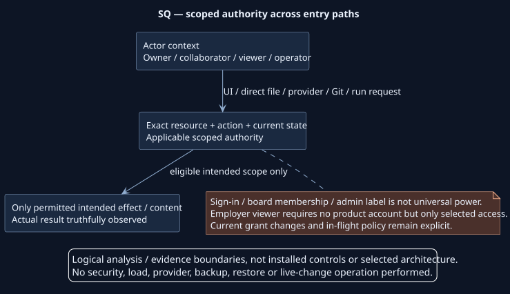

[Editable PlantUML](Diagrams/Security-Scoped-Authority.puml) · 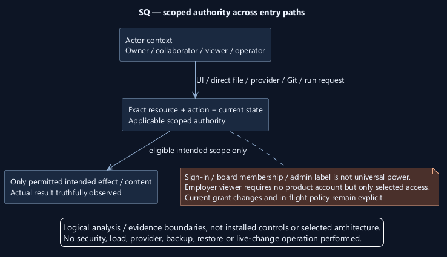

###### Permission/state consequences

A confirmed effective link/grant/account change governs applicable subsequent checks. Existing sessions, cache, ranges and in-flight output need their own reviewed policy; already emitted or downloaded bytes cannot be recalled. Account suspension/closure eligibility is not physical data purge, and authentication recovery does not bypass suspension. Reinstatement or restored old records do not automatically grant unrelated powers.

The matrix preserves current source distinctions rather than inventing an owner/editor/viewer hierarchy, invitation expiry, authentication factor, credential lifetime, arbitrary admin access or hidden inheritance. Full goal-specific permission policy and actual negative tests remain acceptance work. Administrative root SSH previously used for host inspection is separate from application roles and product Git-client access; this file does not audit or change host SSH.

##### 2. Trust and execution boundaries

###### Information-handling applicability status

[DOM-D06](../02-Requirements-Engineering/01-Software-Requirements-Specification.md#requirements-specification-domain-requirements-and-constraints--heading-dom-d06-establish-information-handling-applicability) requires an actual applicability assessment before accepting affected operating requirements. The following is a source-derived investigation entry point, not a legal conclusion or a completed assessment of deployed data flows. Farhad owns the follow-up; that project responsibility does not determine a legal controller/processor role.

| Intended information | Purpose and recipient boundary |
| --- | --- |
| Profile, tailored resume and selected evidence | Owner preparation; employer receives only selected protected presentation |
| Application progress and actual submitted material | Manual tracking and independent actual history; no automatic external submission implied |
| Mail/calendar and provider account context | Selected authorized Google interactions; product login is not whole-account provider permission |
| Work, repository, execution and output records | Resource-specific collaboration; execution and target powers remain separate |
| Credentials, diagnostics and recovery material | Restricted operation and recovery; not ordinary public output or unrestricted logs |

Hosting/provider flows must be confirmed against the actual operating model, not inferred from the historical demo or target diagrams. For each category record retention/deletion decisions, backup inclusion/exclusion and access/revocation consequences. Current defaults, durations and backup coverage are not approved by this table.

For every asserted external obligation record authoritative source, date, applicability rationale and affected requirement. Actual controller/processor roles, user locations, contractual arrangements, notices/rights handling and jurisdiction questions remain unresolved. No obligation, compliance certification or legal conclusion is asserted here; server location alone does not settle applicability.

Trust is attached to specific information and powers, not simply to a signed-in actor. Uploaded/embedded/provider content and repository/workflow code remain untrusted for the relevant processing/display/execution boundary. Private records, credentials/keys, actual history, outputs, diagnostic evidence and recovery material have distinct confidentiality/integrity/access needs. No concrete data classification or legal applicability finding is newly approved here.

| Record | Details |
| --- | --- |
| Private professional/application/mail/work content | [Read record](#analysis-interfaces-security-and-quality-analysis--13-security-quality-and-operational-analysis--id-sq-detail-2-1) |
| Link/password/provider/Git/execution credentials and required recovery keys | [Read record](#analysis-interfaces-security-and-quality-analysis--13-security-quality-and-operational-analysis--id-sq-detail-2-2) |
| Uploaded rich/media/file/provider content | [Read record](#analysis-interfaces-security-and-quality-analysis--13-security-quality-and-operational-analysis--id-sq-detail-2-3) |
| Repository code and YAML definitions | [Read record](#analysis-interfaces-security-and-quality-analysis--13-security-quality-and-operational-analysis--id-sq-detail-2-4) |
| Run outputs/logs/artifacts and diagnostics | [Read record](#analysis-interfaces-security-and-quality-analysis--13-security-quality-and-operational-analysis--id-sq-detail-2-5) |
| Recovery point and restored state | [Read record](#analysis-interfaces-security-and-quality-analysis--13-security-quality-and-operational-analysis--id-sq-detail-2-6) |

###### Private professional/application/mail/work content

**Required logical distinction:**

Resource-specific authority; sharing/collaboration scope does not widen to unrelated private data

**Evidence or policy still needed:**

Complete relevant actor/action/state/direct-entry examples and actual enforcement

###### Link/password/provider/Git/execution credentials and required recovery keys

**After MVP.** Shared operating and recovery controls still apply where relevant.

**Required logical distinction:**

Secret values excluded from ordinary logs/errors/repos/examples; legitimate access/renewal/revocation/recovery scoped

**Evidence or policy still needed:**

Selected transport/storage/credential/key lifecycle controls and actual configuration; no cipher/version invented

###### Uploaded rich/media/file/provider content

**Required logical distinction:**

Accepted input permission is not validation or safe rendering/serving

**Evidence or policy still needed:**

Supported meaning/types, validation depth, safe display/embedding and controlled cases; no assumed scanner/sanitizer

###### Repository code and YAML definitions

**Required logical distinction:**

A supported definition and repository grant do not permit arbitrary host/network/secret/target access

**Evidence or policy still needed:**

Actual supported execution contract and suitable isolation/resource/secret/network/output/cleanup evidence before enablement

###### Run outputs/logs/artifacts and diagnostics

**Required logical distinction:**

Result availability, scope, secret safety and evidence integrity differ from job success

**Evidence or policy still needed:**

Selected output access, events/retention/attribution and actual tests; no universal immutable audit

###### Recovery point and restored state

**Required logical distinction:**

Backup access/coverage, consistent candidate, current authority/external disposition and usable recovery differ

**Evidence or policy still needed:**

Actual protected source, isolated drill, scoped integrity/access/workflow/measurement evidence; no automatic replay

[Editable PlantUML](Diagrams/Security-Untrusted-Content-Execution.puml) · 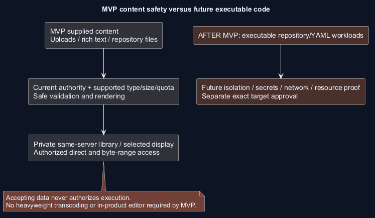

###### Source-derived trust/failure cases

These are candidate failure paths to evaluate, not confirmed exploitable vulnerabilities in the current server. No attack, content execution, credential inspection or security control test was performed.

| Record | Details |
| --- | --- |
| SQ-T01 — Altered private reference | [Read record](#analysis-interfaces-security-and-quality-analysis--13-security-quality-and-operational-analysis--id-sq-t01) |
| SQ-T02 — Changed link/password/grant | [Read record](#analysis-interfaces-security-and-quality-analysis--13-security-quality-and-operational-analysis--id-sq-t02) |
| SQ-T03 — Untrusted content crossing display/processing | [Read record](#analysis-interfaces-security-and-quality-analysis--13-security-quality-and-operational-analysis--id-sq-t03) |
| SQ-T04 — Workflow input reaching host/secret/target | [Read record](#analysis-interfaces-security-and-quality-analysis--13-security-quality-and-operational-analysis--id-sq-t04) |
| SQ-T05 — Wrong/revoked provider account | [Read record](#analysis-interfaces-security-and-quality-analysis--13-security-quality-and-operational-analysis--id-sq-t05) |
| SQ-T06 — Ambiguous send and duplicate action | [Read record](#analysis-interfaces-security-and-quality-analysis--13-security-quality-and-operational-analysis--id-sq-t06) |
| SQ-T07 — Reference/usage race during replacement | [Read record](#analysis-interfaces-security-and-quality-analysis--13-security-quality-and-operational-analysis--id-sq-t07) |
| SQ-T08 — Stale Git integration context | [Read record](#analysis-interfaces-security-and-quality-analysis--13-security-quality-and-operational-analysis--id-sq-t08) |
| SQ-T09 — Sensitive result/diagnostic disclosure | [Read record](#analysis-interfaces-security-and-quality-analysis--13-security-quality-and-operational-analysis--id-sq-t09) |
| SQ-T10 — Old access/external effects after restore | [Read record](#analysis-interfaces-security-and-quality-analysis--13-security-quality-and-operational-analysis--id-sq-t10) |
| SQ-T11 — False health/audit confidence | [Read record](#analysis-interfaces-security-and-quality-analysis--13-security-quality-and-operational-analysis--id-sq-t11) |
| SQ-T12 — Competing workload saturation | [Read record](#analysis-interfaces-security-and-quality-analysis--13-security-quality-and-operational-analysis--id-sq-t12) |

###### SQ-T01 — Altered private reference

**Path and required boundary:**

A valid user/collaborator supplies another private resource identifier through UI/file/provider/Git entry. **Boundary:** Current exact resource/action authority is not implied by sign-in, guessed identifier or unrelated membership.

**Planned bounded evidence:**

Allowed/denied direct/list/search cases for reviewed scopes without disclosing protected content.

**Basis / model context:**

[QSR-D05](../02-Requirements-Engineering/01-Software-Requirements-Specification.md#requirements-specification-quality-security-and-recovery-requirements--heading-qsr-d05-identity-resource-isolation-and-changed-access), [ACC-D04](../02-Requirements-Engineering/01-Software-Requirements-Specification.md#requirements-specification-accounts-authentication-and-permissions--heading-acc-d04-cross-user-private-data-isolation), [ACC-D05](../02-Requirements-Engineering/01-Software-Requirements-Specification.md#requirements-specification-accounts-authentication-and-permissions--heading-acc-d05-limited-collaboration-authority), [EIF-D03](../02-Requirements-Engineering/01-Software-Requirements-Specification.md#requirements-specification-external-interface-requirements--heading-eif-d03-consistent-authorization-across-entry-paths); [IF-01](#analysis-interfaces-security-and-quality-analysis--12-interfaces-and-external-interactions--id-if-01), [IF-02](#analysis-interfaces-security-and-quality-analysis--12-interfaces-and-external-interactions--id-if-02), [IF-03](#analysis-interfaces-security-and-quality-analysis--12-interfaces-and-external-interactions--id-if-03), [IF-06](#analysis-interfaces-security-and-quality-analysis--12-interfaces-and-external-interactions--id-if-06), [RB-D01](03-Processes-Scenarios-And-Business-Rules.md#analysis-business-rules-and-operation-contracts--09-rule-based-view--id-rb-d01)

###### SQ-T02 — Changed link/password/grant

**Path and required boundary:**

A fresh or already-open request outlives a relevant confirmed rights change. **Boundary:** Fresh disabled-link denial is required; existing/in-flight/cached delivery requires its separately reviewed policy; no recall of delivered bytes.

**Planned bounded evidence:**

Controlled fresh/current-session/in-flight cases with actual effective change and explicit applicable policy.

**Basis / model context:**

[QSR-D05](../02-Requirements-Engineering/01-Software-Requirements-Specification.md#requirements-specification-quality-security-and-recovery-requirements--heading-qsr-d05-identity-resource-isolation-and-changed-access), [ACC-D12](../02-Requirements-Engineering/01-Software-Requirements-Specification.md#requirements-specification-accounts-authentication-and-permissions--heading-acc-d12-end-of-access-and-lifecycle-enforcement), [PDF-D06](../02-Requirements-Engineering/01-Software-Requirements-Specification.md#requirements-specification-pdf-and-controlled-sharing--heading-pdf-d06-owner-password-and-link-controls); [IF-02](#analysis-interfaces-security-and-quality-analysis--12-interfaces-and-external-interactions--id-if-02), [SM-M04](03-Processes-Scenarios-And-Business-Rules.md#analysis-behavioral-and-scenario-analysis--07-state-based-view--id-sm-m04), [RB-D05](03-Processes-Scenarios-And-Business-Rules.md#analysis-business-rules-and-operation-contracts--09-rule-based-view--id-rb-d05)

###### SQ-T03 — Untrusted content crossing display/processing

**Path and required boundary:**

Authorized upload/embed or provider content is malformed/unsupported or interpreted outside permitted content meaning. **Boundary:** Authority to supply data is not proof of trusted/safe content or permission to execute code.

**Planned bounded evidence:**

Reviewed valid/invalid/unsafe content and safe serving/display cases; no live hostile test here.

**Basis / model context:**

[QSR-D06](../02-Requirements-Engineering/01-Software-Requirements-Specification.md#requirements-specification-quality-security-and-recovery-requirements--heading-qsr-d06-sensitive-information-and-secret-protection), [QSR-D07](../02-Requirements-Engineering/01-Software-Requirements-Specification.md#requirements-specification-quality-security-and-recovery-requirements--heading-qsr-d07-safe-content-and-untrusted-execution-boundaries), [AFO-D05](../02-Requirements-Engineering/01-Software-Requirements-Specification.md#requirements-specification-administration-files-and-operational-behavior--heading-afo-d05-supported-content-and-validation), [EIF-D04](../02-Requirements-Engineering/01-Software-Requirements-Specification.md#requirements-specification-external-interface-requirements--heading-eif-d04-protected-file-and-pdf-exchange); [IF-03](#analysis-interfaces-security-and-quality-analysis--12-interfaces-and-external-interactions--id-if-03), [SM-M05](03-Processes-Scenarios-And-Business-Rules.md#analysis-behavioral-and-scenario-analysis--07-state-based-view--id-sm-m05), [RB-D14](03-Processes-Scenarios-And-Business-Rules.md#analysis-business-rules-and-operation-contracts--09-rule-based-view--id-rb-d14)

###### SQ-T04 — Workflow input reaching host/secret/target

**After MVP.** Shared operating and recovery controls still apply where relevant.

**Path and required boundary:**

Repository/workflow content requests resources, credentials, network or deployment powers beyond reviewed contract. **Boundary:** Actual suitable isolation/permission/resource/secret/target evidence required before enablement; no arbitrary host authority.

**Planned bounded evidence:**

Later explicitly authorized isolated negative/positive execution cases only after enabling gates.

**Basis / model context:**

[QSR-D07](../02-Requirements-Engineering/01-Software-Requirements-Specification.md#requirements-specification-quality-security-and-recovery-requirements--heading-qsr-d07-safe-content-and-untrusted-execution-boundaries), [YML-D04](../02-Requirements-Engineering/01-Software-Requirements-Specification.md#requirements-specification-yaml-workflows-and-cicd--heading-yml-d04-isolation-and-untrusted-code-boundary), [YML-D05](../02-Requirements-Engineering/01-Software-Requirements-Specification.md#requirements-specification-yaml-workflows-and-cicd--heading-yml-d05-scoped-secrets-and-credentials), [YML-D06](../02-Requirements-Engineering/01-Software-Requirements-Specification.md#requirements-specification-yaml-workflows-and-cicd--heading-yml-d06-resource-admission-and-limits), [YML-D10](../02-Requirements-Engineering/01-Software-Requirements-Specification.md#requirements-specification-yaml-workflows-and-cicd--heading-yml-d10-separate-controlled-deployment-stage), [YML-D12](../02-Requirements-Engineering/01-Software-Requirements-Specification.md#requirements-specification-yaml-workflows-and-cicd--heading-yml-d12-feasibility-operational-guidance-and-enabling-gate); [IF-07](#analysis-interfaces-security-and-quality-analysis--12-interfaces-and-external-interactions--id-if-07), [RB-D12](03-Processes-Scenarios-And-Business-Rules.md#analysis-business-rules-and-operation-contracts--09-rule-based-view--id-rb-d12), [RB-D13](03-Processes-Scenarios-And-Business-Rules.md#analysis-business-rules-and-operation-contracts--09-rule-based-view--id-rb-d13)

###### SQ-T05 — Wrong/revoked provider account

**Path and required boundary:**

A product login or retained connection record is treated as actual permission for another account/operation. **Boundary:** Selected current account and operation capability are independent of product grants; retained copies not necessarily fresh.

**Planned bounded evidence:**

Intended/wrong-account/revoked/denied capability cases when actual controlled access exists.

**Basis / model context:**

[QSR-D05](../02-Requirements-Engineering/01-Software-Requirements-Specification.md#requirements-specification-quality-security-and-recovery-requirements--heading-qsr-d05-identity-resource-isolation-and-changed-access), [EGC-D01](../02-Requirements-Engineering/01-Software-Requirements-Specification.md#requirements-specification-email-calendar-and-google-integration--heading-egc-d01-authorized-connection-and-account-context), [EGC-D02](../02-Requirements-Engineering/01-Software-Requirements-Specification.md#requirements-specification-email-calendar-and-google-integration--heading-egc-d02-justified-permissions-and-private-resource-isolation), [EGC-D11](../02-Requirements-Engineering/01-Software-Requirements-Specification.md#requirements-specification-email-calendar-and-google-integration--heading-egc-d11-disconnect-revocation-and-reconnect); [IF-04](#analysis-interfaces-security-and-quality-analysis--12-interfaces-and-external-interactions--id-if-04), [IF-05](#analysis-interfaces-security-and-quality-analysis--12-interfaces-and-external-interactions--id-if-05), [SM-M08](03-Processes-Scenarios-And-Business-Rules.md#analysis-behavioral-and-scenario-analysis--07-state-based-view--id-sm-m08)

###### SQ-T06 — Ambiguous send and duplicate action

**Path and required boundary:**

Response lost or final content changed but old confirmation/automatic retry is reused. **Boundary:** Exact final review and same-attempt reconciliation; acceptance not delivery/read and no blind resend.

**Planned bounded evidence:**

Changed final attachment and ambiguous acceptance cases using controlled future recipients after access setup.

**Basis / model context:**

[QSR-D08](../02-Requirements-Engineering/01-Software-Requirements-Specification.md#requirements-specification-quality-security-and-recovery-requirements--heading-qsr-d08-data-integrity-and-truthful-completion), [EGC-D05](../02-Requirements-Engineering/01-Software-Requirements-Specification.md#requirements-specification-email-calendar-and-google-integration--heading-egc-d05-deliberate-send-and-truthful-outcome), [EGC-D12](../02-Requirements-Engineering/01-Software-Requirements-Specification.md#requirements-specification-email-calendar-and-google-integration--heading-egc-d12-bounded-failures-recovery-and-feasibility-evidence), [EIF-D08](../02-Requirements-Engineering/01-Software-Requirements-Specification.md#requirements-specification-external-interface-requirements--heading-eif-d08-operation-specific-failure-and-repetition-semantics); [IF-04](#analysis-interfaces-security-and-quality-analysis--12-interfaces-and-external-interactions--id-if-04), [SM-M09](03-Processes-Scenarios-And-Business-Rules.md#analysis-behavioral-and-scenario-analysis--07-state-based-view--id-sm-m09), [RB-D07](03-Processes-Scenarios-And-Business-Rules.md#analysis-business-rules-and-operation-contracts--09-rule-based-view--id-rb-d07)

###### SQ-T07 — Reference/usage race during replacement

**Path and required boundary:**

New admissions or cleanup rely on stale capacity/reference state and harm protected retained history. **Boundary:** Current effective policy/actual reference contract; eligibility/admission not usable completion or freed bytes.

**Planned bounded evidence:**

Concurrent growth, failed replacement, protected reference and partial cleanup cases under defined accounting.

**Basis / model context:**

[QSR-D02](../02-Requirements-Engineering/01-Software-Requirements-Specification.md#requirements-specification-quality-security-and-recovery-requirements--heading-qsr-d02-combined-capacity-and-bounded-resource-use), [QSR-D08](../02-Requirements-Engineering/01-Software-Requirements-Specification.md#requirements-specification-quality-security-and-recovery-requirements--heading-qsr-d08-data-integrity-and-truthful-completion), [QSR-D09](../02-Requirements-Engineering/01-Software-Requirements-Specification.md#requirements-specification-quality-security-and-recovery-requirements--heading-qsr-d09-deliberate-retention-and-reference-aware-removal), [AFO-D04](../02-Requirements-Engineering/01-Software-Requirements-Specification.md#requirements-specification-administration-files-and-operational-behavior--heading-afo-d04-aggregate-quota-and-concurrent-admission), [AFO-D07](../02-Requirements-Engineering/01-Software-Requirements-Specification.md#requirements-specification-administration-files-and-operational-behavior--heading-afo-d07-truthful-completion-and-interrupted-operation-handling), [AFO-D11](../02-Requirements-Engineering/01-Software-Requirements-Specification.md#requirements-specification-administration-files-and-operational-behavior--heading-afo-d11-bounded-cleanup-and-storage-reclamation); [IF-03](#analysis-interfaces-security-and-quality-analysis--12-interfaces-and-external-interactions--id-if-03), [RB-D14](03-Processes-Scenarios-And-Business-Rules.md#analysis-business-rules-and-operation-contracts--09-rule-based-view--id-rb-d14), [RB-D15](03-Processes-Scenarios-And-Business-Rules.md#analysis-business-rules-and-operation-contracts--09-rule-based-view--id-rb-d15)

###### SQ-T08 — Stale Git integration context

**Path and required boundary:**

Source/target changes after review/check or prior ref effect is unknown. **Boundary:** Exact current evaluated revisions/authority and actual ref result govern integration, not moving names or stale approval.

**Planned bounded evidence:**

Changed-source/target/protected-ref/conflict/unknown integration cases in later supported isolated real-client environment.

**Basis / model context:**

[QSR-D05](../02-Requirements-Engineering/01-Software-Requirements-Specification.md#requirements-specification-quality-security-and-recovery-requirements--heading-qsr-d05-identity-resource-isolation-and-changed-access), [QSR-D08](../02-Requirements-Engineering/01-Software-Requirements-Specification.md#requirements-specification-quality-security-and-recovery-requirements--heading-qsr-d08-data-integrity-and-truthful-completion), [GIT-D04](../02-Requirements-Engineering/01-Software-Requirements-Specification.md#requirements-specification-git-hosting-and-collaboration--heading-git-d04-branches-files-and-history-browsing), [GIT-D07](../02-Requirements-Engineering/01-Software-Requirements-Specification.md#requirements-specification-git-hosting-and-collaboration--heading-git-d07-controlled-merge-and-conflict-outcomes); [IF-06](#analysis-interfaces-security-and-quality-analysis--12-interfaces-and-external-interactions--id-if-06), [SM-M13](03-Processes-Scenarios-And-Business-Rules.md#analysis-behavioral-and-scenario-analysis--07-state-based-view--id-sm-m13), [RB-D11](03-Processes-Scenarios-And-Business-Rules.md#analysis-business-rules-and-operation-contracts--09-rule-based-view--id-rb-d11)

###### SQ-T09 — Sensitive result/diagnostic disclosure

**Path and required boundary:**

Run logs/artifacts, provider errors or ordinary diagnostics expose credentials/private content or allow unrelated read. **Boundary:** Explicit bounded output/evidence access and secret-safe representation; ownership of another context is insufficient.

**Planned bounded evidence:**

Synthetic sensitive markers and unauthorized output/reference cases; no real secret values printed.

**Basis / model context:**

[QSR-D06](../02-Requirements-Engineering/01-Software-Requirements-Specification.md#requirements-specification-quality-security-and-recovery-requirements--heading-qsr-d06-sensitive-information-and-secret-protection), [QSR-D13](../02-Requirements-Engineering/01-Software-Requirements-Specification.md#requirements-specification-quality-security-and-recovery-requirements--heading-qsr-d13-useful-restricted-operational-evidence), [YML-D08](../02-Requirements-Engineering/01-Software-Requirements-Specification.md#requirements-specification-yaml-workflows-and-cicd--heading-yml-d08-restricted-logs-and-artifacts), [AFO-D09](../02-Requirements-Engineering/01-Software-Requirements-Specification.md#requirements-specification-administration-files-and-operational-behavior--heading-afo-d09-operational-outcomes-and-capacity-warnings); [IF-07](#analysis-interfaces-security-and-quality-analysis--12-interfaces-and-external-interactions--id-if-07), [IF-08](#analysis-interfaces-security-and-quality-analysis--12-interfaces-and-external-interactions--id-if-08), [RB-D01](03-Processes-Scenarios-And-Business-Rules.md#analysis-business-rules-and-operation-contracts--09-rule-based-view--id-rb-d01)

###### SQ-T10 — Old access/external effects after restore

**Path and required boundary:**

Restored grants/mappings/pending actions differ from current rights/provider/ref/target state. **Boundary:** Current access and external disposition need explicit reconciliation; no old-right activation or blind replay.

**Planned bounded evidence:**

Later isolated old-grant/revocation/pending-send/job/deleted-data examples with defined expected dispositions.

**Basis / model context:**

[QSR-D11](../02-Requirements-Engineering/01-Software-Requirements-Specification.md#requirements-specification-quality-security-and-recovery-requirements--heading-qsr-d11-demonstrated-restoration-and-recovery-targets), [QSR-D12](../02-Requirements-Engineering/01-Software-Requirements-Specification.md#requirements-specification-quality-security-and-recovery-requirements--heading-qsr-d12-safe-restored-access-and-external-state-reconciliation), [BRL-D09](../02-Requirements-Engineering/01-Software-Requirements-Specification.md#requirements-specification-business-rules-and-data-lifecycle--heading-brl-d09-recovery-preserves-defined-business-consistency); [IF-08](#analysis-interfaces-security-and-quality-analysis--12-interfaces-and-external-interactions--id-if-08), [SM-M17](03-Processes-Scenarios-And-Business-Rules.md#analysis-behavioral-and-scenario-analysis--07-state-based-view--id-sm-m17), [RB-D16](03-Processes-Scenarios-And-Business-Rules.md#analysis-business-rules-and-operation-contracts--09-rule-based-view--id-rb-d16)

###### SQ-T11 — False health/audit confidence

**Path and required boundary:**

A successful page, incomplete evidence or procedure output is treated as all-service health/security/recovery proof. **Boundary:** Actual bounded evidence with environment/coverage/result/limits; no immutable audit or generic security certification.

**Planned bounded evidence:**

Selected event/evidence-access and missing/partial-result cases; compare exact scoped success definition.

**Basis / model context:**

[QSR-D04](../02-Requirements-Engineering/01-Software-Requirements-Specification.md#requirements-specification-quality-security-and-recovery-requirements--heading-qsr-d04-observable-availability-and-controlled-degradation), [QSR-D13](../02-Requirements-Engineering/01-Software-Requirements-Specification.md#requirements-specification-quality-security-and-recovery-requirements--heading-qsr-d13-useful-restricted-operational-evidence), [QSR-D14](../02-Requirements-Engineering/01-Software-Requirements-Specification.md#requirements-specification-quality-security-and-recovery-requirements--heading-qsr-d14-maintainable-verifiable-and-recoverable-changes), [AFO-D12](../02-Requirements-Engineering/01-Software-Requirements-Specification.md#requirements-specification-administration-files-and-operational-behavior--heading-afo-d12-version-specific-operational-guidance-and-readiness); [IF-08](#analysis-interfaces-security-and-quality-analysis--12-interfaces-and-external-interactions--id-if-08), [SM-M18](03-Processes-Scenarios-And-Business-Rules.md#analysis-behavioral-and-scenario-analysis--07-state-based-view--id-sm-m18), [RB-D18](03-Processes-Scenarios-And-Business-Rules.md#analysis-business-rules-and-operation-contracts--09-rule-based-view--id-rb-d18)

###### SQ-T12 — Competing workload saturation

**Path and required boundary:**

Uploads/media/Git/conditional processing compete with baseline services or recovery/maintenance work. **Boundary:** Actual mixed-workload/resource/limit/degradation contract required; no extrapolation from idle usage or user count.

**Planned bounded evidence:**

Later bounded mixed workload and saturation cases after exact environment/limits/stop conditions are authorized.

**Basis / model context:**

[QSR-D01](../02-Requirements-Engineering/01-Software-Requirements-Specification.md#requirements-specification-quality-security-and-recovery-requirements--heading-qsr-d01-response-performance-under-defined-workloads), [QSR-D02](../02-Requirements-Engineering/01-Software-Requirements-Specification.md#requirements-specification-quality-security-and-recovery-requirements--heading-qsr-d02-combined-capacity-and-bounded-resource-use), [QSR-D04](../02-Requirements-Engineering/01-Software-Requirements-Specification.md#requirements-specification-quality-security-and-recovery-requirements--heading-qsr-d04-observable-availability-and-controlled-degradation), [YML-D06](../02-Requirements-Engineering/01-Software-Requirements-Specification.md#requirements-specification-yaml-workflows-and-cicd--heading-yml-d06-resource-admission-and-limits), [AFO-D04](../02-Requirements-Engineering/01-Software-Requirements-Specification.md#requirements-specification-administration-files-and-operational-behavior--heading-afo-d04-aggregate-quota-and-concurrent-admission); [IF-03](#analysis-interfaces-security-and-quality-analysis--12-interfaces-and-external-interactions--id-if-03), [IF-06](#analysis-interfaces-security-and-quality-analysis--12-interfaces-and-external-interactions--id-if-06), [IF-07](#analysis-interfaces-security-and-quality-analysis--12-interfaces-and-external-interactions--id-if-07), [IF-08](#analysis-interfaces-security-and-quality-analysis--12-interfaces-and-external-interactions--id-if-08), [RB-D14](03-Processes-Scenarios-And-Business-Rules.md#analysis-business-rules-and-operation-contracts--09-rule-based-view--id-rb-d14)

##### 3. Quality scenarios

All 14 primary QSR candidates have a source-aligned scenario below. Each identifies source/stimulus, environment/artifact, expected response, measure and remaining decision. These are planned evidence contracts, not benchmarks, stakeholder acceptance or a new set of approved quality targets. An unperformed or unresolved scenario is not Pass.

###### Scenario inventory

| Scenario | Primary quality candidate | Current evidence state |
| --- | --- | --- |
| [SQ-Q01](#analysis-interfaces-security-and-quality-analysis--13-security-quality-and-operational-analysis--id-sq-q01) — Workflow response performance | [QSR-D01](../02-Requirements-Engineering/01-Software-Requirements-Specification.md#requirements-specification-quality-security-and-recovery-requirements--heading-qsr-d01-response-performance-under-defined-workloads) | Not performed by this analysis; no Pass |
| [SQ-Q02](#analysis-interfaces-security-and-quality-analysis--13-security-quality-and-operational-analysis--id-sq-q02) — Combined resource capacity | [QSR-D02](../02-Requirements-Engineering/01-Software-Requirements-Specification.md#requirements-specification-quality-security-and-recovery-requirements--heading-qsr-d02-combined-capacity-and-bounded-resource-use) | Not performed by this analysis; no Pass |
| [SQ-Q03](#analysis-interfaces-security-and-quality-analysis--13-security-quality-and-operational-analysis--id-sq-q03) — Operable accessible supported interaction | [QSR-D03](../02-Requirements-Engineering/01-Software-Requirements-Specification.md#requirements-specification-quality-security-and-recovery-requirements--heading-qsr-d03-operable-accessible-and-compatible-interaction) | Not performed by this analysis; no Pass |
| [SQ-Q04](#analysis-interfaces-security-and-quality-analysis--13-security-quality-and-operational-analysis--id-sq-q04) — Availability and bounded degradation | [QSR-D04](../02-Requirements-Engineering/01-Software-Requirements-Specification.md#requirements-specification-quality-security-and-recovery-requirements--heading-qsr-d04-observable-availability-and-controlled-degradation) | Not performed by this analysis; no Pass |
| [SQ-Q05](#analysis-interfaces-security-and-quality-analysis--13-security-quality-and-operational-analysis--id-sq-q05) — Resource isolation and changed access | [QSR-D05](../02-Requirements-Engineering/01-Software-Requirements-Specification.md#requirements-specification-quality-security-and-recovery-requirements--heading-qsr-d05-identity-resource-isolation-and-changed-access) | Not performed by this analysis; no Pass |
| [SQ-Q06](#analysis-interfaces-security-and-quality-analysis--13-security-quality-and-operational-analysis--id-sq-q06) — Sensitive information and secrets | [QSR-D06](../02-Requirements-Engineering/01-Software-Requirements-Specification.md#requirements-specification-quality-security-and-recovery-requirements--heading-qsr-d06-sensitive-information-and-secret-protection) | Not performed by this analysis; no Pass |
| [SQ-Q07](#analysis-interfaces-security-and-quality-analysis--13-security-quality-and-operational-analysis--id-sq-q07) — Untrusted content and execution boundary | [QSR-D07](../02-Requirements-Engineering/01-Software-Requirements-Specification.md#requirements-specification-quality-security-and-recovery-requirements--heading-qsr-d07-safe-content-and-untrusted-execution-boundaries) | Not performed by this analysis; no Pass |
| [SQ-Q08](#analysis-interfaces-security-and-quality-analysis--13-security-quality-and-operational-analysis--id-sq-q08) — Integrity and truthful completion | [QSR-D08](../02-Requirements-Engineering/01-Software-Requirements-Specification.md#requirements-specification-quality-security-and-recovery-requirements--heading-qsr-d08-data-integrity-and-truthful-completion) | Not performed by this analysis; no Pass |
| [SQ-Q09](#analysis-interfaces-security-and-quality-analysis--13-security-quality-and-operational-analysis--id-sq-q09) — Retention and reference-aware removal | [QSR-D09](../02-Requirements-Engineering/01-Software-Requirements-Specification.md#requirements-specification-quality-security-and-recovery-requirements--heading-qsr-d09-deliberate-retention-and-reference-aware-removal) | Not performed by this analysis; no Pass |
| [SQ-Q10](#analysis-interfaces-security-and-quality-analysis--13-security-quality-and-operational-analysis--id-sq-q10) — Protected observable covered backup | [QSR-D10](../02-Requirements-Engineering/01-Software-Requirements-Specification.md#requirements-specification-quality-security-and-recovery-requirements--heading-qsr-d10-defined-protected-and-observable-backups) | Not performed by this analysis; no Pass |
| [SQ-Q11](#analysis-interfaces-security-and-quality-analysis--13-security-quality-and-operational-analysis--id-sq-q11) — Demonstrated scoped usable restoration | [QSR-D11](../02-Requirements-Engineering/01-Software-Requirements-Specification.md#requirements-specification-quality-security-and-recovery-requirements--heading-qsr-d11-demonstrated-restoration-and-recovery-targets) | Not performed by this analysis; no Pass |
| [SQ-Q12](#analysis-interfaces-security-and-quality-analysis--13-security-quality-and-operational-analysis--id-sq-q12) — Restored access and external reconciliation | [QSR-D12](../02-Requirements-Engineering/01-Software-Requirements-Specification.md#requirements-specification-quality-security-and-recovery-requirements--heading-qsr-d12-safe-restored-access-and-external-state-reconciliation) | Not performed by this analysis; no Pass |
| [SQ-Q13](#analysis-interfaces-security-and-quality-analysis--13-security-quality-and-operational-analysis--id-sq-q13) — Useful restricted operational evidence | [QSR-D13](../02-Requirements-Engineering/01-Software-Requirements-Specification.md#requirements-specification-quality-security-and-recovery-requirements--heading-qsr-d13-useful-restricted-operational-evidence) | Not performed by this analysis; no Pass |
| [SQ-Q14](#analysis-interfaces-security-and-quality-analysis--13-security-quality-and-operational-analysis--id-sq-q14) — Version-specific maintainable/recoverable change | [QSR-D14](../02-Requirements-Engineering/01-Software-Requirements-Specification.md#requirements-specification-quality-security-and-recovery-requirements--heading-qsr-d14-maintainable-verifiable-and-recoverable-changes) | Not performed by this analysis; no Pass |

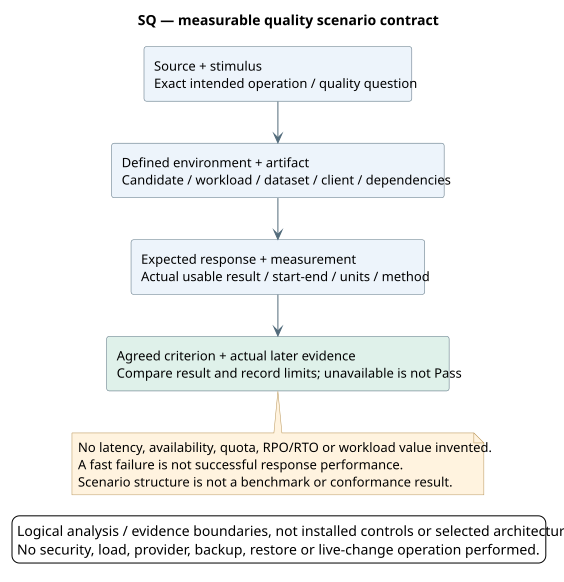

[Editable PlantUML](Diagrams/Quality-Scenario-Measurement.puml) · 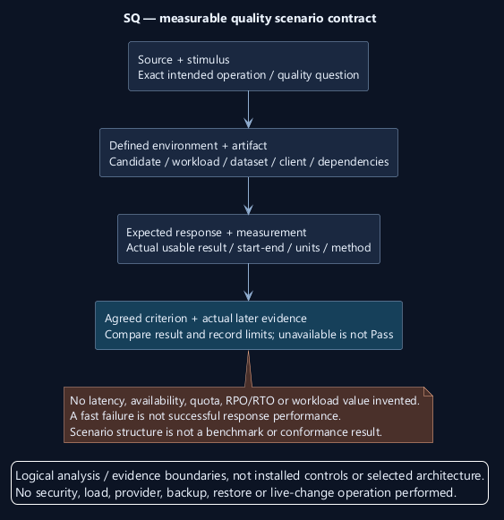

###### SQ-Q01 — Workflow response performance

**After MVP.** Shared operating and recovery controls still apply where relevant.

**Source requirement:** [QSR-D01](../02-Requirements-Engineering/01-Software-Requirements-Specification.md#requirements-specification-quality-security-and-recovery-requirements--heading-qsr-d01-response-performance-under-defined-workloads)

**Stimulus source / event:** Authorized supported user/client. Requests an agreed core interactive or transfer operation.

**Environment / artifact:** Defined client/network/dataset and concurrent/background mix; relevant warm/cold/processing state identified. **Artifact:** Selected private/employer/file workflow.

**Expected response:** Return actual permitted usable result or truthful degraded/error state; a fast failure is not successful latency.

**Measurement / comparison meaning:** Elapsed duration between declared request submission and defined usable-result boundary; separate successful/failed/partial counts. Time unit and aggregation recorded for each later run.

**Decision/evidence still needed:** Select exact workloads, start/end, aggregation, threshold and test environment before performance acceptance.

**Selected model/operation context:** [IF-01](#analysis-interfaces-security-and-quality-analysis--12-interfaces-and-external-interactions--id-if-01), [IF-02](#analysis-interfaces-security-and-quality-analysis--12-interfaces-and-external-interactions--id-if-02), [IF-03](#analysis-interfaces-security-and-quality-analysis--12-interfaces-and-external-interactions--id-if-03); [DC-O02](03-Processes-Scenarios-And-Business-Rules.md#analysis-business-rules-and-operation-contracts--10-domain-constraints-and-operation-contracts--id-dc-o02), [DC-O03](03-Processes-Scenarios-And-Business-Rules.md#analysis-business-rules-and-operation-contracts--10-domain-constraints-and-operation-contracts--id-dc-o03), [DC-O06](03-Processes-Scenarios-And-Business-Rules.md#analysis-business-rules-and-operation-contracts--10-domain-constraints-and-operation-contracts--id-dc-o06). These are associations, not proof of complete criterion sufficiency.

**Status:** Awaiting execution. No target or policy decision recorded.

###### SQ-Q02 — Combined resource capacity

**Source requirement:** [QSR-D02](../02-Requirements-Engineering/01-Software-Requirements-Specification.md#requirements-specification-quality-security-and-recovery-requirements--heading-qsr-d02-combined-capacity-and-bounded-resource-use)

**Stimulus source / event:** Concurrent users/processing/Git/jobs plus baseline services. Competing defined work approaches actual configured admission/resource envelope.

**Environment / artifact:** Identified configuration and workload mix including file/temp/retained data, repository growth and eligible background work; no user-count-to-concurrency equivalence. **Artifact:** Shared CPU/memory/disk/network and actual effective admission.

**Expected response:** Respect reviewed actual limits and defined other-workflow behavior; no false completed work under saturation.

**Measurement / comparison meaning:** Observed resource usage/admitted/rejected/pending/failed work by defined interval and accounting units; distinguish retained/temporary growth.

**Decision/evidence still needed:** Define actual workload/data/concurrency budgets, limits/accounting and measurement method; no capacity extrapolation from idle readings.

**Selected model/operation context:** [IF-03](#analysis-interfaces-security-and-quality-analysis--12-interfaces-and-external-interactions--id-if-03), [IF-06](#analysis-interfaces-security-and-quality-analysis--12-interfaces-and-external-interactions--id-if-06), [IF-07](#analysis-interfaces-security-and-quality-analysis--12-interfaces-and-external-interactions--id-if-07), [RB-D14](03-Processes-Scenarios-And-Business-Rules.md#analysis-business-rules-and-operation-contracts--09-rule-based-view--id-rb-d14); [DC-O27](03-Processes-Scenarios-And-Business-Rules.md#analysis-business-rules-and-operation-contracts--10-domain-constraints-and-operation-contracts--id-dc-o27), [DC-O31](03-Processes-Scenarios-And-Business-Rules.md#analysis-business-rules-and-operation-contracts--10-domain-constraints-and-operation-contracts--id-dc-o31), [DC-O32](03-Processes-Scenarios-And-Business-Rules.md#analysis-business-rules-and-operation-contracts--10-domain-constraints-and-operation-contracts--id-dc-o32). These are associations, not proof of complete criterion sufficiency.

**Status:** Awaiting execution. No target or policy decision recorded.

###### SQ-Q03 — Operable accessible supported interaction

**Source requirement:** [QSR-D03](../02-Requirements-Engineering/01-Software-Requirements-Specification.md#requirements-specification-quality-security-and-recovery-requirements--heading-qsr-d03-operable-accessible-and-compatible-interaction)

**Stimulus source / event:** User/employer using agreed client/input/language context. Attempts representative form/navigation/error and long/media-rich content tasks.

**Environment / artifact:** Explicit client/viewport/input matrix, manual English/German examples and selected assistive/keyboard cases. **Artifact:** Supported interface states and controls.

**Expected response:** Expose context/action/field error and distinguish loading, empty, invalid, denied, incomplete and successful states without color alone.

**Measurement / comparison meaning:** Actual task completion and observed keyboard/focus/label/layout/error defects against selected case criteria; record environment and unresolved cases.

**Decision/evidence still needed:** Choose supported clients, accessibility standard/level if adopted, task measures and exact criteria; no conformance or native-app claim.

**Selected model/operation context:** [IF-01](#analysis-interfaces-security-and-quality-analysis--12-interfaces-and-external-interactions--id-if-01), [IF-02](#analysis-interfaces-security-and-quality-analysis--12-interfaces-and-external-interactions--id-if-02); [DC-O04](03-Processes-Scenarios-And-Business-Rules.md#analysis-business-rules-and-operation-contracts--10-domain-constraints-and-operation-contracts--id-dc-o04), [DC-O06](03-Processes-Scenarios-And-Business-Rules.md#analysis-business-rules-and-operation-contracts--10-domain-constraints-and-operation-contracts--id-dc-o06), [DC-O07](03-Processes-Scenarios-And-Business-Rules.md#analysis-business-rules-and-operation-contracts--10-domain-constraints-and-operation-contracts--id-dc-o07). These are associations, not proof of complete criterion sufficiency.

**Status:** Awaiting execution. No target or policy decision recorded.

###### SQ-Q04 — Availability and bounded degradation

**Source requirement:** [QSR-D04](../02-Requirements-Engineering/01-Software-Requirements-Specification.md#requirements-specification-quality-security-and-recovery-requirements--heading-qsr-d04-observable-availability-and-controlled-degradation)

**Stimulus source / event:** Dependency/local-path interruption. Covered required local/provider path becomes unavailable or returns uncertain effect.

**Environment / artifact:** Defined covered paths, observation interval, usable/degraded success meaning and maintenance treatment. **Artifact:** Product/provider operations and pending work.

**Expected response:** Expose reviewed unavailable/stale/pending/unknown state; reconcile effects without blind replay on return.

**Measurement / comparison meaning:** Actual observations by covered path/window and defined usable/degraded criteria; separately record outage and ambiguous operations.

**Decision/evidence still needed:** Agree availability target/window/maintenance/fallback/detection/restoration criteria before accepting a percentage or SLA.

**Selected model/operation context:** [IF-04](#analysis-interfaces-security-and-quality-analysis--12-interfaces-and-external-interactions--id-if-04), [IF-05](#analysis-interfaces-security-and-quality-analysis--12-interfaces-and-external-interactions--id-if-05), [IF-08](#analysis-interfaces-security-and-quality-analysis--12-interfaces-and-external-interactions--id-if-08), [RB-D18](03-Processes-Scenarios-And-Business-Rules.md#analysis-business-rules-and-operation-contracts--09-rule-based-view--id-rb-d18); [DC-O11](03-Processes-Scenarios-And-Business-Rules.md#analysis-business-rules-and-operation-contracts--10-domain-constraints-and-operation-contracts--id-dc-o11), [DC-O15](03-Processes-Scenarios-And-Business-Rules.md#analysis-business-rules-and-operation-contracts--10-domain-constraints-and-operation-contracts--id-dc-o15), [DC-O38](03-Processes-Scenarios-And-Business-Rules.md#analysis-business-rules-and-operation-contracts--10-domain-constraints-and-operation-contracts--id-dc-o38). These are associations, not proof of complete criterion sufficiency.

**Status:** Awaiting execution. No target or policy decision recorded.

###### SQ-Q05 — Resource isolation and changed access

**Source requirement:** [QSR-D05](../02-Requirements-Engineering/01-Software-Requirements-Specification.md#requirements-specification-quality-security-and-recovery-requirements--heading-qsr-d05-identity-resource-isolation-and-changed-access)

**Stimulus source / event:** Different actor, altered direct reference or changed grant. Requests protected UI/file/provider/Git/execution operation after or without applicable power.

**Environment / artifact:** Current intended account/grant/link state plus reviewed fresh-request and existing/in-flight policy. **Artifact:** Resource/action/entry-path permission boundary.

**Expected response:** Allow only exact current granted scope; protect private/unselected content and report denied/changed access without secrets.

**Measurement / comparison meaning:** Expected/actual results for each approved matrix row and direct path; distinguish unreviewed policy/unknown behavior from tested denial.

**Decision/evidence still needed:** Finalize applicable action/state/session/credential policy and controlled cases; matrix here is conditional, not blanket approval.

**Selected model/operation context:** [IF-01](#analysis-interfaces-security-and-quality-analysis--12-interfaces-and-external-interactions--id-if-01), [IF-02](#analysis-interfaces-security-and-quality-analysis--12-interfaces-and-external-interactions--id-if-02), [IF-03](#analysis-interfaces-security-and-quality-analysis--12-interfaces-and-external-interactions--id-if-03), [IF-06](#analysis-interfaces-security-and-quality-analysis--12-interfaces-and-external-interactions--id-if-06), [IF-07](#analysis-interfaces-security-and-quality-analysis--12-interfaces-and-external-interactions--id-if-07), [RB-D01](03-Processes-Scenarios-And-Business-Rules.md#analysis-business-rules-and-operation-contracts--09-rule-based-view--id-rb-d01); [DC-O05](03-Processes-Scenarios-And-Business-Rules.md#analysis-business-rules-and-operation-contracts--10-domain-constraints-and-operation-contracts--id-dc-o05), [DC-O06](03-Processes-Scenarios-And-Business-Rules.md#analysis-business-rules-and-operation-contracts--10-domain-constraints-and-operation-contracts--id-dc-o06), [DC-O20](03-Processes-Scenarios-And-Business-Rules.md#analysis-business-rules-and-operation-contracts--10-domain-constraints-and-operation-contracts--id-dc-o20), [DC-O21](03-Processes-Scenarios-And-Business-Rules.md#analysis-business-rules-and-operation-contracts--10-domain-constraints-and-operation-contracts--id-dc-o21), [DC-O39](03-Processes-Scenarios-And-Business-Rules.md#analysis-business-rules-and-operation-contracts--10-domain-constraints-and-operation-contracts--id-dc-o39). These are associations, not proof of complete criterion sufficiency.

**Status:** Awaiting execution. No target or policy decision recorded.

###### SQ-Q06 — Sensitive information and secrets

**Source requirement:** [QSR-D06](../02-Requirements-Engineering/01-Software-Requirements-Specification.md#requirements-specification-quality-security-and-recovery-requirements--heading-qsr-d06-sensitive-information-and-secret-protection)

**Stimulus source / event:** Ordinary output/diagnostic reader or unauthorized direct requester. Attempts to observe sensitive content/credential/configuration/recovery material.

**Environment / artifact:** Defined content classification, permitted recipients and selected actual transport/storage/credential controls. **Artifact:** Private records, tokens/passwords/keys, outputs/configuration and recovery material.

**Expected response:** Return only permitted bounded evidence; ordinary logs/errors/repository examples do not expose secrets or unrelated private content.

**Measurement / comparison meaning:** Controlled synthetic sensitive markers and authorized/denied access/output cases; actual configuration/protection/renewal evidence with real values excluded.

**Decision/evidence still needed:** Define classification, transport/storage/key/credential lifecycle and selected controls; no cipher/TLS version or legal certification is invented.

**Selected model/operation context:** [IF-03](#analysis-interfaces-security-and-quality-analysis--12-interfaces-and-external-interactions--id-if-03), [IF-04](#analysis-interfaces-security-and-quality-analysis--12-interfaces-and-external-interactions--id-if-04), [IF-07](#analysis-interfaces-security-and-quality-analysis--12-interfaces-and-external-interactions--id-if-07), [IF-08](#analysis-interfaces-security-and-quality-analysis--12-interfaces-and-external-interactions--id-if-08); [DC-O12](03-Processes-Scenarios-And-Business-Rules.md#analysis-business-rules-and-operation-contracts--10-domain-constraints-and-operation-contracts--id-dc-o12), [DC-O27](03-Processes-Scenarios-And-Business-Rules.md#analysis-business-rules-and-operation-contracts--10-domain-constraints-and-operation-contracts--id-dc-o27), [DC-O33](03-Processes-Scenarios-And-Business-Rules.md#analysis-business-rules-and-operation-contracts--10-domain-constraints-and-operation-contracts--id-dc-o33), [DC-O37](03-Processes-Scenarios-And-Business-Rules.md#analysis-business-rules-and-operation-contracts--10-domain-constraints-and-operation-contracts--id-dc-o37). These are associations, not proof of complete criterion sufficiency.

**Status:** Awaiting execution. No target or policy decision recorded.

###### SQ-Q07 — Untrusted content and execution boundary

**Source requirement:** [QSR-D07](../02-Requirements-Engineering/01-Software-Requirements-Specification.md#requirements-specification-quality-security-and-recovery-requirements--heading-qsr-d07-safe-content-and-untrusted-execution-boundaries)

**Stimulus source / event:** Authorized uploader/client supplies untrusted content/code. Malformed/unsupported/unsafe content or workflow attempts cross content/host/secret/network/resource boundary.

**Environment / artifact:** Reviewed safe content cases; execution tests only in separately authorized suitable isolated environment after enabling gate. **Artifact:** Content validation/serving and conditional run/target boundaries.

**Expected response:** Reject or safely expose only permitted content; before job enablement actually demonstrate required isolation/authority/resource/cleanup; separate target approval.

**Measurement / comparison meaning:** Actual controlled content/isolated execution observations per declared boundary and required negative case; no test on live demo inferred.

**Decision/evidence still needed:** Define validation depth, safe rendering/embeds, isolation/network/packages/secrets/output/limits and evidence before enabling execution.

**Selected model/operation context:** [IF-03](#analysis-interfaces-security-and-quality-analysis--12-interfaces-and-external-interactions--id-if-03), [IF-07](#analysis-interfaces-security-and-quality-analysis--12-interfaces-and-external-interactions--id-if-07), [RB-D12](03-Processes-Scenarios-And-Business-Rules.md#analysis-business-rules-and-operation-contracts--09-rule-based-view--id-rb-d12), [RB-D13](03-Processes-Scenarios-And-Business-Rules.md#analysis-business-rules-and-operation-contracts--09-rule-based-view--id-rb-d13); [DC-O27](03-Processes-Scenarios-And-Business-Rules.md#analysis-business-rules-and-operation-contracts--10-domain-constraints-and-operation-contracts--id-dc-o27), [DC-O28](03-Processes-Scenarios-And-Business-Rules.md#analysis-business-rules-and-operation-contracts--10-domain-constraints-and-operation-contracts--id-dc-o28), [DC-O30](03-Processes-Scenarios-And-Business-Rules.md#analysis-business-rules-and-operation-contracts--10-domain-constraints-and-operation-contracts--id-dc-o30), [DC-O32](03-Processes-Scenarios-And-Business-Rules.md#analysis-business-rules-and-operation-contracts--10-domain-constraints-and-operation-contracts--id-dc-o32). These are associations, not proof of complete criterion sufficiency.

**Status:** Awaiting execution. No target or policy decision recorded.

###### SQ-Q08 — Integrity and truthful completion

**Source requirement:** [QSR-D08](../02-Requirements-Engineering/01-Software-Requirements-Specification.md#requirements-specification-quality-security-and-recovery-requirements--heading-qsr-d08-data-integrity-and-truthful-completion)

**Stimulus source / event:** Concurrent edits, interruption or repeated consequential request. Attempts source/apply/capture/provider/ref/run changes while context/results may differ.

**Environment / artifact:** Identified exact subjects/revisions/actual historical material and relevant same-operation evidence. **Artifact:** Independent tailoring/history and actual effect state.

**Expected response:** Preserve accepted source/apply/publication/history boundaries; report definite failure/partial/pending/unknown truthfully without blind retries or global rollback claims.

**Measurement / comparison meaning:** Compare attributable before/actual-after effects and protected frame for selected cases; count missing/partial/unknown separately from complete.

**Decision/evidence still needed:** Define affected conflict/correction/source-of-truth/repetition contracts; no exactly-once or zero-data-loss mechanism is chosen.

**Selected model/operation context:** [SM-M01](03-Processes-Scenarios-And-Business-Rules.md#analysis-behavioral-and-scenario-analysis--07-state-based-view--id-sm-m01), [SM-M07](03-Processes-Scenarios-And-Business-Rules.md#analysis-behavioral-and-scenario-analysis--07-state-based-view--id-sm-m07), [SM-M18](03-Processes-Scenarios-And-Business-Rules.md#analysis-behavioral-and-scenario-analysis--07-state-based-view--id-sm-m18), [RB-D02](03-Processes-Scenarios-And-Business-Rules.md#analysis-business-rules-and-operation-contracts--09-rule-based-view--id-rb-d02), [RB-D06](03-Processes-Scenarios-And-Business-Rules.md#analysis-business-rules-and-operation-contracts--09-rule-based-view--id-rb-d06), [RB-D18](03-Processes-Scenarios-And-Business-Rules.md#analysis-business-rules-and-operation-contracts--09-rule-based-view--id-rb-d18); [DC-O01](03-Processes-Scenarios-And-Business-Rules.md#analysis-business-rules-and-operation-contracts--10-domain-constraints-and-operation-contracts--id-dc-o01), [DC-O02](03-Processes-Scenarios-And-Business-Rules.md#analysis-business-rules-and-operation-contracts--10-domain-constraints-and-operation-contracts--id-dc-o02), [DC-O03](03-Processes-Scenarios-And-Business-Rules.md#analysis-business-rules-and-operation-contracts--10-domain-constraints-and-operation-contracts--id-dc-o03), [DC-O09](03-Processes-Scenarios-And-Business-Rules.md#analysis-business-rules-and-operation-contracts--10-domain-constraints-and-operation-contracts--id-dc-o09), [DC-O38](03-Processes-Scenarios-And-Business-Rules.md#analysis-business-rules-and-operation-contracts--10-domain-constraints-and-operation-contracts--id-dc-o38). These are associations, not proof of complete criterion sufficiency.

**Status:** Awaiting execution. No target or policy decision recorded.

###### SQ-Q09 — Retention and reference-aware removal

**Source requirement:** [QSR-D09](../02-Requirements-Engineering/01-Software-Requirements-Specification.md#requirements-specification-quality-security-and-recovery-requirements--heading-qsr-d09-deliberate-retention-and-reference-aware-removal)

**Stimulus source / event:** Authorized category controller or quota-pressure context. Requests archive/unlink/delete/reclaim/restore for information with possible required references.

**Environment / artifact:** Reviewed per-category authority, retention and actual reference/accounting state. **Artifact:** Actual submissions/shared sources/files/provider data and reclaimed usage.

**Expected response:** Perform only eligible intended action; do not silently erase required/unrelated content or claim full cleanup after partial failure.

**Measurement / comparison meaning:** Actual category/action/reference eligibility and result/usage accounting against defined policy; distinguish retained, removed and unresolved material.

**Decision/evidence still needed:** Define category duration/trigger/cascade/account-closure/provider/backup-expiry and restoration treatment; preservation is not forever.

**Selected model/operation context:** [SM-M16](03-Processes-Scenarios-And-Business-Rules.md#analysis-behavioral-and-scenario-analysis--07-state-based-view--id-sm-m16), [RB-D15](03-Processes-Scenarios-And-Business-Rules.md#analysis-business-rules-and-operation-contracts--09-rule-based-view--id-rb-d15); [DC-O34](03-Processes-Scenarios-And-Business-Rules.md#analysis-business-rules-and-operation-contracts--10-domain-constraints-and-operation-contracts--id-dc-o34), [DC-O35](03-Processes-Scenarios-And-Business-Rules.md#analysis-business-rules-and-operation-contracts--10-domain-constraints-and-operation-contracts--id-dc-o35), [DC-O36](03-Processes-Scenarios-And-Business-Rules.md#analysis-business-rules-and-operation-contracts--10-domain-constraints-and-operation-contracts--id-dc-o36). These are associations, not proof of complete criterion sufficiency.

**Status:** Awaiting execution. No target or policy decision recorded.

###### SQ-Q10 — Protected observable covered backup

**Source requirement:** [QSR-D10](../02-Requirements-Engineering/01-Software-Requirements-Specification.md#requirements-specification-quality-security-and-recovery-requirements--heading-qsr-d10-defined-protected-and-observable-backups)

**Stimulus source / event:** Authorized backup procedure. Attempts to create actual protected recovery material for selected covered information.

**Environment / artifact:** Actually configured source/destination/access/separation/schedule/retention and defined consistency point; currently not configured. **Artifact:** Defined coverage subjects and required configuration/artifacts/relationships.

**Expected response:** Record actual covered point/material/access and failure/missed/incomplete outcome without secrets; backup existence alone not usable recovery.

**Measurement / comparison meaning:** Subject include/reconstruct/exclude dispositions and actual job/material/integrity/access findings with selected time/coverage boundaries.

**Decision/evidence still needed:** Choose actual coverage, consistency, protection/separation, schedule/retention/failure evidence and facility; no performed backup is claimed.

**Selected model/operation context:** [IF-08](#analysis-interfaces-security-and-quality-analysis--12-interfaces-and-external-interactions--id-if-08), [SM-M17](03-Processes-Scenarios-And-Business-Rules.md#analysis-behavioral-and-scenario-analysis--07-state-based-view--id-sm-m17); [DC-O37](03-Processes-Scenarios-And-Business-Rules.md#analysis-business-rules-and-operation-contracts--10-domain-constraints-and-operation-contracts--id-dc-o37). These are associations, not proof of complete criterion sufficiency.

**Status:** Awaiting execution. No target or policy decision recorded.

###### SQ-Q11 — Demonstrated scoped usable restoration

**Source requirement:** [QSR-D11](../02-Requirements-Engineering/01-Software-Requirements-Specification.md#requirements-specification-quality-security-and-recovery-requirements--heading-qsr-d11-demonstrated-restoration-and-recovery-targets)

**Stimulus source / event:** Authorized recovery operator. Defines loss event and requests eligible isolated restore assessment.

**Environment / artifact:** Actual protected source, identified covered recovery point and suitable isolated target with declared usable-state/measurement criteria. **Artifact:** Required records/artifacts/references and actual selected core workflows.

**Expected response:** Restore candidate, check integrity/current access/external effects and actual usable workflow outcome; report gaps, measured loss/time and limitations.

**Measurement / comparison meaning:** Actual recoverable loss relative to selected event/point and duration from declared start to defined usable state; compare with agreed RPO/RTO, not extraction time alone.

**Decision/evidence still needed:** Agree scenario coverage/RPO/RTO boundaries/values and actual isolated drill evidence; backups absent, so no readiness Pass.

**Selected model/operation context:** [IF-08](#analysis-interfaces-security-and-quality-analysis--12-interfaces-and-external-interactions--id-if-08), [SM-M17](03-Processes-Scenarios-And-Business-Rules.md#analysis-behavioral-and-scenario-analysis--07-state-based-view--id-sm-m17), [RB-D16](03-Processes-Scenarios-And-Business-Rules.md#analysis-business-rules-and-operation-contracts--09-rule-based-view--id-rb-d16); [DC-O37](03-Processes-Scenarios-And-Business-Rules.md#analysis-business-rules-and-operation-contracts--10-domain-constraints-and-operation-contracts--id-dc-o37). These are associations, not proof of complete criterion sufficiency.

**Status:** Awaiting execution. No target or policy decision recorded.

###### SQ-Q12 — Restored access and external reconciliation

**Source requirement:** [QSR-D12](../02-Requirements-Engineering/01-Software-Requirements-Specification.md#requirements-specification-quality-security-and-recovery-requirements--heading-qsr-d12-safe-restored-access-and-external-state-reconciliation)

**Stimulus source / event:** Old recovery point contains revoked rights or pending effects. Restored state disagrees with current access/provider/ref/run/target/deleted-data context.

**Environment / artifact:** Authorized isolated recovery with explicit current-vs-recovery-point authority/external-state policy. **Artifact:** Sharing grants/memberships/provider mappings/pending sends/jobs/deployments and deleted data.

**Expected response:** Reassess allowed current access/external disposition before resuming protected/consequential work; no automatic old-right activation or replay.

**Measurement / comparison meaning:** Expected/actual disposition of old grant, disabled share, later revocation, missing newer external event and pending operation cases; mark unresolved source of authority.

**Decision/evidence still needed:** Define current authority, credential invalidation/deleted-data and resume approval policy; do not pretend local restore rewrites Google/target truth.

**Selected model/operation context:** [SM-M08](03-Processes-Scenarios-And-Business-Rules.md#analysis-behavioral-and-scenario-analysis--07-state-based-view--id-sm-m08), [SM-M17](03-Processes-Scenarios-And-Business-Rules.md#analysis-behavioral-and-scenario-analysis--07-state-based-view--id-sm-m17), [SM-M18](03-Processes-Scenarios-And-Business-Rules.md#analysis-behavioral-and-scenario-analysis--07-state-based-view--id-sm-m18), [RB-D16](03-Processes-Scenarios-And-Business-Rules.md#analysis-business-rules-and-operation-contracts--09-rule-based-view--id-rb-d16), [RB-D18](03-Processes-Scenarios-And-Business-Rules.md#analysis-business-rules-and-operation-contracts--09-rule-based-view--id-rb-d18); [DC-O36](03-Processes-Scenarios-And-Business-Rules.md#analysis-business-rules-and-operation-contracts--10-domain-constraints-and-operation-contracts--id-dc-o36), [DC-O37](03-Processes-Scenarios-And-Business-Rules.md#analysis-business-rules-and-operation-contracts--10-domain-constraints-and-operation-contracts--id-dc-o37), [DC-O38](03-Processes-Scenarios-And-Business-Rules.md#analysis-business-rules-and-operation-contracts--10-domain-constraints-and-operation-contracts--id-dc-o38). These are associations, not proof of complete criterion sufficiency.

**Status:** Awaiting execution. No target or policy decision recorded.

###### SQ-Q13 — Useful restricted operational evidence

**Source requirement:** [QSR-D13](../02-Requirements-Engineering/01-Software-Requirements-Specification.md#requirements-specification-quality-security-and-recovery-requirements--heading-qsr-d13-useful-restricted-operational-evidence)

**Stimulus source / event:** Selected health/error/capacity/sensitive change. Produces or requests operational evidence/feedback.

**Environment / artifact:** Defined event/context/time/outcome policy and permitted recipients/access; no configured monitoring job assumed. **Artifact:** Bounded health/error/audit/capacity and evidence access.

**Expected response:** Expose useful attributable actual result/limits only to permitted viewers without secret/private-content leakage.

**Measurement / comparison meaning:** Selected expected/actual event/context/outcome observations and unauthorized evidence-access cases; actual channels/recipient response if later adopted.

**Decision/evidence still needed:** Define event list/integrity/mutation/time/sampling/retention/channel/alert tolerance/operator action; no immutable log or paid tool implied.

**Selected model/operation context:** [IF-08](#analysis-interfaces-security-and-quality-analysis--12-interfaces-and-external-interactions--id-if-08), [SM-M18](03-Processes-Scenarios-And-Business-Rules.md#analysis-behavioral-and-scenario-analysis--07-state-based-view--id-sm-m18), [RB-D18](03-Processes-Scenarios-And-Business-Rules.md#analysis-business-rules-and-operation-contracts--09-rule-based-view--id-rb-d18); [DC-O31](03-Processes-Scenarios-And-Business-Rules.md#analysis-business-rules-and-operation-contracts--10-domain-constraints-and-operation-contracts--id-dc-o31), [DC-O33](03-Processes-Scenarios-And-Business-Rules.md#analysis-business-rules-and-operation-contracts--10-domain-constraints-and-operation-contracts--id-dc-o33), [DC-O38](03-Processes-Scenarios-And-Business-Rules.md#analysis-business-rules-and-operation-contracts--10-domain-constraints-and-operation-contracts--id-dc-o38). These are associations, not proof of complete criterion sufficiency.

**Status:** Awaiting execution. No target or policy decision recorded.

###### SQ-Q14 — Version-specific maintainable/recoverable change

**Source requirement:** [QSR-D14](../02-Requirements-Engineering/01-Software-Requirements-Specification.md#requirements-specification-quality-security-and-recovery-requirements--heading-qsr-d14-maintainable-verifiable-and-recoverable-changes)

**Stimulus source / event:** Sole authorized delivery/operations owner. Plans or performs an explicitly authorized future setup/update/maintenance/data change.

**Environment / artifact:** Identified candidate/environment/compatibility/dependencies and feasible effort within owner availability; project Laravel/OOP constraint retained. **Artifact:** Versioned non-secret procedures, verification and scoped failure/recovery paths.

**Expected response:** Record actual performed results/limits; review failed-change/data compatibility and irreversible limits rather than promise universal rollback.

**Measurement / comparison meaning:** Actual procedure steps/evidence/compatibility/recovery findings and measured operator effort when later performed; mark unperformed steps explicitly.

**Decision/evidence still needed:** Define supported versions/licenses, windows, change/recovery acceptance and workload; no architecture/upgrade/live-change is selected here.

**Selected model/operation context:** [IF-08](#analysis-interfaces-security-and-quality-analysis--12-interfaces-and-external-interactions--id-if-08), [RB-D16](03-Processes-Scenarios-And-Business-Rules.md#analysis-business-rules-and-operation-contracts--09-rule-based-view--id-rb-d16); [DC-O30](03-Processes-Scenarios-And-Business-Rules.md#analysis-business-rules-and-operation-contracts--10-domain-constraints-and-operation-contracts--id-dc-o30), [DC-O31](03-Processes-Scenarios-And-Business-Rules.md#analysis-business-rules-and-operation-contracts--10-domain-constraints-and-operation-contracts--id-dc-o31), [DC-O37](03-Processes-Scenarios-And-Business-Rules.md#analysis-business-rules-and-operation-contracts--10-domain-constraints-and-operation-contracts--id-dc-o37). These are associations, not proof of complete criterion sufficiency.

**Status:** Awaiting execution. No target or policy decision recorded.

###### Measurement discipline

Before accepting any quantitative result, identify the exact scenario/candidate/environment, workload/data/input mix, start/end boundaries, units, observation/aggregation method, applicable criterion and actual outcome. Count fast errors/partial work separately from successful usable results. Define availability coverage/window/maintenance treatment and recovery usable-state boundaries before interpreting a percentage or time. No response seconds, throughput, concurrency, quota, availability, retention, alert frequency or RPO/RTO value is invented.

Boolean/contextual security and integrity cases still need defined expected policy and actual observations; an empty test set or a syntactically valid diagram cannot prove every forbidden action is blocked. Accessibility/client criteria require an explicit supported matrix and adopted criteria before conformance is claimed.

##### 4. Recovery and operation

A preserved submitted document is historical business evidence; a backup is recovery material. Neither replaces the other. Backup job/material existence, a restored candidate and demonstrated usable recovery are separate facts. Backups are known not configured; the table below is a coverage decision inventory, not evidence a backup exists or that all subjects are independent stored artifacts.

###### Coverage and consistency subjects

| Record | Details |
| --- | --- |
| SQ-R01 — Accounts, grants and shares | [Read record](#analysis-interfaces-security-and-quality-analysis--13-security-quality-and-operational-analysis--id-sq-r01) |
| SQ-R02 — Profiles/resumes/evidence/PDFs | [Read record](#analysis-interfaces-security-and-quality-analysis--13-security-quality-and-operational-analysis--id-sq-r02) |
| SQ-R03 — Applications and actual submitted material | [Read record](#analysis-interfaces-security-and-quality-analysis--13-security-quality-and-operational-analysis--id-sq-r03) |
| SQ-R04 — Projects/backlogs/boards/Sprints | [Read record](#analysis-interfaces-security-and-quality-analysis--13-security-quality-and-operational-analysis--id-sq-r04) |
| SQ-R05 — Git hosting and collaboration | [Read record](#analysis-interfaces-security-and-quality-analysis--13-security-quality-and-operational-analysis--id-sq-r05) |
| SQ-R06 — Workflow execution and output | [Read record](#analysis-interfaces-security-and-quality-analysis--13-security-quality-and-operational-analysis--id-sq-r06) |
| SQ-R07 — Gmail/calendar local context | [Read record](#analysis-interfaces-security-and-quality-analysis--13-security-quality-and-operational-analysis--id-sq-r07) |
| SQ-R08 — Configuration and genuinely required keys | [Read record](#analysis-interfaces-security-and-quality-analysis--13-security-quality-and-operational-analysis--id-sq-r08) |
| SQ-R09 — Operational/audit evidence | [Read record](#analysis-interfaces-security-and-quality-analysis--13-security-quality-and-operational-analysis--id-sq-r09) |

###### SQ-R01 — Accounts, grants and shares

**Required relationship/coverage question:**

Required identity/resource relationships, ownership and protected link/grant context.

**Current-access/external consistency:**

Later revocations, disabled links, suspended/closed accounts and credential state must not be blindly reactivated.

**Current disposition / basis:**

Pending: explicit include/reconstruct/exclude with impact/rationale for selected recovery scenario. Backups not configured; no performed covered backup or usable restoration claim. [QSR-D10](../02-Requirements-Engineering/01-Software-Requirements-Specification.md#requirements-specification-quality-security-and-recovery-requirements--heading-qsr-d10-defined-protected-and-observable-backups), [QSR-D12](../02-Requirements-Engineering/01-Software-Requirements-Specification.md#requirements-specification-quality-security-and-recovery-requirements--heading-qsr-d12-safe-restored-access-and-external-state-reconciliation), [ACC-D12](../02-Requirements-Engineering/01-Software-Requirements-Specification.md#requirements-specification-accounts-authentication-and-permissions--heading-acc-d12-end-of-access-and-lifecycle-enforcement), [PDF-D06](../02-Requirements-Engineering/01-Software-Requirements-Specification.md#requirements-specification-pdf-and-controlled-sharing--heading-pdf-d06-owner-password-and-link-controls); [DM-C47](02-Domain-And-Information-Analysis.md#analysis-domain-and-information-analysis--03-domain-model-and-object-oriented-view--id-dm-c47), [DM-C48](02-Domain-And-Information-Analysis.md#analysis-domain-and-information-analysis--03-domain-model-and-object-oriented-view--id-dm-c48), [DM-C13](02-Domain-And-Information-Analysis.md#analysis-domain-and-information-analysis--03-domain-model-and-object-oriented-view--id-dm-c13)

###### SQ-R02 — Profiles/resumes/evidence/PDFs

**Required relationship/coverage question:**

Required source/draft/live identities, selected associations/overrides/language and actual artifacts/provenance.

**Current-access/external consistency:**

Independent tailored/live meanings and artifact availability must remain truthful; a newer rendition cannot stand in for an actual historical copy.

**Current disposition / basis:**

Pending: explicit include/reconstruct/exclude with impact/rationale for selected recovery scenario. Backups not configured; no performed covered backup or usable restoration claim. [QSR-D10](../02-Requirements-Engineering/01-Software-Requirements-Specification.md#requirements-specification-quality-security-and-recovery-requirements--heading-qsr-d10-defined-protected-and-observable-backups), [QSR-D11](../02-Requirements-Engineering/01-Software-Requirements-Specification.md#requirements-specification-quality-security-and-recovery-requirements--heading-qsr-d11-demonstrated-restoration-and-recovery-targets), [PRP-D04](../02-Requirements-Engineering/01-Software-Requirements-Specification.md#requirements-specification-profiles-resumes-and-portfolio--heading-prp-d04-explicit-shared-source-update-rules), [PDF-D07](../02-Requirements-Engineering/01-Software-Requirements-Specification.md#requirements-specification-pdf-and-controlled-sharing--heading-pdf-d07-explicit-live-revision-and-rendition-behavior); [DM-C01](02-Domain-And-Information-Analysis.md#analysis-domain-and-information-analysis--03-domain-model-and-object-oriented-view--id-dm-c01), [DM-C03](02-Domain-And-Information-Analysis.md#analysis-domain-and-information-analysis--03-domain-model-and-object-oriented-view--id-dm-c03), [DM-C05](02-Domain-And-Information-Analysis.md#analysis-domain-and-information-analysis--03-domain-model-and-object-oriented-view--id-dm-c05), [DM-C06](02-Domain-And-Information-Analysis.md#analysis-domain-and-information-analysis--03-domain-model-and-object-oriented-view--id-dm-c06), [DM-C09](02-Domain-And-Information-Analysis.md#analysis-domain-and-information-analysis--03-domain-model-and-object-oriented-view--id-dm-c09), [DM-C10](02-Domain-And-Information-Analysis.md#analysis-domain-and-information-analysis--03-domain-model-and-object-oriented-view--id-dm-c10), [DM-C11](02-Domain-And-Information-Analysis.md#analysis-domain-and-information-analysis--03-domain-model-and-object-oriented-view--id-dm-c11), [DM-C08](02-Domain-And-Information-Analysis.md#analysis-domain-and-information-analysis--03-domain-model-and-object-oriented-view--id-dm-c08)

###### SQ-R03 — Applications and actual submitted material

**Required relationship/coverage question:**

Actual sent resume/letter components, event/provenance and application/material relationships.

**Current-access/external consistency:**

Do not reconstruct actual history from later live content; corrections/missing required components remain distinguishable.

**Current disposition / basis:**

Pending: explicit include/reconstruct/exclude with impact/rationale for selected recovery scenario. Backups not configured; no performed covered backup or usable restoration claim. [QSR-D10](../02-Requirements-Engineering/01-Software-Requirements-Specification.md#requirements-specification-quality-security-and-recovery-requirements--heading-qsr-d10-defined-protected-and-observable-backups), [QSR-D11](../02-Requirements-Engineering/01-Software-Requirements-Specification.md#requirements-specification-quality-security-and-recovery-requirements--heading-qsr-d11-demonstrated-restoration-and-recovery-targets), [APP-D06](../02-Requirements-Engineering/01-Software-Requirements-Specification.md#requirements-specification-manual-application-management--heading-app-d06-preserved-actual-submitted-copies), [APP-D07](../02-Requirements-Engineering/01-Software-Requirements-Specification.md#requirements-specification-manual-application-management--heading-app-d07-correction-and-repeated-submissions); [DM-C16](02-Domain-And-Information-Analysis.md#analysis-domain-and-information-analysis--03-domain-model-and-object-oriented-view--id-dm-c16), [DM-C17](02-Domain-And-Information-Analysis.md#analysis-domain-and-information-analysis--03-domain-model-and-object-oriented-view--id-dm-c17), [DM-C18](02-Domain-And-Information-Analysis.md#analysis-domain-and-information-analysis--03-domain-model-and-object-oriented-view--id-dm-c18), [DM-C19](02-Domain-And-Information-Analysis.md#analysis-domain-and-information-analysis--03-domain-model-and-object-oriented-view--id-dm-c19)

###### SQ-R04 — Projects/backlogs/boards/Sprints

**After MVP.** Shared operating and recovery controls still apply where relevant.

**Required relationship/coverage question:**

Required work identities/order/state, item/task/Sprint Goal/selected-work/plan and memberships.

**Current-access/external consistency:**

Task completion, item acceptance, period result and current project rights remain distinct after recovery.

**Current disposition / basis:**

Pending: explicit include/reconstruct/exclude with impact/rationale for selected recovery scenario. Backups not configured; no performed covered backup or usable restoration claim. [QSR-D10](../02-Requirements-Engineering/01-Software-Requirements-Specification.md#requirements-specification-quality-security-and-recovery-requirements--heading-qsr-d10-defined-protected-and-observable-backups), [QSR-D11](../02-Requirements-Engineering/01-Software-Requirements-Specification.md#requirements-specification-quality-security-and-recovery-requirements--heading-qsr-d11-demonstrated-restoration-and-recovery-targets), [PKS-D07](../02-Requirements-Engineering/01-Software-Requirements-Specification.md#requirements-specification-projects-kanban-and-sprints--heading-pks-d07-sprint-goal-and-selected-backlog-items), [PKS-D08](../02-Requirements-Engineering/01-Software-Requirements-Specification.md#requirements-specification-projects-kanban-and-sprints--heading-pks-d08-one-coherent-sprint-backlog), [PKS-D09](../02-Requirements-Engineering/01-Software-Requirements-Specification.md#requirements-specification-projects-kanban-and-sprints--heading-pks-d09-explicit-completion-and-sprint-end-outcomes); [DM-C24](02-Domain-And-Information-Analysis.md#analysis-domain-and-information-analysis--03-domain-model-and-object-oriented-view--id-dm-c24), [DM-C25](02-Domain-And-Information-Analysis.md#analysis-domain-and-information-analysis--03-domain-model-and-object-oriented-view--id-dm-c25), [DM-C27](02-Domain-And-Information-Analysis.md#analysis-domain-and-information-analysis--03-domain-model-and-object-oriented-view--id-dm-c27), [DM-C28](02-Domain-And-Information-Analysis.md#analysis-domain-and-information-analysis--03-domain-model-and-object-oriented-view--id-dm-c28), [DM-C29](02-Domain-And-Information-Analysis.md#analysis-domain-and-information-analysis--03-domain-model-and-object-oriented-view--id-dm-c29), [DM-C30](02-Domain-And-Information-Analysis.md#analysis-domain-and-information-analysis--03-domain-model-and-object-oriented-view--id-dm-c30), [DM-C31](02-Domain-And-Information-Analysis.md#analysis-domain-and-information-analysis--03-domain-model-and-object-oriented-view--id-dm-c31)

###### SQ-R05 — Git hosting and collaboration

**Required relationship/coverage question:**

Actual required repository objects/refs plus PR/review/issue/release metadata and access context.

**Current-access/external consistency:**

Consistent evaluated history/ref/metadata; current rights and newer external/client effects assessed, not just database startup.

**Current disposition / basis:**

Pending: explicit include/reconstruct/exclude with impact/rationale for selected recovery scenario. Backups not configured; no performed covered backup or usable restoration claim. [QSR-D10](../02-Requirements-Engineering/01-Software-Requirements-Specification.md#requirements-specification-quality-security-and-recovery-requirements--heading-qsr-d10-defined-protected-and-observable-backups), [QSR-D11](../02-Requirements-Engineering/01-Software-Requirements-Specification.md#requirements-specification-quality-security-and-recovery-requirements--heading-qsr-d11-demonstrated-restoration-and-recovery-targets), [QSR-D12](../02-Requirements-Engineering/01-Software-Requirements-Specification.md#requirements-specification-quality-security-and-recovery-requirements--heading-qsr-d12-safe-restored-access-and-external-state-reconciliation), [GIT-D10](../02-Requirements-Engineering/01-Software-Requirements-Specification.md#requirements-specification-git-hosting-and-collaboration--heading-git-d10-lifecycle-capacity-and-recovery); [DM-C32](02-Domain-And-Information-Analysis.md#analysis-domain-and-information-analysis--03-domain-model-and-object-oriented-view--id-dm-c32), [DM-C33](02-Domain-And-Information-Analysis.md#analysis-domain-and-information-analysis--03-domain-model-and-object-oriented-view--id-dm-c33), [DM-C34](02-Domain-And-Information-Analysis.md#analysis-domain-and-information-analysis--03-domain-model-and-object-oriented-view--id-dm-c34), [DM-C35](02-Domain-And-Information-Analysis.md#analysis-domain-and-information-analysis--03-domain-model-and-object-oriented-view--id-dm-c35), [DM-C36](02-Domain-And-Information-Analysis.md#analysis-domain-and-information-analysis--03-domain-model-and-object-oriented-view--id-dm-c36), [DM-C37](02-Domain-And-Information-Analysis.md#analysis-domain-and-information-analysis--03-domain-model-and-object-oriented-view--id-dm-c37), [DM-C39](02-Domain-And-Information-Analysis.md#analysis-domain-and-information-analysis--03-domain-model-and-object-oriented-view--id-dm-c39)

###### SQ-R06 — Workflow execution and output

**After MVP.** Shared operating and recovery controls still apply where relevant.

**Required relationship/coverage question:**

Required definition/evaluated revision/run/attempt/output context and explicitly scoped genuinely needed secret material.

**Current-access/external consistency:**

Pending jobs/unknown attempts/target effects and secret authority must not automatically resume/replay.

**Current disposition / basis:**

Pending: explicit include/reconstruct/exclude with impact/rationale for selected recovery scenario. Backups not configured; no performed covered backup or usable restoration claim. [QSR-D10](../02-Requirements-Engineering/01-Software-Requirements-Specification.md#requirements-specification-quality-security-and-recovery-requirements--heading-qsr-d10-defined-protected-and-observable-backups), [QSR-D12](../02-Requirements-Engineering/01-Software-Requirements-Specification.md#requirements-specification-quality-security-and-recovery-requirements--heading-qsr-d12-safe-restored-access-and-external-state-reconciliation), [YML-D03](../02-Requirements-Engineering/01-Software-Requirements-Specification.md#requirements-specification-yaml-workflows-and-cicd--heading-yml-d03-run-identity-and-reproducible-context), [YML-D08](../02-Requirements-Engineering/01-Software-Requirements-Specification.md#requirements-specification-yaml-workflows-and-cicd--heading-yml-d08-restricted-logs-and-artifacts), [YML-D10](../02-Requirements-Engineering/01-Software-Requirements-Specification.md#requirements-specification-yaml-workflows-and-cicd--heading-yml-d10-separate-controlled-deployment-stage); [DM-C40](02-Domain-And-Information-Analysis.md#analysis-domain-and-information-analysis--03-domain-model-and-object-oriented-view--id-dm-c40), [DM-C41](02-Domain-And-Information-Analysis.md#analysis-domain-and-information-analysis--03-domain-model-and-object-oriented-view--id-dm-c41), [DM-C42](02-Domain-And-Information-Analysis.md#analysis-domain-and-information-analysis--03-domain-model-and-object-oriented-view--id-dm-c42), [DM-C43](02-Domain-And-Information-Analysis.md#analysis-domain-and-information-analysis--03-domain-model-and-object-oriented-view--id-dm-c43), [DM-C44](02-Domain-And-Information-Analysis.md#analysis-domain-and-information-analysis--03-domain-model-and-object-oriented-view--id-dm-c44), [DM-C45](02-Domain-And-Information-Analysis.md#analysis-domain-and-information-analysis--03-domain-model-and-object-oriented-view--id-dm-c45), [DM-C46](02-Domain-And-Information-Analysis.md#analysis-domain-and-information-analysis--03-domain-model-and-object-oriented-view--id-dm-c46)

###### SQ-R07 — Gmail/calendar local context

**After MVP.** Shared operating and recovery controls still apply where relevant.

**Required relationship/coverage question:**

Required local data/notes/associations/mappings/account/calendar references under explicitly defined coverage.

**Current-access/external consistency:**

Not an assumed full Gmail/Google backup; current provider truth/capabilities/revocations and pending sends/reminders reconciled.

**Current disposition / basis:**

Pending: explicit include/reconstruct/exclude with impact/rationale for selected recovery scenario. Backups not configured; no performed covered backup or usable restoration claim. [QSR-D10](../02-Requirements-Engineering/01-Software-Requirements-Specification.md#requirements-specification-quality-security-and-recovery-requirements--heading-qsr-d10-defined-protected-and-observable-backups), [QSR-D12](../02-Requirements-Engineering/01-Software-Requirements-Specification.md#requirements-specification-quality-security-and-recovery-requirements--heading-qsr-d12-safe-restored-access-and-external-state-reconciliation), [EGC-D08](../02-Requirements-Engineering/01-Software-Requirements-Specification.md#requirements-specification-email-calendar-and-google-integration--heading-egc-d08-explicit-synchronization-contract), [EGC-D11](../02-Requirements-Engineering/01-Software-Requirements-Specification.md#requirements-specification-email-calendar-and-google-integration--heading-egc-d11-disconnect-revocation-and-reconnect), [EGC-D12](../02-Requirements-Engineering/01-Software-Requirements-Specification.md#requirements-specification-email-calendar-and-google-integration--heading-egc-d12-bounded-failures-recovery-and-feasibility-evidence); [DM-C20](02-Domain-And-Information-Analysis.md#analysis-domain-and-information-analysis--03-domain-model-and-object-oriented-view--id-dm-c20), [DM-C21](02-Domain-And-Information-Analysis.md#analysis-domain-and-information-analysis--03-domain-model-and-object-oriented-view--id-dm-c21), [DM-C22](02-Domain-And-Information-Analysis.md#analysis-domain-and-information-analysis--03-domain-model-and-object-oriented-view--id-dm-c22), [DM-C23](02-Domain-And-Information-Analysis.md#analysis-domain-and-information-analysis--03-domain-model-and-object-oriented-view--id-dm-c23)

###### SQ-R08 — Configuration and genuinely required keys

**Required relationship/coverage question:**

Version/environment-specific non-secret configuration, dependency references and protected recovery access to required secret material where explicitly needed.

**Current-access/external consistency:**

Restored old configuration/credentials are not proof of safe current validity; loss/invalidation and access policy require explicit handling.

**Current disposition / basis:**

Pending: explicit include/reconstruct/exclude with impact/rationale for selected recovery scenario. Backups not configured; no performed covered backup or usable restoration claim. [QSR-D06](../02-Requirements-Engineering/01-Software-Requirements-Specification.md#requirements-specification-quality-security-and-recovery-requirements--heading-qsr-d06-sensitive-information-and-secret-protection), [QSR-D10](../02-Requirements-Engineering/01-Software-Requirements-Specification.md#requirements-specification-quality-security-and-recovery-requirements--heading-qsr-d10-defined-protected-and-observable-backups), [QSR-D14](../02-Requirements-Engineering/01-Software-Requirements-Specification.md#requirements-specification-quality-security-and-recovery-requirements--heading-qsr-d14-maintainable-verifiable-and-recoverable-changes), [AFO-D12](../02-Requirements-Engineering/01-Software-Requirements-Specification.md#requirements-specification-administration-files-and-operational-behavior--heading-afo-d12-version-specific-operational-guidance-and-readiness); [DM-C50](02-Domain-And-Information-Analysis.md#analysis-domain-and-information-analysis--03-domain-model-and-object-oriented-view--id-dm-c50), [DM-C44](02-Domain-And-Information-Analysis.md#analysis-domain-and-information-analysis--03-domain-model-and-object-oriented-view--id-dm-c44), [DM-C48](02-Domain-And-Information-Analysis.md#analysis-domain-and-information-analysis--03-domain-model-and-object-oriented-view--id-dm-c48)

###### SQ-R09 — Operational/audit evidence

**Required relationship/coverage question:**

Selected required history, outcome/context/time, retention and protected integrity/access needs.

**Current-access/external consistency:**

Actual missing/partial history and restored-deleted-data limitations disclosed; no immutable/all-events audit claim.

**Current disposition / basis:**

Pending: explicit include/reconstruct/exclude with impact/rationale for selected recovery scenario. Backups not configured; no performed covered backup or usable restoration claim. [QSR-D10](../02-Requirements-Engineering/01-Software-Requirements-Specification.md#requirements-specification-quality-security-and-recovery-requirements--heading-qsr-d10-defined-protected-and-observable-backups), [QSR-D12](../02-Requirements-Engineering/01-Software-Requirements-Specification.md#requirements-specification-quality-security-and-recovery-requirements--heading-qsr-d12-safe-restored-access-and-external-state-reconciliation), [QSR-D13](../02-Requirements-Engineering/01-Software-Requirements-Specification.md#requirements-specification-quality-security-and-recovery-requirements--heading-qsr-d13-useful-restricted-operational-evidence), [AFO-D09](../02-Requirements-Engineering/01-Software-Requirements-Specification.md#requirements-specification-administration-files-and-operational-behavior--heading-afo-d09-operational-outcomes-and-capacity-warnings); [DM-C51](02-Domain-And-Information-Analysis.md#analysis-domain-and-information-analysis--03-domain-model-and-object-oriented-view--id-dm-c51), [DM-C50](02-Domain-And-Information-Analysis.md#analysis-domain-and-information-analysis--03-domain-model-and-object-oriented-view--id-dm-c50), [DM-C48](02-Domain-And-Information-Analysis.md#analysis-domain-and-information-analysis--03-domain-model-and-object-oriented-view--id-dm-c48)

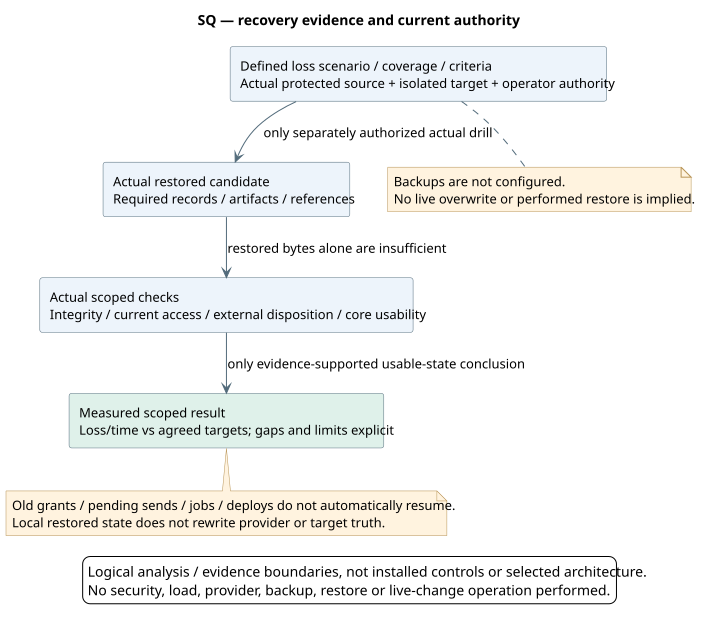

[Editable PlantUML](Diagrams/Recovery-Scoped-Usable-State.puml) · 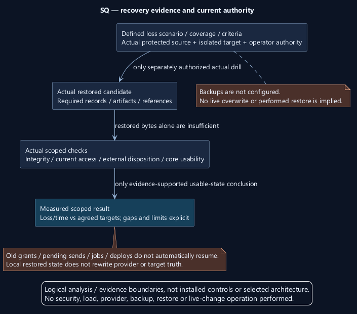

For each selected loss scenario, explicitly decide include, reconstruct or exclude each applicable subject with impact/rationale and actual evidence. “Reconstruct” cannot mean substituting a later live resume for what was actually sent. Define a consistent recovery point across dependent records/files/repositories or a reviewed safe reconciliation process. A database restore alone cannot restore Google state, recall an employer copy or prove a deployment target matches the recovered code/data.

**RPO meaning:** permitted recoverable-data loss relative to the chosen event/recovery point. **RTO meaning:** permitted elapsed time to a defined usable recovered state, with declared start/end and actual required checks. Values are not decided here. Backup frequency, file timestamps, extraction duration or successful startup alone prove neither agreed target nor useful recovery.

###### Logical operating/recovery route

1. Identify actual candidate/environment/operator powers and selected loss/change scenario; define required coverage, measurement and usable-state criteria.

2. Establish actual protected accessible source and suitable isolated target before any later separately authorized drill. No current drill is authorized or performed here.

3. Record actual restored candidate and required records/artifacts/references. Missing/corrupt material remains incomplete, not a complete recovery claim.

4. Evaluate current grants/shares/credentials, provider/ref/run/target state, pending effects and deleted-data reappearance under explicit policy before protected/consequential work resumes.

5. Verify actual scoped core outcomes and loss/time criteria, record gaps and limits and obtain applicable disposition. No automatic live overwrite, old-grant activation, send/job/deploy replay or universal rollback follows.

Maintenance and change recovery require identified version/data compatibility and irreversible-effect limits. The source project Laravel/OOP constraint is retained; observed demo package versions are not automatically the final supported release. No upgrade, migration, cleanup, backup schedule, alert process or extra service is configured by this analysis.

##### Availability, Disaster Recovery and Failover Views

**Status:** conditional analysis sequences, not an implemented HA design, approved incident procedure or a performed recovery drill. The current evidence records one demo VM and the owner's statement that backups are not configured. No secondary node, replication, failover routing, independent backup destination or usable restore has been established.

- **High availability (HA):** continued or restored service through a separately justified availability design; a standby must be eligible and consistent before it can be used.

- **Failover:** a controlled move to an eligible alternative; losing contact with the old service is not proof it cannot still write. Exclusive active/writer authority must be established by a later selected mechanism before promotion.

- **Disaster recovery (DR):** recovery of a defined usable state after loss. It requires actual protected material, integrity and relationship checks, current access review and external-effect reconciliation.

These are different concerns. Replication would not replace an independent recoverable backup, and an old backup would not by itself establish HA. No new server, paid facility, automatic failover or recovery target is selected here. Unavailable prerequisites block the affected operation, not independent documentation work.

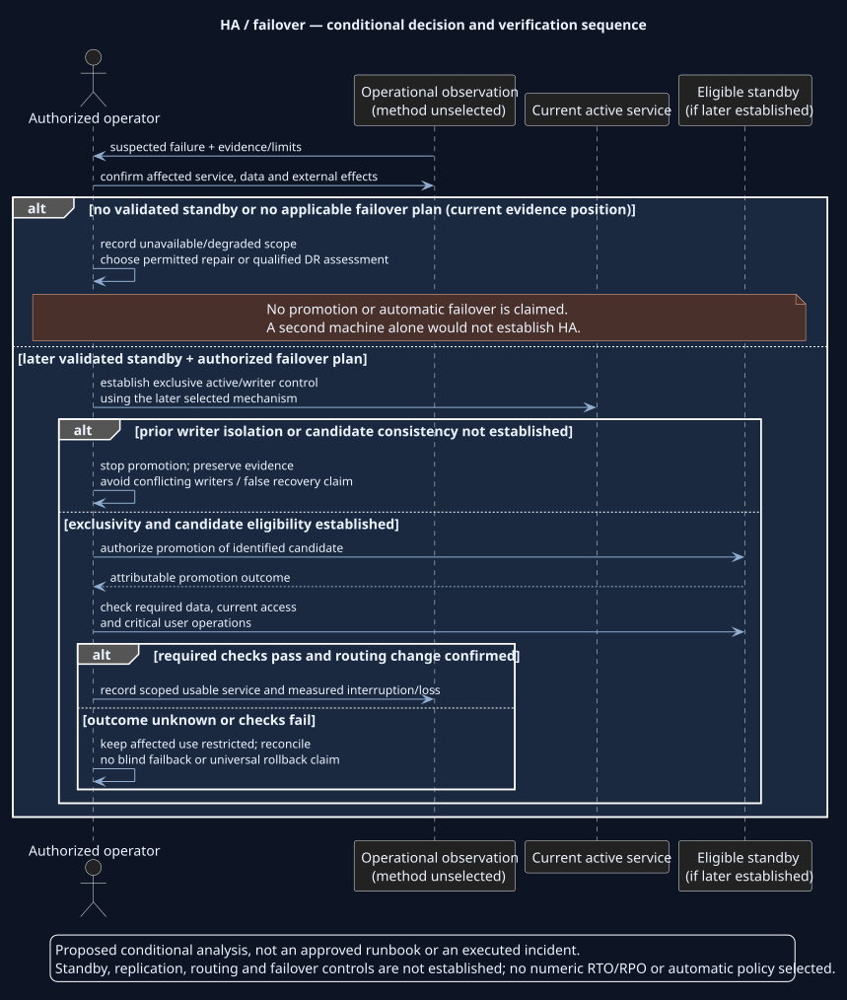

[Editable PlantUML](Diagrams/Security-Ha-Failover-Sequence.puml) · 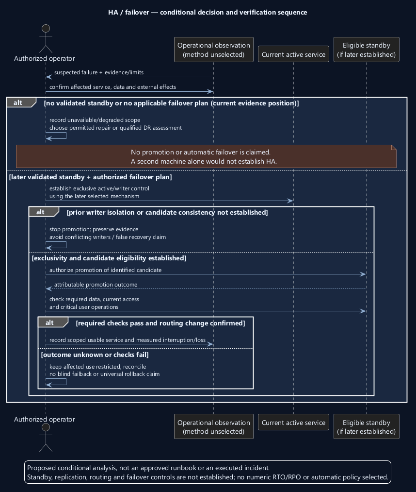

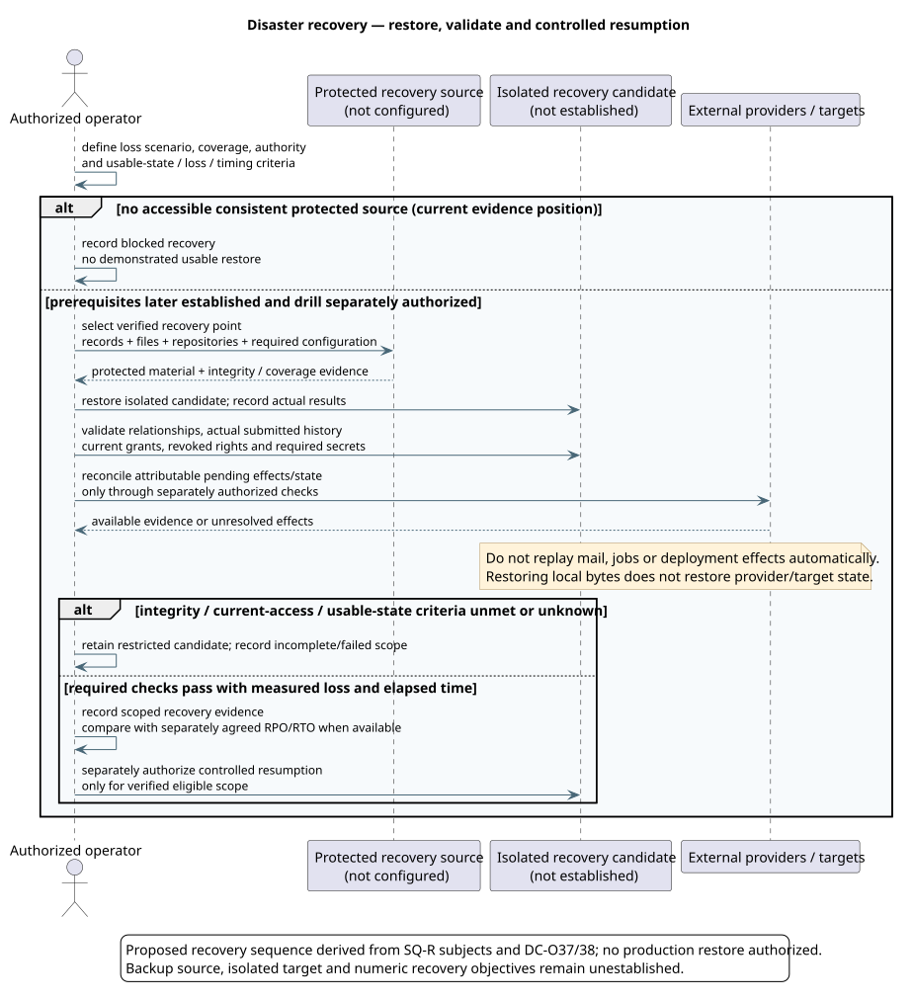

[Editable PlantUML](Diagrams/Security-Disaster-Recovery-Sequence.puml) · 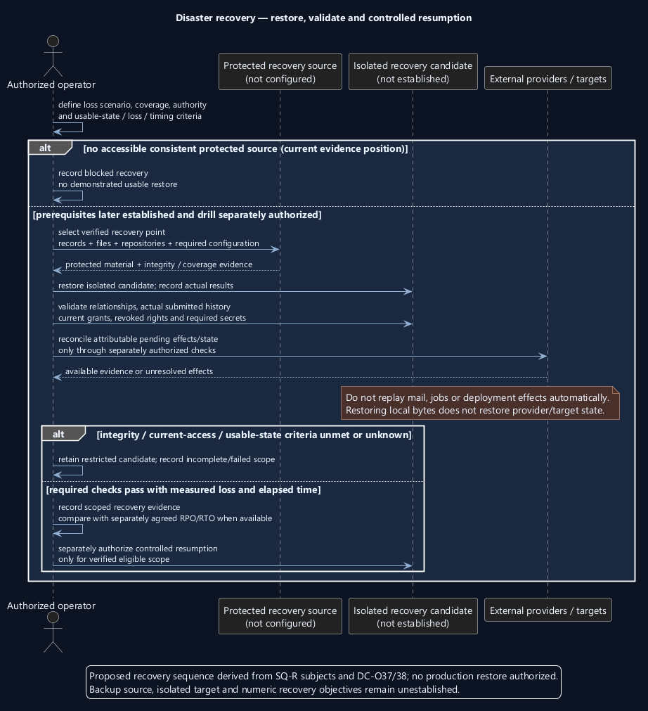

###### Evidence needed before claiming readiness

1. Identify the actual failure/loss scenario, protected subjects and approved operational scope.

2. Establish the actual candidate/source, credentials, consistency and exclusive active/writer controls where relevant.

3. Perform a separately authorized bounded exercise with attributable results; a drawing is not evidence that promotion or restore works.

4. Check current grants, actual-history integrity, critical user operations and pending external effects before resumption.

5. Measure interruption and recoverable-data loss using declared boundaries. RTO/RPO values remain undecided; elapsed copy/startup time is not automatically usable recovery time.

Source authority remains [QSR-D10–D12](../02-Requirements-Engineering/01-Software-Requirements-Specification.md#requirements-specification-quality-security-and-recovery-requirements), the recovery subjects in this document, [DC-O37](03-Processes-Scenarios-And-Business-Rules.md#analysis-business-rules-and-operation-contracts--10-domain-constraints-and-operation-contracts--id-dc-o37), [DC-O38](03-Processes-Scenarios-And-Business-Rules.md#analysis-business-rules-and-operation-contracts--10-domain-constraints-and-operation-contracts--id-dc-o38), and [the conditional handoff](05-Analysis-Review-And-Design-Handoff.md#analysis-review-and-design-handoff--14-feasibility-dependencies-and-design-handoff). New sequence details are proposed refinements, not owner-approved operating instructions.

##### 5. Operational evidence gaps

###### What is known and how narrowly it may be used

| Record | Details |
| --- | --- |
| Owner availability | [Read record](#analysis-interfaces-security-and-quality-analysis--13-security-quality-and-operational-analysis--id-sq-detail-5-1) |
| Owner/provider setup | [Read record](#analysis-interfaces-security-and-quality-analysis--13-security-quality-and-operational-analysis--id-sq-detail-5-2) |
| Owner/recovery setup | [Read record](#analysis-interfaces-security-and-quality-analysis--13-security-quality-and-operational-analysis--id-sq-detail-5-3) |
| Demo allocation | [Read record](#analysis-interfaces-security-and-quality-analysis--13-security-quality-and-operational-analysis--id-sq-detail-5-4) |
| Dated read-only host record | [Read record](#analysis-interfaces-security-and-quality-analysis--13-security-quality-and-operational-analysis--id-sq-detail-5-5) |
| Guest/application observation | [Read record](#analysis-interfaces-security-and-quality-analysis--13-security-quality-and-operational-analysis--id-sq-detail-5-6) |
| Narrow scheduler/delivery observation | [Read record](#analysis-interfaces-security-and-quality-analysis--13-security-quality-and-operational-analysis--id-sq-detail-5-7) |

###### Owner availability

**Recorded observation:**

20 total project hours/week, including learning/documentation/testing

**Limit / implication:**

Planning input, not an on-call response SLA or extra operations budget

###### Owner/provider setup

**Recorded observation:**

OAuth not created

**Limit / implication:**

Conditional provider contracts can be modeled; no actual authorized provider capability is established

###### Owner/recovery setup

**Recorded observation:**

Backups not configured

**Limit / implication:**

No covered protected backup or usable restoration evidence is claimed

###### Demo allocation

**Recorded observation:**

2 vCPU, 4 GB RAM, 40 GB disk

**Limit / implication:**

Existing resource constraint; no user/concurrency/load/isolation/readiness extrapolation or purchase assumption

###### Dated read-only host record

**Recorded observation:**

2026-11-01T12:26:13+00:00; 3.7 Gi total / 2.8 Gi available observed memory; 38 G root filesystem / 30 G available

**Limit / implication:**

Historical snapshot only; not current free capacity or a combined workload test

###### Guest/application observation

**Recorded observation:**

Nginx/MySQL/PHP-FPM active; installed Laravel version recorded in lockfile in dated evidence

**Limit / implication:**

Service/lockfile/page observation is not full application health, security maintenance, licensing or supported-release proof

###### Narrow scheduler/delivery observation

**Recorded observation:**

Limited matching root cron/named units and a successful HTTPS response were recorded

**Limit / implication:**

Does not exclude other users/timers/process managers/external facilities; a login-page response is not identity recovery mail, queue, OAuth, load or recovery proof

[Original read-only observation and explicit limits](../02-Requirements-Engineering/01-Software-Requirements-Specification.md#validation-and-traceability-server-readonly-check-2026-11-01) are retained. This task did not connect to the host, read credential/config secrets or refresh the observation. Owner-stated absence of backups is not inferred solely from the limited scheduler search.

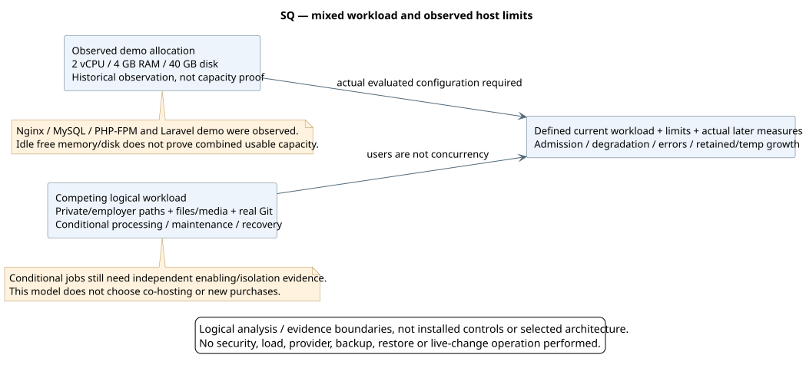

[Editable PlantUML](Diagrams/Operations-Resource-Envelope.puml) · 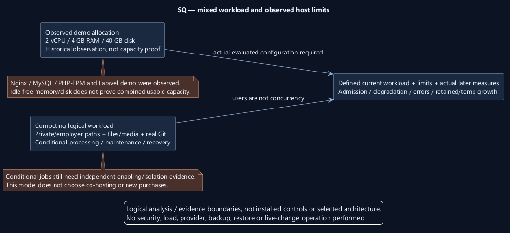

###### Scoped follow-up, not a competing decision register

| Record | Details |
| --- | --- |
| Q-D03–Q-D05 / QSR-D05–D06 | [Read record](#analysis-interfaces-security-and-quality-analysis--13-security-quality-and-operational-analysis--id-sq-detail-6-1) |
| Q-D15–Q-D17 / QSR-D04–D08 | [Read record](#analysis-interfaces-security-and-quality-analysis--13-security-quality-and-operational-analysis--id-sq-detail-6-2) |
| Q-D23 / QSR-D07 / YML-D12 | [Read record](#analysis-interfaces-security-and-quality-analysis--13-security-quality-and-operational-analysis--id-sq-detail-6-3)  **After MVP.** |
| Q-D24–Q-D25 / QSR-D01–D04/D09/D13 | [Read record](#analysis-interfaces-security-and-quality-analysis--13-security-quality-and-operational-analysis--id-sq-detail-6-4) |
| Q-D26 / QSR-D10–D12 | [Read record](#analysis-interfaces-security-and-quality-analysis--13-security-quality-and-operational-analysis--id-sq-detail-6-5) |
| Q-D27–Q-D28 / QSR-D14 | [Read record](#analysis-interfaces-security-and-quality-analysis--13-security-quality-and-operational-analysis--id-sq-detail-6-6) |

###### Q-D03–Q-D05 / QSR-D05–D06

**What remains to decide or demonstrate:**

Applicable account/action/state/session/credential/administration policy and actual controls

**Gate / next destination:**

Dependent security design/implementation and actual acceptance cases; no owner re-answer of settled core

###### Q-D15–Q-D17 / QSR-D04–D08

**What remains to decide or demonstrate:**

Actual provider access, capability/applicability, conflict/repetition and operational delivery distinction

**Gate / next destination:**

Before affected provider commitments and controlled operation verification

###### Q-D23 / QSR-D07 / YML-D12

**What remains to decide or demonstrate:**

Supported execution, actual isolation/resources/secrets/network/output/target controls

**Gate / next destination:**

Before enabling execution/target effects, not merely before writing this model

###### Q-D24–Q-D25 / QSR-D01–D04/D09/D13

**What remains to decide or demonstrate:**

Workload, capacity/content/accounting, supported client/accessibility, quality/retention/evidence/notification criteria

**Gate / next destination:**

Affected quality/lifecycle/operating acceptance, not fabricated numeric values

###### Q-D26 / QSR-D10–D12

**What remains to decide or demonstrate:**

Actual protected source, coverage/consistency, usable-state targets, current access and isolated evidence

**Gate / next destination:**

Design handoff conditions plus actual later restoration/readiness gate

###### Q-D27–Q-D28 / QSR-D14

**What remains to decide or demonstrate:**

Actual dependencies/procedures/compatibility/solo effort, tracked forecast and change impacts

**Gate / next destination:**

Qualified handoff in 14 and later procedure/release evidence

The [question register](../02-Requirements-Engineering/01-Software-Requirements-Specification.md#change-and-baseline-open-questions-and-decisions), existing feasibility/ASM/DEP/GAP records and RF findings retain authority. No parent is closed by a populated scenario or diagram. Missing future executed code/security/restore evidence alone is not a reason to block drafting analysis, while dependent readiness claims require their actual scoped evidence.

##### 6. Cross-view consistency

| Check | Required invariant / distinction |
| --- | --- |
| SQ-C01 Current scope | UI/direct file/provider/Git/run/output entry all use applicable current resource/action/state power; no blanket sign-in/admin access |
| SQ-C02 Accepted professional behavior | Source edit, selected draft apply, separate publication and actual historical content remain independent |
| SQ-C03 Representation availability | PDF mode/link eligibility/selection/actual artifact/language and direct serving remain separate |
| SQ-C04 Provider/local/operating powers | Read/draft/send/reply, local unlink, provider action and authentication/recovery notification delivery are distinct |
| SQ-C05 Evaluated effects | Source/target revisions and original operation/attempt identity remain attributable during conflicts/repetition |
| SQ-C06 Execution/target | Safe admission, actual start/output, cancellation/stop/new attempt and separate target authority are not conflated |
| SQ-C07 Retention/accounting | Eligible removal, required references, actual cleanup/usage release and restored content are distinct |
| SQ-C08 Recovery/quality evidence | Actual protected backup, restored bytes, scoped usable outcomes and measured target comparisons are separate; unknown is not Pass |

All QSR-D01–D14 have explicit source scenario associations here. That presence is not exhaustive semantic coverage of their acceptance criteria. Matrix rows and trust cases are proposed control-analysis boundaries; no implemented vulnerability finding, full approved role matrix, security certification or regulatory conclusion is created.

Scope association: SCP-01 → SQ-A04/08/09/24 and SQ-Q05/06; SCP-02 → SQ-A01–03 and SQ-Q08; SCP-03/SCP-04/SCP-05 → SQ-A05/06/17 and SQ-Q05/07/09; SCP-06 → SQ-Q08/09 and SQ-R03; SCP-07 → SQ-A13–16 and SQ-Q04/08/12; SCP-08 → SQ-A07 and SQ-Q08/SQ-R04; SCP-09 → SQ-A10–12 and SQ-R05; SCP-10 → SQ-A20–22 and SQ-Q07/08; SCP-11 → SQ-A17/18/23 and SQ-Q02/09; SCP-12 → SQ-A19/23 and SQ-Q10–14. All associations are scoped analysis context, not executed coverage.

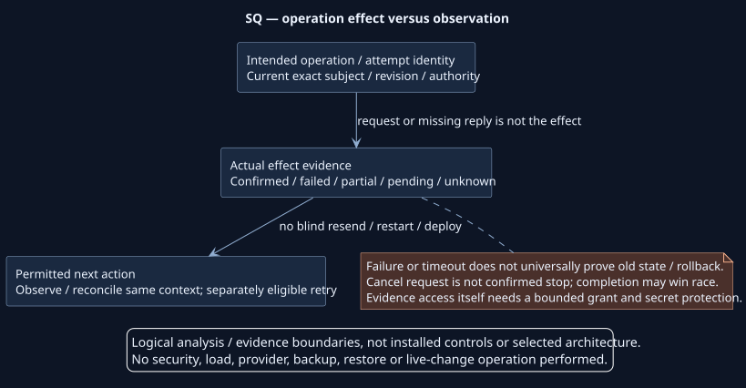

[Editable PlantUML](Diagrams/Operations-Effect-Evidence.puml) · 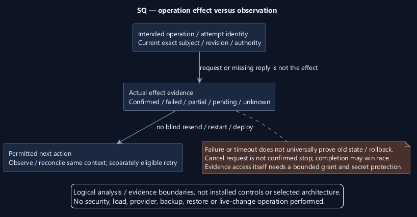

##### 7. Planned verification and evidence record

| Case | Intended later observation |
| --- | --- |
| SQ-V01 Altered private reference/current grant change | Applicable matrix row and direct path deny only under actual reviewed policy; no unrelated disclosure or stale universal grant |
| SQ-V02 Source update/apply/publish/history | Compare attributable intended effects and preserved frames; no automatic propagation or latest-live substitution |
| SQ-V03 Wrong/disabled/unavailable representation | Distinguish current access, selected mode/language/artifact and partial retrieval; no private fallback |
| SQ-V04 Malformed content or unsupported workflow | Reviewed safe rejection/display, or no execution without actual enabling evidence; no live hostile testing here |
| SQ-V05 Provider send loses response or content review becomes stale | Actual final review and same-attempt reconciliation; no blind resend/recipient receipt inference |
| SQ-V06 Local unlink while provider disconnected/conflicting | Local-only authority sufficient for unlink; provider mutation/conflict resolution separate |
| SQ-V07 Changed ref/review or uncertain push/merge | Actual current evaluated context and ref evidence; no false merge or inherited deploy permission |
| SQ-V08 Run completes during cancel; runner/result lost | Actual terminal/pending/unknown state; no request-equals-stop or duplicate relaunch |
| SQ-V09 Concurrent quota/replacement/protected reference | Actual admissible growth and reference-aware result; no usable/reclaimed claim without effect evidence |
| SQ-V10 Synthetic sensitive marker / restricted diagnostic reference | Ordinary output excludes secret/private material; only permitted bounded evidence accessible |
| SQ-V11 No backup, incomplete source or old revoked rights restored | Prerequisite block/incomplete evidence and explicit current authority/external reconciliation; no recovery Pass/replay |
| SQ-V12 Mixed workload/client/dependency outage | Evaluate defined workload/criteria/environment; fast errors/stale content not successful usable results |
| SQ-V13 Selected backup/restore or maintenance procedure | Record actual step/result/loss/time/compatibility/irreversible limits; no universal rollback guarantee |
| SQ-V14 Required observation absent or criterion not agreed | Mark unperformed/unresolved; no empty-set Pass, adopted standard, certification or invented numerical result |

A future run record must identify: scenario/criterion and source revision; candidate/environment/dependencies; authorized actor/grants and isolated scope if needed; initial state/input/workload; expected response and method/units/boundaries; actual result/measure/evidence; protected frame and known effects; limitations/next action and actual reviewer disposition. Use controlled synthetic/test data where appropriate and never publish real credential values. This is an evidence-definition contract, not authorization to execute tests or change production.

##### 8. Review Status

The former scaffold is now a populated selected analysis with 24 conditional authority rows, 12 trust/failure cases, 14 source-aligned quality scenarios, nine recovery-coverage subjects and ten PlantUML views. Download the [authority matrix](https://github.com/Farhad-V/Web-Resumefolio/blob/1f2acaa351ac306cb57cbe4fe9742e8bd90720d9/docs/MVP/SDLC/03-system-analysis/evidence/security-authority-matrix-2026-11-01.csv), [quality scenario matrix](https://github.com/Farhad-V/Web-Resumefolio/blob/1f2acaa351ac306cb57cbe4fe9742e8bd90720d9/docs/MVP/SDLC/03-system-analysis/evidence/quality-scenario-matrix-2026-11-01.csv), [trust-case matrix](https://github.com/Farhad-V/Web-Resumefolio/blob/1f2acaa351ac306cb57cbe4fe9742e8bd90720d9/docs/MVP/SDLC/03-system-analysis/evidence/trust-boundary-cases-2026-11-01.csv) and [recovery coverage matrix](https://github.com/Farhad-V/Web-Resumefolio/blob/1f2acaa351ac306cb57cbe4fe9742e8bd90720d9/docs/MVP/SDLC/03-system-analysis/evidence/recovery-coverage-matrix-2026-11-01.csv). [Earlier review evidence](https://github.com/Farhad-V/Web-Resumefolio/blob/1f2acaa351ac306cb57cbe4fe9742e8bd90720d9/docs/MVP/SDLC/03-system-analysis/evidence/security-quality-review-2026-11-01.json) retains its original snapshot. [This revision record](https://github.com/Farhad-V/Web-Resumefolio/blob/1f2acaa351ac306cb57cbe4fe9742e8bd90720d9/docs/MVP/SDLC/03-system-analysis/evidence/security-document-fix-2026-11-01.json) records table preservation and the new diagrams.

The SA-RV02 report/matrices in 11 remain an identified earlier snapshot where 12/13 were scaffolds. This revision supersedes its file-13 placeholder statement only; it does not retroactively rewrite its source-association counts or close RF/Q-D parents. [12](#analysis-interfaces-security-and-quality-analysis--12-interfaces-and-external-interactions) now supplies logical interface contracts; [04](03-Processes-Scenarios-And-Business-Rules.md#analysis-functional-and-process-analysis--04-function-oriented-view) and [14](05-Analysis-Review-And-Design-Handoff.md#analysis-review-and-design-handoff--14-feasibility-dependencies-and-design-handoff) are now populated and require exact semantic review, and [15](03-Processes-Scenarios-And-Business-Rules.md#analysis-functional-and-process-analysis--15-current-processes-and-bottleneck-analysis) has no observed process study.

Proceed to qualified design handoff in 14 using these scoped scenarios/controls/evidence limits; later refresh cross-view sufficiency and actual owner disposition for the identified candidate. No missing OAuth/backups answer is requested again. Whole Requirements Engineering/System Analysis acceptance, product readiness, security assurance and demonstrated recovery are not established by document checks.

[Diagram catalog](Diagrams/Diagram-Catalog.md) · [System Analysis index]()

##### Diagram Types and Reading Guide

The threat model links boundaries to the existing SQ-T01–SQ-T12 cases; the cases remain hypotheses to evaluate, not confirmed vulnerabilities. The topology separates dated observations from missing capabilities. The [HA/DR sequences](#analysis-interfaces-security-and-quality-analysis--13-security-quality-and-operational-analysis--heading-availability-disaster-recovery-and-failover-views) describe conditional later actions, not configured failover or tested restoration.

###### Trust Boundary and Threat Model

[Trust boundaries and candidate threats](https://github.com/Farhad-V/Web-Resumefolio/blob/1f2acaa351ac306cb57cbe4fe9742e8bd90720d9/docs/MVP/SDLC/04-system-design/06-design-quality-and-security-analysis/diagrams/security-trust-boundaries.svg)

[Editable PlantUML](https://github.com/Farhad-V/Web-Resumefolio/blob/1f2acaa351ac306cb57cbe4fe9742e8bd90720d9/docs/MVP/SDLC/04-system-design/06-design-quality-and-security-analysis/diagrams/security-trust-boundaries.puml) · 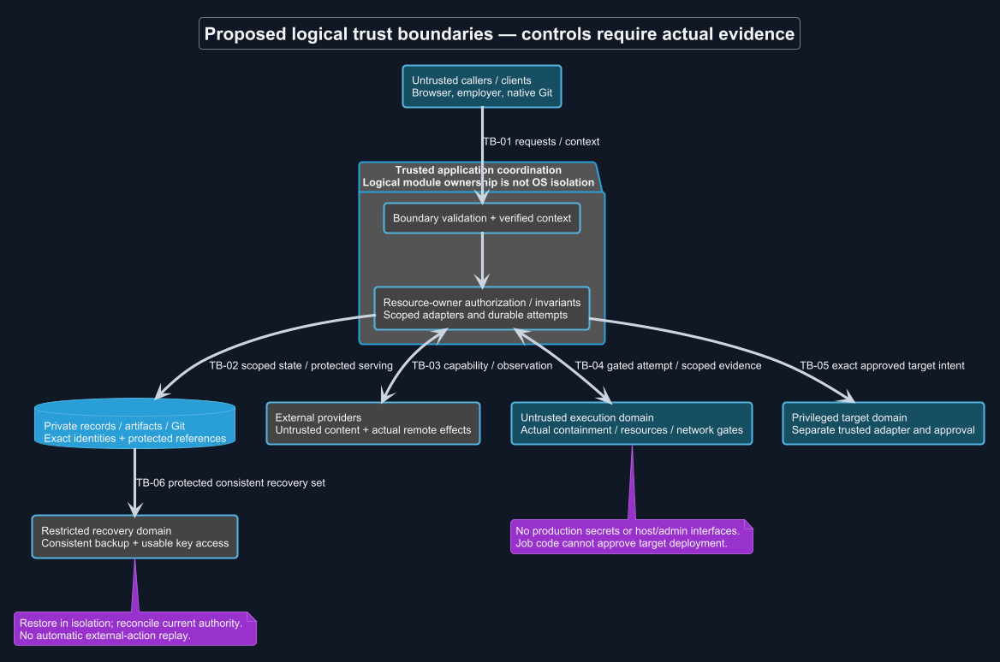

###### Infrastructure and Deployment Topology

This view uses the [dated read-only server evidence](../02-Requirements-Engineering/01-Software-Requirements-Specification.md#validation-and-traceability-server-readonly-check-2026-11-01). It does not certify current health, firewall rules, load capacity or security.

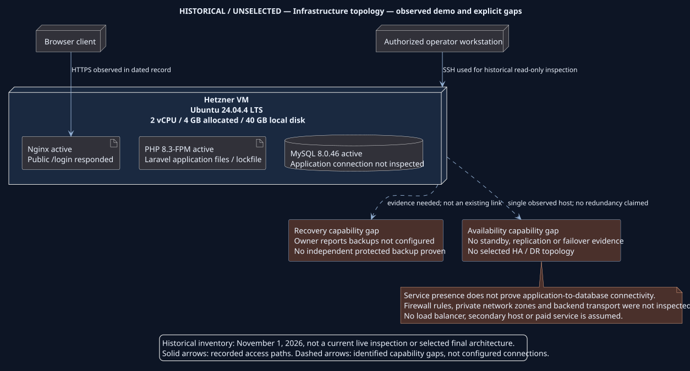

[Editable PlantUML](Diagrams/Security-Infrastructure-Topology.puml) · 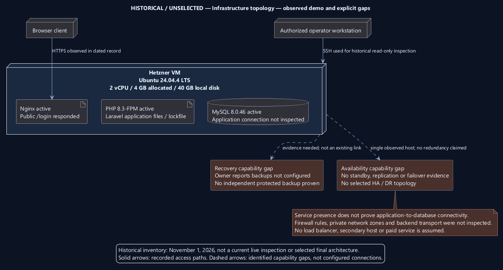

Resumefolio - Interfaces Security and Quality Analysis

#### Resumefolio - Interfaces Security and Quality Analysis

This index groups existing System Analysis records. It changes navigation, not analysis scope, model meaning or acceptance status.

Current MVP scope and selected mechanisms: [Baseline](https://github.com/Farhad-V/Web-Resumefolio/blob/1f2acaa351ac306cb57cbe4fe9742e8bd90720d9/docs/MVP/baseline/README.md). Deferred provider, advanced collaboration and workflow-execution designs are not MVP prerequisites.

##### Documents

- [12-interfaces-and-external-interactions.md](#analysis-interfaces-security-and-quality-analysis--12-interfaces-and-external-interactions)
- [13-security-quality-and-operational-analysis.md](#analysis-interfaces-security-and-quality-analysis--13-security-quality-and-operational-analysis)

##### Shared Resources

- [System Analysis index]()
- [Shared diagram catalog](Diagrams/Diagram-Catalog.md)
- [Relocation map and historical evidence]()

