# Analysis Review and Design Handoff

[System analysis overview](01-System-Context-And-Gap-Analysis.md)

### Review and Design Handoff

Resumefolio — Model Consistency, Traceability and Review

#### Resumefolio — Model Consistency, Traceability and Review

Owner: Farhad. Review: **SA-RV03**, November 1, 2026.

Reviewer: Codex, root-owned documentary review. This is not an independent stakeholder review, security test or owner baseline acceptance.

[Current inventory](#analysis-review-and-design-handoff--11-model-consistency-traceability-and-review--heading-current-model-inventory-versus-remaining-files) · [Findings](#analysis-review-and-design-handoff--11-model-consistency-traceability-and-review--heading-3-material-findings-and-gates) · [Current trace register](#analysis-criterion-evidence) · [39 exact comparisons](https://github.com/Farhad-V/Web-Resumefolio/blob/1f2acaa351ac306cb57cbe4fe9742e8bd90720d9/docs/MVP/SDLC/03-system-analysis/evidence/current-selected-criterion-comparisons-2026-11-01.md)

Current MVP scope and selected mechanisms: [Baseline](https://github.com/Farhad-V/Web-Resumefolio/blob/1f2acaa351ac306cb57cbe4fe9742e8bd90720d9/docs/MVP/baseline/README.md). Deferred provider, advanced collaboration and workflow-execution designs are not MVP prerequisites.

##### 1. Continuation Verdict and Limits

**Continue from the populated analysis; do not restart the folders.** All numbered documents 00–15 contain analysis content. The previous claim that 04/12–14 remained empty is superseded. Remaining work concerns exact semantic sufficiency, explicit policy and enabling evidence, not missing scaffold text.

The [accepted profile policy](../02-Requirements-Engineering/01-Software-Requirements-Specification.md#change-and-baseline-open-questions-and-decisions--id-owner-accepted-profile-update-policy) remains accepted: source edits, selected apply, separate publication and actual history are distinct. Initial planning acceptance belongs to its identified historical candidate, not later unreviewed changes. No new M-02/M-03 or product-readiness decision is made here.

##### 2. Checks Performed and Result

| Check | Current result |
| --- | --- |
| Numbered files | All sixteen files 00–15 exist; README provides the entry point |
| Domain diagrams | Ten class views and one package view are embedded in 03 |
| Use Case ownership | 06 embeds the RE-owned overview and links all five detailed RE-owned diagrams; no duplicate authoritative Use Case source |
| Criterion source identity | All 470 locator/candidate/source/text records copied exactly from the authoritative inventory |
| Current reference indexing | 157/157 candidates explicitly linked in inspected numbered analysis documents; document references only |
| Exact current comparisons | 39 bounded documentary comparisons; each records actual model locations, a specific finding and remaining gap |
| Other criteria | 431 current source-context rows; no claim that an exact semantic comparison was performed for them in this revision |
| Prior walkthroughs | 20 preserved historical comparisons; not counted as newly performed or full coverage |
| Source protection | No primary requirement, criterion, policy or acceptance record changed |

Local links, diagram rendering and source hashes are checked for this candidate; exact totals are in [current review evidence](https://github.com/Farhad-V/Web-Resumefolio/blob/1f2acaa351ac306cb57cbe4fe9742e8bd90720d9/docs/MVP/SDLC/03-system-analysis/evidence/current-analysis-review-2026-11-01.json). Earlier state-reachability, activity-termination and rule-partition results remain historical; they were not rerun or relabeled as fresh here. No runtime, server, OAuth, load, isolation or recovery test was executed.

###### Current model inventory versus remaining files

| Documents | Current position |
| --- | --- |
| 00–02 | Populated guide/scope/context; target context is separate from observed demo inventory |
| 03 | 53 concepts; ten UML class views and one logical package view |
| 04 | Nine function families, context/Level 1 DFDs, logical stores and selected Level 2 refinement |
| 05 | 34 data subjects and nine conceptual ER diagrams |
| 06 | 16 sequences; 12 parent and 16 operation-specific Use Case references; authoritative diagram links |
| 07–09 | State, activity and decision models populated; exact cross-view sufficiency remains bounded |
| 10 | 18 typed constraints, 39 selected contracts and eleven diagrams; long tables reformatted |
| 11 | Current source/reference review and explicit exact-criterion residuals |
| 12 | Eight interface families and 27 interaction cases; technical endpoint choices remain design work |
| 13 | 24 conditional authority records, 12 threat cases, 14 quality scenarios, nine recovery subjects and ten diagrams; no implemented HA/DR claim |
| 14 | Conditional handoff populated; earlier handoff fingerprint remains historical |
| 15 | Source-based process analysis and conditional target model; no observed As-Is business-task baseline or measured gain |

##### 3. Material Findings and Gates

Local findings do not replace RF/Q-D/ASM/DEP authority. Updating a documentary description does not close a parent finding or accept a proposed policy.

###### SA-F01 — Population finding superseded; semantic review remains

**Evidence:** 04 now has functional decomposition and balanced DFDs; 12 has interface contracts; 13 has authority/trust/quality/recovery views; 14 has conditional handoff. 15 is populated source-based analysis but no observed business-task baseline.

**Next action:** Review exact cross-view meaning; do not describe these documents as empty or infer actual measured bottlenecks.

**Parent context:** RF-D02 RF-D03 RF-D05.

###### SA-F02 — Current reference inventory refreshed

**Evidence:** 157 of 157 candidates have an explicit primary-candidate link in inspected numbered analysis documents excluding this review. This is a document-reference inventory, not the older structured-model association metric.

**Next action:** Use current criterion register to locate sources; do not equate document references with semantic coverage or compare this number directly with historical 116/41.

**Parent context:** RF-D01 RF-D02.

###### SA-F03 — Exact semantic sufficiency remains explicitly partial

**Evidence:** All 470 exact locators are indexed against current source references. Thirty-nine criteria have current bounded documentary comparisons with a named residual. Twenty earlier walkthroughs are retained as historical evidence, not silently revalidated.

**Next action:** Complete remaining exact comparisons and residual cases; see the current trace register. No row is product-verified or fully closed.

**Parent context:** RF-D02 RF-D04 RF-D05.

###### SA-F04 — Accepted core retained; source wording scope unchanged

**Evidence:** Explicit source/apply/publication/history behavior remains accepted. This review does not reissue primary source wording or accept proposed source-removal/concurrency details.

**Next action:** Resolve any conflicting primary wording through its authoritative change process; do not re-ask acceptance of the bounded core.

**Parent context:** RF-D03 Q-D07.

###### SA-F05 — Concrete path/policy gaps retained

**Evidence:** Password rotation lacks a complete dedicated contract for fresh old/current-password behavior; in-flight/session treatment remains open. Git-client conflict paths, concurrent quota interleavings and category-specific lifecycle cases retain explicit limits.

**Next action:** Use exact residuals in current criterion comparisons; no invented role, timeout, retention period, execution technology or automatic retry.

**Parent context:** RF-D02 RF-D03 Q-D05 Q-D11 Q-D14 Q-D18.

###### SA-F06 — Dependent evidence gates retained

**Evidence:** Owner inputs remain 20 hours/week, OAuth not created and backups not configured. Historical demo resources do not prove HA/DR, load capacity, isolation or usable recovery.

**Next action:** Continue independent design work; obtain affected enabling evidence before claiming dependent capability readiness.

**Parent context:** RF-D05 Q-D15 Q-D23 Q-D25 Q-D26 Q-D27.

###### SA-F07 — Historical source identities explicitly separated

**Evidence:** Earlier derivation/review/handoff hashes identify their original inputs, not this revised folder. This review records current input and output identities without overwriting those snapshots.

**Next action:** Use the new review snapshot for this revision and preserve old evidence as historical; actual owner acceptance is separate.

**Parent context:** RBC-D01.

###### SA-F08 — Stale current-state report corrected locally

**Evidence:** SA-RV02 report and diagram described files 04/12–14 as scaffolds. The main report and position diagram now reflect populated artifacts.

**Next action:** Use SA-RV03 and its bounded checks; no parent finding, milestone or owner decision is automatically closed.

**Parent context:** RF-D05.

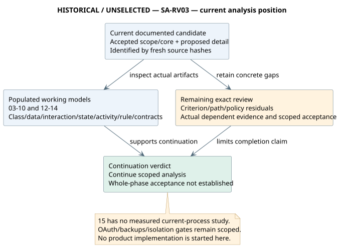

[PlantUML](Diagrams/Review-Current-Position.puml) · 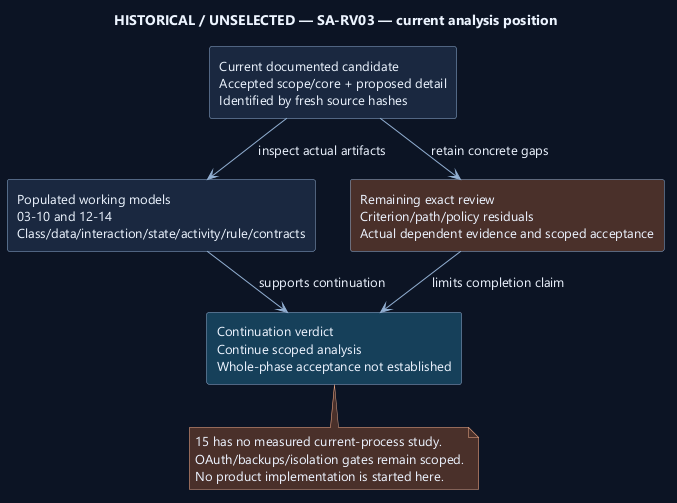

##### 4. Context Trace Examples

The [current selected comparisons](https://github.com/Farhad-V/Web-Resumefolio/blob/1f2acaa351ac306cb57cbe4fe9742e8bd90720d9/docs/MVP/SDLC/03-system-analysis/evidence/current-selected-criterion-comparisons-2026-11-01.md) identify 39 exact criteria from permissions/privacy, file admission, real Git, PDF/sharing, accepted profile behavior, backup/recovery and execution isolation. Every comparison retains a specific residual. For example, PDF-D06-AC03 exposes the missing dedicated password-rotation contract; a broad threat case alone does not satisfy it.

###### Reading the downloadable matrices

- [Current 470-row criterion register](#analysis-criterion-evidence): exact text, current candidate-document references, selected model locations where reviewed, disposition and residual.

- [Current 39 exact comparisons](https://github.com/Farhad-V/Web-Resumefolio/blob/1f2acaa351ac306cb57cbe4fe9742e8bd90720d9/docs/MVP/SDLC/03-system-analysis/evidence/current-selected-criterion-comparisons-2026-11-01.md): readable record of findings and gaps.

- [Historical 157-candidate model matrix](https://github.com/Farhad-V/Web-Resumefolio/blob/1f2acaa351ac306cb57cbe4fe9742e8bd90720d9/docs/MVP/SDLC/03-system-analysis/evidence/requirements-to-analysis-associations-2026-11-01.csv): earlier structured model associations; its 116/41 counts are not current counts.

- [Historical 470-row context matrix](https://github.com/Farhad-V/Web-Resumefolio/blob/1f2acaa351ac306cb57cbe4fe9742e8bd90720d9/docs/MVP/SDLC/03-system-analysis/evidence/criterion-review-context-2026-11-01.csv): earlier 20 walkthroughs and 450 context-only entries.

- [Historical 39-contract matrix](https://github.com/Farhad-V/Web-Resumefolio/blob/1f2acaa351ac306cb57cbe4fe9742e8bd90720d9/docs/MVP/SDLC/03-system-analysis/evidence/contract-cross-view-associations-2026-11-01.csv): original selected associations and their limits.

No design-component, implementation or test-result link is invented. Current document references are mechanically located explicit citations, not automatic semantic matches. All product-result cells remain unexecuted.

###### Historical walkthrough locators retained

The following SA-W locators preserve earlier review navigation. Their statements are historical documentary findings, not new test results. Consult the current register where a current comparison overlaps the same criterion.

**SA-W01 — PRP-D04-AC01**; [PRP-D04](../02-Requirements-Engineering/01-Software-Requirements-Specification.md#requirements-specification-profiles-resumes-and-portfolio--heading-prp-d04-explicit-shared-source-update-rules)

**Historical model context:** [SB-M01](03-Processes-Scenarios-And-Business-Rules.md#analysis-behavioral-and-scenario-analysis--06-scenario-based-view--id-sb-m01), [SM-M01](03-Processes-Scenarios-And-Business-Rules.md#analysis-behavioral-and-scenario-analysis--07-state-based-view--id-sm-m01), [CF-M01](03-Processes-Scenarios-And-Business-Rules.md#analysis-functional-and-process-analysis--08-control-flow-based-view--id-cf-m01), [RB-D02](03-Processes-Scenarios-And-Business-Rules.md#analysis-business-rules-and-operation-contracts--09-rule-based-view--id-rb-d02); [DC-O01](03-Processes-Scenarios-And-Business-Rules.md#analysis-business-rules-and-operation-contracts--10-domain-constraints-and-operation-contracts--id-dc-o01), [DC-O02](03-Processes-Scenarios-And-Business-Rules.md#analysis-business-rules-and-operation-contracts--10-domain-constraints-and-operation-contracts--id-dc-o02), [DC-O03](03-Processes-Scenarios-And-Business-Rules.md#analysis-business-rules-and-operation-contracts--10-domain-constraints-and-operation-contracts--id-dc-o03)

**Historical documentary finding:** Source edit, selected draft application and separate publication stay distinct; accepted core is not reopened.

**Historical remaining limit:** Concurrent/source-removal detail remains scoped proposed policy; no product execution.

**SA-W02 — PRP-D04-AC03**; [PRP-D04](../02-Requirements-Engineering/01-Software-Requirements-Specification.md#requirements-specification-profiles-resumes-and-portfolio--heading-prp-d04-explicit-shared-source-update-rules)

**Historical model context:** [SB-M01](03-Processes-Scenarios-And-Business-Rules.md#analysis-behavioral-and-scenario-analysis--06-scenario-based-view--id-sb-m01), [SM-M07](03-Processes-Scenarios-And-Business-Rules.md#analysis-behavioral-and-scenario-analysis--07-state-based-view--id-sm-m07), [CF-M06](03-Processes-Scenarios-And-Business-Rules.md#analysis-functional-and-process-analysis--08-control-flow-based-view--id-cf-m06), [RB-D06](03-Processes-Scenarios-And-Business-Rules.md#analysis-business-rules-and-operation-contracts--09-rule-based-view--id-rb-d06); [DC-O02](03-Processes-Scenarios-And-Business-Rules.md#analysis-business-rules-and-operation-contracts--10-domain-constraints-and-operation-contracts--id-dc-o02), [DC-O09](03-Processes-Scenarios-And-Business-Rules.md#analysis-business-rules-and-operation-contracts--10-domain-constraints-and-operation-contracts--id-dc-o09)

**Historical documentary finding:** No automatic addition to other resumes; actual sent content stays independent of later edits.

**Historical remaining limit:** Selection omission, reference/correction and physical preservation need actual criterion cases.

**SA-W03 — ACC-D04-AC03**; [ACC-D04](../02-Requirements-Engineering/01-Software-Requirements-Specification.md#requirements-specification-accounts-authentication-and-permissions--heading-acc-d04-cross-user-private-data-isolation)

**Historical model context:** [SB-M10](03-Processes-Scenarios-And-Business-Rules.md#analysis-behavioral-and-scenario-analysis--06-scenario-based-view--id-sb-m10), [SM-M03](03-Processes-Scenarios-And-Business-Rules.md#analysis-behavioral-and-scenario-analysis--07-state-based-view--id-sm-m03), [CF-M10](03-Processes-Scenarios-And-Business-Rules.md#analysis-functional-and-process-analysis--08-control-flow-based-view--id-cf-m10), [RB-D01](03-Processes-Scenarios-And-Business-Rules.md#analysis-business-rules-and-operation-contracts--09-rule-based-view--id-rb-d01); [DC-O20](03-Processes-Scenarios-And-Business-Rules.md#analysis-business-rules-and-operation-contracts--10-domain-constraints-and-operation-contracts--id-dc-o20), [DC-O21](03-Processes-Scenarios-And-Business-Rules.md#analysis-business-rules-and-operation-contracts--10-domain-constraints-and-operation-contracts--id-dc-o21)

**Historical documentary finding:** Grant scope does not confer unrelated private/mail/repository/secret authority.

**Historical remaining limit:** Complete actor/resource/action/state matrix and direct adversarial cases remain in 13/primary review.

**SA-W04 — PDF-D03-AC01**; [PDF-D03](../02-Requirements-Engineering/01-Software-Requirements-Specification.md#requirements-specification-pdf-and-controlled-sharing--heading-pdf-d03-per-resume-download-choices)

**Historical model context:** [SB-M02](03-Processes-Scenarios-And-Business-Rules.md#analysis-behavioral-and-scenario-analysis--06-scenario-based-view--id-sb-m02), [SB-M04](03-Processes-Scenarios-And-Business-Rules.md#analysis-behavioral-and-scenario-analysis--06-scenario-based-view--id-sb-m04), [SM-M04](03-Processes-Scenarios-And-Business-Rules.md#analysis-behavioral-and-scenario-analysis--07-state-based-view--id-sm-m04), [SM-M05](03-Processes-Scenarios-And-Business-Rules.md#analysis-behavioral-and-scenario-analysis--07-state-based-view--id-sm-m05), [CF-M02](03-Processes-Scenarios-And-Business-Rules.md#analysis-functional-and-process-analysis--08-control-flow-based-view--id-cf-m02), [CF-M04](03-Processes-Scenarios-And-Business-Rules.md#analysis-functional-and-process-analysis--08-control-flow-based-view--id-cf-m04), [RB-D03](03-Processes-Scenarios-And-Business-Rules.md#analysis-business-rules-and-operation-contracts--09-rule-based-view--id-rb-d03), [RB-D04](03-Processes-Scenarios-And-Business-Rules.md#analysis-business-rules-and-operation-contracts--09-rule-based-view--id-rb-d04); [DC-O04](03-Processes-Scenarios-And-Business-Rules.md#analysis-business-rules-and-operation-contracts--10-domain-constraints-and-operation-contracts--id-dc-o04), [DC-O06](03-Processes-Scenarios-And-Business-Rules.md#analysis-business-rules-and-operation-contracts--10-domain-constraints-and-operation-contracts--id-dc-o06)

**Historical documentary finding:** Four download modes × two requested categories are enumerated; actual selected availability/access checked separately.

**Historical remaining limit:** Language/revision/current access and actual retrieval cases still need product verification.

**SA-W05 — PDF-D06-AC02**; [PDF-D06](../02-Requirements-Engineering/01-Software-Requirements-Specification.md#requirements-specification-pdf-and-controlled-sharing--heading-pdf-d06-owner-password-and-link-controls)

**Historical model context:** [SB-M03](03-Processes-Scenarios-And-Business-Rules.md#analysis-behavioral-and-scenario-analysis--06-scenario-based-view--id-sb-m03), [SM-M04](03-Processes-Scenarios-And-Business-Rules.md#analysis-behavioral-and-scenario-analysis--07-state-based-view--id-sm-m04), [CF-M03](03-Processes-Scenarios-And-Business-Rules.md#analysis-functional-and-process-analysis--08-control-flow-based-view--id-cf-m03), [RB-D05](03-Processes-Scenarios-And-Business-Rules.md#analysis-business-rules-and-operation-contracts--09-rule-based-view--id-rb-d05); [DC-O05](03-Processes-Scenarios-And-Business-Rules.md#analysis-business-rules-and-operation-contracts--10-domain-constraints-and-operation-contracts--id-dc-o05), [DC-O06](03-Processes-Scenarios-And-Business-Rules.md#analysis-business-rules-and-operation-contracts--10-domain-constraints-and-operation-contracts--id-dc-o06)

**Historical documentary finding:** Confirmed disablement blocks fresh protected access; PDF mode is not changed by disablement.

**Historical remaining limit:** Existing/in-flight/cached-session semantics remain separate proposals; no delivered-copy recall.

**SA-W06 — PDF-D06-AC03**; [PDF-D06](../02-Requirements-Engineering/01-Software-Requirements-Specification.md#requirements-specification-pdf-and-controlled-sharing--heading-pdf-d06-owner-password-and-link-controls)

**Historical model context:** [SB-M04](03-Processes-Scenarios-And-Business-Rules.md#analysis-behavioral-and-scenario-analysis--06-scenario-based-view--id-sb-m04), [SM-M04](03-Processes-Scenarios-And-Business-Rules.md#analysis-behavioral-and-scenario-analysis--07-state-based-view--id-sm-m04), [CF-M04](03-Processes-Scenarios-And-Business-Rules.md#analysis-functional-and-process-analysis--08-control-flow-based-view--id-cf-m04), [RB-D05](03-Processes-Scenarios-And-Business-Rules.md#analysis-business-rules-and-operation-contracts--09-rule-based-view--id-rb-d05); [DC-O06](03-Processes-Scenarios-And-Business-Rules.md#analysis-business-rules-and-operation-contracts--10-domain-constraints-and-operation-contracts--id-dc-o06)

**Historical documentary finding:** Current credential context is required for fresh eligible access.

**Historical remaining limit:** A dedicated credential-rotation contract is not one of the 39 selected operations; exact rotation/session policy remains to refine.

**SA-W07 — APP-D06-AC02**; [APP-D06](../02-Requirements-Engineering/01-Software-Requirements-Specification.md#requirements-specification-manual-application-management--heading-app-d06-preserved-actual-submitted-copies)

**Historical model context:** [SB-M06](03-Processes-Scenarios-And-Business-Rules.md#analysis-behavioral-and-scenario-analysis--06-scenario-based-view--id-sb-m06), [SM-M07](03-Processes-Scenarios-And-Business-Rules.md#analysis-behavioral-and-scenario-analysis--07-state-based-view--id-sm-m07), [CF-M06](03-Processes-Scenarios-And-Business-Rules.md#analysis-functional-and-process-analysis--08-control-flow-based-view--id-cf-m06), [RB-D06](03-Processes-Scenarios-And-Business-Rules.md#analysis-business-rules-and-operation-contracts--09-rule-based-view--id-rb-d06); [DC-O09](03-Processes-Scenarios-And-Business-Rules.md#analysis-business-rules-and-operation-contracts--10-domain-constraints-and-operation-contracts--id-dc-o09), [DC-O10](03-Processes-Scenarios-And-Business-Rules.md#analysis-business-rules-and-operation-contracts--10-domain-constraints-and-operation-contracts--id-dc-o10)

**Historical documentary finding:** Actual user-identified sent components are not replaced by whichever live PDF exists later.

**Historical remaining limit:** Provenance/completeness/correction/retrieval and retained-material cases remain proposed/untested.

**SA-W08 — APP-D07-AC02**; [APP-D07](../02-Requirements-Engineering/01-Software-Requirements-Specification.md#requirements-specification-manual-application-management--heading-app-d07-correction-and-repeated-submissions)

**Historical model context:** [SB-M06](03-Processes-Scenarios-And-Business-Rules.md#analysis-behavioral-and-scenario-analysis--06-scenario-based-view--id-sb-m06), [SM-M07](03-Processes-Scenarios-And-Business-Rules.md#analysis-behavioral-and-scenario-analysis--07-state-based-view--id-sm-m07), [CF-M06](03-Processes-Scenarios-And-Business-Rules.md#analysis-functional-and-process-analysis--08-control-flow-based-view--id-cf-m06), [RB-D06](03-Processes-Scenarios-And-Business-Rules.md#analysis-business-rules-and-operation-contracts--09-rule-based-view--id-rb-d06); [DC-O10](03-Processes-Scenarios-And-Business-Rules.md#analysis-business-rules-and-operation-contracts--10-domain-constraints-and-operation-contracts--id-dc-o10)

**Historical documentary finding:** New actual submission/correction remains distinguishable from earlier represented actual context.

**Historical remaining limit:** Supporting lifecycle contract is not a complete activity/state correction route; verify explicit cases.

**SA-W09 — EGC-D12-AC02**; [EGC-D12](../02-Requirements-Engineering/01-Software-Requirements-Specification.md#requirements-specification-email-calendar-and-google-integration--heading-egc-d12-bounded-failures-recovery-and-feasibility-evidence)

**Historical model context:** [SB-M07](03-Processes-Scenarios-And-Business-Rules.md#analysis-behavioral-and-scenario-analysis--06-scenario-based-view--id-sb-m07), [SM-M09](03-Processes-Scenarios-And-Business-Rules.md#analysis-behavioral-and-scenario-analysis--07-state-based-view--id-sm-m09), [CF-M07](03-Processes-Scenarios-And-Business-Rules.md#analysis-functional-and-process-analysis--08-control-flow-based-view--id-cf-m07), [RB-D07](03-Processes-Scenarios-And-Business-Rules.md#analysis-business-rules-and-operation-contracts--09-rule-based-view--id-rb-d07), [RB-D18](03-Processes-Scenarios-And-Business-Rules.md#analysis-business-rules-and-operation-contracts--09-rule-based-view--id-rb-d18); [DC-O12](03-Processes-Scenarios-And-Business-Rules.md#analysis-business-rules-and-operation-contracts--10-domain-constraints-and-operation-contracts--id-dc-o12), [DC-O38](03-Processes-Scenarios-And-Business-Rules.md#analysis-business-rules-and-operation-contracts--10-domain-constraints-and-operation-contracts--id-dc-o38)

**Historical documentary finding:** Unknown acceptance requires same-attempt reconciliation before a separately eligible retry; no blind resend.

**Historical remaining limit:** OAuth absent; provider evidence, actual safe repetition and scope enforcement not demonstrated.

**SA-W10 — BRL-D07-AC03**; [BRL-D07](../02-Requirements-Engineering/01-Software-Requirements-Specification.md#requirements-specification-business-rules-and-data-lifecycle--heading-brl-d07-explicit-provider-synchronization-authority)

**Historical model context:** [SB-M08](03-Processes-Scenarios-And-Business-Rules.md#analysis-behavioral-and-scenario-analysis--06-scenario-based-view--id-sb-m08), [SM-M08](03-Processes-Scenarios-And-Business-Rules.md#analysis-behavioral-and-scenario-analysis--07-state-based-view--id-sm-m08), [SM-M10](03-Processes-Scenarios-And-Business-Rules.md#analysis-behavioral-and-scenario-analysis--07-state-based-view--id-sm-m10), [CF-M08](03-Processes-Scenarios-And-Business-Rules.md#analysis-functional-and-process-analysis--08-control-flow-based-view--id-cf-m08), [RB-D08](03-Processes-Scenarios-And-Business-Rules.md#analysis-business-rules-and-operation-contracts--09-rule-based-view--id-rb-d08); [DC-O14](03-Processes-Scenarios-And-Business-Rules.md#analysis-business-rules-and-operation-contracts--10-domain-constraints-and-operation-contracts--id-dc-o14), [DC-O15](03-Processes-Scenarios-And-Business-Rules.md#analysis-business-rules-and-operation-contracts--10-domain-constraints-and-operation-contracts--id-dc-o15)

**Historical documentary finding:** Local unlink/provider mutation/disconnect are different; unlink needs no active provider write capability.

**Historical remaining limit:** Disconnect/retained-copy/pending-work contracts are not exhaustive; provider policy/operation evidence remain.

**SA-W11 — PKS-D09-AC01**; [PKS-D09](../02-Requirements-Engineering/01-Software-Requirements-Specification.md#requirements-specification-projects-kanban-and-sprints--heading-pks-d09-explicit-completion-and-sprint-end-outcomes)

**Historical model context:** [SM-M11](03-Processes-Scenarios-And-Business-Rules.md#analysis-behavioral-and-scenario-analysis--07-state-based-view--id-sm-m11), [CF-M09](03-Processes-Scenarios-And-Business-Rules.md#analysis-functional-and-process-analysis--08-control-flow-based-view--id-cf-m09), [RB-D09](03-Processes-Scenarios-And-Business-Rules.md#analysis-business-rules-and-operation-contracts--09-rule-based-view--id-rb-d09); [DC-O16](03-Processes-Scenarios-And-Business-Rules.md#analysis-business-rules-and-operation-contracts--10-domain-constraints-and-operation-contracts--id-dc-o16), [DC-O17](03-Processes-Scenarios-And-Business-Rules.md#analysis-business-rules-and-operation-contracts--10-domain-constraints-and-operation-contracts--id-dc-o17)

**Historical documentary finding:** Task progress/board column alone does not establish item acceptance.

**Historical remaining limit:** Readiness/progress ambiguity and exact criteria/acceptance roles still need primary policy alignment.

**SA-W12 — PKS-D09-AC02**; [PKS-D09](../02-Requirements-Engineering/01-Software-Requirements-Specification.md#requirements-specification-projects-kanban-and-sprints--heading-pks-d09-explicit-completion-and-sprint-end-outcomes)

**Historical model context:** [SB-M09](03-Processes-Scenarios-And-Business-Rules.md#analysis-behavioral-and-scenario-analysis--06-scenario-based-view--id-sb-m09), [SM-M12](03-Processes-Scenarios-And-Business-Rules.md#analysis-behavioral-and-scenario-analysis--07-state-based-view--id-sm-m12), [CF-M09](03-Processes-Scenarios-And-Business-Rules.md#analysis-functional-and-process-analysis--08-control-flow-based-view--id-cf-m09), [RB-D10](03-Processes-Scenarios-And-Business-Rules.md#analysis-business-rules-and-operation-contracts--09-rule-based-view--id-rb-d10); [DC-O19](03-Processes-Scenarios-And-Business-Rules.md#analysis-business-rules-and-operation-contracts--10-domain-constraints-and-operation-contracts--id-dc-o19)

**Historical documentary finding:** Sprint end records actual goal/item result and explicit incomplete-work disposition without automatic acceptance.

**Historical remaining limit:** Detailed permitted end/carryover/concurrency cases remain proposed; no product result.

**SA-W13 — GIT-D07-AC03**; [GIT-D07](../02-Requirements-Engineering/01-Software-Requirements-Specification.md#requirements-specification-git-hosting-and-collaboration--heading-git-d07-controlled-merge-and-conflict-outcomes)

**Historical model context:** [SB-M12](03-Processes-Scenarios-And-Business-Rules.md#analysis-behavioral-and-scenario-analysis--06-scenario-based-view--id-sb-m12), [SM-M13](03-Processes-Scenarios-And-Business-Rules.md#analysis-behavioral-and-scenario-analysis--07-state-based-view--id-sm-m13), [CF-M12](03-Processes-Scenarios-And-Business-Rules.md#analysis-functional-and-process-analysis--08-control-flow-based-view--id-cf-m12), [RB-D11](03-Processes-Scenarios-And-Business-Rules.md#analysis-business-rules-and-operation-contracts--09-rule-based-view--id-rb-d11); [DC-O26](03-Processes-Scenarios-And-Business-Rules.md#analysis-business-rules-and-operation-contracts--10-domain-constraints-and-operation-contracts--id-dc-o26)

**Historical documentary finding:** Changed source/target requires current revision-specific recheck; merge does not grant deploy permission.

**Historical remaining limit:** Merge policy/review validity/real ref behavior still needs exact contract sufficiency and actual interoperability tests.

**SA-W14 — YML-D07-AC03**; [YML-D07](../02-Requirements-Engineering/01-Software-Requirements-Specification.md#requirements-specification-yaml-workflows-and-cicd--heading-yml-d07-truthful-run-and-step-outcomes)

**Historical model context:** [SB-M13](03-Processes-Scenarios-And-Business-Rules.md#analysis-behavioral-and-scenario-analysis--06-scenario-based-view--id-sb-m13), [SM-M14](03-Processes-Scenarios-And-Business-Rules.md#analysis-behavioral-and-scenario-analysis--07-state-based-view--id-sm-m14), [CF-M13](03-Processes-Scenarios-And-Business-Rules.md#analysis-functional-and-process-analysis--08-control-flow-based-view--id-cf-m13), [RB-D18](03-Processes-Scenarios-And-Business-Rules.md#analysis-business-rules-and-operation-contracts--09-rule-based-view--id-rb-d18); [DC-O27](03-Processes-Scenarios-And-Business-Rules.md#analysis-business-rules-and-operation-contracts--10-domain-constraints-and-operation-contracts--id-dc-o27), [DC-O28](03-Processes-Scenarios-And-Business-Rules.md#analysis-business-rules-and-operation-contracts--10-domain-constraints-and-operation-contracts--id-dc-o28), [DC-O38](03-Processes-Scenarios-And-Business-Rules.md#analysis-business-rules-and-operation-contracts--10-domain-constraints-and-operation-contracts--id-dc-o38)

**Historical documentary finding:** Known running/pending, confirmed terminal and lost runner result are distinct; cancellation request is not termination.

**Historical remaining limit:** Safe execution environment and actual lost-runner/reconciliation behavior not demonstrated.

**SA-W15 — YML-D10-AC01**; [YML-D10](../02-Requirements-Engineering/01-Software-Requirements-Specification.md#requirements-specification-yaml-workflows-and-cicd--heading-yml-d10-separate-controlled-deployment-stage)

**Historical model context:** [SB-M14](03-Processes-Scenarios-And-Business-Rules.md#analysis-behavioral-and-scenario-analysis--06-scenario-based-view--id-sb-m14), [SM-M15](03-Processes-Scenarios-And-Business-Rules.md#analysis-behavioral-and-scenario-analysis--07-state-based-view--id-sm-m15), [CF-M14](03-Processes-Scenarios-And-Business-Rules.md#analysis-functional-and-process-analysis--08-control-flow-based-view--id-cf-m14), [RB-D13](03-Processes-Scenarios-And-Business-Rules.md#analysis-business-rules-and-operation-contracts--09-rule-based-view--id-rb-d13); [DC-O30](03-Processes-Scenarios-And-Business-Rules.md#analysis-business-rules-and-operation-contracts--10-domain-constraints-and-operation-contracts--id-dc-o30)

**Historical documentary finding:** Target authority is independent of push/merge/successful checks.

**Historical remaining limit:** Exact target controls/approvals/resources remain gated; no live deployment.

**SA-W16 — AFO-D07-AC01**; [AFO-D07](../02-Requirements-Engineering/01-Software-Requirements-Specification.md#requirements-specification-administration-files-and-operational-behavior--heading-afo-d07-truthful-completion-and-interrupted-operation-handling)

**Historical model context:** [SB-M15](03-Processes-Scenarios-And-Business-Rules.md#analysis-behavioral-and-scenario-analysis--06-scenario-based-view--id-sb-m15), [SM-M05](03-Processes-Scenarios-And-Business-Rules.md#analysis-behavioral-and-scenario-analysis--07-state-based-view--id-sm-m05), [CF-M15](03-Processes-Scenarios-And-Business-Rules.md#analysis-functional-and-process-analysis--08-control-flow-based-view--id-cf-m15), [RB-D14](03-Processes-Scenarios-And-Business-Rules.md#analysis-business-rules-and-operation-contracts--09-rule-based-view--id-rb-d14), [RB-D18](03-Processes-Scenarios-And-Business-Rules.md#analysis-business-rules-and-operation-contracts--09-rule-based-view--id-rb-d18); [DC-O32](03-Processes-Scenarios-And-Business-Rules.md#analysis-business-rules-and-operation-contracts--10-domain-constraints-and-operation-contracts--id-dc-o32)

**Historical documentary finding:** Candidate admission/processing is not usable completion; interrupted/failed work cannot claim complete usable file.

**Historical remaining limit:** Actual processing/replacement/concurrent-admission failure behavior not tested.

**SA-W17 — AFO-D11-AC02**; [AFO-D11](../02-Requirements-Engineering/01-Software-Requirements-Specification.md#requirements-specification-administration-files-and-operational-behavior--heading-afo-d11-bounded-cleanup-and-storage-reclamation)

**Historical model context:** [SM-M16](03-Processes-Scenarios-And-Business-Rules.md#analysis-behavioral-and-scenario-analysis--07-state-based-view--id-sm-m16), [RB-D15](03-Processes-Scenarios-And-Business-Rules.md#analysis-business-rules-and-operation-contracts--09-rule-based-view--id-rb-d15); [DC-O34](03-Processes-Scenarios-And-Business-Rules.md#analysis-business-rules-and-operation-contracts--10-domain-constraints-and-operation-contracts--id-dc-o34), [DC-O35](03-Processes-Scenarios-And-Business-Rules.md#analysis-business-rules-and-operation-contracts--10-domain-constraints-and-operation-contracts--id-dc-o35)

**Historical documentary finding:** Protected actual references and required shared content constrain reclamation; source/association changes are not purge authority.

**Historical remaining limit:** Supporting category lifecycle contracts lack complete dedicated activity paths; exact category retention/reference cases remain.

**SA-W18 — AFO-D11-AC03**; [AFO-D11](../02-Requirements-Engineering/01-Software-Requirements-Specification.md#requirements-specification-administration-files-and-operational-behavior--heading-afo-d11-bounded-cleanup-and-storage-reclamation)

**Historical model context:** [SM-M16](03-Processes-Scenarios-And-Business-Rules.md#analysis-behavioral-and-scenario-analysis--07-state-based-view--id-sm-m16), [SM-M18](03-Processes-Scenarios-And-Business-Rules.md#analysis-behavioral-and-scenario-analysis--07-state-based-view--id-sm-m18), [RB-D15](03-Processes-Scenarios-And-Business-Rules.md#analysis-business-rules-and-operation-contracts--09-rule-based-view--id-rb-d15), [RB-D18](03-Processes-Scenarios-And-Business-Rules.md#analysis-business-rules-and-operation-contracts--09-rule-based-view--id-rb-d18); [DC-O35](03-Processes-Scenarios-And-Business-Rules.md#analysis-business-rules-and-operation-contracts--10-domain-constraints-and-operation-contracts--id-dc-o35), [DC-O38](03-Processes-Scenarios-And-Business-Rules.md#analysis-business-rules-and-operation-contracts--10-domain-constraints-and-operation-contracts--id-dc-o38)

**Historical documentary finding:** Partial cleanup cannot claim complete reclamation or freed capacity.

**Historical remaining limit:** Actual cleanup/accounting policy and operation evidence required; no automatic global rollback guarantee.

**SA-W19 — QSR-D11-AC02**; [QSR-D11](../02-Requirements-Engineering/01-Software-Requirements-Specification.md#requirements-specification-quality-security-and-recovery-requirements--heading-qsr-d11-demonstrated-restoration-and-recovery-targets)

**Historical model context:** [SB-M16](03-Processes-Scenarios-And-Business-Rules.md#analysis-behavioral-and-scenario-analysis--06-scenario-based-view--id-sb-m16), [SM-M17](03-Processes-Scenarios-And-Business-Rules.md#analysis-behavioral-and-scenario-analysis--07-state-based-view--id-sm-m17), [CF-M16](03-Processes-Scenarios-And-Business-Rules.md#analysis-functional-and-process-analysis--08-control-flow-based-view--id-cf-m16), [RB-D16](03-Processes-Scenarios-And-Business-Rules.md#analysis-business-rules-and-operation-contracts--09-rule-based-view--id-rb-d16); [DC-O37](03-Processes-Scenarios-And-Business-Rules.md#analysis-business-rules-and-operation-contracts--10-domain-constraints-and-operation-contracts--id-dc-o37)

**Historical documentary finding:** Restored candidate is assessed for actual scoped integrity/access/usability rather than just extraction/startup.

**Historical remaining limit:** Backups absent; actual required core-workflow restoration checks unperformed.

**SA-W20 — QSR-D11-AC03**; [QSR-D11](../02-Requirements-Engineering/01-Software-Requirements-Specification.md#requirements-specification-quality-security-and-recovery-requirements--heading-qsr-d11-demonstrated-restoration-and-recovery-targets)

**Historical model context:** [SM-M17](03-Processes-Scenarios-And-Business-Rules.md#analysis-behavioral-and-scenario-analysis--07-state-based-view--id-sm-m17), [CF-M16](03-Processes-Scenarios-And-Business-Rules.md#analysis-functional-and-process-analysis--08-control-flow-based-view--id-cf-m16), [RB-D16](03-Processes-Scenarios-And-Business-Rules.md#analysis-business-rules-and-operation-contracts--09-rule-based-view--id-rb-d16); [DC-O37](03-Processes-Scenarios-And-Business-Rules.md#analysis-business-rules-and-operation-contracts--10-domain-constraints-and-operation-contracts--id-dc-o37)

**Historical documentary finding:** Actual measured results/limits must be compared with defined targets; unavailable evidence is not Pass.

**Historical remaining limit:** RPO/RTO/coverage criteria and actual measurements remain unestablished; no invented numeric target.

##### 5. Cross-View Completion Checklist

- [x] Replace stale scaffold descriptions with current populated-file status.

- [x] Correct domain diagram counts and provide five detailed Use Case diagram links.

- [x] Retain all 470 exact criterion identities and source wording in a current trace register.

- [x] Record 39 bounded exact comparisons with explicit residuals and preserve earlier evidence.

- [ ] Complete the other 431 current exact comparisons and resolve applicable residuals; no coverage percentage is inferred from links.

- [ ] Review and accept the concrete dependent policy/design decisions at their actual gates.

- [ ] Record actual owner disposition for an identified scoped candidate; no automatic baseline acceptance.

##### 6. Next Coherent Work

1. Work from the current register, beginning with concrete password-rotation, quota concurrency, Git-client conflict and lifecycle gaps.

2. Refine affected operation/state/activity/rule meanings together; preserve accepted profile behavior.

3. Carry unresolved policy and enabling evidence into the appropriate design decision. Independent design need not wait for unrelated future operational tests.

4. Refresh candidate identity after material changes; obtain acceptance only for the actual reviewed scope. No folder restart or new blanket gate is introduced.

##### 7. Evidence Identity, Historical Review and Known Inputs

[SA-RV02 archived report](https://github.com/Farhad-V/Web-Resumefolio/blob/1f2acaa351ac306cb57cbe4fe9742e8bd90720d9/docs/MVP/SDLC/03-system-analysis/evidence/sa-rv02-report-before-current-refresh-2026-11-01.md) and [its original evidence](https://github.com/Farhad-V/Web-Resumefolio/blob/1f2acaa351ac306cb57cbe4fe9742e8bd90720d9/docs/MVP/SDLC/03-system-analysis/evidence/model-consistency-review-2026-11-01.json) identify earlier review work. The new JSON also preserves the exact previous report text/hash. Earlier provenance assertions, association counts and handoff fingerprints are not assertions about this entire current folder.

The [SA-RV03 evidence](https://github.com/Farhad-V/Web-Resumefolio/blob/1f2acaa351ac306cb57cbe4fe9742e8bd90720d9/docs/MVP/SDLC/03-system-analysis/evidence/current-analysis-review-2026-11-01.json) records current inspected inputs and revised outputs. Known owner inputs remain 20 total project hours/week, OAuth not created and backups not configured. Historical demo resources do not establish current capacity, safe code execution, HA/DR or usable restoration. No secret or live server access is involved.

##### 8. Maintenance and Review Route

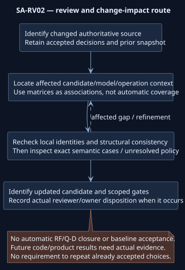

[PlantUML](Diagrams/Review-Change-Impact-Route.puml) · 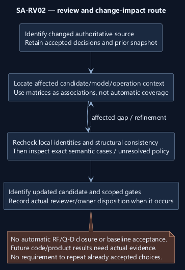

Trace changed source meaning to affected models and exact criteria. Distinguish document edits, evidence observations, product tests and owner decisions. Preserve old snapshots instead of relabeling their counts as current.

##### Diagram Types and Reading Guide

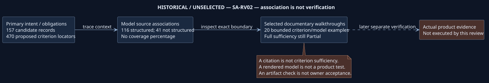

[PlantUML](Diagrams/Review-Trace-Evidence-Levels.puml) · 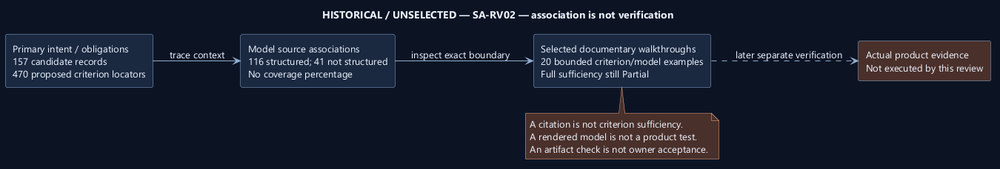

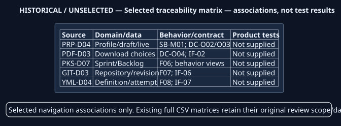

[PlantUML](Diagrams/Traceability-Selected-Matrix.puml) · 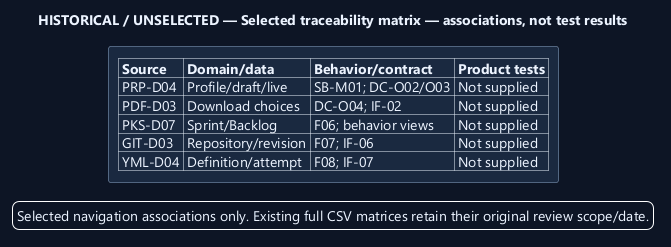

These graphs show documentary relationships, not executed tests or full semantic coverage.

[System Analysis index]() · [Diagram catalog](Diagrams/Diagram-Catalog.md)

Resumefolio — Feasibility, Dependencies and Design Handoff

#### Resumefolio — Feasibility, Dependencies and Design Handoff

> **Notation-alignment revision:** File 04 now contains functional decomposition and balanced DFDs. Earlier review findings/counts and their JSON/CSV evidence remain dated snapshots; references to an empty 04 describe that earlier candidate. Population does not automatically establish semantic sufficiency or close authoritative findings.

[Diagram types and reading guide](#analysis-review-and-design-handoff--14-feasibility-dependencies-and-design-handoff--heading-diagram-types-and-reading-guide) · [Full diagram catalog](Diagrams/Diagram-Catalog.md)

Owner: Farhad; sole delivery and operations owner. Revision: November 1, 2026.

Status: Populated conditional handoff working package. Five feasibility dimensions, eleven existing-gate mappings, twelve unselected design questions and twelve package assessments are recorded. Full feasibility, whole-analysis/design acceptance and product readiness are not established.

Current MVP scope and selected mechanisms: [Baseline](https://github.com/Farhad-V/Web-Resumefolio/blob/1f2acaa351ac306cb57cbe4fe9742e8bd90720d9/docs/MVP/baseline/README.md). Deferred provider, advanced collaboration and workflow-execution designs are not MVP prerequisites.

##### Authoritative Inputs

- [Accepted scope](../01-Project-Planning/01-Project-Charter.md#mvp-scope), [resources/constraints](../01-Project-Planning/03-Feasibility-And-Risk-Assessment.md#resource-constraints), [ASM/DEP authority](../01-Project-Planning/03-Feasibility-And-Risk-Assessment.md#assumptions-and-dependencies), [RSK authority](../01-Project-Planning/03-Feasibility-And-Risk-Assessment.md#risks-and-verification) and [GAP/accepted planning snapshot](https://github.com/Farhad-V/Web-Resumefolio/blob/1f2acaa351ac306cb57cbe4fe9742e8bd90720d9/docs/MVP/SDLC/01-project-planning/10-planning-completion-criteria.md).

- [Feasibility study](../02-Requirements-Engineering/01-Software-Requirements-Specification.md#process-and-approach-02-feasibility-study), [SRS](../02-Requirements-Engineering/01-Software-Requirements-Specification.md#requirements-specification-requirements-specification), [questions/decisions](../02-Requirements-Engineering/01-Software-Requirements-Specification.md#change-and-baseline-open-questions-and-decisions), [baseline criteria](../02-Requirements-Engineering/01-Software-Requirements-Specification.md#change-and-baseline-requirements-review-and-baseline-criteria) and [shared findings](../02-Requirements-Engineering/01-Software-Requirements-Specification.md#validation-and-traceability-validation-and-traceability--heading-review-findings).

- [Analysis guide](01-System-Context-And-Gap-Analysis.md#foundation-00-start-here), populated [domain](02-Domain-And-Information-Analysis.md#analysis-domain-and-information-analysis--03-domain-model-and-object-oriented-view), [data](02-Domain-And-Information-Analysis.md#analysis-domain-and-information-analysis--05-data-oriented-view), [scenarios](03-Processes-Scenarios-And-Business-Rules.md#analysis-behavioral-and-scenario-analysis--06-scenario-based-view), [states](03-Processes-Scenarios-And-Business-Rules.md#analysis-behavioral-and-scenario-analysis--07-state-based-view), [activities](03-Processes-Scenarios-And-Business-Rules.md#analysis-functional-and-process-analysis--08-control-flow-based-view), [rules](03-Processes-Scenarios-And-Business-Rules.md#analysis-business-rules-and-operation-contracts--09-rule-based-view), [contracts](03-Processes-Scenarios-And-Business-Rules.md#analysis-business-rules-and-operation-contracts--10-domain-constraints-and-operation-contracts), [review](#analysis-review-and-design-handoff--11-model-consistency-traceability-and-review), [interfaces](04-Interfaces-Security-And-Quality.md#analysis-interfaces-security-and-quality-analysis--12-interfaces-and-external-interactions) and [security/quality/operations](04-Interfaces-Security-And-Quality.md#analysis-interfaces-security-and-quality-analysis--13-security-quality-and-operational-analysis).

- [Roadmap](../01-Project-Planning/02-Project-Management-Plan.md#delivery-sequence), [agreed working method](../01-Project-Planning/02-Project-Management-Plan.md#delivery-approach) and [local backlog index](https://github.com/Farhad-V/Web-Resumefolio/blob/1f2acaa351ac306cb57cbe4fe9742e8bd90720d9/docs/MVP/Project-Management/product-backlog.md).

**Decision boundary:** This file prepares useful identified design inputs and states which commitments depend on what evidence. It does not select architecture/database/frontend/Git engine/runner, create a System Design package, change scope/spending, mark issues complete or authorize product coding. HD-F/G/D/P/W references are local analysis locators; existing ASM/DEP/RSK/GAP/RF/Q-D/PBI authority is retained.

##### 1. Existing investigation authority

The requirements feasibility study says full feasibility is not established; its investigation framework and the accepted planning follow-up govern the work. Bounded observations elsewhere are useful evidence, not a reason to promote an entire dependency to Available or an assumption to Confirmed. This handoff does not create a competing risk/technical-findings/owner-decision register.

**Accepted inputs retained:** M-01 acceptance belongs to the identified historical candidate `511093e788b32dd9b68fb86ff5fff2ac21140672` under DEC-116, not every later working copy. The [accepted profile-update policy](../02-Requirements-Engineering/01-Software-Requirements-Specification.md#change-and-baseline-open-questions-and-decisions--id-owner-accepted-profile-update-policy) remains accepted: source edits do not update existing resumes automatically; selected apply and separately confirmed publication differ; independent text/other resumes/actual submitted material are preserved. No reacceptance of that bounded core is requested.

**Resource/scope constraints retained:** Laravel and OOP, one owner at 20 total project hours/week, existing server/available means, no assumed additional paid services, initial 10-user direction with workload still to define, future roughly 1,000-user direction without capacity proof. Preserve the existing demo/reference projects. Product AI, automatic translation and automatic old-demo migration are excluded as stated by source scope; no silent feature cut or newly added capability is made here.

| Dimension | Bounded known input | Missing assessment evidence | Current conclusion / limit |
| --- | --- | --- | --- |
| **HD-F01 — Economic** | Existing server/available-means constraint; no additional server or paid service assumed. | Actual permitted spend, recurring/storage/delivery/component costs, alternatives and solo maintenance cost/effort with source/date. | No supported whole-option affordability conclusion; do not quote a current price or approve spending from a screenshot/name. |
| **HD-F02 — Technical** | Populated logical models/contracts; dated 2-vCPU/4-GB/40-GB Ubuntu Laravel demo/service observations. | Combined workload, applicable provider access, real Git compatibility, actual execution boundaries, component compatibility and recovery design evidence. | Inventory and model structure support bounded design questions, not operational capacity or full-scope technical feasibility. |
| **HD-F03 — Operational** | One owner, 20 total project hours/week; interface/quality/recovery scenario definitions now populated. | Actual feasible maintenance/delivery/recovery procedures, dependencies, protected source/coverage and later scoped demonstrations. | No proven sustainable operation or usable restoration; avoid new facilities/on-call promises or workload outside available time. |
| **HD-F04 — Legal / contractual applicability** | Existing source asks for scoped provider/license/content/privacy/hosting applicability investigations. | Applicable current primary sources and actual intended data/service/content/component use, with source/date and needed specialist clarification. | No jurisdictional legal conclusion, policy approval or compliance certification made by this document. |
| **HD-F05 — Schedule** | Requested November 8, 2026 target and current 20 total project hours/week are known; local dates/Sprints are historical snapshots. | Full decomposed engineering effort ranges, dependencies, learning/testing/documentation/operations/rework and actual progress, then live tracking reconciliation. | No supported delivery forecast or target-feasibility result; neither silently compress verification nor reduce agreed scope. |

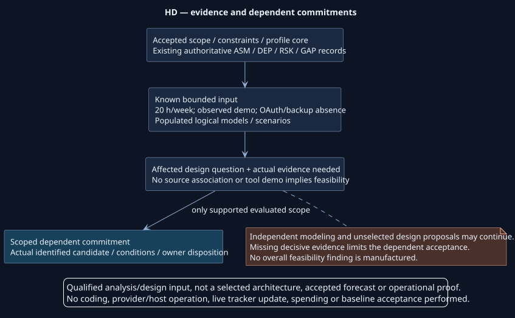

[Editable PlantUML](Diagrams/Handoff-Evidence-Dependent-Commitment.puml) · 

There is no averaged feasibility score. A technically plausible option can still fail budget, access, protection, maintenance or schedule constraints. Record actual source/date/method, evaluated scope, findings, limits, affected commitment and real disposition at its authoritative location. Provider/component/applicability terms need current authoritative investigation when selecting actual use; no fresh external policy/license/legal conclusion is claimed by this documentation.

##### 2. Analysis dependencies

The following rows restate the existing GAP-D01–D11 follow-up with current bounded input. They do not change the parent status, move its gate or replace accepted planning wording. Farhad coordinates each row. An investigation plan is not a successful investigation.

**Local / existing parent:** **HD-G01 / GAP-D01 — Server / combined workload / actual budget**

**Existing context and current input:** ASM-01, DEP-01, RSK-02, RSK-08. Existing allocation/guest/services partly observed; suitability unverified.

**Needed for affected commitment:** Actual workload/data/concurrency/resource/network/cost findings and defined performance/admission criteria.

**Existing dependent gate / independent work:** **Gate:** Before accepting dependent resource/deployment design in M-03; actual relevant capacity/limits before capability/release acceptance. **May continue:** Define logical responsibilities and quality/resource measurement candidates without claiming the host supports the whole workload.

**Local work provenance:** PBI-002, PBI-009, PBI-026 in [the local index](https://github.com/Farhad-V/Web-Resumefolio/blob/1f2acaa351ac306cb57cbe4fe9742e8bd90720d9/docs/MVP/Project-Management/product-backlog.md)

**Local / existing parent:** **HD-G02 / GAP-D02 — Gmail / Calendar access and applicability**

**Existing context and current input:** ASM-02, DEP-03, RSK-06. OAuth not created; logical read/draft/send/calendar/local/sync boundaries specified.

**Needed for affected commitment:** Actual required account/operation capability/applicability/limits/cost and failure/reconnect findings.

**Existing dependent gate / independent work:** **Gate:** Before accepting dependent M-02 integration requirements / M-03 design; verify required access before dependent development. **May continue:** Model local/provider roles, intended identities, selected operations and actual/unknown outcomes conditionally.

**Local work provenance:** PBI-004, PBI-017, PBI-018 in [the local index](https://github.com/Farhad-V/Web-Resumefolio/blob/1f2acaa351ac306cb57cbe4fe9742e8bd90720d9/docs/MVP/Project-Management/product-backlog.md)

**Local / existing parent:** **HD-G03 / GAP-D03 — Authentication / notification delivery**

**Existing context and current input:** ASM-03, DEP-04, RSK-07. Operational delivery is separate from user Gmail; actual suitability unverified.

**Needed for affected commitment:** Selected applicable delivery/configuration/access/limits/cost/failure/recovery evidence and later actual behavior.

**Existing dependent gate / independent work:** **Gate:** Before accepting authentication delivery design in M-03; actual verification before affected capability/release acceptance. **May continue:** Define intended delivery/recipient/outcome and failure semantics without assuming a channel or claiming receipt.

**Local work provenance:** PBI-005, PBI-010 in [the local index](https://github.com/Farhad-V/Web-Resumefolio/blob/1f2acaa351ac306cb57cbe4fe9742e8bd90720d9/docs/MVP/Project-Management/product-backlog.md)

**Local / existing parent:** **HD-G04 / GAP-D04 — Recovery storage / coverage / usable state**

**Existing context and current input:** ASM-04, DEP-05, RSK-05. Owner says backups not configured; nine coverage subjects and 14 quality scenarios now available.

**Needed for affected commitment:** Actual protected destination/source/access/separation/cost, coverage/consistency and agreed loss/usable-state targets; later isolated restore evidence.

**Existing dependent gate / independent work:** **Gate:** Before accepting recovery design in M-03; actual restoration/integrity/update-recovery evidence before M-09. **May continue:** Define recovery scenarios and evaluate candidate design constraints now; a completed live restore is not required just to write analysis.

**Local work provenance:** PBI-006, PBI-027, PBI-028 in [the local index](https://github.com/Farhad-V/Web-Resumefolio/blob/1f2acaa351ac306cb57cbe4fe9742e8bd90720d9/docs/MVP/Project-Management/product-backlog.md)

**Local / existing parent:** **HD-G05 / GAP-D05 — Time / effort / forecast**

**Existing context and current input:** ASM-05, RSK-01. 20 total hours/week is a confirmed input; full-scope time sufficiency remains unverified.

**Needed for affected commitment:** Engineering decomposition/effort ranges, dependencies/uncertainty and comparison with actual capacity/target.

**Existing dependent gate / independent work:** **Gate:** After analysis/design, before accepted forecast or beginning product coding; revisit milestone/Sprint reviews. **May continue:** Prepare reviewable work outcomes and estimate inputs; do not assume old full-time rows or requested date are a forecast.

**Local work provenance:** PBI-001, PBI-009 in [the local index](https://github.com/Farhad-V/Web-Resumefolio/blob/1f2acaa351ac306cb57cbe4fe9742e8bd90720d9/docs/MVP/Project-Management/product-backlog.md)

**Local / existing parent:** **HD-G06 / GAP-D06 — Detailed inputs / access / lifecycle meaning**

**Existing context and current input:** ASM-06, RSK-04, RSK-09. Accepted explicit profile apply/publication/history core; detailed other policies remain proposed.

**Needed for affected commitment:** Exact required/incomplete-input, role/action/state, source-removal/concurrency/provider/retirement/correction and criterion/path sufficiency.

**Existing dependent gate / independent work:** **Gate:** Before accepting affected M-02 requirements and dependent M-03 data/security design; later verify actual implemented scenarios. **May continue:** Use accepted core and marked proposals for independent domain/data/contracts; do not reopen accepted core or silently finalize unrelated detail.

**Local work provenance:** PBI-008, PBI-010, PBI-012, PBI-016, PBI-024 in [the local index](https://github.com/Farhad-V/Web-Resumefolio/blob/1f2acaa351ac306cb57cbe4fe9742e8bd90720d9/docs/MVP/Project-Management/product-backlog.md)

**Local / existing parent:** **HD-G07 / GAP-D07 — Domain / DNS / TLS / renewal**

**Existing context and current input:** DEP-02. resumefolio.de and a dated HTTPS response/demo route were observed; current administrative/renewal suitability not established.

**Needed for affected commitment:** Actual control/routing/certificate coverage/current configuration/renewal findings for intended environment.

**Existing dependent gate / independent work:** **Gate:** Before accepting M-03 deployment configuration; actual live behavior before M-10. **May continue:** Identify intended browser/operational boundary and non-secret configuration needs; do not treat one page as whole-domain or release proof.

**Local work provenance:** PBI-009, PBI-029 in [the local index](https://github.com/Farhad-V/Web-Resumefolio/blob/1f2acaa351ac306cb57cbe4fe9742e8bd90720d9/docs/MVP/Project-Management/product-backlog.md)

**Local / existing parent:** **HD-G08 / GAP-D08 — Components / compatibility / licensing / maintenance**

**Existing context and current input:** DEP-06, RSK-10. Laravel/OOP constraints apply; some demo runtime/lockfile and local tools observed, not full application dependency validation.

**Needed for affected commitment:** Justified selected actual component versions/support/license/resource compatibility and realistic operating procedures from current primary findings.

**Existing dependent gate / independent work:** **Gate:** At dependent M-03 technical selection and before affected implementation; actual procedures before M-09/release. **May continue:** Record selection questions/constraints/evaluation evidence; do not auto-select prototype database/frontend/Git engine/runner.

**Local work provenance:** PBI-009, PBI-028 in [the local index](https://github.com/Farhad-V/Web-Resumefolio/blob/1f2acaa351ac306cb57cbe4fe9742e8bd90720d9/docs/MVP/Project-Management/product-backlog.md)

**Local / existing parent:** **HD-G09 / GAP-D09 — Supported YAML / safe execution**

**Existing context and current input:** DEP-01, RSK-03. Conditional logical execution/attempt/output/target contracts populated; no suitable isolation environment demonstrated.

**Needed for affected commitment:** Actual supported syntax/triggers/isolation/permissions/secrets/network/resource/cleanup evidence and independent target approval.

**Existing dependent gate / independent work:** **Gate:** Before accepting dependent M-03 execution design or enabling execution; verified controls before M-08. **May continue:** Specify limited supported behavior/enabling criteria and alternatives as questions; no project code execution on demo is authorized.

**Local work provenance:** PBI-003, PBI-020, PBI-023 in [the local index](https://github.com/Farhad-V/Web-Resumefolio/blob/1f2acaa351ac306cb57cbe4fe9742e8bd90720d9/docs/MVP/Project-Management/product-backlog.md)

**Local / existing parent:** **HD-G10 / GAP-D10 — Quantitative quality / effective limits**

**Existing context and current input:** ASM-01, DEP-01, RSK-02, RSK-08. 14 scenarios supply stimulus/environment/response/measure; no new numeric targets accepted.

**Needed for affected commitment:** Actual workload/units/threshold/aggregation, resource/admission/file/availability/client/accessibility criteria and evidence.

**Existing dependent gate / independent work:** **Gate:** Relevant M-02 requirement / M-03 design acceptance; actual affected results before M-09/release. **May continue:** Define measures and candidate workload contexts without invented response, availability, quota, retention or recovery values.

**Local work provenance:** PBI-002, PBI-013, PBI-026 in [the local index](https://github.com/Farhad-V/Web-Resumefolio/blob/1f2acaa351ac306cb57cbe4fe9742e8bd90720d9/docs/MVP/Project-Management/product-backlog.md)

**Local / existing parent:** **HD-G11 / GAP-D11 — Requirements-to-work / live tracking / carryover**

**Existing context and current input:** RSK-01. Local backlog indexes 29 historical work packages; GitHub issues/project are live authority; remote state not queried here.

**Needed for affected commitment:** Exact reviewable requirement/design/work links, realistic decomposition/estimates, current actual issue/board assignments and outcome/carryover records.

**Existing dependent gate / independent work:** **Gate:** Reconcile after analysis/design before product coding; record actual Sprint outcomes/carryover during execution reviews. **May continue:** Prepare local candidate work mapping and readiness conditions; no issue is complete or Sprint fixed merely from a local mention.

**Local work provenance:** PBI-008, PBI-009, PBI-019 in [the local index](https://github.com/Farhad-V/Web-Resumefolio/blob/1f2acaa351ac306cb57cbe4fe9742e8bd90720d9/docs/MVP/Project-Management/product-backlog.md)

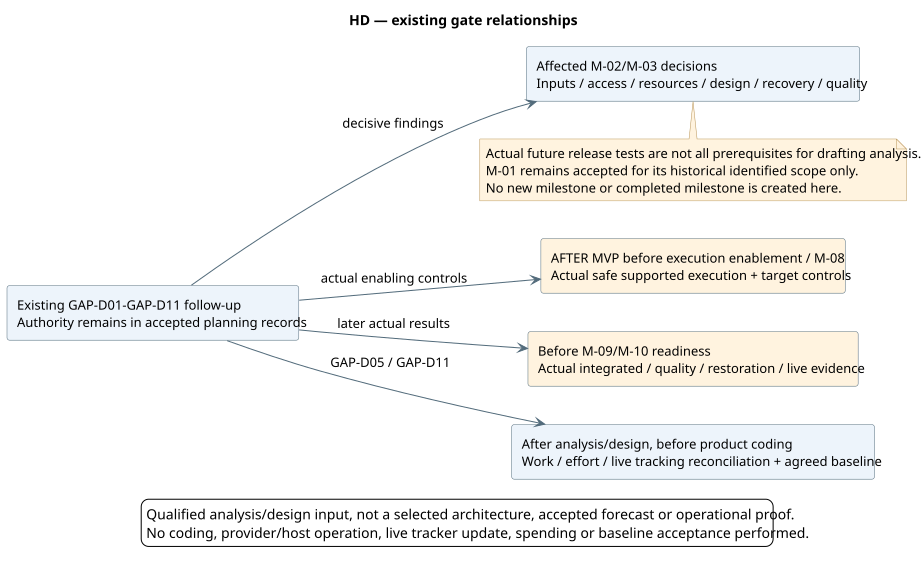

[Editable PlantUML](Diagrams/Handoff-Existing-Review-Gates.puml) · 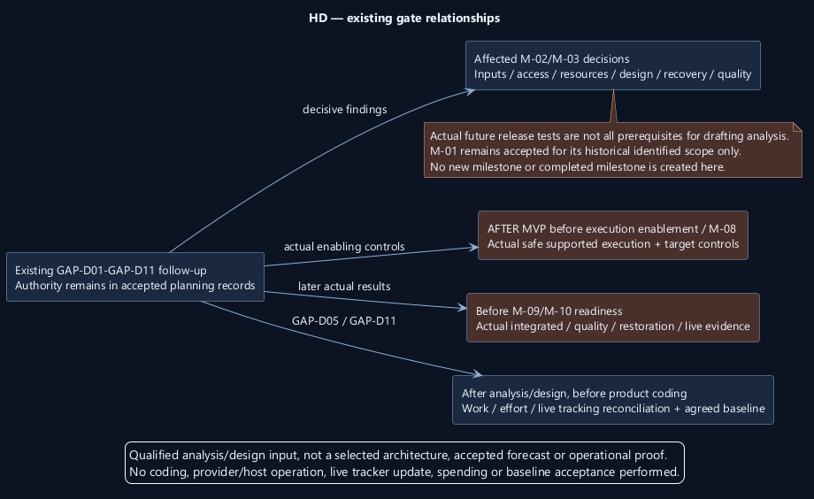

###### Drafting versus accepting a dependent design

Independent conceptual modeling and bounded unselected design proposals can continue now. Do not demand every future release/load/restore result merely to write a requirement or analysis model. Before accepting a design whose decisive access/resource/recovery/isolation assumption is unresolved, obtain the specific findings or record a concrete evaluated conditional disposition within the existing gate. Actual execution controls, integrated capacity and demonstrated recovery still need real evidence before the existing enabling/capability/readiness gates.

All six ASM assumptions remain unverified in the authoritative planning record. DEP-01 is partly observed; DEP-05 explicitly records owner-reported absent backup setup; other whole-dependency suitability remains unverified. Known 20-hour availability does not validate ASM-05 full-scope sufficiency. A dated successful page, root SSH, lockfile version or local diagram generation does not verify provider access, real product Git hosting, full compatibility, safe jobs or usable recovery.

##### 3. Options requiring later design

The records below are questions and comparison criteria, not option selections. For each eventual candidate option, record required outcome, constraints, actual support evidence, economic/operating/applicability/schedule effects, alternatives/conflicts, remaining exposure and actual scoped decision with identified revision. Do not equate familiar prototype components, a low component count or a rendered diagram with a justified design.

**Design record / question:** **HD-D01 — Professional information / publication / history**. How will selected independent drafting, publication and actual submitted content be represented and updated?

**Constraints that must survive:** Accepted no automatic propagation; preserve overrides/other resumes/actual sent material; apply and publish separately.

**Comparison/evidence needed:** Compare candidate representations against source-removal, stale/concurrent edit, actual provenance, correction/retention and recovery cases; evaluate operating/resource cost.

**Source / selected model context:** GAP-D06, GAP-D04; [PRP-D04](../02-Requirements-Engineering/01-Software-Requirements-Specification.md#requirements-specification-profiles-resumes-and-portfolio--heading-prp-d04-explicit-shared-source-update-rules), [PRP-D08](../02-Requirements-Engineering/01-Software-Requirements-Specification.md#requirements-specification-profiles-resumes-and-portfolio--heading-prp-d08-clear-presentation-and-rendition-boundaries), [APP-D06](../02-Requirements-Engineering/01-Software-Requirements-Specification.md#requirements-specification-manual-application-management--heading-app-d06-preserved-actual-submitted-copies), [APP-D07](../02-Requirements-Engineering/01-Software-Requirements-Specification.md#requirements-specification-manual-application-management--heading-app-d07-correction-and-repeated-submissions), [BRL-D02](../02-Requirements-Engineering/01-Software-Requirements-Specification.md#requirements-specification-business-rules-and-data-lifecycle--heading-brl-d02-shared-information-and-independent-tailoring); [SM-M01](03-Processes-Scenarios-And-Business-Rules.md#analysis-behavioral-and-scenario-analysis--07-state-based-view--id-sm-m01), [SM-M07](03-Processes-Scenarios-And-Business-Rules.md#analysis-behavioral-and-scenario-analysis--07-state-based-view--id-sm-m07), [RB-D02](03-Processes-Scenarios-And-Business-Rules.md#analysis-business-rules-and-operation-contracts--09-rule-based-view--id-rb-d02), [RB-D06](03-Processes-Scenarios-And-Business-Rules.md#analysis-business-rules-and-operation-contracts--09-rule-based-view--id-rb-d06)

**Design record / question:** **HD-D02 — Authorization across every entry**. How will exact current resource/action/state authority remain consistent across UI, direct files, provider/Git/output and operator paths?

**Constraints that must survive:** No universal sign-in/admin/board scope; employer viewer needs no product account; current grant/session policy explicit.

**Comparison/evidence needed:** Approved applicable action/state/caller matrix and representative direct/changed-grant/old-session/restore cases; justify implementation boundaries later.

**Source / selected model context:** GAP-D06, GAP-D09; [ACC-D03](../02-Requirements-Engineering/01-Software-Requirements-Specification.md#requirements-specification-accounts-authentication-and-permissions--heading-acc-d03-resource-and-operation-authorization), [ACC-D04](../02-Requirements-Engineering/01-Software-Requirements-Specification.md#requirements-specification-accounts-authentication-and-permissions--heading-acc-d04-cross-user-private-data-isolation), [ACC-D12](../02-Requirements-Engineering/01-Software-Requirements-Specification.md#requirements-specification-accounts-authentication-and-permissions--heading-acc-d12-end-of-access-and-lifecycle-enforcement), [QSR-D05](../02-Requirements-Engineering/01-Software-Requirements-Specification.md#requirements-specification-quality-security-and-recovery-requirements--heading-qsr-d05-identity-resource-isolation-and-changed-access); [IF-01](04-Interfaces-Security-And-Quality.md#analysis-interfaces-security-and-quality-analysis--12-interfaces-and-external-interactions--id-if-01), [IF-02](04-Interfaces-Security-And-Quality.md#analysis-interfaces-security-and-quality-analysis--12-interfaces-and-external-interactions--id-if-02), [IF-03](04-Interfaces-Security-And-Quality.md#analysis-interfaces-security-and-quality-analysis--12-interfaces-and-external-interactions--id-if-03), [IF-06](04-Interfaces-Security-And-Quality.md#analysis-interfaces-security-and-quality-analysis--12-interfaces-and-external-interactions--id-if-06), [RB-D01](03-Processes-Scenarios-And-Business-Rules.md#analysis-business-rules-and-operation-contracts--09-rule-based-view--id-rb-d01)

**Design record / question:** **HD-D03 — PDF and file representation / serving**. How will selected current artifacts, language, generated/uploaded mode, provenance and actual file outcomes be maintained?

**Constraints that must survive:** Page/live state, mode, link access and artifact availability independent; required actual history/reference integrity preserved.

**Comparison/evidence needed:** Valid/invalid format/metadata/replacement/current availability and concurrent capacity cases; compare appropriate candidates with actual constraints.

**Source / selected model context:** GAP-D01, GAP-D06, GAP-D10; [PDF-D02](../02-Requirements-Engineering/01-Software-Requirements-Specification.md#requirements-specification-pdf-and-controlled-sharing--heading-pdf-d02-uploaded-pdf-and-language-identity), [PDF-D03](../02-Requirements-Engineering/01-Software-Requirements-Specification.md#requirements-specification-pdf-and-controlled-sharing--heading-pdf-d03-per-resume-download-choices), [PDF-D05](../02-Requirements-Engineering/01-Software-Requirements-Specification.md#requirements-specification-pdf-and-controlled-sharing--heading-pdf-d05-direct-file-and-pdf-authorization), [PDF-D07](../02-Requirements-Engineering/01-Software-Requirements-Specification.md#requirements-specification-pdf-and-controlled-sharing--heading-pdf-d07-explicit-live-revision-and-rendition-behavior), [AFO-D07](../02-Requirements-Engineering/01-Software-Requirements-Specification.md#requirements-specification-administration-files-and-operational-behavior--heading-afo-d07-truthful-completion-and-interrupted-operation-handling); [IF-02](04-Interfaces-Security-And-Quality.md#analysis-interfaces-security-and-quality-analysis--12-interfaces-and-external-interactions--id-if-02), [IF-03](04-Interfaces-Security-And-Quality.md#analysis-interfaces-security-and-quality-analysis--12-interfaces-and-external-interactions--id-if-03), [RB-D03](03-Processes-Scenarios-And-Business-Rules.md#analysis-business-rules-and-operation-contracts--09-rule-based-view--id-rb-d03), [RB-D04](03-Processes-Scenarios-And-Business-Rules.md#analysis-business-rules-and-operation-contracts--09-rule-based-view--id-rb-d04), [RB-D14](03-Processes-Scenarios-And-Business-Rules.md#analysis-business-rules-and-operation-contracts--09-rule-based-view--id-rb-d14)

**Design record / question:** **HD-D04 — Provider account / operation / sync**. How will intended actual provider capability and local/provider field authority be represented and reconciled?

**Constraints that must survive:** Product authority differs from provider capability; local unlink is not provider delete or dependent on active provider write; no blind send/replay.

**Comparison/evidence needed:** Actual access/applicability findings, selected mappings/time/direction/conflict/reconnect and ambiguous attempt cases; exact draft/connection contract gaps visible.

**Source / selected model context:** GAP-D02, GAP-D06; [EGC-D01](../02-Requirements-Engineering/01-Software-Requirements-Specification.md#requirements-specification-email-calendar-and-google-integration--heading-egc-d01-authorized-connection-and-account-context), [EGC-D05](../02-Requirements-Engineering/01-Software-Requirements-Specification.md#requirements-specification-email-calendar-and-google-integration--heading-egc-d05-deliberate-send-and-truthful-outcome), [EGC-D08](../02-Requirements-Engineering/01-Software-Requirements-Specification.md#requirements-specification-email-calendar-and-google-integration--heading-egc-d08-explicit-synchronization-contract), [EGC-D11](../02-Requirements-Engineering/01-Software-Requirements-Specification.md#requirements-specification-email-calendar-and-google-integration--heading-egc-d11-disconnect-revocation-and-reconnect), [EGC-D12](../02-Requirements-Engineering/01-Software-Requirements-Specification.md#requirements-specification-email-calendar-and-google-integration--heading-egc-d12-bounded-failures-recovery-and-feasibility-evidence); [IF-04](04-Interfaces-Security-And-Quality.md#analysis-interfaces-security-and-quality-analysis--12-interfaces-and-external-interactions--id-if-04), [IF-05](04-Interfaces-Security-And-Quality.md#analysis-interfaces-security-and-quality-analysis--12-interfaces-and-external-interactions--id-if-05), [SM-M08](03-Processes-Scenarios-And-Business-Rules.md#analysis-behavioral-and-scenario-analysis--07-state-based-view--id-sm-m08), [SM-M09](03-Processes-Scenarios-And-Business-Rules.md#analysis-behavioral-and-scenario-analysis--07-state-based-view--id-sm-m09), [SM-M10](03-Processes-Scenarios-And-Business-Rules.md#analysis-behavioral-and-scenario-analysis--07-state-based-view--id-sm-m10), [RB-D07](03-Processes-Scenarios-And-Business-Rules.md#analysis-business-rules-and-operation-contracts--09-rule-based-view--id-rb-d07), [RB-D08](03-Processes-Scenarios-And-Business-Rules.md#analysis-business-rules-and-operation-contracts--09-rule-based-view--id-rb-d08)

**Design record / question:** **HD-D05 — Local/client interaction and accessibility**. Which supported clients/representations and interaction patterns meet agreed usability/quality outcomes?

**Constraints that must survive:** Exact context/actions/errors and pending/unknown meanings visible; manual English/German content preserved; no assumed native app or conformance.

**Comparison/evidence needed:** Defined consumer/viewport/input/language/accessibility criteria, actual representative task/round-trip cases and workload boundaries.

**Source / selected model context:** GAP-D06, GAP-D10; [EIF-D02](../02-Requirements-Engineering/01-Software-Requirements-Specification.md#requirements-specification-external-interface-requirements--heading-eif-d02-clear-operable-user-interaction), [EIF-D10](../02-Requirements-Engineering/01-Software-Requirements-Specification.md#requirements-specification-external-interface-requirements--heading-eif-d10-consistent-exchange-meaning-and-lifecycle), [QSR-D01](../02-Requirements-Engineering/01-Software-Requirements-Specification.md#requirements-specification-quality-security-and-recovery-requirements--heading-qsr-d01-response-performance-under-defined-workloads), [QSR-D03](../02-Requirements-Engineering/01-Software-Requirements-Specification.md#requirements-specification-quality-security-and-recovery-requirements--heading-qsr-d03-operable-accessible-and-compatible-interaction); [IF-01](04-Interfaces-Security-And-Quality.md#analysis-interfaces-security-and-quality-analysis--12-interfaces-and-external-interactions--id-if-01), [IF-02](04-Interfaces-Security-And-Quality.md#analysis-interfaces-security-and-quality-analysis--12-interfaces-and-external-interactions--id-if-02), [SQ-Q01](04-Interfaces-Security-And-Quality.md#analysis-interfaces-security-and-quality-analysis--13-security-quality-and-operational-analysis--id-sq-q01), [SQ-Q03](04-Interfaces-Security-And-Quality.md#analysis-interfaces-security-and-quality-analysis--13-security-quality-and-operational-analysis--id-sq-q03)

**Design record / question:** **HD-D06 — Real Git and collaboration**. Which actual hosting/transport/component arrangement supports agreed real client operations and metadata?

**Constraints that must survive:** Real clone/fetch/pull/push, exact ref rights, evaluated review context, lifecycle/recovery; browser simulation/development GitHub/admin SSH not proof.

**Comparison/evidence needed:** Supported client/transport/credential and protected-ref/merge/history/metadata/recovery evidence; compare costs, capacity, maintenance and license applicability.

**Source / selected model context:** GAP-D01, GAP-D06, GAP-D08; [GIT-D03](../02-Requirements-Engineering/01-Software-Requirements-Specification.md#requirements-specification-git-hosting-and-collaboration--heading-git-d03-real-clone-fetch-pull-and-push), [GIT-D07](../02-Requirements-Engineering/01-Software-Requirements-Specification.md#requirements-specification-git-hosting-and-collaboration--heading-git-d07-controlled-merge-and-conflict-outcomes), [GIT-D10](../02-Requirements-Engineering/01-Software-Requirements-Specification.md#requirements-specification-git-hosting-and-collaboration--heading-git-d10-lifecycle-capacity-and-recovery), [EIF-D06](../02-Requirements-Engineering/01-Software-Requirements-Specification.md#requirements-specification-external-interface-requirements--heading-eif-d06-real-git-client-interoperability); [IF-06](04-Interfaces-Security-And-Quality.md#analysis-interfaces-security-and-quality-analysis--12-interfaces-and-external-interactions--id-if-06), [SM-M13](03-Processes-Scenarios-And-Business-Rules.md#analysis-behavioral-and-scenario-analysis--07-state-based-view--id-sm-m13), [RB-D11](03-Processes-Scenarios-And-Business-Rules.md#analysis-business-rules-and-operation-contracts--09-rule-based-view--id-rb-d11)

**Design record / question:** **HD-D07 — Conditional workflow execution**. Which supported execution arrangement can satisfy actual isolation/resource/secret/network/output/cleanup requirements?

**Constraints that must survive:** No execution enabled merely by valid YAML/repository grant or available CPU; separate target authority; actual attempt/cancel/unknown result distinct.

**Comparison/evidence needed:** Supported contract and actual suitable isolated enabling-control evidence plus workload/operation/maintenance cost; no runner or hosting placement selected here.

**Source / selected model context:** GAP-D01, GAP-D08, GAP-D09, GAP-D10; [YML-D01](../02-Requirements-Engineering/01-Software-Requirements-Specification.md#requirements-specification-yaml-workflows-and-cicd--heading-yml-d01-defined-supported-workflow-contract), [YML-D04](../02-Requirements-Engineering/01-Software-Requirements-Specification.md#requirements-specification-yaml-workflows-and-cicd--heading-yml-d04-isolation-and-untrusted-code-boundary), [YML-D06](../02-Requirements-Engineering/01-Software-Requirements-Specification.md#requirements-specification-yaml-workflows-and-cicd--heading-yml-d06-resource-admission-and-limits), [YML-D10](../02-Requirements-Engineering/01-Software-Requirements-Specification.md#requirements-specification-yaml-workflows-and-cicd--heading-yml-d10-separate-controlled-deployment-stage), [YML-D12](../02-Requirements-Engineering/01-Software-Requirements-Specification.md#requirements-specification-yaml-workflows-and-cicd--heading-yml-d12-feasibility-operational-guidance-and-enabling-gate); [IF-07](04-Interfaces-Security-And-Quality.md#analysis-interfaces-security-and-quality-analysis--12-interfaces-and-external-interactions--id-if-07), [SM-M14](03-Processes-Scenarios-And-Business-Rules.md#analysis-behavioral-and-scenario-analysis--07-state-based-view--id-sm-m14), [SM-M15](03-Processes-Scenarios-And-Business-Rules.md#analysis-behavioral-and-scenario-analysis--07-state-based-view--id-sm-m15), [RB-D12](03-Processes-Scenarios-And-Business-Rules.md#analysis-business-rules-and-operation-contracts--09-rule-based-view--id-rb-d12), [RB-D13](03-Processes-Scenarios-And-Business-Rules.md#analysis-business-rules-and-operation-contracts--09-rule-based-view--id-rb-d13), [SQ-Q07](04-Interfaces-Security-And-Quality.md#analysis-interfaces-security-and-quality-analysis--13-security-quality-and-operational-analysis--id-sq-q07)

**Design record / question:** **HD-D08 — Runtime / database / frontend / components**. Which final component/dependency design fits the stated platform and whole engineering/operating constraints?

**Constraints that must survive:** Laravel and OOP mandated; existing demo tools/services are observations, not final database/frontend/architecture/Git/runner selections.

**Comparison/evidence needed:** Current primary version/support/license/compatibility/security/resource findings and meaningful alternatives; include solo upkeep and full-scope integration.

**Source / selected model context:** GAP-D01, GAP-D08; [QSR-D02](../02-Requirements-Engineering/01-Software-Requirements-Specification.md#requirements-specification-quality-security-and-recovery-requirements--heading-qsr-d02-combined-capacity-and-bounded-resource-use), [QSR-D14](../02-Requirements-Engineering/01-Software-Requirements-Specification.md#requirements-specification-quality-security-and-recovery-requirements--heading-qsr-d14-maintainable-verifiable-and-recoverable-changes), [DOM-D07](../02-Requirements-Engineering/01-Software-Requirements-Specification.md#requirements-specification-domain-requirements-and-constraints--heading-dom-d07-verify-reuse-and-licensing-before-adoption), [DOM-D08](../02-Requirements-Engineering/01-Software-Requirements-Specification.md#requirements-specification-domain-requirements-and-constraints--heading-dom-d08-evidence-based-operation-within-constraints); [SQ-Q02](04-Interfaces-Security-And-Quality.md#analysis-interfaces-security-and-quality-analysis--13-security-quality-and-operational-analysis--id-sq-q02), [SQ-Q14](04-Interfaces-Security-And-Quality.md#analysis-interfaces-security-and-quality-analysis--13-security-quality-and-operational-analysis--id-sq-q14)

**Design record / question:** **HD-D09 — Backup / recovery / restored authority**. How will a defined consistent protected source support scoped usable recovery without stale-right or external replay?

**Constraints that must survive:** Backups not configured; actual history not latest-live reconstruction; restored bytes not usable state; no live overwrite or automatic grant/send/deploy revival.

**Comparison/evidence needed:** Actual coverage/include-reconstruct-exclude decisions, accessible independent source/cost and criteria; compare candidates before recovery design acceptance; actual drill later at readiness gate.

**Source / selected model context:** GAP-D04, GAP-D06, GAP-D08; [QSR-D10](../02-Requirements-Engineering/01-Software-Requirements-Specification.md#requirements-specification-quality-security-and-recovery-requirements--heading-qsr-d10-defined-protected-and-observable-backups), [QSR-D11](../02-Requirements-Engineering/01-Software-Requirements-Specification.md#requirements-specification-quality-security-and-recovery-requirements--heading-qsr-d11-demonstrated-restoration-and-recovery-targets), [QSR-D12](../02-Requirements-Engineering/01-Software-Requirements-Specification.md#requirements-specification-quality-security-and-recovery-requirements--heading-qsr-d12-safe-restored-access-and-external-state-reconciliation); [IF-08](04-Interfaces-Security-And-Quality.md#analysis-interfaces-security-and-quality-analysis--12-interfaces-and-external-interactions--id-if-08), [SM-M17](03-Processes-Scenarios-And-Business-Rules.md#analysis-behavioral-and-scenario-analysis--07-state-based-view--id-sm-m17), [RB-D16](03-Processes-Scenarios-And-Business-Rules.md#analysis-business-rules-and-operation-contracts--09-rule-based-view--id-rb-d16), [SQ-Q10](04-Interfaces-Security-And-Quality.md#analysis-interfaces-security-and-quality-analysis--13-security-quality-and-operational-analysis--id-sq-q10), [SQ-Q11](04-Interfaces-Security-And-Quality.md#analysis-interfaces-security-and-quality-analysis--13-security-quality-and-operational-analysis--id-sq-q11), [SQ-Q12](04-Interfaces-Security-And-Quality.md#analysis-interfaces-security-and-quality-analysis--13-security-quality-and-operational-analysis--id-sq-q12)

**Design record / question:** **HD-D10 — Delivery / deployment / maintainable change**. Which scoped facilities and procedures support identity notifications, exact target deployment and compatible failure recovery?

**Constraints that must survive:** User Gmail not identity/recovery mail; build/merge not deploy authority; code rollback is not universal data recovery; preserve demo/reference projects.

**Comparison/evidence needed:** Actual facility/control/domain/TLS/version/operator evidence and failure/retry/irreversible-change cases; no purchase, target or migration action approved.

**Source / selected model context:** GAP-D03, GAP-D07, GAP-D08, GAP-D04; [EIF-D09](../02-Requirements-Engineering/01-Software-Requirements-Specification.md#requirements-specification-external-interface-requirements--heading-eif-d09-operational-configuration-and-recovery-boundaries), [YML-D10](../02-Requirements-Engineering/01-Software-Requirements-Specification.md#requirements-specification-yaml-workflows-and-cicd--heading-yml-d10-separate-controlled-deployment-stage), [QSR-D14](../02-Requirements-Engineering/01-Software-Requirements-Specification.md#requirements-specification-quality-security-and-recovery-requirements--heading-qsr-d14-maintainable-verifiable-and-recoverable-changes), [AFO-D12](../02-Requirements-Engineering/01-Software-Requirements-Specification.md#requirements-specification-administration-files-and-operational-behavior--heading-afo-d12-version-specific-operational-guidance-and-readiness); [IF-07](04-Interfaces-Security-And-Quality.md#analysis-interfaces-security-and-quality-analysis--12-interfaces-and-external-interactions--id-if-07), [IF-08](04-Interfaces-Security-And-Quality.md#analysis-interfaces-security-and-quality-analysis--12-interfaces-and-external-interactions--id-if-08), [SM-M15](03-Processes-Scenarios-And-Business-Rules.md#analysis-behavioral-and-scenario-analysis--07-state-based-view--id-sm-m15), [SQ-Q14](04-Interfaces-Security-And-Quality.md#analysis-interfaces-security-and-quality-analysis--13-security-quality-and-operational-analysis--id-sq-q14)

**Design record / question:** **HD-D11 — Work / reports / explicit cross-module effects**. How will project/work/Git/provider/application references support deliberate navigation/reports/automation without implied mutations?

**Constraints that must survive:** Task/item acceptance and Sprint period/goal remain distinct; one coherent Sprint Backlog; cross-module association does not grant access/send/complete.

**Comparison/evidence needed:** Exact report/link/automation input/outcome and authority, correction/ownership/current-state/restore cases, scope and workload; no extra autonomous action added.

**Source / selected model context:** GAP-D06, GAP-D11; [PKS-D07](../02-Requirements-Engineering/01-Software-Requirements-Specification.md#requirements-specification-projects-kanban-and-sprints--heading-pks-d07-sprint-goal-and-selected-backlog-items), [PKS-D09](../02-Requirements-Engineering/01-Software-Requirements-Specification.md#requirements-specification-projects-kanban-and-sprints--heading-pks-d09-explicit-completion-and-sprint-end-outcomes), [PKS-D10](../02-Requirements-Engineering/01-Software-Requirements-Specification.md#requirements-specification-projects-kanban-and-sprints--heading-pks-d10-deliberate-cross-module-links-reports-and-automation), [DOM-D03](../02-Requirements-Engineering/01-Software-Requirements-Specification.md#requirements-specification-domain-requirements-and-constraints--heading-dom-d03-authorization-follows-the-resource-and-operation); [SM-M11](03-Processes-Scenarios-And-Business-Rules.md#analysis-behavioral-and-scenario-analysis--07-state-based-view--id-sm-m11), [SM-M12](03-Processes-Scenarios-And-Business-Rules.md#analysis-behavioral-and-scenario-analysis--07-state-based-view--id-sm-m12), [RB-D09](03-Processes-Scenarios-And-Business-Rules.md#analysis-business-rules-and-operation-contracts--09-rule-based-view--id-rb-d09), [RB-D10](03-Processes-Scenarios-And-Business-Rules.md#analysis-business-rules-and-operation-contracts--09-rule-based-view--id-rb-d10), [IF-01](04-Interfaces-Security-And-Quality.md#analysis-interfaces-security-and-quality-analysis--12-interfaces-and-external-interactions--id-if-01)

**Design record / question:** **HD-D12 — Quality/resource/operating observability**. How will selected actual quality, effective limits, evidence and sustainable operator responses be supported?

**Constraints that must survive:** No invented numerical target, unlimited scale, immutable audit or continuous staffing; 20 hours/week includes all project work.

**Comparison/evidence needed:** Agreed metrics/workload/units/thresholds and actual combined-capacity/failure/secret-safe evidence/procedure results; compare maintenance/cost consequences.

**Source / selected model context:** GAP-D01, GAP-D05, GAP-D08, GAP-D10; [QSR-D01](../02-Requirements-Engineering/01-Software-Requirements-Specification.md#requirements-specification-quality-security-and-recovery-requirements--heading-qsr-d01-response-performance-under-defined-workloads), [QSR-D02](../02-Requirements-Engineering/01-Software-Requirements-Specification.md#requirements-specification-quality-security-and-recovery-requirements--heading-qsr-d02-combined-capacity-and-bounded-resource-use), [QSR-D04](../02-Requirements-Engineering/01-Software-Requirements-Specification.md#requirements-specification-quality-security-and-recovery-requirements--heading-qsr-d04-observable-availability-and-controlled-degradation), [QSR-D13](../02-Requirements-Engineering/01-Software-Requirements-Specification.md#requirements-specification-quality-security-and-recovery-requirements--heading-qsr-d13-useful-restricted-operational-evidence), [QSR-D14](../02-Requirements-Engineering/01-Software-Requirements-Specification.md#requirements-specification-quality-security-and-recovery-requirements--heading-qsr-d14-maintainable-verifiable-and-recoverable-changes); [SQ-Q01](04-Interfaces-Security-And-Quality.md#analysis-interfaces-security-and-quality-analysis--13-security-quality-and-operational-analysis--id-sq-q01), [SQ-Q02](04-Interfaces-Security-And-Quality.md#analysis-interfaces-security-and-quality-analysis--13-security-quality-and-operational-analysis--id-sq-q02), [SQ-Q04](04-Interfaces-Security-And-Quality.md#analysis-interfaces-security-and-quality-analysis--13-security-quality-and-operational-analysis--id-sq-q04), [SQ-Q13](04-Interfaces-Security-And-Quality.md#analysis-interfaces-security-and-quality-analysis--13-security-quality-and-operational-analysis--id-sq-q13), [SQ-Q14](04-Interfaces-Security-And-Quality.md#analysis-interfaces-security-and-quality-analysis--13-security-quality-and-operational-analysis--id-sq-q14)

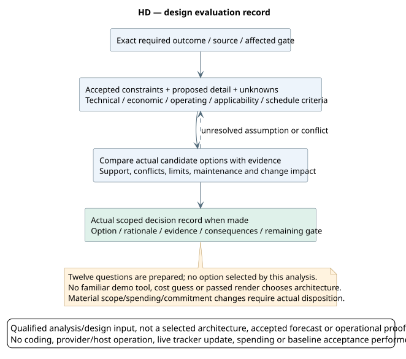

[Editable PlantUML](Diagrams/Handoff-Design-Question-Record.puml) · 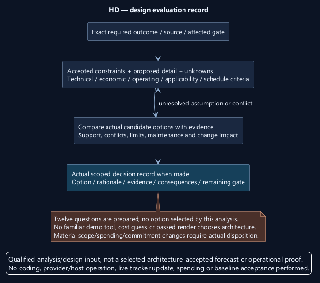

A material conflict with full scope, budget/resources or requested commitment needs actual owner disposition of a concrete reviewed proposal, not a silent reduction or presumed purchase. Choosing an implementation mechanism does not by itself settle every product-policy detail; preserve explicit independent source/apply/publication/history and exact current resource/effect context. No endpoint/schema, transaction/locking/idempotency protocol, physical data layout, target or recovery topology is selected here.

##### 4. Design handoff package

**Current verdict: useful conditional design input; whole analysis/design baseline is not accepted.** Populated working models and current interface/quality records can support specific design proposals, while exact function/flow semantic review, trace/policy and decisive dependency findings remain visible. All-SDLC initial documentation, actual coherent review and pre-coding agreement still apply.

**Package record:** **HD-P01 — Accepted intent, scope and core rules**

**Identified input / observed state:** Scope, accepted planning snapshot and explicit accepted profile-update entry. **Position:** Available identified input; accepted core preserved.

**Condition before claiming the dependent package complete:** Retain the owner-defined MVP scope and source acceptance boundaries; preserve future requirements separately and do not silently approve detailed proposals. **Context:** DEC-116; PRP-D04; accepted profile policy

**Package record:** **HD-P02 — Logical functions and balanced flows**

**Identified input / observed state:** The earlier candidate contained five To develop prompts. File 04 now contains decomposition and balanced DFDs. **Position:** Population gap superseded; semantic sufficiency review remains.

**Condition before claiming the dependent package complete:** Populate logical responsibilities/decomposition and named balanced data flows; activities/context pictures are not a completed DFD package. **Context:** SA-F01; RF-D02; 04; DA-F01–DA-F13

**Package record:** **HD-P03 — Conceptual domain/data meaning**

**Identified input / observed state:** 53 domain concepts, ten class views and one package view, 34 dictionary subjects and nine ER views. **Position:** Populated working input, not accepted physical data design.

**Condition before claiming the dependent package complete:** Review identity/authority/references/history and proposed relationship bounds against exact source cases; choose physical representation only through justified design. **Context:** 03; 05; BRL-D; Q-D06–Q-D14

**Package record:** **HD-P04 — Selected behavior and operation contracts**

**Identified input / observed state:** 16 sequence models, 18 state subjects/128 transitions, 17 activities/276 steps, 18 rule tables/131 rows, 18 constraints/39 contracts. **Position:** Populated selected models with supporting/adjacent path limits.

**Condition before claiming the dependent package complete:** Reconcile exact normal/denied/failed/partial/unknown/concurrent/correction/recovery semantics; selected mappings do not exhaust every operation/criterion. **Context:** 06–10; SA-F03/05; RF-D02

**Package record:** **HD-P05 — External interaction contracts**

**Identified input / observed state:** IF-01–IF-08, 27 bounded cases and eight interface views now populated. **Position:** Logical contract inputs available; transports/schemas/clients not all selected.

**Condition before claiming the dependent package complete:** Use exact authority/identity/revision/language/time/effect boundaries; resolve affected compatibility and provider/consumer evidence before dependent acceptance. **Context:** 12; EIF-D01–EIF-D10; GAP-D02/03/07/09

**Package record:** **HD-P06 — Security/quality/operating constraints**

**Identified input / observed state:** 24 conditional authority rows, 12 trust cases, 14 quality scenarios and nine recovery subjects now populated. **Position:** Scenario/constraint inputs available; no approved full permission matrix or implemented/verified controls/numeric targets.

**Condition before claiming the dependent package complete:** Set affected measurable criteria/policy and actual enabling evidence at correct gate; no diagram or named tool becomes security/capacity/recovery proof. **Context:** 13; QSR-D01–QSR-D14; GAP-D04/06/09/10

**Package record:** **HD-P07 — Exact semantic trace and cross-view review**

**Identified input / observed state:** 157 candidate records / 470 criterion locators retained; SA-RV02 contains 20 bounded documentary walkthroughs and historical 116/41 structured association counts. **Position:** Trace structure exists; full criterion/path sufficiency remains partial; 12/13 subsequently changed source associations.

**Condition before claiming the dependent package complete:** Use the SA-RV03 current trace register and complete its explicit criterion gaps; do not call old association counts current or coverage percentages. **Context:** 11; RF-D01–RF-D05; GAP-D11

**Package record:** **HD-P08 — Feasibility and decisive dependencies**

**Identified input / observed state:** Five dimensions and eleven existing GAP mappings in this file; authoritative ASM/DEP/RSK records remain governing. **Position:** Full feasibility not established; bounded observations do not close assumptions.

**Condition before claiming the dependent package complete:** Review actual findings against affected commitments; preserve independent modeling while scoped dependent acceptance waits for evidence. **Context:** Feasibility study; ASM-01–ASM-06; DEP-01–DEP-06; GAP-D01–GAP-D11

**Package record:** **HD-P09 — Actual operating/recovery boundary**

**Identified input / observed state:** Dated demo inventory; OAuth absent; backups not configured; current delivery, isolation, combined capacity and usable recovery unverified. **Position:** Known conditions recorded; capability readiness not claimed.

**Condition before claiming the dependent package complete:** Resolve actual design-enabling evidence where required; actual controlled provider/host/recovery verification remains at its later applicable gate. **Context:** 13; GAP-D01–D04/07–D10

**Package record:** **HD-P10 — Identified candidate and change scope**

**Identified input / observed state:** Fresh input-file manifest/source hashes plus this revision output hashes and a local candidate identifier. **Position:** Current package can be reviewed as an identified working candidate; no new accepted Git baseline.

**Condition before claiming the dependent package complete:** Actual acceptance must name exact candidate/scope/conditions/evidence/remaining gates; changes trigger targeted impact review. **Context:** RBC-D01; 09 working method; 11 evidence

**Package record:** **HD-P11 — Delivery and pre-implementation agreement**

**Identified input / observed state:** 20 hours/week; provisional requested date/local tracking; planned reconciliation route below. **Position:** Forecast/backlog/Sprint assignments not accepted or remotely verified by this document.

**Condition before claiming the dependent package complete:** Complete agreed initial SDLC documentation/design and tracking reconciliation and record pre-implementation baseline before coding. **Context:** GAP-D05/GAP-D11; planning working method/roadmap

**Package record:** **HD-P12 — Actual review/owner disposition**

**Identified input / observed state:** Accepted core/planning decisions exist for their scope; no new whole-analysis/M-02/M-03 decision is made here. **Position:** This file supplies a conditional handoff candidate, not accepted design or release readiness.

**Condition before claiming the dependent package complete:** Record actual coherent candidate review and relevant owner decision only when performed; do not infer acceptance from document completion or ask to reaccept settled core. **Context:** DEC-116; RBC-D; roadmap M-02/M-03; RF-D05

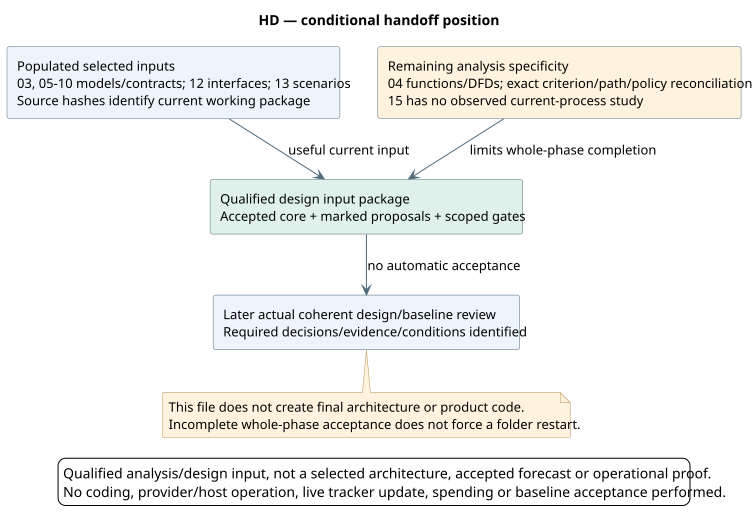

[Editable PlantUML](Diagrams/Handoff-Package-Position.puml) · 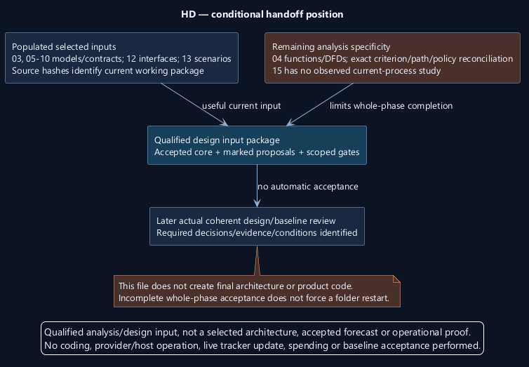

###### Identified current artifact inventory

| Input family | Current counted structure | Interpretation |
| --- | --- | --- |
| Domain/data | 53 concepts; ten class views and one package view; 34 dictionary subjects; nine ER views | Conceptual responsibilities/identity/authority, not accepted physical schema or all proposed multiplicities |
| Interactions/states/activities | 16 sequence models; 18 state subjects/128 transitions; 17 activities/276 steps | Selected modeled behavior and exceptional observations, not runtime proof |
| Rules/contracts | 18 decision tables/131 rows; 18 typed constraints; 39 selected operation contracts | Exact conditions/effects/frames and supporting-path limits; not exhaustive criterion sufficiency |
| Interfaces | Eight existing IF families; 27 bounded cases | Logical operation/account/resource/result meaning, not selected transport/schema or actual external access |
| Security/quality/recovery | 24 conditional authority rows; 12 trust cases; 14 quality scenarios; nine recovery subjects | Proposed scoped policies/evidence contracts, not implemented controls or measured results |
| Function/process evidence | 04 is now populated with functions/DFDs; 15 still has no observed current-process study | Review exact logical function/flow semantics; do not invent measured process bottlenecks or make optional research a blanket new gate |

The source-context inventory for populated views 03/05–13 has **133 candidates with direct structured associations and 24 without** out of 157. It excludes this handoff summary, textual mentions and unproved derived intent links. The 24 currently unassociated candidates are high-level business/user/domain intent records; this is not a statement their capabilities are absent or that all other criteria are covered. Review justified direct/derived links. The earlier SA-RV02 116/41 counts belong to its earlier snapshot before 12/13; neither count is a functional coverage percentage.

[The 157-row current source-context index](https://github.com/Farhad-V/Web-Resumefolio/blob/1f2acaa351ac306cb57cbe4fe9742e8bd90720d9/docs/MVP/SDLC/03-system-analysis/evidence/handoff-source-context-index-2026-11-01.csv) preserves the exact candidate/source/associated element list. The 470 proposed criterion locators remain unchanged; this file does not automatically convert candidate associations or the 20 earlier bounded walkthroughs into full exact-criterion coverage. Existing RF-D01–RF-D05 and Q-D gates are not closed.

###### Candidate identity and actual acceptance record

[The handoff input manifest](https://github.com/Farhad-V/Web-Resumefolio/blob/1f2acaa351ac306cb57cbe4fe9742e8bd90720d9/docs/MVP/SDLC/03-system-analysis/evidence/handoff-input-manifest-2026-11-01.csv) records exact source hashes for the earlier handoff candidate. [Handoff review evidence](https://github.com/Farhad-V/Web-Resumefolio/blob/1f2acaa351ac306cb57cbe4fe9742e8bd90720d9/docs/MVP/SDLC/03-system-analysis/evidence/design-handoff-review-2026-11-01.json) records the input/output fingerprints and a local candidate identifier derived from them, excluding the self-referential review JSON hash. This identifies the earlier working package, not a new Git commit or accepted baseline. A change to sources, actual options or evidence requires targeted impact review and updated candidate identity.

| Field for a later actual disposition | Current position |
| --- | --- |
| Exact candidate / scope / actor | Historical fingerprinted package retained; current review revision is identified by SA-RV03; eventual disposition must identify its actual reviewed scope and Farhad as decision-maker |
| Actual review method / findings / evidence | This task performs document/source/artifact checks only; actual semantic/option/owner reviews must record what was really inspected |
| Outcome / limits / remaining prerequisites | No new whole-analysis, M-02/M-03, implementation or release acceptance decision is recorded; retain existing independent gates |
| Impact on requirements/design/work/cost/schedule | Questions and reconciliation route supplied; no final component option, spending, scope/date or live assignment changed |

The existing planning acceptance decision is preserved. A completed contract, populated folder, model count, successful syntax check or coherent commit is not a substitute for actual scoped acceptance. Previously accepted profile behavior is not resubmitted as an unresolved question.

##### 5. Delivery reconciliation

The local backlog is an index of 29 provisional historical work packages. GitHub issues and the private delivery project hold current work/assignments/state; no remote state was queried or changed here. The PBI references below preserve local provenance, not exact semantic requirement coverage or actual completion.

| Reconciliation record | Reviewable output | Local provenance / scope limit |
| --- | --- | --- |
| **HD-W01 — Decompose full engineering work** | Break features/investigations/docs/design/implementation/integration/testing/security/accessibility/recovery/operating work and learning/rework into reviewable bounded outcomes. | PBI-008, PBI-009, PBI-025, PBI-026, PBI-027, PBI-028 in [the local index](https://github.com/Farhad-V/Web-Resumefolio/blob/1f2acaa351ac306cb57cbe4fe9742e8bd90720d9/docs/MVP/Project-Management/product-backlog.md). Model/diagram count is not effort. Full agreed scope retained; no new issue or fixed Sprint assignment created. |
| **HD-W02 — Reconcile requirement/model/work links** | For actual work, identify exact candidate/criterion, applicable contract/interface/quality/design and completion evidence rather than a broad similar-name citation. | PBI-008, PBI-009, PBI-019 in [the local index](https://github.com/Farhad-V/Web-Resumefolio/blob/1f2acaa351ac306cb57cbe4fe9742e8bd90720d9/docs/MVP/Project-Management/product-backlog.md). Existing IDs are local index provenance only; issue descriptions/acceptance/remote state require actual later inspection. |
| **HD-W03 — Order decisive prerequisites** | Separate independent refinement from blocked consequential work; provider access, safe execution, current authority/recovery/design conditions precede the affected commitment. | PBI-002, PBI-003, PBI-004, PBI-005, PBI-006 in [the local index](https://github.com/Farhad-V/Web-Resumefolio/blob/1f2acaa351ac306cb57cbe4fe9742e8bd90720d9/docs/MVP/Project-Management/product-backlog.md). Do not execute arbitrary code/restore to obtain a document check; do not make every future release test a prerequisite for writing analysis. |
| **HD-W04 — Estimate complete work after analysis/design** | Record effort ranges, assumptions, confidence/unknowns, dependency delays and evidence for all engineering activity; compare against actual progress. | PBI-001, PBI-009 in [the local index](https://github.com/Farhad-V/Web-Resumefolio/blob/1f2acaa351ac306cb57cbe4fe9742e8bd90720d9/docs/MVP/Project-Management/product-backlog.md). No estimate/date derived in this task; requested November 8 remains request, not a forecast. |
| **HD-W05 — Apply usable solo capacity** | Use 20 total project hours/week for learning, docs, design, implementation, tests and operation within the same available time; account for unavailable time/dependencies explicitly. | PBI-001 in [the local index](https://github.com/Farhad-V/Web-Resumefolio/blob/1f2acaa351ac306cb57cbe4fe9742e8bd90720d9/docs/MVP/Project-Management/product-backlog.md). Earlier full-time rows are historical/need scoped wording reconciliation; do not double-count available time or treat weekly hours as throughput. |
| **HD-W06 — Reconcile live issues/board and local snapshots** | After current design/effort inputs, inspect actual GitHub work/board, reconcile dependencies/priority/dates/assignments and preserve historical facts. | PBI-008, PBI-009, PBI-019 in [the local index](https://github.com/Farhad-V/Web-Resumefolio/blob/1f2acaa351ac306cb57cbe4fe9742e8bd90720d9/docs/MVP/Project-Management/product-backlog.md). No remote query/update, message, current completion claim, accepted schedule or new scope/spending decision here. |
| **HD-W07 — Plan first ready Sprint and record checkpoints** | Select a concrete Sprint Goal, ready items and plan under actual available capacity; review actual outcomes/carryover and keep coherent change commits. | PBI-019, PBI-025, PBI-028 in [the local index](https://github.com/Farhad-V/Web-Resumefolio/blob/1f2acaa351ac306cb57cbe4fe9742e8bd90720d9/docs/MVP/Project-Management/product-backlog.md). Do not freeze all future Sprints now. Commit is a traceable change checkpoint, not owner stage acceptance or authorization to code. |

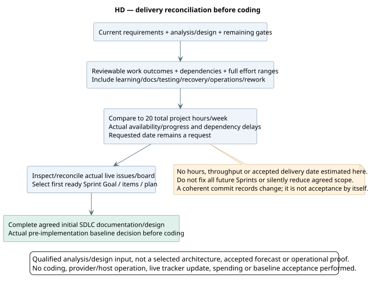

[Editable PlantUML](Diagrams/Handoff-Delivery-Reconciliation.puml) · 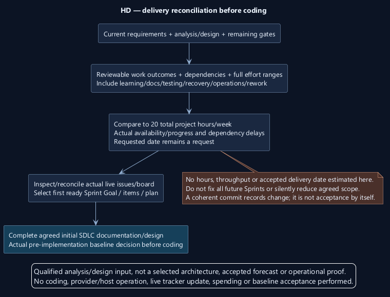

###### Capacity and target discipline

Use **20 total project hours/week** once across learning, documentation, investigation, design, coding, integration, testing, maintenance and rework. Do not treat it as 20 coding hours plus free testing/operations time, or infer throughput from it. Compare full effort ranges and dependency/availability assumptions after the relevant analysis/design decomposition. No hours or delivery date is estimated by this revision.

November 8, 2026 Europe/Berlin remains the requested Version 1 target, not an accepted evidence-based forecast. Initial 10 users is not 10 concurrent worst-case jobs; future roughly 1,000 users is a direction, not proven initial capacity. Older full-time wording and historical local Sprint dates need scoped reconciliation against the confirmed input; this file does not silently retime or rewrite the historical planning baseline.

Backlog items can be refined during requirements/analysis/design. Investigations/docs/testing/operating work also belong in the work plan. Before product implementation, reconcile the agreed initial SDLC/design package, estimates, milestones and actual tracker, then record the applicable pre-implementation agreement. At each Sprint planning select a feasible current goal/ready items/plan; future Sprints are not fixed now. At review record actual outcomes and explicit incomplete-work disposition, not automatic carryover.

##### 6. Evidence and review limits

| Evidence class | What it supports | What it does not prove |
| --- | --- | --- |
| Accepted scope/planning/core decision | Exact recorded intended scope/constraint/behavior under its acceptance boundary | Every later proposed detail, current working revision or dependent capability |
| Owner input | 20 hours/week; OAuth not created; backups not configured | Full-scope schedule sufficiency, provider operation, actual destination or usable recovery |
| Historical guest/demo inspection | Dated 2 vCPU/4 GB/40 GB Ubuntu demo and observed web/database/PHP/Laravel inventory | Current combined capacity, final stack selection, product health/security, full Git or safe execution |
| Logical models/source links | Identified conceptual subjects, state/operation/rule/interface/quality assumptions and consistency checks | Full exact criterion/path sufficiency, real controls or application behavior |
| This fingerprinted handoff package | Historical source/output identity plus traceable dependency/questions/checklist; use SA-RV03 for the revised review snapshot | A favorable full feasibility assessment, final architecture, accepted forecast, actual owner approval or permission to code |

Current primary findings register(s), official-source applicability notes and dependency records retain their exact source/date/status. Later package/provider/license/support/domain/operating decisions must use actual current authoritative evidence; no current external terms, price or legal applicability is newly verified here. No code/secret/configuration read on the host, provider operation, message, Git transfer, job, deployment, backup/restore or new service purchase is performed.

Prior SA-RV02 reports and 12/13 review evidence describe their own source snapshots. This file supersedes their file-14 placeholder statements only for this revision; it does not rewrite historical counts or automatically close parents. The fresh input manifest retains these records as sources and exposes their dates/limits.

##### 7. Concrete continuation route

1. Review the populated 04 decomposition/DFDs against existing DA-F meanings, exact criteria and source cases; no folder rebuild is needed.

2. Reconcile affected exact intent/criterion/path/policy gaps on the current 03/05–13 package and qualified handoff inputs. Preserve accepted source/apply/publication/history behavior; address credential/draft/lifecycle/supporting path detail only where required.

3. Develop specific System Design candidates from the twelve question records, with explicit constraints/alternatives/evidence and scoped dependent gates. Obtain decisive findings before accepting the commitments that depend on them, while independent proposal work continues.

4. Revisit Planning → Requirements → Analysis → Design with identified current artifacts, full effort/work/tracker reconciliation and actual applicable owner disposition. Preserve historical accepted planning and prior evidence; do not equate that review loop with restarting all work.

5. Before product coding, complete the agreed initial SDLC documentation/design and pre-implementation agreement. Actual implementation/capability/quality/recovery/release checks remain at their appropriate later gates.

##### 8. Review Status

File 14 is now populated with five feasibility-dimension assessments, eleven mappings to existing gates, twelve unselected design questions, twelve handoff assessments, seven delivery-reconciliation inputs, current source/context manifests and five PlantUML views. The logical design handoff is conditional; full feasibility and whole-analysis/design readiness are not claimed.

Download the [dependency/gate matrix](https://github.com/Farhad-V/Web-Resumefolio/blob/1f2acaa351ac306cb57cbe4fe9742e8bd90720d9/docs/MVP/SDLC/03-system-analysis/evidence/handoff-dependency-gates-2026-11-01.csv), [design-question matrix](#analysis-design-questions), [package-assessment matrix](https://github.com/Farhad-V/Web-Resumefolio/blob/1f2acaa351ac306cb57cbe4fe9742e8bd90720d9/docs/MVP/SDLC/03-system-analysis/evidence/handoff-package-assessment-2026-11-01.csv), [delivery-reconciliation matrix](https://github.com/Farhad-V/Web-Resumefolio/blob/1f2acaa351ac306cb57cbe4fe9742e8bd90720d9/docs/MVP/SDLC/03-system-analysis/evidence/handoff-delivery-reconciliation-2026-11-01.csv), [source-context index](https://github.com/Farhad-V/Web-Resumefolio/blob/1f2acaa351ac306cb57cbe4fe9742e8bd90720d9/docs/MVP/SDLC/03-system-analysis/evidence/handoff-source-context-index-2026-11-01.csv) and [input manifest](https://github.com/Farhad-V/Web-Resumefolio/blob/1f2acaa351ac306cb57cbe4fe9742e8bd90720d9/docs/MVP/SDLC/03-system-analysis/evidence/handoff-input-manifest-2026-11-01.csv). [Review evidence](https://github.com/Farhad-V/Web-Resumefolio/blob/1f2acaa351ac306cb57cbe4fe9742e8bd90720d9/docs/MVP/SDLC/03-system-analysis/evidence/design-handoff-review-2026-11-01.json) records exact bounded checks.

No new numerical quality/recovery/resource target, architecture/component choice, owner baseline approval, accepted forecast, fixed Sprint, tracker mutation, Git commit or product implementation is created. Accepted core and existing review gates remain authoritative.

[Diagram catalog](Diagrams/Diagram-Catalog.md) · [System Analysis index]()

##### Diagram Types and Reading Guide

This network complements the existing dependency matrices. It deliberately contains no invented dates or accepted forecast. File 04 is now populated; earlier scaffold descriptions and the previous handoff fingerprint are historical. The notation-alignment evidence identifies this revision. Actual semantic review, feasibility evidence and scoped acceptance remain required; the old handoff fingerprint must not be presented as identifying these new files.

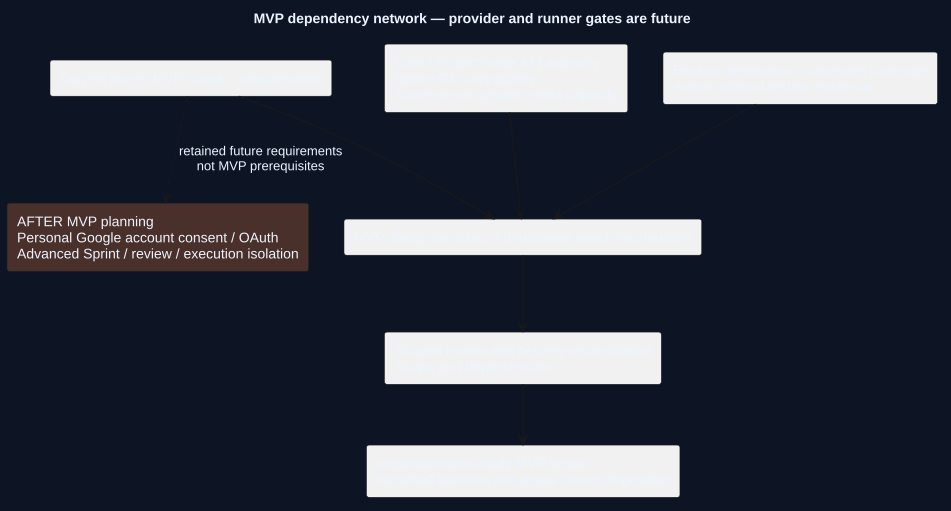

[Editable source](Diagrams/Handoff-Dependency-Network.puml) · 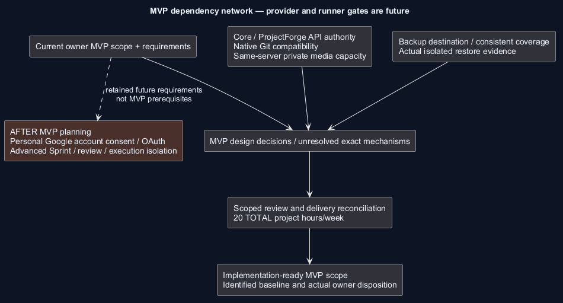

Resumefolio - Analysis Review and Design Handoff

#### Resumefolio - Analysis Review and Design Handoff

This index groups existing System Analysis records. It changes navigation, not analysis scope, model meaning or acceptance status.

Current MVP scope and selected mechanisms: [Baseline](https://github.com/Farhad-V/Web-Resumefolio/blob/1f2acaa351ac306cb57cbe4fe9742e8bd90720d9/docs/MVP/baseline/README.md). Deferred provider, advanced collaboration and workflow-execution designs are not MVP prerequisites.

##### Documents

- [11-model-consistency-traceability-and-review.md](#analysis-review-and-design-handoff--11-model-consistency-traceability-and-review)
- [14-feasibility-dependencies-and-design-handoff.md](#analysis-review-and-design-handoff--14-feasibility-dependencies-and-design-handoff)

##### Shared Resources

- [System Analysis index]()
- [Shared diagram catalog](Diagrams/Diagram-Catalog.md)
- [Relocation map and historical evidence]()

## Current cross-view review

[SA-RV03](#analysis-review-and-design-handoff--11-model-consistency-traceability-and-review) is the current documentary review. SA-RV02 is retained as an explicitly historical snapshot. Its 157 candidate contexts, 470 criterion contexts and 39 contract associations are documentary associations, not coverage percentages. The current review supersedes earlier scaffold descriptions while retaining historical findings and their limits.

### Interface view update after SA-RV02

See [12](04-Interfaces-Security-And-Quality.md#analysis-interfaces-security-and-quality-analysis--12-interfaces-and-external-interactions) for the populated interface view and evidence.

### Security/quality/operations update after SA-RV02

See [13](04-Interfaces-Security-And-Quality.md#analysis-interfaces-security-and-quality-analysis--13-security-quality-and-operational-analysis) for conditional security, quality and recovery analysis. OAuth and backup setup remain unperformed owner-reported work; server observations are dated, not current capacity certification.

### Qualified handoff update after SA-RV02

See [14](#analysis-review-and-design-handoff--14-feasibility-dependencies-and-design-handoff) for the historical fingerprinted candidate package and existing dependency gates. Its source snapshot precedes the current file-15/README revision and is not a fingerprint of this entire current folder.

## Next Work

Reconcile affected models against source criteria, track unresolved decisions, and record the scoped review outcome in [SA-RV03](#analysis-review-and-design-handoff--11-model-consistency-traceability-and-review).

## Analysis evidence and follow-up

These are documentary review records. They describe the reviewed revisions and do not establish an executed product test. Update the [requirements traceability matrix](../02-Requirements-Engineering/03-Requirements-Traceability-Matrix.md) when implementation and test evidence becomes available.

### Criterion trace and review status

- Current source-context indexed; exact semantic comparison remains open — 431 criteria
- Bounded documentary comparison; residual remains — 39 criteria

Open the 470 criterion review entries

| Criterion | Analysis disposition | Product verification |
| --- | --- | --- |
| ACC-D01-AC01 | Current source-context indexed; exact semantic comparison remains open | Not executed; no product Pass |
| ACC-D01-AC02 | Current source-context indexed; exact semantic comparison remains open | Not executed; no product Pass |
| ACC-D01-AC03 | Current source-context indexed; exact semantic comparison remains open | Not executed; no product Pass |
| ACC-D02-AC01 | Current source-context indexed; exact semantic comparison remains open | Not executed; no product Pass |
| ACC-D02-AC02 | Current source-context indexed; exact semantic comparison remains open | Not executed; no product Pass |
| ACC-D03-AC01 | Bounded documentary comparison; residual remains | Not executed; no product Pass |
| ACC-D03-AC02 | Bounded documentary comparison; residual remains | Not executed; no product Pass |
| ACC-D03-AC03 | Bounded documentary comparison; residual remains | Not executed; no product Pass |
| ACC-D04-AC01 | Bounded documentary comparison; residual remains | Not executed; no product Pass |
| ACC-D04-AC02 | Bounded documentary comparison; residual remains | Not executed; no product Pass |
| ACC-D04-AC03 | Bounded documentary comparison; residual remains | Not executed; no product Pass |
| ACC-D05-AC01 | Current source-context indexed; exact semantic comparison remains open | Not executed; no product Pass |
| ACC-D05-AC02 | Current source-context indexed; exact semantic comparison remains open | Not executed; no product Pass |
| ACC-D05-AC03 | Current source-context indexed; exact semantic comparison remains open | Not executed; no product Pass |
| ACC-D06-AC01 | Current source-context indexed; exact semantic comparison remains open | Not executed; no product Pass |
| ACC-D06-AC02 | Current source-context indexed; exact semantic comparison remains open | Not executed; no product Pass |
| ACC-D06-AC03 | Current source-context indexed; exact semantic comparison remains open | Not executed; no product Pass |
| ACC-D07-AC01 | Current source-context indexed; exact semantic comparison remains open | Not executed; no product Pass |
| ACC-D07-AC02 | Current source-context indexed; exact semantic comparison remains open | Not executed; no product Pass |
| ACC-D07-AC03 | Current source-context indexed; exact semantic comparison remains open | Not executed; no product Pass |
| ACC-D08-AC01 | Current source-context indexed; exact semantic comparison remains open | Not executed; no product Pass |
| ACC-D08-AC02 | Current source-context indexed; exact semantic comparison remains open | Not executed; no product Pass |
| ACC-D08-AC03 | Current source-context indexed; exact semantic comparison remains open | Not executed; no product Pass |
| ACC-D09-AC01 | Current source-context indexed; exact semantic comparison remains open | Not executed; no product Pass |
| ACC-D09-AC02 | Current source-context indexed; exact semantic comparison remains open | Not executed; no product Pass |
| ACC-D09-AC03 | Current source-context indexed; exact semantic comparison remains open | Not executed; no product Pass |
| ACC-D10-AC01 | Current source-context indexed; exact semantic comparison remains open | Not executed; no product Pass |
| ACC-D10-AC02 | Current source-context indexed; exact semantic comparison remains open | Not executed; no product Pass |
| ACC-D11-AC01 | Current source-context indexed; exact semantic comparison remains open | Not executed; no product Pass |
| ACC-D11-AC02 | Current source-context indexed; exact semantic comparison remains open | Not executed; no product Pass |
| ACC-D12-AC01 | Current source-context indexed; exact semantic comparison remains open | Not executed; no product Pass |
| ACC-D12-AC02 | Current source-context indexed; exact semantic comparison remains open | Not executed; no product Pass |
| ACC-D12-AC03 | Current source-context indexed; exact semantic comparison remains open | Not executed; no product Pass |
| AFO-D01-AC01 | Current source-context indexed; exact semantic comparison remains open | Not executed; no product Pass |
| AFO-D01-AC02 | Current source-context indexed; exact semantic comparison remains open | Not executed; no product Pass |
| AFO-D01-AC03 | Current source-context indexed; exact semantic comparison remains open | Not executed; no product Pass |
| AFO-D02-AC01 | Current source-context indexed; exact semantic comparison remains open | Not executed; no product Pass |
| AFO-D02-AC02 | Current source-context indexed; exact semantic comparison remains open | Not executed; no product Pass |
| AFO-D02-AC03 | Current source-context indexed; exact semantic comparison remains open | Not executed; no product Pass |
| AFO-D03-AC01 | Current source-context indexed; exact semantic comparison remains open | Not executed; no product Pass |
| AFO-D03-AC02 | Current source-context indexed; exact semantic comparison remains open | Not executed; no product Pass |
| AFO-D03-AC03 | Current source-context indexed; exact semantic comparison remains open | Not executed; no product Pass |
| AFO-D04-AC01 | Bounded documentary comparison; residual remains | Not executed; no product Pass |
| AFO-D04-AC02 | Bounded documentary comparison; residual remains | Not executed; no product Pass |
| AFO-D04-AC03 | Bounded documentary comparison; residual remains | Not executed; no product Pass |
| AFO-D05-AC01 | Current source-context indexed; exact semantic comparison remains open | Not executed; no product Pass |
| AFO-D05-AC02 | Current source-context indexed; exact semantic comparison remains open | Not executed; no product Pass |
| AFO-D05-AC03 | Current source-context indexed; exact semantic comparison remains open | Not executed; no product Pass |
| AFO-D06-AC01 | Current source-context indexed; exact semantic comparison remains open | Not executed; no product Pass |
| AFO-D06-AC02 | Current source-context indexed; exact semantic comparison remains open | Not executed; no product Pass |
| AFO-D06-AC03 | Current source-context indexed; exact semantic comparison remains open | Not executed; no product Pass |
| AFO-D07-AC01 | Bounded documentary comparison; residual remains | Not executed; no product Pass |
| AFO-D07-AC02 | Bounded documentary comparison; residual remains | Not executed; no product Pass |
| AFO-D07-AC03 | Bounded documentary comparison; residual remains | Not executed; no product Pass |
| AFO-D08-AC01 | Current source-context indexed; exact semantic comparison remains open | Not executed; no product Pass |
| AFO-D08-AC02 | Current source-context indexed; exact semantic comparison remains open | Not executed; no product Pass |
| AFO-D08-AC03 | Current source-context indexed; exact semantic comparison remains open | Not executed; no product Pass |
| AFO-D09-AC01 | Current source-context indexed; exact semantic comparison remains open | Not executed; no product Pass |
| AFO-D09-AC02 | Current source-context indexed; exact semantic comparison remains open | Not executed; no product Pass |
| AFO-D09-AC03 | Current source-context indexed; exact semantic comparison remains open | Not executed; no product Pass |
| AFO-D10-AC01 | Current source-context indexed; exact semantic comparison remains open | Not executed; no product Pass |
| AFO-D10-AC02 | Current source-context indexed; exact semantic comparison remains open | Not executed; no product Pass |
| AFO-D10-AC03 | Current source-context indexed; exact semantic comparison remains open | Not executed; no product Pass |
| AFO-D11-AC01 | Current source-context indexed; exact semantic comparison remains open | Not executed; no product Pass |
| AFO-D11-AC02 | Current source-context indexed; exact semantic comparison remains open | Not executed; no product Pass |
| AFO-D11-AC03 | Current source-context indexed; exact semantic comparison remains open | Not executed; no product Pass |
| AFO-D12-AC01 | Current source-context indexed; exact semantic comparison remains open | Not executed; no product Pass |
| AFO-D12-AC02 | Current source-context indexed; exact semantic comparison remains open | Not executed; no product Pass |
| AFO-D12-AC03 | Current source-context indexed; exact semantic comparison remains open | Not executed; no product Pass |
| BIZ-D01-AC01 | Current source-context indexed; exact semantic comparison remains open | Not executed; no product Pass |
| BIZ-D01-AC02 | Current source-context indexed; exact semantic comparison remains open | Not executed; no product Pass |
| BIZ-D01-AC03 | Current source-context indexed; exact semantic comparison remains open | Not executed; no product Pass |
| BIZ-D02-AC01 | Current source-context indexed; exact semantic comparison remains open | Not executed; no product Pass |
| BIZ-D02-AC02 | Current source-context indexed; exact semantic comparison remains open | Not executed; no product Pass |
| BIZ-D02-AC03 | Current source-context indexed; exact semantic comparison remains open | Not executed; no product Pass |
| BIZ-D03-AC01 | Current source-context indexed; exact semantic comparison remains open | Not executed; no product Pass |
| BIZ-D03-AC02 | Current source-context indexed; exact semantic comparison remains open | Not executed; no product Pass |
| BIZ-D03-AC03 | Current source-context indexed; exact semantic comparison remains open | Not executed; no product Pass |
| BIZ-D04-AC01 | Current source-context indexed; exact semantic comparison remains open | Not executed; no product Pass |
| BIZ-D04-AC02 | Current source-context indexed; exact semantic comparison remains open | Not executed; no product Pass |
| BIZ-D04-AC03 | Current source-context indexed; exact semantic comparison remains open | Not executed; no product Pass |
| BIZ-D04-AC04 | Current source-context indexed; exact semantic comparison remains open | Not executed; no product Pass |
| BIZ-D05-AC01 | Current source-context indexed; exact semantic comparison remains open | Not executed; no product Pass |
| BIZ-D05-AC02 | Current source-context indexed; exact semantic comparison remains open | Not executed; no product Pass |
| BIZ-D05-AC03 | Current source-context indexed; exact semantic comparison remains open | Not executed; no product Pass |
| BIZ-D05-AC04 | Current source-context indexed; exact semantic comparison remains open | Not executed; no product Pass |
| BRL-D01-AC01 | Current source-context indexed; exact semantic comparison remains open | Not executed; no product Pass |
| BRL-D01-AC02 | Current source-context indexed; exact semantic comparison remains open | Not executed; no product Pass |
| BRL-D01-AC03 | Current source-context indexed; exact semantic comparison remains open | Not executed; no product Pass |
| BRL-D02-AC01 | Current source-context indexed; exact semantic comparison remains open | Not executed; no product Pass |
| BRL-D02-AC02 | Current source-context indexed; exact semantic comparison remains open | Not executed; no product Pass |
| BRL-D02-AC03 | Current source-context indexed; exact semantic comparison remains open | Not executed; no product Pass |
| BRL-D03-AC01 | Current source-context indexed; exact semantic comparison remains open | Not executed; no product Pass |
| BRL-D03-AC02 | Current source-context indexed; exact semantic comparison remains open | Not executed; no product Pass |
| BRL-D03-AC03 | Current source-context indexed; exact semantic comparison remains open | Not executed; no product Pass |
| BRL-D04-AC01 | Current source-context indexed; exact semantic comparison remains open | Not executed; no product Pass |
| BRL-D04-AC02 | Current source-context indexed; exact semantic comparison remains open | Not executed; no product Pass |
| BRL-D04-AC03 | Current source-context indexed; exact semantic comparison remains open | Not executed; no product Pass |
| BRL-D05-AC01 | Current source-context indexed; exact semantic comparison remains open | Not executed; no product Pass |
| BRL-D05-AC02 | Current source-context indexed; exact semantic comparison remains open | Not executed; no product Pass |
| BRL-D05-AC03 | Current source-context indexed; exact semantic comparison remains open | Not executed; no product Pass |
| BRL-D06-AC01 | Current source-context indexed; exact semantic comparison remains open | Not executed; no product Pass |
| BRL-D06-AC02 | Current source-context indexed; exact semantic comparison remains open | Not executed; no product Pass |
| BRL-D06-AC03 | Current source-context indexed; exact semantic comparison remains open | Not executed; no product Pass |
| BRL-D07-AC01 | Current source-context indexed; exact semantic comparison remains open | Not executed; no product Pass |
| BRL-D07-AC02 | Current source-context indexed; exact semantic comparison remains open | Not executed; no product Pass |
| BRL-D07-AC03 | Current source-context indexed; exact semantic comparison remains open | Not executed; no product Pass |
| BRL-D08-AC01 | Current source-context indexed; exact semantic comparison remains open | Not executed; no product Pass |
| BRL-D08-AC02 | Current source-context indexed; exact semantic comparison remains open | Not executed; no product Pass |
| BRL-D08-AC03 | Current source-context indexed; exact semantic comparison remains open | Not executed; no product Pass |
| BRL-D09-AC01 | Current source-context indexed; exact semantic comparison remains open | Not executed; no product Pass |
| BRL-D09-AC02 | Current source-context indexed; exact semantic comparison remains open | Not executed; no product Pass |
| BRL-D09-AC03 | Current source-context indexed; exact semantic comparison remains open | Not executed; no product Pass |
| BRL-D10-AC01 | Current source-context indexed; exact semantic comparison remains open | Not executed; no product Pass |
| BRL-D10-AC02 | Current source-context indexed; exact semantic comparison remains open | Not executed; no product Pass |
| BRL-D10-AC03 | Current source-context indexed; exact semantic comparison remains open | Not executed; no product Pass |
| DOM-D01-AC01 | Current source-context indexed; exact semantic comparison remains open | Not executed; no product Pass |
| DOM-D01-AC02 | Current source-context indexed; exact semantic comparison remains open | Not executed; no product Pass |
| DOM-D01-AC03 | Current source-context indexed; exact semantic comparison remains open | Not executed; no product Pass |
| DOM-D02-AC01 | Current source-context indexed; exact semantic comparison remains open | Not executed; no product Pass |
| DOM-D02-AC02 | Current source-context indexed; exact semantic comparison remains open | Not executed; no product Pass |
| DOM-D02-AC03 | Current source-context indexed; exact semantic comparison remains open | Not executed; no product Pass |
| DOM-D03-AC01 | Current source-context indexed; exact semantic comparison remains open | Not executed; no product Pass |
| DOM-D03-AC02 | Current source-context indexed; exact semantic comparison remains open | Not executed; no product Pass |
| DOM-D03-AC03 | Current source-context indexed; exact semantic comparison remains open | Not executed; no product Pass |
| DOM-D04-AC01 | Current source-context indexed; exact semantic comparison remains open | Not executed; no product Pass |
| DOM-D04-AC02 | Current source-context indexed; exact semantic comparison remains open | Not executed; no product Pass |
| DOM-D04-AC03 | Current source-context indexed; exact semantic comparison remains open | Not executed; no product Pass |
| DOM-D05-AC01 | Current source-context indexed; exact semantic comparison remains open | Not executed; no product Pass |
| DOM-D05-AC02 | Current source-context indexed; exact semantic comparison remains open | Not executed; no product Pass |
| DOM-D05-AC03 | Current source-context indexed; exact semantic comparison remains open | Not executed; no product Pass |
| DOM-D06-AC01 | Bounded documentary comparison; residual remains | Not executed; no product Pass |
| DOM-D06-AC02 | Bounded documentary comparison; residual remains | Not executed; no product Pass |
| DOM-D06-AC03 | Bounded documentary comparison; residual remains | Not executed; no product Pass |
| DOM-D07-AC01 | Current source-context indexed; exact semantic comparison remains open | Not executed; no product Pass |
| DOM-D07-AC02 | Current source-context indexed; exact semantic comparison remains open | Not executed; no product Pass |
| DOM-D07-AC03 | Current source-context indexed; exact semantic comparison remains open | Not executed; no product Pass |
| DOM-D08-AC01 | Current source-context indexed; exact semantic comparison remains open | Not executed; no product Pass |
| DOM-D08-AC02 | Current source-context indexed; exact semantic comparison remains open | Not executed; no product Pass |
| DOM-D08-AC03 | Current source-context indexed; exact semantic comparison remains open | Not executed; no product Pass |
| EGC-D01-AC01 | Current source-context indexed; exact semantic comparison remains open | Not executed; no product Pass |
| EGC-D01-AC02 | Current source-context indexed; exact semantic comparison remains open | Not executed; no product Pass |
| EGC-D01-AC03 | Current source-context indexed; exact semantic comparison remains open | Not executed; no product Pass |
| EGC-D02-AC01 | Current source-context indexed; exact semantic comparison remains open | Not executed; no product Pass |
| EGC-D02-AC02 | Current source-context indexed; exact semantic comparison remains open | Not executed; no product Pass |
| EGC-D02-AC03 | Current source-context indexed; exact semantic comparison remains open | Not executed; no product Pass |
| EGC-D03-AC01 | Current source-context indexed; exact semantic comparison remains open | Not executed; no product Pass |
| EGC-D03-AC02 | Current source-context indexed; exact semantic comparison remains open | Not executed; no product Pass |
| EGC-D03-AC03 | Current source-context indexed; exact semantic comparison remains open | Not executed; no product Pass |
| EGC-D04-AC01 | Current source-context indexed; exact semantic comparison remains open | Not executed; no product Pass |
| EGC-D04-AC02 | Current source-context indexed; exact semantic comparison remains open | Not executed; no product Pass |
| EGC-D04-AC03 | Current source-context indexed; exact semantic comparison remains open | Not executed; no product Pass |
| EGC-D05-AC01 | Current source-context indexed; exact semantic comparison remains open | Not executed; no product Pass |
| EGC-D05-AC02 | Current source-context indexed; exact semantic comparison remains open | Not executed; no product Pass |
| EGC-D05-AC03 | Current source-context indexed; exact semantic comparison remains open | Not executed; no product Pass |
| EGC-D06-AC01 | Current source-context indexed; exact semantic comparison remains open | Not executed; no product Pass |
| EGC-D06-AC02 | Current source-context indexed; exact semantic comparison remains open | Not executed; no product Pass |
| EGC-D06-AC03 | Current source-context indexed; exact semantic comparison remains open | Not executed; no product Pass |
| EGC-D07-AC01 | Current source-context indexed; exact semantic comparison remains open | Not executed; no product Pass |
| EGC-D07-AC02 | Current source-context indexed; exact semantic comparison remains open | Not executed; no product Pass |
| EGC-D07-AC03 | Current source-context indexed; exact semantic comparison remains open | Not executed; no product Pass |
| EGC-D08-AC01 | Current source-context indexed; exact semantic comparison remains open | Not executed; no product Pass |
| EGC-D08-AC02 | Current source-context indexed; exact semantic comparison remains open | Not executed; no product Pass |
| EGC-D08-AC03 | Current source-context indexed; exact semantic comparison remains open | Not executed; no product Pass |
| EGC-D09-AC01 | Current source-context indexed; exact semantic comparison remains open | Not executed; no product Pass |
| EGC-D09-AC02 | Current source-context indexed; exact semantic comparison remains open | Not executed; no product Pass |
| EGC-D09-AC03 | Current source-context indexed; exact semantic comparison remains open | Not executed; no product Pass |
| EGC-D10-AC01 | Current source-context indexed; exact semantic comparison remains open | Not executed; no product Pass |
| EGC-D10-AC02 | Current source-context indexed; exact semantic comparison remains open | Not executed; no product Pass |
| EGC-D10-AC03 | Current source-context indexed; exact semantic comparison remains open | Not executed; no product Pass |
| EGC-D11-AC01 | Current source-context indexed; exact semantic comparison remains open | Not executed; no product Pass |
| EGC-D11-AC02 | Current source-context indexed; exact semantic comparison remains open | Not executed; no product Pass |
| EGC-D11-AC03 | Current source-context indexed; exact semantic comparison remains open | Not executed; no product Pass |
| EGC-D12-AC01 | Current source-context indexed; exact semantic comparison remains open | Not executed; no product Pass |
| EGC-D12-AC02 | Current source-context indexed; exact semantic comparison remains open | Not executed; no product Pass |
| EGC-D12-AC03 | Current source-context indexed; exact semantic comparison remains open | Not executed; no product Pass |
| EIF-D01-AC01 | Current source-context indexed; exact semantic comparison remains open | Not executed; no product Pass |
| EIF-D01-AC02 | Current source-context indexed; exact semantic comparison remains open | Not executed; no product Pass |
| EIF-D01-AC03 | Current source-context indexed; exact semantic comparison remains open | Not executed; no product Pass |
| EIF-D02-AC01 | Current source-context indexed; exact semantic comparison remains open | Not executed; no product Pass |
| EIF-D02-AC02 | Current source-context indexed; exact semantic comparison remains open | Not executed; no product Pass |
| EIF-D02-AC03 | Current source-context indexed; exact semantic comparison remains open | Not executed; no product Pass |
| EIF-D03-AC01 | Current source-context indexed; exact semantic comparison remains open | Not executed; no product Pass |
| EIF-D03-AC02 | Current source-context indexed; exact semantic comparison remains open | Not executed; no product Pass |
| EIF-D03-AC03 | Current source-context indexed; exact semantic comparison remains open | Not executed; no product Pass |
| EIF-D04-AC01 | Current source-context indexed; exact semantic comparison remains open | Not executed; no product Pass |
| EIF-D04-AC02 | Current source-context indexed; exact semantic comparison remains open | Not executed; no product Pass |
| EIF-D04-AC03 | Current source-context indexed; exact semantic comparison remains open | Not executed; no product Pass |
| EIF-D05-AC01 | Current source-context indexed; exact semantic comparison remains open | Not executed; no product Pass |
| EIF-D05-AC02 | Current source-context indexed; exact semantic comparison remains open | Not executed; no product Pass |
| EIF-D05-AC03 | Current source-context indexed; exact semantic comparison remains open | Not executed; no product Pass |
| EIF-D06-AC01 | Current source-context indexed; exact semantic comparison remains open | Not executed; no product Pass |
| EIF-D06-AC02 | Current source-context indexed; exact semantic comparison remains open | Not executed; no product Pass |
| EIF-D06-AC03 | Current source-context indexed; exact semantic comparison remains open | Not executed; no product Pass |
| EIF-D07-AC01 | Current source-context indexed; exact semantic comparison remains open | Not executed; no product Pass |
| EIF-D07-AC02 | Current source-context indexed; exact semantic comparison remains open | Not executed; no product Pass |
| EIF-D07-AC03 | Current source-context indexed; exact semantic comparison remains open | Not executed; no product Pass |
| EIF-D08-AC01 | Current source-context indexed; exact semantic comparison remains open | Not executed; no product Pass |
| EIF-D08-AC02 | Current source-context indexed; exact semantic comparison remains open | Not executed; no product Pass |
| EIF-D08-AC03 | Current source-context indexed; exact semantic comparison remains open | Not executed; no product Pass |
| EIF-D09-AC01 | Current source-context indexed; exact semantic comparison remains open | Not executed; no product Pass |
| EIF-D09-AC02 | Current source-context indexed; exact semantic comparison remains open | Not executed; no product Pass |
| EIF-D09-AC03 | Current source-context indexed; exact semantic comparison remains open | Not executed; no product Pass |
| EIF-D10-AC01 | Current source-context indexed; exact semantic comparison remains open | Not executed; no product Pass |
| EIF-D10-AC02 | Current source-context indexed; exact semantic comparison remains open | Not executed; no product Pass |
| EIF-D10-AC03 | Current source-context indexed; exact semantic comparison remains open | Not executed; no product Pass |
| GIT-D01-AC01 | Current source-context indexed; exact semantic comparison remains open | Not executed; no product Pass |
| GIT-D01-AC02 | Current source-context indexed; exact semantic comparison remains open | Not executed; no product Pass |
| GIT-D01-AC03 | Current source-context indexed; exact semantic comparison remains open | Not executed; no product Pass |
| GIT-D02-AC01 | Current source-context indexed; exact semantic comparison remains open | Not executed; no product Pass |
| GIT-D02-AC02 | Current source-context indexed; exact semantic comparison remains open | Not executed; no product Pass |
| GIT-D02-AC03 | Current source-context indexed; exact semantic comparison remains open | Not executed; no product Pass |
| GIT-D03-AC01 | Bounded documentary comparison; residual remains | Not executed; no product Pass |
| GIT-D03-AC02 | Bounded documentary comparison; residual remains | Not executed; no product Pass |
| GIT-D03-AC03 | Bounded documentary comparison; residual remains | Not executed; no product Pass |
| GIT-D04-AC01 | Current source-context indexed; exact semantic comparison remains open | Not executed; no product Pass |
| GIT-D04-AC02 | Current source-context indexed; exact semantic comparison remains open | Not executed; no product Pass |
| GIT-D04-AC03 | Current source-context indexed; exact semantic comparison remains open | Not executed; no product Pass |
| GIT-D05-AC01 | Current source-context indexed; exact semantic comparison remains open | Not executed; no product Pass |
| GIT-D05-AC02 | Current source-context indexed; exact semantic comparison remains open | Not executed; no product Pass |
| GIT-D05-AC03 | Current source-context indexed; exact semantic comparison remains open | Not executed; no product Pass |
| GIT-D06-AC01 | Current source-context indexed; exact semantic comparison remains open | Not executed; no product Pass |
| GIT-D06-AC02 | Current source-context indexed; exact semantic comparison remains open | Not executed; no product Pass |
| GIT-D06-AC03 | Current source-context indexed; exact semantic comparison remains open | Not executed; no product Pass |
| GIT-D07-AC01 | Current source-context indexed; exact semantic comparison remains open | Not executed; no product Pass |
| GIT-D07-AC02 | Current source-context indexed; exact semantic comparison remains open | Not executed; no product Pass |
| GIT-D07-AC03 | Current source-context indexed; exact semantic comparison remains open | Not executed; no product Pass |
| GIT-D08-AC01 | Current source-context indexed; exact semantic comparison remains open | Not executed; no product Pass |
| GIT-D08-AC02 | Current source-context indexed; exact semantic comparison remains open | Not executed; no product Pass |
| GIT-D08-AC03 | Current source-context indexed; exact semantic comparison remains open | Not executed; no product Pass |
| GIT-D09-AC01 | Current source-context indexed; exact semantic comparison remains open | Not executed; no product Pass |
| GIT-D09-AC02 | Current source-context indexed; exact semantic comparison remains open | Not executed; no product Pass |
| GIT-D09-AC03 | Current source-context indexed; exact semantic comparison remains open | Not executed; no product Pass |
| GIT-D10-AC01 | Current source-context indexed; exact semantic comparison remains open | Not executed; no product Pass |
| GIT-D10-AC02 | Current source-context indexed; exact semantic comparison remains open | Not executed; no product Pass |
| GIT-D10-AC03 | Current source-context indexed; exact semantic comparison remains open | Not executed; no product Pass |
| APP-D01-AC01 | Current source-context indexed; exact semantic comparison remains open | Not executed; no product Pass |
| APP-D01-AC02 | Current source-context indexed; exact semantic comparison remains open | Not executed; no product Pass |
| APP-D01-AC03 | Current source-context indexed; exact semantic comparison remains open | Not executed; no product Pass |
| APP-D02-AC01 | Current source-context indexed; exact semantic comparison remains open | Not executed; no product Pass |
| APP-D02-AC02 | Current source-context indexed; exact semantic comparison remains open | Not executed; no product Pass |
| APP-D02-AC03 | Current source-context indexed; exact semantic comparison remains open | Not executed; no product Pass |
| APP-D03-AC01 | Current source-context indexed; exact semantic comparison remains open | Not executed; no product Pass |
| APP-D03-AC02 | Current source-context indexed; exact semantic comparison remains open | Not executed; no product Pass |
| APP-D03-AC03 | Current source-context indexed; exact semantic comparison remains open | Not executed; no product Pass |
| APP-D04-AC01 | Current source-context indexed; exact semantic comparison remains open | Not executed; no product Pass |
| APP-D04-AC02 | Current source-context indexed; exact semantic comparison remains open | Not executed; no product Pass |
| APP-D04-AC03 | Current source-context indexed; exact semantic comparison remains open | Not executed; no product Pass |
| APP-D05-AC01 | Current source-context indexed; exact semantic comparison remains open | Not executed; no product Pass |
| APP-D05-AC02 | Current source-context indexed; exact semantic comparison remains open | Not executed; no product Pass |
| APP-D05-AC03 | Current source-context indexed; exact semantic comparison remains open | Not executed; no product Pass |
| APP-D06-AC01 | Current source-context indexed; exact semantic comparison remains open | Not executed; no product Pass |
| APP-D06-AC02 | Current source-context indexed; exact semantic comparison remains open | Not executed; no product Pass |
| APP-D06-AC03 | Current source-context indexed; exact semantic comparison remains open | Not executed; no product Pass |
| APP-D07-AC01 | Current source-context indexed; exact semantic comparison remains open | Not executed; no product Pass |
| APP-D07-AC02 | Current source-context indexed; exact semantic comparison remains open | Not executed; no product Pass |
| APP-D07-AC03 | Current source-context indexed; exact semantic comparison remains open | Not executed; no product Pass |
| APP-D08-AC01 | Current source-context indexed; exact semantic comparison remains open | Not executed; no product Pass |
| APP-D08-AC02 | Current source-context indexed; exact semantic comparison remains open | Not executed; no product Pass |
| APP-D08-AC03 | Current source-context indexed; exact semantic comparison remains open | Not executed; no product Pass |
| APP-D09-AC01 | Current source-context indexed; exact semantic comparison remains open | Not executed; no product Pass |
| APP-D09-AC02 | Current source-context indexed; exact semantic comparison remains open | Not executed; no product Pass |
| APP-D09-AC03 | Current source-context indexed; exact semantic comparison remains open | Not executed; no product Pass |
| PDF-D01-AC01 | Current source-context indexed; exact semantic comparison remains open | Not executed; no product Pass |
| PDF-D01-AC02 | Current source-context indexed; exact semantic comparison remains open | Not executed; no product Pass |
| PDF-D01-AC03 | Current source-context indexed; exact semantic comparison remains open | Not executed; no product Pass |
| PDF-D02-AC01 | Current source-context indexed; exact semantic comparison remains open | Not executed; no product Pass |
| PDF-D02-AC02 | Current source-context indexed; exact semantic comparison remains open | Not executed; no product Pass |
| PDF-D02-AC03 | Current source-context indexed; exact semantic comparison remains open | Not executed; no product Pass |
| PDF-D03-AC01 | Bounded documentary comparison; residual remains | Not executed; no product Pass |
| PDF-D03-AC02 | Bounded documentary comparison; residual remains | Not executed; no product Pass |
| PDF-D03-AC03 | Bounded documentary comparison; residual remains | Not executed; no product Pass |
| PDF-D04-AC01 | Current source-context indexed; exact semantic comparison remains open | Not executed; no product Pass |
| PDF-D04-AC02 | Current source-context indexed; exact semantic comparison remains open | Not executed; no product Pass |
| PDF-D04-AC03 | Current source-context indexed; exact semantic comparison remains open | Not executed; no product Pass |
| PDF-D05-AC01 | Current source-context indexed; exact semantic comparison remains open | Not executed; no product Pass |
| PDF-D05-AC02 | Current source-context indexed; exact semantic comparison remains open | Not executed; no product Pass |
| PDF-D05-AC03 | Current source-context indexed; exact semantic comparison remains open | Not executed; no product Pass |
| PDF-D06-AC01 | Bounded documentary comparison; residual remains | Not executed; no product Pass |
| PDF-D06-AC02 | Bounded documentary comparison; residual remains | Not executed; no product Pass |
| PDF-D06-AC03 | Bounded documentary comparison; residual remains | Not executed; no product Pass |
| PDF-D07-AC01 | Current source-context indexed; exact semantic comparison remains open | Not executed; no product Pass |
| PDF-D07-AC02 | Current source-context indexed; exact semantic comparison remains open | Not executed; no product Pass |
| PDF-D07-AC03 | Current source-context indexed; exact semantic comparison remains open | Not executed; no product Pass |
| PDF-D08-AC01 | Current source-context indexed; exact semantic comparison remains open | Not executed; no product Pass |
| PDF-D08-AC02 | Current source-context indexed; exact semantic comparison remains open | Not executed; no product Pass |
| PDF-D08-AC03 | Current source-context indexed; exact semantic comparison remains open | Not executed; no product Pass |
| PDF-D09-AC01 | Current source-context indexed; exact semantic comparison remains open | Not executed; no product Pass |
| PDF-D09-AC02 | Current source-context indexed; exact semantic comparison remains open | Not executed; no product Pass |
| PDF-D09-AC03 | Current source-context indexed; exact semantic comparison remains open | Not executed; no product Pass |
| PDF-D10-AC01 | Current source-context indexed; exact semantic comparison remains open | Not executed; no product Pass |
| PDF-D10-AC02 | Current source-context indexed; exact semantic comparison remains open | Not executed; no product Pass |
| PDF-D10-AC03 | Current source-context indexed; exact semantic comparison remains open | Not executed; no product Pass |
| PRP-D01-AC01 | Current source-context indexed; exact semantic comparison remains open | Not executed; no product Pass |
| PRP-D01-AC02 | Current source-context indexed; exact semantic comparison remains open | Not executed; no product Pass |
| PRP-D01-AC03 | Current source-context indexed; exact semantic comparison remains open | Not executed; no product Pass |
| PRP-D02-AC01 | Current source-context indexed; exact semantic comparison remains open | Not executed; no product Pass |
| PRP-D02-AC02 | Current source-context indexed; exact semantic comparison remains open | Not executed; no product Pass |
| PRP-D02-AC03 | Current source-context indexed; exact semantic comparison remains open | Not executed; no product Pass |
| PRP-D03-AC01 | Current source-context indexed; exact semantic comparison remains open | Not executed; no product Pass |
| PRP-D03-AC02 | Current source-context indexed; exact semantic comparison remains open | Not executed; no product Pass |
| PRP-D03-AC03 | Current source-context indexed; exact semantic comparison remains open | Not executed; no product Pass |
| PRP-D04-AC01 | Bounded documentary comparison; residual remains | Not executed; no product Pass |
| PRP-D04-AC02 | Bounded documentary comparison; residual remains | Not executed; no product Pass |
| PRP-D04-AC03 | Bounded documentary comparison; residual remains | Not executed; no product Pass |
| PRP-D05-AC01 | Current source-context indexed; exact semantic comparison remains open | Not executed; no product Pass |
| PRP-D05-AC02 | Current source-context indexed; exact semantic comparison remains open | Not executed; no product Pass |
| PRP-D05-AC03 | Current source-context indexed; exact semantic comparison remains open | Not executed; no product Pass |
| PRP-D06-AC01 | Current source-context indexed; exact semantic comparison remains open | Not executed; no product Pass |
| PRP-D06-AC02 | Current source-context indexed; exact semantic comparison remains open | Not executed; no product Pass |
| PRP-D06-AC03 | Current source-context indexed; exact semantic comparison remains open | Not executed; no product Pass |
| PRP-D07-AC01 | Current source-context indexed; exact semantic comparison remains open | Not executed; no product Pass |
| PRP-D07-AC02 | Current source-context indexed; exact semantic comparison remains open | Not executed; no product Pass |
| PRP-D07-AC03 | Current source-context indexed; exact semantic comparison remains open | Not executed; no product Pass |
| PRP-D08-AC01 | Current source-context indexed; exact semantic comparison remains open | Not executed; no product Pass |
| PRP-D08-AC02 | Current source-context indexed; exact semantic comparison remains open | Not executed; no product Pass |
| PRP-D08-AC03 | Current source-context indexed; exact semantic comparison remains open | Not executed; no product Pass |
| PRP-D09-AC01 | Current source-context indexed; exact semantic comparison remains open | Not executed; no product Pass |
| PRP-D09-AC02 | Current source-context indexed; exact semantic comparison remains open | Not executed; no product Pass |
| PRP-D09-AC03 | Current source-context indexed; exact semantic comparison remains open | Not executed; no product Pass |
| PRP-D10-AC01 | Current source-context indexed; exact semantic comparison remains open | Not executed; no product Pass |
| PRP-D10-AC02 | Current source-context indexed; exact semantic comparison remains open | Not executed; no product Pass |
| PRP-D10-AC03 | Current source-context indexed; exact semantic comparison remains open | Not executed; no product Pass |
| PKS-D01-AC01 | Current source-context indexed; exact semantic comparison remains open | Not executed; no product Pass |
| PKS-D01-AC02 | Current source-context indexed; exact semantic comparison remains open | Not executed; no product Pass |
| PKS-D01-AC03 | Current source-context indexed; exact semantic comparison remains open | Not executed; no product Pass |
| PKS-D02-AC01 | Current source-context indexed; exact semantic comparison remains open | Not executed; no product Pass |
| PKS-D02-AC02 | Current source-context indexed; exact semantic comparison remains open | Not executed; no product Pass |
| PKS-D02-AC03 | Current source-context indexed; exact semantic comparison remains open | Not executed; no product Pass |
| PKS-D03-AC01 | Current source-context indexed; exact semantic comparison remains open | Not executed; no product Pass |
| PKS-D03-AC02 | Current source-context indexed; exact semantic comparison remains open | Not executed; no product Pass |
| PKS-D03-AC03 | Current source-context indexed; exact semantic comparison remains open | Not executed; no product Pass |
| PKS-D04-AC01 | Current source-context indexed; exact semantic comparison remains open | Not executed; no product Pass |
| PKS-D04-AC02 | Current source-context indexed; exact semantic comparison remains open | Not executed; no product Pass |
| PKS-D04-AC03 | Current source-context indexed; exact semantic comparison remains open | Not executed; no product Pass |
| PKS-D05-AC01 | Current source-context indexed; exact semantic comparison remains open | Not executed; no product Pass |
| PKS-D05-AC02 | Current source-context indexed; exact semantic comparison remains open | Not executed; no product Pass |
| PKS-D05-AC03 | Current source-context indexed; exact semantic comparison remains open | Not executed; no product Pass |
| PKS-D06-AC01 | Current source-context indexed; exact semantic comparison remains open | Not executed; no product Pass |
| PKS-D06-AC02 | Current source-context indexed; exact semantic comparison remains open | Not executed; no product Pass |
| PKS-D06-AC03 | Current source-context indexed; exact semantic comparison remains open | Not executed; no product Pass |
| PKS-D07-AC01 | Current source-context indexed; exact semantic comparison remains open | Not executed; no product Pass |
| PKS-D07-AC02 | Current source-context indexed; exact semantic comparison remains open | Not executed; no product Pass |
| PKS-D07-AC03 | Current source-context indexed; exact semantic comparison remains open | Not executed; no product Pass |
| PKS-D08-AC01 | Current source-context indexed; exact semantic comparison remains open | Not executed; no product Pass |
| PKS-D08-AC02 | Current source-context indexed; exact semantic comparison remains open | Not executed; no product Pass |
| PKS-D08-AC03 | Current source-context indexed; exact semantic comparison remains open | Not executed; no product Pass |
| PKS-D09-AC01 | Current source-context indexed; exact semantic comparison remains open | Not executed; no product Pass |
| PKS-D09-AC02 | Current source-context indexed; exact semantic comparison remains open | Not executed; no product Pass |
| PKS-D09-AC03 | Current source-context indexed; exact semantic comparison remains open | Not executed; no product Pass |
| PKS-D10-AC01 | Current source-context indexed; exact semantic comparison remains open | Not executed; no product Pass |
| PKS-D10-AC02 | Current source-context indexed; exact semantic comparison remains open | Not executed; no product Pass |
| PKS-D10-AC03 | Current source-context indexed; exact semantic comparison remains open | Not executed; no product Pass |
| PKS-D11-AC01 | Current source-context indexed; exact semantic comparison remains open | Not executed; no product Pass |
| PKS-D11-AC02 | Current source-context indexed; exact semantic comparison remains open | Not executed; no product Pass |
| PKS-D11-AC03 | Current source-context indexed; exact semantic comparison remains open | Not executed; no product Pass |
| QSR-D01-AC01 | Current source-context indexed; exact semantic comparison remains open | Not executed; no product Pass |
| QSR-D01-AC02 | Current source-context indexed; exact semantic comparison remains open | Not executed; no product Pass |
| QSR-D01-AC03 | Current source-context indexed; exact semantic comparison remains open | Not executed; no product Pass |
| QSR-D02-AC01 | Current source-context indexed; exact semantic comparison remains open | Not executed; no product Pass |
| QSR-D02-AC02 | Current source-context indexed; exact semantic comparison remains open | Not executed; no product Pass |
| QSR-D02-AC03 | Current source-context indexed; exact semantic comparison remains open | Not executed; no product Pass |
| QSR-D03-AC01 | Current source-context indexed; exact semantic comparison remains open | Not executed; no product Pass |
| QSR-D03-AC02 | Current source-context indexed; exact semantic comparison remains open | Not executed; no product Pass |
| QSR-D03-AC03 | Current source-context indexed; exact semantic comparison remains open | Not executed; no product Pass |
| QSR-D04-AC01 | Current source-context indexed; exact semantic comparison remains open | Not executed; no product Pass |
| QSR-D04-AC02 | Current source-context indexed; exact semantic comparison remains open | Not executed; no product Pass |
| QSR-D04-AC03 | Current source-context indexed; exact semantic comparison remains open | Not executed; no product Pass |
| QSR-D05-AC01 | Current source-context indexed; exact semantic comparison remains open | Not executed; no product Pass |
| QSR-D05-AC02 | Current source-context indexed; exact semantic comparison remains open | Not executed; no product Pass |
| QSR-D05-AC03 | Current source-context indexed; exact semantic comparison remains open | Not executed; no product Pass |
| QSR-D06-AC01 | Current source-context indexed; exact semantic comparison remains open | Not executed; no product Pass |
| QSR-D06-AC02 | Current source-context indexed; exact semantic comparison remains open | Not executed; no product Pass |
| QSR-D06-AC03 | Current source-context indexed; exact semantic comparison remains open | Not executed; no product Pass |
| QSR-D07-AC01 | Current source-context indexed; exact semantic comparison remains open | Not executed; no product Pass |
| QSR-D07-AC02 | Current source-context indexed; exact semantic comparison remains open | Not executed; no product Pass |
| QSR-D07-AC03 | Current source-context indexed; exact semantic comparison remains open | Not executed; no product Pass |
| QSR-D08-AC01 | Current source-context indexed; exact semantic comparison remains open | Not executed; no product Pass |
| QSR-D08-AC02 | Current source-context indexed; exact semantic comparison remains open | Not executed; no product Pass |
| QSR-D08-AC03 | Current source-context indexed; exact semantic comparison remains open | Not executed; no product Pass |
| QSR-D09-AC01 | Current source-context indexed; exact semantic comparison remains open | Not executed; no product Pass |
| QSR-D09-AC02 | Current source-context indexed; exact semantic comparison remains open | Not executed; no product Pass |
| QSR-D09-AC03 | Current source-context indexed; exact semantic comparison remains open | Not executed; no product Pass |
| QSR-D10-AC01 | Bounded documentary comparison; residual remains | Not executed; no product Pass |
| QSR-D10-AC02 | Bounded documentary comparison; residual remains | Not executed; no product Pass |
| QSR-D10-AC03 | Bounded documentary comparison; residual remains | Not executed; no product Pass |
| QSR-D11-AC01 | Bounded documentary comparison; residual remains | Not executed; no product Pass |
| QSR-D11-AC02 | Bounded documentary comparison; residual remains | Not executed; no product Pass |
| QSR-D11-AC03 | Bounded documentary comparison; residual remains | Not executed; no product Pass |
| QSR-D12-AC01 | Bounded documentary comparison; residual remains | Not executed; no product Pass |
| QSR-D12-AC02 | Bounded documentary comparison; residual remains | Not executed; no product Pass |
| QSR-D12-AC03 | Bounded documentary comparison; residual remains | Not executed; no product Pass |
| QSR-D13-AC01 | Current source-context indexed; exact semantic comparison remains open | Not executed; no product Pass |
| QSR-D13-AC02 | Current source-context indexed; exact semantic comparison remains open | Not executed; no product Pass |
| QSR-D13-AC03 | Current source-context indexed; exact semantic comparison remains open | Not executed; no product Pass |
| QSR-D14-AC01 | Current source-context indexed; exact semantic comparison remains open | Not executed; no product Pass |
| QSR-D14-AC02 | Current source-context indexed; exact semantic comparison remains open | Not executed; no product Pass |
| QSR-D14-AC03 | Current source-context indexed; exact semantic comparison remains open | Not executed; no product Pass |
| USR-D01-AC01 | Current source-context indexed; exact semantic comparison remains open | Not executed; no product Pass |
| USR-D01-AC02 | Current source-context indexed; exact semantic comparison remains open | Not executed; no product Pass |
| USR-D01-AC03 | Current source-context indexed; exact semantic comparison remains open | Not executed; no product Pass |
| USR-D02-AC01 | Current source-context indexed; exact semantic comparison remains open | Not executed; no product Pass |
| USR-D02-AC02 | Current source-context indexed; exact semantic comparison remains open | Not executed; no product Pass |
| USR-D02-AC03 | Current source-context indexed; exact semantic comparison remains open | Not executed; no product Pass |
| USR-D03-AC01 | Current source-context indexed; exact semantic comparison remains open | Not executed; no product Pass |
| USR-D03-AC02 | Current source-context indexed; exact semantic comparison remains open | Not executed; no product Pass |
| USR-D03-AC03 | Current source-context indexed; exact semantic comparison remains open | Not executed; no product Pass |
| USR-D04-AC01 | Current source-context indexed; exact semantic comparison remains open | Not executed; no product Pass |
| USR-D04-AC02 | Current source-context indexed; exact semantic comparison remains open | Not executed; no product Pass |
| USR-D04-AC03 | Current source-context indexed; exact semantic comparison remains open | Not executed; no product Pass |
| USR-D05-AC01 | Current source-context indexed; exact semantic comparison remains open | Not executed; no product Pass |
| USR-D05-AC02 | Current source-context indexed; exact semantic comparison remains open | Not executed; no product Pass |
| USR-D05-AC03 | Current source-context indexed; exact semantic comparison remains open | Not executed; no product Pass |
| USR-D06-AC01 | Current source-context indexed; exact semantic comparison remains open | Not executed; no product Pass |
| USR-D06-AC02 | Current source-context indexed; exact semantic comparison remains open | Not executed; no product Pass |
| USR-D06-AC03 | Current source-context indexed; exact semantic comparison remains open | Not executed; no product Pass |
| USR-D07-AC01 | Current source-context indexed; exact semantic comparison remains open | Not executed; no product Pass |
| USR-D07-AC02 | Current source-context indexed; exact semantic comparison remains open | Not executed; no product Pass |
| USR-D07-AC03 | Current source-context indexed; exact semantic comparison remains open | Not executed; no product Pass |
| USR-D08-AC01 | Current source-context indexed; exact semantic comparison remains open | Not executed; no product Pass |
| USR-D08-AC02 | Current source-context indexed; exact semantic comparison remains open | Not executed; no product Pass |
| USR-D08-AC03 | Current source-context indexed; exact semantic comparison remains open | Not executed; no product Pass |
| USR-D09-AC01 | Current source-context indexed; exact semantic comparison remains open | Not executed; no product Pass |
| USR-D09-AC02 | Current source-context indexed; exact semantic comparison remains open | Not executed; no product Pass |
| USR-D09-AC03 | Current source-context indexed; exact semantic comparison remains open | Not executed; no product Pass |
| USR-D10-AC01 | Current source-context indexed; exact semantic comparison remains open | Not executed; no product Pass |
| USR-D10-AC02 | Current source-context indexed; exact semantic comparison remains open | Not executed; no product Pass |
| USR-D10-AC03 | Current source-context indexed; exact semantic comparison remains open | Not executed; no product Pass |
| USR-D11-AC01 | Current source-context indexed; exact semantic comparison remains open | Not executed; no product Pass |
| USR-D11-AC02 | Current source-context indexed; exact semantic comparison remains open | Not executed; no product Pass |
| USR-D11-AC03 | Current source-context indexed; exact semantic comparison remains open | Not executed; no product Pass |
| USR-D12-AC01 | Current source-context indexed; exact semantic comparison remains open | Not executed; no product Pass |
| USR-D12-AC02 | Current source-context indexed; exact semantic comparison remains open | Not executed; no product Pass |
| USR-D12-AC03 | Current source-context indexed; exact semantic comparison remains open | Not executed; no product Pass |
| YML-D01-AC01 | Current source-context indexed; exact semantic comparison remains open | Not executed; no product Pass |
| YML-D01-AC02 | Current source-context indexed; exact semantic comparison remains open | Not executed; no product Pass |
| YML-D01-AC03 | Current source-context indexed; exact semantic comparison remains open | Not executed; no product Pass |
| YML-D02-AC01 | Current source-context indexed; exact semantic comparison remains open | Not executed; no product Pass |
| YML-D02-AC02 | Current source-context indexed; exact semantic comparison remains open | Not executed; no product Pass |
| YML-D02-AC03 | Current source-context indexed; exact semantic comparison remains open | Not executed; no product Pass |
| YML-D03-AC01 | Current source-context indexed; exact semantic comparison remains open | Not executed; no product Pass |
| YML-D03-AC02 | Current source-context indexed; exact semantic comparison remains open | Not executed; no product Pass |
| YML-D03-AC03 | Current source-context indexed; exact semantic comparison remains open | Not executed; no product Pass |
| YML-D04-AC01 | Bounded documentary comparison; residual remains | Not executed; no product Pass |
| YML-D04-AC02 | Bounded documentary comparison; residual remains | Not executed; no product Pass |
| YML-D04-AC03 | Bounded documentary comparison; residual remains | Not executed; no product Pass |
| YML-D05-AC01 | Current source-context indexed; exact semantic comparison remains open | Not executed; no product Pass |
| YML-D05-AC02 | Current source-context indexed; exact semantic comparison remains open | Not executed; no product Pass |
| YML-D05-AC03 | Current source-context indexed; exact semantic comparison remains open | Not executed; no product Pass |
| YML-D06-AC01 | Current source-context indexed; exact semantic comparison remains open | Not executed; no product Pass |
| YML-D06-AC02 | Current source-context indexed; exact semantic comparison remains open | Not executed; no product Pass |
| YML-D06-AC03 | Current source-context indexed; exact semantic comparison remains open | Not executed; no product Pass |
| YML-D07-AC01 | Current source-context indexed; exact semantic comparison remains open | Not executed; no product Pass |
| YML-D07-AC02 | Current source-context indexed; exact semantic comparison remains open | Not executed; no product Pass |
| YML-D07-AC03 | Current source-context indexed; exact semantic comparison remains open | Not executed; no product Pass |
| YML-D08-AC01 | Current source-context indexed; exact semantic comparison remains open | Not executed; no product Pass |
| YML-D08-AC02 | Current source-context indexed; exact semantic comparison remains open | Not executed; no product Pass |
| YML-D08-AC03 | Current source-context indexed; exact semantic comparison remains open | Not executed; no product Pass |
| YML-D09-AC01 | Current source-context indexed; exact semantic comparison remains open | Not executed; no product Pass |
| YML-D09-AC02 | Current source-context indexed; exact semantic comparison remains open | Not executed; no product Pass |
| YML-D09-AC03 | Current source-context indexed; exact semantic comparison remains open | Not executed; no product Pass |
| YML-D10-AC01 | Current source-context indexed; exact semantic comparison remains open | Not executed; no product Pass |
| YML-D10-AC02 | Current source-context indexed; exact semantic comparison remains open | Not executed; no product Pass |
| YML-D10-AC03 | Current source-context indexed; exact semantic comparison remains open | Not executed; no product Pass |
| YML-D11-AC01 | Current source-context indexed; exact semantic comparison remains open | Not executed; no product Pass |
| YML-D11-AC02 | Current source-context indexed; exact semantic comparison remains open | Not executed; no product Pass |
| YML-D11-AC03 | Current source-context indexed; exact semantic comparison remains open | Not executed; no product Pass |
| YML-D12-AC01 | Current source-context indexed; exact semantic comparison remains open | Not executed; no product Pass |
| YML-D12-AC02 | Current source-context indexed; exact semantic comparison remains open | Not executed; no product Pass |
| YML-D12-AC03 | Current source-context indexed; exact semantic comparison remains open | Not executed; no product Pass |

[Full historical trace record](https://github.com/Farhad-V/Web-Resumefolio/blob/1f2acaa351ac306cb57cbe4fe9742e8bd90720d9/docs/MVP/SDLC/03-system-analysis/evidence/current-criterion-trace-register-2026-11-01.csv) includes the exact source and model references.

### Open design questions

| ID | Area | Open question | Evidence needed | Recorded status |
| --- | --- | --- | --- | --- |
| HD-D01 | Professional information / publication / history | How will selected independent drafting, publication and actual submitted content be represented and updated? | Compare candidate representations against source-removal, stale/concurrent edit, actual provenance, correction/retention and recovery cases; evaluate operating/resource cost. | Design question/evaluation record only; no option selected |
| HD-D02 | Authorization across every entry | How will exact current resource/action/state authority remain consistent across UI, direct files, provider/Git/output and operator paths? | Approved applicable action/state/caller matrix and representative direct/changed-grant/old-session/restore cases; justify implementation boundaries later. | Design question/evaluation record only; no option selected |
| HD-D03 | PDF and file representation / serving | How will selected current artifacts, language, generated/uploaded mode, provenance and actual file outcomes be maintained? | Valid/invalid format/metadata/replacement/current availability and concurrent capacity cases; compare appropriate candidates with actual constraints. | Design question/evaluation record only; no option selected |
| HD-D04 | Provider account / operation / sync | How will intended actual provider capability and local/provider field authority be represented and reconciled? | Actual access/applicability findings, selected mappings/time/direction/conflict/reconnect and ambiguous attempt cases; exact draft/connection contract gaps visible. | Design question/evaluation record only; no option selected |
| HD-D05 | Local/client interaction and accessibility | Which supported clients/representations and interaction patterns meet agreed usability/quality outcomes? | Defined consumer/viewport/input/language/accessibility criteria, actual representative task/round-trip cases and workload boundaries. | Design question/evaluation record only; no option selected |
| HD-D06 | Real Git and collaboration | Which actual hosting/transport/component arrangement supports agreed real client operations and metadata? | Supported client/transport/credential and protected-ref/merge/history/metadata/recovery evidence; compare costs, capacity, maintenance and license applicability. | Design question/evaluation record only; no option selected |
| HD-D07 | Conditional workflow execution | Which supported execution arrangement can satisfy actual isolation/resource/secret/network/output/cleanup requirements? | Supported contract and actual suitable isolated enabling-control evidence plus workload/operation/maintenance cost; no runner or hosting placement selected here. | Design question/evaluation record only; no option selected |
| HD-D08 | Runtime / database / frontend / components | Which final component/dependency design fits the stated platform and whole engineering/operating constraints? | Current primary version/support/license/compatibility/security/resource findings and meaningful alternatives; include solo upkeep and full-scope integration. | Design question/evaluation record only; no option selected |
| HD-D09 | Backup / recovery / restored authority | How will a defined consistent protected source support scoped usable recovery without stale-right or external replay? | Actual coverage/include-reconstruct-exclude decisions, accessible independent source/cost and criteria; compare candidates before recovery design acceptance; actual drill later at readiness gate. | Design question/evaluation record only; no option selected |
| HD-D10 | Delivery / deployment / maintainable change | Which scoped facilities and procedures support identity notifications, exact target deployment and compatible failure recovery? | Actual facility/control/domain/TLS/version/operator evidence and failure/retry/irreversible-change cases; no purchase, target or migration action approved. | Design question/evaluation record only; no option selected |
| HD-D11 | Work / reports / explicit cross-module effects | How will project/work/Git/provider/application references support deliberate navigation/reports/automation without implied mutations? | Exact report/link/automation input/outcome and authority, correction/ownership/current-state/restore cases, scope and workload; no extra autonomous action added. | Design question/evaluation record only; no option selected |
| HD-D12 | Quality/resource/operating observability | How will selected actual quality, effective limits, evidence and sustainable operator responses be supported? | Agreed metrics/workload/units/thresholds and actual combined-capacity/failure/secret-safe evidence/procedure results; compare maintenance/cost consequences. | Design question/evaluation record only; no option selected |

[Full historical design-question register](https://github.com/Farhad-V/Web-Resumefolio/blob/1f2acaa351ac306cb57cbe4fe9742e8bd90720d9/docs/MVP/SDLC/03-system-analysis/evidence/handoff-design-questions-2026-11-01.csv).

### Current-process findings and follow-up

| ID | Finding | Observation | Recorded follow-up | Evidence status |
| --- | --- | --- | --- | --- |
| CP-F01 | Remaining function/flow substance | 04 contains five To develop prompts; 14 explicitly retains this gap. | Complete 04 against existing scope/dictionary/DA-F meanings before claiming whole-analysis completion. | Confirmed bounded documentary condition; not a measured personal-process bottleneck |
| CP-F02 | Association is not semantic sufficiency | 11 records 20 bounded criterion walkthroughs, not a complete review of all 470; 14 retains exact semantic reconciliation. | Refine affected exact cases/inputs/outcomes and justified direct/derived trace; retain historical inventory scope. | Confirmed bounded documentary condition; not a measured personal-process bottleneck |
| CP-F03 | Accepted core versus broad open wording | The accepted profile rule coexists with older BRL-D02/D03 open-definition wording, as already flagged by rule/handoff reviews. | Preserve accepted core and synchronize only stale broad wording during appropriate source update; do not ask for the same acceptance again. | Confirmed bounded documentary condition; not a measured personal-process bottleneck |
| CP-F04 | Historical availability wording | Resources/index retain historical full-time/provisional wording while explicit current sections say 20 total hours/week. | Use current 20-hour input and reconcile affected wording/work/forecast after design without rewriting accepted planning history. | Confirmed bounded documentary condition; not a measured personal-process bottleneck |
| CP-F05 | Selected operation/path detail remains bounded | 10/12/14 label supporting lifecycle mappings and missing exhaustive draft/credential/connection/output/retirement routes. | Refine affected exact operation/policy/path where a dependent decision needs it; allocate no fictitious verified UC coverage. | Confirmed bounded documentary condition; not a measured personal-process bottleneck |

These findings are the documentary observations as recorded. Re-check affected models against the current revision before treating any item as open or resolved. [Full historical findings](https://github.com/Farhad-V/Web-Resumefolio/blob/1f2acaa351ac306cb57cbe4fe9742e8bd90720d9/docs/MVP/SDLC/03-system-analysis/evidence/current-process-documentary-findings-2026-11-01.csv).

## Analysis exit for a selected capability

A capability can move into detailed design once its actor, authority, preconditions, normal result and material denial or failure paths are documented. For example, employer sharing must identify the exact published revision and permitted artifacts. If the source requirement or state transition is ambiguous, link the question to the SRS and affected development item before treating the behavior as agreed.
