# Resumefolio — System Analysis

**How does the required behavior work in the domain?** Analysis owns the logical models of actors, information, states, rules, operations and failure paths. Use the [selected criteria](https://github.com/Farhad-V/Web-Resumefolio/blob/1f2acaa351ac306cb57cbe4fe9742e8bd90720d9/docs/MVP/baseline/criterion-dispositions.md) as input. Hand the logical models and open questions to [System Design](../System-design-guide.md).

## 1. Current system and gaps

The documented starting point consists of manual professional-presentation and application workflows and an existing demo used as a reference. The current-process record distinguishes documentary observations from hypotheses. No observed workflow baseline has been recorded.

| Workflow | Gap to resolve in the proposed system |
| --- | --- |
| Prepare and tailor a resume | Define how reusable profile data, independent drafts and explicit updates relate so a profile edit cannot silently change an existing resume. |
| Share a resume with an employer | Identify the publication and explicitly selected materials that the employer may retrieve, including after access changes. |
| Track a job application | Preserve what was actually submitted and distinguish it from later edits. Keep status, next action and follow-up tied to the application. |
| Collaborate on a repository | Distinguish repository permissions, Git operations and issue or board actions across the Core and ProjectForge boundary. |

See the [current-process and gap analysis](#analysis-functional-and-process-analysis--15-current-processes-and-bottleneck-analysis) for findings, untested hypotheses and measurement definitions.

## 2. Requirements analysis

Use the [SRS](../02-Requirements-engineering/01-Software-requirements-specification.md) for requirement wording and the [traceability matrix](../02-Requirements-engineering/03-Requirements-traceability-matrix.md) for criterion IDs and scope. Clarify the actor, authority, preconditions, state changes and failure behavior for each selected scenario.

Resolve ambiguity around publication versus submission and around cross-system access before dependent design work. Record new or changed obligations in the SRS, flag unresolved questions and link proposed follow-up in the [product backlog](../02-Requirements-engineering/02-Product-backlog.md). The [cross-view review](#analysis-review-and-design-handoff--11-model-consistency-traceability-and-review) records the documentary findings and the remaining comparison work.

## 3. Scenarios and models

| Model | What it explains | Owning record |
| --- | --- | --- |
| System context and actors | Users, external systems and logical scope | [Context and boundaries](#foundation-02-system-context-and-boundaries) |
| Data-flow and activity models | Movement of information, process steps and guards | [Data-flow view](#analysis-functional-and-process-analysis--04-function-oriented-view) and [activity view](#analysis-functional-and-process-analysis--08-control-flow-based-view) |
| Entity relationships and domain classes | Drafts, publications, applications and their logical relationships | [Data view](#analysis-domain-and-information-analysis--05-data-oriented-view) and [domain model](#analysis-domain-and-information-analysis--03-domain-model-and-object-oriented-view) |
| Use cases and interaction sequences | Actor journeys and success, denial and failure paths | [Scenario view](#analysis-behavioral-and-scenario-analysis--06-scenario-based-view) |
| State diagrams | Allowed transitions and their guards | [State view](#analysis-behavioral-and-scenario-analysis--07-state-based-view) |
| Decision tables and operation contracts | Rules for publication, resource access and preservation of submitted materials | [Rule view](#analysis-business-rules-and-operation-contracts--09-rule-based-view) and [operation contracts](#analysis-business-rules-and-operation-contracts--10-domain-constraints-and-operation-contracts) |

The [SRS data definitions](../02-Requirements-engineering/01-Software-requirements-specification.md#data-definitions) remain the authority for term and field meaning. The [diagram catalog](Diagrams/Diagram-catalog.md) links editable models and rendered diagrams.

## 4. Feasibility and options

Start with the [project feasibility and risk assessment](../01-Project-planning/03-Feasibility-and-risk-assessment.md). At this stage, identify what evidence would make an option viable: isolated application setup, Git operations across the agreed permission boundary, protected retrieval of shared materials and recoverable storage. Compare unresolved options by scope fit, operational impact, security and recovery. The [dependency and options analysis](#analysis-review-and-design-handoff--14-feasibility-dependencies-and-design-handoff) records the comparisons and open prerequisites.

Record technical selection and its rationale in [System Design](../System-design-guide.md). Candidate analysis and earlier observations do not establish that an option works in the actual environment.

## 5. Design handoff and continuing analysis

For each capability entering design, pass the applicable requirement and criterion IDs, actors, preconditions, domain rules, information model, scenarios and failure paths. Include unresolved feasibility questions and the evidence needed before making a dependent choice. Use the [review and handoff record](#analysis-review-and-design-handoff--review-and-design-handoff) to track findings and disposition.

Under Agile with Upfront Architecture, shared analysis starts before design. Continue feature-level analysis during [backlog refinement](../05-Agile-iterative-development/02-Backlog-refinement.md) and [detailed analysis and design](../05-Agile-iterative-development/03-Detailed-analysis-and-design.md). Update the owning SRS or analysis model when the evidence changes it.

## Foundations and System Context

System analysis starts with the accepted MVP scope and the SRS. Identify the actors, the boundary of each system, the information exchanged and the behavior that must remain consistent across the models. The workspace owner, invited users, employers with protected shares and repository collaborators each act within a distinct authority boundary.

Resumefolio Core owns professional profiles, presentation, private files and application tracking. ProjectForge owns repositories and their collaboration behavior. Treat the handoff between the systems as an authorized interaction. Keep provider integrations and other deferred capabilities outside the MVP analysis unless a specific dependency is being investigated.

The existing foundations, analysis approach and context records are included below with their original decisions, diagrams and evidence limits.

Resumefolio — Start Here: System Analysis

### Resumefolio — Start Here: System Analysis

[Diagram types and reading guide](#foundation-00-start-here--heading-diagram-types-and-reading-guide) · [Full diagram catalog](Diagrams/Diagram-catalog.md)

Owner: Farhad · Updated: November 1, 2026

**Purpose:** Use this page to choose the next analysis task, find its inputs, produce a real model and check the result. This guide is populated; it does not declare the whole analysis phase complete.

**Current step:** Reconcile the populated domain and data models with functions and behavior, beginning with **profile, tailored resume, published presentation, PDF representations and actual submitted material**. The approach and whole-product context are already populated. Keep their boundaries and develop the remaining models from existing requirements.

[Current position](#foundation-00-start-here--id-current-position) · [Working route](#foundation-00-start-here--id-working-route) · [Accepted core workflow](#foundation-00-start-here--id-accepted-workflow) · [Files and outputs](#foundation-00-start-here--id-files-and-outputs) · [One working iteration](#foundation-00-start-here--id-working-iteration) · [Open gates](#foundation-00-start-here--id-open-gates) · [Completion](#foundation-00-start-here--id-completion)

Current MVP scope and selected mechanisms: [Baseline](https://github.com/Farhad-V/Web-Resumefolio/blob/1f2acaa351ac306cb57cbe4fe9742e8bd90720d9/docs/MVP/baseline/README.md). Deferred provider, advanced collaboration and workflow-execution designs are not MVP prerequisites.

#### 1. Where We Stand and What to Do Next

| Area | Actual current position | Consequence for this phase |
| --- | --- | --- |
| Planning | Historical M-01 baseline accepted with tracked follow-up; current availability is 20 total project hours/week | Reuse accepted scope/constraints; do not treat an old requested date as a verified forecast |
| Requirements | 157 candidate records, 470 proposed criterion locators and 84 planned question-review cases; most detailed policies remain proposed | Read the exact source and its status; a count or link is not evidence that a requirement is verified |
| Owner decision | No automatic profile-to-resume changes; explicit preview/select/apply; separate publication confirmation; independent text and actual submitted materials preserved | Use this accepted behavior now. Do not ask for its approval again |
| System context | Full logical context draft with actor/external-boundary diagrams; twelve scope and eight interface inventory areas represented | Refine the domain inside that boundary; context coverage is not complete behavioral analysis |
| Domain and data | Full-product domain and conceptual data views are populated; functional/behavioral reconciliation remains pending | Produce sourced concepts, associations, information authority and change-impact rules next |
| Other views | Selected scenario interactions are populated; functions now have decomposition and balanced DFDs; exact semantic review remains; state, activity, rule and selected contract models are populated | Populate the views needed for each behavior and cross-check them; do not merely add more headings |
| Technical setup | OAuth not created; backups not set up; runtime inventory has bounded observations | Model required interactions/failures now; keep actual setup, feasibility and verification at their dependent gates |

Source authority: [scope](../01-Project-planning/01-Project-charter.md#mvp-scope), [planning acceptance](https://github.com/Farhad-V/Web-Resumefolio/blob/1f2acaa351ac306cb57cbe4fe9742e8bd90720d9/docs/MVP/SDLC/01-project-planning/10-planning-completion-criteria.md), [current resources](../01-Project-planning/03-Feasibility-and-risk-assessment.md#resource-constraints), [SRS](../02-Requirements-engineering/01-Software-requirements-specification.md#requirements-specification-requirements-specification), [accepted update decision](../02-Requirements-engineering/01-Software-requirements-specification.md#change-and-baseline-open-questions-and-decisions--id-owner-accepted-profile-update-policy), [analysis input review](#analysis-review-and-design-handoff--11-model-consistency-traceability-and-review).

##### Immediate bounded task

1. Read the accepted core decision and PRP-D03/D04/D08, BRL-D02, PDF-D07 and APP-D06/PDF-D08 in their primary records.

2. Refine **document 03** with concepts, responsibilities and named associations for shared profile information, an independently tailored resume, its draft/live meaning, representations and actual submitted material.

3. Review/refine the populated **document 05** subjects, information authority and explicitly proposed optionality/cardinality. Do not decide physical tables, foreign keys or a storage engine.

4. Refine **documents 06–10** for preview/apply/save/publish, unavailable representations, denied requests and preservation of submitted materials. Accepted core behavior is settled; source-removal and detailed concurrent-edit handling remain distinct follow-up.

5. Add exact source/criterion/model links and the actual review outcome in **document 11**. Stop this task when those bounded outputs are reviewable, then take the next scope area.

The next task is not another folder redesign or another request to describe workflows already written in the project.

#### 2. The Working Route

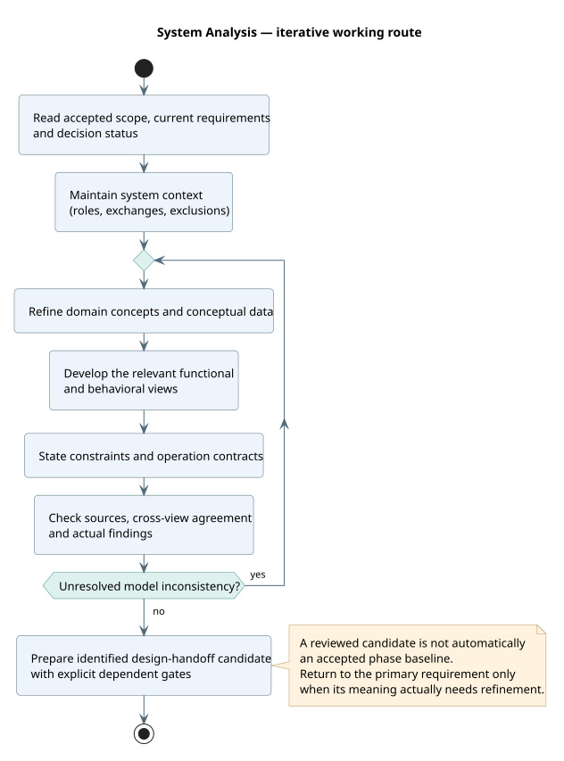

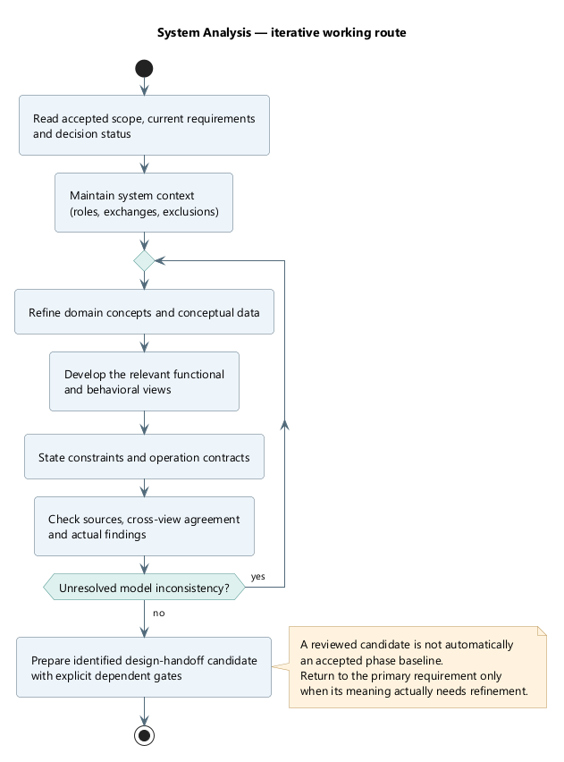 · [Editable PlantUML source](Diagrams/Start-here-analysis-route.puml)

Read downward. The feedback arrow means refine a model or its authoritative requirement when a real conflict appears. It does not mean restart every phase. Colors supplement the labels: blue is an input/context, teal is modeling, amber is review/handoff. These are logical work products, not application services or a guaranteed schedule. The repeat decision returns to affected models; it does not require restarting accepted phases.

##### Chosen approach

Follow the existing domain-oriented approach recorded for FAU Applied Software Engineering. Use its seven complementary views to answer specific questions. Their selection and file organization are project adaptations; this guide does not claim the university prescribes this folder tree or that every possible diagram is mandatory.

| View | Analysis question | Typical useful representation |
| --- | --- | --- |
| Object-oriented | What domain concepts exist, what do they mean and how are they related? | Conceptual class/association diagram with responsibilities and justified multiplicities |
| Function-oriented | What transformations does the system perform and what information enters/leaves them? | Function decomposition and balanced domain-level data-flow diagrams |
| Data-oriented | What information is authoritative, selected, versioned and preserved? | Conceptual ER/data relationship model and dictionary links |
| Scenario-based | Which actors/domain objects interact to achieve one outcome? | Domain sequence/communication diagram linked to an existing scenario |
| State-based | What states and allowed transitions govern a subject? | Statechart with triggers, guards and effects |
| Control-flow-based | In what order do actions, decisions and concurrent steps occur? | Activity/workflow diagram with explicit outcomes |
| Rule-based | Which combinations of conditions determine an outcome? | Decision table/tree with conflicts and missing combinations identified |

Textual constraints and operation contracts complement the views. A logical class is not automatically a code class; a data subject is not automatically a database table; a context relationship is not a network connection.

#### 3. Accepted Core Workflow: Profile Update to Publication

**After MVP.** Shared operating and recovery controls still apply where relevant.

The owner explicitly accepted this behavior in the conversation and instructed its immediate application. The [question/decision record](../02-Requirements-engineering/01-Software-requirements-specification.md#change-and-baseline-open-questions-and-decisions--id-owner-accepted-profile-update-policy) is authoritative for the bounded acceptance. The four accepted points are:

1. A shared profile edit does **not automatically change existing resumes or live presentations**.

2. The owner **previews, selects and explicitly applies** intended changes; resume-specific text/overrides and other resumes remain independent.

3. **Applying/saving and publishing are separate actions**; publication requires separate confirmation.

4. **Actual previously submitted documents remain preserved** after later edits/publication.

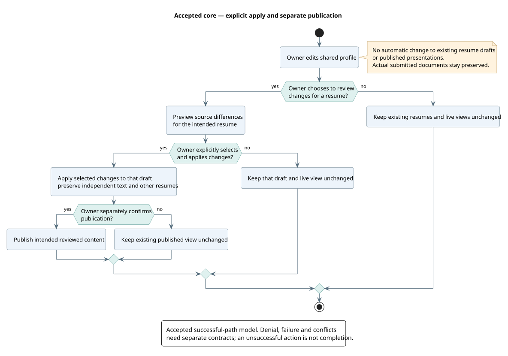

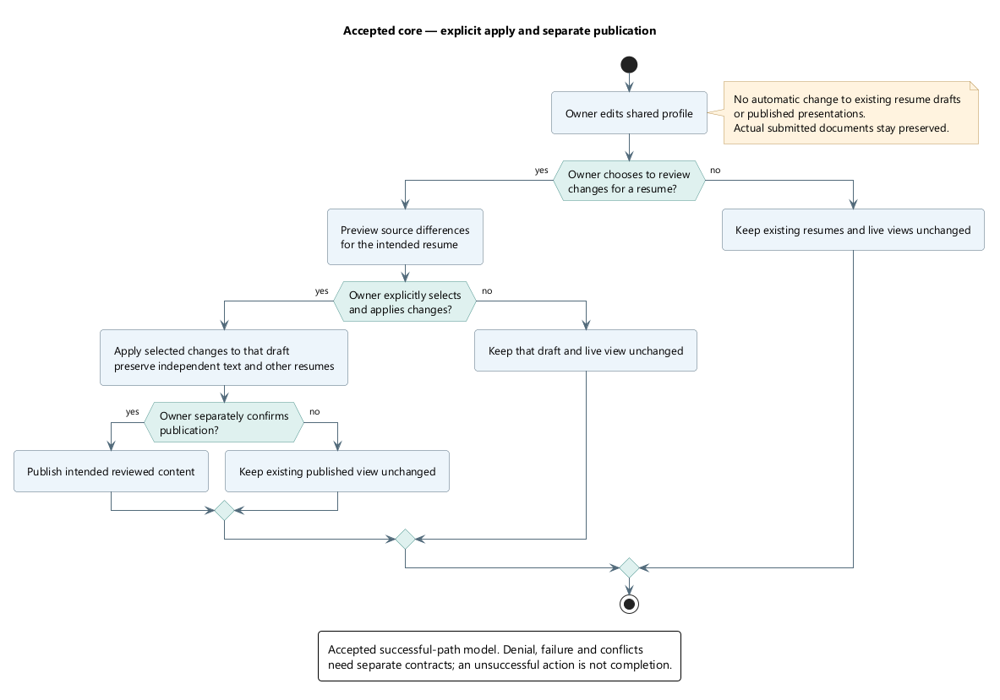 · [Editable PlantUML source](Diagrams/Start-here-profile-publication.puml)

Reviewing differences is optional: a source edit does not automatically start a resume update. Each “No” branch leaves the draft or live content indicated in the figure unchanged. The preservation statement applies throughout; the picture does not claim how bytes/revisions are stored. Denied, failed and conflicting operations require their own outcomes and must not be reported as completed.

##### Worked example for modeling

Profile information is used by resumes **R1** and **R2**. R1 contains a resume-specific description. Both have an existing live presentation; an application already preserves actual submitted material **S1**.

| Event | R1 / R2 draft meaning | Existing live presentation | Submitted material S1 |
| --- | --- | --- | --- |
| Owner edits the shared profile | No automatic resume change | Unchanged | Unchanged |
| Owner previews changes for R2 | Preview only | Unchanged | Unchanged |
| Owner applies selected changes to R2 and saves | Only the intended R2 draft changes; independent overrides remain protected | Unchanged until separate publication | Unchanged |
| Owner separately confirms publication of R2 | Saved draft remains identifiable | Intended R2 live presentation changes | Unchanged |
| Owner makes no apply/publication request | No corresponding transition occurs | No corresponding live update occurs | Unchanged |

Use this example across the domain, data, interaction, activity, state and contract views. Link to [Profiles/Resumes](../02-Requirements-engineering/01-Software-requirements-specification.md#requirements-specification-profiles-resumes-and-portfolio--id-resolution-q-d07), [Business Lifecycle](../02-Requirements-engineering/01-Software-requirements-specification.md#requirements-specification-business-rules-and-data-lifecycle), [PDF/Sharing](../02-Requirements-engineering/01-Software-requirements-specification.md#requirements-specification-pdf-and-controlled-sharing) and [Applications](../02-Requirements-engineering/01-Software-requirements-specification.md#requirements-specification-manual-application-management).

This acceptance does not settle source deletion, exact concurrent-edit resolution, every field/cardinality, renderer/storage choice, retention duration or all other proposals. Do not reopen the four accepted points when examining those distinct issues.

#### 4. Which File to Use and What Belongs in It

| File | Required substantive output | Current position |
| --- | --- | --- |
| [01 — Purpose and approach](#foundation-01-analysis-purpose-scope-and-approach) | Analysis questions, source authority, scope and dependency-aware work sequence | Populated working approach |
| [02 — Context](#foundation-02-system-context-and-boundaries) | System responsibility boundary, actors, external exchanges, exclusions and source-linked context figures | Populated draft; owner acceptance pending |
| [03 — Domain model](#analysis-domain-and-information-analysis--03-domain-model-and-object-oriented-view) | Concepts/responsibilities, associations, justified bounds and domain operations | Populated full-product conceptual model; reconcile with data/behavior next |
| [04 — Functions](#analysis-functional-and-process-analysis--04-function-oriented-view) | Domain functions and consistent input/output/data flows | Populated decomposition/DFDs; semantic review pending |
| [05 — Data](#analysis-domain-and-information-analysis--05-data-oriented-view) | Conceptual subjects/relationships, authority, lifecycle and dictionary reconciliation | Populated ER/catalog draft; review and reconcile |
| [06 — Scenarios](#analysis-behavioral-and-scenario-analysis--06-scenario-based-view) | Selected domain interactions tied to existing use cases and exceptional paths | Populated: 16 sequence models; cross-view contract reconciliation pending |
| [07 — States](#analysis-behavioral-and-scenario-analysis--07-state-based-view) | States, triggers, guards/effects and valid/invalid transitions | Populated: 18 statecharts and 128 transition contracts |
| [08 — Control flow](#analysis-functional-and-process-analysis--08-control-flow-based-view) | Activities, decisions, responsible contexts and justified concurrency | Populated: 17 activity models with explicit branches and step responsibilities |
| [09 — Rules](#analysis-business-rules-and-operation-contracts--09-rule-based-view) | Explicit decision conditions/results and unresolved combinations | Populated: 18 decision tables and eight decision-tree diagrams |
| [10 — Constraints/contracts](#analysis-business-rules-and-operation-contracts--10-domain-constraints-and-operation-contracts) | Invariants; operation inputs, authority, pre/postconditions and failure/concurrency meaning | Populated: 18 typed constraints and 39 selected operation contracts |
| [11 — Consistency/review](#analysis-review-and-design-handoff--11-model-consistency-traceability-and-review) | Exact source-to-model links, actual checks, findings, limitations and disposition | Bounded input/context review; cross-view completion pending |
| [12 — Interfaces](#analysis-interfaces-security-and-quality-analysis--12-interfaces-and-external-interactions) | Domain interaction boundaries and observable results, linked to primary interface requirements | Populated: eight interface families and 27 bounded interaction cases |
| [13 — Security/quality/operations](#analysis-interfaces-security-and-quality-analysis--13-security-quality-and-operational-analysis) | Cross-cutting constraints and dependency consequences with evidence limits | Populated: 24 authority rows, 14 quality scenarios and scoped trust/recovery analysis |
| [14 — Design handoff](#analysis-review-and-design-handoff--14-feasibility-dependencies-and-design-handoff) | Identified coherent models, reviewed decisions and explicit dependent gates for design | Populated: conditional package, eleven existing-gate mappings and twelve design questions; acceptance pending |
| [15 — Current processes/bottlenecks](#analysis-functional-and-process-analysis--15-current-processes-and-bottleneck-analysis) | Actual sourced workflow observations and justified problems/improvements | Populated source-based analysis; daily-task baseline and improvement results unmeasured |

The [folder index]() is the full document catalog. The [diagram catalog](Diagrams/Diagram-catalog.md) identifies existing figures and editable sources. This entry guide adds navigation/workflow illustrations; they do not complete the detailed models listed above.

##### Apply the same route across the full product

Begin with professional presentation/sharing, then extend the models to manual applications and submission history; communication/calendar; projects/Kanban/backlogs/Sprints; real Git collaboration; and conditional execution/operations. Keep identity, permission, language, references, failures and recovery linked across every area. The twelve accepted scope areas stay included; working on the core first is an analysis order, not scope reduction or an accepted release priority.

#### 5. How to Finish One Working Iteration

| Step | Action | Reviewable result |
| --- | --- | --- |
| 1. Identify the behavior | Select existing source requirement/criterion and relevant scenario; read its actual decision status | Exact links and a bounded question the model must answer |
| 2. State authority | Mark accepted facts, proposed refinements and genuine unknowns distinctly | Assumptions visible at the affected element/transition |
| 3. Model it | Add the smallest useful domain/data/behavior representation with consistent vocabulary | Editable diagram plus explanation of nodes, relationships, guards and effects |
| 4. Challenge it | Walk normal, denied, failed/unknown, concurrent and recovery cases where relevant | Concrete before/action/after examples and retained findings |
| 5. Reconcile views | Compare concepts, data, messages, transitions, rules and contract postconditions | Corrected cross-view meanings and exact trace links |
| 6. Verify the artifact | Render images, inspect labels/arrows, resolve local links and check source/figure consistency | Readable SVG/PNG and documented actual checks |
| 7. Record the outcome | Update the appropriate source/question/review record; preserve actual approval and historical evidence | Identified result, limits and next task; no fabricated Pass |

Keep a single primary home for each requirement, vocabulary definition and question. Models reference those homes. A finding returns to the affected authoritative record; it does not create another competing SRS.

##### Diagram quality checklist

- Give each figure one clear question, title and reading direction.

- Keep labels short; explain detail in nearby text/tables.

- Name relationship meaning; label decisions and alternatives explicitly.

- Separate a domain interaction from operational dependence, and an optional action from an automatic consequence.

- Do not rely on color alone. Check text size, crossings, clipped labels and arrowheads in the rendered output.

- Keep editable source, SVG and PNG together, with the source/status/date explained nearby.

#### 6. Open Matters Without Stopping All Analysis

| Matter | What is known | What may continue now | What must wait for evidence/decision |
| --- | --- | --- | --- |
| Core profile/apply/publication behavior | Four-point rule accepted by the owner | Model its domain/data/workflow/contracts directly | Unrelated source-removal/concurrency/storage choices retain their own review |
| Google access | Owner has not created OAuth | Provider responsibilities, account context and denied/disconnected/unknown outcomes | Actual setup, applicable access conditions and controlled operations before dependent commitments |
| Backup/recovery | Owner has not set up backups | Coverage, preservation/restored-access obligations and recovery concepts | Suitable independent storage/recovery design; actual restore proof before readiness |
| CI/CD isolation | No demonstrated suitable execution environment; feasibility conditions remain | Logical definition/run/attempt/result and target-authority model | Justified runner/isolation/resource design and actual controls before enabling execution |
| Quality/file limits | Concrete targets/limits are proposals; idle resources do not prove capacity | Identify workloads, boundary cases and constraints | Acceptance of affected values and later measured compliance |
| Delivery | Owner stated 20 total project hours/week; old requested date is not a forecast | Analysis/design and traceable work decomposition | A justified accepted forecast and reconciled execution baseline |

Use the [question register](../02-Requirements-engineering/01-Software-requirements-specification.md#change-and-baseline-open-questions-and-decisions), [feasibility study](../02-Requirements-engineering/01-Software-requirements-specification.md#process-and-approach-02-feasibility-study) and [gate assessment](../02-Requirements-engineering/01-Software-requirements-specification.md#validation-and-traceability-validation-and-traceability--heading-remaining-verification). A later implemented test is not needed merely to draw a provisional model, but a known decisive conflict cannot be waived by calling it future work.

Ask the owner only when a genuinely new material choice is missing. Present a concrete recommendation, consequence and one precise question. Reuse known facts and already accepted rules instead of requesting the same approval repeatedly.

#### 7. Where the Six Broad Activities Fit

These activities are a coverage checklist across existing records, not a second parallel method.

| Activity | Authoritative home | Use during analysis |
| --- | --- | --- |
| Problem and scope | [Purpose](../01-Project-planning/01-Project-charter.md#purpose-and-success), [Scope](../01-Project-planning/01-Project-charter.md#mvp-scope) | Preserve boundaries and refine context |
| Feasibility | [Existing study](../02-Requirements-engineering/01-Software-requirements-specification.md#process-and-approach-02-feasibility-study) | Link actual findings and dependent gates; do not infer a favorable result |
| Requirements gathering | [Elicitation plan](../02-Requirements-engineering/01-Software-requirements-specification.md#stakeholders-and-elicitation-elicitation-plan-and-techniques), [actual log](../02-Requirements-engineering/01-Software-requirements-specification.md#stakeholders-and-elicitation-elicitation-log) | Reuse evidence and record actual new answers |
| System modeling | Documents 03–10 and cross-cutting 12–13 | Develop connected models that answer domain questions |
| Bottleneck analysis | [Current processes](#analysis-functional-and-process-analysis--15-current-processes-and-bottleneck-analysis) | Distinguish observed problems from hypotheses |
| Documentation/validation | [SRS](../02-Requirements-engineering/01-Software-requirements-specification.md#requirements-specification-requirements-specification), dictionary, questions and [analysis review](#analysis-review-and-design-handoff--11-model-consistency-traceability-and-review) | Update primary records and retain actual review evidence |

#### 8. When This Phase Is Ready for Design Handoff

Use the existing phase gates; creating this guide or a set of diagrams does not accept a baseline.

- Every included domain area has the models needed to explain its intended behavior and constraints, with meaningful source links.

- Model vocabulary/relationships, data authority, interactions, states, activities, rules and contracts agree.

- Relevant allowed/denied/failure/unknown/concurrency/recovery outcomes are explicit or remain at a justified, permitted dependent gate.

- Accepted decisions are recorded as accepted; proposed choices and unverified technical claims remain distinguishable.

- Criterion-level analysis coverage is reviewed; broad source ranges or similar names do not count as exhaustive coverage.

- Diagram sources/renders and document links are readable and consistent.

- The [design handoff](#analysis-review-and-design-handoff--14-feasibility-dependencies-and-design-handoff) identifies the candidate, actual review outcome, evidence limits and remaining prerequisites.

**Current completion position:** This entry guide and its two workflow illustrations are populated. The complete System Analysis phase, detailed design and pre-implementation baseline remain unfinished. Continue with the bounded domain/data task in section 1; do not restart planning or repeat the accepted core-policy question.

[Analysis approach](#foundation-01-analysis-purpose-scope-and-approach) · [Whole-product context](#foundation-02-system-context-and-boundaries) · [Domain model](#analysis-domain-and-information-analysis--03-domain-model-and-object-oriented-view) · [Data view](#analysis-domain-and-information-analysis--05-data-oriented-view) · [Review record](#analysis-review-and-design-handoff--11-model-consistency-traceability-and-review)

##### Current cross-view review — SA-RV03

[File 11](#analysis-review-and-design-handoff--11-model-consistency-traceability-and-review) records current structural checks and a 470-criterion trace register, including 39 bounded semantic comparisons. The other 431 criteria remain source-context indexed pending individual semantic review. The 20 earlier walkthroughs are preserved as historical evidence. Views 04 and 12–14 are populated; their existence does not certify semantic completeness. Accepted profile policy remains accepted; criterion sufficiency and dependent capability evidence are not inferred from diagram counts.

#### Diagram Types and Reading Guide

Follow the graph as a reading route. Return to affected views when a rule changes; arrows do not require finishing every file before reading another. All sixteen numbered documents are represented.

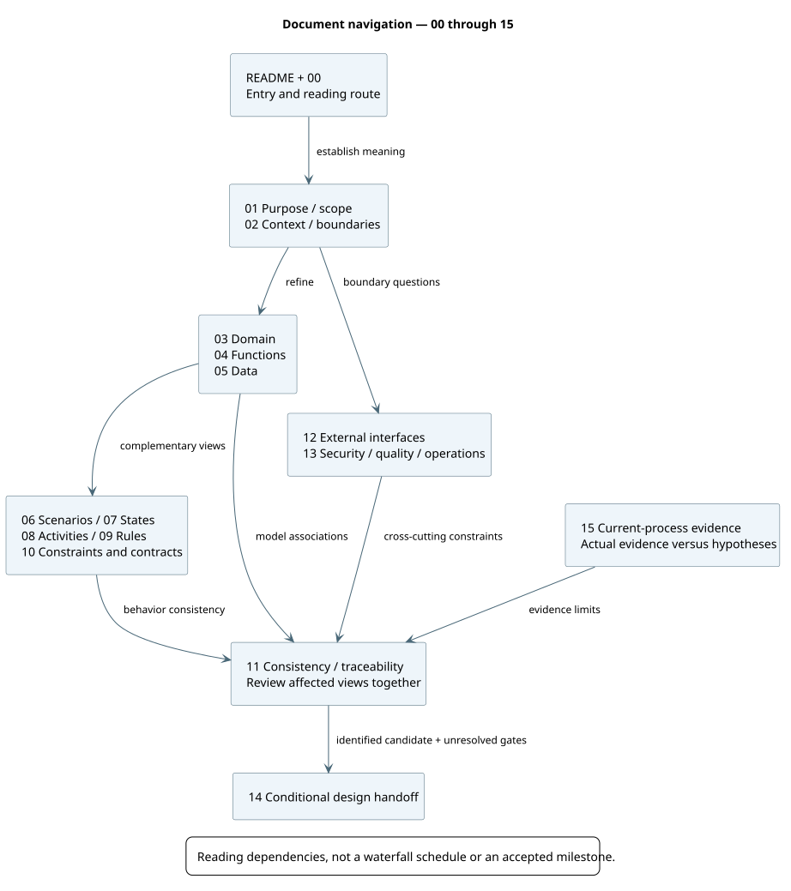

[Editable source](Diagrams/Documentation-navigation.puml) · 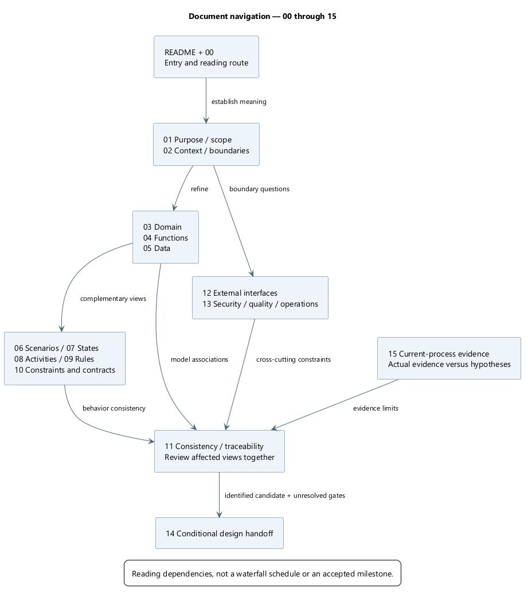

Resumefolio — Analysis Purpose, Scope and Approach

### Resumefolio — Analysis Purpose, Scope and Approach

[Diagram types and reading guide](#foundation-01-analysis-purpose-scope-and-approach--heading-diagram-types-and-reading-guide) · [Full diagram catalog](Diagrams/Diagram-catalog.md)

Owner: Farhad. Revision: November 1, 2026.

Status: working analysis charter and execution plan. This document defines the work; it does not assert completion of the models or acceptance of M-02/M-03.

Current MVP scope and selected mechanisms: [Baseline](https://github.com/Farhad-V/Web-Resumefolio/blob/1f2acaa351ac306cb57cbe4fe9742e8bd90720d9/docs/MVP/baseline/README.md). Deferred provider, advanced collaboration and workflow-execution designs are not MVP prerequisites.

#### 1. Purpose and Intended Outcome

System Analysis develops a coherent domain-oriented description of how Resumefolio fulfills its requirements: the concepts involved, their responsibilities, information relationships, interactions, lifecycle, transformations and constraints. The outcome is a traceable model package that System Design can use without inventing product behavior.

The [Start Here guide](#foundation-00-start-here) provides navigation and the immediate starting task. This document defines the analysis objectives, coverage, method, responsibilities and completion conditions. [System context](#foundation-02-system-context-and-boundaries) defines the actual product boundary.

| Analysis question | Expected output |
| --- | --- |
| Who interacts with the product, and where does responsibility stop? | Actors, boundary exchanges and scope coverage in document 02 |
| What information is shared, tailored, published and preserved? | Domain responsibilities in 03; conceptual data relationships in 05 |
| Which inputs become which outputs? | Functions and data flows in 04; operation contracts in 10 |
| What happens during normal, denied, failed or competing actions? | Interactions in 06, lifecycle in 07, activities in 08 and decisions in 09 |
| Which obligations cross a provider or operational boundary? | Interface analysis in 12 and quality/operational analysis in 13 |
| What can design rely on, and what still needs evidence or a decision? | Consistency findings in 11 and qualified handoff in 14 |

Analysis may identify candidate responsibilities and logical solution behavior. Framework versions, physical schemas, endpoint signatures, deployment topology, Git engine and execution isolation mechanisms require design decisions and their supporting evidence.

#### 2. Inputs, Authority and Decision Status

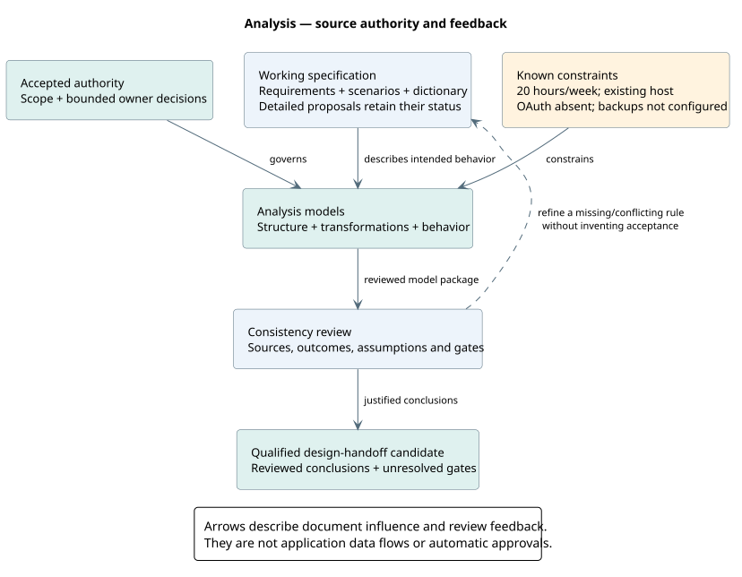

[Editable PlantUML](Diagrams/Analysis-inputs-and-outputs.puml) · 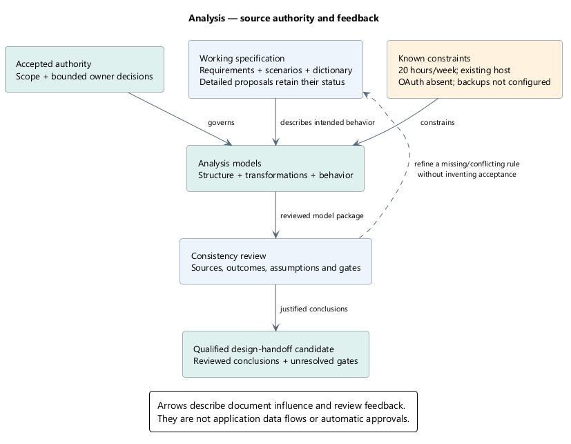

The diagram shows document authority and the feedback path for missing requirements. Its arrows represent information and review flow, not an assertion that every input or output is accepted.

| Input | Authority and use |
| --- | --- |
| [Project scope](../01-Project-planning/01-Project-charter.md#mvp-scope) | Accepted capability boundaries and exclusions, including DEC-028–DEC-017; maintain all twelve scope areas |
| [Planning completion criteria](https://github.com/Farhad-V/Web-Resumefolio/blob/1f2acaa351ac306cb57cbe4fe9742e8bd90720d9/docs/MVP/SDLC/01-project-planning/10-planning-completion-criteria.md) | Historical identified M-01 acceptance; later working copies require their own review |
| [Resources and constraints](../01-Project-planning/03-Feasibility-and-risk-assessment.md#resource-constraints) | Actual availability is 20 hours/week, including learning, documentation and testing |
| [Requirements specification](../02-Requirements-engineering/01-Software-requirements-specification.md#requirements-specification-requirements-specification) | Entry point to primary obligations; preserve requirement IDs and link to their authoritative text |
| [Actors and context](../02-Requirements-engineering/01-Software-requirements-specification.md#stakeholders-and-elicitation-actors-and-system-context) and [scenarios](../02-Requirements-engineering/01-Software-requirements-specification.md#scenarios-and-models-user-stories-and-scenarios) | Intended goals and externally visible paths; review their detailed policy status |
| [Data dictionary](../02-Requirements-engineering/01-Software-requirements-specification.md#data-definitions-data-dictionary) | Shared terminology; resolve competing definitions at their source |
| [Questions and decisions](../02-Requirements-engineering/01-Software-requirements-specification.md#change-and-baseline-open-questions-and-decisions) | Distinguish owner decisions, partial resolution, proposals and investigation |
| [Answer review](../02-Requirements-engineering/01-Software-requirements-specification.md#change-and-baseline-open-questions-and-decisions) | Working proposals may support explicit provisional models; they are not automatically accepted |
| [Bounded input evidence](https://github.com/Farhad-V/Web-Resumefolio/blob/1f2acaa351ac306cb57cbe4fe9742e8bd90720d9/docs/MVP/SDLC/03-system-analysis/evidence/context-input-review-2026-11-01.json) | Historical source hashes and review limits; it does not verify every later revision |

The [owner-accepted profile policy](../02-Requirements-engineering/01-Software-requirements-specification.md#change-and-baseline-open-questions-and-decisions--id-owner-accepted-profile-update-policy) is a firm input: profile edits do not automatically alter existing resumes or published views; the owner previews and explicitly applies selected changes; publication requires a separate confirmation; resume-specific content and actual previously submitted documents remain preserved. Do not seek the same approval again. Source removal and other unresolved details are not implicitly accepted by this policy.

Keep four statuses distinct: accepted decision, proposed behavior, observed fact and unresolved dependency. A model can be useful while containing clearly marked proposals. Drawing it does not close the related question.

#### 3. Product Coverage and Exclusions

All twelve accepted scope areas remain in analysis. Work order changes the depth reached first, not the product boundary. The detailed source mapping remains in the [context coverage table](#foundation-02-system-context-and-boundaries--id-scope-coverage).

| Scope | Domain analysis focus | Principal model concerns |
| --- | --- | --- |
| SCP-01 Accounts and access | Identity, roles, grants and actor authority | Access conditions, denial and revocation |
| SCP-02 Profiles and resumes | Shared source, independent resume content and publication | Accepted preview/apply/publish behavior; preserved overrides |
| SCP-03 Portfolio evidence | Text, media, files and externally authored diagram links | Evidence identity, selection and access lifecycle |
| SCP-04 PDF and language availability | Generated/uploaded PDF modes; independent English/German content | Availability rules and artifact identity |
| SCP-05 Employer sharing | Password-protected links and selected content | Authorization, direct file access and disable behavior |
| SCP-06 Application tracking | Companies, opportunities, cover letters and progress | Actual submitted materials and historical integrity |
| SCP-07 Google communication | Gmail and selected calendar interactions | Consent, provider boundaries, failure and synchronization  **After MVP.** |
| SCP-08 Work management | Projects, boards, tasks, backlog and Sprints | Grants; Sprint goal, selected items and plan |
| SCP-09 Real Git | Repositories, changes, collaboration and releases | Actual Git operations, permissions and operation outcomes |
| SCP-10 YAML workflows and CI | Authorized workflow execution and separate deployment approval | Execution lifecycle, isolation obligations and cleanup  **After MVP.** |
| SCP-11 File/storage policy | Effective limits and configurable platform policy | Enforcement points, capacity constraints and rejected operations |
| SCP-12 Deployment and operations | Hosting, verification, backup and restoration responsibilities | Recovery expectations, operational dependencies and evidence gates |

Excluded capabilities remain excluded: product AI, automatic translation and automatic migration of the old demo. External evidence authoring does not introduce an internal video or diagram editor. Manual application tracking does not introduce automatic job-platform submission. The development repository or board does not fulfill the product's real Git/work-management scope. YAML support does not imply compatibility with every third-party action.

Current-process and bottleneck analysis belongs in [document 15](#analysis-functional-and-process-analysis--15-current-processes-and-bottleneck-analysis). Separate documented observations from assumptions; do not invent interviews, timings or measured improvements.

#### 4. Modeling Method and Complementary Views

Use the domain-oriented approach already established in this folder. Choose each notation to answer a question; a diagram count is not a completion measure. Course references retained in the [folder index]() explain the organizing approach. This revision does not independently certify formal compliance with the lecture PDFs or a standard.

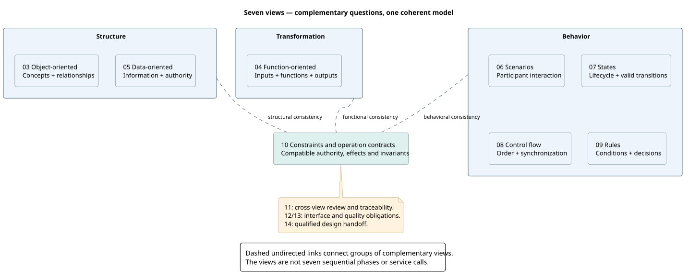

[Editable PlantUML](Diagrams/Analysis-seven-view-consistency.puml) · 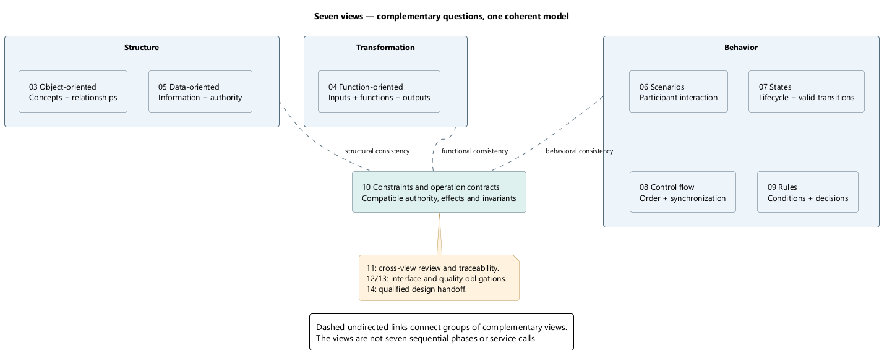

The dashed undirected relationships mean consistency obligations, not calls or processing order. The seven views describe compatible aspects of one system. They are not seven sequential development phases. Contracts connect the views by stating the effects and limits of an operation.

| View and authoritative file | Use when answering | Required consistency |
| --- | --- | --- |
| [03 Object-oriented](#analysis-domain-and-information-analysis--03-domain-model-and-object-oriented-view) | Which domain concepts hold which responsibilities? | Classes and associations use dictionary terms and agree with conceptual data |
| [04 Function-oriented](#analysis-functional-and-process-analysis--04-function-oriented-view) | What transformations consume and produce information? | Data flows balance across decomposition and match operation effects |
| [05 Data-oriented](#analysis-domain-and-information-analysis--05-data-oriented-view) | What information exists, and how is it related? | Relationships and justified multiplicities agree with rules and lifecycle |
| [06 Scenario-based](#analysis-behavioral-and-scenario-analysis--06-scenario-based-view) | Which participants exchange what during a goal? | Messages correspond to allowed operations and stated outcomes |
| [07 State-based](#analysis-behavioral-and-scenario-analysis--07-state-based-view) | Which states and transitions are valid? | Guards, events and terminal states agree with scenarios and contracts |
| [08 Control-flow-based](#analysis-functional-and-process-analysis--08-control-flow-based-view) | Which steps, decisions and parallel activities occur? | Ordering, failure paths and synchronization preserve state/rule constraints |
| [09 Rule-based](#analysis-business-rules-and-operation-contracts--09-rule-based-view) | What result follows a combination of conditions? | Decision tables/trees cover relevant alternatives without conflicting outcomes |

Use [document 10](#analysis-business-rules-and-operation-contracts--10-domain-constraints-and-operation-contracts) for invariants and preconditions, effects, denial/failure outcomes and information that must remain unchanged. Keep actual interfaces in [12](#analysis-interfaces-security-and-quality-analysis--12-interfaces-and-external-interactions), cross-cutting constraints in [13](#analysis-interfaces-security-and-quality-analysis--13-security-quality-and-operational-analysis), and review evidence in [11](#analysis-review-and-design-handoff--11-model-consistency-traceability-and-review).

For each diagram, record its question, source references, meaning of arrows/notation, assumptions and related views. Store editable source, SVG and PNG together in the [diagram catalog](Diagrams/Diagram-catalog.md). Keep technical implementation detail out of conceptual models unless needed to express an actual constraint.

#### 5. Execution Packages and Dependencies

**After MVP.** Shared operating and recovery controls still apply where relevant.

| Order | Work package | Concrete outputs and dependency |
| --- | --- | --- |
| 1 | Boundary and input alignment | Maintain document 02 and source authority; existing context diagrams provide a starting point, not whole-phase completion |
| 2 | Professional presentation core | Populate 03 and 05 for profile, resume, evidence, PDF, sharing and submitted artifacts; apply the accepted core policy and label unresolved multiplicities/policies |
| 3 | Core behavior | Populate 10 and coordinated 06–09 for preview/apply, publication, PDF settings, link disable and actual submission; keep PDF settings separate from disabling a link |
| 4 | Applications and Google exchanges | Extend concepts, scenarios and interfaces for tracking, mail and calendar; model missing consent/provider failure explicitly |
| 5 | Work, Git and workflow execution | Extend structural and behavioral views for backlog/Sprints, real Git and authorized execution; preserve separate deployment approval |
| 6 | Quality, operations and complete coverage | Populate 12–15; check cross-cutting access, file/storage constraints, recovery and feasibility against all twelve areas |
| 7 | Consolidation and design handoff | Complete 11 and 14 with criterion-to-model references, findings, owner dispositions and explicitly conditional design inputs |

Within each package, follow a short iteration: read the primary obligations; model the relevant concepts; describe normal and relevant alternative paths; state contracts; compare views; resolve or record findings. Correct a discovered source inconsistency immediately when its resolution is authorized. Carry a genuinely unresolved question with its impact and dependent work instead of restarting the whole review.

Parallel conceptual work is possible where dependencies allow it. OAuth is not created and backups are not configured: those are answered facts, not recurring questions to the owner. They do not prevent logical domain models. Actual provider access, a suitable execution arrangement and verified recovery remain prerequisites for dependent design/implementation/release conclusions.

#### 6. Traceability and Review Contract

For each modeled behavior, retain a navigable chain: primary requirement and acceptance criterion → relevant concept/function → interaction or transition → rule/contract → review finding or disposition. Reuse stable primary IDs; identify model elements locally without creating a competing requirements catalog.

| Review check | Evidence required |
| --- | --- |
| Coverage | Each scope area and relevant criterion has an exact model reference, or an explicit justified gap |
| Vocabulary | Identical domain terms have compatible definitions across diagrams, dictionary and prose |
| Structure and behavior | Participants exist; referenced operations are meaningful; state changes and data effects agree |
| Access and failure | Relevant denial, missing input, provider failure and revocation outcomes are explicit |
| History and publication | Save/apply/publication are distinguishable; submitted artifacts are not silently replaced |
| Uncertainty | Every material proposal or open dependency states its impact and the work it gates |
| Readability | Rendered labels and arrows are legible; source and exported figures agree; links resolve |

A structural link check is not semantic validation. A proposed review case is not an executed test. Observing available host memory does not establish peak-load capacity, successful restoration or safe workflow isolation.

#### 7. Responsibility, Constraints and Change Handling

Farhad owns product decisions and acceptance and is the sole delivery/operations owner. Codex prepares models, checks consistency and documents evidence within the authorized task; its review is not owner acceptance. Budget work against the actual 20 hours/week. Keep effort estimates provisional until the scope and dependency findings support them.

Maintain one primary source for each requirement, term and decision. When analysis exposes a missing rule, link the finding back to that source, record the proposed or accepted resolution, and update affected views together. Do not silently convert a proposal into an accepted obligation or infer approval of unrelated policy details.

Existing Ubuntu hosting and the deployed Laravel demo are constraints/evidence about the current environment. They do not prove that the planned scope is implemented, that capacity is sufficient under load, or that OAuth, backup and execution prerequisites are satisfied. Investigation must target the specific dependent conclusion.

#### 8. Completion Conditions and Handoff

This charter is populated. The detailed analysis package remains in progress. A useful handoff must identify exactly which models and conclusions have been reviewed; diagrams alone do not establish phase acceptance.

- [ ] All twelve scope areas have appropriate structural and behavioral coverage, with justified omissions recorded.

- [ ] Primary requirements and criteria have exact model references or explicitly owned gaps.

- [ ] Cross-view contradictions are resolved or carry a clear impact and disposition.

- [ ] Accepted decisions are reflected consistently; proposed details remain visibly proposed.

- [ ] Interfaces, security/quality obligations and operational dependencies are analyzed to the depth needed by design.

- [ ] Design inputs distinguish established constraints, candidate choices and unresolved feasibility gates.

- [ ] The owner disposition and the exact reviewed version are recorded for the intended handoff scope.

The immediate next modeling output is the professional-presentation domain model in document 03 and its conceptual data counterpart in 05, followed by the corresponding operation contracts and behavioral views. This sequence advances analysis without waiting for unrelated setup, while keeping dependent acceptance gates visible.

[System Analysis index]() · [Start Here](#foundation-00-start-here) · [Review and traceability](#analysis-review-and-design-handoff--11-model-consistency-traceability-and-review)

#### Diagram Types and Reading Guide

This scope map summarizes the authoritative scope and actor contexts, not a role-permission grant matrix. See the existing scope and actor links above for primary authority.

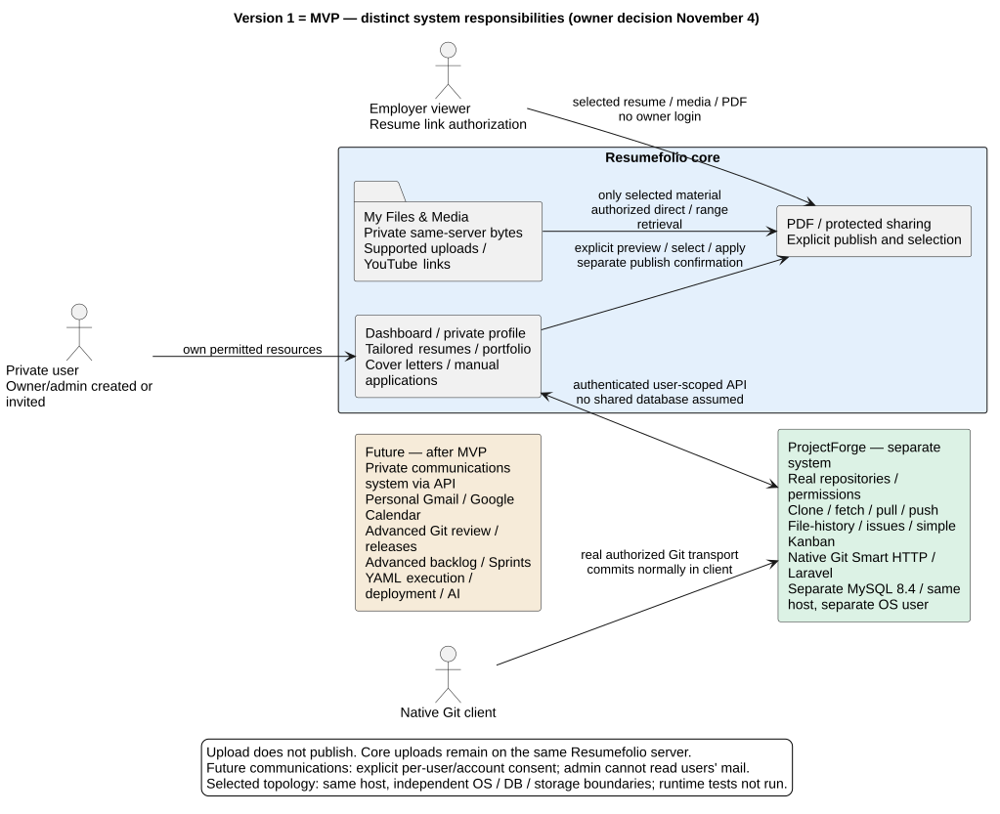

[Editable source](Diagrams/Scope-stakeholder-map.puml) · 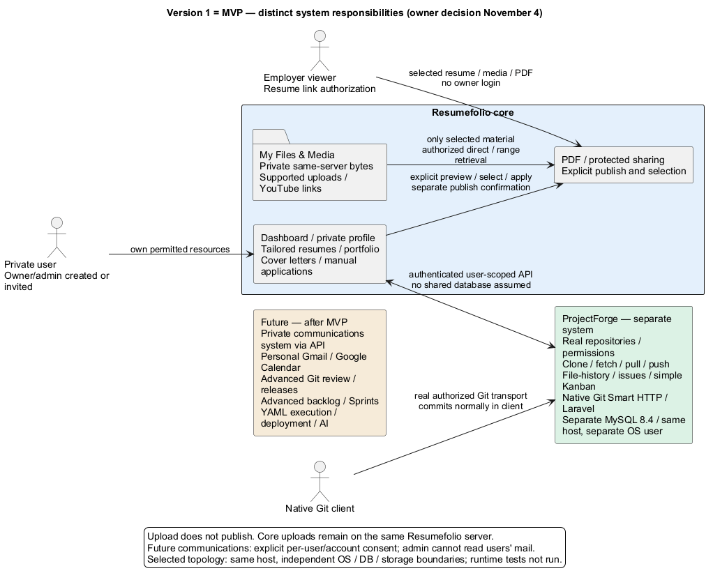

Resumefolio — System Context and Boundaries

### Resumefolio — System Context and Boundaries

[Diagram types and reading guide](#foundation-02-system-context-and-boundaries--heading-diagram-types-and-reading-guide) · [Full diagram catalog](Diagrams/Diagram-catalog.md)

Owner: Farhad. Revision: November 1, 2026.

Status: populated full-product logical context model, with accepted scope and accepted core profile policy distinguished from proposed detailed contracts. Whole-model review and phase acceptance remain pending. This document does not establish deployment architecture or runtime access.

**Read this document for:** the product responsibility boundary, interacting roles, external exchanges, information authority and dependency limits. Use [the analysis approach](#foundation-01-analysis-purpose-scope-and-approach) for work order and [the domain model](#analysis-domain-and-information-analysis--03-domain-model-and-object-oriented-view) for internal concepts.

#### Current MVP boundary figure

[Accepted core and separate ProjectForge boundary](https://github.com/Farhad-V/Web-Resumefolio/blob/1f2acaa351ac306cb57cbe4fe9742e8bd90720d9/docs/MVP/SDLC/04-system-design/01-software-architecture/diagrams/mvp-system-boundaries.svg)

[Editable source](https://github.com/Farhad-V/Web-Resumefolio/blob/1f2acaa351ac306cb57cbe4fe9742e8bd90720d9/docs/MVP/SDLC/04-system-design/01-software-architecture/diagrams/mvp-system-boundaries.puml) · . Historical broader-product figures below retain earlier alternatives/detail; they do not define the current system boundary.

Current MVP scope and selected mechanisms: [Baseline](https://github.com/Farhad-V/Web-Resumefolio/blob/1f2acaa351ac306cb57cbe4fe9742e8bd90720d9/docs/MVP/baseline/README.md). Deferred provider, advanced collaboration and workflow-execution designs are not MVP prerequisites.

#### Ecosystem and Connected Platforms

These two coordinated views provide the whole-product map without forcing internal relationships and external exchanges into one crowded diagram. Internal areas are logical product capabilities, not separately deployed platforms. External participants include clients and operating facilities as well as provider platforms.

##### Internal areas and relationships

[Internal ecosystem: product areas and information relationships](https://github.com/Farhad-V/Web-Resumefolio/blob/1f2acaa351ac306cb57cbe4fe9742e8bd90720d9/docs/MVP/SDLC/04-system-design/01-software-architecture/diagrams/mvp-system-boundaries.svg)

[PlantUML source](https://github.com/Farhad-V/Web-Resumefolio/blob/1f2acaa351ac306cb57cbe4fe9742e8bd90720d9/docs/MVP/SDLC/04-system-design/01-software-architecture/diagrams/mvp-system-boundaries.puml) · 

The overview covers profile/resume, portfolio/evidence, PDF/sharing, applications, communication, work/Sprints, Git, execution, deployment and shared administration/operations. Relationship arrows show selected references or information movement; they do not create automatic synchronization or authorization. Actual submitted materials remain independent of later live changes. Shared access and lifecycle rules apply to every area, including those without a drawn cross-cutting arrow.

##### External connections and current evidence

[Connected platforms: directions, boundaries and status](https://github.com/Farhad-V/Web-Resumefolio/blob/1f2acaa351ac306cb57cbe4fe9742e8bd90720d9/docs/MVP/SDLC/04-system-design/01-software-architecture/diagrams/mvp-system-boundaries.svg)

[PlantUML source](https://github.com/Farhad-V/Web-Resumefolio/blob/1f2acaa351ac306cb57cbe4fe9742e8bd90720d9/docs/MVP/SDLC/04-system-design/01-software-architecture/diagrams/mvp-system-boundaries.puml) · 

| Product area / participant | Detailed interface and connection status |
| --- | --- |
| Private workspace, administration and local files | [IF-01](#analysis-interfaces-security-and-quality-analysis--12-interfaces-and-external-interactions--id-if-01), [IF-03](#analysis-interfaces-security-and-quality-analysis--12-interfaces-and-external-interactions--id-if-03): intended browser/file exchanges; full Version 1 implementation is not established. |
| Employer access to selected resume, evidence and PDF | [IF-02](#analysis-interfaces-security-and-quality-analysis--12-interfaces-and-external-interactions--id-if-02), [IF-03](#analysis-interfaces-security-and-quality-analysis--12-interfaces-and-external-interactions--id-if-03): protected representation requests and permitted/denied results. |
| Application correspondence through communication | [IF-04](#analysis-interfaces-security-and-quality-analysis--12-interfaces-and-external-interactions--id-if-04): Gmail operations and outcomes; OAuth not created. Application association does not automatically send messages. |
| Selected activities through communication | [IF-05](#analysis-interfaces-security-and-quality-analysis--12-interfaces-and-external-interactions--id-if-05): Calendar operations and event/version outcomes; access not established. Local-only activities remain possible. |
| Work-linked repositories and real Git clients | [IF-06](#analysis-interfaces-security-and-quality-analysis--12-interfaces-and-external-interactions--id-if-06): authorized Git exchange is planned; native Git Smart HTTP is selected in the Baseline; actual interoperability remains unverified. GitHub used for project development is not the product Git-hosting implementation. |
| Exact-revision execution and separate deployment | [IF-07](#analysis-interfaces-security-and-quality-analysis--12-interfaces-and-external-interactions--id-if-07): conditional execution capability and independently approved target; neither runner placement nor target is selected. |
| Hosting and domain/TLS operation | [IF-08](#analysis-interfaces-security-and-quality-analysis--12-interfaces-and-external-interactions--id-if-08): Hetzner demo and domain are dated observations, not validated whole-product capacity or security. |
| System notification delivery | [IF-08](#analysis-interfaces-security-and-quality-analysis--12-interfaces-and-external-interactions--id-if-08): actual delivery facility unverified; do not equate it with a user's connected Gmail account. |
| Backup and isolated recovery | [IF-08](#analysis-interfaces-security-and-quality-analysis--12-interfaces-and-external-interactions--id-if-08): not configured; destination and usable recovery evidence remain unresolved. No existing HA/failover is implied. |

**Source and interpretation:** the [scope inventory](#foundation-02-system-context-and-boundaries--id-scope-coverage), the eight primary interface families carried into [file 12](#analysis-interfaces-security-and-quality-analysis--12-interfaces-and-external-interactions--heading-1-interface-inventory), and the [dated server observation](../02-Requirements-engineering/01-Software-requirements-specification.md#validation-and-traceability-server-readonly-check-2026-11-01). Planned means included in the target analysis, not configured. Conditional means the dependent capability requires its gate to be satisfied. Observed means the dated demo fact only. Unknown provider choices stay unknown; no LinkedIn, job-board, GitHub or GitLab product integration is introduced by this map.

#### 1. System of Interest

The Resumefolio core owns private professional information, independent tailored resumes/portfolio, protected PDFs/sharing, private same-server My Files & Media and manual applications with actual submitted materials/status/next action/follow-up. ProjectForge is a separate user-scoped API system for basic real Git, issues and simple Kanban. Future independent communications, advanced work/Git and YAML execution/deployment remain outside the MVP commitment.

##### Scope-to-responsibility Coverage

| Accepted catalog reference | Product responsibility | Exact source locators | Required distinction |
| --- | --- | --- | --- |
| SCP-01 | Identity and resource authority | DEC-028; [ACC-D01](../02-Requirements-engineering/01-Software-requirements-specification.md#requirements-specification-accounts-authentication-and-permissions--heading-acc-d01-individual-account-context), [ACC-D03](../02-Requirements-engineering/01-Software-requirements-specification.md#requirements-specification-accounts-authentication-and-permissions--heading-acc-d03-resource-and-operation-authorization), [ACC-D04](../02-Requirements-engineering/01-Software-requirements-specification.md#requirements-specification-accounts-authentication-and-permissions--heading-acc-d04-cross-user-private-data-isolation) | Account/private/collaboration contexts; sign-in is not a universal grant |
| SCP-02 | Shared profile and independent tailored resumes | DEC-027; [PRP-D01](../02-Requirements-engineering/01-Software-requirements-specification.md#requirements-specification-profiles-resumes-and-portfolio--heading-prp-d01-reusable-professional-information), [PRP-D02](../02-Requirements-engineering/01-Software-requirements-specification.md#requirements-specification-profiles-resumes-and-portfolio--heading-prp-d02-opportunity-specific-resume-composition), [PRP-D03](../02-Requirements-engineering/01-Software-requirements-specification.md#requirements-specification-profiles-resumes-and-portfolio--heading-prp-d03-independent-selections-layouts-and-overrides), [PRP-D04](../02-Requirements-engineering/01-Software-requirements-specification.md#requirements-specification-profiles-resumes-and-portfolio--heading-prp-d04-explicit-shared-source-update-rules) | Source information, selections/overrides and resume revisions stay distinct |
| SCP-03 | Portfolio/supporting evidence | DEC-026; [PRP-D05](../02-Requirements-engineering/01-Software-requirements-specification.md#requirements-specification-profiles-resumes-and-portfolio--heading-prp-d05-skill-and-project-evidence-management), [PRP-D06](../02-Requirements-engineering/01-Software-requirements-specification.md#requirements-specification-profiles-resumes-and-portfolio--heading-prp-d06-per-resume-evidence-selection-and-disclosure), [PRP-D09](../02-Requirements-engineering/01-Software-requirements-specification.md#requirements-specification-profiles-resumes-and-portfolio--heading-prp-d09-safe-content-admission-and-truthful-save-outcomes) | Externally authored content, per-resume selection and safe admission |
| SCP-04 | Generated/uploaded PDF representations | DEC-025; [PDF-D01](../02-Requirements-engineering/01-Software-requirements-specification.md#requirements-specification-pdf-and-controlled-sharing--heading-pdf-d01-generated-resume-pdf), [PDF-D02](../02-Requirements-engineering/01-Software-requirements-specification.md#requirements-specification-pdf-and-controlled-sharing--heading-pdf-d02-uploaded-pdf-and-language-identity), [PDF-D03](../02-Requirements-engineering/01-Software-requirements-specification.md#requirements-specification-pdf-and-controlled-sharing--heading-pdf-d03-per-resume-download-choices) | Representation provenance, language and availability are separate |
| SCP-05 | Protected employer sharing | DEC-024; [PDF-D04](../02-Requirements-engineering/01-Software-requirements-specification.md#requirements-specification-pdf-and-controlled-sharing--heading-pdf-d04-scoped-password-protected-employer-access), [PDF-D05](../02-Requirements-engineering/01-Software-requirements-specification.md#requirements-specification-pdf-and-controlled-sharing--heading-pdf-d05-direct-file-and-pdf-authorization), [PDF-D06](../02-Requirements-engineering/01-Software-requirements-specification.md#requirements-specification-pdf-and-controlled-sharing--heading-pdf-d06-owner-password-and-link-controls) | No viewer account; current scoped access and protected direct paths |
| SCP-06 | Manual applications and actual submitted history | DEC-023; [APP-D01](../02-Requirements-engineering/01-Software-requirements-specification.md#requirements-specification-manual-application-management--heading-app-d01-company-and-opportunity-context), [APP-D03](../02-Requirements-engineering/01-Software-requirements-specification.md#requirements-specification-manual-application-management--heading-app-d03-manually-authored-cover-letter), [APP-D05](../02-Requirements-engineering/01-Software-requirements-specification.md#requirements-specification-manual-application-management--heading-app-d05-user-directed-submission-recording), [APP-D06](../02-Requirements-engineering/01-Software-requirements-specification.md#requirements-specification-manual-application-management--heading-app-d06-preserved-actual-submitted-copies) | Manual preparation/progress; preserved actual materials are not current live views |
| SCP-07 | Gmail/calendar operations and selected synchronization | DEC-022; [EGC-D01](../02-Requirements-engineering/01-Software-requirements-specification.md#requirements-specification-email-calendar-and-google-integration--heading-egc-d01-authorized-connection-and-account-context), [EGC-D05](../02-Requirements-engineering/01-Software-requirements-specification.md#requirements-specification-email-calendar-and-google-integration--heading-egc-d05-deliberate-send-and-truthful-outcome), [EGC-D08](../02-Requirements-engineering/01-Software-requirements-specification.md#requirements-specification-email-calendar-and-google-integration--heading-egc-d08-explicit-synchronization-contract), [EGC-D11](../02-Requirements-engineering/01-Software-requirements-specification.md#requirements-specification-email-calendar-and-google-integration--heading-egc-d11-disconnect-revocation-and-reconnect) | Connected user/provider account, explicit sends, time and reconnect boundaries  **After MVP.** |
| SCP-08 | Projects, boards, items/tasks and Sprint Backlog | DEC-021; [PKS-D01](../02-Requirements-engineering/01-Software-requirements-specification.md#requirements-specification-projects-kanban-and-sprints--heading-pks-d01-project-and-board-context), [PKS-D03](../02-Requirements-engineering/01-Software-requirements-specification.md#requirements-specification-projects-kanban-and-sprints--heading-pks-d03-product-backlog-and-item-definition), [PKS-D07](../02-Requirements-engineering/01-Software-requirements-specification.md#requirements-specification-projects-kanban-and-sprints--heading-pks-d07-sprint-goal-and-selected-backlog-items), [PKS-D08](../02-Requirements-engineering/01-Software-requirements-specification.md#requirements-specification-projects-kanban-and-sprints--heading-pks-d08-one-coherent-sprint-backlog) | Resource grants; item/task distinction; one composite Sprint Backlog  **Advanced paths after MVP; any retained core/basic path follows the release register.** |
| SCP-09 | Real Git hosting and collaboration | DEC-020; [GIT-D01](../02-Requirements-engineering/01-Software-requirements-specification.md#requirements-specification-git-hosting-and-collaboration--heading-git-d01-repository-creation-and-ownership), [GIT-D03](../02-Requirements-engineering/01-Software-requirements-specification.md#requirements-specification-git-hosting-and-collaboration--heading-git-d03-real-clone-fetch-pull-and-push), [GIT-D06](../02-Requirements-engineering/01-Software-requirements-specification.md#requirements-specification-git-hosting-and-collaboration--heading-git-d06-pull-requests-comments-and-review), [GIT-D07](../02-Requirements-engineering/01-Software-requirements-specification.md#requirements-specification-git-hosting-and-collaboration--heading-git-d07-controlled-merge-and-conflict-outcomes) | Real client operations, object/ref state, review and merge  **Advanced paths after MVP; any retained core/basic path follows the release register.** |
| SCP-10 | Real YAML workflow execution and controlled deployment | DEC-019; [YML-D01](../02-Requirements-engineering/01-Software-requirements-specification.md#requirements-specification-yaml-workflows-and-cicd--heading-yml-d01-defined-supported-workflow-contract), [YML-D04](../02-Requirements-engineering/01-Software-requirements-specification.md#requirements-specification-yaml-workflows-and-cicd--heading-yml-d04-isolation-and-untrusted-code-boundary), [YML-D10](../02-Requirements-engineering/01-Software-requirements-specification.md#requirements-specification-yaml-workflows-and-cicd--heading-yml-d10-separate-controlled-deployment-stage), [YML-D12](../02-Requirements-engineering/01-Software-requirements-specification.md#requirements-specification-yaml-workflows-and-cicd--heading-yml-d12-feasibility-operational-guidance-and-enabling-gate) | Feasibility/isolation/resource gates; validation alone is not execution  **After MVP.** |
| SCP-11 | Configurable effective file/storage policy | DEC-018; [AFO-D01](../02-Requirements-engineering/01-Software-requirements-specification.md#requirements-specification-administration-files-and-operational-behavior--heading-afo-d01-owner-configurable-upload-and-storage-policy), [AFO-D03](../02-Requirements-engineering/01-Software-requirements-specification.md#requirements-specification-administration-files-and-operational-behavior--heading-afo-d03-per-file-admission-limit), [AFO-D04](../02-Requirements-engineering/01-Software-requirements-specification.md#requirements-specification-administration-files-and-operational-behavior--heading-afo-d04-aggregate-quota-and-concurrent-admission) | Permitted administrative changes, accounting and actual resource envelope |
| SCP-12 | Deployment and recoverable operation | DEC-017; [AFO-D12](../02-Requirements-engineering/01-Software-requirements-specification.md#requirements-specification-administration-files-and-operational-behavior--heading-afo-d12-version-specific-operational-guidance-and-readiness), [QSR-D10](../02-Requirements-engineering/01-Software-requirements-specification.md#requirements-specification-quality-security-and-recovery-requirements--heading-qsr-d10-defined-protected-and-observable-backups), [QSR-D11](../02-Requirements-engineering/01-Software-requirements-specification.md#requirements-specification-quality-security-and-recovery-requirements--heading-qsr-d11-demonstrated-restoration-and-recovery-targets), [QSR-D12](../02-Requirements-engineering/01-Software-requirements-specification.md#requirements-specification-quality-security-and-recovery-requirements--heading-qsr-d12-safe-restored-access-and-external-state-reconciliation) | Actual operating/recovery evidence at its gate; no existing backup implied |

SCP/DEC sources are in [accepted scope](https://github.com/Farhad-V/Web-Resumefolio/blob/1f2acaa351ac306cb57cbe4fe9742e8bd90720d9/docs/MVP/SDLC/01-project-planning/02-scope.md#2-in-scope-capability-catalog). Detailed candidate requirements retain their recorded statuses; the accepted core profile-update policy is identified below. A source association is not criterion-level coverage proof or whole-specification acceptance.

#### 2. Human Actors and Authority Boundaries

[Human contexts and source-derived domain interactions](https://github.com/Farhad-V/Web-Resumefolio/blob/1f2acaa351ac306cb57cbe4fe9742e8bd90720d9/docs/MVP/SDLC/04-system-design/01-software-architecture/diagrams/mvp-system-boundaries.svg)

 · [Editable PlantUML](https://github.com/Farhad-V/Web-Resumefolio/blob/1f2acaa351ac306cb57cbe4fe9742e8bd90720d9/docs/MVP/SDLC/04-system-design/01-software-architecture/diagrams/mvp-system-boundaries.puml)

| Context | Requests / supplied information | Responses / result meaning | Authority limit |
| --- | --- | --- | --- |
| Registered applicant acting as resource owner | Professional content, tailoring/selection, application/cover-letter/progress, communication/work requests | Saved/denied/conflicted outcomes, own authorized views and attributable submission history | Sign-in never grants unrelated private resources; source/overrides/history are independent meanings |
| Employer viewer | Protected link/password and intended page/file/PDF requests | Only selected permitted content and available allowed representations, or denial/unavailability | No product account required; no private workspace/mail/repository rights; password is not verified employer identity |
| Invited collaborator | Authorized project/item/task/repository/review actions | Scoped work/repository results and denied/conflict outcomes | An invitation or project grant is not a private mail/resume/repository grant; evaluate the specific resource |
| Administrator | Explicit permitted account/lifecycle/operational actions | Actual administrative result and bounded attributable evidence | Role name is not a universal private-content grant; exact action matrix remains proposed |
| Platform owner | Effective file/storage policy and specified platform administration | Validated effective policy, usage/capacity feedback and denied/failed outcome | Cannot assume physical capacity or unreviewed private-data access from platform ownership |
| Project owner / operator | Governance decisions and authorized setup/maintenance/recovery work | Identified decisions, operating status and later actual verification evidence | Governance/host access is not an application role hierarchy; no extra delivery team assumed |

Source: [actor catalog](../02-Requirements-engineering/01-Software-requirements-specification.md#stakeholders-and-elicitation-actors-and-system-context), DEC-029–DEC-032, [ACC-D03](../02-Requirements-engineering/01-Software-requirements-specification.md#requirements-specification-accounts-authentication-and-permissions--heading-acc-d03-resource-and-operation-authorization), [ACC-D04](../02-Requirements-engineering/01-Software-requirements-specification.md#requirements-specification-accounts-authentication-and-permissions--heading-acc-d04-cross-user-private-data-isolation), [ACC-D05](../02-Requirements-engineering/01-Software-requirements-specification.md#requirements-specification-accounts-authentication-and-permissions--heading-acc-d05-limited-collaboration-authority), [ACC-D09](../02-Requirements-engineering/01-Software-requirements-specification.md#requirements-specification-accounts-authentication-and-permissions--heading-acc-d09-explicit-administrative-powers), [ACC-D10](../02-Requirements-engineering/01-Software-requirements-specification.md#requirements-specification-accounts-authentication-and-permissions--heading-acc-d10-authorization-of-access-grant-changes). One person can hold several contexts. Diagram association lines show interaction contexts, not grants, successful execution, response direction or inherited roles. The operator's dashed relation is an operational/governance relationship, not an added public product endpoint.

#### 3. External Participants, Exchanges and Dependencies

[External client/provider exchanges and operational dependencies](https://github.com/Farhad-V/Web-Resumefolio/blob/1f2acaa351ac306cb57cbe4fe9742e8bd90720d9/docs/MVP/SDLC/04-system-design/01-software-architecture/diagrams/mvp-system-boundaries.svg)

 · [Editable PlantUML](https://github.com/Farhad-V/Web-Resumefolio/blob/1f2acaa351ac306cb57cbe4fe9742e8bd90720d9/docs/MVP/SDLC/04-system-design/01-software-architecture/diagrams/mvp-system-boundaries.puml)

**Existing interface:** IF-01

**Participant / boundary:** Browser/device for human interactions

**Into Resumefolio:** User actions and supplied content in an actor/resource context

**Out of Resumefolio:** Authorized views, validation, actual result/denial/conflict

**Source / open contract:** [EIF-D01](../02-Requirements-engineering/01-Software-requirements-specification.md#requirements-specification-external-interface-requirements--heading-eif-d01-reviewable-interface-contracts), [EIF-D02](../02-Requirements-engineering/01-Software-requirements-specification.md#requirements-specification-external-interface-requirements--heading-eif-d02-clear-operable-user-interaction), [ACC-D03](../02-Requirements-engineering/01-Software-requirements-specification.md#requirements-specification-accounts-authentication-and-permissions--heading-acc-d03-resource-and-operation-authorization); supported clients/session rules proposed

**Existing interface:** IF-02

**Participant / boundary:** Employer browser context

**Into Resumefolio:** Link/password, language and content/retrieval request

**Out of Resumefolio:** Selected permitted view/artifact or denied/unavailable

**Source / open contract:** [PDF-D03](../02-Requirements-engineering/01-Software-requirements-specification.md#requirements-specification-pdf-and-controlled-sharing--heading-pdf-d03-per-resume-download-choices), [PDF-D04](../02-Requirements-engineering/01-Software-requirements-specification.md#requirements-specification-pdf-and-controlled-sharing--heading-pdf-d04-scoped-password-protected-employer-access), [PDF-D05](../02-Requirements-engineering/01-Software-requirements-specification.md#requirements-specification-pdf-and-controlled-sharing--heading-pdf-d05-direct-file-and-pdf-authorization), [PDF-D06](../02-Requirements-engineering/01-Software-requirements-specification.md#requirements-specification-pdf-and-controlled-sharing--heading-pdf-d06-owner-password-and-link-controls); Q-D05/Q-D09–Q-D11

**Existing interface:** IF-03

**Participant / boundary:** Authorized file transfer

**Into Resumefolio:** Evidence/PDF/asset input, metadata and replacement intent

**Out of Resumefolio:** Admission/processing state, protected retrieval and availability

**Source / open contract:** [AFO-D03](../02-Requirements-engineering/01-Software-requirements-specification.md#requirements-specification-administration-files-and-operational-behavior--heading-afo-d03-per-file-admission-limit), [AFO-D04](../02-Requirements-engineering/01-Software-requirements-specification.md#requirements-specification-administration-files-and-operational-behavior--heading-afo-d04-aggregate-quota-and-concurrent-admission), [AFO-D05](../02-Requirements-engineering/01-Software-requirements-specification.md#requirements-specification-administration-files-and-operational-behavior--heading-afo-d05-supported-content-and-validation), [AFO-D06](../02-Requirements-engineering/01-Software-requirements-specification.md#requirements-specification-administration-files-and-operational-behavior--heading-afo-d06-file-resource-authorization-and-isolation), [AFO-D07](../02-Requirements-engineering/01-Software-requirements-specification.md#requirements-specification-administration-files-and-operational-behavior--heading-afo-d07-truthful-completion-and-interrupted-operation-handling); actual limits not inferred from disk free space

**Existing interface:** IF-04

**Participant / boundary:** Google Gmail account/provider

**Into Resumefolio:** Permitted message/draft data, provider confirmations/errors and access changes

**Out of Resumefolio:** Explicit authorized read/search/draft/send/reply requests

**Source / open contract:** [EGC-D01](../02-Requirements-engineering/01-Software-requirements-specification.md#requirements-specification-email-calendar-and-google-integration--heading-egc-d01-authorized-connection-and-account-context), [EGC-D03](../02-Requirements-engineering/01-Software-requirements-specification.md#requirements-specification-email-calendar-and-google-integration--heading-egc-d03-read-authorized-correspondence), [EGC-D04](../02-Requirements-engineering/01-Software-requirements-specification.md#requirements-specification-email-calendar-and-google-integration--heading-egc-d04-manual-compose-and-draft-handling), [EGC-D05](../02-Requirements-engineering/01-Software-requirements-specification.md#requirements-specification-email-calendar-and-google-integration--heading-egc-d05-deliberate-send-and-truthful-outcome), [EGC-D06](../02-Requirements-engineering/01-Software-requirements-specification.md#requirements-specification-email-calendar-and-google-integration--heading-egc-d06-reply-context-and-conversation-association), [EGC-D11](../02-Requirements-engineering/01-Software-requirements-specification.md#requirements-specification-email-calendar-and-google-integration--heading-egc-d11-disconnect-revocation-and-reconnect); OAuth not created, access not established

**Existing interface:** IF-05

**Participant / boundary:** Selected Google Calendar

**Into Resumefolio:** Authorized event/version/time/change data and provider outcomes

**Out of Resumefolio:** Authorized selected event operations/synchronization intent

**Source / open contract:** [EGC-D07](../02-Requirements-engineering/01-Software-requirements-specification.md#requirements-specification-email-calendar-and-google-integration--heading-egc-d07-calendar-activities-and-time-meaning), [EGC-D08](../02-Requirements-engineering/01-Software-requirements-specification.md#requirements-specification-email-calendar-and-google-integration--heading-egc-d08-explicit-synchronization-contract), [EGC-D11](../02-Requirements-engineering/01-Software-requirements-specification.md#requirements-specification-email-calendar-and-google-integration--heading-egc-d11-disconnect-revocation-and-reconnect); mapping/conflict/disconnect proposals pending review

**Existing interface:** IF-06

**Participant / boundary:** Real Git clients

**Into Resumefolio:** Authorized clone/fetch/pull/push and object/ref operations

**Out of Resumefolio:** Permitted repository objects/refs and rejection/conflict/completion outcomes

**Source / open contract:** [GIT-D02](../02-Requirements-engineering/01-Software-requirements-specification.md#requirements-specification-git-hosting-and-collaboration--heading-git-d02-repository-and-ref-authorization), [GIT-D03](../02-Requirements-engineering/01-Software-requirements-specification.md#requirements-specification-git-hosting-and-collaboration--heading-git-d03-real-clone-fetch-pull-and-push), [EIF-D06](../02-Requirements-engineering/01-Software-requirements-specification.md#requirements-specification-external-interface-requirements--heading-eif-d06-real-git-client-interoperability); transport proposal is not a selected engine

**Existing interface:** IF-07

**Participant / boundary:** Authorized execution inputs and approved deployment target

**Into Resumefolio:** Definition/code revision, scoped authorization, target/outcome evidence where defined

**Out of Resumefolio:** Scoped run/attempt outputs and separately approved deployment effects

**Source / open contract:** [YML-D01](../02-Requirements-engineering/01-Software-requirements-specification.md#requirements-specification-yaml-workflows-and-cicd--heading-yml-d01-defined-supported-workflow-contract), [YML-D03](../02-Requirements-engineering/01-Software-requirements-specification.md#requirements-specification-yaml-workflows-and-cicd--heading-yml-d03-run-identity-and-reproducible-context), [YML-D04](../02-Requirements-engineering/01-Software-requirements-specification.md#requirements-specification-yaml-workflows-and-cicd--heading-yml-d04-isolation-and-untrusted-code-boundary), [YML-D10](../02-Requirements-engineering/01-Software-requirements-specification.md#requirements-specification-yaml-workflows-and-cicd--heading-yml-d10-separate-controlled-deployment-stage), [YML-D12](../02-Requirements-engineering/01-Software-requirements-specification.md#requirements-specification-yaml-workflows-and-cicd--heading-yml-d12-feasibility-operational-guidance-and-enabling-gate); runner location/mechanism remains design work

**Existing interface:** IF-08

**Participant / boundary:** Host/runtime, domain/TLS, notification delivery and independent backup facilities

**Into Resumefolio:** Operating constraints, delivery outcomes and authorized recovery inputs

**Out of Resumefolio:** Bounded notifications/operating actions and recoverable data under defined authority

**Source / open contract:** [EIF-D09](../02-Requirements-engineering/01-Software-requirements-specification.md#requirements-specification-external-interface-requirements--heading-eif-d09-operational-configuration-and-recovery-boundaries), [QSR-D10](../02-Requirements-engineering/01-Software-requirements-specification.md#requirements-specification-quality-security-and-recovery-requirements--heading-qsr-d10-defined-protected-and-observable-backups), [QSR-D11](../02-Requirements-engineering/01-Software-requirements-specification.md#requirements-specification-quality-security-and-recovery-requirements--heading-qsr-d11-demonstrated-restoration-and-recovery-targets), [AFO-D12](../02-Requirements-engineering/01-Software-requirements-specification.md#requirements-specification-administration-files-and-operational-behavior--heading-afo-d12-version-specific-operational-guidance-and-readiness); actual service/destination/operating readiness remains gated

IF references reuse the [external interface inventory](../02-Requirements-engineering/01-Software-requirements-specification.md#requirements-specification-external-interface-requirements); they are not newly allocated requirements. Diagram solid undirected lines summarize bidirectional domain exchanges; the table specifies each direction. Dashed lines denote operational dependence, not data flow, architecture, network paths or existing facilities. Browser/file contexts are summarized together for readability; the table retains their separate authority checks. The execution capability stays inside logical product responsibility; drawing an approved target outside does not decide where runners run.

#### 4. Information Authority and Observable Outcome Rules

**Boundary / invariant:** Account context and permission remain distinct

**Why it matters:** A valid session cannot disclose unrelated private data

**Source criterion / model link:** ACC-D03-AC01, ACC-D04-AC01; [domain model](#analysis-domain-and-information-analysis--03-domain-model-and-object-oriented-view)

**Boundary / invariant:** Shared profile source, independent resume content and published view remain distinct

**Why it matters:** Accepted core: profile edits do not automatically change resumes or live views; preview and explicit selected application precede separately confirmed publication; preserve resume-specific content and actual submitted documents

**Source criterion / model link:** PRP-D04-AC01; [owner-accepted policy](../02-Requirements-engineering/01-Software-requirements-specification.md#change-and-baseline-open-questions-and-decisions--id-owner-accepted-profile-update-policy); other Q-D06/Q-D07 details remain proposed

**Boundary / invariant:** Generated/uploaded PDFs have intended revision/language and current availability

**Why it matters:** Download mode is not authorization or proof an artifact exists

**Source criterion / model link:** PDF-D01-AC01, PDF-D02-AC01, PDF-D03-AC01, PDF-D05-AC01

**Boundary / invariant:** Live sharing and preserved actual submitted artifacts are separate

**Why it matters:** Current source is not proof of historical submission; downloaded bytes cannot be recalled

**Source criterion / model link:** APP-D06-AC01, PDF-D08-AC01; Q-D13/Q-D14

**Boundary / invariant:** Provider acceptance, delivery/read and unknown result remain distinct

**Why it matters:** A timeout or API success cannot silently imply an external outcome or safe resend

**Source criterion / model link:** EGC-D05-AC01, EIF-D08-AC01

**Boundary / invariant:** Backlog item, task and composite Sprint Backlog are different

**Why it matters:** Finishing tasks or moving a card does not prove item acceptance or Sprint success

**Source criterion / model link:** PKS-D04-AC01, PKS-D08-AC01; Q-D18/Q-D19

**Boundary / invariant:** Development GitHub tools are external delivery tools

**Why it matters:** They do not implement product Kanban/Git hosting or establish product permissions

**Source criterion / model link:** GIT-D03-AC01; SCP-08/SCP-09

**Boundary / invariant:** Requested execution, usable isolation and target deployment are separate authorities

**Why it matters:** A push/merge or YAML validation does not grant production execution/deployment

**Source criterion / model link:** YML-D04-AC01, YML-D10-AC01; Q-D23

Criterion suffixes are the existing [proposed criterion locators](../02-Requirements-engineering/01-Software-requirements-specification.md#validation-and-traceability-proposed-criterion-locators); they identify exact primary bullets, not executed checks or finalized global numbering. Similarity of model terms alone does not establish coverage.

#### 5. Exclusions, Uncertainty and Working Gates

Outside Version 1: product AI, automatic translation and automatic old-demo migration. Externally authored evidence remains supported, without an in-product video/diagram editor. Manual application recording is not automatic job-platform submission. Workflow support is not every GitHub Actions workflow. Existing demo/reference projects remain preserved and are not assumed to define the new design.

| Topic | Verified current knowledge / proposal status | Effect on continuation |
| --- | --- | --- |
| Capacity | Owner stated 20 project hours/week; observed hosting/runtime facts have dated evidence | Continue domain analysis; do not infer workload sufficiency, numerical service promises or a final forecast |
| OAuth | Owner confirmed not created | Model provider boundary and disconnected/failure states; preserve access gate for affected acceptance/development |
| Backups | Owner confirmed not set up | Model coverage/restored-access responsibilities; actual independent storage/recovery design and later restore evidence remain required |
| Core source-update behavior | Owner accepted preview/selected apply, separate publication and preservation of resume-specific content and actual submitted materials | Use this decision directly; do not request the same acceptance again |
| Other sharing, source, language and history details | Remaining Q-D03–Q-D14 details retain their own proposal/open status; Q-D07 is only partially resolved | Do not infer acceptance of source-removal behavior, cardinalities, access powers or exact revocation timing |
| Git/CI | Real capability remains included; isolation/resource suitability is not demonstrated | Describe logical responsibilities and denied/unknown outcomes; do not enable jobs or pick a runner in this context |
| Analysis completion | Context now populated; class/data/behavior views are partial or scaffolded | Next bounded work: refine core presentation domain/data and operation/state views; cross-view completion still pending |

See [questions](../02-Requirements-engineering/01-Software-requirements-specification.md#change-and-baseline-open-questions-and-decisions), [latest gate findings](../02-Requirements-engineering/01-Software-requirements-specification.md#validation-and-traceability-validation-and-traceability--heading-remaining-verification) and [review evidence](#analysis-review-and-design-handoff--11-model-consistency-traceability-and-review). This context has no authority to close an unresolved requirement, accepted GAP, baseline or release gate.

#### 6. Logical Responsibility and Disclosure Boundaries

[Logical information and authority boundaries](https://github.com/Farhad-V/Web-Resumefolio/blob/1f2acaa351ac306cb57cbe4fe9742e8bd90720d9/docs/MVP/SDLC/04-system-design/01-software-architecture/diagrams/mvp-system-boundaries.svg)

 · [Editable PlantUML](https://github.com/Farhad-V/Web-Resumefolio/blob/1f2acaa351ac306cb57cbe4fe9742e8bd90720d9/docs/MVP/SDLC/04-system-design/01-software-architecture/diagrams/mvp-system-boundaries.puml)

This is an information-authority view, not a database or network diagram. The enclosing box denotes product responsibilities. Internal groups are logical distinctions, not separately deployed components. Solid arrows show selected-content, request or result direction; dashed arrows identify explicit authority or captured-content provenance. They do not mean automatic propagation. Colors supplement the labels.

| Boundary | Inside product responsibility | Outside responsibility / limit |
| --- | --- | --- |
| Private workspace → selected presentation | Maintain private content, independent tailoring, explicit publication and selected disclosure | An employer does not receive the entire profile, workspace, correspondence or repository merely by opening a link |
| Presentation → file/PDF retrieval | Check permitted resource, representation, language and availability for the current request, including direct paths | Possession of a storage URL must not substitute for the required access decision; actual transport/storage design is later work |
| Application record → actual submitted materials | Retain the identity/content of what the user actually submitted, distinct from a later live resume | Recording an application does not prove that an external platform accepted it or an employer read it |
| Connected account → provider | Submit authorized operations and describe provider-confirmed, failed or uncertain results truthfully | Product sign-in is not Google consent; provider acceptance is not recipient delivery or reading |
| Collaboration → repository/work resource | Evaluate grants for the specific project, item, repository and operation | Membership in one context does not expose unrelated resumes, mail or repositories |
| Workflow definition/code → execution authority | Treat supplied code as untrusted; define permitted effects, limits and outcomes; preserve separate deployment approval | A valid YAML file, push or successful build does not authorize privileged execution or deployment |
| Application role → operating environment | Define supported administrative powers and accountable operational responsibilities | A product role is not an SSH account; host/root access is not evidence of a product permission hierarchy |
| Running system → independent recovery | Define recoverable data, coverage and reconciliation responsibilities | A disk, snapshot label or backup schedule alone does not demonstrate independent recoverability or successful restoration |

##### Accepted Profile Boundary Example

1. The owner edits shared professional information in the private workspace.

2. Existing resumes and published views remain unchanged by that edit alone.

3. The owner previews and selects which changes to apply to a particular resume. Resume-specific content is preserved.

4. Applying/saving those changes is distinct from separately confirming publication.

5. Later editing or publication does not replace actual previously submitted documents.

These five steps express the [accepted core decision](../02-Requirements-engineering/01-Software-requirements-specification.md#change-and-baseline-open-questions-and-decisions--id-owner-accepted-profile-update-policy). They do not settle source deletion, exact concurrent-edit handling or all revision-retention details. Model those consequences in documents 03, 05, 06, 07 and 10 without relabeling the accepted core as a proposal.

#### 7. Boundary Walkthroughs and Observable Results

The following are analysis review examples, not executed tests or newly accepted detailed policies. They show which boundary must be respected. Exact timing, retry and session rules remain owned by the primary requirements and decisions.

| Interaction | Entry and authority context | Expected boundary behavior | Related interface / next model |
| --- | --- | --- | --- |
| Owner changes PDF download settings | Authorized owner requests a setting change for one resume | Report the actual setting outcome; do not treat that operation as an implicit request to disable its sharing link | IF-01/IF-02; scenario and operation contracts |
| Owner disables an employer link | Separate authorized link-control request | Evaluate subsequent access against the link state; previously downloaded bytes cannot be recalled; treatment of already open sessions remains a policy detail | IF-02/IF-03; sharing state and rules |
| Viewer requests an unavailable German PDF | Protected viewer context with requested language/representation | Do not imply that a missing artifact exists or that automatic translation is available; expose an appropriate unavailable/denied result without unrelated content | IF-02/IF-03; representation/data and decision views |
| Collaborator requests private applicant mail | Project/repository membership with no corresponding mail authority | Deny unrelated private access; collaboration membership is insufficient | IF-01/IF-04; actor/resource permission rules |
| User sends mail and provider response is uncertain | Connected account, explicit send intent, interrupted/unknown outcome | Preserve uncertainty; do not assert delivery or blindly equate a retry with a safe new send | IF-04; interaction and provider-operation states |
| User pushes code that contains a workflow | Authorized repository operation followed by a possible execution trigger | Keep repository authorization, workflow execution authority and target deployment approval distinct | IF-06/IF-07; execution state and operation contracts |
| File admission reaches a policy/resource limit | Authorized upload plus effective file/quota constraints | Return a truthful admission/processing outcome; free disk space does not itself define the permitted upload size | IF-03/IF-08; quota rules and concurrent-operation analysis |
| Operator restores an earlier dataset | Authorized recovery action using a candidate recovery source | Review restored access, secrets and provider state before claiming safe recovery; avoid silently replaying external effects | IF-08; recovery analysis and design handoff |

#### 8. Context Review, Downstream Links and Remaining Work

| Context output | Downstream use | Completion limit |
| --- | --- | --- |
| Twelve scope responsibilities | [03 Domain model](#analysis-domain-and-information-analysis--03-domain-model-and-object-oriented-view), [04 Functions](#analysis-functional-and-process-analysis--04-function-oriented-view), [05 Data](#analysis-domain-and-information-analysis--05-data-oriented-view) | Inclusion is established; detailed relationships and transformations still need modeling |
| Six human authority contexts | [06 Scenarios](#analysis-behavioral-and-scenario-analysis--06-scenario-based-view), [09 Rules](#analysis-business-rules-and-operation-contracts--09-rule-based-view), [10 Contracts](#analysis-business-rules-and-operation-contracts--10-domain-constraints-and-operation-contracts) | Interaction lines do not replace the detailed permission matrix |
| Eight external-interface references | [12 Interface analysis](#analysis-interfaces-security-and-quality-analysis--12-interfaces-and-external-interactions) | Logical exchanges do not select protocols, schemas, service purchases or runner location |
| Information and lifecycle boundaries | [07 States](#analysis-behavioral-and-scenario-analysis--07-state-based-view), [08 Control flow](#analysis-functional-and-process-analysis--08-control-flow-based-view), [13 Cross-cutting analysis](#analysis-interfaces-security-and-quality-analysis--13-security-quality-and-operational-analysis) | Detailed transitions, error handling and operational evidence remain to be completed |
| Explicit gates and uncertainty | [11 Consistency review](#analysis-review-and-design-handoff--11-model-consistency-traceability-and-review), [14 Handoff](#analysis-review-and-design-handoff--14-feasibility-dependencies-and-design-handoff) | Findings need exact dispositions; context completion does not close baseline or release gates |

Review this context again when scope, an interacting participant, an authority boundary or an external exchange changes. Update the primary record first where appropriate, then synchronize tables and diagrams. Internal implementation refactoring does not automatically change this logical boundary.

**Current disposition:** the context inventory, source links, information-boundary interpretation and walkthroughs are populated. The accepted profile policy is incorporated. Remaining work concerns detailed permissions and lifecycle policies, provider/operational evidence at dependent gates, downstream model consistency and owner disposition of the complete model. No live server changes, OAuth setup, backup configuration or product implementation are performed by this document.

#### Review Position

- [x] Populate full-product responsibility, actor, exchange and exclusion inventory with source references.

- [x] Check all twelve SCP and eight IF inventory entries are represented without adopting architecture.

- [x] Incorporate the accepted core profile-update policy without extending acceptance to unresolved details.

- [x] Document logical disclosure/authority boundaries and concrete boundary walkthroughs.

- [ ] Obtain whole-model owner disposition and reconcile remaining detailed policy choices.

- [ ] Complete domain/data/behavior models and exact criterion-level semantic coverage.

[System Analysis index]()

#### Diagram Types and Reading Guide

The first diagram models target scope. The second is an explicitly historical, partial demo container inventory, not the final product architecture. [C4 containers](https://c4model.com/diagrams/container) represent applications/data stores; deployment nodes are separate. Technology/service observations come from the [dated server record](../02-Requirements-engineering/01-Software-requirements-specification.md#validation-and-traceability-server-readonly-check-2026-11-01). A complete target container design belongs to the design handoff; unobserved connections are not invented.

[c4-system-context](https://github.com/Farhad-V/Web-Resumefolio/blob/1f2acaa351ac306cb57cbe4fe9742e8bd90720d9/docs/MVP/SDLC/04-system-design/01-software-architecture/diagrams/drivers-c4-system-context.svg)

[Editable source](https://github.com/Farhad-V/Web-Resumefolio/blob/1f2acaa351ac306cb57cbe4fe9742e8bd90720d9/docs/MVP/SDLC/04-system-design/01-software-architecture/diagrams/drivers-c4-system-context.puml) · 

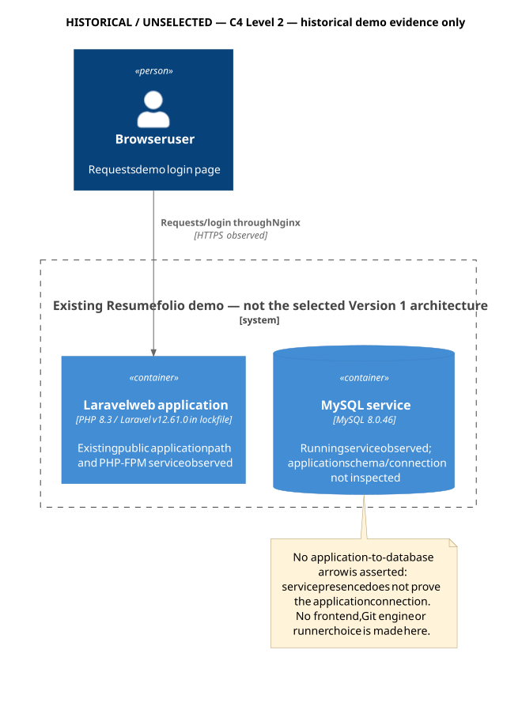

[Editable source](Diagrams/C4-observed-demo-containers.puml) · 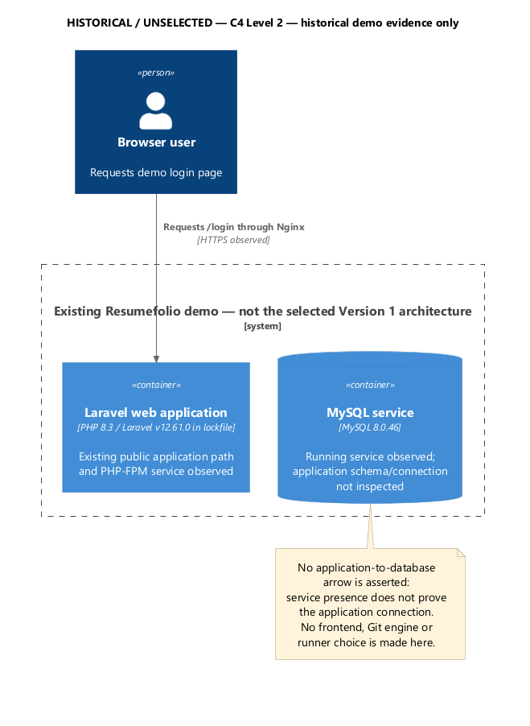

Resumefolio - Analysis Foundations and System Context

### Resumefolio - Analysis Foundations and System Context

This index groups existing System Analysis records. It changes navigation, not analysis scope, model meaning or acceptance status.

Current MVP scope and selected mechanisms: [Baseline](https://github.com/Farhad-V/Web-Resumefolio/blob/1f2acaa351ac306cb57cbe4fe9742e8bd90720d9/docs/MVP/baseline/README.md). Deferred provider, advanced collaboration and workflow-execution designs are not MVP prerequisites.

#### Documents

- [00-start-here.md](#foundation-00-start-here)
- [01-analysis-purpose-scope-and-approach.md](#foundation-01-analysis-purpose-scope-and-approach)
- [02-system-context-and-boundaries.md](#foundation-02-system-context-and-boundaries)

#### Shared Resources

- [System Analysis index]()
- [Shared diagram catalog](Diagrams/Diagram-catalog.md)
- [Relocation map and historical evidence]()

## Detailed Analysis Topics

The six sections below contain the detailed analysis records. Expand a record to read its models, decisions and evidence references.

- [Domain and Information Analysis](#analysis-domain-and-information-analysis)
- [Functional and Process Analysis](#analysis-functional-and-process-analysis)
- [Behavioral and Scenario Analysis](#analysis-behavioral-and-scenario-analysis)
- [Business Rules and Operation Contracts](#analysis-business-rules-and-operation-contracts)
- [Interfaces, Security and Quality Analysis](#analysis-interfaces-security-and-quality-analysis)
- [Review and Design Handoff](#analysis-review-and-design-handoff)

### Domain and Information Analysis

Resumefolio — Domain Model and Object-Oriented View

#### Resumefolio — Domain Model and Object-Oriented View

[Diagram types and reading guide](#analysis-domain-and-information-analysis--03-domain-model-and-object-oriented-view--heading-diagram-types-and-reading-guide) · [Full diagram catalog](Diagrams/Diagram-catalog.md)

| Item | Current position |
| --- | --- |
| Owner | Farhad; sole delivery and operations owner |
| Revision | November 1, 2026 |
| Status | Populated full-product conceptual domain model; detailed proposals, cross-view review and whole-model acceptance remain visible |
| Coverage | All twelve accepted scope areas; ten class views and one logical package view and a shared responsibility catalog |
| Interpretation | Domain concepts and associations, not implementation classes, physical tables, services or deployment units |

**Reading route:** read the notation/authority rules, then the diagrams and concept tables, followed by relationship bounds, change impact and invariants. The model develops the [system context](#foundation-02-system-context-and-boundaries), following the [analysis approach](#foundation-01-analysis-purpose-scope-and-approach).

Current MVP scope and selected mechanisms: [Baseline](https://github.com/Farhad-V/Web-Resumefolio/blob/1f2acaa351ac306cb57cbe4fe9742e8bd90720d9/docs/MVP/baseline/README.md). Deferred provider, advanced collaboration and workflow-execution designs are not MVP prerequisites.

##### 1. Sources and Interpretation

Accepted [Version 1 scope](../01-Project-planning/01-Project-charter.md#mvp-scope) governs capability inclusion/exclusions. The [distributed SRS](../02-Requirements-engineering/01-Software-requirements-specification.md#requirements-specification-requirements-specification) owns detailed obligations; the [dictionary](../02-Requirements-engineering/01-Software-requirements-specification.md#data-definitions-data-dictionary) and [glossary](../02-Requirements-engineering/01-Software-requirements-specification.md#data-definitions-glossary) own shared terms. The [question register](../02-Requirements-engineering/01-Software-requirements-specification.md#change-and-baseline-open-questions-and-decisions) and [answer review package](../02-Requirements-engineering/01-Software-requirements-specification.md#change-and-baseline-open-questions-and-decisions) distinguish decisions, proposals and investigations. Exact primary requirement links appear in each concept table.

###### 1.1 Accepted Core and Remaining Proposals

The [owner-accepted profile policy](../02-Requirements-engineering/01-Software-requirements-specification.md#change-and-baseline-open-questions-and-decisions--id-owner-accepted-profile-update-policy) applies directly:

1. Editing shared profile information does not automatically change existing resumes or their published views.

2. The owner previews and explicitly applies selected changes to a resume, preserving independent text/overrides and other resumes.

3. Applying/saving and publishing are separate; publication requires separate owner confirmation.

4. Actual previously submitted documents remain independent of later source, resume and publication changes.

These behaviors are accepted. Do not request the same approval again. Source deletion, exact concurrent-edit reconciliation, mandatory fields, language fallback, retention and numerical limits retain their recorded status. Accepted scope does not accept every detailed requirement, all of Q-D07 or the entire model.

###### 1.2 Notation and Object-Oriented Interpretation

| Modeling choice | Meaning and limit |
| --- | --- |
| UML-style concept class | Name/local ID and semantic properties. Actions remain in the adjacent responsibility table; no implementation methods or mandatory stored columns are implied |
| Solid labeled association | Domain relationship, not execution order, data transfer, authorization or lifetime ownership |
| Multiplicity | Sprint–Sprint Backlog is 1:1 from accepted scope. Other endpoint counts remain unspecified, not implicitly one-to-one; section 3 distinguishes candidate bounds from accepted meaning |
| Same concept repeated across views | Same ID and meaning, not a duplicate class; Tailored resume appears in both presentation and sharing |
| No inheritance/composition diamonds | Exclusive lifetime ownership, cascaded deletion and subtype hierarchies are not justified by the sources |
| Derived analysis concept | Selection, publication or attempt may become a value, association property or implementation component; boxes do not mandate separate entities |
| DM-Cxx / DM-Ixx | Local model/review references only; no new primary requirement IDs or physical keys |

These are PlantUML-rendered UML-style conceptual class views. Class boxes contain semantic properties; operations and full source traceability remain in the prose tables to keep the pictures readable. The diagrams are supported by textual constraints rather than claimed to form an executable UML model. Names such as Resource authority describe business responsibility, not a selected technical security component. [Input hashes and model inventory](https://github.com/Farhad-V/Web-Resumefolio/blob/1f2acaa351ac306cb57cbe4fe9742e8bd90720d9/docs/MVP/SDLC/03-system-analysis/evidence/domain-model-review-2026-11-01.json) identify this source-derived revision; they do not establish future baseline acceptance.

##### 2. Concepts and Responsibilities

###### 2.1 Professional information and independent tailoring

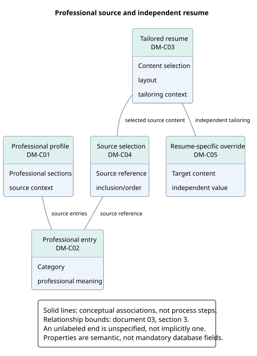

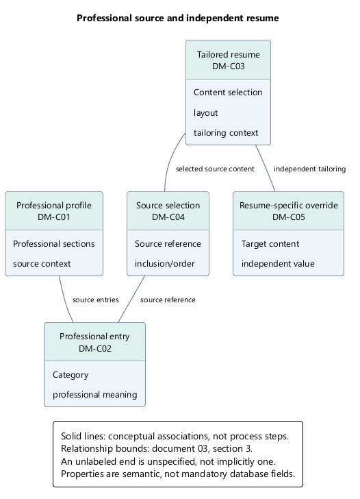 · [Editable PlantUML](Diagrams/Domain-professional-presentation.puml)

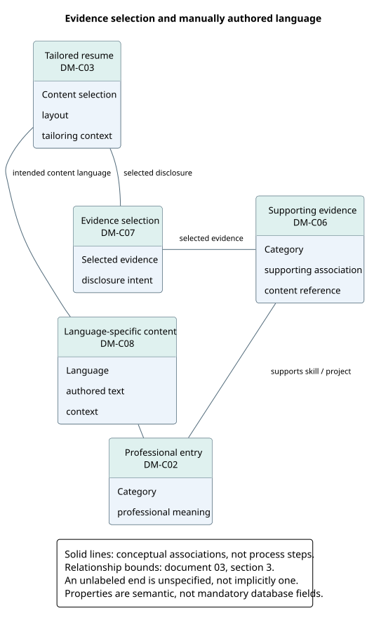

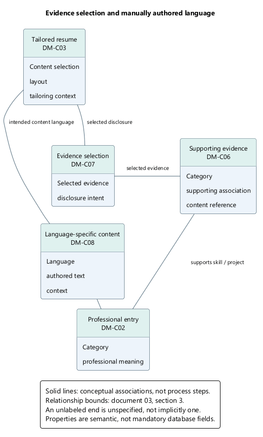 · [Editable PlantUML](Diagrams/Domain-evidence-and-language.puml)

Source selection, independent override and evidence selection answer different questions: what is reused, what is tailored and what is disclosed. Selection/override boxes can become values or association properties; they are not mandated database entities. Evidence support targets the skill/professional-project subjects in the grouped entry box, not automatically every entry category.

**Primary basis:** [PRP-D01](../02-Requirements-engineering/01-Software-requirements-specification.md#requirements-specification-profiles-resumes-and-portfolio--heading-prp-d01-reusable-professional-information), [PRP-D02](../02-Requirements-engineering/01-Software-requirements-specification.md#requirements-specification-profiles-resumes-and-portfolio--heading-prp-d02-opportunity-specific-resume-composition), [PRP-D03](../02-Requirements-engineering/01-Software-requirements-specification.md#requirements-specification-profiles-resumes-and-portfolio--heading-prp-d03-independent-selections-layouts-and-overrides), [PRP-D04](../02-Requirements-engineering/01-Software-requirements-specification.md#requirements-specification-profiles-resumes-and-portfolio--heading-prp-d04-explicit-shared-source-update-rules), [PRP-D05](../02-Requirements-engineering/01-Software-requirements-specification.md#requirements-specification-profiles-resumes-and-portfolio--heading-prp-d05-skill-and-project-evidence-management), [PRP-D06](../02-Requirements-engineering/01-Software-requirements-specification.md#requirements-specification-profiles-resumes-and-portfolio--heading-prp-d06-per-resume-evidence-selection-and-disclosure), [PRP-D07](../02-Requirements-engineering/01-Software-requirements-specification.md#requirements-specification-profiles-resumes-and-portfolio--heading-prp-d07-manually-maintained-english-and-german-content), [PRP-D09](../02-Requirements-engineering/01-Software-requirements-specification.md#requirements-specification-profiles-resumes-and-portfolio--heading-prp-d09-safe-content-admission-and-truthful-save-outcomes).

| Local element | Meaning / responsibility | Conceptual information and domain actions | Exact primary basis |
| --- | --- | --- | --- |
| DM-C01 — Professional profile | Reusable private professional source information, distinct from published presentation. | Professional sections; source context. Actions: Edit source; preview changes. | [PRP-D01](../02-Requirements-engineering/01-Software-requirements-specification.md#requirements-specification-profiles-resumes-and-portfolio--heading-prp-d01-reusable-professional-information), [PRP-D04](../02-Requirements-engineering/01-Software-requirements-specification.md#requirements-specification-profiles-resumes-and-portfolio--heading-prp-d04-explicit-shared-source-update-rules) |
| DM-C02 — Professional entry | Experience, education, skill or professional-project information; categories do not select implementation subclasses. | Category; professional meaning. Actions: Maintain source entry. | [PRP-D01](../02-Requirements-engineering/01-Software-requirements-specification.md#requirements-specification-profiles-resumes-and-portfolio--heading-prp-d01-reusable-professional-information), [PRP-D05](../02-Requirements-engineering/01-Software-requirements-specification.md#requirements-specification-profiles-resumes-and-portfolio--heading-prp-d05-skill-and-project-evidence-management) |
| DM-C03 — Tailored resume | Independent opportunity-specific selections, wording and presentation. | Content selection; layout; tailoring context. Actions: Compose; apply selected changes; request publication. | [PRP-D02](../02-Requirements-engineering/01-Software-requirements-specification.md#requirements-specification-profiles-resumes-and-portfolio--heading-prp-d02-opportunity-specific-resume-composition), [PRP-D03](../02-Requirements-engineering/01-Software-requirements-specification.md#requirements-specification-profiles-resumes-and-portfolio--heading-prp-d03-independent-selections-layouts-and-overrides), [PRP-D04](../02-Requirements-engineering/01-Software-requirements-specification.md#requirements-specification-profiles-resumes-and-portfolio--heading-prp-d04-explicit-shared-source-update-rules) |
| DM-C04 — Source selection | Meaning of selecting source information for one resume, without automatic propagation. | Source reference; inclusion/order. Actions: Select; omit; explicitly apply change. | [PRP-D02](../02-Requirements-engineering/01-Software-requirements-specification.md#requirements-specification-profiles-resumes-and-portfolio--heading-prp-d02-opportunity-specific-resume-composition), [PRP-D04](../02-Requirements-engineering/01-Software-requirements-specification.md#requirements-specification-profiles-resumes-and-portfolio--heading-prp-d04-explicit-shared-source-update-rules) |
| DM-C05 — Resume-specific override | Independent wording/presentation belonging to the intended resume. | Target content; independent value. Actions: Edit override; review source difference. | [PRP-D03](../02-Requirements-engineering/01-Software-requirements-specification.md#requirements-specification-profiles-resumes-and-portfolio--heading-prp-d03-independent-selections-layouts-and-overrides), [PRP-D04](../02-Requirements-engineering/01-Software-requirements-specification.md#requirements-specification-profiles-resumes-and-portfolio--heading-prp-d04-explicit-shared-source-update-rules) |
| DM-C06 — Supporting evidence | Externally authored text, media, files, diagrams or links supporting skills or professional projects. | Category; supporting association; content reference. Actions: Associate; revise safely. | [PRP-D05](../02-Requirements-engineering/01-Software-requirements-specification.md#requirements-specification-profiles-resumes-and-portfolio--heading-prp-d05-skill-and-project-evidence-management), [PRP-D09](../02-Requirements-engineering/01-Software-requirements-specification.md#requirements-specification-profiles-resumes-and-portfolio--heading-prp-d09-safe-content-admission-and-truthful-save-outcomes) |
| DM-C07 — Evidence selection | Deliberate per-resume disclosure, distinct from evidence existence. | Selected evidence; disclosure intent. Actions: Select; omit; review disclosure. | [PRP-D06](../02-Requirements-engineering/01-Software-requirements-specification.md#requirements-specification-profiles-resumes-and-portfolio--heading-prp-d06-per-resume-evidence-selection-and-disclosure) |
| DM-C08 — Language-specific content | Manually maintained English/German text in its relevant source/resume context. | Language; authored text; context. Actions: Edit language variant. | [PRP-D07](../02-Requirements-engineering/01-Software-requirements-specification.md#requirements-specification-profiles-resumes-and-portfolio--heading-prp-d07-manually-maintained-english-and-german-content) |

**Policy boundary:** Q-D06/Q-D08/Q-D09 remain proposals. Profile count, required fields, language fallback and evidence-removal behavior are not finalized. Accepted Q-D07 core behavior applies directly.

###### 2.2 Publication, representations and protected sharing

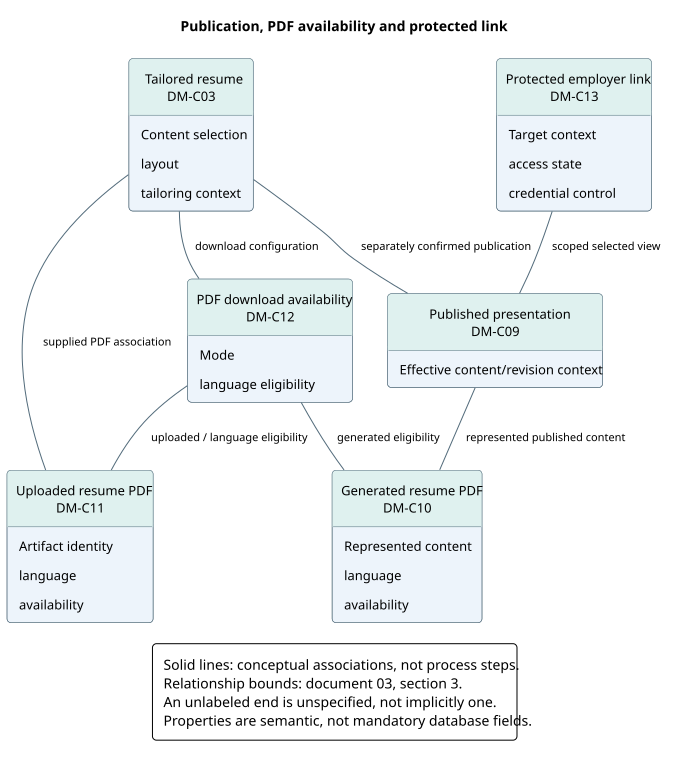

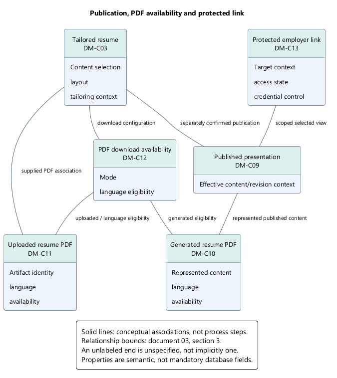 · [Editable PlantUML](Diagrams/Domain-publication-and-sharing.puml)

Published presentation differs from editable resume content. Generated and uploaded PDFs have different provenance; no shared implementation superclass is selected. Changing PDF availability and disabling a link remain independent operations.

**Primary basis:** [PRP-D04](../02-Requirements-engineering/01-Software-requirements-specification.md#requirements-specification-profiles-resumes-and-portfolio--heading-prp-d04-explicit-shared-source-update-rules), [PRP-D08](../02-Requirements-engineering/01-Software-requirements-specification.md#requirements-specification-profiles-resumes-and-portfolio--heading-prp-d08-clear-presentation-and-rendition-boundaries), [PDF-D01](../02-Requirements-engineering/01-Software-requirements-specification.md#requirements-specification-pdf-and-controlled-sharing--heading-pdf-d01-generated-resume-pdf), [PDF-D02](../02-Requirements-engineering/01-Software-requirements-specification.md#requirements-specification-pdf-and-controlled-sharing--heading-pdf-d02-uploaded-pdf-and-language-identity), [PDF-D03](../02-Requirements-engineering/01-Software-requirements-specification.md#requirements-specification-pdf-and-controlled-sharing--heading-pdf-d03-per-resume-download-choices), [PDF-D04](../02-Requirements-engineering/01-Software-requirements-specification.md#requirements-specification-pdf-and-controlled-sharing--heading-pdf-d04-scoped-password-protected-employer-access), [PDF-D05](../02-Requirements-engineering/01-Software-requirements-specification.md#requirements-specification-pdf-and-controlled-sharing--heading-pdf-d05-direct-file-and-pdf-authorization), [PDF-D06](../02-Requirements-engineering/01-Software-requirements-specification.md#requirements-specification-pdf-and-controlled-sharing--heading-pdf-d06-owner-password-and-link-controls), [PDF-D07](../02-Requirements-engineering/01-Software-requirements-specification.md#requirements-specification-pdf-and-controlled-sharing--heading-pdf-d07-explicit-live-revision-and-rendition-behavior).

| Local element | Meaning / responsibility | Conceptual information and domain actions | Exact primary basis |
| --- | --- | --- | --- |
| DM-C03 (same concept) — Tailored resume | Independent opportunity-specific selections, wording and presentation. | Content selection; layout; tailoring context. Actions: Compose; apply selected changes; request publication. | [PRP-D02](../02-Requirements-engineering/01-Software-requirements-specification.md#requirements-specification-profiles-resumes-and-portfolio--heading-prp-d02-opportunity-specific-resume-composition), [PRP-D03](../02-Requirements-engineering/01-Software-requirements-specification.md#requirements-specification-profiles-resumes-and-portfolio--heading-prp-d03-independent-selections-layouts-and-overrides), [PRP-D04](../02-Requirements-engineering/01-Software-requirements-specification.md#requirements-specification-profiles-resumes-and-portfolio--heading-prp-d04-explicit-shared-source-update-rules) |
| DM-C09 — Published presentation | Owner-confirmed effective presentation, semantically distinct from the draft; not a mandatory snapshot table. | Effective content/revision context. Actions: Confirm publication; expose selected content. | [PRP-D04](../02-Requirements-engineering/01-Software-requirements-specification.md#requirements-specification-profiles-resumes-and-portfolio--heading-prp-d04-explicit-shared-source-update-rules), [PRP-D08](../02-Requirements-engineering/01-Software-requirements-specification.md#requirements-specification-profiles-resumes-and-portfolio--heading-prp-d08-clear-presentation-and-rendition-boundaries), [PDF-D07](../02-Requirements-engineering/01-Software-requirements-specification.md#requirements-specification-pdf-and-controlled-sharing--heading-pdf-d07-explicit-live-revision-and-rendition-behavior) |
| DM-C10 — Generated resume PDF | Derived rendition with identifiable represented content and language. | Represented content; language; availability. Actions: Request generation; report availability. | [PDF-D01](../02-Requirements-engineering/01-Software-requirements-specification.md#requirements-specification-pdf-and-controlled-sharing--heading-pdf-d01-generated-resume-pdf), [PDF-D07](../02-Requirements-engineering/01-Software-requirements-specification.md#requirements-specification-pdf-and-controlled-sharing--heading-pdf-d07-explicit-live-revision-and-rendition-behavior) |
| DM-C11 — Uploaded resume PDF | Independently prepared PDF associated with the intended resume and language. | Artifact identity; language; availability. Actions: Admit; replace under validation. | [PDF-D02](../02-Requirements-engineering/01-Software-requirements-specification.md#requirements-specification-pdf-and-controlled-sharing--heading-pdf-d02-uploaded-pdf-and-language-identity), [PDF-D09](../02-Requirements-engineering/01-Software-requirements-specification.md#requirements-specification-pdf-and-controlled-sharing--heading-pdf-d09-failure-safe-processing-and-content-handling) |
| DM-C12 — PDF download availability | Per-resume generated/uploaded/both/neither choice with applicable language availability. | Mode; language eligibility. Actions: Change download configuration. | [PDF-D03](../02-Requirements-engineering/01-Software-requirements-specification.md#requirements-specification-pdf-and-controlled-sharing--heading-pdf-d03-per-resume-download-choices) |
| DM-C13 — Protected employer link | Password-protected scoped presentation access without a viewer account; not verified employer identity. | Target context; access state; credential control. Actions: Change password; disable link. | [PDF-D04](../02-Requirements-engineering/01-Software-requirements-specification.md#requirements-specification-pdf-and-controlled-sharing--heading-pdf-d04-scoped-password-protected-employer-access), [PDF-D06](../02-Requirements-engineering/01-Software-requirements-specification.md#requirements-specification-pdf-and-controlled-sharing--heading-pdf-d06-owner-password-and-link-controls) |

**Policy boundary:** Q-D10/Q-D11 retain detailed generation/revision/language/link proposals. This model does not accept link count, expiry, exact session-revocation timing, retained revision count or rendering technology.

###### 2.3 Applications, submitted history and communication

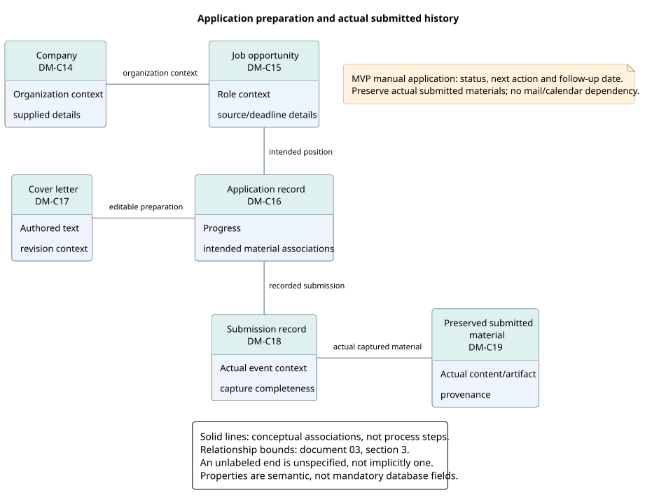

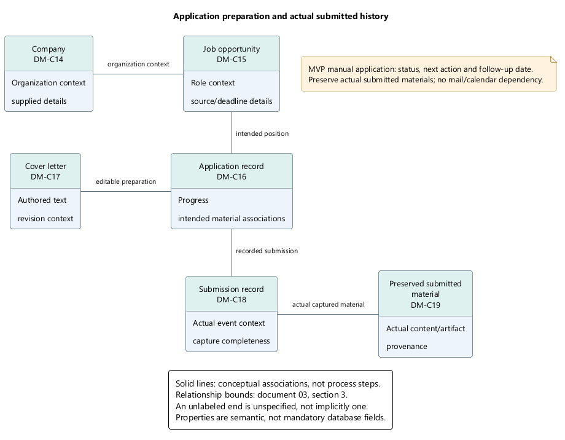 · [Editable PlantUML](Diagrams/Domain-applications-and-communication.puml)

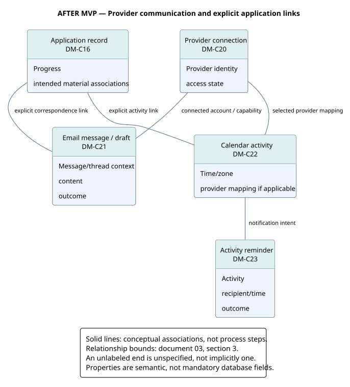

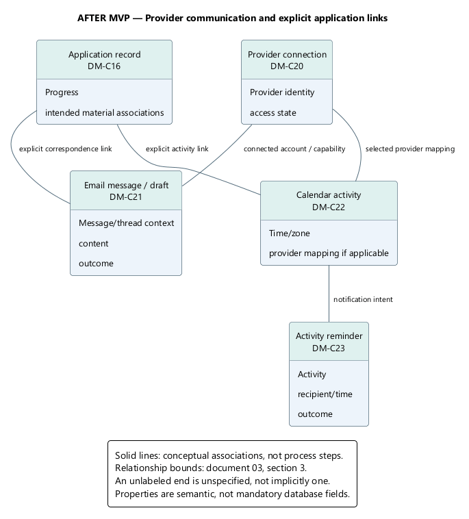 · [Editable PlantUML](Diagrams/Domain-provider-communication.puml)

Preparation, actual submission recording and provider operations have independent meanings. An application refers to its intended resume, while preserved materials identify what was actually submitted. A provider connection does not make every activity remote or every application send mail.

**Primary basis:** [APP-D01](../02-Requirements-engineering/01-Software-requirements-specification.md#requirements-specification-manual-application-management--heading-app-d01-company-and-opportunity-context), [APP-D02](../02-Requirements-engineering/01-Software-requirements-specification.md#requirements-specification-manual-application-management--heading-app-d02-relevant-resume-association), [APP-D03](../02-Requirements-engineering/01-Software-requirements-specification.md#requirements-specification-manual-application-management--heading-app-d03-manually-authored-cover-letter), [APP-D04](../02-Requirements-engineering/01-Software-requirements-specification.md#requirements-specification-manual-application-management--heading-app-d04-explicit-progress-states-and-transitions), [APP-D05](../02-Requirements-engineering/01-Software-requirements-specification.md#requirements-specification-manual-application-management--heading-app-d05-user-directed-submission-recording), [APP-D06](../02-Requirements-engineering/01-Software-requirements-specification.md#requirements-specification-manual-application-management--heading-app-d06-preserved-actual-submitted-copies), [APP-D07](../02-Requirements-engineering/01-Software-requirements-specification.md#requirements-specification-manual-application-management--heading-app-d07-correction-and-repeated-submissions), [APP-D08](../02-Requirements-engineering/01-Software-requirements-specification.md#requirements-specification-manual-application-management--heading-app-d08-correspondence-calendar-and-follow-up-links), [EGC-D01](../02-Requirements-engineering/01-Software-requirements-specification.md#requirements-specification-email-calendar-and-google-integration--heading-egc-d01-authorized-connection-and-account-context), [EGC-D05](../02-Requirements-engineering/01-Software-requirements-specification.md#requirements-specification-email-calendar-and-google-integration--heading-egc-d05-deliberate-send-and-truthful-outcome), [EGC-D07](../02-Requirements-engineering/01-Software-requirements-specification.md#requirements-specification-email-calendar-and-google-integration--heading-egc-d07-calendar-activities-and-time-meaning), [EGC-D08](../02-Requirements-engineering/01-Software-requirements-specification.md#requirements-specification-email-calendar-and-google-integration--heading-egc-d08-explicit-synchronization-contract), [EGC-D10](../02-Requirements-engineering/01-Software-requirements-specification.md#requirements-specification-email-calendar-and-google-integration--heading-egc-d10-reminders-and-notification-outcomes), [EGC-D11](../02-Requirements-engineering/01-Software-requirements-specification.md#requirements-specification-email-calendar-and-google-integration--heading-egc-d11-disconnect-revocation-and-reconnect).

| Local element | Meaning / responsibility | Conceptual information and domain actions | Exact primary basis |
| --- | --- | --- | --- |
| DM-C14 — Company | Organization information for private application work; no global public directory is implied. | Organization context; supplied details. Actions: Record; revise organization context. | [APP-D01](../02-Requirements-engineering/01-Software-requirements-specification.md#requirements-specification-manual-application-management--heading-app-d01-company-and-opportunity-context) |
| DM-C15 — Job opportunity | Position being considered, distinct from the application process for it. | Role context; source/deadline details. Actions: Record; associate with application. | [APP-D01](../02-Requirements-engineering/01-Software-requirements-specification.md#requirements-specification-manual-application-management--heading-app-d01-company-and-opportunity-context) |
| DM-C16 — Application record | Manual preparation and progress context relating an opportunity to intended materials. | Progress; intended material associations. Actions: Prepare; record progress/submission. | [APP-D02](../02-Requirements-engineering/01-Software-requirements-specification.md#requirements-specification-manual-application-management--heading-app-d02-relevant-resume-association), [APP-D04](../02-Requirements-engineering/01-Software-requirements-specification.md#requirements-specification-manual-application-management--heading-app-d04-explicit-progress-states-and-transitions), [APP-D05](../02-Requirements-engineering/01-Software-requirements-specification.md#requirements-specification-manual-application-management--heading-app-d05-user-directed-submission-recording) |
| DM-C17 — Cover letter | Manually authored editable application text, distinct from its actual submitted copy. | Authored text; revision context. Actions: Edit; save preparation. | [APP-D03](../02-Requirements-engineering/01-Software-requirements-specification.md#requirements-specification-manual-application-management--heading-app-d03-manually-authored-cover-letter) |
| DM-C18 — Submission record | User-recorded actual submission and completeness context, not proof of receipt. | Actual event context; capture completeness. Actions: Record submission; record correction. | [APP-D05](../02-Requirements-engineering/01-Software-requirements-specification.md#requirements-specification-manual-application-management--heading-app-d05-user-directed-submission-recording), [APP-D07](../02-Requirements-engineering/01-Software-requirements-specification.md#requirements-specification-manual-application-management--heading-app-d07-correction-and-repeated-submissions) |
| DM-C19 — Preserved submitted material | Identifiable actual submitted resume/cover-letter material independent of later live changes. | Actual content/artifact; provenance. Actions: Capture actual material; identify history. | [APP-D06](../02-Requirements-engineering/01-Software-requirements-specification.md#requirements-specification-manual-application-management--heading-app-d06-preserved-actual-submitted-copies), [APP-D07](../02-Requirements-engineering/01-Software-requirements-specification.md#requirements-specification-manual-application-management--heading-app-d07-correction-and-repeated-submissions), [PDF-D08](../02-Requirements-engineering/01-Software-requirements-specification.md#requirements-specification-pdf-and-controlled-sharing--heading-pdf-d08-downloaded-copy-and-submission-distinctions) |
| DM-C20 — Provider connection | Selected user/provider identity and authorized capabilities; product login is not Google consent. | Provider identity; access state. Actions: Connect; disconnect; reconcile access. | [EGC-D01](../02-Requirements-engineering/01-Software-requirements-specification.md#requirements-specification-email-calendar-and-google-integration--heading-egc-d01-authorized-connection-and-account-context), [EGC-D02](../02-Requirements-engineering/01-Software-requirements-specification.md#requirements-specification-email-calendar-and-google-integration--heading-egc-d02-justified-permissions-and-private-resource-isolation), [EGC-D11](../02-Requirements-engineering/01-Software-requirements-specification.md#requirements-specification-email-calendar-and-google-integration--heading-egc-d11-disconnect-revocation-and-reconnect)  **After MVP.** |
| DM-C21 — Email message / draft | Correspondence with provider message/thread identity and truthful save/send outcomes. | Message/thread context; content; outcome. Actions: Read; compose; save; send/reply deliberately. | [EGC-D03](../02-Requirements-engineering/01-Software-requirements-specification.md#requirements-specification-email-calendar-and-google-integration--heading-egc-d03-read-authorized-correspondence), [EGC-D04](../02-Requirements-engineering/01-Software-requirements-specification.md#requirements-specification-email-calendar-and-google-integration--heading-egc-d04-manual-compose-and-draft-handling), [EGC-D05](../02-Requirements-engineering/01-Software-requirements-specification.md#requirements-specification-email-calendar-and-google-integration--heading-egc-d05-deliberate-send-and-truthful-outcome), [EGC-D06](../02-Requirements-engineering/01-Software-requirements-specification.md#requirements-specification-email-calendar-and-google-integration--heading-egc-d06-reply-context-and-conversation-association)  **After MVP.** |
| DM-C22 — Calendar activity | Local activity or explicitly related provider event with meaningful time and authority. | Time/zone; provider mapping if applicable. Actions: Edit; request selected synchronization. | [EGC-D07](../02-Requirements-engineering/01-Software-requirements-specification.md#requirements-specification-email-calendar-and-google-integration--heading-egc-d07-calendar-activities-and-time-meaning), [EGC-D08](../02-Requirements-engineering/01-Software-requirements-specification.md#requirements-specification-email-calendar-and-google-integration--heading-egc-d08-explicit-synchronization-contract)  **After MVP.** |
| DM-C23 — Activity reminder | Notification intent for an authorized activity; scheduling is not demonstrated delivery. | Activity; recipient/time; outcome. Actions: Schedule; cancel; report outcome. | [EGC-D10](../02-Requirements-engineering/01-Software-requirements-specification.md#requirements-specification-email-calendar-and-google-integration--heading-egc-d10-reminders-and-notification-outcomes)  **After MVP.** |

**Policy boundary:** Q-D12–Q-D17 retain progress, capture/correction, synchronization and uncertain-result proposals. OAuth is not created; this diagram does not assert provider access or delivery.

###### 2.4 Work projects, backlogs, boards and Sprints

**After MVP.** Shared operating and recovery controls still apply where relevant.

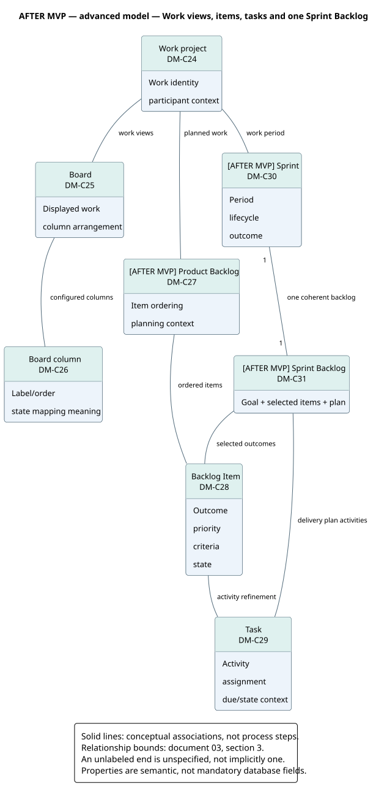

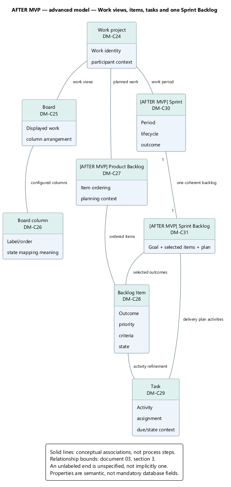 · [Editable PlantUML](Diagrams/Domain-work-management.puml)

A board presents work; it is not a second backlog. A Backlog Item expresses an outcome and acceptance meaning, while a Task expresses an activity. One Sprint Backlog comprises goal, selected items and delivery plan. Product work management differs from the board used to develop Resumefolio.

**Primary basis:** [PKS-D01](../02-Requirements-engineering/01-Software-requirements-specification.md#requirements-specification-projects-kanban-and-sprints--heading-pks-d01-project-and-board-context), [PKS-D02](../02-Requirements-engineering/01-Software-requirements-specification.md#requirements-specification-projects-kanban-and-sprints--heading-pks-d02-configurable-columns-and-valid-work-movement), [PKS-D03](../02-Requirements-engineering/01-Software-requirements-specification.md#requirements-specification-projects-kanban-and-sprints--heading-pks-d03-product-backlog-and-item-definition), [PKS-D04](../02-Requirements-engineering/01-Software-requirements-specification.md#requirements-specification-projects-kanban-and-sprints--heading-pks-d04-item-refinement-and-task-relationships), [PKS-D05](../02-Requirements-engineering/01-Software-requirements-specification.md#requirements-specification-projects-kanban-and-sprints--heading-pks-d05-assignment-priority-and-due-date-handling), [PKS-D06](../02-Requirements-engineering/01-Software-requirements-specification.md#requirements-specification-projects-kanban-and-sprints--heading-pks-d06-scoped-collaboration-and-membership-changes), [PKS-D07](../02-Requirements-engineering/01-Software-requirements-specification.md#requirements-specification-projects-kanban-and-sprints--heading-pks-d07-sprint-goal-and-selected-backlog-items), [PKS-D08](../02-Requirements-engineering/01-Software-requirements-specification.md#requirements-specification-projects-kanban-and-sprints--heading-pks-d08-one-coherent-sprint-backlog), [PKS-D09](../02-Requirements-engineering/01-Software-requirements-specification.md#requirements-specification-projects-kanban-and-sprints--heading-pks-d09-explicit-completion-and-sprint-end-outcomes), [PKS-D10](../02-Requirements-engineering/01-Software-requirements-specification.md#requirements-specification-projects-kanban-and-sprints--heading-pks-d10-deliberate-cross-module-links-reports-and-automation).

| Local element | Meaning / responsibility | Conceptual information and domain actions | Exact primary basis |
| --- | --- | --- | --- |
| DM-C24 — Work project | Authorized work organization, distinct from professional projects and Git repositories. | Work identity; participant context. Actions: Organize permitted work. | [PKS-D01](../02-Requirements-engineering/01-Software-requirements-specification.md#requirements-specification-projects-kanban-and-sprints--heading-pks-d01-project-and-board-context), [PKS-D06](../02-Requirements-engineering/01-Software-requirements-specification.md#requirements-specification-projects-kanban-and-sprints--heading-pks-d06-scoped-collaboration-and-membership-changes) |
| DM-C25 — Board | Organized work view, not another Product or Sprint Backlog. | Displayed work; column arrangement. Actions: Configure view; request movement. | [PKS-D01](../02-Requirements-engineering/01-Software-requirements-specification.md#requirements-specification-projects-kanban-and-sprints--heading-pks-d01-project-and-board-context), [PKS-D02](../02-Requirements-engineering/01-Software-requirements-specification.md#requirements-specification-projects-kanban-and-sprints--heading-pks-d02-configurable-columns-and-valid-work-movement) |
| DM-C26 — Board column | Configured display organization whose movement rules agree with actual work states. | Label/order; state mapping meaning. Actions: Configure; map valid movement. | [PKS-D02](../02-Requirements-engineering/01-Software-requirements-specification.md#requirements-specification-projects-kanban-and-sprints--heading-pks-d02-configurable-columns-and-valid-work-movement) |
| DM-C27 — Product Backlog | Ordered planned outcomes/work in an authorized work context. | Item ordering; planning context. Actions: Add; order; refine items. | [PKS-D03](../02-Requirements-engineering/01-Software-requirements-specification.md#requirements-specification-projects-kanban-and-sprints--heading-pks-d03-product-backlog-and-item-definition)  **Advanced paths after MVP; any retained core/basic path follows the release register.** |
| DM-C28 — Backlog Item | Planned outcome with criteria; not interchangeable with a Task or repository Issue. | Outcome; priority; criteria; state. Actions: Refine; select; evaluate completion. | [PKS-D03](../02-Requirements-engineering/01-Software-requirements-specification.md#requirements-specification-projects-kanban-and-sprints--heading-pks-d03-product-backlog-and-item-definition), [PKS-D04](../02-Requirements-engineering/01-Software-requirements-specification.md#requirements-specification-projects-kanban-and-sprints--heading-pks-d04-item-refinement-and-task-relationships), [PKS-D09](../02-Requirements-engineering/01-Software-requirements-specification.md#requirements-specification-projects-kanban-and-sprints--heading-pks-d09-explicit-completion-and-sprint-end-outcomes)  **Advanced paths after MVP; any retained core/basic path follows the release register.** |
| DM-C29 — Task | Specific activity contributing to work with its own assignment/completion meaning. | Activity; assignment; due/state context. Actions: Assign; update; complete activity. | [PKS-D04](../02-Requirements-engineering/01-Software-requirements-specification.md#requirements-specification-projects-kanban-and-sprints--heading-pks-d04-item-refinement-and-task-relationships), [PKS-D05](../02-Requirements-engineering/01-Software-requirements-specification.md#requirements-specification-projects-kanban-and-sprints--heading-pks-d05-assignment-priority-and-due-date-handling)  **Advanced paths after MVP; any retained core/basic path follows the release register.** |
| DM-C30 — Sprint | Work period with goal and actual outcome; elapsed time does not imply success. | Period; lifecycle; outcome. Actions: Start; adapt; end under authority. | [PKS-D07](../02-Requirements-engineering/01-Software-requirements-specification.md#requirements-specification-projects-kanban-and-sprints--heading-pks-d07-sprint-goal-and-selected-backlog-items), [PKS-D09](../02-Requirements-engineering/01-Software-requirements-specification.md#requirements-specification-projects-kanban-and-sprints--heading-pks-d09-explicit-completion-and-sprint-end-outcomes)  **Advanced paths after MVP; any retained core/basic path follows the release register.** |
| DM-C31 — Sprint Backlog | One coherent meaning comprising goal, selected Backlog Items and delivery plan. | Goal + selected items + plan. Actions: Select work; adapt plan; retain outcome. | [PKS-D07](../02-Requirements-engineering/01-Software-requirements-specification.md#requirements-specification-projects-kanban-and-sprints--heading-pks-d07-sprint-goal-and-selected-backlog-items), [PKS-D08](../02-Requirements-engineering/01-Software-requirements-specification.md#requirements-specification-projects-kanban-and-sprints--heading-pks-d08-one-coherent-sprint-backlog)  **Advanced paths after MVP; any retained core/basic path follows the release register.** |

**Policy boundary:** Q-D18–Q-D20 propose project/backlog counts, task-parent constraints, canonical states, at most one active Sprint and cross-module links. No mandatory cadence, team or extra delivery staff is inferred.

###### 2.5 Real Git and repository collaboration

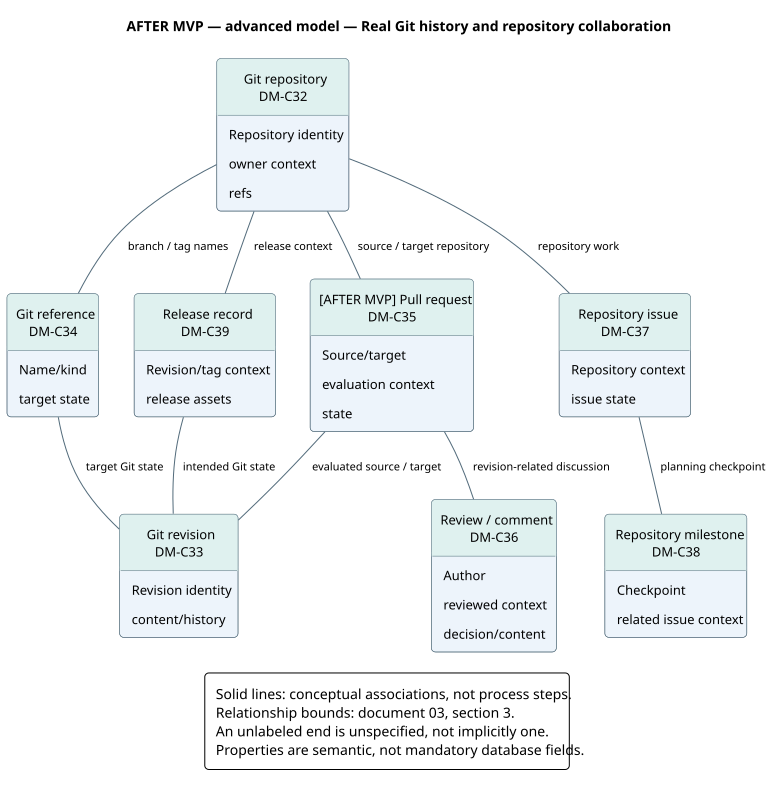

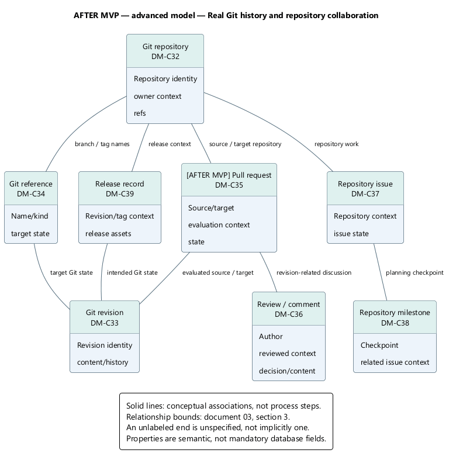 · [Editable PlantUML](Diagrams/Domain-git-collaboration.puml)

Repository identity, refs and identified revisions are separated so review, merge and execution cannot rely on an ambiguous moving branch name. A fork is another repository with explicit provenance and authority, not an inherited access grant. Issues/milestones differ from work-project items.

**Primary basis:** [GIT-D01](../02-Requirements-engineering/01-Software-requirements-specification.md#requirements-specification-git-hosting-and-collaboration--heading-git-d01-repository-creation-and-ownership), [GIT-D02](../02-Requirements-engineering/01-Software-requirements-specification.md#requirements-specification-git-hosting-and-collaboration--heading-git-d02-repository-and-ref-authorization), [GIT-D03](../02-Requirements-engineering/01-Software-requirements-specification.md#requirements-specification-git-hosting-and-collaboration--heading-git-d03-real-clone-fetch-pull-and-push), [GIT-D04](../02-Requirements-engineering/01-Software-requirements-specification.md#requirements-specification-git-hosting-and-collaboration--heading-git-d04-branches-files-and-history-browsing), [GIT-D05](../02-Requirements-engineering/01-Software-requirements-specification.md#requirements-specification-git-hosting-and-collaboration--heading-git-d05-fork-provenance-and-permission-boundaries), [GIT-D06](../02-Requirements-engineering/01-Software-requirements-specification.md#requirements-specification-git-hosting-and-collaboration--heading-git-d06-pull-requests-comments-and-review), [GIT-D07](../02-Requirements-engineering/01-Software-requirements-specification.md#requirements-specification-git-hosting-and-collaboration--heading-git-d07-controlled-merge-and-conflict-outcomes), [GIT-D08](../02-Requirements-engineering/01-Software-requirements-specification.md#requirements-specification-git-hosting-and-collaboration--heading-git-d08-issues-and-milestones), [GIT-D09](../02-Requirements-engineering/01-Software-requirements-specification.md#requirements-specification-git-hosting-and-collaboration--heading-git-d09-tags-and-releases).

| Local element | Meaning / responsibility | Conceptual information and domain actions | Exact primary basis |
| --- | --- | --- | --- |
| DM-C32 — Git repository | Real hosted content/history under repository-specific authority. | Repository identity; owner context; refs. Actions: Create; authorize real Git operations. | [GIT-D01](../02-Requirements-engineering/01-Software-requirements-specification.md#requirements-specification-git-hosting-and-collaboration--heading-git-d01-repository-creation-and-ownership), [GIT-D02](../02-Requirements-engineering/01-Software-requirements-specification.md#requirements-specification-git-hosting-and-collaboration--heading-git-d02-repository-and-ref-authorization), [GIT-D03](../02-Requirements-engineering/01-Software-requirements-specification.md#requirements-specification-git-hosting-and-collaboration--heading-git-d03-real-clone-fetch-pull-and-push) |
| DM-C33 — Git revision | Identified repository content/history state used in browsing, review and execution. | Revision identity; content/history. Actions: Identify; compare; browse. | [GIT-D04](../02-Requirements-engineering/01-Software-requirements-specification.md#requirements-specification-git-hosting-and-collaboration--heading-git-d04-branches-files-and-history-browsing), [YML-D03](../02-Requirements-engineering/01-Software-requirements-specification.md#requirements-specification-yaml-workflows-and-cicd--heading-yml-d03-run-identity-and-reproducible-context)  **After MVP.** |
| DM-C34 — Git reference | Named branch or tag associated with Git history; ref names differ from identified revisions. | Name/kind; target state. Actions: Create/update under ref authority. | [GIT-D02](../02-Requirements-engineering/01-Software-requirements-specification.md#requirements-specification-git-hosting-and-collaboration--heading-git-d02-repository-and-ref-authorization), [GIT-D04](../02-Requirements-engineering/01-Software-requirements-specification.md#requirements-specification-git-hosting-and-collaboration--heading-git-d04-branches-files-and-history-browsing), [GIT-D09](../02-Requirements-engineering/01-Software-requirements-specification.md#requirements-specification-git-hosting-and-collaboration--heading-git-d09-tags-and-releases)  **Advanced paths after MVP; any retained core/basic path follows the release register.** |
| DM-C35 — Pull request | Proposed integration with explicit source/target repository/ref and evaluated revision context. | Source/target; evaluation context; state. Actions: Open; discuss; request controlled merge. | [GIT-D06](../02-Requirements-engineering/01-Software-requirements-specification.md#requirements-specification-git-hosting-and-collaboration--heading-git-d06-pull-requests-comments-and-review), [GIT-D07](../02-Requirements-engineering/01-Software-requirements-specification.md#requirements-specification-git-hosting-and-collaboration--heading-git-d07-controlled-merge-and-conflict-outcomes)  **Advanced paths after MVP; any retained core/basic path follows the release register.** |
| DM-C36 — Review / comment | Attributed discussion/review of an intended request/revision, not universal merge permission. | Author; reviewed context; decision/content. Actions: Comment; submit review. | [GIT-D06](../02-Requirements-engineering/01-Software-requirements-specification.md#requirements-specification-git-hosting-and-collaboration--heading-git-d06-pull-requests-comments-and-review), [GIT-D07](../02-Requirements-engineering/01-Software-requirements-specification.md#requirements-specification-git-hosting-and-collaboration--heading-git-d07-controlled-merge-and-conflict-outcomes)  **Advanced paths after MVP; any retained core/basic path follows the release register.** |
| DM-C37 — Repository issue | Repository work/discussion record distinct from a work-project Backlog Item. | Repository context; issue state. Actions: Record; discuss; update. | [GIT-D08](../02-Requirements-engineering/01-Software-requirements-specification.md#requirements-specification-git-hosting-and-collaboration--heading-git-d08-issues-and-milestones) |
| DM-C38 — Repository milestone | Repository planning checkpoint for related issue work. | Checkpoint; related issue context. Actions: Organize repository planning. | [GIT-D08](../02-Requirements-engineering/01-Software-requirements-specification.md#requirements-specification-git-hosting-and-collaboration--heading-git-d08-issues-and-milestones) |
| DM-C39 — Release record | Named release tied to intended Git state and protected assets; not deployment authorization. | Revision/tag context; release assets. Actions: Publish/manage under reviewed policy. | [GIT-D09](../02-Requirements-engineering/01-Software-requirements-specification.md#requirements-specification-git-hosting-and-collaboration--heading-git-d09-tags-and-releases)  **Advanced paths after MVP; any retained core/basic path follows the release register.** |

**Policy boundary:** Q-D21/Q-D22 retain transport, credential, protection, review and merge proposals. No Git engine, merge strategy or public-visibility policy is selected.

###### 2.6 Workflow execution and separate deployment authority

**After MVP.** Shared operating and recovery controls still apply where relevant.

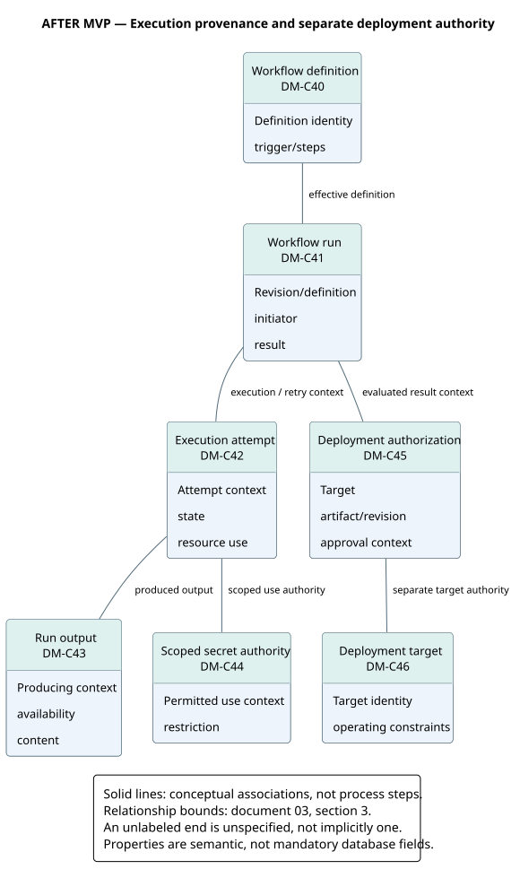

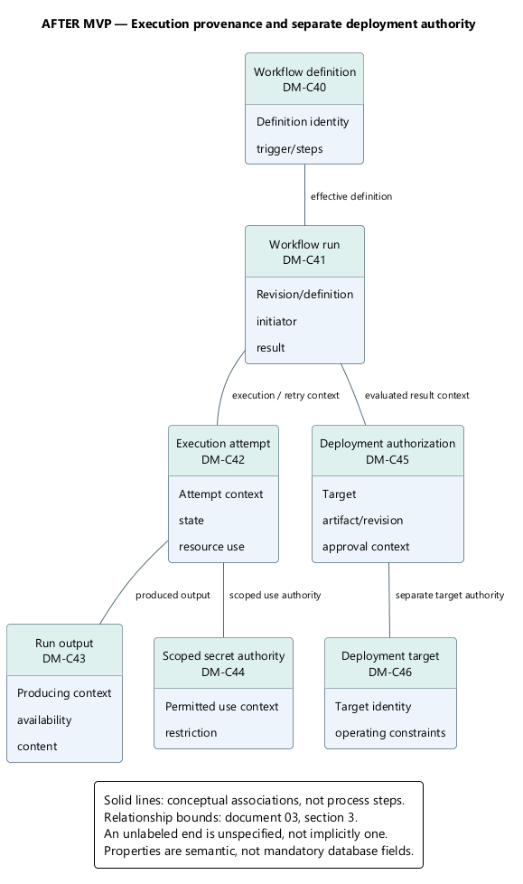 · [Editable PlantUML](Diagrams/Domain-execution-and-deployment.puml)

Validation, run request, actual execution, output and deployment approval remain distinct. Run/attempt is a provisional decomposition for retries and unknown outcomes. Deployment approval names target and exact artifact/revision; job code cannot grant itself that authority.

**Primary basis:** [YML-D01](../02-Requirements-engineering/01-Software-requirements-specification.md#requirements-specification-yaml-workflows-and-cicd--heading-yml-d01-defined-supported-workflow-contract), [YML-D02](../02-Requirements-engineering/01-Software-requirements-specification.md#requirements-specification-yaml-workflows-and-cicd--heading-yml-d02-explicit-triggers-and-run-authority), [YML-D03](../02-Requirements-engineering/01-Software-requirements-specification.md#requirements-specification-yaml-workflows-and-cicd--heading-yml-d03-run-identity-and-reproducible-context), [YML-D04](../02-Requirements-engineering/01-Software-requirements-specification.md#requirements-specification-yaml-workflows-and-cicd--heading-yml-d04-isolation-and-untrusted-code-boundary), [YML-D05](../02-Requirements-engineering/01-Software-requirements-specification.md#requirements-specification-yaml-workflows-and-cicd--heading-yml-d05-scoped-secrets-and-credentials), [YML-D06](../02-Requirements-engineering/01-Software-requirements-specification.md#requirements-specification-yaml-workflows-and-cicd--heading-yml-d06-resource-admission-and-limits), [YML-D07](../02-Requirements-engineering/01-Software-requirements-specification.md#requirements-specification-yaml-workflows-and-cicd--heading-yml-d07-truthful-run-and-step-outcomes), [YML-D08](../02-Requirements-engineering/01-Software-requirements-specification.md#requirements-specification-yaml-workflows-and-cicd--heading-yml-d08-restricted-logs-and-artifacts), [YML-D09](../02-Requirements-engineering/01-Software-requirements-specification.md#requirements-specification-yaml-workflows-and-cicd--heading-yml-d09-cancellation-retry-and-runner-loss-recovery), [YML-D10](../02-Requirements-engineering/01-Software-requirements-specification.md#requirements-specification-yaml-workflows-and-cicd--heading-yml-d10-separate-controlled-deployment-stage), [YML-D11](../02-Requirements-engineering/01-Software-requirements-specification.md#requirements-specification-yaml-workflows-and-cicd--heading-yml-d11-workspace-cleanup-and-retained-evidence), [YML-D12](../02-Requirements-engineering/01-Software-requirements-specification.md#requirements-specification-yaml-workflows-and-cicd--heading-yml-d12-feasibility-operational-guidance-and-enabling-gate).

| Local element | Meaning / responsibility | Conceptual information and domain actions | Exact primary basis |
| --- | --- | --- | --- |
| DM-C40 — Workflow definition | Supported YAML behavior at identified definition/code context; validation is not execution. | Definition identity; trigger/steps. Actions: Validate definition; evaluate eligibility. | [YML-D01](../02-Requirements-engineering/01-Software-requirements-specification.md#requirements-specification-yaml-workflows-and-cicd--heading-yml-d01-defined-supported-workflow-contract), [YML-D02](../02-Requirements-engineering/01-Software-requirements-specification.md#requirements-specification-yaml-workflows-and-cicd--heading-yml-d02-explicit-triggers-and-run-authority)  **After MVP.** |
| DM-C41 — Workflow run | Authorized execution request with evaluated code/definition and actual result context. | Revision/definition; initiator; result. Actions: Request; reconcile execution outcome. | [YML-D02](../02-Requirements-engineering/01-Software-requirements-specification.md#requirements-specification-yaml-workflows-and-cicd--heading-yml-d02-explicit-triggers-and-run-authority), [YML-D03](../02-Requirements-engineering/01-Software-requirements-specification.md#requirements-specification-yaml-workflows-and-cicd--heading-yml-d03-run-identity-and-reproducible-context), [YML-D07](../02-Requirements-engineering/01-Software-requirements-specification.md#requirements-specification-yaml-workflows-and-cicd--heading-yml-d07-truthful-run-and-step-outcomes)  **After MVP.** |
| DM-C42 — Execution attempt | Candidate retry/execution distinction so earlier failed/unknown work is not silently rewritten. | Attempt context; state; resource use. Actions: Start; cancel; reconcile; retry explicitly. | [YML-D07](../02-Requirements-engineering/01-Software-requirements-specification.md#requirements-specification-yaml-workflows-and-cicd--heading-yml-d07-truthful-run-and-step-outcomes), [YML-D09](../02-Requirements-engineering/01-Software-requirements-specification.md#requirements-specification-yaml-workflows-and-cicd--heading-yml-d09-cancellation-retry-and-runner-loss-recovery)  **After MVP.** |
| DM-C43 — Run output | Logs/artifacts attributable to a producing execution context with protected access/lifecycle. | Producing context; availability; content. Actions: Expose permitted output; clean eligible data. | [YML-D08](../02-Requirements-engineering/01-Software-requirements-specification.md#requirements-specification-yaml-workflows-and-cicd--heading-yml-d08-restricted-logs-and-artifacts), [YML-D11](../02-Requirements-engineering/01-Software-requirements-specification.md#requirements-specification-yaml-workflows-and-cicd--heading-yml-d11-workspace-cleanup-and-retained-evidence)  **After MVP.** |
| DM-C44 — Scoped secret authority | Permission to use a secret for a specific repository/event/target; no secret values are modeled. | Permitted use context; restriction. Actions: Evaluate use authority; revoke. | [YML-D05](../02-Requirements-engineering/01-Software-requirements-specification.md#requirements-specification-yaml-workflows-and-cicd--heading-yml-d05-scoped-secrets-and-credentials)  **After MVP.** |
| DM-C45 — Deployment authorization | Separate explicit approval for target and exact revision/artifact, not implied by a successful run. | Target; artifact/revision; approval context. Actions: Approve/reject intended deployment. | [YML-D10](../02-Requirements-engineering/01-Software-requirements-specification.md#requirements-specification-yaml-workflows-and-cicd--heading-yml-d10-separate-controlled-deployment-stage)  **After MVP.** |
| DM-C46 — Deployment target | Intended environment whose effects and recovery conditions require review. | Target identity; operating constraints. Actions: Evaluate authorized deployment outcome. | [YML-D10](../02-Requirements-engineering/01-Software-requirements-specification.md#requirements-specification-yaml-workflows-and-cicd--heading-yml-d10-separate-controlled-deployment-stage), [YML-D12](../02-Requirements-engineering/01-Software-requirements-specification.md#requirements-specification-yaml-workflows-and-cicd--heading-yml-d12-feasibility-operational-guidance-and-enabling-gate)  **After MVP.** |

**Policy boundary:** Q-D23 remains evidence-gated. Syntax, limits, job/step detail, run/attempt structure and isolation need review/evidence. Real execution remains in scope but is not enabled or proven by this diagram; no runner is placed on the existing host.

###### 2.7 Shared access, files and recoverable operation

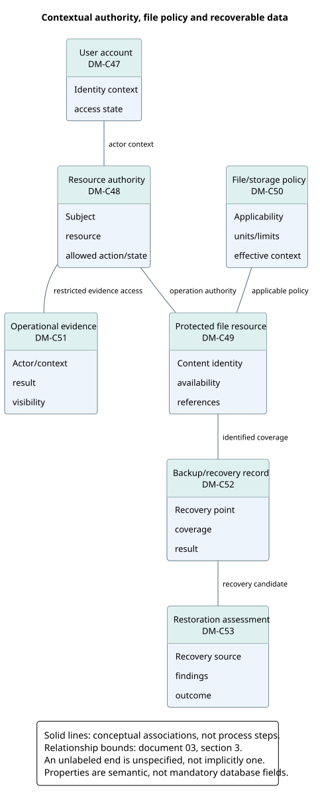

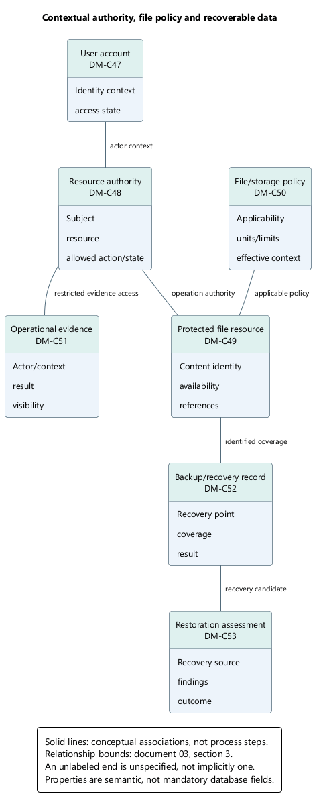 · [Editable PlantUML](Diagrams/Domain-access-files-and-recovery.puml)

Resource authority applies across domain resources; the file edge is an example. Protected file resource is a shared access/reference meaning, not a requirement that Git objects, mail attachments and resume files use one storage engine or quota pool. Recovery records are not public presentation artifacts.

**Primary basis:** [ACC-D01](../02-Requirements-engineering/01-Software-requirements-specification.md#requirements-specification-accounts-authentication-and-permissions--heading-acc-d01-individual-account-context), [ACC-D03](../02-Requirements-engineering/01-Software-requirements-specification.md#requirements-specification-accounts-authentication-and-permissions--heading-acc-d03-resource-and-operation-authorization), [ACC-D05](../02-Requirements-engineering/01-Software-requirements-specification.md#requirements-specification-accounts-authentication-and-permissions--heading-acc-d05-limited-collaboration-authority), [ACC-D09](../02-Requirements-engineering/01-Software-requirements-specification.md#requirements-specification-accounts-authentication-and-permissions--heading-acc-d09-explicit-administrative-powers), [ACC-D10](../02-Requirements-engineering/01-Software-requirements-specification.md#requirements-specification-accounts-authentication-and-permissions--heading-acc-d10-authorization-of-access-grant-changes), [ACC-D12](../02-Requirements-engineering/01-Software-requirements-specification.md#requirements-specification-accounts-authentication-and-permissions--heading-acc-d12-end-of-access-and-lifecycle-enforcement), [AFO-D01](../02-Requirements-engineering/01-Software-requirements-specification.md#requirements-specification-administration-files-and-operational-behavior--heading-afo-d01-owner-configurable-upload-and-storage-policy), [AFO-D02](../02-Requirements-engineering/01-Software-requirements-specification.md#requirements-specification-administration-files-and-operational-behavior--heading-afo-d02-policy-consistent-with-evaluated-infrastructure), [AFO-D03](../02-Requirements-engineering/01-Software-requirements-specification.md#requirements-specification-administration-files-and-operational-behavior--heading-afo-d03-per-file-admission-limit), [AFO-D04](../02-Requirements-engineering/01-Software-requirements-specification.md#requirements-specification-administration-files-and-operational-behavior--heading-afo-d04-aggregate-quota-and-concurrent-admission), [AFO-D06](../02-Requirements-engineering/01-Software-requirements-specification.md#requirements-specification-administration-files-and-operational-behavior--heading-afo-d06-file-resource-authorization-and-isolation), [AFO-D10](../02-Requirements-engineering/01-Software-requirements-specification.md#requirements-specification-administration-files-and-operational-behavior--heading-afo-d10-administrative-operation-evidence), [QSR-D10](../02-Requirements-engineering/01-Software-requirements-specification.md#requirements-specification-quality-security-and-recovery-requirements--heading-qsr-d10-defined-protected-and-observable-backups), [QSR-D11](../02-Requirements-engineering/01-Software-requirements-specification.md#requirements-specification-quality-security-and-recovery-requirements--heading-qsr-d11-demonstrated-restoration-and-recovery-targets), [QSR-D12](../02-Requirements-engineering/01-Software-requirements-specification.md#requirements-specification-quality-security-and-recovery-requirements--heading-qsr-d12-safe-restored-access-and-external-state-reconciliation), [QSR-D13](../02-Requirements-engineering/01-Software-requirements-specification.md#requirements-specification-quality-security-and-recovery-requirements--heading-qsr-d13-useful-restricted-operational-evidence).

| Local element | Meaning / responsibility | Conceptual information and domain actions | Exact primary basis |
| --- | --- | --- | --- |
| DM-C47 — User account | Individual application identity and account state; role names do not grant universal access. | Identity context; access state. Actions: Identify actor; apply account lifecycle. | [ACC-D01](../02-Requirements-engineering/01-Software-requirements-specification.md#requirements-specification-accounts-authentication-and-permissions--heading-acc-d01-individual-account-context), [ACC-D02](../02-Requirements-engineering/01-Software-requirements-specification.md#requirements-specification-accounts-authentication-and-permissions--heading-acc-d02-unified-sign-in-across-authorized-sections), [ACC-D12](../02-Requirements-engineering/01-Software-requirements-specification.md#requirements-specification-accounts-authentication-and-permissions--heading-acc-d12-end-of-access-and-lifecycle-enforcement) |
| DM-C48 — Resource authority | Role/permission, invitation or membership meaning for actor/resource/action/state; not an ACL schema. | Subject; resource; allowed action/state. Actions: Evaluate; grant/revoke under authority. | [ACC-D03](../02-Requirements-engineering/01-Software-requirements-specification.md#requirements-specification-accounts-authentication-and-permissions--heading-acc-d03-resource-and-operation-authorization), [ACC-D05](../02-Requirements-engineering/01-Software-requirements-specification.md#requirements-specification-accounts-authentication-and-permissions--heading-acc-d05-limited-collaboration-authority), [ACC-D09](../02-Requirements-engineering/01-Software-requirements-specification.md#requirements-specification-accounts-authentication-and-permissions--heading-acc-d09-explicit-administrative-powers), [ACC-D10](../02-Requirements-engineering/01-Software-requirements-specification.md#requirements-specification-accounts-authentication-and-permissions--heading-acc-d10-authorization-of-access-grant-changes) |
| DM-C49 — Protected file resource | Admitted content identity with its domain access/reference meaning; not a common storage engine. | Content identity; availability; references. Actions: Admit; retrieve; replace; retire. | [AFO-D03](../02-Requirements-engineering/01-Software-requirements-specification.md#requirements-specification-administration-files-and-operational-behavior--heading-afo-d03-per-file-admission-limit), [AFO-D05](../02-Requirements-engineering/01-Software-requirements-specification.md#requirements-specification-administration-files-and-operational-behavior--heading-afo-d05-supported-content-and-validation), [AFO-D06](../02-Requirements-engineering/01-Software-requirements-specification.md#requirements-specification-administration-files-and-operational-behavior--heading-afo-d06-file-resource-authorization-and-isolation), [AFO-D07](../02-Requirements-engineering/01-Software-requirements-specification.md#requirements-specification-administration-files-and-operational-behavior--heading-afo-d07-truthful-completion-and-interrupted-operation-handling) |
| DM-C50 — File/storage policy | Effective admission/accounting rules within an evaluated resource envelope. | Applicability; units/limits; effective context. Actions: Configure; evaluate policy. | [AFO-D01](../02-Requirements-engineering/01-Software-requirements-specification.md#requirements-specification-administration-files-and-operational-behavior--heading-afo-d01-owner-configurable-upload-and-storage-policy), [AFO-D02](../02-Requirements-engineering/01-Software-requirements-specification.md#requirements-specification-administration-files-and-operational-behavior--heading-afo-d02-policy-consistent-with-evaluated-infrastructure), [AFO-D04](../02-Requirements-engineering/01-Software-requirements-specification.md#requirements-specification-administration-files-and-operational-behavior--heading-afo-d04-aggregate-quota-and-concurrent-admission) |
| DM-C51 — Operational evidence | Restricted evidence of selected sensitive/administrative outcomes, not blanket content logging. | Actor/context; result; visibility. Actions: Record specified evidence; inspect permitted records. | [AFO-D10](../02-Requirements-engineering/01-Software-requirements-specification.md#requirements-specification-administration-files-and-operational-behavior--heading-afo-d10-administrative-operation-evidence), [QSR-D13](../02-Requirements-engineering/01-Software-requirements-specification.md#requirements-specification-quality-security-and-recovery-requirements--heading-qsr-d13-useful-restricted-operational-evidence) |
| DM-C52 — Backup/recovery record | Identity, coverage and access context of recoverable material; existence is not restoration proof. | Recovery point; coverage; result. Actions: Identify coverage; record backup outcome. | [QSR-D10](../02-Requirements-engineering/01-Software-requirements-specification.md#requirements-specification-quality-security-and-recovery-requirements--heading-qsr-d10-defined-protected-and-observable-backups) |
| DM-C53 — Restoration assessment | Evaluation of restored integrity, access and external-state reconciliation. | Recovery source; findings; outcome. Actions: Assess recovery; report actual result. | [QSR-D11](../02-Requirements-engineering/01-Software-requirements-specification.md#requirements-specification-quality-security-and-recovery-requirements--heading-qsr-d11-demonstrated-restoration-and-recovery-targets), [QSR-D12](../02-Requirements-engineering/01-Software-requirements-specification.md#requirements-specification-quality-security-and-recovery-requirements--heading-qsr-d12-safe-restored-access-and-external-state-reconciliation) |

**Policy boundary:** Q-D03–Q-D05 and Q-D24–Q-D27 retain detailed grants, quota applicability, retention and operational proposals. Backups are not configured; a backup record cannot substitute for demonstrated restoration.

##### 3. Named Relationships and Bounds

The answer package supplies usable proposals. Unspecified numeric multiplicity means the model can analyze their consequences without presenting them as accepted decisions. Relationship names below complement the pictures, including deliberate omissions for readability.

| Relationship | Domain meaning | Bounds / unresolved detail | Source and status |
| --- | --- | --- | --- |
| Account — profile — resume | Reusable information supports independent tailored resumes | One profile per account/many resumes is Q-D06's proposal; no accepted account-wide resume maximum | PRP-D01–D04; accepted Q-D07 core controls change |
| Profile — professional entry | Source information includes experience, education, skills and professional projects | Required fields, category structure and per-entry counts remain proposed | PRP-D01/D05; Q-D06 |
| Resume — selection — source entry | Identifies reused information without automatic propagation | Representation and source deletion/removal behavior remain open | PRP-D02/D04; accepted core plus remaining Q-D07 |
| Resume — independent override | Tailoring belongs to its specific resume context | Granularity, reset-to-source and conflict reconciliation remain detailed proposals | PRP-D03/D04; Q-D06/Q-D07 |
| Evidence — entry — resume selection | Supporting competence and disclosure are separate relationships | Several supporting associations, ordering/default selection and removal rules retain proposal status | PRP-D05/D06; Q-D08 |
| Source/resume — language content | Manually maintained English/German information | Which fields vary, completeness and fallback remain proposed; no automatic translation | PRP-D07; Q-D09 |
| Resume — publication | Separate confirmed publication controls the effective presentation | No snapshot implementation, old-revision count or retention period is chosen | PRP-D04; accepted core; PDF-D07/Q-D10 |
| Resume/publication — generated/uploaded PDF | Different provenance and intended content/language | Neither representation is assumed to exist for every resume; generation timing/version counts remain proposed | PDF-D01/D02/D07; Q-D10 |
| Resume — download availability | Generated/uploaded/both/neither modes are in scope | Configuration neither creates a missing artifact nor grants access; absent-language details remain proposed | DEC-025; PDF-D03/D05; Q-D09/Q-D10 |
| Link — intended presentation | Protected access to selected content without a viewer account | Link count/expiry/session/in-flight behavior remains at Q-D05/Q-D11 | PDF-D04/D06 |
| Company — opportunity — application | Organization/role context for manual application work | Reuse, duplicate handling, counts and required fields remain proposed | APP-D01/D02; Q-D12 |
| Application — submission — captured material | Actual history remains independent of live editable content | Repeated submission events, incomplete capture and corrections retain proposal status | APP-D05–D07; accepted preservation boundary |
| Application — message/activity | Explicit links identify relevant permitted records | No automatic grant, ownership transfer, progress transition or sending | APP-D08; EGC-D09; Q-D20  **After MVP.** |
| Provider connection — correspondence/activity | Intended user/account and granted scope govern operations | Connection counts, local/provider field authority, sync and reconnect are proposed details | EGC-D01/D08/D11; Q-D15–Q-D17  **After MVP.** |
| Work project — board/backlog/Sprint | Work organization with distinct views and planning contexts | One Product Backlog/project, board counts and active-Sprint maximum remain proposals | PKS-D01/D03/D07; Q-D18/Q-D19 |
| Board/column — displayed work | A view represents permitted items/tasks and movement semantics | Card representation is not a required entity; state/column mapping remains proposed | PKS-D02/D04; Q-D18 |
| Backlog Item — task | Outcome can be refined into activities | At most one parent item and optional standalone tasks remain proposals, not class inheritance | PKS-D04/D09; Q-D18/Q-D19  **Advanced paths after MVP; any retained core/basic path follows the release register.** |
| Sprint — Sprint Backlog | One coherent goal + selected items + delivery plan | Scope meaning is established; no fixed cadence, mandatory task count or physical composition follows | DEC-021; PKS-D07/D08  **Advanced paths after MVP; any retained core/basic path follows the release register.** |
| Repository — repository (fork) | Another repository retains explicit upstream provenance | Private visibility, lifetime and revocation effects need explicit rules; no inherited authority | GIT-D05; Q-D22  **Advanced paths after MVP; any retained core/basic path follows the release register.** |
| Repository — ref — revision | Names identify history states without equating moving refs to evaluated revisions | Transport, protection, update and concurrency policies remain proposed/design-dependent | GIT-D02–D04/D09; Q-D21/Q-D22 |
| Pull request — source/target — review | Source and target may be in one or different repositories, with evaluated revisions | Review validity/counts and merge strategy remain proposed; no extra reviewer is invented | GIT-D06/D07; Q-D22  **Advanced paths after MVP; any retained core/basic path follows the release register.** |
| Repository issue — work item | Distinct concepts may have intentional links | No automatic equivalence, cross-context deletion or authority follows the association | GIT-D08; PKS-D10; Q-D20  **Advanced paths after MVP; any retained core/basic path follows the release register.** |
| Definition — run — attempt — output | Identify effective code/definition and actual execution/retry outcomes | Attempt decomposition, job/step detail and numerical limits retain Q-D23 status | YML-D03/D07–D09  **After MVP.** |
| Run/result — approval — target | A result can inform a separately authorized deployment | Approval validity/counts/expiry after changed inputs require contracts/design review | YML-D10; Q-D23  **After MVP.** |
| File — policy — references | Admission/access/accounting use applicable policy and live/history references | Git objects, job output, mail attachments and resume media do not automatically share one storage/quota pool | AFO-D02–D08; Q-D24 |
| Recovery record — restoration assessment | Candidate backup and demonstrated consistent recovery differ | Destination, coverage, retention and targets remain evidence-gated; backups not configured | QSR-D10–D12; Q-D26 |

###### Cross-View Links Omitted from Individual Diagrams

Application associates its intended Tailored resume (APP-D02), while Preserved submitted material identifies the actual submitted content or rendition (APP-D06), not an arbitrary current PDF. Workflow run identifies the Repository/Git revision and effective definition (YML-D03). Release assets, run artifacts and submitted documents retain their own content/reference authority. Resource authority applies to resumes, applications, mail, work, repositories, runs, administration and recovery where required; the diagram's file edge is only an example. Fork provenance is the repository self-association described above.

##### 4. Information Authority and Change Impact

| Change / domain operation | Intended effect | Independent information that must survive | Remaining detailed policy |
| --- | --- | --- | --- |
| Edit shared information | Modify profile/source | Existing resumes, published views, overrides and actual submitted material | Source deletion and concurrent reconciliation |
| Preview/apply selected source change | Modify the intended resume through explicit owner choice | Other resumes, independent text and publication until separately confirmed | Field-level conflicts and source-provenance representation |
| Confirm publication | Modify effective selected presentation | Historical actual submissions and unrelated publications | Version retention, unavailable/stale rendition timing |
| Replace evidence/uploaded PDF | Modify a live association under admission rules | Other language/resume contexts and preserved actual material | Failure/retirement/invalidation rules |
| Save PDF availability | Modify intended eligible downloads | Do not disable link merely because settings were saved | Active-session/cache/in-flight retrieval |
| Disable link/change password | Modify the intended access path | Private contexts and unrelated links/grants; already delivered bytes cannot be recalled | Exact subsequent-session/retrieval effects |
| Record/correct actual submission | Identify actual event/material completeness and correction history | Do not substitute current source for captured actual documents | Capture, correction, deletion and retention |
| Link mail/activity to application | Associate intended permitted contexts | Mail/provider authority and application progress remain separate | Sync, deletion and uncertain-send/retry behavior |
| Move work/complete task/end Sprint | Report authorized work change and actual outcome | Card movement/task completion does not alone accept an item or satisfy goal | States, completion authority and carry-over |
| Push/fork/review/merge/release | Report actual repository/ref/review result | Do not implicitly accept work, send mail or deploy | Protection/review policy and client interoperability |
| Run/retry/cancel execution | Identify intended attempt and actual/unknown result | Prior results, unrelated resources and deployment approval | Isolation, side effects, runner loss and capacity fit |
| Change quota/clean material/restore | Apply authorized effective policy/recovery decisions | Required references, actual history, current access and external state | Accounting, eligibility, recovery target/evidence |

##### 5. Candidate Invariants and Concurrency Review

These local analysis obligations support cross-view review. Accepted-core rows reflect the actual owner decision. Other rows derive from scope and proposed requirements; precise detailed contracts retain primary-source status. Review cases are planned, not executed software tests.

| Local invariant | Status / primary basis | Review example |
| --- | --- | --- |
| DM-I01 — No automatic resume/live change from source editing | Accepted core; PRP-D04-AC01 | Edit a source reused in two resumes; neither draft nor live presentation changes automatically |
| DM-I02 — Explicit selected apply preserves overrides and other resumes | Accepted core; PRP-D04-AC01 | Apply to A while preserving independent text and B's content |
| DM-I03 — Apply/save differs from separately confirmed publication | Accepted core; PRP-D04-AC01 | Apply changes; employer view remains unchanged until confirmed publish |
| DM-I04 — Later editing/publication preserves actual submitted documents | Accepted core; PRP-D04-AC01, APP-D06 | Capture actual material, then edit and publish; history stays independent |
| DM-I05 — Evidence existence is not disclosure permission | Source-derived; PRP-D06, PDF-D04/D05 | Request an unselected evidence file via modified direct reference |
| DM-I06 — Download needs authorization, mode/language and actual availability | Source-derived; PDF-D03/D05/D07 | Review four modes against missing, processing and mismatched artifacts |
| DM-I07 — PDF settings do not implicitly disable sharing | Source-derived distinct operations; PDF-D03/D06 | Save settings; separately request disable; inspect independent effects |
| DM-I08 — Identity, membership and links are not universal authority | Source-derived; ACC-D03/D04/D05, EGC-D09 | Attempt unrelated resume, mailbox, repository and output access  **After MVP.** |
| DM-I09 — Provider acceptance, delivery/read and unknown are different facts | Source-derived; EGC-D05/D12, EIF-D08 | Send timeout must not imply delivered or safe automatic resend  **After MVP.** |
| DM-I10 — One coherent Sprint Backlog means goal/items/plan | Accepted scope meaning; DEC-021, PKS-D08 | Compare planning views without inventing a second Sprint Backlog  **Advanced paths after MVP; any retained core/basic path follows the release register.** |
| DM-I11 — Task completion, item acceptance and Sprint outcome differ | Source-derived; PKS-D04/D09 | Complete tasks with unmet item criteria; do not infer accepted outcome  **Advanced paths after MVP; any retained core/basic path follows the release register.** |
| DM-I12 — Ref names, evaluated revisions, review and deploy authority differ | Source-derived; GIT-D06/D07, YML-D03/D10 | Change source/target after review; inspect validity before merge/deploy  **After MVP.** |
| DM-I13 — Valid YAML or push permission is not safe execution authority | Source-derived; YML-D02/D04/D05/D06 | Denied resource/isolation/secret conditions cannot yield authorized execution  **After MVP.** |
| DM-I14 — Cleanup/accounting respect references and actual completion | Source-derived; AFO-D04/D07/D08/D11 | Competing admission/removal must not invent free capacity or destroy required history |
| DM-I15 — Backup identity differs from safe consistent restoration | Source-derived; QSR-D10/D11/D12 | Reconcile access/deletion/external state before claiming successful recovery |

###### Competing Operations for Behavioral Modeling

| Competing actions | Question to resolve | Primary question / downstream views |
| --- | --- | --- |
| Source apply versus override edit | Which preview/input is still current, without lost independent text? | Remaining Q-D07; scenarios/state/contracts |
| Publish versus artifact replacement | Which revision/content is effective and available after failure? | Q-D08/Q-D10; data/state/contracts |
| Link disable/password rotation versus retrieval | Which session/request remains permitted; which bytes already left control? | Q-D05/Q-D11; access/state/rules |
| Actual capture versus edit/correction | Which actual material was captured, and what is incomplete? | Q-D13/Q-D14; history/contracts |
| Provider send/sync versus disconnect/timeout | What is confirmed, uncertain or stale; what can safely be repeated? | Q-D16/Q-D17; interfaces/provider states |
| Item movement/selection versus Sprint end | Which scope/completion/history is authoritative? | Q-D18/Q-D19; work states/contracts |
| Review/merge versus ref updates | Which evaluated source/target/check is still valid? | Q-D21/Q-D22; Git contracts |
| Cancel/retry versus runner loss/deploy | What actually stopped or had effects; what approval remains valid? | Q-D23; execution states/feasibility |
| Admission/cleanup versus policy change/restore | Which policy, usage, references and restored access apply? | Q-D24/Q-D26; operations/data/contracts |

No locking scheme, transaction boundary or automatic conflict winner is chosen here. Continue provisional modeling; resolve the affected behavior before accepting dependent design.

##### 6. Traceability, Remaining Work and Review

| Scope | Principal concepts | Primary basis / diagram |
| --- | --- | --- |
| SCP-01 Accounts/access | User account, Resource authority, Protected employer link | ACC-D01–D12; 2.2/2.7 |
| SCP-02 Profiles/resumes | Profile, Entry, Resume, Selection, Override, Publication | PRP-D01–D04/D08; 2.1/2.2 |
| SCP-03 Supporting evidence | Evidence, Evidence selection, Professional entry | PRP-D05/D06/D09; 2.1 |
| SCP-04 PDFs/languages | Generated/uploaded PDF, Download availability, Language content | PRP-D07, PDF-D01–D03/D07; 2.1/2.2 |
| SCP-05 Protected sharing | Employer link, Publication, PDF availability, Resource authority | PDF-D04–D06, ACC-D06–D08; 2.2/2.7 |
| SCP-06 Applications/history | Company, Opportunity, Application, Letter, Submission, Actual material | APP-D01–D09; 2.3 |
| SCP-07 Mail/calendar | Connection, Message/draft, Activity, Reminder | EGC-D01–D12; 2.3  **After MVP.** |
| SCP-08 Work management | Project, Board/Column, Backlog/Item/Task, Sprint/Backlog | PKS-D01–D11; 2.4 |
| SCP-09 Real Git | Repository, Revision/Ref, PR/Review, Issue/Milestone, Release | GIT-D01–D10; 2.5 |
| SCP-10 Gated real execution | Workflow, Run/Attempt, Output, Secret authority, Deployment/Target | YML-D01–D12; 2.6  **After MVP.** |
| SCP-11 Effective file policy | Protected file, Policy, Authority | AFO-D01–D11; 2.7 |
| SCP-12 Recoverable operation | Evidence, Backup/recovery record, Restoration assessment | AFO-D12, QSR-D10–D14; 2.7 |

Source associations are not proof of complete acceptance-criterion coverage. [Existing criterion locators](../02-Requirements-engineering/01-Software-requirements-specification.md#validation-and-traceability-proposed-criterion-locators) are preserved; exact criterion-to-model coverage belongs in [document 11](#analysis-review-and-design-handoff--11-model-consistency-traceability-and-review). A concept responsibility is not a detailed state or operation contract.

##### 7. Review Position and Explicit Limits

- [x] Populate a full-product source-linked concept/responsibility catalog.

- [x] Provide ten editable UML-style conceptual class diagrams and one package diagram with SVG/PNG exports.

- [x] Incorporate accepted profile/apply/publication/history behavior with actual status.

- [x] Distinguish proposed bounds, derived concepts and implementation decisions.

- [x] Define change impact, invariants and competing-operation review cases.

- [ ] Reconcile exact properties/bounds with the conceptual data view and dictionary refinements.

- [ ] Complete coordinated scenario/state/activity/rule views and operation contracts.

- [ ] Complete exact criterion-level cross-view coverage and owner disposition of the identified model.

- [ ] Obtain provider, safe execution and recovery evidence at their dependent gates.

This model is populated for analysis and review. It does not complete the whole System Analysis phase, accept M-02/M-03, implement the product or prove capacity. Existing 2-vCPU/4-GB hosting, OAuth not created, backups not configured and the owner's 20 project hours/week remain known constraints/facts. They do not prevent logical models; they still constrain dependent feasibility and acceptance. The existing Laravel demo is not implementation evidence for this full scope.

##### 8. Next Views and Maintenance

Use [04 Functions](#analysis-functional-and-process-analysis--04-function-oriented-view) for transformations/data flows; [05 Data](#analysis-domain-and-information-analysis--05-data-oriented-view) for identity, bounds, required information and provenance. Use [06 Scenarios](#analysis-behavioral-and-scenario-analysis--06-scenario-based-view), [07 States](#analysis-behavioral-and-scenario-analysis--07-state-based-view), [08 Activities](#analysis-functional-and-process-analysis--08-control-flow-based-view), [09 Rules](#analysis-business-rules-and-operation-contracts--09-rule-based-view) and [10 Contracts](#analysis-business-rules-and-operation-contracts--10-domain-constraints-and-operation-contracts) for observable operation consequences. [12 Interfaces](#analysis-interfaces-security-and-quality-analysis--12-interfaces-and-external-interactions), [13 Quality/operations](#analysis-interfaces-security-and-quality-analysis--13-security-quality-and-operational-analysis) and [14 Handoff](#analysis-review-and-design-handoff--14-feasibility-dependencies-and-design-handoff) retain their cross-cutting responsibility.

Maintain one primary source for each term, obligation and decision. Synchronize changed meanings across concept tables, diagram sources/exports, relationship bounds and downstream views. The [diagram catalog](Diagrams/Diagram-catalog.md) lists editable/exported artifacts. No product code, deployment, server configuration, OAuth, backup or execution is changed by this documentation work.

[System Analysis index]() · [System context](#foundation-02-system-context-and-boundaries) · [Analysis approach](#foundation-01-analysis-purpose-scope-and-approach)

##### Diagram Types and Reading Guide

Existing class diagrams carry the concept details. Their documented relationship bounds remain authoritative: unspecified ends are not implicitly one. The added detail makes existing file-05 proposed cardinalities visible in UML; do not turn proposals into accepted multiplicities. The package view groups concepts without introducing implementation components.

[domain-package-responsibilities](https://github.com/Farhad-V/Web-Resumefolio/blob/1f2acaa351ac306cb57cbe4fe9742e8bd90720d9/docs/MVP/SDLC/04-system-design/01-software-architecture/diagrams/mvp-system-boundaries.svg)

[Editable source](https://github.com/Farhad-V/Web-Resumefolio/blob/1f2acaa351ac306cb57cbe4fe9742e8bd90720d9/docs/MVP/SDLC/04-system-design/01-software-architecture/diagrams/mvp-system-boundaries.puml) · 

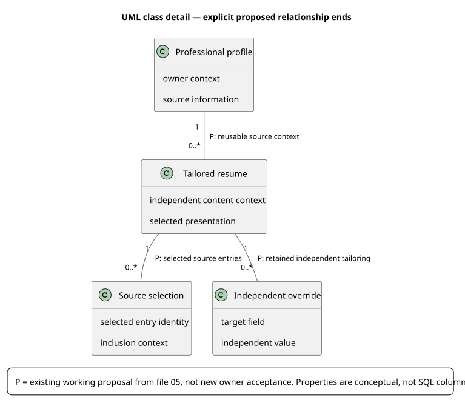

[Editable source](Diagrams/Domain-proposed-multiplicity.puml) · 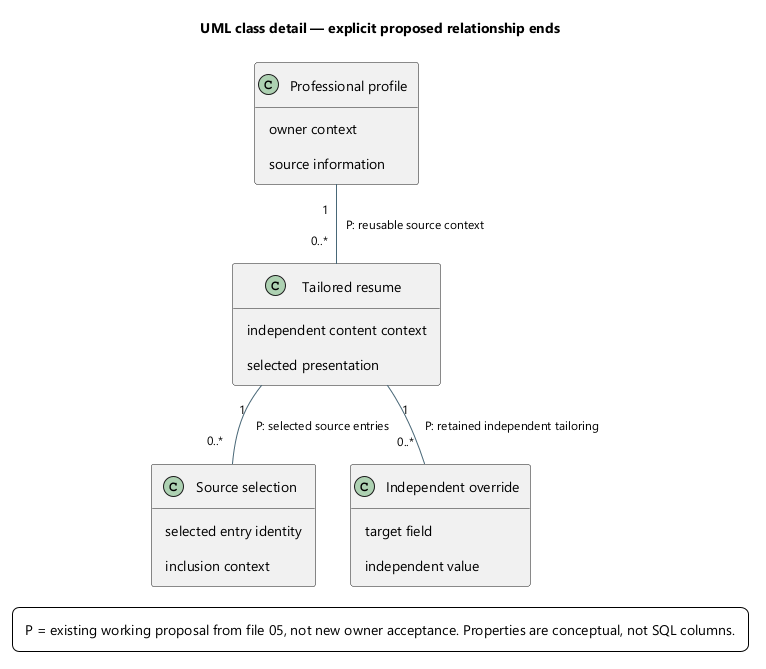

Resumefolio — Data-Oriented View

#### Resumefolio — Data-Oriented View

[Diagram types and reading guide](#analysis-domain-and-information-analysis--05-data-oriented-view--heading-diagram-types-and-reading-guide) · [Full diagram catalog](Diagrams/Diagram-catalog.md)

Owner: Farhad. Revision: November 1, 2026.

Status: populated full-product conceptual data model. Accepted boundaries, proposed relationship bounds and dependent evidence gates are distinguished. This is not a physical schema or an accepted phase baseline.

**Purpose:** Explain what information must be distinguishable, who supplies or controls it, which relationships make it meaningful, and what must survive change. Document 03 describes domain responsibility; this view develops identity, requiredness, authority, provenance and lifecycle.

Current MVP scope and selected mechanisms: [Baseline](https://github.com/Farhad-V/Web-Resumefolio/blob/1f2acaa351ac306cb57cbe4fe9742e8bd90720d9/docs/MVP/baseline/README.md). Deferred provider, advanced collaboration and workflow-execution designs are not MVP prerequisites.

##### 1. Purpose and Sources

Use the [data dictionary](../02-Requirements-engineering/01-Software-requirements-specification.md#data-definitions-data-dictionary) and [glossary](../02-Requirements-engineering/01-Software-requirements-specification.md#data-definitions-glossary) as terminology authorities; [document 03](#analysis-domain-and-information-analysis--03-domain-model-and-object-oriented-view) for the concept/responsibility model; [system context](#foundation-02-system-context-and-boundaries) for boundaries; and [accepted scope](../01-Project-planning/01-Project-charter.md#mvp-scope) for all twelve included areas. Exact primary requirement links accompany the catalog and ER views.

The [owner-accepted profile policy](../02-Requirements-engineering/01-Software-requirements-specification.md#change-and-baseline-open-questions-and-decisions--id-owner-accepted-profile-update-policy) is settled: source edits do not automatically change existing resumes or live views; selected application is explicit and preserves independent content; publication is separately confirmed; actual submitted documents remain preserved. Earlier dictionary paragraphs listing generic propagation questions do not reopen these four accepted behaviors. Remaining details retain their status in the [question register](../02-Requirements-engineering/01-Software-requirements-specification.md#change-and-baseline-open-questions-and-decisions) and [answer package](../02-Requirements-engineering/01-Software-requirements-specification.md#change-and-baseline-open-questions-and-decisions).

Local references `DA-Sxx`, `DA-Fxx` and `DA-Ixx` identify this analysis catalog, information exchanges and integrity checks. They do not allocate primary requirements or prescribe implementation names. [Source hashes and mapping evidence](https://github.com/Farhad-V/Web-Resumefolio/blob/1f2acaa351ac306cb57cbe4fe9742e8bd90720d9/docs/MVP/SDLC/03-system-analysis/evidence/data-oriented-review-2026-11-01.json) identify this revision.

##### 2. Conceptual Entity-Relationship Model

###### 2.1 Reading the ER Notation and Proposal Status

| Notation / status | Interpretation |
| --- | --- |
| Entity rectangle | Conceptual information subject, not a mandatory relational table or persisted class |
| Two bars at an association end | Exactly one |
| Circle and bar at an association end | Zero or one |
| Circle and crow-foot at an association end | Zero or many |
| A-labeled association | Established scope meaning: one coherent Sprint Backlog per Sprint |
| P-labeled counts | Explicit working cardinality proposal from the linked answer; not owner acceptance |
| Plain association without endpoint counts | Bounds remain unspecified; absence of symbols does not imply one-to-one |
| Attributes inside an entity | Semantic properties needed for reasoning; no PK/FK, SQL type, index, identifier format or storage engine is selected |

P counts instantiate existing proposals so their consequences can be reviewed. Some zero minima interpret the proposed incomplete-draft or not-yet-executed lifecycle; these are working interpretations, not newly accepted defaults. Each figure explains its boundary. A many-ended relationship permits distinguishable associations; it does not promise unlimited quota, indefinite retention or a fixed row-per-object design.

###### 2.2 source information and independent tailoring

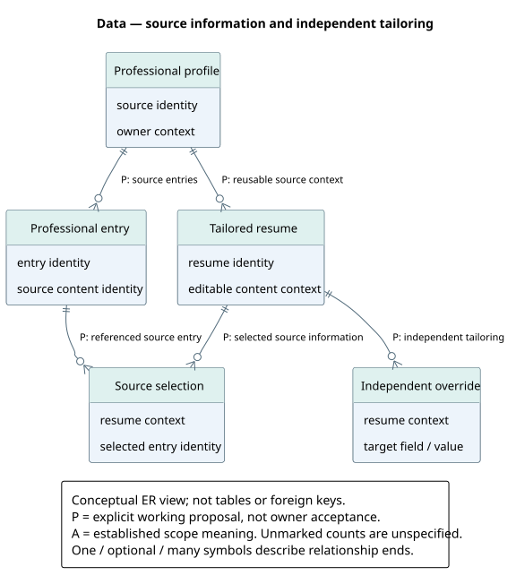

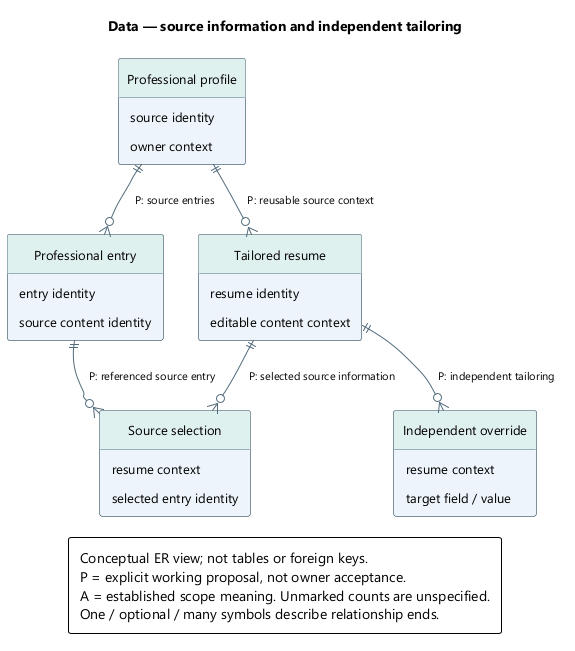 · [Editable PlantUML](Diagrams/Data-profile-and-tailoring.puml)

The resume has independent identity and editable content. Source selection describes provenance; it is not permission to read a changed source value automatically. Override values belong to the intended resume. The diagram does not prescribe copying, normalization or event storage.

**Bounds and status:** P uses the Q-D06 single-profile/multiple-resume proposal. Zero selection/override rows allow an incomplete draft in the working model. Entry/selection identity and exact granularity remain proposed. Accepted Q-D07 rules prohibit automatic draft/live changes and protect independent content regardless of representation.

**Primary basis:** [PRP-D01](../02-Requirements-engineering/01-Software-requirements-specification.md#requirements-specification-profiles-resumes-and-portfolio--heading-prp-d01-reusable-professional-information), [PRP-D02](../02-Requirements-engineering/01-Software-requirements-specification.md#requirements-specification-profiles-resumes-and-portfolio--heading-prp-d02-opportunity-specific-resume-composition), [PRP-D03](../02-Requirements-engineering/01-Software-requirements-specification.md#requirements-specification-profiles-resumes-and-portfolio--heading-prp-d03-independent-selections-layouts-and-overrides), [PRP-D04](../02-Requirements-engineering/01-Software-requirements-specification.md#requirements-specification-profiles-resumes-and-portfolio--heading-prp-d04-explicit-shared-source-update-rules).

###### 2.3 evidence disclosure and language context

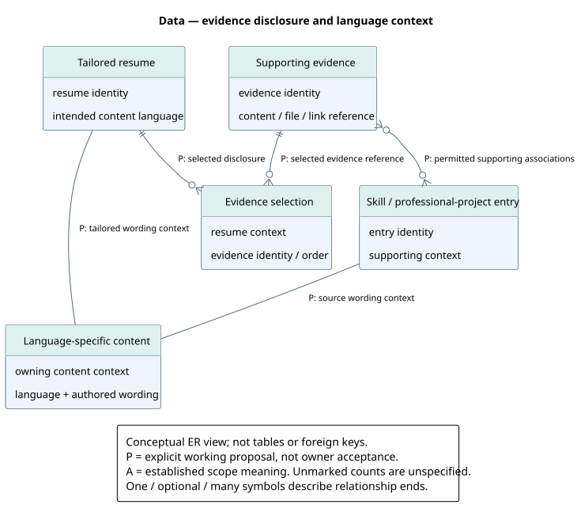

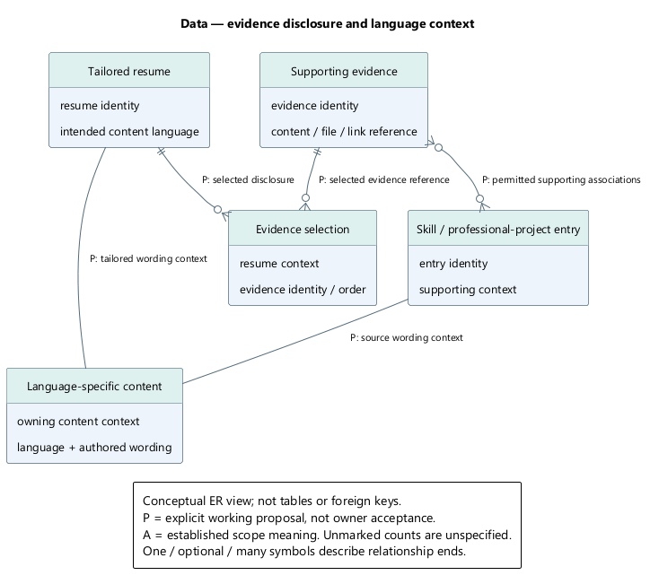 · [Editable PlantUML](Diagrams/Data-evidence-language-and-selection.puml)

Evidence existence, professional association and per-resume disclosure are separate information. Content can be text, a permitted file or a link; no file is mandatory for every evidence item. Each language value belongs to a clearly identified content context rather than a global translation record.

**Bounds and status:** P follows Q-D08/Q-D09. Several supporting associations and per-resume inclusion/order are proposed. Language-owning context is exclusive per value: the two context lines are alternatives, not a requirement to belong to both entry and resume. Their exact counts are intentionally unspecified. Missing wording/artifact is never fabricated.

**Primary basis:** [PRP-D05](../02-Requirements-engineering/01-Software-requirements-specification.md#requirements-specification-profiles-resumes-and-portfolio--heading-prp-d05-skill-and-project-evidence-management), [PRP-D06](../02-Requirements-engineering/01-Software-requirements-specification.md#requirements-specification-profiles-resumes-and-portfolio--heading-prp-d06-per-resume-evidence-selection-and-disclosure), [PRP-D07](../02-Requirements-engineering/01-Software-requirements-specification.md#requirements-specification-profiles-resumes-and-portfolio--heading-prp-d07-manually-maintained-english-and-german-content), [PRP-D09](../02-Requirements-engineering/01-Software-requirements-specification.md#requirements-specification-profiles-resumes-and-portfolio--heading-prp-d09-safe-content-admission-and-truthful-save-outcomes).

###### 2.4 publication identity, PDF provenance and access

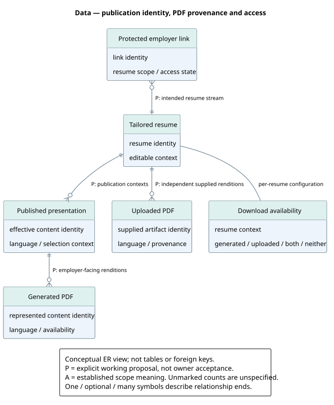

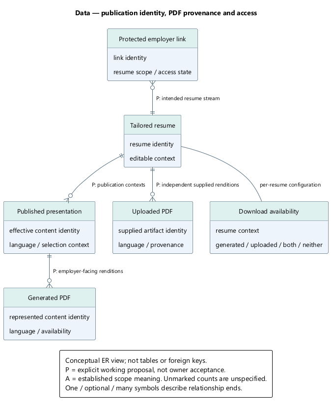 · [Editable PlantUML](Diagrams/Data-publication-pdf-and-sharing.puml)

A link targets the intended resume/published presentation context; it is not hard-pinned to an actual submitted document. Effective publication and language are resolved under reviewed rules at retrieval. Employer-facing generated PDFs identify represented published content. Clearly labeled private draft previews can have separate draft provenance under Q-D10; this picture does not exclude them.

**Bounds and status:** P refines Q-D10/Q-D11. Zero published contexts allow never-published drafts; many denotes distinguishable publication events, not mandatory permanent retention. The diagram does not choose an effective-publication pointer or a universal single current language revision. Link multiplicity, expiry, configuration initialization and historical retention remain proposed. No extra grant follows a configuration or artifact association.

**Primary basis:** [PRP-D04](../02-Requirements-engineering/01-Software-requirements-specification.md#requirements-specification-profiles-resumes-and-portfolio--heading-prp-d04-explicit-shared-source-update-rules), [PRP-D08](../02-Requirements-engineering/01-Software-requirements-specification.md#requirements-specification-profiles-resumes-and-portfolio--heading-prp-d08-clear-presentation-and-rendition-boundaries), [PDF-D01](../02-Requirements-engineering/01-Software-requirements-specification.md#requirements-specification-pdf-and-controlled-sharing--heading-pdf-d01-generated-resume-pdf), [PDF-D02](../02-Requirements-engineering/01-Software-requirements-specification.md#requirements-specification-pdf-and-controlled-sharing--heading-pdf-d02-uploaded-pdf-and-language-identity), [PDF-D03](../02-Requirements-engineering/01-Software-requirements-specification.md#requirements-specification-pdf-and-controlled-sharing--heading-pdf-d03-per-resume-download-choices), [PDF-D04](../02-Requirements-engineering/01-Software-requirements-specification.md#requirements-specification-pdf-and-controlled-sharing--heading-pdf-d04-scoped-password-protected-employer-access), [PDF-D05](../02-Requirements-engineering/01-Software-requirements-specification.md#requirements-specification-pdf-and-controlled-sharing--heading-pdf-d05-direct-file-and-pdf-authorization), [PDF-D07](../02-Requirements-engineering/01-Software-requirements-specification.md#requirements-specification-pdf-and-controlled-sharing--heading-pdf-d07-explicit-live-revision-and-rendition-behavior).

###### 2.5 application preparation and actual submission records

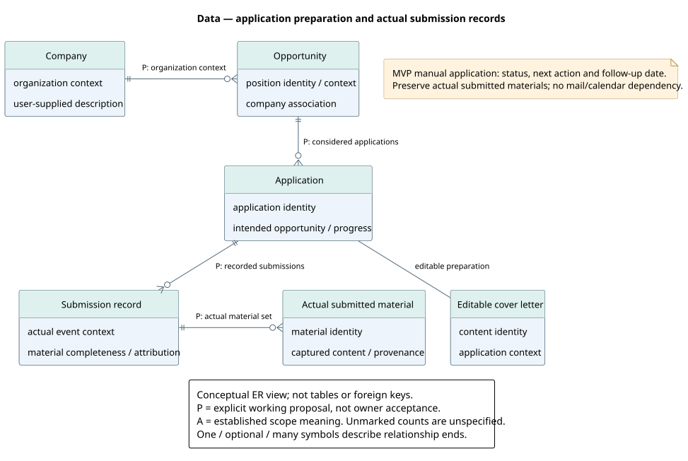

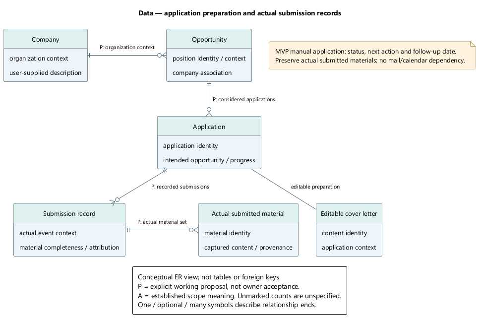 · [Editable PlantUML](Diagrams/Data-applications-and-actual-material.puml)

An application can refer to its intended editable resume/cover letter, but the submitted set identifies actual material. User-recorded submission, complete captured material and external receipt are different claims. Material provenance may be an actual upload or the exact generated rendition confirmed as submitted.

**Bounds and status:** P follows Q-D12–Q-D14. Multiple submission events/corrections are distinguishable; zero captured materials permits an explicitly incomplete record, never a successful preserved-copy claim. Cover-letter identity/count and optional association during drafts remain under primary policy. Captured bytes or exact preserved content cannot later resolve through a mutable current-resume link.

**Primary basis:** [APP-D01](../02-Requirements-engineering/01-Software-requirements-specification.md#requirements-specification-manual-application-management--heading-app-d01-company-and-opportunity-context), [APP-D02](../02-Requirements-engineering/01-Software-requirements-specification.md#requirements-specification-manual-application-management--heading-app-d02-relevant-resume-association), [APP-D03](../02-Requirements-engineering/01-Software-requirements-specification.md#requirements-specification-manual-application-management--heading-app-d03-manually-authored-cover-letter), [APP-D04](../02-Requirements-engineering/01-Software-requirements-specification.md#requirements-specification-manual-application-management--heading-app-d04-explicit-progress-states-and-transitions), [APP-D05](../02-Requirements-engineering/01-Software-requirements-specification.md#requirements-specification-manual-application-management--heading-app-d05-user-directed-submission-recording), [APP-D06](../02-Requirements-engineering/01-Software-requirements-specification.md#requirements-specification-manual-application-management--heading-app-d06-preserved-actual-submitted-copies), [APP-D07](../02-Requirements-engineering/01-Software-requirements-specification.md#requirements-specification-manual-application-management--heading-app-d07-correction-and-repeated-submissions), [APP-D09](../02-Requirements-engineering/01-Software-requirements-specification.md#requirements-specification-manual-application-management--heading-app-d09-private-access-archive-and-recovery).

###### 2.6 provider identities and local associations

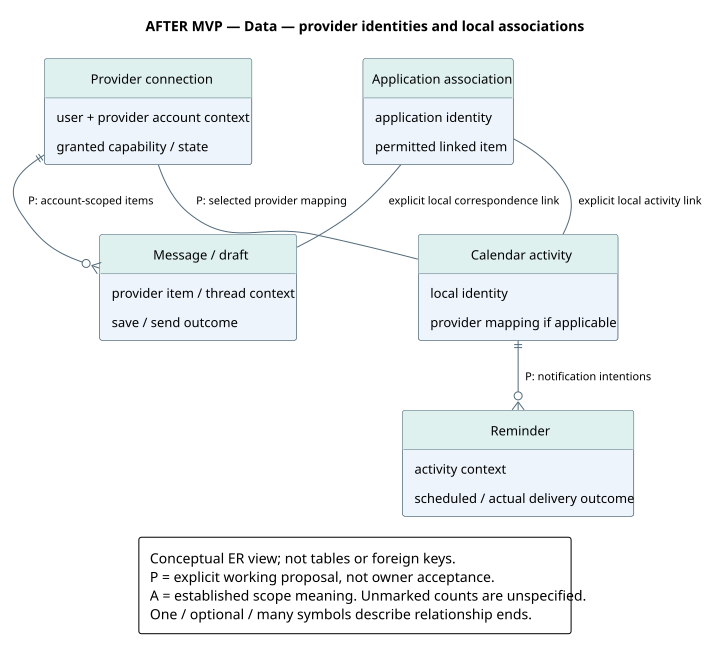

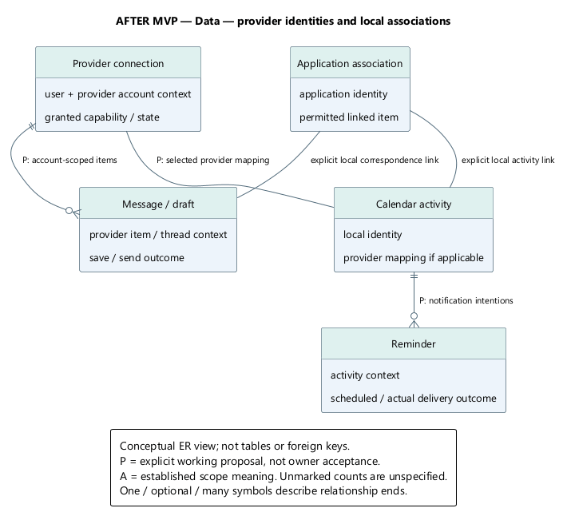 · [Editable PlantUML](Diagrams/Data-provider-and-calendar-context.puml)

Provider item identity is scoped to its intended provider/account/type. Local notes and application associations are not provider-owned fields or access grants. Local-only activities have no invented provider identity. A request outcome may remain unknown after a timeout; absence of confirmation is not proof of a failed external effect.

**Bounds and status:** P follows Q-D15–Q-D17. Selected calendar mapping, local/provider field authority, reconnect and retention rules remain proposed. No one-to-one provider mapping is asserted where not decided. OAuth is not created; no real token, message or provider access is established by this view.

**Primary basis:** [EGC-D01](../02-Requirements-engineering/01-Software-requirements-specification.md#requirements-specification-email-calendar-and-google-integration--heading-egc-d01-authorized-connection-and-account-context), [EGC-D02](../02-Requirements-engineering/01-Software-requirements-specification.md#requirements-specification-email-calendar-and-google-integration--heading-egc-d02-justified-permissions-and-private-resource-isolation), [EGC-D05](../02-Requirements-engineering/01-Software-requirements-specification.md#requirements-specification-email-calendar-and-google-integration--heading-egc-d05-deliberate-send-and-truthful-outcome), [EGC-D07](../02-Requirements-engineering/01-Software-requirements-specification.md#requirements-specification-email-calendar-and-google-integration--heading-egc-d07-calendar-activities-and-time-meaning), [EGC-D08](../02-Requirements-engineering/01-Software-requirements-specification.md#requirements-specification-email-calendar-and-google-integration--heading-egc-d08-explicit-synchronization-contract), [EGC-D09](../02-Requirements-engineering/01-Software-requirements-specification.md#requirements-specification-email-calendar-and-google-integration--heading-egc-d09-application-relationships-preserve-boundaries), [EGC-D10](../02-Requirements-engineering/01-Software-requirements-specification.md#requirements-specification-email-calendar-and-google-integration--heading-egc-d10-reminders-and-notification-outcomes), [EGC-D11](../02-Requirements-engineering/01-Software-requirements-specification.md#requirements-specification-email-calendar-and-google-integration--heading-egc-d11-disconnect-revocation-and-reconnect), [EGC-D12](../02-Requirements-engineering/01-Software-requirements-specification.md#requirements-specification-email-calendar-and-google-integration--heading-egc-d12-bounded-failures-recovery-and-feasibility-evidence).

###### 2.7 work identities and one coherent Sprint Backlog

**After MVP.** Shared operating and recovery controls still apply where relevant.

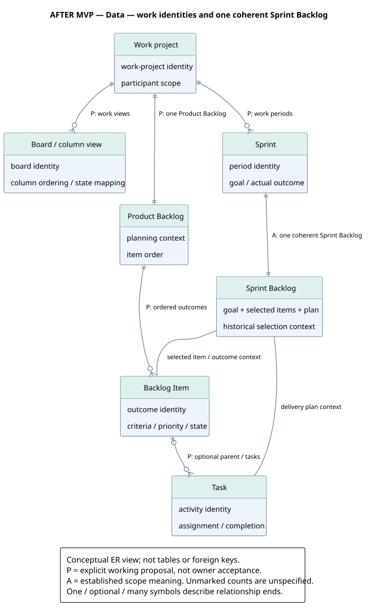

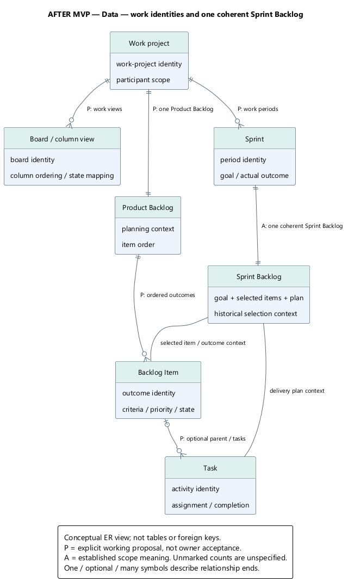 · [Editable PlantUML](Diagrams/Data-work-and-sprint-planning.puml)

Item identity and Sprint selection/history are distinct. Historical selection must not be reconstructed solely from whichever Sprint currently displays the item. A board/column is a view organization; its label does not establish item acceptance. Sprint Goal, selected outcomes and plan comprise one Sprint Backlog, not three competing backlogs.

**Bounds and status:** A preserves DEC-021. P follows Q-D18/Q-D19: one Product Backlog per work project, optional standalone tasks and a single parent item per task. Selection across repeated Sprints is modeled as contextual history, so no unsupported global item-to-Sprint cardinality is drawn. Fixed cadence and active-Sprint count are not accepted here.

**Primary basis:** [PKS-D01](../02-Requirements-engineering/01-Software-requirements-specification.md#requirements-specification-projects-kanban-and-sprints--heading-pks-d01-project-and-board-context), [PKS-D02](../02-Requirements-engineering/01-Software-requirements-specification.md#requirements-specification-projects-kanban-and-sprints--heading-pks-d02-configurable-columns-and-valid-work-movement), [PKS-D03](../02-Requirements-engineering/01-Software-requirements-specification.md#requirements-specification-projects-kanban-and-sprints--heading-pks-d03-product-backlog-and-item-definition), [PKS-D04](../02-Requirements-engineering/01-Software-requirements-specification.md#requirements-specification-projects-kanban-and-sprints--heading-pks-d04-item-refinement-and-task-relationships), [PKS-D05](../02-Requirements-engineering/01-Software-requirements-specification.md#requirements-specification-projects-kanban-and-sprints--heading-pks-d05-assignment-priority-and-due-date-handling), [PKS-D07](../02-Requirements-engineering/01-Software-requirements-specification.md#requirements-specification-projects-kanban-and-sprints--heading-pks-d07-sprint-goal-and-selected-backlog-items), [PKS-D08](../02-Requirements-engineering/01-Software-requirements-specification.md#requirements-specification-projects-kanban-and-sprints--heading-pks-d08-one-coherent-sprint-backlog), [PKS-D09](../02-Requirements-engineering/01-Software-requirements-specification.md#requirements-specification-projects-kanban-and-sprints--heading-pks-d09-explicit-completion-and-sprint-end-outcomes), [PKS-D10](../02-Requirements-engineering/01-Software-requirements-specification.md#requirements-specification-projects-kanban-and-sprints--heading-pks-d10-deliberate-cross-module-links-reports-and-automation).

###### 2.8 repository identity and evaluated Git context

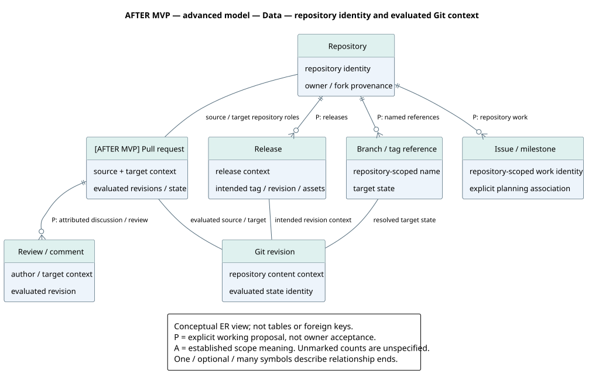

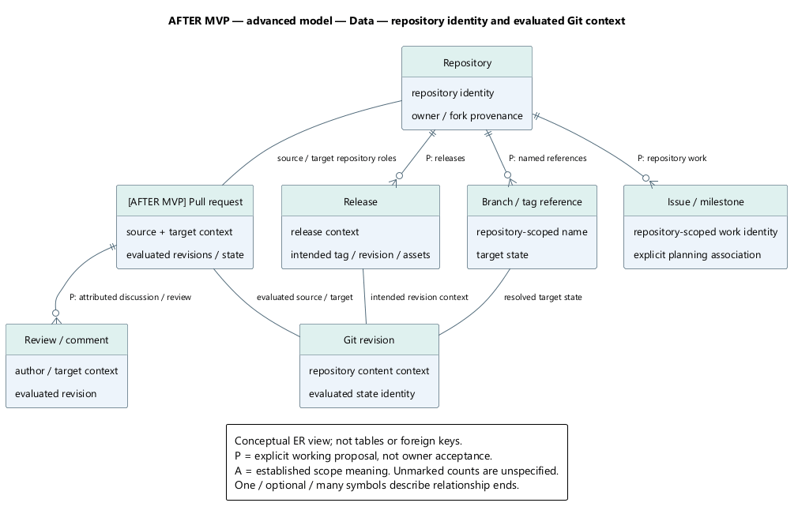 · [Editable PlantUML](Diagrams/Data-git-revisions-and-collaboration.puml)

A ref name and an evaluated content revision are different data. Source and target role names must retain repository and revision context; a name alone cannot identify a reviewed change. Issue/milestone are grouped only to keep this conceptual picture compact; their separate meanings and domain IDs remain in document 03.

**Bounds and status:** P follows Q-D21/Q-D22. Fork is an explicitly related repository, not implicit shared permission. Review validity after a source/target change and release mutation are detailed policy. No Git object schema, engine, transport, revision-string format or physical duplication strategy is selected.

**Primary basis:** [GIT-D01](../02-Requirements-engineering/01-Software-requirements-specification.md#requirements-specification-git-hosting-and-collaboration--heading-git-d01-repository-creation-and-ownership), [GIT-D02](../02-Requirements-engineering/01-Software-requirements-specification.md#requirements-specification-git-hosting-and-collaboration--heading-git-d02-repository-and-ref-authorization), [GIT-D04](../02-Requirements-engineering/01-Software-requirements-specification.md#requirements-specification-git-hosting-and-collaboration--heading-git-d04-branches-files-and-history-browsing), [GIT-D05](../02-Requirements-engineering/01-Software-requirements-specification.md#requirements-specification-git-hosting-and-collaboration--heading-git-d05-fork-provenance-and-permission-boundaries), [GIT-D06](../02-Requirements-engineering/01-Software-requirements-specification.md#requirements-specification-git-hosting-and-collaboration--heading-git-d06-pull-requests-comments-and-review), [GIT-D07](../02-Requirements-engineering/01-Software-requirements-specification.md#requirements-specification-git-hosting-and-collaboration--heading-git-d07-controlled-merge-and-conflict-outcomes), [GIT-D08](../02-Requirements-engineering/01-Software-requirements-specification.md#requirements-specification-git-hosting-and-collaboration--heading-git-d08-issues-and-milestones), [GIT-D09](../02-Requirements-engineering/01-Software-requirements-specification.md#requirements-specification-git-hosting-and-collaboration--heading-git-d09-tags-and-releases), [GIT-D10](../02-Requirements-engineering/01-Software-requirements-specification.md#requirements-specification-git-hosting-and-collaboration--heading-git-d10-lifecycle-capacity-and-recovery).

###### 2.9 run provenance, attempts and deployment approval

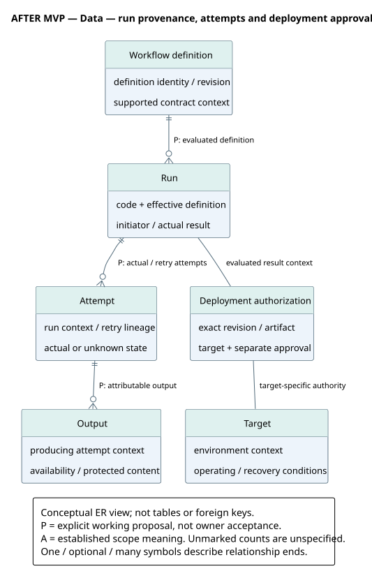

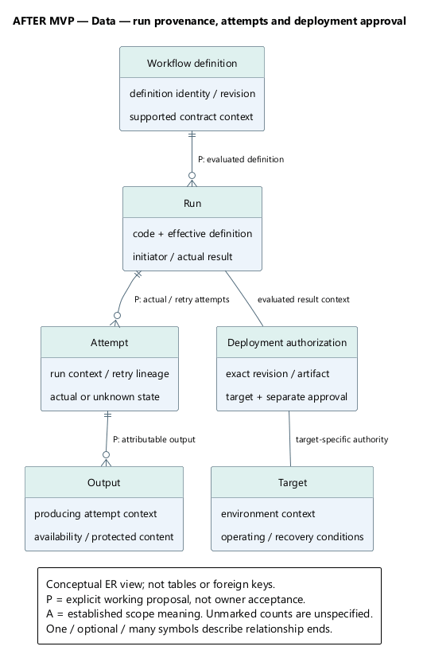 · [Editable PlantUML](Diagrams/Data-execution-provenance-and-targets.puml)

Code revision and definition revision are identified at the evaluated execution context, not by later reading a moving branch. Request, attempt, output availability and external deployment effect remain distinct information. Secret-use scope may be recorded as protected authority metadata; no secret values belong in this document or ordinary logs.

**Bounds and status:** P follows the Q-D23 proposal; a queued request can have no started attempt and an attempt can have no usable output. Retry lineage does not erase earlier unknown outcomes. Exact attempt/job/step decomposition and approval counts remain design/policy work. Isolation and capacity are not established by these relationships.

**Primary basis:** [YML-D01](../02-Requirements-engineering/01-Software-requirements-specification.md#requirements-specification-yaml-workflows-and-cicd--heading-yml-d01-defined-supported-workflow-contract), [YML-D02](../02-Requirements-engineering/01-Software-requirements-specification.md#requirements-specification-yaml-workflows-and-cicd--heading-yml-d02-explicit-triggers-and-run-authority), [YML-D03](../02-Requirements-engineering/01-Software-requirements-specification.md#requirements-specification-yaml-workflows-and-cicd--heading-yml-d03-run-identity-and-reproducible-context), [YML-D05](../02-Requirements-engineering/01-Software-requirements-specification.md#requirements-specification-yaml-workflows-and-cicd--heading-yml-d05-scoped-secrets-and-credentials), [YML-D07](../02-Requirements-engineering/01-Software-requirements-specification.md#requirements-specification-yaml-workflows-and-cicd--heading-yml-d07-truthful-run-and-step-outcomes), [YML-D08](../02-Requirements-engineering/01-Software-requirements-specification.md#requirements-specification-yaml-workflows-and-cicd--heading-yml-d08-restricted-logs-and-artifacts), [YML-D09](../02-Requirements-engineering/01-Software-requirements-specification.md#requirements-specification-yaml-workflows-and-cicd--heading-yml-d09-cancellation-retry-and-runner-loss-recovery), [YML-D10](../02-Requirements-engineering/01-Software-requirements-specification.md#requirements-specification-yaml-workflows-and-cicd--heading-yml-d10-separate-controlled-deployment-stage), [YML-D11](../02-Requirements-engineering/01-Software-requirements-specification.md#requirements-specification-yaml-workflows-and-cicd--heading-yml-d11-workspace-cleanup-and-retained-evidence), [YML-D12](../02-Requirements-engineering/01-Software-requirements-specification.md#requirements-specification-yaml-workflows-and-cicd--heading-yml-d12-feasibility-operational-guidance-and-enabling-gate).

###### 2.10 contextual access, effective policy and recovery coverage

 · [Editable PlantUML](Diagrams/Data-authority-policy-and-recovery.puml)

Authority is contextual information rather than a universal owner/admin hierarchy. Protected file/content is a logical meaning; repositories, mail attachments, job outputs and resume media need their own applicability/accounting. Recovery coverage includes related records, repositories, files and required configuration, not only the file example drawn.

**Bounds and status:** P refines Q-D24/Q-D26. No universal grant-count, quota pool, retention duration or backup topology is inferred. A recovery record is not proof of a usable restore; current access/deletion decisions and external-state effects must be reconciled. Backups are not configured.

**Primary basis:** [ACC-D03](../02-Requirements-engineering/01-Software-requirements-specification.md#requirements-specification-accounts-authentication-and-permissions--heading-acc-d03-resource-and-operation-authorization), [ACC-D04](../02-Requirements-engineering/01-Software-requirements-specification.md#requirements-specification-accounts-authentication-and-permissions--heading-acc-d04-cross-user-private-data-isolation), [ACC-D05](../02-Requirements-engineering/01-Software-requirements-specification.md#requirements-specification-accounts-authentication-and-permissions--heading-acc-d05-limited-collaboration-authority), [ACC-D09](../02-Requirements-engineering/01-Software-requirements-specification.md#requirements-specification-accounts-authentication-and-permissions--heading-acc-d09-explicit-administrative-powers), [ACC-D10](../02-Requirements-engineering/01-Software-requirements-specification.md#requirements-specification-accounts-authentication-and-permissions--heading-acc-d10-authorization-of-access-grant-changes), [ACC-D12](../02-Requirements-engineering/01-Software-requirements-specification.md#requirements-specification-accounts-authentication-and-permissions--heading-acc-d12-end-of-access-and-lifecycle-enforcement), [AFO-D01](../02-Requirements-engineering/01-Software-requirements-specification.md#requirements-specification-administration-files-and-operational-behavior--heading-afo-d01-owner-configurable-upload-and-storage-policy), [AFO-D02](../02-Requirements-engineering/01-Software-requirements-specification.md#requirements-specification-administration-files-and-operational-behavior--heading-afo-d02-policy-consistent-with-evaluated-infrastructure), [AFO-D04](../02-Requirements-engineering/01-Software-requirements-specification.md#requirements-specification-administration-files-and-operational-behavior--heading-afo-d04-aggregate-quota-and-concurrent-admission), [AFO-D06](../02-Requirements-engineering/01-Software-requirements-specification.md#requirements-specification-administration-files-and-operational-behavior--heading-afo-d06-file-resource-authorization-and-isolation), [AFO-D07](../02-Requirements-engineering/01-Software-requirements-specification.md#requirements-specification-administration-files-and-operational-behavior--heading-afo-d07-truthful-completion-and-interrupted-operation-handling), [AFO-D08](../02-Requirements-engineering/01-Software-requirements-specification.md#requirements-specification-administration-files-and-operational-behavior--heading-afo-d08-safe-replacement-and-lifecycle-effects), [QSR-D10](../02-Requirements-engineering/01-Software-requirements-specification.md#requirements-specification-quality-security-and-recovery-requirements--heading-qsr-d10-defined-protected-and-observable-backups), [QSR-D11](../02-Requirements-engineering/01-Software-requirements-specification.md#requirements-specification-quality-security-and-recovery-requirements--heading-qsr-d11-demonstrated-restoration-and-recovery-targets), [QSR-D12](../02-Requirements-engineering/01-Software-requirements-specification.md#requirements-specification-quality-security-and-recovery-requirements--heading-qsr-d12-safe-restored-access-and-external-state-reconciliation), [QSR-D13](../02-Requirements-engineering/01-Software-requirements-specification.md#requirements-specification-quality-security-and-recovery-requirements--heading-qsr-d13-useful-restricted-operational-evidence).

##### 3. Data Catalogue and Flow Meaning

###### 3.1 Dictionary-to-Domain Reconciliation

All 34 existing dictionary subject keys map to all 53 concepts in document 03. Grouping is deliberate: one dictionary subject can refine into several information subjects, while a domain concept can have contextual representations. This is not a one-class/one-table mapping. Application-progress, for example, refines information carried in application history without requiring a new domain class.

The catalog identifies semantic information, not a mandatory field list. Requiredness and authority depend on the claim/lifecycle in sections 4–6. Dictionary links retain each subject's primary meaning; the local IDs only support navigation within this view.

**Local subject / dictionary authority:** DA-S01 — [User account](../02-Requirements-engineering/01-Software-requirements-specification.md#data-definitions-data-dictionary--id-account)

**Conceptual information and identity context:** Identity context; access state. Subject identity is distinguished from mutable names, revisions and authority under section 4.

**Domain references / exact primary basis:** [DM-C47](#analysis-domain-and-information-analysis--03-domain-model-and-object-oriented-view--id-dm-c47); [ACC-D01](../02-Requirements-engineering/01-Software-requirements-specification.md#requirements-specification-accounts-authentication-and-permissions--heading-acc-d01-individual-account-context), [ACC-D02](../02-Requirements-engineering/01-Software-requirements-specification.md#requirements-specification-accounts-authentication-and-permissions--heading-acc-d02-unified-sign-in-across-authorized-sections), [ACC-D12](../02-Requirements-engineering/01-Software-requirements-specification.md#requirements-specification-accounts-authentication-and-permissions--heading-acc-d12-end-of-access-and-lifecycle-enforcement)

**Local subject / dictionary authority:** DA-S02 — [Role and permission](../02-Requirements-engineering/01-Software-requirements-specification.md#data-definitions-data-dictionary--id-role-permission)

**Conceptual information and identity context:** Subject; resource; allowed action/state. Subject identity is distinguished from mutable names, revisions and authority under section 4.

**Domain references / exact primary basis:** [DM-C48](#analysis-domain-and-information-analysis--03-domain-model-and-object-oriented-view--id-dm-c48); [ACC-D03](../02-Requirements-engineering/01-Software-requirements-specification.md#requirements-specification-accounts-authentication-and-permissions--heading-acc-d03-resource-and-operation-authorization), [ACC-D05](../02-Requirements-engineering/01-Software-requirements-specification.md#requirements-specification-accounts-authentication-and-permissions--heading-acc-d05-limited-collaboration-authority), [ACC-D09](../02-Requirements-engineering/01-Software-requirements-specification.md#requirements-specification-accounts-authentication-and-permissions--heading-acc-d09-explicit-administrative-powers), [ACC-D10](../02-Requirements-engineering/01-Software-requirements-specification.md#requirements-specification-accounts-authentication-and-permissions--heading-acc-d10-authorization-of-access-grant-changes)

**Local subject / dictionary authority:** DA-S03 — [Invitation or membership](../02-Requirements-engineering/01-Software-requirements-specification.md#data-definitions-data-dictionary--id-collaboration-grant)

**Conceptual information and identity context:** Subject; resource; allowed action/state. Subject identity is distinguished from mutable names, revisions and authority under section 4.

**Domain references / exact primary basis:** [DM-C48](#analysis-domain-and-information-analysis--03-domain-model-and-object-oriented-view--id-dm-c48); [ACC-D03](../02-Requirements-engineering/01-Software-requirements-specification.md#requirements-specification-accounts-authentication-and-permissions--heading-acc-d03-resource-and-operation-authorization), [ACC-D05](../02-Requirements-engineering/01-Software-requirements-specification.md#requirements-specification-accounts-authentication-and-permissions--heading-acc-d05-limited-collaboration-authority), [ACC-D09](../02-Requirements-engineering/01-Software-requirements-specification.md#requirements-specification-accounts-authentication-and-permissions--heading-acc-d09-explicit-administrative-powers), [ACC-D10](../02-Requirements-engineering/01-Software-requirements-specification.md#requirements-specification-accounts-authentication-and-permissions--heading-acc-d10-authorization-of-access-grant-changes)

**Local subject / dictionary authority:** DA-S04 — [External account connection](../02-Requirements-engineering/01-Software-requirements-specification.md#data-definitions-data-dictionary--id-provider-connection)

**Conceptual information and identity context:** Provider identity; access state. Subject identity is distinguished from mutable names, revisions and authority under section 4.

**Domain references / exact primary basis:** [DM-C20](#analysis-domain-and-information-analysis--03-domain-model-and-object-oriented-view--id-dm-c20); [EGC-D01](../02-Requirements-engineering/01-Software-requirements-specification.md#requirements-specification-email-calendar-and-google-integration--heading-egc-d01-authorized-connection-and-account-context), [EGC-D02](../02-Requirements-engineering/01-Software-requirements-specification.md#requirements-specification-email-calendar-and-google-integration--heading-egc-d02-justified-permissions-and-private-resource-isolation), [EGC-D11](../02-Requirements-engineering/01-Software-requirements-specification.md#requirements-specification-email-calendar-and-google-integration--heading-egc-d11-disconnect-revocation-and-reconnect)

**Local subject / dictionary authority:** DA-S05 — [Profile](../02-Requirements-engineering/01-Software-requirements-specification.md#data-definitions-data-dictionary--id-professional-profile)

**Conceptual information and identity context:** Professional sections; source context; Category; professional meaning. Subject identity is distinguished from mutable names, revisions and authority under section 4.

**Domain references / exact primary basis:** [DM-C01](#analysis-domain-and-information-analysis--03-domain-model-and-object-oriented-view--id-dm-c01), [DM-C02](#analysis-domain-and-information-analysis--03-domain-model-and-object-oriented-view--id-dm-c02); [PRP-D01](../02-Requirements-engineering/01-Software-requirements-specification.md#requirements-specification-profiles-resumes-and-portfolio--heading-prp-d01-reusable-professional-information), [PRP-D04](../02-Requirements-engineering/01-Software-requirements-specification.md#requirements-specification-profiles-resumes-and-portfolio--heading-prp-d04-explicit-shared-source-update-rules), [PRP-D05](../02-Requirements-engineering/01-Software-requirements-specification.md#requirements-specification-profiles-resumes-and-portfolio--heading-prp-d05-skill-and-project-evidence-management)

**Local subject / dictionary authority:** DA-S06 — [Resume](../02-Requirements-engineering/01-Software-requirements-specification.md#data-definitions-data-dictionary--id-tailored-resume)

**Conceptual information and identity context:** Content selection; layout; tailoring context; Source reference; inclusion/order; Target content; independent value; Effective content/revision context. Subject identity is distinguished from mutable names, revisions and authority under section 4.

**Domain references / exact primary basis:** [DM-C03](#analysis-domain-and-information-analysis--03-domain-model-and-object-oriented-view--id-dm-c03), [DM-C04](#analysis-domain-and-information-analysis--03-domain-model-and-object-oriented-view--id-dm-c04), [DM-C05](#analysis-domain-and-information-analysis--03-domain-model-and-object-oriented-view--id-dm-c05), [DM-C09](#analysis-domain-and-information-analysis--03-domain-model-and-object-oriented-view--id-dm-c09); [PRP-D02](../02-Requirements-engineering/01-Software-requirements-specification.md#requirements-specification-profiles-resumes-and-portfolio--heading-prp-d02-opportunity-specific-resume-composition), [PRP-D03](../02-Requirements-engineering/01-Software-requirements-specification.md#requirements-specification-profiles-resumes-and-portfolio--heading-prp-d03-independent-selections-layouts-and-overrides), [PRP-D04](../02-Requirements-engineering/01-Software-requirements-specification.md#requirements-specification-profiles-resumes-and-portfolio--heading-prp-d04-explicit-shared-source-update-rules), [PRP-D08](../02-Requirements-engineering/01-Software-requirements-specification.md#requirements-specification-profiles-resumes-and-portfolio--heading-prp-d08-clear-presentation-and-rendition-boundaries), [PDF-D07](../02-Requirements-engineering/01-Software-requirements-specification.md#requirements-specification-pdf-and-controlled-sharing--heading-pdf-d07-explicit-live-revision-and-rendition-behavior)

**Local subject / dictionary authority:** DA-S07 — [Supporting evidence](../02-Requirements-engineering/01-Software-requirements-specification.md#data-definitions-data-dictionary--id-professional-evidence)

**Conceptual information and identity context:** Category; supporting association; content reference; Selected evidence; disclosure intent. Subject identity is distinguished from mutable names, revisions and authority under section 4.

**Domain references / exact primary basis:** [DM-C06](#analysis-domain-and-information-analysis--03-domain-model-and-object-oriented-view--id-dm-c06), [DM-C07](#analysis-domain-and-information-analysis--03-domain-model-and-object-oriented-view--id-dm-c07); [PRP-D05](../02-Requirements-engineering/01-Software-requirements-specification.md#requirements-specification-profiles-resumes-and-portfolio--heading-prp-d05-skill-and-project-evidence-management), [PRP-D09](../02-Requirements-engineering/01-Software-requirements-specification.md#requirements-specification-profiles-resumes-and-portfolio--heading-prp-d09-safe-content-admission-and-truthful-save-outcomes), [PRP-D06](../02-Requirements-engineering/01-Software-requirements-specification.md#requirements-specification-profiles-resumes-and-portfolio--heading-prp-d06-per-resume-evidence-selection-and-disclosure)

**Local subject / dictionary authority:** DA-S08 — [Language-specific content](../02-Requirements-engineering/01-Software-requirements-specification.md#data-definitions-data-dictionary--id-content-language)

**Conceptual information and identity context:** Language; authored text; context. Subject identity is distinguished from mutable names, revisions and authority under section 4.

**Domain references / exact primary basis:** [DM-C08](#analysis-domain-and-information-analysis--03-domain-model-and-object-oriented-view--id-dm-c08); [PRP-D07](../02-Requirements-engineering/01-Software-requirements-specification.md#requirements-specification-profiles-resumes-and-portfolio--heading-prp-d07-manually-maintained-english-and-german-content)

**Local subject / dictionary authority:** DA-S09 — [Generated resume PDF](../02-Requirements-engineering/01-Software-requirements-specification.md#data-definitions-data-dictionary--id-generated-pdf)

**Conceptual information and identity context:** Represented content; language; availability. Subject identity is distinguished from mutable names, revisions and authority under section 4.

**Domain references / exact primary basis:** [DM-C10](#analysis-domain-and-information-analysis--03-domain-model-and-object-oriented-view--id-dm-c10); [PDF-D01](../02-Requirements-engineering/01-Software-requirements-specification.md#requirements-specification-pdf-and-controlled-sharing--heading-pdf-d01-generated-resume-pdf), [PDF-D07](../02-Requirements-engineering/01-Software-requirements-specification.md#requirements-specification-pdf-and-controlled-sharing--heading-pdf-d07-explicit-live-revision-and-rendition-behavior)

**Local subject / dictionary authority:** DA-S10 — [Uploaded resume PDF](../02-Requirements-engineering/01-Software-requirements-specification.md#data-definitions-data-dictionary--id-uploaded-pdf)

**Conceptual information and identity context:** Artifact identity; language; availability. Subject identity is distinguished from mutable names, revisions and authority under section 4.

**Domain references / exact primary basis:** [DM-C11](#analysis-domain-and-information-analysis--03-domain-model-and-object-oriented-view--id-dm-c11); [PDF-D02](../02-Requirements-engineering/01-Software-requirements-specification.md#requirements-specification-pdf-and-controlled-sharing--heading-pdf-d02-uploaded-pdf-and-language-identity), [PDF-D09](../02-Requirements-engineering/01-Software-requirements-specification.md#requirements-specification-pdf-and-controlled-sharing--heading-pdf-d09-failure-safe-processing-and-content-handling)

**Local subject / dictionary authority:** DA-S11 — [PDF download availability](../02-Requirements-engineering/01-Software-requirements-specification.md#data-definitions-data-dictionary--id-download-choice)

**Conceptual information and identity context:** Mode; language eligibility. Subject identity is distinguished from mutable names, revisions and authority under section 4.

**Domain references / exact primary basis:** [DM-C12](#analysis-domain-and-information-analysis--03-domain-model-and-object-oriented-view--id-dm-c12); [PDF-D03](../02-Requirements-engineering/01-Software-requirements-specification.md#requirements-specification-pdf-and-controlled-sharing--heading-pdf-d03-per-resume-download-choices)

**Local subject / dictionary authority:** DA-S12 — [Protected sharing link](../02-Requirements-engineering/01-Software-requirements-specification.md#data-definitions-data-dictionary--id-employer-link)

**Conceptual information and identity context:** Target context; access state; credential control. Subject identity is distinguished from mutable names, revisions and authority under section 4.

**Domain references / exact primary basis:** [DM-C13](#analysis-domain-and-information-analysis--03-domain-model-and-object-oriented-view--id-dm-c13); [PDF-D04](../02-Requirements-engineering/01-Software-requirements-specification.md#requirements-specification-pdf-and-controlled-sharing--heading-pdf-d04-scoped-password-protected-employer-access), [PDF-D06](../02-Requirements-engineering/01-Software-requirements-specification.md#requirements-specification-pdf-and-controlled-sharing--heading-pdf-d06-owner-password-and-link-controls)

**Local subject / dictionary authority:** DA-S13 — [Company and opportunity](../02-Requirements-engineering/01-Software-requirements-specification.md#data-definitions-data-dictionary--id-company-opportunity)

**Conceptual information and identity context:** Organization context; supplied details; Role context; source/deadline details. Subject identity is distinguished from mutable names, revisions and authority under section 4.

**Domain references / exact primary basis:** [DM-C14](#analysis-domain-and-information-analysis--03-domain-model-and-object-oriented-view--id-dm-c14), [DM-C15](#analysis-domain-and-information-analysis--03-domain-model-and-object-oriented-view--id-dm-c15); [APP-D01](../02-Requirements-engineering/01-Software-requirements-specification.md#requirements-specification-manual-application-management--heading-app-d01-company-and-opportunity-context)

**Local subject / dictionary authority:** DA-S14 — [Application](../02-Requirements-engineering/01-Software-requirements-specification.md#data-definitions-data-dictionary--id-application-record)

**Conceptual information and identity context:** Progress; intended material associations. Subject identity is distinguished from mutable names, revisions and authority under section 4.

**Domain references / exact primary basis:** [DM-C16](#analysis-domain-and-information-analysis--03-domain-model-and-object-oriented-view--id-dm-c16); [APP-D02](../02-Requirements-engineering/01-Software-requirements-specification.md#requirements-specification-manual-application-management--heading-app-d02-relevant-resume-association), [APP-D04](../02-Requirements-engineering/01-Software-requirements-specification.md#requirements-specification-manual-application-management--heading-app-d04-explicit-progress-states-and-transitions), [APP-D05](../02-Requirements-engineering/01-Software-requirements-specification.md#requirements-specification-manual-application-management--heading-app-d05-user-directed-submission-recording)

**Local subject / dictionary authority:** DA-S15 — [Cover letter](../02-Requirements-engineering/01-Software-requirements-specification.md#data-definitions-data-dictionary--id-cover-letter)

**Conceptual information and identity context:** Authored text; revision context. Subject identity is distinguished from mutable names, revisions and authority under section 4.

**Domain references / exact primary basis:** [DM-C17](#analysis-domain-and-information-analysis--03-domain-model-and-object-oriented-view--id-dm-c17); [APP-D03](../02-Requirements-engineering/01-Software-requirements-specification.md#requirements-specification-manual-application-management--heading-app-d03-manually-authored-cover-letter)

**Local subject / dictionary authority:** DA-S16 — [Submitted copies](../02-Requirements-engineering/01-Software-requirements-specification.md#data-definitions-data-dictionary--id-submitted-materials)

**Conceptual information and identity context:** Actual event context; capture completeness; Actual content/artifact; provenance. Subject identity is distinguished from mutable names, revisions and authority under section 4.

**Domain references / exact primary basis:** [DM-C18](#analysis-domain-and-information-analysis--03-domain-model-and-object-oriented-view--id-dm-c18), [DM-C19](#analysis-domain-and-information-analysis--03-domain-model-and-object-oriented-view--id-dm-c19); [APP-D05](../02-Requirements-engineering/01-Software-requirements-specification.md#requirements-specification-manual-application-management--heading-app-d05-user-directed-submission-recording), [APP-D07](../02-Requirements-engineering/01-Software-requirements-specification.md#requirements-specification-manual-application-management--heading-app-d07-correction-and-repeated-submissions), [APP-D06](../02-Requirements-engineering/01-Software-requirements-specification.md#requirements-specification-manual-application-management--heading-app-d06-preserved-actual-submitted-copies), [PDF-D08](../02-Requirements-engineering/01-Software-requirements-specification.md#requirements-specification-pdf-and-controlled-sharing--heading-pdf-d08-downloaded-copy-and-submission-distinctions)

**Local subject / dictionary authority:** DA-S17 — [Status/history](../02-Requirements-engineering/01-Software-requirements-specification.md#data-definitions-data-dictionary--id-application-progress)

**Conceptual information and identity context:** Progress; intended material associations. Subject identity is distinguished from mutable names, revisions and authority under section 4.

**Domain references / exact primary basis:** [DM-C16](#analysis-domain-and-information-analysis--03-domain-model-and-object-oriented-view--id-dm-c16); [APP-D02](../02-Requirements-engineering/01-Software-requirements-specification.md#requirements-specification-manual-application-management--heading-app-d02-relevant-resume-association), [APP-D04](../02-Requirements-engineering/01-Software-requirements-specification.md#requirements-specification-manual-application-management--heading-app-d04-explicit-progress-states-and-transitions), [APP-D05](../02-Requirements-engineering/01-Software-requirements-specification.md#requirements-specification-manual-application-management--heading-app-d05-user-directed-submission-recording)

**Local subject / dictionary authority:** DA-S18 — [Email](../02-Requirements-engineering/01-Software-requirements-specification.md#data-definitions-data-dictionary--id-email-message)

**Conceptual information and identity context:** Message/thread context; content; outcome. Subject identity is distinguished from mutable names, revisions and authority under section 4.

**Domain references / exact primary basis:** [DM-C21](#analysis-domain-and-information-analysis--03-domain-model-and-object-oriented-view--id-dm-c21); [EGC-D03](../02-Requirements-engineering/01-Software-requirements-specification.md#requirements-specification-email-calendar-and-google-integration--heading-egc-d03-read-authorized-correspondence), [EGC-D04](../02-Requirements-engineering/01-Software-requirements-specification.md#requirements-specification-email-calendar-and-google-integration--heading-egc-d04-manual-compose-and-draft-handling), [EGC-D05](../02-Requirements-engineering/01-Software-requirements-specification.md#requirements-specification-email-calendar-and-google-integration--heading-egc-d05-deliberate-send-and-truthful-outcome), [EGC-D06](../02-Requirements-engineering/01-Software-requirements-specification.md#requirements-specification-email-calendar-and-google-integration--heading-egc-d06-reply-context-and-conversation-association)

**Local subject / dictionary authority:** DA-S19 — [Calendar event](../02-Requirements-engineering/01-Software-requirements-specification.md#data-definitions-data-dictionary--id-calendar-activity)

**Conceptual information and identity context:** Time/zone; provider mapping if applicable. Subject identity is distinguished from mutable names, revisions and authority under section 4.

**Domain references / exact primary basis:** [DM-C22](#analysis-domain-and-information-analysis--03-domain-model-and-object-oriented-view--id-dm-c22); [EGC-D07](../02-Requirements-engineering/01-Software-requirements-specification.md#requirements-specification-email-calendar-and-google-integration--heading-egc-d07-calendar-activities-and-time-meaning), [EGC-D08](../02-Requirements-engineering/01-Software-requirements-specification.md#requirements-specification-email-calendar-and-google-integration--heading-egc-d08-explicit-synchronization-contract)

**Local subject / dictionary authority:** DA-S20 — [Reminder](../02-Requirements-engineering/01-Software-requirements-specification.md#data-definitions-data-dictionary--id-activity-reminder)

**Conceptual information and identity context:** Activity; recipient/time; outcome. Subject identity is distinguished from mutable names, revisions and authority under section 4.

**Domain references / exact primary basis:** [DM-C23](#analysis-domain-and-information-analysis--03-domain-model-and-object-oriented-view--id-dm-c23); [EGC-D10](../02-Requirements-engineering/01-Software-requirements-specification.md#requirements-specification-email-calendar-and-google-integration--heading-egc-d10-reminders-and-notification-outcomes)

**Local subject / dictionary authority:** DA-S21 — [Project, board and column](../02-Requirements-engineering/01-Software-requirements-specification.md#data-definitions-data-dictionary--id-project-board)

**Conceptual information and identity context:** Work identity; participant context; Displayed work; column arrangement; Label/order; state mapping meaning. Subject identity is distinguished from mutable names, revisions and authority under section 4.

**Domain references / exact primary basis:** [DM-C24](#analysis-domain-and-information-analysis--03-domain-model-and-object-oriented-view--id-dm-c24), [DM-C25](#analysis-domain-and-information-analysis--03-domain-model-and-object-oriented-view--id-dm-c25), [DM-C26](#analysis-domain-and-information-analysis--03-domain-model-and-object-oriented-view--id-dm-c26); [PKS-D01](../02-Requirements-engineering/01-Software-requirements-specification.md#requirements-specification-projects-kanban-and-sprints--heading-pks-d01-project-and-board-context), [PKS-D06](../02-Requirements-engineering/01-Software-requirements-specification.md#requirements-specification-projects-kanban-and-sprints--heading-pks-d06-scoped-collaboration-and-membership-changes), [PKS-D02](../02-Requirements-engineering/01-Software-requirements-specification.md#requirements-specification-projects-kanban-and-sprints--heading-pks-d02-configurable-columns-and-valid-work-movement)

**Local subject / dictionary authority:** DA-S22 — [Backlog item](../02-Requirements-engineering/01-Software-requirements-specification.md#data-definitions-data-dictionary--id-backlog-item)

**Conceptual information and identity context:** Item ordering; planning context; Outcome; priority; criteria; state. Subject identity is distinguished from mutable names, revisions and authority under section 4.

**Domain references / exact primary basis:** [DM-C27](#analysis-domain-and-information-analysis--03-domain-model-and-object-oriented-view--id-dm-c27), [DM-C28](#analysis-domain-and-information-analysis--03-domain-model-and-object-oriented-view--id-dm-c28); [PKS-D03](../02-Requirements-engineering/01-Software-requirements-specification.md#requirements-specification-projects-kanban-and-sprints--heading-pks-d03-product-backlog-and-item-definition), [PKS-D04](../02-Requirements-engineering/01-Software-requirements-specification.md#requirements-specification-projects-kanban-and-sprints--heading-pks-d04-item-refinement-and-task-relationships), [PKS-D09](../02-Requirements-engineering/01-Software-requirements-specification.md#requirements-specification-projects-kanban-and-sprints--heading-pks-d09-explicit-completion-and-sprint-end-outcomes)

**Local subject / dictionary authority:** DA-S23 — [Task](../02-Requirements-engineering/01-Software-requirements-specification.md#data-definitions-data-dictionary--id-task)

**Conceptual information and identity context:** Activity; assignment; due/state context. Subject identity is distinguished from mutable names, revisions and authority under section 4.

**Domain references / exact primary basis:** [DM-C29](#analysis-domain-and-information-analysis--03-domain-model-and-object-oriented-view--id-dm-c29); [PKS-D04](../02-Requirements-engineering/01-Software-requirements-specification.md#requirements-specification-projects-kanban-and-sprints--heading-pks-d04-item-refinement-and-task-relationships), [PKS-D05](../02-Requirements-engineering/01-Software-requirements-specification.md#requirements-specification-projects-kanban-and-sprints--heading-pks-d05-assignment-priority-and-due-date-handling)

**Local subject / dictionary authority:** DA-S24 — [Sprint and Sprint Backlog](../02-Requirements-engineering/01-Software-requirements-specification.md#data-definitions-data-dictionary--id-sprint-plan)

**Conceptual information and identity context:** Period; lifecycle; outcome; Goal + selected items + plan. Subject identity is distinguished from mutable names, revisions and authority under section 4.

**Domain references / exact primary basis:** [DM-C30](#analysis-domain-and-information-analysis--03-domain-model-and-object-oriented-view--id-dm-c30), [DM-C31](#analysis-domain-and-information-analysis--03-domain-model-and-object-oriented-view--id-dm-c31); [PKS-D07](../02-Requirements-engineering/01-Software-requirements-specification.md#requirements-specification-projects-kanban-and-sprints--heading-pks-d07-sprint-goal-and-selected-backlog-items), [PKS-D09](../02-Requirements-engineering/01-Software-requirements-specification.md#requirements-specification-projects-kanban-and-sprints--heading-pks-d09-explicit-completion-and-sprint-end-outcomes), [PKS-D08](../02-Requirements-engineering/01-Software-requirements-specification.md#requirements-specification-projects-kanban-and-sprints--heading-pks-d08-one-coherent-sprint-backlog)

**Local subject / dictionary authority:** DA-S25 — [Repository](../02-Requirements-engineering/01-Software-requirements-specification.md#data-definitions-data-dictionary--id-git-repository)

**Conceptual information and identity context:** Repository identity; owner context; refs. Subject identity is distinguished from mutable names, revisions and authority under section 4.

**Domain references / exact primary basis:** [DM-C32](#analysis-domain-and-information-analysis--03-domain-model-and-object-oriented-view--id-dm-c32); [GIT-D01](../02-Requirements-engineering/01-Software-requirements-specification.md#requirements-specification-git-hosting-and-collaboration--heading-git-d01-repository-creation-and-ownership), [GIT-D02](../02-Requirements-engineering/01-Software-requirements-specification.md#requirements-specification-git-hosting-and-collaboration--heading-git-d02-repository-and-ref-authorization), [GIT-D03](../02-Requirements-engineering/01-Software-requirements-specification.md#requirements-specification-git-hosting-and-collaboration--heading-git-d03-real-clone-fetch-pull-and-push)

**Local subject / dictionary authority:** DA-S26 — [Branch and tag](../02-Requirements-engineering/01-Software-requirements-specification.md#data-definitions-data-dictionary--id-git-reference)

**Conceptual information and identity context:** Name/kind; target state; Revision identity; content/history. Subject identity is distinguished from mutable names, revisions and authority under section 4.

**Domain references / exact primary basis:** [DM-C34](#analysis-domain-and-information-analysis--03-domain-model-and-object-oriented-view--id-dm-c34), [DM-C33](#analysis-domain-and-information-analysis--03-domain-model-and-object-oriented-view--id-dm-c33); [GIT-D02](../02-Requirements-engineering/01-Software-requirements-specification.md#requirements-specification-git-hosting-and-collaboration--heading-git-d02-repository-and-ref-authorization), [GIT-D04](../02-Requirements-engineering/01-Software-requirements-specification.md#requirements-specification-git-hosting-and-collaboration--heading-git-d04-branches-files-and-history-browsing), [GIT-D09](../02-Requirements-engineering/01-Software-requirements-specification.md#requirements-specification-git-hosting-and-collaboration--heading-git-d09-tags-and-releases), [YML-D03](../02-Requirements-engineering/01-Software-requirements-specification.md#requirements-specification-yaml-workflows-and-cicd--heading-yml-d03-run-identity-and-reproducible-context)

**Local subject / dictionary authority:** DA-S27 — [Pull request/review](../02-Requirements-engineering/01-Software-requirements-specification.md#data-definitions-data-dictionary--id-pull-request)

**Conceptual information and identity context:** Source/target; evaluation context; state; Author; reviewed context; decision/content. Subject identity is distinguished from mutable names, revisions and authority under section 4.

**Domain references / exact primary basis:** [DM-C35](#analysis-domain-and-information-analysis--03-domain-model-and-object-oriented-view--id-dm-c35), [DM-C36](#analysis-domain-and-information-analysis--03-domain-model-and-object-oriented-view--id-dm-c36); [GIT-D06](../02-Requirements-engineering/01-Software-requirements-specification.md#requirements-specification-git-hosting-and-collaboration--heading-git-d06-pull-requests-comments-and-review), [GIT-D07](../02-Requirements-engineering/01-Software-requirements-specification.md#requirements-specification-git-hosting-and-collaboration--heading-git-d07-controlled-merge-and-conflict-outcomes)

**Local subject / dictionary authority:** DA-S28 — [Issue and milestone](../02-Requirements-engineering/01-Software-requirements-specification.md#data-definitions-data-dictionary--id-repository-planning)

**Conceptual information and identity context:** Repository context; issue state; Checkpoint; related issue context. Subject identity is distinguished from mutable names, revisions and authority under section 4.

**Domain references / exact primary basis:** [DM-C37](#analysis-domain-and-information-analysis--03-domain-model-and-object-oriented-view--id-dm-c37), [DM-C38](#analysis-domain-and-information-analysis--03-domain-model-and-object-oriented-view--id-dm-c38); [GIT-D08](../02-Requirements-engineering/01-Software-requirements-specification.md#requirements-specification-git-hosting-and-collaboration--heading-git-d08-issues-and-milestones)

**Local subject / dictionary authority:** DA-S29 — [Repository release](../02-Requirements-engineering/01-Software-requirements-specification.md#data-definitions-data-dictionary--id-release-record)

**Conceptual information and identity context:** Revision/tag context; release assets. Subject identity is distinguished from mutable names, revisions and authority under section 4.

**Domain references / exact primary basis:** [DM-C39](#analysis-domain-and-information-analysis--03-domain-model-and-object-oriented-view--id-dm-c39); [GIT-D09](../02-Requirements-engineering/01-Software-requirements-specification.md#requirements-specification-git-hosting-and-collaboration--heading-git-d09-tags-and-releases)

**Local subject / dictionary authority:** DA-S30 — [YAML workflow](../02-Requirements-engineering/01-Software-requirements-specification.md#data-definitions-data-dictionary--id-workflow-definition)

**Conceptual information and identity context:** Definition identity; trigger/steps. Subject identity is distinguished from mutable names, revisions and authority under section 4.

**Domain references / exact primary basis:** [DM-C40](#analysis-domain-and-information-analysis--03-domain-model-and-object-oriented-view--id-dm-c40); [YML-D01](../02-Requirements-engineering/01-Software-requirements-specification.md#requirements-specification-yaml-workflows-and-cicd--heading-yml-d01-defined-supported-workflow-contract), [YML-D02](../02-Requirements-engineering/01-Software-requirements-specification.md#requirements-specification-yaml-workflows-and-cicd--heading-yml-d02-explicit-triggers-and-run-authority)

**Local subject / dictionary authority:** DA-S31 — [Run, result and outputs](../02-Requirements-engineering/01-Software-requirements-specification.md#data-definitions-data-dictionary--id-workflow-run)

**Conceptual information and identity context:** Revision/definition; initiator; result; Attempt context; state; resource use; Producing context; availability; content; Permitted use context; restriction; Target; artifact/revision; approval context; Target identity; operating constraints. Subject identity is distinguished from mutable names, revisions and authority under section 4.

**Domain references / exact primary basis:** [DM-C41](#analysis-domain-and-information-analysis--03-domain-model-and-object-oriented-view--id-dm-c41), [DM-C42](#analysis-domain-and-information-analysis--03-domain-model-and-object-oriented-view--id-dm-c42), [DM-C43](#analysis-domain-and-information-analysis--03-domain-model-and-object-oriented-view--id-dm-c43), [DM-C44](#analysis-domain-and-information-analysis--03-domain-model-and-object-oriented-view--id-dm-c44), [DM-C45](#analysis-domain-and-information-analysis--03-domain-model-and-object-oriented-view--id-dm-c45), [DM-C46](#analysis-domain-and-information-analysis--03-domain-model-and-object-oriented-view--id-dm-c46); [YML-D02](../02-Requirements-engineering/01-Software-requirements-specification.md#requirements-specification-yaml-workflows-and-cicd--heading-yml-d02-explicit-triggers-and-run-authority), [YML-D03](../02-Requirements-engineering/01-Software-requirements-specification.md#requirements-specification-yaml-workflows-and-cicd--heading-yml-d03-run-identity-and-reproducible-context), [YML-D07](../02-Requirements-engineering/01-Software-requirements-specification.md#requirements-specification-yaml-workflows-and-cicd--heading-yml-d07-truthful-run-and-step-outcomes), [YML-D09](../02-Requirements-engineering/01-Software-requirements-specification.md#requirements-specification-yaml-workflows-and-cicd--heading-yml-d09-cancellation-retry-and-runner-loss-recovery), [YML-D08](../02-Requirements-engineering/01-Software-requirements-specification.md#requirements-specification-yaml-workflows-and-cicd--heading-yml-d08-restricted-logs-and-artifacts), [YML-D11](../02-Requirements-engineering/01-Software-requirements-specification.md#requirements-specification-yaml-workflows-and-cicd--heading-yml-d11-workspace-cleanup-and-retained-evidence), [YML-D05](../02-Requirements-engineering/01-Software-requirements-specification.md#requirements-specification-yaml-workflows-and-cicd--heading-yml-d05-scoped-secrets-and-credentials), [YML-D10](../02-Requirements-engineering/01-Software-requirements-specification.md#requirements-specification-yaml-workflows-and-cicd--heading-yml-d10-separate-controlled-deployment-stage), [YML-D12](../02-Requirements-engineering/01-Software-requirements-specification.md#requirements-specification-yaml-workflows-and-cicd--heading-yml-d12-feasibility-operational-guidance-and-enabling-gate)

**Local subject / dictionary authority:** DA-S32 — [Upload/storage policy](../02-Requirements-engineering/01-Software-requirements-specification.md#data-definitions-data-dictionary--id-file-policy)

**Conceptual information and identity context:** Applicability; units/limits; effective context; Content identity; availability; references. Subject identity is distinguished from mutable names, revisions and authority under section 4.

**Domain references / exact primary basis:** [DM-C50](#analysis-domain-and-information-analysis--03-domain-model-and-object-oriented-view--id-dm-c50), [DM-C49](#analysis-domain-and-information-analysis--03-domain-model-and-object-oriented-view--id-dm-c49); [AFO-D01](../02-Requirements-engineering/01-Software-requirements-specification.md#requirements-specification-administration-files-and-operational-behavior--heading-afo-d01-owner-configurable-upload-and-storage-policy), [AFO-D02](../02-Requirements-engineering/01-Software-requirements-specification.md#requirements-specification-administration-files-and-operational-behavior--heading-afo-d02-policy-consistent-with-evaluated-infrastructure), [AFO-D04](../02-Requirements-engineering/01-Software-requirements-specification.md#requirements-specification-administration-files-and-operational-behavior--heading-afo-d04-aggregate-quota-and-concurrent-admission), [AFO-D03](../02-Requirements-engineering/01-Software-requirements-specification.md#requirements-specification-administration-files-and-operational-behavior--heading-afo-d03-per-file-admission-limit), [AFO-D05](../02-Requirements-engineering/01-Software-requirements-specification.md#requirements-specification-administration-files-and-operational-behavior--heading-afo-d05-supported-content-and-validation), [AFO-D06](../02-Requirements-engineering/01-Software-requirements-specification.md#requirements-specification-administration-files-and-operational-behavior--heading-afo-d06-file-resource-authorization-and-isolation), [AFO-D07](../02-Requirements-engineering/01-Software-requirements-specification.md#requirements-specification-administration-files-and-operational-behavior--heading-afo-d07-truthful-completion-and-interrupted-operation-handling)

**Local subject / dictionary authority:** DA-S33 — [Audit information](../02-Requirements-engineering/01-Software-requirements-specification.md#data-definitions-data-dictionary--id-audit-event)

**Conceptual information and identity context:** Actor/context; result; visibility. Subject identity is distinguished from mutable names, revisions and authority under section 4.

**Domain references / exact primary basis:** [DM-C51](#analysis-domain-and-information-analysis--03-domain-model-and-object-oriented-view--id-dm-c51); [AFO-D10](../02-Requirements-engineering/01-Software-requirements-specification.md#requirements-specification-administration-files-and-operational-behavior--heading-afo-d10-administrative-operation-evidence), [QSR-D13](../02-Requirements-engineering/01-Software-requirements-specification.md#requirements-specification-quality-security-and-recovery-requirements--heading-qsr-d13-useful-restricted-operational-evidence)

**Local subject / dictionary authority:** DA-S34 — [Backup/recovery information](../02-Requirements-engineering/01-Software-requirements-specification.md#data-definitions-data-dictionary--id-backup-record)

**Conceptual information and identity context:** Recovery point; coverage; result; Recovery source; findings; outcome. Subject identity is distinguished from mutable names, revisions and authority under section 4.

**Domain references / exact primary basis:** [DM-C52](#analysis-domain-and-information-analysis--03-domain-model-and-object-oriented-view--id-dm-c52), [DM-C53](#analysis-domain-and-information-analysis--03-domain-model-and-object-oriented-view--id-dm-c53); [QSR-D10](../02-Requirements-engineering/01-Software-requirements-specification.md#requirements-specification-quality-security-and-recovery-requirements--heading-qsr-d10-defined-protected-and-observable-backups), [QSR-D11](../02-Requirements-engineering/01-Software-requirements-specification.md#requirements-specification-quality-security-and-recovery-requirements--heading-qsr-d11-demonstrated-restoration-and-recovery-targets), [QSR-D12](../02-Requirements-engineering/01-Software-requirements-specification.md#requirements-specification-quality-security-and-recovery-requirements--heading-qsr-d12-safe-restored-access-and-external-state-reconciliation)

###### 3.2 Information Exchanges to Reconcile with Functions and Interfaces

This is an information-meaning inventory, not a balanced Data Flow Diagram. [Document 04](#analysis-functional-and-process-analysis--04-function-oriented-view) still needs its function decomposition/DFD work. IF labels reuse the existing interface inventory; an exchange name is not an endpoint or message schema.

| Local flow | Producer / input | Retained or consumed meaning | Output / consumer and boundary |
| --- | --- | --- | --- |
| DA-F01 Source edit | Authorized owner supplies shared information | Source content and actual save result | Saved/denied/conflict result; existing resumes/live views stay independent |
| DA-F02 Selected application | Owner previews source changes for intended resume | Selected source context plus independent content to preserve | Intended draft change only; publication remains separate |
| DA-F03 Publication | Separate owner confirmation of intended content | Effective presentation/language/selection identity | Authorized view resolves the intended published context |
| DA-F04 Admission | Authorized actual file and intended context; IF-03 | Resource/language, admission state and actual content identity | Usable availability or explicit rejected/processing/failed result |
| DA-F05 Retrieval | Protected viewer page/file/PDF request; IF-02/03 | Current authority, selected disclosure, mode/language and availability | Scoped content or denied/unavailable result; no unrelated private data |
| DA-F06 Actual capture | Owner identifies actual submission event/material | Completeness and preserved actual content/provenance | Honest history record, not proof of employer receipt/read |
| DA-F07 Gmail operation | Connected account plus explicit read/draft/send/reply intent; IF-04 | Account/item/thread, intended content and provider outcome | Permitted data or confirmed/failed/unknown result; no blind resend inference |
| DA-F08 Calendar exchange | Local intent or selected provider change; IF-05 | Time/zone, mapping, freshness/version/conflict | Identified authorized outcome; no implicit whole-account mirroring |
| DA-F09 Work update | Authorized participant changes item/task/selection | Distinct work identity, ordering/state and historical Sprint context | Actual work outcome; task/column movement is not item acceptance |
| DA-F10 Git operation | Authorized browser/client action; IF-06 | Repository/ref/evaluated revisions, source/target and actual result | Correct history/review context or rejection/conflict; no implicit deploy |
| DA-F11 Execution | Eligible authorized trigger with evaluated code/definition; IF-07 | Run/attempt, scoped resources and actual/unknown result | Restricted outputs plus separate deployment-approval context |
| DA-F12 Policy/accounting | Authorized policy change or admitted growth/removal | Effective policy and actual referenced usage | Truthful allowance/rejection/usage; no automatic history deletion for space |
| DA-F13 Recovery | Authorized candidate source and recovery scenario; IF-08 | Covered data/configuration, integrity, current access and external state | Actual restore assessment against defined expectations; no automatic replay |

##### 4. Identity, Requiredness and Validation Meaning

###### 4.1 Identity and Uniqueness

Keep conceptual identity separate from mutable name, revision, provenance, ownership and credentials. Human-readable titles are not assumed unique. Renaming does not silently create a different application, resume, repository or work item. Key generation/encoding and database uniqueness enforcement belong in System Design.

| Family | Identity scope / candidate uniqueness | Important counterexample or limit |
| --- | --- | --- |
| Professional information | Profile/entry identity; resume identity independent of title/source; selection in its resume context | Two similarly named resumes remain distinct; source removal must not silently erase independent preserved content |
| Language value | Owning content context + intended language + relevant field meaning | English cannot be relabeled German; proper names need not be fabricated translations |
| File/PDF rendition | Actual content identity plus intended resume/language/provenance | Filename or language alone cannot distinguish replacement versions; a proposed checksum is not a chosen key |
| Publication | Identified effective content and selected disclosure | Current draft/live link is not the actual historical submitted document |
| Actual history | Application plus distinguishable actual event/material and correction context | Repeated company/role labels must not overwrite separate submissions |
| Provider data | Provider + selected account + item type/identifier; local association is distinct | Same raw identifier in another account/type is not the same authorized message |
| Work/Sprint | Project/item/task/Sprint identities; selected work in historical context | Card, task, item and issue are not one record; current membership does not reconstruct historical selection |
| Git | Repository/ref context, evaluated revision, explicit source/target roles | Branch name can point to changed content; issue numbers in different repositories are distinct |
| Execution | Run/attempt identity, code/definition and producing output context | Retrying does not prove the earlier unknown attempt had no effect |
| Access/recovery | Actor/resource/action context; recovery point/coverage versus restore result | Role, password, backup filename or schedule is not universal authority or recovery success |

###### 4.2 Requiredness Depends on the Claim and Lifecycle

These are analytical obligations or source-backed working proposals, not a newly accepted mandatory field list. Incomplete private drafts can exist under current proposals; missing data cannot silently support a stronger publication/completion/recovery claim. Exact fields/validation follow their primary records.

| Claim / stage | Information needed to make that claim meaningful | Missing/invalid information / status |
| --- | --- | --- |
| Saved private draft | Intended owner/subject and actual saved content state | Do not claim publication/submission; minimum fields remain Q-D06/Q-D12 proposals |
| Applied source change | Intended resume, selected preview context and independent content to preserve | Reconcile stale/conflicting input before reporting applied; accepted preservation applies |
| Published presentation | Intended separately confirmed content, language and disclosure | Do not infer confirmation from save/apply; exact completeness remains proposed |
| Available generated PDF | Represented content/revision, language, actual successful rendition and access context | Distinguish missing/processing/stale/failed; draft preview cannot masquerade as published rendition |
| Available uploaded PDF | Actual admitted file, intended resume/language and usable association | Do not fabricate absent variants or a successful failed replacement |
| Complete actual submitted set | Actual event and confirmed material with sufficient provenance | Q-D13 proposes incomplete records if files are missing; they do not satisfy preserved-copy completion |
| Provider success | Intended account/action/item and actual provider confirmation where supplied | Timeout may stay unknown; accepted request is not proof of delivery/read |
| Calendar time | Event meaning, precision and applicable zone/date context | Do not invent missing precision or unstated date/time conversions; exact semantics remain Q-D17 proposals |
| Accepted item / Sprint outcome | Criteria/acceptance and actual goal/selected-work/plan context | Completed tasks and elapsed dates cannot replace missing outcome evidence |
| Evaluated merge/run/deploy | Correct evaluated revisions/definition, actual results and separate target authority | Moving names, missing checks and unknown results are insufficient |
| Valid admission/accounting | Applicable effective policy, quantity/unit and actual references/usage | Free disk is not a safe quota; temporary/reserved/durable categories retain Q-D24 status |
| Demonstrated recovery | Identified coverage/source plus actual integrity/access/external-state findings | Backup existence/schedule is insufficient; RPO/RTO targets and evidence retain their gates |

###### 4.3 Cross-cutting Dictionary Elements

| Elements | Application in this view |
| --- | --- |
| E01–E04 Identity, ownership, references, revision | Catalog and ER roles separate identity/control/context from mutable content |
| E05–E08 Selection, language, downloads, eligibility | Independent selection, explicit publication and current retrieval filters remain separate |
| E09–E12 Actual set, provenance, state, assignment/order | Actual material and attributed work/history cannot be reconstructed from unrelated live values |
| E13–E16 Event/recorded time, calendar time, Sprint composite, provider mapping | Preserve time/selection/mapping meaning without choosing storage representation |
| E17–E20 Sync authority, Git context, run/target context, evidence | Property/action-level authority and actual evaluated outcomes remain attributable |
| E21–E24 Usage/limits, retention, recovery coverage, RPO/RTO | Accounting, retained references and demonstrated recovery are distinct claims |

See the [24 element definitions](../02-Requirements-engineering/01-Software-requirements-specification.md#data-definitions-data-dictionary--heading-10-cross-cutting-element-definitions). No field length, quota value, retention period, storage type or secret value is introduced here.

##### 5. Data Authority, Revision and Provenance

Authority is scoped to the information/property/action being evaluated; there is no universal source of truth for every property.

| Information | Authority / producer | Independent meaning preserved | Primary boundary |
| --- | --- | --- | --- |
| Shared information | Authorized profile owner for source content | Draft tailoring and publication do not change automatically | Accepted Q-D07 core |
| Resume tailoring | Authorized owner in intended resume context | Other resumes and independent overrides remain protected | PRP-D03/D04; accepted core plus details |
| Published view | Separate confirmation of intended presentation | Editable source/draft and actual submitted history differ | Accepted core; PDF-D07/Q-D10 details |
| Rendition | Identified generation context or actual supplied artifact | Provenance, language, availability and authority differ | PDF-D01–D03/D07; Q-D10 |
| Actual material | Identified actual content and user-recorded provenance | Later live changes do not replace it; receipt is not inferred | APP-D05–D07; accepted preservation |
| Provider fields | Selected account/provider response under reviewed mapping | Local notes/associations and permissions stay separate | EGC-D08/D09/D11; Q-D16/Q-D17  **After MVP.** |
| Work state/selection | Authorized change and actual acceptance/outcome | Board display, task completion and historical Sprint meaning differ | PKS-D02/D04/D08/D09 |
| Git/review context | Actual repository state plus evaluation of correct revisions | Moving names cannot silently revalidate stale review | GIT-D04/D06/D07; Q-D22 |
| Run/output/deploy | Actual evaluated attempt/result plus separate target authority | Requested, started, completed and externally effective differ | YML-D03/D07–D10; Q-D23  **After MVP.** |
| Policy/usage/recovery | Authorized effective policy and bounded observed outcome | Observation is not unlimited administrative access or future capacity proof | AFO-D02/D04; QSR-D10–D12 |

###### Worked Example: Source, Draft, Live and Actual History

The labels below are synthetic navigation examples, not key formats or a storage-copy strategy.

| Event | Shared source | Resume A / Resume B | Published B | Actual submitted material |
| --- | --- | --- | --- | --- |
| Initial context | Source content is identifiable | Independent content/selections exist | Prior presentation is identifiable | Actual documents are preserved |
| Owner edits source | Source changes | No automatic change | No automatic change | Unchanged |
| Owner previews changes for B | Edited source remains identifiable | Preview does not apply a change | Unchanged | Unchanged |
| Owner applies selected change to B | Applying does not edit the source | B changes as selected; A and independent text stay protected | Unchanged | Unchanged |
| Owner separately confirms publication | No automatic source effect | Draft remains distinguishable | Intended reviewed presentation becomes effective | Unchanged |
| Another actual submission is recorded | No historical replacement | Editable content stays distinct | Live view is not proof of submitted bytes | Distinguishable new event/material under Q-D13/Q-D14 proposal |

Independence is accepted; byte-copying, immutable-object storage, revision tables, retention duration and conflict algorithms are detail/design choices. They do not follow automatically from the word preserved.

##### 6. Lifecycle, Access and Data Integrity

###### 6.1 Reference-Aware Change and Recovery

| Operation | Data effect to analyze | Boundary that must survive | Remaining detail |
| --- | --- | --- | --- |
| Edit/rename | Change intended content/label without conflating identity | Independent tailoring, references and actual history | Validation and rename uniqueness scope |
| Unselect/unlink | Remove the intended association | Target data and unrelated selections/grants are not automatically deleted | Shared-reference/publication consequences |
| Replace file/content | Identify new admitted content and actual association outcome | Required usable/history material in other contexts | Failed replacement, stale output and retirement |
| Remove source | Evaluate references and intended state | Accepted independent resume/submitted-material preservation applies | Exact remaining Q-D07 removal rules |
| Archive/delete/purge | Distinguish visibility, references and reclamation | No unreviewed cascade or automatic history deletion for space | Q-D14/Q-D24/Q-D27 policy/applicability |
| Revoke/disconnect | Change relevant authority/capability and stale-copy status | A retained link/reference/cache does not grant access | Q-D05/Q-D11/Q-D17 session/reconnect detail |
| End Sprint/move work | Retain actual outcome/selection context | Earlier goal/items/plan are not inferred solely from current membership | Q-D19 carry-over/history proposal |
| Retry/reconcile | Distinguish attempts and actual/unknown external effects | Unknown cannot silently become no effect | Q-D16/Q-D17/Q-D23 repetition contract |
| Back up/restore | Identify point/coverage and actual findings | Current restrictions/history/external-state decisions need reconciliation | Q-D26/Q-D27 destination, targets and evidence |

Relationships do not prescribe cascade deletion, ownership transfer or wider permission. Protected direct retrieval must use current applicable authority. Legitimately delivered bytes cannot be recalled by removing a live reference. Retention/removal eligibility is not decided solely by whether a UI list still displays an item.

###### 6.2 Integrity Review Conditions

These are source-derived analysis checks, not new primary requirements or executed software tests.

| Local check | Condition / review example |
| --- | --- |
| DA-I01 | Editing a source shared by two resumes leaves both existing drafts and live views unchanged automatically |
| DA-I02 | Selected apply and separately confirmed publication differ; independent overrides survive |
| DA-I03 | Actual submitted content/provenance does not resolve through whichever live revision exists later |
| DA-I04 | Artifact/wording retains intended owner context, language and provenance; missing content is not relabeled |
| DA-I05 | Link, membership, selection and filename do not grant unrelated resource access |
| DA-I06 | Download configuration does not imply artifact existence or request authorization |
| DA-I07 | Correction/repeated submission distinguishes prior/new context; missing material remains explicit |
| DA-I08 | Provider mapping retains account/type context and field authority; disconnect/restore does not blindly replay effects |
| DA-I09 | Effective time, recorded time, due date and precision differ; unknown precision is not fabricated |
| DA-I10 | Backlog Item, Task, Board view and Sprint outcome differ; one coherent Sprint Backlog retains context |
| DA-I11 | Review/check/run/output retain evaluated repository/revision context, not only moving ref names |
| DA-I12 | Run, attempt and target approval remain distinguishable through retry/cancellation/runner loss |
| DA-I13 | Quota/cleanup considers actual references, temporary work and retained content before claiming freed capacity |
| DA-I14 | Recovery coverage, completed backup and demonstrated safe restoration are distinct facts |

For competing source/override changes, publish/replacement, revoke/retrieval, capture/correction, provider timeout, Sprint-end movement, ref/merge changes and cleanup/restore, reuse the [domain concurrency cases](#analysis-domain-and-information-analysis--03-domain-model-and-object-oriented-view--heading-5-candidate-invariants-and-concurrency-review) and develop exact pre/postconditions in [document 10](#analysis-business-rules-and-operation-contracts--10-domain-constraints-and-operation-contracts). No transaction, lock, database engine or automatic conflict winner is selected here.

##### 7. Coverage and Review Questions

| Accepted scope | Main information | Local coverage |
| --- | --- | --- |
| SCP-01 Accounts/access | Account, authority, collaboration/sharing context | DA-S01–S04/S12; access/recovery ER |
| SCP-02 Profiles/resumes | Source, entry, selection, override and publication | DA-S05/S06; profile/publication ER |
| SCP-03 Evidence | Supporting material and per-resume disclosure | DA-S07; evidence ER |
| SCP-04 PDFs/language | Manual wording, generated/uploaded artifacts and mode | DA-S08–S11; evidence/publication ER |
| SCP-05 Sharing | Link scope, current authority, selected retrieval | DA-S12; publication/access ER |
| SCP-06 Applications/history | Organization/role, application, letter, progress, actual set | DA-S13–S17; application ER |
| SCP-07 Communication | Account/item mapping, message, activity, reminder | DA-S04/S18–S20; provider ER  **After MVP.** |
| SCP-08 Work | Project/board, item/task, Sprint/selection/plan | DA-S21–S24; work ER |
| SCP-09 Git | Repository, ref/revision, review, issue/milestone, release | DA-S25–S29; Git ER |
| SCP-10 Execution | Definition, code context, run/attempt/output and target authority | DA-S30/S31; execution ER  **After MVP.** |
| SCP-11 File policy | Effective policy, resource and accounting meaning | DA-S32; access/policy ER |
| SCP-12 Recovery | Specified evidence, coverage, point and restore assessment | DA-S33/S34; recovery ER |

###### Actual Bounded Review Position

- [x] Populate nine locally rendered PlantUML conceptual ER views.

- [x] Map all 34 dictionary subjects to all 53 existing domain concepts, preserving primary IDs.

- [x] Distinguish accepted behavior, working cardinality proposals and unspecified counts.

- [x] Define identity/requiredness, authority/provenance, lifecycle and integrity checks.

- [x] Preserve source/draft/publication/actual-history independence in the model.

- [ ] Complete balanced function/DFD reconciliation in document 04; the exchange inventory alone does not prove balanced flows.

- [ ] Reconcile exact operation/state/rule outcomes with documents 06–10 as they are populated.

- [ ] Record owner disposition of proposed fields, cardinalities and lifecycle policies at the affected gates.

- [ ] Complete criterion-level cross-view traceability and actual dependent evidence.

Known facts remain known: OAuth is not created; backups are not configured; the observed host has 2 vCPU, 4 GB RAM and 40 GB local disk; availability is 20 project hours/week. These facts permit conceptual modeling but do not establish tested capacity, safe execution or successful recovery. Numerical file/performance/recovery proposals are not accepted by creating this view.

##### 8. Handoff and Maintenance

This file is populated for analysis/review. It does not select a relational schema, physical keys, indexes, migrations, cascade strategy, blob store, provider cache, Git engine or execution topology. System Design must justify those choices against these semantics and the actual relevant constraints.

Continue with [functions/data flows](#analysis-functional-and-process-analysis--04-function-oriented-view), [scenarios](#analysis-behavioral-and-scenario-analysis--06-scenario-based-view), [states](#analysis-behavioral-and-scenario-analysis--07-state-based-view), [activities](#analysis-functional-and-process-analysis--08-control-flow-based-view), [rules](#analysis-business-rules-and-operation-contracts--09-rule-based-view) and [contracts](#analysis-business-rules-and-operation-contracts--10-domain-constraints-and-operation-contracts). Track findings in [11](#analysis-review-and-design-handoff--11-model-consistency-traceability-and-review); interfaces and quality/operations remain in [12](#analysis-interfaces-security-and-quality-analysis--12-interfaces-and-external-interactions) and [13](#analysis-interfaces-security-and-quality-analysis--13-security-quality-and-operational-analysis), with qualified handoff in [14](#analysis-review-and-design-handoff--14-feasibility-dependencies-and-design-handoff).

When an actual decision changes, update the primary dictionary/requirement, affected ER role/bound, identity/requiredness/provenance/lifecycle meaning and downstream references together. Do not silently accept a proposal by copying it into a diagram.

[System Analysis index]() · [Domain model](#analysis-domain-and-information-analysis--03-domain-model-and-object-oriented-view) · [Diagram catalog](Diagrams/Diagram-catalog.md)

##### Diagram Types and Reading Guide

Existing ER diagrams use explicit crow-foot relationship ends and mark proposed versus established meaning. Identity attributes are conceptual identifiers, not invented SQL primary/foreign keys. Physical tables, indexes and database-specific types remain design work. This satisfies the ERD option in the requested mapping without falsely labeling a conceptual model physical.

Resumefolio - Domain and Information Analysis

#### Resumefolio - Domain and Information Analysis

This index groups existing System Analysis records. It changes navigation, not analysis scope, model meaning or acceptance status.

Current MVP scope and selected mechanisms: [Baseline](https://github.com/Farhad-V/Web-Resumefolio/blob/1f2acaa351ac306cb57cbe4fe9742e8bd90720d9/docs/MVP/baseline/README.md). Deferred provider, advanced collaboration and workflow-execution designs are not MVP prerequisites.

##### Documents

- [03-domain-model-and-object-oriented-view.md](#analysis-domain-and-information-analysis--03-domain-model-and-object-oriented-view)
- [05-data-oriented-view.md](#analysis-domain-and-information-analysis--05-data-oriented-view)

##### Shared Resources

- [System Analysis index]()
- [Shared diagram catalog](Diagrams/Diagram-catalog.md)
- [Relocation map and historical evidence]()

### Functional and Process Analysis

Resumefolio — Function-Oriented View

#### Resumefolio — Function-Oriented View

[Diagram types and reading guide](#analysis-functional-and-process-analysis--04-function-oriented-view--heading-4-process-and-data-flow-models) · [Full diagram catalog](Diagrams/Diagram-catalog.md)

Owner: Farhad. Updated: November 1, 2026.

Status: Populated logical analysis; exact criterion sufficiency and owner acceptance remain pending.

Current MVP scope and selected mechanisms: [Baseline](https://github.com/Farhad-V/Web-Resumefolio/blob/1f2acaa351ac306cb57cbe4fe9742e8bd90720d9/docs/MVP/baseline/README.md). Deferred provider, advanced collaboration and workflow-execution designs are not MVP prerequisites.

##### Authoritative Inputs

The [distributed SRS](../02-Requirements-engineering/01-Software-requirements-specification.md#requirements-specification-requirements-specification), [accepted scope](../01-Project-planning/01-Project-charter.md#mvp-scope), [scenarios](../02-Requirements-engineering/01-Software-requirements-specification.md#scenarios-and-models-user-stories-and-scenarios), [dictionary](../02-Requirements-engineering/01-Software-requirements-specification.md#data-definitions-data-definitions) and [decisions](../02-Requirements-engineering/01-Software-requirements-specification.md#change-and-baseline-open-questions-and-decisions) own primary meanings. Functions below are analysis responsibilities, not new product requirements, services, tables or selected technology.

##### 1. Capability coverage

All nine functional families in the SRS are represented. External-interface, quality, business-rule and domain constraints apply across them rather than becoming an invented tenth product feature. Initial user direction is not a workload or capacity proof. Conditional execution and deployment retain existing prerequisites.

[Editable source](Diagrams/Function-decomposition.puml) · 

##### 2. Logical responsibilities

Each record describes a transformation and its information boundary. Primary family links identify source obligations, not a claim of complete criterion coverage.

###### Function index

| Function | Responsibility | Logical information |
| --- | --- | --- |
| [F01](#analysis-functional-and-process-analysis--04-function-oriented-view--id-f01) | Establish identity and enforce scoped authority | D1: Identity / scoped grants |
| [F02](#analysis-functional-and-process-analysis--04-function-oriented-view--id-f02) | Maintain independent professional presentation | D2: Professional content / publications |
| [F03](#analysis-functional-and-process-analysis--04-function-oriented-view--id-f03) | Generate PDFs and disclose selected material | D3: Representation / sharing context |
| [F04](#analysis-functional-and-process-analysis--04-function-oriented-view--id-f04) | Manage manual applications and actual history | D4: Applications / submitted history |
| [F05](#analysis-functional-and-process-analysis--04-function-oriented-view--id-f05) | Coordinate authorized mail and calendar | D5: Communication / calendar mappings |
| [F06](#analysis-functional-and-process-analysis--04-function-oriented-view--id-f06) | Organize work and collaboration | D6: Work / Sprint planning |
| [F07](#analysis-functional-and-process-analysis--04-function-oriented-view--id-f07) | Host real Git and repository collaboration | D7: Repositories / review context |
| [F08](#analysis-functional-and-process-analysis--04-function-oriented-view--id-f08) | Admit conditional execution and separate deployment | D8: Attempts / artifacts / target evidence |
| [F09](#analysis-functional-and-process-analysis--04-function-oriented-view--id-f09) | Administer files, policy and recoverable operation | D9: Policy / files / recovery evidence |

###### Function details

The source references are listed with each responsibility rather than compressed into a wide table.

###### F01: Establish identity and enforce scoped authority

**Transformation and result:** Actor identity, session or grant request + Current account/grant context → Authorized context or denial; resource checks remain mandatory

**Logical information:** D1: Identity / scoped grants

**Primary requirement references:**

- [ACC-D01](../02-Requirements-engineering/01-Software-requirements-specification.md#requirements-specification-accounts-authentication-and-permissions--heading-acc-d01-individual-account-context), [ACC-D02](../02-Requirements-engineering/01-Software-requirements-specification.md#requirements-specification-accounts-authentication-and-permissions--heading-acc-d02-unified-sign-in-across-authorized-sections), [ACC-D03](../02-Requirements-engineering/01-Software-requirements-specification.md#requirements-specification-accounts-authentication-and-permissions--heading-acc-d03-resource-and-operation-authorization)
- [ACC-D04](../02-Requirements-engineering/01-Software-requirements-specification.md#requirements-specification-accounts-authentication-and-permissions--heading-acc-d04-cross-user-private-data-isolation), [ACC-D05](../02-Requirements-engineering/01-Software-requirements-specification.md#requirements-specification-accounts-authentication-and-permissions--heading-acc-d05-limited-collaboration-authority), [ACC-D06](../02-Requirements-engineering/01-Software-requirements-specification.md#requirements-specification-accounts-authentication-and-permissions--heading-acc-d06-employer-access-without-a-viewer-account)
- [ACC-D07](../02-Requirements-engineering/01-Software-requirements-specification.md#requirements-specification-accounts-authentication-and-permissions--heading-acc-d07-protected-shared-file-and-pdf-retrieval), [ACC-D08](../02-Requirements-engineering/01-Software-requirements-specification.md#requirements-specification-accounts-authentication-and-permissions--heading-acc-d08-owner-control-of-employer-link-access), [ACC-D09](../02-Requirements-engineering/01-Software-requirements-specification.md#requirements-specification-accounts-authentication-and-permissions--heading-acc-d09-explicit-administrative-powers)
- [ACC-D10](../02-Requirements-engineering/01-Software-requirements-specification.md#requirements-specification-accounts-authentication-and-permissions--heading-acc-d10-authorization-of-access-grant-changes), [ACC-D11](../02-Requirements-engineering/01-Software-requirements-specification.md#requirements-specification-accounts-authentication-and-permissions--heading-acc-d11-no-authentication-bypass-on-deliveryprovider-failure), [ACC-D12](../02-Requirements-engineering/01-Software-requirements-specification.md#requirements-specification-accounts-authentication-and-permissions--heading-acc-d12-end-of-access-and-lifecycle-enforcement)

###### F02: Maintain independent professional presentation

**Transformation and result:** Source edits, selected apply or separate publication confirmation + Profile, draft, override and publication context → Saved selected draft or separately published presentation; actual history unchanged

**Logical information:** D2: Professional content / publications

**Primary requirement references:**

- [PRP-D01](../02-Requirements-engineering/01-Software-requirements-specification.md#requirements-specification-profiles-resumes-and-portfolio--heading-prp-d01-reusable-professional-information), [PRP-D02](../02-Requirements-engineering/01-Software-requirements-specification.md#requirements-specification-profiles-resumes-and-portfolio--heading-prp-d02-opportunity-specific-resume-composition), [PRP-D03](../02-Requirements-engineering/01-Software-requirements-specification.md#requirements-specification-profiles-resumes-and-portfolio--heading-prp-d03-independent-selections-layouts-and-overrides)
- [PRP-D04](../02-Requirements-engineering/01-Software-requirements-specification.md#requirements-specification-profiles-resumes-and-portfolio--heading-prp-d04-explicit-shared-source-update-rules), [PRP-D05](../02-Requirements-engineering/01-Software-requirements-specification.md#requirements-specification-profiles-resumes-and-portfolio--heading-prp-d05-skill-and-project-evidence-management), [PRP-D06](../02-Requirements-engineering/01-Software-requirements-specification.md#requirements-specification-profiles-resumes-and-portfolio--heading-prp-d06-per-resume-evidence-selection-and-disclosure)
- [PRP-D07](../02-Requirements-engineering/01-Software-requirements-specification.md#requirements-specification-profiles-resumes-and-portfolio--heading-prp-d07-manually-maintained-english-and-german-content), [PRP-D08](../02-Requirements-engineering/01-Software-requirements-specification.md#requirements-specification-profiles-resumes-and-portfolio--heading-prp-d08-clear-presentation-and-rendition-boundaries), [PRP-D09](../02-Requirements-engineering/01-Software-requirements-specification.md#requirements-specification-profiles-resumes-and-portfolio--heading-prp-d09-safe-content-admission-and-truthful-save-outcomes)
- [PRP-D10](../02-Requirements-engineering/01-Software-requirements-specification.md#requirements-specification-profiles-resumes-and-portfolio--heading-prp-d10-reference-aware-retirement-and-historical-independence)

###### F03: Generate PDFs and disclose selected material

**Transformation and result:** PDF settings, generation input, link control or protected request + Selected representation and current access policy → Authorized content or explicit denial; configuration is not link revocation

**Logical information:** D3: Representation / sharing context

**Primary requirement references:**

- [PDF-D01](../02-Requirements-engineering/01-Software-requirements-specification.md#requirements-specification-pdf-and-controlled-sharing--heading-pdf-d01-generated-resume-pdf), [PDF-D02](../02-Requirements-engineering/01-Software-requirements-specification.md#requirements-specification-pdf-and-controlled-sharing--heading-pdf-d02-uploaded-pdf-and-language-identity), [PDF-D03](../02-Requirements-engineering/01-Software-requirements-specification.md#requirements-specification-pdf-and-controlled-sharing--heading-pdf-d03-per-resume-download-choices)
- [PDF-D04](../02-Requirements-engineering/01-Software-requirements-specification.md#requirements-specification-pdf-and-controlled-sharing--heading-pdf-d04-scoped-password-protected-employer-access), [PDF-D05](../02-Requirements-engineering/01-Software-requirements-specification.md#requirements-specification-pdf-and-controlled-sharing--heading-pdf-d05-direct-file-and-pdf-authorization), [PDF-D06](../02-Requirements-engineering/01-Software-requirements-specification.md#requirements-specification-pdf-and-controlled-sharing--heading-pdf-d06-owner-password-and-link-controls)
- [PDF-D07](../02-Requirements-engineering/01-Software-requirements-specification.md#requirements-specification-pdf-and-controlled-sharing--heading-pdf-d07-explicit-live-revision-and-rendition-behavior), [PDF-D08](../02-Requirements-engineering/01-Software-requirements-specification.md#requirements-specification-pdf-and-controlled-sharing--heading-pdf-d08-downloaded-copy-and-submission-distinctions), [PDF-D09](../02-Requirements-engineering/01-Software-requirements-specification.md#requirements-specification-pdf-and-controlled-sharing--heading-pdf-d09-failure-safe-processing-and-content-handling)
- [PDF-D10](../02-Requirements-engineering/01-Software-requirements-specification.md#requirements-specification-pdf-and-controlled-sharing--heading-pdf-d10-reference-aware-retirement-and-recovery)

###### F04: Manage manual applications and actual history

**Transformation and result:** Opportunity, manual progress and actual submitted material + Application context and provenance → Explicit progress/history record; no inferred external submission

**Logical information:** D4: Applications / submitted history

**Primary requirement references:**

- [APP-D01](../02-Requirements-engineering/01-Software-requirements-specification.md#requirements-specification-manual-application-management--heading-app-d01-company-and-opportunity-context), [APP-D02](../02-Requirements-engineering/01-Software-requirements-specification.md#requirements-specification-manual-application-management--heading-app-d02-relevant-resume-association), [APP-D03](../02-Requirements-engineering/01-Software-requirements-specification.md#requirements-specification-manual-application-management--heading-app-d03-manually-authored-cover-letter)
- [APP-D04](../02-Requirements-engineering/01-Software-requirements-specification.md#requirements-specification-manual-application-management--heading-app-d04-explicit-progress-states-and-transitions), [APP-D05](../02-Requirements-engineering/01-Software-requirements-specification.md#requirements-specification-manual-application-management--heading-app-d05-user-directed-submission-recording), [APP-D06](../02-Requirements-engineering/01-Software-requirements-specification.md#requirements-specification-manual-application-management--heading-app-d06-preserved-actual-submitted-copies)
- [APP-D07](../02-Requirements-engineering/01-Software-requirements-specification.md#requirements-specification-manual-application-management--heading-app-d07-correction-and-repeated-submissions), [APP-D08](../02-Requirements-engineering/01-Software-requirements-specification.md#requirements-specification-manual-application-management--heading-app-d08-correspondence-calendar-and-follow-up-links), [APP-D09](../02-Requirements-engineering/01-Software-requirements-specification.md#requirements-specification-manual-application-management--heading-app-d09-private-access-archive-and-recovery)

###### F05: Coordinate authorized mail and calendar

**After MVP.** Shared operating and recovery controls still apply where relevant.

**Transformation and result:** Selected mail/calendar intent and provider connection context + Local records plus provider responses → Attributable local/provider outcome; unknown remote effect is not success

**Logical information:** D5: Communication / calendar mappings

**Primary requirement references:**

- [EGC-D01](../02-Requirements-engineering/01-Software-requirements-specification.md#requirements-specification-email-calendar-and-google-integration--heading-egc-d01-authorized-connection-and-account-context), [EGC-D02](../02-Requirements-engineering/01-Software-requirements-specification.md#requirements-specification-email-calendar-and-google-integration--heading-egc-d02-justified-permissions-and-private-resource-isolation), [EGC-D03](../02-Requirements-engineering/01-Software-requirements-specification.md#requirements-specification-email-calendar-and-google-integration--heading-egc-d03-read-authorized-correspondence)
- [EGC-D04](../02-Requirements-engineering/01-Software-requirements-specification.md#requirements-specification-email-calendar-and-google-integration--heading-egc-d04-manual-compose-and-draft-handling), [EGC-D05](../02-Requirements-engineering/01-Software-requirements-specification.md#requirements-specification-email-calendar-and-google-integration--heading-egc-d05-deliberate-send-and-truthful-outcome), [EGC-D06](../02-Requirements-engineering/01-Software-requirements-specification.md#requirements-specification-email-calendar-and-google-integration--heading-egc-d06-reply-context-and-conversation-association)
- [EGC-D07](../02-Requirements-engineering/01-Software-requirements-specification.md#requirements-specification-email-calendar-and-google-integration--heading-egc-d07-calendar-activities-and-time-meaning), [EGC-D08](../02-Requirements-engineering/01-Software-requirements-specification.md#requirements-specification-email-calendar-and-google-integration--heading-egc-d08-explicit-synchronization-contract), [EGC-D09](../02-Requirements-engineering/01-Software-requirements-specification.md#requirements-specification-email-calendar-and-google-integration--heading-egc-d09-application-relationships-preserve-boundaries)
- [EGC-D10](../02-Requirements-engineering/01-Software-requirements-specification.md#requirements-specification-email-calendar-and-google-integration--heading-egc-d10-reminders-and-notification-outcomes), [EGC-D11](../02-Requirements-engineering/01-Software-requirements-specification.md#requirements-specification-email-calendar-and-google-integration--heading-egc-d11-disconnect-revocation-and-reconnect), [EGC-D12](../02-Requirements-engineering/01-Software-requirements-specification.md#requirements-specification-email-calendar-and-google-integration--heading-egc-d12-bounded-failures-recovery-and-feasibility-evidence)

###### F06: Organize work and collaboration

**Transformation and result:** Work refinement, assignment, movement or Sprint selection + Authorized project/item/task/Sprint context → Coherent work plan or explicit denied/conflicting result; Sprint end is not acceptance

**Logical information:** D6: Work / Sprint planning

**Primary requirement references:**

- [PKS-D01](../02-Requirements-engineering/01-Software-requirements-specification.md#requirements-specification-projects-kanban-and-sprints--heading-pks-d01-project-and-board-context), [PKS-D02](../02-Requirements-engineering/01-Software-requirements-specification.md#requirements-specification-projects-kanban-and-sprints--heading-pks-d02-configurable-columns-and-valid-work-movement), [PKS-D03](../02-Requirements-engineering/01-Software-requirements-specification.md#requirements-specification-projects-kanban-and-sprints--heading-pks-d03-product-backlog-and-item-definition)
- [PKS-D04](../02-Requirements-engineering/01-Software-requirements-specification.md#requirements-specification-projects-kanban-and-sprints--heading-pks-d04-item-refinement-and-task-relationships), [PKS-D05](../02-Requirements-engineering/01-Software-requirements-specification.md#requirements-specification-projects-kanban-and-sprints--heading-pks-d05-assignment-priority-and-due-date-handling), [PKS-D06](../02-Requirements-engineering/01-Software-requirements-specification.md#requirements-specification-projects-kanban-and-sprints--heading-pks-d06-scoped-collaboration-and-membership-changes)
- [PKS-D07](../02-Requirements-engineering/01-Software-requirements-specification.md#requirements-specification-projects-kanban-and-sprints--heading-pks-d07-sprint-goal-and-selected-backlog-items), [PKS-D08](../02-Requirements-engineering/01-Software-requirements-specification.md#requirements-specification-projects-kanban-and-sprints--heading-pks-d08-one-coherent-sprint-backlog), [PKS-D09](../02-Requirements-engineering/01-Software-requirements-specification.md#requirements-specification-projects-kanban-and-sprints--heading-pks-d09-explicit-completion-and-sprint-end-outcomes)
- [PKS-D10](../02-Requirements-engineering/01-Software-requirements-specification.md#requirements-specification-projects-kanban-and-sprints--heading-pks-d10-deliberate-cross-module-links-reports-and-automation), [PKS-D11](../02-Requirements-engineering/01-Software-requirements-specification.md#requirements-specification-projects-kanban-and-sprints--heading-pks-d11-truthful-changes-retirement-and-recovery)

###### F07: Host real Git and repository collaboration

**Transformation and result:** Repository action, Git transfer, review or merge intent + Exact repository/revision/ref and grants → Authorized repository result; merge does not authorize deployment

**Logical information:** D7: Repositories / review context

**Primary requirement references:**

- [GIT-D01](../02-Requirements-engineering/01-Software-requirements-specification.md#requirements-specification-git-hosting-and-collaboration--heading-git-d01-repository-creation-and-ownership), [GIT-D02](../02-Requirements-engineering/01-Software-requirements-specification.md#requirements-specification-git-hosting-and-collaboration--heading-git-d02-repository-and-ref-authorization), [GIT-D03](../02-Requirements-engineering/01-Software-requirements-specification.md#requirements-specification-git-hosting-and-collaboration--heading-git-d03-real-clone-fetch-pull-and-push)
- [GIT-D04](../02-Requirements-engineering/01-Software-requirements-specification.md#requirements-specification-git-hosting-and-collaboration--heading-git-d04-branches-files-and-history-browsing), [GIT-D05](../02-Requirements-engineering/01-Software-requirements-specification.md#requirements-specification-git-hosting-and-collaboration--heading-git-d05-fork-provenance-and-permission-boundaries), [GIT-D06](../02-Requirements-engineering/01-Software-requirements-specification.md#requirements-specification-git-hosting-and-collaboration--heading-git-d06-pull-requests-comments-and-review)
- [GIT-D07](../02-Requirements-engineering/01-Software-requirements-specification.md#requirements-specification-git-hosting-and-collaboration--heading-git-d07-controlled-merge-and-conflict-outcomes), [GIT-D08](../02-Requirements-engineering/01-Software-requirements-specification.md#requirements-specification-git-hosting-and-collaboration--heading-git-d08-issues-and-milestones), [GIT-D09](../02-Requirements-engineering/01-Software-requirements-specification.md#requirements-specification-git-hosting-and-collaboration--heading-git-d09-tags-and-releases)
- [GIT-D10](../02-Requirements-engineering/01-Software-requirements-specification.md#requirements-specification-git-hosting-and-collaboration--heading-git-d10-lifecycle-capacity-and-recovery)

###### F08: Admit conditional execution and separate deployment

**After MVP.** Shared operating and recovery controls still apply where relevant.

**Transformation and result:** Supported definition, exact revision and separately authorized target action + Gate, resource, secret and execution context → Attributable attempt/output/target evidence; uncertainty requires reconciliation

**Logical information:** D8: Attempts / artifacts / target evidence

**Primary requirement references:**

- [YML-D01](../02-Requirements-engineering/01-Software-requirements-specification.md#requirements-specification-yaml-workflows-and-cicd--heading-yml-d01-defined-supported-workflow-contract), [YML-D02](../02-Requirements-engineering/01-Software-requirements-specification.md#requirements-specification-yaml-workflows-and-cicd--heading-yml-d02-explicit-triggers-and-run-authority), [YML-D03](../02-Requirements-engineering/01-Software-requirements-specification.md#requirements-specification-yaml-workflows-and-cicd--heading-yml-d03-run-identity-and-reproducible-context)
- [YML-D04](../02-Requirements-engineering/01-Software-requirements-specification.md#requirements-specification-yaml-workflows-and-cicd--heading-yml-d04-isolation-and-untrusted-code-boundary), [YML-D05](../02-Requirements-engineering/01-Software-requirements-specification.md#requirements-specification-yaml-workflows-and-cicd--heading-yml-d05-scoped-secrets-and-credentials), [YML-D06](../02-Requirements-engineering/01-Software-requirements-specification.md#requirements-specification-yaml-workflows-and-cicd--heading-yml-d06-resource-admission-and-limits)
- [YML-D07](../02-Requirements-engineering/01-Software-requirements-specification.md#requirements-specification-yaml-workflows-and-cicd--heading-yml-d07-truthful-run-and-step-outcomes), [YML-D08](../02-Requirements-engineering/01-Software-requirements-specification.md#requirements-specification-yaml-workflows-and-cicd--heading-yml-d08-restricted-logs-and-artifacts), [YML-D09](../02-Requirements-engineering/01-Software-requirements-specification.md#requirements-specification-yaml-workflows-and-cicd--heading-yml-d09-cancellation-retry-and-runner-loss-recovery)
- [YML-D10](../02-Requirements-engineering/01-Software-requirements-specification.md#requirements-specification-yaml-workflows-and-cicd--heading-yml-d10-separate-controlled-deployment-stage), [YML-D11](../02-Requirements-engineering/01-Software-requirements-specification.md#requirements-specification-yaml-workflows-and-cicd--heading-yml-d11-workspace-cleanup-and-retained-evidence), [YML-D12](../02-Requirements-engineering/01-Software-requirements-specification.md#requirements-specification-yaml-workflows-and-cicd--heading-yml-d12-feasibility-operational-guidance-and-enabling-gate)

###### F09: Administer files, policy and recoverable operation

**Transformation and result:** Policy/file/operating or recovery request + Effective limits, file references and recovery evidence → Admitted/rejected file, scoped policy or assessed recovery outcome; deletion is not inferred reclamation

**Logical information:** D9: Policy / files / recovery evidence

**Primary requirement references:**

- [AFO-D01](../02-Requirements-engineering/01-Software-requirements-specification.md#requirements-specification-administration-files-and-operational-behavior--heading-afo-d01-owner-configurable-upload-and-storage-policy), [AFO-D02](../02-Requirements-engineering/01-Software-requirements-specification.md#requirements-specification-administration-files-and-operational-behavior--heading-afo-d02-policy-consistent-with-evaluated-infrastructure), [AFO-D03](../02-Requirements-engineering/01-Software-requirements-specification.md#requirements-specification-administration-files-and-operational-behavior--heading-afo-d03-per-file-admission-limit)
- [AFO-D04](../02-Requirements-engineering/01-Software-requirements-specification.md#requirements-specification-administration-files-and-operational-behavior--heading-afo-d04-aggregate-quota-and-concurrent-admission), [AFO-D05](../02-Requirements-engineering/01-Software-requirements-specification.md#requirements-specification-administration-files-and-operational-behavior--heading-afo-d05-supported-content-and-validation), [AFO-D06](../02-Requirements-engineering/01-Software-requirements-specification.md#requirements-specification-administration-files-and-operational-behavior--heading-afo-d06-file-resource-authorization-and-isolation)
- [AFO-D07](../02-Requirements-engineering/01-Software-requirements-specification.md#requirements-specification-administration-files-and-operational-behavior--heading-afo-d07-truthful-completion-and-interrupted-operation-handling), [AFO-D08](../02-Requirements-engineering/01-Software-requirements-specification.md#requirements-specification-administration-files-and-operational-behavior--heading-afo-d08-safe-replacement-and-lifecycle-effects), [AFO-D09](../02-Requirements-engineering/01-Software-requirements-specification.md#requirements-specification-administration-files-and-operational-behavior--heading-afo-d09-operational-outcomes-and-capacity-warnings)
- [AFO-D10](../02-Requirements-engineering/01-Software-requirements-specification.md#requirements-specification-administration-files-and-operational-behavior--heading-afo-d10-administrative-operation-evidence), [AFO-D11](../02-Requirements-engineering/01-Software-requirements-specification.md#requirements-specification-administration-files-and-operational-behavior--heading-afo-d11-bounded-cleanup-and-storage-reclamation), [AFO-D12](../02-Requirements-engineering/01-Software-requirements-specification.md#requirements-specification-administration-files-and-operational-behavior--heading-afo-d12-version-specific-operational-guidance-and-readiness)

###### Relationship to the existing data-flow catalog

DA-F01–DA-F03 map to F02; DA-F04 to F09; DA-F05 to F03/F09; DA-F06 to F04; DA-F07/08 to F05; DA-F09 to F06; DA-F10 to F07; DA-F11 to F08; DA-F12/13 to F09. These DA-F records in file 05 retain their original meanings. F01 supplies the scoped identity/authority constraint across these information exchanges. The F identifiers here group responsibilities and do not rename DA-F records.

###### Uniform interpretation and failure boundaries

Identity does not confer resource authority. Each function checks applicable actor/resource/action/state and effective policy. Validation, denial, conflict, confirmed pending, confirmed completion, partial effect and unknown effect must remain distinguishable where applicable. Read-only retrieval is not a mutation. A timeout does not prove rollback; consequential repeats need operation-specific reconciliation as defined by [contracts](#analysis-business-rules-and-operation-contracts--10-domain-constraints-and-operation-contracts) and [interfaces](#analysis-interfaces-security-and-quality-analysis--12-interfaces-and-external-interactions).

##### 3. Cross-capability processes

###### F02 → F03

**Information:** Explicit selected presentation/revision/language and applicable PDF controls

**Completion boundary and failure limitation:** Only authorized representation is disclosed; source edit does not publish or disable a link

###### F02/F03 → F04

**Information:** User-identified preparation reference or actual submitted material

**Completion boundary and failure limitation:** Latest draft/live content is not evidence of what was actually submitted; preserve independent actual history

###### F04 ↔ F05

**Information:** Deliberately linked correspondence/activity context

**Completion boundary and failure limitation:** Provider acceptance, delivery and actual application progress are different facts; no automatic submission

###### F06 ↔ F07

**Information:** Explicit work/repository association under both scopes

**Completion boundary and failure limitation:** Work completion, review, merge and acceptance are distinct; links do not extend grants

###### F07 → F08

**Information:** Exact eligible revision and supported workflow definition

**Completion boundary and failure limitation:** Push/merge alone grants neither execution eligibility nor deployment permission

###### F08 → target

**Information:** Independently authorized target/artifact/revision

**Completion boundary and failure limitation:** Record observed target result; an unknown outcome requires reconciliation before consequential repetition

###### F09 ↔ other functions

**Information:** Effective policy, file/reference lifecycle and recovery disposition

**Completion boundary and failure limitation:** Preserve required references/history; logical retirement does not prove physical reclamation or usable restoration

###### F01 → each function

**Information:** Current identity/grant context

**Completion boundary and failure limitation:** Re-evaluate applicable resource authority at use; no one-time universal grant

These handoffs are named information dependencies. They do not impose a mandatory call chain. Their source/target data meanings are refined by [05](#analysis-domain-and-information-analysis--05-data-oriented-view), [06](#analysis-behavioral-and-scenario-analysis--06-scenario-based-view) and [10](#analysis-business-rules-and-operation-contracts--10-domain-constraints-and-operation-contracts).

##### 4. Process and data-flow models

###### Notation and level rules

Rectangles denote external entities, ovals logical transformations, database-shaped symbols logical stores (a local DFD convention, not physical databases), and arrows information movement. Flow IDs refer to the dictionary below. Arrows are not control flow, temporal order or permission grants. The context has one process and no internal stores. Two Level 1 panels jointly decompose it; every Bxx input/output appears exactly once in their combined external boundary. The store panel adds only internal information. The F02 Level 2 view splits B02 by existing intent without adding a new external flow.

###### Context DFD

[function-dfd-context](https://github.com/Farhad-V/Web-Resumefolio/blob/1f2acaa351ac306cb57cbe4fe9742e8bd90720d9/docs/MVP/SDLC/04-system-design/01-software-architecture/diagrams/mvp-system-boundaries.svg)

[Editable source](https://github.com/Farhad-V/Web-Resumefolio/blob/1f2acaa351ac306cb57cbe4fe9742e8bd90720d9/docs/MVP/SDLC/04-system-design/01-software-architecture/diagrams/mvp-system-boundaries.puml) · 

###### Level 1 DFD for professional content and communication

**After MVP.** Shared operating and recovery controls still apply where relevant.

[Editable source](Diagrams/Function-dfd-level1-content.puml) · 

###### Level 1 DFD for work Git execution and operations

**After MVP.** Shared operating and recovery controls still apply where relevant.

[Editable source](Diagrams/Function-store-information.puml) · 

###### Logical store information flows

[Editable source](Diagrams/Function-store-information.puml) · 

###### Level 2 refinement of professional presentation

[Editable source](Diagrams/Function-profile-level2.puml) · 

###### Boundary flow dictionary

For each row, suffix **a** means external entity → function; suffix **b** means function → external entity. The same IDs/meanings apply at context and Level 1. Names represent logical information, not selected payload schemas or transport protocols.

###### Incoming information

| Flow | External source | Function | Information |
| --- | --- | --- | --- |
| B01a | Private user / collaborator | F01 | Identity and grant request |
| B02a | Private user / collaborator | F02 | Source / selected apply / publish intent |
| B03a | Private user / collaborator | F03 | Representation and sharing intent |
| B04a | Employer viewer | F03 | Protected selected-content request |
| B05a | Private user / collaborator | F04 | Manual application and actual-material input |
| B06a | Private user / collaborator | F05 | Selected mail / calendar intent |
| B07a | Google services | F05 | Provider response / selected changes |
| B08a | Private user / collaborator | F06 | Work / Sprint intent |
| B09a | Private user / collaborator | F07 | Repository / review intent |
| B10a | Real Git client | F07 | Authorized Git transfer input |
| B11a | Private user / collaborator | F08 | Workflow / separate deploy intent |
| B12a | Conditional execution facility | F08 | Attempt evidence / output |
| B13a | Separate deployment target | F08 | Actual target outcome |
| B14a | Authorized operator / operating facilities | F09 | Policy / file / recovery request |
| B15a | Private user / collaborator | F09 | File / permitted administration input |

###### Outgoing information

| Flow | Function | External destination | Information |
| --- | --- | --- | --- |
| B01b | F01 | Private user / collaborator | Scoped context or denial |
| B02b | F02 | Private user / collaborator | Source / draft / publication outcome |
| B03b | F03 | Private user / collaborator | Representation / control outcome |
| B04b | F03 | Employer viewer | Authorized content or denial |
| B05b | F04 | Private user / collaborator | Progress / actual-history result |
| B06b | F05 | Private user / collaborator | Local / provider outcome |
| B07b | F05 | Google services | Scoped provider request |
| B08b | F06 | Private user / collaborator | Authorized plan / work result |
| B09b | F07 | Private user / collaborator | Repository / review result |
| B10b | F07 | Real Git client | Git transfer outcome |
| B11b | F08 | Private user / collaborator | Attempt / target disposition |
| B12b | F08 | Conditional execution facility | Scoped eligible execution input |
| B13b | F08 | Separate deployment target | Separately authorized target request |
| B14b | F09 | Authorized operator / operating facilities | Operating disposition / evidence |
| B15b | F09 | Private user / collaborator | Admission / policy result |

###### Internal-store flow dictionary

For I1–I9, suffix a supplies the corresponding function with its current logical context; suffix b records only the authorized confirmed change within that function's responsibility. The responsibility table defines D1–D9. A confirmed change to an attempt record does not assert that a remote effect succeeded. F02's D2a/D2b/D2c are a logical refinement of D2, not extra physical stores. Publication and actual submitted history remain separate.

##### 5. Consistency checks

- Context/Level 1 use the same catalog of 30 directed external information flows (15 input/output pairs).

- Nine logical responsibilities map to all primary functional families; none implies a microservice boundary.

- F02 source, draft and publication paths preserve accepted explicit-apply/separate-publication behavior.

- F07/F08 preserve real Git, execution prerequisites and separate target authority.

- Model association is not full criterion coverage. [11](#analysis-review-and-design-handoff--11-model-consistency-traceability-and-review) distinguishes the current review from historical evidence and records the remaining semantic review work.

##### Review Status

The functional decomposition, flow dictionary and selected refinement are populated and mechanically balanced. Semantic completeness across all criteria and actual owner baseline disposition remain separate review work. No implementation, live service, performance, recovery or product acceptance test was run.

##### Function Trees and Data-Flow Diagrams

Editable PlantUML and SVG/PNG exports accompany every view. For sequence order use file 06; for control branches use 08; DFDs here answer what information is transformed and crosses a boundary.

[System Analysis index]()

Resumefolio — Control-Flow-Based View

#### Resumefolio — Control-Flow-Based View

[Diagram types and reading guide](#analysis-functional-and-process-analysis--08-control-flow-based-view--heading-diagram-types-and-reading-guide) · [Full diagram catalog](Diagrams/Diagram-catalog.md)

Owner: Farhad. Updated: November 1, 2026.

Status: Populated analysis working view; selected source-backed workflows, not phase acceptance or execution evidence.

Current MVP scope and selected mechanisms: [Baseline](https://github.com/Farhad-V/Web-Resumefolio/blob/1f2acaa351ac306cb57cbe4fe9742e8bd90720d9/docs/MVP/baseline/README.md). Deferred provider, advanced collaboration and workflow-execution designs are not MVP prerequisites.

##### 1. Purpose

Describe how intended domain actions are ordered, selected and concluded. An activity view answers **what happens next under which condition**, while the scenario view describes participating interactions and the state view describes a subject over time. These are complementary projections of the same behavior, not new parallel requirements.

The 16 primary activities follow the 16 existing sequence models; CF-M17 is a shared result-classification subactivity. This is selected behavior coverage across the accepted scope, not a claim that every possible UI action, CRUD operation, import or correction has been modeled.

**Authoritative inputs:** [scope](../01-Project-planning/01-Project-charter.md#mvp-scope), [requirements](../02-Requirements-engineering/01-Software-requirements-specification.md#requirements-specification-requirements-specification), [source use cases/scenarios](../02-Requirements-engineering/01-Software-requirements-specification.md#scenarios-and-models-user-stories-and-scenarios), [decisions/proposals](../02-Requirements-engineering/01-Software-requirements-specification.md#change-and-baseline-open-questions-and-decisions), [domain](#analysis-domain-and-information-analysis--03-domain-model-and-object-oriented-view), [data](#analysis-domain-and-information-analysis--05-data-oriented-view), [interactions](#analysis-behavioral-and-scenario-analysis--06-scenario-based-view) and [states](#analysis-behavioral-and-scenario-analysis--07-state-based-view).

**Authority:** The [accepted profile-update core](../02-Requirements-engineering/01-Software-requirements-specification.md#change-and-baseline-open-questions-and-decisions--id-owner-accepted-profile-update-policy) remains accepted: no automatic resume update, explicit selected apply, separate publication, preserved independent text and actual submitted documents. Other detailed policies retain their primary proposed status. This view adds proposed ordering/branch refinements; diagrams do not elevate them to accepted requirements.

##### 2. Activity Model Content

###### Notation and execution boundary

- Rounded boxes are actions; the actor/context appears inside the box. Diamonds ask a guard question with explicit yes/no branches. The circle starts this scoped activity; the final marker ends that path or returns the current result to its caller, not necessarily the lifetime of the domain subject.

- CF-Mxx-Syy identifies the full step/decision in the adjacent table. Branch names are complements within the stated question; uncertain operational effect has its own result treatment, not an assumed successful yes branch.

- Arrows carry control, not bytes or a database transaction. Inputs, outputs and meaningful object handoffs are described below and linked to DA-F meanings. Actor labels identify responsibility, not a selected process/thread/service boundary.

- A multi-goal activity admits only its explicitly listed alternatives. An unknown/unsupported operation kind must not fall into an otherwise branch; reject it before dispatch. Each depicted no branch means the other named operation in that bounded selection.

- No fork/join is needed by these selected workflows. Alternative goals are not parallel work. Simultaneous external events and cancellation races are modeled as observations with current-context checks, without inventing a scheduling order or distributed atomicity.

- CF-M17 is a reusable analysis subactivity. Its caller retains exact operation/subject context and uses its actual result; the reference does not choose a runtime service or workflow engine.

###### Activity inventory

| Model | Goal | Interaction | State context |
| --- | --- | --- | --- |
| [CF-M01](#analysis-functional-and-process-analysis--08-control-flow-based-view--id-cf-m01) | Selected resume update and separate publication | [SB-M01](#analysis-behavioral-and-scenario-analysis--06-scenario-based-view--id-sb-m01) | [SM-M01](#analysis-behavioral-and-scenario-analysis--07-state-based-view--id-sm-m01), [SM-M07](#analysis-behavioral-and-scenario-analysis--07-state-based-view--id-sm-m07), [SM-M18](#analysis-behavioral-and-scenario-analysis--07-state-based-view--id-sm-m18) |
| [CF-M02](#analysis-functional-and-process-analysis--08-control-flow-based-view--id-cf-m02) | Download settings without link side effects | [SB-M02](#analysis-behavioral-and-scenario-analysis--06-scenario-based-view--id-sb-m02) | [SM-M04](#analysis-behavioral-and-scenario-analysis--07-state-based-view--id-sm-m04), [SM-M05](#analysis-behavioral-and-scenario-analysis--07-state-based-view--id-sm-m05), [SM-M18](#analysis-behavioral-and-scenario-analysis--07-state-based-view--id-sm-m18) |
| [CF-M03](#analysis-functional-and-process-analysis--08-control-flow-based-view--id-cf-m03) | Independent link disablement and fresh request | [SB-M03](#analysis-behavioral-and-scenario-analysis--06-scenario-based-view--id-sb-m03) | [SM-M04](#analysis-behavioral-and-scenario-analysis--07-state-based-view--id-sm-m04), [SM-M18](#analysis-behavioral-and-scenario-analysis--07-state-based-view--id-sm-m18) |
| [CF-M04](#analysis-functional-and-process-analysis--08-control-flow-based-view--id-cf-m04) | Controlled page and artifact retrieval | [SB-M04](#analysis-behavioral-and-scenario-analysis--06-scenario-based-view--id-sb-m04) | [SM-M04](#analysis-behavioral-and-scenario-analysis--07-state-based-view--id-sm-m04), [SM-M05](#analysis-behavioral-and-scenario-analysis--07-state-based-view--id-sm-m05), [SM-M18](#analysis-behavioral-and-scenario-analysis--07-state-based-view--id-sm-m18) |
| [CF-M05](#analysis-functional-and-process-analysis--08-control-flow-based-view--id-cf-m05) | Manual application preparation or progress recording | [SB-M05](#analysis-behavioral-and-scenario-analysis--06-scenario-based-view--id-sb-m05) | [SM-M06](#analysis-behavioral-and-scenario-analysis--07-state-based-view--id-sm-m06), [SM-M07](#analysis-behavioral-and-scenario-analysis--07-state-based-view--id-sm-m07), [SM-M18](#analysis-behavioral-and-scenario-analysis--07-state-based-view--id-sm-m18) |
| [CF-M06](#analysis-functional-and-process-analysis--08-control-flow-based-view--id-cf-m06) | Capture actual submitted materials | [SB-M06](#analysis-behavioral-and-scenario-analysis--06-scenario-based-view--id-sb-m06) | [SM-M07](#analysis-behavioral-and-scenario-analysis--07-state-based-view--id-sm-m07), [SM-M16](#analysis-behavioral-and-scenario-analysis--07-state-based-view--id-sm-m16), [SM-M18](#analysis-behavioral-and-scenario-analysis--07-state-based-view--id-sm-m18) |
| [CF-M07](#analysis-functional-and-process-analysis--08-control-flow-based-view--id-cf-m07) | Read correspondence or deliberately send | [SB-M07](#analysis-behavioral-and-scenario-analysis--06-scenario-based-view--id-sb-m07) | [SM-M08](#analysis-behavioral-and-scenario-analysis--07-state-based-view--id-sm-m08), [SM-M09](#analysis-behavioral-and-scenario-analysis--07-state-based-view--id-sm-m09), [SM-M18](#analysis-behavioral-and-scenario-analysis--07-state-based-view--id-sm-m18) |
| [CF-M08](#analysis-functional-and-process-analysis--08-control-flow-based-view--id-cf-m08) | Local activity versus selected calendar synchronization | [SB-M08](#analysis-behavioral-and-scenario-analysis--06-scenario-based-view--id-sb-m08) | [SM-M08](#analysis-behavioral-and-scenario-analysis--07-state-based-view--id-sm-m08), [SM-M10](#analysis-behavioral-and-scenario-analysis--07-state-based-view--id-sm-m10), [SM-M18](#analysis-behavioral-and-scenario-analysis--07-state-based-view--id-sm-m18) |
| [CF-M09](#analysis-functional-and-process-analysis--08-control-flow-based-view--id-cf-m09) | Refinement, Sprint planning and Sprint completion | [SB-M09](#analysis-behavioral-and-scenario-analysis--06-scenario-based-view--id-sb-m09) | [SM-M11](#analysis-behavioral-and-scenario-analysis--07-state-based-view--id-sm-m11), [SM-M12](#analysis-behavioral-and-scenario-analysis--07-state-based-view--id-sm-m12), [SM-M18](#analysis-behavioral-and-scenario-analysis--07-state-based-view--id-sm-m18) |
| [CF-M10](#analysis-functional-and-process-analysis--08-control-flow-based-view--id-cf-m10) | Invitation acceptance and subsequent scoped access | [SB-M10](#analysis-behavioral-and-scenario-analysis--06-scenario-based-view--id-sb-m10) | [SM-M02](#analysis-behavioral-and-scenario-analysis--07-state-based-view--id-sm-m02), [SM-M03](#analysis-behavioral-and-scenario-analysis--07-state-based-view--id-sm-m03), [SM-M18](#analysis-behavioral-and-scenario-analysis--07-state-based-view--id-sm-m18) |
| [CF-M11](#analysis-functional-and-process-analysis--08-control-flow-based-view--id-cf-m11) | Real Git read transfer or ref update | [SB-M11](#analysis-behavioral-and-scenario-analysis--06-scenario-based-view--id-sb-m11) | [SM-M03](#analysis-behavioral-and-scenario-analysis--07-state-based-view--id-sm-m03), [SM-M13](#analysis-behavioral-and-scenario-analysis--07-state-based-view--id-sm-m13), [SM-M18](#analysis-behavioral-and-scenario-analysis--07-state-based-view--id-sm-m18) |
| [CF-M12](#analysis-functional-and-process-analysis--08-control-flow-based-view--id-cf-m12) | Request, review or eligible integration | [SB-M12](#analysis-behavioral-and-scenario-analysis--06-scenario-based-view--id-sb-m12) | [SM-M13](#analysis-behavioral-and-scenario-analysis--07-state-based-view--id-sm-m13), [SM-M18](#analysis-behavioral-and-scenario-analysis--07-state-based-view--id-sm-m18) |
| [CF-M13](#analysis-functional-and-process-analysis--08-control-flow-based-view--id-cf-m13) | Gated execution attempt and cancellation race | [SB-M13](#analysis-behavioral-and-scenario-analysis--06-scenario-based-view--id-sb-m13) | [SM-M14](#analysis-behavioral-and-scenario-analysis--07-state-based-view--id-sm-m14), [SM-M18](#analysis-behavioral-and-scenario-analysis--07-state-based-view--id-sm-m18) |
| [CF-M14](#analysis-functional-and-process-analysis--08-control-flow-based-view--id-cf-m14) | Separate target-authorized deployment | [SB-M14](#analysis-behavioral-and-scenario-analysis--06-scenario-based-view--id-sb-m14) | [SM-M15](#analysis-behavioral-and-scenario-analysis--07-state-based-view--id-sm-m15), [SM-M18](#analysis-behavioral-and-scenario-analysis--07-state-based-view--id-sm-m18) |
| [CF-M15](#analysis-functional-and-process-analysis--08-control-flow-based-view--id-cf-m15) | Effective policy, file admission or restricted evidence | [SB-M15](#analysis-behavioral-and-scenario-analysis--06-scenario-based-view--id-sb-m15) | [SM-M05](#analysis-behavioral-and-scenario-analysis--07-state-based-view--id-sm-m05), [SM-M16](#analysis-behavioral-and-scenario-analysis--07-state-based-view--id-sm-m16), [SM-M18](#analysis-behavioral-and-scenario-analysis--07-state-based-view--id-sm-m18) |
| [CF-M16](#analysis-functional-and-process-analysis--08-control-flow-based-view--id-cf-m16) | Conditional isolated restore and usability assessment | [SB-M16](#analysis-behavioral-and-scenario-analysis--06-scenario-based-view--id-sb-m16) | [SM-M17](#analysis-behavioral-and-scenario-analysis--07-state-based-view--id-sm-m17), [SM-M18](#analysis-behavioral-and-scenario-analysis--07-state-based-view--id-sm-m18) |
| [CF-M17](#analysis-functional-and-process-analysis--08-control-flow-based-view--id-cf-m17) | Reusable actual operation-result classification | Cross-cutting result handling | [SM-M18](#analysis-behavioral-and-scenario-analysis--07-state-based-view--id-sm-m18) |

###### CF-M01 — Selected resume update and separate publication

**Trigger:** Owner has changed shared information and chooses whether to preview/apply it for one resume.

**Start conditions:** Authorized source/resume contexts and the saved source change are identified; independent text and prior publication are known.

**End condition:** Only explicitly selected draft changes apply; separate confirmation changes intended publication. Other resumes, independent text and actual submitted material remain preserved.

**Alternative/failure meaning:** No apply or no publish leaves the corresponding state unchanged. Stale/conflicting/failed application is not success; unauthorized paths are denied before content/change access.

**Control-flow interpretation:** Source, selected draft application and publication are three different meanings. The no-apply and no-publish branches are explicit.

**Policy/evidence boundary:** Accepted Q-D07 core applies now. Source removal and exact concurrency reconciliation remain distinct proposals. Accepted core governs preservation and explicit application/publication. Exact source-removal and concurrent-edit resolution remain proposals; failure is not a rollback guarantee.

**Primary requirement basis:** [PRP-D01](../02-Requirements-engineering/01-Software-requirements-specification.md#requirements-specification-profiles-resumes-and-portfolio--heading-prp-d01-reusable-professional-information), [PRP-D03](../02-Requirements-engineering/01-Software-requirements-specification.md#requirements-specification-profiles-resumes-and-portfolio--heading-prp-d03-independent-selections-layouts-and-overrides), [PRP-D04](../02-Requirements-engineering/01-Software-requirements-specification.md#requirements-specification-profiles-resumes-and-portfolio--heading-prp-d04-explicit-shared-source-update-rules), [PRP-D08](../02-Requirements-engineering/01-Software-requirements-specification.md#requirements-specification-profiles-resumes-and-portfolio--heading-prp-d08-clear-presentation-and-rendition-boundaries), [PDF-D07](../02-Requirements-engineering/01-Software-requirements-specification.md#requirements-specification-pdf-and-controlled-sharing--heading-pdf-d07-explicit-live-revision-and-rendition-behavior)

**Domain objects:** [DM-C01](#analysis-domain-and-information-analysis--03-domain-model-and-object-oriented-view--id-dm-c01), [DM-C03](#analysis-domain-and-information-analysis--03-domain-model-and-object-oriented-view--id-dm-c03), [DM-C09](#analysis-domain-and-information-analysis--03-domain-model-and-object-oriented-view--id-dm-c09)

**Source use cases:** [UC-D01](../02-Requirements-engineering/01-Software-requirements-specification.md#scenarios-and-models-user-stories-and-scenarios--id-uc-d01)

**Information-flow meanings:** DA-F01, DA-F02, DA-F03 in [the data view](#analysis-domain-and-information-analysis--05-data-oriented-view). These links describe information meaning; they are not new function-model completion evidence.

[Editable PlantUML](Diagrams/Activity-profile-apply-publication.puml) · 

| Step | Kind / responsible context | Action or guard meaning |
| --- | --- | --- |
| **CF-M01-S01** | action; Initiating actor | Owner has changed shared information and chooses whether to preview/apply it for one resume. |
| **CF-M01-S02** | decision; Decision / current domain context | Current source/resume authority and intended context valid |
| **CF-M01-S03** | action; Owner / System | Identify source differences and intended independent resume |
| **CF-M01-S04** | decision; Decision / current domain context | Owner chooses to preview and apply selected changes |
| **CF-M01-S05** | action; Owner | Review selection and preserve independent overrides |
| **CF-M01-S06** | action; System | Recheck selected context; attempt only permitted selected draft save |
| **CF-M01-S07** | decision; Decision / current domain context | Selected context still valid and save confirmed |
| **CF-M01-S08** | action; System | Retain selected draft only; preserve other resumes and actual sent material |
| **CF-M01-S09** | decision; Decision / current domain context | Owner separately confirms publication |
| **CF-M01-S10** | action; System | Recheck intended content/authority; attempt only separately confirmed eligible publication |
| **CF-M01-S11** | decision; Decision / current domain context | Publication actually confirmed |
| **CF-M01-S12** | end; System | Intended live presentation updated; actual submitted content preserved |
| **CF-M01-S13** | end; System | Publication unconfirmed or failed; reconcile actual presentation |
| **CF-M01-S14** | end; System | Draft saved; live presentation unchanged by this save |
| **CF-M01-S15** | end; System | No successful apply claimed; show conflict/failure/uncertainty and reconcile |
| **CF-M01-S16** | end; System | Source edit alone changes no existing resume draft or publication |
| **CF-M01-S17** | end; System | Deny before prohibited effect or protected disclosure; report unmet gate |

###### CF-M02 — Download settings without link side effects

**Trigger:** Owner explicitly requests a download-configuration change.

**Start conditions:** Intended resume, current mode and language/artifact availability are identified.

**End condition:** Actual permitted mode/language choices are saved; link enabled/disabled state is not changed by this action.

**Alternative/failure meaning:** Unauthorized request changes no settings. Invalid/unavailable/failed processing is explicit; neither mode does not disable the resume page/link.

**Control-flow interpretation:** Mode selection is independent of link disablement and published-page visibility.

**Policy/evidence boundary:** Q-D10 mode timing and artifact details remain proposed; active-session/in-flight effects are not inferred. Artifact readiness and mode timing remain Q-D10 proposals. Neither-mode removes PDF choices, not protected-page access.

**Primary requirement basis:** [PDF-D02](../02-Requirements-engineering/01-Software-requirements-specification.md#requirements-specification-pdf-and-controlled-sharing--heading-pdf-d02-uploaded-pdf-and-language-identity), [PDF-D03](../02-Requirements-engineering/01-Software-requirements-specification.md#requirements-specification-pdf-and-controlled-sharing--heading-pdf-d03-per-resume-download-choices), [PDF-D05](../02-Requirements-engineering/01-Software-requirements-specification.md#requirements-specification-pdf-and-controlled-sharing--heading-pdf-d05-direct-file-and-pdf-authorization), [PDF-D06](../02-Requirements-engineering/01-Software-requirements-specification.md#requirements-specification-pdf-and-controlled-sharing--heading-pdf-d06-owner-password-and-link-controls), [ACC-D08](../02-Requirements-engineering/01-Software-requirements-specification.md#requirements-specification-accounts-authentication-and-permissions--heading-acc-d08-owner-control-of-employer-link-access)

**Domain objects:** [DM-C03](#analysis-domain-and-information-analysis--03-domain-model-and-object-oriented-view--id-dm-c03), [DM-C12](#analysis-domain-and-information-analysis--03-domain-model-and-object-oriented-view--id-dm-c12), [DM-C10](#analysis-domain-and-information-analysis--03-domain-model-and-object-oriented-view--id-dm-c10), [DM-C11](#analysis-domain-and-information-analysis--03-domain-model-and-object-oriented-view--id-dm-c11), [DM-C13](#analysis-domain-and-information-analysis--03-domain-model-and-object-oriented-view--id-dm-c13)

**Source use cases:** [UC-D02](../02-Requirements-engineering/01-Software-requirements-specification.md#scenarios-and-models-user-stories-and-scenarios--id-uc-d02)

**Information-flow meanings:** DA-F04, DA-F05 in [the data view](#analysis-domain-and-information-analysis--05-data-oriented-view). These links describe information meaning; they are not new function-model completion evidence.

[Editable PlantUML](Diagrams/Activity-pdf-settings.puml) · 

| Step | Kind / responsible context | Action or guard meaning |
| --- | --- | --- |
| **CF-M02-S01** | action; Initiating actor | Owner explicitly requests a download-configuration change. |
| **CF-M02-S02** | decision; Decision / current domain context | Current owner authority for intended resume/settings valid |
| **CF-M02-S03** | action; Owner | Select generated/uploaded/both/neither and relevant language choices |
| **CF-M02-S04** | action; System | Evaluate actual selected artifact/language availability and policy |
| **CF-M02-S05** | decision; Decision / current domain context | Configuration valid under reviewed availability policy |
| **CF-M02-S06** | action; System | Save intended download configuration only |
| **CF-M02-S07** | decision; Decision / current domain context | Save result confirmed |
| **CF-M02-S08** | end; System | Report saved mode; link enablement and page publication unchanged |
| **CF-M02-S09** | end; System | Report failed/partial/unknown save; reconcile effective settings |
| **CF-M02-S10** | end; System | Explain invalid or unavailable option; do not substitute unrelated content |
| **CF-M02-S11** | end; System | Deny before prohibited effect or protected disclosure; report unmet gate |

###### CF-M03 — Independent link disablement and fresh request

**Trigger:** Owner separately requests disablement of a specific link.

**Start conditions:** Link identity and current owner-control authority exist; no preceding PDF settings change is required.

**End condition:** After confirmed effective disablement, a fresh request cannot gain protected access through that link; download configuration is unchanged.

**Alternative/failure meaning:** Denied/failed/unconfirmed disablement is not reported complete. Already delivered bytes cannot be recalled; existing sessions/caches/in-flight effects remain policy-specific.

**Control-flow interpretation:** The post-disable check is a subsequent fresh-request observation, not an automatic viewer action or proof that delivered bytes vanished.

**Policy/evidence boundary:** Reuse the existing separate operation under UC-D02; do not allocate a new external use-case ID. Existing sessions, caches and in-flight output remain policy-specific proposals. Already delivered copies cannot be recalled.

**Primary requirement basis:** [PDF-D06](../02-Requirements-engineering/01-Software-requirements-specification.md#requirements-specification-pdf-and-controlled-sharing--heading-pdf-d06-owner-password-and-link-controls), [ACC-D08](../02-Requirements-engineering/01-Software-requirements-specification.md#requirements-specification-accounts-authentication-and-permissions--heading-acc-d08-owner-control-of-employer-link-access), [PDF-D05](../02-Requirements-engineering/01-Software-requirements-specification.md#requirements-specification-pdf-and-controlled-sharing--heading-pdf-d05-direct-file-and-pdf-authorization)

**Domain objects:** [DM-C13](#analysis-domain-and-information-analysis--03-domain-model-and-object-oriented-view--id-dm-c13), [DM-C48](#analysis-domain-and-information-analysis--03-domain-model-and-object-oriented-view--id-dm-c48)

**Source use cases:** [UC-D02](../02-Requirements-engineering/01-Software-requirements-specification.md#scenarios-and-models-user-stories-and-scenarios--id-uc-d02)

**Information-flow meanings:** DA-F05 in [the data view](#analysis-domain-and-information-analysis--05-data-oriented-view). These links describe information meaning; they are not new function-model completion evidence.

[Editable PlantUML](Diagrams/Activity-disable-sharing-link.puml) · 

| Step | Kind / responsible context | Action or guard meaning |
| --- | --- | --- |
| **CF-M03-S01** | action; Initiating actor | Owner separately requests disablement of a specific link. |
| **CF-M03-S02** | decision; Decision / current domain context | Current owner can control the exact link |
| **CF-M03-S03** | action; Owner | Separately request disablement; no PDF edit required |
| **CF-M03-S04** | action; System | Attempt exact permitted link-state change |
| **CF-M03-S05** | decision; Decision / current domain context | Effective disablement confirmed |
| **CF-M03-S06** | action; Viewer / System | Evaluate a fresh protected request against current link state |
| **CF-M03-S07** | end; System | Deny fresh access via disabled link; preserve download configuration |
| **CF-M03-S08** | end; System | Do not report disabled; retain known outcome and reconcile unknown effect |
| **CF-M03-S09** | end; System | Deny before prohibited effect or protected disclosure; report unmet gate |

###### CF-M04 — Controlled page and artifact retrieval

**Trigger:** Employer viewer opens an intended link and requests a page, evidence or PDF.

**Start conditions:** Controlled link/password context and selected published content are identifiable; viewer account is not required.

**End condition:** Only currently permitted selected/available content is exposed; no private workspace or unrelated resource authority is granted.

**Alternative/failure meaning:** Wrong password, disabled link, altered resource and unselected content are denied. Missing language/artifact and retrieval failure are explicit; no unrelated fallback.

**Control-flow interpretation:** Viewer account is not required. Valid link/password context is limited to the intended selected resource, not every file.

**Policy/evidence boundary:** Password/session, exact revocation timing and language-fallback proposals retain Q-D05/Q-D09/Q-D11 status. Session/revocation timing and fallback remain proposed. Retrieval completion is not proof of the recipient reading the document.

**Primary requirement basis:** [PDF-D03](../02-Requirements-engineering/01-Software-requirements-specification.md#requirements-specification-pdf-and-controlled-sharing--heading-pdf-d03-per-resume-download-choices), [PDF-D04](../02-Requirements-engineering/01-Software-requirements-specification.md#requirements-specification-pdf-and-controlled-sharing--heading-pdf-d04-scoped-password-protected-employer-access), [PDF-D05](../02-Requirements-engineering/01-Software-requirements-specification.md#requirements-specification-pdf-and-controlled-sharing--heading-pdf-d05-direct-file-and-pdf-authorization), [PDF-D06](../02-Requirements-engineering/01-Software-requirements-specification.md#requirements-specification-pdf-and-controlled-sharing--heading-pdf-d06-owner-password-and-link-controls), [ACC-D06](../02-Requirements-engineering/01-Software-requirements-specification.md#requirements-specification-accounts-authentication-and-permissions--heading-acc-d06-employer-access-without-a-viewer-account), [ACC-D07](../02-Requirements-engineering/01-Software-requirements-specification.md#requirements-specification-accounts-authentication-and-permissions--heading-acc-d07-protected-shared-file-and-pdf-retrieval)

**Domain objects:** [DM-C13](#analysis-domain-and-information-analysis--03-domain-model-and-object-oriented-view--id-dm-c13), [DM-C09](#analysis-domain-and-information-analysis--03-domain-model-and-object-oriented-view--id-dm-c09), [DM-C07](#analysis-domain-and-information-analysis--03-domain-model-and-object-oriented-view--id-dm-c07), [DM-C12](#analysis-domain-and-information-analysis--03-domain-model-and-object-oriented-view--id-dm-c12), [DM-C10](#analysis-domain-and-information-analysis--03-domain-model-and-object-oriented-view--id-dm-c10), [DM-C11](#analysis-domain-and-information-analysis--03-domain-model-and-object-oriented-view--id-dm-c11)

**Source use cases:** [UC-D03](../02-Requirements-engineering/01-Software-requirements-specification.md#scenarios-and-models-user-stories-and-scenarios--id-uc-d03)

**Information-flow meanings:** DA-F05 in [the data view](#analysis-domain-and-information-analysis--05-data-oriented-view). These links describe information meaning; they are not new function-model completion evidence.

[Editable PlantUML](Diagrams/Activity-protected-retrieval.puml) · 

| Step | Kind / responsible context | Action or guard meaning |
| --- | --- | --- |
| **CF-M04-S01** | action; Initiating actor | Employer viewer opens an intended link and requests a page, evidence or PDF. |
| **CF-M04-S02** | decision; Decision / current domain context | Current link/password context permits exact selected resource |
| **CF-M04-S03** | action; Viewer | Choose intended page/evidence/PDF and applicable language |
| **CF-M04-S04** | action; System | Check publication selection, download mode, language and artifact availability |
| **CF-M04-S05** | decision; Decision / current domain context | Requested selected representation currently available |
| **CF-M04-S06** | action; System | Recheck applicable current access before protected retrieval |
| **CF-M04-S07** | decision; Decision / current domain context | Access still permits this resource |
| **CF-M04-S08** | action; System | Retrieve only intended protected representation |
| **CF-M04-S09** | decision; Decision / current domain context | Retrieval actually completes |
| **CF-M04-S10** | end; System | Expose only selected content; no workspace/account authority granted |
| **CF-M04-S11** | end; System | Report incomplete/failed retrieval; no invented complete delivery |
| **CF-M04-S12** | end; System | Deny protected output under current applicable rule |
| **CF-M04-S13** | end; System | Report unavailable variant; no private or unrelated fallback |
| **CF-M04-S14** | end; System | Deny before prohibited effect or protected disclosure; report unmet gate |

###### CF-M05 — Manual application preparation or progress recording

**Trigger:** Applicant prepares an application or explicitly updates progress.

**Start conditions:** Permitted company/opportunity, application and selected-resume contexts are identified.

**End condition:** Actual preparation is retained; separately permitted progress records reflect the requested transition, not inferred external receipt.

**Alternative/failure meaning:** Inaccessible resume/application is denied. Incomplete drafts follow proposed rules; save failure/conflict is explicit; correction preserves required time/history context.

**Control-flow interpretation:** Preparation and progress update are alternative requested goals, not mandatory sequential steps.

**Policy/evidence boundary:** Q-D12 fields/states, Q-D13 capture coupling and Q-D14 correction details remain proposed. Normal state routes do not define every manual correction/import route. Actual submission and capture completeness remain separate.

**Primary requirement basis:** [APP-D01](../02-Requirements-engineering/01-Software-requirements-specification.md#requirements-specification-manual-application-management--heading-app-d01-company-and-opportunity-context), [APP-D02](../02-Requirements-engineering/01-Software-requirements-specification.md#requirements-specification-manual-application-management--heading-app-d02-relevant-resume-association), [APP-D03](../02-Requirements-engineering/01-Software-requirements-specification.md#requirements-specification-manual-application-management--heading-app-d03-manually-authored-cover-letter), [APP-D04](../02-Requirements-engineering/01-Software-requirements-specification.md#requirements-specification-manual-application-management--heading-app-d04-explicit-progress-states-and-transitions), [APP-D05](../02-Requirements-engineering/01-Software-requirements-specification.md#requirements-specification-manual-application-management--heading-app-d05-user-directed-submission-recording)

**Domain objects:** [DM-C14](#analysis-domain-and-information-analysis--03-domain-model-and-object-oriented-view--id-dm-c14), [DM-C15](#analysis-domain-and-information-analysis--03-domain-model-and-object-oriented-view--id-dm-c15), [DM-C16](#analysis-domain-and-information-analysis--03-domain-model-and-object-oriented-view--id-dm-c16), [DM-C17](#analysis-domain-and-information-analysis--03-domain-model-and-object-oriented-view--id-dm-c17), [DM-C03](#analysis-domain-and-information-analysis--03-domain-model-and-object-oriented-view--id-dm-c03)

**Source use cases:** [UC-D04](../02-Requirements-engineering/01-Software-requirements-specification.md#scenarios-and-models-user-stories-and-scenarios--id-uc-d04)

[Editable PlantUML](Diagrams/Activity-application-preparation.puml) · 

| Step | Kind / responsible context | Action or guard meaning |
| --- | --- | --- |
| **CF-M05-S01** | action; Initiating actor | Applicant prepares an application or explicitly updates progress. |
| **CF-M05-S02** | decision; Decision / current domain context | Current actor can access intended application and selected resources |
| **CF-M05-S03** | decision; Decision / current domain context | Request is a preparation edit |
| **CF-M05-S04** | action; Applicant | Identify company/opportunity and selected resume; write own letter |
| **CF-M05-S05** | action; System | Validate intended draft under applicable incomplete-draft rules |
| **CF-M05-S06** | decision; Decision / current domain context | Preparation edit valid under current applicable rules |
| **CF-M05-S07** | action; System | Save permitted preparation |
| **CF-M05-S08** | end; System | Use CF-M17 to classify actual result; return only evidence-supported effect |
| **CF-M05-S09** | end; System | Report invalid preparation without claiming saved change |
| **CF-M05-S10** | action; Applicant | Explicitly identify actual progress event and intended transition |
| **CF-M05-S11** | decision; Decision / current domain context | Transition/correction permitted for current context |
| **CF-M05-S12** | action; System | Record progress with distinguishable event/history context |
| **CF-M05-S13** | decision; Decision / current domain context | Actual material capture also requested |
| **CF-M05-S14** | end; System | Continue separate CF-M06; status alone does not prove capture or external receipt |
| **CF-M05-S15** | end; System | Use CF-M17 to classify actual result; return only evidence-supported effect |
| **CF-M05-S16** | end; System | Report denied or invalid transition; do not infer progress from email/calendar |
| **CF-M05-S17** | end; System | Deny before prohibited effect or protected disclosure; report unmet gate |

###### CF-M06 — Capture actual submitted materials

**Trigger:** Applicant identifies actual submitted resume/letter material for the intended application.

**Start conditions:** Actor/application authority and actual claimed material/event context are available; current live content is not presumed identical.

**End condition:** Confirmed captured material remains identifiable independently of later edits/publication; incomplete capture cannot claim complete preservation.

**Alternative/failure meaning:** Wrong-owner retrieval/change is denied. Actual upload may differ from current PDF. Missing/failed capture is incomplete/failed; corrections/resubmissions preserve distinguishable prior/new context.

**Control-flow interpretation:** A new submission or correction keeps distinguishable event/set context rather than silently replacing prior actual history.

**Policy/evidence boundary:** Q-D13 completeness/provenance and Q-D14 correction/retention remain proposed; accepted historical independence is already settled. Historical independence is accepted; detailed completeness/provenance/retention/correction policy remains proposed.

**Primary requirement basis:** [APP-D05](../02-Requirements-engineering/01-Software-requirements-specification.md#requirements-specification-manual-application-management--heading-app-d05-user-directed-submission-recording), [APP-D06](../02-Requirements-engineering/01-Software-requirements-specification.md#requirements-specification-manual-application-management--heading-app-d06-preserved-actual-submitted-copies), [APP-D07](../02-Requirements-engineering/01-Software-requirements-specification.md#requirements-specification-manual-application-management--heading-app-d07-correction-and-repeated-submissions), [APP-D09](../02-Requirements-engineering/01-Software-requirements-specification.md#requirements-specification-manual-application-management--heading-app-d09-private-access-archive-and-recovery), [PDF-D08](../02-Requirements-engineering/01-Software-requirements-specification.md#requirements-specification-pdf-and-controlled-sharing--heading-pdf-d08-downloaded-copy-and-submission-distinctions)

**Domain objects:** [DM-C16](#analysis-domain-and-information-analysis--03-domain-model-and-object-oriented-view--id-dm-c16), [DM-C18](#analysis-domain-and-information-analysis--03-domain-model-and-object-oriented-view--id-dm-c18), [DM-C19](#analysis-domain-and-information-analysis--03-domain-model-and-object-oriented-view--id-dm-c19), [DM-C10](#analysis-domain-and-information-analysis--03-domain-model-and-object-oriented-view--id-dm-c10), [DM-C11](#analysis-domain-and-information-analysis--03-domain-model-and-object-oriented-view--id-dm-c11), [DM-C17](#analysis-domain-and-information-analysis--03-domain-model-and-object-oriented-view--id-dm-c17)

**Source use cases:** [UC-D05](../02-Requirements-engineering/01-Software-requirements-specification.md#scenarios-and-models-user-stories-and-scenarios--id-uc-d05)

**Information-flow meanings:** DA-F06 in [the data view](#analysis-domain-and-information-analysis--05-data-oriented-view). These links describe information meaning; they are not new function-model completion evidence.

[Editable PlantUML](Diagrams/Activity-actual-submission-capture.puml) · 

| Step | Kind / responsible context | Action or guard meaning |
| --- | --- | --- |
| **CF-M06-S01** | action; Initiating actor | Applicant identifies actual submitted resume/letter material for the intended application. |
| **CF-M06-S02** | decision; Decision / current domain context | Current application authority and actual event/material context valid |
| **CF-M06-S03** | action; Applicant | Identify what was actually sent, including external/uploaded variants |
| **CF-M06-S04** | action; System | Assess provenance and required resume/letter/material components |
| **CF-M06-S05** | decision; Decision / current domain context | Actual intended components available |
| **CF-M06-S06** | action; System | Capture identifiable actual material independently of current live source |
| **CF-M06-S07** | decision; Decision / current domain context | All required actual components confirmed preserved |
| **CF-M06-S08** | end; System | Report complete actual set; later profile/publication edits leave it unchanged |
| **CF-M06-S09** | end; System | Report incomplete/failed/unknown capture truthfully; preserve distinguishable evidence |
| **CF-M06-S10** | end; System | Record missing material; no current-live substitution or complete-preservation claim |
| **CF-M06-S11** | end; System | Deny before prohibited effect or protected disclosure; report unmet gate |

###### CF-M07 — Read correspondence or deliberately send

**Trigger:** User separately requests correspondence reading or a reviewed send/reply.

**Start conditions:** Intended account, product/resource authority and provider capability must be valid for the chosen operation; controlled access is a future gate.

**End condition:** Read exposes permitted content; send/reply reports only provider-supported acceptance, failure or uncertainty, never invented delivery/read.

**Alternative/failure meaning:** Missing/revoked/wrong-account authority prevents provider action. Unknown send is reconciled before a proposed explicit retry; no blind duplicate send.

**Control-flow interpretation:** Read capability and send capability are distinct. Timeout after submission is not evidence that a resend is safe.

**Policy/evidence boundary:** Q-D15 actual OAuth/access remains unestablished. Q-D16 compose/reply/draft/repetition policies are proposals, not verified behavior. OAuth is not configured. This is conditional future behavior, not an active connection. Composition/draft/reply/repetition detail remains proposed.

**Primary requirement basis:** [EGC-D01](../02-Requirements-engineering/01-Software-requirements-specification.md#requirements-specification-email-calendar-and-google-integration--heading-egc-d01-authorized-connection-and-account-context), [EGC-D02](../02-Requirements-engineering/01-Software-requirements-specification.md#requirements-specification-email-calendar-and-google-integration--heading-egc-d02-justified-permissions-and-private-resource-isolation), [EGC-D03](../02-Requirements-engineering/01-Software-requirements-specification.md#requirements-specification-email-calendar-and-google-integration--heading-egc-d03-read-authorized-correspondence), [EGC-D04](../02-Requirements-engineering/01-Software-requirements-specification.md#requirements-specification-email-calendar-and-google-integration--heading-egc-d04-manual-compose-and-draft-handling), [EGC-D05](../02-Requirements-engineering/01-Software-requirements-specification.md#requirements-specification-email-calendar-and-google-integration--heading-egc-d05-deliberate-send-and-truthful-outcome), [EGC-D06](../02-Requirements-engineering/01-Software-requirements-specification.md#requirements-specification-email-calendar-and-google-integration--heading-egc-d06-reply-context-and-conversation-association), [EGC-D11](../02-Requirements-engineering/01-Software-requirements-specification.md#requirements-specification-email-calendar-and-google-integration--heading-egc-d11-disconnect-revocation-and-reconnect), [EGC-D12](../02-Requirements-engineering/01-Software-requirements-specification.md#requirements-specification-email-calendar-and-google-integration--heading-egc-d12-bounded-failures-recovery-and-feasibility-evidence), [EIF-D08](../02-Requirements-engineering/01-Software-requirements-specification.md#requirements-specification-external-interface-requirements--heading-eif-d08-operation-specific-failure-and-repetition-semantics)

**Domain objects:** [DM-C20](#analysis-domain-and-information-analysis--03-domain-model-and-object-oriented-view--id-dm-c20), [DM-C21](#analysis-domain-and-information-analysis--03-domain-model-and-object-oriented-view--id-dm-c21)

**Source use cases:** [UC-D06](../02-Requirements-engineering/01-Software-requirements-specification.md#scenarios-and-models-user-stories-and-scenarios--id-uc-d06), [UC-D06-READ](../02-Requirements-engineering/01-Software-requirements-specification.md#scenarios-and-models-user-stories-and-scenarios--id-uc-d06-read), [UC-D06-SEND](../02-Requirements-engineering/01-Software-requirements-specification.md#scenarios-and-models-user-stories-and-scenarios--id-uc-d06-send)

**Information-flow meanings:** DA-F07 in [the data view](#analysis-domain-and-information-analysis--05-data-oriented-view). These links describe information meaning; they are not new function-model completion evidence.

[Editable PlantUML](Diagrams/Activity-gmail-read-send-outcomes.puml) · 

| Step | Kind / responsible context | Action or guard meaning |
| --- | --- | --- |
| **CF-M07-S01** | action; Initiating actor | User separately requests correspondence reading or a reviewed send/reply. |
| **CF-M07-S02** | decision; Decision / current domain context | Current product/account/resource authority and provider capability valid |
| **CF-M07-S03** | decision; Decision / current domain context | Request is correspondence reading |
| **CF-M07-S04** | action; System | Fetch only permitted intended mailbox content |
| **CF-M07-S05** | decision; Decision / current domain context | Provider result confirmed |
| **CF-M07-S06** | end; System | Show permitted read result with account/freshness context |
| **CF-M07-S07** | end; System | Report provider failure/unavailability/uncertainty; do not invent content |
| **CF-M07-S08** | action; User | Review sender, recipients, body, reply context and attachments |
| **CF-M07-S09** | decision; Decision / current domain context | Final intended content/context explicitly confirmed |
| **CF-M07-S10** | action; System | Recheck send capability, exact current content and authority |
| **CF-M07-S11** | decision; Decision / current domain context | Review still current and sending permitted |
| **CF-M07-S12** | action; System | Submit one attributable intended send/reply attempt |
| **CF-M07-S13** | decision; Decision / current domain context | Provider confirms acceptance |
| **CF-M07-S14** | end; System | Report provider acceptance only; delivery/read not established |
| **CF-M07-S15** | decision; Decision / current domain context | Provider definitely rejects |
| **CF-M07-S16** | end; System | Report rejected attempt; retain attributable context |
| **CF-M07-S17** | end; System | Mark outcome unknown; reconcile same attempt before explicit retry |
| **CF-M07-S18** | end; System | No send; changed content requires renewed review or authority |
| **CF-M07-S19** | end; System | Keep unsent intent; no implicit send |
| **CF-M07-S20** | end; System | Deny before prohibited effect or protected disclosure; report unmet gate |

###### CF-M08 — Local activity versus selected calendar synchronization

**After MVP.** Shared operating and recovery controls still apply where relevant.

**Trigger:** User requests a local activity action or a separate agreed synchronization action.

**Start conditions:** Actor/activity context, time meaning and optional selected provider mapping are identified; synchronization requires applicable connection authority.

**End condition:** Only the permitted local/provider action is reported; time, mapping, conflict/freshness and local notes/associations retain correct context.

**Alternative/failure meaning:** Wrong grant denies action. Concurrent local/provider changes are not silently overwritten. Missing/revoked access and uncertain provider update stay distinguishable; reconnect does not replay stale work.

**Control-flow interpretation:** Local save, mapping, provider mutation and local unlink are distinct goals. Local unlink does not require a functioning provider connection; reconnect does not authorize blind replay.

**Policy/evidence boundary:** Q-D17 direction/time/conflict/deletion/reconnect policies are proposed. Reminders require separately available delivery capability. Time-zone, conflict, direction, deletion and reminder policies retain Q-D17 proposal status; no reminder delivery capability is invented.

**Primary requirement basis:** [EGC-D07](../02-Requirements-engineering/01-Software-requirements-specification.md#requirements-specification-email-calendar-and-google-integration--heading-egc-d07-calendar-activities-and-time-meaning), [EGC-D08](../02-Requirements-engineering/01-Software-requirements-specification.md#requirements-specification-email-calendar-and-google-integration--heading-egc-d08-explicit-synchronization-contract), [EGC-D09](../02-Requirements-engineering/01-Software-requirements-specification.md#requirements-specification-email-calendar-and-google-integration--heading-egc-d09-application-relationships-preserve-boundaries), [EGC-D10](../02-Requirements-engineering/01-Software-requirements-specification.md#requirements-specification-email-calendar-and-google-integration--heading-egc-d10-reminders-and-notification-outcomes), [EGC-D11](../02-Requirements-engineering/01-Software-requirements-specification.md#requirements-specification-email-calendar-and-google-integration--heading-egc-d11-disconnect-revocation-and-reconnect), [EGC-D12](../02-Requirements-engineering/01-Software-requirements-specification.md#requirements-specification-email-calendar-and-google-integration--heading-egc-d12-bounded-failures-recovery-and-feasibility-evidence)

**Domain objects:** [DM-C20](#analysis-domain-and-information-analysis--03-domain-model-and-object-oriented-view--id-dm-c20), [DM-C22](#analysis-domain-and-information-analysis--03-domain-model-and-object-oriented-view--id-dm-c22), [DM-C23](#analysis-domain-and-information-analysis--03-domain-model-and-object-oriented-view--id-dm-c23), [DM-C16](#analysis-domain-and-information-analysis--03-domain-model-and-object-oriented-view--id-dm-c16)

**Source use cases:** [UC-D06](../02-Requirements-engineering/01-Software-requirements-specification.md#scenarios-and-models-user-stories-and-scenarios--id-uc-d06), [UC-D06-ACTIVITY](../02-Requirements-engineering/01-Software-requirements-specification.md#scenarios-and-models-user-stories-and-scenarios--id-uc-d06-activity), [UC-D06-SYNC](../02-Requirements-engineering/01-Software-requirements-specification.md#scenarios-and-models-user-stories-and-scenarios--id-uc-d06-sync)

**Information-flow meanings:** DA-F08 in [the data view](#analysis-domain-and-information-analysis--05-data-oriented-view). These links describe information meaning; they are not new function-model completion evidence.

[Editable PlantUML](Diagrams/Activity-calendar-local-sync.puml) · 

| Step | Kind / responsible context | Action or guard meaning |
| --- | --- | --- |
| **CF-M08-S01** | action; Initiating actor | User requests a local activity action or a separate agreed synchronization action. |
| **CF-M08-S02** | decision; Decision / current domain context | Current actor can perform requested local activity operation |
| **CF-M08-S03** | decision; Decision / current domain context | Request is local activity change only |
| **CF-M08-S04** | action; User / System | Identify local time meaning, associations and intended change |
| **CF-M08-S05** | action; System | Save permitted local operation without implied provider write |
| **CF-M08-S06** | end; System | Use CF-M17 to classify actual result; return only evidence-supported effect |
| **CF-M08-S07** | action; User | Explicitly select intended mapping/action |
| **CF-M08-S08** | decision; Decision / current domain context | Requested action is local unlink |
| **CF-M08-S09** | action; System | Remove permitted local association only; do not delete provider event or require provider write access |
| **CF-M08-S10** | end; System | Use CF-M17 to classify actual result; return only evidence-supported effect |
| **CF-M08-S11** | decision; Decision / current domain context | Current provider identity/capability and mapping context valid |
| **CF-M08-S12** | action; System | Compare relevant local/provider versions and field authority |
| **CF-M08-S13** | decision; Decision / current domain context | Conflicting concurrent changes exist |
| **CF-M08-S14** | end; System | Show conflict; require explicit resolution before overwrite |
| **CF-M08-S15** | action; System | Perform only intended permitted sync/provider action |
| **CF-M08-S16** | decision; Decision / current domain context | Actual matching result confirmed |
| **CF-M08-S17** | end; System | Record truthful mapping/freshness or provider removal result |
| **CF-M08-S18** | end; System | Keep stale/failed/unknown distinction; reconcile before further effects |
| **CF-M08-S19** | end; System | Block dependent provider action; retained copies stay visibly stale as applicable |
| **CF-M08-S20** | end; System | Deny before prohibited effect or protected disclosure; report unmet gate |

###### CF-M09 — Refinement, Sprint planning and Sprint completion

**After MVP.** Shared operating and recovery controls still apply where relevant.

**Trigger:** Authorized participant requests refinement, Sprint-plan change or a separate Sprint-end action.

**Start conditions:** Intended project/item/Sprint and current authority/state are identified; source-required relationship/transition policies govern the action.

**End condition:** Task refinement, coherent goal/items/plan or actual Sprint outcome is retained for the requested operation, without equating task progress with item acceptance.

**Alternative/failure meaning:** Denied or stale/conflicting moves do not succeed. Incomplete work stays identifiable and is not silently accepted, erased or automatically carried over.

**Control-flow interpretation:** Three alternative goals are not one mandatory giant transaction. Task completion does not automatically accept a backlog item; period end does not imply goal achieved.

**Policy/evidence boundary:** Q-D18/Q-D19 counts/states/acceptance/carry-over/concurrency are proposed; accepted one-composite-Sprint-Backlog meaning is preserved. Readiness-as-predicate is SM-F01 proposed refinement. No extra team, fixed cadence, count or automatic carryover is introduced.

**Primary requirement basis:** [PKS-D03](../02-Requirements-engineering/01-Software-requirements-specification.md#requirements-specification-projects-kanban-and-sprints--heading-pks-d03-product-backlog-and-item-definition), [PKS-D04](../02-Requirements-engineering/01-Software-requirements-specification.md#requirements-specification-projects-kanban-and-sprints--heading-pks-d04-item-refinement-and-task-relationships), [PKS-D05](../02-Requirements-engineering/01-Software-requirements-specification.md#requirements-specification-projects-kanban-and-sprints--heading-pks-d05-assignment-priority-and-due-date-handling), [PKS-D07](../02-Requirements-engineering/01-Software-requirements-specification.md#requirements-specification-projects-kanban-and-sprints--heading-pks-d07-sprint-goal-and-selected-backlog-items), [PKS-D08](../02-Requirements-engineering/01-Software-requirements-specification.md#requirements-specification-projects-kanban-and-sprints--heading-pks-d08-one-coherent-sprint-backlog), [PKS-D09](../02-Requirements-engineering/01-Software-requirements-specification.md#requirements-specification-projects-kanban-and-sprints--heading-pks-d09-explicit-completion-and-sprint-end-outcomes), [PKS-D11](../02-Requirements-engineering/01-Software-requirements-specification.md#requirements-specification-projects-kanban-and-sprints--heading-pks-d11-truthful-changes-retirement-and-recovery)

**Domain objects:** [DM-C24](#analysis-domain-and-information-analysis--03-domain-model-and-object-oriented-view--id-dm-c24), [DM-C28](#analysis-domain-and-information-analysis--03-domain-model-and-object-oriented-view--id-dm-c28), [DM-C29](#analysis-domain-and-information-analysis--03-domain-model-and-object-oriented-view--id-dm-c29), [DM-C30](#analysis-domain-and-information-analysis--03-domain-model-and-object-oriented-view--id-dm-c30), [DM-C31](#analysis-domain-and-information-analysis--03-domain-model-and-object-oriented-view--id-dm-c31)

**Source use cases:** [UC-D07](../02-Requirements-engineering/01-Software-requirements-specification.md#scenarios-and-models-user-stories-and-scenarios--id-uc-d07), [UC-D07-REFINE](../02-Requirements-engineering/01-Software-requirements-specification.md#scenarios-and-models-user-stories-and-scenarios--id-uc-d07-refine), [UC-D07-PLAN](../02-Requirements-engineering/01-Software-requirements-specification.md#scenarios-and-models-user-stories-and-scenarios--id-uc-d07-plan), [UC-D07-END](../02-Requirements-engineering/01-Software-requirements-specification.md#scenarios-and-models-user-stories-and-scenarios--id-uc-d07-end)

**Information-flow meanings:** DA-F09 in [the data view](#analysis-domain-and-information-analysis--05-data-oriented-view). These links describe information meaning; they are not new function-model completion evidence.

[Editable PlantUML](Diagrams/Activity-work-refine-plan-end.puml) · 

| Step | Kind / responsible context | Action or guard meaning |
| --- | --- | --- |
| **CF-M09-S01** | action; Initiating actor | Authorized participant requests refinement, Sprint-plan change or a separate Sprint-end action. |
| **CF-M09-S02** | decision; Decision / current domain context | Current project/item/Sprint authority and applicable state valid |
| **CF-M09-S03** | decision; Decision / current domain context | Request is item refinement |
| **CF-M09-S04** | action; Participant | Clarify item outcome/criteria and refine tasks |
| **CF-M09-S05** | action; System | Retain item/task relationships and separate progress/acceptance |
| **CF-M09-S06** | end; System | Use CF-M17 to classify actual result; return only evidence-supported effect |
| **CF-M09-S07** | decision; Decision / current domain context | Request is Sprint end/cancel |
| **CF-M09-S08** | action; Participant | Record actual period outcome, goal result and item disposition |
| **CF-M09-S09** | action; System | Retain incomplete work; require explicit disposition without automatic carryover |
| **CF-M09-S10** | action; System | Apply reviewed permitted Sprint transition |
| **CF-M09-S11** | end; System | Use CF-M17 to classify actual result; return only evidence-supported effect |
| **CF-M09-S12** | action; Participant | Identify coherent Sprint Goal, selected items and delivery plan |
| **CF-M09-S13** | action; System | Evaluate readiness separately from To do/In progress/Done |
| **CF-M09-S14** | decision; Decision / current domain context | Selection/plan change permitted and coherent |
| **CF-M09-S15** | action; System | Save one composite Sprint Backlog meaning |
| **CF-M09-S16** | end; System | Use CF-M17 to classify actual result; return only evidence-supported effect |
| **CF-M09-S17** | end; System | Report invalid/conflicting plan; no automatic readiness or acceptance |
| **CF-M09-S18** | end; System | Deny before prohibited effect or protected disclosure; report unmet gate |

###### CF-M10 — Invitation acceptance and subsequent scoped access

**Trigger:** Invited person accepts an eligible invitation and requests a granted action; owner may later change membership.

**Start conditions:** Specific invitation/resource/action scope is identified; neither invitation nor sign-in grants unrelated private content.

**End condition:** Only confirmed current resource grants permit the intended operation; unrelated mail/resume/repository/secret access remains denied.

**Alternative/failure meaning:** Expired/ineligible invitation follows adopted policy; unconfirmed persistence is not effective membership. Changed-grant and in-flight behavior retain separate policy review.

**Control-flow interpretation:** Acceptance and later resource use are temporally distinct. Every later operation uses current applicable grant rules; not a permanent authorization snapshot.

**Policy/evidence boundary:** Q-D04/Q-D05 exact grants, invitation lifecycle and revocation timing remain proposed; no role hierarchy or arbitrary expiry is invented. Role/expiry/revocation timing remain proposals. Changed-grant during a multi-effect action requires operation-specific reconciliation.

**Primary requirement basis:** [ACC-D03](../02-Requirements-engineering/01-Software-requirements-specification.md#requirements-specification-accounts-authentication-and-permissions--heading-acc-d03-resource-and-operation-authorization), [ACC-D04](../02-Requirements-engineering/01-Software-requirements-specification.md#requirements-specification-accounts-authentication-and-permissions--heading-acc-d04-cross-user-private-data-isolation), [ACC-D05](../02-Requirements-engineering/01-Software-requirements-specification.md#requirements-specification-accounts-authentication-and-permissions--heading-acc-d05-limited-collaboration-authority), [ACC-D10](../02-Requirements-engineering/01-Software-requirements-specification.md#requirements-specification-accounts-authentication-and-permissions--heading-acc-d10-authorization-of-access-grant-changes), [ACC-D12](../02-Requirements-engineering/01-Software-requirements-specification.md#requirements-specification-accounts-authentication-and-permissions--heading-acc-d12-end-of-access-and-lifecycle-enforcement), [PKS-D06](../02-Requirements-engineering/01-Software-requirements-specification.md#requirements-specification-projects-kanban-and-sprints--heading-pks-d06-scoped-collaboration-and-membership-changes), [GIT-D02](../02-Requirements-engineering/01-Software-requirements-specification.md#requirements-specification-git-hosting-and-collaboration--heading-git-d02-repository-and-ref-authorization)

**Domain objects:** [DM-C48](#analysis-domain-and-information-analysis--03-domain-model-and-object-oriented-view--id-dm-c48), [DM-C47](#analysis-domain-and-information-analysis--03-domain-model-and-object-oriented-view--id-dm-c47), [DM-C24](#analysis-domain-and-information-analysis--03-domain-model-and-object-oriented-view--id-dm-c24), [DM-C32](#analysis-domain-and-information-analysis--03-domain-model-and-object-oriented-view--id-dm-c32)

**Source use cases:** [UC-D08](../02-Requirements-engineering/01-Software-requirements-specification.md#scenarios-and-models-user-stories-and-scenarios--id-uc-d08)

**Information-flow meanings:** DA-F09, DA-F10 in [the data view](#analysis-domain-and-information-analysis--05-data-oriented-view). These links describe information meaning; they are not new function-model completion evidence.

[Editable PlantUML](Diagrams/Activity-collaboration-and-changed-grant.puml) · 

| Step | Kind / responsible context | Action or guard meaning |
| --- | --- | --- |
| **CF-M10-S01** | action; Initiating actor | Invited person accepts an eligible invitation and requests a granted action; owner may later change membership. |
| **CF-M10-S02** | decision; Decision / current domain context | Intended invitation/resource context is eligible for this actor |
| **CF-M10-S03** | action; Recipient | Explicitly accept intended invitation |
| **CF-M10-S04** | action; System | Check invitation eligibility and exact proposed resource rights |
| **CF-M10-S05** | decision; Decision / current domain context | Actual scoped grant confirmed |
| **CF-M10-S06** | action; Participant | Request a particular resource action |
| **CF-M10-S07** | action; System | Evaluate current grant and exact action/resource scope |
| **CF-M10-S08** | decision; Decision / current domain context | Action currently permitted |
| **CF-M10-S09** | action; System | Perform intended operation within current resource scope |
| **CF-M10-S10** | end; System | Use CF-M17 to classify actual result; return only evidence-supported effect |
| **CF-M10-S11** | end; System | Deny action; sign-in/invitation grants no unrelated data or secrets |
| **CF-M10-S12** | end; System | No effective membership claimed; report expiry/denial/failure/uncertainty |
| **CF-M10-S13** | end; System | Deny before prohibited effect or protected disclosure; report unmet gate |

###### CF-M11 — Real Git read transfer or ref update

**Trigger:** Authorized client requests clone/read transfer or supplies an intended push/ref change.

**Start conditions:** A future supported client/transport and real repository context must exist; actor/repository/ref authority and expected current context are explicit.

**End condition:** Only actual authorized repository transfer/ref result is reported; push does not imply merge approval, workflow execution or deployment.

**Alternative/failure meaning:** Wrong grant/protected ref is rejected. Changed ref or interrupted transfer produces conflict/incomplete/unknown as appropriate, not invented success or unrelated ref changes.

**Control-flow interpretation:** Push is a write goal, not proof that review, execution or deployment may proceed. Read transfer does not establish write permission.

**Policy/evidence boundary:** Q-D21 transports/credentials/protection/repetition and actual interoperability remain proposals/design evidence gates. Transport/client/credential/protection feasibility is still required. No Git transport, storage engine or implementation protocol is selected.

**Primary requirement basis:** [GIT-D02](../02-Requirements-engineering/01-Software-requirements-specification.md#requirements-specification-git-hosting-and-collaboration--heading-git-d02-repository-and-ref-authorization), [GIT-D03](../02-Requirements-engineering/01-Software-requirements-specification.md#requirements-specification-git-hosting-and-collaboration--heading-git-d03-real-clone-fetch-pull-and-push), [GIT-D04](../02-Requirements-engineering/01-Software-requirements-specification.md#requirements-specification-git-hosting-and-collaboration--heading-git-d04-branches-files-and-history-browsing), [EIF-D06](../02-Requirements-engineering/01-Software-requirements-specification.md#requirements-specification-external-interface-requirements--heading-eif-d06-real-git-client-interoperability), [EIF-D08](../02-Requirements-engineering/01-Software-requirements-specification.md#requirements-specification-external-interface-requirements--heading-eif-d08-operation-specific-failure-and-repetition-semantics)

**Domain objects:** [DM-C32](#analysis-domain-and-information-analysis--03-domain-model-and-object-oriented-view--id-dm-c32), [DM-C34](#analysis-domain-and-information-analysis--03-domain-model-and-object-oriented-view--id-dm-c34), [DM-C33](#analysis-domain-and-information-analysis--03-domain-model-and-object-oriented-view--id-dm-c33)

**Source use cases:** [UC-D09](../02-Requirements-engineering/01-Software-requirements-specification.md#scenarios-and-models-user-stories-and-scenarios--id-uc-d09), [UC-D09-CLONE](../02-Requirements-engineering/01-Software-requirements-specification.md#scenarios-and-models-user-stories-and-scenarios--id-uc-d09-clone), [UC-D09-PUSH](../02-Requirements-engineering/01-Software-requirements-specification.md#scenarios-and-models-user-stories-and-scenarios--id-uc-d09-push)

**Information-flow meanings:** DA-F10 in [the data view](#analysis-domain-and-information-analysis--05-data-oriented-view). These links describe information meaning; they are not new function-model completion evidence.

[Editable PlantUML](Diagrams/Activity-git-transfer.puml) · 

| Step | Kind / responsible context | Action or guard meaning |
| --- | --- | --- |
| **CF-M11-S01** | action; Initiating actor | Authorized client requests clone/read transfer or supplies an intended push/ref change. |
| **CF-M11-S02** | decision; Decision / current domain context | Supported real Git capability and exact repository/action authority valid |
| **CF-M11-S03** | decision; Decision / current domain context | Request is read transfer |
| **CF-M11-S04** | action; System | Evaluate intended repository/ref read permission |
| **CF-M11-S05** | action; System | Transfer only permitted real repository content |
| **CF-M11-S06** | decision; Decision / current domain context | Transfer actually completes |
| **CF-M11-S07** | end; System | Report actual authorized transfer; no write authority inferred |
| **CF-M11-S08** | end; System | Report incomplete/failed transfer, not complete success |
| **CF-M11-S09** | action; Client / System | Identify proposed ref update and expected current context |
| **CF-M11-S10** | action; System | Recheck current write/protected-ref authority and ref condition |
| **CF-M11-S11** | decision; Decision / current domain context | Exact ref update eligible and context current |
| **CF-M11-S12** | action; System | Attempt intended real ref update |
| **CF-M11-S13** | decision; Decision / current domain context | Actual intended ref result confirmed |
| **CF-M11-S14** | end; System | Report actual updated ref; no implicit merge/deploy authority |
| **CF-M11-S15** | end; System | Distinguish rejected/conflicting/unknown ref effect; reconcile actual ref before retry |
| **CF-M11-S16** | end; System | Reject stale/protected/unauthorized update; no unrelated ref change |
| **CF-M11-S17** | end; System | Deny before prohibited effect or protected disclosure; report unmet gate |

###### CF-M12 — Request, review or eligible integration

**Trigger:** Participant separately opens a request, records review/comment or requests merge.

**Start conditions:** Applicable repository/source/target and operation authority are explicit; no second delivery person or approval count is assumed.

**End condition:** Only the requested permitted record/review/current eligible integration is reported; evaluated source/target and actual result remain identifiable.

**Alternative/failure meaning:** Changed source/target is re-evaluated; stale review/checks and merge conflicts cannot masquerade as current successful integration. Unauthorized merge remains denied.

**Control-flow interpretation:** Request creation, feedback and merge are separate operations. Source or target changes require reevaluation rather than carrying stale eligibility forward.

**Policy/evidence boundary:** Q-D22 review validity, merge strategy, solo review exception and counts remain proposed. Merge/release never inherits deployment authority. No second delivery person, approval count, merge strategy or solo exception is invented. Actual unknown integration is not assumed to have left the request unchanged.

**Primary requirement basis:** [GIT-D05](../02-Requirements-engineering/01-Software-requirements-specification.md#requirements-specification-git-hosting-and-collaboration--heading-git-d05-fork-provenance-and-permission-boundaries), [GIT-D06](../02-Requirements-engineering/01-Software-requirements-specification.md#requirements-specification-git-hosting-and-collaboration--heading-git-d06-pull-requests-comments-and-review), [GIT-D07](../02-Requirements-engineering/01-Software-requirements-specification.md#requirements-specification-git-hosting-and-collaboration--heading-git-d07-controlled-merge-and-conflict-outcomes), [GIT-D09](../02-Requirements-engineering/01-Software-requirements-specification.md#requirements-specification-git-hosting-and-collaboration--heading-git-d09-tags-and-releases)

**Domain objects:** [DM-C32](#analysis-domain-and-information-analysis--03-domain-model-and-object-oriented-view--id-dm-c32), [DM-C34](#analysis-domain-and-information-analysis--03-domain-model-and-object-oriented-view--id-dm-c34), [DM-C33](#analysis-domain-and-information-analysis--03-domain-model-and-object-oriented-view--id-dm-c33), [DM-C35](#analysis-domain-and-information-analysis--03-domain-model-and-object-oriented-view--id-dm-c35), [DM-C36](#analysis-domain-and-information-analysis--03-domain-model-and-object-oriented-view--id-dm-c36)

**Source use cases:** [UC-D09](../02-Requirements-engineering/01-Software-requirements-specification.md#scenarios-and-models-user-stories-and-scenarios--id-uc-d09), [UC-D09-REQUEST](../02-Requirements-engineering/01-Software-requirements-specification.md#scenarios-and-models-user-stories-and-scenarios--id-uc-d09-request), [UC-D09-REVIEW](../02-Requirements-engineering/01-Software-requirements-specification.md#scenarios-and-models-user-stories-and-scenarios--id-uc-d09-review), [UC-D09-MERGE](../02-Requirements-engineering/01-Software-requirements-specification.md#scenarios-and-models-user-stories-and-scenarios--id-uc-d09-merge)

**Information-flow meanings:** DA-F10 in [the data view](#analysis-domain-and-information-analysis--05-data-oriented-view). These links describe information meaning; they are not new function-model completion evidence.

[Editable PlantUML](Diagrams/Activity-pull-request-review-merge.puml) · 

| Step | Kind / responsible context | Action or guard meaning |
| --- | --- | --- |
| **CF-M12-S01** | action; Initiating actor | Participant separately opens a request, records review/comment or requests merge. |
| **CF-M12-S02** | decision; Decision / current domain context | Current repository/action/source/target authority valid |
| **CF-M12-S03** | decision; Decision / current domain context | Request is merge/integration |
| **CF-M12-S04** | action; System | Identify exact current source/target revisions and requested integration |
| **CF-M12-S05** | action; System | Re-evaluate review/check validity, conflicts and merge authority |
| **CF-M12-S06** | decision; Decision / current domain context | Reviewed merge conditions satisfied for current revisions |
| **CF-M12-S07** | action; System | Attempt intended integration |
| **CF-M12-S08** | decision; Decision / current domain context | Actual required ref/integration effect confirmed |
| **CF-M12-S09** | end; System | Report actual integration only; no deployment authority inherited |
| **CF-M12-S10** | end; System | Record failed/partial/unknown effect; reconcile actual refs |
| **CF-M12-S11** | end; System | No eligible merge; report stale review/checks, conflict or denied condition |
| **CF-M12-S12** | decision; Decision / current domain context | Request is review/comment |
| **CF-M12-S13** | action; Reviewer / System | Record attributable feedback for identified evaluated revision |
| **CF-M12-S14** | end; System | Use CF-M17 to classify actual result; return only evidence-supported effect |
| **CF-M12-S15** | action; Participant / System | Create intended request with identifiable source/target context |
| **CF-M12-S16** | end; System | Use CF-M17 to classify actual result; return only evidence-supported effect |
| **CF-M12-S17** | end; System | Deny before prohibited effect or protected disclosure; report unmet gate |

###### CF-M13 — Gated execution attempt and cancellation race

**After MVP.** Shared operating and recovery controls still apply where relevant.

**Trigger:** Eligible actor/trigger requests supported workflow work for identified code/definition.

**Start conditions:** Future enabling evidence, permitted trigger, supported definition, scoped authority, isolation/resources/secrets and actual evaluated revision context must satisfy their gates before execution.

**End condition:** Admitted future run/attempt/output remains attributable to exact evaluated context; blocked/failed/unknown work is not reported successful.

**Alternative/failure meaning:** Unsupported contract or missing authority/enabling evidence means no execution. Runner loss/cancel/retry retains actual or unknown state; cancellation request is not proof of termination.

**Control-flow interpretation:** Attempt admission/start, cancellation request, actual termination and actual completion are different observations. Retry would be a new separately permitted attempt.

**Policy/evidence boundary:** Q-D23 isolation/resource/contract evidence is missing today. Model future eligibility without enabling work on the current host. The current demo host is not proven safe for untrusted workflows. No execution is enabled by this activity model; numeric limits and isolation mechanisms remain design/evidence gates.

**Primary requirement basis:** [YML-D01](../02-Requirements-engineering/01-Software-requirements-specification.md#requirements-specification-yaml-workflows-and-cicd--heading-yml-d01-defined-supported-workflow-contract), [YML-D02](../02-Requirements-engineering/01-Software-requirements-specification.md#requirements-specification-yaml-workflows-and-cicd--heading-yml-d02-explicit-triggers-and-run-authority), [YML-D03](../02-Requirements-engineering/01-Software-requirements-specification.md#requirements-specification-yaml-workflows-and-cicd--heading-yml-d03-run-identity-and-reproducible-context), [YML-D04](../02-Requirements-engineering/01-Software-requirements-specification.md#requirements-specification-yaml-workflows-and-cicd--heading-yml-d04-isolation-and-untrusted-code-boundary), [YML-D05](../02-Requirements-engineering/01-Software-requirements-specification.md#requirements-specification-yaml-workflows-and-cicd--heading-yml-d05-scoped-secrets-and-credentials), [YML-D06](../02-Requirements-engineering/01-Software-requirements-specification.md#requirements-specification-yaml-workflows-and-cicd--heading-yml-d06-resource-admission-and-limits), [YML-D07](../02-Requirements-engineering/01-Software-requirements-specification.md#requirements-specification-yaml-workflows-and-cicd--heading-yml-d07-truthful-run-and-step-outcomes), [YML-D08](../02-Requirements-engineering/01-Software-requirements-specification.md#requirements-specification-yaml-workflows-and-cicd--heading-yml-d08-restricted-logs-and-artifacts), [YML-D09](../02-Requirements-engineering/01-Software-requirements-specification.md#requirements-specification-yaml-workflows-and-cicd--heading-yml-d09-cancellation-retry-and-runner-loss-recovery), [YML-D11](../02-Requirements-engineering/01-Software-requirements-specification.md#requirements-specification-yaml-workflows-and-cicd--heading-yml-d11-workspace-cleanup-and-retained-evidence), [YML-D12](../02-Requirements-engineering/01-Software-requirements-specification.md#requirements-specification-yaml-workflows-and-cicd--heading-yml-d12-feasibility-operational-guidance-and-enabling-gate)

**Domain objects:** [DM-C40](#analysis-domain-and-information-analysis--03-domain-model-and-object-oriented-view--id-dm-c40), [DM-C41](#analysis-domain-and-information-analysis--03-domain-model-and-object-oriented-view--id-dm-c41), [DM-C42](#analysis-domain-and-information-analysis--03-domain-model-and-object-oriented-view--id-dm-c42), [DM-C43](#analysis-domain-and-information-analysis--03-domain-model-and-object-oriented-view--id-dm-c43), [DM-C44](#analysis-domain-and-information-analysis--03-domain-model-and-object-oriented-view--id-dm-c44)

**Source use cases:** [UC-D10](../02-Requirements-engineering/01-Software-requirements-specification.md#scenarios-and-models-user-stories-and-scenarios--id-uc-d10), [UC-D10-RUN](../02-Requirements-engineering/01-Software-requirements-specification.md#scenarios-and-models-user-stories-and-scenarios--id-uc-d10-run)

**Information-flow meanings:** DA-F11 in [the data view](#analysis-domain-and-information-analysis--05-data-oriented-view). These links describe information meaning; they are not new function-model completion evidence.

[Editable PlantUML](Diagrams/Activity-workflow-admission-attempt.puml) · 

| Step | Kind / responsible context | Action or guard meaning |
| --- | --- | --- |
| **CF-M13-S01** | action; Initiating actor | Eligible actor/trigger requests supported workflow work for identified code/definition. |
| **CF-M13-S02** | decision; Decision / current domain context | Enabling isolation/resource/security evidence and exact trigger/revision authority valid |
| **CF-M13-S03** | action; System | Validate supported definition, scoped secrets and evaluated code context |
| **CF-M13-S04** | decision; Decision / current domain context | Attempt admission eligible |
| **CF-M13-S05** | action; System | Identify attributable run/attempt; admit under reviewed execution contract |
| **CF-M13-S06** | decision; Decision / current domain context | Start or queue cancellation actually confirmed |
| **CF-M13-S07** | decision; Decision / current domain context | Attempt actually started |
| **CF-M13-S08** | action; System | Observe actual attempt progress and output context |
| **CF-M13-S09** | decision; Decision / current domain context | Cancellation requested before known completion |
| **CF-M13-S10** | action; System | Record cancellation requested; request permitted stop |
| **CF-M13-S11** | decision; Decision / current domain context | Termination actually confirmed |
| **CF-M13-S12** | end; System | Report cancelled attempt; retain known effects/output disposition |
| **CF-M13-S13** | decision; Decision / current domain context | Same attempt actually completed |
| **CF-M13-S14** | end; System | Report actual success/failure; completion won cancellation race |
| **CF-M13-S15** | decision; Decision / current domain context | Same attempt confirmed still alive |
| **CF-M13-S16** | end; System | Keep cancellation requested/pending; no confirmed stop yet |
| **CF-M13-S17** | end; System | Keep stop/result unknown; reconcile same attempt without relaunch |
| **CF-M13-S18** | decision; Decision / current domain context | Actual terminal success/failure established |
| **CF-M13-S19** | end; System | Report attributable success/failure and separate output availability |
| **CF-M13-S20** | decision; Decision / current domain context | Same attempt confirmed still running |
| **CF-M13-S21** | end; System | Report confirmed running; continue observation without relaunch |
| **CF-M13-S22** | end; System | Runner/result missing: unknown; reconcile same attempt |
| **CF-M13-S23** | end; System | Report confirmed queue cancellation; do not claim running work stopped |
| **CF-M13-S24** | end; System | Pending/unconfirmed admission/start remains truthful; do not invent execution |
| **CF-M13-S25** | end; System | No execution; report unsupported/denied definition or unmet gate |
| **CF-M13-S26** | end; System | Deny before prohibited effect or protected disclosure; report unmet gate |

###### CF-M14 — Separate target-authorized deployment

**Trigger:** Actor separately requests deployment of an identified artifact/revision to an intended target.

**Start conditions:** Target authority/approval, compatible data/recovery conditions and exact artifact/revision are explicit; successful build alone is insufficient.

**End condition:** Only independently permitted intended target effects are attempted; actual confirmed, failed or unknown target outcome is retained.

**Alternative/failure meaning:** Missing target approval, stale artifact/revision or unsuitable conditions deny deployment. An unknown outcome is reconciled before further consequential action.

**Control-flow interpretation:** Target deployment is a separate requested goal from workflow success, merge, tag or release.

**Policy/evidence boundary:** Q-D23 target/approval/execution feasibility remains gated; no target or production change is created by this analysis. No live deployment or automatic rollback is authorized. Recovery or retry must be separately eligible for actual current target state.

**Primary requirement basis:** [YML-D03](../02-Requirements-engineering/01-Software-requirements-specification.md#requirements-specification-yaml-workflows-and-cicd--heading-yml-d03-run-identity-and-reproducible-context), [YML-D08](../02-Requirements-engineering/01-Software-requirements-specification.md#requirements-specification-yaml-workflows-and-cicd--heading-yml-d08-restricted-logs-and-artifacts), [YML-D10](../02-Requirements-engineering/01-Software-requirements-specification.md#requirements-specification-yaml-workflows-and-cicd--heading-yml-d10-separate-controlled-deployment-stage), [YML-D12](../02-Requirements-engineering/01-Software-requirements-specification.md#requirements-specification-yaml-workflows-and-cicd--heading-yml-d12-feasibility-operational-guidance-and-enabling-gate), [EIF-D08](../02-Requirements-engineering/01-Software-requirements-specification.md#requirements-specification-external-interface-requirements--heading-eif-d08-operation-specific-failure-and-repetition-semantics)

**Domain objects:** [DM-C45](#analysis-domain-and-information-analysis--03-domain-model-and-object-oriented-view--id-dm-c45), [DM-C46](#analysis-domain-and-information-analysis--03-domain-model-and-object-oriented-view--id-dm-c46), [DM-C43](#analysis-domain-and-information-analysis--03-domain-model-and-object-oriented-view--id-dm-c43), [DM-C41](#analysis-domain-and-information-analysis--03-domain-model-and-object-oriented-view--id-dm-c41)

**Source use cases:** [UC-D10](../02-Requirements-engineering/01-Software-requirements-specification.md#scenarios-and-models-user-stories-and-scenarios--id-uc-d10), [UC-D10-DEPLOY](../02-Requirements-engineering/01-Software-requirements-specification.md#scenarios-and-models-user-stories-and-scenarios--id-uc-d10-deploy)

**Information-flow meanings:** DA-F11 in [the data view](#analysis-domain-and-information-analysis--05-data-oriented-view). These links describe information meaning; they are not new function-model completion evidence.

[Editable PlantUML](Diagrams/Activity-separate-deployment.puml) · 

| Step | Kind / responsible context | Action or guard meaning |
| --- | --- | --- |
| **CF-M14-S01** | action; Initiating actor | Actor separately requests deployment of an identified artifact/revision to an intended target. |
| **CF-M14-S02** | decision; Decision / current domain context | Exact target authority/approval, artifact/revision and recovery/data conditions valid |
| **CF-M14-S03** | action; System | Recheck intended target and reviewed deployable artifact context |
| **CF-M14-S04** | decision; Decision / current domain context | Conditions remain eligible at consequential action |
| **CF-M14-S05** | action; System | Attempt only separately permitted intended target effects |
| **CF-M14-S06** | decision; Decision / current domain context | Required target result actually confirmed |
| **CF-M14-S07** | end; System | Report confirmed scoped deployment effect; retain evidence |
| **CF-M14-S08** | decision; Decision / current domain context | Bounded partial effects established |
| **CF-M14-S09** | end; System | Report actual partial effects; review safe next action |
| **CF-M14-S10** | decision; Decision / current domain context | Definite failed disposition established |
| **CF-M14-S11** | end; System | Report failure with known target effects; no assumed rollback |
| **CF-M14-S12** | end; System | Target outcome unknown; reconcile before retry or recovery action |
| **CF-M14-S13** | end; System | Deny target action; successful build/release alone is insufficient |
| **CF-M14-S14** | end; System | Deny before prohibited effect or protected disclosure; report unmet gate |

###### CF-M15 — Effective policy, file admission or restricted evidence

**Trigger:** Actor requests one permitted policy, file-admission or evidence operation. Admission refines supporting file paths in the existing scenarios rather than allocating a new external use case.

**Start conditions:** Current role/resource/action authority, effective policy and actual content/usage/reference context are identified; administrative authority differs from upload authority.

**End condition:** Actual effective policy, usable admitted resource or permitted bounded evidence is reported for the requested operation only.

**Alternative/failure meaning:** Denied operations expose no restricted data. Failed persistence/processing/cleanup does not claim effective settings, usable content or freed capacity; lower limit does not silently delete history.

**Control-flow interpretation:** Policy administration, upload and evidence access are separate powers and alternative goals. A lower quota is not a cleanup instruction.

**Policy/evidence boundary:** Q-D24 numerical values/pools/concurrency and Q-D27 applicability remain proposals; actual capacity is not inferred from idle free disk. Concurrent admissions require a reviewed current capacity contract, not a pre-check promise. Cleanup eligibility and confirmed reclamation remain distinct in SM-M16.

**Primary requirement basis:** [AFO-D01](../02-Requirements-engineering/01-Software-requirements-specification.md#requirements-specification-administration-files-and-operational-behavior--heading-afo-d01-owner-configurable-upload-and-storage-policy), [AFO-D02](../02-Requirements-engineering/01-Software-requirements-specification.md#requirements-specification-administration-files-and-operational-behavior--heading-afo-d02-policy-consistent-with-evaluated-infrastructure), [AFO-D03](../02-Requirements-engineering/01-Software-requirements-specification.md#requirements-specification-administration-files-and-operational-behavior--heading-afo-d03-per-file-admission-limit), [AFO-D04](../02-Requirements-engineering/01-Software-requirements-specification.md#requirements-specification-administration-files-and-operational-behavior--heading-afo-d04-aggregate-quota-and-concurrent-admission), [AFO-D05](../02-Requirements-engineering/01-Software-requirements-specification.md#requirements-specification-administration-files-and-operational-behavior--heading-afo-d05-supported-content-and-validation), [AFO-D06](../02-Requirements-engineering/01-Software-requirements-specification.md#requirements-specification-administration-files-and-operational-behavior--heading-afo-d06-file-resource-authorization-and-isolation), [AFO-D07](../02-Requirements-engineering/01-Software-requirements-specification.md#requirements-specification-administration-files-and-operational-behavior--heading-afo-d07-truthful-completion-and-interrupted-operation-handling), [AFO-D08](../02-Requirements-engineering/01-Software-requirements-specification.md#requirements-specification-administration-files-and-operational-behavior--heading-afo-d08-safe-replacement-and-lifecycle-effects), [AFO-D09](../02-Requirements-engineering/01-Software-requirements-specification.md#requirements-specification-administration-files-and-operational-behavior--heading-afo-d09-operational-outcomes-and-capacity-warnings), [AFO-D10](../02-Requirements-engineering/01-Software-requirements-specification.md#requirements-specification-administration-files-and-operational-behavior--heading-afo-d10-administrative-operation-evidence), [AFO-D11](../02-Requirements-engineering/01-Software-requirements-specification.md#requirements-specification-administration-files-and-operational-behavior--heading-afo-d11-bounded-cleanup-and-storage-reclamation)

**Domain objects:** [DM-C50](#analysis-domain-and-information-analysis--03-domain-model-and-object-oriented-view--id-dm-c50), [DM-C49](#analysis-domain-and-information-analysis--03-domain-model-and-object-oriented-view--id-dm-c49), [DM-C51](#analysis-domain-and-information-analysis--03-domain-model-and-object-oriented-view--id-dm-c51), [DM-C48](#analysis-domain-and-information-analysis--03-domain-model-and-object-oriented-view--id-dm-c48)

**Source use cases:** [UC-D11](../02-Requirements-engineering/01-Software-requirements-specification.md#scenarios-and-models-user-stories-and-scenarios--id-uc-d11), [UC-D11-POLICY](../02-Requirements-engineering/01-Software-requirements-specification.md#scenarios-and-models-user-stories-and-scenarios--id-uc-d11-policy), [UC-D11-EVIDENCE](../02-Requirements-engineering/01-Software-requirements-specification.md#scenarios-and-models-user-stories-and-scenarios--id-uc-d11-evidence)

**Information-flow meanings:** DA-F04, DA-F12 in [the data view](#analysis-domain-and-information-analysis--05-data-oriented-view). These links describe information meaning; they are not new function-model completion evidence.

[Editable PlantUML](Diagrams/Activity-policy-admission-evidence.puml) · 

| Step | Kind / responsible context | Action or guard meaning |
| --- | --- | --- |
| **CF-M15-S01** | action; Initiating actor | Actor requests one permitted policy, file-admission or evidence operation. Admission refines supporting file paths in the existing scenarios rather than allocating a new external use case. |
| **CF-M15-S02** | decision; Decision / current domain context | Exact current actor/resource/action authority valid |
| **CF-M15-S03** | decision; Decision / current domain context | Request is policy change |
| **CF-M15-S04** | action; Administrator | Identify intended policy scope and actual capacity constraints |
| **CF-M15-S05** | action; System | Validate policy against actual resource/reference context |
| **CF-M15-S06** | decision; Decision / current domain context | Policy change valid under applicable capacity/reference constraints |
| **CF-M15-S07** | action; System | Attempt permitted effective policy change |
| **CF-M15-S08** | decision; Decision / current domain context | Actual new effective policy confirmed |
| **CF-M15-S09** | end; System | Report effective policy; lower limit does not silently delete history |
| **CF-M15-S10** | end; System | Report failed/partial/unknown policy effect; reconcile before using new limits |
| **CF-M15-S11** | end; System | Reject invalid policy change; no silent deletion or new effective-limit claim |
| **CF-M15-S12** | decision; Decision / current domain context | Request is file admission |
| **CF-M15-S13** | action; System | Assess current effective policy, actual content/usage and protected references |
| **CF-M15-S14** | decision; Decision / current domain context | Admission eligible under current applicable policy |
| **CF-M15-S15** | action; System | Process intended candidate without assuming usable completion |
| **CF-M15-S16** | decision; Decision / current domain context | Required usable result confirmed |
| **CF-M15-S17** | end; System | Report admitted usable resource with intended association |
| **CF-M15-S18** | end; System | Report pending/failed/unknown result; no usable artifact or freed-space claim |
| **CF-M15-S19** | end; System | Reject candidate under applicable rule; preserve unrelated/protected history |
| **CF-M15-S20** | action; System | Select only permitted evidence scope and sensitive-content boundaries |
| **CF-M15-S21** | action; System | Retrieve bounded evidence without exposing secrets or unrelated data |
| **CF-M15-S22** | decision; Decision / current domain context | Permitted retrieval confirmed |
| **CF-M15-S23** | end; System | Report only bounded available evidence |
| **CF-M15-S24** | end; System | Report unavailable/incomplete retrieval; no invented audit completeness |
| **CF-M15-S25** | end; System | Deny before prohibited effect or protected disclosure; report unmet gate |

###### CF-M16 — Conditional isolated restore and usability assessment

**Trigger:** Operator identifies a loss/recovery scenario and requests an explicitly authorized isolated drill.

**Start conditions:** Identified protected recovery source, required artifacts/configuration, defined coverage/targets, suitable isolation and operator authority must actually exist for a later drill.

**End condition:** Actual findings identify covered/restored information, integrity, safe current access, external-state disposition and measured target comparison; no success is assumed before evidence.

**Alternative/failure meaning:** No authority/source/safe target blocks the drill. Missing/corrupt/inconsistent material or missed targets remain failed/incomplete. Revisit only under isolated authorized recovery policy.

**Control-flow interpretation:** Restored bytes are only input to usability/access/external-state assessment. Repeated drills keep distinguishable evidence.

**Policy/evidence boundary:** Backups are not configured. Q-D26 source/coverage/targets/restore proof and Q-D27 operating evidence remain open; this is not execution authorization. Backups are not configured, so the current real path stops at the prerequisite gate. No live overwrite, old-grant resurrection or external replay is authorized.

**Primary requirement basis:** [QSR-D10](../02-Requirements-engineering/01-Software-requirements-specification.md#requirements-specification-quality-security-and-recovery-requirements--heading-qsr-d10-defined-protected-and-observable-backups), [QSR-D11](../02-Requirements-engineering/01-Software-requirements-specification.md#requirements-specification-quality-security-and-recovery-requirements--heading-qsr-d11-demonstrated-restoration-and-recovery-targets), [QSR-D12](../02-Requirements-engineering/01-Software-requirements-specification.md#requirements-specification-quality-security-and-recovery-requirements--heading-qsr-d12-safe-restored-access-and-external-state-reconciliation), [QSR-D14](../02-Requirements-engineering/01-Software-requirements-specification.md#requirements-specification-quality-security-and-recovery-requirements--heading-qsr-d14-maintainable-verifiable-and-recoverable-changes), [AFO-D12](../02-Requirements-engineering/01-Software-requirements-specification.md#requirements-specification-administration-files-and-operational-behavior--heading-afo-d12-version-specific-operational-guidance-and-readiness)

**Domain objects:** [DM-C52](#analysis-domain-and-information-analysis--03-domain-model-and-object-oriented-view--id-dm-c52), [DM-C53](#analysis-domain-and-information-analysis--03-domain-model-and-object-oriented-view--id-dm-c53), [DM-C48](#analysis-domain-and-information-analysis--03-domain-model-and-object-oriented-view--id-dm-c48)

**Source use cases:** [UC-D12](../02-Requirements-engineering/01-Software-requirements-specification.md#scenarios-and-models-user-stories-and-scenarios--id-uc-d12)

**Information-flow meanings:** DA-F13 in [the data view](#analysis-domain-and-information-analysis--05-data-oriented-view). These links describe information meaning; they are not new function-model completion evidence.

[Editable PlantUML](Diagrams/Activity-isolated-recovery-assessment.puml) · 

| Step | Kind / responsible context | Action or guard meaning |
| --- | --- | --- |
| **CF-M16-S01** | action; Initiating actor | Operator identifies a loss/recovery scenario and requests an explicitly authorized isolated drill. |
| **CF-M16-S02** | decision; Decision / current domain context | Authorized isolated target, identified protected source and required recovery coverage actually exist |
| **CF-M16-S03** | action; Operator | Define covered scenario, required material, criteria and measurement context |
| **CF-M16-S04** | action; System / Operator | Perform only explicitly authorized isolated restoration |
| **CF-M16-S05** | decision; Decision / current domain context | Actual restored candidate available |
| **CF-M16-S06** | action; Operator / System | Check integrity, required data, current access and external-state disposition |
| **CF-M16-S07** | action; Operator | Measure actual recovery result against defined targets |
| **CF-M16-S08** | decision; Decision / current domain context | Required scoped usability/targets demonstrated |
| **CF-M16-S09** | end; System | Record scoped usable recovery evidence; retain limits and measurements |
| **CF-M16-S10** | end; System | Record incomplete/failed assessment and actual gaps; no blanket recovery claim |
| **CF-M16-S11** | decision; Decision / current domain context | Definite restore failure established |
| **CF-M16-S12** | end; System | Record failed/incomplete recovery evidence |
| **CF-M16-S13** | end; System | Restore result unknown; reconcile actual isolated candidate before next action |
| **CF-M16-S14** | end; System | Deny before prohibited effect or protected disclosure; report unmet gate |

###### CF-M17 — Reusable actual operation-result classification

**Trigger:** An intended operation has a result or missing confirmation requiring classification.

**Start conditions:** Exact intended operation context and permitted observation scope are identified.

**End condition:** Only evidence-supported confirmed, pending, failed, partial or unknown effects are reported.

**Alternative/failure meaning:** Uncertain effect is not inferred failure, success or unchanged state; no blind retry.

**Control-flow interpretation:** Called by workflows after an attempted consequential action; each caller resumes/returns according to its actual domain result. This is a reusable analysis subactivity, not a selected runtime service.

**Policy/evidence boundary:** Classification refines existing failure semantics; no retry/transaction mechanism selected. Definite failure may include known effects and is not universal rollback. An unknown result requires same-operation reconciliation; retry is a separate authorized action. When context cannot be established, do not expose protected evidence or claim an attributed result.

**Primary requirement basis:** [AFO-D07](../02-Requirements-engineering/01-Software-requirements-specification.md#requirements-specification-administration-files-and-operational-behavior--heading-afo-d07-truthful-completion-and-interrupted-operation-handling), [AFO-D09](../02-Requirements-engineering/01-Software-requirements-specification.md#requirements-specification-administration-files-and-operational-behavior--heading-afo-d09-operational-outcomes-and-capacity-warnings), [EIF-D08](../02-Requirements-engineering/01-Software-requirements-specification.md#requirements-specification-external-interface-requirements--heading-eif-d08-operation-specific-failure-and-repetition-semantics), [QSR-D08](../02-Requirements-engineering/01-Software-requirements-specification.md#requirements-specification-quality-security-and-recovery-requirements--heading-qsr-d08-data-integrity-and-truthful-completion)

**Domain objects:** [DM-C50](#analysis-domain-and-information-analysis--03-domain-model-and-object-oriented-view--id-dm-c50), [DM-C49](#analysis-domain-and-information-analysis--03-domain-model-and-object-oriented-view--id-dm-c49), [DM-C51](#analysis-domain-and-information-analysis--03-domain-model-and-object-oriented-view--id-dm-c51), [DM-C48](#analysis-domain-and-information-analysis--03-domain-model-and-object-oriented-view--id-dm-c48)

[Editable PlantUML](Diagrams/Activity-operation-result-classification.puml) · 

| Step | Kind / responsible context | Action or guard meaning |
| --- | --- | --- |
| **CF-M17-S01** | action; Initiating actor | An intended operation has a result or missing confirmation requiring classification. |
| **CF-M17-S02** | decision; Decision / current domain context | Result evidence is attributable to the intended operation and permitted observation scope |
| **CF-M17-S03** | action; System | Assess required actual effect and available evidence |
| **CF-M17-S04** | decision; Decision / current domain context | Required actual effect confirmed? |
| **CF-M17-S05** | end; System | Report only confirmed intended result |
| **CF-M17-S06** | decision; Decision / current domain context | Definite failed disposition established? |
| **CF-M17-S07** | end; System | Report definite failure; retain known effects |
| **CF-M17-S08** | decision; Decision / current domain context | Bounded partial effects established? |
| **CF-M17-S09** | end; System | Report partial result and affected context |
| **CF-M17-S10** | decision; Decision / current domain context | Same operation confirmed still pending |
| **CF-M17-S11** | end; System | Report confirmed pending; observe same operation without duplicate launch |
| **CF-M17-S12** | end; System | Report unknown effect; reconcile same operation before consequential retry |
| **CF-M17-S13** | end; System | Do not attribute unsupported result or disclose protected evidence; keep missing context unresolved |

##### 3. Contracts and Other Views

Every activity must retain identity, current authority and actual outcome from its source interaction/state models. Do not infer atomicity or safe repetition from vertical ordering. State changes occur only when their full guard/effect conditions apply; a timeout after a consequential action cannot prove unchanged state.

###### Object handoffs and authority

| Activity | Input objects / context | Output / handoff meaning |
| --- | --- | --- |
| CF-M01 | Source differences, intended resume, overrides, existing live presentation | Explicit selected draft; separately confirmed publication; actual history independent (DA-F01–03) |
| CF-M02–04 | Download choice, language/artifact, exact link and published selection | Effective saved mode, independent link change, or authorized selected representation (DA-F04–05) |
| CF-M05–06 | Company/opportunity, manual application, actual event and sent material | Preparation/progress separately retained; identifiable actual material set and completeness (DA-F06) |
| CF-M07 | Intended provider account, scoped capability, reviewed message intent | Permitted mailbox content or attributable provider acceptance/rejection/unknown send (DA-F07) |
| CF-M08 | Local activity/time, mapping, local/provider versions and field authority | Local state, explicit mapping/unlink, stale/conflict or confirmed provider result (DA-F08) |
| CF-M09–10 | Item/task/Sprint Goal/selection/plan or invitation/current grant | Coherent Sprint Backlog, actual period result, or exact scoped access (DA-F09) |
| CF-M11–12 | Repository/ref, expected/evaluated source and target revisions, review/check context | Actual transfer/ref/integration result; no inherited deployment permission (DA-F10) |
| CF-M13–14 | Evaluated code/definition, attempt, scoped secrets, artifact and exact target | Attributable actual/unknown attempt/output and separately authorized target effect (DA-F11) |
| CF-M15 | Effective policy, actual usage/content/protected references or evidence scope | Effective policy/usable admission/bounded evidence; no invented freed capacity (DA-F04/12) |
| CF-M16 | Identified recovery source, covered scenario and suitable isolated target | Assessed actual integrity/usability/current access and measured target comparison (DA-F13) |
| CF-M17 | Exact operation identity and permitted evidence about actual effects | Classified evidence-supported result, never an invented rollback or implicit retry |

This table records conceptual object flows without choosing payload formats, stored schemas or technical interfaces. The primary dictionary and data view retain meaning/authority. Function view 04 and operation contracts 10 must later make required inputs/preconditions and postconditions explicit without duplicating policy truth.

###### Cross-view invariants

| Check | Required agreement |
| --- | --- |
| CF-X01 Profile preservation | CF-M01 = SB-M01 = SM-M01/07: source edits alone do not update existing resumes or actual sent content |
| CF-X02 Independent controls | CF-M02–04 = SM-M04/05: PDF mode, link eligibility and artifact availability are separate |
| CF-X03 Actual evidence | CF-M05–06 = SM-M06/07: progress does not establish preservation or receipt |
| CF-X04 Provider effects | CF-M07–08 = SM-M08–10: capability, freshness and acceptance are distinct; no blind resend/replay |
| CF-X05 Work meaning | CF-M09 = SM-M11–12: readiness differs from progress; task completion/period end is not universal acceptance |
| CF-X06 Current access | CF-M10–12 = SM-M02/03/13: scoped grants and current evaluated revisions govern consequential operations |
| CF-X07 Safe enablement | CF-M13–14 = SM-M14/15: actual execution gates and separate target authority precede effects |
| CF-X08 Reference integrity | CF-M15 = SM-M05/16: admission/cleanup cannot silently destroy protected actual history |
| CF-X09 Recovery proof | CF-M16 = SM-M17: restored candidate is assessed before usable recovery is claimed |
| CF-X10 Result honesty | CF-M17 = SM-M18: denied, definite failed, partial and unknown outcomes stay distinguishable |

##### 4. Review Questions

| Review question | Current disposition |
| --- | --- |
| Are actions assigned to responsible contexts? | Yes: inline actor labels and complete step tables; no invented runtime component structure |
| Are decision alternatives visible? | Each declared decision has explicit yes/no branches; bounded dispatch assumption is stated. Source-policy finalization and guard sufficiency still need contract review |
| Are start/end and unsupported requests clear? | Yes: trigger/start/end per activity; reject unsupported operation kind before bounded alternatives |
| Is fork/join behavior justified? | No fork/join is introduced: no supported requirement demands waiting for concurrent branches here |
| Do exceptional paths avoid invented success? | Explicit failure/unknown branches and CF-M17 preserve actual outcome distinctions; review cases below remain future tests |
| Are implementation choices kept for design? | No transaction/lock/retry protocol, worker topology, transport, algorithm or execution environment is selected |
| Is every primary acceptance criterion proven? | No. Provenance and model structure checks are not exhaustive criterion coverage or execution evidence |

##### 5. Interruption, concurrency and resumption

| Event / interruption | Required observable handling | Prohibited inference |
| --- | --- | --- |
| Source changes while applying/publishing | Recheck intended current context; resolve stale/conflicting result explicitly | Source edit authorizes overwrite or publication |
| Link disabled while a request is open | Apply reviewed current-request/session policy; report actual effect | Previously emitted bytes can be recalled |
| Material capture interrupted | Identify confirmed versus missing/unconfirmed actual components | Current live PDF equals actual previously submitted file |
| Mail send times out | Reconcile attributable same attempt before separately reviewed resend | Timeout proves no message was accepted |
| Local/provider edits overlap | Keep conflict/stale status until reviewed resolution | Last observed writer automatically wins |
| Grant changes during multi-step work | Recheck at consequential access and reconcile actual partial effects | Initial check is permanent authority or universal rollback |
| Ref/review changes during merge | Evaluate exact current revisions and actual ref result | Prior approval proves current merge eligibility |
| Cancellation races with attempt completion | Observe confirmed stop or actual completion; unknown stays unknown | Cancel request equals termination |
| Concurrent admissions approach limit | Current effective policy/usage and actual admission result need a reviewed contract | Two independent prechecks prove both writes fit |
| Restore reveals obsolete external/grant context | Assess current authority and external disposition in isolation | Restore authorizes reactivation, resend or deployment |

These diagrams end an observation/request path when pending or unknown; the underlying queued attempt or external operation may continue. Reconciliation resumes with the same identity and known context, not a blind restart of the whole activity. Any compensation, retry, correction or new attempt requires its own explicit eligible contract. No universal rollback guarantee is made.

##### 6. Scope coverage and evidence gates

| Accepted scope | Selected activities |
| --- | --- |
| SCP-01 Accounts, permissions, unified sign-in | CF-M10, CF-M17; current-access gates throughout. Authentication onboarding is not exhaustively re-modeled |
| SCP-02 Profiles/resumes | CF-M01, CF-M06 |
| SCP-03 Portfolio/supporting evidence | CF-M01, CF-M04, CF-M15; all portfolio editing operations are not claimed covered |
| SCP-04 Generated/uploaded PDFs | CF-M02, CF-M04, CF-M06, CF-M15 |
| SCP-05 Protected employer sharing | CF-M02–04 |
| SCP-06 Manual job application management | CF-M05–06 |
| SCP-07 Gmail/calendar | CF-M07–08  **After MVP.** |
| SCP-08 Projects/Kanban/backlogs/Sprints | CF-M09–10; ordinary board operations remain source requirements |
| SCP-09 Real Git/collaboration | CF-M10–12; issues/tags/releases are not claimed fully detailed |
| SCP-10 YAML workflow/CI/CD | CF-M13–14  **After MVP.** |
| SCP-11 Upload/storage limits | CF-M15, CF-M17; detailed cleanup depends on SM-M16/contracts |
| SCP-12 Deployment/operational readiness | CF-M14, CF-M16–17 |

Known gates are carried forward without re-asking the owner: OAuth is not created; backups are not configured; suitable execution isolation/capacity is not demonstrated. The existing Ubuntu demo host has 2 vCPU, 4 GB RAM and 40 GB disk; idle resource readings do not prove multi-feature load, untrusted execution safety or recovery. These facts permit analysis of conditional workflows, not enabling dependent capabilities. The owner has 20 total project hours/week; sequencing and estimates remain planning work.

##### 7. Review cases for later verification

These are review/test-design inputs, not tests that were executed against the product.

| Case | Expected path / result |
| --- | --- |
| CF-V01 Edit source; decline apply | CF-M01 no-apply path; existing draft/live unchanged by source edit |
| CF-V02 Apply selected changes; decline publish | CF-M01 save-only result; preserve live and actual history |
| CF-V03 Set neither download mode | CF-M02; no implicit link disable or page removal |
| CF-V04 Disable link; issue fresh protected request | CF-M03 deny after confirmed effective disablement |
| CF-V05 Wrong password, unselected evidence or missing language variant | CF-M04 deny/unavailable without unrelated fallback |
| CF-V06 Record submitted progress with missing actual materials | CF-M05–06 truthful progress and incomplete set, no complete-preservation claim |
| CF-V07 Send with changed attachment after confirmation | CF-M07 recheck fails current review; no send until renewed explicit review |
| CF-V08 Lose send confirmation after provider acceptance may occur | CF-M07 unknown and same-attempt reconciliation; no blind resend |
| CF-V09 Local unlink or concurrent calendar edits | CF-M08 unlink does not delete provider event; conflicts require resolution |
| CF-V10 End Sprint with unfinished selected work | CF-M09 actual disposition, no automatic acceptance/carryover |
| CF-V11 Invitation pending or grant revoked before requested action | CF-M10 no unconfirmed membership or unrelated resource access |
| CF-V12 Protected ref push or stale merge review | CF-M11–12 reject/reevaluate; actual unknown ref state reconciled |
| CF-V13 No safe runner evidence; or completion wins cancel race | CF-M13 blocks execution, or reports actual completion/unknown rather than false cancelled |
| CF-V14 Successful build but no target authority | CF-M14 denies deployment |
| CF-V15 Policy save ambiguous or admission fails | CF-M15/17 no invented new limit, usable artifact or reclaimed bytes |
| CF-V16 No backup source; or restored bytes fail access/integrity checks | CF-M16 prerequisite block or incomplete recovery, no blanket success |

##### 8. Review Status and next work

This view contains 17 locally rendered PlantUML activity models: 16 source-aligned domain activities and one reusable outcome classifier. Each has bounded start/end conditions, responsible contexts, explicit guards/alternatives and provenance. Structural checks verify declared branches and scoped termination, not satisfiable guards, runtime concurrency or complete functional coverage.

Continue with [rule-based view 09](#analysis-business-rules-and-operation-contracts--09-rule-based-view) and [operation contracts 10](#analysis-business-rules-and-operation-contracts--10-domain-constraints-and-operation-contracts), then [cross-view review 11](#analysis-review-and-design-handoff--11-model-consistency-traceability-and-review). Function view 04 and the interface/quality/handoff documents remain separate substantive work. No primary requirement text/identifier or accepted decision is changed by this view; System Analysis and its phase gate are not declared complete.

[Diagram catalog](Diagrams/Diagram-catalog.md) · [Structured review evidence](https://github.com/Farhad-V/Web-Resumefolio/blob/1f2acaa351ac306cb57cbe4fe9742e8bd90720d9/docs/MVP/SDLC/03-system-analysis/evidence/control-flow-review-2026-11-01.json) · [System Analysis index]()

##### Diagram Types and Reading Guide

The seventeen existing activity diagrams show branching and workflow progression. Decision labels and failure/unknown-result paths must be read with the step/guard tables. Swimlanes or forks, where used, express responsibility or concurrency rather than deployment topology. No additional duplicate flowchart is needed.

Resumefolio — Current Processes and Bottleneck Analysis

#### Resumefolio — Current Processes and Bottleneck Analysis

> **Notation-alignment revision:** File 04 now contains functional decomposition and balanced DFDs. Earlier review findings/counts and their JSON/CSV evidence remain dated snapshots; references to an empty 04 describe that earlier candidate. Population does not automatically establish semantic sufficiency or close authoritative findings.

[Diagram types and reading guide](#analysis-functional-and-process-analysis--15-current-processes-and-bottleneck-analysis--heading-diagram-types-and-reading-guide) · [Full diagram catalog](Diagrams/Diagram-catalog.md)

Owner: Farhad. Updated: November 1, 2026.

Status: Populated source-based analysis; actual daily-task observations and measured improvement results are not available. Not whole-phase acceptance.

Current MVP scope and selected mechanisms: [Baseline](https://github.com/Farhad-V/Web-Resumefolio/blob/1f2acaa351ac306cb57cbe4fe9742e8bd90720d9/docs/MVP/baseline/README.md). Deferred provider, advanced collaboration and workflow-execution designs are not MVP prerequisites.

##### 1. Purpose and Evidence Basis

Separate accepted problem direction, actual documentary/technical evidence, intended product behavior and untested explanations. These are different kinds of evidence. The records below cover the agreed product scope without inventing how the owner currently performs everyday work.

The owner has stated 20 total project hours/week, OAuth not created and backups not configured. Historical Ubuntu/demo observations establish a dated environment, not current capacity or demonstrated recovery. No new interview, server session, reference-code inspection, business-task observation or benchmark was performed in this review.

[Editable PlantUML](Diagrams/Process-evidence-classes.puml) · 

###### CP-E01 — Accepted problem and scope

**Kind:** Accepted planning direction

**Source:** [01-purpose-and-objectives.md](../01-Project-planning/01-Project-charter.md#purpose-and-success)

**Supported statement:** Fragmented professional/application work and intended benefits are accepted problem/objective direction.

**Limit:** Not measured frequency, observed universal user behavior or a quantified pain level.

###### CP-E02 — Elicitation activity and discovery pointers

**Kind:** Actual source register/document-extraction record

**Source:** [elicitation-log.md](../02-Requirements-engineering/01-Software-requirements-specification.md#stakeholders-and-elicitation-elicitation-log)

**Supported statement:** LOG-001 records actual documentary extraction; LOG-002 records owner-supplied host observations; later owner inputs are explicitly recorded.

**Limit:** No new interview/workshop/daily-task observation is performed here. SRC-05/06 pointers are not inspected current workflows until exact extraction.

###### CP-E03 — Dated guest/demo inspection

**Kind:** Historical technical observation

**Source:** [server-readonly-check-2026-11-01.json](../02-Requirements-engineering/01-Software-requirements-specification.md#validation-and-traceability-server-readonly-check-2026-11-01)

**Supported statement:** Dated allocated/guest resources, web/database/PHP services, Laravel lockfile and limited operating observations were recorded.

**Limit:** Not an end-to-end personal workflow, current capacity/security test or demonstrated backup/restore; original execution limits apply.

###### CP-E04 — Accepted core and owner facts

**Kind:** Recorded bounded owner decision / input

**Source:** [open-questions-and-decisions.md](../02-Requirements-engineering/01-Software-requirements-specification.md#change-and-baseline-open-questions-and-decisions)

**Supported statement:** Explicit source/apply/publication/history core accepted; owner availability 20 hours/week, OAuth not created, backups not configured are known inputs.

**Limit:** Intended product behavior and setup facts do not establish existing daily preparation/tool/sending procedure or measured effort.

###### CP-E05 — Primary intended cross-module boundaries

**Kind:** Proposed requirements with accepted scope basis

**Source:** [business-rules-and-data-lifecycle.md](../02-Requirements-engineering/01-Software-requirements-specification.md#requirements-specification-business-rules-and-data-lifecycle)

**Supported statement:** Resource authority, selected disclosure, actual history, provider/lifecycle/recovery meanings are documented.

**Limit:** Proposed target rules are not observed current user/system behavior; older open wording must not reopen accepted profile core.

###### CP-E06 — Current qualified handoff

**Kind:** Current documentary model/review fact

**Source:** [14-feasibility-dependencies-and-design-handoff.md](#analysis-review-and-design-handoff--14-feasibility-dependencies-and-design-handoff)

**Supported statement:** Working models, current source identity, conditional design questions and remaining function/semantic/dependency work are documented.

**Limit:** Document/model/check counts are not real task durations, user research, implementation outcomes or whole-phase acceptance.

###### CP-E07 — Proposed elicitation method and reference use

**Kind:** Investigation plan / discovery boundary

**Source:** [elicitation-plan-and-techniques.md](../02-Requirements-engineering/01-Software-requirements-specification.md#stakeholders-and-elicitation-elicitation-plan-and-techniques)

**Supported statement:** Reuse existing sources/decisions and select a bounded method for genuine remaining gaps; reference projects need exact inspected provenance.

**Limit:** No reference repository/user workflow is inspected by this task; proposed activities are not performed sessions.

###### CP-E08 — Local work index and current planning input

**Kind:** Historical scheduling index / documented tracking authority

**Source:** [product-backlog.md](https://github.com/Farhad-V/Web-Resumefolio/blob/1f2acaa351ac306cb57cbe4fe9742e8bd90720d9/docs/MVP/Project-Management/product-backlog.md)

**Supported statement:** 29 local PBI references and provisional dates/Sprints; GitHub issues/project remain live authority; current capacity input is 20 hours/week.

**Limit:** No live issue/board or actual Sprint execution is inspected; historical full-time wording is not a current numerical commitment.

##### 2. Current-Process Description

Each area identifies what is known, which current actions remain unobserved and the bounded evidence that would answer a specific question. Target use cases must not be relabeled as observed current workflows. Missing evidence does not mean the owner lacks an existing process.

[Editable PlantUML](Diagrams/Process-current-workflow-questions.puml) · 

###### CP-P01 — Professional information and targeted preparation

**Actor context:** Intended professional-information/resume owner; actual observed participant/task sample not recorded.

**Known:** CP-E01 planning direction and CP-E04 accepted target rule support reuse plus independent tailoring; no actual field-entry session was supplied.

**Current trigger:** Preparation/update need is mentioned in planning; actual initiating event/time for a current case is not observed.

**Current sequence tools handoffs:** Actual source documents/tools, order of edits, manual variant handling, waits and handoffs are not established; do not import target UC-D01 as current routine.

**Information authority:** Identify current source of each fact, intended resume-specific override/language/omission and any actual current/live/sent copy distinction.

**Evidence needed:** A bounded authorized current preparation case with anonymized artifacts and explicitly observed edits/re-entry/intentional tailoring; no private source data needed in this document.

**Intended improvement:** Explicit selected reuse can preserve independent text while avoiding unintended propagation; actual efficiency benefit must later be demonstrated.

**Requirement ids:** [BIZ-D01](../02-Requirements-engineering/01-Software-requirements-specification.md#requirements-specification-business-requirements--heading-biz-d01-reusable-information-and-relevant-professional-presentation), [USR-D01](../02-Requirements-engineering/01-Software-requirements-specification.md#requirements-specification-user-requirements--heading-usr-d01-reuse-and-tailor-professional-information), [DOM-D01](../02-Requirements-engineering/01-Software-requirements-specification.md#requirements-specification-domain-requirements-and-constraints--heading-dom-d01-consistent-professional-information-meaning), [DOM-D04](../02-Requirements-engineering/01-Software-requirements-specification.md#requirements-specification-domain-requirements-and-constraints--heading-dom-d04-explicit-human-authored-language-and-application-work), [PRP-D03](../02-Requirements-engineering/01-Software-requirements-specification.md#requirements-specification-profiles-resumes-and-portfolio--heading-prp-d03-independent-selections-layouts-and-overrides), [PRP-D04](../02-Requirements-engineering/01-Software-requirements-specification.md#requirements-specification-profiles-resumes-and-portfolio--heading-prp-d04-explicit-shared-source-update-rules), [BRL-D02](../02-Requirements-engineering/01-Software-requirements-specification.md#requirements-specification-business-rules-and-data-lifecycle--heading-brl-d02-shared-information-and-independent-tailoring)

**Models:** SB-M01, SM-M01, RB-D02, IF-01

**Contracts:** DC-O01, DC-O02, DC-O03

**Parent questions:** Q-D06, Q-D07

**Status:** Source-defined process area; no observed daily-business task instance recorded by this review

###### CP-P02 — Presentation, evidence, PDFs and employer access

**Actor context:** Intended owner and employer viewer; actual employer interaction not observed.

**Known:** Planning accepts controlled selected presentation. A dated demo page/deployment observation is not a witnessed sharing/revocation workflow.

**Current trigger:** An intended viewing/sharing goal is in scope; no actual current link-creation/download/revocation event sequence recorded.

**Current sequence tools handoffs:** Current export/naming/upload/language choice, employer entry, sharing medium and any access problem not established from supplied sources.

**Information authority:** Distinguish intended selection/live presentation, generated/uploaded variant, language and current request authority; do not infer content from filename alone.

**Evidence needed:** A controlled current presentation/retrieval case and any actually supplied before/after access evidence; synthetic target access cases are separate tests, not current-use observations.

**Intended improvement:** Defined selected disclosure/direct retrieval and separate PDF/link controls address possible ambiguity; measured clarity/access outcomes not yet available.

**Requirement ids:** [BIZ-D02](../02-Requirements-engineering/01-Software-requirements-specification.md#requirements-specification-business-requirements--heading-biz-d02-controlled-disclosure-of-professional-information), [USR-D02](../02-Requirements-engineering/01-Software-requirements-specification.md#requirements-specification-user-requirements--heading-usr-d02-control-pdf-and-employer-sharing), [USR-D03](../02-Requirements-engineering/01-Software-requirements-specification.md#requirements-specification-user-requirements--heading-usr-d03-view-intended-professional-material-without-an-account), [PDF-D02](../02-Requirements-engineering/01-Software-requirements-specification.md#requirements-specification-pdf-and-controlled-sharing--heading-pdf-d02-uploaded-pdf-and-language-identity), [PDF-D03](../02-Requirements-engineering/01-Software-requirements-specification.md#requirements-specification-pdf-and-controlled-sharing--heading-pdf-d03-per-resume-download-choices), [PDF-D04](../02-Requirements-engineering/01-Software-requirements-specification.md#requirements-specification-pdf-and-controlled-sharing--heading-pdf-d04-scoped-password-protected-employer-access), [PDF-D05](../02-Requirements-engineering/01-Software-requirements-specification.md#requirements-specification-pdf-and-controlled-sharing--heading-pdf-d05-direct-file-and-pdf-authorization), [PDF-D06](../02-Requirements-engineering/01-Software-requirements-specification.md#requirements-specification-pdf-and-controlled-sharing--heading-pdf-d06-owner-password-and-link-controls)

**Models:** SB-M02, SB-M03, SB-M04, SM-M04, RB-D03, RB-D04, RB-D05, IF-02

**Contracts:** DC-O04, DC-O05, DC-O06

**Parent questions:** Q-D05, Q-D08, Q-D09, Q-D10, Q-D11

**Status:** Source-defined process area; no observed daily-business task instance recorded by this review

###### CP-P03 — Manual application progress and actual sent history

**Actor context:** Intended applicant; no inspected actual application/submission task instance.

**Known:** CP-E01/05 require manual preparation and actual-material independence; no real sent resume/letter/email or current register was inspected.

**Current trigger:** Actual opportunity/submission/correction event and its time are not observed; desired manual behavior is not proof of current recording method.

**Current sequence tools handoffs:** Current company/opportunity intake, letter preparation, chosen document, submission channel, progress recording and correction steps/tools/handoffs are not established.

**Information authority:** Identify what was actually sent, actual event versus recorded time and how any old/current material is distinguished; latest live source cannot be assumed actual.

**Evidence needed:** A bounded anonymized current case showing stated actual material/event and existing record; distinguish absence of evidence from evidence no record exists.

**Intended improvement:** Explicit manual progress plus identifiable actual material may reduce history ambiguity; completeness/correction/retention outcome needs actual cases.

**Requirement ids:** [BIZ-D03](../02-Requirements-engineering/01-Software-requirements-specification.md#requirements-specification-business-requirements--heading-biz-d03-traceable-manual-applications-and-preserved-submission-history), [USR-D04](../02-Requirements-engineering/01-Software-requirements-specification.md#requirements-specification-user-requirements--heading-usr-d04-prepare-and-track-applications-manually), [USR-D05](../02-Requirements-engineering/01-Software-requirements-specification.md#requirements-specification-user-requirements--heading-usr-d05-keep-a-trustworthy-record-of-actual-submitted-materials), [APP-D01](../02-Requirements-engineering/01-Software-requirements-specification.md#requirements-specification-manual-application-management--heading-app-d01-company-and-opportunity-context), [APP-D05](../02-Requirements-engineering/01-Software-requirements-specification.md#requirements-specification-manual-application-management--heading-app-d05-user-directed-submission-recording), [APP-D06](../02-Requirements-engineering/01-Software-requirements-specification.md#requirements-specification-manual-application-management--heading-app-d06-preserved-actual-submitted-copies), [APP-D07](../02-Requirements-engineering/01-Software-requirements-specification.md#requirements-specification-manual-application-management--heading-app-d07-correction-and-repeated-submissions), [DOM-D02](../02-Requirements-engineering/01-Software-requirements-specification.md#requirements-specification-domain-requirements-and-constraints--heading-dom-d02-application-history-represents-actual-submitted-material)

**Models:** SB-M05, SB-M06, SM-M06, SM-M07, RB-D06

**Contracts:** DC-O07, DC-O08, DC-O09, DC-O10

**Parent questions:** Q-D12, Q-D13, Q-D14

**Status:** Source-defined process area; no observed daily-business task instance recorded by this review

###### CP-P04 — Correspondence, calendar and follow-up

**After MVP.** Shared operating and recovery controls still apply where relevant.

**Actor context:** Intended communication/calendar user; actual daily mailbox/calendar procedure not observed.

**Known:** Owner has not created the intended product OAuth project. This does not establish whether or how the person currently uses standalone Gmail/calendar.

**Current trigger:** Current received message/deadline/follow-up trigger and actual timing not observed.

**Current sequence tools handoffs:** Actual account/tool switching, message drafting/sending, deadline entry, reminder handling or misses are not measured or reconstructed from desired integration scope.

**Information authority:** Separate local notes/activity/mapping, selected account/provider-owned fields, final send intent, actual acceptance and recipient receipt.

**Evidence needed:** A relevant current coordination task with permitted anonymized timeline; account access/failure tests belong to separately authorized provider verification.

**Intended improvement:** Explicit local/provider authority, selected synchronization and truthful send outcomes address possible coordination gaps, not proven missed-follow-up rates.

**Requirement ids:** [BIZ-D04](../02-Requirements-engineering/01-Software-requirements-specification.md#requirements-specification-business-requirements--heading-biz-d04-coordinated-authorized-work-in-one-product-experience), [USR-D06](../02-Requirements-engineering/01-Software-requirements-specification.md#requirements-specification-user-requirements--heading-usr-d06-coordinate-correspondence-and-activities), [EGC-D05](../02-Requirements-engineering/01-Software-requirements-specification.md#requirements-specification-email-calendar-and-google-integration--heading-egc-d05-deliberate-send-and-truthful-outcome), [EGC-D08](../02-Requirements-engineering/01-Software-requirements-specification.md#requirements-specification-email-calendar-and-google-integration--heading-egc-d08-explicit-synchronization-contract), [EGC-D11](../02-Requirements-engineering/01-Software-requirements-specification.md#requirements-specification-email-calendar-and-google-integration--heading-egc-d11-disconnect-revocation-and-reconnect), [EIF-D08](../02-Requirements-engineering/01-Software-requirements-specification.md#requirements-specification-external-interface-requirements--heading-eif-d08-operation-specific-failure-and-repetition-semantics), [DOM-D05](../02-Requirements-engineering/01-Software-requirements-specification.md#requirements-specification-domain-requirements-and-constraints--heading-dom-d05-explicit-external-service-applicability)

**Models:** SB-M07, SB-M08, SM-M08, SM-M09, SM-M10, RB-D07, RB-D08, IF-04, IF-05

**Contracts:** DC-O11, DC-O12, DC-O13, DC-O14, DC-O15

**Parent questions:** Q-D15, Q-D16, Q-D17

**Status:** Source-defined process area; no observed daily-business task instance recorded by this review

###### CP-P05 — Work management, collaboration and delivery tracking

**Actor context:** Sole project owner and intended collaborators; no independent team/Sprint execution observation.

**Known:** CP-E08 indexes historical work packages and identifies remote tracking authority; working models describe intended item/task/Sprint meaning.

**Current trigger:** Actual item selection, work start, acceptance and Sprint-end events not verified through live board or observed case.

**Current sequence tools handoffs:** Current board/membership/refinement/planning/review routines and actual carryover/rework not established from provisional local dates.

**Information authority:** Distinguish item/task, readiness/progress/acceptance, coherent Sprint Goal/selection/plan and actual period/goal outcome.

**Evidence needed:** An actual authorized local or live work-record review with source/revision/date and observed outcome; no remote assignments are queried or changed here.

**Intended improvement:** Explicit work/period meaning and deliberate cross-module links may improve coherence; actual user effort or completion benefit remains unmeasured.

**Requirement ids:** [BIZ-D04](../02-Requirements-engineering/01-Software-requirements-specification.md#requirements-specification-business-requirements--heading-biz-d04-coordinated-authorized-work-in-one-product-experience), [USR-D07](../02-Requirements-engineering/01-Software-requirements-specification.md#requirements-specification-user-requirements--heading-usr-d07-plan-and-adapt-authorized-work), [USR-D08](../02-Requirements-engineering/01-Software-requirements-specification.md#requirements-specification-user-requirements--heading-usr-d08-collaborate-within-invited-resource-boundaries), [PKS-D03](../02-Requirements-engineering/01-Software-requirements-specification.md#requirements-specification-projects-kanban-and-sprints--heading-pks-d03-product-backlog-and-item-definition), [PKS-D07](../02-Requirements-engineering/01-Software-requirements-specification.md#requirements-specification-projects-kanban-and-sprints--heading-pks-d07-sprint-goal-and-selected-backlog-items), [PKS-D09](../02-Requirements-engineering/01-Software-requirements-specification.md#requirements-specification-projects-kanban-and-sprints--heading-pks-d09-explicit-completion-and-sprint-end-outcomes), [PKS-D10](../02-Requirements-engineering/01-Software-requirements-specification.md#requirements-specification-projects-kanban-and-sprints--heading-pks-d10-deliberate-cross-module-links-reports-and-automation)

**Models:** SB-M09, SB-M10, SM-M11, SM-M12, RB-D09, RB-D10, IF-01

**Contracts:** DC-O16, DC-O17, DC-O18, DC-O19, DC-O20, DC-O21

**Parent questions:** Q-D18, Q-D19, Q-D20, Q-D28

**Status:** Source-defined process area; no observed daily-business task instance recorded by this review

###### CP-P06 — Git collaboration and conditional workflow execution

**After MVP.** Shared operating and recovery controls still apply where relevant.

**Actor context:** Intended real Git user/reviewer/trigger actor; no current product-hosting/client/job task sample inspected.

**Known:** Development Git/diagram workflows and named prior references do not establish product Git hosting or safe actual CI execution.

**Current trigger:** No observed current clone/push/review/merge/run/deploy trigger sequence; supported target operations are requirements, not current behavior.

**Current sequence tools handoffs:** Actual current repository hosting/client/ref/review/job/target workflow and failures are not established; no reference project or arbitrary code execution performed.

**Information authority:** Identify exact repository/ref/evaluated revision/review/attempt and separate actual target authority; client transport/admin SSH/development GitHub are not interchangeable evidence.

**Evidence needed:** Exact authorized repository/client/current-case evidence or a scoped future verification plan with source revision; isolate any later execution investigation under existing gate.

**Intended improvement:** Explicit real-ref/review/attempt/target boundaries address possible stale-context/unknown-effect problems; no actual interoperability/safety/latency improvement proved.

**Requirement ids:** [BIZ-D04](../02-Requirements-engineering/01-Software-requirements-specification.md#requirements-specification-business-requirements--heading-biz-d04-coordinated-authorized-work-in-one-product-experience), [USR-D09](../02-Requirements-engineering/01-Software-requirements-specification.md#requirements-specification-user-requirements--heading-usr-d09-use-real-repository-collaboration), [USR-D10](../02-Requirements-engineering/01-Software-requirements-specification.md#requirements-specification-user-requirements--heading-usr-d10-run-agreed-checks-and-control-deployment-separately), [GIT-D03](../02-Requirements-engineering/01-Software-requirements-specification.md#requirements-specification-git-hosting-and-collaboration--heading-git-d03-real-clone-fetch-pull-and-push), [GIT-D07](../02-Requirements-engineering/01-Software-requirements-specification.md#requirements-specification-git-hosting-and-collaboration--heading-git-d07-controlled-merge-and-conflict-outcomes), [GIT-D10](../02-Requirements-engineering/01-Software-requirements-specification.md#requirements-specification-git-hosting-and-collaboration--heading-git-d10-lifecycle-capacity-and-recovery), [YML-D04](../02-Requirements-engineering/01-Software-requirements-specification.md#requirements-specification-yaml-workflows-and-cicd--heading-yml-d04-isolation-and-untrusted-code-boundary), [YML-D10](../02-Requirements-engineering/01-Software-requirements-specification.md#requirements-specification-yaml-workflows-and-cicd--heading-yml-d10-separate-controlled-deployment-stage)

**Models:** SB-M11, SB-M12, SB-M13, SB-M14, SM-M13, SM-M14, SM-M15, IF-06, IF-07

**Contracts:** DC-O22, DC-O23, DC-O25, DC-O26, DC-O27, DC-O28, DC-O29, DC-O30

**Parent questions:** Q-D21, Q-D22, Q-D23

**Status:** Source-defined process area; no observed daily-business task instance recorded by this review

###### CP-P07 — File/setting/evidence administration and retirement

**Actor context:** Intended content owner and explicitly authorized administrator; actual daily admin cases not observed.

**Known:** CP-E03 reports historical guest free-resource snapshot, not current quota/replacement/access/cleanup behavior. Primary sources require effective reference-aware policies.

**Current trigger:** No actual current upload-replacement/policy/cleanup incident or frequency observed.

**Current sequence tools handoffs:** Current types/limits/tool/procedure, admission wait, temporary growth, actual accounting and removal/restore sequence are not established.

**Information authority:** Keep effective policy, intended candidate/usable content, actual required references/retained history, eligibility and confirmed usage release separate.

**Evidence needed:** An authorized bounded case with actual effective policy/usage/reference/result context; never delete data or run load/cleanup just to fill this analysis.

**Intended improvement:** Explicit current policy/reference/outcome semantics address potential false completion and unintended loss; no measured failure rate or freed-capacity result exists.

**Requirement ids:** [USR-D11](../02-Requirements-engineering/01-Software-requirements-specification.md#requirements-specification-user-requirements--heading-usr-d11-administer-explicit-policy-and-understand-failures), [AFO-D01](../02-Requirements-engineering/01-Software-requirements-specification.md#requirements-specification-administration-files-and-operational-behavior--heading-afo-d01-owner-configurable-upload-and-storage-policy), [AFO-D04](../02-Requirements-engineering/01-Software-requirements-specification.md#requirements-specification-administration-files-and-operational-behavior--heading-afo-d04-aggregate-quota-and-concurrent-admission), [AFO-D07](../02-Requirements-engineering/01-Software-requirements-specification.md#requirements-specification-administration-files-and-operational-behavior--heading-afo-d07-truthful-completion-and-interrupted-operation-handling), [AFO-D08](../02-Requirements-engineering/01-Software-requirements-specification.md#requirements-specification-administration-files-and-operational-behavior--heading-afo-d08-safe-replacement-and-lifecycle-effects), [AFO-D11](../02-Requirements-engineering/01-Software-requirements-specification.md#requirements-specification-administration-files-and-operational-behavior--heading-afo-d11-bounded-cleanup-and-storage-reclamation), [QSR-D09](../02-Requirements-engineering/01-Software-requirements-specification.md#requirements-specification-quality-security-and-recovery-requirements--heading-qsr-d09-deliberate-retention-and-reference-aware-removal)

**Models:** SB-M15, SM-M05, SM-M16, RB-D14, RB-D15, IF-03

**Contracts:** DC-O31, DC-O32, DC-O33, DC-O34, DC-O35, DC-O36

**Parent questions:** Q-D24, Q-D25

**Status:** Source-defined process area; no observed daily-business task instance recorded by this review

###### CP-P08 — Operating, maintenance and recovery

**Actor context:** Recorded sole project owner/operator; technical observation scope known, complete operating routine not observed.

**Known:** Owner reports 20 total hours/week and no backups; dated Ubuntu/Nginx/MySQL/PHP/Laravel/demo inventory exists. OAuth setup absence is distinct from operating delivery.

**Current trigger:** The historical read-only inspection is recorded; no observed incident/update/backup/restore task timeline supplied.

**Current sequence tools handoffs:** Actual recurring maintenance/delivery/alert/recovery procedure, time burden and interruption history are not established. Narrow root cron/unit searches do not exclude other mechanisms.

**Information authority:** Separate actual effective configuration, protected source, consistent point/current rights/external pending work and demonstrated usable result.

**Evidence needed:** A later bounded authorized operating/procedure observation with non-secret evidence; backup/restore needs actual source/coverage/criteria and isolated scope.

**Intended improvement:** Defined evidence/procedures/coverage and reconciliation support operational readiness; no extra on-call budget, RPO/RTO or measured operational improvement is inferred.

**Requirement ids:** [BIZ-D05](../02-Requirements-engineering/01-Software-requirements-specification.md#requirements-specification-business-requirements--heading-biz-d05-usable-maintainable-and-recoverable-initial-operation), [USR-D12](../02-Requirements-engineering/01-Software-requirements-specification.md#requirements-specification-user-requirements--heading-usr-d12-operate-and-recover-an-identified-release), [QSR-D10](../02-Requirements-engineering/01-Software-requirements-specification.md#requirements-specification-quality-security-and-recovery-requirements--heading-qsr-d10-defined-protected-and-observable-backups), [QSR-D11](../02-Requirements-engineering/01-Software-requirements-specification.md#requirements-specification-quality-security-and-recovery-requirements--heading-qsr-d11-demonstrated-restoration-and-recovery-targets), [QSR-D12](../02-Requirements-engineering/01-Software-requirements-specification.md#requirements-specification-quality-security-and-recovery-requirements--heading-qsr-d12-safe-restored-access-and-external-state-reconciliation), [QSR-D14](../02-Requirements-engineering/01-Software-requirements-specification.md#requirements-specification-quality-security-and-recovery-requirements--heading-qsr-d14-maintainable-verifiable-and-recoverable-changes), [DOM-D08](../02-Requirements-engineering/01-Software-requirements-specification.md#requirements-specification-domain-requirements-and-constraints--heading-dom-d08-evidence-based-operation-within-constraints)

**Models:** SB-M16, SM-M17, SM-M18, RB-D16, IF-08, SQ-Q10, SQ-Q11, SQ-Q12, SQ-Q14

**Contracts:** DC-O33, DC-O37, DC-O38

**Parent questions:** Q-D26, Q-D27, Q-D28

**Status:** Source-defined process area; no observed daily-business task instance recorded by this review

##### 3. Bottlenecks and Logic Gaps

###### Confirmed documentary conditions

These findings concern the documents reviewed. They do not establish measured user delays, a product failure or a root cause for project progress.

[Editable PlantUML](Diagrams/Process-documented-artifact-trail.puml) · 

###### CP-F01 — Remaining function/flow substance

**Observed at the earlier CP review:** 04 contained five To develop prompts. **Current disposition:** the notation-alignment revision populates 04; the historical finding is no longer evidence that 04 is empty. Semantic review remains.

**Historical impact:** The earlier candidate lacked populated function/DFD analysis. The current package supplies it; exact semantic sufficiency is a separate review conclusion.

**Cause status:** Why the earlier section was left pending and any elapsed delay were not established; no measured process cause is inferred.

**Next action:** Review the now-populated 04 against existing scope/dictionary/DA-F meanings before claiming whole-analysis completion.

**Source:** [04-function-oriented-view.md](#analysis-functional-and-process-analysis--04-function-oriented-view)

**Parents:** SA-F01, RF-D02

**Status:** Confirmed bounded documentary condition; not a measured personal-process bottleneck

###### CP-F02 — Association is not semantic sufficiency

**Observed:** 11 records 20 bounded criterion walkthroughs, not a complete review of all 470; 14 retains exact semantic reconciliation.

**Impact:** Current source/model counts cannot establish all criteria/paths or readiness.

**Cause status:** Mapping scope is explicitly bounded; no runtime failure or user-delay cause inferred.

**Next action:** Refine affected exact cases/inputs/outcomes and justified direct/derived trace; retain historical inventory scope.

**Source:** [11-model-consistency-traceability-and-review.md](#analysis-review-and-design-handoff--11-model-consistency-traceability-and-review)

**Parents:** SA-F02, SA-F03, RF-D01, RF-D02

**Status:** Confirmed bounded documentary condition; not a measured personal-process bottleneck

###### CP-F03 — Accepted core versus broad open wording

**Observed:** The accepted profile rule coexists with older BRL-D02/D03 open-definition wording, as already flagged by rule/handoff reviews.

**Impact:** Older wording must not reopen explicit apply/separate publication/history acceptance.

**Cause status:** Document wording needs scoped synchronization; actual user-data inconsistency is not demonstrated.

**Next action:** Preserve accepted core and synchronize only stale broad wording during appropriate source update; do not ask for the same acceptance again.

**Source:** [09-rule-based-view.md](#analysis-business-rules-and-operation-contracts--09-rule-based-view)

**Parents:** SA-F04, RB-F01, Q-D07

**Status:** Confirmed bounded documentary condition; not a measured personal-process bottleneck

###### CP-F04 — Historical availability wording

**Observed:** Resources/index retain historical full-time/provisional wording while explicit current sections say 20 total hours/week.

**Impact:** Using old wording as current capacity would invalidate a new estimate; no new forecast is accepted here.

**Cause status:** Historical/editorial boundary is documented; actual schedule slippage or rework duration not measured.

**Next action:** Use current 20-hour input and reconcile affected wording/work/forecast after design without rewriting accepted planning history.

**Source:** [05-resources-and-constraints.md](../01-Project-planning/03-Feasibility-and-risk-assessment.md#resource-constraints)

**Parents:** GAP-D05, GAP-D11, Q-D28

**Status:** Confirmed bounded documentary condition; not a measured personal-process bottleneck

###### CP-F05 — Selected operation/path detail remains bounded

**Observed:** 10/12/14 label supporting lifecycle mappings and missing exhaustive draft/credential/connection/output/retirement routes.

**Impact:** A selected contract association cannot prove every consequential path is fully specified.

**Cause status:** Deliberately selected coverage, not a confirmed product defect or demonstrated incident.

**Next action:** Refine affected exact operation/policy/path where a dependent decision needs it; allocate no fictitious verified UC coverage.

**Source:** [12-interfaces-and-external-interactions.md](#analysis-interfaces-security-and-quality-analysis--12-interfaces-and-external-interactions)

**Parents:** SA-F03, SA-F05, RF-D02, RF-D03

**Status:** Confirmed bounded documentary condition; not a measured personal-process bottleneck

###### Untested process hypotheses

No hypothesis below is a confirmed measured business bottleneck. Each includes a competing explanation and evidence that could reject or narrow it.

[Editable PlantUML](Diagrams/Process-hypothesis-validation.puml) · 

###### CP-H01 — Unnecessary repeated fact entry

**Process:** CP-P01

**Suspected mechanism:** The same professional fact might be independently re-entered where controlled reuse would be useful.

**Possible effect:** Potential extra effort or unintended divergence, if present in an actual case.

**Competing explanation:** Different wording/language/detail can be deliberate tailoring and has business value; low-frequency manual work may be appropriate.

**Supporting evidence needed:** Observe the same fact/intent across an actual bounded case; label copy/re-entry versus intentional tailoring and record effort/context.

**Rejection or limit:** Reject or narrow if no repeated entry is seen, variants are deliberate, or observed rework has another cause.

**Intended response:** Explicit selected reuse while preserving independent overrides is accepted target behavior; do not claim automatic propagation or measured time savings.

**Measures:** CP-M01, CP-M02, CP-M03

**Requirement ids:** [BIZ-D01](../02-Requirements-engineering/01-Software-requirements-specification.md#requirements-specification-business-requirements--heading-biz-d01-reusable-information-and-relevant-professional-presentation), [USR-D01](../02-Requirements-engineering/01-Software-requirements-specification.md#requirements-specification-user-requirements--heading-usr-d01-reuse-and-tailor-professional-information), [DOM-D01](../02-Requirements-engineering/01-Software-requirements-specification.md#requirements-specification-domain-requirements-and-constraints--heading-dom-d01-consistent-professional-information-meaning), [DOM-D04](../02-Requirements-engineering/01-Software-requirements-specification.md#requirements-specification-domain-requirements-and-constraints--heading-dom-d04-explicit-human-authored-language-and-application-work), [PRP-D03](../02-Requirements-engineering/01-Software-requirements-specification.md#requirements-specification-profiles-resumes-and-portfolio--heading-prp-d03-independent-selections-layouts-and-overrides), [PRP-D04](../02-Requirements-engineering/01-Software-requirements-specification.md#requirements-specification-profiles-resumes-and-portfolio--heading-prp-d04-explicit-shared-source-update-rules), [BRL-D02](../02-Requirements-engineering/01-Software-requirements-specification.md#requirements-specification-business-rules-and-data-lifecycle--heading-brl-d02-shared-information-and-independent-tailoring)

**Models:** SB-M01, SM-M01, RB-D02, IF-01

**Contracts:** DC-O01, DC-O02, DC-O03

**Parents:** Q-D06, Q-D07

**Status:** Untested bottleneck hypothesis; no frequency, delay, severity or root cause measured

###### CP-H02 — Ambiguity of intended shared variant

**Process:** CP-P02

**Suspected mechanism:** Current tools/naming/availability/access context might make it difficult to identify the intended page/file/language.

**Possible effect:** Potential selection/retrieval correction or confusing access result.

**Competing explanation:** Multiple legitimate language/presentation variants or deliberate access restriction are not errors; availability failure may have a different cause.

**Supporting evidence needed:** Record intended versus actually selected representation, applicable current policy, actual feedback and any correction in a controlled relevant case.

**Rejection or limit:** Reject or narrow when intended meaning/selection is clear or differences are legitimate; do not label every differing file a defect.

**Intended response:** Separate selected publication, mode, link access and actual variant availability; no unrelated fallback or claimed clarity improvement without evidence.

**Measures:** CP-M03, CP-M05, CP-M06

**Requirement ids:** [BIZ-D02](../02-Requirements-engineering/01-Software-requirements-specification.md#requirements-specification-business-requirements--heading-biz-d02-controlled-disclosure-of-professional-information), [USR-D02](../02-Requirements-engineering/01-Software-requirements-specification.md#requirements-specification-user-requirements--heading-usr-d02-control-pdf-and-employer-sharing), [USR-D03](../02-Requirements-engineering/01-Software-requirements-specification.md#requirements-specification-user-requirements--heading-usr-d03-view-intended-professional-material-without-an-account), [PDF-D02](../02-Requirements-engineering/01-Software-requirements-specification.md#requirements-specification-pdf-and-controlled-sharing--heading-pdf-d02-uploaded-pdf-and-language-identity), [PDF-D03](../02-Requirements-engineering/01-Software-requirements-specification.md#requirements-specification-pdf-and-controlled-sharing--heading-pdf-d03-per-resume-download-choices), [PDF-D04](../02-Requirements-engineering/01-Software-requirements-specification.md#requirements-specification-pdf-and-controlled-sharing--heading-pdf-d04-scoped-password-protected-employer-access), [PDF-D05](../02-Requirements-engineering/01-Software-requirements-specification.md#requirements-specification-pdf-and-controlled-sharing--heading-pdf-d05-direct-file-and-pdf-authorization), [PDF-D06](../02-Requirements-engineering/01-Software-requirements-specification.md#requirements-specification-pdf-and-controlled-sharing--heading-pdf-d06-owner-password-and-link-controls)

**Models:** SB-M02, SB-M03, SB-M04, SM-M04, RB-D03, RB-D04, RB-D05, IF-02

**Contracts:** DC-O04, DC-O05, DC-O06

**Parents:** Q-D05, Q-D08, Q-D09, Q-D10, Q-D11

**Status:** Untested bottleneck hypothesis; no frequency, delay, severity or root cause measured

###### CP-H03 — Uncertain actual submission history

**Process:** CP-P03

**Suspected mechanism:** Current recording may not preserve an identifiable actual set/event independently of later editable/live content.

**Possible effect:** Potential inability to establish what was actually sent or to interpret corrections.

**Competing explanation:** A trustworthy external archive/manual method may already exist; absence of inspected evidence is not evidence the history is absent.

**Supporting evidence needed:** Inspect a permitted anonymized actual case and its material/provenance/recorded-time context, including deliberate resubmission/correction.

**Rejection or limit:** Reject or narrow if existing actual history is reliably identifiable; do not infer failure from current source differing from an older actual copy.

**Intended response:** Explicit actual-material capture and distinguishable manual progress/corrections support intended traceability, not a proven reduced error rate.

**Measures:** CP-M03, CP-M07, CP-M09

**Requirement ids:** [BIZ-D03](../02-Requirements-engineering/01-Software-requirements-specification.md#requirements-specification-business-requirements--heading-biz-d03-traceable-manual-applications-and-preserved-submission-history), [USR-D04](../02-Requirements-engineering/01-Software-requirements-specification.md#requirements-specification-user-requirements--heading-usr-d04-prepare-and-track-applications-manually), [USR-D05](../02-Requirements-engineering/01-Software-requirements-specification.md#requirements-specification-user-requirements--heading-usr-d05-keep-a-trustworthy-record-of-actual-submitted-materials), [APP-D01](../02-Requirements-engineering/01-Software-requirements-specification.md#requirements-specification-manual-application-management--heading-app-d01-company-and-opportunity-context), [APP-D05](../02-Requirements-engineering/01-Software-requirements-specification.md#requirements-specification-manual-application-management--heading-app-d05-user-directed-submission-recording), [APP-D06](../02-Requirements-engineering/01-Software-requirements-specification.md#requirements-specification-manual-application-management--heading-app-d06-preserved-actual-submitted-copies), [APP-D07](../02-Requirements-engineering/01-Software-requirements-specification.md#requirements-specification-manual-application-management--heading-app-d07-correction-and-repeated-submissions), [DOM-D02](../02-Requirements-engineering/01-Software-requirements-specification.md#requirements-specification-domain-requirements-and-constraints--heading-dom-d02-application-history-represents-actual-submitted-material)

**Models:** SB-M05, SB-M06, SM-M06, SM-M07, RB-D06

**Contracts:** DC-O07, DC-O08, DC-O09, DC-O10

**Parents:** Q-D12, Q-D13, Q-D14

**Status:** Untested bottleneck hypothesis; no frequency, delay, severity or root cause measured

###### CP-H04 — Coordination/handoff friction

**Process:** CP-P04

**Suspected mechanism:** Cross-tool/account/activity handoffs might obscure the next intended action or actual completion.

**Possible effect:** Potential retrieval effort, duplicated entry or missed defined follow-up.

**Competing explanation:** Tool separation may be intentional/effective; a late action may be user choice, changed deadline or unrelated interruption.

**Supporting evidence needed:** Record an actual intended handoff/deadline/action/time meaning and observed outcome; distinguish external acceptance from receipt and actual reminders.

**Rejection or limit:** Reject or narrow if handoffs work well or no agreed expectation was missed; tool-switch count alone proves no harm.

**Intended response:** Deliberate selected local/provider coordination and truthful outcomes address possible friction, not automatic send/sync or demonstrated productivity gain.

**Measures:** CP-M01, CP-M04, CP-M05, CP-M09

**Requirement ids:** [BIZ-D04](../02-Requirements-engineering/01-Software-requirements-specification.md#requirements-specification-business-requirements--heading-biz-d04-coordinated-authorized-work-in-one-product-experience), [USR-D06](../02-Requirements-engineering/01-Software-requirements-specification.md#requirements-specification-user-requirements--heading-usr-d06-coordinate-correspondence-and-activities), [EGC-D05](../02-Requirements-engineering/01-Software-requirements-specification.md#requirements-specification-email-calendar-and-google-integration--heading-egc-d05-deliberate-send-and-truthful-outcome), [EGC-D08](../02-Requirements-engineering/01-Software-requirements-specification.md#requirements-specification-email-calendar-and-google-integration--heading-egc-d08-explicit-synchronization-contract), [EGC-D11](../02-Requirements-engineering/01-Software-requirements-specification.md#requirements-specification-email-calendar-and-google-integration--heading-egc-d11-disconnect-revocation-and-reconnect), [EIF-D08](../02-Requirements-engineering/01-Software-requirements-specification.md#requirements-specification-external-interface-requirements--heading-eif-d08-operation-specific-failure-and-repetition-semantics), [DOM-D05](../02-Requirements-engineering/01-Software-requirements-specification.md#requirements-specification-domain-requirements-and-constraints--heading-dom-d05-explicit-external-service-applicability)

**Models:** SB-M07, SB-M08, SM-M08, SM-M09, SM-M10, RB-D07, RB-D08, IF-04, IF-05

**Contracts:** DC-O11, DC-O12, DC-O13, DC-O14, DC-O15

**Parents:** Q-D15, Q-D16, Q-D17

**Status:** Untested bottleneck hypothesis; no frequency, delay, severity or root cause measured

###### CP-H05 — Work status versus actual accepted outcome

**Process:** CP-P05

**Suspected mechanism:** Current item/task/board/Sprint meaning may be interpreted inconsistently across records or participants.

**Possible effect:** Potential ambiguous acceptance, period result or explicit incomplete-work disposition.

**Competing explanation:** Different status views can represent different valid subjects; work may intentionally be incomplete or not accepted.

**Supporting evidence needed:** Inspect a real authorized work instance with explicit subject/criteria/period outcome and actual recorded disposition; no inference from dates/columns alone.

**Rejection or limit:** Reject or narrow if interpretations are clear and correct; never call all tasks Done equivalent to accepted item.

**Intended response:** Maintain separate item/task/readiness/acceptance and coherent Sprint Backlog/actual end meanings; no automatic carryover or measured throughput claim.

**Measures:** CP-M03, CP-M05, CP-M09

**Requirement ids:** [BIZ-D04](../02-Requirements-engineering/01-Software-requirements-specification.md#requirements-specification-business-requirements--heading-biz-d04-coordinated-authorized-work-in-one-product-experience), [USR-D07](../02-Requirements-engineering/01-Software-requirements-specification.md#requirements-specification-user-requirements--heading-usr-d07-plan-and-adapt-authorized-work), [USR-D08](../02-Requirements-engineering/01-Software-requirements-specification.md#requirements-specification-user-requirements--heading-usr-d08-collaborate-within-invited-resource-boundaries), [PKS-D03](../02-Requirements-engineering/01-Software-requirements-specification.md#requirements-specification-projects-kanban-and-sprints--heading-pks-d03-product-backlog-and-item-definition), [PKS-D07](../02-Requirements-engineering/01-Software-requirements-specification.md#requirements-specification-projects-kanban-and-sprints--heading-pks-d07-sprint-goal-and-selected-backlog-items), [PKS-D09](../02-Requirements-engineering/01-Software-requirements-specification.md#requirements-specification-projects-kanban-and-sprints--heading-pks-d09-explicit-completion-and-sprint-end-outcomes), [PKS-D10](../02-Requirements-engineering/01-Software-requirements-specification.md#requirements-specification-projects-kanban-and-sprints--heading-pks-d10-deliberate-cross-module-links-reports-and-automation)

**Models:** SB-M09, SB-M10, SM-M11, SM-M12, RB-D09, RB-D10, IF-01

**Contracts:** DC-O16, DC-O17, DC-O18, DC-O19, DC-O20, DC-O21

**Parents:** Q-D18, Q-D19, Q-D20, Q-D28

**Status:** Untested bottleneck hypothesis; no frequency, delay, severity or root cause measured

###### CP-H06 — Stale ref/review or ambiguous execution effect

**After MVP.** Shared operating and recovery controls still apply where relevant.

**Process:** CP-P06

**Suspected mechanism:** Current Git/review/job/target references may not retain exact evaluated revision or actual attempt effect.

**Possible effect:** Potential recheck/rework or unsafe repetition if such a case exists.

**Competing explanation:** Current external tools may already preserve correct revision/attempt context; no product hosting or unsafe runner has been observed here.

**Supporting evidence needed:** Use exact permitted source/client/ref/review/attempt evidence and relevant existing policy; any actual execution check requires its own safe authorized scope.

**Rejection or limit:** Reject or narrow where correct context/reconciliation already exists; no vulnerability, slow job or unsafe configuration claim from a missing inspection.

**Intended response:** Explicit revision/attempt/output and separate target authority constrain intended product behavior; actual interoperability/safety benefit needs evidence.

**Measures:** CP-M03, CP-M06, CP-M09

**Requirement ids:** [BIZ-D04](../02-Requirements-engineering/01-Software-requirements-specification.md#requirements-specification-business-requirements--heading-biz-d04-coordinated-authorized-work-in-one-product-experience), [USR-D09](../02-Requirements-engineering/01-Software-requirements-specification.md#requirements-specification-user-requirements--heading-usr-d09-use-real-repository-collaboration), [USR-D10](../02-Requirements-engineering/01-Software-requirements-specification.md#requirements-specification-user-requirements--heading-usr-d10-run-agreed-checks-and-control-deployment-separately), [GIT-D03](../02-Requirements-engineering/01-Software-requirements-specification.md#requirements-specification-git-hosting-and-collaboration--heading-git-d03-real-clone-fetch-pull-and-push), [GIT-D07](../02-Requirements-engineering/01-Software-requirements-specification.md#requirements-specification-git-hosting-and-collaboration--heading-git-d07-controlled-merge-and-conflict-outcomes), [GIT-D10](../02-Requirements-engineering/01-Software-requirements-specification.md#requirements-specification-git-hosting-and-collaboration--heading-git-d10-lifecycle-capacity-and-recovery), [YML-D04](../02-Requirements-engineering/01-Software-requirements-specification.md#requirements-specification-yaml-workflows-and-cicd--heading-yml-d04-isolation-and-untrusted-code-boundary), [YML-D10](../02-Requirements-engineering/01-Software-requirements-specification.md#requirements-specification-yaml-workflows-and-cicd--heading-yml-d10-separate-controlled-deployment-stage)

**Models:** SB-M11, SB-M12, SB-M13, SB-M14, SM-M13, SM-M14, SM-M15, IF-06, IF-07

**Contracts:** DC-O22, DC-O23, DC-O25, DC-O26, DC-O27, DC-O28, DC-O29, DC-O30

**Parents:** Q-D21, Q-D22, Q-D23

**Status:** Untested bottleneck hypothesis; no frequency, delay, severity or root cause measured

###### CP-H07 — Admission/replacement/accounting uncertainty

**Process:** CP-P07

**Suspected mechanism:** Current policy/usage/reference and completion meanings may not stay aligned during replacement, interruption or growth.

**Possible effect:** Potential false usable/freed-space result, rework or required-material loss if observed.

**Competing explanation:** Existing policy/procedure may handle this correctly; intentional rejection/retention is not a processing defect.

**Supporting evidence needed:** Observe a bounded permitted case with actual effective policy/current references/usage and result; no cleanup/load on live data just to create evidence.

**Rejection or limit:** Reject or narrow if actual semantics hold; do not infer capacity saturation from fixed allocation or a failed unrelated action.

**Intended response:** Effective reference-aware admission/cleanup and truthful partial results are proposed controls, not proven reclaimed capacity or a universal rollback.

**Measures:** CP-M05, CP-M06, CP-M07, CP-M09

**Requirement ids:** [USR-D11](../02-Requirements-engineering/01-Software-requirements-specification.md#requirements-specification-user-requirements--heading-usr-d11-administer-explicit-policy-and-understand-failures), [AFO-D01](../02-Requirements-engineering/01-Software-requirements-specification.md#requirements-specification-administration-files-and-operational-behavior--heading-afo-d01-owner-configurable-upload-and-storage-policy), [AFO-D04](../02-Requirements-engineering/01-Software-requirements-specification.md#requirements-specification-administration-files-and-operational-behavior--heading-afo-d04-aggregate-quota-and-concurrent-admission), [AFO-D07](../02-Requirements-engineering/01-Software-requirements-specification.md#requirements-specification-administration-files-and-operational-behavior--heading-afo-d07-truthful-completion-and-interrupted-operation-handling), [AFO-D08](../02-Requirements-engineering/01-Software-requirements-specification.md#requirements-specification-administration-files-and-operational-behavior--heading-afo-d08-safe-replacement-and-lifecycle-effects), [AFO-D11](../02-Requirements-engineering/01-Software-requirements-specification.md#requirements-specification-administration-files-and-operational-behavior--heading-afo-d11-bounded-cleanup-and-storage-reclamation), [QSR-D09](../02-Requirements-engineering/01-Software-requirements-specification.md#requirements-specification-quality-security-and-recovery-requirements--heading-qsr-d09-deliberate-retention-and-reference-aware-removal)

**Models:** SB-M15, SM-M05, SM-M16, RB-D14, RB-D15, IF-03

**Contracts:** DC-O31, DC-O32, DC-O33, DC-O34, DC-O35, DC-O36

**Parents:** Q-D24, Q-D25

**Status:** Untested bottleneck hypothesis; no frequency, delay, severity or root cause measured

###### CP-H08 — Operational effort or dependency interruption pressure

**Process:** CP-P08

**Suspected mechanism:** Required recurring maintenance/integration/recovery work might compete with the same limited owner time and shared resources.

**Possible effect:** Potential delayed operating response or engineering work if observed against defined expectations.

**Competing explanation:** Current actual workload may be small or managed by other mechanisms; 20 hours/week alone does not establish a bottleneck.

**Supporting evidence needed:** Record a relevant authorized procedure/event and actual effort/wait/result/resource context; distinguish known absent backups from a measured outage or recovery duration.

**Rejection or limit:** Reject or narrow if work fits the evaluated conditions; no schedule/resource/recovery conclusion from idle readings or no observed incident.

**Intended response:** Explicit operating scope, coverage/evidence and feasible work reconciliation support readiness; no additional staffing, service purchase or measured improvement claimed.

**Measures:** CP-M01, CP-M08, CP-M09, CP-M10

**Requirement ids:** [BIZ-D05](../02-Requirements-engineering/01-Software-requirements-specification.md#requirements-specification-business-requirements--heading-biz-d05-usable-maintainable-and-recoverable-initial-operation), [USR-D12](../02-Requirements-engineering/01-Software-requirements-specification.md#requirements-specification-user-requirements--heading-usr-d12-operate-and-recover-an-identified-release), [QSR-D10](../02-Requirements-engineering/01-Software-requirements-specification.md#requirements-specification-quality-security-and-recovery-requirements--heading-qsr-d10-defined-protected-and-observable-backups), [QSR-D11](../02-Requirements-engineering/01-Software-requirements-specification.md#requirements-specification-quality-security-and-recovery-requirements--heading-qsr-d11-demonstrated-restoration-and-recovery-targets), [QSR-D12](../02-Requirements-engineering/01-Software-requirements-specification.md#requirements-specification-quality-security-and-recovery-requirements--heading-qsr-d12-safe-restored-access-and-external-state-reconciliation), [QSR-D14](../02-Requirements-engineering/01-Software-requirements-specification.md#requirements-specification-quality-security-and-recovery-requirements--heading-qsr-d14-maintainable-verifiable-and-recoverable-changes), [DOM-D08](../02-Requirements-engineering/01-Software-requirements-specification.md#requirements-specification-domain-requirements-and-constraints--heading-dom-d08-evidence-based-operation-within-constraints)

**Models:** SB-M16, SM-M17, SM-M18, RB-D16, IF-08, SQ-Q10, SQ-Q11, SQ-Q12, SQ-Q14

**Contracts:** DC-O33, DC-O37, DC-O38

**Parents:** Q-D26, Q-D27, Q-D28

**Status:** Untested bottleneck hypothesis; no frequency, delay, severity or root cause measured

##### 4. Intended Improvements and Model Links

Use each CP-P requirement/model/contract association and corresponding CP-H intended response as a proposed explanation of how the target system addresses the accepted problem. These associations are not exact criterion coverage or proof of benefit.

The [accepted profile policy](../02-Requirements-engineering/01-Software-requirements-specification.md#change-and-baseline-open-questions-and-decisions--id-owner-accepted-profile-update-policy) remains authoritative: profile edits do not automatically change existing resumes; selected apply preserves independent text; publication is separately confirmed; actual submitted materials remain independent. This decision does not need renewed approval.

For other rules preserve the existing proposed/accepted status. Do not introduce new retention, session, capacity, response-time or recovery targets from these hypotheses.

[Editable PlantUML](Diagrams/Process-improvement-evidence.puml) · 

##### 5. Review and Follow-up

Continue the substantive [function-oriented view](#analysis-functional-and-process-analysis--04-function-oriented-view) and targeted [consistency review](#analysis-review-and-design-handoff--11-model-consistency-traceability-and-review). Keep the [conditional handoff](#analysis-review-and-design-handoff--14-feasibility-dependencies-and-design-handoff) distinct from accepted design or implementation permission.

A missing observed baseline limits claims about actual workflow and improvements. It is not a new blanket gate preventing independent domain analysis or design work. Collect evidence only where a dependent conclusion needs it. Existing questions/findings remain in their authoritative registers; CP identifiers are local analysis records, not new requirements or competing closure decisions.

##### 6. Measurement and Elicitation Method

For a permitted case record source/date, participant role, goal, actual trigger, inputs, observed actions/tools, handoffs, outputs, exception handling and what was not observed. Distinguish observation from participant recollection and intended behavior. Use anonymized evidence; do not copy credentials or private application correspondence into analysis records.

Record clock meaning and interruptions before comparing durations. Preserve intentional tailoring, access restrictions and legitimate variants as possible explanations. Select sample boundaries appropriate to the specific claim; no arbitrary sample size or success threshold is accepted here. Record contradictory evidence and unknown denominators. A future synthetic product test is not evidence that a personal current workflow was observed.

###### CP-M01 — Active/wait/elapsed case time

**Operational definition:** For one defined case, record declared start/end and distinguish observed active work, waiting and interruption intervals without double counting.

**Required data:** Task identity/goal, event/recorded-time meaning, observed timestamps/intervals, participant context and permitted data.

**Interpretation:** Elapsed time is not automatically system latency; unexplained idle time is not established waiting caused by a tool.

**Actual result:** Not measured in this task; no numerical baseline or target benefit

**Target status:** No sample size, threshold, time saving or improvement percentage selected

###### CP-M02 — Repeated-entry and intentional-tailoring events

**Operational definition:** Count observed same-fact re-entry separately from deliberate tailoring, language maintenance, correction and new information.

**Required data:** Exact factual identity/intent, relevant change events and observed reason/classification where available.

**Interpretation:** Repeated values or multiple resume versions alone are not waste; unknown reasons remain unknown.

**Actual result:** Not measured in this task; no numerical baseline or target benefit

**Target status:** No sample size, threshold, time saving or improvement percentage selected

###### CP-M03 — Identity/version/meaning ambiguity

**Operational definition:** Record observed cases where intended source/draft/live/actual material/revision/subject cannot be established, with exact evidence and consequences.

**Required data:** Expected representation/subject/event and actual available identity/provenance/policy at the observed moment.

**Interpretation:** A legitimate difference is not an error. Missing inspected evidence is not proof the real record is absent.

**Actual result:** Not measured in this task; no numerical baseline or target benefit

**Target status:** No sample size, threshold, time saving or improvement percentage selected

###### CP-M04 — Defined follow-up/handoff outcome

**Operational definition:** For an explicit agreed expected action/deadline, compare actual observed action/outcome and distinguish changed expectation or missing evidence.

**Required data:** Intended recipient/next action, defined time/timezone/criteria and actual records/observation.

**Interpretation:** Do not equate provider acceptance with recipient receipt, lateness with failure, or all tool switches with harmful delay.

**Actual result:** Not measured in this task; no numerical baseline or target benefit

**Target status:** No sample size, threshold, time saving or improvement percentage selected

###### CP-M05 — Context retrieval/transition effort

**Operational definition:** Record the actual steps/handoffs needed to locate intended resource/context, with optional observed active/wait intervals.

**Required data:** Bounded same-goal case, observed resource/actor context, tool/step transitions and interruptions.

**Interpretation:** A count of tools or clicks is not by itself a quality defect or proof one unified view is better.

**Actual result:** Not measured in this task; no numerical baseline or target benefit

**Target status:** No sample size, threshold, time saving or improvement percentage selected

###### CP-M06 — Applicable authorization/result correctness

**Operational definition:** For a defined current policy and authorized controlled case, compare expected exact scope/result with actual observation.

**Required data:** Reviewed actor/resource/action/state policy, intended entry path, controlled inputs and actual permitted evidence.

**Interpretation:** This is a separate verification design if synthetic; it is not an observed personal workflow or performed penetration test.

**Actual result:** Not measured in this task; no numerical baseline or target benefit

**Target status:** No sample size, threshold, time saving or improvement percentage selected

###### CP-M07 — Actual-material completeness

**Operational definition:** For an inspected actual-submission case, distinguish confirmed required components, missing and unknown provenance/retention under the reviewed capture policy.

**Required data:** Actual event/material identity, required component definition and permitted retained evidence.

**Interpretation:** No completeness rate with absent/undefined denominator; unknowns are reported separately and no latest-live substitution allowed.

**Actual result:** Not measured in this task; no numerical baseline or target benefit

**Target status:** No sample size, threshold, time saving or improvement percentage selected

###### CP-M08 — Procedure effort and coverage

**Operational definition:** For a defined actual operating task, record steps/effort/dependencies/known covered outcome and limitations within the same project-time budget.

**Required data:** Identified environment/procedure/source/date, authorized non-secret observation and actual result.

**Interpretation:** A plan or backup artifact is not a performed restore. Do not invent RPO/RTO or an operations allowance beyond 20 total hours/week.

**Actual result:** Not measured in this task; no numerical baseline or target benefit

**Target status:** No sample size, threshold, time saving or improvement percentage selected

###### CP-M09 — Rework/interruption/repetition meaning

**Operational definition:** Classify actually observed correction, retry or new event by its intended cause/context and actual prior effect rather than counting every repeated action as rework.

**Required data:** Exact original/next operation context, observed state/evidence and stated reason if known.

**Interpretation:** Missing response is not proof no effect; distinguish legitimate new submission/correction from harmful duplicate.

**Actual result:** Not measured in this task; no numerical baseline or target benefit

**Target status:** No sample size, threshold, time saving or improvement percentage selected

###### CP-M10 — Paired improvement comparison

**Operational definition:** Compare explicitly matched baseline and candidate cases under defined equivalent goal/data/environment/criteria; record actual outcomes and limitations.

**Required data:** Real observed baseline and actual candidate run/feedback with compatible methods; annotate any material difference.

**Interpretation:** With no baseline or candidate run there is no demonstrated improvement. No percentage/success/effect estimate can be derived from diagram/model counts.

**Actual result:** Not measured in this task; no numerical baseline or target benefit

**Target status:** No sample size, threshold, time saving or improvement percentage selected

##### 7. Exported Records and Reproducibility

The five CSV files contain the same local records as this document. The JSON review includes input hashes and explicitly records zero new interviews, task observations, benchmarks or confirmed measured business bottlenecks.

- [Source Evidence](https://github.com/Farhad-V/Web-Resumefolio/blob/1f2acaa351ac306cb57cbe4fe9742e8bd90720d9/docs/MVP/SDLC/03-system-analysis/evidence/current-process-source-evidence-2026-11-01.csv)

- [Process Catalog](https://github.com/Farhad-V/Web-Resumefolio/blob/1f2acaa351ac306cb57cbe4fe9742e8bd90720d9/docs/MVP/SDLC/03-system-analysis/evidence/current-process-process-catalog-2026-11-01.csv)

- [Documentary Findings](#analysis-process-findings)

- [Bottleneck Hypotheses](https://github.com/Farhad-V/Web-Resumefolio/blob/1f2acaa351ac306cb57cbe4fe9742e8bd90720d9/docs/MVP/SDLC/03-system-analysis/evidence/current-process-bottleneck-hypotheses-2026-11-01.csv)

- [Measurement Plan](https://github.com/Farhad-V/Web-Resumefolio/blob/1f2acaa351ac306cb57cbe4fe9742e8bd90720d9/docs/MVP/SDLC/03-system-analysis/evidence/current-process-measurement-plan-2026-11-01.csv)

- [Source review and artifact verification](https://github.com/Farhad-V/Web-Resumefolio/blob/1f2acaa351ac306cb57cbe4fe9742e8bd90720d9/docs/MVP/SDLC/03-system-analysis/evidence/current-process-review-2026-11-01.json)

##### 8. Disposition

The source-based analysis package is populated. Actual current-business workflows, bottleneck frequency/severity, quantitative baseline and demonstrated improvement remain unmeasured. No existing question, feasibility gate, owner acceptance or milestone is closed by generating these artifacts.

[Start here](#foundation-00-start-here) · [System Analysis index]()

##### Diagram Types and Reading Guide

Native [BPMN 2.0](https://www.omg.org/spec/BPMN/2.0.2/About-BPMN) models are provided below; they are not UML activity diagrams relabeled BPMN. The As-Is black-box participant honestly records that current internal steps have not been observed. The To-Be lanes describe a selected confirmed-success target path from the accepted profile policy, not implemented automation or proven improvement. Exceptions remain in the detailed sequence/activity/contract views. CP-H01/02 are untested hypotheses, not measured bottleneck icons.

| Comparison | As-Is | To-Be |
| --- | --- | --- |
| Steps and responsibility | Internal sequence not observed | Owner selects/confirms; system applies; publication separately chosen |
| Source and authority | Existing source register and explicit evidence limits | Accepted profile/apply/publication policy; DC-O02/DC-O03 |
| Bottleneck conclusion | Not established | Intended reduction in unintended propagation; benefit unmeasured |
| Quantitative comparison | No baseline | No demonstrated improvement |

[Editable BPMN XML](Diagrams/Process-bpmn-as-is-boundary.bpmn) · 

[Editable BPMN XML](Diagrams/Process-bpmn-target-publication.bpmn) · 

Resumefolio - Functional and Process Analysis

#### Resumefolio - Functional and Process Analysis

This index groups existing System Analysis records. It changes navigation, not analysis scope, model meaning or acceptance status.

Current MVP scope and selected mechanisms: [Baseline](https://github.com/Farhad-V/Web-Resumefolio/blob/1f2acaa351ac306cb57cbe4fe9742e8bd90720d9/docs/MVP/baseline/README.md). Deferred provider, advanced collaboration and workflow-execution designs are not MVP prerequisites.

##### Documents

- [04-function-oriented-view.md](#analysis-functional-and-process-analysis--04-function-oriented-view)
- [08-control-flow-based-view.md](#analysis-functional-and-process-analysis--08-control-flow-based-view)
- [15-current-processes-and-bottleneck-analysis.md](#analysis-functional-and-process-analysis--15-current-processes-and-bottleneck-analysis)

##### Shared Resources

- [System Analysis index]()
- [Shared diagram catalog](Diagrams/Diagram-catalog.md)
- [Relocation map and historical evidence]()

### Behavioral and Scenario Analysis

Resumefolio — Scenario-Based View

#### Resumefolio — Scenario-Based View

[Diagram types and reading guide](#analysis-behavioral-and-scenario-analysis--06-scenario-based-view--heading-diagram-types-and-reading-guide) · [Full diagram catalog](Diagrams/Diagram-catalog.md)

Owner: Farhad. Revision: November 1, 2026.

Status: populated source-derived interaction model. Detailed policy proposals, dependent capability gates and cross-view acceptance remain explicit. Diagrams are models, not executed product traces.

This view refines external actor goals into logical domain interactions. It explains what is requested, which current authority/context is evaluated, what information changes, what remains unchanged, and how denied, partial, failed or uncertain outcomes differ.

Current MVP scope and selected mechanisms: [Baseline](https://github.com/Farhad-V/Web-Resumefolio/blob/1f2acaa351ac306cb57cbe4fe9742e8bd90720d9/docs/MVP/baseline/README.md). Deferred provider, advanced collaboration and workflow-execution designs are not MVP prerequisites.

##### Authoritative Inputs

Use [accepted scope](../01-Project-planning/01-Project-charter.md#mvp-scope), the [distributed SRS](../02-Requirements-engineering/01-Software-requirements-specification.md#requirements-specification-requirements-specification), the [existing use-case/story/path catalog](../02-Requirements-engineering/01-Software-requirements-specification.md#scenarios-and-models-user-stories-and-scenarios), [domain model](#analysis-domain-and-information-analysis--03-domain-model-and-object-oriented-view), [data view](#analysis-domain-and-information-analysis--05-data-oriented-view), [dictionary](../02-Requirements-engineering/01-Software-requirements-specification.md#data-definitions-data-dictionary) and [question register](../02-Requirements-engineering/01-Software-requirements-specification.md#change-and-baseline-open-questions-and-decisions).

The [accepted core profile rule](../02-Requirements-engineering/01-Software-requirements-specification.md#change-and-baseline-open-questions-and-decisions--id-owner-accepted-profile-update-policy) governs this refinement: source editing alone does not alter existing resumes/live presentations; preview and selected application preserve independent content; publication is separately confirmed; actual submitted documents remain preserved. Older generic propagation questions in the source bundle do not reopen those four behaviors. Remaining source-removal/concurrency details retain their separate status.

Local IDs `SB-Mxx`, `SB-Xxx` and `SB-Fxx` identify interaction models, cross-view checks and findings. They do not allocate new UC/ST/SCN records. [Source hashes and review inventory](https://github.com/Farhad-V/Web-Resumefolio/blob/1f2acaa351ac306cb57cbe4fe9742e8bd90720d9/docs/MVP/SDLC/03-system-analysis/evidence/scenario-based-review-2026-11-01.json) identify the inputs to this revision.

##### 1. Source Scenario Catalog

###### 1.1 Twelve Existing Goal Bundles

The source UC/ST/SCN families remain authoritative for external goals. The models below select/refine their important interactions; a link does not prove complete acceptance-criterion coverage or that an executable test passed.

| Existing external goal / source story | Normal source path | Local interaction refinements |
| --- | --- | --- |
| [UC-D01](../02-Requirements-engineering/01-Software-requirements-specification.md#scenarios-and-models-user-stories-and-scenarios--id-uc-d01) — Tailor two resumes without losing independent choices; ST-D01 remains in that bundle | [SCN-D01-N](../02-Requirements-engineering/01-Software-requirements-specification.md#scenarios-and-models-user-stories-and-scenarios--id-scn-d01-n) | [SB-M01](#analysis-behavioral-and-scenario-analysis--06-scenario-based-view--id-sb-m01) |
| [UC-D02](../02-Requirements-engineering/01-Software-requirements-specification.md#scenarios-and-models-user-stories-and-scenarios--id-uc-d02) — Configure PDF availability and owner sharing controls; ST-D02 remains in that bundle | [SCN-D02-N](../02-Requirements-engineering/01-Software-requirements-specification.md#scenarios-and-models-user-stories-and-scenarios--id-scn-d02-n) | [SB-M02](#analysis-behavioral-and-scenario-analysis--06-scenario-based-view--id-sb-m02), [SB-M03](#analysis-behavioral-and-scenario-analysis--06-scenario-based-view--id-sb-m03) |
| [UC-D03](../02-Requirements-engineering/01-Software-requirements-specification.md#scenarios-and-models-user-stories-and-scenarios--id-uc-d03) — View a protected resume and retrieve only selected material; ST-D03 remains in that bundle | [SCN-D03-N](../02-Requirements-engineering/01-Software-requirements-specification.md#scenarios-and-models-user-stories-and-scenarios--id-scn-d03-n) | [SB-M04](#analysis-behavioral-and-scenario-analysis--06-scenario-based-view--id-sb-m04) |
| [UC-D04](../02-Requirements-engineering/01-Software-requirements-specification.md#scenarios-and-models-user-stories-and-scenarios--id-uc-d04) — Prepare a manual application and record progress; ST-D04 remains in that bundle | [SCN-D04-N](../02-Requirements-engineering/01-Software-requirements-specification.md#scenarios-and-models-user-stories-and-scenarios--id-scn-d04-n) | [SB-M05](#analysis-behavioral-and-scenario-analysis--06-scenario-based-view--id-sb-m05) |
| [UC-D05](../02-Requirements-engineering/01-Software-requirements-specification.md#scenarios-and-models-user-stories-and-scenarios--id-uc-d05) — Preserve the resume and cover letter actually submitted; ST-D05 remains in that bundle | [SCN-D05-N](../02-Requirements-engineering/01-Software-requirements-specification.md#scenarios-and-models-user-stories-and-scenarios--id-scn-d05-n) | [SB-M06](#analysis-behavioral-and-scenario-analysis--06-scenario-based-view--id-sb-m06) |
| [UC-D06](../02-Requirements-engineering/01-Software-requirements-specification.md#scenarios-and-models-user-stories-and-scenarios--id-uc-d06) — Coordinate authorized Gmail and calendar activity; ST-D06 remains in that bundle | [SCN-D06-N](../02-Requirements-engineering/01-Software-requirements-specification.md#scenarios-and-models-user-stories-and-scenarios--id-scn-d06-n) | [SB-M07](#analysis-behavioral-and-scenario-analysis--06-scenario-based-view--id-sb-m07), [SB-M08](#analysis-behavioral-and-scenario-analysis--06-scenario-based-view--id-sb-m08)  **After MVP.** |
| [UC-D07](../02-Requirements-engineering/01-Software-requirements-specification.md#scenarios-and-models-user-stories-and-scenarios--id-uc-d07) — Refine work and maintain a coherent Sprint Backlog; ST-D07 remains in that bundle | [SCN-D07-N](../02-Requirements-engineering/01-Software-requirements-specification.md#scenarios-and-models-user-stories-and-scenarios--id-scn-d07-n) | [SB-M09](#analysis-behavioral-and-scenario-analysis--06-scenario-based-view--id-sb-m09) |
| [UC-D08](../02-Requirements-engineering/01-Software-requirements-specification.md#scenarios-and-models-user-stories-and-scenarios--id-uc-d08) — Collaborate under a scoped invitation and changed membership; ST-D08 remains in that bundle | [SCN-D08-N](../02-Requirements-engineering/01-Software-requirements-specification.md#scenarios-and-models-user-stories-and-scenarios--id-scn-d08-n) | [SB-M10](#analysis-behavioral-and-scenario-analysis--06-scenario-based-view--id-sb-m10) |
| [UC-D09](../02-Requirements-engineering/01-Software-requirements-specification.md#scenarios-and-models-user-stories-and-scenarios--id-uc-d09) — Use real Git transfer and review a current change; ST-D09 remains in that bundle | [SCN-D09-N](../02-Requirements-engineering/01-Software-requirements-specification.md#scenarios-and-models-user-stories-and-scenarios--id-scn-d09-n) | [SB-M11](#analysis-behavioral-and-scenario-analysis--06-scenario-based-view--id-sb-m11), [SB-M12](#analysis-behavioral-and-scenario-analysis--06-scenario-based-view--id-sb-m12) |
| [UC-D10](../02-Requirements-engineering/01-Software-requirements-specification.md#scenarios-and-models-user-stories-and-scenarios--id-uc-d10) — Run supported work with separately controlled deployment; ST-D10 remains in that bundle | [SCN-D10-N](../02-Requirements-engineering/01-Software-requirements-specification.md#scenarios-and-models-user-stories-and-scenarios--id-scn-d10-n) | [SB-M13](#analysis-behavioral-and-scenario-analysis--06-scenario-based-view--id-sb-m13), [SB-M14](#analysis-behavioral-and-scenario-analysis--06-scenario-based-view--id-sb-m14)  **After MVP.** |
| [UC-D11](../02-Requirements-engineering/01-Software-requirements-specification.md#scenarios-and-models-user-stories-and-scenarios--id-uc-d11) — Configure effective limits and inspect permitted operation evidence; ST-D11 remains in that bundle | [SCN-D11-N](../02-Requirements-engineering/01-Software-requirements-specification.md#scenarios-and-models-user-stories-and-scenarios--id-scn-d11-n) | [SB-M15](#analysis-behavioral-and-scenario-analysis--06-scenario-based-view--id-sb-m15) |
| [UC-D12](../02-Requirements-engineering/01-Software-requirements-specification.md#scenarios-and-models-user-stories-and-scenarios--id-uc-d12) — Restore an identified release and reconcile access safely; ST-D12 remains in that bundle | [SCN-D12-N](../02-Requirements-engineering/01-Software-requirements-specification.md#scenarios-and-models-user-stories-and-scenarios--id-scn-d12-n) | [SB-M16](#analysis-behavioral-and-scenario-analysis--06-scenario-based-view--id-sb-m16) |

###### 1.2 Sixteen Existing Operation-Specific Use Cases

Each operation remains a separate requested goal. Reading does not automatically send mail; a local activity edit does not automatically synchronize; refinement does not automatically start/end a Sprint; cloning/pushing/reviewing/merging and requesting a run/deployment are independent actions.

| Existing operation / source | Local model |
| --- | --- |
| [UC-D06-READ](../02-Requirements-engineering/01-Software-requirements-specification.md#scenarios-and-models-user-stories-and-scenarios--id-uc-d06-read) — Read correspondence | [SB-M07](#analysis-behavioral-and-scenario-analysis--06-scenario-based-view--id-sb-m07)  **After MVP.** |
| [UC-D06-SEND](../02-Requirements-engineering/01-Software-requirements-specification.md#scenarios-and-models-user-stories-and-scenarios--id-uc-d06-send) — Send a manually prepared message | [SB-M07](#analysis-behavioral-and-scenario-analysis--06-scenario-based-view--id-sb-m07)  **After MVP.** |
| [UC-D06-ACTIVITY](../02-Requirements-engineering/01-Software-requirements-specification.md#scenarios-and-models-user-stories-and-scenarios--id-uc-d06-activity) — Manage a calendar activity | [SB-M08](#analysis-behavioral-and-scenario-analysis--06-scenario-based-view--id-sb-m08)  **After MVP.** |
| [UC-D06-SYNC](../02-Requirements-engineering/01-Software-requirements-specification.md#scenarios-and-models-user-stories-and-scenarios--id-uc-d06-sync) — Synchronize selected calendar information | [SB-M08](#analysis-behavioral-and-scenario-analysis--06-scenario-based-view--id-sb-m08)  **After MVP.** |
| [UC-D07-REFINE](../02-Requirements-engineering/01-Software-requirements-specification.md#scenarios-and-models-user-stories-and-scenarios--id-uc-d07-refine) — Refine a Backlog Item into tasks | [SB-M09](#analysis-behavioral-and-scenario-analysis--06-scenario-based-view--id-sb-m09) |
| [UC-D07-PLAN](../02-Requirements-engineering/01-Software-requirements-specification.md#scenarios-and-models-user-stories-and-scenarios--id-uc-d07-plan) — Maintain a Sprint Backlog | [SB-M09](#analysis-behavioral-and-scenario-analysis--06-scenario-based-view--id-sb-m09) |
| [UC-D07-END](../02-Requirements-engineering/01-Software-requirements-specification.md#scenarios-and-models-user-stories-and-scenarios--id-uc-d07-end) — Record a Sprint-end outcome | [SB-M09](#analysis-behavioral-and-scenario-analysis--06-scenario-based-view--id-sb-m09) |
| [UC-D09-CLONE](../02-Requirements-engineering/01-Software-requirements-specification.md#scenarios-and-models-user-stories-and-scenarios--id-uc-d09-clone) — Clone an authorized repository | [SB-M11](#analysis-behavioral-and-scenario-analysis--06-scenario-based-view--id-sb-m11) |
| [UC-D09-PUSH](../02-Requirements-engineering/01-Software-requirements-specification.md#scenarios-and-models-user-stories-and-scenarios--id-uc-d09-push) — Push a repository change | [SB-M11](#analysis-behavioral-and-scenario-analysis--06-scenario-based-view--id-sb-m11) |
| [UC-D09-REQUEST](../02-Requirements-engineering/01-Software-requirements-specification.md#scenarios-and-models-user-stories-and-scenarios--id-uc-d09-request) — Open a pull request | [SB-M12](#analysis-behavioral-and-scenario-analysis--06-scenario-based-view--id-sb-m12) |
| [UC-D09-REVIEW](../02-Requirements-engineering/01-Software-requirements-specification.md#scenarios-and-models-user-stories-and-scenarios--id-uc-d09-review) — Review a pull request | [SB-M12](#analysis-behavioral-and-scenario-analysis--06-scenario-based-view--id-sb-m12) |
| [UC-D09-MERGE](../02-Requirements-engineering/01-Software-requirements-specification.md#scenarios-and-models-user-stories-and-scenarios--id-uc-d09-merge) — Merge an eligible pull request | [SB-M12](#analysis-behavioral-and-scenario-analysis--06-scenario-based-view--id-sb-m12) |
| [UC-D10-RUN](../02-Requirements-engineering/01-Software-requirements-specification.md#scenarios-and-models-user-stories-and-scenarios--id-uc-d10-run) — Request supported workflow execution | [SB-M13](#analysis-behavioral-and-scenario-analysis--06-scenario-based-view--id-sb-m13)  **After MVP.** |
| [UC-D10-DEPLOY](../02-Requirements-engineering/01-Software-requirements-specification.md#scenarios-and-models-user-stories-and-scenarios--id-uc-d10-deploy) — Request an authorized deployment | [SB-M14](#analysis-behavioral-and-scenario-analysis--06-scenario-based-view--id-sb-m14)  **After MVP.** |
| [UC-D11-POLICY](../02-Requirements-engineering/01-Software-requirements-specification.md#scenarios-and-models-user-stories-and-scenarios--id-uc-d11-policy) — Change effective file policy | [SB-M15](#analysis-behavioral-and-scenario-analysis--06-scenario-based-view--id-sb-m15) |
| [UC-D11-EVIDENCE](../02-Requirements-engineering/01-Software-requirements-specification.md#scenarios-and-models-user-stories-and-scenarios--id-uc-d11-evidence) — Inspect permitted operation evidence | [SB-M15](#analysis-behavioral-and-scenario-analysis--06-scenario-based-view--id-sb-m15) |

The existing [independent link-disable operation](../02-Requirements-engineering/01-Software-requirements-specification.md#scenarios-and-models-user-stories-and-scenarios--id-uc-d02-disable-link) belongs to UC-D02. SB-M03 refines it without introducing a new external use-case ID. PDF settings and link disablement require no mandatory order.

##### 2. System Interactions

###### 2.1 Interpretation and Common Interaction Contract

| Element / convention | Meaning and limit |
| --- | --- |
| Actor | A goal/authority context, not necessarily a different person or complete permission set |
| Named domain lifeline | Logical collaborator from document 03 or a clearly labeled contextual grouping; not a controller, service, queue or selected implementation class |
| External participant | Actual boundary role such as Google or an intended deployment target; showing it does not establish usable access |
| Solid message arrow | Requested interaction or local responsibility with intended meaning; labels are not endpoint or method signatures |
| Dashed return arrow | Result/information whose actual status must be truthful; not a promise of network transport or synchronous implementation |
| `alt` / `else` frame | Mutually exclusive outcomes or independent operation choices, as labeled |
| `opt` frame | Optional explicit action; it is not triggered merely because an earlier action happened |
| Self-message | Logical evaluation/change responsibility; not a selected internal algorithm or transaction |
| Sequence numbering | Reading order within a model; not allocated scenario step IDs or timing guarantees |

Common conditions apply before any protected effect: identify the actor/resource/action/current-state context, validate relevant input/authority, preserve the intended revision/account/language meaning, and report the actual result. Authorization may need re-evaluation at later consequential requests; a prior UI view is not a permanent grant. No universal session-revocation timing, atomic rollback, safe retry or all-or-nothing multi-object update is inferred.

Controlled fixture references in the source scenarios describe intended later checks, not current populated test accounts or verified capabilities. OAuth is not created, backups are not configured, and execution isolation remains unproven. Their successful future branches are conditional; their absent prerequisites are explicitly blocking at the dependent operation, not at model authoring.

###### External and Internal Domain Scenarios

External UC records express an actor goal. Internal refinement identifies the cooperating concepts and their information/state boundaries. A diagram can focus on a source-approved success path or a specific failure boundary; the accompanying record and section 3 retain other relevant alternatives. Responsibility groupings such as Rendition context, Resource authority/invitation, Repository/current refs or External-effect state do not create additional primary domain classes.

###### 2.2 SB-M01 — Explicit source application and separate publication

 · [Editable PlantUML](Diagrams/Scenario-profile-apply-publication.puml)

| Interaction record | Meaning / boundary |
| --- | --- |
| Existing source | [UC-D01](../02-Requirements-engineering/01-Software-requirements-specification.md#scenarios-and-models-user-stories-and-scenarios--id-uc-d01) |
| Trigger | Owner has changed shared information and chooses whether to preview/apply it for one resume. |
| Preconditions / controlled context | Authorized source/resume contexts and the saved source change are identified; independent text and prior publication are known. |
| Successful postcondition | Only explicitly selected draft changes apply; separate confirmation changes intended publication. Other resumes, independent text and actual submitted material remain preserved. |
| Alternative, denied, failed and recovery limits | No apply or no publish leaves the corresponding state unchanged. Stale/conflicting/failed application is not success; unauthorized paths are denied before content/change access. |
| Decision / evidence status | Accepted Q-D07 core applies now. Source removal and exact concurrency reconciliation remain distinct proposals. |

**Relevant domain concepts:** [DM-C01](#analysis-domain-and-information-analysis--03-domain-model-and-object-oriented-view--id-dm-c01), [DM-C03](#analysis-domain-and-information-analysis--03-domain-model-and-object-oriented-view--id-dm-c03), [DM-C09](#analysis-domain-and-information-analysis--03-domain-model-and-object-oriented-view--id-dm-c09). **Data:** DA-F01, DA-F02, DA-F03; [data view](#analysis-domain-and-information-analysis--05-data-oriented-view).

**Exact primary basis:** [PRP-D01](../02-Requirements-engineering/01-Software-requirements-specification.md#requirements-specification-profiles-resumes-and-portfolio--heading-prp-d01-reusable-professional-information), [PRP-D03](../02-Requirements-engineering/01-Software-requirements-specification.md#requirements-specification-profiles-resumes-and-portfolio--heading-prp-d03-independent-selections-layouts-and-overrides), [PRP-D04](../02-Requirements-engineering/01-Software-requirements-specification.md#requirements-specification-profiles-resumes-and-portfolio--heading-prp-d04-explicit-shared-source-update-rules), [PRP-D08](../02-Requirements-engineering/01-Software-requirements-specification.md#requirements-specification-profiles-resumes-and-portfolio--heading-prp-d08-clear-presentation-and-rendition-boundaries), [PDF-D07](../02-Requirements-engineering/01-Software-requirements-specification.md#requirements-specification-pdf-and-controlled-sharing--heading-pdf-d07-explicit-live-revision-and-rendition-behavior).

###### 2.3 SB-M02 — PDF settings without implicit link changes

 · [Editable PlantUML](Diagrams/Scenario-pdf-settings.puml)

| Interaction record | Meaning / boundary |
| --- | --- |
| Existing source | [UC-D02](../02-Requirements-engineering/01-Software-requirements-specification.md#scenarios-and-models-user-stories-and-scenarios--id-uc-d02) |
| Trigger | Owner explicitly requests a download-configuration change. |
| Preconditions / controlled context | Intended resume, current mode and language/artifact availability are identified. |
| Successful postcondition | Actual permitted mode/language choices are saved; link enabled/disabled state is not changed by this action. |
| Alternative, denied, failed and recovery limits | Unauthorized request changes no settings. Invalid/unavailable/failed processing is explicit; neither mode does not disable the resume page/link. |
| Decision / evidence status | Q-D10 mode timing and artifact details remain proposed; active-session/in-flight effects are not inferred. |

**Relevant domain concepts:** [DM-C03](#analysis-domain-and-information-analysis--03-domain-model-and-object-oriented-view--id-dm-c03), [DM-C12](#analysis-domain-and-information-analysis--03-domain-model-and-object-oriented-view--id-dm-c12), [DM-C10](#analysis-domain-and-information-analysis--03-domain-model-and-object-oriented-view--id-dm-c10), [DM-C11](#analysis-domain-and-information-analysis--03-domain-model-and-object-oriented-view--id-dm-c11), [DM-C13](#analysis-domain-and-information-analysis--03-domain-model-and-object-oriented-view--id-dm-c13). **Data:** DA-F04, DA-F05; [data view](#analysis-domain-and-information-analysis--05-data-oriented-view).

**Exact primary basis:** [PDF-D02](../02-Requirements-engineering/01-Software-requirements-specification.md#requirements-specification-pdf-and-controlled-sharing--heading-pdf-d02-uploaded-pdf-and-language-identity), [PDF-D03](../02-Requirements-engineering/01-Software-requirements-specification.md#requirements-specification-pdf-and-controlled-sharing--heading-pdf-d03-per-resume-download-choices), [PDF-D05](../02-Requirements-engineering/01-Software-requirements-specification.md#requirements-specification-pdf-and-controlled-sharing--heading-pdf-d05-direct-file-and-pdf-authorization), [PDF-D06](../02-Requirements-engineering/01-Software-requirements-specification.md#requirements-specification-pdf-and-controlled-sharing--heading-pdf-d06-owner-password-and-link-controls), [ACC-D08](../02-Requirements-engineering/01-Software-requirements-specification.md#requirements-specification-accounts-authentication-and-permissions--heading-acc-d08-owner-control-of-employer-link-access).

###### 2.4 SB-M03 — Independent link disable and fresh access

 · [Editable PlantUML](Diagrams/Scenario-disable-sharing-link.puml)

| Interaction record | Meaning / boundary |
| --- | --- |
| Existing source | [UC-D02](../02-Requirements-engineering/01-Software-requirements-specification.md#scenarios-and-models-user-stories-and-scenarios--id-uc-d02) |
| Trigger | Owner separately requests disablement of a specific link. |
| Preconditions / controlled context | Link identity and current owner-control authority exist; no preceding PDF settings change is required. |
| Successful postcondition | After confirmed effective disablement, a fresh request cannot gain protected access through that link; download configuration is unchanged. |
| Alternative, denied, failed and recovery limits | Denied/failed/unconfirmed disablement is not reported complete. Already delivered bytes cannot be recalled; existing sessions/caches/in-flight effects remain policy-specific. |
| Decision / evidence status | Reuse the existing separate operation under UC-D02; do not allocate a new external use-case ID. |

**Relevant domain concepts:** [DM-C13](#analysis-domain-and-information-analysis--03-domain-model-and-object-oriented-view--id-dm-c13), [DM-C48](#analysis-domain-and-information-analysis--03-domain-model-and-object-oriented-view--id-dm-c48). **Data:** DA-F05; [data view](#analysis-domain-and-information-analysis--05-data-oriented-view).

**Exact primary basis:** [PDF-D06](../02-Requirements-engineering/01-Software-requirements-specification.md#requirements-specification-pdf-and-controlled-sharing--heading-pdf-d06-owner-password-and-link-controls), [ACC-D08](../02-Requirements-engineering/01-Software-requirements-specification.md#requirements-specification-accounts-authentication-and-permissions--heading-acc-d08-owner-control-of-employer-link-access), [PDF-D05](../02-Requirements-engineering/01-Software-requirements-specification.md#requirements-specification-pdf-and-controlled-sharing--heading-pdf-d05-direct-file-and-pdf-authorization).

###### 2.5 SB-M04 — Selected protected retrieval and unavailable variants

 · [Editable PlantUML](Diagrams/Scenario-protected-retrieval.puml)

| Interaction record | Meaning / boundary |
| --- | --- |
| Existing source | [UC-D03](../02-Requirements-engineering/01-Software-requirements-specification.md#scenarios-and-models-user-stories-and-scenarios--id-uc-d03) |
| Trigger | Employer viewer opens an intended link and requests a page, evidence or PDF. |
| Preconditions / controlled context | Controlled link/password context and selected published content are identifiable; viewer account is not required. |
| Successful postcondition | Only currently permitted selected/available content is exposed; no private workspace or unrelated resource authority is granted. |
| Alternative, denied, failed and recovery limits | Wrong password, disabled link, altered resource and unselected content are denied. Missing language/artifact and retrieval failure are explicit; no unrelated fallback. |
| Decision / evidence status | Password/session, exact revocation timing and language-fallback proposals retain Q-D05/Q-D09/Q-D11 status. |

**Relevant domain concepts:** [DM-C13](#analysis-domain-and-information-analysis--03-domain-model-and-object-oriented-view--id-dm-c13), [DM-C09](#analysis-domain-and-information-analysis--03-domain-model-and-object-oriented-view--id-dm-c09), [DM-C07](#analysis-domain-and-information-analysis--03-domain-model-and-object-oriented-view--id-dm-c07), [DM-C12](#analysis-domain-and-information-analysis--03-domain-model-and-object-oriented-view--id-dm-c12), [DM-C10](#analysis-domain-and-information-analysis--03-domain-model-and-object-oriented-view--id-dm-c10), [DM-C11](#analysis-domain-and-information-analysis--03-domain-model-and-object-oriented-view--id-dm-c11). **Data:** DA-F05; [data view](#analysis-domain-and-information-analysis--05-data-oriented-view).

**Exact primary basis:** [PDF-D03](../02-Requirements-engineering/01-Software-requirements-specification.md#requirements-specification-pdf-and-controlled-sharing--heading-pdf-d03-per-resume-download-choices), [PDF-D04](../02-Requirements-engineering/01-Software-requirements-specification.md#requirements-specification-pdf-and-controlled-sharing--heading-pdf-d04-scoped-password-protected-employer-access), [PDF-D05](../02-Requirements-engineering/01-Software-requirements-specification.md#requirements-specification-pdf-and-controlled-sharing--heading-pdf-d05-direct-file-and-pdf-authorization), [PDF-D06](../02-Requirements-engineering/01-Software-requirements-specification.md#requirements-specification-pdf-and-controlled-sharing--heading-pdf-d06-owner-password-and-link-controls), [ACC-D06](../02-Requirements-engineering/01-Software-requirements-specification.md#requirements-specification-accounts-authentication-and-permissions--heading-acc-d06-employer-access-without-a-viewer-account), [ACC-D07](../02-Requirements-engineering/01-Software-requirements-specification.md#requirements-specification-accounts-authentication-and-permissions--heading-acc-d07-protected-shared-file-and-pdf-retrieval).

###### 2.6 SB-M05 — Manual preparation and separate progress change

 · [Editable PlantUML](Diagrams/Scenario-application-preparation.puml)

| Interaction record | Meaning / boundary |
| --- | --- |
| Existing source | [UC-D04](../02-Requirements-engineering/01-Software-requirements-specification.md#scenarios-and-models-user-stories-and-scenarios--id-uc-d04) |
| Trigger | Applicant prepares an application or explicitly updates progress. |
| Preconditions / controlled context | Permitted company/opportunity, application and selected-resume contexts are identified. |
| Successful postcondition | Actual preparation is retained; separately permitted progress records reflect the requested transition, not inferred external receipt. |
| Alternative, denied, failed and recovery limits | Inaccessible resume/application is denied. Incomplete drafts follow proposed rules; save failure/conflict is explicit; correction preserves required time/history context. |
| Decision / evidence status | Q-D12 fields/states, Q-D13 capture coupling and Q-D14 correction details remain proposed. |

**Relevant domain concepts:** [DM-C14](#analysis-domain-and-information-analysis--03-domain-model-and-object-oriented-view--id-dm-c14), [DM-C15](#analysis-domain-and-information-analysis--03-domain-model-and-object-oriented-view--id-dm-c15), [DM-C16](#analysis-domain-and-information-analysis--03-domain-model-and-object-oriented-view--id-dm-c16), [DM-C17](#analysis-domain-and-information-analysis--03-domain-model-and-object-oriented-view--id-dm-c17), [DM-C03](#analysis-domain-and-information-analysis--03-domain-model-and-object-oriented-view--id-dm-c03). **Data:** DA-S13–S17; preparation/progress flow refinement SB-F01; [data view](#analysis-domain-and-information-analysis--05-data-oriented-view).

**Exact primary basis:** [APP-D01](../02-Requirements-engineering/01-Software-requirements-specification.md#requirements-specification-manual-application-management--heading-app-d01-company-and-opportunity-context), [APP-D02](../02-Requirements-engineering/01-Software-requirements-specification.md#requirements-specification-manual-application-management--heading-app-d02-relevant-resume-association), [APP-D03](../02-Requirements-engineering/01-Software-requirements-specification.md#requirements-specification-manual-application-management--heading-app-d03-manually-authored-cover-letter), [APP-D04](../02-Requirements-engineering/01-Software-requirements-specification.md#requirements-specification-manual-application-management--heading-app-d04-explicit-progress-states-and-transitions), [APP-D05](../02-Requirements-engineering/01-Software-requirements-specification.md#requirements-specification-manual-application-management--heading-app-d05-user-directed-submission-recording).

###### 2.7 SB-M06 — Preserve actual material, not current live substitutes

 · [Editable PlantUML](Diagrams/Scenario-actual-submission-capture.puml)

| Interaction record | Meaning / boundary |
| --- | --- |
| Existing source | [UC-D05](../02-Requirements-engineering/01-Software-requirements-specification.md#scenarios-and-models-user-stories-and-scenarios--id-uc-d05) |
| Trigger | Applicant identifies actual submitted resume/letter material for the intended application. |
| Preconditions / controlled context | Actor/application authority and actual claimed material/event context are available; current live content is not presumed identical. |
| Successful postcondition | Confirmed captured material remains identifiable independently of later edits/publication; incomplete capture cannot claim complete preservation. |
| Alternative, denied, failed and recovery limits | Wrong-owner retrieval/change is denied. Actual upload may differ from current PDF. Missing/failed capture is incomplete/failed; corrections/resubmissions preserve distinguishable prior/new context. |
| Decision / evidence status | Q-D13 completeness/provenance and Q-D14 correction/retention remain proposed; accepted historical independence is already settled. |

**Relevant domain concepts:** [DM-C16](#analysis-domain-and-information-analysis--03-domain-model-and-object-oriented-view--id-dm-c16), [DM-C18](#analysis-domain-and-information-analysis--03-domain-model-and-object-oriented-view--id-dm-c18), [DM-C19](#analysis-domain-and-information-analysis--03-domain-model-and-object-oriented-view--id-dm-c19), [DM-C10](#analysis-domain-and-information-analysis--03-domain-model-and-object-oriented-view--id-dm-c10), [DM-C11](#analysis-domain-and-information-analysis--03-domain-model-and-object-oriented-view--id-dm-c11), [DM-C17](#analysis-domain-and-information-analysis--03-domain-model-and-object-oriented-view--id-dm-c17). **Data:** DA-F06; [data view](#analysis-domain-and-information-analysis--05-data-oriented-view).

**Exact primary basis:** [APP-D05](../02-Requirements-engineering/01-Software-requirements-specification.md#requirements-specification-manual-application-management--heading-app-d05-user-directed-submission-recording), [APP-D06](../02-Requirements-engineering/01-Software-requirements-specification.md#requirements-specification-manual-application-management--heading-app-d06-preserved-actual-submitted-copies), [APP-D07](../02-Requirements-engineering/01-Software-requirements-specification.md#requirements-specification-manual-application-management--heading-app-d07-correction-and-repeated-submissions), [APP-D09](../02-Requirements-engineering/01-Software-requirements-specification.md#requirements-specification-manual-application-management--heading-app-d09-private-access-archive-and-recovery), [PDF-D08](../02-Requirements-engineering/01-Software-requirements-specification.md#requirements-specification-pdf-and-controlled-sharing--heading-pdf-d08-downloaded-copy-and-submission-distinctions).

###### 2.8 SB-M07 — Read or deliberately send with truthful provider outcomes

 · [Editable PlantUML](Diagrams/Scenario-gmail-read-send-outcomes.puml)

| Interaction record | Meaning / boundary |
| --- | --- |
| Existing source | [UC-D06](../02-Requirements-engineering/01-Software-requirements-specification.md#scenarios-and-models-user-stories-and-scenarios--id-uc-d06), [UC-D06-READ](../02-Requirements-engineering/01-Software-requirements-specification.md#scenarios-and-models-user-stories-and-scenarios--id-uc-d06-read), [UC-D06-SEND](../02-Requirements-engineering/01-Software-requirements-specification.md#scenarios-and-models-user-stories-and-scenarios--id-uc-d06-send)  **After MVP.** |
| Trigger | User separately requests correspondence reading or a reviewed send/reply. |
| Preconditions / controlled context | Intended account, product/resource authority and provider capability must be valid for the chosen operation; controlled access is a future gate. |
| Successful postcondition | Read exposes permitted content; send/reply reports only provider-supported acceptance, failure or uncertainty, never invented delivery/read. |
| Alternative, denied, failed and recovery limits | Missing/revoked/wrong-account authority prevents provider action. Unknown send is reconciled before a proposed explicit retry; no blind duplicate send. |
| Decision / evidence status | Q-D15 actual OAuth/access remains unestablished. Q-D16 compose/reply/draft/repetition policies are proposals, not verified behavior. |

**Relevant domain concepts:** [DM-C20](#analysis-domain-and-information-analysis--03-domain-model-and-object-oriented-view--id-dm-c20), [DM-C21](#analysis-domain-and-information-analysis--03-domain-model-and-object-oriented-view--id-dm-c21). **Data:** DA-F07; [data view](#analysis-domain-and-information-analysis--05-data-oriented-view).

**Exact primary basis:** [EGC-D01](../02-Requirements-engineering/01-Software-requirements-specification.md#requirements-specification-email-calendar-and-google-integration--heading-egc-d01-authorized-connection-and-account-context), [EGC-D02](../02-Requirements-engineering/01-Software-requirements-specification.md#requirements-specification-email-calendar-and-google-integration--heading-egc-d02-justified-permissions-and-private-resource-isolation), [EGC-D03](../02-Requirements-engineering/01-Software-requirements-specification.md#requirements-specification-email-calendar-and-google-integration--heading-egc-d03-read-authorized-correspondence), [EGC-D04](../02-Requirements-engineering/01-Software-requirements-specification.md#requirements-specification-email-calendar-and-google-integration--heading-egc-d04-manual-compose-and-draft-handling), [EGC-D05](../02-Requirements-engineering/01-Software-requirements-specification.md#requirements-specification-email-calendar-and-google-integration--heading-egc-d05-deliberate-send-and-truthful-outcome), [EGC-D06](../02-Requirements-engineering/01-Software-requirements-specification.md#requirements-specification-email-calendar-and-google-integration--heading-egc-d06-reply-context-and-conversation-association), [EGC-D11](../02-Requirements-engineering/01-Software-requirements-specification.md#requirements-specification-email-calendar-and-google-integration--heading-egc-d11-disconnect-revocation-and-reconnect), [EGC-D12](../02-Requirements-engineering/01-Software-requirements-specification.md#requirements-specification-email-calendar-and-google-integration--heading-egc-d12-bounded-failures-recovery-and-feasibility-evidence), [EIF-D08](../02-Requirements-engineering/01-Software-requirements-specification.md#requirements-specification-external-interface-requirements--heading-eif-d08-operation-specific-failure-and-repetition-semantics).

###### 2.9 SB-M08 — Local calendar action versus selected provider synchronization

**After MVP.** Shared operating and recovery controls still apply where relevant.

 · [Editable PlantUML](Diagrams/Scenario-calendar-local-sync.puml)

| Interaction record | Meaning / boundary |
| --- | --- |
| Existing source | [UC-D06](../02-Requirements-engineering/01-Software-requirements-specification.md#scenarios-and-models-user-stories-and-scenarios--id-uc-d06), [UC-D06-ACTIVITY](../02-Requirements-engineering/01-Software-requirements-specification.md#scenarios-and-models-user-stories-and-scenarios--id-uc-d06-activity), [UC-D06-SYNC](../02-Requirements-engineering/01-Software-requirements-specification.md#scenarios-and-models-user-stories-and-scenarios--id-uc-d06-sync)  **After MVP.** |
| Trigger | User requests a local activity action or a separate agreed synchronization action. |
| Preconditions / controlled context | Actor/activity context, time meaning and optional selected provider mapping are identified; synchronization requires applicable connection authority. |
| Successful postcondition | Only the permitted local/provider action is reported; time, mapping, conflict/freshness and local notes/associations retain correct context. |
| Alternative, denied, failed and recovery limits | Wrong grant denies action. Concurrent local/provider changes are not silently overwritten. Missing/revoked access and uncertain provider update stay distinguishable; reconnect does not replay stale work. |
| Decision / evidence status | Q-D17 direction/time/conflict/deletion/reconnect policies are proposed. Reminders require separately available delivery capability. |

**Relevant domain concepts:** [DM-C20](#analysis-domain-and-information-analysis--03-domain-model-and-object-oriented-view--id-dm-c20), [DM-C22](#analysis-domain-and-information-analysis--03-domain-model-and-object-oriented-view--id-dm-c22), [DM-C23](#analysis-domain-and-information-analysis--03-domain-model-and-object-oriented-view--id-dm-c23), [DM-C16](#analysis-domain-and-information-analysis--03-domain-model-and-object-oriented-view--id-dm-c16). **Data:** DA-F08; [data view](#analysis-domain-and-information-analysis--05-data-oriented-view).

**Exact primary basis:** [EGC-D07](../02-Requirements-engineering/01-Software-requirements-specification.md#requirements-specification-email-calendar-and-google-integration--heading-egc-d07-calendar-activities-and-time-meaning), [EGC-D08](../02-Requirements-engineering/01-Software-requirements-specification.md#requirements-specification-email-calendar-and-google-integration--heading-egc-d08-explicit-synchronization-contract), [EGC-D09](../02-Requirements-engineering/01-Software-requirements-specification.md#requirements-specification-email-calendar-and-google-integration--heading-egc-d09-application-relationships-preserve-boundaries), [EGC-D10](../02-Requirements-engineering/01-Software-requirements-specification.md#requirements-specification-email-calendar-and-google-integration--heading-egc-d10-reminders-and-notification-outcomes), [EGC-D11](../02-Requirements-engineering/01-Software-requirements-specification.md#requirements-specification-email-calendar-and-google-integration--heading-egc-d11-disconnect-revocation-and-reconnect), [EGC-D12](../02-Requirements-engineering/01-Software-requirements-specification.md#requirements-specification-email-calendar-and-google-integration--heading-egc-d12-bounded-failures-recovery-and-feasibility-evidence).

###### 2.10 SB-M09 — Independent refinement, Sprint planning and Sprint-end actions

**After MVP.** Shared operating and recovery controls still apply where relevant.

 · [Editable PlantUML](Diagrams/Scenario-work-refine-plan-end.puml)

| Interaction record | Meaning / boundary |
| --- | --- |
| Existing source | [UC-D07](../02-Requirements-engineering/01-Software-requirements-specification.md#scenarios-and-models-user-stories-and-scenarios--id-uc-d07), [UC-D07-REFINE](../02-Requirements-engineering/01-Software-requirements-specification.md#scenarios-and-models-user-stories-and-scenarios--id-uc-d07-refine), [UC-D07-PLAN](../02-Requirements-engineering/01-Software-requirements-specification.md#scenarios-and-models-user-stories-and-scenarios--id-uc-d07-plan), [UC-D07-END](../02-Requirements-engineering/01-Software-requirements-specification.md#scenarios-and-models-user-stories-and-scenarios--id-uc-d07-end) |
| Trigger | Authorized participant requests refinement, Sprint-plan change or a separate Sprint-end action. |
| Preconditions / controlled context | Intended project/item/Sprint and current authority/state are identified; source-required relationship/transition policies govern the action. |
| Successful postcondition | Task refinement, coherent goal/items/plan or actual Sprint outcome is retained for the requested operation, without equating task progress with item acceptance. |
| Alternative, denied, failed and recovery limits | Denied or stale/conflicting moves do not succeed. Incomplete work stays identifiable and is not silently accepted, erased or automatically carried over. |
| Decision / evidence status | Q-D18/Q-D19 counts/states/acceptance/carry-over/concurrency are proposed; accepted one-composite-Sprint-Backlog meaning is preserved. |

**Relevant domain concepts:** [DM-C24](#analysis-domain-and-information-analysis--03-domain-model-and-object-oriented-view--id-dm-c24), [DM-C28](#analysis-domain-and-information-analysis--03-domain-model-and-object-oriented-view--id-dm-c28), [DM-C29](#analysis-domain-and-information-analysis--03-domain-model-and-object-oriented-view--id-dm-c29), [DM-C30](#analysis-domain-and-information-analysis--03-domain-model-and-object-oriented-view--id-dm-c30), [DM-C31](#analysis-domain-and-information-analysis--03-domain-model-and-object-oriented-view--id-dm-c31). **Data:** DA-F09; [data view](#analysis-domain-and-information-analysis--05-data-oriented-view).

**Exact primary basis:** [PKS-D03](../02-Requirements-engineering/01-Software-requirements-specification.md#requirements-specification-projects-kanban-and-sprints--heading-pks-d03-product-backlog-and-item-definition), [PKS-D04](../02-Requirements-engineering/01-Software-requirements-specification.md#requirements-specification-projects-kanban-and-sprints--heading-pks-d04-item-refinement-and-task-relationships), [PKS-D05](../02-Requirements-engineering/01-Software-requirements-specification.md#requirements-specification-projects-kanban-and-sprints--heading-pks-d05-assignment-priority-and-due-date-handling), [PKS-D07](../02-Requirements-engineering/01-Software-requirements-specification.md#requirements-specification-projects-kanban-and-sprints--heading-pks-d07-sprint-goal-and-selected-backlog-items), [PKS-D08](../02-Requirements-engineering/01-Software-requirements-specification.md#requirements-specification-projects-kanban-and-sprints--heading-pks-d08-one-coherent-sprint-backlog), [PKS-D09](../02-Requirements-engineering/01-Software-requirements-specification.md#requirements-specification-projects-kanban-and-sprints--heading-pks-d09-explicit-completion-and-sprint-end-outcomes), [PKS-D11](../02-Requirements-engineering/01-Software-requirements-specification.md#requirements-specification-projects-kanban-and-sprints--heading-pks-d11-truthful-changes-retirement-and-recovery).

###### 2.11 SB-M10 — Invitation acceptance and resource-scoped changed access

 · [Editable PlantUML](Diagrams/Scenario-collaboration-and-changed-grant.puml)

| Interaction record | Meaning / boundary |
| --- | --- |
| Existing source | [UC-D08](../02-Requirements-engineering/01-Software-requirements-specification.md#scenarios-and-models-user-stories-and-scenarios--id-uc-d08) |
| Trigger | Invited person accepts an eligible invitation and requests a granted action; owner may later change membership. |
| Preconditions / controlled context | Specific invitation/resource/action scope is identified; neither invitation nor sign-in grants unrelated private content. |
| Successful postcondition | Only confirmed current resource grants permit the intended operation; unrelated mail/resume/repository/secret access remains denied. |
| Alternative, denied, failed and recovery limits | Expired/ineligible invitation follows adopted policy; unconfirmed persistence is not effective membership. Changed-grant and in-flight behavior retain separate policy review. |
| Decision / evidence status | Q-D04/Q-D05 exact grants, invitation lifecycle and revocation timing remain proposed; no role hierarchy or arbitrary expiry is invented. |

**Relevant domain concepts:** [DM-C48](#analysis-domain-and-information-analysis--03-domain-model-and-object-oriented-view--id-dm-c48), [DM-C47](#analysis-domain-and-information-analysis--03-domain-model-and-object-oriented-view--id-dm-c47), [DM-C24](#analysis-domain-and-information-analysis--03-domain-model-and-object-oriented-view--id-dm-c24), [DM-C32](#analysis-domain-and-information-analysis--03-domain-model-and-object-oriented-view--id-dm-c32). **Data:** DA-F09, DA-F10; [data view](#analysis-domain-and-information-analysis--05-data-oriented-view).

**Exact primary basis:** [ACC-D03](../02-Requirements-engineering/01-Software-requirements-specification.md#requirements-specification-accounts-authentication-and-permissions--heading-acc-d03-resource-and-operation-authorization), [ACC-D04](../02-Requirements-engineering/01-Software-requirements-specification.md#requirements-specification-accounts-authentication-and-permissions--heading-acc-d04-cross-user-private-data-isolation), [ACC-D05](../02-Requirements-engineering/01-Software-requirements-specification.md#requirements-specification-accounts-authentication-and-permissions--heading-acc-d05-limited-collaboration-authority), [ACC-D10](../02-Requirements-engineering/01-Software-requirements-specification.md#requirements-specification-accounts-authentication-and-permissions--heading-acc-d10-authorization-of-access-grant-changes), [ACC-D12](../02-Requirements-engineering/01-Software-requirements-specification.md#requirements-specification-accounts-authentication-and-permissions--heading-acc-d12-end-of-access-and-lifecycle-enforcement), [PKS-D06](../02-Requirements-engineering/01-Software-requirements-specification.md#requirements-specification-projects-kanban-and-sprints--heading-pks-d06-scoped-collaboration-and-membership-changes), [GIT-D02](../02-Requirements-engineering/01-Software-requirements-specification.md#requirements-specification-git-hosting-and-collaboration--heading-git-d02-repository-and-ref-authorization).

###### 2.12 SB-M11 — Real Git read transfer versus authorized ref update

 · [Editable PlantUML](Diagrams/Scenario-git-transfer.puml)

| Interaction record | Meaning / boundary |
| --- | --- |
| Existing source | [UC-D09](../02-Requirements-engineering/01-Software-requirements-specification.md#scenarios-and-models-user-stories-and-scenarios--id-uc-d09), [UC-D09-CLONE](../02-Requirements-engineering/01-Software-requirements-specification.md#scenarios-and-models-user-stories-and-scenarios--id-uc-d09-clone), [UC-D09-PUSH](../02-Requirements-engineering/01-Software-requirements-specification.md#scenarios-and-models-user-stories-and-scenarios--id-uc-d09-push) |
| Trigger | Authorized client requests clone/read transfer or supplies an intended push/ref change. |
| Preconditions / controlled context | A future supported client/transport and real repository context must exist; actor/repository/ref authority and expected current context are explicit. |
| Successful postcondition | Only actual authorized repository transfer/ref result is reported; push does not imply merge approval, workflow execution or deployment. |
| Alternative, denied, failed and recovery limits | Wrong grant/protected ref is rejected. Changed ref or interrupted transfer produces conflict/incomplete/unknown as appropriate, not invented success or unrelated ref changes. |
| Decision / evidence status | Q-D21 transports/credentials/protection/repetition and actual interoperability remain proposals/design evidence gates. |

**Relevant domain concepts:** [DM-C32](#analysis-domain-and-information-analysis--03-domain-model-and-object-oriented-view--id-dm-c32), [DM-C34](#analysis-domain-and-information-analysis--03-domain-model-and-object-oriented-view--id-dm-c34), [DM-C33](#analysis-domain-and-information-analysis--03-domain-model-and-object-oriented-view--id-dm-c33). **Data:** DA-F10; [data view](#analysis-domain-and-information-analysis--05-data-oriented-view).

**Exact primary basis:** [GIT-D02](../02-Requirements-engineering/01-Software-requirements-specification.md#requirements-specification-git-hosting-and-collaboration--heading-git-d02-repository-and-ref-authorization), [GIT-D03](../02-Requirements-engineering/01-Software-requirements-specification.md#requirements-specification-git-hosting-and-collaboration--heading-git-d03-real-clone-fetch-pull-and-push), [GIT-D04](../02-Requirements-engineering/01-Software-requirements-specification.md#requirements-specification-git-hosting-and-collaboration--heading-git-d04-branches-files-and-history-browsing), [EIF-D06](../02-Requirements-engineering/01-Software-requirements-specification.md#requirements-specification-external-interface-requirements--heading-eif-d06-real-git-client-interoperability), [EIF-D08](../02-Requirements-engineering/01-Software-requirements-specification.md#requirements-specification-external-interface-requirements--heading-eif-d08-operation-specific-failure-and-repetition-semantics).

###### 2.13 SB-M12 — Current source/target and revision-related review

 · [Editable PlantUML](Diagrams/Scenario-pull-request-review-merge.puml)

| Interaction record | Meaning / boundary |
| --- | --- |
| Existing source | [UC-D09](../02-Requirements-engineering/01-Software-requirements-specification.md#scenarios-and-models-user-stories-and-scenarios--id-uc-d09), [UC-D09-REQUEST](../02-Requirements-engineering/01-Software-requirements-specification.md#scenarios-and-models-user-stories-and-scenarios--id-uc-d09-request), [UC-D09-REVIEW](../02-Requirements-engineering/01-Software-requirements-specification.md#scenarios-and-models-user-stories-and-scenarios--id-uc-d09-review), [UC-D09-MERGE](../02-Requirements-engineering/01-Software-requirements-specification.md#scenarios-and-models-user-stories-and-scenarios--id-uc-d09-merge) |
| Trigger | Participant separately opens a request, records review/comment or requests merge. |
| Preconditions / controlled context | Applicable repository/source/target and operation authority are explicit; no second delivery person or approval count is assumed. |
| Successful postcondition | Only the requested permitted record/review/current eligible integration is reported; evaluated source/target and actual result remain identifiable. |
| Alternative, denied, failed and recovery limits | Changed source/target is re-evaluated; stale review/checks and merge conflicts cannot masquerade as current successful integration. Unauthorized merge remains denied. |
| Decision / evidence status | Q-D22 review validity, merge strategy, solo review exception and counts remain proposed. Merge/release never inherits deployment authority. |

**Relevant domain concepts:** [DM-C32](#analysis-domain-and-information-analysis--03-domain-model-and-object-oriented-view--id-dm-c32), [DM-C34](#analysis-domain-and-information-analysis--03-domain-model-and-object-oriented-view--id-dm-c34), [DM-C33](#analysis-domain-and-information-analysis--03-domain-model-and-object-oriented-view--id-dm-c33), [DM-C35](#analysis-domain-and-information-analysis--03-domain-model-and-object-oriented-view--id-dm-c35), [DM-C36](#analysis-domain-and-information-analysis--03-domain-model-and-object-oriented-view--id-dm-c36). **Data:** DA-F10; [data view](#analysis-domain-and-information-analysis--05-data-oriented-view).

**Exact primary basis:** [GIT-D05](../02-Requirements-engineering/01-Software-requirements-specification.md#requirements-specification-git-hosting-and-collaboration--heading-git-d05-fork-provenance-and-permission-boundaries), [GIT-D06](../02-Requirements-engineering/01-Software-requirements-specification.md#requirements-specification-git-hosting-and-collaboration--heading-git-d06-pull-requests-comments-and-review), [GIT-D07](../02-Requirements-engineering/01-Software-requirements-specification.md#requirements-specification-git-hosting-and-collaboration--heading-git-d07-controlled-merge-and-conflict-outcomes), [GIT-D09](../02-Requirements-engineering/01-Software-requirements-specification.md#requirements-specification-git-hosting-and-collaboration--heading-git-d09-tags-and-releases).

###### 2.14 SB-M13 — Gated run admission and attributable actual attempts

 · [Editable PlantUML](Diagrams/Scenario-workflow-admission-attempt.puml)

| Interaction record | Meaning / boundary |
| --- | --- |
| Existing source | [UC-D10](../02-Requirements-engineering/01-Software-requirements-specification.md#scenarios-and-models-user-stories-and-scenarios--id-uc-d10), [UC-D10-RUN](../02-Requirements-engineering/01-Software-requirements-specification.md#scenarios-and-models-user-stories-and-scenarios--id-uc-d10-run)  **After MVP.** |
| Trigger | Eligible actor/trigger requests supported workflow work for identified code/definition. |
| Preconditions / controlled context | Future enabling evidence, permitted trigger, supported definition, scoped authority, isolation/resources/secrets and actual evaluated revision context must satisfy their gates before execution. |
| Successful postcondition | Admitted future run/attempt/output remains attributable to exact evaluated context; blocked/failed/unknown work is not reported successful. |
| Alternative, denied, failed and recovery limits | Unsupported contract or missing authority/enabling evidence means no execution. Runner loss/cancel/retry retains actual or unknown state; cancellation request is not proof of termination. |
| Decision / evidence status | Q-D23 isolation/resource/contract evidence is missing today. Model future eligibility without enabling work on the current host. |

**Relevant domain concepts:** [DM-C40](#analysis-domain-and-information-analysis--03-domain-model-and-object-oriented-view--id-dm-c40), [DM-C41](#analysis-domain-and-information-analysis--03-domain-model-and-object-oriented-view--id-dm-c41), [DM-C42](#analysis-domain-and-information-analysis--03-domain-model-and-object-oriented-view--id-dm-c42), [DM-C43](#analysis-domain-and-information-analysis--03-domain-model-and-object-oriented-view--id-dm-c43), [DM-C44](#analysis-domain-and-information-analysis--03-domain-model-and-object-oriented-view--id-dm-c44). **Data:** DA-F11; [data view](#analysis-domain-and-information-analysis--05-data-oriented-view).

**Exact primary basis:** [YML-D01](../02-Requirements-engineering/01-Software-requirements-specification.md#requirements-specification-yaml-workflows-and-cicd--heading-yml-d01-defined-supported-workflow-contract), [YML-D02](../02-Requirements-engineering/01-Software-requirements-specification.md#requirements-specification-yaml-workflows-and-cicd--heading-yml-d02-explicit-triggers-and-run-authority), [YML-D03](../02-Requirements-engineering/01-Software-requirements-specification.md#requirements-specification-yaml-workflows-and-cicd--heading-yml-d03-run-identity-and-reproducible-context), [YML-D04](../02-Requirements-engineering/01-Software-requirements-specification.md#requirements-specification-yaml-workflows-and-cicd--heading-yml-d04-isolation-and-untrusted-code-boundary), [YML-D05](../02-Requirements-engineering/01-Software-requirements-specification.md#requirements-specification-yaml-workflows-and-cicd--heading-yml-d05-scoped-secrets-and-credentials), [YML-D06](../02-Requirements-engineering/01-Software-requirements-specification.md#requirements-specification-yaml-workflows-and-cicd--heading-yml-d06-resource-admission-and-limits), [YML-D07](../02-Requirements-engineering/01-Software-requirements-specification.md#requirements-specification-yaml-workflows-and-cicd--heading-yml-d07-truthful-run-and-step-outcomes), [YML-D08](../02-Requirements-engineering/01-Software-requirements-specification.md#requirements-specification-yaml-workflows-and-cicd--heading-yml-d08-restricted-logs-and-artifacts), [YML-D09](../02-Requirements-engineering/01-Software-requirements-specification.md#requirements-specification-yaml-workflows-and-cicd--heading-yml-d09-cancellation-retry-and-runner-loss-recovery), [YML-D11](../02-Requirements-engineering/01-Software-requirements-specification.md#requirements-specification-yaml-workflows-and-cicd--heading-yml-d11-workspace-cleanup-and-retained-evidence), [YML-D12](../02-Requirements-engineering/01-Software-requirements-specification.md#requirements-specification-yaml-workflows-and-cicd--heading-yml-d12-feasibility-operational-guidance-and-enabling-gate).

###### 2.15 SB-M14 — Target-authorized deployment is a separate goal

 · [Editable PlantUML](Diagrams/Scenario-separate-deployment.puml)

| Interaction record | Meaning / boundary |
| --- | --- |
| Existing source | [UC-D10](../02-Requirements-engineering/01-Software-requirements-specification.md#scenarios-and-models-user-stories-and-scenarios--id-uc-d10), [UC-D10-DEPLOY](../02-Requirements-engineering/01-Software-requirements-specification.md#scenarios-and-models-user-stories-and-scenarios--id-uc-d10-deploy)  **After MVP.** |
| Trigger | Actor separately requests deployment of an identified artifact/revision to an intended target. |
| Preconditions / controlled context | Target authority/approval, compatible data/recovery conditions and exact artifact/revision are explicit; successful build alone is insufficient. |
| Successful postcondition | Only independently permitted intended target effects are attempted; actual confirmed, failed or unknown target outcome is retained. |
| Alternative, denied, failed and recovery limits | Missing target approval, stale artifact/revision or unsuitable conditions deny deployment. An unknown outcome is reconciled before further consequential action. |
| Decision / evidence status | Q-D23 target/approval/execution feasibility remains gated; no target or production change is created by this analysis. |

**Relevant domain concepts:** [DM-C45](#analysis-domain-and-information-analysis--03-domain-model-and-object-oriented-view--id-dm-c45), [DM-C46](#analysis-domain-and-information-analysis--03-domain-model-and-object-oriented-view--id-dm-c46), [DM-C43](#analysis-domain-and-information-analysis--03-domain-model-and-object-oriented-view--id-dm-c43), [DM-C41](#analysis-domain-and-information-analysis--03-domain-model-and-object-oriented-view--id-dm-c41). **Data:** DA-F11; [data view](#analysis-domain-and-information-analysis--05-data-oriented-view).

**Exact primary basis:** [YML-D03](../02-Requirements-engineering/01-Software-requirements-specification.md#requirements-specification-yaml-workflows-and-cicd--heading-yml-d03-run-identity-and-reproducible-context), [YML-D08](../02-Requirements-engineering/01-Software-requirements-specification.md#requirements-specification-yaml-workflows-and-cicd--heading-yml-d08-restricted-logs-and-artifacts), [YML-D10](../02-Requirements-engineering/01-Software-requirements-specification.md#requirements-specification-yaml-workflows-and-cicd--heading-yml-d10-separate-controlled-deployment-stage), [YML-D12](../02-Requirements-engineering/01-Software-requirements-specification.md#requirements-specification-yaml-workflows-and-cicd--heading-yml-d12-feasibility-operational-guidance-and-enabling-gate), [EIF-D08](../02-Requirements-engineering/01-Software-requirements-specification.md#requirements-specification-external-interface-requirements--heading-eif-d08-operation-specific-failure-and-repetition-semantics).

###### 2.16 SB-M15 — Effective policy, file admission and restricted evidence

 · [Editable PlantUML](Diagrams/Scenario-policy-admission-evidence.puml)

| Interaction record | Meaning / boundary |
| --- | --- |
| Existing source | [UC-D11](../02-Requirements-engineering/01-Software-requirements-specification.md#scenarios-and-models-user-stories-and-scenarios--id-uc-d11), [UC-D11-POLICY](../02-Requirements-engineering/01-Software-requirements-specification.md#scenarios-and-models-user-stories-and-scenarios--id-uc-d11-policy), [UC-D11-EVIDENCE](../02-Requirements-engineering/01-Software-requirements-specification.md#scenarios-and-models-user-stories-and-scenarios--id-uc-d11-evidence) |
| Trigger | Actor requests one permitted policy, file-admission or evidence operation. Admission refines supporting file paths in the existing scenarios rather than allocating a new external use case. |
| Preconditions / controlled context | Current role/resource/action authority, effective policy and actual content/usage/reference context are identified; administrative authority differs from upload authority. |
| Successful postcondition | Actual effective policy, usable admitted resource or permitted bounded evidence is reported for the requested operation only. |
| Alternative, denied, failed and recovery limits | Denied operations expose no restricted data. Failed persistence/processing/cleanup does not claim effective settings, usable content or freed capacity; lower limit does not silently delete history. |
| Decision / evidence status | Q-D24 numerical values/pools/concurrency and Q-D27 applicability remain proposals; actual capacity is not inferred from idle free disk. |

**Relevant domain concepts:** [DM-C50](#analysis-domain-and-information-analysis--03-domain-model-and-object-oriented-view--id-dm-c50), [DM-C49](#analysis-domain-and-information-analysis--03-domain-model-and-object-oriented-view--id-dm-c49), [DM-C51](#analysis-domain-and-information-analysis--03-domain-model-and-object-oriented-view--id-dm-c51), [DM-C48](#analysis-domain-and-information-analysis--03-domain-model-and-object-oriented-view--id-dm-c48). **Data:** DA-F04, DA-F12; [data view](#analysis-domain-and-information-analysis--05-data-oriented-view).

**Exact primary basis:** [AFO-D01](../02-Requirements-engineering/01-Software-requirements-specification.md#requirements-specification-administration-files-and-operational-behavior--heading-afo-d01-owner-configurable-upload-and-storage-policy), [AFO-D02](../02-Requirements-engineering/01-Software-requirements-specification.md#requirements-specification-administration-files-and-operational-behavior--heading-afo-d02-policy-consistent-with-evaluated-infrastructure), [AFO-D03](../02-Requirements-engineering/01-Software-requirements-specification.md#requirements-specification-administration-files-and-operational-behavior--heading-afo-d03-per-file-admission-limit), [AFO-D04](../02-Requirements-engineering/01-Software-requirements-specification.md#requirements-specification-administration-files-and-operational-behavior--heading-afo-d04-aggregate-quota-and-concurrent-admission), [AFO-D05](../02-Requirements-engineering/01-Software-requirements-specification.md#requirements-specification-administration-files-and-operational-behavior--heading-afo-d05-supported-content-and-validation), [AFO-D06](../02-Requirements-engineering/01-Software-requirements-specification.md#requirements-specification-administration-files-and-operational-behavior--heading-afo-d06-file-resource-authorization-and-isolation), [AFO-D07](../02-Requirements-engineering/01-Software-requirements-specification.md#requirements-specification-administration-files-and-operational-behavior--heading-afo-d07-truthful-completion-and-interrupted-operation-handling), [AFO-D08](../02-Requirements-engineering/01-Software-requirements-specification.md#requirements-specification-administration-files-and-operational-behavior--heading-afo-d08-safe-replacement-and-lifecycle-effects), [AFO-D09](../02-Requirements-engineering/01-Software-requirements-specification.md#requirements-specification-administration-files-and-operational-behavior--heading-afo-d09-operational-outcomes-and-capacity-warnings), [AFO-D10](../02-Requirements-engineering/01-Software-requirements-specification.md#requirements-specification-administration-files-and-operational-behavior--heading-afo-d10-administrative-operation-evidence), [AFO-D11](../02-Requirements-engineering/01-Software-requirements-specification.md#requirements-specification-administration-files-and-operational-behavior--heading-afo-d11-bounded-cleanup-and-storage-reclamation).

###### 2.17 SB-M16 — Conditional isolated restoration and safe reconciliation

 · [Editable PlantUML](Diagrams/Scenario-isolated-recovery-assessment.puml)

| Interaction record | Meaning / boundary |
| --- | --- |
| Existing source | [UC-D12](../02-Requirements-engineering/01-Software-requirements-specification.md#scenarios-and-models-user-stories-and-scenarios--id-uc-d12) |
| Trigger | Operator identifies a loss/recovery scenario and requests an explicitly authorized isolated drill. |
| Preconditions / controlled context | Identified protected recovery source, required artifacts/configuration, defined coverage/targets, suitable isolation and operator authority must actually exist for a later drill. |
| Successful postcondition | Actual findings identify covered/restored information, integrity, safe current access, external-state disposition and measured target comparison; no success is assumed before evidence. |
| Alternative, denied, failed and recovery limits | No authority/source/safe target blocks the drill. Missing/corrupt/inconsistent material or missed targets remain failed/incomplete. Revisit only under isolated authorized recovery policy. |
| Decision / evidence status | Backups are not configured. Q-D26 source/coverage/targets/restore proof and Q-D27 operating evidence remain open; this is not execution authorization. |

**Relevant domain concepts:** [DM-C52](#analysis-domain-and-information-analysis--03-domain-model-and-object-oriented-view--id-dm-c52), [DM-C53](#analysis-domain-and-information-analysis--03-domain-model-and-object-oriented-view--id-dm-c53), [DM-C48](#analysis-domain-and-information-analysis--03-domain-model-and-object-oriented-view--id-dm-c48). **Data:** DA-F13; [data view](#analysis-domain-and-information-analysis--05-data-oriented-view).

**Exact primary basis:** [QSR-D10](../02-Requirements-engineering/01-Software-requirements-specification.md#requirements-specification-quality-security-and-recovery-requirements--heading-qsr-d10-defined-protected-and-observable-backups), [QSR-D11](../02-Requirements-engineering/01-Software-requirements-specification.md#requirements-specification-quality-security-and-recovery-requirements--heading-qsr-d11-demonstrated-restoration-and-recovery-targets), [QSR-D12](../02-Requirements-engineering/01-Software-requirements-specification.md#requirements-specification-quality-security-and-recovery-requirements--heading-qsr-d12-safe-restored-access-and-external-state-reconciliation), [QSR-D14](../02-Requirements-engineering/01-Software-requirements-specification.md#requirements-specification-quality-security-and-recovery-requirements--heading-qsr-d14-maintainable-verifiable-and-recoverable-changes), [AFO-D12](../02-Requirements-engineering/01-Software-requirements-specification.md#requirements-specification-administration-files-and-operational-behavior--heading-afo-d12-version-specific-operational-guidance-and-readiness).

##### 3. Alternative and Denied Paths

All five source path types remain linked: normal, alternative, denied, failure and recovery/correction. These are models of expected behavior, not executed results. Denied requests must not produce the prohibited new effect/content. They do not establish how existing or in-flight requests behave until their specific policy is decided.

**Parent bundle:** [UC-D01](../02-Requirements-engineering/01-Software-requirements-specification.md#scenarios-and-models-user-stories-and-scenarios--id-uc-d01)

**Alternative:** [SCN-D01-A](../02-Requirements-engineering/01-Software-requirements-specification.md#scenarios-and-models-user-stories-and-scenarios--id-scn-d01-a) — Omitted source entry stays omitted

**Denied:** [SCN-D01-D](../02-Requirements-engineering/01-Software-requirements-specification.md#scenarios-and-models-user-stories-and-scenarios--id-scn-d01-d) — Wrong-owner profile/resume association denied

**Failure:** [SCN-D01-F](../02-Requirements-engineering/01-Software-requirements-specification.md#scenarios-and-models-user-stories-and-scenarios--id-scn-d01-f) — Interrupted save stays failed/incomplete

**Recovery / correction:** [SCN-D01-R](../02-Requirements-engineering/01-Software-requirements-specification.md#scenarios-and-models-user-stories-and-scenarios--id-scn-d01-r) — Reconcile source/override conflict without lost independent text

**Parent bundle:** [UC-D02](../02-Requirements-engineering/01-Software-requirements-specification.md#scenarios-and-models-user-stories-and-scenarios--id-uc-d02)

**Alternative:** [SCN-D02-A](../02-Requirements-engineering/01-Software-requirements-specification.md#scenarios-and-models-user-stories-and-scenarios--id-scn-d02-a) — Neither mode does not disable page/link

**Denied:** [SCN-D02-D](../02-Requirements-engineering/01-Software-requirements-specification.md#scenarios-and-models-user-stories-and-scenarios--id-scn-d02-d) — Unauthorized PDF/link/password control denied

**Failure:** [SCN-D02-F](../02-Requirements-engineering/01-Software-requirements-specification.md#scenarios-and-models-user-stories-and-scenarios--id-scn-d02-f) — Unavailable/failed variant is explicit

**Recovery / correction:** [SCN-D02-R](../02-Requirements-engineering/01-Software-requirements-specification.md#scenarios-and-models-user-stories-and-scenarios--id-scn-d02-r) — Correct configuration only under authorized policy; session/in-flight detail separate

**Parent bundle:** [UC-D03](../02-Requirements-engineering/01-Software-requirements-specification.md#scenarios-and-models-user-stories-and-scenarios--id-uc-d03)

**Alternative:** [SCN-D03-A](../02-Requirements-engineering/01-Software-requirements-specification.md#scenarios-and-models-user-stories-and-scenarios--id-scn-d03-a) — Unselected evidence or unavailable language stays inaccessible

**Denied:** [SCN-D03-D](../02-Requirements-engineering/01-Software-requirements-specification.md#scenarios-and-models-user-stories-and-scenarios--id-scn-d03-d) — Wrong password/disabled link/altered resource denied

**Failure:** [SCN-D03-F](../02-Requirements-engineering/01-Software-requirements-specification.md#scenarios-and-models-user-stories-and-scenarios--id-scn-d03-f) — Retrieval/rendering failure has no unrelated fallback

**Recovery / correction:** [SCN-D03-R](../02-Requirements-engineering/01-Software-requirements-specification.md#scenarios-and-models-user-stories-and-scenarios--id-scn-d03-r) — Fresh old/current credential checks; existing-session policy remains separate

**Parent bundle:** [UC-D04](../02-Requirements-engineering/01-Software-requirements-specification.md#scenarios-and-models-user-stories-and-scenarios--id-uc-d04)

**Alternative:** [SCN-D04-A](../02-Requirements-engineering/01-Software-requirements-specification.md#scenarios-and-models-user-stories-and-scenarios--id-scn-d04-a) — Permitted incomplete preparation remains labeled incomplete

**Denied:** [SCN-D04-D](../02-Requirements-engineering/01-Software-requirements-specification.md#scenarios-and-models-user-stories-and-scenarios--id-scn-d04-d) — Inaccessible resume/application association denied

**Failure:** [SCN-D04-F](../02-Requirements-engineering/01-Software-requirements-specification.md#scenarios-and-models-user-stories-and-scenarios--id-scn-d04-f) — Failed preparation/progress is not saved-success

**Recovery / correction:** [SCN-D04-R](../02-Requirements-engineering/01-Software-requirements-specification.md#scenarios-and-models-user-stories-and-scenarios--id-scn-d04-r) — Authorized progress correction retains required time/history meaning

**Parent bundle:** [UC-D05](../02-Requirements-engineering/01-Software-requirements-specification.md#scenarios-and-models-user-stories-and-scenarios--id-uc-d05)

**Alternative:** [SCN-D05-A](../02-Requirements-engineering/01-Software-requirements-specification.md#scenarios-and-models-user-stories-and-scenarios--id-scn-d05-a) — Actual sent material differs from current PDF

**Denied:** [SCN-D05-D](../02-Requirements-engineering/01-Software-requirements-specification.md#scenarios-and-models-user-stories-and-scenarios--id-scn-d05-d) — Wrong-owner history retrieval/change denied

**Failure:** [SCN-D05-F](../02-Requirements-engineering/01-Software-requirements-specification.md#scenarios-and-models-user-stories-and-scenarios--id-scn-d05-f) — Missing/partial capture is not complete preservation

**Recovery / correction:** [SCN-D05-R](../02-Requirements-engineering/01-Software-requirements-specification.md#scenarios-and-models-user-stories-and-scenarios--id-scn-d05-r) — Correction/resubmission distinguishes prior/new material

**Parent bundle:** [UC-D06](../02-Requirements-engineering/01-Software-requirements-specification.md#scenarios-and-models-user-stories-and-scenarios--id-uc-d06)

**Alternative:** [SCN-D06-A](../02-Requirements-engineering/01-Software-requirements-specification.md#scenarios-and-models-user-stories-and-scenarios--id-scn-d06-a) — Concurrent mapped event change follows reviewed conflict policy

**Denied:** [SCN-D06-D](../02-Requirements-engineering/01-Software-requirements-specification.md#scenarios-and-models-user-stories-and-scenarios--id-scn-d06-d) — Missing/revoked/wrong-account access denied

**Failure:** [SCN-D06-F](../02-Requirements-engineering/01-Software-requirements-specification.md#scenarios-and-models-user-stories-and-scenarios--id-scn-d06-f) — Provider failure/ambiguous send stays failed/unknown

**Recovery / correction:** [SCN-D06-R](../02-Requirements-engineering/01-Software-requirements-specification.md#scenarios-and-models-user-stories-and-scenarios--id-scn-d06-r) — Reconnect reconciles mapping/pending effects without blind replay

**Parent bundle:** [UC-D07](../02-Requirements-engineering/01-Software-requirements-specification.md#scenarios-and-models-user-stories-and-scenarios--id-uc-d07)

**Alternative:** [SCN-D07-A](../02-Requirements-engineering/01-Software-requirements-specification.md#scenarios-and-models-user-stories-and-scenarios--id-scn-d07-a) — Incomplete work at Sprint end stays identifiable

**Denied:** [SCN-D07-D](../02-Requirements-engineering/01-Software-requirements-specification.md#scenarios-and-models-user-stories-and-scenarios--id-scn-d07-d) — Unauthorized work move/selection denied

**Failure:** [SCN-D07-F](../02-Requirements-engineering/01-Software-requirements-specification.md#scenarios-and-models-user-stories-and-scenarios--id-scn-d07-f) — Move/column/plan conflict is not completed coherent work

**Recovery / correction:** [SCN-D07-R](../02-Requirements-engineering/01-Software-requirements-specification.md#scenarios-and-models-user-stories-and-scenarios--id-scn-d07-r) — Reconcile plan/selection without duplicate acceptance

**Parent bundle:** [UC-D08](../02-Requirements-engineering/01-Software-requirements-specification.md#scenarios-and-models-user-stories-and-scenarios--id-uc-d08)

**Alternative:** [SCN-D08-A](../02-Requirements-engineering/01-Software-requirements-specification.md#scenarios-and-models-user-stories-and-scenarios--id-scn-d08-a) — Ineligible/expired invitation follows adopted state rule

**Denied:** [SCN-D08-D](../02-Requirements-engineering/01-Software-requirements-specification.md#scenarios-and-models-user-stories-and-scenarios--id-scn-d08-d) — No self-escalation or unrelated private data access

**Failure:** [SCN-D08-F](../02-Requirements-engineering/01-Software-requirements-specification.md#scenarios-and-models-user-stories-and-scenarios--id-scn-d08-f) — Unconfirmed acceptance is not effective membership

**Recovery / correction:** [SCN-D08-R](../02-Requirements-engineering/01-Software-requirements-specification.md#scenarios-and-models-user-stories-and-scenarios--id-scn-d08-r) — Changed-grant request is re-evaluated; in-flight policy separate

**Parent bundle:** [UC-D09](../02-Requirements-engineering/01-Software-requirements-specification.md#scenarios-and-models-user-stories-and-scenarios--id-uc-d09)

**Alternative:** [SCN-D09-A](../02-Requirements-engineering/01-Software-requirements-specification.md#scenarios-and-models-user-stories-and-scenarios--id-scn-d09-a) — Changed source/target triggers current-context evaluation

**Denied:** [SCN-D09-D](../02-Requirements-engineering/01-Software-requirements-specification.md#scenarios-and-models-user-stories-and-scenarios--id-scn-d09-d) — Protected clone/push/merge/fork exposure denied

**Failure:** [SCN-D09-F](../02-Requirements-engineering/01-Software-requirements-specification.md#scenarios-and-models-user-stories-and-scenarios--id-scn-d09-f) — Interrupted transfer/conflict has no false integrated state

**Recovery / correction:** [SCN-D09-R](../02-Requirements-engineering/01-Software-requirements-specification.md#scenarios-and-models-user-stories-and-scenarios--id-scn-d09-r) — Reconcile actual ref/history before repeating operation

**Parent bundle:** [UC-D10](../02-Requirements-engineering/01-Software-requirements-specification.md#scenarios-and-models-user-stories-and-scenarios--id-uc-d10)

**Alternative:** [SCN-D10-A](../02-Requirements-engineering/01-Software-requirements-specification.md#scenarios-and-models-user-stories-and-scenarios--id-scn-d10-a) — Unsupported syntax/trigger cannot execute unsupported work

**Denied:** [SCN-D10-D](../02-Requirements-engineering/01-Software-requirements-specification.md#scenarios-and-models-user-stories-and-scenarios--id-scn-d10-d) — Cross-resource/secret/target action without authority denied

**Failure:** [SCN-D10-F](../02-Requirements-engineering/01-Software-requirements-specification.md#scenarios-and-models-user-stories-and-scenarios--id-scn-d10-f) — Runner loss/limit/unknown deployment is explicit

**Recovery / correction:** [SCN-D10-R](../02-Requirements-engineering/01-Software-requirements-specification.md#scenarios-and-models-user-stories-and-scenarios--id-scn-d10-r) — Cancel/reconcile/retry distinguishes request from actual termination/effect

**Parent bundle:** [UC-D11](../02-Requirements-engineering/01-Software-requirements-specification.md#scenarios-and-models-user-stories-and-scenarios--id-uc-d11)

**Alternative:** [SCN-D11-A](../02-Requirements-engineering/01-Software-requirements-specification.md#scenarios-and-models-user-stories-and-scenarios--id-scn-d11-a) — Lower limit does not silently delete prior content

**Denied:** [SCN-D11-D](../02-Requirements-engineering/01-Software-requirements-specification.md#scenarios-and-models-user-stories-and-scenarios--id-scn-d11-d) — Unauthorized policy/evidence/private content access denied

**Failure:** [SCN-D11-F](../02-Requirements-engineering/01-Software-requirements-specification.md#scenarios-and-models-user-stories-and-scenarios--id-scn-d11-f) — Failed policy/admission/cleanup is not effective/usable/freed success

**Recovery / correction:** [SCN-D11-R](../02-Requirements-engineering/01-Software-requirements-specification.md#scenarios-and-models-user-stories-and-scenarios--id-scn-d11-r) — Correct configuration/reclaim only eligible references with actual accounting

**Parent bundle:** [UC-D12](../02-Requirements-engineering/01-Software-requirements-specification.md#scenarios-and-models-user-stories-and-scenarios--id-uc-d12)

**Alternative:** [SCN-D12-A](../02-Requirements-engineering/01-Software-requirements-specification.md#scenarios-and-models-user-stories-and-scenarios--id-scn-d12-a) — Explicit reconstruction/exclusion is not counted silently restored

**Denied:** [SCN-D12-D](../02-Requirements-engineering/01-Software-requirements-specification.md#scenarios-and-models-user-stories-and-scenarios--id-scn-d12-d) — Unauthorized backup/configuration/restore denied

**Failure:** [SCN-D12-F](../02-Requirements-engineering/01-Software-requirements-specification.md#scenarios-and-models-user-stories-and-scenarios--id-scn-d12-f) — Corrupt/missing/inconsistent material or missed target is not Pass

**Recovery / correction:** [SCN-D12-R](../02-Requirements-engineering/01-Software-requirements-specification.md#scenarios-and-models-user-stories-and-scenarios--id-scn-d12-r) — Isolated authorized retry rechecks integrity/access and actual measurement

###### Cross-Cutting Denial Checks

| Entry / attempted bypass | Required boundary |
| --- | --- |
| Change a profile/resume/application identifier | Current resource authority still applies; do not read/mutate another private context |
| Replace a selected evidence/file/PDF identifier | Check intended sharing selection, resource authority, language, mode and actual availability, including direct paths |
| Reuse membership on another project/repository/mailbox | Grant stays resource/action-specific; association or invitation is not a private-data grant |
| Use a revoked/wrong provider connection | No protected provider operation or private account disclosure follows |
| Change a ref/review/run/output identifier | Evaluate repository/ref/revision and output authority; stale review is not current approval |
| Submit YAML or target request without enabling/target authority | Validation or code/run success does not authorize unsafe execution, secrets or deployment |
| Inspect audit/backup data through an admin label | Exact permitted action and evidence visibility apply; no blanket private-content power |

No error-message template or HTTP status is selected. Interface/security views must later define feedback that is useful without leaking unrelated identities, content or secrets.

##### 4. Failure and Recovery Paths

###### 4.1 Result Vocabulary

| Result | Meaning | What must not be inferred |
| --- | --- | --- |
| Confirmed success | Actual result required by the operation's contract is established | Request accepted, button pressed, queued work or absence of error is not enough |
| Denied / rejected | Applicable authority/input/state condition does not permit the operation | Do not claim the prohibited new effect occurred |
| Pending / processing | Requested eligible work has not reached a confirmed final outcome | Do not expose it as a usable completed artifact or completed run |
| Definite failed | The relevant failure is known for the defined operation boundary | Do not infer universal rollback, no partial effects or automatic safe repetition |
| Partial / incomplete | Only part of the required material/effect is confirmed | Do not relabel the complete compound operation successful |
| Unknown / uncertain | Evidence does not establish the consequential result | Timeout is not proof of failure, no effect, safe resend or safe redeployment |
| Conflict / stale | Referenced source/revision/mapping/authority no longer supports the intended action | Do not silently choose an automatic winner or use old approval for changed content |
| Reconciled outcome | Later authorized examination establishes a bounded disposition | Do not invent provider confirmation, erase prior attempt history or assume all external effects are reversible |

###### 4.2 Recovery Is Operation-Specific

| Operation family | Required reconciliation question / permitted continuation boundary |
| --- | --- |
| Source apply/save/publish | Identify what was actually saved/applied/published and what context is stale; preserve independent and historical material |
| File/PDF processing/replacement | Identify usable versus temporary/partial/stale content and actual associations before retry/cleanup; no false completion or freed capacity |
| Actual submission capture | Identify the exact event/material and missing parts; correction/resubmission must not silently replace prior actual history |
| Mail send/reply | Establish provider-supported disposition and intended message before a proposed explicit retry; no blind duplicate send |
| Calendar synchronization | Reconcile mapped version/field authority and intended effect; local unlink/disconnect is not implicit provider deletion |
| Work/Sprint changes | Preserve item/task/goal/selected-plan meaning and actual incomplete-work disposition; no automatic acceptance/carry-over |
| Git transfer/review/merge | Re-examine current refs/evaluated revisions and actual integration/transfer outcome before reporting success or repeating |
| Run/cancel/retry/deploy | Distinguish request from actual termination/effect; retain attempt/result/target context and re-evaluate separate authority |
| Policy/admission/cleanup | Identify effective policy, actual usage/references and eligible material; a failed change is not a new effective limit |
| Isolated restoration | Identify source/coverage, current access and external-state findings and actual scenario-specific measurements; no recovery Pass from backup existence alone |

Exact persistence, transaction, idempotency, locking, retry/backoff, worker placement and recovery mechanisms belong to later justified design. These models identify the required product outcomes and unresolved constraints rather than selecting those mechanisms.

##### 5. Behavior Model Links

###### 5.1 Trace Each Interaction to Its Own Sources

The record beside each diagram links its existing external UC(s), exact primary obligations, relevant domain concepts and data-flow meanings. The source use-case tables above retain normal and variant path references. The [proposed criterion locator inventory](../02-Requirements-engineering/01-Software-requirements-specification.md#validation-and-traceability-proposed-criterion-locators) remains authoritative for its exact primary bullets; this document does not renumber them or claim that every criterion is covered.

**Local model:** [SB-M01](#analysis-behavioral-and-scenario-analysis--06-scenario-based-view--id-sb-m01)

**Existing UC(s):** [UC-D01](../02-Requirements-engineering/01-Software-requirements-specification.md#scenarios-and-models-user-stories-and-scenarios--id-uc-d01)

**Domain concepts:** [DM-C01](#analysis-domain-and-information-analysis--03-domain-model-and-object-oriented-view--id-dm-c01), [DM-C03](#analysis-domain-and-information-analysis--03-domain-model-and-object-oriented-view--id-dm-c03), [DM-C09](#analysis-domain-and-information-analysis--03-domain-model-and-object-oriented-view--id-dm-c09)

**Data meaning:** DA-F01, DA-F02, DA-F03

**Exact primary basis:** [PRP-D01](../02-Requirements-engineering/01-Software-requirements-specification.md#requirements-specification-profiles-resumes-and-portfolio--heading-prp-d01-reusable-professional-information), [PRP-D03](../02-Requirements-engineering/01-Software-requirements-specification.md#requirements-specification-profiles-resumes-and-portfolio--heading-prp-d03-independent-selections-layouts-and-overrides), [PRP-D04](../02-Requirements-engineering/01-Software-requirements-specification.md#requirements-specification-profiles-resumes-and-portfolio--heading-prp-d04-explicit-shared-source-update-rules), [PRP-D08](../02-Requirements-engineering/01-Software-requirements-specification.md#requirements-specification-profiles-resumes-and-portfolio--heading-prp-d08-clear-presentation-and-rendition-boundaries), [PDF-D07](../02-Requirements-engineering/01-Software-requirements-specification.md#requirements-specification-pdf-and-controlled-sharing--heading-pdf-d07-explicit-live-revision-and-rendition-behavior)

**Local model:** [SB-M02](#analysis-behavioral-and-scenario-analysis--06-scenario-based-view--id-sb-m02)

**Existing UC(s):** [UC-D02](../02-Requirements-engineering/01-Software-requirements-specification.md#scenarios-and-models-user-stories-and-scenarios--id-uc-d02)

**Domain concepts:** [DM-C03](#analysis-domain-and-information-analysis--03-domain-model-and-object-oriented-view--id-dm-c03), [DM-C12](#analysis-domain-and-information-analysis--03-domain-model-and-object-oriented-view--id-dm-c12), [DM-C10](#analysis-domain-and-information-analysis--03-domain-model-and-object-oriented-view--id-dm-c10), [DM-C11](#analysis-domain-and-information-analysis--03-domain-model-and-object-oriented-view--id-dm-c11), [DM-C13](#analysis-domain-and-information-analysis--03-domain-model-and-object-oriented-view--id-dm-c13)

**Data meaning:** DA-F04, DA-F05

**Exact primary basis:** [PDF-D02](../02-Requirements-engineering/01-Software-requirements-specification.md#requirements-specification-pdf-and-controlled-sharing--heading-pdf-d02-uploaded-pdf-and-language-identity), [PDF-D03](../02-Requirements-engineering/01-Software-requirements-specification.md#requirements-specification-pdf-and-controlled-sharing--heading-pdf-d03-per-resume-download-choices), [PDF-D05](../02-Requirements-engineering/01-Software-requirements-specification.md#requirements-specification-pdf-and-controlled-sharing--heading-pdf-d05-direct-file-and-pdf-authorization), [PDF-D06](../02-Requirements-engineering/01-Software-requirements-specification.md#requirements-specification-pdf-and-controlled-sharing--heading-pdf-d06-owner-password-and-link-controls), [ACC-D08](../02-Requirements-engineering/01-Software-requirements-specification.md#requirements-specification-accounts-authentication-and-permissions--heading-acc-d08-owner-control-of-employer-link-access)

**Local model:** [SB-M03](#analysis-behavioral-and-scenario-analysis--06-scenario-based-view--id-sb-m03)

**Existing UC(s):** [UC-D02](../02-Requirements-engineering/01-Software-requirements-specification.md#scenarios-and-models-user-stories-and-scenarios--id-uc-d02)

**Domain concepts:** [DM-C13](#analysis-domain-and-information-analysis--03-domain-model-and-object-oriented-view--id-dm-c13), [DM-C48](#analysis-domain-and-information-analysis--03-domain-model-and-object-oriented-view--id-dm-c48)

**Data meaning:** DA-F05

**Exact primary basis:** [PDF-D06](../02-Requirements-engineering/01-Software-requirements-specification.md#requirements-specification-pdf-and-controlled-sharing--heading-pdf-d06-owner-password-and-link-controls), [ACC-D08](../02-Requirements-engineering/01-Software-requirements-specification.md#requirements-specification-accounts-authentication-and-permissions--heading-acc-d08-owner-control-of-employer-link-access), [PDF-D05](../02-Requirements-engineering/01-Software-requirements-specification.md#requirements-specification-pdf-and-controlled-sharing--heading-pdf-d05-direct-file-and-pdf-authorization)

**Local model:** [SB-M04](#analysis-behavioral-and-scenario-analysis--06-scenario-based-view--id-sb-m04)

**Existing UC(s):** [UC-D03](../02-Requirements-engineering/01-Software-requirements-specification.md#scenarios-and-models-user-stories-and-scenarios--id-uc-d03)

**Domain concepts:** [DM-C13](#analysis-domain-and-information-analysis--03-domain-model-and-object-oriented-view--id-dm-c13), [DM-C09](#analysis-domain-and-information-analysis--03-domain-model-and-object-oriented-view--id-dm-c09), [DM-C07](#analysis-domain-and-information-analysis--03-domain-model-and-object-oriented-view--id-dm-c07), [DM-C12](#analysis-domain-and-information-analysis--03-domain-model-and-object-oriented-view--id-dm-c12), [DM-C10](#analysis-domain-and-information-analysis--03-domain-model-and-object-oriented-view--id-dm-c10), [DM-C11](#analysis-domain-and-information-analysis--03-domain-model-and-object-oriented-view--id-dm-c11)

**Data meaning:** DA-F05

**Exact primary basis:** [PDF-D03](../02-Requirements-engineering/01-Software-requirements-specification.md#requirements-specification-pdf-and-controlled-sharing--heading-pdf-d03-per-resume-download-choices), [PDF-D04](../02-Requirements-engineering/01-Software-requirements-specification.md#requirements-specification-pdf-and-controlled-sharing--heading-pdf-d04-scoped-password-protected-employer-access), [PDF-D05](../02-Requirements-engineering/01-Software-requirements-specification.md#requirements-specification-pdf-and-controlled-sharing--heading-pdf-d05-direct-file-and-pdf-authorization), [PDF-D06](../02-Requirements-engineering/01-Software-requirements-specification.md#requirements-specification-pdf-and-controlled-sharing--heading-pdf-d06-owner-password-and-link-controls), [ACC-D06](../02-Requirements-engineering/01-Software-requirements-specification.md#requirements-specification-accounts-authentication-and-permissions--heading-acc-d06-employer-access-without-a-viewer-account), [ACC-D07](../02-Requirements-engineering/01-Software-requirements-specification.md#requirements-specification-accounts-authentication-and-permissions--heading-acc-d07-protected-shared-file-and-pdf-retrieval)

**Local model:** [SB-M05](#analysis-behavioral-and-scenario-analysis--06-scenario-based-view--id-sb-m05)

**Existing UC(s):** [UC-D04](../02-Requirements-engineering/01-Software-requirements-specification.md#scenarios-and-models-user-stories-and-scenarios--id-uc-d04)

**Domain concepts:** [DM-C14](#analysis-domain-and-information-analysis--03-domain-model-and-object-oriented-view--id-dm-c14), [DM-C15](#analysis-domain-and-information-analysis--03-domain-model-and-object-oriented-view--id-dm-c15), [DM-C16](#analysis-domain-and-information-analysis--03-domain-model-and-object-oriented-view--id-dm-c16), [DM-C17](#analysis-domain-and-information-analysis--03-domain-model-and-object-oriented-view--id-dm-c17), [DM-C03](#analysis-domain-and-information-analysis--03-domain-model-and-object-oriented-view--id-dm-c03)

**Data meaning:** DA-S13–S17; preparation/progress flow refinement SB-F01

**Exact primary basis:** [APP-D01](../02-Requirements-engineering/01-Software-requirements-specification.md#requirements-specification-manual-application-management--heading-app-d01-company-and-opportunity-context), [APP-D02](../02-Requirements-engineering/01-Software-requirements-specification.md#requirements-specification-manual-application-management--heading-app-d02-relevant-resume-association), [APP-D03](../02-Requirements-engineering/01-Software-requirements-specification.md#requirements-specification-manual-application-management--heading-app-d03-manually-authored-cover-letter), [APP-D04](../02-Requirements-engineering/01-Software-requirements-specification.md#requirements-specification-manual-application-management--heading-app-d04-explicit-progress-states-and-transitions), [APP-D05](../02-Requirements-engineering/01-Software-requirements-specification.md#requirements-specification-manual-application-management--heading-app-d05-user-directed-submission-recording)

**Local model:** [SB-M06](#analysis-behavioral-and-scenario-analysis--06-scenario-based-view--id-sb-m06)

**Existing UC(s):** [UC-D05](../02-Requirements-engineering/01-Software-requirements-specification.md#scenarios-and-models-user-stories-and-scenarios--id-uc-d05)

**Domain concepts:** [DM-C16](#analysis-domain-and-information-analysis--03-domain-model-and-object-oriented-view--id-dm-c16), [DM-C18](#analysis-domain-and-information-analysis--03-domain-model-and-object-oriented-view--id-dm-c18), [DM-C19](#analysis-domain-and-information-analysis--03-domain-model-and-object-oriented-view--id-dm-c19), [DM-C10](#analysis-domain-and-information-analysis--03-domain-model-and-object-oriented-view--id-dm-c10), [DM-C11](#analysis-domain-and-information-analysis--03-domain-model-and-object-oriented-view--id-dm-c11), [DM-C17](#analysis-domain-and-information-analysis--03-domain-model-and-object-oriented-view--id-dm-c17)

**Data meaning:** DA-F06

**Exact primary basis:** [APP-D05](../02-Requirements-engineering/01-Software-requirements-specification.md#requirements-specification-manual-application-management--heading-app-d05-user-directed-submission-recording), [APP-D06](../02-Requirements-engineering/01-Software-requirements-specification.md#requirements-specification-manual-application-management--heading-app-d06-preserved-actual-submitted-copies), [APP-D07](../02-Requirements-engineering/01-Software-requirements-specification.md#requirements-specification-manual-application-management--heading-app-d07-correction-and-repeated-submissions), [APP-D09](../02-Requirements-engineering/01-Software-requirements-specification.md#requirements-specification-manual-application-management--heading-app-d09-private-access-archive-and-recovery), [PDF-D08](../02-Requirements-engineering/01-Software-requirements-specification.md#requirements-specification-pdf-and-controlled-sharing--heading-pdf-d08-downloaded-copy-and-submission-distinctions)

**Local model:** [SB-M07](#analysis-behavioral-and-scenario-analysis--06-scenario-based-view--id-sb-m07)

**Existing UC(s):** [UC-D06](../02-Requirements-engineering/01-Software-requirements-specification.md#scenarios-and-models-user-stories-and-scenarios--id-uc-d06), [UC-D06-READ](../02-Requirements-engineering/01-Software-requirements-specification.md#scenarios-and-models-user-stories-and-scenarios--id-uc-d06-read), [UC-D06-SEND](../02-Requirements-engineering/01-Software-requirements-specification.md#scenarios-and-models-user-stories-and-scenarios--id-uc-d06-send)

**Domain concepts:** [DM-C20](#analysis-domain-and-information-analysis--03-domain-model-and-object-oriented-view--id-dm-c20), [DM-C21](#analysis-domain-and-information-analysis--03-domain-model-and-object-oriented-view--id-dm-c21)

**Data meaning:** DA-F07

**Exact primary basis:** [EGC-D01](../02-Requirements-engineering/01-Software-requirements-specification.md#requirements-specification-email-calendar-and-google-integration--heading-egc-d01-authorized-connection-and-account-context), [EGC-D02](../02-Requirements-engineering/01-Software-requirements-specification.md#requirements-specification-email-calendar-and-google-integration--heading-egc-d02-justified-permissions-and-private-resource-isolation), [EGC-D03](../02-Requirements-engineering/01-Software-requirements-specification.md#requirements-specification-email-calendar-and-google-integration--heading-egc-d03-read-authorized-correspondence), [EGC-D04](../02-Requirements-engineering/01-Software-requirements-specification.md#requirements-specification-email-calendar-and-google-integration--heading-egc-d04-manual-compose-and-draft-handling), [EGC-D05](../02-Requirements-engineering/01-Software-requirements-specification.md#requirements-specification-email-calendar-and-google-integration--heading-egc-d05-deliberate-send-and-truthful-outcome), [EGC-D06](../02-Requirements-engineering/01-Software-requirements-specification.md#requirements-specification-email-calendar-and-google-integration--heading-egc-d06-reply-context-and-conversation-association), [EGC-D11](../02-Requirements-engineering/01-Software-requirements-specification.md#requirements-specification-email-calendar-and-google-integration--heading-egc-d11-disconnect-revocation-and-reconnect), [EGC-D12](../02-Requirements-engineering/01-Software-requirements-specification.md#requirements-specification-email-calendar-and-google-integration--heading-egc-d12-bounded-failures-recovery-and-feasibility-evidence), [EIF-D08](../02-Requirements-engineering/01-Software-requirements-specification.md#requirements-specification-external-interface-requirements--heading-eif-d08-operation-specific-failure-and-repetition-semantics)

**Local model:** [SB-M08](#analysis-behavioral-and-scenario-analysis--06-scenario-based-view--id-sb-m08)

**Existing UC(s):** [UC-D06](../02-Requirements-engineering/01-Software-requirements-specification.md#scenarios-and-models-user-stories-and-scenarios--id-uc-d06), [UC-D06-ACTIVITY](../02-Requirements-engineering/01-Software-requirements-specification.md#scenarios-and-models-user-stories-and-scenarios--id-uc-d06-activity), [UC-D06-SYNC](../02-Requirements-engineering/01-Software-requirements-specification.md#scenarios-and-models-user-stories-and-scenarios--id-uc-d06-sync)

**Domain concepts:** [DM-C20](#analysis-domain-and-information-analysis--03-domain-model-and-object-oriented-view--id-dm-c20), [DM-C22](#analysis-domain-and-information-analysis--03-domain-model-and-object-oriented-view--id-dm-c22), [DM-C23](#analysis-domain-and-information-analysis--03-domain-model-and-object-oriented-view--id-dm-c23), [DM-C16](#analysis-domain-and-information-analysis--03-domain-model-and-object-oriented-view--id-dm-c16)

**Data meaning:** DA-F08

**Exact primary basis:** [EGC-D07](../02-Requirements-engineering/01-Software-requirements-specification.md#requirements-specification-email-calendar-and-google-integration--heading-egc-d07-calendar-activities-and-time-meaning), [EGC-D08](../02-Requirements-engineering/01-Software-requirements-specification.md#requirements-specification-email-calendar-and-google-integration--heading-egc-d08-explicit-synchronization-contract), [EGC-D09](../02-Requirements-engineering/01-Software-requirements-specification.md#requirements-specification-email-calendar-and-google-integration--heading-egc-d09-application-relationships-preserve-boundaries), [EGC-D10](../02-Requirements-engineering/01-Software-requirements-specification.md#requirements-specification-email-calendar-and-google-integration--heading-egc-d10-reminders-and-notification-outcomes), [EGC-D11](../02-Requirements-engineering/01-Software-requirements-specification.md#requirements-specification-email-calendar-and-google-integration--heading-egc-d11-disconnect-revocation-and-reconnect), [EGC-D12](../02-Requirements-engineering/01-Software-requirements-specification.md#requirements-specification-email-calendar-and-google-integration--heading-egc-d12-bounded-failures-recovery-and-feasibility-evidence)

**Local model:** [SB-M09](#analysis-behavioral-and-scenario-analysis--06-scenario-based-view--id-sb-m09)

**Existing UC(s):** [UC-D07](../02-Requirements-engineering/01-Software-requirements-specification.md#scenarios-and-models-user-stories-and-scenarios--id-uc-d07), [UC-D07-REFINE](../02-Requirements-engineering/01-Software-requirements-specification.md#scenarios-and-models-user-stories-and-scenarios--id-uc-d07-refine), [UC-D07-PLAN](../02-Requirements-engineering/01-Software-requirements-specification.md#scenarios-and-models-user-stories-and-scenarios--id-uc-d07-plan), [UC-D07-END](../02-Requirements-engineering/01-Software-requirements-specification.md#scenarios-and-models-user-stories-and-scenarios--id-uc-d07-end)

**Domain concepts:** [DM-C24](#analysis-domain-and-information-analysis--03-domain-model-and-object-oriented-view--id-dm-c24), [DM-C28](#analysis-domain-and-information-analysis--03-domain-model-and-object-oriented-view--id-dm-c28), [DM-C29](#analysis-domain-and-information-analysis--03-domain-model-and-object-oriented-view--id-dm-c29), [DM-C30](#analysis-domain-and-information-analysis--03-domain-model-and-object-oriented-view--id-dm-c30), [DM-C31](#analysis-domain-and-information-analysis--03-domain-model-and-object-oriented-view--id-dm-c31)

**Data meaning:** DA-F09

**Exact primary basis:** [PKS-D03](../02-Requirements-engineering/01-Software-requirements-specification.md#requirements-specification-projects-kanban-and-sprints--heading-pks-d03-product-backlog-and-item-definition), [PKS-D04](../02-Requirements-engineering/01-Software-requirements-specification.md#requirements-specification-projects-kanban-and-sprints--heading-pks-d04-item-refinement-and-task-relationships), [PKS-D05](../02-Requirements-engineering/01-Software-requirements-specification.md#requirements-specification-projects-kanban-and-sprints--heading-pks-d05-assignment-priority-and-due-date-handling), [PKS-D07](../02-Requirements-engineering/01-Software-requirements-specification.md#requirements-specification-projects-kanban-and-sprints--heading-pks-d07-sprint-goal-and-selected-backlog-items), [PKS-D08](../02-Requirements-engineering/01-Software-requirements-specification.md#requirements-specification-projects-kanban-and-sprints--heading-pks-d08-one-coherent-sprint-backlog), [PKS-D09](../02-Requirements-engineering/01-Software-requirements-specification.md#requirements-specification-projects-kanban-and-sprints--heading-pks-d09-explicit-completion-and-sprint-end-outcomes), [PKS-D11](../02-Requirements-engineering/01-Software-requirements-specification.md#requirements-specification-projects-kanban-and-sprints--heading-pks-d11-truthful-changes-retirement-and-recovery)

**Local model:** [SB-M10](#analysis-behavioral-and-scenario-analysis--06-scenario-based-view--id-sb-m10)

**Existing UC(s):** [UC-D08](../02-Requirements-engineering/01-Software-requirements-specification.md#scenarios-and-models-user-stories-and-scenarios--id-uc-d08)

**Domain concepts:** [DM-C48](#analysis-domain-and-information-analysis--03-domain-model-and-object-oriented-view--id-dm-c48), [DM-C47](#analysis-domain-and-information-analysis--03-domain-model-and-object-oriented-view--id-dm-c47), [DM-C24](#analysis-domain-and-information-analysis--03-domain-model-and-object-oriented-view--id-dm-c24), [DM-C32](#analysis-domain-and-information-analysis--03-domain-model-and-object-oriented-view--id-dm-c32)

**Data meaning:** DA-F09, DA-F10

**Exact primary basis:** [ACC-D03](../02-Requirements-engineering/01-Software-requirements-specification.md#requirements-specification-accounts-authentication-and-permissions--heading-acc-d03-resource-and-operation-authorization), [ACC-D04](../02-Requirements-engineering/01-Software-requirements-specification.md#requirements-specification-accounts-authentication-and-permissions--heading-acc-d04-cross-user-private-data-isolation), [ACC-D05](../02-Requirements-engineering/01-Software-requirements-specification.md#requirements-specification-accounts-authentication-and-permissions--heading-acc-d05-limited-collaboration-authority), [ACC-D10](../02-Requirements-engineering/01-Software-requirements-specification.md#requirements-specification-accounts-authentication-and-permissions--heading-acc-d10-authorization-of-access-grant-changes), [ACC-D12](../02-Requirements-engineering/01-Software-requirements-specification.md#requirements-specification-accounts-authentication-and-permissions--heading-acc-d12-end-of-access-and-lifecycle-enforcement), [PKS-D06](../02-Requirements-engineering/01-Software-requirements-specification.md#requirements-specification-projects-kanban-and-sprints--heading-pks-d06-scoped-collaboration-and-membership-changes), [GIT-D02](../02-Requirements-engineering/01-Software-requirements-specification.md#requirements-specification-git-hosting-and-collaboration--heading-git-d02-repository-and-ref-authorization)

**Local model:** [SB-M11](#analysis-behavioral-and-scenario-analysis--06-scenario-based-view--id-sb-m11)

**Existing UC(s):** [UC-D09](../02-Requirements-engineering/01-Software-requirements-specification.md#scenarios-and-models-user-stories-and-scenarios--id-uc-d09), [UC-D09-CLONE](../02-Requirements-engineering/01-Software-requirements-specification.md#scenarios-and-models-user-stories-and-scenarios--id-uc-d09-clone), [UC-D09-PUSH](../02-Requirements-engineering/01-Software-requirements-specification.md#scenarios-and-models-user-stories-and-scenarios--id-uc-d09-push)

**Domain concepts:** [DM-C32](#analysis-domain-and-information-analysis--03-domain-model-and-object-oriented-view--id-dm-c32), [DM-C34](#analysis-domain-and-information-analysis--03-domain-model-and-object-oriented-view--id-dm-c34), [DM-C33](#analysis-domain-and-information-analysis--03-domain-model-and-object-oriented-view--id-dm-c33)

**Data meaning:** DA-F10

**Exact primary basis:** [GIT-D02](../02-Requirements-engineering/01-Software-requirements-specification.md#requirements-specification-git-hosting-and-collaboration--heading-git-d02-repository-and-ref-authorization), [GIT-D03](../02-Requirements-engineering/01-Software-requirements-specification.md#requirements-specification-git-hosting-and-collaboration--heading-git-d03-real-clone-fetch-pull-and-push), [GIT-D04](../02-Requirements-engineering/01-Software-requirements-specification.md#requirements-specification-git-hosting-and-collaboration--heading-git-d04-branches-files-and-history-browsing), [EIF-D06](../02-Requirements-engineering/01-Software-requirements-specification.md#requirements-specification-external-interface-requirements--heading-eif-d06-real-git-client-interoperability), [EIF-D08](../02-Requirements-engineering/01-Software-requirements-specification.md#requirements-specification-external-interface-requirements--heading-eif-d08-operation-specific-failure-and-repetition-semantics)

**Local model:** [SB-M12](#analysis-behavioral-and-scenario-analysis--06-scenario-based-view--id-sb-m12)

**Existing UC(s):** [UC-D09](../02-Requirements-engineering/01-Software-requirements-specification.md#scenarios-and-models-user-stories-and-scenarios--id-uc-d09), [UC-D09-REQUEST](../02-Requirements-engineering/01-Software-requirements-specification.md#scenarios-and-models-user-stories-and-scenarios--id-uc-d09-request), [UC-D09-REVIEW](../02-Requirements-engineering/01-Software-requirements-specification.md#scenarios-and-models-user-stories-and-scenarios--id-uc-d09-review), [UC-D09-MERGE](../02-Requirements-engineering/01-Software-requirements-specification.md#scenarios-and-models-user-stories-and-scenarios--id-uc-d09-merge)

**Domain concepts:** [DM-C32](#analysis-domain-and-information-analysis--03-domain-model-and-object-oriented-view--id-dm-c32), [DM-C34](#analysis-domain-and-information-analysis--03-domain-model-and-object-oriented-view--id-dm-c34), [DM-C33](#analysis-domain-and-information-analysis--03-domain-model-and-object-oriented-view--id-dm-c33), [DM-C35](#analysis-domain-and-information-analysis--03-domain-model-and-object-oriented-view--id-dm-c35), [DM-C36](#analysis-domain-and-information-analysis--03-domain-model-and-object-oriented-view--id-dm-c36)

**Data meaning:** DA-F10

**Exact primary basis:** [GIT-D05](../02-Requirements-engineering/01-Software-requirements-specification.md#requirements-specification-git-hosting-and-collaboration--heading-git-d05-fork-provenance-and-permission-boundaries), [GIT-D06](../02-Requirements-engineering/01-Software-requirements-specification.md#requirements-specification-git-hosting-and-collaboration--heading-git-d06-pull-requests-comments-and-review), [GIT-D07](../02-Requirements-engineering/01-Software-requirements-specification.md#requirements-specification-git-hosting-and-collaboration--heading-git-d07-controlled-merge-and-conflict-outcomes), [GIT-D09](../02-Requirements-engineering/01-Software-requirements-specification.md#requirements-specification-git-hosting-and-collaboration--heading-git-d09-tags-and-releases)

**Local model:** [SB-M13](#analysis-behavioral-and-scenario-analysis--06-scenario-based-view--id-sb-m13)

**Existing UC(s):** [UC-D10](../02-Requirements-engineering/01-Software-requirements-specification.md#scenarios-and-models-user-stories-and-scenarios--id-uc-d10), [UC-D10-RUN](../02-Requirements-engineering/01-Software-requirements-specification.md#scenarios-and-models-user-stories-and-scenarios--id-uc-d10-run)

**Domain concepts:** [DM-C40](#analysis-domain-and-information-analysis--03-domain-model-and-object-oriented-view--id-dm-c40), [DM-C41](#analysis-domain-and-information-analysis--03-domain-model-and-object-oriented-view--id-dm-c41), [DM-C42](#analysis-domain-and-information-analysis--03-domain-model-and-object-oriented-view--id-dm-c42), [DM-C43](#analysis-domain-and-information-analysis--03-domain-model-and-object-oriented-view--id-dm-c43), [DM-C44](#analysis-domain-and-information-analysis--03-domain-model-and-object-oriented-view--id-dm-c44)

**Data meaning:** DA-F11

**Exact primary basis:** [YML-D01](../02-Requirements-engineering/01-Software-requirements-specification.md#requirements-specification-yaml-workflows-and-cicd--heading-yml-d01-defined-supported-workflow-contract), [YML-D02](../02-Requirements-engineering/01-Software-requirements-specification.md#requirements-specification-yaml-workflows-and-cicd--heading-yml-d02-explicit-triggers-and-run-authority), [YML-D03](../02-Requirements-engineering/01-Software-requirements-specification.md#requirements-specification-yaml-workflows-and-cicd--heading-yml-d03-run-identity-and-reproducible-context), [YML-D04](../02-Requirements-engineering/01-Software-requirements-specification.md#requirements-specification-yaml-workflows-and-cicd--heading-yml-d04-isolation-and-untrusted-code-boundary), [YML-D05](../02-Requirements-engineering/01-Software-requirements-specification.md#requirements-specification-yaml-workflows-and-cicd--heading-yml-d05-scoped-secrets-and-credentials), [YML-D06](../02-Requirements-engineering/01-Software-requirements-specification.md#requirements-specification-yaml-workflows-and-cicd--heading-yml-d06-resource-admission-and-limits), [YML-D07](../02-Requirements-engineering/01-Software-requirements-specification.md#requirements-specification-yaml-workflows-and-cicd--heading-yml-d07-truthful-run-and-step-outcomes), [YML-D08](../02-Requirements-engineering/01-Software-requirements-specification.md#requirements-specification-yaml-workflows-and-cicd--heading-yml-d08-restricted-logs-and-artifacts), [YML-D09](../02-Requirements-engineering/01-Software-requirements-specification.md#requirements-specification-yaml-workflows-and-cicd--heading-yml-d09-cancellation-retry-and-runner-loss-recovery), [YML-D11](../02-Requirements-engineering/01-Software-requirements-specification.md#requirements-specification-yaml-workflows-and-cicd--heading-yml-d11-workspace-cleanup-and-retained-evidence), [YML-D12](../02-Requirements-engineering/01-Software-requirements-specification.md#requirements-specification-yaml-workflows-and-cicd--heading-yml-d12-feasibility-operational-guidance-and-enabling-gate)

**Local model:** [SB-M14](#analysis-behavioral-and-scenario-analysis--06-scenario-based-view--id-sb-m14)

**Existing UC(s):** [UC-D10](../02-Requirements-engineering/01-Software-requirements-specification.md#scenarios-and-models-user-stories-and-scenarios--id-uc-d10), [UC-D10-DEPLOY](../02-Requirements-engineering/01-Software-requirements-specification.md#scenarios-and-models-user-stories-and-scenarios--id-uc-d10-deploy)

**Domain concepts:** [DM-C45](#analysis-domain-and-information-analysis--03-domain-model-and-object-oriented-view--id-dm-c45), [DM-C46](#analysis-domain-and-information-analysis--03-domain-model-and-object-oriented-view--id-dm-c46), [DM-C43](#analysis-domain-and-information-analysis--03-domain-model-and-object-oriented-view--id-dm-c43), [DM-C41](#analysis-domain-and-information-analysis--03-domain-model-and-object-oriented-view--id-dm-c41)

**Data meaning:** DA-F11

**Exact primary basis:** [YML-D03](../02-Requirements-engineering/01-Software-requirements-specification.md#requirements-specification-yaml-workflows-and-cicd--heading-yml-d03-run-identity-and-reproducible-context), [YML-D08](../02-Requirements-engineering/01-Software-requirements-specification.md#requirements-specification-yaml-workflows-and-cicd--heading-yml-d08-restricted-logs-and-artifacts), [YML-D10](../02-Requirements-engineering/01-Software-requirements-specification.md#requirements-specification-yaml-workflows-and-cicd--heading-yml-d10-separate-controlled-deployment-stage), [YML-D12](../02-Requirements-engineering/01-Software-requirements-specification.md#requirements-specification-yaml-workflows-and-cicd--heading-yml-d12-feasibility-operational-guidance-and-enabling-gate), [EIF-D08](../02-Requirements-engineering/01-Software-requirements-specification.md#requirements-specification-external-interface-requirements--heading-eif-d08-operation-specific-failure-and-repetition-semantics)

**Local model:** [SB-M15](#analysis-behavioral-and-scenario-analysis--06-scenario-based-view--id-sb-m15)

**Existing UC(s):** [UC-D11](../02-Requirements-engineering/01-Software-requirements-specification.md#scenarios-and-models-user-stories-and-scenarios--id-uc-d11), [UC-D11-POLICY](../02-Requirements-engineering/01-Software-requirements-specification.md#scenarios-and-models-user-stories-and-scenarios--id-uc-d11-policy), [UC-D11-EVIDENCE](../02-Requirements-engineering/01-Software-requirements-specification.md#scenarios-and-models-user-stories-and-scenarios--id-uc-d11-evidence)

**Domain concepts:** [DM-C50](#analysis-domain-and-information-analysis--03-domain-model-and-object-oriented-view--id-dm-c50), [DM-C49](#analysis-domain-and-information-analysis--03-domain-model-and-object-oriented-view--id-dm-c49), [DM-C51](#analysis-domain-and-information-analysis--03-domain-model-and-object-oriented-view--id-dm-c51), [DM-C48](#analysis-domain-and-information-analysis--03-domain-model-and-object-oriented-view--id-dm-c48)

**Data meaning:** DA-F04, DA-F12

**Exact primary basis:** [AFO-D01](../02-Requirements-engineering/01-Software-requirements-specification.md#requirements-specification-administration-files-and-operational-behavior--heading-afo-d01-owner-configurable-upload-and-storage-policy), [AFO-D02](../02-Requirements-engineering/01-Software-requirements-specification.md#requirements-specification-administration-files-and-operational-behavior--heading-afo-d02-policy-consistent-with-evaluated-infrastructure), [AFO-D03](../02-Requirements-engineering/01-Software-requirements-specification.md#requirements-specification-administration-files-and-operational-behavior--heading-afo-d03-per-file-admission-limit), [AFO-D04](../02-Requirements-engineering/01-Software-requirements-specification.md#requirements-specification-administration-files-and-operational-behavior--heading-afo-d04-aggregate-quota-and-concurrent-admission), [AFO-D05](../02-Requirements-engineering/01-Software-requirements-specification.md#requirements-specification-administration-files-and-operational-behavior--heading-afo-d05-supported-content-and-validation), [AFO-D06](../02-Requirements-engineering/01-Software-requirements-specification.md#requirements-specification-administration-files-and-operational-behavior--heading-afo-d06-file-resource-authorization-and-isolation), [AFO-D07](../02-Requirements-engineering/01-Software-requirements-specification.md#requirements-specification-administration-files-and-operational-behavior--heading-afo-d07-truthful-completion-and-interrupted-operation-handling), [AFO-D08](../02-Requirements-engineering/01-Software-requirements-specification.md#requirements-specification-administration-files-and-operational-behavior--heading-afo-d08-safe-replacement-and-lifecycle-effects), [AFO-D09](../02-Requirements-engineering/01-Software-requirements-specification.md#requirements-specification-administration-files-and-operational-behavior--heading-afo-d09-operational-outcomes-and-capacity-warnings), [AFO-D10](../02-Requirements-engineering/01-Software-requirements-specification.md#requirements-specification-administration-files-and-operational-behavior--heading-afo-d10-administrative-operation-evidence), [AFO-D11](../02-Requirements-engineering/01-Software-requirements-specification.md#requirements-specification-administration-files-and-operational-behavior--heading-afo-d11-bounded-cleanup-and-storage-reclamation)

**Local model:** [SB-M16](#analysis-behavioral-and-scenario-analysis--06-scenario-based-view--id-sb-m16)

**Existing UC(s):** [UC-D12](../02-Requirements-engineering/01-Software-requirements-specification.md#scenarios-and-models-user-stories-and-scenarios--id-uc-d12)

**Domain concepts:** [DM-C52](#analysis-domain-and-information-analysis--03-domain-model-and-object-oriented-view--id-dm-c52), [DM-C53](#analysis-domain-and-information-analysis--03-domain-model-and-object-oriented-view--id-dm-c53), [DM-C48](#analysis-domain-and-information-analysis--03-domain-model-and-object-oriented-view--id-dm-c48)

**Data meaning:** DA-F13

**Exact primary basis:** [QSR-D10](../02-Requirements-engineering/01-Software-requirements-specification.md#requirements-specification-quality-security-and-recovery-requirements--heading-qsr-d10-defined-protected-and-observable-backups), [QSR-D11](../02-Requirements-engineering/01-Software-requirements-specification.md#requirements-specification-quality-security-and-recovery-requirements--heading-qsr-d11-demonstrated-restoration-and-recovery-targets), [QSR-D12](../02-Requirements-engineering/01-Software-requirements-specification.md#requirements-specification-quality-security-and-recovery-requirements--heading-qsr-d12-safe-restored-access-and-external-state-reconciliation), [QSR-D14](../02-Requirements-engineering/01-Software-requirements-specification.md#requirements-specification-quality-security-and-recovery-requirements--heading-qsr-d14-maintainable-verifiable-and-recoverable-changes), [AFO-D12](../02-Requirements-engineering/01-Software-requirements-specification.md#requirements-specification-administration-files-and-operational-behavior--heading-afo-d12-version-specific-operational-guidance-and-readiness)

The accepted-core model supports the intended meaning of PRP-D04-AC01 and DM-I01–I04 / DA-I01–I03: no automatic draft/live update, explicit selected application, separate publication and preserved actual submitted material. Other cited primary records retain their detailed proposal status. A source association is not a product-test result or acceptance decision.

###### 5.2 Guards and Contract Responsibilities

| Interaction boundary | Preconditions/guard to retain | Successful effect | Information that must remain independent |
| --- | --- | --- | --- |
| Selected source application | Current actor/resume/source context and explicit selection | Intended draft change only | Other resumes, independent text, current live view and actual history |
| Publication | Separate confirmation of intended permitted content | Intended effective presentation | Actual submitted documents and unrelated publications |
| PDF/settings/link control | Current specific resource/action authority; separate requested operation | Actual configuration or link-state result | No implicit cross-operation change; missing artifact stays missing |
| Protected retrieval | Current eligibility, selected resource, mode/language and availability | Only permitted requested material | Private workspace, unrelated evidence and prior downloaded bytes |
| Actual capture | Intended application/event/material and capture policy | Actual identifiable preserved set when complete | Live source/draft/view and distinguishable prior corrections/submissions |
| Provider operations | Intended connected account/capability and reviewed operation/mapping | Provider/local evidence supports the reported result | Private account boundaries, local-only fields and unresolved effects |
| Work/Sprint | Current action/state/selection authority | Actual requested refinement/plan/outcome | Task/item/goal/board distinctions and historical selection meaning |
| Git review/merge | Intended repositories/current refs/evaluated revisions and eligible conditions | Actual transfer, record or integration outcome | Changed code cannot inherit stale approval; no target approval |
| Execution/deployment | Separate supported/enabling/run/secret/resource/target conditions | Actual bounded result of the specific eligible action | Other resources, prior attempts, protected secrets and target authority |
| Policy/recovery | Specific operation authority, real applicable context and later required evidence | Actual effective policy/admission/evidence or isolated restore result | Required historical data, current restrictions and external state |

[Operation contracts](#analysis-business-rules-and-operation-contracts--10-domain-constraints-and-operation-contracts) must later define exact inputs, pre/postconditions, unchanged information, partial-state meaning and concurrency obligations. These responsibility statements do not declare those detailed contracts already complete.

##### 6. Cross-View Consistency Checks

| Local check | Domain/data/state relationship to reconcile |
| --- | --- |
| SB-X01 | Every relevant participant/context has a defined meaning in document 03, document 05 or the external context; grouping does not introduce a hidden implementation service |
| SB-X02 | Message input and result preserve resource, language, account, revision and actual/historical identity |
| SB-X03 | Optional apply and publication are explicit requests; no profile edit or preview implies a later command |
| SB-X04 | Save, apply, publication, generated availability, live retrieval and actual submission are different effects |
| SB-X05 | Denied direct/browser/client/provider paths cannot bypass the same applicable resource/action boundary |
| SB-X06 | Each changing interaction must correspond to a valid subject transition/contract when states are populated; the sequence is not itself a statechart |
| SB-X07 | Provider acceptance, delivery/read, processing, failure, partial and unknown outcomes must not collapse into one success flag |
| SB-X08 | Work selection/outcome and Git/ref/review/run provenance must retain the correct current versus historical/evaluated context |
| SB-X09 | Denied or unconfirmed permission/policy changes must not be displayed as effective; active/in-flight timing remains explicitly scoped |
| SB-X10 | Recovery/retry must preserve actual evidence and current access, without automatic replay of external effects |
| SB-X11 | Diagram branch/optional structure and prose pre/postconditions agree; separate source operations are not shown as a mandatory chain |
| SB-X12 | Capability-gated future branches remain conditional until actual provider/execution/recovery evidence exists |

No new numerical timeouts, limits, quorum, password rule, retention period, framework, engine or physical topology is introduced here.

##### 7. Scope Coverage and Findings

| Accepted scope | Scenario / model coverage |
| --- | --- |
| SCP-01 Accounts/access | Current authority across all models; scoped collaboration SB-M10; protected viewer SB-M04 |
| SCP-02 Profiles/resumes | Existing UC-D01 / SB-M01 and accepted source/apply/publication distinctions |
| SCP-03 Evidence | Selected disclosure SB-M04; safe admission SB-M15; independent actual history SB-M06 |
| SCP-04 PDF/language | SB-M02/SB-M04/SB-M15 distinguish configuration, actual artifacts, language and availability |
| SCP-05 Protected sharing | Separate PDF settings SB-M02, disable SB-M03 and current protected retrieval SB-M04 |
| SCP-06 Applications/history | Manual preparation/progress SB-M05 and actual captured material SB-M06 |
| SCP-07 Google communication | Separate read/send/reply SB-M07 and local activity/selected synchronization SB-M08  **After MVP.** |
| SCP-08 Work | Distinct refinement/plan/end branches SB-M09 plus collaboration SB-M10 |
| SCP-09 Real Git | Independent real transfer SB-M11 and request/review/current integration SB-M12 |
| SCP-10 Conditional real execution | Gated run/attempt/output SB-M13 and separately authorized target action SB-M14  **After MVP.** |
| SCP-11 File/storage policy | Action-specific effective policy, admission and evidence SB-M15 |
| SCP-12 Recoverable operation | Conditional isolated restore assessment SB-M16; restricted evidence SB-M15 |

This is selected source-level interaction coverage across the full boundary. It does not claim a sequence for every subsidiary account, evidence, Git/tag/release or operational operation, nor exhaustive acceptance-criterion coverage. Those operations remain in scope and use their primary records and later contract/state/rule refinements.

###### Findings Retained for the Next Modeling Views

**Local finding:** SB-F01 Preparation-flow refinement

**Established issue / consequence:** Document 05's 13-flow inventory has an actual-submission-capture flow (DA-F06), but no dedicated preparation/progress flow

**Disposition and next action:** SB-M05 is correctly sourced to APP-D01–D05 and DA-S13–S17; do not mislabel it as capture. Add the distinct preparation/progress information flow when reconciling document 04/05. This is documentation refinement, not a new owner product decision

**Local finding:** SB-F02 Existing detailed policy bounds

**Established issue / consequence:** Source bundles retain open concurrency, effective-revision, session, mapping, state and lifecycle rules; the four accepted profile behaviors are already settled

**Disposition and next action:** Continue proposed state/rule/contract models using actual recorded answers. Resolve only the dependent detail before its design acceptance; do not re-ask the accepted core

**Local finding:** SB-F03 Actual capability evidence

**Established issue / consequence:** OAuth absent, safe execution unproven and backups not configured

**Disposition and next action:** Keep successful dependent branches conditional. No live send, workflow, deployment or restore was run by creating these diagrams

**Local finding:** SB-F04 Cross-view completeness

**Established issue / consequence:** Functions and several state/activity/rule/contract views remain pending

**Disposition and next action:** This file provides messages/outcomes and checkable source links. It cannot mark those other views or an entire phase complete

The findings record real limits of this revision; they do not reopen every earlier phase or require another folder redesign. The owner need not answer the already known setup/capacity facts again.

##### 8. Review Status and Continuation

- [x] Reuse all 12 existing parent UC/ST/SCN families and all 16 operation-specific UC references.

- [x] Link normal and alternative/denied/failure/recovery paths to their existing source anchors.

- [x] Populate 16 logical interaction models with triggers, preconditions, results and policy limits.

- [x] Provide editable PlantUML sequence sources plus locally rendered and visually checked SVG/PNG.

- [x] Preserve accepted core behavior and independent PDF/link/run/deployment operations.

- [x] Keep source requirement IDs/text unchanged and distinguish proposed behavior from actual evidence.

- [ ] Finish exact criterion-to-message/contract mapping and cross-view semantic disposition in document 11.

- [ ] Reconcile complete function/data flows, states, activities, rules and operation contracts as those views are populated.

- [ ] Record owner disposition of the identified detailed candidate and actual dependent capability evidence at the relevant gates.

Continue with [07 States](#analysis-behavioral-and-scenario-analysis--07-state-based-view), [08 Control flow](#analysis-functional-and-process-analysis--08-control-flow-based-view), [09 Rules](#analysis-business-rules-and-operation-contracts--09-rule-based-view) and [10 Contracts](#analysis-business-rules-and-operation-contracts--10-domain-constraints-and-operation-contracts), coordinating [04 Functions](#analysis-functional-and-process-analysis--04-function-oriented-view) and [05 Data](#analysis-domain-and-information-analysis--05-data-oriented-view). Use [11 Review](#analysis-review-and-design-handoff--11-model-consistency-traceability-and-review), [12 Interfaces](#analysis-interfaces-security-and-quality-analysis--12-interfaces-and-external-interactions), [13 Quality/operations](#analysis-interfaces-security-and-quality-analysis--13-security-quality-and-operational-analysis) and [14 Handoff](#analysis-review-and-design-handoff--14-feasibility-dependencies-and-design-handoff) for their respective conclusions.

The review here checks document/model artifacts and source consistency. It does not implement product behavior, perform runtime tests, configure OAuth/backups, enable code execution, change a server or accept M-02/M-03. No commit or deployment is performed.

[System Analysis index]() · [Diagram catalog](Diagrams/Diagram-catalog.md) · [Existing external scenarios](../02-Requirements-engineering/01-Software-requirements-specification.md#scenarios-and-models-user-stories-and-scenarios)

##### Diagram Types and Reading Guide

The authoritative actor/use-case overview is embedded below; its editable source stays in Requirements Engineering to avoid divergent copies. The sixteen sequence views in this document refine those goals. Messages describe logical intent/results, not a selected HTTP API.

[Use-case source](../02-Requirements-engineering/Diagrams/Actors-goal-overview.puml) · 

###### Detailed authoritative Use Case diagrams

These five views are maintained in Requirements Engineering. They complement the overview above and the operation-to-sequence mappings in this document; links do not create a second authoritative model.

| Area | View | Editable source |
| --- | --- | --- |
| Mail and calendar | [SVG](../02-Requirements-engineering/Diagrams/Use-cases-mail-and-calendar.svg) ·  | [PlantUML](../02-Requirements-engineering/Diagrams/Use-cases-mail-and-calendar.puml) |
| Work and Sprints | [SVG](../02-Requirements-engineering/Diagrams/Use-cases-work-and-sprints.svg) ·  | [PlantUML](../02-Requirements-engineering/Diagrams/Use-cases-work-and-sprints.puml) |
| Git collaboration | [SVG](../02-Requirements-engineering/Diagrams/Use-cases-git-collaboration.svg) ·  | [PlantUML](../02-Requirements-engineering/Diagrams/Use-cases-git-collaboration.puml) |
| Execution and deployment | [SVG](../02-Requirements-engineering/Diagrams/Use-cases-execution-and-deployment.svg) ·  | [PlantUML](../02-Requirements-engineering/Diagrams/Use-cases-execution-and-deployment.puml) |
| Administration | [SVG](../02-Requirements-engineering/Diagrams/Use-cases-administration.svg) ·  | [PlantUML](../02-Requirements-engineering/Diagrams/Use-cases-administration.puml) |

State-Based View

#### State-Based View

[Diagram types and reading guide](#analysis-behavioral-and-scenario-analysis--07-state-based-view--heading-diagram-types-and-reading-guide) · [Full diagram catalog](Diagrams/Diagram-catalog.md)

Owner: Farhad. Updated: November 1, 2026.

Status: Populated analysis working model; primary proposals and remaining operational gates are not phase acceptance.

Current MVP scope and selected mechanisms: [Baseline](https://github.com/Farhad-V/Web-Resumefolio/blob/1f2acaa351ac306cb57cbe4fe9742e8bd90720d9/docs/MVP/baseline/README.md). Deferred provider, advanced collaboration and workflow-execution designs are not MVP prerequisites.

##### Authoritative Inputs

- [Scope](../01-Project-planning/01-Project-charter.md#mvp-scope), [requirements](../02-Requirements-engineering/01-Software-requirements-specification.md#requirements-specification-requirements-specification), and [existing scenarios](../02-Requirements-engineering/01-Software-requirements-specification.md#scenarios-and-models-user-stories-and-scenarios).

- [Decisions and proposals](../02-Requirements-engineering/01-Software-requirements-specification.md#change-and-baseline-open-questions-and-decisions); [accepted profile policy](../02-Requirements-engineering/01-Software-requirements-specification.md#change-and-baseline-open-questions-and-decisions--id-owner-accepted-profile-update-policy).

- [Domain view](#analysis-domain-and-information-analysis--03-domain-model-and-object-oriented-view), [data view](#analysis-domain-and-information-analysis--05-data-oriented-view), [scenario view](#analysis-behavioral-and-scenario-analysis--06-scenario-based-view).

##### 1. State subjects

A state describes one subject or one explicitly bounded observation context over time. It is not a screen, process step, database table, or proof that an operation succeeded. Separate dimensions remain separate rather than creating one huge combined state machine. Initial markers identify the modeled instance context, not every possible imported or historical record.

**Authority:** A = accepted profile-update core behavior; P = existing proposed behavior; R = source-derived proposed refinement. A does not approve the invented state labels. All state names are analysis vocabulary, not selected implementation enums. Requirement links establish provenance, not verified acceptance-criterion coverage.

| Model | Subject / lifecycle | Initial context | Related sequences |
| --- | --- | --- | --- |
| [SM-M01](#analysis-behavioral-and-scenario-analysis--07-state-based-view--id-sm-m01) | Independent draft and live presentation context | Draft exists; no published presentation | [SB-M01](#analysis-behavioral-and-scenario-analysis--06-scenario-based-view--id-sb-m01) |
| [SM-M02](#analysis-behavioral-and-scenario-analysis--07-state-based-view--id-sm-m02) | Proposed account access eligibility | Invitation pending | [SB-M10](#analysis-behavioral-and-scenario-analysis--06-scenario-based-view--id-sb-m10) |
| [SM-M03](#analysis-behavioral-and-scenario-analysis--07-state-based-view--id-sm-m03) | Invitation and scoped grant instance | Invitation pending | [SB-M10](#analysis-behavioral-and-scenario-analysis--06-scenario-based-view--id-sb-m10) |
| [SM-M04](#analysis-behavioral-and-scenario-analysis--07-state-based-view--id-sm-m04) | Enabled link is separate from current retrieval eligibility | Link disabled | [SB-M02](#analysis-behavioral-and-scenario-analysis--06-scenario-based-view--id-sb-m02), [SB-M03](#analysis-behavioral-and-scenario-analysis--06-scenario-based-view--id-sb-m03), [SB-M04](#analysis-behavioral-and-scenario-analysis--06-scenario-based-view--id-sb-m04) |
| [SM-M05](#analysis-behavioral-and-scenario-analysis--07-state-based-view--id-sm-m05) | Candidate admission and confirmed usable artifact | Candidate content identified | [SB-M02](#analysis-behavioral-and-scenario-analysis--06-scenario-based-view--id-sb-m02), [SB-M04](#analysis-behavioral-and-scenario-analysis--06-scenario-based-view--id-sb-m04), [SB-M15](#analysis-behavioral-and-scenario-analysis--06-scenario-based-view--id-sb-m15) |
| [SM-M06](#analysis-behavioral-and-scenario-analysis--07-state-based-view--id-sm-m06) | Proposed manual application progress | Preparing | [SB-M05](#analysis-behavioral-and-scenario-analysis--06-scenario-based-view--id-sb-m05), [SB-M06](#analysis-behavioral-and-scenario-analysis--06-scenario-based-view--id-sb-m06) |
| [SM-M07](#analysis-behavioral-and-scenario-analysis--07-state-based-view--id-sm-m07) | Actual submitted-set completeness | Recorded event; material set incomplete | [SB-M05](#analysis-behavioral-and-scenario-analysis--06-scenario-based-view--id-sb-m05), [SB-M06](#analysis-behavioral-and-scenario-analysis--06-scenario-based-view--id-sb-m06) |
| [SM-M08](#analysis-behavioral-and-scenario-analysis--07-state-based-view--id-sm-m08) | Usable provider capability versus disconnected data | Not connected / disconnected | [SB-M07](#analysis-behavioral-and-scenario-analysis--06-scenario-based-view--id-sb-m07), [SB-M08](#analysis-behavioral-and-scenario-analysis--06-scenario-based-view--id-sb-m08) |
| [SM-M09](#analysis-behavioral-and-scenario-analysis--07-state-based-view--id-sm-m09) | Provider acceptance and unknown mail outcome | Prepared message intent | [SB-M07](#analysis-behavioral-and-scenario-analysis--06-scenario-based-view--id-sb-m07) |
| [SM-M10](#analysis-behavioral-and-scenario-analysis--07-state-based-view--id-sm-m10) | Local/provider mapping and freshness | Local-only / unmapped activity | [SB-M08](#analysis-behavioral-and-scenario-analysis--06-scenario-based-view--id-sb-m08) |
| [SM-M11](#analysis-behavioral-and-scenario-analysis--07-state-based-view--id-sm-m11) | Work status with subject-specific completion guards | To do | [SB-M09](#analysis-behavioral-and-scenario-analysis--06-scenario-based-view--id-sb-m09) |
| [SM-M12](#analysis-behavioral-and-scenario-analysis--07-state-based-view--id-sm-m12) | Sprint period and recorded actual outcome | Planned | [SB-M09](#analysis-behavioral-and-scenario-analysis--06-scenario-based-view--id-sb-m09) |
| [SM-M13](#analysis-behavioral-and-scenario-analysis--07-state-based-view--id-sm-m13) | Request lifecycle with revision-specific eligibility | Open request | [SB-M11](#analysis-behavioral-and-scenario-analysis--06-scenario-based-view--id-sb-m11), [SB-M12](#analysis-behavioral-and-scenario-analysis--06-scenario-based-view--id-sb-m12) |
| [SM-M14](#analysis-behavioral-and-scenario-analysis--07-state-based-view--id-sm-m14) | Actual attempt, cancellation request and runner uncertainty | Queued admitted attempt | [SB-M13](#analysis-behavioral-and-scenario-analysis--06-scenario-based-view--id-sb-m13) |
| [SM-M15](#analysis-behavioral-and-scenario-analysis--07-state-based-view--id-sm-m15) | Separate target authority and actual deployment effect | Requested exact target effect | [SB-M14](#analysis-behavioral-and-scenario-analysis--06-scenario-based-view--id-sb-m14) |
| [SM-M16](#analysis-behavioral-and-scenario-analysis--07-state-based-view--id-sm-m16) | User-managed record retention and actual reclamation | Active record/content context | [SB-M05](#analysis-behavioral-and-scenario-analysis--06-scenario-based-view--id-sb-m05), [SB-M06](#analysis-behavioral-and-scenario-analysis--06-scenario-based-view--id-sb-m06), [SB-M15](#analysis-behavioral-and-scenario-analysis--06-scenario-based-view--id-sb-m15), [SB-M16](#analysis-behavioral-and-scenario-analysis--06-scenario-based-view--id-sb-m16) |
| [SM-M17](#analysis-behavioral-and-scenario-analysis--07-state-based-view--id-sm-m17) | Gated isolated restoration and demonstrated usable state | Recovery prerequisites missing | [SB-M16](#analysis-behavioral-and-scenario-analysis--06-scenario-based-view--id-sb-m16) |
| [SM-M18](#analysis-behavioral-and-scenario-analysis--07-state-based-view--id-sm-m18) | Observed operation result is separate from subject state | Intended operation requested | [SB-M01](#analysis-behavioral-and-scenario-analysis--06-scenario-based-view--id-sb-m01), [SB-M02](#analysis-behavioral-and-scenario-analysis--06-scenario-based-view--id-sb-m02), [SB-M05](#analysis-behavioral-and-scenario-analysis--06-scenario-based-view--id-sb-m05), [SB-M06](#analysis-behavioral-and-scenario-analysis--06-scenario-based-view--id-sb-m06), [SB-M07](#analysis-behavioral-and-scenario-analysis--06-scenario-based-view--id-sb-m07), [SB-M08](#analysis-behavioral-and-scenario-analysis--06-scenario-based-view--id-sb-m08), [SB-M11](#analysis-behavioral-and-scenario-analysis--06-scenario-based-view--id-sb-m11), [SB-M12](#analysis-behavioral-and-scenario-analysis--06-scenario-based-view--id-sb-m12), [SB-M13](#analysis-behavioral-and-scenario-analysis--06-scenario-based-view--id-sb-m13), [SB-M14](#analysis-behavioral-and-scenario-analysis--06-scenario-based-view--id-sb-m14), [SB-M15](#analysis-behavioral-and-scenario-analysis--06-scenario-based-view--id-sb-m15), [SB-M16](#analysis-behavioral-and-scenario-analysis--06-scenario-based-view--id-sb-m16) |

##### 2. Transition contracts

Read an arrow as **event [guard] / effect**. Diagrams abbreviate the event and guard; the matching SM-T row below is the full contract. A request alone is not its confirmed effect. Guards apply to the exact current subject, resource scope, revision and operation context; authorization must not be inferred from a stale page or a role name alone. Effects describe observable domain meaning without choosing transactions, queues, locks or service boundaries.

Denied means the prohibited effect is not admitted. A definite failure, partial effect and unknown effect are different results; none universally proves the subject kept its old state. Use SM-M18 to reconcile unconfirmed changes. Omitted arrows are not blanket permission or proof of impossibility: an unmodeled correction/import route needs an explicit contract.

###### SM-M01 — Independent draft and live presentation context

One resume context observed across its editable content and effective presentation. Aligned/diverged are descriptive relationships, not a selected revision-storage design.

**Basis:** [PRP-D03](../02-Requirements-engineering/01-Software-requirements-specification.md#requirements-specification-profiles-resumes-and-portfolio--heading-prp-d03-independent-selections-layouts-and-overrides), [PRP-D04](../02-Requirements-engineering/01-Software-requirements-specification.md#requirements-specification-profiles-resumes-and-portfolio--heading-prp-d04-explicit-shared-source-update-rules), [PRP-D08](../02-Requirements-engineering/01-Software-requirements-specification.md#requirements-specification-profiles-resumes-and-portfolio--heading-prp-d08-clear-presentation-and-rendition-boundaries), [PDF-D07](../02-Requirements-engineering/01-Software-requirements-specification.md#requirements-specification-pdf-and-controlled-sharing--heading-pdf-d07-explicit-live-revision-and-rendition-behavior)

**Domain:** [DM-C03](#analysis-domain-and-information-analysis--03-domain-model-and-object-oriented-view--id-dm-c03), [DM-C01](#analysis-domain-and-information-analysis--03-domain-model-and-object-oriented-view--id-dm-c01), [DM-C09](#analysis-domain-and-information-analysis--03-domain-model-and-object-oriented-view--id-dm-c09)

[Editable PlantUML](Diagrams/State-resume-draft-publication.puml) · 

**Invariant:** Source editing and preview alone cannot publish or change existing resume content; explicit apply/save and separately confirmed publication remain different.

**Boundary / authority:** A marks the accepted Q-D07 behavior, not owner acceptance of these abstract state labels. Preview is an observation, not a persistent business-state transition. Failed/unknown save or publish uses SM-M18; do not infer rollback or a known current revision.

**Transition / source → target:** **SM-T001**: Draft exists; no published presentation → Draft exists; no published presentation

**Event; actor:** source edited; Profile owner

**Guard:** Authorized source edit only; no resume apply/publish request

**Effect / observable meaning:** Keep existing resume content and no-publication condition unchanged

**Authority:** A

**Transition / source → target:** **SM-T002**: Draft exists; no published presentation → Draft exists; no published presentation

**Event; actor:** apply selected / save; Resume owner

**Guard:** Explicit selected application; current authority/context; save confirmed

**Effect / observable meaning:** Retain intended independent draft and overrides; do not publish

**Authority:** A

**Transition / source → target:** **SM-T003**: Draft exists; no published presentation → Live presentation and saved draft aligned

**Event; actor:** publication confirmed; Resume owner

**Guard:** Separate explicit confirmation; eligible intended content; publication actually confirmed

**Effect / observable meaning:** Make intended presentation effective; actual submitted documents unchanged

**Authority:** A

**Transition / source → target:** **SM-T004**: Live presentation and saved draft aligned → Live unchanged; saved draft has unapplied-to-live changes

**Event; actor:** resume change saved; Resume owner

**Guard:** Explicit permitted apply or independent edit; actual save confirmed

**Effect / observable meaning:** Change intended draft only; preserve live content, other resumes and independent text

**Authority:** A

**Transition / source → target:** **SM-T005**: Live unchanged; saved draft has unapplied-to-live changes → Live presentation and saved draft aligned

**Event; actor:** publication confirmed; Resume owner

**Guard:** Separate confirmation of current intended content; actual eligible publication confirmed

**Effect / observable meaning:** Make reviewed presentation effective without changing actual submitted material

**Authority:** A

**Transition / source → target:** **SM-T006**: Live presentation and saved draft aligned → Live presentation and saved draft aligned

**Event; actor:** source edited; Profile owner

**Guard:** Source changed without explicit resume action

**Effect / observable meaning:** No automatic draft/live update

**Authority:** A

**Transition / source → target:** **SM-T007**: Live unchanged; saved draft has unapplied-to-live changes → Live unchanged; saved draft has unapplied-to-live changes

**Event; actor:** source edited; Profile owner

**Guard:** Source changed without explicit resume action

**Effect / observable meaning:** Preserve existing draft/live difference and independent content

**Authority:** A

###### SM-M02 — Proposed account access eligibility

Access-eligibility context under Q-D03; Pending refers to proposed invitation-based onboarding, not public registration.

**Basis:** [ACC-D01](../02-Requirements-engineering/01-Software-requirements-specification.md#requirements-specification-accounts-authentication-and-permissions--heading-acc-d01-individual-account-context), [ACC-D02](../02-Requirements-engineering/01-Software-requirements-specification.md#requirements-specification-accounts-authentication-and-permissions--heading-acc-d02-unified-sign-in-across-authorized-sections), [ACC-D09](../02-Requirements-engineering/01-Software-requirements-specification.md#requirements-specification-accounts-authentication-and-permissions--heading-acc-d09-explicit-administrative-powers), [ACC-D11](../02-Requirements-engineering/01-Software-requirements-specification.md#requirements-specification-accounts-authentication-and-permissions--heading-acc-d11-no-authentication-bypass-on-deliveryprovider-failure), [ACC-D12](../02-Requirements-engineering/01-Software-requirements-specification.md#requirements-specification-accounts-authentication-and-permissions--heading-acc-d12-end-of-access-and-lifecycle-enforcement), [QSR-D05](../02-Requirements-engineering/01-Software-requirements-specification.md#requirements-specification-quality-security-and-recovery-requirements--heading-qsr-d05-identity-resource-isolation-and-changed-access)

**Domain:** [DM-C47](#analysis-domain-and-information-analysis--03-domain-model-and-object-oriented-view--id-dm-c47), [DM-C48](#analysis-domain-and-information-analysis--03-domain-model-and-object-oriented-view--id-dm-c48)

[Editable PlantUML](Diagrams/State-account-eligibility.puml) · 

**Invariant:** Account activation or administrator label is not universal data authority; suspension is not deletion, and recovery does not bypass suspension.

**Boundary / authority:** All enumeration/onboarding/restoration details remain proposed. Deletion-pending is not proof of reclaimed data; category-specific retention handles that separately. No invitation/session timeout, password value or factor mechanism is chosen.

**Transition / source → target:** **SM-T008**: Invitation pending → Active account context

**Event; actor:** activation confirmed; Invited recipient / permitted operator

**Guard:** Intended recipient control and reviewed onboarding verified; actual activation confirmed

**Effect / observable meaning:** Establish active account context without unrelated resource grants

**Authority:** P

**Transition / source → target:** **SM-T009**: Active account context → Suspended account context

**Event; actor:** suspension confirmed; Authorized administrator

**Guard:** Exact permitted account-state power and actual suspension completion

**Effect / observable meaning:** Apply reviewed account-access consequences; retain data under policy

**Authority:** P

**Transition / source → target:** **SM-T010**: Suspended account context → Active account context

**Event; actor:** reinstatement confirmed; Authorized administrator

**Guard:** Reviewed reinstatement authority and eligibility; no authentication-recovery bypass

**Effect / observable meaning:** Re-establish only permitted account access; do not resurrect unrelated grants

**Authority:** R

**Transition / source → target:** **SM-T011**: Active account context → Deletion pending

**Event; actor:** deletion request accepted; Authorized account actor

**Guard:** Reviewed closure/deletion eligibility and actual accepted state change

**Effect / observable meaning:** Record deletion-pending; no immediate data purge inferred

**Authority:** P

**Transition / source → target:** **SM-T012**: Suspended account context → Deletion pending

**Event; actor:** deletion request accepted; Authorized account actor

**Guard:** Reviewed closure policy permits change despite suspension; actual result confirmed

**Effect / observable meaning:** Preserve applicable references and restrictions

**Authority:** R

###### SM-M03 — Invitation and scoped grant instance

One invitation/grant instance for an explicit resource. Project and repository grants are separate contexts.

**Basis:** [ACC-D03](../02-Requirements-engineering/01-Software-requirements-specification.md#requirements-specification-accounts-authentication-and-permissions--heading-acc-d03-resource-and-operation-authorization), [ACC-D04](../02-Requirements-engineering/01-Software-requirements-specification.md#requirements-specification-accounts-authentication-and-permissions--heading-acc-d04-cross-user-private-data-isolation), [ACC-D05](../02-Requirements-engineering/01-Software-requirements-specification.md#requirements-specification-accounts-authentication-and-permissions--heading-acc-d05-limited-collaboration-authority), [ACC-D10](../02-Requirements-engineering/01-Software-requirements-specification.md#requirements-specification-accounts-authentication-and-permissions--heading-acc-d10-authorization-of-access-grant-changes), [ACC-D12](../02-Requirements-engineering/01-Software-requirements-specification.md#requirements-specification-accounts-authentication-and-permissions--heading-acc-d12-end-of-access-and-lifecycle-enforcement), [PKS-D06](../02-Requirements-engineering/01-Software-requirements-specification.md#requirements-specification-projects-kanban-and-sprints--heading-pks-d06-scoped-collaboration-and-membership-changes), [GIT-D02](../02-Requirements-engineering/01-Software-requirements-specification.md#requirements-specification-git-hosting-and-collaboration--heading-git-d02-repository-and-ref-authorization)

**Domain:** [DM-C48](#analysis-domain-and-information-analysis--03-domain-model-and-object-oriented-view--id-dm-c48), [DM-C24](#analysis-domain-and-information-analysis--03-domain-model-and-object-oriented-view--id-dm-c24), [DM-C32](#analysis-domain-and-information-analysis--03-domain-model-and-object-oriented-view--id-dm-c32)

[Editable PlantUML](Diagrams/State-collaboration-grant.puml) · 

**Invariant:** Invitation is not effective membership before confirmation; revocation does not delete unrelated owned resources.

**Boundary / authority:** Q-D04/Q-D05 remain proposed, including active/in-flight timing. Expiry exists only if adopted; no duration is invented. Restoring data does not reactivate this revoked instance. Any fresh grant needs its own authorized lifecycle.

| Transition / source → target | Event; actor | Guard | Effect / observable meaning | Authority |
| --- | --- | --- | --- | --- |
| **SM-T013**: Invitation pending → Confirmed scoped grant | acceptance confirmed; Intended invited account | Recipient/resource eligibility and actual acceptance/grant completion | Establish only intended resource/action membership | P |
| **SM-T014**: Invitation pending → Invitation expired | adopted expiry reached; Policy evaluation | An expiry policy is adopted and its condition actually holds | Invitation cannot newly grant membership | P |
| **SM-T015**: Confirmed scoped grant → Confirmed scoped grant | grant change confirmed; Permitted resource owner | Current authority permits exact change; result confirmed | Apply new scoped rights; unrelated resources unchanged | P |
| **SM-T016**: Confirmed scoped grant → Grant revoked | revocation confirmed; Permitted resource owner | Reviewed removal authority and effective change confirmed | Use current grant state for later applicable authorization decisions | P |

###### SM-M04 — Enabled link is separate from current retrieval eligibility

Link enabled/disabled state from Q-D11 is distinct from per-request eligibility, optional expiry, selected disclosure and artifact availability.

**Basis:** [PDF-D03](../02-Requirements-engineering/01-Software-requirements-specification.md#requirements-specification-pdf-and-controlled-sharing--heading-pdf-d03-per-resume-download-choices), [PDF-D04](../02-Requirements-engineering/01-Software-requirements-specification.md#requirements-specification-pdf-and-controlled-sharing--heading-pdf-d04-scoped-password-protected-employer-access), [PDF-D05](../02-Requirements-engineering/01-Software-requirements-specification.md#requirements-specification-pdf-and-controlled-sharing--heading-pdf-d05-direct-file-and-pdf-authorization), [PDF-D06](../02-Requirements-engineering/01-Software-requirements-specification.md#requirements-specification-pdf-and-controlled-sharing--heading-pdf-d06-owner-password-and-link-controls), [ACC-D08](../02-Requirements-engineering/01-Software-requirements-specification.md#requirements-specification-accounts-authentication-and-permissions--heading-acc-d08-owner-control-of-employer-link-access), [ACC-D12](../02-Requirements-engineering/01-Software-requirements-specification.md#requirements-specification-accounts-authentication-and-permissions--heading-acc-d12-end-of-access-and-lifecycle-enforcement)

**Domain:** [DM-C13](#analysis-domain-and-information-analysis--03-domain-model-and-object-oriented-view--id-dm-c13), [DM-C12](#analysis-domain-and-information-analysis--03-domain-model-and-object-oriented-view--id-dm-c12), [DM-C48](#analysis-domain-and-information-analysis--03-domain-model-and-object-oriented-view--id-dm-c48)

[Editable PlantUML](Diagrams/State-protected-link.puml) · 

**Invariant:** Fresh access through an effectively disabled link is denied. Already delivered bytes cannot be recalled.

**Boundary / authority:** Initial disabled, re-enable and password/session details are proposals. Expiry is evaluated as an adopted eligibility condition, not invented as a third persisted link state. Existing/in-flight response timing stays Q-D05/Q-D11 policy.

**Transition / source → target:** **SM-T017**: Link disabled → Link enabled

**Event; actor:** explicit enable confirmed; Resume/link owner

**Guard:** Reviewed owner authority; required password and intended publication conditions; actual enablement confirmed

**Effect / observable meaning:** Allow only subsequent eligible scoped requests

**Authority:** P

**Transition / source → target:** **SM-T018**: Link enabled → Link disabled

**Event; actor:** disable confirmed; Resume/link owner

**Guard:** Specific owner-control authority; effective disablement confirmed

**Effect / observable meaning:** Deny fresh protected access through link; PDF configuration stays independent

**Authority:** P

**Transition / source → target:** **SM-T019**: Link enabled → Link enabled

**Event; actor:** password changed; Resume/link owner

**Guard:** Authorized credential change actually confirmed

**Effect / observable meaning:** Apply reviewed credential/session consequences without changing PDF mode

**Authority:** P

**Transition / source → target:** **SM-T020**: Link disabled → Link disabled

**Event; actor:** PDF mode saved; Resume owner

**Guard:** Separate permitted PDF configuration save

**Effect / observable meaning:** Keep disabled link state; availability does not re-enable link

**Authority:** P

**Transition / source → target:** **SM-T021**: Link enabled → Link enabled

**Event; actor:** PDF mode saved; Resume owner

**Guard:** Separate permitted PDF configuration save

**Effect / observable meaning:** Keep enabled link state; neither mode does not disable page/link

**Authority:** P

###### SM-M05 — Candidate admission and confirmed usable artifact

One candidate/artifact instance, not a worker-process state. Awaiting completion means no usable result is confirmed, including unresolved processing.

**Basis:** [PRP-D09](../02-Requirements-engineering/01-Software-requirements-specification.md#requirements-specification-profiles-resumes-and-portfolio--heading-prp-d09-safe-content-admission-and-truthful-save-outcomes), [PDF-D01](../02-Requirements-engineering/01-Software-requirements-specification.md#requirements-specification-pdf-and-controlled-sharing--heading-pdf-d01-generated-resume-pdf), [PDF-D02](../02-Requirements-engineering/01-Software-requirements-specification.md#requirements-specification-pdf-and-controlled-sharing--heading-pdf-d02-uploaded-pdf-and-language-identity), [PDF-D07](../02-Requirements-engineering/01-Software-requirements-specification.md#requirements-specification-pdf-and-controlled-sharing--heading-pdf-d07-explicit-live-revision-and-rendition-behavior), [PDF-D09](../02-Requirements-engineering/01-Software-requirements-specification.md#requirements-specification-pdf-and-controlled-sharing--heading-pdf-d09-failure-safe-processing-and-content-handling), [AFO-D03](../02-Requirements-engineering/01-Software-requirements-specification.md#requirements-specification-administration-files-and-operational-behavior--heading-afo-d03-per-file-admission-limit), [AFO-D05](../02-Requirements-engineering/01-Software-requirements-specification.md#requirements-specification-administration-files-and-operational-behavior--heading-afo-d05-supported-content-and-validation), [AFO-D07](../02-Requirements-engineering/01-Software-requirements-specification.md#requirements-specification-administration-files-and-operational-behavior--heading-afo-d07-truthful-completion-and-interrupted-operation-handling), [AFO-D08](../02-Requirements-engineering/01-Software-requirements-specification.md#requirements-specification-administration-files-and-operational-behavior--heading-afo-d08-safe-replacement-and-lifecycle-effects)

**Domain:** [DM-C49](#analysis-domain-and-information-analysis--03-domain-model-and-object-oriented-view--id-dm-c49), [DM-C10](#analysis-domain-and-information-analysis--03-domain-model-and-object-oriented-view--id-dm-c10), [DM-C11](#analysis-domain-and-information-analysis--03-domain-model-and-object-oriented-view--id-dm-c11), [DM-C06](#analysis-domain-and-information-analysis--03-domain-model-and-object-oriented-view--id-dm-c06)

[Editable PlantUML](Diagrams/State-artifact-availability.puml) · 

**Invariant:** Available is not authorization or matching-current-revision eligibility. A failed replacement candidate does not by itself destroy the prior usable association.

**Boundary / authority:** Generation/replacement/retirement details remain Q-D08/Q-D10/Q-D24 proposals. Replacement uses a distinguishable candidate; do not loop a failed candidate into a fabricated success. Draft previews remain distinguished from employer-facing published renditions.

**Transition / source → target:** **SM-T022**: Candidate content identified → Awaiting usable completion

**Event; actor:** candidate admitted; Authorized content actor / processor

**Guard:** Intended resource/language; applicable validation/policy/authority permits processing

**Effect / observable meaning:** Retain pending candidate context; no usable-success claim

**Authority:** P

**Transition / source → target:** **SM-T023**: Candidate content identified → Admission rejected

**Event; actor:** admission rejected; Admission evaluation

**Guard:** Applicable authority/content/size/quota rule denies candidate

**Effect / observable meaning:** Do not expose candidate as usable content

**Authority:** P

**Transition / source → target:** **SM-T024**: Awaiting usable completion → Confirmed usable artifact

**Event; actor:** usable result confirmed; Processing observation

**Guard:** Actual validated usable content and intended association confirmed

**Effect / observable meaning:** Make this artifact available under its own authority/provenance

**Authority:** P

**Transition / source → target:** **SM-T025**: Awaiting usable completion → Definite processing failure

**Event; actor:** definite failure observed; Processing observation

**Guard:** Required processing definitively failed

**Effect / observable meaning:** Report failed candidate without false availability

**Authority:** P

**Transition / source → target:** **SM-T026**: Confirmed usable artifact → Confirmed usable artifact

**Event; actor:** live source changes; Authorized source actor

**Guard:** Different source/publication changed; this artifact identity/content not replaced

**Effect / observable meaning:** Retain bytes/identity; recompute eligibility for requested revision separately

**Authority:** R

###### SM-M06 — Proposed manual application progress

Q-D12 normal manual progress routes. A progress label is neither receipt proof nor proof that actual document capture completed.

**Basis:** [APP-D01](../02-Requirements-engineering/01-Software-requirements-specification.md#requirements-specification-manual-application-management--heading-app-d01-company-and-opportunity-context), [APP-D04](../02-Requirements-engineering/01-Software-requirements-specification.md#requirements-specification-manual-application-management--heading-app-d04-explicit-progress-states-and-transitions), [APP-D05](../02-Requirements-engineering/01-Software-requirements-specification.md#requirements-specification-manual-application-management--heading-app-d05-user-directed-submission-recording), [APP-D07](../02-Requirements-engineering/01-Software-requirements-specification.md#requirements-specification-manual-application-management--heading-app-d07-correction-and-repeated-submissions), [APP-D08](../02-Requirements-engineering/01-Software-requirements-specification.md#requirements-specification-manual-application-management--heading-app-d08-correspondence-calendar-and-follow-up-links)

**Domain:** [DM-C16](#analysis-domain-and-information-analysis--03-domain-model-and-object-oriented-view--id-dm-c16), [DM-C15](#analysis-domain-and-information-analysis--03-domain-model-and-object-oriented-view--id-dm-c15), [DM-C18](#analysis-domain-and-information-analysis--03-domain-model-and-object-oriented-view--id-dm-c18)

[Editable PlantUML](Diagrams/State-application-progress.puml) · 

**Invariant:** Submitted requires a recorded actual event; progress, captured-set completeness and external receipt stay separate.

**Boundary / authority:** Other corrections, direct manual-channel entry and offer acceptance/decline use explicit reviewed history rules; no silent arbitrary reset is granted. This selected normal-route model is not an accepted exhaustive transition matrix. Offer outcome can be attributed without inventing additional accepted progress states.

**Transition / source → target:** **SM-T027**: Preparing → Ready

**Event; actor:** preparation reviewed; Application owner

**Guard:** Reviewed preparation/material readiness rules hold; authorized result confirmed

**Effect / observable meaning:** Record Ready without claiming external submission

**Authority:** P

**Transition / source → target:** **SM-T028**: Ready → Submitted

**Event; actor:** actual submission recorded; Application owner

**Guard:** Authorized actual submission context recorded under reviewed policy

**Effect / observable meaning:** Record Submitted; complete captured material is a separate condition

**Authority:** P

**Transition / source → target:** **SM-T029**: Submitted → Interview

**Event; actor:** interview progress recorded; Application owner

**Guard:** Permitted explicit progress change with attributable context

**Effect / observable meaning:** Record Interview; no automatic inference from email/calendar

**Authority:** P

**Transition / source → target:** **SM-T030**: Submitted → Offer

**Event; actor:** offer progress recorded; Application owner

**Guard:** Reviewed explicit transition and evidence/attribution conditions

**Effect / observable meaning:** Record Offer without rewriting submitted documents

**Authority:** P

**Transition / source → target:** **SM-T031**: Interview → Offer

**Event; actor:** offer progress recorded; Application owner

**Guard:** Reviewed permitted progress transition

**Effect / observable meaning:** Record intended offer context

**Authority:** P

**Transition / source → target:** **SM-T032**: Submitted → Rejected

**Event; actor:** rejection recorded; Application owner

**Guard:** Explicit permitted change/correction under progress policy

**Effect / observable meaning:** Record rejection with applicable history

**Authority:** P

**Transition / source → target:** **SM-T033**: Interview → Rejected

**Event; actor:** rejection recorded; Application owner

**Guard:** Explicit permitted progress update

**Effect / observable meaning:** Retain actual outcome/history

**Authority:** P

**Transition / source → target:** **SM-T034**: Submitted → Withdrawn

**Event; actor:** withdrawal recorded; Application owner

**Guard:** Reviewed explicit withdrawal transition

**Effect / observable meaning:** Record withdrawal without undoing past submission

**Authority:** P

**Transition / source → target:** **SM-T035**: Interview → Withdrawn

**Event; actor:** withdrawal recorded; Application owner

**Guard:** Reviewed explicit withdrawal transition

**Effect / observable meaning:** Retain actual prior history

**Authority:** P

###### SM-M07 — Actual submitted-set completeness

Completeness of one recorded actual submission set; application progress and current retrieval authority are separate subjects.

**Basis:** [APP-D05](../02-Requirements-engineering/01-Software-requirements-specification.md#requirements-specification-manual-application-management--heading-app-d05-user-directed-submission-recording), [APP-D06](../02-Requirements-engineering/01-Software-requirements-specification.md#requirements-specification-manual-application-management--heading-app-d06-preserved-actual-submitted-copies), [APP-D07](../02-Requirements-engineering/01-Software-requirements-specification.md#requirements-specification-manual-application-management--heading-app-d07-correction-and-repeated-submissions), [PDF-D08](../02-Requirements-engineering/01-Software-requirements-specification.md#requirements-specification-pdf-and-controlled-sharing--heading-pdf-d08-downloaded-copy-and-submission-distinctions), [PRP-D04](../02-Requirements-engineering/01-Software-requirements-specification.md#requirements-specification-profiles-resumes-and-portfolio--heading-prp-d04-explicit-shared-source-update-rules)

**Domain:** [DM-C18](#analysis-domain-and-information-analysis--03-domain-model-and-object-oriented-view--id-dm-c18), [DM-C19](#analysis-domain-and-information-analysis--03-domain-model-and-object-oriented-view--id-dm-c19), [DM-C16](#analysis-domain-and-information-analysis--03-domain-model-and-object-oriented-view--id-dm-c16)

[Editable PlantUML](Diagrams/State-submitted-set-completeness.puml) · 

**Invariant:** A missing file or ambiguous capture cannot satisfy complete-preserved-copy acceptance. Later live changes do not rewrite actual submitted material.

**Boundary / authority:** Q-D13/Q-D14 capture/correction/retry details remain proposed. A new submission or correction/version is distinguishable from this set; do not silently replace the original. A caller-specific access denial does not itself prove global material loss.

**Transition / source → target:** **SM-T036**: Recorded event; material set incomplete → Capture under assessment

**Event; actor:** capture requested; Application owner

**Guard:** Actual event/material and capture authority identified; explicit permitted capture

**Effect / observable meaning:** Assess actual intended material; retain prior partial/history context

**Authority:** P

**Transition / source → target:** **SM-T037**: Capture under assessment → Actual required set confirmed preserved

**Event; actor:** complete capture confirmed; Capture observation

**Guard:** Every required actual material/provenance condition confirmed

**Effect / observable meaning:** Report complete identifiable actual set, not inferred current source

**Authority:** P

**Transition / source → target:** **SM-T038**: Capture under assessment → Recorded event; material set incomplete

**Event; actor:** missing / failed capture; Capture observation

**Guard:** Known missing or incomplete required capture

**Effect / observable meaning:** Report incomplete set without false full preservation

**Authority:** P

**Transition / source → target:** **SM-T039**: Capture under assessment → Capture result unconfirmed

**Event; actor:** confirmation ambiguous; Capture observation

**Guard:** Result evidence cannot establish completed or failed capture

**Effect / observable meaning:** Retain unknown outcome; reconcile before new consequential action

**Authority:** R

**Transition / source → target:** **SM-T040**: Capture result unconfirmed → Actual required set confirmed preserved

**Event; actor:** capture reconciled; Authorized reconciliation

**Guard:** Evidence confirms required actual material is preserved

**Effect / observable meaning:** Record bounded confirmed complete set

**Authority:** R

**Transition / source → target:** **SM-T041**: Capture result unconfirmed → Recorded event; material set incomplete

**Event; actor:** capture reconciled; Authorized reconciliation

**Guard:** Evidence establishes missing/incomplete actual material

**Effect / observable meaning:** Record honest incomplete result

**Authority:** R

**Transition / source → target:** **SM-T042**: Actual required set confirmed preserved → Actual required set confirmed preserved

**Event; actor:** source / live edited; Authorized source/resume owner

**Guard:** Only a later source, draft or publication change occurred

**Effect / observable meaning:** Keep actual submitted documents unchanged

**Authority:** A

**Transition / source → target:** **SM-T043**: Actual required set confirmed preserved → Required actual material unavailable

**Event; actor:** actual loss established; Authorized integrity observation

**Guard:** Required actual material is definitely unavailable, not merely denied to a caller

**Effect / observable meaning:** Report unavailable history rather than substitute a live artifact

**Authority:** R

**Transition / source → target:** **SM-T044**: Required actual material unavailable → Actual required set confirmed preserved

**Event; actor:** actual material restored; Authorized recovery

**Guard:** Same actual material identity/content/provenance verified under recovery policy

**Effect / observable meaning:** Restore truthful confirmed availability without fabricated current substitutes

**Authority:** R

###### SM-M08 — Usable provider capability versus disconnected data

Usability of the selected provider/account capability, not a token-store design or a claim that all provider operations are allowed.

**Basis:** [EGC-D01](../02-Requirements-engineering/01-Software-requirements-specification.md#requirements-specification-email-calendar-and-google-integration--heading-egc-d01-authorized-connection-and-account-context), [EGC-D02](../02-Requirements-engineering/01-Software-requirements-specification.md#requirements-specification-email-calendar-and-google-integration--heading-egc-d02-justified-permissions-and-private-resource-isolation), [EGC-D08](../02-Requirements-engineering/01-Software-requirements-specification.md#requirements-specification-email-calendar-and-google-integration--heading-egc-d08-explicit-synchronization-contract), [EGC-D11](../02-Requirements-engineering/01-Software-requirements-specification.md#requirements-specification-email-calendar-and-google-integration--heading-egc-d11-disconnect-revocation-and-reconnect), [EGC-D12](../02-Requirements-engineering/01-Software-requirements-specification.md#requirements-specification-email-calendar-and-google-integration--heading-egc-d12-bounded-failures-recovery-and-feasibility-evidence)

**Domain:** [DM-C20](#analysis-domain-and-information-analysis--03-domain-model-and-object-oriented-view--id-dm-c20)

[Editable PlantUML](Diagrams/State-provider-connection.puml) · 

**Invariant:** Connected/usable is not synchronized/fresh local content or permission to act on every accessible calendar. Disconnect does not silently send/delete/replay.

**Boundary / authority:** Q-D15 setup/access is missing now; initial not-connected is consistent with that fact. Q-D17 retained-data/reconnect details remain proposals. No token value, refresh algorithm or account-global source of truth is selected.

**Transition / source → target:** **SM-T045**: Not connected / disconnected → Current provider capability usable

**Event; actor:** connection confirmed; Connection owner

**Guard:** Explicit consent/identity/scopes and actual usable connection verified

**Effect / observable meaning:** Establish only permitted provider capability; no automatic stale replay

**Authority:** P

**Transition / source → target:** **SM-T046**: Current provider capability usable → Provider capability unavailable

**Event; actor:** access lost / revoked; Provider/current access observation

**Guard:** Applicable required capability is no longer usable

**Effect / observable meaning:** Prevent new dependent protected operations; retained copies have freshness limits

**Authority:** P

**Transition / source → target:** **SM-T047**: Current provider capability usable → Not connected / disconnected

**Event; actor:** disconnect confirmed; Connection owner

**Guard:** Authorized disconnect actually completed under policy

**Effect / observable meaning:** Stop dependent fetch/push/reminder work; preserve reviewed local data semantics

**Authority:** P

**Transition / source → target:** **SM-T048**: Provider capability unavailable → Not connected / disconnected

**Event; actor:** disconnect confirmed; Connection owner

**Guard:** Permitted disconnect cleanup confirmed

**Effect / observable meaning:** Do not imply provider-owned content was deleted

**Authority:** P

**Transition / source → target:** **SM-T049**: Provider capability unavailable → Current provider capability usable

**Event; actor:** reconnect verified; Connection owner

**Guard:** Explicit applicable reconnect; actual identity/permission verified

**Effect / observable meaning:** Restore current capability, then reconcile mappings/pending work separately

**Authority:** P

**Transition / source → target:** **SM-T050**: Current provider capability usable → Current provider capability usable

**Event; actor:** grants re-evaluated; Current access observation

**Guard:** Actual capabilities changed but required selected operation remains eligible

**Effect / observable meaning:** Re-evaluate operation-specific rights; no entire-account disclosure

**Authority:** R

###### SM-M09 — Provider acceptance and unknown mail outcome

One deliberately requested send/reply attempt, not the lifetime of an entire email thread or a draft-save operation.

**Basis:** [EGC-D04](../02-Requirements-engineering/01-Software-requirements-specification.md#requirements-specification-email-calendar-and-google-integration--heading-egc-d04-manual-compose-and-draft-handling), [EGC-D05](../02-Requirements-engineering/01-Software-requirements-specification.md#requirements-specification-email-calendar-and-google-integration--heading-egc-d05-deliberate-send-and-truthful-outcome), [EGC-D06](../02-Requirements-engineering/01-Software-requirements-specification.md#requirements-specification-email-calendar-and-google-integration--heading-egc-d06-reply-context-and-conversation-association), [EGC-D11](../02-Requirements-engineering/01-Software-requirements-specification.md#requirements-specification-email-calendar-and-google-integration--heading-egc-d11-disconnect-revocation-and-reconnect), [EGC-D12](../02-Requirements-engineering/01-Software-requirements-specification.md#requirements-specification-email-calendar-and-google-integration--heading-egc-d12-bounded-failures-recovery-and-feasibility-evidence), [EIF-D08](../02-Requirements-engineering/01-Software-requirements-specification.md#requirements-specification-external-interface-requirements--heading-eif-d08-operation-specific-failure-and-repetition-semantics)

**Domain:** [DM-C21](#analysis-domain-and-information-analysis--03-domain-model-and-object-oriented-view--id-dm-c21), [DM-C20](#analysis-domain-and-information-analysis--03-domain-model-and-object-oriented-view--id-dm-c20)

[Editable PlantUML](Diagrams/State-mail-send-attempt.puml) · 

**Invariant:** Accepted is not delivered or read. Unknown is not failed, safe-to-repeat or proof no effect occurred.

**Boundary / authority:** Q-D16 safe retry and provider reconciliation are proposals; actual OAuth is not created. Retrying requires a separately authorized distinguishable attempt after the reviewed disposition, not an automatic Unknown→InFlight loop.

**Transition / source → target:** **SM-T051**: Prepared message intent → Prepared message intent

**Event; actor:** reviewed content changes; Message owner

**Guard:** Sender/recipient/content/attachment set changes before submit

**Effect / observable meaning:** Require renewed final review; no send follows automatically

**Authority:** R

**Transition / source → target:** **SM-T052**: Prepared message intent → Denied before submission

**Event; actor:** send request denied; Current authority evaluation

**Guard:** Wrong/missing account, resource or provider capability prevents action

**Effect / observable meaning:** No protected provider submission

**Authority:** P

**Transition / source → target:** **SM-T053**: Prepared message intent → Submitted; awaiting outcome

**Event; actor:** deliberate send / reply; Message owner

**Guard:** Current reviewed final intent; permitted sender/thread/recipients and usable capability

**Effect / observable meaning:** Submit only intended message and retain account/item context

**Authority:** P

**Transition / source → target:** **SM-T054**: Submitted; awaiting outcome → Provider acceptance confirmed

**Event; actor:** acceptance confirmed; Provider observation

**Guard:** Actual provider acceptance/reference supports this claim

**Effect / observable meaning:** Report accepted, not recipient delivered/read

**Authority:** P

**Transition / source → target:** **SM-T055**: Submitted; awaiting outcome → Provider rejection confirmed

**Event; actor:** rejection confirmed; Provider observation

**Guard:** Definite provider rejection/failure is established

**Effect / observable meaning:** Report rejected without confusing timeout and definite failure

**Authority:** P

**Transition / source → target:** **SM-T056**: Submitted; awaiting outcome → Provider outcome unknown

**Event; actor:** response ambiguous; Operation observation

**Guard:** Evidence does not establish provider effect

**Effect / observable meaning:** Retain unknown result and prevent blind automatic duplicate send

**Authority:** P

**Transition / source → target:** **SM-T057**: Provider outcome unknown → Provider acceptance confirmed

**Event; actor:** provider reconciled; Authorized reconciliation

**Guard:** Evidence identifies accepted intended message in its correct account/thread context

**Effect / observable meaning:** Record bounded provider acceptance

**Authority:** P

**Transition / source → target:** **SM-T058**: Provider outcome unknown → Provider rejection confirmed

**Event; actor:** provider reconciled; Authorized reconciliation

**Guard:** Authoritative evidence establishes definite rejected/no-accepted-effect disposition

**Effect / observable meaning:** Record known rejection; absence of immediate search result alone is insufficient

**Authority:** P

###### SM-M10 — Local/provider mapping and freshness

Mapping/freshness of an activity, not provider connection status, reminder delivery or the whole account calendar.

**Basis:** [EGC-D07](../02-Requirements-engineering/01-Software-requirements-specification.md#requirements-specification-email-calendar-and-google-integration--heading-egc-d07-calendar-activities-and-time-meaning), [EGC-D08](../02-Requirements-engineering/01-Software-requirements-specification.md#requirements-specification-email-calendar-and-google-integration--heading-egc-d08-explicit-synchronization-contract), [EGC-D09](../02-Requirements-engineering/01-Software-requirements-specification.md#requirements-specification-email-calendar-and-google-integration--heading-egc-d09-application-relationships-preserve-boundaries), [EGC-D10](../02-Requirements-engineering/01-Software-requirements-specification.md#requirements-specification-email-calendar-and-google-integration--heading-egc-d10-reminders-and-notification-outcomes), [EGC-D11](../02-Requirements-engineering/01-Software-requirements-specification.md#requirements-specification-email-calendar-and-google-integration--heading-egc-d11-disconnect-revocation-and-reconnect), [EGC-D12](../02-Requirements-engineering/01-Software-requirements-specification.md#requirements-specification-email-calendar-and-google-integration--heading-egc-d12-bounded-failures-recovery-and-feasibility-evidence)

**Domain:** [DM-C22](#analysis-domain-and-information-analysis--03-domain-model-and-object-oriented-view--id-dm-c22), [DM-C20](#analysis-domain-and-information-analysis--03-domain-model-and-object-oriented-view--id-dm-c20)

[Editable PlantUML](Diagrams/State-calendar-mapping.puml) · 

**Invariant:** Local save does not automatically publish externally; reconnect alone does not prove a stale mapping fresh or recreate a deleted event.

**Boundary / authority:** Q-D17 direction, version, conflict, deletion and reconnect rules are proposed. Unknown provider writes use SM-M18 and cannot establish Fresh. A new mapping to another event must have distinguishable intended identity and confirmation.

**Transition / source → target:** **SM-T059**: Local-only / unmapped activity → Mapped fields confirmed current

**Event; actor:** explicit mapping confirmed; Activity owner

**Guard:** Selected provider/account/event mapping permitted and actual result confirmed

**Effect / observable meaning:** Identify mapped fields and preserve local-only notes/associations

**Authority:** P

**Transition / source → target:** **SM-T060**: Mapped fields confirmed current → Mapped copy stale / disconnected

**Event; actor:** provider / connection changes; Provider/current-capability observation

**Guard:** Mapped version changes or dependent connection becomes unusable

**Effect / observable meaning:** Mark retained mapped information stale rather than currently synchronized

**Authority:** P

**Transition / source → target:** **SM-T061**: Mapped fields confirmed current → Mapped change requires resolution

**Event; actor:** concurrent edits found; Mapping evaluation

**Guard:** Reviewed local/provider version evidence conflicts

**Effect / observable meaning:** Do not silently overwrite with last-write-wins

**Authority:** P

**Transition / source → target:** **SM-T062**: Mapped copy stale / disconnected → Mapped change requires resolution

**Event; actor:** conflict established; Authorized reconciliation

**Guard:** Current comparable evidence establishes competing edits

**Effect / observable meaning:** Keep conflict visible until explicit resolution

**Authority:** P

**Transition / source → target:** **SM-T063**: Mapped copy stale / disconnected → Mapped fields confirmed current

**Event; actor:** mapped state reconciled; Authorized activity/connection actor

**Guard:** Usable capability and actual permitted refreshed field context confirmed

**Effect / observable meaning:** Re-establish only confirmed mapped freshness

**Authority:** P

**Transition / source → target:** **SM-T064**: Mapped change requires resolution → Mapped fields confirmed current

**Event; actor:** resolution confirmed; Activity owner / permitted resolver

**Guard:** Explicit permitted resolution and actual resulting provider/local outcome confirmed

**Effect / observable meaning:** Preserve local-only meaning and record actual selected mapping

**Authority:** P

**Transition / source → target:** **SM-T065**: Mapped fields confirmed current → Provider event removed / unavailable

**Event; actor:** provider deletion confirmed; Provider observation

**Guard:** Actual intended provider event deletion established

**Effect / observable meaning:** Report mapped event unavailable; do not invent a replacement

**Authority:** P

**Transition / source → target:** **SM-T066**: Mapped fields confirmed current → Local-only / unmapped activity

**Event; actor:** unlink local mapping; Activity owner

**Guard:** Explicit permitted local association removal

**Effect / observable meaning:** Do not delete the provider event solely because local association was removed

**Authority:** P

**Transition / source → target:** **SM-T067**: Provider event removed / unavailable → Local-only / unmapped activity

**Event; actor:** clear removed mapping; Activity owner

**Guard:** Reviewed permitted local mapping change

**Effect / observable meaning:** Retain permitted local meaning and history without recreating provider content

**Authority:** R

###### SM-M11 — Work status with subject-specific completion guards

One work subject at a time: Task and Backlog Item can share candidate labels without sharing identity or completion authority.

**Basis:** [PKS-D02](../02-Requirements-engineering/01-Software-requirements-specification.md#requirements-specification-projects-kanban-and-sprints--heading-pks-d02-configurable-columns-and-valid-work-movement), [PKS-D03](../02-Requirements-engineering/01-Software-requirements-specification.md#requirements-specification-projects-kanban-and-sprints--heading-pks-d03-product-backlog-and-item-definition), [PKS-D04](../02-Requirements-engineering/01-Software-requirements-specification.md#requirements-specification-projects-kanban-and-sprints--heading-pks-d04-item-refinement-and-task-relationships), [PKS-D05](../02-Requirements-engineering/01-Software-requirements-specification.md#requirements-specification-projects-kanban-and-sprints--heading-pks-d05-assignment-priority-and-due-date-handling), [PKS-D09](../02-Requirements-engineering/01-Software-requirements-specification.md#requirements-specification-projects-kanban-and-sprints--heading-pks-d09-explicit-completion-and-sprint-end-outcomes), [PKS-D11](../02-Requirements-engineering/01-Software-requirements-specification.md#requirements-specification-projects-kanban-and-sprints--heading-pks-d11-truthful-changes-retirement-and-recovery)

**Domain:** [DM-C28](#analysis-domain-and-information-analysis--03-domain-model-and-object-oriented-view--id-dm-c28), [DM-C29](#analysis-domain-and-information-analysis--03-domain-model-and-object-oriented-view--id-dm-c29), [DM-C25](#analysis-domain-and-information-analysis--03-domain-model-and-object-oriented-view--id-dm-c25)

[Editable PlantUML](Diagrams/State-work-item-task.puml) · 

**Invariant:** A board move/label or all tasks marked done does not alone satisfy item acceptance; ordering, priority and readiness are different meanings.

**Boundary / authority:** Q-D18/Q-D19 propose canonical To do/In progress/Done but also refer to Ready. This model treats selection readiness as a separate proposed predicate, not a silently accepted fourth canonical state. Exact direct completion/reopen/column mappings still require primary-policy disposition.

**Transition / source → target:** **SM-T068**: To do → In progress

**Event; actor:** start work; Authorized work participant

**Guard:** Current work/action authority and valid intended state change

**Effect / observable meaning:** Record in-progress activity/outcome context

**Authority:** P

**Transition / source → target:** **SM-T069**: In progress → Done under subject-specific policy

**Event; actor:** completion confirmed; Authorized completion/acceptance actor

**Guard:** Task: required activity completion; Item: criteria and authorized acceptance actually satisfied

**Effect / observable meaning:** Record Done for the correct subject; do not derive item acceptance solely from tasks

**Authority:** P

**Transition / source → target:** **SM-T070**: Done under subject-specific policy → In progress

**Event; actor:** reviewed correction; Authorized work actor

**Guard:** Adopted reopen/correction policy permits change with attribution/history

**Effect / observable meaning:** Preserve prior outcome history and explicit current state

**Authority:** R

**Transition / source → target:** **SM-T071**: To do → To do

**Event; actor:** view layout changes; Authorized board actor

**Guard:** Column/order/display changed without an actual mapped work-state change

**Effect / observable meaning:** Keep business work state independent of label/layout

**Authority:** R

###### SM-M12 — Sprint period and recorded actual outcome

**After MVP.** Shared operating and recovery controls still apply where relevant.

Lifecycle of a Sprint period; goal success, accepted-item counts and incomplete work are separate outcomes.

**Basis:** [PKS-D07](../02-Requirements-engineering/01-Software-requirements-specification.md#requirements-specification-projects-kanban-and-sprints--heading-pks-d07-sprint-goal-and-selected-backlog-items), [PKS-D08](../02-Requirements-engineering/01-Software-requirements-specification.md#requirements-specification-projects-kanban-and-sprints--heading-pks-d08-one-coherent-sprint-backlog), [PKS-D09](../02-Requirements-engineering/01-Software-requirements-specification.md#requirements-specification-projects-kanban-and-sprints--heading-pks-d09-explicit-completion-and-sprint-end-outcomes), [PKS-D11](../02-Requirements-engineering/01-Software-requirements-specification.md#requirements-specification-projects-kanban-and-sprints--heading-pks-d11-truthful-changes-retirement-and-recovery)

**Domain:** [DM-C30](#analysis-domain-and-information-analysis--03-domain-model-and-object-oriented-view--id-dm-c30), [DM-C31](#analysis-domain-and-information-analysis--03-domain-model-and-object-oriented-view--id-dm-c31), [DM-C28](#analysis-domain-and-information-analysis--03-domain-model-and-object-oriented-view--id-dm-c28), [DM-C29](#analysis-domain-and-information-analysis--03-domain-model-and-object-oriented-view--id-dm-c29)

[Editable PlantUML](Diagrams/State-sprint-lifecycle.puml) · 

**Invariant:** One coherent Sprint Backlog remains goal + selected items + delivery plan. Elapsed time is not automatic completion or success.

**Boundary / authority:** Q-D19 enumeration, active-Sprint count and change/end policies remain proposed. A completed/cancelled period is not deleted; future Sprint selection is explicit. Corrections and historical reporting must not rewrite earlier meaning.

**Transition / source → target:** **SM-T072**: Planned → Active

**Event; actor:** start confirmed; Permitted Sprint owner

**Guard:** Reviewed start/date/project rules and coherent goal/selected-items/plan hold

**Effect / observable meaning:** Activate the intended period; no extra team or cadence inferred

**Authority:** P

**Transition / source → target:** **SM-T073**: Planned → Cancelled period; history retained

**Event; actor:** cancel confirmed; Permitted Sprint owner

**Guard:** Authorized planned-period cancellation actually confirmed

**Effect / observable meaning:** Retain identified planning/history context

**Authority:** P

**Transition / source → target:** **SM-T074**: Active → Active

**Event; actor:** plan adaptation confirmed; Permitted planning actor

**Guard:** Reviewed active-change authority and required goal/scope confirmation/history

**Effect / observable meaning:** Retain one coherent Sprint Backlog with attributable adaptation

**Authority:** P

**Transition / source → target:** **SM-T075**: Active → Completed period; actual outcome recorded

**Event; actor:** end confirmed; Permitted Sprint owner

**Guard:** Actual goal/item outcomes and explicit incomplete-work disposition recorded

**Effect / observable meaning:** End period with history; completion does not imply goal achieved/all items accepted

**Authority:** P

**Transition / source → target:** **SM-T076**: Active → Cancelled period; history retained

**Event; actor:** cancel confirmed; Permitted Sprint owner

**Guard:** Authorized cancellation and actual work disposition confirmed

**Effect / observable meaning:** Preserve goal/items/plan/history; no automatic carry-over

**Authority:** P

###### SM-M13 — Request lifecycle with revision-specific eligibility

Lifecycle of one pull request. Current review/check eligibility is revision-specific accompanying information rather than a second accepted request-state enum.

**Basis:** [GIT-D02](../02-Requirements-engineering/01-Software-requirements-specification.md#requirements-specification-git-hosting-and-collaboration--heading-git-d02-repository-and-ref-authorization), [GIT-D05](../02-Requirements-engineering/01-Software-requirements-specification.md#requirements-specification-git-hosting-and-collaboration--heading-git-d05-fork-provenance-and-permission-boundaries), [GIT-D06](../02-Requirements-engineering/01-Software-requirements-specification.md#requirements-specification-git-hosting-and-collaboration--heading-git-d06-pull-requests-comments-and-review), [GIT-D07](../02-Requirements-engineering/01-Software-requirements-specification.md#requirements-specification-git-hosting-and-collaboration--heading-git-d07-controlled-merge-and-conflict-outcomes), [GIT-D09](../02-Requirements-engineering/01-Software-requirements-specification.md#requirements-specification-git-hosting-and-collaboration--heading-git-d09-tags-and-releases)

**Domain:** [DM-C35](#analysis-domain-and-information-analysis--03-domain-model-and-object-oriented-view--id-dm-c35), [DM-C36](#analysis-domain-and-information-analysis--03-domain-model-and-object-oriented-view--id-dm-c36), [DM-C32](#analysis-domain-and-information-analysis--03-domain-model-and-object-oriented-view--id-dm-c32), [DM-C34](#analysis-domain-and-information-analysis--03-domain-model-and-object-oriented-view--id-dm-c34), [DM-C33](#analysis-domain-and-information-analysis--03-domain-model-and-object-oriented-view--id-dm-c33)

[Editable PlantUML](Diagrams/State-pull-request-lifecycle.puml) · 

**Invariant:** Open does not imply merge-ready. A source change invalidates prior approval under the proposal; target changes need re-evaluation. Closed is not Merged.

**Boundary / authority:** Q-D22 review counts, solo-owner exception, merge strategy, reopen/correction and release mutations remain proposed. Unknown merge results require actual-ref reconciliation via SM-M18; do not assert Open or Merged merely from a lost response.

**Transition / source → target:** **SM-T077**: Open request → Open request

**Event; actor:** review recorded; Permitted reviewer

**Guard:** Review targets the intended current evaluated revision; actual record confirmed

**Effect / observable meaning:** Retain attributable review evidence, not universal merge authority

**Authority:** P

**Transition / source → target:** **SM-T078**: Open request → Open request

**Event; actor:** source / target changed; Repository observation

**Guard:** Actual source/target revision differs from evaluated context

**Effect / observable meaning:** Invalidate/re-evaluate applicable review/check eligibility without pretending request merged

**Authority:** P

**Transition / source → target:** **SM-T079**: Open request → Actual integration confirmed

**Event; actor:** merge confirmed; Authorized merge actor

**Guard:** Current source/target authority, reviewed checks/review eligibility and actual integration confirmed

**Effect / observable meaning:** Record actual integrated context; no deployment authority inherited

**Authority:** P

**Transition / source → target:** **SM-T080**: Open request → Closed without merge

**Event; actor:** close confirmed; Permitted request actor

**Guard:** Reviewed close authority and actual request-state change confirmed

**Effect / observable meaning:** Retain discussion/revision history without integration claim

**Authority:** R

###### SM-M14 — Actual attempt, cancellation request and runner uncertainty

One admitted attempt, not the request/enabling gate, aggregate multi-job result or lifetime of all retries. Admission/start requires future satisfied enabling conditions.

**Basis:** [YML-D02](../02-Requirements-engineering/01-Software-requirements-specification.md#requirements-specification-yaml-workflows-and-cicd--heading-yml-d02-explicit-triggers-and-run-authority), [YML-D03](../02-Requirements-engineering/01-Software-requirements-specification.md#requirements-specification-yaml-workflows-and-cicd--heading-yml-d03-run-identity-and-reproducible-context), [YML-D04](../02-Requirements-engineering/01-Software-requirements-specification.md#requirements-specification-yaml-workflows-and-cicd--heading-yml-d04-isolation-and-untrusted-code-boundary), [YML-D05](../02-Requirements-engineering/01-Software-requirements-specification.md#requirements-specification-yaml-workflows-and-cicd--heading-yml-d05-scoped-secrets-and-credentials), [YML-D06](../02-Requirements-engineering/01-Software-requirements-specification.md#requirements-specification-yaml-workflows-and-cicd--heading-yml-d06-resource-admission-and-limits), [YML-D07](../02-Requirements-engineering/01-Software-requirements-specification.md#requirements-specification-yaml-workflows-and-cicd--heading-yml-d07-truthful-run-and-step-outcomes), [YML-D08](../02-Requirements-engineering/01-Software-requirements-specification.md#requirements-specification-yaml-workflows-and-cicd--heading-yml-d08-restricted-logs-and-artifacts), [YML-D09](../02-Requirements-engineering/01-Software-requirements-specification.md#requirements-specification-yaml-workflows-and-cicd--heading-yml-d09-cancellation-retry-and-runner-loss-recovery), [YML-D11](../02-Requirements-engineering/01-Software-requirements-specification.md#requirements-specification-yaml-workflows-and-cicd--heading-yml-d11-workspace-cleanup-and-retained-evidence), [YML-D12](../02-Requirements-engineering/01-Software-requirements-specification.md#requirements-specification-yaml-workflows-and-cicd--heading-yml-d12-feasibility-operational-guidance-and-enabling-gate)

**Domain:** [DM-C41](#analysis-domain-and-information-analysis--03-domain-model-and-object-oriented-view--id-dm-c41), [DM-C42](#analysis-domain-and-information-analysis--03-domain-model-and-object-oriented-view--id-dm-c42), [DM-C43](#analysis-domain-and-information-analysis--03-domain-model-and-object-oriented-view--id-dm-c43), [DM-C44](#analysis-domain-and-information-analysis--03-domain-model-and-object-oriented-view--id-dm-c44)

[Editable PlantUML](Diagrams/State-execution-attempt.puml) · 

**Invariant:** Cancellation requested is not termination; runner loss is not success or automatically failure. Retrying creates a separately authorized distinguishable attempt.

**Boundary / authority:** Q-D23 canonical result states and cancellation/retry mechanisms remain proposals; Cancel requested/race handling are explicit R refinements. Real isolation/resources are unproven now. A successful attempt does not imply artifacts are available or deployment approved.

**Transition / source → target:** **SM-T081**: Queued admitted attempt → Running confirmed

**Event; actor:** start confirmed; Permitted execution authority

**Guard:** Required enabling/current authority/isolation/resources hold; actual start confirmed

**Effect / observable meaning:** Bind evaluated code/definition and bounded attempt context

**Authority:** P

**Transition / source → target:** **SM-T082**: Queued admitted attempt → Cancellation / stop confirmed

**Event; actor:** queued cancel confirmed; Permitted cancellation actor

**Guard:** Authorized queue cancellation actually confirmed before execution

**Effect / observable meaning:** Record cancelled attempt; no execution termination inferred from request alone

**Authority:** P

**Transition / source → target:** **SM-T083**: Running confirmed → Succeeded under result contract

**Event; actor:** success confirmed; Execution observation

**Guard:** Actual reviewed required success conditions for this revision/attempt confirmed

**Effect / observable meaning:** Record success; output availability/access and target approval remain separate

**Authority:** P

**Transition / source → target:** **SM-T084**: Running confirmed → Definite failed attempt

**Event; actor:** failure confirmed; Execution observation

**Guard:** Actual definite failed result under reviewed attempt contract

**Effect / observable meaning:** Retain failure evidence and any output context

**Authority:** P

**Transition / source → target:** **SM-T085**: Running confirmed → Cancellation requested

**Event; actor:** cancel requested; Authorized cancellation actor

**Guard:** Current cancellation authority; request recorded

**Effect / observable meaning:** Do not claim actual termination

**Authority:** R

**Transition / source → target:** **SM-T086**: Cancellation requested → Cancellation / stop confirmed

**Event; actor:** stop confirmed; Execution reconciliation

**Guard:** Actual intended attempt termination/cancellation established

**Effect / observable meaning:** Report cancelled without replaying side effects

**Authority:** P

**Transition / source → target:** **SM-T087**: Cancellation requested → Succeeded under result contract

**Event; actor:** completion won race; Execution observation

**Guard:** Same attempt actually met success conditions before cancellation took effect

**Effect / observable meaning:** Report actual success, not invented cancellation

**Authority:** R

**Transition / source → target:** **SM-T088**: Cancellation requested → Definite failed attempt

**Event; actor:** failure won race; Execution observation

**Guard:** Same attempt actual definite failure established

**Effect / observable meaning:** Retain actual failed result, not assumed cancellation

**Authority:** R

**Transition / source → target:** **SM-T089**: Running confirmed → Attempt state unknown

**Event; actor:** runner / result lost; Execution observation

**Guard:** Current actual attempt state is not established

**Effect / observable meaning:** Retain unresolved result; no blind retry

**Authority:** P

**Transition / source → target:** **SM-T090**: Cancellation requested → Attempt state unknown

**Event; actor:** stop outcome lost; Execution observation

**Guard:** Requested cancellation has no confirmed actual termination/result

**Effect / observable meaning:** Preserve uncertainty instead of declaring cancelled

**Authority:** R

**Transition / source → target:** **SM-T091**: Attempt state unknown → Running confirmed

**Event; actor:** runner reconciled; Authorized reconciliation

**Guard:** Authoritative evidence confirms the same attempt is still running

**Effect / observable meaning:** Observe same attempt; do not launch replacement work

**Authority:** R

**Transition / source → target:** **SM-T092**: Attempt state unknown → Succeeded under result contract

**Event; actor:** result reconciled; Authorized reconciliation

**Guard:** Actual same-attempt required success established

**Effect / observable meaning:** Record bounded success for evaluated code/definition

**Authority:** P

**Transition / source → target:** **SM-T093**: Attempt state unknown → Definite failed attempt

**Event; actor:** result reconciled; Authorized reconciliation

**Guard:** Definite same-attempt failed outcome established

**Effect / observable meaning:** Retain failure rather than inferring it from timeout

**Authority:** P

**Transition / source → target:** **SM-T094**: Attempt state unknown → Cancellation / stop confirmed

**Event; actor:** stop reconciled; Authorized reconciliation

**Guard:** Same attempt actual cancellation/termination established

**Effect / observable meaning:** Record confirmed cancellation

**Authority:** P

###### SM-M15 — Separate target authority and actual deployment effect

One bounded target-effect request/attempt with separate authority. A target approval is tied to intended context, not a permanent blanket flag.

**Basis:** [YML-D03](../02-Requirements-engineering/01-Software-requirements-specification.md#requirements-specification-yaml-workflows-and-cicd--heading-yml-d03-run-identity-and-reproducible-context), [YML-D08](../02-Requirements-engineering/01-Software-requirements-specification.md#requirements-specification-yaml-workflows-and-cicd--heading-yml-d08-restricted-logs-and-artifacts), [YML-D10](../02-Requirements-engineering/01-Software-requirements-specification.md#requirements-specification-yaml-workflows-and-cicd--heading-yml-d10-separate-controlled-deployment-stage), [YML-D12](../02-Requirements-engineering/01-Software-requirements-specification.md#requirements-specification-yaml-workflows-and-cicd--heading-yml-d12-feasibility-operational-guidance-and-enabling-gate), [EIF-D08](../02-Requirements-engineering/01-Software-requirements-specification.md#requirements-specification-external-interface-requirements--heading-eif-d08-operation-specific-failure-and-repetition-semantics)

**Domain:** [DM-C45](#analysis-domain-and-information-analysis--03-domain-model-and-object-oriented-view--id-dm-c45), [DM-C46](#analysis-domain-and-information-analysis--03-domain-model-and-object-oriented-view--id-dm-c46), [DM-C41](#analysis-domain-and-information-analysis--03-domain-model-and-object-oriented-view--id-dm-c41), [DM-C43](#analysis-domain-and-information-analysis--03-domain-model-and-object-oriented-view--id-dm-c43)

[Editable PlantUML](Diagrams/State-deployment-effect.puml) · 

**Invariant:** No automatic Succeeded transition from push, merge, build, approval alone or timeout. Failed/Partial/Unknown do not promise rollback or safe repeat.

**Boundary / authority:** These effect labels refine Q-D23/YML-D10 and EIF-D08; they are proposed analysis states. Actual target/execution/recovery suitability remains gated. New corrective action/retry must retain distinguishable context and authority.

**Transition / source → target:** **SM-T095**: Requested exact target effect → Denied / blocked before action

**Event; actor:** eligibility denied; Target-authority evaluation

**Guard:** Missing target approval, wrong artifact/revision or unmet readiness conditions

**Effect / observable meaning:** No target action; run/push/merge success cannot grant approval

**Authority:** P

**Transition / source → target:** **SM-T096**: Requested exact target effect → Eligible target action underway

**Event; actor:** target action admitted; Authorized target actor

**Guard:** Separate current approval, exact artifact/revision and reviewed target/data/recovery conditions

**Effect / observable meaning:** Perform only the intended permitted target action

**Authority:** P

**Transition / source → target:** **SM-T097**: Eligible target action underway → Intended target effect confirmed

**Event; actor:** effect confirmed; Target observation

**Guard:** Actual intended usable target effect verified under the reviewed contract

**Effect / observable meaning:** Record bounded confirmed deployment; no general release-baseline acceptance

**Authority:** P

**Transition / source → target:** **SM-T098**: Eligible target action underway → Definite failed outcome

**Event; actor:** definite failure; Target observation

**Guard:** Definite failure for the defined effect boundary; no blanket rollback inference

**Effect / observable meaning:** Record actual failed outcome and known limitations

**Authority:** P

**Transition / source → target:** **SM-T099**: Eligible target action underway → Confirmed partial effects

**Event; actor:** partial effects known; Target observation

**Guard:** Some intended effects confirmed while required complete effect is not

**Effect / observable meaning:** Report partial state; recovery follows explicit reviewed policy

**Authority:** P

**Transition / source → target:** **SM-T100**: Eligible target action underway → Target effect unknown

**Event; actor:** effect unconfirmed; Target observation

**Guard:** Evidence cannot establish actual target result

**Effect / observable meaning:** Prevent blind consequential replay; reconcile target

**Authority:** P

**Transition / source → target:** **SM-T101**: Target effect unknown → Intended target effect confirmed

**Event; actor:** target reconciled; Authorized reconciliation

**Guard:** Matching intended effect actually confirmed

**Effect / observable meaning:** Record confirmed target result

**Authority:** P

**Transition / source → target:** **SM-T102**: Target effect unknown → Definite failed outcome

**Event; actor:** target reconciled; Authorized reconciliation

**Guard:** Definite failed disposition established

**Effect / observable meaning:** Record known failure rather than infer it from silence

**Authority:** P

**Transition / source → target:** **SM-T103**: Target effect unknown → Confirmed partial effects

**Event; actor:** target reconciled; Authorized reconciliation

**Guard:** Only bounded partial effects are established

**Effect / observable meaning:** Retain actual partial-result limitations

**Authority:** P

###### SM-M16 — User-managed record retention and actual reclamation

Illustrative user-managed application/content retention proposal from Q-D14; not a universal lifecycle or retention period for every data category.

**Basis:** [APP-D07](../02-Requirements-engineering/01-Software-requirements-specification.md#requirements-specification-manual-application-management--heading-app-d07-correction-and-repeated-submissions), [APP-D09](../02-Requirements-engineering/01-Software-requirements-specification.md#requirements-specification-manual-application-management--heading-app-d09-private-access-archive-and-recovery), [PRP-D10](../02-Requirements-engineering/01-Software-requirements-specification.md#requirements-specification-profiles-resumes-and-portfolio--heading-prp-d10-reference-aware-retirement-and-historical-independence), [PDF-D10](../02-Requirements-engineering/01-Software-requirements-specification.md#requirements-specification-pdf-and-controlled-sharing--heading-pdf-d10-reference-aware-retirement-and-recovery), [AFO-D08](../02-Requirements-engineering/01-Software-requirements-specification.md#requirements-specification-administration-files-and-operational-behavior--heading-afo-d08-safe-replacement-and-lifecycle-effects), [AFO-D11](../02-Requirements-engineering/01-Software-requirements-specification.md#requirements-specification-administration-files-and-operational-behavior--heading-afo-d11-bounded-cleanup-and-storage-reclamation), [QSR-D09](../02-Requirements-engineering/01-Software-requirements-specification.md#requirements-specification-quality-security-and-recovery-requirements--heading-qsr-d09-deliberate-retention-and-reference-aware-removal), [QSR-D12](../02-Requirements-engineering/01-Software-requirements-specification.md#requirements-specification-quality-security-and-recovery-requirements--heading-qsr-d12-safe-restored-access-and-external-state-reconciliation)

**Domain:** [DM-C16](#analysis-domain-and-information-analysis--03-domain-model-and-object-oriented-view--id-dm-c16), [DM-C19](#analysis-domain-and-information-analysis--03-domain-model-and-object-oriented-view--id-dm-c19), [DM-C49](#analysis-domain-and-information-analysis--03-domain-model-and-object-oriented-view--id-dm-c49), [DM-C48](#analysis-domain-and-information-analysis--03-domain-model-and-object-oriented-view--id-dm-c48)

[Editable PlantUML](Diagrams/State-reference-aware-retention.puml) · 

**Invariant:** Archive, unlink, trash, purge and storage accounting are different. Purge eligibility is a condition, not proof that cleanup ran or bytes were reclaimed.

**Boundary / authority:** No numerical retention period or legal conclusion is selected. Other categories need explicit applicability/coverage. A reclaimed local item cannot be fabricated from a different live resume; actual recovery is assessed separately. Failed/unknown reclamation uses SM-M18.

**Transition / source → target:** **SM-T104**: Active record/content context → Archived; retained under policy

**Event; actor:** archive confirmed; Authorized resource owner

**Guard:** Category-specific archive policy and actual change confirmed

**Effect / observable meaning:** Hide from active views as defined; preserve permitted history

**Authority:** P

**Transition / source → target:** **SM-T105**: Archived; retained under policy → Active record/content context

**Event; actor:** restore visibility; Authorized resource owner

**Guard:** Explicit category-specific restoration eligibility and current authority

**Effect / observable meaning:** Restore intended visible state without reopening revoked grants

**Authority:** P

**Transition / source → target:** **SM-T106**: Active record/content context → Deletion requested / retained trash

**Event; actor:** delete request confirmed; Authorized resource owner

**Guard:** Reviewed applicable deletion/trash policy permits operation

**Effect / observable meaning:** Retain protected references/material under adopted retention rules

**Authority:** P

**Transition / source → target:** **SM-T107**: Archived; retained under policy → Deletion requested / retained trash

**Event; actor:** delete request confirmed; Authorized resource owner

**Guard:** Applicable explicit deletion policy and actual request confirmed

**Effect / observable meaning:** Preserve required historical/reference limits

**Authority:** P

**Transition / source → target:** **SM-T108**: Deletion requested / retained trash → Active record/content context

**Event; actor:** restore retained item; Authorized resource owner

**Guard:** Within adopted restoration eligibility; actual material exists; current access reconciled

**Effect / observable meaning:** Restore only intended record context; do not resend/redeploy/re-enable links

**Authority:** P

**Transition / source → target:** **SM-T109**: Deletion requested / retained trash → Eligible reclamation confirmed

**Event; actor:** reclamation confirmed; Authorized cleanup authority

**Guard:** Applicable retention/removal eligibility, no protected retained references and actual permitted reclamation confirmed

**Effect / observable meaning:** Report actual reclamation only; do not invent restored material

**Authority:** P

###### SM-M17 — Gated isolated restoration and demonstrated usable state

One defined isolated drill/assessment, not a proof that a backup job ran or the production system is recovered.

**Basis:** [QSR-D10](../02-Requirements-engineering/01-Software-requirements-specification.md#requirements-specification-quality-security-and-recovery-requirements--heading-qsr-d10-defined-protected-and-observable-backups), [QSR-D11](../02-Requirements-engineering/01-Software-requirements-specification.md#requirements-specification-quality-security-and-recovery-requirements--heading-qsr-d11-demonstrated-restoration-and-recovery-targets), [QSR-D12](../02-Requirements-engineering/01-Software-requirements-specification.md#requirements-specification-quality-security-and-recovery-requirements--heading-qsr-d12-safe-restored-access-and-external-state-reconciliation), [QSR-D14](../02-Requirements-engineering/01-Software-requirements-specification.md#requirements-specification-quality-security-and-recovery-requirements--heading-qsr-d14-maintainable-verifiable-and-recoverable-changes), [AFO-D12](../02-Requirements-engineering/01-Software-requirements-specification.md#requirements-specification-administration-files-and-operational-behavior--heading-afo-d12-version-specific-operational-guidance-and-readiness)

**Domain:** [DM-C52](#analysis-domain-and-information-analysis--03-domain-model-and-object-oriented-view--id-dm-c52), [DM-C53](#analysis-domain-and-information-analysis--03-domain-model-and-object-oriented-view--id-dm-c53), [DM-C48](#analysis-domain-and-information-analysis--03-domain-model-and-object-oriented-view--id-dm-c48)

[Editable PlantUML](Diagrams/State-recovery-assessment.puml) · 

**Invariant:** Restored data does not automatically re-enable revoked grants/links, replay sends/deployments or satisfy targets without measurements.

**Boundary / authority:** Backups are not configured now; Blocked reflects known prerequisites. Q-D26/Q-D27 sources/coverage/targets and actual proof remain gated. Any repeat drill is distinguishable evidence rather than overwriting this assessment. No live restoration is authorized here.

**Transition / source → target:** **SM-T110**: Recovery prerequisites missing → Defined isolated drill eligible

**Event; actor:** prerequisites verified; Authorized operator

**Guard:** Actual protected source/coverage, isolation, authority and measurement boundaries established

**Effect / observable meaning:** Identify eligible candidate drill; this is not restore success

**Authority:** P

**Transition / source → target:** **SM-T111**: Defined isolated drill eligible → Isolated restore underway

**Event; actor:** drill starts; Authorized operator

**Guard:** Current authorized isolated conditions and required sources remain valid

**Effect / observable meaning:** Restore only covered intended candidate information

**Authority:** P

**Transition / source → target:** **SM-T112**: Isolated restore underway → Integrity/access/effects under assessment

**Event; actor:** restore result observed; Recovery observation

**Guard:** Covered information actually restored sufficiently for defined checks

**Effect / observable meaning:** Evaluate integrity, references, current access and external-state disposition

**Authority:** P

**Transition / source → target:** **SM-T113**: Isolated restore underway → Failed / incomplete recovery evidence

**Event; actor:** known restore failure; Recovery observation

**Guard:** Definite missing/corrupt/inconsistent covered material or failed restoration

**Effect / observable meaning:** Record failed/incomplete evidence, not recovery Pass

**Authority:** P

**Transition / source → target:** **SM-T114**: Isolated restore underway → Actual restoration result unknown

**Event; actor:** result unconfirmed; Recovery observation

**Guard:** Actual restoration outcome not established

**Effect / observable meaning:** Retain uncertainty without declaring safe usable state

**Authority:** R

**Transition / source → target:** **SM-T115**: Integrity/access/effects under assessment → Scoped usable recovery demonstrated

**Event; actor:** criteria satisfied; Authorized assessment

**Guard:** Actual integrity/access/external-state findings and measured scenario targets satisfy defined criteria

**Effect / observable meaning:** Record bounded usable-state evidence and limitations

**Authority:** P

**Transition / source → target:** **SM-T116**: Integrity/access/effects under assessment → Failed / incomplete recovery evidence

**Event; actor:** criteria not satisfied; Authorized assessment

**Guard:** Defined integrity/access/target condition fails or remains insufficient

**Effect / observable meaning:** Record limitations and unmet criteria without successful acceptance

**Authority:** P

**Transition / source → target:** **SM-T117**: Actual restoration result unknown → Integrity/access/effects under assessment

**Event; actor:** restore reconciled; Authorized reconciliation

**Guard:** Actual covered restored candidate identified in safe isolation

**Effect / observable meaning:** Perform full required checks; reconciliation alone is not Pass

**Authority:** R

**Transition / source → target:** **SM-T118**: Actual restoration result unknown → Failed / incomplete recovery evidence

**Event; actor:** failure reconciled; Authorized reconciliation

**Guard:** Actual failed/incomplete recovery disposition established

**Effect / observable meaning:** Retain honest failed/incomplete assessment

**Authority:** R

###### SM-M18 — Observed operation result is separate from subject state

Semantic result vocabulary for a specific operation, including effective policy changes and evidence access; not a universal stored enum or state shared by all domain objects.

**Basis:** [AFO-D01](../02-Requirements-engineering/01-Software-requirements-specification.md#requirements-specification-administration-files-and-operational-behavior--heading-afo-d01-owner-configurable-upload-and-storage-policy), [AFO-D07](../02-Requirements-engineering/01-Software-requirements-specification.md#requirements-specification-administration-files-and-operational-behavior--heading-afo-d07-truthful-completion-and-interrupted-operation-handling), [AFO-D09](../02-Requirements-engineering/01-Software-requirements-specification.md#requirements-specification-administration-files-and-operational-behavior--heading-afo-d09-operational-outcomes-and-capacity-warnings), [AFO-D10](../02-Requirements-engineering/01-Software-requirements-specification.md#requirements-specification-administration-files-and-operational-behavior--heading-afo-d10-administrative-operation-evidence), [EIF-D08](../02-Requirements-engineering/01-Software-requirements-specification.md#requirements-specification-external-interface-requirements--heading-eif-d08-operation-specific-failure-and-repetition-semantics), [QSR-D08](../02-Requirements-engineering/01-Software-requirements-specification.md#requirements-specification-quality-security-and-recovery-requirements--heading-qsr-d08-data-integrity-and-truthful-completion)

**Domain:** [DM-C50](#analysis-domain-and-information-analysis--03-domain-model-and-object-oriented-view--id-dm-c50), [DM-C49](#analysis-domain-and-information-analysis--03-domain-model-and-object-oriented-view--id-dm-c49), [DM-C51](#analysis-domain-and-information-analysis--03-domain-model-and-object-oriented-view--id-dm-c51), [DM-C48](#analysis-domain-and-information-analysis--03-domain-model-and-object-oriented-view--id-dm-c48)

[Editable PlantUML](Diagrams/State-operation-observation.puml) · 

**Invariant:** Failed/Partial/Unknown does not universally prove old subject state was retained. A pending policy change is not the new effective policy until confirmed; unknown effect needs reconciliation.

**Boundary / authority:** R/P labels are proposed source-derived refinements of existing failure semantics. A retry/correction is explicit and context-preserving; this model does not choose idempotency, retry timing, locks, transactions or service architecture.

**Transition / source → target:** **SM-T119**: Intended operation requested → Denied before prohibited effect

**Event; actor:** request denied; Current authority/input evaluation

**Guard:** Applicable resource/action/state or validity condition forbids operation before effect

**Effect / observable meaning:** Do not perform prohibited action or disclose protected content

**Authority:** P

**Transition / source → target:** **SM-T120**: Intended operation requested → Eligible / pending outcome

**Event; actor:** eligible request accepted; Permitted operation actor

**Guard:** Reviewed current authority/context and eligible request actually accepted

**Effect / observable meaning:** Retain pending identity/context; request acceptance is not completion

**Authority:** P

**Transition / source → target:** **SM-T121**: Eligible / pending outcome → Required result confirmed

**Event; actor:** result confirmed; Operation observation

**Guard:** Actual required postconditions for this specific operation established

**Effect / observable meaning:** Report bounded success and corresponding known effective data

**Authority:** P

**Transition / source → target:** **SM-T122**: Eligible / pending outcome → Definite failed result

**Event; actor:** failure established; Operation observation

**Guard:** Definite operation-boundary failure established

**Effect / observable meaning:** Report failed result without inventing global rollback

**Authority:** P

**Transition / source → target:** **SM-T123**: Eligible / pending outcome → Confirmed partial result

**Event; actor:** partial result established; Operation observation

**Guard:** Known required subset completed but complete claim not established

**Effect / observable meaning:** Report actual partial result and limitations

**Authority:** P

**Transition / source → target:** **SM-T124**: Eligible / pending outcome → Actual result unknown

**Event; actor:** confirmation lost; Operation observation

**Guard:** Actual consequential result not established

**Effect / observable meaning:** Do not infer unchanged subject, failure, success or safe repetition

**Authority:** P

**Transition / source → target:** **SM-T125**: Actual result unknown → Required result confirmed

**Event; actor:** effect reconciled; Authorized reconciliation

**Guard:** Actual matching required postconditions now established

**Effect / observable meaning:** Record confirmed outcome without rewriting prior uncertainty

**Authority:** P

**Transition / source → target:** **SM-T126**: Actual result unknown → Definite failed result

**Event; actor:** effect reconciled; Authorized reconciliation

**Guard:** Definite failed disposition now established

**Effect / observable meaning:** Record failure based on evidence, not missing reply

**Authority:** P

**Transition / source → target:** **SM-T127**: Actual result unknown → Confirmed partial result

**Event; actor:** effect reconciled; Authorized reconciliation

**Guard:** Bounded actual partial effects established

**Effect / observable meaning:** Retain partial-state meaning and reviewed recovery needs

**Authority:** P

**Transition / source → target:** **SM-T128**: Actual result unknown → Eligible / pending outcome

**Event; actor:** progress reconciled; Authorized reconciliation

**Guard:** Evidence confirms same operation remains pending/in progress

**Effect / observable meaning:** Observe same operation; do not launch a blind duplicate

**Authority:** R

##### 3. Lifecycle and references

The source profile, an independent resume draft, the effective published presentation and actual submitted material have different authority and lifetimes. The accepted profile rule prevents automatic propagation into existing resumes and submitted documents. Explicit save is separate from publication; preview is an observation. A failed or ambiguous publication requires reconciliation, not an invented rollback guarantee.

| Dimension | Must remain independent from |
| --- | --- |
| Published presentation | PDF generation/availability, download mode and link eligibility |
| Artifact availability | Match to intended current revision and permission to retrieve it |
| Enabled link | Password verification, optional adopted expiry and current resource eligibility |
| Application progress | Actual submitted-material completeness and external receipt |
| Provider connection | Individual capabilities and freshness/conflict of each mapped object |
| Work progress | Readiness to select, acceptance criteria and sprint outcome |
| Pull request lifecycle | Current revision-specific review/check/merge eligibility |
| Execution result | Output availability and separate target deployment authority |
| Retention | Current access rights, protected references and actual physical reclamation |

Archive, unlink, trash, restore and physical reclamation are distinct operations. SM-M16 is a category-specific retention example, not one retention rule for every object. Protected actual-submission references must be considered before cleanup. No storage/cascade mechanism or new retention period is selected here.

##### 4. Revocation and recovery

Account suspension, scoped membership revocation, protected-link disablement and provider credential loss affect different subjects. A confirmed effective policy change governs subsequent checks in its scope. Details for already-open sessions and bytes already being emitted remain proposed in the primary decision register; these diagrams do not pretend that already downloaded bytes can be recalled. Updating PDF mode does not disable a link.

Restoring retained data must not silently reactivate old grants, send a message, replay provider changes or deploy code. Current authorization and current external state are reassessed. Unknown results are reconciled against the same operation/attempt before any separately authorized retry. Retry is not an automatic Unknown-to-success arrow.

Known constraints: OAuth is not configured; backups are not configured. The existing 2-vCPU / 4-GB / 40-GB Ubuntu demo host and idle resource readings do not establish safe execution isolation, load capacity or usable recovery. SM-M17 therefore begins with missing prerequisites. No live restore, deployment or server change is authorized by this document. The owner has 20 total project hours/week; this is planning input, not a state transition.

##### 5. Business-rule consistency

| Consistency condition | Models that must agree |
| --- | --- |
| Profile edits never auto-publish; overrides and actual sent content preserved | SM-M01, SM-M07; domain/data/scenario profile policy |
| PDF-mode save is independent of link disablement | SM-M04, SM-M05; SB-M02–04 |
| Invitation/account activation does not grant universal resource authority | SM-M02–03, SM-M04, SM-M18 |
| Submitted status does not certify complete actual evidence | SM-M06–07 |
| Provider acceptance is not recipient delivery/read proof | SM-M08–09 |
| Reconnection does not make a stale mapping fresh | SM-M08, SM-M10 |
| Completing a task or ending a sprint does not automatically accept all items | SM-M11–12 |
| Changed revisions require renewed merge eligibility | SM-M13 |
| Cancellation requested is not confirmed termination | SM-M14 |
| Successful build does not authorize deployment | SM-M14–15 |
| Eligible cleanup is not confirmed reclamation | SM-M16 |
| Successful byte restoration is not demonstrated usable recovery | SM-M17 |
| Unknown observation is distinct from the actual subject state | SM-M18 and all affected models |

Apply these conditions alongside the primary business/lifecycle requirements, not as replacement requirements. [Rules](#analysis-business-rules-and-operation-contracts--09-rule-based-view) and [operation contracts](#analysis-business-rules-and-operation-contracts--10-domain-constraints-and-operation-contracts) must carry the same exact scope and authority when developed.

##### 6. Concurrency and review cases

These are analysis review cases for later contracts and product tests, not execution results. A reachable drawing alone does not prove satisfiable guards or complete concurrency handling.

| Concurrent or exceptional case | Required distinction / review result |
| --- | --- |
| Source edit during selected apply | Confirm intended selected source/context; preserve independent text and other resumes |
| Publish while PDF processing | Live presentation and artifact availability remain independently observable |
| Link revoked during retrieval | Apply reviewed current-request policy; do not claim recall of emitted bytes |
| Submission recorded while material capture fails | Retain truthful progress with incomplete actual-set evidence |
| Mail timeout after possible acceptance | Unknown; reconcile same attempt before any explicit resend |
| Provider and local edits overlap | Conflict/staleness remains visible until explicit resolution |
| Sprint ends with incomplete items | Record actual outcome and explicit disposition; no automatic carryover |
| Source/target changes before merge | Re-evaluate exact revisions, checks and authority |
| Run finishes while cancellation pending | Actual completion may win; cancellation request alone is not stop evidence |
| Cleanup meets quota pressure but protected references exist | Do not infer purge eligibility from pressure alone |
| Restore reintroduces old membership/provider context | Reassess present authority and external effects; no automatic reactivation |

No locking, idempotency protocol, queue design, resource limit or retry interval is selected. Those mechanisms follow reviewed operation contracts and system design. Statecharts are sufficient for the questions above; add Petri nets only if a real synchronization question needs them.

##### 7. Coverage and identified refinements

| Scope | State models |
| --- | --- |
| SCP-01 Accounts/permissions/sign-in | SM-M02–03, SM-M18 |
| SCP-02 Profiles/resumes | SM-M01, SM-M05, SM-M07 |
| SCP-03 Portfolio/evidence | SM-M05, SM-M16, SM-M18 |
| SCP-04 Generated/uploaded PDFs | SM-M04–05, SM-M07 |
| SCP-05 Protected employer sharing | SM-M04–05, SM-M18 |
| SCP-06 Manual job application management | SM-M06–07, SM-M16 |
| SCP-07 Gmail/calendar | SM-M08–10  **After MVP.** |
| SCP-08 Projects/Kanban/backlogs/sprints | SM-M03, SM-M11–12 |
| SCP-09 Git hosting/collaboration | SM-M03, SM-M13 |
| SCP-10 YAML execution/CI/CD | SM-M14–15, SM-M18  **After MVP.** |
| SCP-11 Upload/storage limits | SM-M05, SM-M16, SM-M18 |
| SCP-12 Deployment/operational readiness | SM-M15–18 |

**SM-F01 — Readiness versus progress:** Q-D18 uses canonical To do / In progress / Done and also mentions Ready. This view proposes readiness as a separate selection predicate, not an accepted fourth progress state. Reconcile this explicitly in the rule/contract views and primary policy review.

**SM-F02 — Failure versus unchanged state:** A failed or missing response does not universally establish the previous business state. SM-M18 distinguishes definite, partial and unknown effects without selecting a recovery mechanism.

**SM-F03 — Application route coverage:** SM-M06 describes selected normal proposed routes. Direct manual recording, historical correction and outcome-specific extensions need explicit scoped contracts; absent arrows are not universal prohibitions.

**SM-F04 — Operational evidence:** Missing OAuth, backups and execution-isolation evidence are known gates for their dependent capabilities. They do not block conceptual modeling and are not repeatedly reopened as unanswered owner questions.

##### 8. Review Status

The state view now contains 18 PlantUML statecharts with 128 individually identified transition contracts, subject boundaries, guards/effects and authority labels. Render/link/state-reference checks are document evidence, not product tests or acceptance of M02/M03. Primary requirements and their identifiers are unchanged.

Continue with the activity view (08), reconcile rules (09) and operation contracts (10), then run cross-view consistency review (11). Function view (04) and remaining interface/quality/design-handoff work also remain substantive tasks. Completion of this document does not declare the whole System Analysis phase complete.

##### State Model Detail

Editable diagram sources, SVG and PNG renders are cataloged in [the diagram index](Diagrams/Diagram-catalog.md). Structured transition/source evidence is in [the review record](https://github.com/Farhad-V/Web-Resumefolio/blob/1f2acaa351ac306cb57cbe4fe9742e8bd90720d9/docs/MVP/SDLC/03-system-analysis/evidence/state-based-review-2026-11-01.json). No implementation enum, database schema, release or deployment is created by these analysis artifacts.

##### Diagram Types and Reading Guide

The eighteen existing statecharts are the authoritative behavioral diagrams for this view. Read each edge with its transition record: trigger, guard and effect. States are analysis abstractions, not implemented enums; unknown operation effects are distinct from proven unchanged state. Do not reinterpret a state transition as an activity or data-flow arrow.

Resumefolio - Behavioral and Scenario Analysis

#### Resumefolio - Behavioral and Scenario Analysis

This index groups existing System Analysis records. It changes navigation, not analysis scope, model meaning or acceptance status.

Current MVP scope and selected mechanisms: [Baseline](https://github.com/Farhad-V/Web-Resumefolio/blob/1f2acaa351ac306cb57cbe4fe9742e8bd90720d9/docs/MVP/baseline/README.md). Deferred provider, advanced collaboration and workflow-execution designs are not MVP prerequisites.

##### Documents

- [06-scenario-based-view.md](#analysis-behavioral-and-scenario-analysis--06-scenario-based-view)
- [07-state-based-view.md](#analysis-behavioral-and-scenario-analysis--07-state-based-view)

##### Shared Resources

- [System Analysis index]()
- [Shared diagram catalog](Diagrams/Diagram-catalog.md)
- [Relocation map and historical evidence]()

### Business Rules and Operation Contracts

Resumefolio — Rule-Based View

#### Resumefolio — Rule-Based View

[Diagram types and reading guide](#analysis-business-rules-and-operation-contracts--09-rule-based-view--heading-diagram-types-and-reading-guide) · [Full diagram catalog](Diagrams/Diagram-catalog.md)

Owner: Farhad. Updated: November 1, 2026.

Status: Populated analysis working view; primary proposed policies remain proposed. No rule engine, implementation or whole-phase acceptance is selected.

Current MVP scope and selected mechanisms: [Baseline](https://github.com/Farhad-V/Web-Resumefolio/blob/1f2acaa351ac306cb57cbe4fe9742e8bd90720d9/docs/MVP/baseline/README.md). Deferred provider, advanced collaboration and workflow-execution designs are not MVP prerequisites.

##### 1. Purpose and Source Authority

Make domain decisions explicit as finite-domain decision tables: which facts matter, which combinations permit an outcome, and what must remain unresolved. Rules constrain behavior; they do not schedule execution. The [activity view](#analysis-functional-and-process-analysis--08-control-flow-based-view) describes ordering and the [state view](#analysis-behavioral-and-scenario-analysis--07-state-based-view) defines lifecycle context.

**Authority order:** accepted scope and explicit recorded owner decisions govern their exact scope. Primary detailed specifications own requirements; this view is a source-derived analysis refinement. [BRL-D01–BRL-D10](../02-Requirements-engineering/01-Software-requirements-specification.md#requirements-specification-business-rules-and-data-lifecycle--heading-2-proposed-business-rules) remain provisional document-local source references. RB-Dxx/Rxx/Cxx below are local analysis locators, not newly allocated global requirements.

Sources: [scope](../01-Project-planning/01-Project-charter.md#mvp-scope), [distributed SRS](../02-Requirements-engineering/01-Software-requirements-specification.md#requirements-specification-requirements-specification), [dictionary](../02-Requirements-engineering/01-Software-requirements-specification.md#data-definitions-data-dictionary), [decisions/proposals](../02-Requirements-engineering/01-Software-requirements-specification.md#change-and-baseline-open-questions-and-decisions), [domain](#analysis-domain-and-information-analysis--03-domain-model-and-object-oriented-view), [data](#analysis-domain-and-information-analysis--05-data-oriented-view), [scenarios](#analysis-behavioral-and-scenario-analysis--06-scenario-based-view), [states](#analysis-behavioral-and-scenario-analysis--07-state-based-view) and [activities](#analysis-functional-and-process-analysis--08-control-flow-based-view).

**A = accepted core behavior:** the [accepted profile policy](../02-Requirements-engineering/01-Software-requirements-specification.md#change-and-baseline-open-questions-and-decisions--id-owner-accepted-profile-update-policy) forbids automatic propagation into existing resumes and actual sent history; selected apply and separately confirmed publication remain explicit. **P = primary proposed policy detail. R = proposed analysis refinement.** Most rows are R: a derived table is not a new acceptance decision. A labels the bounded rule core, not acceptance of every guard abstraction or physical representation.

##### 2. Decision Record

###### Table notation and condition meaning

- **T**: the precisely defined condition is established true in the intended current scope. **F**: established false. **U**: unresolved, including missing applicable policy/evidence or unconfirmed current state. U is not F, T or permission.

- `-` in a condition cell means do not care for this row because its result already applies within that bounded decision. It does not mean missing, false, any resource permission, or an input outside the declared domain.

- Rows are disjoint within each declared condition space. Gate tables use a first-non-T partition: earlier conditions are T, one condition is F/U, later conditions do not matter for that row. This is an explicit diagnostic classification convention, not required runtime check order, delivery priority or authority to disclose the failed condition.

- The all-T row establishes only its named conclusion. An eligibility decision does not prove execution, saved state, delivery, freed bytes or recovery. Observed effects are interpreted separately in RB-D18.

- Enumerated operation/mode/variant inputs are closed to the explicitly supported alternatives. Invalid/out-of-domain/unsupported inputs must be rejected or left unresolved before table use; a dash does not silently admit them.

- Composite conditions intentionally refer to existing scoped contracts; their meaning is stated in full. The finite-domain check proves table partitioning, not that every real-world fact can be resolved or that raw evidence is consistent. Semantic contradictions must be reconciled rather than forced into T.

- All tables operate on an intended exact subject/operation context. A table about completeness, variant mode or wording never grants underlying resource access. Apply the relevant current authority contract independently.

###### Decision inventory

| Decision | Question | State / activity links |
| --- | --- | --- |
| [RB-D01](#analysis-business-rules-and-operation-contracts--09-rule-based-view--id-rb-d01) — Resource-scoped operation eligibility | May the intended actor perform this exact protected operation? | [SM-M02](#analysis-behavioral-and-scenario-analysis--07-state-based-view--id-sm-m02), [SM-M03](#analysis-behavioral-and-scenario-analysis--07-state-based-view--id-sm-m03), [SM-M18](#analysis-behavioral-and-scenario-analysis--07-state-based-view--id-sm-m18); [CF-M10](#analysis-functional-and-process-analysis--08-control-flow-based-view--id-cf-m10), [CF-M17](#analysis-functional-and-process-analysis--08-control-flow-based-view--id-cf-m17) |
| [RB-D02](#analysis-business-rules-and-operation-contracts--09-rule-based-view--id-rb-d02) — Profile edit, selected apply and separate publication | Which requested action may affect which presentation? | [SM-M01](#analysis-behavioral-and-scenario-analysis--07-state-based-view--id-sm-m01), [SM-M07](#analysis-behavioral-and-scenario-analysis--07-state-based-view--id-sm-m07), [SM-M18](#analysis-behavioral-and-scenario-analysis--07-state-based-view--id-sm-m18); [CF-M01](#analysis-functional-and-process-analysis--08-control-flow-based-view--id-cf-m01), [CF-M06](#analysis-functional-and-process-analysis--08-control-flow-based-view--id-cf-m06) |
| [RB-D03](#analysis-business-rules-and-operation-contracts--09-rule-based-view--id-rb-d03) — PDF mode and requested variant | Does the saved mode enable the requested PDF category before other checks? | [SM-M04](#analysis-behavioral-and-scenario-analysis--07-state-based-view--id-sm-m04), [SM-M05](#analysis-behavioral-and-scenario-analysis--07-state-based-view--id-sm-m05); [CF-M02](#analysis-functional-and-process-analysis--08-control-flow-based-view--id-cf-m02), [CF-M04](#analysis-functional-and-process-analysis--08-control-flow-based-view--id-cf-m04) |
| [RB-D04](#analysis-business-rules-and-operation-contracts--09-rule-based-view--id-rb-d04) — Protected selected representation eligibility | May this exact page/evidence/PDF representation be exposed now? | [SM-M04](#analysis-behavioral-and-scenario-analysis--07-state-based-view--id-sm-m04), [SM-M05](#analysis-behavioral-and-scenario-analysis--07-state-based-view--id-sm-m05), [SM-M18](#analysis-behavioral-and-scenario-analysis--07-state-based-view--id-sm-m18); [CF-M03](#analysis-functional-and-process-analysis--08-control-flow-based-view--id-cf-m03), [CF-M04](#analysis-functional-and-process-analysis--08-control-flow-based-view--id-cf-m04) |
| [RB-D05](#analysis-business-rules-and-operation-contracts--09-rule-based-view--id-rb-d05) — Fresh request after confirmed link change | Can a fresh request obtain access through this specific link? | [SM-M04](#analysis-behavioral-and-scenario-analysis--07-state-based-view--id-sm-m04), [SM-M18](#analysis-behavioral-and-scenario-analysis--07-state-based-view--id-sm-m18); [CF-M02](#analysis-functional-and-process-analysis--08-control-flow-based-view--id-cf-m02), [CF-M03](#analysis-functional-and-process-analysis--08-control-flow-based-view--id-cf-m03), [CF-M04](#analysis-functional-and-process-analysis--08-control-flow-based-view--id-cf-m04) |
| [RB-D06](#analysis-business-rules-and-operation-contracts--09-rule-based-view--id-rb-d06) — Actual submitted-set completeness | May this recorded material set be described as complete preservation? | [SM-M06](#analysis-behavioral-and-scenario-analysis--07-state-based-view--id-sm-m06), [SM-M07](#analysis-behavioral-and-scenario-analysis--07-state-based-view--id-sm-m07), [SM-M16](#analysis-behavioral-and-scenario-analysis--07-state-based-view--id-sm-m16), [SM-M18](#analysis-behavioral-and-scenario-analysis--07-state-based-view--id-sm-m18); [CF-M05](#analysis-functional-and-process-analysis--08-control-flow-based-view--id-cf-m05), [CF-M06](#analysis-functional-and-process-analysis--08-control-flow-based-view--id-cf-m06) |
| [RB-D07](#analysis-business-rules-and-operation-contracts--09-rule-based-view--id-rb-d07) — Reviewed provider send eligibility | May the intended message/reply be submitted as a new explicit attempt? | [SM-M08](#analysis-behavioral-and-scenario-analysis--07-state-based-view--id-sm-m08), [SM-M09](#analysis-behavioral-and-scenario-analysis--07-state-based-view--id-sm-m09), [SM-M18](#analysis-behavioral-and-scenario-analysis--07-state-based-view--id-sm-m18); [CF-M07](#analysis-functional-and-process-analysis--08-control-flow-based-view--id-cf-m07), [CF-M17](#analysis-functional-and-process-analysis--08-control-flow-based-view--id-cf-m17) |
| [RB-D08](#analysis-business-rules-and-operation-contracts--09-rule-based-view--id-rb-d08) — Local calendar action versus provider mutation | Does this selected goal require provider capability or conflict resolution? | [SM-M08](#analysis-behavioral-and-scenario-analysis--07-state-based-view--id-sm-m08), [SM-M10](#analysis-behavioral-and-scenario-analysis--07-state-based-view--id-sm-m10), [SM-M18](#analysis-behavioral-and-scenario-analysis--07-state-based-view--id-sm-m18); [CF-M08](#analysis-functional-and-process-analysis--08-control-flow-based-view--id-cf-m08), [CF-M17](#analysis-functional-and-process-analysis--08-control-flow-based-view--id-cf-m17) |
| [RB-D09](#analysis-business-rules-and-operation-contracts--09-rule-based-view--id-rb-d09) — Subject-specific work completion | May this task or backlog item be described as completed/accepted? | [SM-M11](#analysis-behavioral-and-scenario-analysis--07-state-based-view--id-sm-m11), [SM-M18](#analysis-behavioral-and-scenario-analysis--07-state-based-view--id-sm-m18); [CF-M09](#analysis-functional-and-process-analysis--08-control-flow-based-view--id-cf-m09), [CF-M17](#analysis-functional-and-process-analysis--08-control-flow-based-view--id-cf-m17) |
| [RB-D10](#analysis-business-rules-and-operation-contracts--09-rule-based-view--id-rb-d10) — Sprint period end versus goal/item outcome | May the Sprint-end result be recorded as a concluded period? | [SM-M11](#analysis-behavioral-and-scenario-analysis--07-state-based-view--id-sm-m11), [SM-M12](#analysis-behavioral-and-scenario-analysis--07-state-based-view--id-sm-m12), [SM-M18](#analysis-behavioral-and-scenario-analysis--07-state-based-view--id-sm-m18); [CF-M09](#analysis-functional-and-process-analysis--08-control-flow-based-view--id-cf-m09), [CF-M17](#analysis-functional-and-process-analysis--08-control-flow-based-view--id-cf-m17) |
| [RB-D11](#analysis-business-rules-and-operation-contracts--09-rule-based-view--id-rb-d11) — Current revision-specific merge eligibility | May this exact intended integration be attempted? | [SM-M03](#analysis-behavioral-and-scenario-analysis--07-state-based-view--id-sm-m03), [SM-M13](#analysis-behavioral-and-scenario-analysis--07-state-based-view--id-sm-m13), [SM-M18](#analysis-behavioral-and-scenario-analysis--07-state-based-view--id-sm-m18); [CF-M11](#analysis-functional-and-process-analysis--08-control-flow-based-view--id-cf-m11), [CF-M12](#analysis-functional-and-process-analysis--08-control-flow-based-view--id-cf-m12), [CF-M17](#analysis-functional-and-process-analysis--08-control-flow-based-view--id-cf-m17) |
| [RB-D12](#analysis-business-rules-and-operation-contracts--09-rule-based-view--id-rb-d12) — Workflow execution admission | May an attributable attempt be admitted under the reviewed execution contract? | [SM-M14](#analysis-behavioral-and-scenario-analysis--07-state-based-view--id-sm-m14), [SM-M18](#analysis-behavioral-and-scenario-analysis--07-state-based-view--id-sm-m18); [CF-M13](#analysis-functional-and-process-analysis--08-control-flow-based-view--id-cf-m13), [CF-M17](#analysis-functional-and-process-analysis--08-control-flow-based-view--id-cf-m17) |
| [RB-D13](#analysis-business-rules-and-operation-contracts--09-rule-based-view--id-rb-d13) — Separate target deployment eligibility | May this exact artifact/revision affect this intended target? | [SM-M15](#analysis-behavioral-and-scenario-analysis--07-state-based-view--id-sm-m15), [SM-M18](#analysis-behavioral-and-scenario-analysis--07-state-based-view--id-sm-m18); [CF-M14](#analysis-functional-and-process-analysis--08-control-flow-based-view--id-cf-m14), [CF-M17](#analysis-functional-and-process-analysis--08-control-flow-based-view--id-cf-m17) |
| [RB-D14](#analysis-business-rules-and-operation-contracts--09-rule-based-view--id-rb-d14) — Effective file admission | May this exact candidate be admitted under the actual effective policy? | [SM-M05](#analysis-behavioral-and-scenario-analysis--07-state-based-view--id-sm-m05), [SM-M16](#analysis-behavioral-and-scenario-analysis--07-state-based-view--id-sm-m16), [SM-M18](#analysis-behavioral-and-scenario-analysis--07-state-based-view--id-sm-m18); [CF-M15](#analysis-functional-and-process-analysis--08-control-flow-based-view--id-cf-m15), [CF-M17](#analysis-functional-and-process-analysis--08-control-flow-based-view--id-cf-m17) |
| [RB-D15](#analysis-business-rules-and-operation-contracts--09-rule-based-view--id-rb-d15) — Reference-aware physical reclamation eligibility | May this specific retained information be physically reclaimed? | [SM-M16](#analysis-behavioral-and-scenario-analysis--07-state-based-view--id-sm-m16), [SM-M18](#analysis-behavioral-and-scenario-analysis--07-state-based-view--id-sm-m18); [CF-M15](#analysis-functional-and-process-analysis--08-control-flow-based-view--id-cf-m15), [CF-M17](#analysis-functional-and-process-analysis--08-control-flow-based-view--id-cf-m17) |
| [RB-D16](#analysis-business-rules-and-operation-contracts--09-rule-based-view--id-rb-d16) — Scoped usable recovery assessment | May this isolated recovery be described as demonstrated usable recovery? | [SM-M17](#analysis-behavioral-and-scenario-analysis--07-state-based-view--id-sm-m17), [SM-M18](#analysis-behavioral-and-scenario-analysis--07-state-based-view--id-sm-m18); [CF-M16](#analysis-functional-and-process-analysis--08-control-flow-based-view--id-cf-m16), [CF-M17](#analysis-functional-and-process-analysis--08-control-flow-based-view--id-cf-m17) |
| [RB-D17](#analysis-business-rules-and-operation-contracts--09-rule-based-view--id-rb-d17) — Meaningful language and historical time context | May the selected language/time-dependent record be interpreted as the intended value? | [SM-M06](#analysis-behavioral-and-scenario-analysis--07-state-based-view--id-sm-m06), [SM-M07](#analysis-behavioral-and-scenario-analysis--07-state-based-view--id-sm-m07), [SM-M10](#analysis-behavioral-and-scenario-analysis--07-state-based-view--id-sm-m10), [SM-M18](#analysis-behavioral-and-scenario-analysis--07-state-based-view--id-sm-m18); [CF-M04](#analysis-functional-and-process-analysis--08-control-flow-based-view--id-cf-m04), [CF-M05](#analysis-functional-and-process-analysis--08-control-flow-based-view--id-cf-m05), [CF-M06](#analysis-functional-and-process-analysis--08-control-flow-based-view--id-cf-m06), [CF-M08](#analysis-functional-and-process-analysis--08-control-flow-based-view--id-cf-m08) |
| [RB-D18](#analysis-business-rules-and-operation-contracts--09-rule-based-view--id-rb-d18) — Truthful observed result wording | What may be reported from the normalized evidence disposition for this exact operation? | [SM-M18](#analysis-behavioral-and-scenario-analysis--07-state-based-view--id-sm-m18); [CF-M17](#analysis-functional-and-process-analysis--08-control-flow-based-view--id-cf-m17) |

###### RB-D01 — Resource-scoped operation eligibility

**Decision question:** May the intended actor perform this exact protected operation?

**Primary basis:** [BRL-D01](../02-Requirements-engineering/01-Software-requirements-specification.md#requirements-specification-business-rules-and-data-lifecycle--heading-brl-d01-resource-specific-authority), [BRL-D06](../02-Requirements-engineering/01-Software-requirements-specification.md#requirements-specification-business-rules-and-data-lifecycle--heading-brl-d06-validation-and-truthful-state-changes), [ACC-D03](../02-Requirements-engineering/01-Software-requirements-specification.md#requirements-specification-accounts-authentication-and-permissions--heading-acc-d03-resource-and-operation-authorization), [ACC-D04](../02-Requirements-engineering/01-Software-requirements-specification.md#requirements-specification-accounts-authentication-and-permissions--heading-acc-d04-cross-user-private-data-isolation), [ACC-D05](../02-Requirements-engineering/01-Software-requirements-specification.md#requirements-specification-accounts-authentication-and-permissions--heading-acc-d05-limited-collaboration-authority), [ACC-D10](../02-Requirements-engineering/01-Software-requirements-specification.md#requirements-specification-accounts-authentication-and-permissions--heading-acc-d10-authorization-of-access-grant-changes), [ACC-D12](../02-Requirements-engineering/01-Software-requirements-specification.md#requirements-specification-accounts-authentication-and-permissions--heading-acc-d12-end-of-access-and-lifecycle-enforcement)

**Domain context:** [DM-C47](#analysis-domain-and-information-analysis--03-domain-model-and-object-oriented-view--id-dm-c47), [DM-C48](#analysis-domain-and-information-analysis--03-domain-model-and-object-oriented-view--id-dm-c48)

**Policy / interpretation boundary:** Existing detailed grants/state policies remain proposed. This table does not create a complete role/action matrix, universal admin access or a persistent authorization cache.

| Condition | Allowed values | Exact meaning |
| --- | --- | --- |
| **RB-D01-C01 — Scoped authority valid** | T, F, U | Exact actor/resource/action scope has an applicable defined grant; invitation, sign-in, another-resource membership or administrator label alone is insufficient. |
| **RB-D01-C02 — Current state permits** | T, F, U | Applicable account/resource/grant state permits this operation under the current reviewed policy. |
| **RB-D01-C03 — Operation conditions met** | T, F, U | Required current subject/revision/relationship conditions are satisfied for the intended operation. |

**Rule:** **RB-D01-R01**

**C01:** F

**C02:** -

**C03:** -

**Result:** DENY_SCOPE

**Meaning:** Do not perform protected operation or disclose protected content.

**Authority:** R

**Rule:** **RB-D01-R02**

**C01:** U

**C02:** -

**C03:** -

**Result:** UNRESOLVED_SCOPE

**Meaning:** No positive authorization until intended scope/grant is established.

**Authority:** R

**Rule:** **RB-D01-R03**

**C01:** T

**C02:** F

**C03:** -

**Result:** DENY_CURRENT_STATE

**Meaning:** Do not use a revoked/ineligible context for the requested effect.

**Authority:** R

**Rule:** **RB-D01-R04**

**C01:** T

**C02:** U

**C03:** -

**Result:** UNRESOLVED_STATE

**Meaning:** Reconcile current eligibility; do not assume a stale permission remains effective.

**Authority:** R

**Rule:** **RB-D01-R05**

**C01:** T

**C02:** T

**C03:** F

**Result:** REJECT_CONDITIONS

**Meaning:** Report invalid/conflicting/ineligible request without claiming success.

**Authority:** R

**Rule:** **RB-D01-R06**

**C01:** T

**C02:** T

**C03:** U

**Result:** UNRESOLVED_CONDITIONS

**Meaning:** Keep missing policy/evidence visible; do not infer permission.

**Authority:** R

**Rule:** **RB-D01-R07**

**C01:** T

**C02:** T

**C03:** T

**Result:** ELIGIBLE_ONLY

**Meaning:** Eligibility is established for this scope; actual execution/result still requires its own contract.

**Authority:** R

[Editable PlantUML](Diagrams/Rule-rb-d01-decision.puml) · 

The tree is a reading aid for this table. It shows decision alternatives, not a temporal sequence of protected reads or side effects. Full meanings and authority remain in the rows.

###### RB-D02 — Profile edit, selected apply and separate publication

**Decision question:** Which requested action may affect which presentation?

**Primary basis:** [BRL-D02](../02-Requirements-engineering/01-Software-requirements-specification.md#requirements-specification-business-rules-and-data-lifecycle--heading-brl-d02-shared-information-and-independent-tailoring), [BRL-D05](../02-Requirements-engineering/01-Software-requirements-specification.md#requirements-specification-business-rules-and-data-lifecycle--heading-brl-d05-preserve-actual-submitted-materials), [PRP-D03](../02-Requirements-engineering/01-Software-requirements-specification.md#requirements-specification-profiles-resumes-and-portfolio--heading-prp-d03-independent-selections-layouts-and-overrides), [PRP-D04](../02-Requirements-engineering/01-Software-requirements-specification.md#requirements-specification-profiles-resumes-and-portfolio--heading-prp-d04-explicit-shared-source-update-rules), [PRP-D08](../02-Requirements-engineering/01-Software-requirements-specification.md#requirements-specification-profiles-resumes-and-portfolio--heading-prp-d08-clear-presentation-and-rendition-boundaries), [PDF-D07](../02-Requirements-engineering/01-Software-requirements-specification.md#requirements-specification-pdf-and-controlled-sharing--heading-pdf-d07-explicit-live-revision-and-rendition-behavior)

**Domain context:** [DM-C01](#analysis-domain-and-information-analysis--03-domain-model-and-object-oriented-view--id-dm-c01), [DM-C03](#analysis-domain-and-information-analysis--03-domain-model-and-object-oriented-view--id-dm-c03), [DM-C05](#analysis-domain-and-information-analysis--03-domain-model-and-object-oriented-view--id-dm-c05), [DM-C09](#analysis-domain-and-information-analysis--03-domain-model-and-object-oriented-view--id-dm-c09), [DM-C19](#analysis-domain-and-information-analysis--03-domain-model-and-object-oriented-view--id-dm-c19)

**Policy / interpretation boundary:** A labels accepted preservation/explicit-action core, not acceptance of abstract validation predicates or implementation labels. Eligibility is not confirmation that a save/publish actually happened.

| Condition | Allowed values | Exact meaning |
| --- | --- | --- |
| **RB-D02-C01 — Operation** | Source edit, Apply, Publish | Supported intended goal; no unsupported operation enters this table. |
| **RB-D02-C02 — Explicit confirmation** | T, F, U | Owner explicitly confirms this exact selected apply or separately intended publication; preview alone is not confirmation. |
| **RB-D02-C03 — Current eligible context** | T, F, U | Current intended scope/content is valid and eligible; this abstracts validation rather than choosing a concurrency mechanism. |

**Rule:** **RB-D02-R01**

**C01:** Source edit

**C02:** -

**C03:** -

**Result:** NO_PROPAGATION

**Meaning:** Source edit alone changes no existing resume draft/live presentation; actual sent content remains independent.

**Authority:** A

**Rule:** **RB-D02-R02**

**C01:** Apply

**C02:** F

**C03:** -

**Result:** NO_APPLY

**Meaning:** No requested application; keep existing resume content unchanged by source edit alone.

**Authority:** A

**Rule:** **RB-D02-R03**

**C01:** Apply

**C02:** U

**C03:** -

**Result:** UNRESOLVED_CONFIRMATION

**Meaning:** Do not infer consent to apply.

**Authority:** R

**Rule:** **RB-D02-R04**

**C01:** Apply

**C02:** T

**C03:** F

**Result:** REJECT_APPLY_CONTEXT

**Meaning:** Do not claim eligible selected application.

**Authority:** R

**Rule:** **RB-D02-R05**

**C01:** Apply

**C02:** T

**C03:** U

**Result:** UNRESOLVED_APPLY_CONTEXT

**Meaning:** Resolve intended selection/current context before claiming eligible apply.

**Authority:** R

**Rule:** **RB-D02-R06**

**C01:** Apply

**C02:** T

**C03:** T

**Result:** ELIGIBLE_SELECTED_APPLY

**Meaning:** Explicit selected apply affects intended draft only; preserve overrides/other resumes/actual history; does not publish.

**Authority:** A

**Rule:** **RB-D02-R07**

**C01:** Publish

**C02:** F

**C03:** -

**Result:** NO_PUBLICATION

**Meaning:** Saving/applying alone does not publish.

**Authority:** A

**Rule:** **RB-D02-R08**

**C01:** Publish

**C02:** U

**C03:** -

**Result:** UNRESOLVED_CONFIRMATION

**Meaning:** Do not infer separate publication consent.

**Authority:** R

**Rule:** **RB-D02-R09**

**C01:** Publish

**C02:** T

**C03:** F

**Result:** REJECT_PUBLICATION_CONTEXT

**Meaning:** Do not claim eligible publication.

**Authority:** R

**Rule:** **RB-D02-R10**

**C01:** Publish

**C02:** T

**C03:** U

**Result:** UNRESOLVED_PUBLICATION_CONTEXT

**Meaning:** Resolve exact intended current publication context.

**Authority:** R

**Rule:** **RB-D02-R11**

**C01:** Publish

**C02:** T

**C03:** T

**Result:** ELIGIBLE_SEPARATE_PUBLICATION

**Meaning:** Separate confirmed eligible publication may change intended live presentation; actual history stays independent.

**Authority:** A

###### RB-D03 — PDF mode and requested variant

**Decision question:** Does the saved mode enable the requested PDF category before other checks?

**Primary basis:** [BRL-D03](../02-Requirements-engineering/01-Software-requirements-specification.md#requirements-specification-business-rules-and-data-lifecycle--heading-brl-d03-explicit-shared-content-and-download-availability), [BRL-D10](../02-Requirements-engineering/01-Software-requirements-specification.md#requirements-specification-business-rules-and-data-lifecycle--heading-brl-d10-defined-language-and-time-meaning), [PDF-D01](../02-Requirements-engineering/01-Software-requirements-specification.md#requirements-specification-pdf-and-controlled-sharing--heading-pdf-d01-generated-resume-pdf), [PDF-D02](../02-Requirements-engineering/01-Software-requirements-specification.md#requirements-specification-pdf-and-controlled-sharing--heading-pdf-d02-uploaded-pdf-and-language-identity), [PDF-D03](../02-Requirements-engineering/01-Software-requirements-specification.md#requirements-specification-pdf-and-controlled-sharing--heading-pdf-d03-per-resume-download-choices), [PDF-D05](../02-Requirements-engineering/01-Software-requirements-specification.md#requirements-specification-pdf-and-controlled-sharing--heading-pdf-d05-direct-file-and-pdf-authorization), [PDF-D07](../02-Requirements-engineering/01-Software-requirements-specification.md#requirements-specification-pdf-and-controlled-sharing--heading-pdf-d07-explicit-live-revision-and-rendition-behavior)

**Domain context:** [DM-C12](#analysis-domain-and-information-analysis--03-domain-model-and-object-oriented-view--id-dm-c12), [DM-C10](#analysis-domain-and-information-analysis--03-domain-model-and-object-oriented-view--id-dm-c10), [DM-C11](#analysis-domain-and-information-analysis--03-domain-model-and-object-oriented-view--id-dm-c11), [DM-C08](#analysis-domain-and-information-analysis--03-domain-model-and-object-oriented-view--id-dm-c08), [DM-C09](#analysis-domain-and-information-analysis--03-domain-model-and-object-oriented-view--id-dm-c09)

**Policy / interpretation boundary:** Generated/uploaded/both/neither is a scope capability; timing, stale rendition and language fallback details retain Q-D09/Q-D10 proposal status. No automatic translation or unrelated fallback is inferred.

| Condition | Allowed values | Exact meaning |
| --- | --- | --- |
| **RB-D03-C01 — Mode** | Generated, Uploaded, Both, Neither | Actual effective per-resume mode, not a pending or assumed settings save. |
| **RB-D03-C02 — Variant** | Generated, Uploaded | Requested PDF category; uploaded language availability is checked separately. |

**Rule:** **RB-D03-R01**

**C01:** Generated

**C02:** Generated

**Result:** MODE_ENABLED

**Meaning:** Category is enabled only; still check intended publication/language, actual availability and protected access.

**Authority:** P

**Rule:** **RB-D03-R02**

**C01:** Generated

**C02:** Uploaded

**Result:** MODE_DISABLED

**Meaning:** Do not expose this PDF category through this mode; do not disable page/link or substitute a private variant.

**Authority:** P

**Rule:** **RB-D03-R03**

**C01:** Uploaded

**C02:** Generated

**Result:** MODE_DISABLED

**Meaning:** Do not expose this PDF category through this mode; do not disable page/link or substitute a private variant.

**Authority:** P

**Rule:** **RB-D03-R04**

**C01:** Uploaded

**C02:** Uploaded

**Result:** MODE_ENABLED

**Meaning:** Category is enabled only; still check intended publication/language, actual availability and protected access.

**Authority:** P

**Rule:** **RB-D03-R05**

**C01:** Both

**C02:** Generated

**Result:** MODE_ENABLED

**Meaning:** Category is enabled only; still check intended publication/language, actual availability and protected access.

**Authority:** P

**Rule:** **RB-D03-R06**

**C01:** Both

**C02:** Uploaded

**Result:** MODE_ENABLED

**Meaning:** Category is enabled only; still check intended publication/language, actual availability and protected access.

**Authority:** P

**Rule:** **RB-D03-R07**

**C01:** Neither

**C02:** Generated

**Result:** MODE_DISABLED

**Meaning:** Do not expose this PDF category through this mode; do not disable page/link or substitute a private variant.

**Authority:** P

**Rule:** **RB-D03-R08**

**C01:** Neither

**C02:** Uploaded

**Result:** MODE_DISABLED

**Meaning:** Do not expose this PDF category through this mode; do not disable page/link or substitute a private variant.

**Authority:** P

###### RB-D04 — Protected selected representation eligibility

**Decision question:** May this exact page/evidence/PDF representation be exposed now?

**Primary basis:** [BRL-D03](../02-Requirements-engineering/01-Software-requirements-specification.md#requirements-specification-business-rules-and-data-lifecycle--heading-brl-d03-explicit-shared-content-and-download-availability), [BRL-D04](../02-Requirements-engineering/01-Software-requirements-specification.md#requirements-specification-business-rules-and-data-lifecycle--heading-brl-d04-access-changes-govern-subsequent-retrieval), [BRL-D10](../02-Requirements-engineering/01-Software-requirements-specification.md#requirements-specification-business-rules-and-data-lifecycle--heading-brl-d10-defined-language-and-time-meaning), [PDF-D03](../02-Requirements-engineering/01-Software-requirements-specification.md#requirements-specification-pdf-and-controlled-sharing--heading-pdf-d03-per-resume-download-choices), [PDF-D04](../02-Requirements-engineering/01-Software-requirements-specification.md#requirements-specification-pdf-and-controlled-sharing--heading-pdf-d04-scoped-password-protected-employer-access), [PDF-D05](../02-Requirements-engineering/01-Software-requirements-specification.md#requirements-specification-pdf-and-controlled-sharing--heading-pdf-d05-direct-file-and-pdf-authorization), [PDF-D06](../02-Requirements-engineering/01-Software-requirements-specification.md#requirements-specification-pdf-and-controlled-sharing--heading-pdf-d06-owner-password-and-link-controls), [ACC-D06](../02-Requirements-engineering/01-Software-requirements-specification.md#requirements-specification-accounts-authentication-and-permissions--heading-acc-d06-employer-access-without-a-viewer-account), [ACC-D07](../02-Requirements-engineering/01-Software-requirements-specification.md#requirements-specification-accounts-authentication-and-permissions--heading-acc-d07-protected-shared-file-and-pdf-retrieval)

**Domain context:** [DM-C13](#analysis-domain-and-information-analysis--03-domain-model-and-object-oriented-view--id-dm-c13), [DM-C09](#analysis-domain-and-information-analysis--03-domain-model-and-object-oriented-view--id-dm-c09), [DM-C07](#analysis-domain-and-information-analysis--03-domain-model-and-object-oriented-view--id-dm-c07), [DM-C12](#analysis-domain-and-information-analysis--03-domain-model-and-object-oriented-view--id-dm-c12), [DM-C10](#analysis-domain-and-information-analysis--03-domain-model-and-object-oriented-view--id-dm-c10), [DM-C11](#analysis-domain-and-information-analysis--03-domain-model-and-object-oriented-view--id-dm-c11), [DM-C08](#analysis-domain-and-information-analysis--03-domain-model-and-object-oriented-view--id-dm-c08)

**Policy / interpretation boundary:** Current-request eligibility is distinct from already downloaded copies. Detailed active-session/in-flight/password-change timing remains proposed; no invented duration.

| Condition | Allowed values | Exact meaning |
| --- | --- | --- |
| **RB-D04-C01 — Protected access permits** | T, F, U | Applicable exact-link/password/current access context is valid for this request; employer viewer account is not required. |
| **RB-D04-C02 — Representation selected** | T, F, U | Intended published page/evidence or mode-enabled PDF is selected for this employer context; direct file reference cannot bypass selection. |
| **RB-D04-C03 — Exact variant available** | T, F, U | Exact requested revision/language/artifact is actually available and eligible under reviewed rendition policy. |

**Rule:** **RB-D04-R01**

**C01:** F

**C02:** -

**C03:** -

**Result:** DENY_PROTECTED_ACCESS

**Meaning:** Do not expose protected content.

**Authority:** R

**Rule:** **RB-D04-R02**

**C01:** U

**C02:** -

**C03:** -

**Result:** UNRESOLVED_ACCESS

**Meaning:** No positive exposure decision without established applicable access.

**Authority:** R

**Rule:** **RB-D04-R03**

**C01:** T

**C02:** F

**C03:** -

**Result:** DENY_UNSELECTED

**Meaning:** Do not expose unrelated/unselected content or a disabled PDF category.

**Authority:** R

**Rule:** **RB-D04-R04**

**C01:** T

**C02:** U

**C03:** -

**Result:** UNRESOLVED_SELECTION

**Meaning:** Resolve intended publication/selection/mode before exposure.

**Authority:** R

**Rule:** **RB-D04-R05**

**C01:** T

**C02:** T

**C03:** F

**Result:** UNAVAILABLE_VARIANT

**Meaning:** Report unavailable selection/variant; no unrelated or private fallback.

**Authority:** R

**Rule:** **RB-D04-R06**

**C01:** T

**C02:** T

**C03:** U

**Result:** UNRESOLVED_VARIANT

**Meaning:** Do not claim current available representation based on stale/ambiguous evidence.

**Authority:** R

**Rule:** **RB-D04-R07**

**C01:** T

**C02:** T

**C03:** T

**Result:** ELIGIBLE_RETRIEVAL

**Meaning:** Expose only permitted exact representation under current retrieval contract; actual completion is separate.

**Authority:** R

[Editable PlantUML](Diagrams/Rule-rb-d04-decision.puml) · 

The tree is a reading aid for this table. It shows decision alternatives, not a temporal sequence of protected reads or side effects. Full meanings and authority remain in the rows.

###### RB-D05 — Fresh request after confirmed link change

**Decision question:** Can a fresh request obtain access through this specific link?

**Primary basis:** [BRL-D04](../02-Requirements-engineering/01-Software-requirements-specification.md#requirements-specification-business-rules-and-data-lifecycle--heading-brl-d04-access-changes-govern-subsequent-retrieval), [PDF-D04](../02-Requirements-engineering/01-Software-requirements-specification.md#requirements-specification-pdf-and-controlled-sharing--heading-pdf-d04-scoped-password-protected-employer-access), [PDF-D05](../02-Requirements-engineering/01-Software-requirements-specification.md#requirements-specification-pdf-and-controlled-sharing--heading-pdf-d05-direct-file-and-pdf-authorization), [PDF-D06](../02-Requirements-engineering/01-Software-requirements-specification.md#requirements-specification-pdf-and-controlled-sharing--heading-pdf-d06-owner-password-and-link-controls), [ACC-D08](../02-Requirements-engineering/01-Software-requirements-specification.md#requirements-specification-accounts-authentication-and-permissions--heading-acc-d08-owner-control-of-employer-link-access), [ACC-D12](../02-Requirements-engineering/01-Software-requirements-specification.md#requirements-specification-accounts-authentication-and-permissions--heading-acc-d12-end-of-access-and-lifecycle-enforcement)

**Domain context:** [DM-C13](#analysis-domain-and-information-analysis--03-domain-model-and-object-oriented-view--id-dm-c13), [DM-C48](#analysis-domain-and-information-analysis--03-domain-model-and-object-oriented-view--id-dm-c48), [DM-C12](#analysis-domain-and-information-analysis--03-domain-model-and-object-oriented-view--id-dm-c12)

**Policy / interpretation boundary:** Fresh-request disablement is required scope behavior; exact session/in-flight effects remain Q-D05/Q-D11 proposals. Password changes and enable/disable are independent from PDF-mode edits.

| Condition | Allowed values | Exact meaning |
| --- | --- | --- |
| **RB-D05-C01 — Effective enabled state** | T, F, U | Actual current link enablement is confirmed; saving PDF mode does not change this fact. |
| **RB-D05-C02 — Applicable credentials** | T, F, U | Exact current request satisfies adopted password/optional-expiry/current-access policy. |

**Rule:** **RB-D05-R01**

**C01:** F

**C02:** -

**Result:** DENY_DISABLED

**Meaning:** Fresh request cannot gain protected access via a confirmed disabled link.

**Authority:** R

**Rule:** **RB-D05-R02**

**C01:** U

**C02:** -

**Result:** UNRESOLVED_LINK_STATE

**Meaning:** Reconcile actual effective link state; do not report confirmed disablement or authorize from uncertainty.

**Authority:** R

**Rule:** **RB-D05-R03**

**C01:** T

**C02:** F

**Result:** DENY_CREDENTIAL_CONTEXT

**Meaning:** Reject this protected access context without claiming recall of delivered copies.

**Authority:** R

**Rule:** **RB-D05-R04**

**C01:** T

**C02:** U

**Result:** UNRESOLVED_CREDENTIAL_POLICY

**Meaning:** Do not invent credential/session/expiry timing or permission.

**Authority:** R

**Rule:** **RB-D05-R05**

**C01:** T

**C02:** T

**Result:** CONTINUE_SELECTION_CHECK

**Meaning:** Proceed to RB-D04 selection/representation checks, not unrestricted resource access.

**Authority:** R

###### RB-D06 — Actual submitted-set completeness

**Decision question:** May this recorded material set be described as complete preservation?

**Primary basis:** [BRL-D02](../02-Requirements-engineering/01-Software-requirements-specification.md#requirements-specification-business-rules-and-data-lifecycle--heading-brl-d02-shared-information-and-independent-tailoring), [BRL-D05](../02-Requirements-engineering/01-Software-requirements-specification.md#requirements-specification-business-rules-and-data-lifecycle--heading-brl-d05-preserve-actual-submitted-materials), [BRL-D06](../02-Requirements-engineering/01-Software-requirements-specification.md#requirements-specification-business-rules-and-data-lifecycle--heading-brl-d06-validation-and-truthful-state-changes), [APP-D05](../02-Requirements-engineering/01-Software-requirements-specification.md#requirements-specification-manual-application-management--heading-app-d05-user-directed-submission-recording), [APP-D06](../02-Requirements-engineering/01-Software-requirements-specification.md#requirements-specification-manual-application-management--heading-app-d06-preserved-actual-submitted-copies), [APP-D07](../02-Requirements-engineering/01-Software-requirements-specification.md#requirements-specification-manual-application-management--heading-app-d07-correction-and-repeated-submissions), [APP-D09](../02-Requirements-engineering/01-Software-requirements-specification.md#requirements-specification-manual-application-management--heading-app-d09-private-access-archive-and-recovery), [PDF-D08](../02-Requirements-engineering/01-Software-requirements-specification.md#requirements-specification-pdf-and-controlled-sharing--heading-pdf-d08-downloaded-copy-and-submission-distinctions)

**Domain context:** [DM-C16](#analysis-domain-and-information-analysis--03-domain-model-and-object-oriented-view--id-dm-c16), [DM-C18](#analysis-domain-and-information-analysis--03-domain-model-and-object-oriented-view--id-dm-c18), [DM-C19](#analysis-domain-and-information-analysis--03-domain-model-and-object-oriented-view--id-dm-c19), [DM-C17](#analysis-domain-and-information-analysis--03-domain-model-and-object-oriented-view--id-dm-c17), [DM-C10](#analysis-domain-and-information-analysis--03-domain-model-and-object-oriented-view--id-dm-c10), [DM-C11](#analysis-domain-and-information-analysis--03-domain-model-and-object-oriented-view--id-dm-c11)

**Policy / interpretation boundary:** Historical independence is accepted. Required components, provenance, corrections/resubmissions and retention remain detailed proposals. Complete actual history is not a backup or indefinite-retention guarantee.

| Condition | Allowed values | Exact meaning |
| --- | --- | --- |
| **RB-D06-C01 — Actual identity established** | T, F, U | Intended application/event and material actually submitted are identified; current live content is not presumed identical. |
| **RB-D06-C02 — Required components present** | T, F, U | All required components under the reviewed capture contract are present for this actual set. |
| **RB-D06-C03 — Preservation confirmed** | T, F, U | Actual required components and associations are confirmed retained in identifiable independent context. |

**Rule:** **RB-D06-R01**

**C01:** F

**C02:** -

**C03:** -

**Result:** NOT_ACTUAL_SET

**Meaning:** Do not substitute current source and claim actual preservation.

**Authority:** R

**Rule:** **RB-D06-R02**

**C01:** U

**C02:** -

**C03:** -

**Result:** UNRESOLVED_PROVENANCE

**Meaning:** Retain uncertainty about actual material/event identity.

**Authority:** R

**Rule:** **RB-D06-R03**

**C01:** T

**C02:** F

**C03:** -

**Result:** INCOMPLETE_SET

**Meaning:** Report missing required material; progress may still be separately truthful.

**Authority:** R

**Rule:** **RB-D06-R04**

**C01:** T

**C02:** U

**C03:** -

**Result:** UNRESOLVED_COMPLETENESS

**Meaning:** Do not claim all required actual components are present.

**Authority:** R

**Rule:** **RB-D06-R05**

**C01:** T

**C02:** T

**C03:** F

**Result:** CAPTURE_NOT_COMPLETE

**Meaning:** Report definite incomplete/failed preservation with known effects.

**Authority:** R

**Rule:** **RB-D06-R06**

**C01:** T

**C02:** T

**C03:** U

**Result:** CAPTURE_UNCONFIRMED

**Meaning:** Reconcile actual capture; do not replace uncertainty by a success claim.

**Authority:** R

**Rule:** **RB-D06-R07**

**C01:** T

**C02:** T

**C03:** T

**Result:** COMPLETE_ACTUAL_SET

**Meaning:** Describe only this confirmed actual set as complete; later source/live edits do not overwrite it.

**Authority:** R

[Editable PlantUML](Diagrams/Rule-rb-d06-decision.puml) · 

The tree is a reading aid for this table. It shows decision alternatives, not a temporal sequence of protected reads or side effects. Full meanings and authority remain in the rows.

###### RB-D07 — Reviewed provider send eligibility

**Decision question:** May the intended message/reply be submitted as a new explicit attempt?

**Primary basis:** [BRL-D06](../02-Requirements-engineering/01-Software-requirements-specification.md#requirements-specification-business-rules-and-data-lifecycle--heading-brl-d06-validation-and-truthful-state-changes), [BRL-D07](../02-Requirements-engineering/01-Software-requirements-specification.md#requirements-specification-business-rules-and-data-lifecycle--heading-brl-d07-explicit-provider-synchronization-authority), [EGC-D01](../02-Requirements-engineering/01-Software-requirements-specification.md#requirements-specification-email-calendar-and-google-integration--heading-egc-d01-authorized-connection-and-account-context), [EGC-D02](../02-Requirements-engineering/01-Software-requirements-specification.md#requirements-specification-email-calendar-and-google-integration--heading-egc-d02-justified-permissions-and-private-resource-isolation), [EGC-D04](../02-Requirements-engineering/01-Software-requirements-specification.md#requirements-specification-email-calendar-and-google-integration--heading-egc-d04-manual-compose-and-draft-handling), [EGC-D05](../02-Requirements-engineering/01-Software-requirements-specification.md#requirements-specification-email-calendar-and-google-integration--heading-egc-d05-deliberate-send-and-truthful-outcome), [EGC-D06](../02-Requirements-engineering/01-Software-requirements-specification.md#requirements-specification-email-calendar-and-google-integration--heading-egc-d06-reply-context-and-conversation-association), [EGC-D11](../02-Requirements-engineering/01-Software-requirements-specification.md#requirements-specification-email-calendar-and-google-integration--heading-egc-d11-disconnect-revocation-and-reconnect), [EGC-D12](../02-Requirements-engineering/01-Software-requirements-specification.md#requirements-specification-email-calendar-and-google-integration--heading-egc-d12-bounded-failures-recovery-and-feasibility-evidence), [EIF-D08](../02-Requirements-engineering/01-Software-requirements-specification.md#requirements-specification-external-interface-requirements--heading-eif-d08-operation-specific-failure-and-repetition-semantics)

**Domain context:** [DM-C20](#analysis-domain-and-information-analysis--03-domain-model-and-object-oriented-view--id-dm-c20), [DM-C21](#analysis-domain-and-information-analysis--03-domain-model-and-object-oriented-view--id-dm-c21)

**Policy / interpretation boundary:** OAuth has not been created. This is conditional proposed behavior; provider acceptance is not recipient delivery/read. No deduplication or retry mechanism is selected.

| Condition | Allowed values | Exact meaning |
| --- | --- | --- |
| **RB-D07-C01 — Send capability valid** | T, F, U | Intended account identity, product/resource authority and actual provider send capability are current. |
| **RB-D07-C02 — Final review current** | T, F, U | Explicit confirmation matches current sender/recipients/body/attachments/reply context; later changes require renewed review. |
| **RB-D07-C03 — Attempt eligible without blind retry** | T, F, U | No unresolved prior equivalent send effect is being blindly retried; proposed new attempt is separately eligible. |

**Rule:** **RB-D07-R01**

**C01:** F

**C02:** -

**C03:** -

**Result:** BLOCK_SEND_CAPABILITY

**Meaning:** No provider send action under denied/revoked/wrong-account context.

**Authority:** R

**Rule:** **RB-D07-R02**

**C01:** U

**C02:** -

**C03:** -

**Result:** UNPROVEN_SEND_CAPABILITY

**Meaning:** No enabled send claim; establish actual capability.

**Authority:** R

**Rule:** **RB-D07-R03**

**C01:** T

**C02:** F

**C03:** -

**Result:** NO_CURRENT_SEND_CONSENT

**Meaning:** Keep unsent intent; do not reuse stale confirmation.

**Authority:** R

**Rule:** **RB-D07-R04**

**C01:** T

**C02:** U

**C03:** -

**Result:** UNRESOLVED_REVIEW

**Meaning:** Do not infer final send consent from missing evidence.

**Authority:** R

**Rule:** **RB-D07-R05**

**C01:** T

**C02:** T

**C03:** F

**Result:** RECONCILE_BEFORE_RETRY

**Meaning:** Do not create blind duplicate; reconcile attributable prior effect.

**Authority:** R

**Rule:** **RB-D07-R06**

**C01:** T

**C02:** T

**C03:** U

**Result:** UNRESOLVED_PRIOR_EFFECT

**Meaning:** Keep prior acceptance uncertainty visible before consequential resend.

**Authority:** R

**Rule:** **RB-D07-R07**

**C01:** T

**C02:** T

**C03:** T

**Result:** ELIGIBLE_SEND_ATTEMPT

**Meaning:** May attempt exact reviewed send; classify actual provider outcome with RB-D18, never infer delivery/read.

**Authority:** R

[Editable PlantUML](Diagrams/Rule-rb-d07-decision.puml) · 

The tree is a reading aid for this table. It shows decision alternatives, not a temporal sequence of protected reads or side effects. Full meanings and authority remain in the rows.

###### RB-D08 — Local calendar action versus provider mutation

**After MVP.** Shared operating and recovery controls still apply where relevant.

**Decision question:** Does this selected goal require provider capability or conflict resolution?

**Primary basis:** [BRL-D07](../02-Requirements-engineering/01-Software-requirements-specification.md#requirements-specification-business-rules-and-data-lifecycle--heading-brl-d07-explicit-provider-synchronization-authority), [BRL-D10](../02-Requirements-engineering/01-Software-requirements-specification.md#requirements-specification-business-rules-and-data-lifecycle--heading-brl-d10-defined-language-and-time-meaning), [EGC-D07](../02-Requirements-engineering/01-Software-requirements-specification.md#requirements-specification-email-calendar-and-google-integration--heading-egc-d07-calendar-activities-and-time-meaning), [EGC-D08](../02-Requirements-engineering/01-Software-requirements-specification.md#requirements-specification-email-calendar-and-google-integration--heading-egc-d08-explicit-synchronization-contract), [EGC-D09](../02-Requirements-engineering/01-Software-requirements-specification.md#requirements-specification-email-calendar-and-google-integration--heading-egc-d09-application-relationships-preserve-boundaries), [EGC-D10](../02-Requirements-engineering/01-Software-requirements-specification.md#requirements-specification-email-calendar-and-google-integration--heading-egc-d10-reminders-and-notification-outcomes), [EGC-D11](../02-Requirements-engineering/01-Software-requirements-specification.md#requirements-specification-email-calendar-and-google-integration--heading-egc-d11-disconnect-revocation-and-reconnect), [EGC-D12](../02-Requirements-engineering/01-Software-requirements-specification.md#requirements-specification-email-calendar-and-google-integration--heading-egc-d12-bounded-failures-recovery-and-feasibility-evidence)

**Domain context:** [DM-C20](#analysis-domain-and-information-analysis--03-domain-model-and-object-oriented-view--id-dm-c20), [DM-C22](#analysis-domain-and-information-analysis--03-domain-model-and-object-oriented-view--id-dm-c22), [DM-C23](#analysis-domain-and-information-analysis--03-domain-model-and-object-oriented-view--id-dm-c23), [DM-C16](#analysis-domain-and-information-analysis--03-domain-model-and-object-oriented-view--id-dm-c16)

**Policy / interpretation boundary:** Local paths still require RB-D01/current validation; dashes ignore provider facts only. Reconnection does not make stale mappings fresh or authorize replay. Direction/time/delete/reminder policies remain proposed.

| Condition | Allowed values | Exact meaning |
| --- | --- | --- |
| **RB-D08-C01 — Goal** | Local change, Local unlink, Provider action | Supported requested goal; local unlink only removes association. |
| **RB-D08-C02 — Connection** | T, F, U | Actual intended provider identity/capability is usable. |
| **RB-D08-C03 — Mapping/context** | T, F, U | Relevant account/mapping/version/field-authority context is established and current. |
| **RB-D08-C04 — Conflict** | T, F, U | A relevant concurrent local/provider conflict is established. |

**Rule:** **RB-D08-R01**

**C01:** Local change

**C02:** -

**C03:** -

**C04:** -

**Result:** LOCAL_CONTRACT

**Meaning:** Use current local-operation authority/validation contract; no provider write or active connection inferred.

**Authority:** R

**Rule:** **RB-D08-R02**

**C01:** Local unlink

**C02:** -

**C03:** -

**C04:** -

**Result:** LOCAL_UNLINK_CONTRACT

**Meaning:** Use permitted local unlink contract; no provider delete or provider write capability required.

**Authority:** R

**Rule:** **RB-D08-R03**

**C01:** Provider action

**C02:** F

**C03:** -

**C04:** -

**Result:** BLOCK_PROVIDER_ACTION

**Meaning:** No dependent provider mutation; retained copy may remain stale.

**Authority:** R

**Rule:** **RB-D08-R04**

**C01:** Provider action

**C02:** U

**C03:** -

**C04:** -

**Result:** UNPROVEN_PROVIDER_ACTION

**Meaning:** Do not assume actual provider access.

**Authority:** R

**Rule:** **RB-D08-R05**

**C01:** Provider action

**C02:** T

**C03:** F

**C04:** -

**Result:** STALE_OR_INVALID_MAPPING

**Meaning:** Reconcile selected account/mapping/current context before mutation.

**Authority:** R

**Rule:** **RB-D08-R06**

**C01:** Provider action

**C02:** T

**C03:** U

**C04:** -

**Result:** UNRESOLVED_MAPPING

**Meaning:** Do not infer current mapping/field authority.

**Authority:** R

**Rule:** **RB-D08-R07**

**C01:** Provider action

**C02:** T

**C03:** T

**C04:** T

**Result:** RESOLVE_CONFLICT

**Meaning:** Do not silently overwrite conflicting local/provider changes.

**Authority:** R

**Rule:** **RB-D08-R08**

**C01:** Provider action

**C02:** T

**C03:** T

**C04:** U

**Result:** UNRESOLVED_CONFLICT

**Meaning:** Assess relevant versions; unknown conflict status is not conflict-free.

**Authority:** R

**Rule:** **RB-D08-R09**

**C01:** Provider action

**C02:** T

**C03:** T

**C04:** F

**Result:** ELIGIBLE_PROVIDER_CONTRACT

**Meaning:** Perform only exact permitted selected action; classify actual result and freshness separately.

**Authority:** R

###### RB-D09 — Subject-specific work completion

**Decision question:** May this task or backlog item be described as completed/accepted?

**Primary basis:** [BRL-D06](../02-Requirements-engineering/01-Software-requirements-specification.md#requirements-specification-business-rules-and-data-lifecycle--heading-brl-d06-validation-and-truthful-state-changes), [PKS-D03](../02-Requirements-engineering/01-Software-requirements-specification.md#requirements-specification-projects-kanban-and-sprints--heading-pks-d03-product-backlog-and-item-definition), [PKS-D04](../02-Requirements-engineering/01-Software-requirements-specification.md#requirements-specification-projects-kanban-and-sprints--heading-pks-d04-item-refinement-and-task-relationships), [PKS-D05](../02-Requirements-engineering/01-Software-requirements-specification.md#requirements-specification-projects-kanban-and-sprints--heading-pks-d05-assignment-priority-and-due-date-handling), [PKS-D09](../02-Requirements-engineering/01-Software-requirements-specification.md#requirements-specification-projects-kanban-and-sprints--heading-pks-d09-explicit-completion-and-sprint-end-outcomes), [PKS-D11](../02-Requirements-engineering/01-Software-requirements-specification.md#requirements-specification-projects-kanban-and-sprints--heading-pks-d11-truthful-changes-retirement-and-recovery)

**Domain context:** [DM-C28](#analysis-domain-and-information-analysis--03-domain-model-and-object-oriented-view--id-dm-c28), [DM-C29](#analysis-domain-and-information-analysis--03-domain-model-and-object-oriented-view--id-dm-c29), [DM-C25](#analysis-domain-and-information-analysis--03-domain-model-and-object-oriented-view--id-dm-c25), [DM-C26](#analysis-domain-and-information-analysis--03-domain-model-and-object-oriented-view--id-dm-c26)

**Policy / interpretation boundary:** Readiness to select is a separate proposed predicate (SM-F01), not an accepted fourth To do/In progress/Done state. No counts or acceptance role are invented.

| Condition | Allowed values | Exact meaning |
| --- | --- | --- |
| **RB-D09-C01 — Subject operation** | T, F, U | Exact current subject and requested completion/correction are authorized and valid for its state. |
| **RB-D09-C02 — Subject criteria** | T, F, U | Reviewed criteria for this subject are actually satisfied; task progress alone is not backlog-item acceptance. |
| **RB-D09-C03 — Required acceptance** | T, F, U | Any separately required item acceptance is actually established; for a task this means its own applicable completion contract, not invented item approval. |

**Rule:** **RB-D09-R01**

**C01:** F

**C02:** -

**C03:** -

**Result:** REJECT_COMPLETION

**Meaning:** Do not force an invalid/unauthorized progress transition.

**Authority:** R

**Rule:** **RB-D09-R02**

**C01:** U

**C02:** -

**C03:** -

**Result:** UNRESOLVED_WORK_CONTEXT

**Meaning:** Establish exact subject/state/operation rather than inferring from board position.

**Authority:** R

**Rule:** **RB-D09-R03**

**C01:** T

**C02:** F

**C03:** -

**Result:** NOT_COMPLETE

**Meaning:** Retain incomplete result under applicable subject rules.

**Authority:** R

**Rule:** **RB-D09-R04**

**C01:** T

**C02:** U

**C03:** -

**Result:** UNPROVEN_COMPLETION

**Meaning:** Do not infer completion from missing criterion evidence.

**Authority:** R

**Rule:** **RB-D09-R05**

**C01:** T

**C02:** T

**C03:** F

**Result:** NOT_ACCEPTED

**Meaning:** Do not claim item acceptance because all tasks appear Done.

**Authority:** R

**Rule:** **RB-D09-R06**

**C01:** T

**C02:** T

**C03:** U

**Result:** UNRESOLVED_ACCEPTANCE

**Meaning:** Retain current acceptance uncertainty.

**Authority:** R

**Rule:** **RB-D09-R07**

**C01:** T

**C02:** T

**C03:** T

**Result:** SUBJECT_COMPLETION_ESTABLISHED

**Meaning:** Report completion/acceptance only for evaluated subject and reviewed contract.

**Authority:** R

###### RB-D10 — Sprint period end versus goal/item outcome

**After MVP.** Shared operating and recovery controls still apply where relevant.

**Decision question:** May the Sprint-end result be recorded as a concluded period?

**Primary basis:** [BRL-D06](../02-Requirements-engineering/01-Software-requirements-specification.md#requirements-specification-business-rules-and-data-lifecycle--heading-brl-d06-validation-and-truthful-state-changes), [PKS-D07](../02-Requirements-engineering/01-Software-requirements-specification.md#requirements-specification-projects-kanban-and-sprints--heading-pks-d07-sprint-goal-and-selected-backlog-items), [PKS-D08](../02-Requirements-engineering/01-Software-requirements-specification.md#requirements-specification-projects-kanban-and-sprints--heading-pks-d08-one-coherent-sprint-backlog), [PKS-D09](../02-Requirements-engineering/01-Software-requirements-specification.md#requirements-specification-projects-kanban-and-sprints--heading-pks-d09-explicit-completion-and-sprint-end-outcomes), [PKS-D11](../02-Requirements-engineering/01-Software-requirements-specification.md#requirements-specification-projects-kanban-and-sprints--heading-pks-d11-truthful-changes-retirement-and-recovery)

**Domain context:** [DM-C30](#analysis-domain-and-information-analysis--03-domain-model-and-object-oriented-view--id-dm-c30), [DM-C31](#analysis-domain-and-information-analysis--03-domain-model-and-object-oriented-view--id-dm-c31), [DM-C28](#analysis-domain-and-information-analysis--03-domain-model-and-object-oriented-view--id-dm-c28), [DM-C29](#analysis-domain-and-information-analysis--03-domain-model-and-object-oriented-view--id-dm-c29)

**Policy / interpretation boundary:** One composite Sprint Backlog retains goal, selected items and plan. No fixed cadence, extra team member, automatic carryover or all-work-Done precondition is introduced.

| Condition | Allowed values | Exact meaning |
| --- | --- | --- |
| **RB-D10-C01 — End transition** | T, F, U | Current Sprint scope/state and end/cancel operation are permitted. |
| **RB-D10-C02 — Actual period result** | T, F, U | Actual period/goal result is identified truthfully; this is not a predicate requiring goal achievement. |
| **RB-D10-C03 — Work disposition** | T, F, U | Selected items and incomplete work have explicit reviewed disposition; no silent acceptance/erasure/carryover. |

**Rule:** **RB-D10-R01**

**C01:** F

**C02:** -

**C03:** -

**Result:** REJECT_END

**Meaning:** Do not claim invalid period transition.

**Authority:** R

**Rule:** **RB-D10-R02**

**C01:** U

**C02:** -

**C03:** -

**Result:** UNRESOLVED_END

**Meaning:** Establish current permitted transition.

**Authority:** R

**Rule:** **RB-D10-R03**

**C01:** T

**C02:** F

**C03:** -

**Result:** MISSING_ACTUAL_RESULT

**Meaning:** Do not invent achieved goal or completed work.

**Authority:** R

**Rule:** **RB-D10-R04**

**C01:** T

**C02:** U

**C03:** -

**Result:** UNRESOLVED_GOAL_RESULT

**Meaning:** Keep actual goal outcome unconfirmed.

**Authority:** R

**Rule:** **RB-D10-R05**

**C01:** T

**C02:** T

**C03:** F

**Result:** INCOMPLETE_END_RECORD

**Meaning:** Retain incomplete disposition rather than automatic carryover.

**Authority:** R

**Rule:** **RB-D10-R06**

**C01:** T

**C02:** T

**C03:** U

**Result:** UNRESOLVED_DISPOSITION

**Meaning:** Resolve required actual item disposition before complete end record.

**Authority:** R

**Rule:** **RB-D10-R07**

**C01:** T

**C02:** T

**C03:** T

**Result:** PERIOD_CONCLUSION_RECORDED

**Meaning:** May record actual permitted period conclusion even if goal was not achieved and items remain incomplete.

**Authority:** R

###### RB-D11 — Current revision-specific merge eligibility

**Decision question:** May this exact intended integration be attempted?

**Primary basis:** [BRL-D01](../02-Requirements-engineering/01-Software-requirements-specification.md#requirements-specification-business-rules-and-data-lifecycle--heading-brl-d01-resource-specific-authority), [BRL-D06](../02-Requirements-engineering/01-Software-requirements-specification.md#requirements-specification-business-rules-and-data-lifecycle--heading-brl-d06-validation-and-truthful-state-changes), [GIT-D02](../02-Requirements-engineering/01-Software-requirements-specification.md#requirements-specification-git-hosting-and-collaboration--heading-git-d02-repository-and-ref-authorization), [GIT-D05](../02-Requirements-engineering/01-Software-requirements-specification.md#requirements-specification-git-hosting-and-collaboration--heading-git-d05-fork-provenance-and-permission-boundaries), [GIT-D06](../02-Requirements-engineering/01-Software-requirements-specification.md#requirements-specification-git-hosting-and-collaboration--heading-git-d06-pull-requests-comments-and-review), [GIT-D07](../02-Requirements-engineering/01-Software-requirements-specification.md#requirements-specification-git-hosting-and-collaboration--heading-git-d07-controlled-merge-and-conflict-outcomes), [GIT-D09](../02-Requirements-engineering/01-Software-requirements-specification.md#requirements-specification-git-hosting-and-collaboration--heading-git-d09-tags-and-releases)

**Domain context:** [DM-C32](#analysis-domain-and-information-analysis--03-domain-model-and-object-oriented-view--id-dm-c32), [DM-C34](#analysis-domain-and-information-analysis--03-domain-model-and-object-oriented-view--id-dm-c34), [DM-C33](#analysis-domain-and-information-analysis--03-domain-model-and-object-oriented-view--id-dm-c33), [DM-C35](#analysis-domain-and-information-analysis--03-domain-model-and-object-oriented-view--id-dm-c35), [DM-C36](#analysis-domain-and-information-analysis--03-domain-model-and-object-oriented-view--id-dm-c36)

**Policy / interpretation boundary:** No merge strategy, reviewer count or solo-review exception is selected. Clone/read/push/review/merge and deployment remain distinct authorities.

| Condition | Allowed values | Exact meaning |
| --- | --- | --- |
| **RB-D11-C01 — Merge authority valid** | T, F, U | Current repository/source/target and merge-operation authority permit intended integration. |
| **RB-D11-C02 — Evaluated revisions current** | T, F, U | Intended evaluated source/target revisions match the current relevant integration context. |
| **RB-D11-C03 — Review/check policy satisfied** | T, F, U | Applicable review/check validity, conflict conditions and reviewed merge policy are satisfied for those revisions. |

**Rule:** **RB-D11-R01**

**C01:** F

**C02:** -

**C03:** -

**Result:** DENY_MERGE

**Meaning:** Do not integrate under unrelated or stale resource authority.

**Authority:** R

**Rule:** **RB-D11-R02**

**C01:** U

**C02:** -

**C03:** -

**Result:** UNRESOLVED_MERGE_SCOPE

**Meaning:** Do not assume merge authority.

**Authority:** R

**Rule:** **RB-D11-R03**

**C01:** T

**C02:** F

**C03:** -

**Result:** REEVALUATE_REVISIONS

**Meaning:** Re-evaluate changed source/target; do not silently carry old eligibility.

**Authority:** R

**Rule:** **RB-D11-R04**

**C01:** T

**C02:** U

**C03:** -

**Result:** UNRESOLVED_REVISIONS

**Meaning:** Establish actual current evaluated context.

**Authority:** R

**Rule:** **RB-D11-R05**

**C01:** T

**C02:** T

**C03:** F

**Result:** INELIGIBLE_MERGE

**Meaning:** Report conflict/stale review/check or unmet policy without integration success.

**Authority:** R

**Rule:** **RB-D11-R06**

**C01:** T

**C02:** T

**C03:** U

**Result:** UNPROVEN_MERGE_ELIGIBILITY

**Meaning:** No positive merge decision from missing review/check/policy evidence.

**Authority:** R

**Rule:** **RB-D11-R07**

**C01:** T

**C02:** T

**C03:** T

**Result:** ELIGIBLE_INTEGRATION

**Meaning:** May attempt only intended integration; actual ref effect must be confirmed/reconciled separately.

**Authority:** R

[Editable PlantUML](Diagrams/Rule-rb-d11-decision.puml) · 

The tree is a reading aid for this table. It shows decision alternatives, not a temporal sequence of protected reads or side effects. Full meanings and authority remain in the rows.

###### RB-D12 — Workflow execution admission

**After MVP.** Shared operating and recovery controls still apply where relevant.

**Decision question:** May an attributable attempt be admitted under the reviewed execution contract?

**Primary basis:** [BRL-D01](../02-Requirements-engineering/01-Software-requirements-specification.md#requirements-specification-business-rules-and-data-lifecycle--heading-brl-d01-resource-specific-authority), [BRL-D06](../02-Requirements-engineering/01-Software-requirements-specification.md#requirements-specification-business-rules-and-data-lifecycle--heading-brl-d06-validation-and-truthful-state-changes), [YML-D01](../02-Requirements-engineering/01-Software-requirements-specification.md#requirements-specification-yaml-workflows-and-cicd--heading-yml-d01-defined-supported-workflow-contract), [YML-D02](../02-Requirements-engineering/01-Software-requirements-specification.md#requirements-specification-yaml-workflows-and-cicd--heading-yml-d02-explicit-triggers-and-run-authority), [YML-D03](../02-Requirements-engineering/01-Software-requirements-specification.md#requirements-specification-yaml-workflows-and-cicd--heading-yml-d03-run-identity-and-reproducible-context), [YML-D04](../02-Requirements-engineering/01-Software-requirements-specification.md#requirements-specification-yaml-workflows-and-cicd--heading-yml-d04-isolation-and-untrusted-code-boundary), [YML-D05](../02-Requirements-engineering/01-Software-requirements-specification.md#requirements-specification-yaml-workflows-and-cicd--heading-yml-d05-scoped-secrets-and-credentials), [YML-D06](../02-Requirements-engineering/01-Software-requirements-specification.md#requirements-specification-yaml-workflows-and-cicd--heading-yml-d06-resource-admission-and-limits), [YML-D07](../02-Requirements-engineering/01-Software-requirements-specification.md#requirements-specification-yaml-workflows-and-cicd--heading-yml-d07-truthful-run-and-step-outcomes), [YML-D08](../02-Requirements-engineering/01-Software-requirements-specification.md#requirements-specification-yaml-workflows-and-cicd--heading-yml-d08-restricted-logs-and-artifacts), [YML-D09](../02-Requirements-engineering/01-Software-requirements-specification.md#requirements-specification-yaml-workflows-and-cicd--heading-yml-d09-cancellation-retry-and-runner-loss-recovery), [YML-D11](../02-Requirements-engineering/01-Software-requirements-specification.md#requirements-specification-yaml-workflows-and-cicd--heading-yml-d11-workspace-cleanup-and-retained-evidence), [YML-D12](../02-Requirements-engineering/01-Software-requirements-specification.md#requirements-specification-yaml-workflows-and-cicd--heading-yml-d12-feasibility-operational-guidance-and-enabling-gate)

**Domain context:** [DM-C40](#analysis-domain-and-information-analysis--03-domain-model-and-object-oriented-view--id-dm-c40), [DM-C41](#analysis-domain-and-information-analysis--03-domain-model-and-object-oriented-view--id-dm-c41), [DM-C42](#analysis-domain-and-information-analysis--03-domain-model-and-object-oriented-view--id-dm-c42), [DM-C44](#analysis-domain-and-information-analysis--03-domain-model-and-object-oriented-view--id-dm-c44), [DM-C43](#analysis-domain-and-information-analysis--03-domain-model-and-object-oriented-view--id-dm-c43)

**Policy / interpretation boundary:** Safe execution environment is not demonstrated. No isolation technology, resource number, queue, retry protocol or runner topology is chosen.

| Condition | Allowed values | Exact meaning |
| --- | --- | --- |
| **RB-D12-C01 — Definition/revision valid** | T, F, U | Trigger, evaluated code/revision and supported workflow definition are identified and valid. |
| **RB-D12-C02 — Execution authority valid** | T, F, U | Current scoped execution/secret authority permits this intended attempt; unrelated repository access is insufficient. |
| **RB-D12-C03 — Safe execution demonstrated** | T, F, U | Suitable isolation, actual resources/limits, secret boundaries and cleanup/operational conditions are demonstrated for this attempt. |

**Rule:** **RB-D12-R01**

**C01:** F

**C02:** -

**C03:** -

**Result:** REJECT_WORKFLOW

**Meaning:** No unsupported/stale-context execution.

**Authority:** R

**Rule:** **RB-D12-R02**

**C01:** U

**C02:** -

**C03:** -

**Result:** UNRESOLVED_WORKFLOW

**Meaning:** Do not infer supported definition or evaluated code.

**Authority:** R

**Rule:** **RB-D12-R03**

**C01:** T

**C02:** F

**C03:** -

**Result:** DENY_EXECUTION

**Meaning:** No execution under missing intended authority.

**Authority:** R

**Rule:** **RB-D12-R04**

**C01:** T

**C02:** U

**C03:** -

**Result:** UNRESOLVED_EXECUTION_AUTHORITY

**Meaning:** No enablement based on assumed permissions.

**Authority:** R

**Rule:** **RB-D12-R05**

**C01:** T

**C02:** T

**C03:** F

**Result:** BLOCK_UNSAFE_OR_UNREADY

**Meaning:** Do not enable dependent execution without required conditions.

**Authority:** R

**Rule:** **RB-D12-R06**

**C01:** T

**C02:** T

**C03:** U

**Result:** UNPROVEN_EXECUTION_ENVIRONMENT

**Meaning:** Current demo/idle capacity does not prove safe suitable execution.

**Authority:** R

**Rule:** **RB-D12-R07**

**C01:** T

**C02:** T

**C03:** T

**Result:** ELIGIBLE_ADMISSION_ONLY

**Meaning:** May admit attributable attempt under actual reviewed contract; admission is not start/success/output/deploy proof.

**Authority:** R

[Editable PlantUML](Diagrams/Rule-rb-d12-decision.puml) · 

The tree is a reading aid for this table. It shows decision alternatives, not a temporal sequence of protected reads or side effects. Full meanings and authority remain in the rows.

###### RB-D13 — Separate target deployment eligibility

**Decision question:** May this exact artifact/revision affect this intended target?

**Primary basis:** [BRL-D01](../02-Requirements-engineering/01-Software-requirements-specification.md#requirements-specification-business-rules-and-data-lifecycle--heading-brl-d01-resource-specific-authority), [BRL-D06](../02-Requirements-engineering/01-Software-requirements-specification.md#requirements-specification-business-rules-and-data-lifecycle--heading-brl-d06-validation-and-truthful-state-changes), [BRL-D09](../02-Requirements-engineering/01-Software-requirements-specification.md#requirements-specification-business-rules-and-data-lifecycle--heading-brl-d09-recovery-preserves-defined-business-consistency), [YML-D03](../02-Requirements-engineering/01-Software-requirements-specification.md#requirements-specification-yaml-workflows-and-cicd--heading-yml-d03-run-identity-and-reproducible-context), [YML-D08](../02-Requirements-engineering/01-Software-requirements-specification.md#requirements-specification-yaml-workflows-and-cicd--heading-yml-d08-restricted-logs-and-artifacts), [YML-D10](../02-Requirements-engineering/01-Software-requirements-specification.md#requirements-specification-yaml-workflows-and-cicd--heading-yml-d10-separate-controlled-deployment-stage), [YML-D12](../02-Requirements-engineering/01-Software-requirements-specification.md#requirements-specification-yaml-workflows-and-cicd--heading-yml-d12-feasibility-operational-guidance-and-enabling-gate), [EIF-D08](../02-Requirements-engineering/01-Software-requirements-specification.md#requirements-specification-external-interface-requirements--heading-eif-d08-operation-specific-failure-and-repetition-semantics)

**Domain context:** [DM-C45](#analysis-domain-and-information-analysis--03-domain-model-and-object-oriented-view--id-dm-c45), [DM-C46](#analysis-domain-and-information-analysis--03-domain-model-and-object-oriented-view--id-dm-c46), [DM-C43](#analysis-domain-and-information-analysis--03-domain-model-and-object-oriented-view--id-dm-c43), [DM-C41](#analysis-domain-and-information-analysis--03-domain-model-and-object-oriented-view--id-dm-c41)

**Policy / interpretation boundary:** No live deployment, universal rollback or blind retry is authorized. Existing target state must be reconciled before further consequential recovery/retry.

| Condition | Allowed values | Exact meaning |
| --- | --- | --- |
| **RB-D13-C01 — Target authority** | T, F, U | Separate current exact-target operation/approval conditions are satisfied; merge/build/release is insufficient. |
| **RB-D13-C02 — Artifact identity** | T, F, U | Exact intended deployable artifact/revision is available and suitable for intended target. |
| **RB-D13-C03 — Target conditions** | T, F, U | Actual current target/data compatibility/recovery conditions required by reviewed deployment contract are met. |

**Rule:** **RB-D13-R01**

**C01:** F

**C02:** -

**C03:** -

**Result:** DENY_TARGET_EFFECT

**Meaning:** No target action from inherited build/merge permission.

**Authority:** R

**Rule:** **RB-D13-R02**

**C01:** U

**C02:** -

**C03:** -

**Result:** UNRESOLVED_TARGET_AUTHORITY

**Meaning:** Do not assume target approval.

**Authority:** R

**Rule:** **RB-D13-R03**

**C01:** T

**C02:** F

**C03:** -

**Result:** REJECT_ARTIFACT_CONTEXT

**Meaning:** Do not deploy stale/wrong/unavailable content.

**Authority:** R

**Rule:** **RB-D13-R04**

**C01:** T

**C02:** U

**C03:** -

**Result:** UNRESOLVED_ARTIFACT

**Meaning:** Establish intended artifact/revision before consequential action.

**Authority:** R

**Rule:** **RB-D13-R05**

**C01:** T

**C02:** T

**C03:** F

**Result:** BLOCK_TARGET_CONDITIONS

**Meaning:** Do not proceed under unmet target/recovery conditions.

**Authority:** R

**Rule:** **RB-D13-R06**

**C01:** T

**C02:** T

**C03:** U

**Result:** UNPROVEN_TARGET_CONDITIONS

**Meaning:** Do not infer safety or recovery ability from build success.

**Authority:** R

**Rule:** **RB-D13-R07**

**C01:** T

**C02:** T

**C03:** T

**Result:** ELIGIBLE_TARGET_ATTEMPT

**Meaning:** Only intended authorized target effect may be attempted; actual partial/unknown result remains separately assessed.

**Authority:** R

###### RB-D14 — Effective file admission

**Decision question:** May this exact candidate be admitted under the actual effective policy?

**Primary basis:** [BRL-D03](../02-Requirements-engineering/01-Software-requirements-specification.md#requirements-specification-business-rules-and-data-lifecycle--heading-brl-d03-explicit-shared-content-and-download-availability), [BRL-D06](../02-Requirements-engineering/01-Software-requirements-specification.md#requirements-specification-business-rules-and-data-lifecycle--heading-brl-d06-validation-and-truthful-state-changes), [BRL-D08](../02-Requirements-engineering/01-Software-requirements-specification.md#requirements-specification-business-rules-and-data-lifecycle--heading-brl-d08-reference-aware-retirement), [AFO-D01](../02-Requirements-engineering/01-Software-requirements-specification.md#requirements-specification-administration-files-and-operational-behavior--heading-afo-d01-owner-configurable-upload-and-storage-policy), [AFO-D02](../02-Requirements-engineering/01-Software-requirements-specification.md#requirements-specification-administration-files-and-operational-behavior--heading-afo-d02-policy-consistent-with-evaluated-infrastructure), [AFO-D03](../02-Requirements-engineering/01-Software-requirements-specification.md#requirements-specification-administration-files-and-operational-behavior--heading-afo-d03-per-file-admission-limit), [AFO-D04](../02-Requirements-engineering/01-Software-requirements-specification.md#requirements-specification-administration-files-and-operational-behavior--heading-afo-d04-aggregate-quota-and-concurrent-admission), [AFO-D05](../02-Requirements-engineering/01-Software-requirements-specification.md#requirements-specification-administration-files-and-operational-behavior--heading-afo-d05-supported-content-and-validation), [AFO-D06](../02-Requirements-engineering/01-Software-requirements-specification.md#requirements-specification-administration-files-and-operational-behavior--heading-afo-d06-file-resource-authorization-and-isolation), [AFO-D07](../02-Requirements-engineering/01-Software-requirements-specification.md#requirements-specification-administration-files-and-operational-behavior--heading-afo-d07-truthful-completion-and-interrupted-operation-handling), [AFO-D08](../02-Requirements-engineering/01-Software-requirements-specification.md#requirements-specification-administration-files-and-operational-behavior--heading-afo-d08-safe-replacement-and-lifecycle-effects), [AFO-D11](../02-Requirements-engineering/01-Software-requirements-specification.md#requirements-specification-administration-files-and-operational-behavior--heading-afo-d11-bounded-cleanup-and-storage-reclamation)

**Domain context:** [DM-C50](#analysis-domain-and-information-analysis--03-domain-model-and-object-oriented-view--id-dm-c50), [DM-C49](#analysis-domain-and-information-analysis--03-domain-model-and-object-oriented-view--id-dm-c49), [DM-C10](#analysis-domain-and-information-analysis--03-domain-model-and-object-oriented-view--id-dm-c10), [DM-C11](#analysis-domain-and-information-analysis--03-domain-model-and-object-oriented-view--id-dm-c11), [DM-C19](#analysis-domain-and-information-analysis--03-domain-model-and-object-oriented-view--id-dm-c19)

**Policy / interpretation boundary:** No numeric quota/retention/resource values or accounting algorithm are invented. Policy lowering is not cleanup; failed replacement does not itself authorize deletion of prior required material.

| Condition | Allowed values | Exact meaning |
| --- | --- | --- |
| **RB-D14-C01 — Effective policy** | T, F, U | Exact action authority and currently effective valid policy are established; a proposed/pending save is not effective. |
| **RB-D14-C02 — Candidate conditions** | T, F, U | Actual candidate/content/reference and processing requirements satisfy reviewed admission rules. |
| **RB-D14-C03 — Actual capacity** | T, F, U | Applicable current actual usage, configured limits and concurrent-admission/resource contract permit intended growth. |

**Rule:** **RB-D14-R01**

**C01:** F

**C02:** -

**C03:** -

**Result:** REJECT_POLICY_CONTEXT

**Meaning:** No admission under an invalid/unauthorized effective-policy claim.

**Authority:** R

**Rule:** **RB-D14-R02**

**C01:** U

**C02:** -

**C03:** -

**Result:** UNRESOLVED_POLICY

**Meaning:** Reconcile actual effective policy; do not use an unconfirmed new limit.

**Authority:** R

**Rule:** **RB-D14-R03**

**C01:** T

**C02:** F

**C03:** -

**Result:** REJECT_CANDIDATE

**Meaning:** Reject candidate without destroying unrelated/protected material.

**Authority:** R

**Rule:** **RB-D14-R04**

**C01:** T

**C02:** U

**C03:** -

**Result:** UNRESOLVED_CANDIDATE

**Meaning:** Do not claim an eligible/usable artifact from missing evidence.

**Authority:** R

**Rule:** **RB-D14-R05**

**C01:** T

**C02:** T

**C03:** F

**Result:** CAPACITY_REJECTED

**Meaning:** Do not exceed reviewed effective allowance or silently delete history for space.

**Authority:** R

**Rule:** **RB-D14-R06**

**C01:** T

**C02:** T

**C03:** U

**Result:** UNPROVEN_CAPACITY

**Meaning:** Idle free disk/two independent prechecks are not a proven concurrent-admission guarantee.

**Authority:** R

**Rule:** **RB-D14-R07**

**C01:** T

**C02:** T

**C03:** T

**Result:** ELIGIBLE_CANDIDATE_ONLY

**Meaning:** May process intended candidate; actual usable completion and any capacity reclamation need confirmation.

**Authority:** R

###### RB-D15 — Reference-aware physical reclamation eligibility

**Decision question:** May this specific retained information be physically reclaimed?

**Primary basis:** [BRL-D05](../02-Requirements-engineering/01-Software-requirements-specification.md#requirements-specification-business-rules-and-data-lifecycle--heading-brl-d05-preserve-actual-submitted-materials), [BRL-D08](../02-Requirements-engineering/01-Software-requirements-specification.md#requirements-specification-business-rules-and-data-lifecycle--heading-brl-d08-reference-aware-retirement), [APP-D07](../02-Requirements-engineering/01-Software-requirements-specification.md#requirements-specification-manual-application-management--heading-app-d07-correction-and-repeated-submissions), [APP-D09](../02-Requirements-engineering/01-Software-requirements-specification.md#requirements-specification-manual-application-management--heading-app-d09-private-access-archive-and-recovery), [PRP-D10](../02-Requirements-engineering/01-Software-requirements-specification.md#requirements-specification-profiles-resumes-and-portfolio--heading-prp-d10-reference-aware-retirement-and-historical-independence), [PDF-D10](../02-Requirements-engineering/01-Software-requirements-specification.md#requirements-specification-pdf-and-controlled-sharing--heading-pdf-d10-reference-aware-retirement-and-recovery), [AFO-D08](../02-Requirements-engineering/01-Software-requirements-specification.md#requirements-specification-administration-files-and-operational-behavior--heading-afo-d08-safe-replacement-and-lifecycle-effects), [AFO-D11](../02-Requirements-engineering/01-Software-requirements-specification.md#requirements-specification-administration-files-and-operational-behavior--heading-afo-d11-bounded-cleanup-and-storage-reclamation), [QSR-D09](../02-Requirements-engineering/01-Software-requirements-specification.md#requirements-specification-quality-security-and-recovery-requirements--heading-qsr-d09-deliberate-retention-and-reference-aware-removal), [QSR-D12](../02-Requirements-engineering/01-Software-requirements-specification.md#requirements-specification-quality-security-and-recovery-requirements--heading-qsr-d12-safe-restored-access-and-external-state-reconciliation)

**Domain context:** [DM-C49](#analysis-domain-and-information-analysis--03-domain-model-and-object-oriented-view--id-dm-c49), [DM-C19](#analysis-domain-and-information-analysis--03-domain-model-and-object-oriented-view--id-dm-c19), [DM-C18](#analysis-domain-and-information-analysis--03-domain-model-and-object-oriented-view--id-dm-c18), [DM-C48](#analysis-domain-and-information-analysis--03-domain-model-and-object-oriented-view--id-dm-c48)

**Policy / interpretation boundary:** Category-specific policy is required; no universal soft delete, cascade, retention period or physical cleanup action is selected. Restore is independently authorized.

| Condition | Allowed values | Exact meaning |
| --- | --- | --- |
| **RB-D15-C01 — Category policy permits** | T, F, U | Exact resource/category reclamation authority and explicit reviewed lifecycle policy apply; archive/unlink/trash are distinct goals. |
| **RB-D15-C02 — Retention permits removal** | T, F, U | Applicable reviewed retention conditions actually permit reclamation now. |
| **RB-D15-C03 — References permit removal** | T, F, U | All affected required references/actual-submission obligations permit intended reclamation under reviewed relationship rules. |

**Rule:** **RB-D15-R01**

**C01:** F

**C02:** -

**C03:** -

**Result:** DENY_RECLAMATION_SCOPE

**Meaning:** Do not infer purge authority from archive, association removal or general admin label.

**Authority:** R

**Rule:** **RB-D15-R02**

**C01:** U

**C02:** -

**C03:** -

**Result:** UNRESOLVED_LIFECYCLE_POLICY

**Meaning:** No invented deletion cascade, trash period or purge contract.

**Authority:** R

**Rule:** **RB-D15-R03**

**C01:** T

**C02:** F

**C03:** -

**Result:** RETAIN_INELIGIBLE

**Meaning:** Do not reclaim merely due to quota pressure or a pending delete request.

**Authority:** R

**Rule:** **RB-D15-R04**

**C01:** T

**C02:** U

**C03:** -

**Result:** UNRESOLVED_RETENTION

**Meaning:** Resolve applicable eligibility without inventing a duration.

**Authority:** R

**Rule:** **RB-D15-R05**

**C01:** T

**C02:** T

**C03:** F

**Result:** PROTECT_REQUIRED_REFERENCES

**Meaning:** Do not silently destroy protected actual history or unrelated content.

**Authority:** R

**Rule:** **RB-D15-R06**

**C01:** T

**C02:** T

**C03:** U

**Result:** UNRESOLVED_REFERENCE_EFFECT

**Meaning:** Assess actual dependent references; missing evidence is not absence of references.

**Authority:** R

**Rule:** **RB-D15-R07**

**C01:** T

**C02:** T

**C03:** T

**Result:** ELIGIBLE_RECLAMATION_ONLY

**Meaning:** Eligibility only; report freed storage/data removed only after actual required effect is confirmed.

**Authority:** R

[Editable PlantUML](Diagrams/Rule-rb-d15-decision.puml) · 

The tree is a reading aid for this table. It shows decision alternatives, not a temporal sequence of protected reads or side effects. Full meanings and authority remain in the rows.

###### RB-D16 — Scoped usable recovery assessment

**Decision question:** May this isolated recovery be described as demonstrated usable recovery?

**Primary basis:** [BRL-D08](../02-Requirements-engineering/01-Software-requirements-specification.md#requirements-specification-business-rules-and-data-lifecycle--heading-brl-d08-reference-aware-retirement), [BRL-D09](../02-Requirements-engineering/01-Software-requirements-specification.md#requirements-specification-business-rules-and-data-lifecycle--heading-brl-d09-recovery-preserves-defined-business-consistency), [BRL-D10](../02-Requirements-engineering/01-Software-requirements-specification.md#requirements-specification-business-rules-and-data-lifecycle--heading-brl-d10-defined-language-and-time-meaning), [QSR-D10](../02-Requirements-engineering/01-Software-requirements-specification.md#requirements-specification-quality-security-and-recovery-requirements--heading-qsr-d10-defined-protected-and-observable-backups), [QSR-D11](../02-Requirements-engineering/01-Software-requirements-specification.md#requirements-specification-quality-security-and-recovery-requirements--heading-qsr-d11-demonstrated-restoration-and-recovery-targets), [QSR-D12](../02-Requirements-engineering/01-Software-requirements-specification.md#requirements-specification-quality-security-and-recovery-requirements--heading-qsr-d12-safe-restored-access-and-external-state-reconciliation), [QSR-D14](../02-Requirements-engineering/01-Software-requirements-specification.md#requirements-specification-quality-security-and-recovery-requirements--heading-qsr-d14-maintainable-verifiable-and-recoverable-changes), [AFO-D12](../02-Requirements-engineering/01-Software-requirements-specification.md#requirements-specification-administration-files-and-operational-behavior--heading-afo-d12-version-specific-operational-guidance-and-readiness)

**Domain context:** [DM-C52](#analysis-domain-and-information-analysis--03-domain-model-and-object-oriented-view--id-dm-c52), [DM-C53](#analysis-domain-and-information-analysis--03-domain-model-and-object-oriented-view--id-dm-c53), [DM-C48](#analysis-domain-and-information-analysis--03-domain-model-and-object-oriented-view--id-dm-c48), [DM-C49](#analysis-domain-and-information-analysis--03-domain-model-and-object-oriented-view--id-dm-c49)

**Policy / interpretation boundary:** Backups are not configured. No backup provider, recovery target, retention number, live overwrite or automatic rights restoration is chosen.

| Condition | Allowed values | Exact meaning |
| --- | --- | --- |
| **RB-D16-C01 — Source/drill scope established** | T, F, U | Protected identified source, required material/coverage, operator authority and suitable isolated target actually exist for the authorized scenario. |
| **RB-D16-C02 — Consistency/access checks pass** | T, F, U | Restored candidate integrity, required relationships/artifacts, present access and external-state disposition pass defined scoped checks. |
| **RB-D16-C03 — Measured criteria satisfied** | T, F, U | Actual measurements and required scoped usability/target criteria are defined and satisfied for this drill. |

**Rule:** **RB-D16-R01**

**C01:** F

**C02:** -

**C03:** -

**Result:** BLOCK_MISSING_PREREQUISITES

**Meaning:** No drill/completeness claim without actual source/isolated scope.

**Authority:** R

**Rule:** **RB-D16-R02**

**C01:** U

**C02:** -

**C03:** -

**Result:** UNPROVEN_RECOVERY_SOURCE

**Meaning:** No readiness assumption from backup existence or host capacity.

**Authority:** R

**Rule:** **RB-D16-R03**

**C01:** T

**C02:** F

**C03:** -

**Result:** INCOMPLETE_RECOVERY

**Meaning:** Record actual gaps/failed checks; do not reactivate old grants or replay external effects by default.

**Authority:** R

**Rule:** **RB-D16-R04**

**C01:** T

**C02:** U

**C03:** -

**Result:** UNCONFIRMED_RECOVERY_CHECKS

**Meaning:** Restored bytes alone do not establish usable recovery.

**Authority:** R

**Rule:** **RB-D16-R05**

**C01:** T

**C02:** T

**C03:** F

**Result:** TARGETS_NOT_MET

**Meaning:** Record actual missed criteria/limits, not blanket success.

**Authority:** R

**Rule:** **RB-D16-R06**

**C01:** T

**C02:** T

**C03:** U

**Result:** UNPROVEN_TARGET_RESULT

**Meaning:** No invented RPO/RTO or success without defined measured evidence.

**Authority:** R

**Rule:** **RB-D16-R07**

**C01:** T

**C02:** T

**C03:** T

**Result:** SCOPED_RECOVERY_DEMONSTRATED

**Meaning:** Record demonstrated scoped usable recovery with measurements/limits; no universal guarantee or live-restore authority.

**Authority:** R

[Editable PlantUML](Diagrams/Rule-rb-d16-decision.puml) · 

The tree is a reading aid for this table. It shows decision alternatives, not a temporal sequence of protected reads or side effects. Full meanings and authority remain in the rows.

###### RB-D17 — Meaningful language and historical time context

**Decision question:** May the selected language/time-dependent record be interpreted as the intended value?

**Primary basis:** [BRL-D05](../02-Requirements-engineering/01-Software-requirements-specification.md#requirements-specification-business-rules-and-data-lifecycle--heading-brl-d05-preserve-actual-submitted-materials), [BRL-D07](../02-Requirements-engineering/01-Software-requirements-specification.md#requirements-specification-business-rules-and-data-lifecycle--heading-brl-d07-explicit-provider-synchronization-authority), [BRL-D10](../02-Requirements-engineering/01-Software-requirements-specification.md#requirements-specification-business-rules-and-data-lifecycle--heading-brl-d10-defined-language-and-time-meaning), [PRP-D07](../02-Requirements-engineering/01-Software-requirements-specification.md#requirements-specification-profiles-resumes-and-portfolio--heading-prp-d07-manually-maintained-english-and-german-content), [PDF-D02](../02-Requirements-engineering/01-Software-requirements-specification.md#requirements-specification-pdf-and-controlled-sharing--heading-pdf-d02-uploaded-pdf-and-language-identity), [APP-D05](../02-Requirements-engineering/01-Software-requirements-specification.md#requirements-specification-manual-application-management--heading-app-d05-user-directed-submission-recording), [APP-D06](../02-Requirements-engineering/01-Software-requirements-specification.md#requirements-specification-manual-application-management--heading-app-d06-preserved-actual-submitted-copies), [EGC-D07](../02-Requirements-engineering/01-Software-requirements-specification.md#requirements-specification-email-calendar-and-google-integration--heading-egc-d07-calendar-activities-and-time-meaning), [EGC-D10](../02-Requirements-engineering/01-Software-requirements-specification.md#requirements-specification-email-calendar-and-google-integration--heading-egc-d10-reminders-and-notification-outcomes)

**Domain context:** [DM-C08](#analysis-domain-and-information-analysis--03-domain-model-and-object-oriented-view--id-dm-c08), [DM-C22](#analysis-domain-and-information-analysis--03-domain-model-and-object-oriented-view--id-dm-c22), [DM-C16](#analysis-domain-and-information-analysis--03-domain-model-and-object-oriented-view--id-dm-c16), [DM-C18](#analysis-domain-and-information-analysis--03-domain-model-and-object-oriented-view--id-dm-c18), [DM-C19](#analysis-domain-and-information-analysis--03-domain-model-and-object-oriented-view--id-dm-c19)

**Policy / interpretation boundary:** Apply this template to one specific language-dependent or time-dependent decision, not a requirement for both on every record. No automatic translation, timezone value, ordering precision or storage schema is selected.

| Condition | Allowed values | Exact meaning |
| --- | --- | --- |
| **RB-D17-C01 — Defined semantic role** | T, F, U | Requested manual language variant or relevant event/recorded/displayed-time role is identified under reviewed domain meaning. |
| **RB-D17-C02 — Actual value/context** | T, F, U | Exact intended variant/value and necessary language/time-zone/precision context are available where required by that domain operation. |
| **RB-D17-C03 — Provenance/correction** | T, F, U | Required original/corrected/history context remains distinguishable under applicable reviewed policy. |

**Rule:** **RB-D17-R01**

**C01:** F

**C02:** -

**C03:** -

**Result:** REJECT_AMBIGUOUS_ROLE

**Meaning:** Do not conflate manual language content or event/recorded/displayed times.

**Authority:** R

**Rule:** **RB-D17-R02**

**C01:** U

**C02:** -

**C03:** -

**Result:** UNRESOLVED_SEMANTICS

**Meaning:** Keep missing language/time meaning explicit.

**Authority:** R

**Rule:** **RB-D17-R03**

**C01:** T

**C02:** F

**C03:** -

**Result:** UNAVAILABLE_VALUE

**Meaning:** Report missing/unavailable intended value without automatic translation or unrelated fallback.

**Authority:** R

**Rule:** **RB-D17-R04**

**C01:** T

**C02:** U

**C03:** -

**Result:** UNPROVEN_VALUE_CONTEXT

**Meaning:** Do not guess time-zone, event order or variant identity.

**Authority:** R

**Rule:** **RB-D17-R05**

**C01:** T

**C02:** T

**C03:** F

**Result:** INVALID_HISTORY_MEANING

**Meaning:** Do not silently overwrite represented actual event/material meaning.

**Authority:** R

**Rule:** **RB-D17-R06**

**C01:** T

**C02:** T

**C03:** U

**Result:** UNRESOLVED_PROVENANCE

**Meaning:** Keep uncertain correction/event context visible.

**Authority:** R

**Rule:** **RB-D17-R07**

**C01:** T

**C02:** T

**C03:** T

**Result:** INTERPRETABLE_SCOPED_VALUE

**Meaning:** Use only established domain-specific meaning; this does not choose universal timestamp/language storage fields.

**Authority:** R

###### RB-D18 — Truthful observed result wording

**Decision question:** What may be reported from the normalized evidence disposition for this exact operation?

**Primary basis:** [BRL-D06](../02-Requirements-engineering/01-Software-requirements-specification.md#requirements-specification-business-rules-and-data-lifecycle--heading-brl-d06-validation-and-truthful-state-changes), [BRL-D07](../02-Requirements-engineering/01-Software-requirements-specification.md#requirements-specification-business-rules-and-data-lifecycle--heading-brl-d07-explicit-provider-synchronization-authority), [BRL-D08](../02-Requirements-engineering/01-Software-requirements-specification.md#requirements-specification-business-rules-and-data-lifecycle--heading-brl-d08-reference-aware-retirement), [BRL-D09](../02-Requirements-engineering/01-Software-requirements-specification.md#requirements-specification-business-rules-and-data-lifecycle--heading-brl-d09-recovery-preserves-defined-business-consistency), [EIF-D08](../02-Requirements-engineering/01-Software-requirements-specification.md#requirements-specification-external-interface-requirements--heading-eif-d08-operation-specific-failure-and-repetition-semantics), [AFO-D07](../02-Requirements-engineering/01-Software-requirements-specification.md#requirements-specification-administration-files-and-operational-behavior--heading-afo-d07-truthful-completion-and-interrupted-operation-handling), [AFO-D09](../02-Requirements-engineering/01-Software-requirements-specification.md#requirements-specification-administration-files-and-operational-behavior--heading-afo-d09-operational-outcomes-and-capacity-warnings), [QSR-D08](../02-Requirements-engineering/01-Software-requirements-specification.md#requirements-specification-quality-security-and-recovery-requirements--heading-qsr-d08-data-integrity-and-truthful-completion)

**Domain context:** [DM-C51](#analysis-domain-and-information-analysis--03-domain-model-and-object-oriented-view--id-dm-c51), [DM-C48](#analysis-domain-and-information-analysis--03-domain-model-and-object-oriented-view--id-dm-c48), [DM-C49](#analysis-domain-and-information-analysis--03-domain-model-and-object-oriented-view--id-dm-c49), [DM-C50](#analysis-domain-and-information-analysis--03-domain-model-and-object-oriented-view--id-dm-c50)

**Policy / interpretation boundary:** This table governs report meaning after evidence assessment, not a mechanism that derives truthful facts from arbitrary logs. Inconsistent/unsupported raw evidence stays unresolved; reporting eligibility does not grant protected evidence access.

| Condition | Allowed values | Exact meaning |
| --- | --- | --- |
| **RB-D18-C01 — Evidence disposition** | Confirmed required effect, Definite failed disposition, Bounded partial effects, Confirmed pending, Unconfirmed effect, Denied before effect, Contradictory evidence | Mutually exclusive normalized outcome of evidence assessment, not raw facts presumed mutually exclusive. |

**Rule:** **RB-D18-R01**

**C01:** Confirmed required effect

**Result:** CONFIRMED_RESULT

**Meaning:** Report only required confirmed effect; no inferred recipient reading, universal deployment success or recovery guarantee.

**Authority:** R

**Rule:** **RB-D18-R02**

**C01:** Definite failed disposition

**Result:** DEFINITE_FAILURE

**Meaning:** Report definite failure with known effects; failure does not universally prove rollback/old subject state.

**Authority:** R

**Rule:** **RB-D18-R03**

**C01:** Bounded partial effects

**Result:** PARTIAL_RESULT

**Meaning:** Report confirmed partial effects and remaining uncertainty; do not claim full success or full removal.

**Authority:** R

**Rule:** **RB-D18-R04**

**C01:** Confirmed pending

**Result:** PENDING

**Meaning:** Report same operation still pending/in progress; observation end is not subject termination.

**Authority:** R

**Rule:** **RB-D18-R05**

**C01:** Unconfirmed effect

**Result:** UNKNOWN_RESULT

**Meaning:** Reconcile attributable same operation; no automatic resend/restart/retry or assumption unchanged.

**Authority:** R

**Rule:** **RB-D18-R06**

**C01:** Denied before effect

**Result:** DENIED

**Meaning:** Report denied intended prohibited effect; do not imply a previous unknown operation was rolled back.

**Authority:** R

**Rule:** **RB-D18-R07**

**C01:** Contradictory evidence

**Result:** UNRESOLVED_EVIDENCE

**Meaning:** Do not fabricate normalized certainty; reconcile permitted authoritative evidence before consequential action.

**Authority:** R

##### 3. Correctness Checks

**Check:** Declared input coverage

**Defined treatment / evidence limit:** Enumerate each finite Cartesian condition domain and require exactly one matching row; U and mode/operation variants are included

**Check:** Overlap/conflict

**Defined treatment / evidence limit:** Require disjoint matches; multiple compatible or incompatible matches are both structural errors for these single-result tables

**Check:** Impossible versus unmodeled

**Defined treatment / evidence limit:** No declared combinations are silently excluded as impossible. Any future impossible-case claim needs a stated domain invariant and check. Unsupported real inputs remain outside the declared model and need an explicit rejected/unresolved handling contract

**Check:** Don’t-care correctness

**Defined treatment / evidence limit:** A dash may only cover declared values; earlier gate failure/unresolved classification makes later gate values irrelevant to this table result

**Check:** Dependency preservation

**Defined treatment / evidence limit:** Downstream eligibility never bypasses RB-D01/current applicable access; local calendar unlink is not blocked by provider connectivity

**Check:** Accepted/proposed distinction

**Defined treatment / evidence limit:** Only bounded profile core rows carry A; proposed validation/lifecycle details remain R/P

**Check:** Execution/result separation

**Defined treatment / evidence limit:** Eligibility rows do not imply actual effects; RB-D18 and SM-M18 preserve partial/pending/unknown results

**Check:** Time/revision/current authority

**Defined treatment / evidence limit:** Predicates refer to intended current context; a stale evaluated ref/grant is not assumed still valid

**Check:** Product proof

**Defined treatment / evidence limit:** Table partition/render/link checks are document checks; product tests, real guard resolution and exhaustive criterion coverage are not claimed

###### Combination audit

The review evidence records per-table combination counts, rule counts, zero uncovered combinations and zero overlaps for the declared abstract domains. This is a bounded logical consistency check. It does not decide missing policy, prove runtime atomicity or independently establish external facts.

##### 4. Candidate Applications

The original candidate topics are now populated for protected sharing/PDF availability, effective file admission and state-dependent eligibility. The selected families also cover profile preservation, actual history, provider operations, work/Sprint outcomes, Git integration, execution/deployment, reference-aware retirement and recovery. Not every ordinary CRUD, onboarding, board, issue or release operation is exhaustively defined here.

| Accepted scope | Selected rule families |
| --- | --- |
| SCP-01 Accounts, permissions, unified sign-in | RB-D01 and applicable current-context guards; no new complete role matrix |
| SCP-02 Profiles/resumes | RB-D02, RB-D06 |
| SCP-03 Portfolio/supporting evidence | RB-D04, RB-D14–15 |
| SCP-04 Generated/uploaded PDFs | RB-D03–04, RB-D06, RB-D17 |
| SCP-05 Protected employer sharing | RB-D04–05 |
| SCP-06 Manual job application management | RB-D06, RB-D17–18 |
| SCP-07 Gmail/calendar | RB-D07–08, RB-D17–18  **After MVP.** |
| SCP-08 Projects/Kanban/backlogs/Sprints | RB-D01, RB-D09–10 |
| SCP-09 Real Git/collaboration | RB-D01, RB-D11, RB-D18 |
| SCP-10 Workflow/CI/CD | RB-D12–13, RB-D18  **After MVP.** |
| SCP-11 Upload/storage limits | RB-D14–15, RB-D18 |
| SCP-12 Deployment/operational readiness | RB-D13, RB-D16, RB-D18 |

##### 5. Cross-view constraints and rule composition

| Cross-view check | Required agreement |
| --- | --- |
| RB-X01 Explicit apply/publication | RB-D02 agrees with SM-M01/07 and CF-M01/06; source edits alone cannot change existing resume/live/history |
| RB-X02 Representation selection | RB-D03 is only a mode-category decision; RB-D04 additionally requires exact authorized selected available representation |
| RB-X03 Current access | RB-D05 fresh-link state and RB-D01 scope remain distinct; no account requirement is invented for employer viewers |
| RB-X04 Progress/capture | RB-D06 completeness does not establish application progress/receipt, and submitted progress does not establish complete actual preservation |
| RB-X05 Provider effects | RB-D07 requires current final review before attempted send; RB-D18 provider acceptance never becomes delivery/read proof |
| RB-X06 Calendar goals | RB-D08 local unlink does not require provider write capability or delete provider data; reconnect does not refresh mapping automatically |
| RB-X07 Work/period outcomes | RB-D09 task completion does not automatically accept an item; RB-D10 period end may record an unachieved goal and unfinished work |
| RB-X08 Integration/execution/deployment | RB-D11, RB-D12 and RB-D13 are separate authorities; success in one is not eligibility in another |
| RB-X09 Admission/cleanup | RB-D14 eligibility is not a usable artifact; RB-D15 eligibility is not confirmed reclamation |
| RB-X10 Recovery | RB-D16 restored bytes are not scoped usability; current access/external disposition and actual criteria remain necessary |
| RB-X11 Unknown result | RB-D18 agrees with SM-M18/CF-M17; failed/partial/unknown does not universally prove unchanged business subject |

Composition is semantic, not an instruction to execute every table in sequence. A request selects its relevant rules and retains exact subject/revision/evidence context. No rule result overrides an independently applicable denial or preserves stale authorization through an operation. Where a policy is unreviewed, keep the affected conclusion unresolved and continue unrelated analysis.

##### 6. Source alignment and remaining refinements

**RB-F01 — Accepted profile decision versus older proposal wording:** The explicit accepted profile-update entry governs its exact scope. Older BRL-D02/D03 open-definition prose about update triggers/publication must not reopen that decision or override separate explicit publication. This view applies the accepted core; a later primary-document wording synchronization can remove stale broad open wording without asking the owner again. Source removal/concurrency details remain separate proposals.

**RB-F02 — Readiness versus progress:** As recorded in SM-F01, Ready is modeled as a proposed selection predicate, separate from To do/In progress/Done. This view does not accept an additional progress state or invent acceptance roles/counts.

**RB-F03 — Known dependent gates:** OAuth has not been created; backups are not configured; safe execution isolation/capacity is not demonstrated. These facts do not block domain-rule modeling. They prevent treating dependent provider, recovery or execution capabilities as proven ready.

**RB-F04 — Quantitative/technical policy:** No RPO/RTO, quota, resource limit, session/invitation duration, retention period, concurrency protocol, isolation technology or recovery guarantee is invented here. The existing 2-vCPU/4-GB/40-GB Ubuntu demo and idle readings do not prove those properties.

**RB-F05 — Predicate refinement:** Composite predicate definitions expose required questions without selecting storage/runtime mechanisms. Operation contracts must refine current authority, input relationships, result evidence and concurrent-change behavior for each consequential operation. Finite-domain completeness does not close these policy/evidence obligations.

##### 7. Verification cases for later product tests

| Case | Expected decision meaning |
| --- | --- |
| RB-V01 Grant absent, unrelated resource membership or unknown current scope | RB-D01 denied/unresolved; no universal administrator/sign-in authority |
| RB-V02 Source edit only; apply without publish | RB-D02 no propagation or draft-only eligible apply; actual sent content preserved |
| RB-V03 Generated/uploaded/both/neither × requested category | RB-D03 correct enabled category, followed by RB-D04 checks |
| RB-V04 Disabled link, changed reference, missing language or unselected evidence | RB-D04/05 deny/unavailable/unresolved without private fallback or delivered-copy recall |
| RB-V05 Progress Submitted but actual material missing | RB-D06 incomplete; no complete-history claim or current-live substitution |
| RB-V06 Message changed after review; prior send acceptance unknown | RB-D07 renewed review/reconciliation, never blind resend |
| RB-V07 Disconnected provider with permitted local unlink | RB-D08 local-only contract remains separate; no provider deletion |
| RB-V08 Calendar conflict or unknown conflict status | RB-D08 resolution/unresolved, never silently conflict-free |
| RB-V09 All tasks Done but required item acceptance absent | RB-D09 item not accepted |
| RB-V10 Sprint ends with goal unachieved and explicit unfinished-work disposition | RB-D10 may record actual concluded period without false goal success |
| RB-V11 Changed source/target or stale review/check | RB-D11 reevaluate/ineligible/unresolved; merge result remains separate |
| RB-V12 Valid workflow but isolation evidence absent | RB-D12 unproven/blocked, not enabled on demo host |
| RB-V13 Build succeeds but target approval missing | RB-D13 denied/unresolved target action |
| RB-V14 Policy save unknown, capacity under concurrent pressure | RB-D14 unresolved actual policy/capacity, no invented allowance |
| RB-V15 Delete requested but protected actual-set reference remains | RB-D15 retain/protect; no freed-byte claim |
| RB-V16 Backup missing or restored access/relationships incomplete | RB-D16 blocked/incomplete/unconfirmed, not demonstrated recovery |
| RB-V17 Missing language/time/provenance meaning | RB-D17 unavailable/unresolved; no guessed translation/timezone |
| RB-V18 Evidence partial/pending/unknown/contradictory | RB-D18 truthful bounded result, same-operation reconciliation and no blind retry |

These are test-design/review examples. They were not executed against the product.

##### 8. Review Status and next work

This view supplies 18 decision tables and eight focused PlantUML decision-tree diagrams, with conditions, finite values, explicit result meanings and authority labels. The structured [review record](https://github.com/Farhad-V/Web-Resumefolio/blob/1f2acaa351ac306cb57cbe4fe9742e8bd90720d9/docs/MVP/SDLC/03-system-analysis/evidence/rule-based-review-2026-11-01.json) contains the model and actual artifact checks. [The diagram catalog](Diagrams/Diagram-catalog.md) includes editable sources and SVG/PNG outputs.

Continue with [operation contracts 10](#analysis-business-rules-and-operation-contracts--10-domain-constraints-and-operation-contracts) and [cross-view review 11](#analysis-review-and-design-handoff--11-model-consistency-traceability-and-review). Function view 04 and interface/quality/handoff work remain substantive. Primary requirements/IDs are unchanged. This is a populated working rule view, not acceptance of the whole System Analysis phase or proof of product behavior.

[System Analysis index]()

##### Diagram Types and Reading Guide

The eighteen decision tables and eight existing decision-tree diagrams provide the requested rule notation. Conditions and outcomes are policy evaluations, not measured probabilities. Table rows and source status govern the interpretation; a tree does not accept a proposed policy or supply an undecided threshold.

Resumefolio — Domain Constraints and Operation Contracts

#### Resumefolio — Domain Constraints and Operation Contracts

Use the [MVP baseline](https://github.com/Farhad-V/Web-Resumefolio/blob/1f2acaa351ac306cb57cbe4fe9742e8bd90720d9/docs/MVP/baseline/README.md) to determine applicability. The contracts describe required domain behavior and the evidence needed to report an outcome. Implementation and verification status are recorded separately.

| Flow | Start here | What to check |
| --- | --- | --- |
| Profile, resume and publication | [DC-O01–03](#analysis-business-rules-and-operation-contracts--10-domain-constraints-and-operation-contracts--id-dc-o01) | Preserve independent drafts. Publish only the revision explicitly confirmed by the owner. |
| PDF and protected sharing | [DC-O04–06](#analysis-business-rules-and-operation-contracts--10-domain-constraints-and-operation-contracts--id-dc-o04) | Recheck the current link and selected representation before delivery. |
| Manual applications and submitted history | [DC-O07–10](#analysis-business-rules-and-operation-contracts--10-domain-constraints-and-operation-contracts--id-dc-o07) | Preserve the actual submission and record corrections or resubmissions separately. |
| ProjectForge grants and Git transfers | [DC-O20–23](#analysis-business-rules-and-operation-contracts--10-domain-constraints-and-operation-contracts--id-dc-o20) | Check current resource authority and confirm the intended transfer or ref update. Apply the baseline scope to invitation behavior. |
| Private files, access and recovery | [DC-O31–39](#analysis-business-rules-and-operation-contracts--10-domain-constraints-and-operation-contracts--id-dc-o31) | Check policy and reference eligibility, verify recovery and reconcile uncertain outcomes. |

Provider mail and calendar, advanced collaboration and user workflow execution remain available in the [full operation inventory](#analysis-business-rules-and-operation-contracts--10-domain-constraints-and-operation-contracts--heading-operation-inventory). See [typed constraints](#analysis-business-rules-and-operation-contracts--10-domain-constraints-and-operation-contracts--heading-2-typed-domain-constraints), [shared outcomes](#analysis-business-rules-and-operation-contracts--10-domain-constraints-and-operation-contracts--heading-shared-exceptional-result-contract), [verification cases](#analysis-business-rules-and-operation-contracts--10-domain-constraints-and-operation-contracts--heading-6-review-and-verification-cases) and the [diagram guide](#analysis-business-rules-and-operation-contracts--10-domain-constraints-and-operation-contracts--heading-diagram-types-and-reading-guide).

##### 1. Purpose

The constraints and contracts connect requirements to [scenarios](#analysis-behavioral-and-scenario-analysis--06-scenario-based-view), [states](#analysis-behavioral-and-scenario-analysis--07-state-based-view), [activities](#analysis-functional-and-process-analysis--08-control-flow-based-view) and [rules](#analysis-business-rules-and-operation-contracts--09-rule-based-view). Start with the [SRS](../02-Requirements-engineering/01-Software-requirements-specification.md#requirements-specification-requirements-specification) for requirement authority.

**Authority:** A = accepted bounded core. R = proposed refinement. A/R = accepted core with proposed contract details. DC-Ixx and DC-Oxx identify local analysis records. See the [accepted profile-update policy](../02-Requirements-engineering/01-Software-requirements-specification.md#change-and-baseline-open-questions-and-decisions--id-owner-accepted-profile-update-policy) for its exact scope.

###### Contract interpretation

- Evaluate current authority and domain preconditions before a consequential effect. Unknown evidence leaves a required precondition unsatisfied.
- Confirm success only from the attributable effect in the identified context. The frame limits what the operation may change. Concurrent work and prior uncertain effects have their own outcomes.
- Apply the [shared outcome rules](#analysis-business-rules-and-operation-contracts--10-domain-constraints-and-operation-contracts--heading-shared-exceptional-result-contract) and the operation's specific exceptions. Reconcile uncertain effects before a consequential retry. A retry or correction may need a separate identity.
- These are conceptual obligations. API signatures, persistence and execution mechanisms are specified in design.

##### 2. Typed Domain Constraints

The catalog below types each statement. State/relationship invariants describe valid modeled information; temporal/frame statements constrain changes; precondition/authorization statements gate actions; evidence/output statements constrain claims. Calling all of them state invariants would conceal those differences.

| Constraint | Type | Authority |
| --- | --- | --- |
| [DC-I01 — Scoped identity](#analysis-business-rules-and-operation-contracts--10-domain-constraints-and-operation-contracts--id-dc-i01) | State/relationship invariant | R |
| [DC-I02 — Independent tailoring](#analysis-business-rules-and-operation-contracts--10-domain-constraints-and-operation-contracts--id-dc-i02) | Transition/frame constraint | A |
| [DC-I03 — Separate publication](#analysis-business-rules-and-operation-contracts--10-domain-constraints-and-operation-contracts--id-dc-i03) | Transition/precondition constraint | A |
| [DC-I04 — Actual historical independence](#analysis-business-rules-and-operation-contracts--10-domain-constraints-and-operation-contracts--id-dc-i04) | Temporal preservation constraint | A/R |
| [DC-I05 — Selected disclosure](#analysis-business-rules-and-operation-contracts--10-domain-constraints-and-operation-contracts--id-dc-i05) | Authorization/output constraint | R |
| [DC-I06 — Independent representation dimensions](#analysis-business-rules-and-operation-contracts--10-domain-constraints-and-operation-contracts--id-dc-i06) | State/relationship invariant | R |
| [DC-I07 — Completeness is an evidence claim](#analysis-business-rules-and-operation-contracts--10-domain-constraints-and-operation-contracts--id-dc-i07) | State/evidence invariant | R |
| [DC-I08 — Current scoped authority](#analysis-business-rules-and-operation-contracts--10-domain-constraints-and-operation-contracts--id-dc-i08) | Precondition/authorization constraint | R |
| [DC-I09 — Provider/local separation](#analysis-business-rules-and-operation-contracts--10-domain-constraints-and-operation-contracts--id-dc-i09) | State/relationship invariant | R |
| [DC-I10 — Work and period meaning](#analysis-business-rules-and-operation-contracts--10-domain-constraints-and-operation-contracts--id-dc-i10) | State/relationship invariant | R |
| [DC-I11 — Evaluated revision context](#analysis-business-rules-and-operation-contracts--10-domain-constraints-and-operation-contracts--id-dc-i11) | State/provenance invariant | R |
| [DC-I12 — Attempt and target separation](#analysis-business-rules-and-operation-contracts--10-domain-constraints-and-operation-contracts--id-dc-i12) | State/identity invariant | R |
| [DC-I13 — Effective versus requested policy](#analysis-business-rules-and-operation-contracts--10-domain-constraints-and-operation-contracts--id-dc-i13) | State/evidence invariant | R |
| [DC-I14 — Reference-aware retirement](#analysis-business-rules-and-operation-contracts--10-domain-constraints-and-operation-contracts--id-dc-i14) | Precondition/frame constraint | R |
| [DC-I15 — Language/time provenance](#analysis-business-rules-and-operation-contracts--10-domain-constraints-and-operation-contracts--id-dc-i15) | State/semantic invariant | R |
| [DC-I16 — Recovery evidence and access](#analysis-business-rules-and-operation-contracts--10-domain-constraints-and-operation-contracts--id-dc-i16) | Evidence/postcondition constraint | R |
| [DC-I17 — Truthful observed effects](#analysis-business-rules-and-operation-contracts--10-domain-constraints-and-operation-contracts--id-dc-i17) | Evidence/output constraint | R |
| [DC-I18 — No implicit consequential propagation](#analysis-business-rules-and-operation-contracts--10-domain-constraints-and-operation-contracts--id-dc-i18) | Transition/authorization constraint | R |

###### Constraint details

###### DC-I01 — Scoped identity

**Type:** State/relationship invariant. **Authority:** R.

A resource identity, association, provider mapping or artifact provenance retains its intended owner/resource/account/type context; a bare reference does not confer authority.

**Primary sources and concepts:**

- [BRL-D01](../02-Requirements-engineering/01-Software-requirements-specification.md#requirements-specification-business-rules-and-data-lifecycle--heading-brl-d01-resource-specific-authority), [ACC-D04](../02-Requirements-engineering/01-Software-requirements-specification.md#requirements-specification-accounts-authentication-and-permissions--heading-acc-d04-cross-user-private-data-isolation), [ACC-D05](../02-Requirements-engineering/01-Software-requirements-specification.md#requirements-specification-accounts-authentication-and-permissions--heading-acc-d05-limited-collaboration-authority)

- [EGC-D11](../02-Requirements-engineering/01-Software-requirements-specification.md#requirements-specification-email-calendar-and-google-integration--heading-egc-d11-disconnect-revocation-and-reconnect), [AFO-D03](../02-Requirements-engineering/01-Software-requirements-specification.md#requirements-specification-administration-files-and-operational-behavior--heading-afo-d03-per-file-admission-limit), [DM-C48](#analysis-domain-and-information-analysis--03-domain-model-and-object-oriented-view--id-dm-c48)

- [DM-C49](#analysis-domain-and-information-analysis--03-domain-model-and-object-oriented-view--id-dm-c49), [DM-C20](#analysis-domain-and-information-analysis--03-domain-model-and-object-oriented-view--id-dm-c20), [DM-C32](#analysis-domain-and-information-analysis--03-domain-model-and-object-oriented-view--id-dm-c32)

###### DC-I02 — Independent tailoring

**Type:** Transition/frame constraint. **Authority:** A.

A shared source edit alone cannot change existing resume drafts, live presentations, other resumes or their independent text.

**Primary sources and concepts:**

- [BRL-D02](../02-Requirements-engineering/01-Software-requirements-specification.md#requirements-specification-business-rules-and-data-lifecycle--heading-brl-d02-shared-information-and-independent-tailoring), [PRP-D04](../02-Requirements-engineering/01-Software-requirements-specification.md#requirements-specification-profiles-resumes-and-portfolio--heading-prp-d04-explicit-shared-source-update-rules), [DM-C01](#analysis-domain-and-information-analysis--03-domain-model-and-object-oriented-view--id-dm-c01)

- [DM-C03](#analysis-domain-and-information-analysis--03-domain-model-and-object-oriented-view--id-dm-c03), [DM-C05](#analysis-domain-and-information-analysis--03-domain-model-and-object-oriented-view--id-dm-c05), [DM-C09](#analysis-domain-and-information-analysis--03-domain-model-and-object-oriented-view--id-dm-c09)

###### DC-I03 — Separate publication

**Type:** Transition/precondition constraint. **Authority:** A.

Explicit selected draft application and separately confirmed publication are different operations; successful apply alone does not change live presentation.

**Primary sources and concepts:**

- [PRP-D04](../02-Requirements-engineering/01-Software-requirements-specification.md#requirements-specification-profiles-resumes-and-portfolio--heading-prp-d04-explicit-shared-source-update-rules), [PRP-D08](../02-Requirements-engineering/01-Software-requirements-specification.md#requirements-specification-profiles-resumes-and-portfolio--heading-prp-d08-clear-presentation-and-rendition-boundaries), [PDF-D07](../02-Requirements-engineering/01-Software-requirements-specification.md#requirements-specification-pdf-and-controlled-sharing--heading-pdf-d07-explicit-live-revision-and-rendition-behavior)

- [DM-C03](#analysis-domain-and-information-analysis--03-domain-model-and-object-oriented-view--id-dm-c03), [DM-C09](#analysis-domain-and-information-analysis--03-domain-model-and-object-oriented-view--id-dm-c09)

###### DC-I04 — Actual historical independence

**Type:** Temporal preservation constraint. **Authority:** A/R.

Later source/resume/letter/publication edits do not overwrite the actual previously submitted material; authorized correction/resubmission retains distinguishable context under reviewed policy. The accepted core is independence; correction details remain proposed.

**Primary sources and concepts:**

- [BRL-D05](../02-Requirements-engineering/01-Software-requirements-specification.md#requirements-specification-business-rules-and-data-lifecycle--heading-brl-d05-preserve-actual-submitted-materials), [APP-D06](../02-Requirements-engineering/01-Software-requirements-specification.md#requirements-specification-manual-application-management--heading-app-d06-preserved-actual-submitted-copies), [APP-D07](../02-Requirements-engineering/01-Software-requirements-specification.md#requirements-specification-manual-application-management--heading-app-d07-correction-and-repeated-submissions)

- [PRP-D04](../02-Requirements-engineering/01-Software-requirements-specification.md#requirements-specification-profiles-resumes-and-portfolio--heading-prp-d04-explicit-shared-source-update-rules), [PDF-D08](../02-Requirements-engineering/01-Software-requirements-specification.md#requirements-specification-pdf-and-controlled-sharing--heading-pdf-d08-downloaded-copy-and-submission-distinctions), [DM-C18](#analysis-domain-and-information-analysis--03-domain-model-and-object-oriented-view--id-dm-c18)

- [DM-C19](#analysis-domain-and-information-analysis--03-domain-model-and-object-oriented-view--id-dm-c19), [DM-C16](#analysis-domain-and-information-analysis--03-domain-model-and-object-oriented-view--id-dm-c16), [DM-C17](#analysis-domain-and-information-analysis--03-domain-model-and-object-oriented-view--id-dm-c17)

###### DC-I05 — Selected disclosure

**Type:** Authorization/output constraint. **Authority:** R.

Employer context exposes only the intended selected published representation and applicable PDF variant; direct file retrieval is not a bypass.

**Primary sources and concepts:**

- [BRL-D03](../02-Requirements-engineering/01-Software-requirements-specification.md#requirements-specification-business-rules-and-data-lifecycle--heading-brl-d03-explicit-shared-content-and-download-availability), [PDF-D03](../02-Requirements-engineering/01-Software-requirements-specification.md#requirements-specification-pdf-and-controlled-sharing--heading-pdf-d03-per-resume-download-choices), [PDF-D04](../02-Requirements-engineering/01-Software-requirements-specification.md#requirements-specification-pdf-and-controlled-sharing--heading-pdf-d04-scoped-password-protected-employer-access)

- [PDF-D05](../02-Requirements-engineering/01-Software-requirements-specification.md#requirements-specification-pdf-and-controlled-sharing--heading-pdf-d05-direct-file-and-pdf-authorization), [ACC-D06](../02-Requirements-engineering/01-Software-requirements-specification.md#requirements-specification-accounts-authentication-and-permissions--heading-acc-d06-employer-access-without-a-viewer-account), [DM-C13](#analysis-domain-and-information-analysis--03-domain-model-and-object-oriented-view--id-dm-c13)

- [DM-C09](#analysis-domain-and-information-analysis--03-domain-model-and-object-oriented-view--id-dm-c09), [DM-C07](#analysis-domain-and-information-analysis--03-domain-model-and-object-oriented-view--id-dm-c07), [DM-C12](#analysis-domain-and-information-analysis--03-domain-model-and-object-oriented-view--id-dm-c12)

###### DC-I06 — Independent representation dimensions

**Type:** State/relationship invariant. **Authority:** R.

Publication, download-mode eligibility, artifact availability and current protected access remain independently distinguishable facts.

**Primary sources and concepts:**

- [PRP-D08](../02-Requirements-engineering/01-Software-requirements-specification.md#requirements-specification-profiles-resumes-and-portfolio--heading-prp-d08-clear-presentation-and-rendition-boundaries), [PDF-D03](../02-Requirements-engineering/01-Software-requirements-specification.md#requirements-specification-pdf-and-controlled-sharing--heading-pdf-d03-per-resume-download-choices), [PDF-D05](../02-Requirements-engineering/01-Software-requirements-specification.md#requirements-specification-pdf-and-controlled-sharing--heading-pdf-d05-direct-file-and-pdf-authorization)

- [PDF-D07](../02-Requirements-engineering/01-Software-requirements-specification.md#requirements-specification-pdf-and-controlled-sharing--heading-pdf-d07-explicit-live-revision-and-rendition-behavior), [DM-C09](#analysis-domain-and-information-analysis--03-domain-model-and-object-oriented-view--id-dm-c09), [DM-C10](#analysis-domain-and-information-analysis--03-domain-model-and-object-oriented-view--id-dm-c10)

- [DM-C11](#analysis-domain-and-information-analysis--03-domain-model-and-object-oriented-view--id-dm-c11), [DM-C12](#analysis-domain-and-information-analysis--03-domain-model-and-object-oriented-view--id-dm-c12), [DM-C13](#analysis-domain-and-information-analysis--03-domain-model-and-object-oriented-view--id-dm-c13)

###### DC-I07 — Completeness is an evidence claim

**Type:** State/evidence invariant. **Authority:** R.

Submitted application progress, complete preserved actual material, provider acceptance and recipient receipt are distinct claims; missing material cannot be labeled complete.

**Primary sources and concepts:**

- [BRL-D05](../02-Requirements-engineering/01-Software-requirements-specification.md#requirements-specification-business-rules-and-data-lifecycle--heading-brl-d05-preserve-actual-submitted-materials), [BRL-D06](../02-Requirements-engineering/01-Software-requirements-specification.md#requirements-specification-business-rules-and-data-lifecycle--heading-brl-d06-validation-and-truthful-state-changes), [APP-D05](../02-Requirements-engineering/01-Software-requirements-specification.md#requirements-specification-manual-application-management--heading-app-d05-user-directed-submission-recording)

- [APP-D07](../02-Requirements-engineering/01-Software-requirements-specification.md#requirements-specification-manual-application-management--heading-app-d07-correction-and-repeated-submissions), [EIF-D08](../02-Requirements-engineering/01-Software-requirements-specification.md#requirements-specification-external-interface-requirements--heading-eif-d08-operation-specific-failure-and-repetition-semantics), [DM-C16](#analysis-domain-and-information-analysis--03-domain-model-and-object-oriented-view--id-dm-c16)

- [DM-C18](#analysis-domain-and-information-analysis--03-domain-model-and-object-oriented-view--id-dm-c18), [DM-C19](#analysis-domain-and-information-analysis--03-domain-model-and-object-oriented-view--id-dm-c19), [DM-C21](#analysis-domain-and-information-analysis--03-domain-model-and-object-oriented-view--id-dm-c21)

###### DC-I08 — Current scoped authority

**Type:** Precondition/authorization constraint. **Authority:** R.

Every consequential protected operation uses its applicable current exact-scope policy; initial sign-in or a membership on another resource does not grant universal authority.

**Primary sources and concepts:**

- [BRL-D01](../02-Requirements-engineering/01-Software-requirements-specification.md#requirements-specification-business-rules-and-data-lifecycle--heading-brl-d01-resource-specific-authority), [BRL-D04](../02-Requirements-engineering/01-Software-requirements-specification.md#requirements-specification-business-rules-and-data-lifecycle--heading-brl-d04-access-changes-govern-subsequent-retrieval), [ACC-D10](../02-Requirements-engineering/01-Software-requirements-specification.md#requirements-specification-accounts-authentication-and-permissions--heading-acc-d10-authorization-of-access-grant-changes)

- [ACC-D12](../02-Requirements-engineering/01-Software-requirements-specification.md#requirements-specification-accounts-authentication-and-permissions--heading-acc-d12-end-of-access-and-lifecycle-enforcement), [DM-C47](#analysis-domain-and-information-analysis--03-domain-model-and-object-oriented-view--id-dm-c47), [DM-C48](#analysis-domain-and-information-analysis--03-domain-model-and-object-oriented-view--id-dm-c48)

- [DM-C13](#analysis-domain-and-information-analysis--03-domain-model-and-object-oriented-view--id-dm-c13)

###### DC-I09 — Provider/local separation

**Type:** State/relationship invariant. **Authority:** R.

A local association, provider object and provider capability have different authority; local unlink is not provider delete, and reconnect does not itself establish fresh synchronized state.

**Primary sources and concepts:**

- [BRL-D07](../02-Requirements-engineering/01-Software-requirements-specification.md#requirements-specification-business-rules-and-data-lifecycle--heading-brl-d07-explicit-provider-synchronization-authority), [EGC-D08](../02-Requirements-engineering/01-Software-requirements-specification.md#requirements-specification-email-calendar-and-google-integration--heading-egc-d08-explicit-synchronization-contract), [EGC-D09](../02-Requirements-engineering/01-Software-requirements-specification.md#requirements-specification-email-calendar-and-google-integration--heading-egc-d09-application-relationships-preserve-boundaries)

- [EGC-D11](../02-Requirements-engineering/01-Software-requirements-specification.md#requirements-specification-email-calendar-and-google-integration--heading-egc-d11-disconnect-revocation-and-reconnect), [EGC-D12](../02-Requirements-engineering/01-Software-requirements-specification.md#requirements-specification-email-calendar-and-google-integration--heading-egc-d12-bounded-failures-recovery-and-feasibility-evidence), [DM-C20](#analysis-domain-and-information-analysis--03-domain-model-and-object-oriented-view--id-dm-c20)

- [DM-C22](#analysis-domain-and-information-analysis--03-domain-model-and-object-oriented-view--id-dm-c22), [DM-C23](#analysis-domain-and-information-analysis--03-domain-model-and-object-oriented-view--id-dm-c23)

###### DC-I10 — Work and period meaning

**Type:** State/relationship invariant. **Authority:** R.

Task progress, backlog-item criteria/acceptance and Sprint period/goal outcomes stay distinct; one Sprint Backlog combines goal, selected items and delivery plan.

**Primary sources and concepts:**

- [PKS-D03](../02-Requirements-engineering/01-Software-requirements-specification.md#requirements-specification-projects-kanban-and-sprints--heading-pks-d03-product-backlog-and-item-definition), [PKS-D07](../02-Requirements-engineering/01-Software-requirements-specification.md#requirements-specification-projects-kanban-and-sprints--heading-pks-d07-sprint-goal-and-selected-backlog-items), [PKS-D08](../02-Requirements-engineering/01-Software-requirements-specification.md#requirements-specification-projects-kanban-and-sprints--heading-pks-d08-one-coherent-sprint-backlog)

- [PKS-D09](../02-Requirements-engineering/01-Software-requirements-specification.md#requirements-specification-projects-kanban-and-sprints--heading-pks-d09-explicit-completion-and-sprint-end-outcomes), [DM-C28](#analysis-domain-and-information-analysis--03-domain-model-and-object-oriented-view--id-dm-c28), [DM-C29](#analysis-domain-and-information-analysis--03-domain-model-and-object-oriented-view--id-dm-c29)

- [DM-C30](#analysis-domain-and-information-analysis--03-domain-model-and-object-oriented-view--id-dm-c30), [DM-C31](#analysis-domain-and-information-analysis--03-domain-model-and-object-oriented-view--id-dm-c31)

###### DC-I11 — Evaluated revision context

**Type:** State/provenance invariant. **Authority:** R.

Reviews/checks, integration and workflow results retain evaluated repository/revision context rather than treating moving ref names as identical evidence.

**Primary sources and concepts:**

- [GIT-D05](../02-Requirements-engineering/01-Software-requirements-specification.md#requirements-specification-git-hosting-and-collaboration--heading-git-d05-fork-provenance-and-permission-boundaries), [GIT-D06](../02-Requirements-engineering/01-Software-requirements-specification.md#requirements-specification-git-hosting-and-collaboration--heading-git-d06-pull-requests-comments-and-review), [GIT-D07](../02-Requirements-engineering/01-Software-requirements-specification.md#requirements-specification-git-hosting-and-collaboration--heading-git-d07-controlled-merge-and-conflict-outcomes)

- [YML-D02](../02-Requirements-engineering/01-Software-requirements-specification.md#requirements-specification-yaml-workflows-and-cicd--heading-yml-d02-explicit-triggers-and-run-authority), [YML-D08](../02-Requirements-engineering/01-Software-requirements-specification.md#requirements-specification-yaml-workflows-and-cicd--heading-yml-d08-restricted-logs-and-artifacts), [DM-C33](#analysis-domain-and-information-analysis--03-domain-model-and-object-oriented-view--id-dm-c33)

- [DM-C34](#analysis-domain-and-information-analysis--03-domain-model-and-object-oriented-view--id-dm-c34), [DM-C35](#analysis-domain-and-information-analysis--03-domain-model-and-object-oriented-view--id-dm-c35), [DM-C36](#analysis-domain-and-information-analysis--03-domain-model-and-object-oriented-view--id-dm-c36)

- [DM-C41](#analysis-domain-and-information-analysis--03-domain-model-and-object-oriented-view--id-dm-c41), [DM-C43](#analysis-domain-and-information-analysis--03-domain-model-and-object-oriented-view--id-dm-c43)

###### DC-I12 — Attempt and target separation

**Type:** State/identity invariant. **Authority:** R.

A run, its actual attempts, outputs and independently authorized target effects are distinguishable. Cancellation requested is not confirmed stop; retry is a distinct attempt.

**Primary sources and concepts:**

- [YML-D03](../02-Requirements-engineering/01-Software-requirements-specification.md#requirements-specification-yaml-workflows-and-cicd--heading-yml-d03-run-identity-and-reproducible-context), [YML-D07](../02-Requirements-engineering/01-Software-requirements-specification.md#requirements-specification-yaml-workflows-and-cicd--heading-yml-d07-truthful-run-and-step-outcomes), [YML-D08](../02-Requirements-engineering/01-Software-requirements-specification.md#requirements-specification-yaml-workflows-and-cicd--heading-yml-d08-restricted-logs-and-artifacts)

- [YML-D10](../02-Requirements-engineering/01-Software-requirements-specification.md#requirements-specification-yaml-workflows-and-cicd--heading-yml-d10-separate-controlled-deployment-stage), [YML-D12](../02-Requirements-engineering/01-Software-requirements-specification.md#requirements-specification-yaml-workflows-and-cicd--heading-yml-d12-feasibility-operational-guidance-and-enabling-gate), [DM-C41](#analysis-domain-and-information-analysis--03-domain-model-and-object-oriented-view--id-dm-c41)

- [DM-C42](#analysis-domain-and-information-analysis--03-domain-model-and-object-oriented-view--id-dm-c42), [DM-C43](#analysis-domain-and-information-analysis--03-domain-model-and-object-oriented-view--id-dm-c43), [DM-C45](#analysis-domain-and-information-analysis--03-domain-model-and-object-oriented-view--id-dm-c45)

- [DM-C46](#analysis-domain-and-information-analysis--03-domain-model-and-object-oriented-view--id-dm-c46)

###### DC-I13 — Effective versus requested policy

**Type:** State/evidence invariant. **Authority:** R.

Only actually confirmed effective policy governs a claimed new allowance; admission eligibility is not proof of a usable artifact or freed capacity.

**Primary sources and concepts:**

- [AFO-D01](../02-Requirements-engineering/01-Software-requirements-specification.md#requirements-specification-administration-files-and-operational-behavior--heading-afo-d01-owner-configurable-upload-and-storage-policy), [AFO-D02](../02-Requirements-engineering/01-Software-requirements-specification.md#requirements-specification-administration-files-and-operational-behavior--heading-afo-d02-policy-consistent-with-evaluated-infrastructure), [AFO-D07](../02-Requirements-engineering/01-Software-requirements-specification.md#requirements-specification-administration-files-and-operational-behavior--heading-afo-d07-truthful-completion-and-interrupted-operation-handling)

- [AFO-D11](../02-Requirements-engineering/01-Software-requirements-specification.md#requirements-specification-administration-files-and-operational-behavior--heading-afo-d11-bounded-cleanup-and-storage-reclamation), [DM-C50](#analysis-domain-and-information-analysis--03-domain-model-and-object-oriented-view--id-dm-c50), [DM-C49](#analysis-domain-and-information-analysis--03-domain-model-and-object-oriented-view--id-dm-c49)

###### DC-I14 — Reference-aware retirement

**Type:** Precondition/frame constraint. **Authority:** R.

Archive/unlink/trash/reclaim are distinct; removal must respect category authority, required references and reviewed retention, not silently erase protected actual history.

**Primary sources and concepts:**

- [BRL-D08](../02-Requirements-engineering/01-Software-requirements-specification.md#requirements-specification-business-rules-and-data-lifecycle--heading-brl-d08-reference-aware-retirement), [APP-D07](../02-Requirements-engineering/01-Software-requirements-specification.md#requirements-specification-manual-application-management--heading-app-d07-correction-and-repeated-submissions), [AFO-D08](../02-Requirements-engineering/01-Software-requirements-specification.md#requirements-specification-administration-files-and-operational-behavior--heading-afo-d08-safe-replacement-and-lifecycle-effects)

- [AFO-D11](../02-Requirements-engineering/01-Software-requirements-specification.md#requirements-specification-administration-files-and-operational-behavior--heading-afo-d11-bounded-cleanup-and-storage-reclamation), [DM-C49](#analysis-domain-and-information-analysis--03-domain-model-and-object-oriented-view--id-dm-c49), [DM-C19](#analysis-domain-and-information-analysis--03-domain-model-and-object-oriented-view--id-dm-c19)

- [DM-C18](#analysis-domain-and-information-analysis--03-domain-model-and-object-oriented-view--id-dm-c18)

###### DC-I15 — Language/time provenance

**Type:** State/semantic invariant. **Authority:** R.

Manual variant identity and required event/recorded/displayed-time meaning remain distinguishable; missing precision/language/context is not guessed or automatically translated.

**Primary sources and concepts:**

- [BRL-D10](../02-Requirements-engineering/01-Software-requirements-specification.md#requirements-specification-business-rules-and-data-lifecycle--heading-brl-d10-defined-language-and-time-meaning), [PRP-D07](../02-Requirements-engineering/01-Software-requirements-specification.md#requirements-specification-profiles-resumes-and-portfolio--heading-prp-d07-manually-maintained-english-and-german-content), [PDF-D02](../02-Requirements-engineering/01-Software-requirements-specification.md#requirements-specification-pdf-and-controlled-sharing--heading-pdf-d02-uploaded-pdf-and-language-identity)

- [EGC-D07](../02-Requirements-engineering/01-Software-requirements-specification.md#requirements-specification-email-calendar-and-google-integration--heading-egc-d07-calendar-activities-and-time-meaning), [APP-D05](../02-Requirements-engineering/01-Software-requirements-specification.md#requirements-specification-manual-application-management--heading-app-d05-user-directed-submission-recording), [DM-C08](#analysis-domain-and-information-analysis--03-domain-model-and-object-oriented-view--id-dm-c08)

- [DM-C22](#analysis-domain-and-information-analysis--03-domain-model-and-object-oriented-view--id-dm-c22), [DM-C16](#analysis-domain-and-information-analysis--03-domain-model-and-object-oriented-view--id-dm-c16), [DM-C18](#analysis-domain-and-information-analysis--03-domain-model-and-object-oriented-view--id-dm-c18)

###### DC-I16 — Recovery evidence and access

**Type:** Evidence/postcondition constraint. **Authority:** R.

Restored bytes or a completed backup do not establish scoped usable recovery; required integrity/current access/external-state checks and measured criteria must actually be assessed.

**Primary sources and concepts:**

- [BRL-D09](../02-Requirements-engineering/01-Software-requirements-specification.md#requirements-specification-business-rules-and-data-lifecycle--heading-brl-d09-recovery-preserves-defined-business-consistency), [QSR-D10](../02-Requirements-engineering/01-Software-requirements-specification.md#requirements-specification-quality-security-and-recovery-requirements--heading-qsr-d10-defined-protected-and-observable-backups), [QSR-D11](../02-Requirements-engineering/01-Software-requirements-specification.md#requirements-specification-quality-security-and-recovery-requirements--heading-qsr-d11-demonstrated-restoration-and-recovery-targets)

- [QSR-D12](../02-Requirements-engineering/01-Software-requirements-specification.md#requirements-specification-quality-security-and-recovery-requirements--heading-qsr-d12-safe-restored-access-and-external-state-reconciliation), [QSR-D14](../02-Requirements-engineering/01-Software-requirements-specification.md#requirements-specification-quality-security-and-recovery-requirements--heading-qsr-d14-maintainable-verifiable-and-recoverable-changes), [DM-C52](#analysis-domain-and-information-analysis--03-domain-model-and-object-oriented-view--id-dm-c52)

- [DM-C53](#analysis-domain-and-information-analysis--03-domain-model-and-object-oriented-view--id-dm-c53), [DM-C48](#analysis-domain-and-information-analysis--03-domain-model-and-object-oriented-view--id-dm-c48)

###### DC-I17 — Truthful observed effects

**Type:** Evidence/output constraint. **Authority:** R.

Denied, definite failed, partial, confirmed pending and unknown effects have different meanings; a missing/failed response does not universally prove previous subject state or rollback.

**Primary sources and concepts:**

- [BRL-D06](../02-Requirements-engineering/01-Software-requirements-specification.md#requirements-specification-business-rules-and-data-lifecycle--heading-brl-d06-validation-and-truthful-state-changes), [EIF-D08](../02-Requirements-engineering/01-Software-requirements-specification.md#requirements-specification-external-interface-requirements--heading-eif-d08-operation-specific-failure-and-repetition-semantics), [AFO-D07](../02-Requirements-engineering/01-Software-requirements-specification.md#requirements-specification-administration-files-and-operational-behavior--heading-afo-d07-truthful-completion-and-interrupted-operation-handling)

- [QSR-D08](../02-Requirements-engineering/01-Software-requirements-specification.md#requirements-specification-quality-security-and-recovery-requirements--heading-qsr-d08-data-integrity-and-truthful-completion), [DM-C51](#analysis-domain-and-information-analysis--03-domain-model-and-object-oriented-view--id-dm-c51), [DM-C49](#analysis-domain-and-information-analysis--03-domain-model-and-object-oriented-view--id-dm-c49)

- [DM-C50](#analysis-domain-and-information-analysis--03-domain-model-and-object-oriented-view--id-dm-c50)

###### DC-I18 — No implicit consequential propagation

**Type:** Transition/authorization constraint. **Authority:** R.

Save, connection recovery, merge, build/release and data restore do not automatically authorize publication, provider resend/replay, deployment or restored old rights. Each needs its relevant exact contract.

**Primary sources and concepts:**

- [BRL-D01](../02-Requirements-engineering/01-Software-requirements-specification.md#requirements-specification-business-rules-and-data-lifecycle--heading-brl-d01-resource-specific-authority), [BRL-D07](../02-Requirements-engineering/01-Software-requirements-specification.md#requirements-specification-business-rules-and-data-lifecycle--heading-brl-d07-explicit-provider-synchronization-authority), [BRL-D09](../02-Requirements-engineering/01-Software-requirements-specification.md#requirements-specification-business-rules-and-data-lifecycle--heading-brl-d09-recovery-preserves-defined-business-consistency)

- [YML-D10](../02-Requirements-engineering/01-Software-requirements-specification.md#requirements-specification-yaml-workflows-and-cicd--heading-yml-d10-separate-controlled-deployment-stage), [ACC-D12](../02-Requirements-engineering/01-Software-requirements-specification.md#requirements-specification-accounts-authentication-and-permissions--heading-acc-d12-end-of-access-and-lifecycle-enforcement), [DM-C09](#analysis-domain-and-information-analysis--03-domain-model-and-object-oriented-view--id-dm-c09)

- [DM-C20](#analysis-domain-and-information-analysis--03-domain-model-and-object-oriented-view--id-dm-c20), [DM-C45](#analysis-domain-and-information-analysis--03-domain-model-and-object-oriented-view--id-dm-c45), [DM-C53](#analysis-domain-and-information-analysis--03-domain-model-and-object-oriented-view--id-dm-c53)

- [DM-C48](#analysis-domain-and-information-analysis--03-domain-model-and-object-oriented-view--id-dm-c48)

###### Constraint-to-contract index

This reverse index is derived from each contract's **Applicable typed constraints** field. It records explicit selected associations, not a claim of exhaustive applicability or test coverage. The common current-authority, truthful-result and frame rules in section 1 apply even where an operation's selected list does not repeat them. In particular, an omitted DC-I08/DC-I17 link never waives authorization or truthful outcome reporting.

**[DC-I01 — Scoped identity](#analysis-business-rules-and-operation-contracts--10-domain-constraints-and-operation-contracts--id-dc-i01)**

- [DC-O01](#analysis-business-rules-and-operation-contracts--10-domain-constraints-and-operation-contracts--id-dc-o01), [DC-O06](#analysis-business-rules-and-operation-contracts--10-domain-constraints-and-operation-contracts--id-dc-o06), [DC-O07](#analysis-business-rules-and-operation-contracts--10-domain-constraints-and-operation-contracts--id-dc-o07), [DC-O11](#analysis-business-rules-and-operation-contracts--10-domain-constraints-and-operation-contracts--id-dc-o11), [DC-O13](#analysis-business-rules-and-operation-contracts--10-domain-constraints-and-operation-contracts--id-dc-o13)

- [DC-O14](#analysis-business-rules-and-operation-contracts--10-domain-constraints-and-operation-contracts--id-dc-o14), [DC-O15](#analysis-business-rules-and-operation-contracts--10-domain-constraints-and-operation-contracts--id-dc-o15), [DC-O16](#analysis-business-rules-and-operation-contracts--10-domain-constraints-and-operation-contracts--id-dc-o16), [DC-O20](#analysis-business-rules-and-operation-contracts--10-domain-constraints-and-operation-contracts--id-dc-o20), [DC-O21](#analysis-business-rules-and-operation-contracts--10-domain-constraints-and-operation-contracts--id-dc-o21)

- [DC-O22](#analysis-business-rules-and-operation-contracts--10-domain-constraints-and-operation-contracts--id-dc-o22), [DC-O23](#analysis-business-rules-and-operation-contracts--10-domain-constraints-and-operation-contracts--id-dc-o23), [DC-O24](#analysis-business-rules-and-operation-contracts--10-domain-constraints-and-operation-contracts--id-dc-o24), [DC-O25](#analysis-business-rules-and-operation-contracts--10-domain-constraints-and-operation-contracts--id-dc-o25), [DC-O32](#analysis-business-rules-and-operation-contracts--10-domain-constraints-and-operation-contracts--id-dc-o32)

- [DC-O33](#analysis-business-rules-and-operation-contracts--10-domain-constraints-and-operation-contracts--id-dc-o33), [DC-O34](#analysis-business-rules-and-operation-contracts--10-domain-constraints-and-operation-contracts--id-dc-o34), [DC-O36](#analysis-business-rules-and-operation-contracts--10-domain-constraints-and-operation-contracts--id-dc-o36), [DC-O37](#analysis-business-rules-and-operation-contracts--10-domain-constraints-and-operation-contracts--id-dc-o37), [DC-O38](#analysis-business-rules-and-operation-contracts--10-domain-constraints-and-operation-contracts--id-dc-o38)

- [DC-O39](#analysis-business-rules-and-operation-contracts--10-domain-constraints-and-operation-contracts--id-dc-o39)

**[DC-I02 — Independent tailoring](#analysis-business-rules-and-operation-contracts--10-domain-constraints-and-operation-contracts--id-dc-i02)**

- [DC-O01](#analysis-business-rules-and-operation-contracts--10-domain-constraints-and-operation-contracts--id-dc-o01), [DC-O02](#analysis-business-rules-and-operation-contracts--10-domain-constraints-and-operation-contracts--id-dc-o02)

**[DC-I03 — Separate publication](#analysis-business-rules-and-operation-contracts--10-domain-constraints-and-operation-contracts--id-dc-i03)**

- [DC-O02](#analysis-business-rules-and-operation-contracts--10-domain-constraints-and-operation-contracts--id-dc-o02), [DC-O03](#analysis-business-rules-and-operation-contracts--10-domain-constraints-and-operation-contracts--id-dc-o03)

**[DC-I04 — Actual historical independence](#analysis-business-rules-and-operation-contracts--10-domain-constraints-and-operation-contracts--id-dc-i04)**

- [DC-O01](#analysis-business-rules-and-operation-contracts--10-domain-constraints-and-operation-contracts--id-dc-o01), [DC-O02](#analysis-business-rules-and-operation-contracts--10-domain-constraints-and-operation-contracts--id-dc-o02), [DC-O03](#analysis-business-rules-and-operation-contracts--10-domain-constraints-and-operation-contracts--id-dc-o03), [DC-O09](#analysis-business-rules-and-operation-contracts--10-domain-constraints-and-operation-contracts--id-dc-o09), [DC-O10](#analysis-business-rules-and-operation-contracts--10-domain-constraints-and-operation-contracts--id-dc-o10)

- [DC-O34](#analysis-business-rules-and-operation-contracts--10-domain-constraints-and-operation-contracts--id-dc-o34), [DC-O35](#analysis-business-rules-and-operation-contracts--10-domain-constraints-and-operation-contracts--id-dc-o35), [DC-O36](#analysis-business-rules-and-operation-contracts--10-domain-constraints-and-operation-contracts--id-dc-o36)

**[DC-I05 — Selected disclosure](#analysis-business-rules-and-operation-contracts--10-domain-constraints-and-operation-contracts--id-dc-i05)**

- [DC-O04](#analysis-business-rules-and-operation-contracts--10-domain-constraints-and-operation-contracts--id-dc-o04), [DC-O05](#analysis-business-rules-and-operation-contracts--10-domain-constraints-and-operation-contracts--id-dc-o05), [DC-O06](#analysis-business-rules-and-operation-contracts--10-domain-constraints-and-operation-contracts--id-dc-o06), [DC-O32](#analysis-business-rules-and-operation-contracts--10-domain-constraints-and-operation-contracts--id-dc-o32)

**[DC-I06 — Independent representation dimensions](#analysis-business-rules-and-operation-contracts--10-domain-constraints-and-operation-contracts--id-dc-i06)**

- [DC-O03](#analysis-business-rules-and-operation-contracts--10-domain-constraints-and-operation-contracts--id-dc-o03), [DC-O04](#analysis-business-rules-and-operation-contracts--10-domain-constraints-and-operation-contracts--id-dc-o04), [DC-O05](#analysis-business-rules-and-operation-contracts--10-domain-constraints-and-operation-contracts--id-dc-o05), [DC-O06](#analysis-business-rules-and-operation-contracts--10-domain-constraints-and-operation-contracts--id-dc-o06), [DC-O32](#analysis-business-rules-and-operation-contracts--10-domain-constraints-and-operation-contracts--id-dc-o32)

**[DC-I07 — Completeness is an evidence claim](#analysis-business-rules-and-operation-contracts--10-domain-constraints-and-operation-contracts--id-dc-i07)**

- [DC-O07](#analysis-business-rules-and-operation-contracts--10-domain-constraints-and-operation-contracts--id-dc-o07), [DC-O08](#analysis-business-rules-and-operation-contracts--10-domain-constraints-and-operation-contracts--id-dc-o08), [DC-O09](#analysis-business-rules-and-operation-contracts--10-domain-constraints-and-operation-contracts--id-dc-o09), [DC-O10](#analysis-business-rules-and-operation-contracts--10-domain-constraints-and-operation-contracts--id-dc-o10)

**[DC-I08 — Current scoped authority](#analysis-business-rules-and-operation-contracts--10-domain-constraints-and-operation-contracts--id-dc-i08)**

- [DC-O05](#analysis-business-rules-and-operation-contracts--10-domain-constraints-and-operation-contracts--id-dc-o05), [DC-O06](#analysis-business-rules-and-operation-contracts--10-domain-constraints-and-operation-contracts--id-dc-o06), [DC-O11](#analysis-business-rules-and-operation-contracts--10-domain-constraints-and-operation-contracts--id-dc-o11), [DC-O12](#analysis-business-rules-and-operation-contracts--10-domain-constraints-and-operation-contracts--id-dc-o12), [DC-O20](#analysis-business-rules-and-operation-contracts--10-domain-constraints-and-operation-contracts--id-dc-o20)

- [DC-O21](#analysis-business-rules-and-operation-contracts--10-domain-constraints-and-operation-contracts--id-dc-o21), [DC-O22](#analysis-business-rules-and-operation-contracts--10-domain-constraints-and-operation-contracts--id-dc-o22), [DC-O23](#analysis-business-rules-and-operation-contracts--10-domain-constraints-and-operation-contracts--id-dc-o23), [DC-O26](#analysis-business-rules-and-operation-contracts--10-domain-constraints-and-operation-contracts--id-dc-o26), [DC-O27](#analysis-business-rules-and-operation-contracts--10-domain-constraints-and-operation-contracts--id-dc-o27)

- [DC-O30](#analysis-business-rules-and-operation-contracts--10-domain-constraints-and-operation-contracts--id-dc-o30), [DC-O31](#analysis-business-rules-and-operation-contracts--10-domain-constraints-and-operation-contracts--id-dc-o31), [DC-O33](#analysis-business-rules-and-operation-contracts--10-domain-constraints-and-operation-contracts--id-dc-o33), [DC-O36](#analysis-business-rules-and-operation-contracts--10-domain-constraints-and-operation-contracts--id-dc-o36), [DC-O37](#analysis-business-rules-and-operation-contracts--10-domain-constraints-and-operation-contracts--id-dc-o37)

- [DC-O38](#analysis-business-rules-and-operation-contracts--10-domain-constraints-and-operation-contracts--id-dc-o38), [DC-O39](#analysis-business-rules-and-operation-contracts--10-domain-constraints-and-operation-contracts--id-dc-o39)

**[DC-I09 — Provider/local separation](#analysis-business-rules-and-operation-contracts--10-domain-constraints-and-operation-contracts--id-dc-i09)**

- [DC-O11](#analysis-business-rules-and-operation-contracts--10-domain-constraints-and-operation-contracts--id-dc-o11), [DC-O12](#analysis-business-rules-and-operation-contracts--10-domain-constraints-and-operation-contracts--id-dc-o12), [DC-O13](#analysis-business-rules-and-operation-contracts--10-domain-constraints-and-operation-contracts--id-dc-o13), [DC-O14](#analysis-business-rules-and-operation-contracts--10-domain-constraints-and-operation-contracts--id-dc-o14), [DC-O15](#analysis-business-rules-and-operation-contracts--10-domain-constraints-and-operation-contracts--id-dc-o15)

**[DC-I10 — Work and period meaning](#analysis-business-rules-and-operation-contracts--10-domain-constraints-and-operation-contracts--id-dc-i10)**

- [DC-O16](#analysis-business-rules-and-operation-contracts--10-domain-constraints-and-operation-contracts--id-dc-o16), [DC-O17](#analysis-business-rules-and-operation-contracts--10-domain-constraints-and-operation-contracts--id-dc-o17), [DC-O18](#analysis-business-rules-and-operation-contracts--10-domain-constraints-and-operation-contracts--id-dc-o18), [DC-O19](#analysis-business-rules-and-operation-contracts--10-domain-constraints-and-operation-contracts--id-dc-o19)

**[DC-I11 — Evaluated revision context](#analysis-business-rules-and-operation-contracts--10-domain-constraints-and-operation-contracts--id-dc-i11)**

- [DC-O22](#analysis-business-rules-and-operation-contracts--10-domain-constraints-and-operation-contracts--id-dc-o22), [DC-O23](#analysis-business-rules-and-operation-contracts--10-domain-constraints-and-operation-contracts--id-dc-o23), [DC-O24](#analysis-business-rules-and-operation-contracts--10-domain-constraints-and-operation-contracts--id-dc-o24), [DC-O25](#analysis-business-rules-and-operation-contracts--10-domain-constraints-and-operation-contracts--id-dc-o25), [DC-O26](#analysis-business-rules-and-operation-contracts--10-domain-constraints-and-operation-contracts--id-dc-o26)

- [DC-O27](#analysis-business-rules-and-operation-contracts--10-domain-constraints-and-operation-contracts--id-dc-o27), [DC-O29](#analysis-business-rules-and-operation-contracts--10-domain-constraints-and-operation-contracts--id-dc-o29), [DC-O30](#analysis-business-rules-and-operation-contracts--10-domain-constraints-and-operation-contracts--id-dc-o30)

**[DC-I12 — Attempt and target separation](#analysis-business-rules-and-operation-contracts--10-domain-constraints-and-operation-contracts--id-dc-i12)**

- [DC-O27](#analysis-business-rules-and-operation-contracts--10-domain-constraints-and-operation-contracts--id-dc-o27), [DC-O28](#analysis-business-rules-and-operation-contracts--10-domain-constraints-and-operation-contracts--id-dc-o28), [DC-O29](#analysis-business-rules-and-operation-contracts--10-domain-constraints-and-operation-contracts--id-dc-o29), [DC-O30](#analysis-business-rules-and-operation-contracts--10-domain-constraints-and-operation-contracts--id-dc-o30)

**[DC-I13 — Effective versus requested policy](#analysis-business-rules-and-operation-contracts--10-domain-constraints-and-operation-contracts--id-dc-i13)**

- [DC-O04](#analysis-business-rules-and-operation-contracts--10-domain-constraints-and-operation-contracts--id-dc-o04), [DC-O31](#analysis-business-rules-and-operation-contracts--10-domain-constraints-and-operation-contracts--id-dc-o31), [DC-O32](#analysis-business-rules-and-operation-contracts--10-domain-constraints-and-operation-contracts--id-dc-o32), [DC-O35](#analysis-business-rules-and-operation-contracts--10-domain-constraints-and-operation-contracts--id-dc-o35)

**[DC-I14 — Reference-aware retirement](#analysis-business-rules-and-operation-contracts--10-domain-constraints-and-operation-contracts--id-dc-i14)**

- [DC-O09](#analysis-business-rules-and-operation-contracts--10-domain-constraints-and-operation-contracts--id-dc-o09), [DC-O10](#analysis-business-rules-and-operation-contracts--10-domain-constraints-and-operation-contracts--id-dc-o10), [DC-O31](#analysis-business-rules-and-operation-contracts--10-domain-constraints-and-operation-contracts--id-dc-o31), [DC-O32](#analysis-business-rules-and-operation-contracts--10-domain-constraints-and-operation-contracts--id-dc-o32), [DC-O34](#analysis-business-rules-and-operation-contracts--10-domain-constraints-and-operation-contracts--id-dc-o34)

- [DC-O35](#analysis-business-rules-and-operation-contracts--10-domain-constraints-and-operation-contracts--id-dc-o35), [DC-O36](#analysis-business-rules-and-operation-contracts--10-domain-constraints-and-operation-contracts--id-dc-o36), [DC-O37](#analysis-business-rules-and-operation-contracts--10-domain-constraints-and-operation-contracts--id-dc-o37), [DC-O39](#analysis-business-rules-and-operation-contracts--10-domain-constraints-and-operation-contracts--id-dc-o39)

**[DC-I15 — Language/time provenance](#analysis-business-rules-and-operation-contracts--10-domain-constraints-and-operation-contracts--id-dc-i15)**

- [DC-O07](#analysis-business-rules-and-operation-contracts--10-domain-constraints-and-operation-contracts--id-dc-o07), [DC-O08](#analysis-business-rules-and-operation-contracts--10-domain-constraints-and-operation-contracts--id-dc-o08), [DC-O09](#analysis-business-rules-and-operation-contracts--10-domain-constraints-and-operation-contracts--id-dc-o09), [DC-O10](#analysis-business-rules-and-operation-contracts--10-domain-constraints-and-operation-contracts--id-dc-o10), [DC-O13](#analysis-business-rules-and-operation-contracts--10-domain-constraints-and-operation-contracts--id-dc-o13)

- [DC-O15](#analysis-business-rules-and-operation-contracts--10-domain-constraints-and-operation-contracts--id-dc-o15)

**[DC-I16 — Recovery evidence and access](#analysis-business-rules-and-operation-contracts--10-domain-constraints-and-operation-contracts--id-dc-i16)**

- [DC-O37](#analysis-business-rules-and-operation-contracts--10-domain-constraints-and-operation-contracts--id-dc-o37)

**[DC-I17 — Truthful observed effects](#analysis-business-rules-and-operation-contracts--10-domain-constraints-and-operation-contracts--id-dc-i17)**

- [DC-O08](#analysis-business-rules-and-operation-contracts--10-domain-constraints-and-operation-contracts--id-dc-o08), [DC-O11](#analysis-business-rules-and-operation-contracts--10-domain-constraints-and-operation-contracts--id-dc-o11), [DC-O12](#analysis-business-rules-and-operation-contracts--10-domain-constraints-and-operation-contracts--id-dc-o12), [DC-O17](#analysis-business-rules-and-operation-contracts--10-domain-constraints-and-operation-contracts--id-dc-o17), [DC-O19](#analysis-business-rules-and-operation-contracts--10-domain-constraints-and-operation-contracts--id-dc-o19)

- [DC-O27](#analysis-business-rules-and-operation-contracts--10-domain-constraints-and-operation-contracts--id-dc-o27), [DC-O28](#analysis-business-rules-and-operation-contracts--10-domain-constraints-and-operation-contracts--id-dc-o28), [DC-O29](#analysis-business-rules-and-operation-contracts--10-domain-constraints-and-operation-contracts--id-dc-o29), [DC-O30](#analysis-business-rules-and-operation-contracts--10-domain-constraints-and-operation-contracts--id-dc-o30), [DC-O31](#analysis-business-rules-and-operation-contracts--10-domain-constraints-and-operation-contracts--id-dc-o31)

- [DC-O33](#analysis-business-rules-and-operation-contracts--10-domain-constraints-and-operation-contracts--id-dc-o33), [DC-O35](#analysis-business-rules-and-operation-contracts--10-domain-constraints-and-operation-contracts--id-dc-o35), [DC-O37](#analysis-business-rules-and-operation-contracts--10-domain-constraints-and-operation-contracts--id-dc-o37), [DC-O38](#analysis-business-rules-and-operation-contracts--10-domain-constraints-and-operation-contracts--id-dc-o38)

**[DC-I18 — No implicit consequential propagation](#analysis-business-rules-and-operation-contracts--10-domain-constraints-and-operation-contracts--id-dc-i18)**

- [DC-O12](#analysis-business-rules-and-operation-contracts--10-domain-constraints-and-operation-contracts--id-dc-o12), [DC-O14](#analysis-business-rules-and-operation-contracts--10-domain-constraints-and-operation-contracts--id-dc-o14), [DC-O15](#analysis-business-rules-and-operation-contracts--10-domain-constraints-and-operation-contracts--id-dc-o15), [DC-O21](#analysis-business-rules-and-operation-contracts--10-domain-constraints-and-operation-contracts--id-dc-o21), [DC-O23](#analysis-business-rules-and-operation-contracts--10-domain-constraints-and-operation-contracts--id-dc-o23)

- [DC-O24](#analysis-business-rules-and-operation-contracts--10-domain-constraints-and-operation-contracts--id-dc-o24), [DC-O26](#analysis-business-rules-and-operation-contracts--10-domain-constraints-and-operation-contracts--id-dc-o26), [DC-O30](#analysis-business-rules-and-operation-contracts--10-domain-constraints-and-operation-contracts--id-dc-o30), [DC-O36](#analysis-business-rules-and-operation-contracts--10-domain-constraints-and-operation-contracts--id-dc-o36), [DC-O37](#analysis-business-rules-and-operation-contracts--10-domain-constraints-and-operation-contracts--id-dc-o37)

- [DC-O39](#analysis-business-rules-and-operation-contracts--10-domain-constraints-and-operation-contracts--id-dc-o39)

[Download the same association index](https://github.com/Farhad-V/Web-Resumefolio/blob/1f2acaa351ac306cb57cbe4fe9742e8bd90720d9/docs/MVP/SDLC/03-system-analysis/evidence/contract-constraint-index-2026-11-01.csv). Counts describe documentary associations only.

###### Preservation example and limit

For the same existing resume r and actual material set h, a source-only edit has no authorized effect on r.draft, r.live or h.actualContent. A selected-apply operation may affect its intended draft selection, while a publication operation may affect its separately confirmed intended live presentation. Neither operation authorizes rewriting h as the latest live content. This is a domain/frame statement, not a storage-copy design or a claim that a separate simultaneous authorized operation cannot occur. Reviewed retention/correction is separate from an ordinary source edit.

##### 3. Operation Contracts

The original template is now populated below. Each record supplies purpose, source/criterion context, actor/target, conceptual input, current preconditions, confirmed success, protected frame, exceptional outcomes, concurrency/repetition, typed constraints and known policy/evidence limits. No pending setup answer is repeatedly requested.

**How to read the mappings.** Transition links may show environmental, concurrent or result observations. A link does not assign a new transition or use case. Criterion counts refer to related candidates. Use the primary criteria for exact wording and check each applicable path separately.

###### Shared exceptional-result contract

| Disposition | Required meaning for all operations |
| --- | --- |
| Denied / invalid before intended effect | Do not perform the prohibited intended effect or reveal protected information through a failed authorization check. Report only permitted bounded context; denying a new request does not resolve a prior unknown effect |
| Definite failure | Report established failure and known attributable effects. Do not universally infer old subject state or completed rollback |
| Partial | Identify confirmed bounded effects and unresolved/missing remainder; do not claim full success, complete preserved set, all removed data or freed capacity |
| Confirmed pending / running | Report actual same-operation progress without duplicate launch; observation/request end does not terminate the business subject |
| Unknown / contradictory evidence | Keep actual effect unresolved and reconcile permitted authoritative same-operation context before consequential action. Never turn a missing response into assumed success, failure or safe resend |

The full result decision is [RB-D18](#analysis-business-rules-and-operation-contracts--09-rule-based-view--id-rb-d18), its state observation is [SM-M18](#analysis-behavioral-and-scenario-analysis--07-state-based-view--id-sm-m18), and its activity is [CF-M17](#analysis-functional-and-process-analysis--08-control-flow-based-view--id-cf-m17). These are analysis meanings, not one universal stored enum.

###### Constraint and result diagrams

The first graph shows selected constraints applied to operations; it is not a state machine or a claim that one constraint logically implies another. The second separates permission to attempt an operation from evidence supporting its reported outcome. Admission, cancellation request and provider acceptance have their own limited postconditions; none means deployment success, actual termination or recipient delivery.

[Editable PlantUML](Diagrams/Contract-constraint-application.puml) · 

[Editable PlantUML](Diagrams/Contract-outcome-interpretation.puml) · 

###### Operation inventory

Use this short index to open a contract. Rule links remain in each contract’s **Cross-view provenance** field.

###### Professional content and sharing

| Contract | Operation |
| --- | --- |
| [DC-O01](#analysis-business-rules-and-operation-contracts--10-domain-constraints-and-operation-contracts--id-dc-o01) | Edit shared professional information |
| [DC-O02](#analysis-business-rules-and-operation-contracts--10-domain-constraints-and-operation-contracts--id-dc-o02) | Apply selected source changes to one draft |
| [DC-O03](#analysis-business-rules-and-operation-contracts--10-domain-constraints-and-operation-contracts--id-dc-o03) | Publish separately confirmed intended presentation |
| [DC-O04](#analysis-business-rules-and-operation-contracts--10-domain-constraints-and-operation-contracts--id-dc-o04) | Save PDF download configuration |
| [DC-O05](#analysis-business-rules-and-operation-contracts--10-domain-constraints-and-operation-contracts--id-dc-o05) | Disable a specific protected link |
| [DC-O06](#analysis-business-rules-and-operation-contracts--10-domain-constraints-and-operation-contracts--id-dc-o06) | Retrieve selected protected representation |

###### Applications and actual history

| Contract | Operation |
| --- | --- |
| [DC-O07](#analysis-business-rules-and-operation-contracts--10-domain-constraints-and-operation-contracts--id-dc-o07) | Save manual application preparation |
| [DC-O08](#analysis-business-rules-and-operation-contracts--10-domain-constraints-and-operation-contracts--id-dc-o08) | Record actual application progress event |
| [DC-O09](#analysis-business-rules-and-operation-contracts--10-domain-constraints-and-operation-contracts--id-dc-o09) | Capture actual submitted material |
| [DC-O10](#analysis-business-rules-and-operation-contracts--10-domain-constraints-and-operation-contracts--id-dc-o10) | Record distinguishable correction or resubmission |

###### Mail and calendar

**After MVP.** Shared operating and recovery controls still apply where relevant.

| Contract | Operation |
| --- | --- |
| [DC-O11](#analysis-business-rules-and-operation-contracts--10-domain-constraints-and-operation-contracts--id-dc-o11) | Read permitted provider correspondence |
| [DC-O12](#analysis-business-rules-and-operation-contracts--10-domain-constraints-and-operation-contracts--id-dc-o12) | Submit a reviewed mail send/reply attempt |
| [DC-O13](#analysis-business-rules-and-operation-contracts--10-domain-constraints-and-operation-contracts--id-dc-o13) | Save a local calendar activity |
| [DC-O14](#analysis-business-rules-and-operation-contracts--10-domain-constraints-and-operation-contracts--id-dc-o14) | Unlink a local provider mapping |
| [DC-O15](#analysis-business-rules-and-operation-contracts--10-domain-constraints-and-operation-contracts--id-dc-o15) | Perform selected provider synchronization |

###### Work and Sprint planning

**After MVP.** Shared operating and recovery controls still apply where relevant.

| Contract | Operation |
| --- | --- |
| [DC-O16](#analysis-business-rules-and-operation-contracts--10-domain-constraints-and-operation-contracts--id-dc-o16) | Refine a backlog item into tasks |
| [DC-O17](#analysis-business-rules-and-operation-contracts--10-domain-constraints-and-operation-contracts--id-dc-o17) | Record subject-specific work completion |
| [DC-O18](#analysis-business-rules-and-operation-contracts--10-domain-constraints-and-operation-contracts--id-dc-o18) | Create/adapt a coherent Sprint plan |
| [DC-O19](#analysis-business-rules-and-operation-contracts--10-domain-constraints-and-operation-contracts--id-dc-o19) | End or cancel a Sprint with actual disposition |

###### Invitations and grants

| Contract | Operation |
| --- | --- |
| [DC-O20](#analysis-business-rules-and-operation-contracts--10-domain-constraints-and-operation-contracts--id-dc-o20) | Accept an eligible resource invitation |
| [DC-O21](#analysis-business-rules-and-operation-contracts--10-domain-constraints-and-operation-contracts--id-dc-o21) | Change or revoke an exact resource grant |

###### Git and repository collaboration

| Contract | Operation |
| --- | --- |
| [DC-O22](#analysis-business-rules-and-operation-contracts--10-domain-constraints-and-operation-contracts--id-dc-o22) | Read-transfer a real Git repository |
| [DC-O23](#analysis-business-rules-and-operation-contracts--10-domain-constraints-and-operation-contracts--id-dc-o23) | Push an intended real Git ref update |
| [DC-O24](#analysis-business-rules-and-operation-contracts--10-domain-constraints-and-operation-contracts--id-dc-o24) | Open a source/target integration request |
| [DC-O25](#analysis-business-rules-and-operation-contracts--10-domain-constraints-and-operation-contracts--id-dc-o25) | Record review/comment on evaluated revision |
| [DC-O26](#analysis-business-rules-and-operation-contracts--10-domain-constraints-and-operation-contracts--id-dc-o26) | Merge only current eligible evaluated revisions |

###### Execution and deployment

**After MVP.** Shared operating and recovery controls still apply where relevant.

| Contract | Operation |
| --- | --- |
| [DC-O27](#analysis-business-rules-and-operation-contracts--10-domain-constraints-and-operation-contracts--id-dc-o27) | Admit a gated attributable workflow attempt |
| [DC-O28](#analysis-business-rules-and-operation-contracts--10-domain-constraints-and-operation-contracts--id-dc-o28) | Request cancellation and assess actual stop |
| [DC-O29](#analysis-business-rules-and-operation-contracts--10-domain-constraints-and-operation-contracts--id-dc-o29) | Request a separate eligible retry attempt |
| [DC-O30](#analysis-business-rules-and-operation-contracts--10-domain-constraints-and-operation-contracts--id-dc-o30) | Attempt a separately target-authorized deployment |

###### Administration, files and lifecycle

| Contract | Operation |
| --- | --- |
| [DC-O31](#analysis-business-rules-and-operation-contracts--10-domain-constraints-and-operation-contracts--id-dc-o31) | Change an effective administration/file policy |
| [DC-O32](#analysis-business-rules-and-operation-contracts--10-domain-constraints-and-operation-contracts--id-dc-o32) | Admit and process an intended file candidate |
| [DC-O33](#analysis-business-rules-and-operation-contracts--10-domain-constraints-and-operation-contracts--id-dc-o33) | Read restricted operational/audit evidence |
| [DC-O34](#analysis-business-rules-and-operation-contracts--10-domain-constraints-and-operation-contracts--id-dc-o34) | Archive, unlink or request category-specific retirement |
| [DC-O35](#analysis-business-rules-and-operation-contracts--10-domain-constraints-and-operation-contracts--id-dc-o35) | Physically reclaim eligible retained information |
| [DC-O36](#analysis-business-rules-and-operation-contracts--10-domain-constraints-and-operation-contracts--id-dc-o36) | Restore retained category information/visibility |

###### Recovery, evidence and account access

| Contract | Operation |
| --- | --- |
| [DC-O37](#analysis-business-rules-and-operation-contracts--10-domain-constraints-and-operation-contracts--id-dc-o37) | Perform and assess an authorized isolated recovery drill |
| [DC-O38](#analysis-business-rules-and-operation-contracts--10-domain-constraints-and-operation-contracts--id-dc-o38) | Observe/reconcile same operation effect truthfully |
| [DC-O39](#analysis-business-rules-and-operation-contracts--10-domain-constraints-and-operation-contracts--id-dc-o39) | Change account access eligibility under reviewed policy |

###### DC-O01 — Edit shared professional information

**Contract authority:** A/R. **Acting context:** Profile owner.

**Primary requirements:** [PRP-D01](../02-Requirements-engineering/01-Software-requirements-specification.md#requirements-specification-profiles-resumes-and-portfolio--heading-prp-d01-reusable-professional-information), [PRP-D04](../02-Requirements-engineering/01-Software-requirements-specification.md#requirements-specification-profiles-resumes-and-portfolio--heading-prp-d04-explicit-shared-source-update-rules), [BRL-D02](../02-Requirements-engineering/01-Software-requirements-specification.md#requirements-specification-business-rules-and-data-lifecycle--heading-brl-d02-shared-information-and-independent-tailoring)

**Concepts / responsibilities:** [DM-C01](#analysis-domain-and-information-analysis--03-domain-model-and-object-oriented-view--id-dm-c01), [DM-C02](#analysis-domain-and-information-analysis--03-domain-model-and-object-oriented-view--id-dm-c02), [DM-C03](#analysis-domain-and-information-analysis--03-domain-model-and-object-oriented-view--id-dm-c03), [DM-C09](#analysis-domain-and-information-analysis--03-domain-model-and-object-oriented-view--id-dm-c09). Consult their responsibility catalog; these contracts do not prescribe implementation methods.

**Inputs / target meaning:** Intended source fields/entries, source context and requested edit.

**Preconditions / current authority:** Current exact source-edit authority and reviewed field/reference validity; no implicit request to apply to a resume.

**Successful postcondition / result:** Confirmed permitted source edit is retained in its intended source context.

**Frame / information protected from this operation:** Existing resumes, overrides, live presentations and actual sent material remain unchanged by this source edit alone.

**Denied / invalid / failed / partial / unknown:** Denied/invalid edit is not a saved change; failed/partial/unknown source-save effect is reported from evidence without an assumed rollback. The shared disposition contract also applies; known pending progress remains distinct from lost outcome.

**Concurrency / repetition:** Concurrent source edits require explicit current-context/conflict handling; a repeat cannot silently overwrite newer source.

**Applicable typed constraints:** [DC-I01](#analysis-business-rules-and-operation-contracts--10-domain-constraints-and-operation-contracts--id-dc-i01), [DC-I02](#analysis-business-rules-and-operation-contracts--10-domain-constraints-and-operation-contracts--id-dc-i02), [DC-I04](#analysis-business-rules-and-operation-contracts--10-domain-constraints-and-operation-contracts--id-dc-i04)

**Policy / evidence boundary:** Accepted preservation core applies; detailed fields, source removal and concurrency remain proposed.

**Cross-view provenance:** Interactions: [SB-M01](#analysis-behavioral-and-scenario-analysis--06-scenario-based-view--id-sb-m01); Source use-case context: [UC-D01](../02-Requirements-engineering/01-Software-requirements-specification.md#scenarios-and-models-user-stories-and-scenarios--id-uc-d01); Activity context: [CF-M01](#analysis-functional-and-process-analysis--08-control-flow-based-view--id-cf-m01); Selected activity-step context: [CF-M01-S01](#analysis-functional-and-process-analysis--08-control-flow-based-view--id-cf-m01-s01); States: [SM-M01](#analysis-behavioral-and-scenario-analysis--07-state-based-view--id-sm-m01); Related transitions/observations: [SM-T001](#analysis-behavioral-and-scenario-analysis--07-state-based-view--id-sm-t001), [SM-T006](#analysis-behavioral-and-scenario-analysis--07-state-based-view--id-sm-t006), [SM-T007](#analysis-behavioral-and-scenario-analysis--07-state-based-view--id-sm-t007); Decisions: [RB-D01](#analysis-business-rules-and-operation-contracts--09-rule-based-view--id-rb-d01), [RB-D02](#analysis-business-rules-and-operation-contracts--09-rule-based-view--id-rb-d02).

**Mapping limit:** Supporting/upstream lifecycle refinement or adjacent context; step/use-case links are provenance, not complete direct-path coverage.

**Criterion context:** 9 existing proposed criterion locators belong to the linked primary candidates; exact locator/candidate/source records are preserved in [contract evidence](https://github.com/Farhad-V/Web-Resumefolio/blob/1f2acaa351ac306cb57cbe4fe9742e8bd90720d9/docs/MVP/SDLC/03-system-analysis/evidence/operation-contract-review-2026-11-01.json).

###### DC-O02 — Apply selected source changes to one draft

**Contract authority:** A/R. **Acting context:** Resume owner.

**Primary requirements:** [PRP-D03](../02-Requirements-engineering/01-Software-requirements-specification.md#requirements-specification-profiles-resumes-and-portfolio--heading-prp-d03-independent-selections-layouts-and-overrides), [PRP-D04](../02-Requirements-engineering/01-Software-requirements-specification.md#requirements-specification-profiles-resumes-and-portfolio--heading-prp-d04-explicit-shared-source-update-rules), [BRL-D02](../02-Requirements-engineering/01-Software-requirements-specification.md#requirements-specification-business-rules-and-data-lifecycle--heading-brl-d02-shared-information-and-independent-tailoring)

**Concepts / responsibilities:** [DM-C01](#analysis-domain-and-information-analysis--03-domain-model-and-object-oriented-view--id-dm-c01), [DM-C03](#analysis-domain-and-information-analysis--03-domain-model-and-object-oriented-view--id-dm-c03), [DM-C05](#analysis-domain-and-information-analysis--03-domain-model-and-object-oriented-view--id-dm-c05), [DM-C09](#analysis-domain-and-information-analysis--03-domain-model-and-object-oriented-view--id-dm-c09). Consult their responsibility catalog; these contracts do not prescribe implementation methods.

**Inputs / target meaning:** Exact intended resume, selected source changes, preview/context and explicit apply confirmation.

**Preconditions / current authority:** Current resume/source scope, valid selected context and explicit owner choice; changed/stale selection must be re-evaluated before allowed effect.

**Successful postcondition / result:** Confirmed selected changes affect only intended saved draft with intended independent overrides preserved.

**Frame / information protected from this operation:** Other resumes, existing live presentation and actual submitted materials are not changed by applying this selection.

**Denied / invalid / failed / partial / unknown:** Decline/preview alone makes no apply; invalid/denied selection cannot claim success; partial/unknown save needs actual draft reconciliation. The shared disposition contract also applies; known pending progress remains distinct from lost outcome.

**Concurrency / repetition:** A changed source/draft does not authorize stale overwrite. Repeated request must reconcile actual effect before reapplying consequential changes.

**Applicable typed constraints:** [DC-I02](#analysis-business-rules-and-operation-contracts--10-domain-constraints-and-operation-contracts--id-dc-i02), [DC-I03](#analysis-business-rules-and-operation-contracts--10-domain-constraints-and-operation-contracts--id-dc-i03), [DC-I04](#analysis-business-rules-and-operation-contracts--10-domain-constraints-and-operation-contracts--id-dc-i04)

**Policy / evidence boundary:** Accepted explicit apply/preservation; exact concurrency/source-removal mechanism not selected.

**Cross-view provenance:** Interactions: [SB-M01](#analysis-behavioral-and-scenario-analysis--06-scenario-based-view--id-sb-m01); Source use-case context: [UC-D01](../02-Requirements-engineering/01-Software-requirements-specification.md#scenarios-and-models-user-stories-and-scenarios--id-uc-d01); Activity context: [CF-M01](#analysis-functional-and-process-analysis--08-control-flow-based-view--id-cf-m01); Selected activity-step context: [CF-M01-S05](#analysis-functional-and-process-analysis--08-control-flow-based-view--id-cf-m01-s05), [CF-M01-S06](#analysis-functional-and-process-analysis--08-control-flow-based-view--id-cf-m01-s06), [CF-M01-S08](#analysis-functional-and-process-analysis--08-control-flow-based-view--id-cf-m01-s08); States: [SM-M01](#analysis-behavioral-and-scenario-analysis--07-state-based-view--id-sm-m01); Related transitions/observations: [SM-T002](#analysis-behavioral-and-scenario-analysis--07-state-based-view--id-sm-t002), [SM-T004](#analysis-behavioral-and-scenario-analysis--07-state-based-view--id-sm-t004); Decisions: [RB-D01](#analysis-business-rules-and-operation-contracts--09-rule-based-view--id-rb-d01), [RB-D02](#analysis-business-rules-and-operation-contracts--09-rule-based-view--id-rb-d02).

**Mapping limit:** Selected operation-to-source association; semantic criterion/path completeness still requires cross-view review.

**Criterion context:** 9 existing proposed criterion locators belong to the linked primary candidates; exact locator/candidate/source records are preserved in [contract evidence](https://github.com/Farhad-V/Web-Resumefolio/blob/1f2acaa351ac306cb57cbe4fe9742e8bd90720d9/docs/MVP/SDLC/03-system-analysis/evidence/operation-contract-review-2026-11-01.json).

[Editable PlantUML](Diagrams/Contract-dc-o02-boundary.puml) · 

After applies only when the matching permitted success is actually confirmed. The frame constrains this operation; unknown effects do not justify claiming the drawn after-state or universal unchanged before-state.

###### DC-O03 — Publish separately confirmed intended presentation

**Contract authority:** A/R. **Acting context:** Resume owner.

**Primary requirements:** [PRP-D04](../02-Requirements-engineering/01-Software-requirements-specification.md#requirements-specification-profiles-resumes-and-portfolio--heading-prp-d04-explicit-shared-source-update-rules), [PRP-D08](../02-Requirements-engineering/01-Software-requirements-specification.md#requirements-specification-profiles-resumes-and-portfolio--heading-prp-d08-clear-presentation-and-rendition-boundaries), [PDF-D07](../02-Requirements-engineering/01-Software-requirements-specification.md#requirements-specification-pdf-and-controlled-sharing--heading-pdf-d07-explicit-live-revision-and-rendition-behavior)

**Concepts / responsibilities:** [DM-C03](#analysis-domain-and-information-analysis--03-domain-model-and-object-oriented-view--id-dm-c03), [DM-C09](#analysis-domain-and-information-analysis--03-domain-model-and-object-oriented-view--id-dm-c09), [DM-C10](#analysis-domain-and-information-analysis--03-domain-model-and-object-oriented-view--id-dm-c10). Consult their responsibility catalog; these contracts do not prescribe implementation methods.

**Inputs / target meaning:** Exact intended saved content/presentation context and separate publication confirmation.

**Preconditions / current authority:** Current publication authority, separately reviewed intended content and applicable publication validity; apply/save alone is insufficient.

**Successful postcondition / result:** Only actual confirmed publication establishes intended effective live presentation.

**Frame / information protected from this operation:** Actual sent history and other resumes remain independent; successful web publication does not itself certify PDF readiness.

**Denied / invalid / failed / partial / unknown:** No confirmation means no publication request; denied/invalid/failed/unknown effect cannot claim intended live state. The shared disposition contract also applies; known pending progress remains distinct from lost outcome.

**Concurrency / repetition:** Recheck changed intended content/authority; reconcile actual presentation after lost confirmation before retry.

**Applicable typed constraints:** [DC-I03](#analysis-business-rules-and-operation-contracts--10-domain-constraints-and-operation-contracts--id-dc-i03), [DC-I04](#analysis-business-rules-and-operation-contracts--10-domain-constraints-and-operation-contracts--id-dc-i04), [DC-I06](#analysis-business-rules-and-operation-contracts--10-domain-constraints-and-operation-contracts--id-dc-i06)

**Policy / evidence boundary:** Separate publication is accepted core; exact rendition/timing/concurrency details remain proposed.

**Cross-view provenance:** Interactions: [SB-M01](#analysis-behavioral-and-scenario-analysis--06-scenario-based-view--id-sb-m01); Source use-case context: [UC-D01](../02-Requirements-engineering/01-Software-requirements-specification.md#scenarios-and-models-user-stories-and-scenarios--id-uc-d01); Activity context: [CF-M01](#analysis-functional-and-process-analysis--08-control-flow-based-view--id-cf-m01); Selected activity-step context: [CF-M01-S10](#analysis-functional-and-process-analysis--08-control-flow-based-view--id-cf-m01-s10); States: [SM-M01](#analysis-behavioral-and-scenario-analysis--07-state-based-view--id-sm-m01); Related transitions/observations: [SM-T003](#analysis-behavioral-and-scenario-analysis--07-state-based-view--id-sm-t003), [SM-T005](#analysis-behavioral-and-scenario-analysis--07-state-based-view--id-sm-t005); Decisions: [RB-D01](#analysis-business-rules-and-operation-contracts--09-rule-based-view--id-rb-d01), [RB-D02](#analysis-business-rules-and-operation-contracts--09-rule-based-view--id-rb-d02), [RB-D18](#analysis-business-rules-and-operation-contracts--09-rule-based-view--id-rb-d18).

**Mapping limit:** Selected operation-to-source association; semantic criterion/path completeness still requires cross-view review.

**Criterion context:** 9 existing proposed criterion locators belong to the linked primary candidates; exact locator/candidate/source records are preserved in [contract evidence](https://github.com/Farhad-V/Web-Resumefolio/blob/1f2acaa351ac306cb57cbe4fe9742e8bd90720d9/docs/MVP/SDLC/03-system-analysis/evidence/operation-contract-review-2026-11-01.json).

[Editable PlantUML](Diagrams/Contract-dc-o03-boundary.puml) · 

After applies only when the matching permitted success is actually confirmed. The frame constrains this operation; unknown effects do not justify claiming the drawn after-state or universal unchanged before-state.

###### DC-O04 — Save PDF download configuration

**Contract authority:** R. **Acting context:** Resume owner.

**Primary requirements:** [PDF-D02](../02-Requirements-engineering/01-Software-requirements-specification.md#requirements-specification-pdf-and-controlled-sharing--heading-pdf-d02-uploaded-pdf-and-language-identity), [PDF-D03](../02-Requirements-engineering/01-Software-requirements-specification.md#requirements-specification-pdf-and-controlled-sharing--heading-pdf-d03-per-resume-download-choices), [PDF-D05](../02-Requirements-engineering/01-Software-requirements-specification.md#requirements-specification-pdf-and-controlled-sharing--heading-pdf-d05-direct-file-and-pdf-authorization), [PDF-D06](../02-Requirements-engineering/01-Software-requirements-specification.md#requirements-specification-pdf-and-controlled-sharing--heading-pdf-d06-owner-password-and-link-controls)

**Concepts / responsibilities:** [DM-C12](#analysis-domain-and-information-analysis--03-domain-model-and-object-oriented-view--id-dm-c12), [DM-C03](#analysis-domain-and-information-analysis--03-domain-model-and-object-oriented-view--id-dm-c03), [DM-C10](#analysis-domain-and-information-analysis--03-domain-model-and-object-oriented-view--id-dm-c10), [DM-C11](#analysis-domain-and-information-analysis--03-domain-model-and-object-oriented-view--id-dm-c11), [DM-C13](#analysis-domain-and-information-analysis--03-domain-model-and-object-oriented-view--id-dm-c13). Consult their responsibility catalog; these contracts do not prescribe implementation methods.

**Inputs / target meaning:** Intended resume, generated/uploaded/both/neither choice and applicable language/artifact choices.

**Preconditions / current authority:** Current setting authority; validate requested mode/options against reviewed actual availability/timing policy.

**Successful postcondition / result:** Actual confirmed setting save establishes intended effective download configuration only.

**Frame / information protected from this operation:** Link enablement, page publication and actual sent documents are not changed by this setting operation.

**Denied / invalid / failed / partial / unknown:** Invalid/unavailable choices are explained; failed/unknown save does not establish a new effective mode or silently substitute private content. The shared disposition contract also applies; known pending progress remains distinct from lost outcome.

**Concurrency / repetition:** Concurrent settings/availability changes require current-context handling; mode does not prove artifact existence.

**Applicable typed constraints:** [DC-I05](#analysis-business-rules-and-operation-contracts--10-domain-constraints-and-operation-contracts--id-dc-i05), [DC-I06](#analysis-business-rules-and-operation-contracts--10-domain-constraints-and-operation-contracts--id-dc-i06), [DC-I13](#analysis-business-rules-and-operation-contracts--10-domain-constraints-and-operation-contracts--id-dc-i13)

**Policy / evidence boundary:** Q-D09/Q-D10 detailed availability/mode timing and session policy remain proposed.

**Cross-view provenance:** Interactions: [SB-M02](#analysis-behavioral-and-scenario-analysis--06-scenario-based-view--id-sb-m02); Source use-case context: [UC-D02](../02-Requirements-engineering/01-Software-requirements-specification.md#scenarios-and-models-user-stories-and-scenarios--id-uc-d02); Activity context: [CF-M02](#analysis-functional-and-process-analysis--08-control-flow-based-view--id-cf-m02); Selected activity-step context: [CF-M02-S03](#analysis-functional-and-process-analysis--08-control-flow-based-view--id-cf-m02-s03), [CF-M02-S04](#analysis-functional-and-process-analysis--08-control-flow-based-view--id-cf-m02-s04), [CF-M02-S06](#analysis-functional-and-process-analysis--08-control-flow-based-view--id-cf-m02-s06); States: [SM-M04](#analysis-behavioral-and-scenario-analysis--07-state-based-view--id-sm-m04); Related transitions/observations: [SM-T020](#analysis-behavioral-and-scenario-analysis--07-state-based-view--id-sm-t020), [SM-T021](#analysis-behavioral-and-scenario-analysis--07-state-based-view--id-sm-t021); Decisions: [RB-D01](#analysis-business-rules-and-operation-contracts--09-rule-based-view--id-rb-d01), [RB-D03](#analysis-business-rules-and-operation-contracts--09-rule-based-view--id-rb-d03), [RB-D04](#analysis-business-rules-and-operation-contracts--09-rule-based-view--id-rb-d04).

**Mapping limit:** Selected operation-to-source association; semantic criterion/path completeness still requires cross-view review.

**Criterion context:** 12 existing proposed criterion locators belong to the linked primary candidates; exact locator/candidate/source records are preserved in [contract evidence](https://github.com/Farhad-V/Web-Resumefolio/blob/1f2acaa351ac306cb57cbe4fe9742e8bd90720d9/docs/MVP/SDLC/03-system-analysis/evidence/operation-contract-review-2026-11-01.json).

###### DC-O05 — Disable a specific protected link

**Contract authority:** R. **Acting context:** Link owner.

**Primary requirements:** [PDF-D05](../02-Requirements-engineering/01-Software-requirements-specification.md#requirements-specification-pdf-and-controlled-sharing--heading-pdf-d05-direct-file-and-pdf-authorization), [PDF-D06](../02-Requirements-engineering/01-Software-requirements-specification.md#requirements-specification-pdf-and-controlled-sharing--heading-pdf-d06-owner-password-and-link-controls), [ACC-D08](../02-Requirements-engineering/01-Software-requirements-specification.md#requirements-specification-accounts-authentication-and-permissions--heading-acc-d08-owner-control-of-employer-link-access), [ACC-D12](../02-Requirements-engineering/01-Software-requirements-specification.md#requirements-specification-accounts-authentication-and-permissions--heading-acc-d12-end-of-access-and-lifecycle-enforcement)

**Concepts / responsibilities:** [DM-C13](#analysis-domain-and-information-analysis--03-domain-model-and-object-oriented-view--id-dm-c13), [DM-C48](#analysis-domain-and-information-analysis--03-domain-model-and-object-oriented-view--id-dm-c48), [DM-C12](#analysis-domain-and-information-analysis--03-domain-model-and-object-oriented-view--id-dm-c12). Consult their responsibility catalog; these contracts do not prescribe implementation methods.

**Inputs / target meaning:** Specific link identity and independent explicit disable request.

**Preconditions / current authority:** Current exact link-control authority; no preceding download-mode change is required.

**Successful postcondition / result:** After actual effective disablement, fresh request cannot gain protected access via this link.

**Frame / information protected from this operation:** PDF download configuration and unrelated links are not changed; delivered copies are not recalled.

**Denied / invalid / failed / partial / unknown:** Denied/failed/unconfirmed disablement is not reported completed; actual state needs reconciliation. The shared disposition contract also applies; known pending progress remains distinct from lost outcome.

**Concurrency / repetition:** Recheck current link change; old session/in-flight output behavior follows its reviewed policy rather than a global immediate-revocation promise.

**Applicable typed constraints:** [DC-I05](#analysis-business-rules-and-operation-contracts--10-domain-constraints-and-operation-contracts--id-dc-i05), [DC-I06](#analysis-business-rules-and-operation-contracts--10-domain-constraints-and-operation-contracts--id-dc-i06), [DC-I08](#analysis-business-rules-and-operation-contracts--10-domain-constraints-and-operation-contracts--id-dc-i08)

**Policy / evidence boundary:** Fresh-disable scope required; active-session/password/in-flight details remain proposed.

**Cross-view provenance:** Interactions: [SB-M03](#analysis-behavioral-and-scenario-analysis--06-scenario-based-view--id-sb-m03); Source use-case context: [UC-D02](../02-Requirements-engineering/01-Software-requirements-specification.md#scenarios-and-models-user-stories-and-scenarios--id-uc-d02); Activity context: [CF-M03](#analysis-functional-and-process-analysis--08-control-flow-based-view--id-cf-m03); Selected activity-step context: [CF-M03-S03](#analysis-functional-and-process-analysis--08-control-flow-based-view--id-cf-m03-s03), [CF-M03-S04](#analysis-functional-and-process-analysis--08-control-flow-based-view--id-cf-m03-s04), [CF-M03-S06](#analysis-functional-and-process-analysis--08-control-flow-based-view--id-cf-m03-s06); States: [SM-M04](#analysis-behavioral-and-scenario-analysis--07-state-based-view--id-sm-m04); Related transitions/observations: [SM-T018](#analysis-behavioral-and-scenario-analysis--07-state-based-view--id-sm-t018); Decisions: [RB-D01](#analysis-business-rules-and-operation-contracts--09-rule-based-view--id-rb-d01), [RB-D05](#analysis-business-rules-and-operation-contracts--09-rule-based-view--id-rb-d05).

**Mapping limit:** Selected operation-to-source association; semantic criterion/path completeness still requires cross-view review.

**Criterion context:** 12 existing proposed criterion locators belong to the linked primary candidates; exact locator/candidate/source records are preserved in [contract evidence](https://github.com/Farhad-V/Web-Resumefolio/blob/1f2acaa351ac306cb57cbe4fe9742e8bd90720d9/docs/MVP/SDLC/03-system-analysis/evidence/operation-contract-review-2026-11-01.json).

[Editable PlantUML](Diagrams/Contract-dc-o05-boundary.puml) · 

After applies only when the matching permitted success is actually confirmed. The frame constrains this operation; unknown effects do not justify claiming the drawn after-state or universal unchanged before-state.

###### DC-O06 — Retrieve selected protected representation

**Contract authority:** R. **Acting context:** Employer viewer.

**Primary requirements:** [PDF-D03](../02-Requirements-engineering/01-Software-requirements-specification.md#requirements-specification-pdf-and-controlled-sharing--heading-pdf-d03-per-resume-download-choices), [PDF-D04](../02-Requirements-engineering/01-Software-requirements-specification.md#requirements-specification-pdf-and-controlled-sharing--heading-pdf-d04-scoped-password-protected-employer-access), [PDF-D05](../02-Requirements-engineering/01-Software-requirements-specification.md#requirements-specification-pdf-and-controlled-sharing--heading-pdf-d05-direct-file-and-pdf-authorization), [PDF-D06](../02-Requirements-engineering/01-Software-requirements-specification.md#requirements-specification-pdf-and-controlled-sharing--heading-pdf-d06-owner-password-and-link-controls), [ACC-D06](../02-Requirements-engineering/01-Software-requirements-specification.md#requirements-specification-accounts-authentication-and-permissions--heading-acc-d06-employer-access-without-a-viewer-account), [ACC-D07](../02-Requirements-engineering/01-Software-requirements-specification.md#requirements-specification-accounts-authentication-and-permissions--heading-acc-d07-protected-shared-file-and-pdf-retrieval)

**Concepts / responsibilities:** [DM-C13](#analysis-domain-and-information-analysis--03-domain-model-and-object-oriented-view--id-dm-c13), [DM-C09](#analysis-domain-and-information-analysis--03-domain-model-and-object-oriented-view--id-dm-c09), [DM-C07](#analysis-domain-and-information-analysis--03-domain-model-and-object-oriented-view--id-dm-c07), [DM-C12](#analysis-domain-and-information-analysis--03-domain-model-and-object-oriented-view--id-dm-c12), [DM-C10](#analysis-domain-and-information-analysis--03-domain-model-and-object-oriented-view--id-dm-c10), [DM-C11](#analysis-domain-and-information-analysis--03-domain-model-and-object-oriented-view--id-dm-c11). Consult their responsibility catalog; these contracts do not prescribe implementation methods.

**Inputs / target meaning:** Intended page/evidence/PDF, exact resource/variant/language and applicable link/password context.

**Preconditions / current authority:** Current applicable protected access, intended selected publication/mode and actual available representation; no viewer account invented.

**Successful postcondition / result:** Only permitted exact selected representation is exposed; report actual complete/incomplete retrieval truthfully.

**Frame / information protected from this operation:** No private workspace, unrelated evidence/file or account/repository authority is granted.

**Denied / invalid / failed / partial / unknown:** Wrong credentials/disabled/unselected/altered resource denied; unavailable variant is explicit without unrelated/private fallback. The shared disposition contract also applies; known pending progress remains distinct from lost outcome.

**Concurrency / repetition:** Current-request checks and interruption follow reviewed revocation/retrieval policy; no recall of emitted bytes.

**Applicable typed constraints:** [DC-I01](#analysis-business-rules-and-operation-contracts--10-domain-constraints-and-operation-contracts--id-dc-i01), [DC-I05](#analysis-business-rules-and-operation-contracts--10-domain-constraints-and-operation-contracts--id-dc-i05), [DC-I06](#analysis-business-rules-and-operation-contracts--10-domain-constraints-and-operation-contracts--id-dc-i06), [DC-I08](#analysis-business-rules-and-operation-contracts--10-domain-constraints-and-operation-contracts--id-dc-i08)

**Policy / evidence boundary:** Session/expiry/in-flight/fallback details retain primary proposed status; read-only domain operation has no invented state transition.

**Cross-view provenance:** Interactions: [SB-M04](#analysis-behavioral-and-scenario-analysis--06-scenario-based-view--id-sb-m04); Source use-case context: [UC-D03](../02-Requirements-engineering/01-Software-requirements-specification.md#scenarios-and-models-user-stories-and-scenarios--id-uc-d03); Activity context: [CF-M04](#analysis-functional-and-process-analysis--08-control-flow-based-view--id-cf-m04); Selected activity-step context: [CF-M04-S04](#analysis-functional-and-process-analysis--08-control-flow-based-view--id-cf-m04-s04), [CF-M04-S06](#analysis-functional-and-process-analysis--08-control-flow-based-view--id-cf-m04-s06), [CF-M04-S08](#analysis-functional-and-process-analysis--08-control-flow-based-view--id-cf-m04-s08); States: [SM-M04](#analysis-behavioral-and-scenario-analysis--07-state-based-view--id-sm-m04), [SM-M05](#analysis-behavioral-and-scenario-analysis--07-state-based-view--id-sm-m05); Decisions: [RB-D03](#analysis-business-rules-and-operation-contracts--09-rule-based-view--id-rb-d03), [RB-D04](#analysis-business-rules-and-operation-contracts--09-rule-based-view--id-rb-d04), [RB-D05](#analysis-business-rules-and-operation-contracts--09-rule-based-view--id-rb-d05).

**Mapping limit:** Selected operation-to-source association; semantic criterion/path completeness still requires cross-view review.

**Criterion context:** 18 existing proposed criterion locators belong to the linked primary candidates; exact locator/candidate/source records are preserved in [contract evidence](https://github.com/Farhad-V/Web-Resumefolio/blob/1f2acaa351ac306cb57cbe4fe9742e8bd90720d9/docs/MVP/SDLC/03-system-analysis/evidence/operation-contract-review-2026-11-01.json).

###### DC-O07 — Save manual application preparation

**Contract authority:** R. **Acting context:** Applicant.

**Primary requirements:** [APP-D01](../02-Requirements-engineering/01-Software-requirements-specification.md#requirements-specification-manual-application-management--heading-app-d01-company-and-opportunity-context), [APP-D02](../02-Requirements-engineering/01-Software-requirements-specification.md#requirements-specification-manual-application-management--heading-app-d02-relevant-resume-association), [APP-D03](../02-Requirements-engineering/01-Software-requirements-specification.md#requirements-specification-manual-application-management--heading-app-d03-manually-authored-cover-letter), [APP-D04](../02-Requirements-engineering/01-Software-requirements-specification.md#requirements-specification-manual-application-management--heading-app-d04-explicit-progress-states-and-transitions)

**Concepts / responsibilities:** [DM-C14](#analysis-domain-and-information-analysis--03-domain-model-and-object-oriented-view--id-dm-c14), [DM-C15](#analysis-domain-and-information-analysis--03-domain-model-and-object-oriented-view--id-dm-c15), [DM-C16](#analysis-domain-and-information-analysis--03-domain-model-and-object-oriented-view--id-dm-c16), [DM-C17](#analysis-domain-and-information-analysis--03-domain-model-and-object-oriented-view--id-dm-c17), [DM-C03](#analysis-domain-and-information-analysis--03-domain-model-and-object-oriented-view--id-dm-c03). Consult their responsibility catalog; these contracts do not prescribe implementation methods.

**Inputs / target meaning:** Company/position, intended application, permitted selected resume and manually written letter/preparation.

**Preconditions / current authority:** Exact application/resource authority and applicable required-field/reference/incomplete-draft validity.

**Successful postcondition / result:** Confirmed permitted preparation is saved in intended application context.

**Frame / information protected from this operation:** Does not itself record actual submission, send mail, preserve a complete actual set or change live resume.

**Denied / invalid / failed / partial / unknown:** Invalid/inaccessible inputs rejected or explicitly incomplete under reviewed rules; save failure/unknown is not success. The shared disposition contract also applies; known pending progress remains distinct from lost outcome.

**Concurrency / repetition:** Concurrent preparation edit/correction keeps current context and distinguishable history where required; no blind stale overwrite.

**Applicable typed constraints:** [DC-I01](#analysis-business-rules-and-operation-contracts--10-domain-constraints-and-operation-contracts--id-dc-i01), [DC-I07](#analysis-business-rules-and-operation-contracts--10-domain-constraints-and-operation-contracts--id-dc-i07), [DC-I15](#analysis-business-rules-and-operation-contracts--10-domain-constraints-and-operation-contracts--id-dc-i15)

**Policy / evidence boundary:** Q-D12 fields/incomplete-draft/correction policies remain proposed; no automatic application automation.

**Cross-view provenance:** Interactions: [SB-M05](#analysis-behavioral-and-scenario-analysis--06-scenario-based-view--id-sb-m05); Source use-case context: [UC-D04](../02-Requirements-engineering/01-Software-requirements-specification.md#scenarios-and-models-user-stories-and-scenarios--id-uc-d04); Activity context: [CF-M05](#analysis-functional-and-process-analysis--08-control-flow-based-view--id-cf-m05); Selected activity-step context: [CF-M05-S04](#analysis-functional-and-process-analysis--08-control-flow-based-view--id-cf-m05-s04), [CF-M05-S05](#analysis-functional-and-process-analysis--08-control-flow-based-view--id-cf-m05-s05), [CF-M05-S07](#analysis-functional-and-process-analysis--08-control-flow-based-view--id-cf-m05-s07); States: [SM-M06](#analysis-behavioral-and-scenario-analysis--07-state-based-view--id-sm-m06), [SM-M18](#analysis-behavioral-and-scenario-analysis--07-state-based-view--id-sm-m18); Decisions: [RB-D01](#analysis-business-rules-and-operation-contracts--09-rule-based-view--id-rb-d01), [RB-D18](#analysis-business-rules-and-operation-contracts--09-rule-based-view--id-rb-d18).

**Mapping limit:** Selected operation-to-source association; semantic criterion/path completeness still requires cross-view review.

**Criterion context:** 12 existing proposed criterion locators belong to the linked primary candidates; exact locator/candidate/source records are preserved in [contract evidence](https://github.com/Farhad-V/Web-Resumefolio/blob/1f2acaa351ac306cb57cbe4fe9742e8bd90720d9/docs/MVP/SDLC/03-system-analysis/evidence/operation-contract-review-2026-11-01.json).

###### DC-O08 — Record actual application progress event

**Contract authority:** R. **Acting context:** Applicant.

**Primary requirements:** [APP-D04](../02-Requirements-engineering/01-Software-requirements-specification.md#requirements-specification-manual-application-management--heading-app-d04-explicit-progress-states-and-transitions), [APP-D05](../02-Requirements-engineering/01-Software-requirements-specification.md#requirements-specification-manual-application-management--heading-app-d05-user-directed-submission-recording), [APP-D07](../02-Requirements-engineering/01-Software-requirements-specification.md#requirements-specification-manual-application-management--heading-app-d07-correction-and-repeated-submissions), [BRL-D06](../02-Requirements-engineering/01-Software-requirements-specification.md#requirements-specification-business-rules-and-data-lifecycle--heading-brl-d06-validation-and-truthful-state-changes)

**Concepts / responsibilities:** [DM-C16](#analysis-domain-and-information-analysis--03-domain-model-and-object-oriented-view--id-dm-c16), [DM-C15](#analysis-domain-and-information-analysis--03-domain-model-and-object-oriented-view--id-dm-c15), [DM-C18](#analysis-domain-and-information-analysis--03-domain-model-and-object-oriented-view--id-dm-c18). Consult their responsibility catalog; these contracts do not prescribe implementation methods.

**Inputs / target meaning:** Intended actual progress/event, current application context and relevant event/recorded-time meaning.

**Preconditions / current authority:** Permitted current transition or explicitly reviewed manual correction/import route; no inference from email/calendar activity alone.

**Successful postcondition / result:** Actual confirmed progress event is retained with appropriate distinguishable context.

**Frame / information protected from this operation:** Submitted progress is not complete material capture or external receipt; prior actual set is not replaced by current live content.

**Denied / invalid / failed / partial / unknown:** Invalid/denied/stale transition cannot claim new status; partial/unknown record effect stays truthful. The shared disposition contract also applies; known pending progress remains distinct from lost outcome.

**Concurrency / repetition:** Re-evaluate changed status/event; repeated/corrected event must not silently erase earlier meaning.

**Applicable typed constraints:** [DC-I07](#analysis-business-rules-and-operation-contracts--10-domain-constraints-and-operation-contracts--id-dc-i07), [DC-I15](#analysis-business-rules-and-operation-contracts--10-domain-constraints-and-operation-contracts--id-dc-i15), [DC-I17](#analysis-business-rules-and-operation-contracts--10-domain-constraints-and-operation-contracts--id-dc-i17)

**Policy / evidence boundary:** SM-M06 selected normal routes are not exhaustive correction/import rules; Q-D12/Q-D14 detail remains proposed.

**Cross-view provenance:** Interactions: [SB-M05](#analysis-behavioral-and-scenario-analysis--06-scenario-based-view--id-sb-m05); Source use-case context: [UC-D04](../02-Requirements-engineering/01-Software-requirements-specification.md#scenarios-and-models-user-stories-and-scenarios--id-uc-d04); Activity context: [CF-M05](#analysis-functional-and-process-analysis--08-control-flow-based-view--id-cf-m05); Selected activity-step context: [CF-M05-S10](#analysis-functional-and-process-analysis--08-control-flow-based-view--id-cf-m05-s10), [CF-M05-S12](#analysis-functional-and-process-analysis--08-control-flow-based-view--id-cf-m05-s12); States: [SM-M06](#analysis-behavioral-and-scenario-analysis--07-state-based-view--id-sm-m06); Related transitions/observations: [SM-T027](#analysis-behavioral-and-scenario-analysis--07-state-based-view--id-sm-t027), [SM-T028](#analysis-behavioral-and-scenario-analysis--07-state-based-view--id-sm-t028), [SM-T029](#analysis-behavioral-and-scenario-analysis--07-state-based-view--id-sm-t029), [SM-T030](#analysis-behavioral-and-scenario-analysis--07-state-based-view--id-sm-t030), [SM-T031](#analysis-behavioral-and-scenario-analysis--07-state-based-view--id-sm-t031), [SM-T032](#analysis-behavioral-and-scenario-analysis--07-state-based-view--id-sm-t032), [SM-T033](#analysis-behavioral-and-scenario-analysis--07-state-based-view--id-sm-t033), [SM-T034](#analysis-behavioral-and-scenario-analysis--07-state-based-view--id-sm-t034), [SM-T035](#analysis-behavioral-and-scenario-analysis--07-state-based-view--id-sm-t035); Decisions: [RB-D01](#analysis-business-rules-and-operation-contracts--09-rule-based-view--id-rb-d01), [RB-D06](#analysis-business-rules-and-operation-contracts--09-rule-based-view--id-rb-d06), [RB-D17](#analysis-business-rules-and-operation-contracts--09-rule-based-view--id-rb-d17), [RB-D18](#analysis-business-rules-and-operation-contracts--09-rule-based-view--id-rb-d18).

**Mapping limit:** Selected operation-to-source association; semantic criterion/path completeness still requires cross-view review.

**Criterion context:** 12 existing proposed criterion locators belong to the linked primary candidates; exact locator/candidate/source records are preserved in [contract evidence](https://github.com/Farhad-V/Web-Resumefolio/blob/1f2acaa351ac306cb57cbe4fe9742e8bd90720d9/docs/MVP/SDLC/03-system-analysis/evidence/operation-contract-review-2026-11-01.json).

###### DC-O09 — Capture actual submitted material

**Contract authority:** A/R. **Acting context:** Applicant.

**Primary requirements:** [APP-D05](../02-Requirements-engineering/01-Software-requirements-specification.md#requirements-specification-manual-application-management--heading-app-d05-user-directed-submission-recording), [APP-D06](../02-Requirements-engineering/01-Software-requirements-specification.md#requirements-specification-manual-application-management--heading-app-d06-preserved-actual-submitted-copies), [APP-D07](../02-Requirements-engineering/01-Software-requirements-specification.md#requirements-specification-manual-application-management--heading-app-d07-correction-and-repeated-submissions), [PDF-D08](../02-Requirements-engineering/01-Software-requirements-specification.md#requirements-specification-pdf-and-controlled-sharing--heading-pdf-d08-downloaded-copy-and-submission-distinctions), [BRL-D05](../02-Requirements-engineering/01-Software-requirements-specification.md#requirements-specification-business-rules-and-data-lifecycle--heading-brl-d05-preserve-actual-submitted-materials)

**Concepts / responsibilities:** [DM-C16](#analysis-domain-and-information-analysis--03-domain-model-and-object-oriented-view--id-dm-c16), [DM-C18](#analysis-domain-and-information-analysis--03-domain-model-and-object-oriented-view--id-dm-c18), [DM-C19](#analysis-domain-and-information-analysis--03-domain-model-and-object-oriented-view--id-dm-c19), [DM-C10](#analysis-domain-and-information-analysis--03-domain-model-and-object-oriented-view--id-dm-c10), [DM-C11](#analysis-domain-and-information-analysis--03-domain-model-and-object-oriented-view--id-dm-c11), [DM-C17](#analysis-domain-and-information-analysis--03-domain-model-and-object-oriented-view--id-dm-c17). Consult their responsibility catalog; these contracts do not prescribe implementation methods.

**Inputs / target meaning:** Exact actual event and actually sent components/provenance, including external/uploaded variants.

**Preconditions / current authority:** Authority and intended actual-set context valid; assess required components without presuming current live PDF is identical.

**Successful postcondition / result:** Confirmed retained required actual components/associations establish identifiable complete actual set independent of later edits.

**Frame / information protected from this operation:** Profile/draft/live content and other actual submission contexts remain independent.

**Denied / invalid / failed / partial / unknown:** Missing/failed capture is incomplete; uncertain effect remains unconfirmed; never claim complete capture for missing required material. The shared disposition contract also applies; known pending progress remains distinct from lost outcome.

**Concurrency / repetition:** Concurrent source/publication changes cannot replace actual identity; reconcile same capture before any reviewed correction/new set.

**Applicable typed constraints:** [DC-I04](#analysis-business-rules-and-operation-contracts--10-domain-constraints-and-operation-contracts--id-dc-i04), [DC-I07](#analysis-business-rules-and-operation-contracts--10-domain-constraints-and-operation-contracts--id-dc-i07), [DC-I14](#analysis-business-rules-and-operation-contracts--10-domain-constraints-and-operation-contracts--id-dc-i14), [DC-I15](#analysis-business-rules-and-operation-contracts--10-domain-constraints-and-operation-contracts--id-dc-i15)

**Policy / evidence boundary:** Independence accepted; required components/provenance/capture coupling remain proposed.

**Cross-view provenance:** Interactions: [SB-M06](#analysis-behavioral-and-scenario-analysis--06-scenario-based-view--id-sb-m06); Source use-case context: [UC-D05](../02-Requirements-engineering/01-Software-requirements-specification.md#scenarios-and-models-user-stories-and-scenarios--id-uc-d05); Activity context: [CF-M06](#analysis-functional-and-process-analysis--08-control-flow-based-view--id-cf-m06); Selected activity-step context: [CF-M06-S03](#analysis-functional-and-process-analysis--08-control-flow-based-view--id-cf-m06-s03), [CF-M06-S04](#analysis-functional-and-process-analysis--08-control-flow-based-view--id-cf-m06-s04), [CF-M06-S06](#analysis-functional-and-process-analysis--08-control-flow-based-view--id-cf-m06-s06); States: [SM-M07](#analysis-behavioral-and-scenario-analysis--07-state-based-view--id-sm-m07); Related transitions/observations: [SM-T036](#analysis-behavioral-and-scenario-analysis--07-state-based-view--id-sm-t036), [SM-T037](#analysis-behavioral-and-scenario-analysis--07-state-based-view--id-sm-t037), [SM-T038](#analysis-behavioral-and-scenario-analysis--07-state-based-view--id-sm-t038), [SM-T039](#analysis-behavioral-and-scenario-analysis--07-state-based-view--id-sm-t039); Decisions: [RB-D01](#analysis-business-rules-and-operation-contracts--09-rule-based-view--id-rb-d01), [RB-D06](#analysis-business-rules-and-operation-contracts--09-rule-based-view--id-rb-d06), [RB-D18](#analysis-business-rules-and-operation-contracts--09-rule-based-view--id-rb-d18).

**Mapping limit:** Selected operation-to-source association; semantic criterion/path completeness still requires cross-view review.

**Criterion context:** 15 existing proposed criterion locators belong to the linked primary candidates; exact locator/candidate/source records are preserved in [contract evidence](https://github.com/Farhad-V/Web-Resumefolio/blob/1f2acaa351ac306cb57cbe4fe9742e8bd90720d9/docs/MVP/SDLC/03-system-analysis/evidence/operation-contract-review-2026-11-01.json).

###### DC-O10 — Record distinguishable correction or resubmission

**Contract authority:** R. **Acting context:** Applicant.

**Primary requirements:** [APP-D06](../02-Requirements-engineering/01-Software-requirements-specification.md#requirements-specification-manual-application-management--heading-app-d06-preserved-actual-submitted-copies), [APP-D07](../02-Requirements-engineering/01-Software-requirements-specification.md#requirements-specification-manual-application-management--heading-app-d07-correction-and-repeated-submissions), [APP-D09](../02-Requirements-engineering/01-Software-requirements-specification.md#requirements-specification-manual-application-management--heading-app-d09-private-access-archive-and-recovery), [BRL-D05](../02-Requirements-engineering/01-Software-requirements-specification.md#requirements-specification-business-rules-and-data-lifecycle--heading-brl-d05-preserve-actual-submitted-materials), [BRL-D08](../02-Requirements-engineering/01-Software-requirements-specification.md#requirements-specification-business-rules-and-data-lifecycle--heading-brl-d08-reference-aware-retirement)

**Concepts / responsibilities:** [DM-C16](#analysis-domain-and-information-analysis--03-domain-model-and-object-oriented-view--id-dm-c16), [DM-C18](#analysis-domain-and-information-analysis--03-domain-model-and-object-oriented-view--id-dm-c18), [DM-C19](#analysis-domain-and-information-analysis--03-domain-model-and-object-oriented-view--id-dm-c19), [DM-C17](#analysis-domain-and-information-analysis--03-domain-model-and-object-oriented-view--id-dm-c17). Consult their responsibility catalog; these contracts do not prescribe implementation methods.

**Inputs / target meaning:** Explicit corrected event/material or separate actual resubmission and reason/context where required.

**Preconditions / current authority:** Reviewed specific correction/resubmission authority and reference/retention semantics; distinguish corrected information from a new actual send.

**Successful postcondition / result:** Actual confirmed correction/new set remains distinguishable from represented earlier event/set under reviewed policy.

**Frame / information protected from this operation:** No silent replacement of prior actual history by later current source; unrelated material remains outside scope.

**Denied / invalid / failed / partial / unknown:** Unreviewed/ambiguous correction policy blocks affected claim; failure/unknown cannot invent a new complete historical set. The shared disposition contract also applies; known pending progress remains distinct from lost outcome.

**Concurrency / repetition:** Reconcile competing corrections and actual-set versions; no silent all-to-all status correction or duplicate send.

**Applicable typed constraints:** [DC-I04](#analysis-business-rules-and-operation-contracts--10-domain-constraints-and-operation-contracts--id-dc-i04), [DC-I07](#analysis-business-rules-and-operation-contracts--10-domain-constraints-and-operation-contracts--id-dc-i07), [DC-I14](#analysis-business-rules-and-operation-contracts--10-domain-constraints-and-operation-contracts--id-dc-i14), [DC-I15](#analysis-business-rules-and-operation-contracts--10-domain-constraints-and-operation-contracts--id-dc-i15)

**Policy / evidence boundary:** Detailed Q-D13/Q-D14 correction/retention remains proposed; no new external UC or arbitrary new state edge is allocated.

**Cross-view provenance:** Interactions: [SB-M06](#analysis-behavioral-and-scenario-analysis--06-scenario-based-view--id-sb-m06); Source use-case context: [UC-D05](../02-Requirements-engineering/01-Software-requirements-specification.md#scenarios-and-models-user-stories-and-scenarios--id-uc-d05); Activity context: [CF-M06](#analysis-functional-and-process-analysis--08-control-flow-based-view--id-cf-m06); Selected activity-step context: [CF-M06-S03](#analysis-functional-and-process-analysis--08-control-flow-based-view--id-cf-m06-s03), [CF-M06-S04](#analysis-functional-and-process-analysis--08-control-flow-based-view--id-cf-m06-s04); States: [SM-M07](#analysis-behavioral-and-scenario-analysis--07-state-based-view--id-sm-m07), [SM-M16](#analysis-behavioral-and-scenario-analysis--07-state-based-view--id-sm-m16); Decisions: [RB-D01](#analysis-business-rules-and-operation-contracts--09-rule-based-view--id-rb-d01), [RB-D06](#analysis-business-rules-and-operation-contracts--09-rule-based-view--id-rb-d06), [RB-D17](#analysis-business-rules-and-operation-contracts--09-rule-based-view--id-rb-d17), [RB-D18](#analysis-business-rules-and-operation-contracts--09-rule-based-view--id-rb-d18).

**Mapping limit:** Supporting/upstream lifecycle refinement or adjacent context; step/use-case links are provenance, not complete direct-path coverage.

**Criterion context:** 15 existing proposed criterion locators belong to the linked primary candidates; exact locator/candidate/source records are preserved in [contract evidence](https://github.com/Farhad-V/Web-Resumefolio/blob/1f2acaa351ac306cb57cbe4fe9742e8bd90720d9/docs/MVP/SDLC/03-system-analysis/evidence/operation-contract-review-2026-11-01.json).

###### DC-O11 — Read permitted provider correspondence

**Contract authority:** R. **Acting context:** Connected user.

**Primary requirements:** [EGC-D01](../02-Requirements-engineering/01-Software-requirements-specification.md#requirements-specification-email-calendar-and-google-integration--heading-egc-d01-authorized-connection-and-account-context), [EGC-D02](../02-Requirements-engineering/01-Software-requirements-specification.md#requirements-specification-email-calendar-and-google-integration--heading-egc-d02-justified-permissions-and-private-resource-isolation), [EGC-D03](../02-Requirements-engineering/01-Software-requirements-specification.md#requirements-specification-email-calendar-and-google-integration--heading-egc-d03-read-authorized-correspondence), [EGC-D11](../02-Requirements-engineering/01-Software-requirements-specification.md#requirements-specification-email-calendar-and-google-integration--heading-egc-d11-disconnect-revocation-and-reconnect), [EGC-D12](../02-Requirements-engineering/01-Software-requirements-specification.md#requirements-specification-email-calendar-and-google-integration--heading-egc-d12-bounded-failures-recovery-and-feasibility-evidence)

**Concepts / responsibilities:** [DM-C20](#analysis-domain-and-information-analysis--03-domain-model-and-object-oriented-view--id-dm-c20), [DM-C21](#analysis-domain-and-information-analysis--03-domain-model-and-object-oriented-view--id-dm-c21). Consult their responsibility catalog; these contracts do not prescribe implementation methods.

**Inputs / target meaning:** Intended provider account, requested mailbox/message scope and read operation.

**Preconditions / current authority:** Actual product/resource/account authority and read capability valid for exact request.

**Successful postcondition / result:** Only actual permitted provider content/result is returned with intended account/freshness context.

**Frame / information protected from this operation:** No send/reply, unrelated mailbox disclosure or application-progress mutation is implied by reading.

**Denied / invalid / failed / partial / unknown:** Missing/revoked/wrong-account capability blocks dependent reading; unavailable/failed/uncertain fetch remains explicit. The shared disposition contract also applies; known pending progress remains distinct from lost outcome.

**Concurrency / repetition:** Recheck applicable current capability; retained stale copies are not represented as freshly retrieved.

**Applicable typed constraints:** [DC-I01](#analysis-business-rules-and-operation-contracts--10-domain-constraints-and-operation-contracts--id-dc-i01), [DC-I08](#analysis-business-rules-and-operation-contracts--10-domain-constraints-and-operation-contracts--id-dc-i08), [DC-I09](#analysis-business-rules-and-operation-contracts--10-domain-constraints-and-operation-contracts--id-dc-i09), [DC-I17](#analysis-business-rules-and-operation-contracts--10-domain-constraints-and-operation-contracts--id-dc-i17)

**Policy / evidence boundary:** OAuth is not created; conditional provider behavior only. Reading has no invented message lifecycle transition.

**Cross-view provenance:** Interactions: [SB-M07](#analysis-behavioral-and-scenario-analysis--06-scenario-based-view--id-sb-m07); Source use-case context: [UC-D06](../02-Requirements-engineering/01-Software-requirements-specification.md#scenarios-and-models-user-stories-and-scenarios--id-uc-d06), [UC-D06-READ](../02-Requirements-engineering/01-Software-requirements-specification.md#scenarios-and-models-user-stories-and-scenarios--id-uc-d06-read); Activity context: [CF-M07](#analysis-functional-and-process-analysis--08-control-flow-based-view--id-cf-m07); Selected activity-step context: [CF-M07-S04](#analysis-functional-and-process-analysis--08-control-flow-based-view--id-cf-m07-s04); States: [SM-M08](#analysis-behavioral-and-scenario-analysis--07-state-based-view--id-sm-m08); Decisions: [RB-D01](#analysis-business-rules-and-operation-contracts--09-rule-based-view--id-rb-d01), [RB-D18](#analysis-business-rules-and-operation-contracts--09-rule-based-view--id-rb-d18).

**Mapping limit:** Selected operation-to-source association; semantic criterion/path completeness still requires cross-view review.

**Criterion context:** 15 existing proposed criterion locators belong to the linked primary candidates; exact locator/candidate/source records are preserved in [contract evidence](https://github.com/Farhad-V/Web-Resumefolio/blob/1f2acaa351ac306cb57cbe4fe9742e8bd90720d9/docs/MVP/SDLC/03-system-analysis/evidence/operation-contract-review-2026-11-01.json).

###### DC-O12 — Submit a reviewed mail send/reply attempt

**Contract authority:** R. **Acting context:** Message sender.

**Primary requirements:** [EGC-D04](../02-Requirements-engineering/01-Software-requirements-specification.md#requirements-specification-email-calendar-and-google-integration--heading-egc-d04-manual-compose-and-draft-handling), [EGC-D05](../02-Requirements-engineering/01-Software-requirements-specification.md#requirements-specification-email-calendar-and-google-integration--heading-egc-d05-deliberate-send-and-truthful-outcome), [EGC-D06](../02-Requirements-engineering/01-Software-requirements-specification.md#requirements-specification-email-calendar-and-google-integration--heading-egc-d06-reply-context-and-conversation-association), [EGC-D11](../02-Requirements-engineering/01-Software-requirements-specification.md#requirements-specification-email-calendar-and-google-integration--heading-egc-d11-disconnect-revocation-and-reconnect), [EGC-D12](../02-Requirements-engineering/01-Software-requirements-specification.md#requirements-specification-email-calendar-and-google-integration--heading-egc-d12-bounded-failures-recovery-and-feasibility-evidence), [EIF-D08](../02-Requirements-engineering/01-Software-requirements-specification.md#requirements-specification-external-interface-requirements--heading-eif-d08-operation-specific-failure-and-repetition-semantics)

**Concepts / responsibilities:** [DM-C20](#analysis-domain-and-information-analysis--03-domain-model-and-object-oriented-view--id-dm-c20), [DM-C21](#analysis-domain-and-information-analysis--03-domain-model-and-object-oriented-view--id-dm-c21). Consult their responsibility catalog; these contracts do not prescribe implementation methods.

**Inputs / target meaning:** Exact sender/recipients/body/attachments/reply context, final review and intended attempt.

**Preconditions / current authority:** Current exact send capability, final confirmation still matches content, and no blind retry of unresolved prior effect.

**Successful postcondition / result:** Actual provider acceptance is confirmed for this attributable intended attempt; acceptance does not prove recipient delivery/read.

**Frame / information protected from this operation:** No unrelated message send, implicit application submission/progress or actual-set completeness is claimed.

**Denied / invalid / failed / partial / unknown:** Changed review means no eligible send; definite provider rejection is a failed send result; ambiguous response remains unknown even if provider may have accepted. The shared disposition contract also applies; known pending progress remains distinct from lost outcome.

**Concurrency / repetition:** Reconcile same prior attempt before separately confirmed eligible retry; changed final content requires renewed review.

**Applicable typed constraints:** [DC-I08](#analysis-business-rules-and-operation-contracts--10-domain-constraints-and-operation-contracts--id-dc-i08), [DC-I09](#analysis-business-rules-and-operation-contracts--10-domain-constraints-and-operation-contracts--id-dc-i09), [DC-I17](#analysis-business-rules-and-operation-contracts--10-domain-constraints-and-operation-contracts--id-dc-i17), [DC-I18](#analysis-business-rules-and-operation-contracts--10-domain-constraints-and-operation-contracts--id-dc-i18)

**Policy / evidence boundary:** OAuth absent; composition/draft/reply/repetition detail proposed; no chosen deduplication algorithm.

**Cross-view provenance:** Interactions: [SB-M07](#analysis-behavioral-and-scenario-analysis--06-scenario-based-view--id-sb-m07); Source use-case context: [UC-D06](../02-Requirements-engineering/01-Software-requirements-specification.md#scenarios-and-models-user-stories-and-scenarios--id-uc-d06), [UC-D06-SEND](../02-Requirements-engineering/01-Software-requirements-specification.md#scenarios-and-models-user-stories-and-scenarios--id-uc-d06-send); Activity context: [CF-M07](#analysis-functional-and-process-analysis--08-control-flow-based-view--id-cf-m07); Selected activity-step context: [CF-M07-S08](#analysis-functional-and-process-analysis--08-control-flow-based-view--id-cf-m07-s08), [CF-M07-S10](#analysis-functional-and-process-analysis--08-control-flow-based-view--id-cf-m07-s10), [CF-M07-S12](#analysis-functional-and-process-analysis--08-control-flow-based-view--id-cf-m07-s12); States: [SM-M09](#analysis-behavioral-and-scenario-analysis--07-state-based-view--id-sm-m09); Related transitions/observations: [SM-T051](#analysis-behavioral-and-scenario-analysis--07-state-based-view--id-sm-t051), [SM-T052](#analysis-behavioral-and-scenario-analysis--07-state-based-view--id-sm-t052), [SM-T053](#analysis-behavioral-and-scenario-analysis--07-state-based-view--id-sm-t053), [SM-T054](#analysis-behavioral-and-scenario-analysis--07-state-based-view--id-sm-t054), [SM-T055](#analysis-behavioral-and-scenario-analysis--07-state-based-view--id-sm-t055), [SM-T056](#analysis-behavioral-and-scenario-analysis--07-state-based-view--id-sm-t056); Decisions: [RB-D01](#analysis-business-rules-and-operation-contracts--09-rule-based-view--id-rb-d01), [RB-D07](#analysis-business-rules-and-operation-contracts--09-rule-based-view--id-rb-d07), [RB-D18](#analysis-business-rules-and-operation-contracts--09-rule-based-view--id-rb-d18).

**Mapping limit:** Selected operation-to-source association; semantic criterion/path completeness still requires cross-view review.

**Criterion context:** 18 existing proposed criterion locators belong to the linked primary candidates; exact locator/candidate/source records are preserved in [contract evidence](https://github.com/Farhad-V/Web-Resumefolio/blob/1f2acaa351ac306cb57cbe4fe9742e8bd90720d9/docs/MVP/SDLC/03-system-analysis/evidence/operation-contract-review-2026-11-01.json).

[Editable PlantUML](Diagrams/Contract-dc-o12-boundary.puml) · 

After applies only when the matching permitted success is actually confirmed. The frame constrains this operation; unknown effects do not justify claiming the drawn after-state or universal unchanged before-state.

###### DC-O13 — Save a local calendar activity

**After MVP.** Shared operating and recovery controls still apply where relevant.

**Contract authority:** R. **Acting context:** Activity owner.

**Primary requirements:** [EGC-D07](../02-Requirements-engineering/01-Software-requirements-specification.md#requirements-specification-email-calendar-and-google-integration--heading-egc-d07-calendar-activities-and-time-meaning), [EGC-D10](../02-Requirements-engineering/01-Software-requirements-specification.md#requirements-specification-email-calendar-and-google-integration--heading-egc-d10-reminders-and-notification-outcomes), [EGC-D11](../02-Requirements-engineering/01-Software-requirements-specification.md#requirements-specification-email-calendar-and-google-integration--heading-egc-d11-disconnect-revocation-and-reconnect), [BRL-D10](../02-Requirements-engineering/01-Software-requirements-specification.md#requirements-specification-business-rules-and-data-lifecycle--heading-brl-d10-defined-language-and-time-meaning)

**Concepts / responsibilities:** [DM-C22](#analysis-domain-and-information-analysis--03-domain-model-and-object-oriented-view--id-dm-c22), [DM-C23](#analysis-domain-and-information-analysis--03-domain-model-and-object-oriented-view--id-dm-c23), [DM-C16](#analysis-domain-and-information-analysis--03-domain-model-and-object-oriented-view--id-dm-c16). Consult their responsibility catalog; these contracts do not prescribe implementation methods.

**Inputs / target meaning:** Intended local event/deadline/follow-up, time meaning and permitted local associations.

**Preconditions / current authority:** Current local operation authority/validation and required time/context rules; provider write capability not required for local-only change.

**Successful postcondition / result:** Confirmed local change retains intended time/association meaning.

**Frame / information protected from this operation:** No provider mutation, delivery of reminder, email send or application-progress update is implicitly performed.

**Denied / invalid / failed / partial / unknown:** Invalid/ambiguous local inputs rejected/unresolved as appropriate; failed/unknown save does not certify persisted new activity. The shared disposition contract also applies; known pending progress remains distinct from lost outcome.

**Concurrency / repetition:** Concurrent edits need current local context; local save does not erase provider conflict/freshness distinctions.

**Applicable typed constraints:** [DC-I01](#analysis-business-rules-and-operation-contracts--10-domain-constraints-and-operation-contracts--id-dc-i01), [DC-I09](#analysis-business-rules-and-operation-contracts--10-domain-constraints-and-operation-contracts--id-dc-i09), [DC-I15](#analysis-business-rules-and-operation-contracts--10-domain-constraints-and-operation-contracts--id-dc-i15)

**Policy / evidence boundary:** Time rules and actual reminder delivery capability remain proposed/dependent; no storage timezone or reminder backend selected.

**Cross-view provenance:** Interactions: [SB-M08](#analysis-behavioral-and-scenario-analysis--06-scenario-based-view--id-sb-m08); Source use-case context: [UC-D06](../02-Requirements-engineering/01-Software-requirements-specification.md#scenarios-and-models-user-stories-and-scenarios--id-uc-d06), [UC-D06-ACTIVITY](../02-Requirements-engineering/01-Software-requirements-specification.md#scenarios-and-models-user-stories-and-scenarios--id-uc-d06-activity); Activity context: [CF-M08](#analysis-functional-and-process-analysis--08-control-flow-based-view--id-cf-m08); Selected activity-step context: [CF-M08-S04](#analysis-functional-and-process-analysis--08-control-flow-based-view--id-cf-m08-s04), [CF-M08-S05](#analysis-functional-and-process-analysis--08-control-flow-based-view--id-cf-m08-s05); States: [SM-M10](#analysis-behavioral-and-scenario-analysis--07-state-based-view--id-sm-m10), [SM-M18](#analysis-behavioral-and-scenario-analysis--07-state-based-view--id-sm-m18); Decisions: [RB-D01](#analysis-business-rules-and-operation-contracts--09-rule-based-view--id-rb-d01), [RB-D08](#analysis-business-rules-and-operation-contracts--09-rule-based-view--id-rb-d08), [RB-D17](#analysis-business-rules-and-operation-contracts--09-rule-based-view--id-rb-d17), [RB-D18](#analysis-business-rules-and-operation-contracts--09-rule-based-view--id-rb-d18).

**Mapping limit:** Selected operation-to-source association; semantic criterion/path completeness still requires cross-view review.

**Criterion context:** 12 existing proposed criterion locators belong to the linked primary candidates; exact locator/candidate/source records are preserved in [contract evidence](https://github.com/Farhad-V/Web-Resumefolio/blob/1f2acaa351ac306cb57cbe4fe9742e8bd90720d9/docs/MVP/SDLC/03-system-analysis/evidence/operation-contract-review-2026-11-01.json).

###### DC-O14 — Unlink a local provider mapping

**Contract authority:** R. **Acting context:** Activity owner.

**Primary requirements:** [EGC-D08](../02-Requirements-engineering/01-Software-requirements-specification.md#requirements-specification-email-calendar-and-google-integration--heading-egc-d08-explicit-synchronization-contract), [EGC-D09](../02-Requirements-engineering/01-Software-requirements-specification.md#requirements-specification-email-calendar-and-google-integration--heading-egc-d09-application-relationships-preserve-boundaries), [EGC-D11](../02-Requirements-engineering/01-Software-requirements-specification.md#requirements-specification-email-calendar-and-google-integration--heading-egc-d11-disconnect-revocation-and-reconnect), [EGC-D12](../02-Requirements-engineering/01-Software-requirements-specification.md#requirements-specification-email-calendar-and-google-integration--heading-egc-d12-bounded-failures-recovery-and-feasibility-evidence), [BRL-D07](../02-Requirements-engineering/01-Software-requirements-specification.md#requirements-specification-business-rules-and-data-lifecycle--heading-brl-d07-explicit-provider-synchronization-authority)

**Concepts / responsibilities:** [DM-C20](#analysis-domain-and-information-analysis--03-domain-model-and-object-oriented-view--id-dm-c20), [DM-C22](#analysis-domain-and-information-analysis--03-domain-model-and-object-oriented-view--id-dm-c22). Consult their responsibility catalog; these contracts do not prescribe implementation methods.

**Inputs / target meaning:** Exact local mapping/association and explicit unlink intention.

**Preconditions / current authority:** Current local unlink authority, identified association and reviewed local reference consequences; active provider connection/write capability is not required.

**Successful postcondition / result:** Confirmed local unlink removes only intended local association under reviewed policy.

**Frame / information protected from this operation:** Does not delete provider event, unrelated local content or grant provider mutation rights.

**Denied / invalid / failed / partial / unknown:** Denied/unknown unlink is not reported completed; provider availability is not used as an invented local-unlink gate. The shared disposition contract also applies; known pending progress remains distinct from lost outcome.

**Concurrency / repetition:** Changed mappings require exact current association check; repeat must reconcile actual unlink rather than delete a different newly linked provider object.

**Applicable typed constraints:** [DC-I01](#analysis-business-rules-and-operation-contracts--10-domain-constraints-and-operation-contracts--id-dc-i01), [DC-I09](#analysis-business-rules-and-operation-contracts--10-domain-constraints-and-operation-contracts--id-dc-i09), [DC-I18](#analysis-business-rules-and-operation-contracts--10-domain-constraints-and-operation-contracts--id-dc-i18)

**Policy / evidence boundary:** Q-D17 detailed local retention/mapping policy remains proposed; provider deletion is a different operation.

**Cross-view provenance:** Interactions: [SB-M08](#analysis-behavioral-and-scenario-analysis--06-scenario-based-view--id-sb-m08); Source use-case context: [UC-D06](../02-Requirements-engineering/01-Software-requirements-specification.md#scenarios-and-models-user-stories-and-scenarios--id-uc-d06), [UC-D06-SYNC](../02-Requirements-engineering/01-Software-requirements-specification.md#scenarios-and-models-user-stories-and-scenarios--id-uc-d06-sync); Activity context: [CF-M08](#analysis-functional-and-process-analysis--08-control-flow-based-view--id-cf-m08); Selected activity-step context: [CF-M08-S07](#analysis-functional-and-process-analysis--08-control-flow-based-view--id-cf-m08-s07), [CF-M08-S09](#analysis-functional-and-process-analysis--08-control-flow-based-view--id-cf-m08-s09); States: [SM-M10](#analysis-behavioral-and-scenario-analysis--07-state-based-view--id-sm-m10); Related transitions/observations: [SM-T066](#analysis-behavioral-and-scenario-analysis--07-state-based-view--id-sm-t066), [SM-T067](#analysis-behavioral-and-scenario-analysis--07-state-based-view--id-sm-t067); Decisions: [RB-D01](#analysis-business-rules-and-operation-contracts--09-rule-based-view--id-rb-d01), [RB-D08](#analysis-business-rules-and-operation-contracts--09-rule-based-view--id-rb-d08), [RB-D18](#analysis-business-rules-and-operation-contracts--09-rule-based-view--id-rb-d18).

**Mapping limit:** Supporting/upstream lifecycle refinement or adjacent context; step/use-case links are provenance, not complete direct-path coverage.

**Criterion context:** 15 existing proposed criterion locators belong to the linked primary candidates; exact locator/candidate/source records are preserved in [contract evidence](https://github.com/Farhad-V/Web-Resumefolio/blob/1f2acaa351ac306cb57cbe4fe9742e8bd90720d9/docs/MVP/SDLC/03-system-analysis/evidence/operation-contract-review-2026-11-01.json).

[Editable PlantUML](Diagrams/Contract-dc-o14-boundary.puml) · 

After applies only when the matching permitted success is actually confirmed. The frame constrains this operation; unknown effects do not justify claiming the drawn after-state or universal unchanged before-state.

###### DC-O15 — Perform selected provider synchronization

**Contract authority:** R. **Acting context:** Connected activity owner.

**Primary requirements:** [EGC-D08](../02-Requirements-engineering/01-Software-requirements-specification.md#requirements-specification-email-calendar-and-google-integration--heading-egc-d08-explicit-synchronization-contract), [EGC-D09](../02-Requirements-engineering/01-Software-requirements-specification.md#requirements-specification-email-calendar-and-google-integration--heading-egc-d09-application-relationships-preserve-boundaries), [EGC-D10](../02-Requirements-engineering/01-Software-requirements-specification.md#requirements-specification-email-calendar-and-google-integration--heading-egc-d10-reminders-and-notification-outcomes), [EGC-D11](../02-Requirements-engineering/01-Software-requirements-specification.md#requirements-specification-email-calendar-and-google-integration--heading-egc-d11-disconnect-revocation-and-reconnect), [EGC-D12](../02-Requirements-engineering/01-Software-requirements-specification.md#requirements-specification-email-calendar-and-google-integration--heading-egc-d12-bounded-failures-recovery-and-feasibility-evidence), [BRL-D07](../02-Requirements-engineering/01-Software-requirements-specification.md#requirements-specification-business-rules-and-data-lifecycle--heading-brl-d07-explicit-provider-synchronization-authority)

**Concepts / responsibilities:** [DM-C20](#analysis-domain-and-information-analysis--03-domain-model-and-object-oriented-view--id-dm-c20), [DM-C22](#analysis-domain-and-information-analysis--03-domain-model-and-object-oriented-view--id-dm-c22), [DM-C16](#analysis-domain-and-information-analysis--03-domain-model-and-object-oriented-view--id-dm-c16). Consult their responsibility catalog; these contracts do not prescribe implementation methods.

**Inputs / target meaning:** Exact selected account/mapping/action, local/provider versions and applicable field authority.

**Preconditions / current authority:** Current provider capability/context, defined selected direction/action and conflict evaluation; unresolved conflicts cannot be silently overwritten.

**Successful postcondition / result:** Only actual confirmed permitted mapping/provider result establishes applicable fresh/removed state.

**Frame / information protected from this operation:** Local notes/associations outside provider-owned scope survive; reconnect does not automatically replay stale changes.

**Denied / invalid / failed / partial / unknown:** Conflict/stale/missing capability/unknown external effect remains distinct from confirmed synchronized result. The shared disposition contract also applies; known pending progress remains distinct from lost outcome.

**Concurrency / repetition:** Reconcile relevant concurrent versions and exact actual external effect before reviewed resolution/repetition; no last-write-wins assumption.

**Applicable typed constraints:** [DC-I01](#analysis-business-rules-and-operation-contracts--10-domain-constraints-and-operation-contracts--id-dc-i01), [DC-I09](#analysis-business-rules-and-operation-contracts--10-domain-constraints-and-operation-contracts--id-dc-i09), [DC-I15](#analysis-business-rules-and-operation-contracts--10-domain-constraints-and-operation-contracts--id-dc-i15), [DC-I18](#analysis-business-rules-and-operation-contracts--10-domain-constraints-and-operation-contracts--id-dc-i18)

**Policy / evidence boundary:** OAuth absent; direction/time/deletion/conflict/reminder policy remains Q-D17 proposed.

**Cross-view provenance:** Interactions: [SB-M08](#analysis-behavioral-and-scenario-analysis--06-scenario-based-view--id-sb-m08); Source use-case context: [UC-D06](../02-Requirements-engineering/01-Software-requirements-specification.md#scenarios-and-models-user-stories-and-scenarios--id-uc-d06), [UC-D06-SYNC](../02-Requirements-engineering/01-Software-requirements-specification.md#scenarios-and-models-user-stories-and-scenarios--id-uc-d06-sync); Activity context: [CF-M08](#analysis-functional-and-process-analysis--08-control-flow-based-view--id-cf-m08); Selected activity-step context: [CF-M08-S12](#analysis-functional-and-process-analysis--08-control-flow-based-view--id-cf-m08-s12), [CF-M08-S15](#analysis-functional-and-process-analysis--08-control-flow-based-view--id-cf-m08-s15); States: [SM-M08](#analysis-behavioral-and-scenario-analysis--07-state-based-view--id-sm-m08), [SM-M10](#analysis-behavioral-and-scenario-analysis--07-state-based-view--id-sm-m10); Related transitions/observations: [SM-T059](#analysis-behavioral-and-scenario-analysis--07-state-based-view--id-sm-t059), [SM-T060](#analysis-behavioral-and-scenario-analysis--07-state-based-view--id-sm-t060), [SM-T061](#analysis-behavioral-and-scenario-analysis--07-state-based-view--id-sm-t061), [SM-T062](#analysis-behavioral-and-scenario-analysis--07-state-based-view--id-sm-t062), [SM-T063](#analysis-behavioral-and-scenario-analysis--07-state-based-view--id-sm-t063), [SM-T064](#analysis-behavioral-and-scenario-analysis--07-state-based-view--id-sm-t064), [SM-T065](#analysis-behavioral-and-scenario-analysis--07-state-based-view--id-sm-t065); Decisions: [RB-D01](#analysis-business-rules-and-operation-contracts--09-rule-based-view--id-rb-d01), [RB-D08](#analysis-business-rules-and-operation-contracts--09-rule-based-view--id-rb-d08), [RB-D17](#analysis-business-rules-and-operation-contracts--09-rule-based-view--id-rb-d17), [RB-D18](#analysis-business-rules-and-operation-contracts--09-rule-based-view--id-rb-d18).

**Mapping limit:** Selected operation-to-source association; semantic criterion/path completeness still requires cross-view review.

**Criterion context:** 18 existing proposed criterion locators belong to the linked primary candidates; exact locator/candidate/source records are preserved in [contract evidence](https://github.com/Farhad-V/Web-Resumefolio/blob/1f2acaa351ac306cb57cbe4fe9742e8bd90720d9/docs/MVP/SDLC/03-system-analysis/evidence/operation-contract-review-2026-11-01.json).

###### DC-O16 — Refine a backlog item into tasks

**Contract authority:** R. **Acting context:** Authorized project participant.

**Primary requirements:** [PKS-D03](../02-Requirements-engineering/01-Software-requirements-specification.md#requirements-specification-projects-kanban-and-sprints--heading-pks-d03-product-backlog-and-item-definition), [PKS-D04](../02-Requirements-engineering/01-Software-requirements-specification.md#requirements-specification-projects-kanban-and-sprints--heading-pks-d04-item-refinement-and-task-relationships), [PKS-D05](../02-Requirements-engineering/01-Software-requirements-specification.md#requirements-specification-projects-kanban-and-sprints--heading-pks-d05-assignment-priority-and-due-date-handling), [PKS-D09](../02-Requirements-engineering/01-Software-requirements-specification.md#requirements-specification-projects-kanban-and-sprints--heading-pks-d09-explicit-completion-and-sprint-end-outcomes), [PKS-D11](../02-Requirements-engineering/01-Software-requirements-specification.md#requirements-specification-projects-kanban-and-sprints--heading-pks-d11-truthful-changes-retirement-and-recovery)

**Concepts / responsibilities:** [DM-C28](#analysis-domain-and-information-analysis--03-domain-model-and-object-oriented-view--id-dm-c28), [DM-C29](#analysis-domain-and-information-analysis--03-domain-model-and-object-oriented-view--id-dm-c29), [DM-C24](#analysis-domain-and-information-analysis--03-domain-model-and-object-oriented-view--id-dm-c24). Consult their responsibility catalog; these contracts do not prescribe implementation methods.

**Inputs / target meaning:** Intended item outcome/criteria and requested task refinement/relationships.

**Preconditions / current authority:** Current exact project/item authority and valid task/reference refinement under reviewed policy.

**Successful postcondition / result:** Confirmed refinement preserves distinguishable item/task meanings and intended relationships.

**Frame / information protected from this operation:** Task decomposition or board arrangement alone does not accept item or alter unrelated Sprint commitments.

**Denied / invalid / failed / partial / unknown:** Denied/invalid/stale refinement rejected; partial/unknown save not labeled fully completed refinement. The shared disposition contract also applies; known pending progress remains distinct from lost outcome.

**Concurrency / repetition:** Recheck changed item/task context and distinguish progress from readiness/acceptance on repeat.

**Applicable typed constraints:** [DC-I01](#analysis-business-rules-and-operation-contracts--10-domain-constraints-and-operation-contracts--id-dc-i01), [DC-I10](#analysis-business-rules-and-operation-contracts--10-domain-constraints-and-operation-contracts--id-dc-i10)

**Policy / evidence boundary:** Field/acceptance/readiness policy remains proposed; no numeric task/item limits or new team roles.

**Cross-view provenance:** Interactions: [SB-M09](#analysis-behavioral-and-scenario-analysis--06-scenario-based-view--id-sb-m09); Source use-case context: [UC-D07](../02-Requirements-engineering/01-Software-requirements-specification.md#scenarios-and-models-user-stories-and-scenarios--id-uc-d07), [UC-D07-REFINE](../02-Requirements-engineering/01-Software-requirements-specification.md#scenarios-and-models-user-stories-and-scenarios--id-uc-d07-refine); Activity context: [CF-M09](#analysis-functional-and-process-analysis--08-control-flow-based-view--id-cf-m09); Selected activity-step context: [CF-M09-S04](#analysis-functional-and-process-analysis--08-control-flow-based-view--id-cf-m09-s04), [CF-M09-S05](#analysis-functional-and-process-analysis--08-control-flow-based-view--id-cf-m09-s05); States: [SM-M11](#analysis-behavioral-and-scenario-analysis--07-state-based-view--id-sm-m11); Decisions: [RB-D01](#analysis-business-rules-and-operation-contracts--09-rule-based-view--id-rb-d01), [RB-D09](#analysis-business-rules-and-operation-contracts--09-rule-based-view--id-rb-d09), [RB-D18](#analysis-business-rules-and-operation-contracts--09-rule-based-view--id-rb-d18).

**Mapping limit:** Selected operation-to-source association; semantic criterion/path completeness still requires cross-view review.

**Criterion context:** 15 existing proposed criterion locators belong to the linked primary candidates; exact locator/candidate/source records are preserved in [contract evidence](https://github.com/Farhad-V/Web-Resumefolio/blob/1f2acaa351ac306cb57cbe4fe9742e8bd90720d9/docs/MVP/SDLC/03-system-analysis/evidence/operation-contract-review-2026-11-01.json).

###### DC-O17 — Record subject-specific work completion

**Contract authority:** R. **Acting context:** Authorized project participant.

**Primary requirements:** [PKS-D03](../02-Requirements-engineering/01-Software-requirements-specification.md#requirements-specification-projects-kanban-and-sprints--heading-pks-d03-product-backlog-and-item-definition), [PKS-D04](../02-Requirements-engineering/01-Software-requirements-specification.md#requirements-specification-projects-kanban-and-sprints--heading-pks-d04-item-refinement-and-task-relationships), [PKS-D05](../02-Requirements-engineering/01-Software-requirements-specification.md#requirements-specification-projects-kanban-and-sprints--heading-pks-d05-assignment-priority-and-due-date-handling), [PKS-D09](../02-Requirements-engineering/01-Software-requirements-specification.md#requirements-specification-projects-kanban-and-sprints--heading-pks-d09-explicit-completion-and-sprint-end-outcomes), [PKS-D11](../02-Requirements-engineering/01-Software-requirements-specification.md#requirements-specification-projects-kanban-and-sprints--heading-pks-d11-truthful-changes-retirement-and-recovery)

**Concepts / responsibilities:** [DM-C28](#analysis-domain-and-information-analysis--03-domain-model-and-object-oriented-view--id-dm-c28), [DM-C29](#analysis-domain-and-information-analysis--03-domain-model-and-object-oriented-view--id-dm-c29), [DM-C25](#analysis-domain-and-information-analysis--03-domain-model-and-object-oriented-view--id-dm-c25), [DM-C26](#analysis-domain-and-information-analysis--03-domain-model-and-object-oriented-view--id-dm-c26). Consult their responsibility catalog; these contracts do not prescribe implementation methods.

**Inputs / target meaning:** Exact task or item, intended current transition and applicable criteria/acceptance evidence.

**Preconditions / current authority:** Current subject/state authority and reviewed subject-specific completion contract; required item acceptance cannot be inferred from all tasks Done.

**Successful postcondition / result:** Confirmed transition/completion pertains only to intended subject; item acceptance is claimed only when its separate applicable criteria are met.

**Frame / information protected from this operation:** Board movement/layout, task completion and item acceptance remain distinct; Sprint goal is not automatically achieved.

**Denied / invalid / failed / partial / unknown:** Incomplete/unsupported correction/unknown evidence is not complete/accepted work; no universal direct transition rule is invented. The shared disposition contract also applies; known pending progress remains distinct from lost outcome.

**Concurrency / repetition:** Changed work/context or reviewed reopening requires explicit conflict/current-state semantics.

**Applicable typed constraints:** [DC-I10](#analysis-business-rules-and-operation-contracts--10-domain-constraints-and-operation-contracts--id-dc-i10), [DC-I17](#analysis-business-rules-and-operation-contracts--10-domain-constraints-and-operation-contracts--id-dc-i17)

**Policy / evidence boundary:** SM-F01 readiness is a proposed separate predicate; exact acceptance roles/correction details remain proposed.

**Cross-view provenance:** Interactions: [SB-M09](#analysis-behavioral-and-scenario-analysis--06-scenario-based-view--id-sb-m09); Source use-case context: [UC-D07](../02-Requirements-engineering/01-Software-requirements-specification.md#scenarios-and-models-user-stories-and-scenarios--id-uc-d07); Activity context: [CF-M09](#analysis-functional-and-process-analysis--08-control-flow-based-view--id-cf-m09); Selected activity-step context: [CF-M09-S05](#analysis-functional-and-process-analysis--08-control-flow-based-view--id-cf-m09-s05); States: [SM-M11](#analysis-behavioral-and-scenario-analysis--07-state-based-view--id-sm-m11); Related transitions/observations: [SM-T068](#analysis-behavioral-and-scenario-analysis--07-state-based-view--id-sm-t068), [SM-T069](#analysis-behavioral-and-scenario-analysis--07-state-based-view--id-sm-t069), [SM-T070](#analysis-behavioral-and-scenario-analysis--07-state-based-view--id-sm-t070); Decisions: [RB-D01](#analysis-business-rules-and-operation-contracts--09-rule-based-view--id-rb-d01), [RB-D09](#analysis-business-rules-and-operation-contracts--09-rule-based-view--id-rb-d09), [RB-D18](#analysis-business-rules-and-operation-contracts--09-rule-based-view--id-rb-d18).

**Mapping limit:** Supporting/upstream lifecycle refinement or adjacent context; step/use-case links are provenance, not complete direct-path coverage.

**Criterion context:** 15 existing proposed criterion locators belong to the linked primary candidates; exact locator/candidate/source records are preserved in [contract evidence](https://github.com/Farhad-V/Web-Resumefolio/blob/1f2acaa351ac306cb57cbe4fe9742e8bd90720d9/docs/MVP/SDLC/03-system-analysis/evidence/operation-contract-review-2026-11-01.json).

###### DC-O18 — Create/adapt a coherent Sprint plan

**After MVP.** Shared operating and recovery controls still apply where relevant.

**Contract authority:** R. **Acting context:** Authorized project participant.

**Primary requirements:** [PKS-D07](../02-Requirements-engineering/01-Software-requirements-specification.md#requirements-specification-projects-kanban-and-sprints--heading-pks-d07-sprint-goal-and-selected-backlog-items), [PKS-D08](../02-Requirements-engineering/01-Software-requirements-specification.md#requirements-specification-projects-kanban-and-sprints--heading-pks-d08-one-coherent-sprint-backlog), [PKS-D09](../02-Requirements-engineering/01-Software-requirements-specification.md#requirements-specification-projects-kanban-and-sprints--heading-pks-d09-explicit-completion-and-sprint-end-outcomes), [PKS-D11](../02-Requirements-engineering/01-Software-requirements-specification.md#requirements-specification-projects-kanban-and-sprints--heading-pks-d11-truthful-changes-retirement-and-recovery)

**Concepts / responsibilities:** [DM-C30](#analysis-domain-and-information-analysis--03-domain-model-and-object-oriented-view--id-dm-c30), [DM-C31](#analysis-domain-and-information-analysis--03-domain-model-and-object-oriented-view--id-dm-c31), [DM-C28](#analysis-domain-and-information-analysis--03-domain-model-and-object-oriented-view--id-dm-c28), [DM-C29](#analysis-domain-and-information-analysis--03-domain-model-and-object-oriented-view--id-dm-c29), [DM-C24](#analysis-domain-and-information-analysis--03-domain-model-and-object-oriented-view--id-dm-c24). Consult their responsibility catalog; these contracts do not prescribe implementation methods.

**Inputs / target meaning:** Intended Sprint Goal, selected items, delivery plan and requested start/adaptation.

**Preconditions / current authority:** Current Sprint/project authority/state; explicit valid selection/readiness and coherent plan; start versus adaptation is identified.

**Successful postcondition / result:** Confirmed permitted plan keeps one coherent Sprint Backlog meaning: goal, selected items and delivery plan; actual start only when start is confirmed.

**Frame / information protected from this operation:** No implicit item acceptance, completion, extra team member or automatically fixed future Sprint content.

**Denied / invalid / failed / partial / unknown:** Invalid/stale/incoherent plan cannot claim saved/started Sprint; unknown actual effect must be reconciled. The shared disposition contract also applies; known pending progress remains distinct from lost outcome.

**Concurrency / repetition:** Concurrent selection/plan changes re-evaluate coherent current context rather than silently replacing others.

**Applicable typed constraints:** [DC-I10](#analysis-business-rules-and-operation-contracts--10-domain-constraints-and-operation-contracts--id-dc-i10)

**Policy / evidence boundary:** Accepted composite meaning retained; cadence/counts/readiness/concurrency details remain proposed.

**Cross-view provenance:** Interactions: [SB-M09](#analysis-behavioral-and-scenario-analysis--06-scenario-based-view--id-sb-m09); Source use-case context: [UC-D07](../02-Requirements-engineering/01-Software-requirements-specification.md#scenarios-and-models-user-stories-and-scenarios--id-uc-d07), [UC-D07-PLAN](../02-Requirements-engineering/01-Software-requirements-specification.md#scenarios-and-models-user-stories-and-scenarios--id-uc-d07-plan); Activity context: [CF-M09](#analysis-functional-and-process-analysis--08-control-flow-based-view--id-cf-m09); Selected activity-step context: [CF-M09-S12](#analysis-functional-and-process-analysis--08-control-flow-based-view--id-cf-m09-s12), [CF-M09-S13](#analysis-functional-and-process-analysis--08-control-flow-based-view--id-cf-m09-s13), [CF-M09-S15](#analysis-functional-and-process-analysis--08-control-flow-based-view--id-cf-m09-s15); States: [SM-M12](#analysis-behavioral-and-scenario-analysis--07-state-based-view--id-sm-m12); Related transitions/observations: [SM-T072](#analysis-behavioral-and-scenario-analysis--07-state-based-view--id-sm-t072), [SM-T074](#analysis-behavioral-and-scenario-analysis--07-state-based-view--id-sm-t074); Decisions: [RB-D01](#analysis-business-rules-and-operation-contracts--09-rule-based-view--id-rb-d01), [RB-D09](#analysis-business-rules-and-operation-contracts--09-rule-based-view--id-rb-d09), [RB-D10](#analysis-business-rules-and-operation-contracts--09-rule-based-view--id-rb-d10), [RB-D18](#analysis-business-rules-and-operation-contracts--09-rule-based-view--id-rb-d18).

**Mapping limit:** Selected operation-to-source association; semantic criterion/path completeness still requires cross-view review.

**Criterion context:** 12 existing proposed criterion locators belong to the linked primary candidates; exact locator/candidate/source records are preserved in [contract evidence](https://github.com/Farhad-V/Web-Resumefolio/blob/1f2acaa351ac306cb57cbe4fe9742e8bd90720d9/docs/MVP/SDLC/03-system-analysis/evidence/operation-contract-review-2026-11-01.json).

###### DC-O19 — End or cancel a Sprint with actual disposition

**After MVP.** Shared operating and recovery controls still apply where relevant.

**Contract authority:** R. **Acting context:** Authorized project participant.

**Primary requirements:** [PKS-D07](../02-Requirements-engineering/01-Software-requirements-specification.md#requirements-specification-projects-kanban-and-sprints--heading-pks-d07-sprint-goal-and-selected-backlog-items), [PKS-D08](../02-Requirements-engineering/01-Software-requirements-specification.md#requirements-specification-projects-kanban-and-sprints--heading-pks-d08-one-coherent-sprint-backlog), [PKS-D09](../02-Requirements-engineering/01-Software-requirements-specification.md#requirements-specification-projects-kanban-and-sprints--heading-pks-d09-explicit-completion-and-sprint-end-outcomes), [PKS-D11](../02-Requirements-engineering/01-Software-requirements-specification.md#requirements-specification-projects-kanban-and-sprints--heading-pks-d11-truthful-changes-retirement-and-recovery)

**Concepts / responsibilities:** [DM-C30](#analysis-domain-and-information-analysis--03-domain-model-and-object-oriented-view--id-dm-c30), [DM-C31](#analysis-domain-and-information-analysis--03-domain-model-and-object-oriented-view--id-dm-c31), [DM-C28](#analysis-domain-and-information-analysis--03-domain-model-and-object-oriented-view--id-dm-c28), [DM-C29](#analysis-domain-and-information-analysis--03-domain-model-and-object-oriented-view--id-dm-c29). Consult their responsibility catalog; these contracts do not prescribe implementation methods.

**Inputs / target meaning:** Intended end/cancel action, actual period/goal result and selected-work disposition.

**Preconditions / current authority:** Permitted current period transition and defined truthful outcome/disposition; goal success and all-work-Done are not invented preconditions for end.

**Successful postcondition / result:** Confirmed end/cancel records actual period result and explicit incomplete-work disposition.

**Frame / information protected from this operation:** No automatic acceptance, erasure or carryover of unfinished items; historical Sprint context remains distinguishable.

**Denied / invalid / failed / partial / unknown:** Missing/unknown disposition or failed transition does not establish fully recorded period conclusion. The shared disposition contract also applies; known pending progress remains distinct from lost outcome.

**Concurrency / repetition:** Reconcile concurrent work/period updates; later re-selection is explicit and keeps prior actual context.

**Applicable typed constraints:** [DC-I10](#analysis-business-rules-and-operation-contracts--10-domain-constraints-and-operation-contracts--id-dc-i10), [DC-I17](#analysis-business-rules-and-operation-contracts--10-domain-constraints-and-operation-contracts--id-dc-i17)

**Policy / evidence boundary:** Q-D19 ending/carryover/concurrency policy remains proposed; no fixed cadence or calendar schedule selected.

**Cross-view provenance:** Interactions: [SB-M09](#analysis-behavioral-and-scenario-analysis--06-scenario-based-view--id-sb-m09); Source use-case context: [UC-D07](../02-Requirements-engineering/01-Software-requirements-specification.md#scenarios-and-models-user-stories-and-scenarios--id-uc-d07), [UC-D07-END](../02-Requirements-engineering/01-Software-requirements-specification.md#scenarios-and-models-user-stories-and-scenarios--id-uc-d07-end); Activity context: [CF-M09](#analysis-functional-and-process-analysis--08-control-flow-based-view--id-cf-m09); Selected activity-step context: [CF-M09-S08](#analysis-functional-and-process-analysis--08-control-flow-based-view--id-cf-m09-s08), [CF-M09-S09](#analysis-functional-and-process-analysis--08-control-flow-based-view--id-cf-m09-s09), [CF-M09-S10](#analysis-functional-and-process-analysis--08-control-flow-based-view--id-cf-m09-s10); States: [SM-M12](#analysis-behavioral-and-scenario-analysis--07-state-based-view--id-sm-m12); Related transitions/observations: [SM-T073](#analysis-behavioral-and-scenario-analysis--07-state-based-view--id-sm-t073), [SM-T075](#analysis-behavioral-and-scenario-analysis--07-state-based-view--id-sm-t075), [SM-T076](#analysis-behavioral-and-scenario-analysis--07-state-based-view--id-sm-t076); Decisions: [RB-D01](#analysis-business-rules-and-operation-contracts--09-rule-based-view--id-rb-d01), [RB-D10](#analysis-business-rules-and-operation-contracts--09-rule-based-view--id-rb-d10), [RB-D18](#analysis-business-rules-and-operation-contracts--09-rule-based-view--id-rb-d18).

**Mapping limit:** Selected operation-to-source association; semantic criterion/path completeness still requires cross-view review.

**Criterion context:** 12 existing proposed criterion locators belong to the linked primary candidates; exact locator/candidate/source records are preserved in [contract evidence](https://github.com/Farhad-V/Web-Resumefolio/blob/1f2acaa351ac306cb57cbe4fe9742e8bd90720d9/docs/MVP/SDLC/03-system-analysis/evidence/operation-contract-review-2026-11-01.json).

###### DC-O20 — Accept an eligible resource invitation

**Contract authority:** R. **Acting context:** Intended invitation recipient.

**Primary requirements:** [ACC-D03](../02-Requirements-engineering/01-Software-requirements-specification.md#requirements-specification-accounts-authentication-and-permissions--heading-acc-d03-resource-and-operation-authorization), [ACC-D04](../02-Requirements-engineering/01-Software-requirements-specification.md#requirements-specification-accounts-authentication-and-permissions--heading-acc-d04-cross-user-private-data-isolation), [ACC-D05](../02-Requirements-engineering/01-Software-requirements-specification.md#requirements-specification-accounts-authentication-and-permissions--heading-acc-d05-limited-collaboration-authority), [ACC-D10](../02-Requirements-engineering/01-Software-requirements-specification.md#requirements-specification-accounts-authentication-and-permissions--heading-acc-d10-authorization-of-access-grant-changes), [ACC-D12](../02-Requirements-engineering/01-Software-requirements-specification.md#requirements-specification-accounts-authentication-and-permissions--heading-acc-d12-end-of-access-and-lifecycle-enforcement), [PKS-D06](../02-Requirements-engineering/01-Software-requirements-specification.md#requirements-specification-projects-kanban-and-sprints--heading-pks-d06-scoped-collaboration-and-membership-changes), [GIT-D02](../02-Requirements-engineering/01-Software-requirements-specification.md#requirements-specification-git-hosting-and-collaboration--heading-git-d02-repository-and-ref-authorization)

**Concepts / responsibilities:** [DM-C48](#analysis-domain-and-information-analysis--03-domain-model-and-object-oriented-view--id-dm-c48), [DM-C47](#analysis-domain-and-information-analysis--03-domain-model-and-object-oriented-view--id-dm-c47), [DM-C24](#analysis-domain-and-information-analysis--03-domain-model-and-object-oriented-view--id-dm-c24), [DM-C32](#analysis-domain-and-information-analysis--03-domain-model-and-object-oriented-view--id-dm-c32). Consult their responsibility catalog; these contracts do not prescribe implementation methods.

**Inputs / target meaning:** Exact invitation, intended resource/action scope and recipient acceptance.

**Preconditions / current authority:** Intended recipient/eligibility and reviewed invitation policy valid; pending invitation or sign-in alone is not effective membership.

**Successful postcondition / result:** Only actually confirmed acceptance/grant establishes intended current scoped resource rights.

**Frame / information protected from this operation:** No unrelated resumes/mail/repositories/secrets or universal administration rights are granted.

**Denied / invalid / failed / partial / unknown:** Ineligible/expired/denied or persistence-unconfirmed invitation cannot claim active membership. The shared disposition contract also applies; known pending progress remains distinct from lost outcome.

**Concurrency / repetition:** Recheck invitation/current resource grant; repeat acceptance must not widen scope or resurrect revoked rights.

**Applicable typed constraints:** [DC-I01](#analysis-business-rules-and-operation-contracts--10-domain-constraints-and-operation-contracts--id-dc-i01), [DC-I08](#analysis-business-rules-and-operation-contracts--10-domain-constraints-and-operation-contracts--id-dc-i08)

**Policy / evidence boundary:** Detailed roles, invitation expiry and account onboarding remain proposed; no duration or role hierarchy invented.

**Cross-view provenance:** Interactions: [SB-M10](#analysis-behavioral-and-scenario-analysis--06-scenario-based-view--id-sb-m10); Source use-case context: [UC-D08](../02-Requirements-engineering/01-Software-requirements-specification.md#scenarios-and-models-user-stories-and-scenarios--id-uc-d08); Activity context: [CF-M10](#analysis-functional-and-process-analysis--08-control-flow-based-view--id-cf-m10); Selected activity-step context: [CF-M10-S03](#analysis-functional-and-process-analysis--08-control-flow-based-view--id-cf-m10-s03), [CF-M10-S04](#analysis-functional-and-process-analysis--08-control-flow-based-view--id-cf-m10-s04); States: [SM-M03](#analysis-behavioral-and-scenario-analysis--07-state-based-view--id-sm-m03); Related transitions/observations: [SM-T013](#analysis-behavioral-and-scenario-analysis--07-state-based-view--id-sm-t013), [SM-T014](#analysis-behavioral-and-scenario-analysis--07-state-based-view--id-sm-t014); Decisions: [RB-D01](#analysis-business-rules-and-operation-contracts--09-rule-based-view--id-rb-d01), [RB-D18](#analysis-business-rules-and-operation-contracts--09-rule-based-view--id-rb-d18).

**Mapping limit:** Selected operation-to-source association; semantic criterion/path completeness still requires cross-view review.

**Criterion context:** 20 existing proposed criterion locators belong to the linked primary candidates; exact locator/candidate/source records are preserved in [contract evidence](https://github.com/Farhad-V/Web-Resumefolio/blob/1f2acaa351ac306cb57cbe4fe9742e8bd90720d9/docs/MVP/SDLC/03-system-analysis/evidence/operation-contract-review-2026-11-01.json).

###### DC-O21 — Change or revoke an exact resource grant

**Contract authority:** R. **Acting context:** Authorized grant controller.

**Primary requirements:** [ACC-D03](../02-Requirements-engineering/01-Software-requirements-specification.md#requirements-specification-accounts-authentication-and-permissions--heading-acc-d03-resource-and-operation-authorization), [ACC-D04](../02-Requirements-engineering/01-Software-requirements-specification.md#requirements-specification-accounts-authentication-and-permissions--heading-acc-d04-cross-user-private-data-isolation), [ACC-D05](../02-Requirements-engineering/01-Software-requirements-specification.md#requirements-specification-accounts-authentication-and-permissions--heading-acc-d05-limited-collaboration-authority), [ACC-D10](../02-Requirements-engineering/01-Software-requirements-specification.md#requirements-specification-accounts-authentication-and-permissions--heading-acc-d10-authorization-of-access-grant-changes), [ACC-D12](../02-Requirements-engineering/01-Software-requirements-specification.md#requirements-specification-accounts-authentication-and-permissions--heading-acc-d12-end-of-access-and-lifecycle-enforcement), [PKS-D06](../02-Requirements-engineering/01-Software-requirements-specification.md#requirements-specification-projects-kanban-and-sprints--heading-pks-d06-scoped-collaboration-and-membership-changes), [GIT-D02](../02-Requirements-engineering/01-Software-requirements-specification.md#requirements-specification-git-hosting-and-collaboration--heading-git-d02-repository-and-ref-authorization)

**Concepts / responsibilities:** [DM-C48](#analysis-domain-and-information-analysis--03-domain-model-and-object-oriented-view--id-dm-c48), [DM-C47](#analysis-domain-and-information-analysis--03-domain-model-and-object-oriented-view--id-dm-c47), [DM-C24](#analysis-domain-and-information-analysis--03-domain-model-and-object-oriented-view--id-dm-c24), [DM-C32](#analysis-domain-and-information-analysis--03-domain-model-and-object-oriented-view--id-dm-c32). Consult their responsibility catalog; these contracts do not prescribe implementation methods.

**Inputs / target meaning:** Exact target grant/resource/action rights and explicit change/revoke request.

**Preconditions / current authority:** Current exact grant-management power and reviewed state/reference constraints; no universal admin assumption.

**Successful postcondition / result:** Confirmed effective grant change governs subsequent applicable checks for that exact scope.

**Frame / information protected from this operation:** Unrelated resource grants and protected content outside operation scope remain unaffected; restoration does not silently reinstate old grant.

**Denied / invalid / failed / partial / unknown:** Unconfirmed persistence is not effective revocation; already delivered copies are not recalled; actual partial/unknown effects remain explicit. The shared disposition contract also applies; known pending progress remains distinct from lost outcome.

**Concurrency / repetition:** Re-evaluate changed rights/current request context; ongoing-operation/session behavior follows scoped reviewed policy.

**Applicable typed constraints:** [DC-I01](#analysis-business-rules-and-operation-contracts--10-domain-constraints-and-operation-contracts--id-dc-i01), [DC-I08](#analysis-business-rules-and-operation-contracts--10-domain-constraints-and-operation-contracts--id-dc-i08), [DC-I18](#analysis-business-rules-and-operation-contracts--10-domain-constraints-and-operation-contracts--id-dc-i18)

**Policy / evidence boundary:** Q-D04/Q-D05 detailed management and in-flight policy remains proposed; no new role/count/session timeout.

**Cross-view provenance:** Interactions: [SB-M10](#analysis-behavioral-and-scenario-analysis--06-scenario-based-view--id-sb-m10); Source use-case context: [UC-D08](../02-Requirements-engineering/01-Software-requirements-specification.md#scenarios-and-models-user-stories-and-scenarios--id-uc-d08); Activity context: [CF-M10](#analysis-functional-and-process-analysis--08-control-flow-based-view--id-cf-m10); Selected activity-step context: [CF-M10-S07](#analysis-functional-and-process-analysis--08-control-flow-based-view--id-cf-m10-s07); States: [SM-M03](#analysis-behavioral-and-scenario-analysis--07-state-based-view--id-sm-m03); Related transitions/observations: [SM-T015](#analysis-behavioral-and-scenario-analysis--07-state-based-view--id-sm-t015), [SM-T016](#analysis-behavioral-and-scenario-analysis--07-state-based-view--id-sm-t016); Decisions: [RB-D01](#analysis-business-rules-and-operation-contracts--09-rule-based-view--id-rb-d01), [RB-D18](#analysis-business-rules-and-operation-contracts--09-rule-based-view--id-rb-d18).

**Mapping limit:** Supporting/upstream lifecycle refinement or adjacent context; step/use-case links are provenance, not complete direct-path coverage.

**Criterion context:** 20 existing proposed criterion locators belong to the linked primary candidates; exact locator/candidate/source records are preserved in [contract evidence](https://github.com/Farhad-V/Web-Resumefolio/blob/1f2acaa351ac306cb57cbe4fe9742e8bd90720d9/docs/MVP/SDLC/03-system-analysis/evidence/operation-contract-review-2026-11-01.json).

###### DC-O22 — Read-transfer a real Git repository

**Contract authority:** R. **Acting context:** Authorized Git client/user.

**Primary requirements:** [GIT-D02](../02-Requirements-engineering/01-Software-requirements-specification.md#requirements-specification-git-hosting-and-collaboration--heading-git-d02-repository-and-ref-authorization), [GIT-D03](../02-Requirements-engineering/01-Software-requirements-specification.md#requirements-specification-git-hosting-and-collaboration--heading-git-d03-real-clone-fetch-pull-and-push), [EIF-D06](../02-Requirements-engineering/01-Software-requirements-specification.md#requirements-specification-external-interface-requirements--heading-eif-d06-real-git-client-interoperability), [EIF-D08](../02-Requirements-engineering/01-Software-requirements-specification.md#requirements-specification-external-interface-requirements--heading-eif-d08-operation-specific-failure-and-repetition-semantics)

**Concepts / responsibilities:** [DM-C32](#analysis-domain-and-information-analysis--03-domain-model-and-object-oriented-view--id-dm-c32), [DM-C34](#analysis-domain-and-information-analysis--03-domain-model-and-object-oriented-view--id-dm-c34), [DM-C33](#analysis-domain-and-information-analysis--03-domain-model-and-object-oriented-view--id-dm-c33), [DM-C48](#analysis-domain-and-information-analysis--03-domain-model-and-object-oriented-view--id-dm-c48). Consult their responsibility catalog; these contracts do not prescribe implementation methods.

**Inputs / target meaning:** Intended real repository/ref and supported read-transfer request.

**Preconditions / current authority:** Actually supported client/transport and current exact repository/ref read permission.

**Successful postcondition / result:** Only actual authorized real content transfer/completion is reported.

**Frame / information protected from this operation:** No repository/ref mutation, merge approval, workflow execution or deployment is implied by read access.

**Denied / invalid / failed / partial / unknown:** Protected/wrong resource denied; interrupted/failed transfer is not complete; no fictitious real-Git interoperability claim. The shared disposition contract also applies; known pending progress remains distinct from lost outcome.

**Concurrency / repetition:** Current applicable grant/ref context governs transfer; retry is bounded to intended read and actual supported behavior.

**Applicable typed constraints:** [DC-I01](#analysis-business-rules-and-operation-contracts--10-domain-constraints-and-operation-contracts--id-dc-i01), [DC-I08](#analysis-business-rules-and-operation-contracts--10-domain-constraints-and-operation-contracts--id-dc-i08), [DC-I11](#analysis-business-rules-and-operation-contracts--10-domain-constraints-and-operation-contracts--id-dc-i11)

**Policy / evidence boundary:** Q-D21 transport/credentials/protection and real interoperability evidence remain design/dependent work.

**Cross-view provenance:** Interactions: [SB-M11](#analysis-behavioral-and-scenario-analysis--06-scenario-based-view--id-sb-m11); Source use-case context: [UC-D09](../02-Requirements-engineering/01-Software-requirements-specification.md#scenarios-and-models-user-stories-and-scenarios--id-uc-d09), [UC-D09-CLONE](../02-Requirements-engineering/01-Software-requirements-specification.md#scenarios-and-models-user-stories-and-scenarios--id-uc-d09-clone); Activity context: [CF-M11](#analysis-functional-and-process-analysis--08-control-flow-based-view--id-cf-m11); Selected activity-step context: [CF-M11-S04](#analysis-functional-and-process-analysis--08-control-flow-based-view--id-cf-m11-s04), [CF-M11-S05](#analysis-functional-and-process-analysis--08-control-flow-based-view--id-cf-m11-s05); States: [SM-M03](#analysis-behavioral-and-scenario-analysis--07-state-based-view--id-sm-m03), [SM-M18](#analysis-behavioral-and-scenario-analysis--07-state-based-view--id-sm-m18); Decisions: [RB-D01](#analysis-business-rules-and-operation-contracts--09-rule-based-view--id-rb-d01), [RB-D18](#analysis-business-rules-and-operation-contracts--09-rule-based-view--id-rb-d18).

**Mapping limit:** Selected operation-to-source association; semantic criterion/path completeness still requires cross-view review.

**Criterion context:** 12 existing proposed criterion locators belong to the linked primary candidates; exact locator/candidate/source records are preserved in [contract evidence](https://github.com/Farhad-V/Web-Resumefolio/blob/1f2acaa351ac306cb57cbe4fe9742e8bd90720d9/docs/MVP/SDLC/03-system-analysis/evidence/operation-contract-review-2026-11-01.json).

###### DC-O23 — Push an intended real Git ref update

**Contract authority:** R. **Acting context:** Authorized Git writer/client.

**Primary requirements:** [GIT-D02](../02-Requirements-engineering/01-Software-requirements-specification.md#requirements-specification-git-hosting-and-collaboration--heading-git-d02-repository-and-ref-authorization), [GIT-D03](../02-Requirements-engineering/01-Software-requirements-specification.md#requirements-specification-git-hosting-and-collaboration--heading-git-d03-real-clone-fetch-pull-and-push), [GIT-D04](../02-Requirements-engineering/01-Software-requirements-specification.md#requirements-specification-git-hosting-and-collaboration--heading-git-d04-branches-files-and-history-browsing), [EIF-D06](../02-Requirements-engineering/01-Software-requirements-specification.md#requirements-specification-external-interface-requirements--heading-eif-d06-real-git-client-interoperability), [EIF-D08](../02-Requirements-engineering/01-Software-requirements-specification.md#requirements-specification-external-interface-requirements--heading-eif-d08-operation-specific-failure-and-repetition-semantics)

**Concepts / responsibilities:** [DM-C32](#analysis-domain-and-information-analysis--03-domain-model-and-object-oriented-view--id-dm-c32), [DM-C34](#analysis-domain-and-information-analysis--03-domain-model-and-object-oriented-view--id-dm-c34), [DM-C33](#analysis-domain-and-information-analysis--03-domain-model-and-object-oriented-view--id-dm-c33), [DM-C48](#analysis-domain-and-information-analysis--03-domain-model-and-object-oriented-view--id-dm-c48). Consult their responsibility catalog; these contracts do not prescribe implementation methods.

**Inputs / target meaning:** Exact repository/ref, proposed change and expected current context.

**Preconditions / current authority:** Current write/protected-ref authority and valid intended update against actual relevant current ref conditions.

**Successful postcondition / result:** Only actual confirmed intended ref result is reported as updated.

**Frame / information protected from this operation:** No unrelated ref change, PR merge acceptance, workflow enablement or target deployment authority is inferred.

**Denied / invalid / failed / partial / unknown:** Denied/protected/stale update rejected; interrupted/partial/unknown ref result reconciled rather than assumed unchanged. The shared disposition contract also applies; known pending progress remains distinct from lost outcome.

**Concurrency / repetition:** Re-evaluate changed refs/current permission; unknown prior push effect needs actual-ref reconciliation before consequential repeat.

**Applicable typed constraints:** [DC-I01](#analysis-business-rules-and-operation-contracts--10-domain-constraints-and-operation-contracts--id-dc-i01), [DC-I08](#analysis-business-rules-and-operation-contracts--10-domain-constraints-and-operation-contracts--id-dc-i08), [DC-I11](#analysis-business-rules-and-operation-contracts--10-domain-constraints-and-operation-contracts--id-dc-i11), [DC-I18](#analysis-business-rules-and-operation-contracts--10-domain-constraints-and-operation-contracts--id-dc-i18)

**Policy / evidence boundary:** Transport/protection/repetition policy remains proposed; no Git hosting storage/transport engine selected.

**Cross-view provenance:** Interactions: [SB-M11](#analysis-behavioral-and-scenario-analysis--06-scenario-based-view--id-sb-m11); Source use-case context: [UC-D09](../02-Requirements-engineering/01-Software-requirements-specification.md#scenarios-and-models-user-stories-and-scenarios--id-uc-d09), [UC-D09-PUSH](../02-Requirements-engineering/01-Software-requirements-specification.md#scenarios-and-models-user-stories-and-scenarios--id-uc-d09-push); Activity context: [CF-M11](#analysis-functional-and-process-analysis--08-control-flow-based-view--id-cf-m11); Selected activity-step context: [CF-M11-S09](#analysis-functional-and-process-analysis--08-control-flow-based-view--id-cf-m11-s09), [CF-M11-S10](#analysis-functional-and-process-analysis--08-control-flow-based-view--id-cf-m11-s10), [CF-M11-S12](#analysis-functional-and-process-analysis--08-control-flow-based-view--id-cf-m11-s12); States: [SM-M13](#analysis-behavioral-and-scenario-analysis--07-state-based-view--id-sm-m13), [SM-M18](#analysis-behavioral-and-scenario-analysis--07-state-based-view--id-sm-m18); Decisions: [RB-D01](#analysis-business-rules-and-operation-contracts--09-rule-based-view--id-rb-d01), [RB-D11](#analysis-business-rules-and-operation-contracts--09-rule-based-view--id-rb-d11), [RB-D18](#analysis-business-rules-and-operation-contracts--09-rule-based-view--id-rb-d18).

**Mapping limit:** Selected operation-to-source association; semantic criterion/path completeness still requires cross-view review.

**Criterion context:** 15 existing proposed criterion locators belong to the linked primary candidates; exact locator/candidate/source records are preserved in [contract evidence](https://github.com/Farhad-V/Web-Resumefolio/blob/1f2acaa351ac306cb57cbe4fe9742e8bd90720d9/docs/MVP/SDLC/03-system-analysis/evidence/operation-contract-review-2026-11-01.json).

###### DC-O24 — Open a source/target integration request

**Contract authority:** R. **Acting context:** Authorized repository participant.

**Primary requirements:** [GIT-D05](../02-Requirements-engineering/01-Software-requirements-specification.md#requirements-specification-git-hosting-and-collaboration--heading-git-d05-fork-provenance-and-permission-boundaries), [GIT-D06](../02-Requirements-engineering/01-Software-requirements-specification.md#requirements-specification-git-hosting-and-collaboration--heading-git-d06-pull-requests-comments-and-review), [GIT-D07](../02-Requirements-engineering/01-Software-requirements-specification.md#requirements-specification-git-hosting-and-collaboration--heading-git-d07-controlled-merge-and-conflict-outcomes)

**Concepts / responsibilities:** [DM-C32](#analysis-domain-and-information-analysis--03-domain-model-and-object-oriented-view--id-dm-c32), [DM-C34](#analysis-domain-and-information-analysis--03-domain-model-and-object-oriented-view--id-dm-c34), [DM-C33](#analysis-domain-and-information-analysis--03-domain-model-and-object-oriented-view--id-dm-c33), [DM-C35](#analysis-domain-and-information-analysis--03-domain-model-and-object-oriented-view--id-dm-c35). Consult their responsibility catalog; these contracts do not prescribe implementation methods.

**Inputs / target meaning:** Intended repository/source/target and request context.

**Preconditions / current authority:** Current exact request-creation permission and valid identified source/target relationships.

**Successful postcondition / result:** Confirmed request retains intended source/target context for later evaluation.

**Frame / information protected from this operation:** Does not itself integrate refs, satisfy review/check policy or authorize deployment.

**Denied / invalid / failed / partial / unknown:** Invalid/denied/unconfirmed creation does not claim an actual current open request. The shared disposition contract also applies; known pending progress remains distinct from lost outcome.

**Concurrency / repetition:** Concurrent ref changes remain distinguishable for later reevaluation; repeat creation must not invent uniqueness/deduplication policy.

**Applicable typed constraints:** [DC-I01](#analysis-business-rules-and-operation-contracts--10-domain-constraints-and-operation-contracts--id-dc-i01), [DC-I11](#analysis-business-rules-and-operation-contracts--10-domain-constraints-and-operation-contracts--id-dc-i11), [DC-I18](#analysis-business-rules-and-operation-contracts--10-domain-constraints-and-operation-contracts--id-dc-i18)

**Policy / evidence boundary:** Detailed request/review policy remains proposed; SM-M13 initial Open is a context, not an invented creation transition.

**Cross-view provenance:** Interactions: [SB-M12](#analysis-behavioral-and-scenario-analysis--06-scenario-based-view--id-sb-m12); Source use-case context: [UC-D09](../02-Requirements-engineering/01-Software-requirements-specification.md#scenarios-and-models-user-stories-and-scenarios--id-uc-d09), [UC-D09-REQUEST](../02-Requirements-engineering/01-Software-requirements-specification.md#scenarios-and-models-user-stories-and-scenarios--id-uc-d09-request); Activity context: [CF-M12](#analysis-functional-and-process-analysis--08-control-flow-based-view--id-cf-m12); Selected activity-step context: [CF-M12-S15](#analysis-functional-and-process-analysis--08-control-flow-based-view--id-cf-m12-s15); States: [SM-M13](#analysis-behavioral-and-scenario-analysis--07-state-based-view--id-sm-m13); Decisions: [RB-D01](#analysis-business-rules-and-operation-contracts--09-rule-based-view--id-rb-d01), [RB-D11](#analysis-business-rules-and-operation-contracts--09-rule-based-view--id-rb-d11), [RB-D18](#analysis-business-rules-and-operation-contracts--09-rule-based-view--id-rb-d18).

**Mapping limit:** Selected operation-to-source association; semantic criterion/path completeness still requires cross-view review.

**Criterion context:** 9 existing proposed criterion locators belong to the linked primary candidates; exact locator/candidate/source records are preserved in [contract evidence](https://github.com/Farhad-V/Web-Resumefolio/blob/1f2acaa351ac306cb57cbe4fe9742e8bd90720d9/docs/MVP/SDLC/03-system-analysis/evidence/operation-contract-review-2026-11-01.json).

###### DC-O25 — Record review/comment on evaluated revision

**Contract authority:** R. **Acting context:** Authorized reviewer/participant.

**Primary requirements:** [GIT-D05](../02-Requirements-engineering/01-Software-requirements-specification.md#requirements-specification-git-hosting-and-collaboration--heading-git-d05-fork-provenance-and-permission-boundaries), [GIT-D06](../02-Requirements-engineering/01-Software-requirements-specification.md#requirements-specification-git-hosting-and-collaboration--heading-git-d06-pull-requests-comments-and-review), [GIT-D07](../02-Requirements-engineering/01-Software-requirements-specification.md#requirements-specification-git-hosting-and-collaboration--heading-git-d07-controlled-merge-and-conflict-outcomes), [GIT-D09](../02-Requirements-engineering/01-Software-requirements-specification.md#requirements-specification-git-hosting-and-collaboration--heading-git-d09-tags-and-releases)

**Concepts / responsibilities:** [DM-C32](#analysis-domain-and-information-analysis--03-domain-model-and-object-oriented-view--id-dm-c32), [DM-C33](#analysis-domain-and-information-analysis--03-domain-model-and-object-oriented-view--id-dm-c33), [DM-C35](#analysis-domain-and-information-analysis--03-domain-model-and-object-oriented-view--id-dm-c35), [DM-C36](#analysis-domain-and-information-analysis--03-domain-model-and-object-oriented-view--id-dm-c36). Consult their responsibility catalog; these contracts do not prescribe implementation methods.

**Inputs / target meaning:** Exact request, evaluated source/target revision context and attributable review/comment.

**Preconditions / current authority:** Current reviewed/comment operation authority and identifiable evaluated context; no second person/count assumed.

**Successful postcondition / result:** Confirmed feedback remains attributable to evaluated revision context; changing refs requires eligibility reevaluation.

**Frame / information protected from this operation:** Review/comment alone does not mutate integrated target or provide deployment authority.

**Denied / invalid / failed / partial / unknown:** Denied/stale/unconfirmed record cannot be shown as actual current merge eligibility. The shared disposition contract also applies; known pending progress remains distinct from lost outcome.

**Concurrency / repetition:** Source/target changes invalidate/re-evaluate applicable review/check meaning under reviewed policy; repeat record keeps attribution.

**Applicable typed constraints:** [DC-I01](#analysis-business-rules-and-operation-contracts--10-domain-constraints-and-operation-contracts--id-dc-i01), [DC-I11](#analysis-business-rules-and-operation-contracts--10-domain-constraints-and-operation-contracts--id-dc-i11)

**Policy / evidence boundary:** Q-D22 review validity, counts and solo exception remain proposed; no merge strategy selected.

**Cross-view provenance:** Interactions: [SB-M12](#analysis-behavioral-and-scenario-analysis--06-scenario-based-view--id-sb-m12); Source use-case context: [UC-D09](../02-Requirements-engineering/01-Software-requirements-specification.md#scenarios-and-models-user-stories-and-scenarios--id-uc-d09), [UC-D09-REVIEW](../02-Requirements-engineering/01-Software-requirements-specification.md#scenarios-and-models-user-stories-and-scenarios--id-uc-d09-review); Activity context: [CF-M12](#analysis-functional-and-process-analysis--08-control-flow-based-view--id-cf-m12); Selected activity-step context: [CF-M12-S13](#analysis-functional-and-process-analysis--08-control-flow-based-view--id-cf-m12-s13); States: [SM-M13](#analysis-behavioral-and-scenario-analysis--07-state-based-view--id-sm-m13); Related transitions/observations: [SM-T077](#analysis-behavioral-and-scenario-analysis--07-state-based-view--id-sm-t077), [SM-T078](#analysis-behavioral-and-scenario-analysis--07-state-based-view--id-sm-t078); Decisions: [RB-D01](#analysis-business-rules-and-operation-contracts--09-rule-based-view--id-rb-d01), [RB-D11](#analysis-business-rules-and-operation-contracts--09-rule-based-view--id-rb-d11), [RB-D18](#analysis-business-rules-and-operation-contracts--09-rule-based-view--id-rb-d18).

**Mapping limit:** Selected operation-to-source association; semantic criterion/path completeness still requires cross-view review.

**Criterion context:** 12 existing proposed criterion locators belong to the linked primary candidates; exact locator/candidate/source records are preserved in [contract evidence](https://github.com/Farhad-V/Web-Resumefolio/blob/1f2acaa351ac306cb57cbe4fe9742e8bd90720d9/docs/MVP/SDLC/03-system-analysis/evidence/operation-contract-review-2026-11-01.json).

###### DC-O26 — Merge only current eligible evaluated revisions

**Contract authority:** R. **Acting context:** Authorized integrator.

**Primary requirements:** [GIT-D02](../02-Requirements-engineering/01-Software-requirements-specification.md#requirements-specification-git-hosting-and-collaboration--heading-git-d02-repository-and-ref-authorization), [GIT-D05](../02-Requirements-engineering/01-Software-requirements-specification.md#requirements-specification-git-hosting-and-collaboration--heading-git-d05-fork-provenance-and-permission-boundaries), [GIT-D06](../02-Requirements-engineering/01-Software-requirements-specification.md#requirements-specification-git-hosting-and-collaboration--heading-git-d06-pull-requests-comments-and-review), [GIT-D07](../02-Requirements-engineering/01-Software-requirements-specification.md#requirements-specification-git-hosting-and-collaboration--heading-git-d07-controlled-merge-and-conflict-outcomes), [GIT-D09](../02-Requirements-engineering/01-Software-requirements-specification.md#requirements-specification-git-hosting-and-collaboration--heading-git-d09-tags-and-releases)

**Concepts / responsibilities:** [DM-C32](#analysis-domain-and-information-analysis--03-domain-model-and-object-oriented-view--id-dm-c32), [DM-C34](#analysis-domain-and-information-analysis--03-domain-model-and-object-oriented-view--id-dm-c34), [DM-C33](#analysis-domain-and-information-analysis--03-domain-model-and-object-oriented-view--id-dm-c33), [DM-C35](#analysis-domain-and-information-analysis--03-domain-model-and-object-oriented-view--id-dm-c35), [DM-C36](#analysis-domain-and-information-analysis--03-domain-model-and-object-oriented-view--id-dm-c36). Consult their responsibility catalog; these contracts do not prescribe implementation methods.

**Inputs / target meaning:** Exact intended request/source/target revisions and required current review/check evidence.

**Preconditions / current authority:** Current exact merge authority, evaluated revisions current and applicable conflict/review/check conditions satisfied at consequential action.

**Successful postcondition / result:** Only actual confirmed intended integration/ref effect establishes merged result.

**Frame / information protected from this operation:** No unrelated refs, stale-approval reuse, workflow admission or target deployment permission follows automatically.

**Denied / invalid / failed / partial / unknown:** Conflict/denial prevents eligible merge; failed/partial/unknown integration does not prove target unchanged or request still Open. The shared disposition contract also applies; known pending progress remains distinct from lost outcome.

**Concurrency / repetition:** Changed source/target requires reevaluation; reconcile actual refs and attributable integration before repeat.

**Applicable typed constraints:** [DC-I08](#analysis-business-rules-and-operation-contracts--10-domain-constraints-and-operation-contracts--id-dc-i08), [DC-I11](#analysis-business-rules-and-operation-contracts--10-domain-constraints-and-operation-contracts--id-dc-i11), [DC-I18](#analysis-business-rules-and-operation-contracts--10-domain-constraints-and-operation-contracts--id-dc-i18)

**Policy / evidence boundary:** Q-D22 strategy/review policy remains proposed; no transaction/locking/merge algorithm selected.

**Cross-view provenance:** Interactions: [SB-M12](#analysis-behavioral-and-scenario-analysis--06-scenario-based-view--id-sb-m12); Source use-case context: [UC-D09](../02-Requirements-engineering/01-Software-requirements-specification.md#scenarios-and-models-user-stories-and-scenarios--id-uc-d09), [UC-D09-MERGE](../02-Requirements-engineering/01-Software-requirements-specification.md#scenarios-and-models-user-stories-and-scenarios--id-uc-d09-merge); Activity context: [CF-M12](#analysis-functional-and-process-analysis--08-control-flow-based-view--id-cf-m12); Selected activity-step context: [CF-M12-S04](#analysis-functional-and-process-analysis--08-control-flow-based-view--id-cf-m12-s04), [CF-M12-S05](#analysis-functional-and-process-analysis--08-control-flow-based-view--id-cf-m12-s05), [CF-M12-S07](#analysis-functional-and-process-analysis--08-control-flow-based-view--id-cf-m12-s07); States: [SM-M13](#analysis-behavioral-and-scenario-analysis--07-state-based-view--id-sm-m13); Related transitions/observations: [SM-T078](#analysis-behavioral-and-scenario-analysis--07-state-based-view--id-sm-t078), [SM-T079](#analysis-behavioral-and-scenario-analysis--07-state-based-view--id-sm-t079); Decisions: [RB-D01](#analysis-business-rules-and-operation-contracts--09-rule-based-view--id-rb-d01), [RB-D11](#analysis-business-rules-and-operation-contracts--09-rule-based-view--id-rb-d11), [RB-D18](#analysis-business-rules-and-operation-contracts--09-rule-based-view--id-rb-d18).

**Mapping limit:** Selected operation-to-source association; semantic criterion/path completeness still requires cross-view review.

**Criterion context:** 15 existing proposed criterion locators belong to the linked primary candidates; exact locator/candidate/source records are preserved in [contract evidence](https://github.com/Farhad-V/Web-Resumefolio/blob/1f2acaa351ac306cb57cbe4fe9742e8bd90720d9/docs/MVP/SDLC/03-system-analysis/evidence/operation-contract-review-2026-11-01.json).

[Editable PlantUML](Diagrams/Contract-dc-o26-boundary.puml) · 

After applies only when the matching permitted success is actually confirmed. The frame constrains this operation; unknown effects do not justify claiming the drawn after-state or universal unchanged before-state.

###### DC-O27 — Admit a gated attributable workflow attempt

**After MVP.** Shared operating and recovery controls still apply where relevant.

**Contract authority:** R. **Acting context:** Authorized trigger/actor.

**Primary requirements:** [YML-D01](../02-Requirements-engineering/01-Software-requirements-specification.md#requirements-specification-yaml-workflows-and-cicd--heading-yml-d01-defined-supported-workflow-contract), [YML-D02](../02-Requirements-engineering/01-Software-requirements-specification.md#requirements-specification-yaml-workflows-and-cicd--heading-yml-d02-explicit-triggers-and-run-authority), [YML-D03](../02-Requirements-engineering/01-Software-requirements-specification.md#requirements-specification-yaml-workflows-and-cicd--heading-yml-d03-run-identity-and-reproducible-context), [YML-D04](../02-Requirements-engineering/01-Software-requirements-specification.md#requirements-specification-yaml-workflows-and-cicd--heading-yml-d04-isolation-and-untrusted-code-boundary), [YML-D05](../02-Requirements-engineering/01-Software-requirements-specification.md#requirements-specification-yaml-workflows-and-cicd--heading-yml-d05-scoped-secrets-and-credentials), [YML-D06](../02-Requirements-engineering/01-Software-requirements-specification.md#requirements-specification-yaml-workflows-and-cicd--heading-yml-d06-resource-admission-and-limits), [YML-D07](../02-Requirements-engineering/01-Software-requirements-specification.md#requirements-specification-yaml-workflows-and-cicd--heading-yml-d07-truthful-run-and-step-outcomes), [YML-D08](../02-Requirements-engineering/01-Software-requirements-specification.md#requirements-specification-yaml-workflows-and-cicd--heading-yml-d08-restricted-logs-and-artifacts), [YML-D09](../02-Requirements-engineering/01-Software-requirements-specification.md#requirements-specification-yaml-workflows-and-cicd--heading-yml-d09-cancellation-retry-and-runner-loss-recovery), [YML-D11](../02-Requirements-engineering/01-Software-requirements-specification.md#requirements-specification-yaml-workflows-and-cicd--heading-yml-d11-workspace-cleanup-and-retained-evidence), [YML-D12](../02-Requirements-engineering/01-Software-requirements-specification.md#requirements-specification-yaml-workflows-and-cicd--heading-yml-d12-feasibility-operational-guidance-and-enabling-gate)

**Concepts / responsibilities:** [DM-C40](#analysis-domain-and-information-analysis--03-domain-model-and-object-oriented-view--id-dm-c40), [DM-C41](#analysis-domain-and-information-analysis--03-domain-model-and-object-oriented-view--id-dm-c41), [DM-C42](#analysis-domain-and-information-analysis--03-domain-model-and-object-oriented-view--id-dm-c42), [DM-C43](#analysis-domain-and-information-analysis--03-domain-model-and-object-oriented-view--id-dm-c43), [DM-C44](#analysis-domain-and-information-analysis--03-domain-model-and-object-oriented-view--id-dm-c44). Consult their responsibility catalog; these contracts do not prescribe implementation methods.

**Inputs / target meaning:** Supported exact definition, evaluated code/revision, scoped intended resources/secrets and trigger context.

**Preconditions / current authority:** Actual enabling isolation/resource/security evidence and exact execution authority/definition contract valid before dependent execution.

**Successful postcondition / result:** Admitted attributable run/attempt retains evaluated context; actual start/success/failure/output availability is reported only from matching evidence.

**Frame / information protected from this operation:** No implied target deployment, universal secret access or use of demo host as proven safe untrusted runner.

**Denied / invalid / failed / partial / unknown:** Missing authority/enabling evidence blocks execution; pending/failed/lost runner result remains truthful and may be unknown. The shared disposition contract also applies; known pending progress remains distinct from lost outcome.

**Concurrency / repetition:** Current definition/code/authority changes require reevaluation; observation of same live attempt is not a relaunch.

**Applicable typed constraints:** [DC-I08](#analysis-business-rules-and-operation-contracts--10-domain-constraints-and-operation-contracts--id-dc-i08), [DC-I11](#analysis-business-rules-and-operation-contracts--10-domain-constraints-and-operation-contracts--id-dc-i11), [DC-I12](#analysis-business-rules-and-operation-contracts--10-domain-constraints-and-operation-contracts--id-dc-i12), [DC-I17](#analysis-business-rules-and-operation-contracts--10-domain-constraints-and-operation-contracts--id-dc-i17)

**Policy / evidence boundary:** Safe suitable execution environment unproven; no runner/isolation/resource numeric choice is made.

**Cross-view provenance:** Interactions: [SB-M13](#analysis-behavioral-and-scenario-analysis--06-scenario-based-view--id-sb-m13); Source use-case context: [UC-D10](../02-Requirements-engineering/01-Software-requirements-specification.md#scenarios-and-models-user-stories-and-scenarios--id-uc-d10), [UC-D10-RUN](../02-Requirements-engineering/01-Software-requirements-specification.md#scenarios-and-models-user-stories-and-scenarios--id-uc-d10-run); Activity context: [CF-M13](#analysis-functional-and-process-analysis--08-control-flow-based-view--id-cf-m13); Selected activity-step context: [CF-M13-S03](#analysis-functional-and-process-analysis--08-control-flow-based-view--id-cf-m13-s03), [CF-M13-S05](#analysis-functional-and-process-analysis--08-control-flow-based-view--id-cf-m13-s05); States: [SM-M14](#analysis-behavioral-and-scenario-analysis--07-state-based-view--id-sm-m14); Related transitions/observations: [SM-T081](#analysis-behavioral-and-scenario-analysis--07-state-based-view--id-sm-t081), [SM-T083](#analysis-behavioral-and-scenario-analysis--07-state-based-view--id-sm-t083), [SM-T084](#analysis-behavioral-and-scenario-analysis--07-state-based-view--id-sm-t084), [SM-T089](#analysis-behavioral-and-scenario-analysis--07-state-based-view--id-sm-t089); Decisions: [RB-D01](#analysis-business-rules-and-operation-contracts--09-rule-based-view--id-rb-d01), [RB-D12](#analysis-business-rules-and-operation-contracts--09-rule-based-view--id-rb-d12), [RB-D18](#analysis-business-rules-and-operation-contracts--09-rule-based-view--id-rb-d18).

**Mapping limit:** Selected operation-to-source association; semantic criterion/path completeness still requires cross-view review.

**Criterion context:** 33 existing proposed criterion locators belong to the linked primary candidates; exact locator/candidate/source records are preserved in [contract evidence](https://github.com/Farhad-V/Web-Resumefolio/blob/1f2acaa351ac306cb57cbe4fe9742e8bd90720d9/docs/MVP/SDLC/03-system-analysis/evidence/operation-contract-review-2026-11-01.json).

###### DC-O28 — Request cancellation and assess actual stop

**Contract authority:** R. **Acting context:** Authorized run controller.

**Primary requirements:** [YML-D03](../02-Requirements-engineering/01-Software-requirements-specification.md#requirements-specification-yaml-workflows-and-cicd--heading-yml-d03-run-identity-and-reproducible-context), [YML-D07](../02-Requirements-engineering/01-Software-requirements-specification.md#requirements-specification-yaml-workflows-and-cicd--heading-yml-d07-truthful-run-and-step-outcomes), [YML-D08](../02-Requirements-engineering/01-Software-requirements-specification.md#requirements-specification-yaml-workflows-and-cicd--heading-yml-d08-restricted-logs-and-artifacts), [YML-D09](../02-Requirements-engineering/01-Software-requirements-specification.md#requirements-specification-yaml-workflows-and-cicd--heading-yml-d09-cancellation-retry-and-runner-loss-recovery), [YML-D12](../02-Requirements-engineering/01-Software-requirements-specification.md#requirements-specification-yaml-workflows-and-cicd--heading-yml-d12-feasibility-operational-guidance-and-enabling-gate)

**Concepts / responsibilities:** [DM-C41](#analysis-domain-and-information-analysis--03-domain-model-and-object-oriented-view--id-dm-c41), [DM-C42](#analysis-domain-and-information-analysis--03-domain-model-and-object-oriented-view--id-dm-c42), [DM-C43](#analysis-domain-and-information-analysis--03-domain-model-and-object-oriented-view--id-dm-c43). Consult their responsibility catalog; these contracts do not prescribe implementation methods.

**Inputs / target meaning:** Exact admitted/running attempt and explicit permitted cancel request.

**Preconditions / current authority:** Current cancellation authority and actual attempt context identified; distinguish queued work from running work.

**Successful postcondition / result:** Request establishes cancellation-requested only; cancelled/stop result is claimed only after actual matching termination or queue cancellation is confirmed.

**Frame / information protected from this operation:** Known effects/output remain attributable; no guarantee that prior side effects are reversed.

**Denied / invalid / failed / partial / unknown:** Completion may win race; still-alive means pending stop; lost stop/result evidence remains unknown, not cancelled. The shared disposition contract also applies; known pending progress remains distinct from lost outcome.

**Concurrency / repetition:** Reconcile same attempt; repeated cancel cannot imply duplicate execution or prove termination; actual completion/stop observations govern.

**Applicable typed constraints:** [DC-I12](#analysis-business-rules-and-operation-contracts--10-domain-constraints-and-operation-contracts--id-dc-i12), [DC-I17](#analysis-business-rules-and-operation-contracts--10-domain-constraints-and-operation-contracts--id-dc-i17)

**Policy / evidence boundary:** Cancellation-requested is a proposed analysis refinement; no signal/timeout/kill escalation mechanism or bound selected.

**Cross-view provenance:** Interactions: [SB-M13](#analysis-behavioral-and-scenario-analysis--06-scenario-based-view--id-sb-m13); Source use-case context: [UC-D10](../02-Requirements-engineering/01-Software-requirements-specification.md#scenarios-and-models-user-stories-and-scenarios--id-uc-d10), [UC-D10-RUN](../02-Requirements-engineering/01-Software-requirements-specification.md#scenarios-and-models-user-stories-and-scenarios--id-uc-d10-run); Activity context: [CF-M13](#analysis-functional-and-process-analysis--08-control-flow-based-view--id-cf-m13); Selected activity-step context: [CF-M13-S10](#analysis-functional-and-process-analysis--08-control-flow-based-view--id-cf-m13-s10); States: [SM-M14](#analysis-behavioral-and-scenario-analysis--07-state-based-view--id-sm-m14); Related transitions/observations: [SM-T082](#analysis-behavioral-and-scenario-analysis--07-state-based-view--id-sm-t082), [SM-T085](#analysis-behavioral-and-scenario-analysis--07-state-based-view--id-sm-t085), [SM-T086](#analysis-behavioral-and-scenario-analysis--07-state-based-view--id-sm-t086), [SM-T087](#analysis-behavioral-and-scenario-analysis--07-state-based-view--id-sm-t087), [SM-T088](#analysis-behavioral-and-scenario-analysis--07-state-based-view--id-sm-t088), [SM-T090](#analysis-behavioral-and-scenario-analysis--07-state-based-view--id-sm-t090), [SM-T094](#analysis-behavioral-and-scenario-analysis--07-state-based-view--id-sm-t094); Decisions: [RB-D01](#analysis-business-rules-and-operation-contracts--09-rule-based-view--id-rb-d01), [RB-D12](#analysis-business-rules-and-operation-contracts--09-rule-based-view--id-rb-d12), [RB-D18](#analysis-business-rules-and-operation-contracts--09-rule-based-view--id-rb-d18).

**Mapping limit:** Selected operation-to-source association; semantic criterion/path completeness still requires cross-view review.

**Criterion context:** 15 existing proposed criterion locators belong to the linked primary candidates; exact locator/candidate/source records are preserved in [contract evidence](https://github.com/Farhad-V/Web-Resumefolio/blob/1f2acaa351ac306cb57cbe4fe9742e8bd90720d9/docs/MVP/SDLC/03-system-analysis/evidence/operation-contract-review-2026-11-01.json).

###### DC-O29 — Request a separate eligible retry attempt

**Contract authority:** R. **Acting context:** Authorized run requester.

**Primary requirements:** [YML-D02](../02-Requirements-engineering/01-Software-requirements-specification.md#requirements-specification-yaml-workflows-and-cicd--heading-yml-d02-explicit-triggers-and-run-authority), [YML-D03](../02-Requirements-engineering/01-Software-requirements-specification.md#requirements-specification-yaml-workflows-and-cicd--heading-yml-d03-run-identity-and-reproducible-context), [YML-D07](../02-Requirements-engineering/01-Software-requirements-specification.md#requirements-specification-yaml-workflows-and-cicd--heading-yml-d07-truthful-run-and-step-outcomes), [YML-D08](../02-Requirements-engineering/01-Software-requirements-specification.md#requirements-specification-yaml-workflows-and-cicd--heading-yml-d08-restricted-logs-and-artifacts), [YML-D09](../02-Requirements-engineering/01-Software-requirements-specification.md#requirements-specification-yaml-workflows-and-cicd--heading-yml-d09-cancellation-retry-and-runner-loss-recovery), [YML-D12](../02-Requirements-engineering/01-Software-requirements-specification.md#requirements-specification-yaml-workflows-and-cicd--heading-yml-d12-feasibility-operational-guidance-and-enabling-gate)

**Concepts / responsibilities:** [DM-C41](#analysis-domain-and-information-analysis--03-domain-model-and-object-oriented-view--id-dm-c41), [DM-C42](#analysis-domain-and-information-analysis--03-domain-model-and-object-oriented-view--id-dm-c42), [DM-C33](#analysis-domain-and-information-analysis--03-domain-model-and-object-oriented-view--id-dm-c33), [DM-C40](#analysis-domain-and-information-analysis--03-domain-model-and-object-oriented-view--id-dm-c40). Consult their responsibility catalog; these contracts do not prescribe implementation methods.

**Inputs / target meaning:** Explicit new-attempt intention linked to prior run/attempt/evaluated context and known disposition.

**Preconditions / current authority:** Current execution gates still satisfied; prior uncertain consequential effect is reconciled sufficiently under reviewed retry contract; no blind relaunch of possibly live work.

**Successful postcondition / result:** Actually admitted retry is a distinguishable new attempt with intended evaluated context; it does not relabel old attempt.

**Frame / information protected from this operation:** Prior actual attempt evidence and independently affected target/material history remain distinguishable.

**Denied / invalid / failed / partial / unknown:** Unmet gate/unknown unsafe prior disposition prevents a claimed eligible retry; retry admission is not success. The shared disposition contract also applies; known pending progress remains distinct from lost outcome.

**Concurrency / repetition:** Re-evaluate changed code/definition/authority and actual prior effects; no automatic retry count or same-attempt transition to Queued invented.

**Applicable typed constraints:** [DC-I11](#analysis-business-rules-and-operation-contracts--10-domain-constraints-and-operation-contracts--id-dc-i11), [DC-I12](#analysis-business-rules-and-operation-contracts--10-domain-constraints-and-operation-contracts--id-dc-i12), [DC-I17](#analysis-business-rules-and-operation-contracts--10-domain-constraints-and-operation-contracts--id-dc-i17)

**Policy / evidence boundary:** Retry is new attempt; detailed repetition/reconciliation policy remains proposed, not a chosen idempotency protocol.

**Cross-view provenance:** Interactions: [SB-M13](#analysis-behavioral-and-scenario-analysis--06-scenario-based-view--id-sb-m13); Source use-case context: [UC-D10](../02-Requirements-engineering/01-Software-requirements-specification.md#scenarios-and-models-user-stories-and-scenarios--id-uc-d10), [UC-D10-RUN](../02-Requirements-engineering/01-Software-requirements-specification.md#scenarios-and-models-user-stories-and-scenarios--id-uc-d10-run); Activity context: [CF-M13](#analysis-functional-and-process-analysis--08-control-flow-based-view--id-cf-m13); Selected activity-step context: [CF-M13-S03](#analysis-functional-and-process-analysis--08-control-flow-based-view--id-cf-m13-s03), [CF-M13-S05](#analysis-functional-and-process-analysis--08-control-flow-based-view--id-cf-m13-s05); States: [SM-M14](#analysis-behavioral-and-scenario-analysis--07-state-based-view--id-sm-m14), [SM-M18](#analysis-behavioral-and-scenario-analysis--07-state-based-view--id-sm-m18); Decisions: [RB-D01](#analysis-business-rules-and-operation-contracts--09-rule-based-view--id-rb-d01), [RB-D12](#analysis-business-rules-and-operation-contracts--09-rule-based-view--id-rb-d12), [RB-D18](#analysis-business-rules-and-operation-contracts--09-rule-based-view--id-rb-d18).

**Mapping limit:** Supporting/upstream lifecycle refinement or adjacent context; step/use-case links are provenance, not complete direct-path coverage.

**Criterion context:** 18 existing proposed criterion locators belong to the linked primary candidates; exact locator/candidate/source records are preserved in [contract evidence](https://github.com/Farhad-V/Web-Resumefolio/blob/1f2acaa351ac306cb57cbe4fe9742e8bd90720d9/docs/MVP/SDLC/03-system-analysis/evidence/operation-contract-review-2026-11-01.json).

###### DC-O30 — Attempt a separately target-authorized deployment

**Contract authority:** R. **Acting context:** Authorized target deployer.

**Primary requirements:** [YML-D03](../02-Requirements-engineering/01-Software-requirements-specification.md#requirements-specification-yaml-workflows-and-cicd--heading-yml-d03-run-identity-and-reproducible-context), [YML-D08](../02-Requirements-engineering/01-Software-requirements-specification.md#requirements-specification-yaml-workflows-and-cicd--heading-yml-d08-restricted-logs-and-artifacts), [YML-D10](../02-Requirements-engineering/01-Software-requirements-specification.md#requirements-specification-yaml-workflows-and-cicd--heading-yml-d10-separate-controlled-deployment-stage), [YML-D12](../02-Requirements-engineering/01-Software-requirements-specification.md#requirements-specification-yaml-workflows-and-cicd--heading-yml-d12-feasibility-operational-guidance-and-enabling-gate), [EIF-D08](../02-Requirements-engineering/01-Software-requirements-specification.md#requirements-specification-external-interface-requirements--heading-eif-d08-operation-specific-failure-and-repetition-semantics)

**Concepts / responsibilities:** [DM-C45](#analysis-domain-and-information-analysis--03-domain-model-and-object-oriented-view--id-dm-c45), [DM-C46](#analysis-domain-and-information-analysis--03-domain-model-and-object-oriented-view--id-dm-c46), [DM-C43](#analysis-domain-and-information-analysis--03-domain-model-and-object-oriented-view--id-dm-c43), [DM-C41](#analysis-domain-and-information-analysis--03-domain-model-and-object-oriented-view--id-dm-c41). Consult their responsibility catalog; these contracts do not prescribe implementation methods.

**Inputs / target meaning:** Exact intended target and deployable artifact/revision plus separate applicable approval/context.

**Preconditions / current authority:** Current exact target authority/approval, actual intended artifact availability and required target/data/recovery conditions valid; build/merge/release success alone insufficient.

**Successful postcondition / result:** Only actual required confirmed intended target effect is reported successful with matching context.

**Frame / information protected from this operation:** No unrelated target change or automatic rights/infrastructure mutation; no universal rollback promise.

**Denied / invalid / failed / partial / unknown:** Denied/missing gate means no eligible target action; actual definite failed, partial and unknown effects remain separate. The shared disposition contract also applies; known pending progress remains distinct from lost outcome.

**Concurrency / repetition:** Recheck changed artifact/target/authority; reconcile actual target before consequential retry/recovery, not blind redeploy.

**Applicable typed constraints:** [DC-I08](#analysis-business-rules-and-operation-contracts--10-domain-constraints-and-operation-contracts--id-dc-i08), [DC-I11](#analysis-business-rules-and-operation-contracts--10-domain-constraints-and-operation-contracts--id-dc-i11), [DC-I12](#analysis-business-rules-and-operation-contracts--10-domain-constraints-and-operation-contracts--id-dc-i12), [DC-I17](#analysis-business-rules-and-operation-contracts--10-domain-constraints-and-operation-contracts--id-dc-i17), [DC-I18](#analysis-business-rules-and-operation-contracts--10-domain-constraints-and-operation-contracts--id-dc-i18)

**Policy / evidence boundary:** Target/execution feasibility remains gated; no live action or deployment technology is authorized.

**Cross-view provenance:** Interactions: [SB-M14](#analysis-behavioral-and-scenario-analysis--06-scenario-based-view--id-sb-m14); Source use-case context: [UC-D10](../02-Requirements-engineering/01-Software-requirements-specification.md#scenarios-and-models-user-stories-and-scenarios--id-uc-d10), [UC-D10-DEPLOY](../02-Requirements-engineering/01-Software-requirements-specification.md#scenarios-and-models-user-stories-and-scenarios--id-uc-d10-deploy); Activity context: [CF-M14](#analysis-functional-and-process-analysis--08-control-flow-based-view--id-cf-m14); Selected activity-step context: [CF-M14-S03](#analysis-functional-and-process-analysis--08-control-flow-based-view--id-cf-m14-s03), [CF-M14-S05](#analysis-functional-and-process-analysis--08-control-flow-based-view--id-cf-m14-s05); States: [SM-M15](#analysis-behavioral-and-scenario-analysis--07-state-based-view--id-sm-m15); Related transitions/observations: [SM-T095](#analysis-behavioral-and-scenario-analysis--07-state-based-view--id-sm-t095), [SM-T096](#analysis-behavioral-and-scenario-analysis--07-state-based-view--id-sm-t096), [SM-T097](#analysis-behavioral-and-scenario-analysis--07-state-based-view--id-sm-t097), [SM-T098](#analysis-behavioral-and-scenario-analysis--07-state-based-view--id-sm-t098), [SM-T099](#analysis-behavioral-and-scenario-analysis--07-state-based-view--id-sm-t099), [SM-T100](#analysis-behavioral-and-scenario-analysis--07-state-based-view--id-sm-t100); Decisions: [RB-D01](#analysis-business-rules-and-operation-contracts--09-rule-based-view--id-rb-d01), [RB-D13](#analysis-business-rules-and-operation-contracts--09-rule-based-view--id-rb-d13), [RB-D18](#analysis-business-rules-and-operation-contracts--09-rule-based-view--id-rb-d18).

**Mapping limit:** Selected operation-to-source association; semantic criterion/path completeness still requires cross-view review.

**Criterion context:** 15 existing proposed criterion locators belong to the linked primary candidates; exact locator/candidate/source records are preserved in [contract evidence](https://github.com/Farhad-V/Web-Resumefolio/blob/1f2acaa351ac306cb57cbe4fe9742e8bd90720d9/docs/MVP/SDLC/03-system-analysis/evidence/operation-contract-review-2026-11-01.json).

[Editable PlantUML](Diagrams/Contract-dc-o30-boundary.puml) · 

After applies only when the matching permitted success is actually confirmed. The frame constrains this operation; unknown effects do not justify claiming the drawn after-state or universal unchanged before-state.

###### DC-O31 — Change an effective administration/file policy

**Contract authority:** R. **Acting context:** Explicitly authorized policy administrator.

**Primary requirements:** [AFO-D01](../02-Requirements-engineering/01-Software-requirements-specification.md#requirements-specification-administration-files-and-operational-behavior--heading-afo-d01-owner-configurable-upload-and-storage-policy), [AFO-D02](../02-Requirements-engineering/01-Software-requirements-specification.md#requirements-specification-administration-files-and-operational-behavior--heading-afo-d02-policy-consistent-with-evaluated-infrastructure), [AFO-D06](../02-Requirements-engineering/01-Software-requirements-specification.md#requirements-specification-administration-files-and-operational-behavior--heading-afo-d06-file-resource-authorization-and-isolation), [AFO-D07](../02-Requirements-engineering/01-Software-requirements-specification.md#requirements-specification-administration-files-and-operational-behavior--heading-afo-d07-truthful-completion-and-interrupted-operation-handling), [AFO-D10](../02-Requirements-engineering/01-Software-requirements-specification.md#requirements-specification-administration-files-and-operational-behavior--heading-afo-d10-administrative-operation-evidence), [AFO-D11](../02-Requirements-engineering/01-Software-requirements-specification.md#requirements-specification-administration-files-and-operational-behavior--heading-afo-d11-bounded-cleanup-and-storage-reclamation)

**Concepts / responsibilities:** [DM-C50](#analysis-domain-and-information-analysis--03-domain-model-and-object-oriented-view--id-dm-c50), [DM-C49](#analysis-domain-and-information-analysis--03-domain-model-and-object-oriented-view--id-dm-c49), [DM-C51](#analysis-domain-and-information-analysis--03-domain-model-and-object-oriented-view--id-dm-c51), [DM-C48](#analysis-domain-and-information-analysis--03-domain-model-and-object-oriented-view--id-dm-c48). Consult their responsibility catalog; these contracts do not prescribe implementation methods.

**Inputs / target meaning:** Exact setting scope, requested valid value/meaning and actual capacity/reference context.

**Preconditions / current authority:** Exact policy-management authority and reviewed validity against actual applicable constraints; general uploader permission is insufficient.

**Successful postcondition / result:** Only confirmed actual new effective policy establishes new allowance/behavior in intended scope.

**Frame / information protected from this operation:** Lowering limit does not silently remove history/content; unrelated policy/private evidence remains outside scope.

**Denied / invalid / failed / partial / unknown:** Invalid/denied save rejected; pending/failed/partial/unknown persistence cannot claim intended effective new setting. The shared disposition contract also applies; known pending progress remains distinct from lost outcome.

**Concurrency / repetition:** Concurrent policy/admission operations require reviewed current-effective-policy semantics; reconcile after ambiguous change before relying on new limits.

**Applicable typed constraints:** [DC-I08](#analysis-business-rules-and-operation-contracts--10-domain-constraints-and-operation-contracts--id-dc-i08), [DC-I13](#analysis-business-rules-and-operation-contracts--10-domain-constraints-and-operation-contracts--id-dc-i13), [DC-I14](#analysis-business-rules-and-operation-contracts--10-domain-constraints-and-operation-contracts--id-dc-i14), [DC-I17](#analysis-business-rules-and-operation-contracts--10-domain-constraints-and-operation-contracts--id-dc-i17)

**Policy / evidence boundary:** No numeric limit, policy pool or administrative powers beyond reviewed scope are invented.

**Cross-view provenance:** Interactions: [SB-M15](#analysis-behavioral-and-scenario-analysis--06-scenario-based-view--id-sb-m15); Source use-case context: [UC-D11](../02-Requirements-engineering/01-Software-requirements-specification.md#scenarios-and-models-user-stories-and-scenarios--id-uc-d11), [UC-D11-POLICY](../02-Requirements-engineering/01-Software-requirements-specification.md#scenarios-and-models-user-stories-and-scenarios--id-uc-d11-policy); Activity context: [CF-M15](#analysis-functional-and-process-analysis--08-control-flow-based-view--id-cf-m15); Selected activity-step context: [CF-M15-S04](#analysis-functional-and-process-analysis--08-control-flow-based-view--id-cf-m15-s04), [CF-M15-S05](#analysis-functional-and-process-analysis--08-control-flow-based-view--id-cf-m15-s05), [CF-M15-S07](#analysis-functional-and-process-analysis--08-control-flow-based-view--id-cf-m15-s07); States: [SM-M18](#analysis-behavioral-and-scenario-analysis--07-state-based-view--id-sm-m18); Related transitions/observations: [SM-T120](#analysis-behavioral-and-scenario-analysis--07-state-based-view--id-sm-t120), [SM-T121](#analysis-behavioral-and-scenario-analysis--07-state-based-view--id-sm-t121), [SM-T122](#analysis-behavioral-and-scenario-analysis--07-state-based-view--id-sm-t122), [SM-T123](#analysis-behavioral-and-scenario-analysis--07-state-based-view--id-sm-t123), [SM-T124](#analysis-behavioral-and-scenario-analysis--07-state-based-view--id-sm-t124); Decisions: [RB-D01](#analysis-business-rules-and-operation-contracts--09-rule-based-view--id-rb-d01), [RB-D14](#analysis-business-rules-and-operation-contracts--09-rule-based-view--id-rb-d14), [RB-D18](#analysis-business-rules-and-operation-contracts--09-rule-based-view--id-rb-d18).

**Mapping limit:** Selected operation-to-source association; semantic criterion/path completeness still requires cross-view review.

**Criterion context:** 18 existing proposed criterion locators belong to the linked primary candidates; exact locator/candidate/source records are preserved in [contract evidence](https://github.com/Farhad-V/Web-Resumefolio/blob/1f2acaa351ac306cb57cbe4fe9742e8bd90720d9/docs/MVP/SDLC/03-system-analysis/evidence/operation-contract-review-2026-11-01.json).

###### DC-O32 — Admit and process an intended file candidate

**Contract authority:** R. **Acting context:** Authorized uploader.

**Primary requirements:** [AFO-D03](../02-Requirements-engineering/01-Software-requirements-specification.md#requirements-specification-administration-files-and-operational-behavior--heading-afo-d03-per-file-admission-limit), [AFO-D04](../02-Requirements-engineering/01-Software-requirements-specification.md#requirements-specification-administration-files-and-operational-behavior--heading-afo-d04-aggregate-quota-and-concurrent-admission), [AFO-D05](../02-Requirements-engineering/01-Software-requirements-specification.md#requirements-specification-administration-files-and-operational-behavior--heading-afo-d05-supported-content-and-validation), [AFO-D07](../02-Requirements-engineering/01-Software-requirements-specification.md#requirements-specification-administration-files-and-operational-behavior--heading-afo-d07-truthful-completion-and-interrupted-operation-handling), [AFO-D08](../02-Requirements-engineering/01-Software-requirements-specification.md#requirements-specification-administration-files-and-operational-behavior--heading-afo-d08-safe-replacement-and-lifecycle-effects), [AFO-D11](../02-Requirements-engineering/01-Software-requirements-specification.md#requirements-specification-administration-files-and-operational-behavior--heading-afo-d11-bounded-cleanup-and-storage-reclamation), [PRP-D09](../02-Requirements-engineering/01-Software-requirements-specification.md#requirements-specification-profiles-resumes-and-portfolio--heading-prp-d09-safe-content-admission-and-truthful-save-outcomes), [PDF-D09](../02-Requirements-engineering/01-Software-requirements-specification.md#requirements-specification-pdf-and-controlled-sharing--heading-pdf-d09-failure-safe-processing-and-content-handling)

**Concepts / responsibilities:** [DM-C49](#analysis-domain-and-information-analysis--03-domain-model-and-object-oriented-view--id-dm-c49), [DM-C50](#analysis-domain-and-information-analysis--03-domain-model-and-object-oriented-view--id-dm-c50), [DM-C10](#analysis-domain-and-information-analysis--03-domain-model-and-object-oriented-view--id-dm-c10), [DM-C11](#analysis-domain-and-information-analysis--03-domain-model-and-object-oriented-view--id-dm-c11), [DM-C19](#analysis-domain-and-information-analysis--03-domain-model-and-object-oriented-view--id-dm-c19). Consult their responsibility catalog; these contracts do not prescribe implementation methods.

**Inputs / target meaning:** Intended candidate/content/owner/language/association and actual usage/reference context.

**Preconditions / current authority:** Current exact admission authority, effective policy/content rules and actual current capacity/concurrency conditions permit intended growth.

**Successful postcondition / result:** Actual confirmed usable processing establishes intended resource/association; admission alone is not usable completion.

**Frame / information protected from this operation:** No unrelated/private/protected historical material is deleted merely because replacement or space pressure exists.

**Denied / invalid / failed / partial / unknown:** Rejected/unavailable/failed/pending/unknown processing reported truthfully; failed new candidate does not itself authorize destroying required prior usable association. The shared disposition contract also applies; known pending progress remains distinct from lost outcome.

**Concurrency / repetition:** Re-evaluate concurrent effective limits, growth and replacement references; no two-precheck capacity guarantee or unreviewed silent overwrite.

**Applicable typed constraints:** [DC-I01](#analysis-business-rules-and-operation-contracts--10-domain-constraints-and-operation-contracts--id-dc-i01), [DC-I05](#analysis-business-rules-and-operation-contracts--10-domain-constraints-and-operation-contracts--id-dc-i05), [DC-I06](#analysis-business-rules-and-operation-contracts--10-domain-constraints-and-operation-contracts--id-dc-i06), [DC-I13](#analysis-business-rules-and-operation-contracts--10-domain-constraints-and-operation-contracts--id-dc-i13), [DC-I14](#analysis-business-rules-and-operation-contracts--10-domain-constraints-and-operation-contracts--id-dc-i14)

**Policy / evidence boundary:** Detailed quotas/replacement/cleanup policy remains proposed; no storage/processing technology or numeric maximum selected.

**Cross-view provenance:** Interactions: [SB-M15](#analysis-behavioral-and-scenario-analysis--06-scenario-based-view--id-sb-m15); Source use-case context: [UC-D11](../02-Requirements-engineering/01-Software-requirements-specification.md#scenarios-and-models-user-stories-and-scenarios--id-uc-d11); Activity context: [CF-M15](#analysis-functional-and-process-analysis--08-control-flow-based-view--id-cf-m15); Selected activity-step context: [CF-M15-S13](#analysis-functional-and-process-analysis--08-control-flow-based-view--id-cf-m15-s13), [CF-M15-S15](#analysis-functional-and-process-analysis--08-control-flow-based-view--id-cf-m15-s15); States: [SM-M05](#analysis-behavioral-and-scenario-analysis--07-state-based-view--id-sm-m05); Related transitions/observations: [SM-T022](#analysis-behavioral-and-scenario-analysis--07-state-based-view--id-sm-t022), [SM-T023](#analysis-behavioral-and-scenario-analysis--07-state-based-view--id-sm-t023), [SM-T024](#analysis-behavioral-and-scenario-analysis--07-state-based-view--id-sm-t024), [SM-T025](#analysis-behavioral-and-scenario-analysis--07-state-based-view--id-sm-t025); Decisions: [RB-D01](#analysis-business-rules-and-operation-contracts--09-rule-based-view--id-rb-d01), [RB-D14](#analysis-business-rules-and-operation-contracts--09-rule-based-view--id-rb-d14), [RB-D18](#analysis-business-rules-and-operation-contracts--09-rule-based-view--id-rb-d18).

**Mapping limit:** Supporting/upstream lifecycle refinement or adjacent context; step/use-case links are provenance, not complete direct-path coverage.

**Criterion context:** 24 existing proposed criterion locators belong to the linked primary candidates; exact locator/candidate/source records are preserved in [contract evidence](https://github.com/Farhad-V/Web-Resumefolio/blob/1f2acaa351ac306cb57cbe4fe9742e8bd90720d9/docs/MVP/SDLC/03-system-analysis/evidence/operation-contract-review-2026-11-01.json).

###### DC-O33 — Read restricted operational/audit evidence

**Contract authority:** R. **Acting context:** Authorized evidence viewer/operator.

**Primary requirements:** [AFO-D09](../02-Requirements-engineering/01-Software-requirements-specification.md#requirements-specification-administration-files-and-operational-behavior--heading-afo-d09-operational-outcomes-and-capacity-warnings), [AFO-D10](../02-Requirements-engineering/01-Software-requirements-specification.md#requirements-specification-administration-files-and-operational-behavior--heading-afo-d10-administrative-operation-evidence), [AFO-D12](../02-Requirements-engineering/01-Software-requirements-specification.md#requirements-specification-administration-files-and-operational-behavior--heading-afo-d12-version-specific-operational-guidance-and-readiness), [QSR-D08](../02-Requirements-engineering/01-Software-requirements-specification.md#requirements-specification-quality-security-and-recovery-requirements--heading-qsr-d08-data-integrity-and-truthful-completion)

**Concepts / responsibilities:** [DM-C51](#analysis-domain-and-information-analysis--03-domain-model-and-object-oriented-view--id-dm-c51), [DM-C48](#analysis-domain-and-information-analysis--03-domain-model-and-object-oriented-view--id-dm-c48), [DM-C50](#analysis-domain-and-information-analysis--03-domain-model-and-object-oriented-view--id-dm-c50). Consult their responsibility catalog; these contracts do not prescribe implementation methods.

**Inputs / target meaning:** Exact requested evidence scope and intended operational question.

**Preconditions / current authority:** Current specific evidence-read power and bounded sensitive-content policy; administration label does not grant all secrets/private content.

**Successful postcondition / result:** Only actual permitted bounded evidence is returned with known limits.

**Frame / information protected from this operation:** No secrets/unrelated private resources or operational state changes are implied by evidence access.

**Denied / invalid / failed / partial / unknown:** Denied/unavailable/incomplete evidence is explicit; no invented complete audit trail or successful product test. The shared disposition contract also applies; known pending progress remains distinct from lost outcome.

**Concurrency / repetition:** Recheck current scope and distinguish changing/partial observations; repeat read cannot imply replaying any operation.

**Applicable typed constraints:** [DC-I01](#analysis-business-rules-and-operation-contracts--10-domain-constraints-and-operation-contracts--id-dc-i01), [DC-I08](#analysis-business-rules-and-operation-contracts--10-domain-constraints-and-operation-contracts--id-dc-i08), [DC-I17](#analysis-business-rules-and-operation-contracts--10-domain-constraints-and-operation-contracts--id-dc-i17)

**Policy / evidence boundary:** Evidence applicability and actual controls remain dependent operational work; no log storage/retention scheme chosen.

**Cross-view provenance:** Interactions: [SB-M15](#analysis-behavioral-and-scenario-analysis--06-scenario-based-view--id-sb-m15); Source use-case context: [UC-D11](../02-Requirements-engineering/01-Software-requirements-specification.md#scenarios-and-models-user-stories-and-scenarios--id-uc-d11), [UC-D11-EVIDENCE](../02-Requirements-engineering/01-Software-requirements-specification.md#scenarios-and-models-user-stories-and-scenarios--id-uc-d11-evidence); Activity context: [CF-M15](#analysis-functional-and-process-analysis--08-control-flow-based-view--id-cf-m15); Selected activity-step context: [CF-M15-S20](#analysis-functional-and-process-analysis--08-control-flow-based-view--id-cf-m15-s20), [CF-M15-S21](#analysis-functional-and-process-analysis--08-control-flow-based-view--id-cf-m15-s21); States: [SM-M18](#analysis-behavioral-and-scenario-analysis--07-state-based-view--id-sm-m18); Decisions: [RB-D01](#analysis-business-rules-and-operation-contracts--09-rule-based-view--id-rb-d01), [RB-D18](#analysis-business-rules-and-operation-contracts--09-rule-based-view--id-rb-d18).

**Mapping limit:** Selected operation-to-source association; semantic criterion/path completeness still requires cross-view review.

**Criterion context:** 12 existing proposed criterion locators belong to the linked primary candidates; exact locator/candidate/source records are preserved in [contract evidence](https://github.com/Farhad-V/Web-Resumefolio/blob/1f2acaa351ac306cb57cbe4fe9742e8bd90720d9/docs/MVP/SDLC/03-system-analysis/evidence/operation-contract-review-2026-11-01.json).

###### DC-O34 — Archive, unlink or request category-specific retirement

**Contract authority:** R. **Acting context:** Authorized resource controller.

**Primary requirements:** [BRL-D08](../02-Requirements-engineering/01-Software-requirements-specification.md#requirements-specification-business-rules-and-data-lifecycle--heading-brl-d08-reference-aware-retirement), [APP-D09](../02-Requirements-engineering/01-Software-requirements-specification.md#requirements-specification-manual-application-management--heading-app-d09-private-access-archive-and-recovery), [PRP-D10](../02-Requirements-engineering/01-Software-requirements-specification.md#requirements-specification-profiles-resumes-and-portfolio--heading-prp-d10-reference-aware-retirement-and-historical-independence), [PDF-D10](../02-Requirements-engineering/01-Software-requirements-specification.md#requirements-specification-pdf-and-controlled-sharing--heading-pdf-d10-reference-aware-retirement-and-recovery), [AFO-D08](../02-Requirements-engineering/01-Software-requirements-specification.md#requirements-specification-administration-files-and-operational-behavior--heading-afo-d08-safe-replacement-and-lifecycle-effects), [AFO-D11](../02-Requirements-engineering/01-Software-requirements-specification.md#requirements-specification-administration-files-and-operational-behavior--heading-afo-d11-bounded-cleanup-and-storage-reclamation)

**Concepts / responsibilities:** [DM-C49](#analysis-domain-and-information-analysis--03-domain-model-and-object-oriented-view--id-dm-c49), [DM-C19](#analysis-domain-and-information-analysis--03-domain-model-and-object-oriented-view--id-dm-c19), [DM-C18](#analysis-domain-and-information-analysis--03-domain-model-and-object-oriented-view--id-dm-c18), [DM-C48](#analysis-domain-and-information-analysis--03-domain-model-and-object-oriented-view--id-dm-c48). Consult their responsibility catalog; these contracts do not prescribe implementation methods.

**Inputs / target meaning:** Explicit intended category/action and exact subject/association/reference context.

**Preconditions / current authority:** Current exact action authority and explicit reviewed category consequences; archive/unlink/trash/delete are not interchangeable.

**Successful postcondition / result:** Confirmed intended category action has only its defined visibility/reference/request consequences; no physical reclamation inferred.

**Frame / information protected from this operation:** Protected actual history and unrelated/shared information remain protected under reviewed reference policy.

**Denied / invalid / failed / partial / unknown:** Missing cascade/retention semantics prevents assumed removal; failed/partial/unknown action cannot claim all data removed or capacity freed. The shared disposition contract also applies; known pending progress remains distinct from lost outcome.

**Concurrency / repetition:** Re-evaluate changed required references/current action context; repeated association removal cannot target newly unrelated content.

**Applicable typed constraints:** [DC-I01](#analysis-business-rules-and-operation-contracts--10-domain-constraints-and-operation-contracts--id-dc-i01), [DC-I04](#analysis-business-rules-and-operation-contracts--10-domain-constraints-and-operation-contracts--id-dc-i04), [DC-I14](#analysis-business-rules-and-operation-contracts--10-domain-constraints-and-operation-contracts--id-dc-i14)

**Policy / evidence boundary:** Category policy remains proposed; SM-M16 is illustrative, not universal trash/soft-delete lifecycle or new external use case.

**Cross-view provenance:** States: [SM-M16](#analysis-behavioral-and-scenario-analysis--07-state-based-view--id-sm-m16); Related transitions/observations: [SM-T104](#analysis-behavioral-and-scenario-analysis--07-state-based-view--id-sm-t104), [SM-T106](#analysis-behavioral-and-scenario-analysis--07-state-based-view--id-sm-t106), [SM-T107](#analysis-behavioral-and-scenario-analysis--07-state-based-view--id-sm-t107); Decisions: [RB-D01](#analysis-business-rules-and-operation-contracts--09-rule-based-view--id-rb-d01), [RB-D15](#analysis-business-rules-and-operation-contracts--09-rule-based-view--id-rb-d15), [RB-D18](#analysis-business-rules-and-operation-contracts--09-rule-based-view--id-rb-d18).

**Mapping limit:** Supporting/upstream lifecycle refinement or adjacent context; step/use-case links are provenance, not complete direct-path coverage.

**Criterion context:** 18 existing proposed criterion locators belong to the linked primary candidates; exact locator/candidate/source records are preserved in [contract evidence](https://github.com/Farhad-V/Web-Resumefolio/blob/1f2acaa351ac306cb57cbe4fe9742e8bd90720d9/docs/MVP/SDLC/03-system-analysis/evidence/operation-contract-review-2026-11-01.json).

###### DC-O35 — Physically reclaim eligible retained information

**Contract authority:** R. **Acting context:** Specifically authorized reclamation operator.

**Primary requirements:** [BRL-D05](../02-Requirements-engineering/01-Software-requirements-specification.md#requirements-specification-business-rules-and-data-lifecycle--heading-brl-d05-preserve-actual-submitted-materials), [BRL-D08](../02-Requirements-engineering/01-Software-requirements-specification.md#requirements-specification-business-rules-and-data-lifecycle--heading-brl-d08-reference-aware-retirement), [APP-D07](../02-Requirements-engineering/01-Software-requirements-specification.md#requirements-specification-manual-application-management--heading-app-d07-correction-and-repeated-submissions), [APP-D09](../02-Requirements-engineering/01-Software-requirements-specification.md#requirements-specification-manual-application-management--heading-app-d09-private-access-archive-and-recovery), [AFO-D08](../02-Requirements-engineering/01-Software-requirements-specification.md#requirements-specification-administration-files-and-operational-behavior--heading-afo-d08-safe-replacement-and-lifecycle-effects), [AFO-D11](../02-Requirements-engineering/01-Software-requirements-specification.md#requirements-specification-administration-files-and-operational-behavior--heading-afo-d11-bounded-cleanup-and-storage-reclamation), [QSR-D09](../02-Requirements-engineering/01-Software-requirements-specification.md#requirements-specification-quality-security-and-recovery-requirements--heading-qsr-d09-deliberate-retention-and-reference-aware-removal), [QSR-D12](../02-Requirements-engineering/01-Software-requirements-specification.md#requirements-specification-quality-security-and-recovery-requirements--heading-qsr-d12-safe-restored-access-and-external-state-reconciliation)

**Concepts / responsibilities:** [DM-C49](#analysis-domain-and-information-analysis--03-domain-model-and-object-oriented-view--id-dm-c49), [DM-C19](#analysis-domain-and-information-analysis--03-domain-model-and-object-oriented-view--id-dm-c19), [DM-C18](#analysis-domain-and-information-analysis--03-domain-model-and-object-oriented-view--id-dm-c18), [DM-C50](#analysis-domain-and-information-analysis--03-domain-model-and-object-oriented-view--id-dm-c50). Consult their responsibility catalog; these contracts do not prescribe implementation methods.

**Inputs / target meaning:** Exact intended resource/category, retention decision, affected references and actual cleanup result context.

**Preconditions / current authority:** Current exact reclamation authority, reviewed category retention eligibility and all required references permit this actual action at its consequential point.

**Successful postcondition / result:** Claim only actual confirmed required removal/reclamation and measured accounting effect; eligibility alone is not freed bytes.

**Frame / information protected from this operation:** No unrelated/shared/protected actual history is destroyed by a general space-pressure or association-removal inference.

**Denied / invalid / failed / partial / unknown:** Ineligible/denied action blocked; actual failed/partial/unknown cleanup cannot report complete data/storage removal. The shared disposition contract also applies; known pending progress remains distinct from lost outcome.

**Concurrency / repetition:** Recheck newly created/changed references and actual accounting; repeated cleanup reconciles actual remaining material rather than assuming all prior effects.

**Applicable typed constraints:** [DC-I04](#analysis-business-rules-and-operation-contracts--10-domain-constraints-and-operation-contracts--id-dc-i04), [DC-I13](#analysis-business-rules-and-operation-contracts--10-domain-constraints-and-operation-contracts--id-dc-i13), [DC-I14](#analysis-business-rules-and-operation-contracts--10-domain-constraints-and-operation-contracts--id-dc-i14), [DC-I17](#analysis-business-rules-and-operation-contracts--10-domain-constraints-and-operation-contracts--id-dc-i17)

**Policy / evidence boundary:** No retention duration, cascade, cleanup schedule, universal purge semantics or physical backend chosen.

**Cross-view provenance:** States: [SM-M16](#analysis-behavioral-and-scenario-analysis--07-state-based-view--id-sm-m16); Related transitions/observations: [SM-T109](#analysis-behavioral-and-scenario-analysis--07-state-based-view--id-sm-t109); Decisions: [RB-D01](#analysis-business-rules-and-operation-contracts--09-rule-based-view--id-rb-d01), [RB-D15](#analysis-business-rules-and-operation-contracts--09-rule-based-view--id-rb-d15), [RB-D18](#analysis-business-rules-and-operation-contracts--09-rule-based-view--id-rb-d18).

**Mapping limit:** Supporting/upstream lifecycle refinement or adjacent context; step/use-case links are provenance, not complete direct-path coverage.

**Criterion context:** 24 existing proposed criterion locators belong to the linked primary candidates; exact locator/candidate/source records are preserved in [contract evidence](https://github.com/Farhad-V/Web-Resumefolio/blob/1f2acaa351ac306cb57cbe4fe9742e8bd90720d9/docs/MVP/SDLC/03-system-analysis/evidence/operation-contract-review-2026-11-01.json).

###### DC-O36 — Restore retained category information/visibility

**Contract authority:** R. **Acting context:** Authorized restoring controller.

**Primary requirements:** [BRL-D08](../02-Requirements-engineering/01-Software-requirements-specification.md#requirements-specification-business-rules-and-data-lifecycle--heading-brl-d08-reference-aware-retirement), [APP-D09](../02-Requirements-engineering/01-Software-requirements-specification.md#requirements-specification-manual-application-management--heading-app-d09-private-access-archive-and-recovery), [AFO-D08](../02-Requirements-engineering/01-Software-requirements-specification.md#requirements-specification-administration-files-and-operational-behavior--heading-afo-d08-safe-replacement-and-lifecycle-effects), [QSR-D09](../02-Requirements-engineering/01-Software-requirements-specification.md#requirements-specification-quality-security-and-recovery-requirements--heading-qsr-d09-deliberate-retention-and-reference-aware-removal), [QSR-D12](../02-Requirements-engineering/01-Software-requirements-specification.md#requirements-specification-quality-security-and-recovery-requirements--heading-qsr-d12-safe-restored-access-and-external-state-reconciliation)

**Concepts / responsibilities:** [DM-C49](#analysis-domain-and-information-analysis--03-domain-model-and-object-oriented-view--id-dm-c49), [DM-C19](#analysis-domain-and-information-analysis--03-domain-model-and-object-oriented-view--id-dm-c19), [DM-C18](#analysis-domain-and-information-analysis--03-domain-model-and-object-oriented-view--id-dm-c18), [DM-C48](#analysis-domain-and-information-analysis--03-domain-model-and-object-oriented-view--id-dm-c48). Consult their responsibility catalog; these contracts do not prescribe implementation methods.

**Inputs / target meaning:** Exact retained subject/association or actual material and intended restoration scope.

**Preconditions / current authority:** Material actually retained and eligible under current category/access/reference policy; restoration of an actual set requires same actual-content identity verification.

**Successful postcondition / result:** Only confirmed permitted retained item/visibility or matching actual material is restored in its intended context.

**Frame / information protected from this operation:** No automatic reactivation of revoked grants/shares, provider send/replay or deployment; unrelated history remains independent.

**Denied / invalid / failed / partial / unknown:** Missing/reclaimed/corrupt/ineligible content not reported restored; actual partial/unknown effect stays explicit. The shared disposition contract also applies; known pending progress remains distinct from lost outcome.

**Concurrency / repetition:** Reconcile current retained identity/references and existing restoration effect; never replace prior actual material with a newer live substitute.

**Applicable typed constraints:** [DC-I01](#analysis-business-rules-and-operation-contracts--10-domain-constraints-and-operation-contracts--id-dc-i01), [DC-I04](#analysis-business-rules-and-operation-contracts--10-domain-constraints-and-operation-contracts--id-dc-i04), [DC-I08](#analysis-business-rules-and-operation-contracts--10-domain-constraints-and-operation-contracts--id-dc-i08), [DC-I14](#analysis-business-rules-and-operation-contracts--10-domain-constraints-and-operation-contracts--id-dc-i14), [DC-I18](#analysis-business-rules-and-operation-contracts--10-domain-constraints-and-operation-contracts--id-dc-i18)

**Policy / evidence boundary:** Category restore is distinct from backup restore; no new external UC, universal restore path or access resurrection policy.

**Cross-view provenance:** States: [SM-M16](#analysis-behavioral-and-scenario-analysis--07-state-based-view--id-sm-m16), [SM-M07](#analysis-behavioral-and-scenario-analysis--07-state-based-view--id-sm-m07); Related transitions/observations: [SM-T105](#analysis-behavioral-and-scenario-analysis--07-state-based-view--id-sm-t105), [SM-T108](#analysis-behavioral-and-scenario-analysis--07-state-based-view--id-sm-t108), [SM-T044](#analysis-behavioral-and-scenario-analysis--07-state-based-view--id-sm-t044); Decisions: [RB-D01](#analysis-business-rules-and-operation-contracts--09-rule-based-view--id-rb-d01), [RB-D15](#analysis-business-rules-and-operation-contracts--09-rule-based-view--id-rb-d15), [RB-D18](#analysis-business-rules-and-operation-contracts--09-rule-based-view--id-rb-d18).

**Mapping limit:** Supporting/upstream lifecycle refinement or adjacent context; step/use-case links are provenance, not complete direct-path coverage.

**Criterion context:** 15 existing proposed criterion locators belong to the linked primary candidates; exact locator/candidate/source records are preserved in [contract evidence](https://github.com/Farhad-V/Web-Resumefolio/blob/1f2acaa351ac306cb57cbe4fe9742e8bd90720d9/docs/MVP/SDLC/03-system-analysis/evidence/operation-contract-review-2026-11-01.json).

###### DC-O37 — Perform and assess an authorized isolated recovery drill

**Contract authority:** R. **Acting context:** Authorized recovery operator.

**Primary requirements:** [BRL-D09](../02-Requirements-engineering/01-Software-requirements-specification.md#requirements-specification-business-rules-and-data-lifecycle--heading-brl-d09-recovery-preserves-defined-business-consistency), [QSR-D10](../02-Requirements-engineering/01-Software-requirements-specification.md#requirements-specification-quality-security-and-recovery-requirements--heading-qsr-d10-defined-protected-and-observable-backups), [QSR-D11](../02-Requirements-engineering/01-Software-requirements-specification.md#requirements-specification-quality-security-and-recovery-requirements--heading-qsr-d11-demonstrated-restoration-and-recovery-targets), [QSR-D12](../02-Requirements-engineering/01-Software-requirements-specification.md#requirements-specification-quality-security-and-recovery-requirements--heading-qsr-d12-safe-restored-access-and-external-state-reconciliation), [QSR-D14](../02-Requirements-engineering/01-Software-requirements-specification.md#requirements-specification-quality-security-and-recovery-requirements--heading-qsr-d14-maintainable-verifiable-and-recoverable-changes), [AFO-D12](../02-Requirements-engineering/01-Software-requirements-specification.md#requirements-specification-administration-files-and-operational-behavior--heading-afo-d12-version-specific-operational-guidance-and-readiness)

**Concepts / responsibilities:** [DM-C52](#analysis-domain-and-information-analysis--03-domain-model-and-object-oriented-view--id-dm-c52), [DM-C53](#analysis-domain-and-information-analysis--03-domain-model-and-object-oriented-view--id-dm-c53), [DM-C48](#analysis-domain-and-information-analysis--03-domain-model-and-object-oriented-view--id-dm-c48), [DM-C49](#analysis-domain-and-information-analysis--03-domain-model-and-object-oriented-view--id-dm-c49). Consult their responsibility catalog; these contracts do not prescribe implementation methods.

**Inputs / target meaning:** Defined loss scenario, actual protected source/required artifacts/configuration, covered point and isolated target/criteria.

**Preconditions / current authority:** Actual source/coverage/operator authority and suitable isolation exist; define required scoped checks/measurement before claiming success.

**Successful postcondition / result:** Only actual restored candidate followed by passing integrity/relationship/current-access/external-state and measured criteria assessment establishes scoped demonstrated usable recovery.

**Frame / information protected from this operation:** No live overwrite, blind external replay, old grant resurrection or blanket recovery guarantee; retain actual measured limitations.

**Denied / invalid / failed / partial / unknown:** No backup/prerequisite blocks drill; missing/corrupt/inconsistent material and failed/missed criteria remain incomplete; unknown result reconciled. The shared disposition contract also applies; known pending progress remains distinct from lost outcome.

**Concurrency / repetition:** Reconcile actual isolated candidate; repeated drills retain distinguishable evidence and require their own eligible scope.

**Applicable typed constraints:** [DC-I01](#analysis-business-rules-and-operation-contracts--10-domain-constraints-and-operation-contracts--id-dc-i01), [DC-I08](#analysis-business-rules-and-operation-contracts--10-domain-constraints-and-operation-contracts--id-dc-i08), [DC-I14](#analysis-business-rules-and-operation-contracts--10-domain-constraints-and-operation-contracts--id-dc-i14), [DC-I16](#analysis-business-rules-and-operation-contracts--10-domain-constraints-and-operation-contracts--id-dc-i16), [DC-I17](#analysis-business-rules-and-operation-contracts--10-domain-constraints-and-operation-contracts--id-dc-i17), [DC-I18](#analysis-business-rules-and-operation-contracts--10-domain-constraints-and-operation-contracts--id-dc-i18)

**Policy / evidence boundary:** Backups not configured; no RPO/RTO/retention/technology values or live-restore authority invented.

**Cross-view provenance:** Interactions: [SB-M16](#analysis-behavioral-and-scenario-analysis--06-scenario-based-view--id-sb-m16); Source use-case context: [UC-D12](../02-Requirements-engineering/01-Software-requirements-specification.md#scenarios-and-models-user-stories-and-scenarios--id-uc-d12); Activity context: [CF-M16](#analysis-functional-and-process-analysis--08-control-flow-based-view--id-cf-m16); Selected activity-step context: [CF-M16-S03](#analysis-functional-and-process-analysis--08-control-flow-based-view--id-cf-m16-s03), [CF-M16-S04](#analysis-functional-and-process-analysis--08-control-flow-based-view--id-cf-m16-s04), [CF-M16-S06](#analysis-functional-and-process-analysis--08-control-flow-based-view--id-cf-m16-s06), [CF-M16-S07](#analysis-functional-and-process-analysis--08-control-flow-based-view--id-cf-m16-s07); States: [SM-M17](#analysis-behavioral-and-scenario-analysis--07-state-based-view--id-sm-m17); Related transitions/observations: [SM-T110](#analysis-behavioral-and-scenario-analysis--07-state-based-view--id-sm-t110), [SM-T111](#analysis-behavioral-and-scenario-analysis--07-state-based-view--id-sm-t111), [SM-T112](#analysis-behavioral-and-scenario-analysis--07-state-based-view--id-sm-t112), [SM-T113](#analysis-behavioral-and-scenario-analysis--07-state-based-view--id-sm-t113), [SM-T114](#analysis-behavioral-and-scenario-analysis--07-state-based-view--id-sm-t114), [SM-T115](#analysis-behavioral-and-scenario-analysis--07-state-based-view--id-sm-t115), [SM-T116](#analysis-behavioral-and-scenario-analysis--07-state-based-view--id-sm-t116); Decisions: [RB-D01](#analysis-business-rules-and-operation-contracts--09-rule-based-view--id-rb-d01), [RB-D16](#analysis-business-rules-and-operation-contracts--09-rule-based-view--id-rb-d16), [RB-D18](#analysis-business-rules-and-operation-contracts--09-rule-based-view--id-rb-d18).

**Mapping limit:** Selected operation-to-source association; semantic criterion/path completeness still requires cross-view review.

**Criterion context:** 18 existing proposed criterion locators belong to the linked primary candidates; exact locator/candidate/source records are preserved in [contract evidence](https://github.com/Farhad-V/Web-Resumefolio/blob/1f2acaa351ac306cb57cbe4fe9742e8bd90720d9/docs/MVP/SDLC/03-system-analysis/evidence/operation-contract-review-2026-11-01.json).

[Editable PlantUML](Diagrams/Contract-dc-o37-boundary.puml) · 

After applies only when the matching permitted success is actually confirmed. The frame constrains this operation; unknown effects do not justify claiming the drawn after-state or universal unchanged before-state.

###### DC-O38 — Observe/reconcile same operation effect truthfully

**Contract authority:** R. **Acting context:** Authorized observer/reconciler.

**Primary requirements:** [BRL-D06](../02-Requirements-engineering/01-Software-requirements-specification.md#requirements-specification-business-rules-and-data-lifecycle--heading-brl-d06-validation-and-truthful-state-changes), [BRL-D07](../02-Requirements-engineering/01-Software-requirements-specification.md#requirements-specification-business-rules-and-data-lifecycle--heading-brl-d07-explicit-provider-synchronization-authority), [BRL-D08](../02-Requirements-engineering/01-Software-requirements-specification.md#requirements-specification-business-rules-and-data-lifecycle--heading-brl-d08-reference-aware-retirement), [BRL-D09](../02-Requirements-engineering/01-Software-requirements-specification.md#requirements-specification-business-rules-and-data-lifecycle--heading-brl-d09-recovery-preserves-defined-business-consistency), [EIF-D08](../02-Requirements-engineering/01-Software-requirements-specification.md#requirements-specification-external-interface-requirements--heading-eif-d08-operation-specific-failure-and-repetition-semantics), [AFO-D07](../02-Requirements-engineering/01-Software-requirements-specification.md#requirements-specification-administration-files-and-operational-behavior--heading-afo-d07-truthful-completion-and-interrupted-operation-handling), [QSR-D08](../02-Requirements-engineering/01-Software-requirements-specification.md#requirements-specification-quality-security-and-recovery-requirements--heading-qsr-d08-data-integrity-and-truthful-completion)

**Concepts / responsibilities:** [DM-C51](#analysis-domain-and-information-analysis--03-domain-model-and-object-oriented-view--id-dm-c51), [DM-C48](#analysis-domain-and-information-analysis--03-domain-model-and-object-oriented-view--id-dm-c48), [DM-C49](#analysis-domain-and-information-analysis--03-domain-model-and-object-oriented-view--id-dm-c49), [DM-C50](#analysis-domain-and-information-analysis--03-domain-model-and-object-oriented-view--id-dm-c50). Consult their responsibility catalog; these contracts do not prescribe implementation methods.

**Inputs / target meaning:** Exact intended original operation/attempt/subject and available permitted attributable evidence.

**Preconditions / current authority:** Exact evidence-observation scope and original operation context established; new mutation requires independent authority/contract.

**Successful postcondition / result:** Report only evidence-supported confirmed, definite failed, bounded partial, confirmed pending or unknown disposition; reconcile same attributable effect.

**Frame / information protected from this operation:** Observation/reconciliation does not itself grant resend/restart/deploy/restore authority or rewrite prior evidence as success.

**Denied / invalid / failed / partial / unknown:** Missing/contradictory/unattributable evidence stays unresolved; denial of evidence access does not prove original operation had no effect. The shared disposition contract also applies; known pending progress remains distinct from lost outcome.

**Concurrency / repetition:** Observe same actual pending work without relaunch; any correction/retry/compensation is a separately eligible operation with distinguishable context.

**Applicable typed constraints:** [DC-I01](#analysis-business-rules-and-operation-contracts--10-domain-constraints-and-operation-contracts--id-dc-i01), [DC-I08](#analysis-business-rules-and-operation-contracts--10-domain-constraints-and-operation-contracts--id-dc-i08), [DC-I17](#analysis-business-rules-and-operation-contracts--10-domain-constraints-and-operation-contracts--id-dc-i17)

**Policy / evidence boundary:** Analysis observation vocabulary, not universal stored enum, logging guarantee, idempotency service or recovery algorithm.

**Cross-view provenance:** Activity context: [CF-M17](#analysis-functional-and-process-analysis--08-control-flow-based-view--id-cf-m17); Selected activity-step context: [CF-M17-S03](#analysis-functional-and-process-analysis--08-control-flow-based-view--id-cf-m17-s03); States: [SM-M18](#analysis-behavioral-and-scenario-analysis--07-state-based-view--id-sm-m18); Related transitions/observations: [SM-T119](#analysis-behavioral-and-scenario-analysis--07-state-based-view--id-sm-t119), [SM-T120](#analysis-behavioral-and-scenario-analysis--07-state-based-view--id-sm-t120), [SM-T121](#analysis-behavioral-and-scenario-analysis--07-state-based-view--id-sm-t121), [SM-T122](#analysis-behavioral-and-scenario-analysis--07-state-based-view--id-sm-t122), [SM-T123](#analysis-behavioral-and-scenario-analysis--07-state-based-view--id-sm-t123), [SM-T124](#analysis-behavioral-and-scenario-analysis--07-state-based-view--id-sm-t124), [SM-T125](#analysis-behavioral-and-scenario-analysis--07-state-based-view--id-sm-t125), [SM-T126](#analysis-behavioral-and-scenario-analysis--07-state-based-view--id-sm-t126), [SM-T127](#analysis-behavioral-and-scenario-analysis--07-state-based-view--id-sm-t127), [SM-T128](#analysis-behavioral-and-scenario-analysis--07-state-based-view--id-sm-t128); Decisions: [RB-D01](#analysis-business-rules-and-operation-contracts--09-rule-based-view--id-rb-d01), [RB-D18](#analysis-business-rules-and-operation-contracts--09-rule-based-view--id-rb-d18).

**Mapping limit:** Selected operation-to-source association; semantic criterion/path completeness still requires cross-view review.

**Criterion context:** 21 existing proposed criterion locators belong to the linked primary candidates; exact locator/candidate/source records are preserved in [contract evidence](https://github.com/Farhad-V/Web-Resumefolio/blob/1f2acaa351ac306cb57cbe4fe9742e8bd90720d9/docs/MVP/SDLC/03-system-analysis/evidence/operation-contract-review-2026-11-01.json).

###### DC-O39 — Change account access eligibility under reviewed policy

**Contract authority:** R. **Acting context:** Specifically authorized account actor/operator.

**Primary requirements:** [ACC-D01](../02-Requirements-engineering/01-Software-requirements-specification.md#requirements-specification-accounts-authentication-and-permissions--heading-acc-d01-individual-account-context), [ACC-D02](../02-Requirements-engineering/01-Software-requirements-specification.md#requirements-specification-accounts-authentication-and-permissions--heading-acc-d02-unified-sign-in-across-authorized-sections), [ACC-D09](../02-Requirements-engineering/01-Software-requirements-specification.md#requirements-specification-accounts-authentication-and-permissions--heading-acc-d09-explicit-administrative-powers), [ACC-D11](../02-Requirements-engineering/01-Software-requirements-specification.md#requirements-specification-accounts-authentication-and-permissions--heading-acc-d11-no-authentication-bypass-on-deliveryprovider-failure), [ACC-D12](../02-Requirements-engineering/01-Software-requirements-specification.md#requirements-specification-accounts-authentication-and-permissions--heading-acc-d12-end-of-access-and-lifecycle-enforcement), [QSR-D05](../02-Requirements-engineering/01-Software-requirements-specification.md#requirements-specification-quality-security-and-recovery-requirements--heading-qsr-d05-identity-resource-isolation-and-changed-access)

**Concepts / responsibilities:** [DM-C47](#analysis-domain-and-information-analysis--03-domain-model-and-object-oriented-view--id-dm-c47), [DM-C48](#analysis-domain-and-information-analysis--03-domain-model-and-object-oriented-view--id-dm-c48). Consult their responsibility catalog; these contracts do not prescribe implementation methods.

**Inputs / target meaning:** Exact account and explicitly identified activation, suspension, reviewed reinstatement or closure-request goal.

**Preconditions / current authority:** Current goal-specific account-state authority and reviewed onboarding/closure eligibility; activation requires intended recipient/identity verification and recovery does not bypass suspension.

**Successful postcondition / result:** Only actual confirmed permitted goal establishes corresponding access-eligibility state; deletion-pending is not data purge and reinstatement is not unrelated grant resurrection.

**Frame / information protected from this operation:** Resource-specific grants, actual history, retained data and provider/target powers do not automatically follow account-state change.

**Denied / invalid / failed / partial / unknown:** Unreviewed/denied/invalid transition is not completed; failed/partial/unknown access-state effect must be reconciled without a false active/suspended/deleted claim. The shared disposition contract also applies; known pending progress remains distinct from lost outcome.

**Concurrency / repetition:** Recheck current account state, related powers and actual prior effect; repeat/recovery cannot bypass suspension or silently overwrite concurrent closure decisions.

**Applicable typed constraints:** [DC-I01](#analysis-business-rules-and-operation-contracts--10-domain-constraints-and-operation-contracts--id-dc-i01), [DC-I08](#analysis-business-rules-and-operation-contracts--10-domain-constraints-and-operation-contracts--id-dc-i08), [DC-I14](#analysis-business-rules-and-operation-contracts--10-domain-constraints-and-operation-contracts--id-dc-i14), [DC-I18](#analysis-business-rules-and-operation-contracts--10-domain-constraints-and-operation-contracts--id-dc-i18)

**Policy / evidence boundary:** Detailed onboarding/reinstatement/closure and session consequences remain proposed; no invitation duration, final purge path or authentication mechanism is selected.

**Cross-view provenance:** Activity context: [CF-M10](#analysis-functional-and-process-analysis--08-control-flow-based-view--id-cf-m10); States: [SM-M02](#analysis-behavioral-and-scenario-analysis--07-state-based-view--id-sm-m02); Related transitions/observations: [SM-T008](#analysis-behavioral-and-scenario-analysis--07-state-based-view--id-sm-t008), [SM-T009](#analysis-behavioral-and-scenario-analysis--07-state-based-view--id-sm-t009), [SM-T010](#analysis-behavioral-and-scenario-analysis--07-state-based-view--id-sm-t010), [SM-T011](#analysis-behavioral-and-scenario-analysis--07-state-based-view--id-sm-t011), [SM-T012](#analysis-behavioral-and-scenario-analysis--07-state-based-view--id-sm-t012); Decisions: [RB-D01](#analysis-business-rules-and-operation-contracts--09-rule-based-view--id-rb-d01), [RB-D18](#analysis-business-rules-and-operation-contracts--09-rule-based-view--id-rb-d18).

**Mapping limit:** Supporting/upstream lifecycle refinement or adjacent context; step/use-case links are provenance, not complete direct-path coverage.

**Criterion context:** 16 existing proposed criterion locators belong to the linked primary candidates; exact locator/candidate/source records are preserved in [contract evidence](https://github.com/Farhad-V/Web-Resumefolio/blob/1f2acaa351ac306cb57cbe4fe9742e8bd90720d9/docs/MVP/SDLC/03-system-analysis/evidence/operation-contract-review-2026-11-01.json).

##### 4. Cross-View Links

The catalogue associates all 16 selected sequence contexts, all 18 state subjects, all 18 rule-decision families and all 17 activity contexts with relevant constraints/contracts. This is association coverage, not a claim that all 128 state transitions, 276 activity steps, 131 decision rows or 470 primary criterion locators are semantically exhausted by these 39 operations.

Source-only editing, manual correction, task completion, grant changes, retry and category retirement/restoration have supporting/upstream/adjacent mappings explicitly labeled. In particular, DC-O34–36 use primary lifecycle obligations and SM-M16/07; they do not pretend the administration policy/evidence use cases already contain full archive/purge/restore activity paths. Further cross-view review can develop those paths without allocating imaginary verified coverage.

| Reconciliation | Required agreement |
| --- | --- |
| DC-X01 Apply/publish/history | DC-O01–03/09–10 preserve accepted profile core and independent actual material; RB-D02/06, SM-M01/07, CF-M01/06 agree |
| DC-X02 Settings/access/availability | DC-O04–06 never conflate PDF mode, enabled link, publication and artifact availability; RB-D03–05 remain separate |
| DC-X03 Progress and actual completeness | DC-O07–10 keep truthful application progress separate from capture/receipt; correction does not silently replace prior context |
| DC-X04 Provider actions | DC-O11–15 keep read/send/local/unlink/sync powers distinct; final review and unknown-send reconciliation remain required |
| DC-X05 Work and Sprint | DC-O16–19 distinguish readiness/progress/item acceptance/period result and preserve coherent Sprint Backlog meaning |
| DC-X06 Current grants and Git | DC-O20–26 retain exact scope/evaluated revisions and actual ref effect; no inferred private access or deployment |
| DC-X07 Attempt and target | DC-O27–30 separate admission, actual run, cancellation request, stop, new retry and target-authorized effect |
| DC-X08 Policy/file/retirement | DC-O31–36 distinguish effective settings, usable admission, bounded evidence and actual category reclamation/restore |
| DC-X09 Recovery/evidence | DC-O37–38 require scoped actual checks and current access/external disposition; no blind replay or universal rollback |

###### Selected scope associations

| Scope | Selected contracts / limit |
| --- | --- |
| SCP-01 Accounts/permissions | DC-O20–21/39; no claim that every authentication path is modeled |
| SCP-02 Profiles/resumes | DC-O01–03/09 |
| SCP-03 Portfolio/evidence | DC-O06/32/34–36; full editing catalog remains primary scope |
| SCP-04 PDFs | DC-O04/06/09/32 |
| SCP-05 Protected sharing | DC-O04–06 |
| SCP-06 Manual job application management | DC-O07–10 |
| SCP-07 Gmail/calendar | DC-O11–15  **After MVP.** |
| SCP-08 Projects/Kanban/Sprints | DC-O16–21; not every ordinary board action |
| SCP-09 Real Git/collaboration | DC-O20–26; issue/milestone/tag/release operations are not exhaustively contracted |
| SCP-10 Workflows/CI/CD | DC-O27–30  **After MVP.** |
| SCP-11 File/storage policy | DC-O31–36 |
| SCP-12 Operations/recovery | DC-O30/33/37–38 |

##### 5. Review Status

| Review item | Current position |
| --- | --- |
| Constraint typing | 18 local sourced statements distinguish invariant, frame, guard and evidence obligations |
| Contract completeness | All 39 selected records contain target/input, current preconditions, confirmed success, frame, exceptional results, repetition/concurrency and policy limits |
| Source identity | Exact primary headings/IDs and proposed criterion context are preserved; no new global requirements or external UC IDs |
| State/rule/activity links | Actual local IDs and anchors are checked. Association is not semantic proof or full transition/path/criterion coverage |
| Diagrams | Eleven editable PlantUML views: eight before/confirmed-after/frame boundaries, one object snapshot and two constraint/result guides; SVG/PNG outputs; no runtime execution claim |
| Policy acceptance | Accepted profile core retained; other primary detailed proposal status not silently changed |
| Product verification | Not performed by document checks. Review cases below remain inputs to later product tests |
| Whole phase | System Analysis is not declared complete or accepted; remaining views and cross-view consistency work remain |

##### 6. Review and verification cases

| Case | Required contract observation |
| --- | --- |
| DC-V01 Source edit with two existing resumes | DC-O01 changes source only; no automatic draft/live/history update |
| DC-V02 Selected apply without publication | DC-O02 confirmed intended draft only; preserve overrides/other resumes/live/history |
| DC-V03 Publication result lost | DC-O03/38 reconcile actual presentation; no assumed live update or rollback |
| DC-V04 Neither mode and independent link disable | DC-O04 does not disable link; DC-O05 fresh access denied only after actual effective disablement |
| DC-V05 Altered private file reference/missing selected language | DC-O06 deny/unavailable without unrelated fallback; no account authority invented |
| DC-V06 Submitted status with missing actual components | DC-O08–09 truthful status and incomplete capture, never complete actual preservation |
| DC-V07 New actual submission differs from current live PDF | DC-O09–10 retain actual identity and distinguish corrected/new context |
| DC-V08 Changed mail attachment or ambiguous provider response | DC-O12 requires current final review and same-attempt reconciliation before resend |
| DC-V09 Disconnected Google with permitted local unlink | DC-O14 removes local mapping only; no provider-delete/active-connection prerequisite |
| DC-V10 Concurrent local/provider versions | DC-O15 explicit conflict/freshness result; no silent last writer wins |
| DC-V11 All tasks Done but item criteria not accepted | DC-O17 no automatic item acceptance |
| DC-V12 End Sprint with unachieved goal/incomplete work | DC-O19 retains actual result and explicit disposition; no automatic carryover |
| DC-V13 Invitation pending or grant changed | DC-O20–21 no unconfirmed membership or stale universal access |
| DC-V14 Changed source/target during push/merge | DC-O23/26 re-evaluate exact current context and reconcile actual ref effect |
| DC-V15 Missing safe runner evidence | DC-O27/29 no enabled execution or blind duplicate retry |
| DC-V16 Completion wins cancel race | DC-O28 reports actual completion; cancel request not termination proof |
| DC-V17 Successful build without target approval | DC-O30 target effect denied/unresolved under actual applicable authority |
| DC-V18 Unknown policy save/failed candidate replacement | DC-O31–32 no unconfirmed new allowance, usable artifact or unauthorized old-content loss |
| DC-V19 Protected actual reference or partial cleanup | DC-O34–35 do not claim eligible/full reclamation or freed bytes |
| DC-V20 Retained restore or backup restore reintroduces old rights | DC-O36–37 reassess current policy; no grant resurrection/provider replay |
| DC-V21 No backup source, failed integrity or unmet recovery target | DC-O37 blocked/incomplete, not demonstrated usable recovery |
| DC-V22 Same operation is pending, unknown or contradictory | DC-O38 keeps exact actual evidence meaning without relaunch or arbitrary certainty |
| DC-V23 Activate/reinstate/suspend or request account closure | DC-O39 changes only confirmed permitted account eligibility; no unrelated grants, recovery bypass or implied physical purge |

These are planned review/test observations, not executed product tests. Concurrency frames must be evaluated against attributable operation effects rather than assuming the whole system stopped changing.

##### 7. Known decisions, gates and remaining specificity

Use the [feasibility evidence](../02-Requirements-engineering/01-Software-requirements-specification.md#process-and-approach-02-feasibility-study) for operating inputs. Define conditional contracts and leave dependent provider, execution and recovery outcomes subject to observed evidence.

Already accepted source/apply/publication/history behavior is not reopened because older primary open-definition prose remains broad. Source-removal, exact current-context/concurrency resolution, detailed grants/sessions, provider mapping/retry, retention/correction, numeric targets and actual enabling evidence remain scoped proposed/investigation work. Unknown detail blocks the affected commitment, not unrelated modeling.

No fixed numeric quotas, RPO/RTO, retention/session durations, deployment target, isolation technology, transaction/locking or idempotency mechanism is invented. The contracts define what a later design must preserve; they do not pretend that those mechanisms or operational controls already exist.

##### 8. Maintenance and next work

Proceed to [cross-view consistency review 11](#analysis-review-and-design-handoff--11-model-consistency-traceability-and-review), and reconcile the now-populated [function view 04](#analysis-functional-and-process-analysis--04-function-oriented-view), [interfaces 12](#analysis-interfaces-security-and-quality-analysis--12-interfaces-and-external-interactions), [quality/operations 13](#analysis-interfaces-security-and-quality-analysis--13-security-quality-and-operational-analysis) and [design handoff 14](#analysis-review-and-design-handoff--14-feasibility-dependencies-and-design-handoff). Earlier dated review reports remain historical until their own review is updated; these artifacts do not silently revise their findings.

Maintain the authoritative rule/requirement at its source, synchronize affected contracts/diagrams, then verify cross-view references and actual behavior as applicable. [Earlier structured review evidence](https://github.com/Farhad-V/Web-Resumefolio/blob/1f2acaa351ac306cb57cbe4fe9742e8bd90720d9/docs/MVP/SDLC/03-system-analysis/evidence/operation-contract-review-2026-11-01.json) records the earlier candidate; [this scoped revision](https://github.com/Farhad-V/Web-Resumefolio/blob/1f2acaa351ac306cb57cbe4fe9742e8bd90720d9/docs/MVP/SDLC/03-system-analysis/evidence/contract-document-fix-2026-11-01.json) records the current document and diagram checks; [diagram catalog](Diagrams/Diagram-catalog.md) links editable/rendered figures. No Git commit, server change, implementation or deployment is made by this documentation work.

[System Analysis index]()

##### Diagram Types and Reading Guide

The existing contract boundary graphs remain authoritative. The added object view illustrates the pre/post/frame meaning of DC-O02 for a confirmed operation. It is intentionally an object snapshot, not a mislabeled UML communication diagram. Separate publication follows DC-O03.

[Editable source](Diagrams/Contract-apply-object-snapshots.puml) · 

Resumefolio - Business Rules and Operation Contracts

#### Resumefolio - Business Rules and Operation Contracts

This index groups existing System Analysis records. It changes navigation, not analysis scope, model meaning or acceptance status.

Current MVP scope and selected mechanisms: [Baseline](https://github.com/Farhad-V/Web-Resumefolio/blob/1f2acaa351ac306cb57cbe4fe9742e8bd90720d9/docs/MVP/baseline/README.md). Deferred provider, advanced collaboration and workflow-execution designs are not MVP prerequisites.

##### Documents

- [09-rule-based-view.md](#analysis-business-rules-and-operation-contracts--09-rule-based-view)
- [10-domain-constraints-and-operation-contracts.md](#analysis-business-rules-and-operation-contracts--10-domain-constraints-and-operation-contracts)

##### Shared Resources

- [System Analysis index]()
- [Shared diagram catalog](Diagrams/Diagram-catalog.md)
- [Relocation map and historical evidence]()

### Interfaces, Security and Quality Analysis

Resumefolio — Interfaces and External Interactions

#### Resumefolio — Interfaces and External Interactions

[Diagram types and reading guide](#analysis-interfaces-security-and-quality-analysis--12-interfaces-and-external-interactions--heading-diagram-types-and-reading-guide) · [Full diagram catalog](Diagrams/Diagram-catalog.md)

Owner: Farhad. Revision: November 1, 2026.

Status: Populated logical interface working view: eight existing IF families, 27 bounded interaction cases and eight focused diagrams. Primary proposed detail and actual enabling evidence retain their recorded status.

Current MVP scope and selected mechanisms: [Baseline](https://github.com/Farhad-V/Web-Resumefolio/blob/1f2acaa351ac306cb57cbe4fe9742e8bd90720d9/docs/MVP/baseline/README.md). Deferred provider, advanced collaboration and workflow-execution designs are not MVP prerequisites.

##### Authoritative Inputs

- [Accepted scope](../01-Project-planning/01-Project-charter.md#mvp-scope), [external interface specification](../02-Requirements-engineering/01-Software-requirements-specification.md#requirements-specification-external-interface-requirements) and domain source requirements linked per family.

- [Dictionary](../02-Requirements-engineering/01-Software-requirements-specification.md#data-definitions-data-dictionary), [business/lifecycle rules](../02-Requirements-engineering/01-Software-requirements-specification.md#requirements-specification-business-rules-and-data-lifecycle) and [decisions/proposals](../02-Requirements-engineering/01-Software-requirements-specification.md#change-and-baseline-open-questions-and-decisions).

- [Logical context 02](#foundation-02-system-context-and-boundaries), [domain 03](#analysis-domain-and-information-analysis--03-domain-model-and-object-oriented-view), [data 05](#analysis-domain-and-information-analysis--05-data-oriented-view), [scenarios 06](#analysis-behavioral-and-scenario-analysis--06-scenario-based-view), [states 07](#analysis-behavioral-and-scenario-analysis--07-state-based-view), [activities 08](#analysis-functional-and-process-analysis--08-control-flow-based-view), [rules 09](#analysis-business-rules-and-operation-contracts--09-rule-based-view), [operation contracts 10](#analysis-business-rules-and-operation-contracts--10-domain-constraints-and-operation-contracts) and [bounded review 11](#analysis-review-and-design-handoff--11-model-consistency-traceability-and-review).

**Authority and scope:** IF-01–IF-08 are reused local inventory references from the primary interface specification/context, not new requirements. IX-Xxx are document-local interaction-case locators. A logical boundary describes participants, information and authority; it is not a selected service, adapter, endpoint or wire schema. The [accepted profile-update core](../02-Requirements-engineering/01-Software-requirements-specification.md#change-and-baseline-open-questions-and-decisions--id-owner-accepted-profile-update-policy) remains accepted; detailed provider/session/retention/compatibility policy remains proposed where its source says so.

##### Ecosystem Navigation

Start with the [whole-product ecosystem and connected-platform map](#foundation-02-system-context-and-boundaries--heading-ecosystem-and-connected-platforms). Its arrows summarize the eight interface families below; each family supplies authority, input/output meaning, failure handling and links to its focused diagram. External status is qualified in the map: a planned exchange is not an active connection. Internal product relationships are distinct from external provider operations.

##### 1. Interface inventory

**Existing family:** [IF-01](#analysis-interfaces-security-and-quality-analysis--12-interfaces-and-external-interactions--id-if-01) — Private human interface

**Participants / boundary:** Owner/applicant, authorized work/Git collaborator/reviewer and specifically authorized operator using a supported browser/device context.

**Direction and conceptual exchange:** Actor to product: intended goal, supplied content and exact resource/revision context. Product to actor: only authorized views, validation and actual operation result.

**Existing family:** [IF-02](#analysis-interfaces-security-and-quality-analysis--12-interfaces-and-external-interactions--id-if-02) — Protected employer representation

**Participants / boundary:** Employer viewer without a product account; resume owner controls link/password separately in private context.

**Direction and conceptual exchange:** Viewer to product: exact link/password context and requested selected page/evidence/PDF/language. Product to viewer: permitted exact representation or bounded denied/unavailable result.

**Existing family:** [IF-03](#analysis-interfaces-security-and-quality-analysis--12-interfaces-and-external-interactions--id-if-03) — Authorized file/PDF exchange

**Participants / boundary:** Authorized uploader/requester, intended content owner/resource and product processing/retrieval responsibility; employer retrieval also applies IF-02.

**Direction and conceptual exchange:** Into product: intended evidence/PDF/asset bytes plus owner/resource/language/provenance/replacement intent. Out: truthful admission/processing/availability and permitted exact retrieval result.

**Existing family:** [IF-04](#analysis-interfaces-security-and-quality-analysis--12-interfaces-and-external-interactions--id-if-04) — Gmail provider operations

**Participants / boundary:** Connected user, selected intended Google account and Gmail provider, under conditional actual access.

**Direction and conceptual exchange:** Product to provider: explicitly authorized read/search/draft/send/reply intent for exact account/context. Provider to product: permitted content, identifiers and attributable acceptance/rejection/limit/access-loss/uncertain result.

**Existing family:** [IF-05](#analysis-interfaces-security-and-quality-analysis--12-interfaces-and-external-interactions--id-if-05) — Calendar provider and local mapping

**Participants / boundary:** Activity owner, selected intended account/calendar and Google Calendar provider; local-only goals are compared explicitly.

**Direction and conceptual exchange:** Product/provider: only selected authorized event operations and relevant event/version/time result. User/product local branch: local activity or association-only unlink, without implied provider mutation.

**Existing family:** [IF-06](#analysis-interfaces-security-and-quality-analysis--12-interfaces-and-external-interactions--id-if-06) — Real Git-client boundary

**Participants / boundary:** Actually supported real Git client/user and intended product-hosted repository/ref. Browser PR/review/merge management is IF-01 context, not an invented Git wire operation.

**Direction and conceptual exchange:** Client to product: intended authorized clone/fetch/pull or push/ref-change context. Product to client: real repository content/history/ref or explicit rejection/conflict/incomplete/unknown result.

**Existing family:** [IF-07](#analysis-interfaces-security-and-quality-analysis--12-interfaces-and-external-interactions--id-if-07) — Conditional execution and separate deployment target

**Participants / boundary:** Authorized trigger/actor, defined workflow/code context, conceptual execution boundary and separately approved intended deployment target.

**Direction and conceptual exchange:** Into execution: supported exact definition/revision, scoped authority/resources/secrets and permitted trigger. Back: attributable actual attempt/output/state. Separate target exchange: independently authorized artifact/revision effect and target outcome.

**Existing family:** [IF-08](#analysis-interfaces-security-and-quality-analysis--12-interfaces-and-external-interactions--id-if-08) — Operational configuration, delivery and recovery

**Participants / boundary:** Explicitly authorized operator and selected applicable runtime/domain/TLS, notification delivery and independent backup/recovery facilities; the grouping is not one service.

**Direction and conceptual exchange:** Into product/operation: permitted configuration/constraints, delivery disposition and actual protected recovery sources. Out: bounded operational requests/evidence, attributable notification attempt, eligible backup material and isolated restore findings as applicable.

Private user and employer contexts are separate. File/PDF direct entry is an authorization boundary, not merely a download button. User Gmail and calendar capability are separate from product sign-in and operational mail. Real Git hosting is not a browser simulation. Execution and target deployment have separate powers. IF-08 groups operational dependencies, not a required single facility or new purchase.

##### 2. Interaction contracts

###### Common record interpretation

| Contract field | Current logical definition / limit |
| --- | --- |
| Identity / ownership / status | Owner Farhad; exact existing IF reference, conceptual participants, proposed logical detail and source links per record |
| Initiator / direction / effect | Explicit direction and 27 bounded cases below; local-only alternatives are labeled and do not create a provider exchange |
| Connection / mechanism | Product browser/file/provider/Git/execution/operating boundary identified; exact endpoint/transport/mechanism/version not selected unless an authoritative later design does so |
| Inputs / outputs | Conceptual required meanings and identity/revision/language/time/resource context; primary dictionary and selected operation contract govern validity, not an invented JSON shape or field set |
| Preconditions | Applicable current product/resource/action/state authority, selected provider capability where needed, supported input and actual configured policy/resources |
| Result / actual effect | Confirmed, denied/invalid/unavailable/conflict, definite failed, bounded partial, confirmed pending and unknown are distinct as applicable |
| Repetition / concurrency | Specific operation identity/current context governs conflict/reconciliation; no exactly-once, universal retry/backoff, resumability or automatic rollback promise |
| Lifecycle / privacy | Current access, actual source of truth, reference/history/provenance, retention and disconnect semantics remain separate; credentials/private content excluded from examples/diagnostics |
| Capacity / compatibility | Applicable workload, payload/units, latency/freshness, supported consumer/provider/version and changes require actual scoped decisions/evidence; no universal compatibility |
| Verification / acceptance | Exact source and model links are associations; later consumer/provider tests and actual owner disposition remain separate evidence |

This record completes the logical contract fields while making undecided technical representations explicit. A transport/version cannot be marked inapplicable merely because it has not been chosen. Provider mutation is genuinely inapplicable to a local-only activity/unlink; Gmail capability is inapplicable as assumed authority for authentication/recovery delivery. Read-only operations have no invented domain mutation transition.

###### Per-family contract records

###### IF-01 — Private human interface

**Owner / status:** Farhad; Proposed logical interface refinement; accepted profile core retained where applicable.

**Participants / direction:** Owner/applicant, authorized work/Git collaborator/reviewer and specifically authorized operator using a supported browser/device context. Actor to product: intended goal, supplied content and exact resource/revision context. Product to actor: only authorized views, validation and actual operation result.

**Identity / authority / preconditions:** Product sign-in is not a universal grant. Check exact actor/resource/action/current state, including direct references and administrative powers. Employer context is IF-02, not implicit access to the private workspace.

**Information / result meaning:** Required/optional conceptual inputs follow the target operation and dictionary. Source/draft/live/actual material, task/item/Sprint, account/provider context and current versus stale evidence are distinguishable. English/German content is manual; time meaning follows relevant domain.

**Lifecycle / privacy / frame:** No automatic source propagation, publication, sending, progress inference, acceptance, deployment or physical reclamation from navigation/save alone. Restrict diagnostic context; no secret/private-content examples.

**Failure / concurrency / repetition:** Re-evaluate changed authority/revision. Unknown consequential save/action uses exact-operation reconciliation before repeat; browser refresh/back/duplicate submission is not a universal idempotency promise.

**Capacity / workload / limits:** Supported workloads, input limits and responsiveness/accessibility measures need scoped 13/primary criteria; no fixed number is inferred from demo resources.

**Mechanism / representation / compatibility:** Browser/device/viewport, keyboard/focus/labels/contrast, representation and supported language matrix remain to be reviewed; no native mobile app, public API or universal browser compatibility is introduced.

**Evidence and scoped gates:** Exact UI/client matrix, full action/state permissions and quantitative interaction criteria remain proposed. Accepted explicit apply/publication is not reopened.

**Primary basis:** [EIF-D01](../02-Requirements-engineering/01-Software-requirements-specification.md#requirements-specification-external-interface-requirements--heading-eif-d01-reviewable-interface-contracts), [EIF-D02](../02-Requirements-engineering/01-Software-requirements-specification.md#requirements-specification-external-interface-requirements--heading-eif-d02-clear-operable-user-interaction), [EIF-D03](../02-Requirements-engineering/01-Software-requirements-specification.md#requirements-specification-external-interface-requirements--heading-eif-d03-consistent-authorization-across-entry-paths), [EIF-D08](../02-Requirements-engineering/01-Software-requirements-specification.md#requirements-specification-external-interface-requirements--heading-eif-d08-operation-specific-failure-and-repetition-semantics), [EIF-D10](../02-Requirements-engineering/01-Software-requirements-specification.md#requirements-specification-external-interface-requirements--heading-eif-d10-consistent-exchange-meaning-and-lifecycle), [ACC-D03](../02-Requirements-engineering/01-Software-requirements-specification.md#requirements-specification-accounts-authentication-and-permissions--heading-acc-d03-resource-and-operation-authorization), [ACC-D04](../02-Requirements-engineering/01-Software-requirements-specification.md#requirements-specification-accounts-authentication-and-permissions--heading-acc-d04-cross-user-private-data-isolation), [ACC-D10](../02-Requirements-engineering/01-Software-requirements-specification.md#requirements-specification-accounts-authentication-and-permissions--heading-acc-d10-authorization-of-access-grant-changes), [PRP-D04](../02-Requirements-engineering/01-Software-requirements-specification.md#requirements-specification-profiles-resumes-and-portfolio--heading-prp-d04-explicit-shared-source-update-rules), [PKS-D10](../02-Requirements-engineering/01-Software-requirements-specification.md#requirements-specification-projects-kanban-and-sprints--heading-pks-d10-deliberate-cross-module-links-reports-and-automation)

**Concepts:** [DM-C47](#analysis-domain-and-information-analysis--03-domain-model-and-object-oriented-view--id-dm-c47), [DM-C48](#analysis-domain-and-information-analysis--03-domain-model-and-object-oriented-view--id-dm-c48), [DM-C01](#analysis-domain-and-information-analysis--03-domain-model-and-object-oriented-view--id-dm-c01), [DM-C03](#analysis-domain-and-information-analysis--03-domain-model-and-object-oriented-view--id-dm-c03), [DM-C16](#analysis-domain-and-information-analysis--03-domain-model-and-object-oriented-view--id-dm-c16), [DM-C28](#analysis-domain-and-information-analysis--03-domain-model-and-object-oriented-view--id-dm-c28), [DM-C29](#analysis-domain-and-information-analysis--03-domain-model-and-object-oriented-view--id-dm-c29), [DM-C30](#analysis-domain-and-information-analysis--03-domain-model-and-object-oriented-view--id-dm-c30), [DM-C35](#analysis-domain-and-information-analysis--03-domain-model-and-object-oriented-view--id-dm-c35)

**Related operation contracts:** [DC-O01](#analysis-business-rules-and-operation-contracts--10-domain-constraints-and-operation-contracts--id-dc-o01), [DC-O02](#analysis-business-rules-and-operation-contracts--10-domain-constraints-and-operation-contracts--id-dc-o02), [DC-O03](#analysis-business-rules-and-operation-contracts--10-domain-constraints-and-operation-contracts--id-dc-o03), [DC-O07](#analysis-business-rules-and-operation-contracts--10-domain-constraints-and-operation-contracts--id-dc-o07), [DC-O08](#analysis-business-rules-and-operation-contracts--10-domain-constraints-and-operation-contracts--id-dc-o08), [DC-O16](#analysis-business-rules-and-operation-contracts--10-domain-constraints-and-operation-contracts--id-dc-o16), [DC-O17](#analysis-business-rules-and-operation-contracts--10-domain-constraints-and-operation-contracts--id-dc-o17), [DC-O18](#analysis-business-rules-and-operation-contracts--10-domain-constraints-and-operation-contracts--id-dc-o18), [DC-O19](#analysis-business-rules-and-operation-contracts--10-domain-constraints-and-operation-contracts--id-dc-o19), [DC-O20](#analysis-business-rules-and-operation-contracts--10-domain-constraints-and-operation-contracts--id-dc-o20), [DC-O21](#analysis-business-rules-and-operation-contracts--10-domain-constraints-and-operation-contracts--id-dc-o21), [DC-O24](#analysis-business-rules-and-operation-contracts--10-domain-constraints-and-operation-contracts--id-dc-o24), [DC-O25](#analysis-business-rules-and-operation-contracts--10-domain-constraints-and-operation-contracts--id-dc-o25), [DC-O26](#analysis-business-rules-and-operation-contracts--10-domain-constraints-and-operation-contracts--id-dc-o26), [DC-O31](#analysis-business-rules-and-operation-contracts--10-domain-constraints-and-operation-contracts--id-dc-o31), [DC-O33](#analysis-business-rules-and-operation-contracts--10-domain-constraints-and-operation-contracts--id-dc-o33), [DC-O39](#analysis-business-rules-and-operation-contracts--10-domain-constraints-and-operation-contracts--id-dc-o39)

**Related selected models:** [SB-M01](#analysis-behavioral-and-scenario-analysis--06-scenario-based-view--id-sb-m01), [SB-M05](#analysis-behavioral-and-scenario-analysis--06-scenario-based-view--id-sb-m05), [SB-M09](#analysis-behavioral-and-scenario-analysis--06-scenario-based-view--id-sb-m09), [SB-M10](#analysis-behavioral-and-scenario-analysis--06-scenario-based-view--id-sb-m10), [SB-M12](#analysis-behavioral-and-scenario-analysis--06-scenario-based-view--id-sb-m12), [CF-M01](#analysis-functional-and-process-analysis--08-control-flow-based-view--id-cf-m01), [CF-M05](#analysis-functional-and-process-analysis--08-control-flow-based-view--id-cf-m05), [CF-M09](#analysis-functional-and-process-analysis--08-control-flow-based-view--id-cf-m09), [CF-M10](#analysis-functional-and-process-analysis--08-control-flow-based-view--id-cf-m10), [CF-M12](#analysis-functional-and-process-analysis--08-control-flow-based-view--id-cf-m12), [RB-D01](#analysis-business-rules-and-operation-contracts--09-rule-based-view--id-rb-d01)

[Editable PlantUML](Diagrams/Interface-private-human-context.puml) · 

Arrows identify the exchange direction in this bounded family, not automatic propagation, permission inherited across arrows or a mandatory internal component chain. Conditional facilities/operations are not claims that they exist or have been exercised.

###### IF-02 — Protected employer representation

**Owner / status:** Farhad; Proposed logical interface refinement; accepted profile core retained where applicable.

**Participants / direction:** Employer viewer without a product account; resume owner controls link/password separately in private context. Viewer to product: exact link/password context and requested selected page/evidence/PDF/language. Product to viewer: permitted exact representation or bounded denied/unavailable result.

**Identity / authority / preconditions:** Current applicable link/password/optional adopted expiry and exact selected resource rules govern every entry path, including direct file/PDF references. No viewer account or private workspace authority is invented.

**Information / result meaning:** Published presentation, effective PDF mode, generated/uploaded variant, uploaded language identity and actual artifact availability are separate. Neither mode does not disable page/link; missing language cannot silently become private/unrelated fallback.

**Lifecycle / privacy / frame:** Confirmed link disablement prevents fresh protected access. Already downloaded bytes are outside recall. Actual submitted material is not whichever live view the employer later opens.

**Failure / concurrency / repetition:** Fresh password/link checks and existing/in-flight/cached contexts follow separately reviewed policy. Interrupted retrieval is not complete; safe repeated read does not grant access after revocation or imply content immutability.

**Capacity / workload / limits:** Representation size/processing/retrieval expectations need actual agreed limits/conditions; no download/session/expiry duration invented.

**Mechanism / representation / compatibility:** Exact presentation/encoding/content-serving/client details remain design/acceptance work; selected PDF categories are scope, not proof every variant exists.

**Evidence and scoped gates:** Credential rotation is a source/state policy with proposed details, not an exhaustively modeled new operation contract. Session/cache/in-flight/language/rendition policy remains scoped.

**Primary basis:** [EIF-D01](../02-Requirements-engineering/01-Software-requirements-specification.md#requirements-specification-external-interface-requirements--heading-eif-d01-reviewable-interface-contracts), [EIF-D02](../02-Requirements-engineering/01-Software-requirements-specification.md#requirements-specification-external-interface-requirements--heading-eif-d02-clear-operable-user-interaction), [EIF-D03](../02-Requirements-engineering/01-Software-requirements-specification.md#requirements-specification-external-interface-requirements--heading-eif-d03-consistent-authorization-across-entry-paths), [EIF-D04](../02-Requirements-engineering/01-Software-requirements-specification.md#requirements-specification-external-interface-requirements--heading-eif-d04-protected-file-and-pdf-exchange), [EIF-D08](../02-Requirements-engineering/01-Software-requirements-specification.md#requirements-specification-external-interface-requirements--heading-eif-d08-operation-specific-failure-and-repetition-semantics), [EIF-D10](../02-Requirements-engineering/01-Software-requirements-specification.md#requirements-specification-external-interface-requirements--heading-eif-d10-consistent-exchange-meaning-and-lifecycle), [PDF-D02](../02-Requirements-engineering/01-Software-requirements-specification.md#requirements-specification-pdf-and-controlled-sharing--heading-pdf-d02-uploaded-pdf-and-language-identity), [PDF-D03](../02-Requirements-engineering/01-Software-requirements-specification.md#requirements-specification-pdf-and-controlled-sharing--heading-pdf-d03-per-resume-download-choices), [PDF-D04](../02-Requirements-engineering/01-Software-requirements-specification.md#requirements-specification-pdf-and-controlled-sharing--heading-pdf-d04-scoped-password-protected-employer-access), [PDF-D05](../02-Requirements-engineering/01-Software-requirements-specification.md#requirements-specification-pdf-and-controlled-sharing--heading-pdf-d05-direct-file-and-pdf-authorization), [PDF-D06](../02-Requirements-engineering/01-Software-requirements-specification.md#requirements-specification-pdf-and-controlled-sharing--heading-pdf-d06-owner-password-and-link-controls), [PDF-D07](../02-Requirements-engineering/01-Software-requirements-specification.md#requirements-specification-pdf-and-controlled-sharing--heading-pdf-d07-explicit-live-revision-and-rendition-behavior), [ACC-D06](../02-Requirements-engineering/01-Software-requirements-specification.md#requirements-specification-accounts-authentication-and-permissions--heading-acc-d06-employer-access-without-a-viewer-account), [ACC-D07](../02-Requirements-engineering/01-Software-requirements-specification.md#requirements-specification-accounts-authentication-and-permissions--heading-acc-d07-protected-shared-file-and-pdf-retrieval), [ACC-D08](../02-Requirements-engineering/01-Software-requirements-specification.md#requirements-specification-accounts-authentication-and-permissions--heading-acc-d08-owner-control-of-employer-link-access)

**Concepts:** [DM-C13](#analysis-domain-and-information-analysis--03-domain-model-and-object-oriented-view--id-dm-c13), [DM-C48](#analysis-domain-and-information-analysis--03-domain-model-and-object-oriented-view--id-dm-c48), [DM-C09](#analysis-domain-and-information-analysis--03-domain-model-and-object-oriented-view--id-dm-c09), [DM-C12](#analysis-domain-and-information-analysis--03-domain-model-and-object-oriented-view--id-dm-c12), [DM-C10](#analysis-domain-and-information-analysis--03-domain-model-and-object-oriented-view--id-dm-c10), [DM-C11](#analysis-domain-and-information-analysis--03-domain-model-and-object-oriented-view--id-dm-c11), [DM-C07](#analysis-domain-and-information-analysis--03-domain-model-and-object-oriented-view--id-dm-c07), [DM-C08](#analysis-domain-and-information-analysis--03-domain-model-and-object-oriented-view--id-dm-c08)

**Related operation contracts:** [DC-O04](#analysis-business-rules-and-operation-contracts--10-domain-constraints-and-operation-contracts--id-dc-o04), [DC-O05](#analysis-business-rules-and-operation-contracts--10-domain-constraints-and-operation-contracts--id-dc-o05), [DC-O06](#analysis-business-rules-and-operation-contracts--10-domain-constraints-and-operation-contracts--id-dc-o06)

**Related selected models:** [SB-M02](#analysis-behavioral-and-scenario-analysis--06-scenario-based-view--id-sb-m02), [SB-M03](#analysis-behavioral-and-scenario-analysis--06-scenario-based-view--id-sb-m03), [SB-M04](#analysis-behavioral-and-scenario-analysis--06-scenario-based-view--id-sb-m04), [SM-M04](#analysis-behavioral-and-scenario-analysis--07-state-based-view--id-sm-m04), [SM-M05](#analysis-behavioral-and-scenario-analysis--07-state-based-view--id-sm-m05), [CF-M02](#analysis-functional-and-process-analysis--08-control-flow-based-view--id-cf-m02), [CF-M03](#analysis-functional-and-process-analysis--08-control-flow-based-view--id-cf-m03), [CF-M04](#analysis-functional-and-process-analysis--08-control-flow-based-view--id-cf-m04), [RB-D03](#analysis-business-rules-and-operation-contracts--09-rule-based-view--id-rb-d03), [RB-D04](#analysis-business-rules-and-operation-contracts--09-rule-based-view--id-rb-d04), [RB-D05](#analysis-business-rules-and-operation-contracts--09-rule-based-view--id-rb-d05)

[Editable PlantUML](Diagrams/Interface-employer-protected-representation.puml) · 

Arrows identify the exchange direction in this bounded family, not automatic propagation, permission inherited across arrows or a mandatory internal component chain. Conditional facilities/operations are not claims that they exist or have been exercised.

###### IF-03 — Authorized file/PDF exchange

**Owner / status:** Farhad; Proposed logical interface refinement; accepted profile core retained where applicable.

**Participants / direction:** Authorized uploader/requester, intended content owner/resource and product processing/retrieval responsibility; employer retrieval also applies IF-02. Into product: intended evidence/PDF/asset bytes plus owner/resource/language/provenance/replacement intent. Out: truthful admission/processing/availability and permitted exact retrieval result.

**Identity / authority / preconditions:** Upload, replacement, association, retrieval, cleanup and administration are separate powers. Actual effective policy/content/reference/current capacity conditions govern intended candidate; resource reference/filename is not permission.

**Information / result meaning:** Byte candidate versus admitted versus usable content are distinguishable. File identity, actual submitted-set provenance, language/variant and association survive interpretation; client metadata is not proof of valid type or historical equivalence.

**Lifecycle / privacy / frame:** A new candidate or failed replacement cannot silently destroy required prior/actual material. Source replacement does not rewrite actual sent history; cleanup and quota release need reference-aware eligibility and actual effect.

**Failure / concurrency / repetition:** Concurrent growth/replacement/changed policy require reviewed current capacity and reference semantics. Partial/unknown upload/processing is not usable success; no universal resumable-transfer/retry guarantee is chosen.

**Capacity / workload / limits:** Format/content validation, byte/aggregate units, current growth/temp/retained accounting and processing limits require reviewed values. Idle free disk is not a concurrent-admission proof.

**Mechanism / representation / compatibility:** Exact accepted representations/formats/encoding/metadata fields, transfer mechanism and safe-serving behavior remain design/criteria work; no arbitrary import/export or general file hosting is added.

**Evidence and scoped gates:** No quotas, whitelist, content-handling technology, storage backend, cleanup schedule or universal cancellation behavior is selected.

**Primary basis:** [EIF-D01](../02-Requirements-engineering/01-Software-requirements-specification.md#requirements-specification-external-interface-requirements--heading-eif-d01-reviewable-interface-contracts), [EIF-D03](../02-Requirements-engineering/01-Software-requirements-specification.md#requirements-specification-external-interface-requirements--heading-eif-d03-consistent-authorization-across-entry-paths), [EIF-D04](../02-Requirements-engineering/01-Software-requirements-specification.md#requirements-specification-external-interface-requirements--heading-eif-d04-protected-file-and-pdf-exchange), [EIF-D08](../02-Requirements-engineering/01-Software-requirements-specification.md#requirements-specification-external-interface-requirements--heading-eif-d08-operation-specific-failure-and-repetition-semantics), [EIF-D10](../02-Requirements-engineering/01-Software-requirements-specification.md#requirements-specification-external-interface-requirements--heading-eif-d10-consistent-exchange-meaning-and-lifecycle), [AFO-D03](../02-Requirements-engineering/01-Software-requirements-specification.md#requirements-specification-administration-files-and-operational-behavior--heading-afo-d03-per-file-admission-limit), [AFO-D04](../02-Requirements-engineering/01-Software-requirements-specification.md#requirements-specification-administration-files-and-operational-behavior--heading-afo-d04-aggregate-quota-and-concurrent-admission), [AFO-D05](../02-Requirements-engineering/01-Software-requirements-specification.md#requirements-specification-administration-files-and-operational-behavior--heading-afo-d05-supported-content-and-validation), [AFO-D06](../02-Requirements-engineering/01-Software-requirements-specification.md#requirements-specification-administration-files-and-operational-behavior--heading-afo-d06-file-resource-authorization-and-isolation), [AFO-D07](../02-Requirements-engineering/01-Software-requirements-specification.md#requirements-specification-administration-files-and-operational-behavior--heading-afo-d07-truthful-completion-and-interrupted-operation-handling), [AFO-D08](../02-Requirements-engineering/01-Software-requirements-specification.md#requirements-specification-administration-files-and-operational-behavior--heading-afo-d08-safe-replacement-and-lifecycle-effects), [AFO-D11](../02-Requirements-engineering/01-Software-requirements-specification.md#requirements-specification-administration-files-and-operational-behavior--heading-afo-d11-bounded-cleanup-and-storage-reclamation), [APP-D06](../02-Requirements-engineering/01-Software-requirements-specification.md#requirements-specification-manual-application-management--heading-app-d06-preserved-actual-submitted-copies), [PDF-D02](../02-Requirements-engineering/01-Software-requirements-specification.md#requirements-specification-pdf-and-controlled-sharing--heading-pdf-d02-uploaded-pdf-and-language-identity), [PDF-D09](../02-Requirements-engineering/01-Software-requirements-specification.md#requirements-specification-pdf-and-controlled-sharing--heading-pdf-d09-failure-safe-processing-and-content-handling)

**Concepts:** [DM-C49](#analysis-domain-and-information-analysis--03-domain-model-and-object-oriented-view--id-dm-c49), [DM-C50](#analysis-domain-and-information-analysis--03-domain-model-and-object-oriented-view--id-dm-c50), [DM-C10](#analysis-domain-and-information-analysis--03-domain-model-and-object-oriented-view--id-dm-c10), [DM-C11](#analysis-domain-and-information-analysis--03-domain-model-and-object-oriented-view--id-dm-c11), [DM-C19](#analysis-domain-and-information-analysis--03-domain-model-and-object-oriented-view--id-dm-c19), [DM-C18](#analysis-domain-and-information-analysis--03-domain-model-and-object-oriented-view--id-dm-c18), [DM-C08](#analysis-domain-and-information-analysis--03-domain-model-and-object-oriented-view--id-dm-c08)

**Related operation contracts:** [DC-O06](#analysis-business-rules-and-operation-contracts--10-domain-constraints-and-operation-contracts--id-dc-o06), [DC-O09](#analysis-business-rules-and-operation-contracts--10-domain-constraints-and-operation-contracts--id-dc-o09), [DC-O10](#analysis-business-rules-and-operation-contracts--10-domain-constraints-and-operation-contracts--id-dc-o10), [DC-O32](#analysis-business-rules-and-operation-contracts--10-domain-constraints-and-operation-contracts--id-dc-o32), [DC-O34](#analysis-business-rules-and-operation-contracts--10-domain-constraints-and-operation-contracts--id-dc-o34), [DC-O35](#analysis-business-rules-and-operation-contracts--10-domain-constraints-and-operation-contracts--id-dc-o35), [DC-O36](#analysis-business-rules-and-operation-contracts--10-domain-constraints-and-operation-contracts--id-dc-o36)

**Related selected models:** [SB-M04](#analysis-behavioral-and-scenario-analysis--06-scenario-based-view--id-sb-m04), [SB-M06](#analysis-behavioral-and-scenario-analysis--06-scenario-based-view--id-sb-m06), [SB-M15](#analysis-behavioral-and-scenario-analysis--06-scenario-based-view--id-sb-m15), [SM-M05](#analysis-behavioral-and-scenario-analysis--07-state-based-view--id-sm-m05), [SM-M07](#analysis-behavioral-and-scenario-analysis--07-state-based-view--id-sm-m07), [SM-M16](#analysis-behavioral-and-scenario-analysis--07-state-based-view--id-sm-m16), [CF-M06](#analysis-functional-and-process-analysis--08-control-flow-based-view--id-cf-m06), [CF-M15](#analysis-functional-and-process-analysis--08-control-flow-based-view--id-cf-m15), [RB-D06](#analysis-business-rules-and-operation-contracts--09-rule-based-view--id-rb-d06), [RB-D14](#analysis-business-rules-and-operation-contracts--09-rule-based-view--id-rb-d14), [RB-D15](#analysis-business-rules-and-operation-contracts--09-rule-based-view--id-rb-d15)

[Editable PlantUML](Diagrams/Interface-file-candidate-result.puml) · 

Arrows identify the exchange direction in this bounded family, not automatic propagation, permission inherited across arrows or a mandatory internal component chain. Conditional facilities/operations are not claims that they exist or have been exercised.

###### IF-04 — Gmail provider operations

**After MVP.** Shared operating and recovery controls still apply where relevant.

**Owner / status:** Farhad; Proposed logical interface refinement; accepted profile core retained where applicable.

**Participants / direction:** Connected user, selected intended Google account and Gmail provider, under conditional actual access. Product to provider: explicitly authorized read/search/draft/send/reply intent for exact account/context. Provider to product: permitted content, identifiers and attributable acceptance/rejection/limit/access-loss/uncertain result.

**Identity / authority / preconditions:** Product session/grants and actual selected-account provider capabilities are different prerequisites. Reading, composing/persisting drafts, sending and replying are not one implicit permission.

**Information / result meaning:** Provider/account/message/conversation/draft identity and current sender/recipient/body/attachment/reply context remain attributable. Final confirmation must match actual intended send content; acceptance is not recipient delivery/read.

**Lifecycle / privacy / frame:** Disconnect stops new dependent provider action under reviewed rules; retained local copies and draft ownership need explicit policy. Do not expose credentials/private mailbox through general project membership, logs or examples.

**Failure / concurrency / repetition:** Changed reviewed content requires renewed confirmation. Unknown send requires same-attempt reconciliation before separately eligible resend; reconnect does not blindly replay pending sends. Draft create/update/retry semantics need their own exact contract.

**Capacity / workload / limits:** Actual provider access, limits/cost/applicability and supported operation constraints need evidence. No polling, timeout/backoff, volume or quota values are invented.

**Mechanism / representation / compatibility:** Exact mechanism/scopes/representation/version and access/verification conditions are not chosen or newly verified here. Provider compatibility requires later applicable findings; no support for arbitrary mail providers is added.

**Evidence and scoped gates:** OAuth has not been created. User Gmail capability is not an authentication/recovery notification channel. Draft and connect/disconnect contracts are source-derived families, not falsely claimed among the 39 selected operations.

**Primary basis:** [EIF-D01](../02-Requirements-engineering/01-Software-requirements-specification.md#requirements-specification-external-interface-requirements--heading-eif-d01-reviewable-interface-contracts), [EIF-D03](../02-Requirements-engineering/01-Software-requirements-specification.md#requirements-specification-external-interface-requirements--heading-eif-d03-consistent-authorization-across-entry-paths), [EIF-D05](../02-Requirements-engineering/01-Software-requirements-specification.md#requirements-specification-external-interface-requirements--heading-eif-d05-explicit-google-provider-contracts), [EIF-D08](../02-Requirements-engineering/01-Software-requirements-specification.md#requirements-specification-external-interface-requirements--heading-eif-d08-operation-specific-failure-and-repetition-semantics), [EIF-D10](../02-Requirements-engineering/01-Software-requirements-specification.md#requirements-specification-external-interface-requirements--heading-eif-d10-consistent-exchange-meaning-and-lifecycle), [EGC-D01](../02-Requirements-engineering/01-Software-requirements-specification.md#requirements-specification-email-calendar-and-google-integration--heading-egc-d01-authorized-connection-and-account-context), [EGC-D02](../02-Requirements-engineering/01-Software-requirements-specification.md#requirements-specification-email-calendar-and-google-integration--heading-egc-d02-justified-permissions-and-private-resource-isolation), [EGC-D03](../02-Requirements-engineering/01-Software-requirements-specification.md#requirements-specification-email-calendar-and-google-integration--heading-egc-d03-read-authorized-correspondence), [EGC-D04](../02-Requirements-engineering/01-Software-requirements-specification.md#requirements-specification-email-calendar-and-google-integration--heading-egc-d04-manual-compose-and-draft-handling), [EGC-D05](../02-Requirements-engineering/01-Software-requirements-specification.md#requirements-specification-email-calendar-and-google-integration--heading-egc-d05-deliberate-send-and-truthful-outcome), [EGC-D06](../02-Requirements-engineering/01-Software-requirements-specification.md#requirements-specification-email-calendar-and-google-integration--heading-egc-d06-reply-context-and-conversation-association), [EGC-D11](../02-Requirements-engineering/01-Software-requirements-specification.md#requirements-specification-email-calendar-and-google-integration--heading-egc-d11-disconnect-revocation-and-reconnect), [EGC-D12](../02-Requirements-engineering/01-Software-requirements-specification.md#requirements-specification-email-calendar-and-google-integration--heading-egc-d12-bounded-failures-recovery-and-feasibility-evidence)

**Concepts:** [DM-C20](#analysis-domain-and-information-analysis--03-domain-model-and-object-oriented-view--id-dm-c20), [DM-C21](#analysis-domain-and-information-analysis--03-domain-model-and-object-oriented-view--id-dm-c21), [DM-C48](#analysis-domain-and-information-analysis--03-domain-model-and-object-oriented-view--id-dm-c48)

**Related operation contracts:** [DC-O11](#analysis-business-rules-and-operation-contracts--10-domain-constraints-and-operation-contracts--id-dc-o11), [DC-O12](#analysis-business-rules-and-operation-contracts--10-domain-constraints-and-operation-contracts--id-dc-o12), [DC-O38](#analysis-business-rules-and-operation-contracts--10-domain-constraints-and-operation-contracts--id-dc-o38)

**Related selected models:** [SB-M07](#analysis-behavioral-and-scenario-analysis--06-scenario-based-view--id-sb-m07), [SM-M08](#analysis-behavioral-and-scenario-analysis--07-state-based-view--id-sm-m08), [SM-M09](#analysis-behavioral-and-scenario-analysis--07-state-based-view--id-sm-m09), [CF-M07](#analysis-functional-and-process-analysis--08-control-flow-based-view--id-cf-m07), [RB-D07](#analysis-business-rules-and-operation-contracts--09-rule-based-view--id-rb-d07), [RB-D18](#analysis-business-rules-and-operation-contracts--09-rule-based-view--id-rb-d18)

[Editable PlantUML](Diagrams/Interface-gmail-reviewed-effects.puml) · 

Arrows identify the exchange direction in this bounded family, not automatic propagation, permission inherited across arrows or a mandatory internal component chain. Conditional facilities/operations are not claims that they exist or have been exercised.

###### IF-05 — Calendar provider and local mapping

**After MVP.** Shared operating and recovery controls still apply where relevant.

**Owner / status:** Farhad; Proposed logical interface refinement; accepted profile core retained where applicable.

**Participants / direction:** Activity owner, selected intended account/calendar and Google Calendar provider; local-only goals are compared explicitly. Product/provider: only selected authorized event operations and relevant event/version/time result. User/product local branch: local activity or association-only unlink, without implied provider mutation.

**Identity / authority / preconditions:** Local operation authority differs from provider write capability. Exact account/calendar/mapping/action and field authority are established before dependent provider action; local unlink does not need active provider write access.

**Information / result meaning:** Local/provider identity, optional mapping, selected authoritative fields, relevant local/provider versions, all-day/time-zone meaning and freshness/conflict state are distinguishable. Local notes and application associations are not provider-owned grants.

**Lifecycle / privacy / frame:** Local unlink does not delete provider event; provider removal is a distinct observed external change. Disconnect/reconnect does not delete/recreate/replay local/provider state by default. Reminders need separate actually available delivery capability.

**Failure / concurrency / repetition:** Concurrent local/provider changes remain conflicts/stale until explicit reviewed resolution. Ambiguous provider mutation is reconciled against same intended object; reconnect alone does not make mapping Fresh.

**Capacity / workload / limits:** Actual provider limits, freshness/latency/workload and reminder-delivery conditions require defined evidence; no timing or automatic sync direction is invented.

**Mechanism / representation / compatibility:** Exact time representation, fields, event identity/mapping, mutation mechanism and compatibility/version policy remain scoped design/acceptance work; no bidirectional or last-write-wins default.

**Evidence and scoped gates:** OAuth absent. Direction/time/conflict/deletion/reconnect policy remains proposed; local-only paths can still be specified without a configured provider.

**Primary basis:** [EIF-D01](../02-Requirements-engineering/01-Software-requirements-specification.md#requirements-specification-external-interface-requirements--heading-eif-d01-reviewable-interface-contracts), [EIF-D03](../02-Requirements-engineering/01-Software-requirements-specification.md#requirements-specification-external-interface-requirements--heading-eif-d03-consistent-authorization-across-entry-paths), [EIF-D05](../02-Requirements-engineering/01-Software-requirements-specification.md#requirements-specification-external-interface-requirements--heading-eif-d05-explicit-google-provider-contracts), [EIF-D08](../02-Requirements-engineering/01-Software-requirements-specification.md#requirements-specification-external-interface-requirements--heading-eif-d08-operation-specific-failure-and-repetition-semantics), [EIF-D10](../02-Requirements-engineering/01-Software-requirements-specification.md#requirements-specification-external-interface-requirements--heading-eif-d10-consistent-exchange-meaning-and-lifecycle), [EGC-D07](../02-Requirements-engineering/01-Software-requirements-specification.md#requirements-specification-email-calendar-and-google-integration--heading-egc-d07-calendar-activities-and-time-meaning), [EGC-D08](../02-Requirements-engineering/01-Software-requirements-specification.md#requirements-specification-email-calendar-and-google-integration--heading-egc-d08-explicit-synchronization-contract), [EGC-D09](../02-Requirements-engineering/01-Software-requirements-specification.md#requirements-specification-email-calendar-and-google-integration--heading-egc-d09-application-relationships-preserve-boundaries), [EGC-D10](../02-Requirements-engineering/01-Software-requirements-specification.md#requirements-specification-email-calendar-and-google-integration--heading-egc-d10-reminders-and-notification-outcomes), [EGC-D11](../02-Requirements-engineering/01-Software-requirements-specification.md#requirements-specification-email-calendar-and-google-integration--heading-egc-d11-disconnect-revocation-and-reconnect), [EGC-D12](../02-Requirements-engineering/01-Software-requirements-specification.md#requirements-specification-email-calendar-and-google-integration--heading-egc-d12-bounded-failures-recovery-and-feasibility-evidence), [BRL-D07](../02-Requirements-engineering/01-Software-requirements-specification.md#requirements-specification-business-rules-and-data-lifecycle--heading-brl-d07-explicit-provider-synchronization-authority), [BRL-D10](../02-Requirements-engineering/01-Software-requirements-specification.md#requirements-specification-business-rules-and-data-lifecycle--heading-brl-d10-defined-language-and-time-meaning)

**Concepts:** [DM-C20](#analysis-domain-and-information-analysis--03-domain-model-and-object-oriented-view--id-dm-c20), [DM-C22](#analysis-domain-and-information-analysis--03-domain-model-and-object-oriented-view--id-dm-c22), [DM-C23](#analysis-domain-and-information-analysis--03-domain-model-and-object-oriented-view--id-dm-c23), [DM-C16](#analysis-domain-and-information-analysis--03-domain-model-and-object-oriented-view--id-dm-c16), [DM-C48](#analysis-domain-and-information-analysis--03-domain-model-and-object-oriented-view--id-dm-c48)

**Related operation contracts:** [DC-O13](#analysis-business-rules-and-operation-contracts--10-domain-constraints-and-operation-contracts--id-dc-o13), [DC-O14](#analysis-business-rules-and-operation-contracts--10-domain-constraints-and-operation-contracts--id-dc-o14), [DC-O15](#analysis-business-rules-and-operation-contracts--10-domain-constraints-and-operation-contracts--id-dc-o15), [DC-O38](#analysis-business-rules-and-operation-contracts--10-domain-constraints-and-operation-contracts--id-dc-o38)

**Related selected models:** [SB-M08](#analysis-behavioral-and-scenario-analysis--06-scenario-based-view--id-sb-m08), [SM-M08](#analysis-behavioral-and-scenario-analysis--07-state-based-view--id-sm-m08), [SM-M10](#analysis-behavioral-and-scenario-analysis--07-state-based-view--id-sm-m10), [CF-M08](#analysis-functional-and-process-analysis--08-control-flow-based-view--id-cf-m08), [RB-D08](#analysis-business-rules-and-operation-contracts--09-rule-based-view--id-rb-d08), [RB-D17](#analysis-business-rules-and-operation-contracts--09-rule-based-view--id-rb-d17)

[Editable PlantUML](Diagrams/Interface-calendar-local-provider.puml) · 

Arrows identify the exchange direction in this bounded family, not automatic propagation, permission inherited across arrows or a mandatory internal component chain. Conditional facilities/operations are not claims that they exist or have been exercised.

###### IF-06 — Real Git-client boundary

**Owner / status:** Farhad; Proposed logical interface refinement; accepted profile core retained where applicable.

**Participants / direction:** Actually supported real Git client/user and intended product-hosted repository/ref. Browser PR/review/merge management is IF-01 context, not an invented Git wire operation. Client to product: intended authorized clone/fetch/pull or push/ref-change context. Product to client: real repository content/history/ref or explicit rejection/conflict/incomplete/unknown result.

**Identity / authority / preconditions:** Repository read, ref write/protected-ref, review/merge and target deploy authority remain separate. Exact current intended repository/ref permission and expected/evaluated revision context apply to non-browser entry.

**Information / result meaning:** Repository/ref/object/revision meaning is real Git domain content, not a browser simulation. Moving ref names are not immutable evaluated review/check identities. Client transfer outcome and actual ref state require attributable evidence.

**Lifecycle / privacy / frame:** Rejected/stale/unknown ref changes do not imply an unchanged target or completed rollback. Required history/references and retention/recovery need repository-specific contracts, not a universal file purge.

**Failure / concurrency / repetition:** Interrupted read transfer is incomplete; unknown push needs actual intended ref reconciliation before consequential repetition. Changed source/target/reviews require re-evaluation for merge in IF-01.

**Capacity / workload / limits:** Object/transfer/history growth and real client compatibility/resource behavior need scoped conditions/evidence; no size, connection or client/version limit invented.

**Mechanism / representation / compatibility:** Neither SSH nor HTTPS transport nor Git engine is selected. Administrative root SSH previously used to inspect the demo host is not evidence of product Git-client authentication/interoperability; development GitHub is not product hosting proof.

**Evidence and scoped gates:** Actual supported client/transport/credential/protection/recovery choices remain proposed or unverified. No new public developer API, webhook or universal Git-client compatibility.

**Primary basis:** [EIF-D01](../02-Requirements-engineering/01-Software-requirements-specification.md#requirements-specification-external-interface-requirements--heading-eif-d01-reviewable-interface-contracts), [EIF-D03](../02-Requirements-engineering/01-Software-requirements-specification.md#requirements-specification-external-interface-requirements--heading-eif-d03-consistent-authorization-across-entry-paths), [EIF-D06](../02-Requirements-engineering/01-Software-requirements-specification.md#requirements-specification-external-interface-requirements--heading-eif-d06-real-git-client-interoperability), [EIF-D08](../02-Requirements-engineering/01-Software-requirements-specification.md#requirements-specification-external-interface-requirements--heading-eif-d08-operation-specific-failure-and-repetition-semantics), [EIF-D10](../02-Requirements-engineering/01-Software-requirements-specification.md#requirements-specification-external-interface-requirements--heading-eif-d10-consistent-exchange-meaning-and-lifecycle), [GIT-D02](../02-Requirements-engineering/01-Software-requirements-specification.md#requirements-specification-git-hosting-and-collaboration--heading-git-d02-repository-and-ref-authorization), [GIT-D03](../02-Requirements-engineering/01-Software-requirements-specification.md#requirements-specification-git-hosting-and-collaboration--heading-git-d03-real-clone-fetch-pull-and-push), [GIT-D04](../02-Requirements-engineering/01-Software-requirements-specification.md#requirements-specification-git-hosting-and-collaboration--heading-git-d04-branches-files-and-history-browsing), [GIT-D05](../02-Requirements-engineering/01-Software-requirements-specification.md#requirements-specification-git-hosting-and-collaboration--heading-git-d05-fork-provenance-and-permission-boundaries), [GIT-D06](../02-Requirements-engineering/01-Software-requirements-specification.md#requirements-specification-git-hosting-and-collaboration--heading-git-d06-pull-requests-comments-and-review), [GIT-D07](../02-Requirements-engineering/01-Software-requirements-specification.md#requirements-specification-git-hosting-and-collaboration--heading-git-d07-controlled-merge-and-conflict-outcomes), [GIT-D10](../02-Requirements-engineering/01-Software-requirements-specification.md#requirements-specification-git-hosting-and-collaboration--heading-git-d10-lifecycle-capacity-and-recovery)

**Concepts:** [DM-C32](#analysis-domain-and-information-analysis--03-domain-model-and-object-oriented-view--id-dm-c32), [DM-C34](#analysis-domain-and-information-analysis--03-domain-model-and-object-oriented-view--id-dm-c34), [DM-C33](#analysis-domain-and-information-analysis--03-domain-model-and-object-oriented-view--id-dm-c33), [DM-C35](#analysis-domain-and-information-analysis--03-domain-model-and-object-oriented-view--id-dm-c35), [DM-C36](#analysis-domain-and-information-analysis--03-domain-model-and-object-oriented-view--id-dm-c36), [DM-C48](#analysis-domain-and-information-analysis--03-domain-model-and-object-oriented-view--id-dm-c48)

**Related operation contracts:** [DC-O22](#analysis-business-rules-and-operation-contracts--10-domain-constraints-and-operation-contracts--id-dc-o22), [DC-O23](#analysis-business-rules-and-operation-contracts--10-domain-constraints-and-operation-contracts--id-dc-o23), [DC-O24](#analysis-business-rules-and-operation-contracts--10-domain-constraints-and-operation-contracts--id-dc-o24), [DC-O25](#analysis-business-rules-and-operation-contracts--10-domain-constraints-and-operation-contracts--id-dc-o25), [DC-O26](#analysis-business-rules-and-operation-contracts--10-domain-constraints-and-operation-contracts--id-dc-o26), [DC-O38](#analysis-business-rules-and-operation-contracts--10-domain-constraints-and-operation-contracts--id-dc-o38)

**Related selected models:** [SB-M11](#analysis-behavioral-and-scenario-analysis--06-scenario-based-view--id-sb-m11), [SB-M12](#analysis-behavioral-and-scenario-analysis--06-scenario-based-view--id-sb-m12), [SM-M13](#analysis-behavioral-and-scenario-analysis--07-state-based-view--id-sm-m13), [CF-M11](#analysis-functional-and-process-analysis--08-control-flow-based-view--id-cf-m11), [CF-M12](#analysis-functional-and-process-analysis--08-control-flow-based-view--id-cf-m12), [RB-D11](#analysis-business-rules-and-operation-contracts--09-rule-based-view--id-rb-d11)

[Editable PlantUML](Diagrams/Interface-real-git-client.puml) · 

Arrows identify the exchange direction in this bounded family, not automatic propagation, permission inherited across arrows or a mandatory internal component chain. Conditional facilities/operations are not claims that they exist or have been exercised.

###### IF-07 — Conditional execution and separate deployment target

**After MVP.** Shared operating and recovery controls still apply where relevant.

**Owner / status:** Farhad; Proposed logical interface refinement; accepted profile core retained where applicable.

**Participants / direction:** Authorized trigger/actor, defined workflow/code context, conceptual execution boundary and separately approved intended deployment target. Into execution: supported exact definition/revision, scoped authority/resources/secrets and permitted trigger. Back: attributable actual attempt/output/state. Separate target exchange: independently authorized artifact/revision effect and target outcome.

**Identity / authority / preconditions:** Execution requires actual enabling isolation/resource/security evidence. No arbitrary YAML/code/secret/network/host access follows repository permission. Deployment requires current exact target authority/approval and valid artifact/data/recovery conditions.

**Information / result meaning:** Definition/evaluated revision, run/attempt, output identity, cancellation-request versus stop, actual terminal versus unknown and target effect are different. Logs/artifacts require separate bounded access; build/merge/release is not deploy permission.

**Lifecycle / privacy / frame:** Do not expose secrets through inputs/results/diagnostics or recover old authority by replay. Output retention/cleanup is scoped and reference-aware; failed work does not automatically remove required evidence or reverse target effects.

**Failure / concurrency / repetition:** Queue cancellation versus running stop is distinguished; completion can win cancellation race. Retry is a separately eligible new attempt after prior effect assessment; unknown target is reconciled before consequential retry/recovery.

**Capacity / workload / limits:** Suitable isolation, limits on actual resources/output/concurrency/cleanup and target readiness require actual evidence. Existing 2-vCPU/4-GB/40-GB demo/idle readings do not prove safe untrusted execution.

**Mechanism / representation / compatibility:** Supported workflow syntax/triggers/features, runner/isolation, output representation, target mechanism and compatibility are not chosen. No universal external CI ecosystem compatibility, marketplace actions or arbitrary remote target capability is promised.

**Evidence and scoped gates:** No demonstrated suitable execution environment or approved live target is created here; conditional logical boundary only, not execution authorization.

**Primary basis:** [EIF-D01](../02-Requirements-engineering/01-Software-requirements-specification.md#requirements-specification-external-interface-requirements--heading-eif-d01-reviewable-interface-contracts), [EIF-D03](../02-Requirements-engineering/01-Software-requirements-specification.md#requirements-specification-external-interface-requirements--heading-eif-d03-consistent-authorization-across-entry-paths), [EIF-D07](../02-Requirements-engineering/01-Software-requirements-specification.md#requirements-specification-external-interface-requirements--heading-eif-d07-bounded-workflow-and-deployment-interfaces), [EIF-D08](../02-Requirements-engineering/01-Software-requirements-specification.md#requirements-specification-external-interface-requirements--heading-eif-d08-operation-specific-failure-and-repetition-semantics), [EIF-D10](../02-Requirements-engineering/01-Software-requirements-specification.md#requirements-specification-external-interface-requirements--heading-eif-d10-consistent-exchange-meaning-and-lifecycle), [YML-D01](../02-Requirements-engineering/01-Software-requirements-specification.md#requirements-specification-yaml-workflows-and-cicd--heading-yml-d01-defined-supported-workflow-contract), [YML-D02](../02-Requirements-engineering/01-Software-requirements-specification.md#requirements-specification-yaml-workflows-and-cicd--heading-yml-d02-explicit-triggers-and-run-authority), [YML-D03](../02-Requirements-engineering/01-Software-requirements-specification.md#requirements-specification-yaml-workflows-and-cicd--heading-yml-d03-run-identity-and-reproducible-context), [YML-D04](../02-Requirements-engineering/01-Software-requirements-specification.md#requirements-specification-yaml-workflows-and-cicd--heading-yml-d04-isolation-and-untrusted-code-boundary), [YML-D05](../02-Requirements-engineering/01-Software-requirements-specification.md#requirements-specification-yaml-workflows-and-cicd--heading-yml-d05-scoped-secrets-and-credentials), [YML-D06](../02-Requirements-engineering/01-Software-requirements-specification.md#requirements-specification-yaml-workflows-and-cicd--heading-yml-d06-resource-admission-and-limits), [YML-D07](../02-Requirements-engineering/01-Software-requirements-specification.md#requirements-specification-yaml-workflows-and-cicd--heading-yml-d07-truthful-run-and-step-outcomes), [YML-D08](../02-Requirements-engineering/01-Software-requirements-specification.md#requirements-specification-yaml-workflows-and-cicd--heading-yml-d08-restricted-logs-and-artifacts), [YML-D09](../02-Requirements-engineering/01-Software-requirements-specification.md#requirements-specification-yaml-workflows-and-cicd--heading-yml-d09-cancellation-retry-and-runner-loss-recovery), [YML-D10](../02-Requirements-engineering/01-Software-requirements-specification.md#requirements-specification-yaml-workflows-and-cicd--heading-yml-d10-separate-controlled-deployment-stage), [YML-D11](../02-Requirements-engineering/01-Software-requirements-specification.md#requirements-specification-yaml-workflows-and-cicd--heading-yml-d11-workspace-cleanup-and-retained-evidence), [YML-D12](../02-Requirements-engineering/01-Software-requirements-specification.md#requirements-specification-yaml-workflows-and-cicd--heading-yml-d12-feasibility-operational-guidance-and-enabling-gate)

**Concepts:** [DM-C40](#analysis-domain-and-information-analysis--03-domain-model-and-object-oriented-view--id-dm-c40), [DM-C33](#analysis-domain-and-information-analysis--03-domain-model-and-object-oriented-view--id-dm-c33), [DM-C41](#analysis-domain-and-information-analysis--03-domain-model-and-object-oriented-view--id-dm-c41), [DM-C42](#analysis-domain-and-information-analysis--03-domain-model-and-object-oriented-view--id-dm-c42), [DM-C43](#analysis-domain-and-information-analysis--03-domain-model-and-object-oriented-view--id-dm-c43), [DM-C44](#analysis-domain-and-information-analysis--03-domain-model-and-object-oriented-view--id-dm-c44), [DM-C45](#analysis-domain-and-information-analysis--03-domain-model-and-object-oriented-view--id-dm-c45), [DM-C46](#analysis-domain-and-information-analysis--03-domain-model-and-object-oriented-view--id-dm-c46)

**Related operation contracts:** [DC-O27](#analysis-business-rules-and-operation-contracts--10-domain-constraints-and-operation-contracts--id-dc-o27), [DC-O28](#analysis-business-rules-and-operation-contracts--10-domain-constraints-and-operation-contracts--id-dc-o28), [DC-O29](#analysis-business-rules-and-operation-contracts--10-domain-constraints-and-operation-contracts--id-dc-o29), [DC-O30](#analysis-business-rules-and-operation-contracts--10-domain-constraints-and-operation-contracts--id-dc-o30), [DC-O33](#analysis-business-rules-and-operation-contracts--10-domain-constraints-and-operation-contracts--id-dc-o33), [DC-O38](#analysis-business-rules-and-operation-contracts--10-domain-constraints-and-operation-contracts--id-dc-o38)

**Related selected models:** [SB-M13](#analysis-behavioral-and-scenario-analysis--06-scenario-based-view--id-sb-m13), [SB-M14](#analysis-behavioral-and-scenario-analysis--06-scenario-based-view--id-sb-m14), [SM-M14](#analysis-behavioral-and-scenario-analysis--07-state-based-view--id-sm-m14), [SM-M15](#analysis-behavioral-and-scenario-analysis--07-state-based-view--id-sm-m15), [CF-M13](#analysis-functional-and-process-analysis--08-control-flow-based-view--id-cf-m13), [CF-M14](#analysis-functional-and-process-analysis--08-control-flow-based-view--id-cf-m14), [RB-D12](#analysis-business-rules-and-operation-contracts--09-rule-based-view--id-rb-d12), [RB-D13](#analysis-business-rules-and-operation-contracts--09-rule-based-view--id-rb-d13)

[Editable PlantUML](Diagrams/Interface-execution-separate-target.puml) · 

Arrows identify the exchange direction in this bounded family, not automatic propagation, permission inherited across arrows or a mandatory internal component chain. Conditional facilities/operations are not claims that they exist or have been exercised.

###### IF-08 — Operational configuration, delivery and recovery

**Owner / status:** Farhad; Proposed logical interface refinement; accepted profile core retained where applicable.

**Participants / direction:** Explicitly authorized operator and selected applicable runtime/domain/TLS, notification delivery and independent backup/recovery facilities; the grouping is not one service. Into product/operation: permitted configuration/constraints, delivery disposition and actual protected recovery sources. Out: bounded operational requests/evidence, attributable notification attempt, eligible backup material and isolated restore findings as applicable.

**Identity / authority / preconditions:** Configuration/evidence access, delivery credentials and recovery source/target powers are separate. A connected Gmail account is not assumed to provide identity/recovery mail. Restoration must re-evaluate current access/external effects.

**Information / result meaning:** Actual effective configuration, compatibility and measured operating result are distinct from planned setup. Delivery attempt/acceptance/receipt differ. Backup artifact/completed backup/restored bytes/scoped usable recovery are distinct evidence levels.

**Lifecycle / privacy / frame:** No credential/config secrets in documentation/examples; backup coverage includes whatever required data/artifacts/relationships/configuration/keys are actually defined, not assumed. Restore does not resurrect old grants or resend/deploy by default.

**Failure / concurrency / repetition:** Ambiguous delivery does not justify blind duplicate notification. Restore is explicitly authorized/isolated and same-candidate reconciliation precedes further effects; maintenance interruption and current environment must be identified.

**Capacity / workload / limits:** Actual backup/delivery/runtime suitability, coverage/retention and workload/recovery targets need scoped evidence. No RPO/RTO, extra infrastructure purchase, notification provider or backup schedule is invented.

**Mechanism / representation / compatibility:** Existing Ubuntu/Laravel demo software/resources are observations, not final technology selection or proof of current dependency health. Exact non-secret configuration/procedure/versions/TLS/delivery/recovery interfaces remain later justified design/operating work.

**Evidence and scoped gates:** Backups are not configured; no usable recovery demonstrated. Notification/runtime configuration evidence is not inferred from Gmail access or a working login page; no fresh host/provider operation is performed.

**Primary basis:** [EIF-D01](../02-Requirements-engineering/01-Software-requirements-specification.md#requirements-specification-external-interface-requirements--heading-eif-d01-reviewable-interface-contracts), [EIF-D03](../02-Requirements-engineering/01-Software-requirements-specification.md#requirements-specification-external-interface-requirements--heading-eif-d03-consistent-authorization-across-entry-paths), [EIF-D08](../02-Requirements-engineering/01-Software-requirements-specification.md#requirements-specification-external-interface-requirements--heading-eif-d08-operation-specific-failure-and-repetition-semantics), [EIF-D09](../02-Requirements-engineering/01-Software-requirements-specification.md#requirements-specification-external-interface-requirements--heading-eif-d09-operational-configuration-and-recovery-boundaries), [EIF-D10](../02-Requirements-engineering/01-Software-requirements-specification.md#requirements-specification-external-interface-requirements--heading-eif-d10-consistent-exchange-meaning-and-lifecycle), [QSR-D10](../02-Requirements-engineering/01-Software-requirements-specification.md#requirements-specification-quality-security-and-recovery-requirements--heading-qsr-d10-defined-protected-and-observable-backups), [QSR-D11](../02-Requirements-engineering/01-Software-requirements-specification.md#requirements-specification-quality-security-and-recovery-requirements--heading-qsr-d11-demonstrated-restoration-and-recovery-targets), [QSR-D12](../02-Requirements-engineering/01-Software-requirements-specification.md#requirements-specification-quality-security-and-recovery-requirements--heading-qsr-d12-safe-restored-access-and-external-state-reconciliation), [QSR-D14](../02-Requirements-engineering/01-Software-requirements-specification.md#requirements-specification-quality-security-and-recovery-requirements--heading-qsr-d14-maintainable-verifiable-and-recoverable-changes), [AFO-D09](../02-Requirements-engineering/01-Software-requirements-specification.md#requirements-specification-administration-files-and-operational-behavior--heading-afo-d09-operational-outcomes-and-capacity-warnings), [AFO-D10](../02-Requirements-engineering/01-Software-requirements-specification.md#requirements-specification-administration-files-and-operational-behavior--heading-afo-d10-administrative-operation-evidence), [AFO-D12](../02-Requirements-engineering/01-Software-requirements-specification.md#requirements-specification-administration-files-and-operational-behavior--heading-afo-d12-version-specific-operational-guidance-and-readiness), [DOM-D08](../02-Requirements-engineering/01-Software-requirements-specification.md#requirements-specification-domain-requirements-and-constraints--heading-dom-d08-evidence-based-operation-within-constraints)

**Concepts:** [DM-C50](#analysis-domain-and-information-analysis--03-domain-model-and-object-oriented-view--id-dm-c50), [DM-C51](#analysis-domain-and-information-analysis--03-domain-model-and-object-oriented-view--id-dm-c51), [DM-C52](#analysis-domain-and-information-analysis--03-domain-model-and-object-oriented-view--id-dm-c52), [DM-C53](#analysis-domain-and-information-analysis--03-domain-model-and-object-oriented-view--id-dm-c53), [DM-C48](#analysis-domain-and-information-analysis--03-domain-model-and-object-oriented-view--id-dm-c48), [DM-C49](#analysis-domain-and-information-analysis--03-domain-model-and-object-oriented-view--id-dm-c49)

**Related operation contracts:** [DC-O30](#analysis-business-rules-and-operation-contracts--10-domain-constraints-and-operation-contracts--id-dc-o30), [DC-O31](#analysis-business-rules-and-operation-contracts--10-domain-constraints-and-operation-contracts--id-dc-o31), [DC-O33](#analysis-business-rules-and-operation-contracts--10-domain-constraints-and-operation-contracts--id-dc-o33), [DC-O37](#analysis-business-rules-and-operation-contracts--10-domain-constraints-and-operation-contracts--id-dc-o37), [DC-O38](#analysis-business-rules-and-operation-contracts--10-domain-constraints-and-operation-contracts--id-dc-o38)

**Related selected models:** [SB-M15](#analysis-behavioral-and-scenario-analysis--06-scenario-based-view--id-sb-m15), [SB-M16](#analysis-behavioral-and-scenario-analysis--06-scenario-based-view--id-sb-m16), [SM-M17](#analysis-behavioral-and-scenario-analysis--07-state-based-view--id-sm-m17), [SM-M18](#analysis-behavioral-and-scenario-analysis--07-state-based-view--id-sm-m18), [CF-M15](#analysis-functional-and-process-analysis--08-control-flow-based-view--id-cf-m15), [CF-M16](#analysis-functional-and-process-analysis--08-control-flow-based-view--id-cf-m16), [RB-D16](#analysis-business-rules-and-operation-contracts--09-rule-based-view--id-rb-d16), [RB-D18](#analysis-business-rules-and-operation-contracts--09-rule-based-view--id-rb-d18)

[Editable PlantUML](Diagrams/Interface-operating-delivery-recovery.puml) · 

Arrows identify the exchange direction in this bounded family, not automatic propagation, permission inherited across arrows or a mandatory internal component chain. Conditional facilities/operations are not claims that they exist or have been exercised.

###### Bounded interaction cases

The 27 cases include local-only alternatives and operation families. They are not 27 APIs, transport commands, implemented features or complete external schemas. Contract links are deliberately bounded; draft persistence, connection lifecycle, output retrieval, operational delivery and backup capture are not falsely claimed exhaustively defined among the 39 selected operations.

**Case / family / kind:** **IX-X01 — Request a private authorized view/input context**; [IF-01](#analysis-interfaces-security-and-quality-analysis--12-interfaces-and-external-interactions--id-if-01); Human/product read or validation

**Request / target meaning:** Exact actor/resource/action and intended display/edit context.

**Allowed actual result:** Only permitted view, valid choices, field errors and current/pending/empty/actual result context.

**Exceptional / repeat meaning:** Denied reference cannot leak unrelated content; missing/loading/incomplete is not complete success. **Repeat:** Refresh/back/duplicate action re-evaluates current context; no blanket repeat guarantee.

**Contract association and limit:** Source-defined family; no exhaustive dedicated operation contract claimed. Generic private-view rendering is a source interface obligation, not a dedicated operation among the selected 39.

**Case / family / kind:** **IX-X02 — Apply selected source changes**; [IF-01](#analysis-interfaces-security-and-quality-analysis--12-interfaces-and-external-interactions--id-if-01); Consequential draft mutation

**Request / target meaning:** Explicit selected changes, intended resume and reviewed source/draft context.

**Allowed actual result:** Only actual confirmed selected draft update; no implicit publication.

**Exceptional / repeat meaning:** Denied/stale/failed/partial/unknown apply not claimed saved; preserve independent content. **Repeat:** Reconcile actual draft before consequential repeat; source changes do not silently overwrite current draft.

**Contract association and limit:** [DC-O01](#analysis-business-rules-and-operation-contracts--10-domain-constraints-and-operation-contracts--id-dc-o01), [DC-O02](#analysis-business-rules-and-operation-contracts--10-domain-constraints-and-operation-contracts--id-dc-o02). Selected association only; not exhaustive criterion/path sufficiency

**Case / family / kind:** **IX-X03 — Publish separately confirmed presentation**; [IF-01](#analysis-interfaces-security-and-quality-analysis--12-interfaces-and-external-interactions--id-if-01); Consequential publication

**Request / target meaning:** Separate owner confirmation matching intended current presentation.

**Allowed actual result:** Actual confirmed intended live presentation; PDF availability remains separate.

**Exceptional / repeat meaning:** No confirmation means no request; uncertain publication does not prove old or new live state. **Repeat:** Re-evaluate current content/authority; reconcile same publication before retry.

**Contract association and limit:** [DC-O03](#analysis-business-rules-and-operation-contracts--10-domain-constraints-and-operation-contracts--id-dc-o03). Selected association only; not exhaustive criterion/path sufficiency

**Case / family / kind:** **IX-X04 — Save manual preparation or record progress**; [IF-01](#analysis-interfaces-security-and-quality-analysis--12-interfaces-and-external-interactions--id-if-01); Local domain mutation

**Request / target meaning:** Explicit intended preparation or actual application event and selected resource context.

**Allowed actual result:** Only corresponding confirmed preparation/progress, distinguishable from actual-set completeness/receipt.

**Exceptional / repeat meaning:** Invalid/denied/stale/unknown record cannot claim intended new state. **Repeat:** Correction/repetition needs distinguishable actual event/current context, not automatic inference from Gmail.

**Contract association and limit:** [DC-O07](#analysis-business-rules-and-operation-contracts--10-domain-constraints-and-operation-contracts--id-dc-o07), [DC-O08](#analysis-business-rules-and-operation-contracts--10-domain-constraints-and-operation-contracts--id-dc-o08). Selected association only; not exhaustive criterion/path sufficiency

**Case / family / kind:** **IX-X05 — Work/collaboration or browser Git-management goal**; [IF-01](#analysis-interfaces-security-and-quality-analysis--12-interfaces-and-external-interactions--id-if-01); Scoped human/product mutation

**Request / target meaning:** Explicit supported item/task/Sprint/grant or browser request/review/merge goal.

**Allowed actual result:** Only exact permitted confirmed result; item acceptance, Sprint outcome and merge authority remain distinct.

**Exceptional / repeat meaning:** Unsupported goal rejected before dispatch; denied/stale/conflicting work not reported complete. **Repeat:** Current grant/revision/state checks apply; no automatic carryover/deploy or universal administrator rights.

**Contract association and limit:** [DC-O16](#analysis-business-rules-and-operation-contracts--10-domain-constraints-and-operation-contracts--id-dc-o16), [DC-O17](#analysis-business-rules-and-operation-contracts--10-domain-constraints-and-operation-contracts--id-dc-o17), [DC-O18](#analysis-business-rules-and-operation-contracts--10-domain-constraints-and-operation-contracts--id-dc-o18), [DC-O19](#analysis-business-rules-and-operation-contracts--10-domain-constraints-and-operation-contracts--id-dc-o19), [DC-O20](#analysis-business-rules-and-operation-contracts--10-domain-constraints-and-operation-contracts--id-dc-o20), [DC-O21](#analysis-business-rules-and-operation-contracts--10-domain-constraints-and-operation-contracts--id-dc-o21), [DC-O24](#analysis-business-rules-and-operation-contracts--10-domain-constraints-and-operation-contracts--id-dc-o24), [DC-O25](#analysis-business-rules-and-operation-contracts--10-domain-constraints-and-operation-contracts--id-dc-o25), [DC-O26](#analysis-business-rules-and-operation-contracts--10-domain-constraints-and-operation-contracts--id-dc-o26), [DC-O39](#analysis-business-rules-and-operation-contracts--10-domain-constraints-and-operation-contracts--id-dc-o39). Selected association only; not exhaustive criterion/path sufficiency

**Case / family / kind:** **IX-X06 — Retrieve selected published page/evidence**; [IF-02](#analysis-interfaces-security-and-quality-analysis--12-interfaces-and-external-interactions--id-if-02); Protected read

**Request / target meaning:** Exact link/password context and selected intended representation.

**Allowed actual result:** Only permitted currently selected available published content.

**Exceptional / repeat meaning:** Wrong/disabled/unselected/direct-reference bypass denied without private fallback. **Repeat:** Current applicable request policy governs repeated read; delivered bytes cannot be recalled.

**Contract association and limit:** [DC-O05](#analysis-business-rules-and-operation-contracts--10-domain-constraints-and-operation-contracts--id-dc-o05), [DC-O06](#analysis-business-rules-and-operation-contracts--10-domain-constraints-and-operation-contracts--id-dc-o06). Selected association only; not exhaustive criterion/path sufficiency

**Case / family / kind:** **IX-X07 — Retrieve permitted PDF variant/language**; [IF-02](#analysis-interfaces-security-and-quality-analysis--12-interfaces-and-external-interactions--id-if-02); Protected artifact read

**Request / target meaning:** Exact requested generated/uploaded category and language in intended published context.

**Allowed actual result:** Mode-enabled, selected, actually available and authorized exact variant, or unavailable.

**Exceptional / repeat meaning:** Neither mode means no PDF choices, not link/page disable; missing language not relabeled. **Repeat:** Recheck mode, access and actual eligible artifact; interrupted output not complete.

**Contract association and limit:** [DC-O04](#analysis-business-rules-and-operation-contracts--10-domain-constraints-and-operation-contracts--id-dc-o04), [DC-O06](#analysis-business-rules-and-operation-contracts--10-domain-constraints-and-operation-contracts--id-dc-o06). Selected association only; not exhaustive criterion/path sufficiency

**Case / family / kind:** **IX-X08 — Upload/admit/process candidate**; [IF-03](#analysis-interfaces-security-and-quality-analysis--12-interfaces-and-external-interactions--id-if-03); File candidate mutation

**Request / target meaning:** Candidate bytes and intended owner/resource/language/provenance under effective policy.

**Allowed actual result:** Admitted/pending/usable/failed actual result; admission is not usable completion.

**Exceptional / repeat meaning:** Invalid content/limit/authority rejected; interrupted processing not complete. **Repeat:** Concurrent growth/limits and same-candidate result require scoped current checks.

**Contract association and limit:** [DC-O32](#analysis-business-rules-and-operation-contracts--10-domain-constraints-and-operation-contracts--id-dc-o32). Selected association only; not exhaustive criterion/path sufficiency

**Case / family / kind:** **IX-X09 — Replace an intended source file/association**; [IF-03](#analysis-interfaces-security-and-quality-analysis--12-interfaces-and-external-interactions--id-if-03); Reference-aware file mutation

**Request / target meaning:** Explicit replacement candidate and exact source/association/reference context.

**Allowed actual result:** Only actual eligible confirmed new usable association under reviewed replacement policy.

**Exceptional / repeat meaning:** Failed replacement does not authorize destroying required prior/actual material. **Repeat:** Re-evaluate changed references/current candidate and reconcile actual effect.

**Contract association and limit:** [DC-O32](#analysis-business-rules-and-operation-contracts--10-domain-constraints-and-operation-contracts--id-dc-o32), [DC-O34](#analysis-business-rules-and-operation-contracts--10-domain-constraints-and-operation-contracts--id-dc-o34), [DC-O35](#analysis-business-rules-and-operation-contracts--10-domain-constraints-and-operation-contracts--id-dc-o35). Replacement association is supporting contract context; detailed category-specific path/semantics still require explicit review.

**Case / family / kind:** **IX-X10 — Identify/preserve actual submitted material**; [IF-03](#analysis-interfaces-security-and-quality-analysis--12-interfaces-and-external-interactions--id-if-03); Historical material capture

**Request / target meaning:** Actual user-identified sent components and event/provenance, including external variants.

**Allowed actual result:** Confirmed actual set with truthful completeness, independent of current live content.

**Exceptional / repeat meaning:** Missing/failed capture incomplete; no latest-live substitution. **Repeat:** New/corrected actual set stays distinguishable; reconcile prior capture before correction.

**Contract association and limit:** [DC-O09](#analysis-business-rules-and-operation-contracts--10-domain-constraints-and-operation-contracts--id-dc-o09), [DC-O10](#analysis-business-rules-and-operation-contracts--10-domain-constraints-and-operation-contracts--id-dc-o10). Selected association only; not exhaustive criterion/path sufficiency

**Case / family / kind:** **IX-X11 — Read/search intended mailbox content**; [IF-04](#analysis-interfaces-security-and-quality-analysis--12-interfaces-and-external-interactions--id-if-04); Provider read

**Request / target meaning:** Exact selected account, permitted content scope and actual read capability.

**Allowed actual result:** Only actual permitted attributable provider result with freshness/context.

**Exceptional / repeat meaning:** Missing/revoked/wrong-account/provider failure not a successful fresh fetch. **Repeat:** Recheck capability; no silently fresh label on retained stale copy.

**Contract association and limit:** [DC-O11](#analysis-business-rules-and-operation-contracts--10-domain-constraints-and-operation-contracts--id-dc-o11). Selected association only; not exhaustive criterion/path sufficiency

**Case / family / kind:** **IX-X12 — Compose/persist or discard an intended draft**; [IF-04](#analysis-interfaces-security-and-quality-analysis--12-interfaces-and-external-interactions--id-if-04); Local/provider draft family

**Request / target meaning:** Human-authored draft and exact selected draft/account/field-authority context.

**Allowed actual result:** Only actual local/provider draft result for requested scope; unsent is not accepted send.

**Exceptional / repeat meaning:** Failed/unknown persistence not saved/sent; unrelated draft not overwritten. **Repeat:** Draft identity/current version and operation-specific repetition must be defined.

**Contract association and limit:** Source-defined family; no exhaustive dedicated operation contract claimed. Primary EGC-D04 source family; no dedicated complete draft-persistence/discard contract is claimed among 39 selected operations.

**Case / family / kind:** **IX-X13 — Submit one reviewed send/reply**; [IF-04](#analysis-interfaces-security-and-quality-analysis--12-interfaces-and-external-interactions--id-if-04); Provider consequential send

**Request / target meaning:** Current final sender/recipients/body/attachment/reply confirmation and exact attempt.

**Allowed actual result:** Provider acceptance/rejection/unknown only as actually evidenced; no delivery/read inference.

**Exceptional / repeat meaning:** Changed final content blocks stale consent; ambiguous response remains unknown. **Repeat:** Same-attempt reconciliation before separately authorized resend; no blind duplicate.

**Contract association and limit:** [DC-O12](#analysis-business-rules-and-operation-contracts--10-domain-constraints-and-operation-contracts--id-dc-o12), [DC-O38](#analysis-business-rules-and-operation-contracts--10-domain-constraints-and-operation-contracts--id-dc-o38). Selected association only; not exhaustive criterion/path sufficiency

**Case / family / kind:** **IX-X14 — Connect/disconnect/reconcile intended account capability**; [IF-04](#analysis-interfaces-security-and-quality-analysis--12-interfaces-and-external-interactions--id-if-04); Provider capability lifecycle

**Request / target meaning:** Explicit selected intended account/capability goal and actual consent/access findings.

**Allowed actual result:** Only confirmed current capability/disconnect/reconnect context; retained copies and pending work distinct.

**Exceptional / repeat meaning:** Consent/access loss not active capability; reconnect does not silently send/replay. **Repeat:** Reassess actual account/capability and pending effect; no default purge/provider delete.

**Contract association and limit:** Source-defined family; no exhaustive dedicated operation contract claimed. Source/state lifecycle obligation; exact connection/credential contracts remain proposed and are not falsely claimed implemented.

**Case / family / kind:** **IX-X15 — Save local calendar activity**; [IF-05](#analysis-interfaces-security-and-quality-analysis--12-interfaces-and-external-interactions--id-if-05); Local-only branch; provider comparison context

**Request / target meaning:** Intended local time/association change under local authority.

**Allowed actual result:** Only confirmed local result; no provider mutation or reminder delivery inferred.

**Exceptional / repeat meaning:** Invalid/ambiguous time or failed save remains explicit. **Repeat:** Local current-context/repetition contract; provider access is not a local-write prerequisite.

**Contract association and limit:** [DC-O13](#analysis-business-rules-and-operation-contracts--10-domain-constraints-and-operation-contracts--id-dc-o13). Selected association only; not exhaustive criterion/path sufficiency

**Case / family / kind:** **IX-X16 — Unlink local provider association**; [IF-05](#analysis-interfaces-security-and-quality-analysis--12-interfaces-and-external-interactions--id-if-05); Local-only branch; provider comparison context

**Request / target meaning:** Exact local association and explicit permitted unlink request.

**Allowed actual result:** Confirmed local unlink only; provider event not deleted.

**Exceptional / repeat meaning:** Denied/unknown unlink not completed; missing provider capability is not an invented local gate. **Repeat:** Recheck actual association; do not delete a newly linked unrelated provider object.

**Contract association and limit:** [DC-O14](#analysis-business-rules-and-operation-contracts--10-domain-constraints-and-operation-contracts--id-dc-o14). Selected association only; not exhaustive criterion/path sufficiency

**Case / family / kind:** **IX-X17 — Perform selected provider event action/sync**; [IF-05](#analysis-interfaces-security-and-quality-analysis--12-interfaces-and-external-interactions--id-if-05); Provider consequential mapping/mutation

**Request / target meaning:** Exact account/calendar/mapping/action, relevant versions/time and field authority.

**Allowed actual result:** Only confirmed applicable fresh/removed/mapped result, or explicit stale/conflict/unknown state.

**Exceptional / repeat meaning:** Conflict not silently overwritten; provider deletion is distinct from local unlink. **Repeat:** Reconcile actual object/version effect and resolve explicitly; reconnect is not replay/freshness.

**Contract association and limit:** [DC-O15](#analysis-business-rules-and-operation-contracts--10-domain-constraints-and-operation-contracts--id-dc-o15), [DC-O38](#analysis-business-rules-and-operation-contracts--10-domain-constraints-and-operation-contracts--id-dc-o38). Selected association only; not exhaustive criterion/path sufficiency

**Case / family / kind:** **IX-X18 — Real clone/fetch/pull read transfer**; [IF-06](#analysis-interfaces-security-and-quality-analysis--12-interfaces-and-external-interactions--id-if-06); Real Git-client read

**Request / target meaning:** Intended real repository/ref and actually supported permitted client/transport.

**Allowed actual result:** Actual permitted repository/history transfer result.

**Exceptional / repeat meaning:** Wrong repository grant denied; interrupted transfer not complete; browser view is not proof. **Repeat:** Recheck applicable context on repeat; real compatibility needs actual controlled tests.

**Contract association and limit:** [DC-O22](#analysis-business-rules-and-operation-contracts--10-domain-constraints-and-operation-contracts--id-dc-o22). Selected association only; not exhaustive criterion/path sufficiency

**Case / family / kind:** **IX-X19 — Real push/ref change**; [IF-06](#analysis-interfaces-security-and-quality-analysis--12-interfaces-and-external-interactions--id-if-06); Real Git-client mutation

**Request / target meaning:** Proposed intended ref update and expected current repository/ref context.

**Allowed actual result:** Only actual intended ref effect or truthful rejection/conflict/unknown result.

**Exceptional / repeat meaning:** Protected/stale/denied update rejected; unknown effect does not prove unchanged ref. **Repeat:** Reconcile actual intended ref before retry; no inherited merge/deploy rights.

**Contract association and limit:** [DC-O23](#analysis-business-rules-and-operation-contracts--10-domain-constraints-and-operation-contracts--id-dc-o23), [DC-O38](#analysis-business-rules-and-operation-contracts--10-domain-constraints-and-operation-contracts--id-dc-o38). Selected association only; not exhaustive criterion/path sufficiency

**Case / family / kind:** **IX-X20 — Validate/admit supported execution attempt**; [IF-07](#analysis-interfaces-security-and-quality-analysis--12-interfaces-and-external-interactions--id-if-07); Conditional execution admission

**Request / target meaning:** Supported definition/evaluated revision/trigger plus scoped actual enabling evidence.

**Allowed actual result:** Attributable admitted/pending/started/result context only when actually confirmed.

**Exceptional / repeat meaning:** Missing safe isolation/resources/authority or unsupported definition blocks execution. **Repeat:** Re-evaluate current definition/authority and actual prior attempt before a distinguishable retry.

**Contract association and limit:** [DC-O27](#analysis-business-rules-and-operation-contracts--10-domain-constraints-and-operation-contracts--id-dc-o27), [DC-O29](#analysis-business-rules-and-operation-contracts--10-domain-constraints-and-operation-contracts--id-dc-o29). Selected association only; not exhaustive criterion/path sufficiency

**Case / family / kind:** **IX-X21 — Observe/cancel exact admitted attempt**; [IF-07](#analysis-interfaces-security-and-quality-analysis--12-interfaces-and-external-interactions--id-if-07); Conditional execution control

**Request / target meaning:** Current exact attempt and explicit permitted cancellation/observation intent.

**Allowed actual result:** Known running/pending, actual stop, completion-won-race or unknown state remain distinct.

**Exceptional / repeat meaning:** Cancel request not termination; lost result not success/failed by guess. **Repeat:** Observe/reconcile same actual attempt without duplicate launch.

**Contract association and limit:** [DC-O28](#analysis-business-rules-and-operation-contracts--10-domain-constraints-and-operation-contracts--id-dc-o28), [DC-O38](#analysis-business-rules-and-operation-contracts--10-domain-constraints-and-operation-contracts--id-dc-o38). Selected association only; not exhaustive criterion/path sufficiency

**Case / family / kind:** **IX-X22 — Retrieve permitted output/log/artifact evidence**; [IF-07](#analysis-interfaces-security-and-quality-analysis--12-interfaces-and-external-interactions--id-if-07); Conditional output access

**Request / target meaning:** Exact run/attempt/output/evaluated revision and separate bounded output-read permission.

**Allowed actual result:** Only actual available scoped output/evidence; secrets and unrelated content excluded.

**Exceptional / repeat meaning:** Successful run does not prove all outputs exist/readable; pending/missing/denied distinct. **Repeat:** Current authority/retention/current output identity governs repeat; no replay implied.

**Contract association and limit:** [DC-O27](#analysis-business-rules-and-operation-contracts--10-domain-constraints-and-operation-contracts--id-dc-o27), [DC-O33](#analysis-business-rules-and-operation-contracts--10-domain-constraints-and-operation-contracts--id-dc-o33). Run attribution and bounded evidence are related contracts, not an exhaustive dedicated workflow-output retrieval contract.

**Case / family / kind:** **IX-X23 — Attempt separately approved target effect**; [IF-07](#analysis-interfaces-security-and-quality-analysis--12-interfaces-and-external-interactions--id-if-07); Conditional deployment mutation

**Request / target meaning:** Exact target/artifact/revision and separate current approval/data/recovery conditions.

**Allowed actual result:** Actual scoped confirmed/failed/partial/unknown target result.

**Exceptional / repeat meaning:** Build/merge/release alone insufficient; no universal rollback on failure. **Repeat:** Reconcile actual target state before consequential redeploy/recovery.

**Contract association and limit:** [DC-O30](#analysis-business-rules-and-operation-contracts--10-domain-constraints-and-operation-contracts--id-dc-o30), [DC-O38](#analysis-business-rules-and-operation-contracts--10-domain-constraints-and-operation-contracts--id-dc-o38). Selected association only; not exhaustive criterion/path sufficiency

**Case / family / kind:** **IX-X24 — Inspect/change bounded operational configuration**; [IF-08](#analysis-interfaces-security-and-quality-analysis--12-interfaces-and-external-interactions--id-if-08); Operator/runtime dependency

**Request / target meaning:** Exact authorized non-secret environment/setting/evidence question.

**Allowed actual result:** Actual effective permitted setting/evidence with explicit environment/limits.

**Exceptional / repeat meaning:** General admin/healthy page does not prove every dependency/control; secrets not exposed. **Repeat:** Recheck current effective configuration; unknown change not established new setting.

**Contract association and limit:** [DC-O31](#analysis-business-rules-and-operation-contracts--10-domain-constraints-and-operation-contracts--id-dc-o31), [DC-O33](#analysis-business-rules-and-operation-contracts--10-domain-constraints-and-operation-contracts--id-dc-o33). Selected association only; not exhaustive criterion/path sufficiency

**Case / family / kind:** **IX-X25 — Attempt selected operational notification delivery**; [IF-08](#analysis-interfaces-security-and-quality-analysis--12-interfaces-and-external-interactions--id-if-08); Conditional delivery facility

**Request / target meaning:** Explicit intended notification/recipient/channel context and applicable actual delivery capability.

**Allowed actual result:** Actual attempted/accepted/failed/unknown disposition only; receipt not inferred.

**Exceptional / repeat meaning:** User Gmail permission is not authentication/recovery mail infrastructure. **Repeat:** Unknown delivery requires channel/operation-specific safe reconciliation, not global blind resend.

**Contract association and limit:** Source-defined family; no exhaustive dedicated operation contract claimed. Primary EIF-D09/QSR operating boundary; no chosen notification channel or complete delivery operation contract is claimed.

**Case / family / kind:** **IX-X26 — Produce/protect defined recovery material**; [IF-08](#analysis-interfaces-security-and-quality-analysis--12-interfaces-and-external-interactions--id-if-08); Conditional backup facility

**Request / target meaning:** Actually defined eligible source/coverage, required records/artifacts/configuration and scoped backup access.

**Allowed actual result:** Only actual completed protected recovery material/coverage evidence if produced.

**Exceptional / repeat meaning:** Planned source or file existence is not complete usable backup/recovery; secrets protected. **Repeat:** Snapshot consistency, retention/reference/accounting and repetition need defined scope/evidence.

**Contract association and limit:** Source-defined family; no exhaustive dedicated operation contract claimed. Backups not configured; capture/transfer/protection is a primary recovery obligation, not a performed backup or new public export capability.

**Case / family / kind:** **IX-X27 — Perform authorized isolated restore/assessment**; [IF-08](#analysis-interfaces-security-and-quality-analysis--12-interfaces-and-external-interactions--id-if-08); Conditional recovery facility

**Request / target meaning:** Actual protected source, suitable isolated target, scenario/coverage/checks and operator authority.

**Allowed actual result:** Actual scoped integrity/access/external-disposition/measurement result; demonstrated usability only if criteria pass.

**Exceptional / repeat meaning:** No source blocks drill; missing/corrupt/unknown result not usable recovery; no live overwrite. **Repeat:** Reconcile same isolated candidate; no old-right resurrection/provider resend/deployment replay.

**Contract association and limit:** [DC-O37](#analysis-business-rules-and-operation-contracts--10-domain-constraints-and-operation-contracts--id-dc-o37), [DC-O38](#analysis-business-rules-and-operation-contracts--10-domain-constraints-and-operation-contracts--id-dc-o38). Selected association only; not exhaustive criterion/path sufficiency

###### Synthetic meaning examples

| Example | Required interpretation |
| --- | --- |
| Intended resume A, independent draft D, published presentation P, actual sent set H | A selected draft apply may affect D; separately confirmed publication may affect P; neither rewrites H or another resume |
| Uploaded German variant absent; generated category disabled | Requested variant is unavailable/not permitted as applicable; do not silently relabel another language or expose private source |
| Provider account A, message intent M, attempt T with response lost | T remains attributable and unknown until actual evidence; composing M or a product login is not send permission |
| Local activity L linked to provider event E; connection disconnected | Authorized local unlink can remove L↔E association without provider write access or deleting E |
| Repository R, moving ref B, evaluated revision V | Expected/evaluated V must remain identifiable; observing B later does not prove the same review/check context |
| Run attempt T, artifact A and target Z | Successful T is not proof A is available/readable, and neither authorizes a target effect on Z |

These labels are explanatory placeholders, not selected identifier syntax, payload formats, field names, real account data or credentials. Exact representation choices must preserve these meanings.

##### 3. Provider authority and synchronization

| Authority / meaning | Gmail | Calendar | Operational delivery/recovery |
| --- | --- | --- | --- |
| Product authority | Current own/scoped mailbox goal required; project membership not private mailbox access | Current local/provider activity goal required | Explicit operator/evidence/delivery/recovery powers; no universal admin access |
| External capability | Intended account and separately permitted read/draft/send/reply operation | Exact selected account/calendar/action/mapping | Actual selected facility/configuration/access; user Gmail is not the notification facility |
| Source of truth | Provider-owned message identity/result versus local compose/review intent/draft ownership under reviewed contract | Selected authoritative fields and version/time meaning; local notes/associations not implicitly provider-owned | Actual effective configuration, delivery disposition, protected source and restored assessment evidence |
| Local-only alternative | Unsent intent/draft can exist under its reviewed local contract, without claiming provider persistence | Local change/unlink requires no invented active-provider-write prerequisite | No actual configured backup/delivery capability may be inferred from a plan or existing file |
| Conflict / stale evidence | Changed final content invalidates stale send review; uncertain prior effect must be reconciled | Relevant concurrent edits remain conflict/stale; missing evidence not conflict-free | Missing/contradictory configuration/delivery/recovery evidence remains unresolved |
| Disconnect / reconnect | No new dependent fetch/send under lost capability; no blind replay or default purge | Retained mapping can be stale; reconnect does not make Fresh or recreate/delete provider events automatically | Restored old access/credentials require current review; no automatic resend/deploy or rights resurrection |

No synchronization direction, polling period, field precedence, token lifetime, provider scope name or exactly-once mechanism is selected here. Existing primary provider notes own their dated applicability findings; this task does not perform a fresh provider-policy lookup or verify access. Q-D15/Q-D16/Q-D17 and dependent operating questions remain scoped to their actual decisions/evidence.

##### 4. Failures and repetition

| Observed category | Required interface meaning | Permitted next-action boundary |
| --- | --- | --- |
| Unsupported / invalid input | Intended operation/representation is outside supported contract or required validity | Explain permitted bounded corrective context; no fallback to another resource or unreviewed operation |
| Denied / changed authority | Applicable exact grant/state/capability does not permit intended effect | No protected disclosure/effect; recheck only under legitimately established current authority |
| Unavailable / absent variant | Intended selected artifact/language/content is not available | Report actual unavailable state; no private/unrelated substitution or fabricated content |
| Conflict / stale context | Relevant version/ref/mapping/current state differs or conflicts | Re-evaluate/resolve explicit intended context; no silent overwrite or automatic acceptance |
| Definite failure | Evidence establishes failed disposition and any known effects | Report actual limits; do not universally promise old state or rollback |
| Bounded partial effects | Some required effects/bytes/material are known completed; remainder is not full success | Preserve attributable known state and review scoped reconciliation/recovery, not blanket retry |
| Confirmed pending / running | Same operation/attempt actually remains pending/in progress | Observe same context without duplicate launch; ending a UI observation is not cancellation |
| Unknown / contradictory | Missing/ambiguous/inconsistent evidence does not establish actual effect | Reconcile exact original context with permitted evidence before consequential retry; no blind resend/redeploy/relaunch |

These meanings agree with [SM-M18](#analysis-behavioral-and-scenario-analysis--07-state-based-view--id-sm-m18), [CF-M17](#analysis-functional-and-process-analysis--08-control-flow-based-view--id-cf-m17), [RB-D18](#analysis-business-rules-and-operation-contracts--09-rule-based-view--id-rb-d18) and [DC-O38](#analysis-business-rules-and-operation-contracts--10-domain-constraints-and-operation-contracts--id-dc-o38). Domain consequences remain operation-specific: provider acceptance is not delivery/read; admission is not a usable file; eligible reclamation is not freed bytes; restored bytes are not demonstrated usable recovery.

For each consequential request, retain conceptual operation/attempt/target/evaluated context and actual known result. Do not assume that a correlation label chooses an idempotency mechanism or proves safe repetition. Cancellation and timeout/backoff are not one global cross-interface policy; in-flight/session effects remain explicitly scoped proposals. Diagnostic feedback must be useful without exposing unrelated resource existence/content or secrets.

##### 5. Design handoff

| Topic to resolve for affected design | Logical constraint already stated | Actual decision/evidence needed |
| --- | --- | --- |
| Consumer/client matrix | Relevant resource/action/context, usable feedback and supported input/outcome states | Actual browser/device/viewport/keyboard/language and accessibility criteria; selected later tests |
| Endpoint / protocol / transport / version | Exact identity, authority, direction, representation and side-effect meaning | Justified selected mechanism/schema/protocol/version and consumer impact; no public API or universal support assumed |
| Google account/capability | Product authority and actual selected external access remain distinct | Actual access/applicability/operation findings; OAuth not created is known, not a repeated owner question |
| Git clients/hosting | Real transfers/ref/history and non-browser access must obey exact current authority | Supported transport/credentials/client versions/protection and actual isolated interoperability evidence |
| Execution/deployment | Supported exact definition/revision, safe enabling evidence and separate target approval | Actual isolation/resource/secret/network/output/target controls and supported syntax/features before enablement |
| File/processing/representation | Actual mode/selection/language/provenance/current effective policy/reference-aware handling | Defined valid formats/metadata/safe serving, workload/units/limits and actual failure/compatibility cases |
| Delivery and recovery | Actual accepted delivery not receipt; backup/restoration evidence levels separate | Selected applicable facilities, non-secret configuration, actual coverage/retention/target measurements and authorized isolated checks |
| Interface change compatibility | Identify affected actor/consumer, meaning and changed lifecycle/outcome | A later change record needs exact supported old/new contract and tests; no automatic backward compatibility guarantee |

A future interface contract change should identify the IF family/operation, affected participants, authoritative field/identity/time/side-effect changes, changed preconditions and outcome/repetition meaning, compatibility impact and required evidence. This is a change-definition checklist, not a selected schema-version scheme or migration procedure.

##### 6. Cross-view consistency and coverage

| Check | Required agreement |
| --- | --- |
| IX-C01 Scope reuse | IF-01–08 match the existing primary/context inventory; no arbitrary service/provider/public API added |
| IX-C02 Accepted professional boundary | Source/apply/publication/history distinction is retained across private UI, employer view and file exchange |
| IX-C03 Direct entry | A direct file/PDF/provider/Git reference cannot bypass applicable current resource/action authority |
| IX-C04 Provider capabilities | Gmail read/draft/send/reply, local activity/unlink, provider sync and operational delivery have distinct powers/results |
| IX-C05 Git meaning | Real Git transport is distinct from browser PR/review/merge and demo administrative SSH |
| IX-C06 Run/target | Execution admission/start/output/stop/retry and separately approved target effect remain different claims |
| IX-C07 Policy/history | Effective limit, candidate processing, protected history, actual cleanup and retained restoration are not conflated |
| IX-C08 Result evidence | Confirmed, partial, pending and unknown remain consistent with shared observation models; no universal retry/rollback |

Primary EIF-D01–EIF-D10 all have explicit family source associations in the review record. Association is not full semantic criterion coverage. Draft lifecycle, account connections, credential rotation, workflow-output retrieval, notification delivery and backup capture still need exact operation/path details at their own contract/design gates; related links are not fabricated complete mappings.

Scope associations: SCP-01 accounts/access → IF-01/02; SCP-02 profiles/resumes → IF-01/02/03; SCP-03 portfolio/evidence → IF-01/02/03; SCP-04 PDFs → IF-02/03; SCP-05 protected sharing → IF-02; SCP-06 ApplyFlow → IF-01/03; SCP-07 Gmail/calendar → IF-04/05; SCP-08 work management → IF-01; SCP-09 Git → IF-01/06; SCP-10 workflows/CI/CD → IF-07; SCP-11 file/storage policy → IF-01/03/08; SCP-12 operations/recovery → IF-08 and separate target context in IF-07.

##### 7. Planned verification cases

| Case | Expected bounded observation |
| --- | --- |
| IX-V01 Product sign-in or board membership with unrelated private resource reference | IF-01/02/03/06 deny exact unauthorized entry; no universal grant |
| IX-V02 Apply selected source update without publication | IF-01 draft-only result; live/history/other resumes remain independent |
| IX-V03 Neither PDF mode, disabled link, unavailable German variant or direct private file | IF-02/03 evaluate mode/access/selection/availability separately; no unrelated fallback |
| IX-V04 Interrupted candidate/replacement and concurrent usage growth | IF-03 no usable success/freed-space claim or unauthorized destruction of protected history |
| IX-V05 Compose draft versus changed final send attachment | IF-04 unsent/draft result and renewed exact final review remain distinct |
| IX-V06 Provider consent denied/revoked or send response lost | IF-04 capability/unknown actual effect truthful; no blind resend/delivery claim |
| IX-V07 Disconnected calendar with permitted local unlink | IF-05 local association removal only, no provider write prerequisite/delete |
| IX-V08 Concurrent local/provider time/version changes and reconnect | IF-05 explicit stale/conflict/reconciliation, no silent replay or Fresh assumption |
| IX-V09 Real client read/push with protected or changed ref | IF-06 actual compatible transfer/ref result, explicit rejection/conflict/unknown; browser demo insufficient |
| IX-V10 Unsupported workflow or missing safe execution evidence | IF-07 no dependent execution, unrestricted host/secret/network access or universal syntax support |
| IX-V11 Cancel requested while attempt completes; output unavailable | IF-07 actual completion/stop/pending/unknown result; no false cancellation/output readiness |
| IX-V12 Successful build without target approval or ambiguous target effect | IF-07 no inherited deploy authority; reconcile actual target before retry |
| IX-V13 User Gmail connection but no established operational delivery facility | IF-08 no inferred authentication/recovery-mail capability or recipient receipt |
| IX-V14 Backup absent or restored integrity/current access incomplete | IF-08 no drill/readiness/usable-recovery claim or old-right resurrection |
| IX-V15 Relevant consumer/provider contract version or meaning changes | Identify affected participants, compatibility consequences and actual applicable test matrix; no silent universal compatibility |

These are review/test-design inputs, not executed provider/client/product tests. Later runs require exact contract/source revision, supported environment/consumer, actor/capability, initial state/input, expected/actual result and evidence limits using authorized controlled data/targets.

##### 8. Review Status

The former scaffold is now populated for all eight existing interface families, with 27 bounded interaction cases, eight locally rendered PlantUML views, conceptual request/result/authority/lifecycle/failure/repetition meanings and explicit design/evidence limits. [The interaction matrix](https://github.com/Farhad-V/Web-Resumefolio/blob/1f2acaa351ac306cb57cbe4fe9742e8bd90720d9/docs/MVP/SDLC/03-system-analysis/evidence/interface-interaction-matrix-2026-11-01.csv) and [review record](https://github.com/Farhad-V/Web-Resumefolio/blob/1f2acaa351ac306cb57cbe4fe9742e8bd90720d9/docs/MVP/SDLC/03-system-analysis/evidence/interface-review-2026-11-01.json) preserve source/model associations and actual document checks.

See the [feasibility evidence](../02-Requirements-engineering/01-Software-requirements-specification.md#process-and-approach-02-feasibility-study) for dated operating inputs. Interface analysis specifies behavior under unavailable access, limited capacity and uncertain recovery. Operational checks remain separate.

The earlier SA-RV02 report/matrices in 11 describe their identified input snapshot, where 12 was still a scaffold. This revision supersedes that placeholder finding for file 12 only; it does not retroactively rewrite the 116/41 source-association counts, close RF/Q-D parents or prove full criterion sufficiency. Refresh the cross-view review when the remaining affected models are reconciled.

Continue [quality/operations 13](#analysis-interfaces-security-and-quality-analysis--13-security-quality-and-operational-analysis) and [qualified design handoff 14](#analysis-review-and-design-handoff--14-feasibility-dependencies-and-design-handoff), with [function view 04](#analysis-functional-and-process-analysis--04-function-oriented-view) and exact semantic trace work still required. [15](#analysis-functional-and-process-analysis--15-current-processes-and-bottleneck-analysis) remains an unperformed current-process study; no observed bottleneck is invented. Whole System Analysis/Requirements baseline acceptance remains separate.

[Diagram catalog](Diagrams/Diagram-catalog.md) · [System Analysis index]()

##### Diagram Types and Reading Guide

The component view locates existing IF-01–IF-08 responsibilities. The sequence makes request/response and uncertainty explicit without inventing HTTP/gRPC decisions. These are logical contract views; concrete endpoint/schema/version and protocol choices remain design deliverables. Existing per-family sequences supply the specialized cases.

[interface-logical-components](https://github.com/Farhad-V/Web-Resumefolio/blob/1f2acaa351ac306cb57cbe4fe9742e8bd90720d9/docs/MVP/SDLC/04-system-design/01-software-architecture/diagrams/mvp-system-boundaries.svg)

[Editable source](https://github.com/Farhad-V/Web-Resumefolio/blob/1f2acaa351ac306cb57cbe4fe9742e8bd90720d9/docs/MVP/SDLC/04-system-design/01-software-architecture/diagrams/mvp-system-boundaries.puml) · 

[Editable source](Diagrams/Interface-request-response-contract.puml) · 

Resumefolio — Security, Quality and Operational Analysis

#### Resumefolio — Security, Quality and Operational Analysis

**Quick navigation:** [Authority](#analysis-interfaces-security-and-quality-analysis--13-security-quality-and-operational-analysis--heading-1-resources-and-authority) · [Trust cases](#analysis-interfaces-security-and-quality-analysis--13-security-quality-and-operational-analysis--heading-2-trust-and-execution-boundaries) · [HA/DR and failover](#analysis-interfaces-security-and-quality-analysis--13-security-quality-and-operational-analysis--heading-availability-disaster-recovery-and-failover-views) · [Threat model and infrastructure](#analysis-interfaces-security-and-quality-analysis--13-security-quality-and-operational-analysis--heading-diagram-types-and-reading-guide).

[Diagram types and reading guide](#analysis-interfaces-security-and-quality-analysis--13-security-quality-and-operational-analysis--heading-diagram-types-and-reading-guide) · [Full diagram catalog](Diagrams/Diagram-catalog.md)

Owner: Farhad. Revision: November 1, 2026.

Status: Populated analysis working view: 24 conditional authority rows, 12 trust/failure cases, 14 quality scenarios, nine recovery-coverage subjects and ten focused diagrams. No security certification, load result, recovery proof or whole-phase acceptance is claimed.

Current MVP scope and selected mechanisms: [Baseline](https://github.com/Farhad-V/Web-Resumefolio/blob/1f2acaa351ac306cb57cbe4fe9742e8bd90720d9/docs/MVP/baseline/README.md). Deferred provider, advanced collaboration and workflow-execution designs are not MVP prerequisites.

##### Authoritative Inputs

- [Scope](../01-Project-planning/01-Project-charter.md#mvp-scope), [quality/security/recovery requirements](../02-Requirements-engineering/01-Software-requirements-specification.md#requirements-specification-quality-security-and-recovery-requirements), [account permissions](../02-Requirements-engineering/01-Software-requirements-specification.md#requirements-specification-accounts-authentication-and-permissions), and [business/lifecycle rules](../02-Requirements-engineering/01-Software-requirements-specification.md#requirements-specification-business-rules-and-data-lifecycle).

- [Interface requirements](../02-Requirements-engineering/01-Software-requirements-specification.md#requirements-specification-external-interface-requirements), [administration/files](../02-Requirements-engineering/01-Software-requirements-specification.md#requirements-specification-administration-files-and-operational-behavior), [feasibility](../02-Requirements-engineering/01-Software-requirements-specification.md#process-and-approach-02-feasibility-study), [decisions/proposals](../02-Requirements-engineering/01-Software-requirements-specification.md#change-and-baseline-open-questions-and-decisions) and [shared findings](../02-Requirements-engineering/01-Software-requirements-specification.md#validation-and-traceability-validation-and-traceability--heading-review-findings).

- [Domain/data/scenario models](#analysis-domain-and-information-analysis--03-domain-model-and-object-oriented-view), [states](#analysis-behavioral-and-scenario-analysis--07-state-based-view), [activities](#analysis-functional-and-process-analysis--08-control-flow-based-view), [rules](#analysis-business-rules-and-operation-contracts--09-rule-based-view), [operation contracts](#analysis-business-rules-and-operation-contracts--10-domain-constraints-and-operation-contracts), [bounded cross-view review](#analysis-review-and-design-handoff--11-model-consistency-traceability-and-review) and [interfaces](#analysis-interfaces-security-and-quality-analysis--12-interfaces-and-external-interactions).

**Authority:** The [accepted profile-update core](../02-Requirements-engineering/01-Software-requirements-specification.md#change-and-baseline-open-questions-and-decisions--id-owner-accepted-profile-update-policy) remains accepted. The primary detailed QSR/permissions/quality/control/retention proposals retain their recorded status. SQ-A/T/Q/R/V references are local analysis locators, not new global requirements or new accepted role powers. This analysis describes required distinctions and later evidence; it does not select a runner, scanner, security product, monitoring facility, backup destination or cryptographic mechanism.

##### 1. Resources and authority

An actor is evaluated against the exact resource, requested action and applicable current state. Product sign-in, board membership, owning a repository, being called an administrator or having a stored provider connection is not universal authority. Employer viewing without a product account remains limited to the intended protected selected content. Identity/control, business validity and observed completion are distinct predicates.

###### Conditional actor/resource/action/state matrix

Each row below is a scoped analysis condition. It is not an approved full role/action matrix or evidence that the software enforces it. “Authorized” means the primary reviewed grant/policy actually permits that exact operation. Unknown scope or missing enabling evidence does not become an allowed result. Direct UI/reference/file/provider/Git/output paths must obey the same applicable resource rules.

| Record | Details |
| --- | --- |
| SQ-A01 — Profile owner | [Read record](#analysis-interfaces-security-and-quality-analysis--13-security-quality-and-operational-analysis--id-sq-a01) |
| SQ-A02 — Resume owner | [Read record](#analysis-interfaces-security-and-quality-analysis--13-security-quality-and-operational-analysis--id-sq-a02) |
| SQ-A03 — Resume owner | [Read record](#analysis-interfaces-security-and-quality-analysis--13-security-quality-and-operational-analysis--id-sq-a03) |
| SQ-A04 — Other private user / guessed reference | [Read record](#analysis-interfaces-security-and-quality-analysis--13-security-quality-and-operational-analysis--id-sq-a04) |
| SQ-A05 — Employer viewer without product account | [Read record](#analysis-interfaces-security-and-quality-analysis--13-security-quality-and-operational-analysis--id-sq-a05) |
| SQ-A06 — Resume/link owner | [Read record](#analysis-interfaces-security-and-quality-analysis--13-security-quality-and-operational-analysis--id-sq-a06) |
| SQ-A07 — Project collaborator | [Read record](#analysis-interfaces-security-and-quality-analysis--13-security-quality-and-operational-analysis--id-sq-a07) |
| SQ-A08 — Invitation recipient | [Read record](#analysis-interfaces-security-and-quality-analysis--13-security-quality-and-operational-analysis--id-sq-a08) |
| SQ-A09 — Explicit grant controller | [Read record](#analysis-interfaces-security-and-quality-analysis--13-security-quality-and-operational-analysis--id-sq-a09) |
| SQ-A10 — Permitted repository reader/client | [Read record](#analysis-interfaces-security-and-quality-analysis--13-security-quality-and-operational-analysis--id-sq-a10) |
| SQ-A11 — Permitted repository writer | [Read record](#analysis-interfaces-security-and-quality-analysis--13-security-quality-and-operational-analysis--id-sq-a11) |
| SQ-A12 — Permitted reviewer/integrator | [Read record](#analysis-interfaces-security-and-quality-analysis--13-security-quality-and-operational-analysis--id-sq-a12) |
| SQ-A13 — Connected mailbox user | [Read record](#analysis-interfaces-security-and-quality-analysis--13-security-quality-and-operational-analysis--id-sq-a13) |
| SQ-A14 — Reviewed message sender | [Read record](#analysis-interfaces-security-and-quality-analysis--13-security-quality-and-operational-analysis--id-sq-a14) |
| SQ-A15 — Local activity owner | [Read record](#analysis-interfaces-security-and-quality-analysis--13-security-quality-and-operational-analysis--id-sq-a15) |
| SQ-A16 — Connected calendar actor | [Read record](#analysis-interfaces-security-and-quality-analysis--13-security-quality-and-operational-analysis--id-sq-a16) |
| SQ-A17 — Authorized uploader | [Read record](#analysis-interfaces-security-and-quality-analysis--13-security-quality-and-operational-analysis--id-sq-a17) |
| SQ-A18 — Explicit policy administrator | [Read record](#analysis-interfaces-security-and-quality-analysis--13-security-quality-and-operational-analysis--id-sq-a18) |
| SQ-A19 — Restricted evidence viewer/operator | [Read record](#analysis-interfaces-security-and-quality-analysis--13-security-quality-and-operational-analysis--id-sq-a19) |
| SQ-A20 — Authorized workflow trigger | [Read record](#analysis-interfaces-security-and-quality-analysis--13-security-quality-and-operational-analysis--id-sq-a20) |
| SQ-A21 — Authorized run controller | [Read record](#analysis-interfaces-security-and-quality-analysis--13-security-quality-and-operational-analysis--id-sq-a21) |
| SQ-A22 — Authorized target deployer | [Read record](#analysis-interfaces-security-and-quality-analysis--13-security-quality-and-operational-analysis--id-sq-a22) |
| SQ-A23 — Authorized category controller/recovery operator | [Read record](#analysis-interfaces-security-and-quality-analysis--13-security-quality-and-operational-analysis--id-sq-a23) |
| SQ-A24 — Specifically authorized account actor | [Read record](#analysis-interfaces-security-and-quality-analysis--13-security-quality-and-operational-analysis--id-sq-a24) |

###### SQ-A01 — Profile owner

**Resource and action:**

Intended source profile/entries; Edit shared information

**Candidate permitted condition:**

Current own/source action authority and valid intended inputs.

**Negative / changed-state boundary:**

Source edit alone cannot update existing resume draft/live/history. **State:** Keep exact owner/source/current edit context; other resumes remain independent.

**Sources / selected models/contracts:**

[QSR-D05](../02-Requirements-engineering/01-Software-requirements-specification.md#requirements-specification-quality-security-and-recovery-requirements--heading-qsr-d05-identity-resource-isolation-and-changed-access), [QSR-D08](../02-Requirements-engineering/01-Software-requirements-specification.md#requirements-specification-quality-security-and-recovery-requirements--heading-qsr-d08-data-integrity-and-truthful-completion), [ACC-D03](../02-Requirements-engineering/01-Software-requirements-specification.md#requirements-specification-accounts-authentication-and-permissions--heading-acc-d03-resource-and-operation-authorization), [ACC-D04](../02-Requirements-engineering/01-Software-requirements-specification.md#requirements-specification-accounts-authentication-and-permissions--heading-acc-d04-cross-user-private-data-isolation), [PRP-D04](../02-Requirements-engineering/01-Software-requirements-specification.md#requirements-specification-profiles-resumes-and-portfolio--heading-prp-d04-explicit-shared-source-update-rules); [IF-01](#analysis-interfaces-security-and-quality-analysis--12-interfaces-and-external-interactions--id-if-01), [RB-D01](#analysis-business-rules-and-operation-contracts--09-rule-based-view--id-rb-d01), [RB-D02](#analysis-business-rules-and-operation-contracts--09-rule-based-view--id-rb-d02), [SM-M01](#analysis-behavioral-and-scenario-analysis--07-state-based-view--id-sm-m01); [DC-O01](#analysis-business-rules-and-operation-contracts--10-domain-constraints-and-operation-contracts--id-dc-o01)

###### SQ-A02 — Resume owner

**Resource and action:**

One intended tailored draft; Apply selected source changes

**Candidate permitted condition:**

Explicit selected apply, current source/resume authority and reviewed context.

**Negative / changed-state boundary:**

No automatic override loss, update of other resumes or publication. **State:** Recheck changed source/draft before permitted effect; failed/unknown is not saved.

**Sources / selected models/contracts:**

[QSR-D05](../02-Requirements-engineering/01-Software-requirements-specification.md#requirements-specification-quality-security-and-recovery-requirements--heading-qsr-d05-identity-resource-isolation-and-changed-access), [QSR-D08](../02-Requirements-engineering/01-Software-requirements-specification.md#requirements-specification-quality-security-and-recovery-requirements--heading-qsr-d08-data-integrity-and-truthful-completion), [PRP-D03](../02-Requirements-engineering/01-Software-requirements-specification.md#requirements-specification-profiles-resumes-and-portfolio--heading-prp-d03-independent-selections-layouts-and-overrides), [PRP-D04](../02-Requirements-engineering/01-Software-requirements-specification.md#requirements-specification-profiles-resumes-and-portfolio--heading-prp-d04-explicit-shared-source-update-rules); [IF-01](#analysis-interfaces-security-and-quality-analysis--12-interfaces-and-external-interactions--id-if-01), [RB-D02](#analysis-business-rules-and-operation-contracts--09-rule-based-view--id-rb-d02), [CF-M01](#analysis-functional-and-process-analysis--08-control-flow-based-view--id-cf-m01); [DC-O02](#analysis-business-rules-and-operation-contracts--10-domain-constraints-and-operation-contracts--id-dc-o02)

###### SQ-A03 — Resume owner

**Resource and action:**

Intended presentation; Publish

**Candidate permitted condition:**

Separate confirmation and current eligible intended content/publication authority.

**Negative / changed-state boundary:**

Draft save alone is not publication; actual submitted material not rewritten. **State:** Actual confirmed publication differs from unavailable/unknown PDF generation.

**Sources / selected models/contracts:**

[QSR-D08](../02-Requirements-engineering/01-Software-requirements-specification.md#requirements-specification-quality-security-and-recovery-requirements--heading-qsr-d08-data-integrity-and-truthful-completion), [PRP-D04](../02-Requirements-engineering/01-Software-requirements-specification.md#requirements-specification-profiles-resumes-and-portfolio--heading-prp-d04-explicit-shared-source-update-rules), [PRP-D08](../02-Requirements-engineering/01-Software-requirements-specification.md#requirements-specification-profiles-resumes-and-portfolio--heading-prp-d08-clear-presentation-and-rendition-boundaries), [PDF-D07](../02-Requirements-engineering/01-Software-requirements-specification.md#requirements-specification-pdf-and-controlled-sharing--heading-pdf-d07-explicit-live-revision-and-rendition-behavior); [IF-01](#analysis-interfaces-security-and-quality-analysis--12-interfaces-and-external-interactions--id-if-01), [RB-D02](#analysis-business-rules-and-operation-contracts--09-rule-based-view--id-rb-d02), [SM-M01](#analysis-behavioral-and-scenario-analysis--07-state-based-view--id-sm-m01); [DC-O03](#analysis-business-rules-and-operation-contracts--10-domain-constraints-and-operation-contracts--id-dc-o03)

###### SQ-A04 — Other private user / guessed reference

**Resource and action:**

Private resume/mail/application/file; Read or mutate

**Candidate permitted condition:**

No relevant scoped grant means no protected operation.

**Negative / changed-state boundary:**

Valid sign-in, guessed identifiers, navigation/search or direct path cannot expose unrelated private content. **State:** Current exact resource/action/state authority; no implicit universal administrator.

**Sources / selected models/contracts:**

[QSR-D05](../02-Requirements-engineering/01-Software-requirements-specification.md#requirements-specification-quality-security-and-recovery-requirements--heading-qsr-d05-identity-resource-isolation-and-changed-access), [ACC-D03](../02-Requirements-engineering/01-Software-requirements-specification.md#requirements-specification-accounts-authentication-and-permissions--heading-acc-d03-resource-and-operation-authorization), [ACC-D04](../02-Requirements-engineering/01-Software-requirements-specification.md#requirements-specification-accounts-authentication-and-permissions--heading-acc-d04-cross-user-private-data-isolation), [ACC-D05](../02-Requirements-engineering/01-Software-requirements-specification.md#requirements-specification-accounts-authentication-and-permissions--heading-acc-d05-limited-collaboration-authority), [EIF-D03](../02-Requirements-engineering/01-Software-requirements-specification.md#requirements-specification-external-interface-requirements--heading-eif-d03-consistent-authorization-across-entry-paths); [IF-01](#analysis-interfaces-security-and-quality-analysis--12-interfaces-and-external-interactions--id-if-01), [IF-02](#analysis-interfaces-security-and-quality-analysis--12-interfaces-and-external-interactions--id-if-02), [IF-03](#analysis-interfaces-security-and-quality-analysis--12-interfaces-and-external-interactions--id-if-03), [RB-D01](#analysis-business-rules-and-operation-contracts--09-rule-based-view--id-rb-d01); [DC-O06](#analysis-business-rules-and-operation-contracts--10-domain-constraints-and-operation-contracts--id-dc-o06), [DC-O11](#analysis-business-rules-and-operation-contracts--10-domain-constraints-and-operation-contracts--id-dc-o11)

###### SQ-A05 — Employer viewer without product account

**Resource and action:**

Intended selected published content; View/retrieve

**Candidate permitted condition:**

Exact eligible link/password plus selection/mode/actual representation availability.

**Negative / changed-state boundary:**

No private workspace/unselected evidence/disabled PDF or unrelated language fallback. **State:** Fresh disabled-link access denied after effective disable; delivered copies outside recall.

**Sources / selected models/contracts:**

[QSR-D05](../02-Requirements-engineering/01-Software-requirements-specification.md#requirements-specification-quality-security-and-recovery-requirements--heading-qsr-d05-identity-resource-isolation-and-changed-access), [PDF-D03](../02-Requirements-engineering/01-Software-requirements-specification.md#requirements-specification-pdf-and-controlled-sharing--heading-pdf-d03-per-resume-download-choices), [PDF-D04](../02-Requirements-engineering/01-Software-requirements-specification.md#requirements-specification-pdf-and-controlled-sharing--heading-pdf-d04-scoped-password-protected-employer-access), [PDF-D05](../02-Requirements-engineering/01-Software-requirements-specification.md#requirements-specification-pdf-and-controlled-sharing--heading-pdf-d05-direct-file-and-pdf-authorization), [PDF-D06](../02-Requirements-engineering/01-Software-requirements-specification.md#requirements-specification-pdf-and-controlled-sharing--heading-pdf-d06-owner-password-and-link-controls); [IF-02](#analysis-interfaces-security-and-quality-analysis--12-interfaces-and-external-interactions--id-if-02), [RB-D03](#analysis-business-rules-and-operation-contracts--09-rule-based-view--id-rb-d03), [RB-D04](#analysis-business-rules-and-operation-contracts--09-rule-based-view--id-rb-d04), [RB-D05](#analysis-business-rules-and-operation-contracts--09-rule-based-view--id-rb-d05); [DC-O06](#analysis-business-rules-and-operation-contracts--10-domain-constraints-and-operation-contracts--id-dc-o06)

###### SQ-A06 — Resume/link owner

**Resource and action:**

Exact protected link/download configuration; Change settings or disable/change credential

**Candidate permitted condition:**

Distinct current control power for exact requested action.

**Negative / changed-state boundary:**

PDF-mode save does not disable link; unrelated actor cannot change owner controls. **State:** Credential rotation and existing/in-flight session timing retain separate reviewed policy.

**Sources / selected models/contracts:**

[QSR-D05](../02-Requirements-engineering/01-Software-requirements-specification.md#requirements-specification-quality-security-and-recovery-requirements--heading-qsr-d05-identity-resource-isolation-and-changed-access), [ACC-D08](../02-Requirements-engineering/01-Software-requirements-specification.md#requirements-specification-accounts-authentication-and-permissions--heading-acc-d08-owner-control-of-employer-link-access), [ACC-D12](../02-Requirements-engineering/01-Software-requirements-specification.md#requirements-specification-accounts-authentication-and-permissions--heading-acc-d12-end-of-access-and-lifecycle-enforcement), [PDF-D03](../02-Requirements-engineering/01-Software-requirements-specification.md#requirements-specification-pdf-and-controlled-sharing--heading-pdf-d03-per-resume-download-choices), [PDF-D06](../02-Requirements-engineering/01-Software-requirements-specification.md#requirements-specification-pdf-and-controlled-sharing--heading-pdf-d06-owner-password-and-link-controls); [IF-01](#analysis-interfaces-security-and-quality-analysis--12-interfaces-and-external-interactions--id-if-01), [IF-02](#analysis-interfaces-security-and-quality-analysis--12-interfaces-and-external-interactions--id-if-02), [SM-M04](#analysis-behavioral-and-scenario-analysis--07-state-based-view--id-sm-m04), [RB-D05](#analysis-business-rules-and-operation-contracts--09-rule-based-view--id-rb-d05); [DC-O04](#analysis-business-rules-and-operation-contracts--10-domain-constraints-and-operation-contracts--id-dc-o04), [DC-O05](#analysis-business-rules-and-operation-contracts--10-domain-constraints-and-operation-contracts--id-dc-o05)

###### SQ-A07 — Project collaborator

**Resource and action:**

Granted project/item/task/Sprint; Perform exact granted work action

**Candidate permitted condition:**

Current project/resource/action/state grant and subject rules.

**Negative / changed-state boundary:**

Board membership does not grant private email, unrelated resumes/repos or secrets. **State:** Readiness/progress/item acceptance/period outcome are distinct; current grant can change.

**Sources / selected models/contracts:**

[QSR-D05](../02-Requirements-engineering/01-Software-requirements-specification.md#requirements-specification-quality-security-and-recovery-requirements--heading-qsr-d05-identity-resource-isolation-and-changed-access), [QSR-D08](../02-Requirements-engineering/01-Software-requirements-specification.md#requirements-specification-quality-security-and-recovery-requirements--heading-qsr-d08-data-integrity-and-truthful-completion), [PKS-D06](../02-Requirements-engineering/01-Software-requirements-specification.md#requirements-specification-projects-kanban-and-sprints--heading-pks-d06-scoped-collaboration-and-membership-changes), [PKS-D09](../02-Requirements-engineering/01-Software-requirements-specification.md#requirements-specification-projects-kanban-and-sprints--heading-pks-d09-explicit-completion-and-sprint-end-outcomes), [ACC-D04](../02-Requirements-engineering/01-Software-requirements-specification.md#requirements-specification-accounts-authentication-and-permissions--heading-acc-d04-cross-user-private-data-isolation); [IF-01](#analysis-interfaces-security-and-quality-analysis--12-interfaces-and-external-interactions--id-if-01), [RB-D09](#analysis-business-rules-and-operation-contracts--09-rule-based-view--id-rb-d09), [RB-D10](#analysis-business-rules-and-operation-contracts--09-rule-based-view--id-rb-d10); [DC-O16](#analysis-business-rules-and-operation-contracts--10-domain-constraints-and-operation-contracts--id-dc-o16), [DC-O17](#analysis-business-rules-and-operation-contracts--10-domain-constraints-and-operation-contracts--id-dc-o17), [DC-O18](#analysis-business-rules-and-operation-contracts--10-domain-constraints-and-operation-contracts--id-dc-o18), [DC-O19](#analysis-business-rules-and-operation-contracts--10-domain-constraints-and-operation-contracts--id-dc-o19)

###### SQ-A08 — Invitation recipient

**Resource and action:**

Exact invitation/resource grant; Accept invitation

**Candidate permitted condition:**

Intended recipient and current invitation eligibility; actual scoped acceptance confirmed.

**Negative / changed-state boundary:**

Invitation/sign-in alone is not effective membership or unrelated private authority. **State:** Unconfirmed/expired invitation cannot claim active grant; no arbitrary expiry invented.

**Sources / selected models/contracts:**

[QSR-D05](../02-Requirements-engineering/01-Software-requirements-specification.md#requirements-specification-quality-security-and-recovery-requirements--heading-qsr-d05-identity-resource-isolation-and-changed-access), [ACC-D03](../02-Requirements-engineering/01-Software-requirements-specification.md#requirements-specification-accounts-authentication-and-permissions--heading-acc-d03-resource-and-operation-authorization), [ACC-D05](../02-Requirements-engineering/01-Software-requirements-specification.md#requirements-specification-accounts-authentication-and-permissions--heading-acc-d05-limited-collaboration-authority), [ACC-D12](../02-Requirements-engineering/01-Software-requirements-specification.md#requirements-specification-accounts-authentication-and-permissions--heading-acc-d12-end-of-access-and-lifecycle-enforcement); [IF-01](#analysis-interfaces-security-and-quality-analysis--12-interfaces-and-external-interactions--id-if-01), [SM-M03](#analysis-behavioral-and-scenario-analysis--07-state-based-view--id-sm-m03), [RB-D01](#analysis-business-rules-and-operation-contracts--09-rule-based-view--id-rb-d01); [DC-O20](#analysis-business-rules-and-operation-contracts--10-domain-constraints-and-operation-contracts--id-dc-o20)

###### SQ-A09 — Explicit grant controller

**Resource and action:**

Exact membership/grant; Change/revoke rights

**Candidate permitted condition:**

Reviewed current grant-management power, not generic title.

**Negative / changed-state boundary:**

No widening to unrelated resources or recall of delivered data. **State:** Confirmed current grant governs applicable subsequent checks; in-flight policy scoped.

**Sources / selected models/contracts:**

[QSR-D05](../02-Requirements-engineering/01-Software-requirements-specification.md#requirements-specification-quality-security-and-recovery-requirements--heading-qsr-d05-identity-resource-isolation-and-changed-access), [ACC-D10](../02-Requirements-engineering/01-Software-requirements-specification.md#requirements-specification-accounts-authentication-and-permissions--heading-acc-d10-authorization-of-access-grant-changes), [ACC-D12](../02-Requirements-engineering/01-Software-requirements-specification.md#requirements-specification-accounts-authentication-and-permissions--heading-acc-d12-end-of-access-and-lifecycle-enforcement); [IF-01](#analysis-interfaces-security-and-quality-analysis--12-interfaces-and-external-interactions--id-if-01), [SM-M03](#analysis-behavioral-and-scenario-analysis--07-state-based-view--id-sm-m03), [RB-D01](#analysis-business-rules-and-operation-contracts--09-rule-based-view--id-rb-d01); [DC-O21](#analysis-business-rules-and-operation-contracts--10-domain-constraints-and-operation-contracts--id-dc-o21)

###### SQ-A10 — Permitted repository reader/client

**Resource and action:**

Intended real repository/ref; Clone/fetch/pull read

**Candidate permitted condition:**

Actually supported real client/transport and current read grant.

**Negative / changed-state boundary:**

Read/clone is not ref-write, merge, secret or target permission. **State:** Transfer incomplete/denied remains distinct; moving refs not evaluated immutable context.

**Sources / selected models/contracts:**

[QSR-D05](../02-Requirements-engineering/01-Software-requirements-specification.md#requirements-specification-quality-security-and-recovery-requirements--heading-qsr-d05-identity-resource-isolation-and-changed-access), [GIT-D02](../02-Requirements-engineering/01-Software-requirements-specification.md#requirements-specification-git-hosting-and-collaboration--heading-git-d02-repository-and-ref-authorization), [GIT-D03](../02-Requirements-engineering/01-Software-requirements-specification.md#requirements-specification-git-hosting-and-collaboration--heading-git-d03-real-clone-fetch-pull-and-push), [EIF-D06](../02-Requirements-engineering/01-Software-requirements-specification.md#requirements-specification-external-interface-requirements--heading-eif-d06-real-git-client-interoperability); [IF-06](#analysis-interfaces-security-and-quality-analysis--12-interfaces-and-external-interactions--id-if-06), [CF-M11](#analysis-functional-and-process-analysis--08-control-flow-based-view--id-cf-m11), [RB-D01](#analysis-business-rules-and-operation-contracts--09-rule-based-view--id-rb-d01); [DC-O22](#analysis-business-rules-and-operation-contracts--10-domain-constraints-and-operation-contracts--id-dc-o22)

###### SQ-A11 — Permitted repository writer

**Resource and action:**

Exact protected/unprotected ref; Push/ref change

**Candidate permitted condition:**

Current ref-write/protection authority and expected actual current ref conditions.

**Negative / changed-state boundary:**

No unrelated ref change, inherited merge approval or deploy authority. **State:** Stale/conflicting/unknown actual ref result requires reconciliation.

**Sources / selected models/contracts:**

[QSR-D05](../02-Requirements-engineering/01-Software-requirements-specification.md#requirements-specification-quality-security-and-recovery-requirements--heading-qsr-d05-identity-resource-isolation-and-changed-access), [QSR-D08](../02-Requirements-engineering/01-Software-requirements-specification.md#requirements-specification-quality-security-and-recovery-requirements--heading-qsr-d08-data-integrity-and-truthful-completion), [GIT-D02](../02-Requirements-engineering/01-Software-requirements-specification.md#requirements-specification-git-hosting-and-collaboration--heading-git-d02-repository-and-ref-authorization), [GIT-D04](../02-Requirements-engineering/01-Software-requirements-specification.md#requirements-specification-git-hosting-and-collaboration--heading-git-d04-branches-files-and-history-browsing), [GIT-D07](../02-Requirements-engineering/01-Software-requirements-specification.md#requirements-specification-git-hosting-and-collaboration--heading-git-d07-controlled-merge-and-conflict-outcomes); [IF-06](#analysis-interfaces-security-and-quality-analysis--12-interfaces-and-external-interactions--id-if-06), [RB-D11](#analysis-business-rules-and-operation-contracts--09-rule-based-view--id-rb-d11), [SM-M13](#analysis-behavioral-and-scenario-analysis--07-state-based-view--id-sm-m13); [DC-O23](#analysis-business-rules-and-operation-contracts--10-domain-constraints-and-operation-contracts--id-dc-o23)

###### SQ-A12 — Permitted reviewer/integrator

**Resource and action:**

Exact request/source/target revisions; Review or merge

**Candidate permitted condition:**

Operation-specific current power and evaluated revision/check/review conditions.

**Negative / changed-state boundary:**

A comment or stale approval does not authorize integration/production deployment. **State:** Changed source/target re-evaluated; unknown merge does not prove unchanged target.

**Sources / selected models/contracts:**

[QSR-D05](../02-Requirements-engineering/01-Software-requirements-specification.md#requirements-specification-quality-security-and-recovery-requirements--heading-qsr-d05-identity-resource-isolation-and-changed-access), [QSR-D08](../02-Requirements-engineering/01-Software-requirements-specification.md#requirements-specification-quality-security-and-recovery-requirements--heading-qsr-d08-data-integrity-and-truthful-completion), [GIT-D05](../02-Requirements-engineering/01-Software-requirements-specification.md#requirements-specification-git-hosting-and-collaboration--heading-git-d05-fork-provenance-and-permission-boundaries), [GIT-D06](../02-Requirements-engineering/01-Software-requirements-specification.md#requirements-specification-git-hosting-and-collaboration--heading-git-d06-pull-requests-comments-and-review), [GIT-D07](../02-Requirements-engineering/01-Software-requirements-specification.md#requirements-specification-git-hosting-and-collaboration--heading-git-d07-controlled-merge-and-conflict-outcomes); [IF-01](#analysis-interfaces-security-and-quality-analysis--12-interfaces-and-external-interactions--id-if-01), [RB-D11](#analysis-business-rules-and-operation-contracts--09-rule-based-view--id-rb-d11), [CF-M12](#analysis-functional-and-process-analysis--08-control-flow-based-view--id-cf-m12); [DC-O25](#analysis-business-rules-and-operation-contracts--10-domain-constraints-and-operation-contracts--id-dc-o25), [DC-O26](#analysis-business-rules-and-operation-contracts--10-domain-constraints-and-operation-contracts--id-dc-o26)

###### SQ-A13 — Connected mailbox user

**Resource and action:**

Exact provider account/message context; Read/search

**Candidate permitted condition:**

Product-resource scope plus actual intended provider read capability.

**Negative / changed-state boundary:**

Project membership or product login is not private mailbox access. **State:** Lost/revoked access and retained stale copy differ from current fetch.

**Sources / selected models/contracts:**

[QSR-D05](../02-Requirements-engineering/01-Software-requirements-specification.md#requirements-specification-quality-security-and-recovery-requirements--heading-qsr-d05-identity-resource-isolation-and-changed-access), [QSR-D06](../02-Requirements-engineering/01-Software-requirements-specification.md#requirements-specification-quality-security-and-recovery-requirements--heading-qsr-d06-sensitive-information-and-secret-protection), [EGC-D01](../02-Requirements-engineering/01-Software-requirements-specification.md#requirements-specification-email-calendar-and-google-integration--heading-egc-d01-authorized-connection-and-account-context), [EGC-D02](../02-Requirements-engineering/01-Software-requirements-specification.md#requirements-specification-email-calendar-and-google-integration--heading-egc-d02-justified-permissions-and-private-resource-isolation), [EGC-D03](../02-Requirements-engineering/01-Software-requirements-specification.md#requirements-specification-email-calendar-and-google-integration--heading-egc-d03-read-authorized-correspondence), [EGC-D11](../02-Requirements-engineering/01-Software-requirements-specification.md#requirements-specification-email-calendar-and-google-integration--heading-egc-d11-disconnect-revocation-and-reconnect); [IF-04](#analysis-interfaces-security-and-quality-analysis--12-interfaces-and-external-interactions--id-if-04), [SM-M08](#analysis-behavioral-and-scenario-analysis--07-state-based-view--id-sm-m08), [RB-D01](#analysis-business-rules-and-operation-contracts--09-rule-based-view--id-rb-d01); [DC-O11](#analysis-business-rules-and-operation-contracts--10-domain-constraints-and-operation-contracts--id-dc-o11)

###### SQ-A14 — Reviewed message sender

**Resource and action:**

Exact final send/reply attempt; Send/reply

**Candidate permitted condition:**

Current provider send power and final content confirmation; prior uncertain effect assessed.

**Negative / changed-state boundary:**

No stale confirmation, blind resend or recipient delivery/read claim. **State:** Acceptance/rejection/pending/unknown attributable to intended attempt.

**Sources / selected models/contracts:**

[QSR-D05](../02-Requirements-engineering/01-Software-requirements-specification.md#requirements-specification-quality-security-and-recovery-requirements--heading-qsr-d05-identity-resource-isolation-and-changed-access), [QSR-D08](../02-Requirements-engineering/01-Software-requirements-specification.md#requirements-specification-quality-security-and-recovery-requirements--heading-qsr-d08-data-integrity-and-truthful-completion), [EGC-D05](../02-Requirements-engineering/01-Software-requirements-specification.md#requirements-specification-email-calendar-and-google-integration--heading-egc-d05-deliberate-send-and-truthful-outcome), [EGC-D06](../02-Requirements-engineering/01-Software-requirements-specification.md#requirements-specification-email-calendar-and-google-integration--heading-egc-d06-reply-context-and-conversation-association), [EGC-D12](../02-Requirements-engineering/01-Software-requirements-specification.md#requirements-specification-email-calendar-and-google-integration--heading-egc-d12-bounded-failures-recovery-and-feasibility-evidence); [IF-04](#analysis-interfaces-security-and-quality-analysis--12-interfaces-and-external-interactions--id-if-04), [SM-M09](#analysis-behavioral-and-scenario-analysis--07-state-based-view--id-sm-m09), [RB-D07](#analysis-business-rules-and-operation-contracts--09-rule-based-view--id-rb-d07); [DC-O12](#analysis-business-rules-and-operation-contracts--10-domain-constraints-and-operation-contracts--id-dc-o12), [DC-O38](#analysis-business-rules-and-operation-contracts--10-domain-constraints-and-operation-contracts--id-dc-o38)

###### SQ-A15 — Local activity owner

**Resource and action:**

Local calendar object/mapping; Local edit/unlink

**Candidate permitted condition:**

Current local authority and intended association, not active provider-write prerequisite.

**Negative / changed-state boundary:**

Local unlink cannot delete provider event or trigger mail/reminder delivery. **State:** Exact association/current local state; disconnected provider does not make local unlink unauthorized.

**Sources / selected models/contracts:**

[QSR-D05](../02-Requirements-engineering/01-Software-requirements-specification.md#requirements-specification-quality-security-and-recovery-requirements--heading-qsr-d05-identity-resource-isolation-and-changed-access), [EGC-D07](../02-Requirements-engineering/01-Software-requirements-specification.md#requirements-specification-email-calendar-and-google-integration--heading-egc-d07-calendar-activities-and-time-meaning), [EGC-D09](../02-Requirements-engineering/01-Software-requirements-specification.md#requirements-specification-email-calendar-and-google-integration--heading-egc-d09-application-relationships-preserve-boundaries), [EGC-D11](../02-Requirements-engineering/01-Software-requirements-specification.md#requirements-specification-email-calendar-and-google-integration--heading-egc-d11-disconnect-revocation-and-reconnect); [IF-05](#analysis-interfaces-security-and-quality-analysis--12-interfaces-and-external-interactions--id-if-05), [RB-D08](#analysis-business-rules-and-operation-contracts--09-rule-based-view--id-rb-d08), [SM-M10](#analysis-behavioral-and-scenario-analysis--07-state-based-view--id-sm-m10); [DC-O13](#analysis-business-rules-and-operation-contracts--10-domain-constraints-and-operation-contracts--id-dc-o13), [DC-O14](#analysis-business-rules-and-operation-contracts--10-domain-constraints-and-operation-contracts--id-dc-o14)

###### SQ-A16 — Connected calendar actor

**After MVP.** Shared operating and recovery controls still apply where relevant.

**Resource and action:**

Selected account/calendar/event; Provider action/sync

**Candidate permitted condition:**

Actual intended capability, mapping/field authority and reviewed conflict handling.

**Negative / changed-state boundary:**

No silent last writer wins, provider delete by local unlink, or reconnect replay. **State:** Current versions/time; stale/conflict/unknown distinguished before further effects.

**Sources / selected models/contracts:**

[QSR-D05](../02-Requirements-engineering/01-Software-requirements-specification.md#requirements-specification-quality-security-and-recovery-requirements--heading-qsr-d05-identity-resource-isolation-and-changed-access), [QSR-D08](../02-Requirements-engineering/01-Software-requirements-specification.md#requirements-specification-quality-security-and-recovery-requirements--heading-qsr-d08-data-integrity-and-truthful-completion), [EGC-D08](../02-Requirements-engineering/01-Software-requirements-specification.md#requirements-specification-email-calendar-and-google-integration--heading-egc-d08-explicit-synchronization-contract), [EGC-D09](../02-Requirements-engineering/01-Software-requirements-specification.md#requirements-specification-email-calendar-and-google-integration--heading-egc-d09-application-relationships-preserve-boundaries), [EGC-D12](../02-Requirements-engineering/01-Software-requirements-specification.md#requirements-specification-email-calendar-and-google-integration--heading-egc-d12-bounded-failures-recovery-and-feasibility-evidence); [IF-05](#analysis-interfaces-security-and-quality-analysis--12-interfaces-and-external-interactions--id-if-05), [RB-D08](#analysis-business-rules-and-operation-contracts--09-rule-based-view--id-rb-d08), [SM-M10](#analysis-behavioral-and-scenario-analysis--07-state-based-view--id-sm-m10); [DC-O15](#analysis-business-rules-and-operation-contracts--10-domain-constraints-and-operation-contracts--id-dc-o15)

###### SQ-A17 — Authorized uploader

**Resource and action:**

Candidate/association/protected file; Upload/process/replace/retrieve

**Candidate permitted condition:**

Current action authority, effective content/policy/reference/capacity contract.

**Negative / changed-state boundary:**

Authorized upload does not make content trusted or allow history destruction. **State:** Candidate/admitted/usable and retained-reference state remain distinct.

**Sources / selected models/contracts:**

[QSR-D05](../02-Requirements-engineering/01-Software-requirements-specification.md#requirements-specification-quality-security-and-recovery-requirements--heading-qsr-d05-identity-resource-isolation-and-changed-access), [QSR-D07](../02-Requirements-engineering/01-Software-requirements-specification.md#requirements-specification-quality-security-and-recovery-requirements--heading-qsr-d07-safe-content-and-untrusted-execution-boundaries), [AFO-D03](../02-Requirements-engineering/01-Software-requirements-specification.md#requirements-specification-administration-files-and-operational-behavior--heading-afo-d03-per-file-admission-limit), [AFO-D05](../02-Requirements-engineering/01-Software-requirements-specification.md#requirements-specification-administration-files-and-operational-behavior--heading-afo-d05-supported-content-and-validation), [AFO-D06](../02-Requirements-engineering/01-Software-requirements-specification.md#requirements-specification-administration-files-and-operational-behavior--heading-afo-d06-file-resource-authorization-and-isolation), [AFO-D07](../02-Requirements-engineering/01-Software-requirements-specification.md#requirements-specification-administration-files-and-operational-behavior--heading-afo-d07-truthful-completion-and-interrupted-operation-handling); [IF-03](#analysis-interfaces-security-and-quality-analysis--12-interfaces-and-external-interactions--id-if-03), [RB-D14](#analysis-business-rules-and-operation-contracts--09-rule-based-view--id-rb-d14), [SM-M05](#analysis-behavioral-and-scenario-analysis--07-state-based-view--id-sm-m05); [DC-O32](#analysis-business-rules-and-operation-contracts--10-domain-constraints-and-operation-contracts--id-dc-o32)

###### SQ-A18 — Explicit policy administrator

**Resource and action:**

Intended effective limit/setting; Change policy

**Candidate permitted condition:**

Exact reviewed management power and actual valid capacity/reference conditions.

**Negative / changed-state boundary:**

Uploader role/general operator title does not imply every setting/private evidence power. **State:** New limit effective only after actual confirmed change; lowering is not cleanup.

**Sources / selected models/contracts:**

[QSR-D05](../02-Requirements-engineering/01-Software-requirements-specification.md#requirements-specification-quality-security-and-recovery-requirements--heading-qsr-d05-identity-resource-isolation-and-changed-access), [AFO-D01](../02-Requirements-engineering/01-Software-requirements-specification.md#requirements-specification-administration-files-and-operational-behavior--heading-afo-d01-owner-configurable-upload-and-storage-policy), [AFO-D02](../02-Requirements-engineering/01-Software-requirements-specification.md#requirements-specification-administration-files-and-operational-behavior--heading-afo-d02-policy-consistent-with-evaluated-infrastructure), [AFO-D10](../02-Requirements-engineering/01-Software-requirements-specification.md#requirements-specification-administration-files-and-operational-behavior--heading-afo-d10-administrative-operation-evidence); [IF-01](#analysis-interfaces-security-and-quality-analysis--12-interfaces-and-external-interactions--id-if-01), [IF-08](#analysis-interfaces-security-and-quality-analysis--12-interfaces-and-external-interactions--id-if-08), [RB-D14](#analysis-business-rules-and-operation-contracts--09-rule-based-view--id-rb-d14); [DC-O31](#analysis-business-rules-and-operation-contracts--10-domain-constraints-and-operation-contracts--id-dc-o31)

###### SQ-A19 — Restricted evidence viewer/operator

**Resource and action:**

Exact logs/audit/diagnostic scope; Read operational evidence

**Candidate permitted condition:**

Explicit bounded evidence-read grant and sensitive-content policy.

**Negative / changed-state boundary:**

No ordinary exposure of secrets, unrelated private content or immutable-audit guarantee. **State:** Actual incomplete/unknown evidence not universal product health/security proof.

**Sources / selected models/contracts:**

[QSR-D05](../02-Requirements-engineering/01-Software-requirements-specification.md#requirements-specification-quality-security-and-recovery-requirements--heading-qsr-d05-identity-resource-isolation-and-changed-access), [QSR-D06](../02-Requirements-engineering/01-Software-requirements-specification.md#requirements-specification-quality-security-and-recovery-requirements--heading-qsr-d06-sensitive-information-and-secret-protection), [QSR-D13](../02-Requirements-engineering/01-Software-requirements-specification.md#requirements-specification-quality-security-and-recovery-requirements--heading-qsr-d13-useful-restricted-operational-evidence), [AFO-D09](../02-Requirements-engineering/01-Software-requirements-specification.md#requirements-specification-administration-files-and-operational-behavior--heading-afo-d09-operational-outcomes-and-capacity-warnings); [IF-08](#analysis-interfaces-security-and-quality-analysis--12-interfaces-and-external-interactions--id-if-08), [RB-D01](#analysis-business-rules-and-operation-contracts--09-rule-based-view--id-rb-d01), [RB-D18](#analysis-business-rules-and-operation-contracts--09-rule-based-view--id-rb-d18); [DC-O33](#analysis-business-rules-and-operation-contracts--10-domain-constraints-and-operation-contracts--id-dc-o33)

###### SQ-A20 — Authorized workflow trigger

**After MVP.** Shared operating and recovery controls still apply where relevant.

**Resource and action:**

Exact definition/code/run/secret scope; Admit/start eligible attempt

**Candidate permitted condition:**

Actual suitable isolation/resources/secret authority and supported exact context before execution.

**Negative / changed-state boundary:**

Push/definition validity does not grant host/network/arbitrary secret access. **State:** Current demo not proven safe runner; admission/start/success/output availability distinct.

**Sources / selected models/contracts:**

[QSR-D05](../02-Requirements-engineering/01-Software-requirements-specification.md#requirements-specification-quality-security-and-recovery-requirements--heading-qsr-d05-identity-resource-isolation-and-changed-access), [QSR-D07](../02-Requirements-engineering/01-Software-requirements-specification.md#requirements-specification-quality-security-and-recovery-requirements--heading-qsr-d07-safe-content-and-untrusted-execution-boundaries), [YML-D02](../02-Requirements-engineering/01-Software-requirements-specification.md#requirements-specification-yaml-workflows-and-cicd--heading-yml-d02-explicit-triggers-and-run-authority), [YML-D04](../02-Requirements-engineering/01-Software-requirements-specification.md#requirements-specification-yaml-workflows-and-cicd--heading-yml-d04-isolation-and-untrusted-code-boundary), [YML-D05](../02-Requirements-engineering/01-Software-requirements-specification.md#requirements-specification-yaml-workflows-and-cicd--heading-yml-d05-scoped-secrets-and-credentials), [YML-D06](../02-Requirements-engineering/01-Software-requirements-specification.md#requirements-specification-yaml-workflows-and-cicd--heading-yml-d06-resource-admission-and-limits), [YML-D12](../02-Requirements-engineering/01-Software-requirements-specification.md#requirements-specification-yaml-workflows-and-cicd--heading-yml-d12-feasibility-operational-guidance-and-enabling-gate); [IF-07](#analysis-interfaces-security-and-quality-analysis--12-interfaces-and-external-interactions--id-if-07), [RB-D12](#analysis-business-rules-and-operation-contracts--09-rule-based-view--id-rb-d12), [SM-M14](#analysis-behavioral-and-scenario-analysis--07-state-based-view--id-sm-m14); [DC-O27](#analysis-business-rules-and-operation-contracts--10-domain-constraints-and-operation-contracts--id-dc-o27)

###### SQ-A21 — Authorized run controller

**Resource and action:**

Exact admitted/running attempt; Cancel/observe or request new retry

**Candidate permitted condition:**

Current operation power and actual prior disposition/enabling gates.

**Negative / changed-state boundary:**

Cancel request not confirmed stop; retry not duplicate launch of uncertain possibly live work. **State:** Actual completion may win race; still-running, stop pending and unknown separate.

**Sources / selected models/contracts:**

[QSR-D07](../02-Requirements-engineering/01-Software-requirements-specification.md#requirements-specification-quality-security-and-recovery-requirements--heading-qsr-d07-safe-content-and-untrusted-execution-boundaries), [QSR-D08](../02-Requirements-engineering/01-Software-requirements-specification.md#requirements-specification-quality-security-and-recovery-requirements--heading-qsr-d08-data-integrity-and-truthful-completion), [YML-D07](../02-Requirements-engineering/01-Software-requirements-specification.md#requirements-specification-yaml-workflows-and-cicd--heading-yml-d07-truthful-run-and-step-outcomes), [YML-D09](../02-Requirements-engineering/01-Software-requirements-specification.md#requirements-specification-yaml-workflows-and-cicd--heading-yml-d09-cancellation-retry-and-runner-loss-recovery); [IF-07](#analysis-interfaces-security-and-quality-analysis--12-interfaces-and-external-interactions--id-if-07), [SM-M14](#analysis-behavioral-and-scenario-analysis--07-state-based-view--id-sm-m14), [RB-D18](#analysis-business-rules-and-operation-contracts--09-rule-based-view--id-rb-d18); [DC-O28](#analysis-business-rules-and-operation-contracts--10-domain-constraints-and-operation-contracts--id-dc-o28), [DC-O29](#analysis-business-rules-and-operation-contracts--10-domain-constraints-and-operation-contracts--id-dc-o29), [DC-O38](#analysis-business-rules-and-operation-contracts--10-domain-constraints-and-operation-contracts--id-dc-o38)

###### SQ-A22 — Authorized target deployer

**Resource and action:**

Exact artifact/revision and target; Target deployment effect

**Candidate permitted condition:**

Separate current target approval plus valid artifact/data/recovery conditions.

**Negative / changed-state boundary:**

Merge/build/release success is insufficient; no universal rollback or blind redeploy. **State:** Actual target partial/unknown needs scoped reconciliation before further consequences.

**Sources / selected models/contracts:**

[QSR-D05](../02-Requirements-engineering/01-Software-requirements-specification.md#requirements-specification-quality-security-and-recovery-requirements--heading-qsr-d05-identity-resource-isolation-and-changed-access), [QSR-D07](../02-Requirements-engineering/01-Software-requirements-specification.md#requirements-specification-quality-security-and-recovery-requirements--heading-qsr-d07-safe-content-and-untrusted-execution-boundaries), [QSR-D14](../02-Requirements-engineering/01-Software-requirements-specification.md#requirements-specification-quality-security-and-recovery-requirements--heading-qsr-d14-maintainable-verifiable-and-recoverable-changes), [YML-D10](../02-Requirements-engineering/01-Software-requirements-specification.md#requirements-specification-yaml-workflows-and-cicd--heading-yml-d10-separate-controlled-deployment-stage); [IF-07](#analysis-interfaces-security-and-quality-analysis--12-interfaces-and-external-interactions--id-if-07), [RB-D13](#analysis-business-rules-and-operation-contracts--09-rule-based-view--id-rb-d13), [SM-M15](#analysis-behavioral-and-scenario-analysis--07-state-based-view--id-sm-m15); [DC-O30](#analysis-business-rules-and-operation-contracts--10-domain-constraints-and-operation-contracts--id-dc-o30)

###### SQ-A23 — Authorized category controller/recovery operator

**Resource and action:**

Retained data / protected recovery source; Reclaim/restore/isolated recovery

**Candidate permitted condition:**

Exact category/reference/retention or protected source/isolated target/current access contract.

**Negative / changed-state boundary:**

No purge from space pressure, newer-live substitution, old-grant resurrection or provider replay. **State:** Eligibility, confirmed reclamation, restored bytes and demonstrated usable recovery differ.

**Sources / selected models/contracts:**

[QSR-D09](../02-Requirements-engineering/01-Software-requirements-specification.md#requirements-specification-quality-security-and-recovery-requirements--heading-qsr-d09-deliberate-retention-and-reference-aware-removal), [QSR-D10](../02-Requirements-engineering/01-Software-requirements-specification.md#requirements-specification-quality-security-and-recovery-requirements--heading-qsr-d10-defined-protected-and-observable-backups), [QSR-D11](../02-Requirements-engineering/01-Software-requirements-specification.md#requirements-specification-quality-security-and-recovery-requirements--heading-qsr-d11-demonstrated-restoration-and-recovery-targets), [QSR-D12](../02-Requirements-engineering/01-Software-requirements-specification.md#requirements-specification-quality-security-and-recovery-requirements--heading-qsr-d12-safe-restored-access-and-external-state-reconciliation), [BRL-D08](../02-Requirements-engineering/01-Software-requirements-specification.md#requirements-specification-business-rules-and-data-lifecycle--heading-brl-d08-reference-aware-retirement); [IF-03](#analysis-interfaces-security-and-quality-analysis--12-interfaces-and-external-interactions--id-if-03), [IF-08](#analysis-interfaces-security-and-quality-analysis--12-interfaces-and-external-interactions--id-if-08), [RB-D15](#analysis-business-rules-and-operation-contracts--09-rule-based-view--id-rb-d15), [RB-D16](#analysis-business-rules-and-operation-contracts--09-rule-based-view--id-rb-d16); [DC-O35](#analysis-business-rules-and-operation-contracts--10-domain-constraints-and-operation-contracts--id-dc-o35), [DC-O36](#analysis-business-rules-and-operation-contracts--10-domain-constraints-and-operation-contracts--id-dc-o36), [DC-O37](#analysis-business-rules-and-operation-contracts--10-domain-constraints-and-operation-contracts--id-dc-o37)

###### SQ-A24 — Specifically authorized account actor

**Resource and action:**

Exact account eligibility; Activate/suspend/reinstate/closure request

**Candidate permitted condition:**

Current goal-specific account power and reviewed onboarding/closure policy.

**Negative / changed-state boundary:**

Authentication recovery does not bypass suspension; activation not universal grants; deletion-pending not physical purge. **State:** Current account/grant/session consequences remain scoped, not guessed.

**Sources / selected models/contracts:**

[QSR-D05](../02-Requirements-engineering/01-Software-requirements-specification.md#requirements-specification-quality-security-and-recovery-requirements--heading-qsr-d05-identity-resource-isolation-and-changed-access), [ACC-D01](../02-Requirements-engineering/01-Software-requirements-specification.md#requirements-specification-accounts-authentication-and-permissions--heading-acc-d01-individual-account-context), [ACC-D09](../02-Requirements-engineering/01-Software-requirements-specification.md#requirements-specification-accounts-authentication-and-permissions--heading-acc-d09-explicit-administrative-powers), [ACC-D11](../02-Requirements-engineering/01-Software-requirements-specification.md#requirements-specification-accounts-authentication-and-permissions--heading-acc-d11-no-authentication-bypass-on-deliveryprovider-failure), [ACC-D12](../02-Requirements-engineering/01-Software-requirements-specification.md#requirements-specification-accounts-authentication-and-permissions--heading-acc-d12-end-of-access-and-lifecycle-enforcement); [IF-01](#analysis-interfaces-security-and-quality-analysis--12-interfaces-and-external-interactions--id-if-01), [SM-M02](#analysis-behavioral-and-scenario-analysis--07-state-based-view--id-sm-m02), [RB-D01](#analysis-business-rules-and-operation-contracts--09-rule-based-view--id-rb-d01); [DC-O39](#analysis-business-rules-and-operation-contracts--10-domain-constraints-and-operation-contracts--id-dc-o39)

[Editable PlantUML](Diagrams/Security-scoped-authority.puml) · 

###### Permission/state consequences

A confirmed effective link/grant/account change governs applicable subsequent checks. Existing sessions, cache, ranges and in-flight output need their own reviewed policy; already emitted or downloaded bytes cannot be recalled. Account suspension/closure eligibility is not physical data purge, and authentication recovery does not bypass suspension. Reinstatement or restored old records do not automatically grant unrelated powers.

The matrix preserves current source distinctions rather than inventing an owner/editor/viewer hierarchy, invitation expiry, authentication factor, credential lifetime, arbitrary admin access or hidden inheritance. Full goal-specific permission policy and actual negative tests remain acceptance work. Administrative root SSH previously used for host inspection is separate from application roles and product Git-client access; this file does not audit or change host SSH.

##### 2. Trust and execution boundaries

###### Information-handling applicability status

[DOM-D06](../02-Requirements-engineering/01-Software-requirements-specification.md#requirements-specification-domain-requirements-and-constraints--heading-dom-d06-establish-information-handling-applicability) requires an actual applicability assessment before accepting affected operating requirements. The following is a source-derived investigation entry point, not a legal conclusion or a completed assessment of deployed data flows. Farhad owns the follow-up; that project responsibility does not determine a legal controller/processor role.

| Intended information | Purpose and recipient boundary |
| --- | --- |
| Profile, tailored resume and selected evidence | Owner preparation; employer receives only selected protected presentation |
| Application progress and actual submitted material | Manual tracking and independent actual history; no automatic external submission implied |
| Mail/calendar and provider account context | Selected authorized Google interactions; product login is not whole-account provider permission |
| Work, repository, execution and output records | Resource-specific collaboration; execution and target powers remain separate |
| Credentials, diagnostics and recovery material | Restricted operation and recovery; not ordinary public output or unrestricted logs |

Hosting/provider flows must be confirmed against the actual operating model, not inferred from the historical demo or target diagrams. For each category record retention/deletion decisions, backup inclusion/exclusion and access/revocation consequences. Current defaults, durations and backup coverage are not approved by this table.

For every asserted external obligation record authoritative source, date, applicability rationale and affected requirement. Actual controller/processor roles, user locations, contractual arrangements, notices/rights handling and jurisdiction questions remain unresolved. No obligation, compliance certification or legal conclusion is asserted here; server location alone does not settle applicability.

Trust is attached to specific information and powers, not simply to a signed-in actor. Uploaded/embedded/provider content and repository/workflow code remain untrusted for the relevant processing/display/execution boundary. Private records, credentials/keys, actual history, outputs, diagnostic evidence and recovery material have distinct confidentiality/integrity/access needs. No concrete data classification or legal applicability finding is newly approved here.

| Record | Details |
| --- | --- |
| Private professional/application/mail/work content | [Read record](#analysis-interfaces-security-and-quality-analysis--13-security-quality-and-operational-analysis--id-sq-detail-2-1) |
| Link/password/provider/Git/execution credentials and required recovery keys | [Read record](#analysis-interfaces-security-and-quality-analysis--13-security-quality-and-operational-analysis--id-sq-detail-2-2) |
| Uploaded rich/media/file/provider content | [Read record](#analysis-interfaces-security-and-quality-analysis--13-security-quality-and-operational-analysis--id-sq-detail-2-3) |
| Repository code and YAML definitions | [Read record](#analysis-interfaces-security-and-quality-analysis--13-security-quality-and-operational-analysis--id-sq-detail-2-4) |
| Run outputs/logs/artifacts and diagnostics | [Read record](#analysis-interfaces-security-and-quality-analysis--13-security-quality-and-operational-analysis--id-sq-detail-2-5) |
| Recovery point and restored state | [Read record](#analysis-interfaces-security-and-quality-analysis--13-security-quality-and-operational-analysis--id-sq-detail-2-6) |

###### Private professional/application/mail/work content

**Required logical distinction:**

Resource-specific authority; sharing/collaboration scope does not widen to unrelated private data

**Evidence or policy still needed:**

Complete relevant actor/action/state/direct-entry examples and actual enforcement

###### Link/password/provider/Git/execution credentials and required recovery keys

**After MVP.** Shared operating and recovery controls still apply where relevant.

**Required logical distinction:**

Secret values excluded from ordinary logs/errors/repos/examples; legitimate access/renewal/revocation/recovery scoped

**Evidence or policy still needed:**

Selected transport/storage/credential/key lifecycle controls and actual configuration; no cipher/version invented

###### Uploaded rich/media/file/provider content

**Required logical distinction:**

Accepted input permission is not validation or safe rendering/serving

**Evidence or policy still needed:**

Supported meaning/types, validation depth, safe display/embedding and controlled cases; no assumed scanner/sanitizer

###### Repository code and YAML definitions

**Required logical distinction:**

A supported definition and repository grant do not permit arbitrary host/network/secret/target access

**Evidence or policy still needed:**

Actual supported execution contract and suitable isolation/resource/secret/network/output/cleanup evidence before enablement

###### Run outputs/logs/artifacts and diagnostics

**Required logical distinction:**

Result availability, scope, secret safety and evidence integrity differ from job success

**Evidence or policy still needed:**

Selected output access, events/retention/attribution and actual tests; no universal immutable audit

###### Recovery point and restored state

**Required logical distinction:**

Backup access/coverage, consistent candidate, current authority/external disposition and usable recovery differ

**Evidence or policy still needed:**

Actual protected source, isolated drill, scoped integrity/access/workflow/measurement evidence; no automatic replay

[Editable PlantUML](Diagrams/Security-untrusted-content-execution.puml) · 

###### Source-derived trust/failure cases

These are candidate failure paths to evaluate, not confirmed exploitable vulnerabilities in the current server. No attack, content execution, credential inspection or security control test was performed.

| Record | Details |
| --- | --- |
| SQ-T01 — Altered private reference | [Read record](#analysis-interfaces-security-and-quality-analysis--13-security-quality-and-operational-analysis--id-sq-t01) |
| SQ-T02 — Changed link/password/grant | [Read record](#analysis-interfaces-security-and-quality-analysis--13-security-quality-and-operational-analysis--id-sq-t02) |
| SQ-T03 — Untrusted content crossing display/processing | [Read record](#analysis-interfaces-security-and-quality-analysis--13-security-quality-and-operational-analysis--id-sq-t03) |
| SQ-T04 — Workflow input reaching host/secret/target | [Read record](#analysis-interfaces-security-and-quality-analysis--13-security-quality-and-operational-analysis--id-sq-t04) |
| SQ-T05 — Wrong/revoked provider account | [Read record](#analysis-interfaces-security-and-quality-analysis--13-security-quality-and-operational-analysis--id-sq-t05) |
| SQ-T06 — Ambiguous send and duplicate action | [Read record](#analysis-interfaces-security-and-quality-analysis--13-security-quality-and-operational-analysis--id-sq-t06) |
| SQ-T07 — Reference/usage race during replacement | [Read record](#analysis-interfaces-security-and-quality-analysis--13-security-quality-and-operational-analysis--id-sq-t07) |
| SQ-T08 — Stale Git integration context | [Read record](#analysis-interfaces-security-and-quality-analysis--13-security-quality-and-operational-analysis--id-sq-t08) |
| SQ-T09 — Sensitive result/diagnostic disclosure | [Read record](#analysis-interfaces-security-and-quality-analysis--13-security-quality-and-operational-analysis--id-sq-t09) |
| SQ-T10 — Old access/external effects after restore | [Read record](#analysis-interfaces-security-and-quality-analysis--13-security-quality-and-operational-analysis--id-sq-t10) |
| SQ-T11 — False health/audit confidence | [Read record](#analysis-interfaces-security-and-quality-analysis--13-security-quality-and-operational-analysis--id-sq-t11) |
| SQ-T12 — Competing workload saturation | [Read record](#analysis-interfaces-security-and-quality-analysis--13-security-quality-and-operational-analysis--id-sq-t12) |

###### SQ-T01 — Altered private reference

**Path and required boundary:**

A valid user/collaborator supplies another private resource identifier through UI/file/provider/Git entry. **Boundary:** Current exact resource/action authority is not implied by sign-in, guessed identifier or unrelated membership.

**Planned bounded evidence:**

Allowed/denied direct/list/search cases for reviewed scopes without disclosing protected content.

**Basis / model context:**

[QSR-D05](../02-Requirements-engineering/01-Software-requirements-specification.md#requirements-specification-quality-security-and-recovery-requirements--heading-qsr-d05-identity-resource-isolation-and-changed-access), [ACC-D04](../02-Requirements-engineering/01-Software-requirements-specification.md#requirements-specification-accounts-authentication-and-permissions--heading-acc-d04-cross-user-private-data-isolation), [ACC-D05](../02-Requirements-engineering/01-Software-requirements-specification.md#requirements-specification-accounts-authentication-and-permissions--heading-acc-d05-limited-collaboration-authority), [EIF-D03](../02-Requirements-engineering/01-Software-requirements-specification.md#requirements-specification-external-interface-requirements--heading-eif-d03-consistent-authorization-across-entry-paths); [IF-01](#analysis-interfaces-security-and-quality-analysis--12-interfaces-and-external-interactions--id-if-01), [IF-02](#analysis-interfaces-security-and-quality-analysis--12-interfaces-and-external-interactions--id-if-02), [IF-03](#analysis-interfaces-security-and-quality-analysis--12-interfaces-and-external-interactions--id-if-03), [IF-06](#analysis-interfaces-security-and-quality-analysis--12-interfaces-and-external-interactions--id-if-06), [RB-D01](#analysis-business-rules-and-operation-contracts--09-rule-based-view--id-rb-d01)

###### SQ-T02 — Changed link/password/grant

**Path and required boundary:**

A fresh or already-open request outlives a relevant confirmed rights change. **Boundary:** Fresh disabled-link denial is required; existing/in-flight/cached delivery requires its separately reviewed policy; no recall of delivered bytes.

**Planned bounded evidence:**

Controlled fresh/current-session/in-flight cases with actual effective change and explicit applicable policy.

**Basis / model context:**

[QSR-D05](../02-Requirements-engineering/01-Software-requirements-specification.md#requirements-specification-quality-security-and-recovery-requirements--heading-qsr-d05-identity-resource-isolation-and-changed-access), [ACC-D12](../02-Requirements-engineering/01-Software-requirements-specification.md#requirements-specification-accounts-authentication-and-permissions--heading-acc-d12-end-of-access-and-lifecycle-enforcement), [PDF-D06](../02-Requirements-engineering/01-Software-requirements-specification.md#requirements-specification-pdf-and-controlled-sharing--heading-pdf-d06-owner-password-and-link-controls); [IF-02](#analysis-interfaces-security-and-quality-analysis--12-interfaces-and-external-interactions--id-if-02), [SM-M04](#analysis-behavioral-and-scenario-analysis--07-state-based-view--id-sm-m04), [RB-D05](#analysis-business-rules-and-operation-contracts--09-rule-based-view--id-rb-d05)

###### SQ-T03 — Untrusted content crossing display/processing

**Path and required boundary:**

Authorized upload/embed or provider content is malformed/unsupported or interpreted outside permitted content meaning. **Boundary:** Authority to supply data is not proof of trusted/safe content or permission to execute code.

**Planned bounded evidence:**

Reviewed valid/invalid/unsafe content and safe serving/display cases; no live hostile test here.

**Basis / model context:**

[QSR-D06](../02-Requirements-engineering/01-Software-requirements-specification.md#requirements-specification-quality-security-and-recovery-requirements--heading-qsr-d06-sensitive-information-and-secret-protection), [QSR-D07](../02-Requirements-engineering/01-Software-requirements-specification.md#requirements-specification-quality-security-and-recovery-requirements--heading-qsr-d07-safe-content-and-untrusted-execution-boundaries), [AFO-D05](../02-Requirements-engineering/01-Software-requirements-specification.md#requirements-specification-administration-files-and-operational-behavior--heading-afo-d05-supported-content-and-validation), [EIF-D04](../02-Requirements-engineering/01-Software-requirements-specification.md#requirements-specification-external-interface-requirements--heading-eif-d04-protected-file-and-pdf-exchange); [IF-03](#analysis-interfaces-security-and-quality-analysis--12-interfaces-and-external-interactions--id-if-03), [SM-M05](#analysis-behavioral-and-scenario-analysis--07-state-based-view--id-sm-m05), [RB-D14](#analysis-business-rules-and-operation-contracts--09-rule-based-view--id-rb-d14)

###### SQ-T04 — Workflow input reaching host/secret/target

**After MVP.** Shared operating and recovery controls still apply where relevant.

**Path and required boundary:**

Repository/workflow content requests resources, credentials, network or deployment powers beyond reviewed contract. **Boundary:** Actual suitable isolation/permission/resource/secret/target evidence required before enablement; no arbitrary host authority.

**Planned bounded evidence:**

Later explicitly authorized isolated negative/positive execution cases only after enabling gates.

**Basis / model context:**

[QSR-D07](../02-Requirements-engineering/01-Software-requirements-specification.md#requirements-specification-quality-security-and-recovery-requirements--heading-qsr-d07-safe-content-and-untrusted-execution-boundaries), [YML-D04](../02-Requirements-engineering/01-Software-requirements-specification.md#requirements-specification-yaml-workflows-and-cicd--heading-yml-d04-isolation-and-untrusted-code-boundary), [YML-D05](../02-Requirements-engineering/01-Software-requirements-specification.md#requirements-specification-yaml-workflows-and-cicd--heading-yml-d05-scoped-secrets-and-credentials), [YML-D06](../02-Requirements-engineering/01-Software-requirements-specification.md#requirements-specification-yaml-workflows-and-cicd--heading-yml-d06-resource-admission-and-limits), [YML-D10](../02-Requirements-engineering/01-Software-requirements-specification.md#requirements-specification-yaml-workflows-and-cicd--heading-yml-d10-separate-controlled-deployment-stage), [YML-D12](../02-Requirements-engineering/01-Software-requirements-specification.md#requirements-specification-yaml-workflows-and-cicd--heading-yml-d12-feasibility-operational-guidance-and-enabling-gate); [IF-07](#analysis-interfaces-security-and-quality-analysis--12-interfaces-and-external-interactions--id-if-07), [RB-D12](#analysis-business-rules-and-operation-contracts--09-rule-based-view--id-rb-d12), [RB-D13](#analysis-business-rules-and-operation-contracts--09-rule-based-view--id-rb-d13)

###### SQ-T05 — Wrong/revoked provider account

**Path and required boundary:**

A product login or retained connection record is treated as actual permission for another account/operation. **Boundary:** Selected current account and operation capability are independent of product grants; retained copies not necessarily fresh.

**Planned bounded evidence:**

Intended/wrong-account/revoked/denied capability cases when actual controlled access exists.

**Basis / model context:**

[QSR-D05](../02-Requirements-engineering/01-Software-requirements-specification.md#requirements-specification-quality-security-and-recovery-requirements--heading-qsr-d05-identity-resource-isolation-and-changed-access), [EGC-D01](../02-Requirements-engineering/01-Software-requirements-specification.md#requirements-specification-email-calendar-and-google-integration--heading-egc-d01-authorized-connection-and-account-context), [EGC-D02](../02-Requirements-engineering/01-Software-requirements-specification.md#requirements-specification-email-calendar-and-google-integration--heading-egc-d02-justified-permissions-and-private-resource-isolation), [EGC-D11](../02-Requirements-engineering/01-Software-requirements-specification.md#requirements-specification-email-calendar-and-google-integration--heading-egc-d11-disconnect-revocation-and-reconnect); [IF-04](#analysis-interfaces-security-and-quality-analysis--12-interfaces-and-external-interactions--id-if-04), [IF-05](#analysis-interfaces-security-and-quality-analysis--12-interfaces-and-external-interactions--id-if-05), [SM-M08](#analysis-behavioral-and-scenario-analysis--07-state-based-view--id-sm-m08)

###### SQ-T06 — Ambiguous send and duplicate action

**Path and required boundary:**

Response lost or final content changed but old confirmation/automatic retry is reused. **Boundary:** Exact final review and same-attempt reconciliation; acceptance not delivery/read and no blind resend.

**Planned bounded evidence:**

Changed final attachment and ambiguous acceptance cases using controlled future recipients after access setup.

**Basis / model context:**

[QSR-D08](../02-Requirements-engineering/01-Software-requirements-specification.md#requirements-specification-quality-security-and-recovery-requirements--heading-qsr-d08-data-integrity-and-truthful-completion), [EGC-D05](../02-Requirements-engineering/01-Software-requirements-specification.md#requirements-specification-email-calendar-and-google-integration--heading-egc-d05-deliberate-send-and-truthful-outcome), [EGC-D12](../02-Requirements-engineering/01-Software-requirements-specification.md#requirements-specification-email-calendar-and-google-integration--heading-egc-d12-bounded-failures-recovery-and-feasibility-evidence), [EIF-D08](../02-Requirements-engineering/01-Software-requirements-specification.md#requirements-specification-external-interface-requirements--heading-eif-d08-operation-specific-failure-and-repetition-semantics); [IF-04](#analysis-interfaces-security-and-quality-analysis--12-interfaces-and-external-interactions--id-if-04), [SM-M09](#analysis-behavioral-and-scenario-analysis--07-state-based-view--id-sm-m09), [RB-D07](#analysis-business-rules-and-operation-contracts--09-rule-based-view--id-rb-d07)

###### SQ-T07 — Reference/usage race during replacement

**Path and required boundary:**

New admissions or cleanup rely on stale capacity/reference state and harm protected retained history. **Boundary:** Current effective policy/actual reference contract; eligibility/admission not usable completion or freed bytes.

**Planned bounded evidence:**

Concurrent growth, failed replacement, protected reference and partial cleanup cases under defined accounting.

**Basis / model context:**

[QSR-D02](../02-Requirements-engineering/01-Software-requirements-specification.md#requirements-specification-quality-security-and-recovery-requirements--heading-qsr-d02-combined-capacity-and-bounded-resource-use), [QSR-D08](../02-Requirements-engineering/01-Software-requirements-specification.md#requirements-specification-quality-security-and-recovery-requirements--heading-qsr-d08-data-integrity-and-truthful-completion), [QSR-D09](../02-Requirements-engineering/01-Software-requirements-specification.md#requirements-specification-quality-security-and-recovery-requirements--heading-qsr-d09-deliberate-retention-and-reference-aware-removal), [AFO-D04](../02-Requirements-engineering/01-Software-requirements-specification.md#requirements-specification-administration-files-and-operational-behavior--heading-afo-d04-aggregate-quota-and-concurrent-admission), [AFO-D07](../02-Requirements-engineering/01-Software-requirements-specification.md#requirements-specification-administration-files-and-operational-behavior--heading-afo-d07-truthful-completion-and-interrupted-operation-handling), [AFO-D11](../02-Requirements-engineering/01-Software-requirements-specification.md#requirements-specification-administration-files-and-operational-behavior--heading-afo-d11-bounded-cleanup-and-storage-reclamation); [IF-03](#analysis-interfaces-security-and-quality-analysis--12-interfaces-and-external-interactions--id-if-03), [RB-D14](#analysis-business-rules-and-operation-contracts--09-rule-based-view--id-rb-d14), [RB-D15](#analysis-business-rules-and-operation-contracts--09-rule-based-view--id-rb-d15)

###### SQ-T08 — Stale Git integration context

**Path and required boundary:**

Source/target changes after review/check or prior ref effect is unknown. **Boundary:** Exact current evaluated revisions/authority and actual ref result govern integration, not moving names or stale approval.

**Planned bounded evidence:**

Changed-source/target/protected-ref/conflict/unknown integration cases in later supported isolated real-client environment.

**Basis / model context:**

[QSR-D05](../02-Requirements-engineering/01-Software-requirements-specification.md#requirements-specification-quality-security-and-recovery-requirements--heading-qsr-d05-identity-resource-isolation-and-changed-access), [QSR-D08](../02-Requirements-engineering/01-Software-requirements-specification.md#requirements-specification-quality-security-and-recovery-requirements--heading-qsr-d08-data-integrity-and-truthful-completion), [GIT-D04](../02-Requirements-engineering/01-Software-requirements-specification.md#requirements-specification-git-hosting-and-collaboration--heading-git-d04-branches-files-and-history-browsing), [GIT-D07](../02-Requirements-engineering/01-Software-requirements-specification.md#requirements-specification-git-hosting-and-collaboration--heading-git-d07-controlled-merge-and-conflict-outcomes); [IF-06](#analysis-interfaces-security-and-quality-analysis--12-interfaces-and-external-interactions--id-if-06), [SM-M13](#analysis-behavioral-and-scenario-analysis--07-state-based-view--id-sm-m13), [RB-D11](#analysis-business-rules-and-operation-contracts--09-rule-based-view--id-rb-d11)

###### SQ-T09 — Sensitive result/diagnostic disclosure

**Path and required boundary:**

Run logs/artifacts, provider errors or ordinary diagnostics expose credentials/private content or allow unrelated read. **Boundary:** Explicit bounded output/evidence access and secret-safe representation; ownership of another context is insufficient.

**Planned bounded evidence:**

Synthetic sensitive markers and unauthorized output/reference cases; no real secret values printed.

**Basis / model context:**

[QSR-D06](../02-Requirements-engineering/01-Software-requirements-specification.md#requirements-specification-quality-security-and-recovery-requirements--heading-qsr-d06-sensitive-information-and-secret-protection), [QSR-D13](../02-Requirements-engineering/01-Software-requirements-specification.md#requirements-specification-quality-security-and-recovery-requirements--heading-qsr-d13-useful-restricted-operational-evidence), [YML-D08](../02-Requirements-engineering/01-Software-requirements-specification.md#requirements-specification-yaml-workflows-and-cicd--heading-yml-d08-restricted-logs-and-artifacts), [AFO-D09](../02-Requirements-engineering/01-Software-requirements-specification.md#requirements-specification-administration-files-and-operational-behavior--heading-afo-d09-operational-outcomes-and-capacity-warnings); [IF-07](#analysis-interfaces-security-and-quality-analysis--12-interfaces-and-external-interactions--id-if-07), [IF-08](#analysis-interfaces-security-and-quality-analysis--12-interfaces-and-external-interactions--id-if-08), [RB-D01](#analysis-business-rules-and-operation-contracts--09-rule-based-view--id-rb-d01)

###### SQ-T10 — Old access/external effects after restore

**Path and required boundary:**

Restored grants/mappings/pending actions differ from current rights/provider/ref/target state. **Boundary:** Current access and external disposition need explicit reconciliation; no old-right activation or blind replay.

**Planned bounded evidence:**

Later isolated old-grant/revocation/pending-send/job/deleted-data examples with defined expected dispositions.

**Basis / model context:**

[QSR-D11](../02-Requirements-engineering/01-Software-requirements-specification.md#requirements-specification-quality-security-and-recovery-requirements--heading-qsr-d11-demonstrated-restoration-and-recovery-targets), [QSR-D12](../02-Requirements-engineering/01-Software-requirements-specification.md#requirements-specification-quality-security-and-recovery-requirements--heading-qsr-d12-safe-restored-access-and-external-state-reconciliation), [BRL-D09](../02-Requirements-engineering/01-Software-requirements-specification.md#requirements-specification-business-rules-and-data-lifecycle--heading-brl-d09-recovery-preserves-defined-business-consistency); [IF-08](#analysis-interfaces-security-and-quality-analysis--12-interfaces-and-external-interactions--id-if-08), [SM-M17](#analysis-behavioral-and-scenario-analysis--07-state-based-view--id-sm-m17), [RB-D16](#analysis-business-rules-and-operation-contracts--09-rule-based-view--id-rb-d16)

###### SQ-T11 — False health/audit confidence

**Path and required boundary:**

A successful page, incomplete evidence or procedure output is treated as all-service health/security/recovery proof. **Boundary:** Actual bounded evidence with environment/coverage/result/limits; no immutable audit or generic security certification.

**Planned bounded evidence:**

Selected event/evidence-access and missing/partial-result cases; compare exact scoped success definition.

**Basis / model context:**

[QSR-D04](../02-Requirements-engineering/01-Software-requirements-specification.md#requirements-specification-quality-security-and-recovery-requirements--heading-qsr-d04-observable-availability-and-controlled-degradation), [QSR-D13](../02-Requirements-engineering/01-Software-requirements-specification.md#requirements-specification-quality-security-and-recovery-requirements--heading-qsr-d13-useful-restricted-operational-evidence), [QSR-D14](../02-Requirements-engineering/01-Software-requirements-specification.md#requirements-specification-quality-security-and-recovery-requirements--heading-qsr-d14-maintainable-verifiable-and-recoverable-changes), [AFO-D12](../02-Requirements-engineering/01-Software-requirements-specification.md#requirements-specification-administration-files-and-operational-behavior--heading-afo-d12-version-specific-operational-guidance-and-readiness); [IF-08](#analysis-interfaces-security-and-quality-analysis--12-interfaces-and-external-interactions--id-if-08), [SM-M18](#analysis-behavioral-and-scenario-analysis--07-state-based-view--id-sm-m18), [RB-D18](#analysis-business-rules-and-operation-contracts--09-rule-based-view--id-rb-d18)

###### SQ-T12 — Competing workload saturation

**Path and required boundary:**

Uploads/media/Git/conditional processing compete with baseline services or recovery/maintenance work. **Boundary:** Actual mixed-workload/resource/limit/degradation contract required; no extrapolation from idle usage or user count.

**Planned bounded evidence:**

Later bounded mixed workload and saturation cases after exact environment/limits/stop conditions are authorized.

**Basis / model context:**

[QSR-D01](../02-Requirements-engineering/01-Software-requirements-specification.md#requirements-specification-quality-security-and-recovery-requirements--heading-qsr-d01-response-performance-under-defined-workloads), [QSR-D02](../02-Requirements-engineering/01-Software-requirements-specification.md#requirements-specification-quality-security-and-recovery-requirements--heading-qsr-d02-combined-capacity-and-bounded-resource-use), [QSR-D04](../02-Requirements-engineering/01-Software-requirements-specification.md#requirements-specification-quality-security-and-recovery-requirements--heading-qsr-d04-observable-availability-and-controlled-degradation), [YML-D06](../02-Requirements-engineering/01-Software-requirements-specification.md#requirements-specification-yaml-workflows-and-cicd--heading-yml-d06-resource-admission-and-limits), [AFO-D04](../02-Requirements-engineering/01-Software-requirements-specification.md#requirements-specification-administration-files-and-operational-behavior--heading-afo-d04-aggregate-quota-and-concurrent-admission); [IF-03](#analysis-interfaces-security-and-quality-analysis--12-interfaces-and-external-interactions--id-if-03), [IF-06](#analysis-interfaces-security-and-quality-analysis--12-interfaces-and-external-interactions--id-if-06), [IF-07](#analysis-interfaces-security-and-quality-analysis--12-interfaces-and-external-interactions--id-if-07), [IF-08](#analysis-interfaces-security-and-quality-analysis--12-interfaces-and-external-interactions--id-if-08), [RB-D14](#analysis-business-rules-and-operation-contracts--09-rule-based-view--id-rb-d14)

##### 3. Quality scenarios

All 14 primary QSR candidates have a source-aligned scenario below. Each identifies source/stimulus, environment/artifact, expected response, measure and remaining decision. These are planned evidence contracts, not benchmarks, stakeholder acceptance or a new set of approved quality targets. An unperformed or unresolved scenario is not Pass.

###### Scenario inventory

| Scenario | Primary quality candidate | Current evidence state |
| --- | --- | --- |
| [SQ-Q01](#analysis-interfaces-security-and-quality-analysis--13-security-quality-and-operational-analysis--id-sq-q01) — Workflow response performance | [QSR-D01](../02-Requirements-engineering/01-Software-requirements-specification.md#requirements-specification-quality-security-and-recovery-requirements--heading-qsr-d01-response-performance-under-defined-workloads) | Not performed by this analysis; no Pass |
| [SQ-Q02](#analysis-interfaces-security-and-quality-analysis--13-security-quality-and-operational-analysis--id-sq-q02) — Combined resource capacity | [QSR-D02](../02-Requirements-engineering/01-Software-requirements-specification.md#requirements-specification-quality-security-and-recovery-requirements--heading-qsr-d02-combined-capacity-and-bounded-resource-use) | Not performed by this analysis; no Pass |
| [SQ-Q03](#analysis-interfaces-security-and-quality-analysis--13-security-quality-and-operational-analysis--id-sq-q03) — Operable accessible supported interaction | [QSR-D03](../02-Requirements-engineering/01-Software-requirements-specification.md#requirements-specification-quality-security-and-recovery-requirements--heading-qsr-d03-operable-accessible-and-compatible-interaction) | Not performed by this analysis; no Pass |
| [SQ-Q04](#analysis-interfaces-security-and-quality-analysis--13-security-quality-and-operational-analysis--id-sq-q04) — Availability and bounded degradation | [QSR-D04](../02-Requirements-engineering/01-Software-requirements-specification.md#requirements-specification-quality-security-and-recovery-requirements--heading-qsr-d04-observable-availability-and-controlled-degradation) | Not performed by this analysis; no Pass |
| [SQ-Q05](#analysis-interfaces-security-and-quality-analysis--13-security-quality-and-operational-analysis--id-sq-q05) — Resource isolation and changed access | [QSR-D05](../02-Requirements-engineering/01-Software-requirements-specification.md#requirements-specification-quality-security-and-recovery-requirements--heading-qsr-d05-identity-resource-isolation-and-changed-access) | Not performed by this analysis; no Pass |
| [SQ-Q06](#analysis-interfaces-security-and-quality-analysis--13-security-quality-and-operational-analysis--id-sq-q06) — Sensitive information and secrets | [QSR-D06](../02-Requirements-engineering/01-Software-requirements-specification.md#requirements-specification-quality-security-and-recovery-requirements--heading-qsr-d06-sensitive-information-and-secret-protection) | Not performed by this analysis; no Pass |
| [SQ-Q07](#analysis-interfaces-security-and-quality-analysis--13-security-quality-and-operational-analysis--id-sq-q07) — Untrusted content and execution boundary | [QSR-D07](../02-Requirements-engineering/01-Software-requirements-specification.md#requirements-specification-quality-security-and-recovery-requirements--heading-qsr-d07-safe-content-and-untrusted-execution-boundaries) | Not performed by this analysis; no Pass |
| [SQ-Q08](#analysis-interfaces-security-and-quality-analysis--13-security-quality-and-operational-analysis--id-sq-q08) — Integrity and truthful completion | [QSR-D08](../02-Requirements-engineering/01-Software-requirements-specification.md#requirements-specification-quality-security-and-recovery-requirements--heading-qsr-d08-data-integrity-and-truthful-completion) | Not performed by this analysis; no Pass |
| [SQ-Q09](#analysis-interfaces-security-and-quality-analysis--13-security-quality-and-operational-analysis--id-sq-q09) — Retention and reference-aware removal | [QSR-D09](../02-Requirements-engineering/01-Software-requirements-specification.md#requirements-specification-quality-security-and-recovery-requirements--heading-qsr-d09-deliberate-retention-and-reference-aware-removal) | Not performed by this analysis; no Pass |
| [SQ-Q10](#analysis-interfaces-security-and-quality-analysis--13-security-quality-and-operational-analysis--id-sq-q10) — Protected observable covered backup | [QSR-D10](../02-Requirements-engineering/01-Software-requirements-specification.md#requirements-specification-quality-security-and-recovery-requirements--heading-qsr-d10-defined-protected-and-observable-backups) | Not performed by this analysis; no Pass |
| [SQ-Q11](#analysis-interfaces-security-and-quality-analysis--13-security-quality-and-operational-analysis--id-sq-q11) — Demonstrated scoped usable restoration | [QSR-D11](../02-Requirements-engineering/01-Software-requirements-specification.md#requirements-specification-quality-security-and-recovery-requirements--heading-qsr-d11-demonstrated-restoration-and-recovery-targets) | Not performed by this analysis; no Pass |
| [SQ-Q12](#analysis-interfaces-security-and-quality-analysis--13-security-quality-and-operational-analysis--id-sq-q12) — Restored access and external reconciliation | [QSR-D12](../02-Requirements-engineering/01-Software-requirements-specification.md#requirements-specification-quality-security-and-recovery-requirements--heading-qsr-d12-safe-restored-access-and-external-state-reconciliation) | Not performed by this analysis; no Pass |
| [SQ-Q13](#analysis-interfaces-security-and-quality-analysis--13-security-quality-and-operational-analysis--id-sq-q13) — Useful restricted operational evidence | [QSR-D13](../02-Requirements-engineering/01-Software-requirements-specification.md#requirements-specification-quality-security-and-recovery-requirements--heading-qsr-d13-useful-restricted-operational-evidence) | Not performed by this analysis; no Pass |
| [SQ-Q14](#analysis-interfaces-security-and-quality-analysis--13-security-quality-and-operational-analysis--id-sq-q14) — Version-specific maintainable/recoverable change | [QSR-D14](../02-Requirements-engineering/01-Software-requirements-specification.md#requirements-specification-quality-security-and-recovery-requirements--heading-qsr-d14-maintainable-verifiable-and-recoverable-changes) | Not performed by this analysis; no Pass |

[Editable PlantUML](Diagrams/Quality-scenario-measurement.puml) · 

###### SQ-Q01 — Workflow response performance

**After MVP.** Shared operating and recovery controls still apply where relevant.

**Source requirement:** [QSR-D01](../02-Requirements-engineering/01-Software-requirements-specification.md#requirements-specification-quality-security-and-recovery-requirements--heading-qsr-d01-response-performance-under-defined-workloads)

**Stimulus source / event:** Authorized supported user/client. Requests an agreed core interactive or transfer operation.

**Environment / artifact:** Defined client/network/dataset and concurrent/background mix; relevant warm/cold/processing state identified. **Artifact:** Selected private/employer/file workflow.

**Expected response:** Return actual permitted usable result or truthful degraded/error state; a fast failure is not successful latency.

**Measurement / comparison meaning:** Elapsed duration between declared request submission and defined usable-result boundary; separate successful/failed/partial counts. Time unit and aggregation recorded for each later run.

**Decision/evidence still needed:** Select exact workloads, start/end, aggregation, threshold and test environment before performance acceptance.

**Selected model/operation context:** [IF-01](#analysis-interfaces-security-and-quality-analysis--12-interfaces-and-external-interactions--id-if-01), [IF-02](#analysis-interfaces-security-and-quality-analysis--12-interfaces-and-external-interactions--id-if-02), [IF-03](#analysis-interfaces-security-and-quality-analysis--12-interfaces-and-external-interactions--id-if-03); [DC-O02](#analysis-business-rules-and-operation-contracts--10-domain-constraints-and-operation-contracts--id-dc-o02), [DC-O03](#analysis-business-rules-and-operation-contracts--10-domain-constraints-and-operation-contracts--id-dc-o03), [DC-O06](#analysis-business-rules-and-operation-contracts--10-domain-constraints-and-operation-contracts--id-dc-o06). These are associations, not proof of complete criterion sufficiency.

**Status:** Awaiting execution. No target or policy decision recorded.

###### SQ-Q02 — Combined resource capacity

**Source requirement:** [QSR-D02](../02-Requirements-engineering/01-Software-requirements-specification.md#requirements-specification-quality-security-and-recovery-requirements--heading-qsr-d02-combined-capacity-and-bounded-resource-use)

**Stimulus source / event:** Concurrent users/processing/Git/jobs plus baseline services. Competing defined work approaches actual configured admission/resource envelope.

**Environment / artifact:** Identified configuration and workload mix including file/temp/retained data, repository growth and eligible background work; no user-count-to-concurrency equivalence. **Artifact:** Shared CPU/memory/disk/network and actual effective admission.

**Expected response:** Respect reviewed actual limits and defined other-workflow behavior; no false completed work under saturation.

**Measurement / comparison meaning:** Observed resource usage/admitted/rejected/pending/failed work by defined interval and accounting units; distinguish retained/temporary growth.

**Decision/evidence still needed:** Define actual workload/data/concurrency budgets, limits/accounting and measurement method; no capacity extrapolation from idle readings.

**Selected model/operation context:** [IF-03](#analysis-interfaces-security-and-quality-analysis--12-interfaces-and-external-interactions--id-if-03), [IF-06](#analysis-interfaces-security-and-quality-analysis--12-interfaces-and-external-interactions--id-if-06), [IF-07](#analysis-interfaces-security-and-quality-analysis--12-interfaces-and-external-interactions--id-if-07), [RB-D14](#analysis-business-rules-and-operation-contracts--09-rule-based-view--id-rb-d14); [DC-O27](#analysis-business-rules-and-operation-contracts--10-domain-constraints-and-operation-contracts--id-dc-o27), [DC-O31](#analysis-business-rules-and-operation-contracts--10-domain-constraints-and-operation-contracts--id-dc-o31), [DC-O32](#analysis-business-rules-and-operation-contracts--10-domain-constraints-and-operation-contracts--id-dc-o32). These are associations, not proof of complete criterion sufficiency.

**Status:** Awaiting execution. No target or policy decision recorded.

###### SQ-Q03 — Operable accessible supported interaction

**Source requirement:** [QSR-D03](../02-Requirements-engineering/01-Software-requirements-specification.md#requirements-specification-quality-security-and-recovery-requirements--heading-qsr-d03-operable-accessible-and-compatible-interaction)

**Stimulus source / event:** User/employer using agreed client/input/language context. Attempts representative form/navigation/error and long/media-rich content tasks.

**Environment / artifact:** Explicit client/viewport/input matrix, manual English/German examples and selected assistive/keyboard cases. **Artifact:** Supported interface states and controls.

**Expected response:** Expose context/action/field error and distinguish loading, empty, invalid, denied, incomplete and successful states without color alone.

**Measurement / comparison meaning:** Actual task completion and observed keyboard/focus/label/layout/error defects against selected case criteria; record environment and unresolved cases.

**Decision/evidence still needed:** Choose supported clients, accessibility standard/level if adopted, task measures and exact criteria; no conformance or native-app claim.

**Selected model/operation context:** [IF-01](#analysis-interfaces-security-and-quality-analysis--12-interfaces-and-external-interactions--id-if-01), [IF-02](#analysis-interfaces-security-and-quality-analysis--12-interfaces-and-external-interactions--id-if-02); [DC-O04](#analysis-business-rules-and-operation-contracts--10-domain-constraints-and-operation-contracts--id-dc-o04), [DC-O06](#analysis-business-rules-and-operation-contracts--10-domain-constraints-and-operation-contracts--id-dc-o06), [DC-O07](#analysis-business-rules-and-operation-contracts--10-domain-constraints-and-operation-contracts--id-dc-o07). These are associations, not proof of complete criterion sufficiency.

**Status:** Awaiting execution. No target or policy decision recorded.

###### SQ-Q04 — Availability and bounded degradation

**Source requirement:** [QSR-D04](../02-Requirements-engineering/01-Software-requirements-specification.md#requirements-specification-quality-security-and-recovery-requirements--heading-qsr-d04-observable-availability-and-controlled-degradation)

**Stimulus source / event:** Dependency/local-path interruption. Covered required local/provider path becomes unavailable or returns uncertain effect.

**Environment / artifact:** Defined covered paths, observation interval, usable/degraded success meaning and maintenance treatment. **Artifact:** Product/provider operations and pending work.

**Expected response:** Expose reviewed unavailable/stale/pending/unknown state; reconcile effects without blind replay on return.

**Measurement / comparison meaning:** Actual observations by covered path/window and defined usable/degraded criteria; separately record outage and ambiguous operations.

**Decision/evidence still needed:** Agree availability target/window/maintenance/fallback/detection/restoration criteria before accepting a percentage or SLA.

**Selected model/operation context:** [IF-04](#analysis-interfaces-security-and-quality-analysis--12-interfaces-and-external-interactions--id-if-04), [IF-05](#analysis-interfaces-security-and-quality-analysis--12-interfaces-and-external-interactions--id-if-05), [IF-08](#analysis-interfaces-security-and-quality-analysis--12-interfaces-and-external-interactions--id-if-08), [RB-D18](#analysis-business-rules-and-operation-contracts--09-rule-based-view--id-rb-d18); [DC-O11](#analysis-business-rules-and-operation-contracts--10-domain-constraints-and-operation-contracts--id-dc-o11), [DC-O15](#analysis-business-rules-and-operation-contracts--10-domain-constraints-and-operation-contracts--id-dc-o15), [DC-O38](#analysis-business-rules-and-operation-contracts--10-domain-constraints-and-operation-contracts--id-dc-o38). These are associations, not proof of complete criterion sufficiency.

**Status:** Awaiting execution. No target or policy decision recorded.

###### SQ-Q05 — Resource isolation and changed access

**Source requirement:** [QSR-D05](../02-Requirements-engineering/01-Software-requirements-specification.md#requirements-specification-quality-security-and-recovery-requirements--heading-qsr-d05-identity-resource-isolation-and-changed-access)

**Stimulus source / event:** Different actor, altered direct reference or changed grant. Requests protected UI/file/provider/Git/execution operation after or without applicable power.

**Environment / artifact:** Current intended account/grant/link state plus reviewed fresh-request and existing/in-flight policy. **Artifact:** Resource/action/entry-path permission boundary.

**Expected response:** Allow only exact current granted scope; protect private/unselected content and report denied/changed access without secrets.

**Measurement / comparison meaning:** Expected/actual results for each approved matrix row and direct path; distinguish unreviewed policy/unknown behavior from tested denial.

**Decision/evidence still needed:** Finalize applicable action/state/session/credential policy and controlled cases; matrix here is conditional, not blanket approval.

**Selected model/operation context:** [IF-01](#analysis-interfaces-security-and-quality-analysis--12-interfaces-and-external-interactions--id-if-01), [IF-02](#analysis-interfaces-security-and-quality-analysis--12-interfaces-and-external-interactions--id-if-02), [IF-03](#analysis-interfaces-security-and-quality-analysis--12-interfaces-and-external-interactions--id-if-03), [IF-06](#analysis-interfaces-security-and-quality-analysis--12-interfaces-and-external-interactions--id-if-06), [IF-07](#analysis-interfaces-security-and-quality-analysis--12-interfaces-and-external-interactions--id-if-07), [RB-D01](#analysis-business-rules-and-operation-contracts--09-rule-based-view--id-rb-d01); [DC-O05](#analysis-business-rules-and-operation-contracts--10-domain-constraints-and-operation-contracts--id-dc-o05), [DC-O06](#analysis-business-rules-and-operation-contracts--10-domain-constraints-and-operation-contracts--id-dc-o06), [DC-O20](#analysis-business-rules-and-operation-contracts--10-domain-constraints-and-operation-contracts--id-dc-o20), [DC-O21](#analysis-business-rules-and-operation-contracts--10-domain-constraints-and-operation-contracts--id-dc-o21), [DC-O39](#analysis-business-rules-and-operation-contracts--10-domain-constraints-and-operation-contracts--id-dc-o39). These are associations, not proof of complete criterion sufficiency.

**Status:** Awaiting execution. No target or policy decision recorded.

###### SQ-Q06 — Sensitive information and secrets

**Source requirement:** [QSR-D06](../02-Requirements-engineering/01-Software-requirements-specification.md#requirements-specification-quality-security-and-recovery-requirements--heading-qsr-d06-sensitive-information-and-secret-protection)

**Stimulus source / event:** Ordinary output/diagnostic reader or unauthorized direct requester. Attempts to observe sensitive content/credential/configuration/recovery material.

**Environment / artifact:** Defined content classification, permitted recipients and selected actual transport/storage/credential controls. **Artifact:** Private records, tokens/passwords/keys, outputs/configuration and recovery material.

**Expected response:** Return only permitted bounded evidence; ordinary logs/errors/repository examples do not expose secrets or unrelated private content.

**Measurement / comparison meaning:** Controlled synthetic sensitive markers and authorized/denied access/output cases; actual configuration/protection/renewal evidence with real values excluded.

**Decision/evidence still needed:** Define classification, transport/storage/key/credential lifecycle and selected controls; no cipher/TLS version or legal certification is invented.

**Selected model/operation context:** [IF-03](#analysis-interfaces-security-and-quality-analysis--12-interfaces-and-external-interactions--id-if-03), [IF-04](#analysis-interfaces-security-and-quality-analysis--12-interfaces-and-external-interactions--id-if-04), [IF-07](#analysis-interfaces-security-and-quality-analysis--12-interfaces-and-external-interactions--id-if-07), [IF-08](#analysis-interfaces-security-and-quality-analysis--12-interfaces-and-external-interactions--id-if-08); [DC-O12](#analysis-business-rules-and-operation-contracts--10-domain-constraints-and-operation-contracts--id-dc-o12), [DC-O27](#analysis-business-rules-and-operation-contracts--10-domain-constraints-and-operation-contracts--id-dc-o27), [DC-O33](#analysis-business-rules-and-operation-contracts--10-domain-constraints-and-operation-contracts--id-dc-o33), [DC-O37](#analysis-business-rules-and-operation-contracts--10-domain-constraints-and-operation-contracts--id-dc-o37). These are associations, not proof of complete criterion sufficiency.

**Status:** Awaiting execution. No target or policy decision recorded.

###### SQ-Q07 — Untrusted content and execution boundary

**Source requirement:** [QSR-D07](../02-Requirements-engineering/01-Software-requirements-specification.md#requirements-specification-quality-security-and-recovery-requirements--heading-qsr-d07-safe-content-and-untrusted-execution-boundaries)

**Stimulus source / event:** Authorized uploader/client supplies untrusted content/code. Malformed/unsupported/unsafe content or workflow attempts cross content/host/secret/network/resource boundary.

**Environment / artifact:** Reviewed safe content cases; execution tests only in separately authorized suitable isolated environment after enabling gate. **Artifact:** Content validation/serving and conditional run/target boundaries.

**Expected response:** Reject or safely expose only permitted content; before job enablement actually demonstrate required isolation/authority/resource/cleanup; separate target approval.

**Measurement / comparison meaning:** Actual controlled content/isolated execution observations per declared boundary and required negative case; no test on live demo inferred.

**Decision/evidence still needed:** Define validation depth, safe rendering/embeds, isolation/network/packages/secrets/output/limits and evidence before enabling execution.

**Selected model/operation context:** [IF-03](#analysis-interfaces-security-and-quality-analysis--12-interfaces-and-external-interactions--id-if-03), [IF-07](#analysis-interfaces-security-and-quality-analysis--12-interfaces-and-external-interactions--id-if-07), [RB-D12](#analysis-business-rules-and-operation-contracts--09-rule-based-view--id-rb-d12), [RB-D13](#analysis-business-rules-and-operation-contracts--09-rule-based-view--id-rb-d13); [DC-O27](#analysis-business-rules-and-operation-contracts--10-domain-constraints-and-operation-contracts--id-dc-o27), [DC-O28](#analysis-business-rules-and-operation-contracts--10-domain-constraints-and-operation-contracts--id-dc-o28), [DC-O30](#analysis-business-rules-and-operation-contracts--10-domain-constraints-and-operation-contracts--id-dc-o30), [DC-O32](#analysis-business-rules-and-operation-contracts--10-domain-constraints-and-operation-contracts--id-dc-o32). These are associations, not proof of complete criterion sufficiency.

**Status:** Awaiting execution. No target or policy decision recorded.

###### SQ-Q08 — Integrity and truthful completion

**Source requirement:** [QSR-D08](../02-Requirements-engineering/01-Software-requirements-specification.md#requirements-specification-quality-security-and-recovery-requirements--heading-qsr-d08-data-integrity-and-truthful-completion)

**Stimulus source / event:** Concurrent edits, interruption or repeated consequential request. Attempts source/apply/capture/provider/ref/run changes while context/results may differ.

**Environment / artifact:** Identified exact subjects/revisions/actual historical material and relevant same-operation evidence. **Artifact:** Independent tailoring/history and actual effect state.

**Expected response:** Preserve accepted source/apply/publication/history boundaries; report definite failure/partial/pending/unknown truthfully without blind retries or global rollback claims.

**Measurement / comparison meaning:** Compare attributable before/actual-after effects and protected frame for selected cases; count missing/partial/unknown separately from complete.

**Decision/evidence still needed:** Define affected conflict/correction/source-of-truth/repetition contracts; no exactly-once or zero-data-loss mechanism is chosen.

**Selected model/operation context:** [SM-M01](#analysis-behavioral-and-scenario-analysis--07-state-based-view--id-sm-m01), [SM-M07](#analysis-behavioral-and-scenario-analysis--07-state-based-view--id-sm-m07), [SM-M18](#analysis-behavioral-and-scenario-analysis--07-state-based-view--id-sm-m18), [RB-D02](#analysis-business-rules-and-operation-contracts--09-rule-based-view--id-rb-d02), [RB-D06](#analysis-business-rules-and-operation-contracts--09-rule-based-view--id-rb-d06), [RB-D18](#analysis-business-rules-and-operation-contracts--09-rule-based-view--id-rb-d18); [DC-O01](#analysis-business-rules-and-operation-contracts--10-domain-constraints-and-operation-contracts--id-dc-o01), [DC-O02](#analysis-business-rules-and-operation-contracts--10-domain-constraints-and-operation-contracts--id-dc-o02), [DC-O03](#analysis-business-rules-and-operation-contracts--10-domain-constraints-and-operation-contracts--id-dc-o03), [DC-O09](#analysis-business-rules-and-operation-contracts--10-domain-constraints-and-operation-contracts--id-dc-o09), [DC-O38](#analysis-business-rules-and-operation-contracts--10-domain-constraints-and-operation-contracts--id-dc-o38). These are associations, not proof of complete criterion sufficiency.

**Status:** Awaiting execution. No target or policy decision recorded.

###### SQ-Q09 — Retention and reference-aware removal

**Source requirement:** [QSR-D09](../02-Requirements-engineering/01-Software-requirements-specification.md#requirements-specification-quality-security-and-recovery-requirements--heading-qsr-d09-deliberate-retention-and-reference-aware-removal)

**Stimulus source / event:** Authorized category controller or quota-pressure context. Requests archive/unlink/delete/reclaim/restore for information with possible required references.

**Environment / artifact:** Reviewed per-category authority, retention and actual reference/accounting state. **Artifact:** Actual submissions/shared sources/files/provider data and reclaimed usage.

**Expected response:** Perform only eligible intended action; do not silently erase required/unrelated content or claim full cleanup after partial failure.

**Measurement / comparison meaning:** Actual category/action/reference eligibility and result/usage accounting against defined policy; distinguish retained, removed and unresolved material.

**Decision/evidence still needed:** Define category duration/trigger/cascade/account-closure/provider/backup-expiry and restoration treatment; preservation is not forever.

**Selected model/operation context:** [SM-M16](#analysis-behavioral-and-scenario-analysis--07-state-based-view--id-sm-m16), [RB-D15](#analysis-business-rules-and-operation-contracts--09-rule-based-view--id-rb-d15); [DC-O34](#analysis-business-rules-and-operation-contracts--10-domain-constraints-and-operation-contracts--id-dc-o34), [DC-O35](#analysis-business-rules-and-operation-contracts--10-domain-constraints-and-operation-contracts--id-dc-o35), [DC-O36](#analysis-business-rules-and-operation-contracts--10-domain-constraints-and-operation-contracts--id-dc-o36). These are associations, not proof of complete criterion sufficiency.

**Status:** Awaiting execution. No target or policy decision recorded.

###### SQ-Q10 — Protected observable covered backup

**Source requirement:** [QSR-D10](../02-Requirements-engineering/01-Software-requirements-specification.md#requirements-specification-quality-security-and-recovery-requirements--heading-qsr-d10-defined-protected-and-observable-backups)

**Stimulus source / event:** Authorized backup procedure. Attempts to create actual protected recovery material for selected covered information.

**Environment / artifact:** Actually configured source/destination/access/separation/schedule/retention and defined consistency point; currently not configured. **Artifact:** Defined coverage subjects and required configuration/artifacts/relationships.

**Expected response:** Record actual covered point/material/access and failure/missed/incomplete outcome without secrets; backup existence alone not usable recovery.

**Measurement / comparison meaning:** Subject include/reconstruct/exclude dispositions and actual job/material/integrity/access findings with selected time/coverage boundaries.

**Decision/evidence still needed:** Choose actual coverage, consistency, protection/separation, schedule/retention/failure evidence and facility; no performed backup is claimed.

**Selected model/operation context:** [IF-08](#analysis-interfaces-security-and-quality-analysis--12-interfaces-and-external-interactions--id-if-08), [SM-M17](#analysis-behavioral-and-scenario-analysis--07-state-based-view--id-sm-m17); [DC-O37](#analysis-business-rules-and-operation-contracts--10-domain-constraints-and-operation-contracts--id-dc-o37). These are associations, not proof of complete criterion sufficiency.

**Status:** Awaiting execution. No target or policy decision recorded.

###### SQ-Q11 — Demonstrated scoped usable restoration

**Source requirement:** [QSR-D11](../02-Requirements-engineering/01-Software-requirements-specification.md#requirements-specification-quality-security-and-recovery-requirements--heading-qsr-d11-demonstrated-restoration-and-recovery-targets)

**Stimulus source / event:** Authorized recovery operator. Defines loss event and requests eligible isolated restore assessment.

**Environment / artifact:** Actual protected source, identified covered recovery point and suitable isolated target with declared usable-state/measurement criteria. **Artifact:** Required records/artifacts/references and actual selected core workflows.

**Expected response:** Restore candidate, check integrity/current access/external effects and actual usable workflow outcome; report gaps, measured loss/time and limitations.

**Measurement / comparison meaning:** Actual recoverable loss relative to selected event/point and duration from declared start to defined usable state; compare with agreed RPO/RTO, not extraction time alone.

**Decision/evidence still needed:** Agree scenario coverage/RPO/RTO boundaries/values and actual isolated drill evidence; backups absent, so no readiness Pass.

**Selected model/operation context:** [IF-08](#analysis-interfaces-security-and-quality-analysis--12-interfaces-and-external-interactions--id-if-08), [SM-M17](#analysis-behavioral-and-scenario-analysis--07-state-based-view--id-sm-m17), [RB-D16](#analysis-business-rules-and-operation-contracts--09-rule-based-view--id-rb-d16); [DC-O37](#analysis-business-rules-and-operation-contracts--10-domain-constraints-and-operation-contracts--id-dc-o37). These are associations, not proof of complete criterion sufficiency.

**Status:** Awaiting execution. No target or policy decision recorded.

###### SQ-Q12 — Restored access and external reconciliation

**Source requirement:** [QSR-D12](../02-Requirements-engineering/01-Software-requirements-specification.md#requirements-specification-quality-security-and-recovery-requirements--heading-qsr-d12-safe-restored-access-and-external-state-reconciliation)

**Stimulus source / event:** Old recovery point contains revoked rights or pending effects. Restored state disagrees with current access/provider/ref/run/target/deleted-data context.

**Environment / artifact:** Authorized isolated recovery with explicit current-vs-recovery-point authority/external-state policy. **Artifact:** Sharing grants/memberships/provider mappings/pending sends/jobs/deployments and deleted data.

**Expected response:** Reassess allowed current access/external disposition before resuming protected/consequential work; no automatic old-right activation or replay.

**Measurement / comparison meaning:** Expected/actual disposition of old grant, disabled share, later revocation, missing newer external event and pending operation cases; mark unresolved source of authority.

**Decision/evidence still needed:** Define current authority, credential invalidation/deleted-data and resume approval policy; do not pretend local restore rewrites Google/target truth.

**Selected model/operation context:** [SM-M08](#analysis-behavioral-and-scenario-analysis--07-state-based-view--id-sm-m08), [SM-M17](#analysis-behavioral-and-scenario-analysis--07-state-based-view--id-sm-m17), [SM-M18](#analysis-behavioral-and-scenario-analysis--07-state-based-view--id-sm-m18), [RB-D16](#analysis-business-rules-and-operation-contracts--09-rule-based-view--id-rb-d16), [RB-D18](#analysis-business-rules-and-operation-contracts--09-rule-based-view--id-rb-d18); [DC-O36](#analysis-business-rules-and-operation-contracts--10-domain-constraints-and-operation-contracts--id-dc-o36), [DC-O37](#analysis-business-rules-and-operation-contracts--10-domain-constraints-and-operation-contracts--id-dc-o37), [DC-O38](#analysis-business-rules-and-operation-contracts--10-domain-constraints-and-operation-contracts--id-dc-o38). These are associations, not proof of complete criterion sufficiency.

**Status:** Awaiting execution. No target or policy decision recorded.

###### SQ-Q13 — Useful restricted operational evidence

**Source requirement:** [QSR-D13](../02-Requirements-engineering/01-Software-requirements-specification.md#requirements-specification-quality-security-and-recovery-requirements--heading-qsr-d13-useful-restricted-operational-evidence)

**Stimulus source / event:** Selected health/error/capacity/sensitive change. Produces or requests operational evidence/feedback.

**Environment / artifact:** Defined event/context/time/outcome policy and permitted recipients/access; no configured monitoring job assumed. **Artifact:** Bounded health/error/audit/capacity and evidence access.

**Expected response:** Expose useful attributable actual result/limits only to permitted viewers without secret/private-content leakage.

**Measurement / comparison meaning:** Selected expected/actual event/context/outcome observations and unauthorized evidence-access cases; actual channels/recipient response if later adopted.

**Decision/evidence still needed:** Define event list/integrity/mutation/time/sampling/retention/channel/alert tolerance/operator action; no immutable log or paid tool implied.

**Selected model/operation context:** [IF-08](#analysis-interfaces-security-and-quality-analysis--12-interfaces-and-external-interactions--id-if-08), [SM-M18](#analysis-behavioral-and-scenario-analysis--07-state-based-view--id-sm-m18), [RB-D18](#analysis-business-rules-and-operation-contracts--09-rule-based-view--id-rb-d18); [DC-O31](#analysis-business-rules-and-operation-contracts--10-domain-constraints-and-operation-contracts--id-dc-o31), [DC-O33](#analysis-business-rules-and-operation-contracts--10-domain-constraints-and-operation-contracts--id-dc-o33), [DC-O38](#analysis-business-rules-and-operation-contracts--10-domain-constraints-and-operation-contracts--id-dc-o38). These are associations, not proof of complete criterion sufficiency.

**Status:** Awaiting execution. No target or policy decision recorded.

###### SQ-Q14 — Version-specific maintainable/recoverable change

**Source requirement:** [QSR-D14](../02-Requirements-engineering/01-Software-requirements-specification.md#requirements-specification-quality-security-and-recovery-requirements--heading-qsr-d14-maintainable-verifiable-and-recoverable-changes)

**Stimulus source / event:** Sole authorized delivery/operations owner. Plans or performs an explicitly authorized future setup/update/maintenance/data change.

**Environment / artifact:** Identified candidate/environment/compatibility/dependencies and feasible effort within owner availability; project Laravel/OOP constraint retained. **Artifact:** Versioned non-secret procedures, verification and scoped failure/recovery paths.

**Expected response:** Record actual performed results/limits; review failed-change/data compatibility and irreversible limits rather than promise universal rollback.

**Measurement / comparison meaning:** Actual procedure steps/evidence/compatibility/recovery findings and measured operator effort when later performed; mark unperformed steps explicitly.

**Decision/evidence still needed:** Define supported versions/licenses, windows, change/recovery acceptance and workload; no architecture/upgrade/live-change is selected here.

**Selected model/operation context:** [IF-08](#analysis-interfaces-security-and-quality-analysis--12-interfaces-and-external-interactions--id-if-08), [RB-D16](#analysis-business-rules-and-operation-contracts--09-rule-based-view--id-rb-d16); [DC-O30](#analysis-business-rules-and-operation-contracts--10-domain-constraints-and-operation-contracts--id-dc-o30), [DC-O31](#analysis-business-rules-and-operation-contracts--10-domain-constraints-and-operation-contracts--id-dc-o31), [DC-O37](#analysis-business-rules-and-operation-contracts--10-domain-constraints-and-operation-contracts--id-dc-o37). These are associations, not proof of complete criterion sufficiency.

**Status:** Awaiting execution. No target or policy decision recorded.

###### Measurement discipline

Before accepting any quantitative result, identify the exact scenario/candidate/environment, workload/data/input mix, start/end boundaries, units, observation/aggregation method, applicable criterion and actual outcome. Count fast errors/partial work separately from successful usable results. Define availability coverage/window/maintenance treatment and recovery usable-state boundaries before interpreting a percentage or time. No response seconds, throughput, concurrency, quota, availability, retention, alert frequency or RPO/RTO value is invented.

Boolean/contextual security and integrity cases still need defined expected policy and actual observations; an empty test set or a syntactically valid diagram cannot prove every forbidden action is blocked. Accessibility/client criteria require an explicit supported matrix and adopted criteria before conformance is claimed.

##### 4. Recovery and operation

A preserved submitted document is historical business evidence; a backup is recovery material. Neither replaces the other. Backup job/material existence, a restored candidate and demonstrated usable recovery are separate facts. Backups are known not configured; the table below is a coverage decision inventory, not evidence a backup exists or that all subjects are independent stored artifacts.

###### Coverage and consistency subjects

| Record | Details |
| --- | --- |
| SQ-R01 — Accounts, grants and shares | [Read record](#analysis-interfaces-security-and-quality-analysis--13-security-quality-and-operational-analysis--id-sq-r01) |
| SQ-R02 — Profiles/resumes/evidence/PDFs | [Read record](#analysis-interfaces-security-and-quality-analysis--13-security-quality-and-operational-analysis--id-sq-r02) |
| SQ-R03 — Applications and actual submitted material | [Read record](#analysis-interfaces-security-and-quality-analysis--13-security-quality-and-operational-analysis--id-sq-r03) |
| SQ-R04 — Projects/backlogs/boards/Sprints | [Read record](#analysis-interfaces-security-and-quality-analysis--13-security-quality-and-operational-analysis--id-sq-r04) |
| SQ-R05 — Git hosting and collaboration | [Read record](#analysis-interfaces-security-and-quality-analysis--13-security-quality-and-operational-analysis--id-sq-r05) |
| SQ-R06 — Workflow execution and output | [Read record](#analysis-interfaces-security-and-quality-analysis--13-security-quality-and-operational-analysis--id-sq-r06) |
| SQ-R07 — Gmail/calendar local context | [Read record](#analysis-interfaces-security-and-quality-analysis--13-security-quality-and-operational-analysis--id-sq-r07) |
| SQ-R08 — Configuration and genuinely required keys | [Read record](#analysis-interfaces-security-and-quality-analysis--13-security-quality-and-operational-analysis--id-sq-r08) |
| SQ-R09 — Operational/audit evidence | [Read record](#analysis-interfaces-security-and-quality-analysis--13-security-quality-and-operational-analysis--id-sq-r09) |

###### SQ-R01 — Accounts, grants and shares

**Required relationship/coverage question:**

Required identity/resource relationships, ownership and protected link/grant context.

**Current-access/external consistency:**

Later revocations, disabled links, suspended/closed accounts and credential state must not be blindly reactivated.

**Current disposition / basis:**

Pending: explicit include/reconstruct/exclude with impact/rationale for selected recovery scenario. Backups not configured; no performed covered backup or usable restoration claim. [QSR-D10](../02-Requirements-engineering/01-Software-requirements-specification.md#requirements-specification-quality-security-and-recovery-requirements--heading-qsr-d10-defined-protected-and-observable-backups), [QSR-D12](../02-Requirements-engineering/01-Software-requirements-specification.md#requirements-specification-quality-security-and-recovery-requirements--heading-qsr-d12-safe-restored-access-and-external-state-reconciliation), [ACC-D12](../02-Requirements-engineering/01-Software-requirements-specification.md#requirements-specification-accounts-authentication-and-permissions--heading-acc-d12-end-of-access-and-lifecycle-enforcement), [PDF-D06](../02-Requirements-engineering/01-Software-requirements-specification.md#requirements-specification-pdf-and-controlled-sharing--heading-pdf-d06-owner-password-and-link-controls); [DM-C47](#analysis-domain-and-information-analysis--03-domain-model-and-object-oriented-view--id-dm-c47), [DM-C48](#analysis-domain-and-information-analysis--03-domain-model-and-object-oriented-view--id-dm-c48), [DM-C13](#analysis-domain-and-information-analysis--03-domain-model-and-object-oriented-view--id-dm-c13)

###### SQ-R02 — Profiles/resumes/evidence/PDFs

**Required relationship/coverage question:**

Required source/draft/live identities, selected associations/overrides/language and actual artifacts/provenance.

**Current-access/external consistency:**

Independent tailored/live meanings and artifact availability must remain truthful; a newer rendition cannot stand in for an actual historical copy.

**Current disposition / basis:**

Pending: explicit include/reconstruct/exclude with impact/rationale for selected recovery scenario. Backups not configured; no performed covered backup or usable restoration claim. [QSR-D10](../02-Requirements-engineering/01-Software-requirements-specification.md#requirements-specification-quality-security-and-recovery-requirements--heading-qsr-d10-defined-protected-and-observable-backups), [QSR-D11](../02-Requirements-engineering/01-Software-requirements-specification.md#requirements-specification-quality-security-and-recovery-requirements--heading-qsr-d11-demonstrated-restoration-and-recovery-targets), [PRP-D04](../02-Requirements-engineering/01-Software-requirements-specification.md#requirements-specification-profiles-resumes-and-portfolio--heading-prp-d04-explicit-shared-source-update-rules), [PDF-D07](../02-Requirements-engineering/01-Software-requirements-specification.md#requirements-specification-pdf-and-controlled-sharing--heading-pdf-d07-explicit-live-revision-and-rendition-behavior); [DM-C01](#analysis-domain-and-information-analysis--03-domain-model-and-object-oriented-view--id-dm-c01), [DM-C03](#analysis-domain-and-information-analysis--03-domain-model-and-object-oriented-view--id-dm-c03), [DM-C05](#analysis-domain-and-information-analysis--03-domain-model-and-object-oriented-view--id-dm-c05), [DM-C06](#analysis-domain-and-information-analysis--03-domain-model-and-object-oriented-view--id-dm-c06), [DM-C09](#analysis-domain-and-information-analysis--03-domain-model-and-object-oriented-view--id-dm-c09), [DM-C10](#analysis-domain-and-information-analysis--03-domain-model-and-object-oriented-view--id-dm-c10), [DM-C11](#analysis-domain-and-information-analysis--03-domain-model-and-object-oriented-view--id-dm-c11), [DM-C08](#analysis-domain-and-information-analysis--03-domain-model-and-object-oriented-view--id-dm-c08)

###### SQ-R03 — Applications and actual submitted material

**Required relationship/coverage question:**

Actual sent resume/letter components, event/provenance and application/material relationships.

**Current-access/external consistency:**

Do not reconstruct actual history from later live content; corrections/missing required components remain distinguishable.

**Current disposition / basis:**

Pending: explicit include/reconstruct/exclude with impact/rationale for selected recovery scenario. Backups not configured; no performed covered backup or usable restoration claim. [QSR-D10](../02-Requirements-engineering/01-Software-requirements-specification.md#requirements-specification-quality-security-and-recovery-requirements--heading-qsr-d10-defined-protected-and-observable-backups), [QSR-D11](../02-Requirements-engineering/01-Software-requirements-specification.md#requirements-specification-quality-security-and-recovery-requirements--heading-qsr-d11-demonstrated-restoration-and-recovery-targets), [APP-D06](../02-Requirements-engineering/01-Software-requirements-specification.md#requirements-specification-manual-application-management--heading-app-d06-preserved-actual-submitted-copies), [APP-D07](../02-Requirements-engineering/01-Software-requirements-specification.md#requirements-specification-manual-application-management--heading-app-d07-correction-and-repeated-submissions); [DM-C16](#analysis-domain-and-information-analysis--03-domain-model-and-object-oriented-view--id-dm-c16), [DM-C17](#analysis-domain-and-information-analysis--03-domain-model-and-object-oriented-view--id-dm-c17), [DM-C18](#analysis-domain-and-information-analysis--03-domain-model-and-object-oriented-view--id-dm-c18), [DM-C19](#analysis-domain-and-information-analysis--03-domain-model-and-object-oriented-view--id-dm-c19)

###### SQ-R04 — Projects/backlogs/boards/Sprints

**After MVP.** Shared operating and recovery controls still apply where relevant.

**Required relationship/coverage question:**

Required work identities/order/state, item/task/Sprint Goal/selected-work/plan and memberships.

**Current-access/external consistency:**

Task completion, item acceptance, period result and current project rights remain distinct after recovery.

**Current disposition / basis:**

Pending: explicit include/reconstruct/exclude with impact/rationale for selected recovery scenario. Backups not configured; no performed covered backup or usable restoration claim. [QSR-D10](../02-Requirements-engineering/01-Software-requirements-specification.md#requirements-specification-quality-security-and-recovery-requirements--heading-qsr-d10-defined-protected-and-observable-backups), [QSR-D11](../02-Requirements-engineering/01-Software-requirements-specification.md#requirements-specification-quality-security-and-recovery-requirements--heading-qsr-d11-demonstrated-restoration-and-recovery-targets), [PKS-D07](../02-Requirements-engineering/01-Software-requirements-specification.md#requirements-specification-projects-kanban-and-sprints--heading-pks-d07-sprint-goal-and-selected-backlog-items), [PKS-D08](../02-Requirements-engineering/01-Software-requirements-specification.md#requirements-specification-projects-kanban-and-sprints--heading-pks-d08-one-coherent-sprint-backlog), [PKS-D09](../02-Requirements-engineering/01-Software-requirements-specification.md#requirements-specification-projects-kanban-and-sprints--heading-pks-d09-explicit-completion-and-sprint-end-outcomes); [DM-C24](#analysis-domain-and-information-analysis--03-domain-model-and-object-oriented-view--id-dm-c24), [DM-C25](#analysis-domain-and-information-analysis--03-domain-model-and-object-oriented-view--id-dm-c25), [DM-C27](#analysis-domain-and-information-analysis--03-domain-model-and-object-oriented-view--id-dm-c27), [DM-C28](#analysis-domain-and-information-analysis--03-domain-model-and-object-oriented-view--id-dm-c28), [DM-C29](#analysis-domain-and-information-analysis--03-domain-model-and-object-oriented-view--id-dm-c29), [DM-C30](#analysis-domain-and-information-analysis--03-domain-model-and-object-oriented-view--id-dm-c30), [DM-C31](#analysis-domain-and-information-analysis--03-domain-model-and-object-oriented-view--id-dm-c31)

###### SQ-R05 — Git hosting and collaboration

**Required relationship/coverage question:**

Actual required repository objects/refs plus PR/review/issue/release metadata and access context.

**Current-access/external consistency:**

Consistent evaluated history/ref/metadata; current rights and newer external/client effects assessed, not just database startup.

**Current disposition / basis:**

Pending: explicit include/reconstruct/exclude with impact/rationale for selected recovery scenario. Backups not configured; no performed covered backup or usable restoration claim. [QSR-D10](../02-Requirements-engineering/01-Software-requirements-specification.md#requirements-specification-quality-security-and-recovery-requirements--heading-qsr-d10-defined-protected-and-observable-backups), [QSR-D11](../02-Requirements-engineering/01-Software-requirements-specification.md#requirements-specification-quality-security-and-recovery-requirements--heading-qsr-d11-demonstrated-restoration-and-recovery-targets), [QSR-D12](../02-Requirements-engineering/01-Software-requirements-specification.md#requirements-specification-quality-security-and-recovery-requirements--heading-qsr-d12-safe-restored-access-and-external-state-reconciliation), [GIT-D10](../02-Requirements-engineering/01-Software-requirements-specification.md#requirements-specification-git-hosting-and-collaboration--heading-git-d10-lifecycle-capacity-and-recovery); [DM-C32](#analysis-domain-and-information-analysis--03-domain-model-and-object-oriented-view--id-dm-c32), [DM-C33](#analysis-domain-and-information-analysis--03-domain-model-and-object-oriented-view--id-dm-c33), [DM-C34](#analysis-domain-and-information-analysis--03-domain-model-and-object-oriented-view--id-dm-c34), [DM-C35](#analysis-domain-and-information-analysis--03-domain-model-and-object-oriented-view--id-dm-c35), [DM-C36](#analysis-domain-and-information-analysis--03-domain-model-and-object-oriented-view--id-dm-c36), [DM-C37](#analysis-domain-and-information-analysis--03-domain-model-and-object-oriented-view--id-dm-c37), [DM-C39](#analysis-domain-and-information-analysis--03-domain-model-and-object-oriented-view--id-dm-c39)

###### SQ-R06 — Workflow execution and output

**After MVP.** Shared operating and recovery controls still apply where relevant.

**Required relationship/coverage question:**

Required definition/evaluated revision/run/attempt/output context and explicitly scoped genuinely needed secret material.

**Current-access/external consistency:**

Pending jobs/unknown attempts/target effects and secret authority must not automatically resume/replay.

**Current disposition / basis:**

Pending: explicit include/reconstruct/exclude with impact/rationale for selected recovery scenario. Backups not configured; no performed covered backup or usable restoration claim. [QSR-D10](../02-Requirements-engineering/01-Software-requirements-specification.md#requirements-specification-quality-security-and-recovery-requirements--heading-qsr-d10-defined-protected-and-observable-backups), [QSR-D12](../02-Requirements-engineering/01-Software-requirements-specification.md#requirements-specification-quality-security-and-recovery-requirements--heading-qsr-d12-safe-restored-access-and-external-state-reconciliation), [YML-D03](../02-Requirements-engineering/01-Software-requirements-specification.md#requirements-specification-yaml-workflows-and-cicd--heading-yml-d03-run-identity-and-reproducible-context), [YML-D08](../02-Requirements-engineering/01-Software-requirements-specification.md#requirements-specification-yaml-workflows-and-cicd--heading-yml-d08-restricted-logs-and-artifacts), [YML-D10](../02-Requirements-engineering/01-Software-requirements-specification.md#requirements-specification-yaml-workflows-and-cicd--heading-yml-d10-separate-controlled-deployment-stage); [DM-C40](#analysis-domain-and-information-analysis--03-domain-model-and-object-oriented-view--id-dm-c40), [DM-C41](#analysis-domain-and-information-analysis--03-domain-model-and-object-oriented-view--id-dm-c41), [DM-C42](#analysis-domain-and-information-analysis--03-domain-model-and-object-oriented-view--id-dm-c42), [DM-C43](#analysis-domain-and-information-analysis--03-domain-model-and-object-oriented-view--id-dm-c43), [DM-C44](#analysis-domain-and-information-analysis--03-domain-model-and-object-oriented-view--id-dm-c44), [DM-C45](#analysis-domain-and-information-analysis--03-domain-model-and-object-oriented-view--id-dm-c45), [DM-C46](#analysis-domain-and-information-analysis--03-domain-model-and-object-oriented-view--id-dm-c46)

###### SQ-R07 — Gmail/calendar local context

**After MVP.** Shared operating and recovery controls still apply where relevant.

**Required relationship/coverage question:**

Required local data/notes/associations/mappings/account/calendar references under explicitly defined coverage.

**Current-access/external consistency:**

Not an assumed full Gmail/Google backup; current provider truth/capabilities/revocations and pending sends/reminders reconciled.

**Current disposition / basis:**

Pending: explicit include/reconstruct/exclude with impact/rationale for selected recovery scenario. Backups not configured; no performed covered backup or usable restoration claim. [QSR-D10](../02-Requirements-engineering/01-Software-requirements-specification.md#requirements-specification-quality-security-and-recovery-requirements--heading-qsr-d10-defined-protected-and-observable-backups), [QSR-D12](../02-Requirements-engineering/01-Software-requirements-specification.md#requirements-specification-quality-security-and-recovery-requirements--heading-qsr-d12-safe-restored-access-and-external-state-reconciliation), [EGC-D08](../02-Requirements-engineering/01-Software-requirements-specification.md#requirements-specification-email-calendar-and-google-integration--heading-egc-d08-explicit-synchronization-contract), [EGC-D11](../02-Requirements-engineering/01-Software-requirements-specification.md#requirements-specification-email-calendar-and-google-integration--heading-egc-d11-disconnect-revocation-and-reconnect), [EGC-D12](../02-Requirements-engineering/01-Software-requirements-specification.md#requirements-specification-email-calendar-and-google-integration--heading-egc-d12-bounded-failures-recovery-and-feasibility-evidence); [DM-C20](#analysis-domain-and-information-analysis--03-domain-model-and-object-oriented-view--id-dm-c20), [DM-C21](#analysis-domain-and-information-analysis--03-domain-model-and-object-oriented-view--id-dm-c21), [DM-C22](#analysis-domain-and-information-analysis--03-domain-model-and-object-oriented-view--id-dm-c22), [DM-C23](#analysis-domain-and-information-analysis--03-domain-model-and-object-oriented-view--id-dm-c23)

###### SQ-R08 — Configuration and genuinely required keys

**Required relationship/coverage question:**

Version/environment-specific non-secret configuration, dependency references and protected recovery access to required secret material where explicitly needed.

**Current-access/external consistency:**

Restored old configuration/credentials are not proof of safe current validity; loss/invalidation and access policy require explicit handling.

**Current disposition / basis:**

Pending: explicit include/reconstruct/exclude with impact/rationale for selected recovery scenario. Backups not configured; no performed covered backup or usable restoration claim. [QSR-D06](../02-Requirements-engineering/01-Software-requirements-specification.md#requirements-specification-quality-security-and-recovery-requirements--heading-qsr-d06-sensitive-information-and-secret-protection), [QSR-D10](../02-Requirements-engineering/01-Software-requirements-specification.md#requirements-specification-quality-security-and-recovery-requirements--heading-qsr-d10-defined-protected-and-observable-backups), [QSR-D14](../02-Requirements-engineering/01-Software-requirements-specification.md#requirements-specification-quality-security-and-recovery-requirements--heading-qsr-d14-maintainable-verifiable-and-recoverable-changes), [AFO-D12](../02-Requirements-engineering/01-Software-requirements-specification.md#requirements-specification-administration-files-and-operational-behavior--heading-afo-d12-version-specific-operational-guidance-and-readiness); [DM-C50](#analysis-domain-and-information-analysis--03-domain-model-and-object-oriented-view--id-dm-c50), [DM-C44](#analysis-domain-and-information-analysis--03-domain-model-and-object-oriented-view--id-dm-c44), [DM-C48](#analysis-domain-and-information-analysis--03-domain-model-and-object-oriented-view--id-dm-c48)

###### SQ-R09 — Operational/audit evidence

**Required relationship/coverage question:**

Selected required history, outcome/context/time, retention and protected integrity/access needs.

**Current-access/external consistency:**

Actual missing/partial history and restored-deleted-data limitations disclosed; no immutable/all-events audit claim.

**Current disposition / basis:**

Pending: explicit include/reconstruct/exclude with impact/rationale for selected recovery scenario. Backups not configured; no performed covered backup or usable restoration claim. [QSR-D10](../02-Requirements-engineering/01-Software-requirements-specification.md#requirements-specification-quality-security-and-recovery-requirements--heading-qsr-d10-defined-protected-and-observable-backups), [QSR-D12](../02-Requirements-engineering/01-Software-requirements-specification.md#requirements-specification-quality-security-and-recovery-requirements--heading-qsr-d12-safe-restored-access-and-external-state-reconciliation), [QSR-D13](../02-Requirements-engineering/01-Software-requirements-specification.md#requirements-specification-quality-security-and-recovery-requirements--heading-qsr-d13-useful-restricted-operational-evidence), [AFO-D09](../02-Requirements-engineering/01-Software-requirements-specification.md#requirements-specification-administration-files-and-operational-behavior--heading-afo-d09-operational-outcomes-and-capacity-warnings); [DM-C51](#analysis-domain-and-information-analysis--03-domain-model-and-object-oriented-view--id-dm-c51), [DM-C50](#analysis-domain-and-information-analysis--03-domain-model-and-object-oriented-view--id-dm-c50), [DM-C48](#analysis-domain-and-information-analysis--03-domain-model-and-object-oriented-view--id-dm-c48)

[Editable PlantUML](Diagrams/Recovery-scoped-usable-state.puml) · 

For each selected loss scenario, explicitly decide include, reconstruct or exclude each applicable subject with impact/rationale and actual evidence. “Reconstruct” cannot mean substituting a later live resume for what was actually sent. Define a consistent recovery point across dependent records/files/repositories or a reviewed safe reconciliation process. A database restore alone cannot restore Google state, recall an employer copy or prove a deployment target matches the recovered code/data.

**RPO meaning:** permitted recoverable-data loss relative to the chosen event/recovery point. **RTO meaning:** permitted elapsed time to a defined usable recovered state, with declared start/end and actual required checks. Values are not decided here. Backup frequency, file timestamps, extraction duration or successful startup alone prove neither agreed target nor useful recovery.

###### Logical operating/recovery route

1. Identify actual candidate/environment/operator powers and selected loss/change scenario; define required coverage, measurement and usable-state criteria.

2. Establish actual protected accessible source and suitable isolated target before any later separately authorized drill. No current drill is authorized or performed here.

3. Record actual restored candidate and required records/artifacts/references. Missing/corrupt material remains incomplete, not a complete recovery claim.

4. Evaluate current grants/shares/credentials, provider/ref/run/target state, pending effects and deleted-data reappearance under explicit policy before protected/consequential work resumes.

5. Verify actual scoped core outcomes and loss/time criteria, record gaps and limits and obtain applicable disposition. No automatic live overwrite, old-grant activation, send/job/deploy replay or universal rollback follows.

Maintenance and change recovery require identified version/data compatibility and irreversible-effect limits. The source project Laravel/OOP constraint is retained; observed demo package versions are not automatically the final supported release. No upgrade, migration, cleanup, backup schedule, alert process or extra service is configured by this analysis.

##### Availability, Disaster Recovery and Failover Views

**Status:** conditional analysis sequences, not an implemented HA design, approved incident procedure or a performed recovery drill. The current evidence records one demo VM and the owner's statement that backups are not configured. No secondary node, replication, failover routing, independent backup destination or usable restore has been established.

- **High availability (HA):** continued or restored service through a separately justified availability design; a standby must be eligible and consistent before it can be used.

- **Failover:** a controlled move to an eligible alternative; losing contact with the old service is not proof it cannot still write. Exclusive active/writer authority must be established by a later selected mechanism before promotion.

- **Disaster recovery (DR):** recovery of a defined usable state after loss. It requires actual protected material, integrity and relationship checks, current access review and external-effect reconciliation.

These are different concerns. Replication would not replace an independent recoverable backup, and an old backup would not by itself establish HA. No new server, paid facility, automatic failover or recovery target is selected here. Unavailable prerequisites block the affected operation, not independent documentation work.

[Editable PlantUML](Diagrams/Security-ha-failover-sequence.puml) · 

[Editable PlantUML](Diagrams/Security-disaster-recovery-sequence.puml) · 

###### Evidence needed before claiming readiness

1. Identify the actual failure/loss scenario, protected subjects and approved operational scope.

2. Establish the actual candidate/source, credentials, consistency and exclusive active/writer controls where relevant.

3. Perform a separately authorized bounded exercise with attributable results; a drawing is not evidence that promotion or restore works.

4. Check current grants, actual-history integrity, critical user operations and pending external effects before resumption.

5. Measure interruption and recoverable-data loss using declared boundaries. RTO/RPO values remain undecided; elapsed copy/startup time is not automatically usable recovery time.

Source authority remains [QSR-D10–D12](../02-Requirements-engineering/01-Software-requirements-specification.md#requirements-specification-quality-security-and-recovery-requirements), the recovery subjects in this document, [DC-O37](#analysis-business-rules-and-operation-contracts--10-domain-constraints-and-operation-contracts--id-dc-o37), [DC-O38](#analysis-business-rules-and-operation-contracts--10-domain-constraints-and-operation-contracts--id-dc-o38), and [the conditional handoff](#analysis-review-and-design-handoff--14-feasibility-dependencies-and-design-handoff). New sequence details are proposed refinements, not owner-approved operating instructions.

##### 5. Operational evidence gaps

###### What is known and how narrowly it may be used

| Record | Details |
| --- | --- |
| Owner availability | [Read record](#analysis-interfaces-security-and-quality-analysis--13-security-quality-and-operational-analysis--id-sq-detail-5-1) |
| Owner/provider setup | [Read record](#analysis-interfaces-security-and-quality-analysis--13-security-quality-and-operational-analysis--id-sq-detail-5-2) |
| Owner/recovery setup | [Read record](#analysis-interfaces-security-and-quality-analysis--13-security-quality-and-operational-analysis--id-sq-detail-5-3) |
| Demo allocation | [Read record](#analysis-interfaces-security-and-quality-analysis--13-security-quality-and-operational-analysis--id-sq-detail-5-4) |
| Dated read-only host record | [Read record](#analysis-interfaces-security-and-quality-analysis--13-security-quality-and-operational-analysis--id-sq-detail-5-5) |
| Guest/application observation | [Read record](#analysis-interfaces-security-and-quality-analysis--13-security-quality-and-operational-analysis--id-sq-detail-5-6) |
| Narrow scheduler/delivery observation | [Read record](#analysis-interfaces-security-and-quality-analysis--13-security-quality-and-operational-analysis--id-sq-detail-5-7) |

###### Owner availability

**Recorded observation:**

20 total project hours/week, including learning/documentation/testing

**Limit / implication:**

Planning input, not an on-call response SLA or extra operations budget

###### Owner/provider setup

**Recorded observation:**

OAuth not created

**Limit / implication:**

Conditional provider contracts can be modeled; no actual authorized provider capability is established

###### Owner/recovery setup

**Recorded observation:**

Backups not configured

**Limit / implication:**

No covered protected backup or usable restoration evidence is claimed

###### Demo allocation

**Recorded observation:**

2 vCPU, 4 GB RAM, 40 GB disk

**Limit / implication:**

Existing resource constraint; no user/concurrency/load/isolation/readiness extrapolation or purchase assumption

###### Dated read-only host record

**Recorded observation:**

2026-11-01T12:26:13+00:00; 3.7 Gi total / 2.8 Gi available observed memory; 38 G root filesystem / 30 G available

**Limit / implication:**

Historical snapshot only; not current free capacity or a combined workload test

###### Guest/application observation

**Recorded observation:**

Nginx/MySQL/PHP-FPM active; installed Laravel version recorded in lockfile in dated evidence

**Limit / implication:**

Service/lockfile/page observation is not full application health, security maintenance, licensing or supported-release proof

###### Narrow scheduler/delivery observation

**Recorded observation:**

Limited matching root cron/named units and a successful HTTPS response were recorded

**Limit / implication:**

Does not exclude other users/timers/process managers/external facilities; a login-page response is not identity recovery mail, queue, OAuth, load or recovery proof

[Original read-only observation and explicit limits](../02-Requirements-engineering/01-Software-requirements-specification.md#validation-and-traceability-server-readonly-check-2026-11-01) are retained. This task did not connect to the host, read credential/config secrets or refresh the observation. Owner-stated absence of backups is not inferred solely from the limited scheduler search.

[Editable PlantUML](Diagrams/Operations-resource-envelope.puml) · 

###### Scoped follow-up, not a competing decision register

| Record | Details |
| --- | --- |
| Q-D03–Q-D05 / QSR-D05–D06 | [Read record](#analysis-interfaces-security-and-quality-analysis--13-security-quality-and-operational-analysis--id-sq-detail-6-1) |
| Q-D15–Q-D17 / QSR-D04–D08 | [Read record](#analysis-interfaces-security-and-quality-analysis--13-security-quality-and-operational-analysis--id-sq-detail-6-2) |
| Q-D23 / QSR-D07 / YML-D12 | [Read record](#analysis-interfaces-security-and-quality-analysis--13-security-quality-and-operational-analysis--id-sq-detail-6-3)  **After MVP.** |
| Q-D24–Q-D25 / QSR-D01–D04/D09/D13 | [Read record](#analysis-interfaces-security-and-quality-analysis--13-security-quality-and-operational-analysis--id-sq-detail-6-4) |
| Q-D26 / QSR-D10–D12 | [Read record](#analysis-interfaces-security-and-quality-analysis--13-security-quality-and-operational-analysis--id-sq-detail-6-5) |
| Q-D27–Q-D28 / QSR-D14 | [Read record](#analysis-interfaces-security-and-quality-analysis--13-security-quality-and-operational-analysis--id-sq-detail-6-6) |

###### Q-D03–Q-D05 / QSR-D05–D06

**What remains to decide or demonstrate:**

Applicable account/action/state/session/credential/administration policy and actual controls

**Gate / next destination:**

Dependent security design/implementation and actual acceptance cases; no owner re-answer of settled core

###### Q-D15–Q-D17 / QSR-D04–D08

**What remains to decide or demonstrate:**

Actual provider access, capability/applicability, conflict/repetition and operational delivery distinction

**Gate / next destination:**

Before affected provider commitments and controlled operation verification

###### Q-D23 / QSR-D07 / YML-D12

**What remains to decide or demonstrate:**

Supported execution, actual isolation/resources/secrets/network/output/target controls

**Gate / next destination:**

Before enabling execution/target effects, not merely before writing this model

###### Q-D24–Q-D25 / QSR-D01–D04/D09/D13

**What remains to decide or demonstrate:**

Workload, capacity/content/accounting, supported client/accessibility, quality/retention/evidence/notification criteria

**Gate / next destination:**

Affected quality/lifecycle/operating acceptance, not fabricated numeric values

###### Q-D26 / QSR-D10–D12

**What remains to decide or demonstrate:**

Actual protected source, coverage/consistency, usable-state targets, current access and isolated evidence

**Gate / next destination:**

Design handoff conditions plus actual later restoration/readiness gate

###### Q-D27–Q-D28 / QSR-D14

**What remains to decide or demonstrate:**

Actual dependencies/procedures/compatibility/solo effort, tracked forecast and change impacts

**Gate / next destination:**

Qualified handoff in 14 and later procedure/release evidence

The [question register](../02-Requirements-engineering/01-Software-requirements-specification.md#change-and-baseline-open-questions-and-decisions), existing feasibility/ASM/DEP/GAP records and RF findings retain authority. No parent is closed by a populated scenario or diagram. Missing future executed code/security/restore evidence alone is not a reason to block drafting analysis, while dependent readiness claims require their actual scoped evidence.

##### 6. Cross-view consistency

| Check | Required invariant / distinction |
| --- | --- |
| SQ-C01 Current scope | UI/direct file/provider/Git/run/output entry all use applicable current resource/action/state power; no blanket sign-in/admin access |
| SQ-C02 Accepted professional behavior | Source edit, selected draft apply, separate publication and actual historical content remain independent |
| SQ-C03 Representation availability | PDF mode/link eligibility/selection/actual artifact/language and direct serving remain separate |
| SQ-C04 Provider/local/operating powers | Read/draft/send/reply, local unlink, provider action and authentication/recovery notification delivery are distinct |
| SQ-C05 Evaluated effects | Source/target revisions and original operation/attempt identity remain attributable during conflicts/repetition |
| SQ-C06 Execution/target | Safe admission, actual start/output, cancellation/stop/new attempt and separate target authority are not conflated |
| SQ-C07 Retention/accounting | Eligible removal, required references, actual cleanup/usage release and restored content are distinct |
| SQ-C08 Recovery/quality evidence | Actual protected backup, restored bytes, scoped usable outcomes and measured target comparisons are separate; unknown is not Pass |

All QSR-D01–D14 have explicit source scenario associations here. That presence is not exhaustive semantic coverage of their acceptance criteria. Matrix rows and trust cases are proposed control-analysis boundaries; no implemented vulnerability finding, full approved role matrix, security certification or regulatory conclusion is created.

Scope association: SCP-01 → SQ-A04/08/09/24 and SQ-Q05/06; SCP-02 → SQ-A01–03 and SQ-Q08; SCP-03/SCP-04/SCP-05 → SQ-A05/06/17 and SQ-Q05/07/09; SCP-06 → SQ-Q08/09 and SQ-R03; SCP-07 → SQ-A13–16 and SQ-Q04/08/12; SCP-08 → SQ-A07 and SQ-Q08/SQ-R04; SCP-09 → SQ-A10–12 and SQ-R05; SCP-10 → SQ-A20–22 and SQ-Q07/08; SCP-11 → SQ-A17/18/23 and SQ-Q02/09; SCP-12 → SQ-A19/23 and SQ-Q10–14. All associations are scoped analysis context, not executed coverage.

[Editable PlantUML](Diagrams/Operations-effect-evidence.puml) · 

##### 7. Planned verification and evidence record

| Case | Intended later observation |
| --- | --- |
| SQ-V01 Altered private reference/current grant change | Applicable matrix row and direct path deny only under actual reviewed policy; no unrelated disclosure or stale universal grant |
| SQ-V02 Source update/apply/publish/history | Compare attributable intended effects and preserved frames; no automatic propagation or latest-live substitution |
| SQ-V03 Wrong/disabled/unavailable representation | Distinguish current access, selected mode/language/artifact and partial retrieval; no private fallback |
| SQ-V04 Malformed content or unsupported workflow | Reviewed safe rejection/display, or no execution without actual enabling evidence; no live hostile testing here |
| SQ-V05 Provider send loses response or content review becomes stale | Actual final review and same-attempt reconciliation; no blind resend/recipient receipt inference |
| SQ-V06 Local unlink while provider disconnected/conflicting | Local-only authority sufficient for unlink; provider mutation/conflict resolution separate |
| SQ-V07 Changed ref/review or uncertain push/merge | Actual current evaluated context and ref evidence; no false merge or inherited deploy permission |
| SQ-V08 Run completes during cancel; runner/result lost | Actual terminal/pending/unknown state; no request-equals-stop or duplicate relaunch |
| SQ-V09 Concurrent quota/replacement/protected reference | Actual admissible growth and reference-aware result; no usable/reclaimed claim without effect evidence |
| SQ-V10 Synthetic sensitive marker / restricted diagnostic reference | Ordinary output excludes secret/private material; only permitted bounded evidence accessible |
| SQ-V11 No backup, incomplete source or old revoked rights restored | Prerequisite block/incomplete evidence and explicit current authority/external reconciliation; no recovery Pass/replay |
| SQ-V12 Mixed workload/client/dependency outage | Evaluate defined workload/criteria/environment; fast errors/stale content not successful usable results |
| SQ-V13 Selected backup/restore or maintenance procedure | Record actual step/result/loss/time/compatibility/irreversible limits; no universal rollback guarantee |
| SQ-V14 Required observation absent or criterion not agreed | Mark unperformed/unresolved; no empty-set Pass, adopted standard, certification or invented numerical result |

A future run record must identify: scenario/criterion and source revision; candidate/environment/dependencies; authorized actor/grants and isolated scope if needed; initial state/input/workload; expected response and method/units/boundaries; actual result/measure/evidence; protected frame and known effects; limitations/next action and actual reviewer disposition. Use controlled synthetic/test data where appropriate and never publish real credential values. This is an evidence-definition contract, not authorization to execute tests or change production.

##### 8. Review Status

The former scaffold is now a populated selected analysis with 24 conditional authority rows, 12 trust/failure cases, 14 source-aligned quality scenarios, nine recovery-coverage subjects and ten PlantUML views. Download the [authority matrix](https://github.com/Farhad-V/Web-Resumefolio/blob/1f2acaa351ac306cb57cbe4fe9742e8bd90720d9/docs/MVP/SDLC/03-system-analysis/evidence/security-authority-matrix-2026-11-01.csv), [quality scenario matrix](https://github.com/Farhad-V/Web-Resumefolio/blob/1f2acaa351ac306cb57cbe4fe9742e8bd90720d9/docs/MVP/SDLC/03-system-analysis/evidence/quality-scenario-matrix-2026-11-01.csv), [trust-case matrix](https://github.com/Farhad-V/Web-Resumefolio/blob/1f2acaa351ac306cb57cbe4fe9742e8bd90720d9/docs/MVP/SDLC/03-system-analysis/evidence/trust-boundary-cases-2026-11-01.csv) and [recovery coverage matrix](https://github.com/Farhad-V/Web-Resumefolio/blob/1f2acaa351ac306cb57cbe4fe9742e8bd90720d9/docs/MVP/SDLC/03-system-analysis/evidence/recovery-coverage-matrix-2026-11-01.csv). [Earlier review evidence](https://github.com/Farhad-V/Web-Resumefolio/blob/1f2acaa351ac306cb57cbe4fe9742e8bd90720d9/docs/MVP/SDLC/03-system-analysis/evidence/security-quality-review-2026-11-01.json) retains its original snapshot. [This revision record](https://github.com/Farhad-V/Web-Resumefolio/blob/1f2acaa351ac306cb57cbe4fe9742e8bd90720d9/docs/MVP/SDLC/03-system-analysis/evidence/security-document-fix-2026-11-01.json) records table preservation and the new diagrams.

The SA-RV02 report/matrices in 11 remain an identified earlier snapshot where 12/13 were scaffolds. This revision supersedes its file-13 placeholder statement only; it does not retroactively rewrite its source-association counts or close RF/Q-D parents. [12](#analysis-interfaces-security-and-quality-analysis--12-interfaces-and-external-interactions) now supplies logical interface contracts; [04](#analysis-functional-and-process-analysis--04-function-oriented-view) and [14](#analysis-review-and-design-handoff--14-feasibility-dependencies-and-design-handoff) are now populated and require exact semantic review, and [15](#analysis-functional-and-process-analysis--15-current-processes-and-bottleneck-analysis) has no observed process study.

Proceed to qualified design handoff in 14 using these scoped scenarios/controls/evidence limits; later refresh cross-view sufficiency and actual owner disposition for the identified candidate. No missing OAuth/backups answer is requested again. Whole Requirements Engineering/System Analysis acceptance, product readiness, security assurance and demonstrated recovery are not established by document checks.

[Diagram catalog](Diagrams/Diagram-catalog.md) · [System Analysis index]()

##### Diagram Types and Reading Guide

The threat model links boundaries to the existing SQ-T01–SQ-T12 cases; the cases remain hypotheses to evaluate, not confirmed vulnerabilities. The topology separates dated observations from missing capabilities. The [HA/DR sequences](#analysis-interfaces-security-and-quality-analysis--13-security-quality-and-operational-analysis--heading-availability-disaster-recovery-and-failover-views) describe conditional later actions, not configured failover or tested restoration.

###### Trust Boundary and Threat Model

[Trust boundaries and candidate threats](https://github.com/Farhad-V/Web-Resumefolio/blob/1f2acaa351ac306cb57cbe4fe9742e8bd90720d9/docs/MVP/SDLC/04-system-design/06-design-quality-and-security-analysis/diagrams/security-trust-boundaries.svg)

[Editable PlantUML](https://github.com/Farhad-V/Web-Resumefolio/blob/1f2acaa351ac306cb57cbe4fe9742e8bd90720d9/docs/MVP/SDLC/04-system-design/06-design-quality-and-security-analysis/diagrams/security-trust-boundaries.puml) · 

###### Infrastructure and Deployment Topology

This view uses the [dated read-only server evidence](../02-Requirements-engineering/01-Software-requirements-specification.md#validation-and-traceability-server-readonly-check-2026-11-01). It does not certify current health, firewall rules, load capacity or security.

[Editable PlantUML](Diagrams/Security-infrastructure-topology.puml) · 

Resumefolio - Interfaces Security and Quality Analysis

#### Resumefolio - Interfaces Security and Quality Analysis

This index groups existing System Analysis records. It changes navigation, not analysis scope, model meaning or acceptance status.

Current MVP scope and selected mechanisms: [Baseline](https://github.com/Farhad-V/Web-Resumefolio/blob/1f2acaa351ac306cb57cbe4fe9742e8bd90720d9/docs/MVP/baseline/README.md). Deferred provider, advanced collaboration and workflow-execution designs are not MVP prerequisites.

##### Documents

- [12-interfaces-and-external-interactions.md](#analysis-interfaces-security-and-quality-analysis--12-interfaces-and-external-interactions)
- [13-security-quality-and-operational-analysis.md](#analysis-interfaces-security-and-quality-analysis--13-security-quality-and-operational-analysis)

##### Shared Resources

- [System Analysis index]()
- [Shared diagram catalog](Diagrams/Diagram-catalog.md)
- [Relocation map and historical evidence]()

### Review and Design Handoff

Resumefolio — Model Consistency, Traceability and Review

#### Resumefolio — Model Consistency, Traceability and Review

Owner: Farhad. Review: **SA-RV03**, November 1, 2026.

Reviewer: Codex, root-owned documentary review. This is not an independent stakeholder review, security test or owner baseline acceptance.

[Current inventory](#analysis-review-and-design-handoff--11-model-consistency-traceability-and-review--heading-current-model-inventory-versus-remaining-files) · [Findings](#analysis-review-and-design-handoff--11-model-consistency-traceability-and-review--heading-3-material-findings-and-gates) · [Current trace register](#analysis-criterion-evidence) · [39 exact comparisons](https://github.com/Farhad-V/Web-Resumefolio/blob/1f2acaa351ac306cb57cbe4fe9742e8bd90720d9/docs/MVP/SDLC/03-system-analysis/evidence/current-selected-criterion-comparisons-2026-11-01.md)

Current MVP scope and selected mechanisms: [Baseline](https://github.com/Farhad-V/Web-Resumefolio/blob/1f2acaa351ac306cb57cbe4fe9742e8bd90720d9/docs/MVP/baseline/README.md). Deferred provider, advanced collaboration and workflow-execution designs are not MVP prerequisites.

##### 1. Continuation Verdict and Limits

**Continue from the populated analysis; do not restart the folders.** All numbered documents 00–15 contain analysis content. The previous claim that 04/12–14 remained empty is superseded. Remaining work concerns exact semantic sufficiency, explicit policy and enabling evidence, not missing scaffold text.

The [accepted profile policy](../02-Requirements-engineering/01-Software-requirements-specification.md#change-and-baseline-open-questions-and-decisions--id-owner-accepted-profile-update-policy) remains accepted: source edits, selected apply, separate publication and actual history are distinct. Initial planning acceptance belongs to its identified historical candidate, not later unreviewed changes. No new M-02/M-03 or product-readiness decision is made here.

##### 2. Checks Performed and Result

| Check | Current result |
| --- | --- |
| Numbered files | All sixteen files 00–15 exist; README provides the entry point |
| Domain diagrams | Ten class views and one package view are embedded in 03 |
| Use Case ownership | 06 embeds the RE-owned overview and links all five detailed RE-owned diagrams; no duplicate authoritative Use Case source |
| Criterion source identity | All 470 locator/candidate/source/text records copied exactly from the authoritative inventory |
| Current reference indexing | 157/157 candidates explicitly linked in inspected numbered analysis documents; document references only |
| Exact current comparisons | 39 bounded documentary comparisons; each records actual model locations, a specific finding and remaining gap |
| Other criteria | 431 current source-context rows; no claim that an exact semantic comparison was performed for them in this revision |
| Prior walkthroughs | 20 preserved historical comparisons; not counted as newly performed or full coverage |
| Source protection | No primary requirement, criterion, policy or acceptance record changed |

Local links, diagram rendering and source hashes are checked for this candidate; exact totals are in [current review evidence](https://github.com/Farhad-V/Web-Resumefolio/blob/1f2acaa351ac306cb57cbe4fe9742e8bd90720d9/docs/MVP/SDLC/03-system-analysis/evidence/current-analysis-review-2026-11-01.json). Earlier state-reachability, activity-termination and rule-partition results remain historical; they were not rerun or relabeled as fresh here. No runtime, server, OAuth, load, isolation or recovery test was executed.

###### Current model inventory versus remaining files

| Documents | Current position |
| --- | --- |
| 00–02 | Populated guide/scope/context; target context is separate from observed demo inventory |
| 03 | 53 concepts; ten UML class views and one logical package view |
| 04 | Nine function families, context/Level 1 DFDs, logical stores and selected Level 2 refinement |
| 05 | 34 data subjects and nine conceptual ER diagrams |
| 06 | 16 sequences; 12 parent and 16 operation-specific Use Case references; authoritative diagram links |
| 07–09 | State, activity and decision models populated; exact cross-view sufficiency remains bounded |
| 10 | 18 typed constraints, 39 selected contracts and eleven diagrams; long tables reformatted |
| 11 | Current source/reference review and explicit exact-criterion residuals |
| 12 | Eight interface families and 27 interaction cases; technical endpoint choices remain design work |
| 13 | 24 conditional authority records, 12 threat cases, 14 quality scenarios, nine recovery subjects and ten diagrams; no implemented HA/DR claim |
| 14 | Conditional handoff populated; earlier handoff fingerprint remains historical |
| 15 | Source-based process analysis and conditional target model; no observed As-Is business-task baseline or measured gain |

##### 3. Material Findings and Gates

Local findings do not replace RF/Q-D/ASM/DEP authority. Updating a documentary description does not close a parent finding or accept a proposed policy.

###### SA-F01 — Population finding superseded; semantic review remains

**Evidence:** 04 now has functional decomposition and balanced DFDs; 12 has interface contracts; 13 has authority/trust/quality/recovery views; 14 has conditional handoff. 15 is populated source-based analysis but no observed business-task baseline.

**Next action:** Review exact cross-view meaning; do not describe these documents as empty or infer actual measured bottlenecks.

**Parent context:** RF-D02 RF-D03 RF-D05.

###### SA-F02 — Current reference inventory refreshed

**Evidence:** 157 of 157 candidates have an explicit primary-candidate link in inspected numbered analysis documents excluding this review. This is a document-reference inventory, not the older structured-model association metric.

**Next action:** Use current criterion register to locate sources; do not equate document references with semantic coverage or compare this number directly with historical 116/41.

**Parent context:** RF-D01 RF-D02.

###### SA-F03 — Exact semantic sufficiency remains explicitly partial

**Evidence:** All 470 exact locators are indexed against current source references. Thirty-nine criteria have current bounded documentary comparisons with a named residual. Twenty earlier walkthroughs are retained as historical evidence, not silently revalidated.

**Next action:** Complete remaining exact comparisons and residual cases; see the current trace register. No row is product-verified or fully closed.

**Parent context:** RF-D02 RF-D04 RF-D05.

###### SA-F04 — Accepted core retained; source wording scope unchanged

**Evidence:** Explicit source/apply/publication/history behavior remains accepted. This review does not reissue primary source wording or accept proposed source-removal/concurrency details.

**Next action:** Resolve any conflicting primary wording through its authoritative change process; do not re-ask acceptance of the bounded core.

**Parent context:** RF-D03 Q-D07.

###### SA-F05 — Concrete path/policy gaps retained

**Evidence:** Password rotation lacks a complete dedicated contract for fresh old/current-password behavior; in-flight/session treatment remains open. Git-client conflict paths, concurrent quota interleavings and category-specific lifecycle cases retain explicit limits.

**Next action:** Use exact residuals in current criterion comparisons; no invented role, timeout, retention period, execution technology or automatic retry.

**Parent context:** RF-D02 RF-D03 Q-D05 Q-D11 Q-D14 Q-D18.

###### SA-F06 — Dependent evidence gates retained

**Evidence:** Owner inputs remain 20 hours/week, OAuth not created and backups not configured. Historical demo resources do not prove HA/DR, load capacity, isolation or usable recovery.

**Next action:** Continue independent design work; obtain affected enabling evidence before claiming dependent capability readiness.

**Parent context:** RF-D05 Q-D15 Q-D23 Q-D25 Q-D26 Q-D27.

###### SA-F07 — Historical source identities explicitly separated

**Evidence:** Earlier derivation/review/handoff hashes identify their original inputs, not this revised folder. This review records current input and output identities without overwriting those snapshots.

**Next action:** Use the new review snapshot for this revision and preserve old evidence as historical; actual owner acceptance is separate.

**Parent context:** RBC-D01.

###### SA-F08 — Stale current-state report corrected locally

**Evidence:** SA-RV02 report and diagram described files 04/12–14 as scaffolds. The main report and position diagram now reflect populated artifacts.

**Next action:** Use SA-RV03 and its bounded checks; no parent finding, milestone or owner decision is automatically closed.

**Parent context:** RF-D05.

[PlantUML](Diagrams/Review-current-position.puml) · 

##### 4. Context Trace Examples

The [current selected comparisons](https://github.com/Farhad-V/Web-Resumefolio/blob/1f2acaa351ac306cb57cbe4fe9742e8bd90720d9/docs/MVP/SDLC/03-system-analysis/evidence/current-selected-criterion-comparisons-2026-11-01.md) identify 39 exact criteria from permissions/privacy, file admission, real Git, PDF/sharing, accepted profile behavior, backup/recovery and execution isolation. Every comparison retains a specific residual. For example, PDF-D06-AC03 exposes the missing dedicated password-rotation contract; a broad threat case alone does not satisfy it.

###### Reading the downloadable matrices

- [Current 470-row criterion register](#analysis-criterion-evidence): exact text, current candidate-document references, selected model locations where reviewed, disposition and residual.

- [Current 39 exact comparisons](https://github.com/Farhad-V/Web-Resumefolio/blob/1f2acaa351ac306cb57cbe4fe9742e8bd90720d9/docs/MVP/SDLC/03-system-analysis/evidence/current-selected-criterion-comparisons-2026-11-01.md): readable record of findings and gaps.

- [Historical 157-candidate model matrix](https://github.com/Farhad-V/Web-Resumefolio/blob/1f2acaa351ac306cb57cbe4fe9742e8bd90720d9/docs/MVP/SDLC/03-system-analysis/evidence/requirements-to-analysis-associations-2026-11-01.csv): earlier structured model associations; its 116/41 counts are not current counts.

- [Historical 470-row context matrix](https://github.com/Farhad-V/Web-Resumefolio/blob/1f2acaa351ac306cb57cbe4fe9742e8bd90720d9/docs/MVP/SDLC/03-system-analysis/evidence/criterion-review-context-2026-11-01.csv): earlier 20 walkthroughs and 450 context-only entries.

- [Historical 39-contract matrix](https://github.com/Farhad-V/Web-Resumefolio/blob/1f2acaa351ac306cb57cbe4fe9742e8bd90720d9/docs/MVP/SDLC/03-system-analysis/evidence/contract-cross-view-associations-2026-11-01.csv): original selected associations and their limits.

No design-component, implementation or test-result link is invented. Current document references are mechanically located explicit citations, not automatic semantic matches. All product-result cells remain unexecuted.

###### Historical walkthrough locators retained

The following SA-W locators preserve earlier review navigation. Their statements are historical documentary findings, not new test results. Consult the current register where a current comparison overlaps the same criterion.

**SA-W01 — PRP-D04-AC01**; [PRP-D04](../02-Requirements-engineering/01-Software-requirements-specification.md#requirements-specification-profiles-resumes-and-portfolio--heading-prp-d04-explicit-shared-source-update-rules)

**Historical model context:** [SB-M01](#analysis-behavioral-and-scenario-analysis--06-scenario-based-view--id-sb-m01), [SM-M01](#analysis-behavioral-and-scenario-analysis--07-state-based-view--id-sm-m01), [CF-M01](#analysis-functional-and-process-analysis--08-control-flow-based-view--id-cf-m01), [RB-D02](#analysis-business-rules-and-operation-contracts--09-rule-based-view--id-rb-d02); [DC-O01](#analysis-business-rules-and-operation-contracts--10-domain-constraints-and-operation-contracts--id-dc-o01), [DC-O02](#analysis-business-rules-and-operation-contracts--10-domain-constraints-and-operation-contracts--id-dc-o02), [DC-O03](#analysis-business-rules-and-operation-contracts--10-domain-constraints-and-operation-contracts--id-dc-o03)

**Historical documentary finding:** Source edit, selected draft application and separate publication stay distinct; accepted core is not reopened.

**Historical remaining limit:** Concurrent/source-removal detail remains scoped proposed policy; no product execution.

**SA-W02 — PRP-D04-AC03**; [PRP-D04](../02-Requirements-engineering/01-Software-requirements-specification.md#requirements-specification-profiles-resumes-and-portfolio--heading-prp-d04-explicit-shared-source-update-rules)

**Historical model context:** [SB-M01](#analysis-behavioral-and-scenario-analysis--06-scenario-based-view--id-sb-m01), [SM-M07](#analysis-behavioral-and-scenario-analysis--07-state-based-view--id-sm-m07), [CF-M06](#analysis-functional-and-process-analysis--08-control-flow-based-view--id-cf-m06), [RB-D06](#analysis-business-rules-and-operation-contracts--09-rule-based-view--id-rb-d06); [DC-O02](#analysis-business-rules-and-operation-contracts--10-domain-constraints-and-operation-contracts--id-dc-o02), [DC-O09](#analysis-business-rules-and-operation-contracts--10-domain-constraints-and-operation-contracts--id-dc-o09)

**Historical documentary finding:** No automatic addition to other resumes; actual sent content stays independent of later edits.

**Historical remaining limit:** Selection omission, reference/correction and physical preservation need actual criterion cases.

**SA-W03 — ACC-D04-AC03**; [ACC-D04](../02-Requirements-engineering/01-Software-requirements-specification.md#requirements-specification-accounts-authentication-and-permissions--heading-acc-d04-cross-user-private-data-isolation)

**Historical model context:** [SB-M10](#analysis-behavioral-and-scenario-analysis--06-scenario-based-view--id-sb-m10), [SM-M03](#analysis-behavioral-and-scenario-analysis--07-state-based-view--id-sm-m03), [CF-M10](#analysis-functional-and-process-analysis--08-control-flow-based-view--id-cf-m10), [RB-D01](#analysis-business-rules-and-operation-contracts--09-rule-based-view--id-rb-d01); [DC-O20](#analysis-business-rules-and-operation-contracts--10-domain-constraints-and-operation-contracts--id-dc-o20), [DC-O21](#analysis-business-rules-and-operation-contracts--10-domain-constraints-and-operation-contracts--id-dc-o21)

**Historical documentary finding:** Grant scope does not confer unrelated private/mail/repository/secret authority.

**Historical remaining limit:** Complete actor/resource/action/state matrix and direct adversarial cases remain in 13/primary review.

**SA-W04 — PDF-D03-AC01**; [PDF-D03](../02-Requirements-engineering/01-Software-requirements-specification.md#requirements-specification-pdf-and-controlled-sharing--heading-pdf-d03-per-resume-download-choices)

**Historical model context:** [SB-M02](#analysis-behavioral-and-scenario-analysis--06-scenario-based-view--id-sb-m02), [SB-M04](#analysis-behavioral-and-scenario-analysis--06-scenario-based-view--id-sb-m04), [SM-M04](#analysis-behavioral-and-scenario-analysis--07-state-based-view--id-sm-m04), [SM-M05](#analysis-behavioral-and-scenario-analysis--07-state-based-view--id-sm-m05), [CF-M02](#analysis-functional-and-process-analysis--08-control-flow-based-view--id-cf-m02), [CF-M04](#analysis-functional-and-process-analysis--08-control-flow-based-view--id-cf-m04), [RB-D03](#analysis-business-rules-and-operation-contracts--09-rule-based-view--id-rb-d03), [RB-D04](#analysis-business-rules-and-operation-contracts--09-rule-based-view--id-rb-d04); [DC-O04](#analysis-business-rules-and-operation-contracts--10-domain-constraints-and-operation-contracts--id-dc-o04), [DC-O06](#analysis-business-rules-and-operation-contracts--10-domain-constraints-and-operation-contracts--id-dc-o06)

**Historical documentary finding:** Four download modes × two requested categories are enumerated; actual selected availability/access checked separately.

**Historical remaining limit:** Language/revision/current access and actual retrieval cases still need product verification.

**SA-W05 — PDF-D06-AC02**; [PDF-D06](../02-Requirements-engineering/01-Software-requirements-specification.md#requirements-specification-pdf-and-controlled-sharing--heading-pdf-d06-owner-password-and-link-controls)

**Historical model context:** [SB-M03](#analysis-behavioral-and-scenario-analysis--06-scenario-based-view--id-sb-m03), [SM-M04](#analysis-behavioral-and-scenario-analysis--07-state-based-view--id-sm-m04), [CF-M03](#analysis-functional-and-process-analysis--08-control-flow-based-view--id-cf-m03), [RB-D05](#analysis-business-rules-and-operation-contracts--09-rule-based-view--id-rb-d05); [DC-O05](#analysis-business-rules-and-operation-contracts--10-domain-constraints-and-operation-contracts--id-dc-o05), [DC-O06](#analysis-business-rules-and-operation-contracts--10-domain-constraints-and-operation-contracts--id-dc-o06)

**Historical documentary finding:** Confirmed disablement blocks fresh protected access; PDF mode is not changed by disablement.

**Historical remaining limit:** Existing/in-flight/cached-session semantics remain separate proposals; no delivered-copy recall.

**SA-W06 — PDF-D06-AC03**; [PDF-D06](../02-Requirements-engineering/01-Software-requirements-specification.md#requirements-specification-pdf-and-controlled-sharing--heading-pdf-d06-owner-password-and-link-controls)

**Historical model context:** [SB-M04](#analysis-behavioral-and-scenario-analysis--06-scenario-based-view--id-sb-m04), [SM-M04](#analysis-behavioral-and-scenario-analysis--07-state-based-view--id-sm-m04), [CF-M04](#analysis-functional-and-process-analysis--08-control-flow-based-view--id-cf-m04), [RB-D05](#analysis-business-rules-and-operation-contracts--09-rule-based-view--id-rb-d05); [DC-O06](#analysis-business-rules-and-operation-contracts--10-domain-constraints-and-operation-contracts--id-dc-o06)

**Historical documentary finding:** Current credential context is required for fresh eligible access.

**Historical remaining limit:** A dedicated credential-rotation contract is not one of the 39 selected operations; exact rotation/session policy remains to refine.

**SA-W07 — APP-D06-AC02**; [APP-D06](../02-Requirements-engineering/01-Software-requirements-specification.md#requirements-specification-manual-application-management--heading-app-d06-preserved-actual-submitted-copies)

**Historical model context:** [SB-M06](#analysis-behavioral-and-scenario-analysis--06-scenario-based-view--id-sb-m06), [SM-M07](#analysis-behavioral-and-scenario-analysis--07-state-based-view--id-sm-m07), [CF-M06](#analysis-functional-and-process-analysis--08-control-flow-based-view--id-cf-m06), [RB-D06](#analysis-business-rules-and-operation-contracts--09-rule-based-view--id-rb-d06); [DC-O09](#analysis-business-rules-and-operation-contracts--10-domain-constraints-and-operation-contracts--id-dc-o09), [DC-O10](#analysis-business-rules-and-operation-contracts--10-domain-constraints-and-operation-contracts--id-dc-o10)

**Historical documentary finding:** Actual user-identified sent components are not replaced by whichever live PDF exists later.

**Historical remaining limit:** Provenance/completeness/correction/retrieval and retained-material cases remain proposed/untested.

**SA-W08 — APP-D07-AC02**; [APP-D07](../02-Requirements-engineering/01-Software-requirements-specification.md#requirements-specification-manual-application-management--heading-app-d07-correction-and-repeated-submissions)

**Historical model context:** [SB-M06](#analysis-behavioral-and-scenario-analysis--06-scenario-based-view--id-sb-m06), [SM-M07](#analysis-behavioral-and-scenario-analysis--07-state-based-view--id-sm-m07), [CF-M06](#analysis-functional-and-process-analysis--08-control-flow-based-view--id-cf-m06), [RB-D06](#analysis-business-rules-and-operation-contracts--09-rule-based-view--id-rb-d06); [DC-O10](#analysis-business-rules-and-operation-contracts--10-domain-constraints-and-operation-contracts--id-dc-o10)

**Historical documentary finding:** New actual submission/correction remains distinguishable from earlier represented actual context.

**Historical remaining limit:** Supporting lifecycle contract is not a complete activity/state correction route; verify explicit cases.

**SA-W09 — EGC-D12-AC02**; [EGC-D12](../02-Requirements-engineering/01-Software-requirements-specification.md#requirements-specification-email-calendar-and-google-integration--heading-egc-d12-bounded-failures-recovery-and-feasibility-evidence)

**Historical model context:** [SB-M07](#analysis-behavioral-and-scenario-analysis--06-scenario-based-view--id-sb-m07), [SM-M09](#analysis-behavioral-and-scenario-analysis--07-state-based-view--id-sm-m09), [CF-M07](#analysis-functional-and-process-analysis--08-control-flow-based-view--id-cf-m07), [RB-D07](#analysis-business-rules-and-operation-contracts--09-rule-based-view--id-rb-d07), [RB-D18](#analysis-business-rules-and-operation-contracts--09-rule-based-view--id-rb-d18); [DC-O12](#analysis-business-rules-and-operation-contracts--10-domain-constraints-and-operation-contracts--id-dc-o12), [DC-O38](#analysis-business-rules-and-operation-contracts--10-domain-constraints-and-operation-contracts--id-dc-o38)

**Historical documentary finding:** Unknown acceptance requires same-attempt reconciliation before a separately eligible retry; no blind resend.

**Historical remaining limit:** OAuth absent; provider evidence, actual safe repetition and scope enforcement not demonstrated.

**SA-W10 — BRL-D07-AC03**; [BRL-D07](../02-Requirements-engineering/01-Software-requirements-specification.md#requirements-specification-business-rules-and-data-lifecycle--heading-brl-d07-explicit-provider-synchronization-authority)

**Historical model context:** [SB-M08](#analysis-behavioral-and-scenario-analysis--06-scenario-based-view--id-sb-m08), [SM-M08](#analysis-behavioral-and-scenario-analysis--07-state-based-view--id-sm-m08), [SM-M10](#analysis-behavioral-and-scenario-analysis--07-state-based-view--id-sm-m10), [CF-M08](#analysis-functional-and-process-analysis--08-control-flow-based-view--id-cf-m08), [RB-D08](#analysis-business-rules-and-operation-contracts--09-rule-based-view--id-rb-d08); [DC-O14](#analysis-business-rules-and-operation-contracts--10-domain-constraints-and-operation-contracts--id-dc-o14), [DC-O15](#analysis-business-rules-and-operation-contracts--10-domain-constraints-and-operation-contracts--id-dc-o15)

**Historical documentary finding:** Local unlink/provider mutation/disconnect are different; unlink needs no active provider write capability.

**Historical remaining limit:** Disconnect/retained-copy/pending-work contracts are not exhaustive; provider policy/operation evidence remain.

**SA-W11 — PKS-D09-AC01**; [PKS-D09](../02-Requirements-engineering/01-Software-requirements-specification.md#requirements-specification-projects-kanban-and-sprints--heading-pks-d09-explicit-completion-and-sprint-end-outcomes)

**Historical model context:** [SM-M11](#analysis-behavioral-and-scenario-analysis--07-state-based-view--id-sm-m11), [CF-M09](#analysis-functional-and-process-analysis--08-control-flow-based-view--id-cf-m09), [RB-D09](#analysis-business-rules-and-operation-contracts--09-rule-based-view--id-rb-d09); [DC-O16](#analysis-business-rules-and-operation-contracts--10-domain-constraints-and-operation-contracts--id-dc-o16), [DC-O17](#analysis-business-rules-and-operation-contracts--10-domain-constraints-and-operation-contracts--id-dc-o17)

**Historical documentary finding:** Task progress/board column alone does not establish item acceptance.

**Historical remaining limit:** Readiness/progress ambiguity and exact criteria/acceptance roles still need primary policy alignment.

**SA-W12 — PKS-D09-AC02**; [PKS-D09](../02-Requirements-engineering/01-Software-requirements-specification.md#requirements-specification-projects-kanban-and-sprints--heading-pks-d09-explicit-completion-and-sprint-end-outcomes)

**Historical model context:** [SB-M09](#analysis-behavioral-and-scenario-analysis--06-scenario-based-view--id-sb-m09), [SM-M12](#analysis-behavioral-and-scenario-analysis--07-state-based-view--id-sm-m12), [CF-M09](#analysis-functional-and-process-analysis--08-control-flow-based-view--id-cf-m09), [RB-D10](#analysis-business-rules-and-operation-contracts--09-rule-based-view--id-rb-d10); [DC-O19](#analysis-business-rules-and-operation-contracts--10-domain-constraints-and-operation-contracts--id-dc-o19)

**Historical documentary finding:** Sprint end records actual goal/item result and explicit incomplete-work disposition without automatic acceptance.

**Historical remaining limit:** Detailed permitted end/carryover/concurrency cases remain proposed; no product result.

**SA-W13 — GIT-D07-AC03**; [GIT-D07](../02-Requirements-engineering/01-Software-requirements-specification.md#requirements-specification-git-hosting-and-collaboration--heading-git-d07-controlled-merge-and-conflict-outcomes)

**Historical model context:** [SB-M12](#analysis-behavioral-and-scenario-analysis--06-scenario-based-view--id-sb-m12), [SM-M13](#analysis-behavioral-and-scenario-analysis--07-state-based-view--id-sm-m13), [CF-M12](#analysis-functional-and-process-analysis--08-control-flow-based-view--id-cf-m12), [RB-D11](#analysis-business-rules-and-operation-contracts--09-rule-based-view--id-rb-d11); [DC-O26](#analysis-business-rules-and-operation-contracts--10-domain-constraints-and-operation-contracts--id-dc-o26)

**Historical documentary finding:** Changed source/target requires current revision-specific recheck; merge does not grant deploy permission.

**Historical remaining limit:** Merge policy/review validity/real ref behavior still needs exact contract sufficiency and actual interoperability tests.

**SA-W14 — YML-D07-AC03**; [YML-D07](../02-Requirements-engineering/01-Software-requirements-specification.md#requirements-specification-yaml-workflows-and-cicd--heading-yml-d07-truthful-run-and-step-outcomes)

**Historical model context:** [SB-M13](#analysis-behavioral-and-scenario-analysis--06-scenario-based-view--id-sb-m13), [SM-M14](#analysis-behavioral-and-scenario-analysis--07-state-based-view--id-sm-m14), [CF-M13](#analysis-functional-and-process-analysis--08-control-flow-based-view--id-cf-m13), [RB-D18](#analysis-business-rules-and-operation-contracts--09-rule-based-view--id-rb-d18); [DC-O27](#analysis-business-rules-and-operation-contracts--10-domain-constraints-and-operation-contracts--id-dc-o27), [DC-O28](#analysis-business-rules-and-operation-contracts--10-domain-constraints-and-operation-contracts--id-dc-o28), [DC-O38](#analysis-business-rules-and-operation-contracts--10-domain-constraints-and-operation-contracts--id-dc-o38)

**Historical documentary finding:** Known running/pending, confirmed terminal and lost runner result are distinct; cancellation request is not termination.

**Historical remaining limit:** Safe execution environment and actual lost-runner/reconciliation behavior not demonstrated.

**SA-W15 — YML-D10-AC01**; [YML-D10](../02-Requirements-engineering/01-Software-requirements-specification.md#requirements-specification-yaml-workflows-and-cicd--heading-yml-d10-separate-controlled-deployment-stage)

**Historical model context:** [SB-M14](#analysis-behavioral-and-scenario-analysis--06-scenario-based-view--id-sb-m14), [SM-M15](#analysis-behavioral-and-scenario-analysis--07-state-based-view--id-sm-m15), [CF-M14](#analysis-functional-and-process-analysis--08-control-flow-based-view--id-cf-m14), [RB-D13](#analysis-business-rules-and-operation-contracts--09-rule-based-view--id-rb-d13); [DC-O30](#analysis-business-rules-and-operation-contracts--10-domain-constraints-and-operation-contracts--id-dc-o30)

**Historical documentary finding:** Target authority is independent of push/merge/successful checks.

**Historical remaining limit:** Exact target controls/approvals/resources remain gated; no live deployment.

**SA-W16 — AFO-D07-AC01**; [AFO-D07](../02-Requirements-engineering/01-Software-requirements-specification.md#requirements-specification-administration-files-and-operational-behavior--heading-afo-d07-truthful-completion-and-interrupted-operation-handling)

**Historical model context:** [SB-M15](#analysis-behavioral-and-scenario-analysis--06-scenario-based-view--id-sb-m15), [SM-M05](#analysis-behavioral-and-scenario-analysis--07-state-based-view--id-sm-m05), [CF-M15](#analysis-functional-and-process-analysis--08-control-flow-based-view--id-cf-m15), [RB-D14](#analysis-business-rules-and-operation-contracts--09-rule-based-view--id-rb-d14), [RB-D18](#analysis-business-rules-and-operation-contracts--09-rule-based-view--id-rb-d18); [DC-O32](#analysis-business-rules-and-operation-contracts--10-domain-constraints-and-operation-contracts--id-dc-o32)

**Historical documentary finding:** Candidate admission/processing is not usable completion; interrupted/failed work cannot claim complete usable file.

**Historical remaining limit:** Actual processing/replacement/concurrent-admission failure behavior not tested.

**SA-W17 — AFO-D11-AC02**; [AFO-D11](../02-Requirements-engineering/01-Software-requirements-specification.md#requirements-specification-administration-files-and-operational-behavior--heading-afo-d11-bounded-cleanup-and-storage-reclamation)

**Historical model context:** [SM-M16](#analysis-behavioral-and-scenario-analysis--07-state-based-view--id-sm-m16), [RB-D15](#analysis-business-rules-and-operation-contracts--09-rule-based-view--id-rb-d15); [DC-O34](#analysis-business-rules-and-operation-contracts--10-domain-constraints-and-operation-contracts--id-dc-o34), [DC-O35](#analysis-business-rules-and-operation-contracts--10-domain-constraints-and-operation-contracts--id-dc-o35)

**Historical documentary finding:** Protected actual references and required shared content constrain reclamation; source/association changes are not purge authority.

**Historical remaining limit:** Supporting category lifecycle contracts lack complete dedicated activity paths; exact category retention/reference cases remain.

**SA-W18 — AFO-D11-AC03**; [AFO-D11](../02-Requirements-engineering/01-Software-requirements-specification.md#requirements-specification-administration-files-and-operational-behavior--heading-afo-d11-bounded-cleanup-and-storage-reclamation)

**Historical model context:** [SM-M16](#analysis-behavioral-and-scenario-analysis--07-state-based-view--id-sm-m16), [SM-M18](#analysis-behavioral-and-scenario-analysis--07-state-based-view--id-sm-m18), [RB-D15](#analysis-business-rules-and-operation-contracts--09-rule-based-view--id-rb-d15), [RB-D18](#analysis-business-rules-and-operation-contracts--09-rule-based-view--id-rb-d18); [DC-O35](#analysis-business-rules-and-operation-contracts--10-domain-constraints-and-operation-contracts--id-dc-o35), [DC-O38](#analysis-business-rules-and-operation-contracts--10-domain-constraints-and-operation-contracts--id-dc-o38)

**Historical documentary finding:** Partial cleanup cannot claim complete reclamation or freed capacity.

**Historical remaining limit:** Actual cleanup/accounting policy and operation evidence required; no automatic global rollback guarantee.

**SA-W19 — QSR-D11-AC02**; [QSR-D11](../02-Requirements-engineering/01-Software-requirements-specification.md#requirements-specification-quality-security-and-recovery-requirements--heading-qsr-d11-demonstrated-restoration-and-recovery-targets)

**Historical model context:** [SB-M16](#analysis-behavioral-and-scenario-analysis--06-scenario-based-view--id-sb-m16), [SM-M17](#analysis-behavioral-and-scenario-analysis--07-state-based-view--id-sm-m17), [CF-M16](#analysis-functional-and-process-analysis--08-control-flow-based-view--id-cf-m16), [RB-D16](#analysis-business-rules-and-operation-contracts--09-rule-based-view--id-rb-d16); [DC-O37](#analysis-business-rules-and-operation-contracts--10-domain-constraints-and-operation-contracts--id-dc-o37)

**Historical documentary finding:** Restored candidate is assessed for actual scoped integrity/access/usability rather than just extraction/startup.

**Historical remaining limit:** Backups absent; actual required core-workflow restoration checks unperformed.

**SA-W20 — QSR-D11-AC03**; [QSR-D11](../02-Requirements-engineering/01-Software-requirements-specification.md#requirements-specification-quality-security-and-recovery-requirements--heading-qsr-d11-demonstrated-restoration-and-recovery-targets)

**Historical model context:** [SM-M17](#analysis-behavioral-and-scenario-analysis--07-state-based-view--id-sm-m17), [CF-M16](#analysis-functional-and-process-analysis--08-control-flow-based-view--id-cf-m16), [RB-D16](#analysis-business-rules-and-operation-contracts--09-rule-based-view--id-rb-d16); [DC-O37](#analysis-business-rules-and-operation-contracts--10-domain-constraints-and-operation-contracts--id-dc-o37)

**Historical documentary finding:** Actual measured results/limits must be compared with defined targets; unavailable evidence is not Pass.

**Historical remaining limit:** RPO/RTO/coverage criteria and actual measurements remain unestablished; no invented numeric target.

##### 5. Cross-View Completion Checklist

- [x] Replace stale scaffold descriptions with current populated-file status.

- [x] Correct domain diagram counts and provide five detailed Use Case diagram links.

- [x] Retain all 470 exact criterion identities and source wording in a current trace register.

- [x] Record 39 bounded exact comparisons with explicit residuals and preserve earlier evidence.

- [ ] Complete the other 431 current exact comparisons and resolve applicable residuals; no coverage percentage is inferred from links.

- [ ] Review and accept the concrete dependent policy/design decisions at their actual gates.

- [ ] Record actual owner disposition for an identified scoped candidate; no automatic baseline acceptance.

##### 6. Next Coherent Work

1. Work from the current register, beginning with concrete password-rotation, quota concurrency, Git-client conflict and lifecycle gaps.

2. Refine affected operation/state/activity/rule meanings together; preserve accepted profile behavior.

3. Carry unresolved policy and enabling evidence into the appropriate design decision. Independent design need not wait for unrelated future operational tests.

4. Refresh candidate identity after material changes; obtain acceptance only for the actual reviewed scope. No folder restart or new blanket gate is introduced.

##### 7. Evidence Identity, Historical Review and Known Inputs

[SA-RV02 archived report](https://github.com/Farhad-V/Web-Resumefolio/blob/1f2acaa351ac306cb57cbe4fe9742e8bd90720d9/docs/MVP/SDLC/03-system-analysis/evidence/sa-rv02-report-before-current-refresh-2026-11-01.md) and [its original evidence](https://github.com/Farhad-V/Web-Resumefolio/blob/1f2acaa351ac306cb57cbe4fe9742e8bd90720d9/docs/MVP/SDLC/03-system-analysis/evidence/model-consistency-review-2026-11-01.json) identify earlier review work. The new JSON also preserves the exact previous report text/hash. Earlier provenance assertions, association counts and handoff fingerprints are not assertions about this entire current folder.

The [SA-RV03 evidence](https://github.com/Farhad-V/Web-Resumefolio/blob/1f2acaa351ac306cb57cbe4fe9742e8bd90720d9/docs/MVP/SDLC/03-system-analysis/evidence/current-analysis-review-2026-11-01.json) records current inspected inputs and revised outputs. Known owner inputs remain 20 total project hours/week, OAuth not created and backups not configured. Historical demo resources do not establish current capacity, safe code execution, HA/DR or usable restoration. No secret or live server access is involved.

##### 8. Maintenance and Review Route

[PlantUML](Diagrams/Review-change-impact-route.puml) · 

Trace changed source meaning to affected models and exact criteria. Distinguish document edits, evidence observations, product tests and owner decisions. Preserve old snapshots instead of relabeling their counts as current.

##### Diagram Types and Reading Guide

[PlantUML](Diagrams/Review-trace-evidence-levels.puml) · 

[PlantUML](Diagrams/Traceability-selected-matrix.puml) · 

These graphs show documentary relationships, not executed tests or full semantic coverage.

[System Analysis index]() · [Diagram catalog](Diagrams/Diagram-catalog.md)

Resumefolio — Feasibility, Dependencies and Design Handoff

#### Resumefolio — Feasibility, Dependencies and Design Handoff

> **Notation-alignment revision:** File 04 now contains functional decomposition and balanced DFDs. Earlier review findings/counts and their JSON/CSV evidence remain dated snapshots; references to an empty 04 describe that earlier candidate. Population does not automatically establish semantic sufficiency or close authoritative findings.

[Diagram types and reading guide](#analysis-review-and-design-handoff--14-feasibility-dependencies-and-design-handoff--heading-diagram-types-and-reading-guide) · [Full diagram catalog](Diagrams/Diagram-catalog.md)

Owner: Farhad; sole delivery and operations owner. Revision: November 1, 2026.

Status: Populated conditional handoff working package. Five feasibility dimensions, eleven existing-gate mappings, twelve unselected design questions and twelve package assessments are recorded. Full feasibility, whole-analysis/design acceptance and product readiness are not established.

Current MVP scope and selected mechanisms: [Baseline](https://github.com/Farhad-V/Web-Resumefolio/blob/1f2acaa351ac306cb57cbe4fe9742e8bd90720d9/docs/MVP/baseline/README.md). Deferred provider, advanced collaboration and workflow-execution designs are not MVP prerequisites.

##### Authoritative Inputs

- [Accepted scope](../01-Project-planning/01-Project-charter.md#mvp-scope), [resources/constraints](../01-Project-planning/03-Feasibility-and-risk-assessment.md#resource-constraints), [ASM/DEP authority](../01-Project-planning/03-Feasibility-and-risk-assessment.md#assumptions-and-dependencies), [RSK authority](../01-Project-planning/03-Feasibility-and-risk-assessment.md#risks-and-verification) and [GAP/accepted planning snapshot](https://github.com/Farhad-V/Web-Resumefolio/blob/1f2acaa351ac306cb57cbe4fe9742e8bd90720d9/docs/MVP/SDLC/01-project-planning/10-planning-completion-criteria.md).

- [Feasibility study](../02-Requirements-engineering/01-Software-requirements-specification.md#process-and-approach-02-feasibility-study), [SRS](../02-Requirements-engineering/01-Software-requirements-specification.md#requirements-specification-requirements-specification), [questions/decisions](../02-Requirements-engineering/01-Software-requirements-specification.md#change-and-baseline-open-questions-and-decisions), [baseline criteria](../02-Requirements-engineering/01-Software-requirements-specification.md#change-and-baseline-requirements-review-and-baseline-criteria) and [shared findings](../02-Requirements-engineering/01-Software-requirements-specification.md#validation-and-traceability-validation-and-traceability--heading-review-findings).

- [Analysis guide](#foundation-00-start-here), populated [domain](#analysis-domain-and-information-analysis--03-domain-model-and-object-oriented-view), [data](#analysis-domain-and-information-analysis--05-data-oriented-view), [scenarios](#analysis-behavioral-and-scenario-analysis--06-scenario-based-view), [states](#analysis-behavioral-and-scenario-analysis--07-state-based-view), [activities](#analysis-functional-and-process-analysis--08-control-flow-based-view), [rules](#analysis-business-rules-and-operation-contracts--09-rule-based-view), [contracts](#analysis-business-rules-and-operation-contracts--10-domain-constraints-and-operation-contracts), [review](#analysis-review-and-design-handoff--11-model-consistency-traceability-and-review), [interfaces](#analysis-interfaces-security-and-quality-analysis--12-interfaces-and-external-interactions) and [security/quality/operations](#analysis-interfaces-security-and-quality-analysis--13-security-quality-and-operational-analysis).

- [Roadmap](../01-Project-planning/02-Project-management-plan.md#delivery-sequence), [agreed working method](../01-Project-planning/02-Project-management-plan.md#delivery-approach) and [local backlog index](https://github.com/Farhad-V/Web-Resumefolio/blob/1f2acaa351ac306cb57cbe4fe9742e8bd90720d9/docs/MVP/Project-Management/product-backlog.md).

**Decision boundary:** This file prepares useful identified design inputs and states which commitments depend on what evidence. It does not select architecture/database/frontend/Git engine/runner, create a System Design package, change scope/spending, mark issues complete or authorize product coding. HD-F/G/D/P/W references are local analysis locators; existing ASM/DEP/RSK/GAP/RF/Q-D/PBI authority is retained.

##### 1. Existing investigation authority

The requirements feasibility study says full feasibility is not established; its investigation framework and the accepted planning follow-up govern the work. Bounded observations elsewhere are useful evidence, not a reason to promote an entire dependency to Available or an assumption to Confirmed. This handoff does not create a competing risk/technical-findings/owner-decision register.

**Accepted inputs retained:** M-01 acceptance belongs to the identified historical candidate `511093e788b32dd9b68fb86ff5fff2ac21140672` under DEC-116, not every later working copy. The [accepted profile-update policy](../02-Requirements-engineering/01-Software-requirements-specification.md#change-and-baseline-open-questions-and-decisions--id-owner-accepted-profile-update-policy) remains accepted: source edits do not update existing resumes automatically; selected apply and separately confirmed publication differ; independent text/other resumes/actual submitted material are preserved. No reacceptance of that bounded core is requested.

**Resource/scope constraints retained:** Laravel and OOP, one owner at 20 total project hours/week, existing server/available means, no assumed additional paid services, initial 10-user direction with workload still to define, future roughly 1,000-user direction without capacity proof. Preserve the existing demo/reference projects. Product AI, automatic translation and automatic old-demo migration are excluded as stated by source scope; no silent feature cut or newly added capability is made here.

| Dimension | Bounded known input | Missing assessment evidence | Current conclusion / limit |
| --- | --- | --- | --- |
| **HD-F01 — Economic** | Existing server/available-means constraint; no additional server or paid service assumed. | Actual permitted spend, recurring/storage/delivery/component costs, alternatives and solo maintenance cost/effort with source/date. | No supported whole-option affordability conclusion; do not quote a current price or approve spending from a screenshot/name. |
| **HD-F02 — Technical** | Populated logical models/contracts; dated 2-vCPU/4-GB/40-GB Ubuntu Laravel demo/service observations. | Combined workload, applicable provider access, real Git compatibility, actual execution boundaries, component compatibility and recovery design evidence. | Inventory and model structure support bounded design questions, not operational capacity or full-scope technical feasibility. |
| **HD-F03 — Operational** | One owner, 20 total project hours/week; interface/quality/recovery scenario definitions now populated. | Actual feasible maintenance/delivery/recovery procedures, dependencies, protected source/coverage and later scoped demonstrations. | No proven sustainable operation or usable restoration; avoid new facilities/on-call promises or workload outside available time. |
| **HD-F04 — Legal / contractual applicability** | Existing source asks for scoped provider/license/content/privacy/hosting applicability investigations. | Applicable current primary sources and actual intended data/service/content/component use, with source/date and needed specialist clarification. | No jurisdictional legal conclusion, policy approval or compliance certification made by this document. |
| **HD-F05 — Schedule** | Requested November 8, 2026 target and current 20 total project hours/week are known; local dates/Sprints are historical snapshots. | Full decomposed engineering effort ranges, dependencies, learning/testing/documentation/operations/rework and actual progress, then live tracking reconciliation. | No supported delivery forecast or target-feasibility result; neither silently compress verification nor reduce agreed scope. |

[Editable PlantUML](Diagrams/Handoff-evidence-dependent-commitment.puml) · 

There is no averaged feasibility score. A technically plausible option can still fail budget, access, protection, maintenance or schedule constraints. Record actual source/date/method, evaluated scope, findings, limits, affected commitment and real disposition at its authoritative location. Provider/component/applicability terms need current authoritative investigation when selecting actual use; no fresh external policy/license/legal conclusion is claimed by this documentation.

##### 2. Analysis dependencies

The following rows restate the existing GAP-D01–D11 follow-up with current bounded input. They do not change the parent status, move its gate or replace accepted planning wording. Farhad coordinates each row. An investigation plan is not a successful investigation.

**Local / existing parent:** **HD-G01 / GAP-D01 — Server / combined workload / actual budget**

**Existing context and current input:** ASM-01, DEP-01, RSK-02, RSK-08. Existing allocation/guest/services partly observed; suitability unverified.

**Needed for affected commitment:** Actual workload/data/concurrency/resource/network/cost findings and defined performance/admission criteria.

**Existing dependent gate / independent work:** **Gate:** Before accepting dependent resource/deployment design in M-03; actual relevant capacity/limits before capability/release acceptance. **May continue:** Define logical responsibilities and quality/resource measurement candidates without claiming the host supports the whole workload.

**Local work provenance:** PBI-002, PBI-009, PBI-026 in [the local index](https://github.com/Farhad-V/Web-Resumefolio/blob/1f2acaa351ac306cb57cbe4fe9742e8bd90720d9/docs/MVP/Project-Management/product-backlog.md)

**Local / existing parent:** **HD-G02 / GAP-D02 — Gmail / Calendar access and applicability**

**Existing context and current input:** ASM-02, DEP-03, RSK-06. OAuth not created; logical read/draft/send/calendar/local/sync boundaries specified.

**Needed for affected commitment:** Actual required account/operation capability/applicability/limits/cost and failure/reconnect findings.

**Existing dependent gate / independent work:** **Gate:** Before accepting dependent M-02 integration requirements / M-03 design; verify required access before dependent development. **May continue:** Model local/provider roles, intended identities, selected operations and actual/unknown outcomes conditionally.

**Local work provenance:** PBI-004, PBI-017, PBI-018 in [the local index](https://github.com/Farhad-V/Web-Resumefolio/blob/1f2acaa351ac306cb57cbe4fe9742e8bd90720d9/docs/MVP/Project-Management/product-backlog.md)

**Local / existing parent:** **HD-G03 / GAP-D03 — Authentication / notification delivery**

**Existing context and current input:** ASM-03, DEP-04, RSK-07. Operational delivery is separate from user Gmail; actual suitability unverified.

**Needed for affected commitment:** Selected applicable delivery/configuration/access/limits/cost/failure/recovery evidence and later actual behavior.

**Existing dependent gate / independent work:** **Gate:** Before accepting authentication delivery design in M-03; actual verification before affected capability/release acceptance. **May continue:** Define intended delivery/recipient/outcome and failure semantics without assuming a channel or claiming receipt.

**Local work provenance:** PBI-005, PBI-010 in [the local index](https://github.com/Farhad-V/Web-Resumefolio/blob/1f2acaa351ac306cb57cbe4fe9742e8bd90720d9/docs/MVP/Project-Management/product-backlog.md)

**Local / existing parent:** **HD-G04 / GAP-D04 — Recovery storage / coverage / usable state**

**Existing context and current input:** ASM-04, DEP-05, RSK-05. Owner says backups not configured; nine coverage subjects and 14 quality scenarios now available.

**Needed for affected commitment:** Actual protected destination/source/access/separation/cost, coverage/consistency and agreed loss/usable-state targets; later isolated restore evidence.

**Existing dependent gate / independent work:** **Gate:** Before accepting recovery design in M-03; actual restoration/integrity/update-recovery evidence before M-09. **May continue:** Define recovery scenarios and evaluate candidate design constraints now; a completed live restore is not required just to write analysis.

**Local work provenance:** PBI-006, PBI-027, PBI-028 in [the local index](https://github.com/Farhad-V/Web-Resumefolio/blob/1f2acaa351ac306cb57cbe4fe9742e8bd90720d9/docs/MVP/Project-Management/product-backlog.md)

**Local / existing parent:** **HD-G05 / GAP-D05 — Time / effort / forecast**

**Existing context and current input:** ASM-05, RSK-01. 20 total hours/week is a confirmed input; full-scope time sufficiency remains unverified.

**Needed for affected commitment:** Engineering decomposition/effort ranges, dependencies/uncertainty and comparison with actual capacity/target.

**Existing dependent gate / independent work:** **Gate:** After analysis/design, before accepted forecast or beginning product coding; revisit milestone/Sprint reviews. **May continue:** Prepare reviewable work outcomes and estimate inputs; do not assume old full-time rows or requested date are a forecast.

**Local work provenance:** PBI-001, PBI-009 in [the local index](https://github.com/Farhad-V/Web-Resumefolio/blob/1f2acaa351ac306cb57cbe4fe9742e8bd90720d9/docs/MVP/Project-Management/product-backlog.md)

**Local / existing parent:** **HD-G06 / GAP-D06 — Detailed inputs / access / lifecycle meaning**

**Existing context and current input:** ASM-06, RSK-04, RSK-09. Accepted explicit profile apply/publication/history core; detailed other policies remain proposed.

**Needed for affected commitment:** Exact required/incomplete-input, role/action/state, source-removal/concurrency/provider/retirement/correction and criterion/path sufficiency.

**Existing dependent gate / independent work:** **Gate:** Before accepting affected M-02 requirements and dependent M-03 data/security design; later verify actual implemented scenarios. **May continue:** Use accepted core and marked proposals for independent domain/data/contracts; do not reopen accepted core or silently finalize unrelated detail.

**Local work provenance:** PBI-008, PBI-010, PBI-012, PBI-016, PBI-024 in [the local index](https://github.com/Farhad-V/Web-Resumefolio/blob/1f2acaa351ac306cb57cbe4fe9742e8bd90720d9/docs/MVP/Project-Management/product-backlog.md)

**Local / existing parent:** **HD-G07 / GAP-D07 — Domain / DNS / TLS / renewal**

**Existing context and current input:** DEP-02. resumefolio.de and a dated HTTPS response/demo route were observed; current administrative/renewal suitability not established.

**Needed for affected commitment:** Actual control/routing/certificate coverage/current configuration/renewal findings for intended environment.

**Existing dependent gate / independent work:** **Gate:** Before accepting M-03 deployment configuration; actual live behavior before M-10. **May continue:** Identify intended browser/operational boundary and non-secret configuration needs; do not treat one page as whole-domain or release proof.

**Local work provenance:** PBI-009, PBI-029 in [the local index](https://github.com/Farhad-V/Web-Resumefolio/blob/1f2acaa351ac306cb57cbe4fe9742e8bd90720d9/docs/MVP/Project-Management/product-backlog.md)

**Local / existing parent:** **HD-G08 / GAP-D08 — Components / compatibility / licensing / maintenance**

**Existing context and current input:** DEP-06, RSK-10. Laravel/OOP constraints apply; some demo runtime/lockfile and local tools observed, not full application dependency validation.

**Needed for affected commitment:** Justified selected actual component versions/support/license/resource compatibility and realistic operating procedures from current primary findings.

**Existing dependent gate / independent work:** **Gate:** At dependent M-03 technical selection and before affected implementation; actual procedures before M-09/release. **May continue:** Record selection questions/constraints/evaluation evidence; do not auto-select prototype database/frontend/Git engine/runner.

**Local work provenance:** PBI-009, PBI-028 in [the local index](https://github.com/Farhad-V/Web-Resumefolio/blob/1f2acaa351ac306cb57cbe4fe9742e8bd90720d9/docs/MVP/Project-Management/product-backlog.md)

**Local / existing parent:** **HD-G09 / GAP-D09 — Supported YAML / safe execution**

**Existing context and current input:** DEP-01, RSK-03. Conditional logical execution/attempt/output/target contracts populated; no suitable isolation environment demonstrated.

**Needed for affected commitment:** Actual supported syntax/triggers/isolation/permissions/secrets/network/resource/cleanup evidence and independent target approval.

**Existing dependent gate / independent work:** **Gate:** Before accepting dependent M-03 execution design or enabling execution; verified controls before M-08. **May continue:** Specify limited supported behavior/enabling criteria and alternatives as questions; no project code execution on demo is authorized.

**Local work provenance:** PBI-003, PBI-020, PBI-023 in [the local index](https://github.com/Farhad-V/Web-Resumefolio/blob/1f2acaa351ac306cb57cbe4fe9742e8bd90720d9/docs/MVP/Project-Management/product-backlog.md)

**Local / existing parent:** **HD-G10 / GAP-D10 — Quantitative quality / effective limits**

**Existing context and current input:** ASM-01, DEP-01, RSK-02, RSK-08. 14 scenarios supply stimulus/environment/response/measure; no new numeric targets accepted.

**Needed for affected commitment:** Actual workload/units/threshold/aggregation, resource/admission/file/availability/client/accessibility criteria and evidence.

**Existing dependent gate / independent work:** **Gate:** Relevant M-02 requirement / M-03 design acceptance; actual affected results before M-09/release. **May continue:** Define measures and candidate workload contexts without invented response, availability, quota, retention or recovery values.

**Local work provenance:** PBI-002, PBI-013, PBI-026 in [the local index](https://github.com/Farhad-V/Web-Resumefolio/blob/1f2acaa351ac306cb57cbe4fe9742e8bd90720d9/docs/MVP/Project-Management/product-backlog.md)

**Local / existing parent:** **HD-G11 / GAP-D11 — Requirements-to-work / live tracking / carryover**

**Existing context and current input:** RSK-01. Local backlog indexes 29 historical work packages; GitHub issues/project are live authority; remote state not queried here.

**Needed for affected commitment:** Exact reviewable requirement/design/work links, realistic decomposition/estimates, current actual issue/board assignments and outcome/carryover records.

**Existing dependent gate / independent work:** **Gate:** Reconcile after analysis/design before product coding; record actual Sprint outcomes/carryover during execution reviews. **May continue:** Prepare local candidate work mapping and readiness conditions; no issue is complete or Sprint fixed merely from a local mention.

**Local work provenance:** PBI-008, PBI-009, PBI-019 in [the local index](https://github.com/Farhad-V/Web-Resumefolio/blob/1f2acaa351ac306cb57cbe4fe9742e8bd90720d9/docs/MVP/Project-Management/product-backlog.md)

[Editable PlantUML](Diagrams/Handoff-existing-review-gates.puml) · 

###### Drafting versus accepting a dependent design

Independent conceptual modeling and bounded unselected design proposals can continue now. Do not demand every future release/load/restore result merely to write a requirement or analysis model. Before accepting a design whose decisive access/resource/recovery/isolation assumption is unresolved, obtain the specific findings or record a concrete evaluated conditional disposition within the existing gate. Actual execution controls, integrated capacity and demonstrated recovery still need real evidence before the existing enabling/capability/readiness gates.

All six ASM assumptions remain unverified in the authoritative planning record. DEP-01 is partly observed; DEP-05 explicitly records owner-reported absent backup setup; other whole-dependency suitability remains unverified. Known 20-hour availability does not validate ASM-05 full-scope sufficiency. A dated successful page, root SSH, lockfile version or local diagram generation does not verify provider access, real product Git hosting, full compatibility, safe jobs or usable recovery.

##### 3. Options requiring later design

The records below are questions and comparison criteria, not option selections. For each eventual candidate option, record required outcome, constraints, actual support evidence, economic/operating/applicability/schedule effects, alternatives/conflicts, remaining exposure and actual scoped decision with identified revision. Do not equate familiar prototype components, a low component count or a rendered diagram with a justified design.

**Design record / question:** **HD-D01 — Professional information / publication / history**. How will selected independent drafting, publication and actual submitted content be represented and updated?

**Constraints that must survive:** Accepted no automatic propagation; preserve overrides/other resumes/actual sent material; apply and publish separately.

**Comparison/evidence needed:** Compare candidate representations against source-removal, stale/concurrent edit, actual provenance, correction/retention and recovery cases; evaluate operating/resource cost.

**Source / selected model context:** GAP-D06, GAP-D04; [PRP-D04](../02-Requirements-engineering/01-Software-requirements-specification.md#requirements-specification-profiles-resumes-and-portfolio--heading-prp-d04-explicit-shared-source-update-rules), [PRP-D08](../02-Requirements-engineering/01-Software-requirements-specification.md#requirements-specification-profiles-resumes-and-portfolio--heading-prp-d08-clear-presentation-and-rendition-boundaries), [APP-D06](../02-Requirements-engineering/01-Software-requirements-specification.md#requirements-specification-manual-application-management--heading-app-d06-preserved-actual-submitted-copies), [APP-D07](../02-Requirements-engineering/01-Software-requirements-specification.md#requirements-specification-manual-application-management--heading-app-d07-correction-and-repeated-submissions), [BRL-D02](../02-Requirements-engineering/01-Software-requirements-specification.md#requirements-specification-business-rules-and-data-lifecycle--heading-brl-d02-shared-information-and-independent-tailoring); [SM-M01](#analysis-behavioral-and-scenario-analysis--07-state-based-view--id-sm-m01), [SM-M07](#analysis-behavioral-and-scenario-analysis--07-state-based-view--id-sm-m07), [RB-D02](#analysis-business-rules-and-operation-contracts--09-rule-based-view--id-rb-d02), [RB-D06](#analysis-business-rules-and-operation-contracts--09-rule-based-view--id-rb-d06)

**Design record / question:** **HD-D02 — Authorization across every entry**. How will exact current resource/action/state authority remain consistent across UI, direct files, provider/Git/output and operator paths?

**Constraints that must survive:** No universal sign-in/admin/board scope; employer viewer needs no product account; current grant/session policy explicit.

**Comparison/evidence needed:** Approved applicable action/state/caller matrix and representative direct/changed-grant/old-session/restore cases; justify implementation boundaries later.

**Source / selected model context:** GAP-D06, GAP-D09; [ACC-D03](../02-Requirements-engineering/01-Software-requirements-specification.md#requirements-specification-accounts-authentication-and-permissions--heading-acc-d03-resource-and-operation-authorization), [ACC-D04](../02-Requirements-engineering/01-Software-requirements-specification.md#requirements-specification-accounts-authentication-and-permissions--heading-acc-d04-cross-user-private-data-isolation), [ACC-D12](../02-Requirements-engineering/01-Software-requirements-specification.md#requirements-specification-accounts-authentication-and-permissions--heading-acc-d12-end-of-access-and-lifecycle-enforcement), [QSR-D05](../02-Requirements-engineering/01-Software-requirements-specification.md#requirements-specification-quality-security-and-recovery-requirements--heading-qsr-d05-identity-resource-isolation-and-changed-access); [IF-01](#analysis-interfaces-security-and-quality-analysis--12-interfaces-and-external-interactions--id-if-01), [IF-02](#analysis-interfaces-security-and-quality-analysis--12-interfaces-and-external-interactions--id-if-02), [IF-03](#analysis-interfaces-security-and-quality-analysis--12-interfaces-and-external-interactions--id-if-03), [IF-06](#analysis-interfaces-security-and-quality-analysis--12-interfaces-and-external-interactions--id-if-06), [RB-D01](#analysis-business-rules-and-operation-contracts--09-rule-based-view--id-rb-d01)

**Design record / question:** **HD-D03 — PDF and file representation / serving**. How will selected current artifacts, language, generated/uploaded mode, provenance and actual file outcomes be maintained?

**Constraints that must survive:** Page/live state, mode, link access and artifact availability independent; required actual history/reference integrity preserved.

**Comparison/evidence needed:** Valid/invalid format/metadata/replacement/current availability and concurrent capacity cases; compare appropriate candidates with actual constraints.

**Source / selected model context:** GAP-D01, GAP-D06, GAP-D10; [PDF-D02](../02-Requirements-engineering/01-Software-requirements-specification.md#requirements-specification-pdf-and-controlled-sharing--heading-pdf-d02-uploaded-pdf-and-language-identity), [PDF-D03](../02-Requirements-engineering/01-Software-requirements-specification.md#requirements-specification-pdf-and-controlled-sharing--heading-pdf-d03-per-resume-download-choices), [PDF-D05](../02-Requirements-engineering/01-Software-requirements-specification.md#requirements-specification-pdf-and-controlled-sharing--heading-pdf-d05-direct-file-and-pdf-authorization), [PDF-D07](../02-Requirements-engineering/01-Software-requirements-specification.md#requirements-specification-pdf-and-controlled-sharing--heading-pdf-d07-explicit-live-revision-and-rendition-behavior), [AFO-D07](../02-Requirements-engineering/01-Software-requirements-specification.md#requirements-specification-administration-files-and-operational-behavior--heading-afo-d07-truthful-completion-and-interrupted-operation-handling); [IF-02](#analysis-interfaces-security-and-quality-analysis--12-interfaces-and-external-interactions--id-if-02), [IF-03](#analysis-interfaces-security-and-quality-analysis--12-interfaces-and-external-interactions--id-if-03), [RB-D03](#analysis-business-rules-and-operation-contracts--09-rule-based-view--id-rb-d03), [RB-D04](#analysis-business-rules-and-operation-contracts--09-rule-based-view--id-rb-d04), [RB-D14](#analysis-business-rules-and-operation-contracts--09-rule-based-view--id-rb-d14)

**Design record / question:** **HD-D04 — Provider account / operation / sync**. How will intended actual provider capability and local/provider field authority be represented and reconciled?

**Constraints that must survive:** Product authority differs from provider capability; local unlink is not provider delete or dependent on active provider write; no blind send/replay.

**Comparison/evidence needed:** Actual access/applicability findings, selected mappings/time/direction/conflict/reconnect and ambiguous attempt cases; exact draft/connection contract gaps visible.

**Source / selected model context:** GAP-D02, GAP-D06; [EGC-D01](../02-Requirements-engineering/01-Software-requirements-specification.md#requirements-specification-email-calendar-and-google-integration--heading-egc-d01-authorized-connection-and-account-context), [EGC-D05](../02-Requirements-engineering/01-Software-requirements-specification.md#requirements-specification-email-calendar-and-google-integration--heading-egc-d05-deliberate-send-and-truthful-outcome), [EGC-D08](../02-Requirements-engineering/01-Software-requirements-specification.md#requirements-specification-email-calendar-and-google-integration--heading-egc-d08-explicit-synchronization-contract), [EGC-D11](../02-Requirements-engineering/01-Software-requirements-specification.md#requirements-specification-email-calendar-and-google-integration--heading-egc-d11-disconnect-revocation-and-reconnect), [EGC-D12](../02-Requirements-engineering/01-Software-requirements-specification.md#requirements-specification-email-calendar-and-google-integration--heading-egc-d12-bounded-failures-recovery-and-feasibility-evidence); [IF-04](#analysis-interfaces-security-and-quality-analysis--12-interfaces-and-external-interactions--id-if-04), [IF-05](#analysis-interfaces-security-and-quality-analysis--12-interfaces-and-external-interactions--id-if-05), [SM-M08](#analysis-behavioral-and-scenario-analysis--07-state-based-view--id-sm-m08), [SM-M09](#analysis-behavioral-and-scenario-analysis--07-state-based-view--id-sm-m09), [SM-M10](#analysis-behavioral-and-scenario-analysis--07-state-based-view--id-sm-m10), [RB-D07](#analysis-business-rules-and-operation-contracts--09-rule-based-view--id-rb-d07), [RB-D08](#analysis-business-rules-and-operation-contracts--09-rule-based-view--id-rb-d08)

**Design record / question:** **HD-D05 — Local/client interaction and accessibility**. Which supported clients/representations and interaction patterns meet agreed usability/quality outcomes?

**Constraints that must survive:** Exact context/actions/errors and pending/unknown meanings visible; manual English/German content preserved; no assumed native app or conformance.

**Comparison/evidence needed:** Defined consumer/viewport/input/language/accessibility criteria, actual representative task/round-trip cases and workload boundaries.

**Source / selected model context:** GAP-D06, GAP-D10; [EIF-D02](../02-Requirements-engineering/01-Software-requirements-specification.md#requirements-specification-external-interface-requirements--heading-eif-d02-clear-operable-user-interaction), [EIF-D10](../02-Requirements-engineering/01-Software-requirements-specification.md#requirements-specification-external-interface-requirements--heading-eif-d10-consistent-exchange-meaning-and-lifecycle), [QSR-D01](../02-Requirements-engineering/01-Software-requirements-specification.md#requirements-specification-quality-security-and-recovery-requirements--heading-qsr-d01-response-performance-under-defined-workloads), [QSR-D03](../02-Requirements-engineering/01-Software-requirements-specification.md#requirements-specification-quality-security-and-recovery-requirements--heading-qsr-d03-operable-accessible-and-compatible-interaction); [IF-01](#analysis-interfaces-security-and-quality-analysis--12-interfaces-and-external-interactions--id-if-01), [IF-02](#analysis-interfaces-security-and-quality-analysis--12-interfaces-and-external-interactions--id-if-02), [SQ-Q01](#analysis-interfaces-security-and-quality-analysis--13-security-quality-and-operational-analysis--id-sq-q01), [SQ-Q03](#analysis-interfaces-security-and-quality-analysis--13-security-quality-and-operational-analysis--id-sq-q03)

**Design record / question:** **HD-D06 — Real Git and collaboration**. Which actual hosting/transport/component arrangement supports agreed real client operations and metadata?

**Constraints that must survive:** Real clone/fetch/pull/push, exact ref rights, evaluated review context, lifecycle/recovery; browser simulation/development GitHub/admin SSH not proof.

**Comparison/evidence needed:** Supported client/transport/credential and protected-ref/merge/history/metadata/recovery evidence; compare costs, capacity, maintenance and license applicability.

**Source / selected model context:** GAP-D01, GAP-D06, GAP-D08; [GIT-D03](../02-Requirements-engineering/01-Software-requirements-specification.md#requirements-specification-git-hosting-and-collaboration--heading-git-d03-real-clone-fetch-pull-and-push), [GIT-D07](../02-Requirements-engineering/01-Software-requirements-specification.md#requirements-specification-git-hosting-and-collaboration--heading-git-d07-controlled-merge-and-conflict-outcomes), [GIT-D10](../02-Requirements-engineering/01-Software-requirements-specification.md#requirements-specification-git-hosting-and-collaboration--heading-git-d10-lifecycle-capacity-and-recovery), [EIF-D06](../02-Requirements-engineering/01-Software-requirements-specification.md#requirements-specification-external-interface-requirements--heading-eif-d06-real-git-client-interoperability); [IF-06](#analysis-interfaces-security-and-quality-analysis--12-interfaces-and-external-interactions--id-if-06), [SM-M13](#analysis-behavioral-and-scenario-analysis--07-state-based-view--id-sm-m13), [RB-D11](#analysis-business-rules-and-operation-contracts--09-rule-based-view--id-rb-d11)

**Design record / question:** **HD-D07 — Conditional workflow execution**. Which supported execution arrangement can satisfy actual isolation/resource/secret/network/output/cleanup requirements?

**Constraints that must survive:** No execution enabled merely by valid YAML/repository grant or available CPU; separate target authority; actual attempt/cancel/unknown result distinct.

**Comparison/evidence needed:** Supported contract and actual suitable isolated enabling-control evidence plus workload/operation/maintenance cost; no runner or hosting placement selected here.

**Source / selected model context:** GAP-D01, GAP-D08, GAP-D09, GAP-D10; [YML-D01](../02-Requirements-engineering/01-Software-requirements-specification.md#requirements-specification-yaml-workflows-and-cicd--heading-yml-d01-defined-supported-workflow-contract), [YML-D04](../02-Requirements-engineering/01-Software-requirements-specification.md#requirements-specification-yaml-workflows-and-cicd--heading-yml-d04-isolation-and-untrusted-code-boundary), [YML-D06](../02-Requirements-engineering/01-Software-requirements-specification.md#requirements-specification-yaml-workflows-and-cicd--heading-yml-d06-resource-admission-and-limits), [YML-D10](../02-Requirements-engineering/01-Software-requirements-specification.md#requirements-specification-yaml-workflows-and-cicd--heading-yml-d10-separate-controlled-deployment-stage), [YML-D12](../02-Requirements-engineering/01-Software-requirements-specification.md#requirements-specification-yaml-workflows-and-cicd--heading-yml-d12-feasibility-operational-guidance-and-enabling-gate); [IF-07](#analysis-interfaces-security-and-quality-analysis--12-interfaces-and-external-interactions--id-if-07), [SM-M14](#analysis-behavioral-and-scenario-analysis--07-state-based-view--id-sm-m14), [SM-M15](#analysis-behavioral-and-scenario-analysis--07-state-based-view--id-sm-m15), [RB-D12](#analysis-business-rules-and-operation-contracts--09-rule-based-view--id-rb-d12), [RB-D13](#analysis-business-rules-and-operation-contracts--09-rule-based-view--id-rb-d13), [SQ-Q07](#analysis-interfaces-security-and-quality-analysis--13-security-quality-and-operational-analysis--id-sq-q07)

**Design record / question:** **HD-D08 — Runtime / database / frontend / components**. Which final component/dependency design fits the stated platform and whole engineering/operating constraints?

**Constraints that must survive:** Laravel and OOP mandated; existing demo tools/services are observations, not final database/frontend/architecture/Git/runner selections.

**Comparison/evidence needed:** Current primary version/support/license/compatibility/security/resource findings and meaningful alternatives; include solo upkeep and full-scope integration.

**Source / selected model context:** GAP-D01, GAP-D08; [QSR-D02](../02-Requirements-engineering/01-Software-requirements-specification.md#requirements-specification-quality-security-and-recovery-requirements--heading-qsr-d02-combined-capacity-and-bounded-resource-use), [QSR-D14](../02-Requirements-engineering/01-Software-requirements-specification.md#requirements-specification-quality-security-and-recovery-requirements--heading-qsr-d14-maintainable-verifiable-and-recoverable-changes), [DOM-D07](../02-Requirements-engineering/01-Software-requirements-specification.md#requirements-specification-domain-requirements-and-constraints--heading-dom-d07-verify-reuse-and-licensing-before-adoption), [DOM-D08](../02-Requirements-engineering/01-Software-requirements-specification.md#requirements-specification-domain-requirements-and-constraints--heading-dom-d08-evidence-based-operation-within-constraints); [SQ-Q02](#analysis-interfaces-security-and-quality-analysis--13-security-quality-and-operational-analysis--id-sq-q02), [SQ-Q14](#analysis-interfaces-security-and-quality-analysis--13-security-quality-and-operational-analysis--id-sq-q14)

**Design record / question:** **HD-D09 — Backup / recovery / restored authority**. How will a defined consistent protected source support scoped usable recovery without stale-right or external replay?

**Constraints that must survive:** Backups not configured; actual history not latest-live reconstruction; restored bytes not usable state; no live overwrite or automatic grant/send/deploy revival.

**Comparison/evidence needed:** Actual coverage/include-reconstruct-exclude decisions, accessible independent source/cost and criteria; compare candidates before recovery design acceptance; actual drill later at readiness gate.

**Source / selected model context:** GAP-D04, GAP-D06, GAP-D08; [QSR-D10](../02-Requirements-engineering/01-Software-requirements-specification.md#requirements-specification-quality-security-and-recovery-requirements--heading-qsr-d10-defined-protected-and-observable-backups), [QSR-D11](../02-Requirements-engineering/01-Software-requirements-specification.md#requirements-specification-quality-security-and-recovery-requirements--heading-qsr-d11-demonstrated-restoration-and-recovery-targets), [QSR-D12](../02-Requirements-engineering/01-Software-requirements-specification.md#requirements-specification-quality-security-and-recovery-requirements--heading-qsr-d12-safe-restored-access-and-external-state-reconciliation); [IF-08](#analysis-interfaces-security-and-quality-analysis--12-interfaces-and-external-interactions--id-if-08), [SM-M17](#analysis-behavioral-and-scenario-analysis--07-state-based-view--id-sm-m17), [RB-D16](#analysis-business-rules-and-operation-contracts--09-rule-based-view--id-rb-d16), [SQ-Q10](#analysis-interfaces-security-and-quality-analysis--13-security-quality-and-operational-analysis--id-sq-q10), [SQ-Q11](#analysis-interfaces-security-and-quality-analysis--13-security-quality-and-operational-analysis--id-sq-q11), [SQ-Q12](#analysis-interfaces-security-and-quality-analysis--13-security-quality-and-operational-analysis--id-sq-q12)

**Design record / question:** **HD-D10 — Delivery / deployment / maintainable change**. Which scoped facilities and procedures support identity notifications, exact target deployment and compatible failure recovery?

**Constraints that must survive:** User Gmail not identity/recovery mail; build/merge not deploy authority; code rollback is not universal data recovery; preserve demo/reference projects.

**Comparison/evidence needed:** Actual facility/control/domain/TLS/version/operator evidence and failure/retry/irreversible-change cases; no purchase, target or migration action approved.

**Source / selected model context:** GAP-D03, GAP-D07, GAP-D08, GAP-D04; [EIF-D09](../02-Requirements-engineering/01-Software-requirements-specification.md#requirements-specification-external-interface-requirements--heading-eif-d09-operational-configuration-and-recovery-boundaries), [YML-D10](../02-Requirements-engineering/01-Software-requirements-specification.md#requirements-specification-yaml-workflows-and-cicd--heading-yml-d10-separate-controlled-deployment-stage), [QSR-D14](../02-Requirements-engineering/01-Software-requirements-specification.md#requirements-specification-quality-security-and-recovery-requirements--heading-qsr-d14-maintainable-verifiable-and-recoverable-changes), [AFO-D12](../02-Requirements-engineering/01-Software-requirements-specification.md#requirements-specification-administration-files-and-operational-behavior--heading-afo-d12-version-specific-operational-guidance-and-readiness); [IF-07](#analysis-interfaces-security-and-quality-analysis--12-interfaces-and-external-interactions--id-if-07), [IF-08](#analysis-interfaces-security-and-quality-analysis--12-interfaces-and-external-interactions--id-if-08), [SM-M15](#analysis-behavioral-and-scenario-analysis--07-state-based-view--id-sm-m15), [SQ-Q14](#analysis-interfaces-security-and-quality-analysis--13-security-quality-and-operational-analysis--id-sq-q14)

**Design record / question:** **HD-D11 — Work / reports / explicit cross-module effects**. How will project/work/Git/provider/application references support deliberate navigation/reports/automation without implied mutations?

**Constraints that must survive:** Task/item acceptance and Sprint period/goal remain distinct; one coherent Sprint Backlog; cross-module association does not grant access/send/complete.

**Comparison/evidence needed:** Exact report/link/automation input/outcome and authority, correction/ownership/current-state/restore cases, scope and workload; no extra autonomous action added.

**Source / selected model context:** GAP-D06, GAP-D11; [PKS-D07](../02-Requirements-engineering/01-Software-requirements-specification.md#requirements-specification-projects-kanban-and-sprints--heading-pks-d07-sprint-goal-and-selected-backlog-items), [PKS-D09](../02-Requirements-engineering/01-Software-requirements-specification.md#requirements-specification-projects-kanban-and-sprints--heading-pks-d09-explicit-completion-and-sprint-end-outcomes), [PKS-D10](../02-Requirements-engineering/01-Software-requirements-specification.md#requirements-specification-projects-kanban-and-sprints--heading-pks-d10-deliberate-cross-module-links-reports-and-automation), [DOM-D03](../02-Requirements-engineering/01-Software-requirements-specification.md#requirements-specification-domain-requirements-and-constraints--heading-dom-d03-authorization-follows-the-resource-and-operation); [SM-M11](#analysis-behavioral-and-scenario-analysis--07-state-based-view--id-sm-m11), [SM-M12](#analysis-behavioral-and-scenario-analysis--07-state-based-view--id-sm-m12), [RB-D09](#analysis-business-rules-and-operation-contracts--09-rule-based-view--id-rb-d09), [RB-D10](#analysis-business-rules-and-operation-contracts--09-rule-based-view--id-rb-d10), [IF-01](#analysis-interfaces-security-and-quality-analysis--12-interfaces-and-external-interactions--id-if-01)

**Design record / question:** **HD-D12 — Quality/resource/operating observability**. How will selected actual quality, effective limits, evidence and sustainable operator responses be supported?

**Constraints that must survive:** No invented numerical target, unlimited scale, immutable audit or continuous staffing; 20 hours/week includes all project work.

**Comparison/evidence needed:** Agreed metrics/workload/units/thresholds and actual combined-capacity/failure/secret-safe evidence/procedure results; compare maintenance/cost consequences.

**Source / selected model context:** GAP-D01, GAP-D05, GAP-D08, GAP-D10; [QSR-D01](../02-Requirements-engineering/01-Software-requirements-specification.md#requirements-specification-quality-security-and-recovery-requirements--heading-qsr-d01-response-performance-under-defined-workloads), [QSR-D02](../02-Requirements-engineering/01-Software-requirements-specification.md#requirements-specification-quality-security-and-recovery-requirements--heading-qsr-d02-combined-capacity-and-bounded-resource-use), [QSR-D04](../02-Requirements-engineering/01-Software-requirements-specification.md#requirements-specification-quality-security-and-recovery-requirements--heading-qsr-d04-observable-availability-and-controlled-degradation), [QSR-D13](../02-Requirements-engineering/01-Software-requirements-specification.md#requirements-specification-quality-security-and-recovery-requirements--heading-qsr-d13-useful-restricted-operational-evidence), [QSR-D14](../02-Requirements-engineering/01-Software-requirements-specification.md#requirements-specification-quality-security-and-recovery-requirements--heading-qsr-d14-maintainable-verifiable-and-recoverable-changes); [SQ-Q01](#analysis-interfaces-security-and-quality-analysis--13-security-quality-and-operational-analysis--id-sq-q01), [SQ-Q02](#analysis-interfaces-security-and-quality-analysis--13-security-quality-and-operational-analysis--id-sq-q02), [SQ-Q04](#analysis-interfaces-security-and-quality-analysis--13-security-quality-and-operational-analysis--id-sq-q04), [SQ-Q13](#analysis-interfaces-security-and-quality-analysis--13-security-quality-and-operational-analysis--id-sq-q13), [SQ-Q14](#analysis-interfaces-security-and-quality-analysis--13-security-quality-and-operational-analysis--id-sq-q14)

[Editable PlantUML](Diagrams/Handoff-design-question-record.puml) · 

A material conflict with full scope, budget/resources or requested commitment needs actual owner disposition of a concrete reviewed proposal, not a silent reduction or presumed purchase. Choosing an implementation mechanism does not by itself settle every product-policy detail; preserve explicit independent source/apply/publication/history and exact current resource/effect context. No endpoint/schema, transaction/locking/idempotency protocol, physical data layout, target or recovery topology is selected here.

##### 4. Design handoff package

**Current verdict: useful conditional design input; whole analysis/design baseline is not accepted.** Populated working models and current interface/quality records can support specific design proposals, while exact function/flow semantic review, trace/policy and decisive dependency findings remain visible. All-SDLC initial documentation, actual coherent review and pre-coding agreement still apply.

**Package record:** **HD-P01 — Accepted intent, scope and core rules**

**Identified input / observed state:** Scope, accepted planning snapshot and explicit accepted profile-update entry. **Position:** Available identified input; accepted core preserved.

**Condition before claiming the dependent package complete:** Retain the owner-defined MVP scope and source acceptance boundaries; preserve future requirements separately and do not silently approve detailed proposals. **Context:** DEC-116; PRP-D04; accepted profile policy

**Package record:** **HD-P02 — Logical functions and balanced flows**

**Identified input / observed state:** The earlier candidate contained five To develop prompts. File 04 now contains decomposition and balanced DFDs. **Position:** Population gap superseded; semantic sufficiency review remains.

**Condition before claiming the dependent package complete:** Populate logical responsibilities/decomposition and named balanced data flows; activities/context pictures are not a completed DFD package. **Context:** SA-F01; RF-D02; 04; DA-F01–DA-F13

**Package record:** **HD-P03 — Conceptual domain/data meaning**

**Identified input / observed state:** 53 domain concepts, ten class views and one package view, 34 dictionary subjects and nine ER views. **Position:** Populated working input, not accepted physical data design.

**Condition before claiming the dependent package complete:** Review identity/authority/references/history and proposed relationship bounds against exact source cases; choose physical representation only through justified design. **Context:** 03; 05; BRL-D; Q-D06–Q-D14

**Package record:** **HD-P04 — Selected behavior and operation contracts**

**Identified input / observed state:** 16 sequence models, 18 state subjects/128 transitions, 17 activities/276 steps, 18 rule tables/131 rows, 18 constraints/39 contracts. **Position:** Populated selected models with supporting/adjacent path limits.

**Condition before claiming the dependent package complete:** Reconcile exact normal/denied/failed/partial/unknown/concurrent/correction/recovery semantics; selected mappings do not exhaust every operation/criterion. **Context:** 06–10; SA-F03/05; RF-D02

**Package record:** **HD-P05 — External interaction contracts**

**Identified input / observed state:** IF-01–IF-08, 27 bounded cases and eight interface views now populated. **Position:** Logical contract inputs available; transports/schemas/clients not all selected.

**Condition before claiming the dependent package complete:** Use exact authority/identity/revision/language/time/effect boundaries; resolve affected compatibility and provider/consumer evidence before dependent acceptance. **Context:** 12; EIF-D01–EIF-D10; GAP-D02/03/07/09

**Package record:** **HD-P06 — Security/quality/operating constraints**

**Identified input / observed state:** 24 conditional authority rows, 12 trust cases, 14 quality scenarios and nine recovery subjects now populated. **Position:** Scenario/constraint inputs available; no approved full permission matrix or implemented/verified controls/numeric targets.

**Condition before claiming the dependent package complete:** Set affected measurable criteria/policy and actual enabling evidence at correct gate; no diagram or named tool becomes security/capacity/recovery proof. **Context:** 13; QSR-D01–QSR-D14; GAP-D04/06/09/10

**Package record:** **HD-P07 — Exact semantic trace and cross-view review**

**Identified input / observed state:** 157 candidate records / 470 criterion locators retained; SA-RV02 contains 20 bounded documentary walkthroughs and historical 116/41 structured association counts. **Position:** Trace structure exists; full criterion/path sufficiency remains partial; 12/13 subsequently changed source associations.

**Condition before claiming the dependent package complete:** Use the SA-RV03 current trace register and complete its explicit criterion gaps; do not call old association counts current or coverage percentages. **Context:** 11; RF-D01–RF-D05; GAP-D11

**Package record:** **HD-P08 — Feasibility and decisive dependencies**

**Identified input / observed state:** Five dimensions and eleven existing GAP mappings in this file; authoritative ASM/DEP/RSK records remain governing. **Position:** Full feasibility not established; bounded observations do not close assumptions.

**Condition before claiming the dependent package complete:** Review actual findings against affected commitments; preserve independent modeling while scoped dependent acceptance waits for evidence. **Context:** Feasibility study; ASM-01–ASM-06; DEP-01–DEP-06; GAP-D01–GAP-D11

**Package record:** **HD-P09 — Actual operating/recovery boundary**

**Identified input / observed state:** Dated demo inventory; OAuth absent; backups not configured; current delivery, isolation, combined capacity and usable recovery unverified. **Position:** Known conditions recorded; capability readiness not claimed.

**Condition before claiming the dependent package complete:** Resolve actual design-enabling evidence where required; actual controlled provider/host/recovery verification remains at its later applicable gate. **Context:** 13; GAP-D01–D04/07–D10

**Package record:** **HD-P10 — Identified candidate and change scope**

**Identified input / observed state:** Fresh input-file manifest/source hashes plus this revision output hashes and a local candidate identifier. **Position:** Current package can be reviewed as an identified working candidate; no new accepted Git baseline.

**Condition before claiming the dependent package complete:** Actual acceptance must name exact candidate/scope/conditions/evidence/remaining gates; changes trigger targeted impact review. **Context:** RBC-D01; 09 working method; 11 evidence

**Package record:** **HD-P11 — Delivery and pre-implementation agreement**

**Identified input / observed state:** 20 hours/week; provisional requested date/local tracking; planned reconciliation route below. **Position:** Forecast/backlog/Sprint assignments not accepted or remotely verified by this document.

**Condition before claiming the dependent package complete:** Complete agreed initial SDLC documentation/design and tracking reconciliation and record pre-implementation baseline before coding. **Context:** GAP-D05/GAP-D11; planning working method/roadmap

**Package record:** **HD-P12 — Actual review/owner disposition**

**Identified input / observed state:** Accepted core/planning decisions exist for their scope; no new whole-analysis/M-02/M-03 decision is made here. **Position:** This file supplies a conditional handoff candidate, not accepted design or release readiness.

**Condition before claiming the dependent package complete:** Record actual coherent candidate review and relevant owner decision only when performed; do not infer acceptance from document completion or ask to reaccept settled core. **Context:** DEC-116; RBC-D; roadmap M-02/M-03; RF-D05

[Editable PlantUML](Diagrams/Handoff-package-position.puml) · 

###### Identified current artifact inventory

| Input family | Current counted structure | Interpretation |
| --- | --- | --- |
| Domain/data | 53 concepts; ten class views and one package view; 34 dictionary subjects; nine ER views | Conceptual responsibilities/identity/authority, not accepted physical schema or all proposed multiplicities |
| Interactions/states/activities | 16 sequence models; 18 state subjects/128 transitions; 17 activities/276 steps | Selected modeled behavior and exceptional observations, not runtime proof |
| Rules/contracts | 18 decision tables/131 rows; 18 typed constraints; 39 selected operation contracts | Exact conditions/effects/frames and supporting-path limits; not exhaustive criterion sufficiency |
| Interfaces | Eight existing IF families; 27 bounded cases | Logical operation/account/resource/result meaning, not selected transport/schema or actual external access |
| Security/quality/recovery | 24 conditional authority rows; 12 trust cases; 14 quality scenarios; nine recovery subjects | Proposed scoped policies/evidence contracts, not implemented controls or measured results |
| Function/process evidence | 04 is now populated with functions/DFDs; 15 still has no observed current-process study | Review exact logical function/flow semantics; do not invent measured process bottlenecks or make optional research a blanket new gate |

The source-context inventory for populated views 03/05–13 has **133 candidates with direct structured associations and 24 without** out of 157. It excludes this handoff summary, textual mentions and unproved derived intent links. The 24 currently unassociated candidates are high-level business/user/domain intent records; this is not a statement their capabilities are absent or that all other criteria are covered. Review justified direct/derived links. The earlier SA-RV02 116/41 counts belong to its earlier snapshot before 12/13; neither count is a functional coverage percentage.

[The 157-row current source-context index](https://github.com/Farhad-V/Web-Resumefolio/blob/1f2acaa351ac306cb57cbe4fe9742e8bd90720d9/docs/MVP/SDLC/03-system-analysis/evidence/handoff-source-context-index-2026-11-01.csv) preserves the exact candidate/source/associated element list. The 470 proposed criterion locators remain unchanged; this file does not automatically convert candidate associations or the 20 earlier bounded walkthroughs into full exact-criterion coverage. Existing RF-D01–RF-D05 and Q-D gates are not closed.

###### Candidate identity and actual acceptance record

[The handoff input manifest](https://github.com/Farhad-V/Web-Resumefolio/blob/1f2acaa351ac306cb57cbe4fe9742e8bd90720d9/docs/MVP/SDLC/03-system-analysis/evidence/handoff-input-manifest-2026-11-01.csv) records exact source hashes for the earlier handoff candidate. [Handoff review evidence](https://github.com/Farhad-V/Web-Resumefolio/blob/1f2acaa351ac306cb57cbe4fe9742e8bd90720d9/docs/MVP/SDLC/03-system-analysis/evidence/design-handoff-review-2026-11-01.json) records the input/output fingerprints and a local candidate identifier derived from them, excluding the self-referential review JSON hash. This identifies the earlier working package, not a new Git commit or accepted baseline. A change to sources, actual options or evidence requires targeted impact review and updated candidate identity.

| Field for a later actual disposition | Current position |
| --- | --- |
| Exact candidate / scope / actor | Historical fingerprinted package retained; current review revision is identified by SA-RV03; eventual disposition must identify its actual reviewed scope and Farhad as decision-maker |
| Actual review method / findings / evidence | This task performs document/source/artifact checks only; actual semantic/option/owner reviews must record what was really inspected |
| Outcome / limits / remaining prerequisites | No new whole-analysis, M-02/M-03, implementation or release acceptance decision is recorded; retain existing independent gates |
| Impact on requirements/design/work/cost/schedule | Questions and reconciliation route supplied; no final component option, spending, scope/date or live assignment changed |

The existing planning acceptance decision is preserved. A completed contract, populated folder, model count, successful syntax check or coherent commit is not a substitute for actual scoped acceptance. Previously accepted profile behavior is not resubmitted as an unresolved question.

##### 5. Delivery reconciliation

The local backlog is an index of 29 provisional historical work packages. GitHub issues and the private delivery project hold current work/assignments/state; no remote state was queried or changed here. The PBI references below preserve local provenance, not exact semantic requirement coverage or actual completion.

| Reconciliation record | Reviewable output | Local provenance / scope limit |
| --- | --- | --- |
| **HD-W01 — Decompose full engineering work** | Break features/investigations/docs/design/implementation/integration/testing/security/accessibility/recovery/operating work and learning/rework into reviewable bounded outcomes. | PBI-008, PBI-009, PBI-025, PBI-026, PBI-027, PBI-028 in [the local index](https://github.com/Farhad-V/Web-Resumefolio/blob/1f2acaa351ac306cb57cbe4fe9742e8bd90720d9/docs/MVP/Project-Management/product-backlog.md). Model/diagram count is not effort. Full agreed scope retained; no new issue or fixed Sprint assignment created. |
| **HD-W02 — Reconcile requirement/model/work links** | For actual work, identify exact candidate/criterion, applicable contract/interface/quality/design and completion evidence rather than a broad similar-name citation. | PBI-008, PBI-009, PBI-019 in [the local index](https://github.com/Farhad-V/Web-Resumefolio/blob/1f2acaa351ac306cb57cbe4fe9742e8bd90720d9/docs/MVP/Project-Management/product-backlog.md). Existing IDs are local index provenance only; issue descriptions/acceptance/remote state require actual later inspection. |
| **HD-W03 — Order decisive prerequisites** | Separate independent refinement from blocked consequential work; provider access, safe execution, current authority/recovery/design conditions precede the affected commitment. | PBI-002, PBI-003, PBI-004, PBI-005, PBI-006 in [the local index](https://github.com/Farhad-V/Web-Resumefolio/blob/1f2acaa351ac306cb57cbe4fe9742e8bd90720d9/docs/MVP/Project-Management/product-backlog.md). Do not execute arbitrary code/restore to obtain a document check; do not make every future release test a prerequisite for writing analysis. |
| **HD-W04 — Estimate complete work after analysis/design** | Record effort ranges, assumptions, confidence/unknowns, dependency delays and evidence for all engineering activity; compare against actual progress. | PBI-001, PBI-009 in [the local index](https://github.com/Farhad-V/Web-Resumefolio/blob/1f2acaa351ac306cb57cbe4fe9742e8bd90720d9/docs/MVP/Project-Management/product-backlog.md). No estimate/date derived in this task; requested November 8 remains request, not a forecast. |
| **HD-W05 — Apply usable solo capacity** | Use 20 total project hours/week for learning, docs, design, implementation, tests and operation within the same available time; account for unavailable time/dependencies explicitly. | PBI-001 in [the local index](https://github.com/Farhad-V/Web-Resumefolio/blob/1f2acaa351ac306cb57cbe4fe9742e8bd90720d9/docs/MVP/Project-Management/product-backlog.md). Earlier full-time rows are historical/need scoped wording reconciliation; do not double-count available time or treat weekly hours as throughput. |
| **HD-W06 — Reconcile live issues/board and local snapshots** | After current design/effort inputs, inspect actual GitHub work/board, reconcile dependencies/priority/dates/assignments and preserve historical facts. | PBI-008, PBI-009, PBI-019 in [the local index](https://github.com/Farhad-V/Web-Resumefolio/blob/1f2acaa351ac306cb57cbe4fe9742e8bd90720d9/docs/MVP/Project-Management/product-backlog.md). No remote query/update, message, current completion claim, accepted schedule or new scope/spending decision here. |
| **HD-W07 — Plan first ready Sprint and record checkpoints** | Select a concrete Sprint Goal, ready items and plan under actual available capacity; review actual outcomes/carryover and keep coherent change commits. | PBI-019, PBI-025, PBI-028 in [the local index](https://github.com/Farhad-V/Web-Resumefolio/blob/1f2acaa351ac306cb57cbe4fe9742e8bd90720d9/docs/MVP/Project-Management/product-backlog.md). Do not freeze all future Sprints now. Commit is a traceable change checkpoint, not owner stage acceptance or authorization to code. |

[Editable PlantUML](Diagrams/Handoff-delivery-reconciliation.puml) · 

###### Capacity and target discipline

Use **20 total project hours/week** once across learning, documentation, investigation, design, coding, integration, testing, maintenance and rework. Do not treat it as 20 coding hours plus free testing/operations time, or infer throughput from it. Compare full effort ranges and dependency/availability assumptions after the relevant analysis/design decomposition. No hours or delivery date is estimated by this revision.

November 8, 2026 Europe/Berlin remains the requested Version 1 target, not an accepted evidence-based forecast. Initial 10 users is not 10 concurrent worst-case jobs; future roughly 1,000 users is a direction, not proven initial capacity. Older full-time wording and historical local Sprint dates need scoped reconciliation against the confirmed input; this file does not silently retime or rewrite the historical planning baseline.

Backlog items can be refined during requirements/analysis/design. Investigations/docs/testing/operating work also belong in the work plan. Before product implementation, reconcile the agreed initial SDLC/design package, estimates, milestones and actual tracker, then record the applicable pre-implementation agreement. At each Sprint planning select a feasible current goal/ready items/plan; future Sprints are not fixed now. At review record actual outcomes and explicit incomplete-work disposition, not automatic carryover.

##### 6. Evidence and review limits

| Evidence class | What it supports | What it does not prove |
| --- | --- | --- |
| Accepted scope/planning/core decision | Exact recorded intended scope/constraint/behavior under its acceptance boundary | Every later proposed detail, current working revision or dependent capability |
| Owner input | 20 hours/week; OAuth not created; backups not configured | Full-scope schedule sufficiency, provider operation, actual destination or usable recovery |
| Historical guest/demo inspection | Dated 2 vCPU/4 GB/40 GB Ubuntu demo and observed web/database/PHP/Laravel inventory | Current combined capacity, final stack selection, product health/security, full Git or safe execution |
| Logical models/source links | Identified conceptual subjects, state/operation/rule/interface/quality assumptions and consistency checks | Full exact criterion/path sufficiency, real controls or application behavior |
| This fingerprinted handoff package | Historical source/output identity plus traceable dependency/questions/checklist; use SA-RV03 for the revised review snapshot | A favorable full feasibility assessment, final architecture, accepted forecast, actual owner approval or permission to code |

Current primary findings register(s), official-source applicability notes and dependency records retain their exact source/date/status. Later package/provider/license/support/domain/operating decisions must use actual current authoritative evidence; no current external terms, price or legal applicability is newly verified here. No code/secret/configuration read on the host, provider operation, message, Git transfer, job, deployment, backup/restore or new service purchase is performed.

Prior SA-RV02 reports and 12/13 review evidence describe their own source snapshots. This file supersedes their file-14 placeholder statements only for this revision; it does not rewrite historical counts or automatically close parents. The fresh input manifest retains these records as sources and exposes their dates/limits.

##### 7. Concrete continuation route

1. Review the populated 04 decomposition/DFDs against existing DA-F meanings, exact criteria and source cases; no folder rebuild is needed.

2. Reconcile affected exact intent/criterion/path/policy gaps on the current 03/05–13 package and qualified handoff inputs. Preserve accepted source/apply/publication/history behavior; address credential/draft/lifecycle/supporting path detail only where required.

3. Develop specific System Design candidates from the twelve question records, with explicit constraints/alternatives/evidence and scoped dependent gates. Obtain decisive findings before accepting the commitments that depend on them, while independent proposal work continues.

4. Revisit Planning → Requirements → Analysis → Design with identified current artifacts, full effort/work/tracker reconciliation and actual applicable owner disposition. Preserve historical accepted planning and prior evidence; do not equate that review loop with restarting all work.

5. Before product coding, complete the agreed initial SDLC documentation/design and pre-implementation agreement. Actual implementation/capability/quality/recovery/release checks remain at their appropriate later gates.

##### 8. Review Status

File 14 is now populated with five feasibility-dimension assessments, eleven mappings to existing gates, twelve unselected design questions, twelve handoff assessments, seven delivery-reconciliation inputs, current source/context manifests and five PlantUML views. The logical design handoff is conditional; full feasibility and whole-analysis/design readiness are not claimed.

Download the [dependency/gate matrix](https://github.com/Farhad-V/Web-Resumefolio/blob/1f2acaa351ac306cb57cbe4fe9742e8bd90720d9/docs/MVP/SDLC/03-system-analysis/evidence/handoff-dependency-gates-2026-11-01.csv), [design-question matrix](#analysis-design-questions), [package-assessment matrix](https://github.com/Farhad-V/Web-Resumefolio/blob/1f2acaa351ac306cb57cbe4fe9742e8bd90720d9/docs/MVP/SDLC/03-system-analysis/evidence/handoff-package-assessment-2026-11-01.csv), [delivery-reconciliation matrix](https://github.com/Farhad-V/Web-Resumefolio/blob/1f2acaa351ac306cb57cbe4fe9742e8bd90720d9/docs/MVP/SDLC/03-system-analysis/evidence/handoff-delivery-reconciliation-2026-11-01.csv), [source-context index](https://github.com/Farhad-V/Web-Resumefolio/blob/1f2acaa351ac306cb57cbe4fe9742e8bd90720d9/docs/MVP/SDLC/03-system-analysis/evidence/handoff-source-context-index-2026-11-01.csv) and [input manifest](https://github.com/Farhad-V/Web-Resumefolio/blob/1f2acaa351ac306cb57cbe4fe9742e8bd90720d9/docs/MVP/SDLC/03-system-analysis/evidence/handoff-input-manifest-2026-11-01.csv). [Review evidence](https://github.com/Farhad-V/Web-Resumefolio/blob/1f2acaa351ac306cb57cbe4fe9742e8bd90720d9/docs/MVP/SDLC/03-system-analysis/evidence/design-handoff-review-2026-11-01.json) records exact bounded checks.

No new numerical quality/recovery/resource target, architecture/component choice, owner baseline approval, accepted forecast, fixed Sprint, tracker mutation, Git commit or product implementation is created. Accepted core and existing review gates remain authoritative.

[Diagram catalog](Diagrams/Diagram-catalog.md) · [System Analysis index]()

##### Diagram Types and Reading Guide

This network complements the existing dependency matrices. It deliberately contains no invented dates or accepted forecast. File 04 is now populated; earlier scaffold descriptions and the previous handoff fingerprint are historical. The notation-alignment evidence identifies this revision. Actual semantic review, feasibility evidence and scoped acceptance remain required; the old handoff fingerprint must not be presented as identifying these new files.

[Editable source](Diagrams/Handoff-dependency-network.puml) · 

Resumefolio - Analysis Review and Design Handoff

#### Resumefolio - Analysis Review and Design Handoff

This index groups existing System Analysis records. It changes navigation, not analysis scope, model meaning or acceptance status.

Current MVP scope and selected mechanisms: [Baseline](https://github.com/Farhad-V/Web-Resumefolio/blob/1f2acaa351ac306cb57cbe4fe9742e8bd90720d9/docs/MVP/baseline/README.md). Deferred provider, advanced collaboration and workflow-execution designs are not MVP prerequisites.

##### Documents

- [11-model-consistency-traceability-and-review.md](#analysis-review-and-design-handoff--11-model-consistency-traceability-and-review)
- [14-feasibility-dependencies-and-design-handoff.md](#analysis-review-and-design-handoff--14-feasibility-dependencies-and-design-handoff)

##### Shared Resources

- [System Analysis index]()
- [Shared diagram catalog](Diagrams/Diagram-catalog.md)
- [Relocation map and historical evidence]()

## Purpose and Course Basis

Translate requirements into precise domain concepts, logical behavior and constraints. The complementary views follow the FAU Applied Software Engineering V03–V06 approach; this directory is a project-specific organization. Analysis explains required meaning and behavior; physical architecture and technology choices belong to justified design decisions.

## Reading Route and Documents

For a concrete example, start with the [scenario view](#analysis-behavioral-and-scenario-analysis--06-scenario-based-view). Use [operation contracts](#analysis-business-rules-and-operation-contracts--10-domain-constraints-and-operation-contracts) to check publication, protected sharing or a Git transfer. Use the [security analysis](#analysis-interfaces-security-and-quality-analysis--13-security-quality-and-operational-analysis) for access and recovery rules.

Open the full analysis document index

| File | Current content / remaining limitation |
| --- | --- |
| [00-start-here.md](#foundation-00-start-here) | Approach and activity mapping. |
| [01-analysis-purpose-scope-and-approach.md](#foundation-01-analysis-purpose-scope-and-approach) | Purpose, scope and approach. |
| [02-system-context-and-boundaries.md](#foundation-02-system-context-and-boundaries) | Logical context and external boundaries. |
| [03-domain-model-and-object-oriented-view.md](#analysis-domain-and-information-analysis--03-domain-model-and-object-oriented-view) | Conceptual domain: 53 concepts and ten class views and one package view. |
| [04-function-oriented-view.md](#analysis-functional-and-process-analysis--04-function-oriented-view) | Populated functional decomposition, balanced context/Level 1 DFDs, logical stores and selected Level 2 refinement. |
| [05-data-oriented-view.md](#analysis-domain-and-information-analysis--05-data-oriented-view) | Conceptual data: 34 dictionary subjects and nine ER views. |
| [06-scenario-based-view.md](#analysis-behavioral-and-scenario-analysis--06-scenario-based-view) | 16 sequence models; interaction models, not executed traces. |
| [07-state-based-view.md](#analysis-behavioral-and-scenario-analysis--07-state-based-view) | 18 state models and 128 transition contracts. |
| [08-control-flow-based-view.md](#analysis-functional-and-process-analysis--08-control-flow-based-view) | 17 activities and 276 steps/guards. |
| [09-rule-based-view.md](#analysis-business-rules-and-operation-contracts--09-rule-based-view) | 18 rule tables and eight diagrams; policies retain their source status. |
| [10-domain-constraints-and-operation-contracts.md](#analysis-business-rules-and-operation-contracts--10-domain-constraints-and-operation-contracts) | 18 typed constraints and 39 selected operation contracts. |
| [11-model-consistency-traceability-and-review.md](#analysis-review-and-design-handoff--11-model-consistency-traceability-and-review) | SA-RV03 current inventory and 470-row trace register; exact semantic closure remains explicit and partial. |
| [12-interfaces-and-external-interactions.md](#analysis-interfaces-security-and-quality-analysis--12-interfaces-and-external-interactions) | Eight interface families and 27 bounded interaction cases. |
| [13-security-quality-and-operational-analysis.md](#analysis-interfaces-security-and-quality-analysis--13-security-quality-and-operational-analysis) | Conditional authority, trust cases, 14 quality scenarios and recovery analysis; no configured-control/test claims. |
| [14-feasibility-dependencies-and-design-handoff.md](#analysis-review-and-design-handoff--14-feasibility-dependencies-and-design-handoff) | Qualified feasibility/dependency/design-handoff package; choices and acceptance remain conditional. |
| [15-current-processes-and-bottleneck-analysis.md](#analysis-functional-and-process-analysis--15-current-processes-and-bottleneck-analysis) | Eight source-defined process areas, five documentary findings, eight untested hypotheses and ten measurement definitions; no observed business-task baseline. |

## Authoritative Inputs

- [Planning and phase gates](../01-Project-planning/02-Project-management-plan.md)

- [Accepted scope](../01-Project-planning/01-Project-charter.md#mvp-scope)

- [Distributed requirements specification](../02-Requirements-engineering/01-Software-requirements-specification.md#requirements-specification-requirements-specification)

- [Existing scenarios](../02-Requirements-engineering/01-Software-requirements-specification.md#scenarios-and-models-user-stories-and-scenarios)

- [Glossary and dictionary](../02-Requirements-engineering/01-Software-requirements-specification.md#data-definitions-data-definitions)

- [Questions and actual decisions](../02-Requirements-engineering/01-Software-requirements-specification.md#change-and-baseline-open-questions-and-decisions)

- [Traceability and review evidence](../02-Requirements-engineering/01-Software-requirements-specification.md#validation-and-traceability-validation-and-traceability)

Refine these authoritative records when analysis exposes a missing requirement or definition. Do not create competing copies of requirements, vocabulary, questions or decisions.

## Working Boundaries and Completion

The models describe domain behavior and constraints. [System Design](../System-design-guide.md) records technical choices. The review record below tracks consistency and acceptance evidence.

## Optional Supporting Artifacts

Use prototypes or a draft manual when they can help validate a specific scenario. Record observed feedback with that scenario.

## Diagrams

The [diagram catalog](Diagrams/Diagram-catalog.md) links editable PlantUML sources, SVG previews and PNG exports. Read each diagram with its document's definitions, guards and limitations. Scenario, state, activity, rule and process diagrams describe different questions; they are not interchangeable evidence of implementation.

## Current cross-view review

[SA-RV03](#analysis-review-and-design-handoff--11-model-consistency-traceability-and-review) is the current documentary review. SA-RV02 is retained as an explicitly historical snapshot. Its 157 candidate contexts, 470 criterion contexts and 39 contract associations are documentary associations, not coverage percentages. The current review supersedes earlier scaffold descriptions while retaining historical findings and their limits.

### Interface view update after SA-RV02

See [12](#analysis-interfaces-security-and-quality-analysis--12-interfaces-and-external-interactions) for the populated interface view and evidence.

### Security/quality/operations update after SA-RV02

See [13](#analysis-interfaces-security-and-quality-analysis--13-security-quality-and-operational-analysis) for conditional security, quality and recovery analysis. OAuth and backup setup remain unperformed owner-reported work; server observations are dated, not current capacity certification.

### Qualified handoff update after SA-RV02

See [14](#analysis-review-and-design-handoff--14-feasibility-dependencies-and-design-handoff) for the historical fingerprinted candidate package and existing dependency gates. Its source snapshot precedes the current file-15/README revision and is not a fingerprint of this entire current folder.

## Next Work

Reconcile affected models against source criteria, track unresolved decisions, and record the scoped review outcome in [SA-RV03](#analysis-review-and-design-handoff--11-model-consistency-traceability-and-review).

## Diagram Types and Reading Guide

This umbrella view summarizes the domain ecosystem. It is not a selected deployment architecture. The [notation alignment report](https://github.com/Farhad-V/Web-Resumefolio/blob/1f2acaa351ac306cb57cbe4fe9742e8bd90720d9/docs/MVP/SDLC/03-system-analysis/evidence/notation-alignment-review-2026-11-01.md) maps every numbered file to its diagram family and records remaining evidence/design limits.

## Analysis evidence and follow-up

These are documentary review records. They describe the reviewed revisions and do not establish an executed product test. Update the [requirements traceability matrix](../02-Requirements-engineering/03-Requirements-traceability-matrix.md) when implementation and test evidence becomes available.

### Criterion trace and review status

- Current source-context indexed; exact semantic comparison remains open — 431 criteria
- Bounded documentary comparison; residual remains — 39 criteria

Open the 470 criterion review entries

| Criterion | Analysis disposition | Product verification |
| --- | --- | --- |
| ACC-D01-AC01 | Current source-context indexed; exact semantic comparison remains open | Not executed; no product Pass |
| ACC-D01-AC02 | Current source-context indexed; exact semantic comparison remains open | Not executed; no product Pass |
| ACC-D01-AC03 | Current source-context indexed; exact semantic comparison remains open | Not executed; no product Pass |
| ACC-D02-AC01 | Current source-context indexed; exact semantic comparison remains open | Not executed; no product Pass |
| ACC-D02-AC02 | Current source-context indexed; exact semantic comparison remains open | Not executed; no product Pass |
| ACC-D03-AC01 | Bounded documentary comparison; residual remains | Not executed; no product Pass |
| ACC-D03-AC02 | Bounded documentary comparison; residual remains | Not executed; no product Pass |
| ACC-D03-AC03 | Bounded documentary comparison; residual remains | Not executed; no product Pass |
| ACC-D04-AC01 | Bounded documentary comparison; residual remains | Not executed; no product Pass |
| ACC-D04-AC02 | Bounded documentary comparison; residual remains | Not executed; no product Pass |
| ACC-D04-AC03 | Bounded documentary comparison; residual remains | Not executed; no product Pass |
| ACC-D05-AC01 | Current source-context indexed; exact semantic comparison remains open | Not executed; no product Pass |
| ACC-D05-AC02 | Current source-context indexed; exact semantic comparison remains open | Not executed; no product Pass |
| ACC-D05-AC03 | Current source-context indexed; exact semantic comparison remains open | Not executed; no product Pass |
| ACC-D06-AC01 | Current source-context indexed; exact semantic comparison remains open | Not executed; no product Pass |
| ACC-D06-AC02 | Current source-context indexed; exact semantic comparison remains open | Not executed; no product Pass |
| ACC-D06-AC03 | Current source-context indexed; exact semantic comparison remains open | Not executed; no product Pass |
| ACC-D07-AC01 | Current source-context indexed; exact semantic comparison remains open | Not executed; no product Pass |
| ACC-D07-AC02 | Current source-context indexed; exact semantic comparison remains open | Not executed; no product Pass |
| ACC-D07-AC03 | Current source-context indexed; exact semantic comparison remains open | Not executed; no product Pass |
| ACC-D08-AC01 | Current source-context indexed; exact semantic comparison remains open | Not executed; no product Pass |
| ACC-D08-AC02 | Current source-context indexed; exact semantic comparison remains open | Not executed; no product Pass |
| ACC-D08-AC03 | Current source-context indexed; exact semantic comparison remains open | Not executed; no product Pass |
| ACC-D09-AC01 | Current source-context indexed; exact semantic comparison remains open | Not executed; no product Pass |
| ACC-D09-AC02 | Current source-context indexed; exact semantic comparison remains open | Not executed; no product Pass |
| ACC-D09-AC03 | Current source-context indexed; exact semantic comparison remains open | Not executed; no product Pass |
| ACC-D10-AC01 | Current source-context indexed; exact semantic comparison remains open | Not executed; no product Pass |
| ACC-D10-AC02 | Current source-context indexed; exact semantic comparison remains open | Not executed; no product Pass |
| ACC-D11-AC01 | Current source-context indexed; exact semantic comparison remains open | Not executed; no product Pass |
| ACC-D11-AC02 | Current source-context indexed; exact semantic comparison remains open | Not executed; no product Pass |
| ACC-D12-AC01 | Current source-context indexed; exact semantic comparison remains open | Not executed; no product Pass |
| ACC-D12-AC02 | Current source-context indexed; exact semantic comparison remains open | Not executed; no product Pass |
| ACC-D12-AC03 | Current source-context indexed; exact semantic comparison remains open | Not executed; no product Pass |
| AFO-D01-AC01 | Current source-context indexed; exact semantic comparison remains open | Not executed; no product Pass |
| AFO-D01-AC02 | Current source-context indexed; exact semantic comparison remains open | Not executed; no product Pass |
| AFO-D01-AC03 | Current source-context indexed; exact semantic comparison remains open | Not executed; no product Pass |
| AFO-D02-AC01 | Current source-context indexed; exact semantic comparison remains open | Not executed; no product Pass |
| AFO-D02-AC02 | Current source-context indexed; exact semantic comparison remains open | Not executed; no product Pass |
| AFO-D02-AC03 | Current source-context indexed; exact semantic comparison remains open | Not executed; no product Pass |
| AFO-D03-AC01 | Current source-context indexed; exact semantic comparison remains open | Not executed; no product Pass |
| AFO-D03-AC02 | Current source-context indexed; exact semantic comparison remains open | Not executed; no product Pass |
| AFO-D03-AC03 | Current source-context indexed; exact semantic comparison remains open | Not executed; no product Pass |
| AFO-D04-AC01 | Bounded documentary comparison; residual remains | Not executed; no product Pass |
| AFO-D04-AC02 | Bounded documentary comparison; residual remains | Not executed; no product Pass |
| AFO-D04-AC03 | Bounded documentary comparison; residual remains | Not executed; no product Pass |
| AFO-D05-AC01 | Current source-context indexed; exact semantic comparison remains open | Not executed; no product Pass |
| AFO-D05-AC02 | Current source-context indexed; exact semantic comparison remains open | Not executed; no product Pass |
| AFO-D05-AC03 | Current source-context indexed; exact semantic comparison remains open | Not executed; no product Pass |
| AFO-D06-AC01 | Current source-context indexed; exact semantic comparison remains open | Not executed; no product Pass |
| AFO-D06-AC02 | Current source-context indexed; exact semantic comparison remains open | Not executed; no product Pass |
| AFO-D06-AC03 | Current source-context indexed; exact semantic comparison remains open | Not executed; no product Pass |
| AFO-D07-AC01 | Bounded documentary comparison; residual remains | Not executed; no product Pass |
| AFO-D07-AC02 | Bounded documentary comparison; residual remains | Not executed; no product Pass |
| AFO-D07-AC03 | Bounded documentary comparison; residual remains | Not executed; no product Pass |
| AFO-D08-AC01 | Current source-context indexed; exact semantic comparison remains open | Not executed; no product Pass |
| AFO-D08-AC02 | Current source-context indexed; exact semantic comparison remains open | Not executed; no product Pass |
| AFO-D08-AC03 | Current source-context indexed; exact semantic comparison remains open | Not executed; no product Pass |
| AFO-D09-AC01 | Current source-context indexed; exact semantic comparison remains open | Not executed; no product Pass |
| AFO-D09-AC02 | Current source-context indexed; exact semantic comparison remains open | Not executed; no product Pass |
| AFO-D09-AC03 | Current source-context indexed; exact semantic comparison remains open | Not executed; no product Pass |
| AFO-D10-AC01 | Current source-context indexed; exact semantic comparison remains open | Not executed; no product Pass |
| AFO-D10-AC02 | Current source-context indexed; exact semantic comparison remains open | Not executed; no product Pass |
| AFO-D10-AC03 | Current source-context indexed; exact semantic comparison remains open | Not executed; no product Pass |
| AFO-D11-AC01 | Current source-context indexed; exact semantic comparison remains open | Not executed; no product Pass |
| AFO-D11-AC02 | Current source-context indexed; exact semantic comparison remains open | Not executed; no product Pass |
| AFO-D11-AC03 | Current source-context indexed; exact semantic comparison remains open | Not executed; no product Pass |
| AFO-D12-AC01 | Current source-context indexed; exact semantic comparison remains open | Not executed; no product Pass |
| AFO-D12-AC02 | Current source-context indexed; exact semantic comparison remains open | Not executed; no product Pass |
| AFO-D12-AC03 | Current source-context indexed; exact semantic comparison remains open | Not executed; no product Pass |
| BIZ-D01-AC01 | Current source-context indexed; exact semantic comparison remains open | Not executed; no product Pass |
| BIZ-D01-AC02 | Current source-context indexed; exact semantic comparison remains open | Not executed; no product Pass |
| BIZ-D01-AC03 | Current source-context indexed; exact semantic comparison remains open | Not executed; no product Pass |
| BIZ-D02-AC01 | Current source-context indexed; exact semantic comparison remains open | Not executed; no product Pass |
| BIZ-D02-AC02 | Current source-context indexed; exact semantic comparison remains open | Not executed; no product Pass |
| BIZ-D02-AC03 | Current source-context indexed; exact semantic comparison remains open | Not executed; no product Pass |
| BIZ-D03-AC01 | Current source-context indexed; exact semantic comparison remains open | Not executed; no product Pass |
| BIZ-D03-AC02 | Current source-context indexed; exact semantic comparison remains open | Not executed; no product Pass |
| BIZ-D03-AC03 | Current source-context indexed; exact semantic comparison remains open | Not executed; no product Pass |
| BIZ-D04-AC01 | Current source-context indexed; exact semantic comparison remains open | Not executed; no product Pass |
| BIZ-D04-AC02 | Current source-context indexed; exact semantic comparison remains open | Not executed; no product Pass |
| BIZ-D04-AC03 | Current source-context indexed; exact semantic comparison remains open | Not executed; no product Pass |
| BIZ-D04-AC04 | Current source-context indexed; exact semantic comparison remains open | Not executed; no product Pass |
| BIZ-D05-AC01 | Current source-context indexed; exact semantic comparison remains open | Not executed; no product Pass |
| BIZ-D05-AC02 | Current source-context indexed; exact semantic comparison remains open | Not executed; no product Pass |
| BIZ-D05-AC03 | Current source-context indexed; exact semantic comparison remains open | Not executed; no product Pass |
| BIZ-D05-AC04 | Current source-context indexed; exact semantic comparison remains open | Not executed; no product Pass |
| BRL-D01-AC01 | Current source-context indexed; exact semantic comparison remains open | Not executed; no product Pass |
| BRL-D01-AC02 | Current source-context indexed; exact semantic comparison remains open | Not executed; no product Pass |
| BRL-D01-AC03 | Current source-context indexed; exact semantic comparison remains open | Not executed; no product Pass |
| BRL-D02-AC01 | Current source-context indexed; exact semantic comparison remains open | Not executed; no product Pass |
| BRL-D02-AC02 | Current source-context indexed; exact semantic comparison remains open | Not executed; no product Pass |
| BRL-D02-AC03 | Current source-context indexed; exact semantic comparison remains open | Not executed; no product Pass |
| BRL-D03-AC01 | Current source-context indexed; exact semantic comparison remains open | Not executed; no product Pass |
| BRL-D03-AC02 | Current source-context indexed; exact semantic comparison remains open | Not executed; no product Pass |
| BRL-D03-AC03 | Current source-context indexed; exact semantic comparison remains open | Not executed; no product Pass |
| BRL-D04-AC01 | Current source-context indexed; exact semantic comparison remains open | Not executed; no product Pass |
| BRL-D04-AC02 | Current source-context indexed; exact semantic comparison remains open | Not executed; no product Pass |
| BRL-D04-AC03 | Current source-context indexed; exact semantic comparison remains open | Not executed; no product Pass |
| BRL-D05-AC01 | Current source-context indexed; exact semantic comparison remains open | Not executed; no product Pass |
| BRL-D05-AC02 | Current source-context indexed; exact semantic comparison remains open | Not executed; no product Pass |
| BRL-D05-AC03 | Current source-context indexed; exact semantic comparison remains open | Not executed; no product Pass |
| BRL-D06-AC01 | Current source-context indexed; exact semantic comparison remains open | Not executed; no product Pass |
| BRL-D06-AC02 | Current source-context indexed; exact semantic comparison remains open | Not executed; no product Pass |
| BRL-D06-AC03 | Current source-context indexed; exact semantic comparison remains open | Not executed; no product Pass |
| BRL-D07-AC01 | Current source-context indexed; exact semantic comparison remains open | Not executed; no product Pass |
| BRL-D07-AC02 | Current source-context indexed; exact semantic comparison remains open | Not executed; no product Pass |
| BRL-D07-AC03 | Current source-context indexed; exact semantic comparison remains open | Not executed; no product Pass |
| BRL-D08-AC01 | Current source-context indexed; exact semantic comparison remains open | Not executed; no product Pass |
| BRL-D08-AC02 | Current source-context indexed; exact semantic comparison remains open | Not executed; no product Pass |
| BRL-D08-AC03 | Current source-context indexed; exact semantic comparison remains open | Not executed; no product Pass |
| BRL-D09-AC01 | Current source-context indexed; exact semantic comparison remains open | Not executed; no product Pass |
| BRL-D09-AC02 | Current source-context indexed; exact semantic comparison remains open | Not executed; no product Pass |
| BRL-D09-AC03 | Current source-context indexed; exact semantic comparison remains open | Not executed; no product Pass |
| BRL-D10-AC01 | Current source-context indexed; exact semantic comparison remains open | Not executed; no product Pass |
| BRL-D10-AC02 | Current source-context indexed; exact semantic comparison remains open | Not executed; no product Pass |
| BRL-D10-AC03 | Current source-context indexed; exact semantic comparison remains open | Not executed; no product Pass |
| DOM-D01-AC01 | Current source-context indexed; exact semantic comparison remains open | Not executed; no product Pass |
| DOM-D01-AC02 | Current source-context indexed; exact semantic comparison remains open | Not executed; no product Pass |
| DOM-D01-AC03 | Current source-context indexed; exact semantic comparison remains open | Not executed; no product Pass |
| DOM-D02-AC01 | Current source-context indexed; exact semantic comparison remains open | Not executed; no product Pass |
| DOM-D02-AC02 | Current source-context indexed; exact semantic comparison remains open | Not executed; no product Pass |
| DOM-D02-AC03 | Current source-context indexed; exact semantic comparison remains open | Not executed; no product Pass |
| DOM-D03-AC01 | Current source-context indexed; exact semantic comparison remains open | Not executed; no product Pass |
| DOM-D03-AC02 | Current source-context indexed; exact semantic comparison remains open | Not executed; no product Pass |
| DOM-D03-AC03 | Current source-context indexed; exact semantic comparison remains open | Not executed; no product Pass |
| DOM-D04-AC01 | Current source-context indexed; exact semantic comparison remains open | Not executed; no product Pass |
| DOM-D04-AC02 | Current source-context indexed; exact semantic comparison remains open | Not executed; no product Pass |
| DOM-D04-AC03 | Current source-context indexed; exact semantic comparison remains open | Not executed; no product Pass |
| DOM-D05-AC01 | Current source-context indexed; exact semantic comparison remains open | Not executed; no product Pass |
| DOM-D05-AC02 | Current source-context indexed; exact semantic comparison remains open | Not executed; no product Pass |
| DOM-D05-AC03 | Current source-context indexed; exact semantic comparison remains open | Not executed; no product Pass |
| DOM-D06-AC01 | Bounded documentary comparison; residual remains | Not executed; no product Pass |
| DOM-D06-AC02 | Bounded documentary comparison; residual remains | Not executed; no product Pass |
| DOM-D06-AC03 | Bounded documentary comparison; residual remains | Not executed; no product Pass |
| DOM-D07-AC01 | Current source-context indexed; exact semantic comparison remains open | Not executed; no product Pass |
| DOM-D07-AC02 | Current source-context indexed; exact semantic comparison remains open | Not executed; no product Pass |
| DOM-D07-AC03 | Current source-context indexed; exact semantic comparison remains open | Not executed; no product Pass |
| DOM-D08-AC01 | Current source-context indexed; exact semantic comparison remains open | Not executed; no product Pass |
| DOM-D08-AC02 | Current source-context indexed; exact semantic comparison remains open | Not executed; no product Pass |
| DOM-D08-AC03 | Current source-context indexed; exact semantic comparison remains open | Not executed; no product Pass |
| EGC-D01-AC01 | Current source-context indexed; exact semantic comparison remains open | Not executed; no product Pass |
| EGC-D01-AC02 | Current source-context indexed; exact semantic comparison remains open | Not executed; no product Pass |
| EGC-D01-AC03 | Current source-context indexed; exact semantic comparison remains open | Not executed; no product Pass |
| EGC-D02-AC01 | Current source-context indexed; exact semantic comparison remains open | Not executed; no product Pass |
| EGC-D02-AC02 | Current source-context indexed; exact semantic comparison remains open | Not executed; no product Pass |
| EGC-D02-AC03 | Current source-context indexed; exact semantic comparison remains open | Not executed; no product Pass |
| EGC-D03-AC01 | Current source-context indexed; exact semantic comparison remains open | Not executed; no product Pass |
| EGC-D03-AC02 | Current source-context indexed; exact semantic comparison remains open | Not executed; no product Pass |
| EGC-D03-AC03 | Current source-context indexed; exact semantic comparison remains open | Not executed; no product Pass |
| EGC-D04-AC01 | Current source-context indexed; exact semantic comparison remains open | Not executed; no product Pass |
| EGC-D04-AC02 | Current source-context indexed; exact semantic comparison remains open | Not executed; no product Pass |
| EGC-D04-AC03 | Current source-context indexed; exact semantic comparison remains open | Not executed; no product Pass |
| EGC-D05-AC01 | Current source-context indexed; exact semantic comparison remains open | Not executed; no product Pass |
| EGC-D05-AC02 | Current source-context indexed; exact semantic comparison remains open | Not executed; no product Pass |
| EGC-D05-AC03 | Current source-context indexed; exact semantic comparison remains open | Not executed; no product Pass |
| EGC-D06-AC01 | Current source-context indexed; exact semantic comparison remains open | Not executed; no product Pass |
| EGC-D06-AC02 | Current source-context indexed; exact semantic comparison remains open | Not executed; no product Pass |
| EGC-D06-AC03 | Current source-context indexed; exact semantic comparison remains open | Not executed; no product Pass |
| EGC-D07-AC01 | Current source-context indexed; exact semantic comparison remains open | Not executed; no product Pass |
| EGC-D07-AC02 | Current source-context indexed; exact semantic comparison remains open | Not executed; no product Pass |
| EGC-D07-AC03 | Current source-context indexed; exact semantic comparison remains open | Not executed; no product Pass |
| EGC-D08-AC01 | Current source-context indexed; exact semantic comparison remains open | Not executed; no product Pass |
| EGC-D08-AC02 | Current source-context indexed; exact semantic comparison remains open | Not executed; no product Pass |
| EGC-D08-AC03 | Current source-context indexed; exact semantic comparison remains open | Not executed; no product Pass |
| EGC-D09-AC01 | Current source-context indexed; exact semantic comparison remains open | Not executed; no product Pass |
| EGC-D09-AC02 | Current source-context indexed; exact semantic comparison remains open | Not executed; no product Pass |
| EGC-D09-AC03 | Current source-context indexed; exact semantic comparison remains open | Not executed; no product Pass |
| EGC-D10-AC01 | Current source-context indexed; exact semantic comparison remains open | Not executed; no product Pass |
| EGC-D10-AC02 | Current source-context indexed; exact semantic comparison remains open | Not executed; no product Pass |
| EGC-D10-AC03 | Current source-context indexed; exact semantic comparison remains open | Not executed; no product Pass |
| EGC-D11-AC01 | Current source-context indexed; exact semantic comparison remains open | Not executed; no product Pass |
| EGC-D11-AC02 | Current source-context indexed; exact semantic comparison remains open | Not executed; no product Pass |
| EGC-D11-AC03 | Current source-context indexed; exact semantic comparison remains open | Not executed; no product Pass |
| EGC-D12-AC01 | Current source-context indexed; exact semantic comparison remains open | Not executed; no product Pass |
| EGC-D12-AC02 | Current source-context indexed; exact semantic comparison remains open | Not executed; no product Pass |
| EGC-D12-AC03 | Current source-context indexed; exact semantic comparison remains open | Not executed; no product Pass |
| EIF-D01-AC01 | Current source-context indexed; exact semantic comparison remains open | Not executed; no product Pass |
| EIF-D01-AC02 | Current source-context indexed; exact semantic comparison remains open | Not executed; no product Pass |
| EIF-D01-AC03 | Current source-context indexed; exact semantic comparison remains open | Not executed; no product Pass |
| EIF-D02-AC01 | Current source-context indexed; exact semantic comparison remains open | Not executed; no product Pass |
| EIF-D02-AC02 | Current source-context indexed; exact semantic comparison remains open | Not executed; no product Pass |
| EIF-D02-AC03 | Current source-context indexed; exact semantic comparison remains open | Not executed; no product Pass |
| EIF-D03-AC01 | Current source-context indexed; exact semantic comparison remains open | Not executed; no product Pass |
| EIF-D03-AC02 | Current source-context indexed; exact semantic comparison remains open | Not executed; no product Pass |
| EIF-D03-AC03 | Current source-context indexed; exact semantic comparison remains open | Not executed; no product Pass |
| EIF-D04-AC01 | Current source-context indexed; exact semantic comparison remains open | Not executed; no product Pass |
| EIF-D04-AC02 | Current source-context indexed; exact semantic comparison remains open | Not executed; no product Pass |
| EIF-D04-AC03 | Current source-context indexed; exact semantic comparison remains open | Not executed; no product Pass |
| EIF-D05-AC01 | Current source-context indexed; exact semantic comparison remains open | Not executed; no product Pass |
| EIF-D05-AC02 | Current source-context indexed; exact semantic comparison remains open | Not executed; no product Pass |
| EIF-D05-AC03 | Current source-context indexed; exact semantic comparison remains open | Not executed; no product Pass |
| EIF-D06-AC01 | Current source-context indexed; exact semantic comparison remains open | Not executed; no product Pass |
| EIF-D06-AC02 | Current source-context indexed; exact semantic comparison remains open | Not executed; no product Pass |
| EIF-D06-AC03 | Current source-context indexed; exact semantic comparison remains open | Not executed; no product Pass |
| EIF-D07-AC01 | Current source-context indexed; exact semantic comparison remains open | Not executed; no product Pass |
| EIF-D07-AC02 | Current source-context indexed; exact semantic comparison remains open | Not executed; no product Pass |
| EIF-D07-AC03 | Current source-context indexed; exact semantic comparison remains open | Not executed; no product Pass |
| EIF-D08-AC01 | Current source-context indexed; exact semantic comparison remains open | Not executed; no product Pass |
| EIF-D08-AC02 | Current source-context indexed; exact semantic comparison remains open | Not executed; no product Pass |
| EIF-D08-AC03 | Current source-context indexed; exact semantic comparison remains open | Not executed; no product Pass |
| EIF-D09-AC01 | Current source-context indexed; exact semantic comparison remains open | Not executed; no product Pass |
| EIF-D09-AC02 | Current source-context indexed; exact semantic comparison remains open | Not executed; no product Pass |
| EIF-D09-AC03 | Current source-context indexed; exact semantic comparison remains open | Not executed; no product Pass |
| EIF-D10-AC01 | Current source-context indexed; exact semantic comparison remains open | Not executed; no product Pass |
| EIF-D10-AC02 | Current source-context indexed; exact semantic comparison remains open | Not executed; no product Pass |
| EIF-D10-AC03 | Current source-context indexed; exact semantic comparison remains open | Not executed; no product Pass |
| GIT-D01-AC01 | Current source-context indexed; exact semantic comparison remains open | Not executed; no product Pass |
| GIT-D01-AC02 | Current source-context indexed; exact semantic comparison remains open | Not executed; no product Pass |
| GIT-D01-AC03 | Current source-context indexed; exact semantic comparison remains open | Not executed; no product Pass |
| GIT-D02-AC01 | Current source-context indexed; exact semantic comparison remains open | Not executed; no product Pass |
| GIT-D02-AC02 | Current source-context indexed; exact semantic comparison remains open | Not executed; no product Pass |
| GIT-D02-AC03 | Current source-context indexed; exact semantic comparison remains open | Not executed; no product Pass |
| GIT-D03-AC01 | Bounded documentary comparison; residual remains | Not executed; no product Pass |
| GIT-D03-AC02 | Bounded documentary comparison; residual remains | Not executed; no product Pass |
| GIT-D03-AC03 | Bounded documentary comparison; residual remains | Not executed; no product Pass |
| GIT-D04-AC01 | Current source-context indexed; exact semantic comparison remains open | Not executed; no product Pass |
| GIT-D04-AC02 | Current source-context indexed; exact semantic comparison remains open | Not executed; no product Pass |
| GIT-D04-AC03 | Current source-context indexed; exact semantic comparison remains open | Not executed; no product Pass |
| GIT-D05-AC01 | Current source-context indexed; exact semantic comparison remains open | Not executed; no product Pass |
| GIT-D05-AC02 | Current source-context indexed; exact semantic comparison remains open | Not executed; no product Pass |
| GIT-D05-AC03 | Current source-context indexed; exact semantic comparison remains open | Not executed; no product Pass |
| GIT-D06-AC01 | Current source-context indexed; exact semantic comparison remains open | Not executed; no product Pass |
| GIT-D06-AC02 | Current source-context indexed; exact semantic comparison remains open | Not executed; no product Pass |
| GIT-D06-AC03 | Current source-context indexed; exact semantic comparison remains open | Not executed; no product Pass |
| GIT-D07-AC01 | Current source-context indexed; exact semantic comparison remains open | Not executed; no product Pass |
| GIT-D07-AC02 | Current source-context indexed; exact semantic comparison remains open | Not executed; no product Pass |
| GIT-D07-AC03 | Current source-context indexed; exact semantic comparison remains open | Not executed; no product Pass |
| GIT-D08-AC01 | Current source-context indexed; exact semantic comparison remains open | Not executed; no product Pass |
| GIT-D08-AC02 | Current source-context indexed; exact semantic comparison remains open | Not executed; no product Pass |
| GIT-D08-AC03 | Current source-context indexed; exact semantic comparison remains open | Not executed; no product Pass |
| GIT-D09-AC01 | Current source-context indexed; exact semantic comparison remains open | Not executed; no product Pass |
| GIT-D09-AC02 | Current source-context indexed; exact semantic comparison remains open | Not executed; no product Pass |
| GIT-D09-AC03 | Current source-context indexed; exact semantic comparison remains open | Not executed; no product Pass |
| GIT-D10-AC01 | Current source-context indexed; exact semantic comparison remains open | Not executed; no product Pass |
| GIT-D10-AC02 | Current source-context indexed; exact semantic comparison remains open | Not executed; no product Pass |
| GIT-D10-AC03 | Current source-context indexed; exact semantic comparison remains open | Not executed; no product Pass |
| APP-D01-AC01 | Current source-context indexed; exact semantic comparison remains open | Not executed; no product Pass |
| APP-D01-AC02 | Current source-context indexed; exact semantic comparison remains open | Not executed; no product Pass |
| APP-D01-AC03 | Current source-context indexed; exact semantic comparison remains open | Not executed; no product Pass |
| APP-D02-AC01 | Current source-context indexed; exact semantic comparison remains open | Not executed; no product Pass |
| APP-D02-AC02 | Current source-context indexed; exact semantic comparison remains open | Not executed; no product Pass |
| APP-D02-AC03 | Current source-context indexed; exact semantic comparison remains open | Not executed; no product Pass |
| APP-D03-AC01 | Current source-context indexed; exact semantic comparison remains open | Not executed; no product Pass |
| APP-D03-AC02 | Current source-context indexed; exact semantic comparison remains open | Not executed; no product Pass |
| APP-D03-AC03 | Current source-context indexed; exact semantic comparison remains open | Not executed; no product Pass |
| APP-D04-AC01 | Current source-context indexed; exact semantic comparison remains open | Not executed; no product Pass |
| APP-D04-AC02 | Current source-context indexed; exact semantic comparison remains open | Not executed; no product Pass |
| APP-D04-AC03 | Current source-context indexed; exact semantic comparison remains open | Not executed; no product Pass |
| APP-D05-AC01 | Current source-context indexed; exact semantic comparison remains open | Not executed; no product Pass |
| APP-D05-AC02 | Current source-context indexed; exact semantic comparison remains open | Not executed; no product Pass |
| APP-D05-AC03 | Current source-context indexed; exact semantic comparison remains open | Not executed; no product Pass |
| APP-D06-AC01 | Current source-context indexed; exact semantic comparison remains open | Not executed; no product Pass |
| APP-D06-AC02 | Current source-context indexed; exact semantic comparison remains open | Not executed; no product Pass |
| APP-D06-AC03 | Current source-context indexed; exact semantic comparison remains open | Not executed; no product Pass |
| APP-D07-AC01 | Current source-context indexed; exact semantic comparison remains open | Not executed; no product Pass |
| APP-D07-AC02 | Current source-context indexed; exact semantic comparison remains open | Not executed; no product Pass |
| APP-D07-AC03 | Current source-context indexed; exact semantic comparison remains open | Not executed; no product Pass |
| APP-D08-AC01 | Current source-context indexed; exact semantic comparison remains open | Not executed; no product Pass |
| APP-D08-AC02 | Current source-context indexed; exact semantic comparison remains open | Not executed; no product Pass |
| APP-D08-AC03 | Current source-context indexed; exact semantic comparison remains open | Not executed; no product Pass |
| APP-D09-AC01 | Current source-context indexed; exact semantic comparison remains open | Not executed; no product Pass |
| APP-D09-AC02 | Current source-context indexed; exact semantic comparison remains open | Not executed; no product Pass |
| APP-D09-AC03 | Current source-context indexed; exact semantic comparison remains open | Not executed; no product Pass |
| PDF-D01-AC01 | Current source-context indexed; exact semantic comparison remains open | Not executed; no product Pass |
| PDF-D01-AC02 | Current source-context indexed; exact semantic comparison remains open | Not executed; no product Pass |
| PDF-D01-AC03 | Current source-context indexed; exact semantic comparison remains open | Not executed; no product Pass |
| PDF-D02-AC01 | Current source-context indexed; exact semantic comparison remains open | Not executed; no product Pass |
| PDF-D02-AC02 | Current source-context indexed; exact semantic comparison remains open | Not executed; no product Pass |
| PDF-D02-AC03 | Current source-context indexed; exact semantic comparison remains open | Not executed; no product Pass |
| PDF-D03-AC01 | Bounded documentary comparison; residual remains | Not executed; no product Pass |
| PDF-D03-AC02 | Bounded documentary comparison; residual remains | Not executed; no product Pass |
| PDF-D03-AC03 | Bounded documentary comparison; residual remains | Not executed; no product Pass |
| PDF-D04-AC01 | Current source-context indexed; exact semantic comparison remains open | Not executed; no product Pass |
| PDF-D04-AC02 | Current source-context indexed; exact semantic comparison remains open | Not executed; no product Pass |
| PDF-D04-AC03 | Current source-context indexed; exact semantic comparison remains open | Not executed; no product Pass |
| PDF-D05-AC01 | Current source-context indexed; exact semantic comparison remains open | Not executed; no product Pass |
| PDF-D05-AC02 | Current source-context indexed; exact semantic comparison remains open | Not executed; no product Pass |
| PDF-D05-AC03 | Current source-context indexed; exact semantic comparison remains open | Not executed; no product Pass |
| PDF-D06-AC01 | Bounded documentary comparison; residual remains | Not executed; no product Pass |
| PDF-D06-AC02 | Bounded documentary comparison; residual remains | Not executed; no product Pass |
| PDF-D06-AC03 | Bounded documentary comparison; residual remains | Not executed; no product Pass |
| PDF-D07-AC01 | Current source-context indexed; exact semantic comparison remains open | Not executed; no product Pass |
| PDF-D07-AC02 | Current source-context indexed; exact semantic comparison remains open | Not executed; no product Pass |
| PDF-D07-AC03 | Current source-context indexed; exact semantic comparison remains open | Not executed; no product Pass |
| PDF-D08-AC01 | Current source-context indexed; exact semantic comparison remains open | Not executed; no product Pass |
| PDF-D08-AC02 | Current source-context indexed; exact semantic comparison remains open | Not executed; no product Pass |
| PDF-D08-AC03 | Current source-context indexed; exact semantic comparison remains open | Not executed; no product Pass |
| PDF-D09-AC01 | Current source-context indexed; exact semantic comparison remains open | Not executed; no product Pass |
| PDF-D09-AC02 | Current source-context indexed; exact semantic comparison remains open | Not executed; no product Pass |
| PDF-D09-AC03 | Current source-context indexed; exact semantic comparison remains open | Not executed; no product Pass |
| PDF-D10-AC01 | Current source-context indexed; exact semantic comparison remains open | Not executed; no product Pass |
| PDF-D10-AC02 | Current source-context indexed; exact semantic comparison remains open | Not executed; no product Pass |
| PDF-D10-AC03 | Current source-context indexed; exact semantic comparison remains open | Not executed; no product Pass |
| PRP-D01-AC01 | Current source-context indexed; exact semantic comparison remains open | Not executed; no product Pass |
| PRP-D01-AC02 | Current source-context indexed; exact semantic comparison remains open | Not executed; no product Pass |
| PRP-D01-AC03 | Current source-context indexed; exact semantic comparison remains open | Not executed; no product Pass |
| PRP-D02-AC01 | Current source-context indexed; exact semantic comparison remains open | Not executed; no product Pass |
| PRP-D02-AC02 | Current source-context indexed; exact semantic comparison remains open | Not executed; no product Pass |
| PRP-D02-AC03 | Current source-context indexed; exact semantic comparison remains open | Not executed; no product Pass |
| PRP-D03-AC01 | Current source-context indexed; exact semantic comparison remains open | Not executed; no product Pass |
| PRP-D03-AC02 | Current source-context indexed; exact semantic comparison remains open | Not executed; no product Pass |
| PRP-D03-AC03 | Current source-context indexed; exact semantic comparison remains open | Not executed; no product Pass |
| PRP-D04-AC01 | Bounded documentary comparison; residual remains | Not executed; no product Pass |
| PRP-D04-AC02 | Bounded documentary comparison; residual remains | Not executed; no product Pass |
| PRP-D04-AC03 | Bounded documentary comparison; residual remains | Not executed; no product Pass |
| PRP-D05-AC01 | Current source-context indexed; exact semantic comparison remains open | Not executed; no product Pass |
| PRP-D05-AC02 | Current source-context indexed; exact semantic comparison remains open | Not executed; no product Pass |
| PRP-D05-AC03 | Current source-context indexed; exact semantic comparison remains open | Not executed; no product Pass |
| PRP-D06-AC01 | Current source-context indexed; exact semantic comparison remains open | Not executed; no product Pass |
| PRP-D06-AC02 | Current source-context indexed; exact semantic comparison remains open | Not executed; no product Pass |
| PRP-D06-AC03 | Current source-context indexed; exact semantic comparison remains open | Not executed; no product Pass |
| PRP-D07-AC01 | Current source-context indexed; exact semantic comparison remains open | Not executed; no product Pass |
| PRP-D07-AC02 | Current source-context indexed; exact semantic comparison remains open | Not executed; no product Pass |
| PRP-D07-AC03 | Current source-context indexed; exact semantic comparison remains open | Not executed; no product Pass |
| PRP-D08-AC01 | Current source-context indexed; exact semantic comparison remains open | Not executed; no product Pass |
| PRP-D08-AC02 | Current source-context indexed; exact semantic comparison remains open | Not executed; no product Pass |
| PRP-D08-AC03 | Current source-context indexed; exact semantic comparison remains open | Not executed; no product Pass |
| PRP-D09-AC01 | Current source-context indexed; exact semantic comparison remains open | Not executed; no product Pass |
| PRP-D09-AC02 | Current source-context indexed; exact semantic comparison remains open | Not executed; no product Pass |
| PRP-D09-AC03 | Current source-context indexed; exact semantic comparison remains open | Not executed; no product Pass |
| PRP-D10-AC01 | Current source-context indexed; exact semantic comparison remains open | Not executed; no product Pass |
| PRP-D10-AC02 | Current source-context indexed; exact semantic comparison remains open | Not executed; no product Pass |
| PRP-D10-AC03 | Current source-context indexed; exact semantic comparison remains open | Not executed; no product Pass |
| PKS-D01-AC01 | Current source-context indexed; exact semantic comparison remains open | Not executed; no product Pass |
| PKS-D01-AC02 | Current source-context indexed; exact semantic comparison remains open | Not executed; no product Pass |
| PKS-D01-AC03 | Current source-context indexed; exact semantic comparison remains open | Not executed; no product Pass |
| PKS-D02-AC01 | Current source-context indexed; exact semantic comparison remains open | Not executed; no product Pass |
| PKS-D02-AC02 | Current source-context indexed; exact semantic comparison remains open | Not executed; no product Pass |
| PKS-D02-AC03 | Current source-context indexed; exact semantic comparison remains open | Not executed; no product Pass |
| PKS-D03-AC01 | Current source-context indexed; exact semantic comparison remains open | Not executed; no product Pass |
| PKS-D03-AC02 | Current source-context indexed; exact semantic comparison remains open | Not executed; no product Pass |
| PKS-D03-AC03 | Current source-context indexed; exact semantic comparison remains open | Not executed; no product Pass |
| PKS-D04-AC01 | Current source-context indexed; exact semantic comparison remains open | Not executed; no product Pass |
| PKS-D04-AC02 | Current source-context indexed; exact semantic comparison remains open | Not executed; no product Pass |
| PKS-D04-AC03 | Current source-context indexed; exact semantic comparison remains open | Not executed; no product Pass |
| PKS-D05-AC01 | Current source-context indexed; exact semantic comparison remains open | Not executed; no product Pass |
| PKS-D05-AC02 | Current source-context indexed; exact semantic comparison remains open | Not executed; no product Pass |
| PKS-D05-AC03 | Current source-context indexed; exact semantic comparison remains open | Not executed; no product Pass |
| PKS-D06-AC01 | Current source-context indexed; exact semantic comparison remains open | Not executed; no product Pass |
| PKS-D06-AC02 | Current source-context indexed; exact semantic comparison remains open | Not executed; no product Pass |
| PKS-D06-AC03 | Current source-context indexed; exact semantic comparison remains open | Not executed; no product Pass |
| PKS-D07-AC01 | Current source-context indexed; exact semantic comparison remains open | Not executed; no product Pass |
| PKS-D07-AC02 | Current source-context indexed; exact semantic comparison remains open | Not executed; no product Pass |
| PKS-D07-AC03 | Current source-context indexed; exact semantic comparison remains open | Not executed; no product Pass |
| PKS-D08-AC01 | Current source-context indexed; exact semantic comparison remains open | Not executed; no product Pass |
| PKS-D08-AC02 | Current source-context indexed; exact semantic comparison remains open | Not executed; no product Pass |
| PKS-D08-AC03 | Current source-context indexed; exact semantic comparison remains open | Not executed; no product Pass |
| PKS-D09-AC01 | Current source-context indexed; exact semantic comparison remains open | Not executed; no product Pass |
| PKS-D09-AC02 | Current source-context indexed; exact semantic comparison remains open | Not executed; no product Pass |
| PKS-D09-AC03 | Current source-context indexed; exact semantic comparison remains open | Not executed; no product Pass |
| PKS-D10-AC01 | Current source-context indexed; exact semantic comparison remains open | Not executed; no product Pass |
| PKS-D10-AC02 | Current source-context indexed; exact semantic comparison remains open | Not executed; no product Pass |
| PKS-D10-AC03 | Current source-context indexed; exact semantic comparison remains open | Not executed; no product Pass |
| PKS-D11-AC01 | Current source-context indexed; exact semantic comparison remains open | Not executed; no product Pass |
| PKS-D11-AC02 | Current source-context indexed; exact semantic comparison remains open | Not executed; no product Pass |
| PKS-D11-AC03 | Current source-context indexed; exact semantic comparison remains open | Not executed; no product Pass |
| QSR-D01-AC01 | Current source-context indexed; exact semantic comparison remains open | Not executed; no product Pass |
| QSR-D01-AC02 | Current source-context indexed; exact semantic comparison remains open | Not executed; no product Pass |
| QSR-D01-AC03 | Current source-context indexed; exact semantic comparison remains open | Not executed; no product Pass |
| QSR-D02-AC01 | Current source-context indexed; exact semantic comparison remains open | Not executed; no product Pass |
| QSR-D02-AC02 | Current source-context indexed; exact semantic comparison remains open | Not executed; no product Pass |
| QSR-D02-AC03 | Current source-context indexed; exact semantic comparison remains open | Not executed; no product Pass |
| QSR-D03-AC01 | Current source-context indexed; exact semantic comparison remains open | Not executed; no product Pass |
| QSR-D03-AC02 | Current source-context indexed; exact semantic comparison remains open | Not executed; no product Pass |
| QSR-D03-AC03 | Current source-context indexed; exact semantic comparison remains open | Not executed; no product Pass |
| QSR-D04-AC01 | Current source-context indexed; exact semantic comparison remains open | Not executed; no product Pass |
| QSR-D04-AC02 | Current source-context indexed; exact semantic comparison remains open | Not executed; no product Pass |
| QSR-D04-AC03 | Current source-context indexed; exact semantic comparison remains open | Not executed; no product Pass |
| QSR-D05-AC01 | Current source-context indexed; exact semantic comparison remains open | Not executed; no product Pass |
| QSR-D05-AC02 | Current source-context indexed; exact semantic comparison remains open | Not executed; no product Pass |
| QSR-D05-AC03 | Current source-context indexed; exact semantic comparison remains open | Not executed; no product Pass |
| QSR-D06-AC01 | Current source-context indexed; exact semantic comparison remains open | Not executed; no product Pass |
| QSR-D06-AC02 | Current source-context indexed; exact semantic comparison remains open | Not executed; no product Pass |
| QSR-D06-AC03 | Current source-context indexed; exact semantic comparison remains open | Not executed; no product Pass |
| QSR-D07-AC01 | Current source-context indexed; exact semantic comparison remains open | Not executed; no product Pass |
| QSR-D07-AC02 | Current source-context indexed; exact semantic comparison remains open | Not executed; no product Pass |
| QSR-D07-AC03 | Current source-context indexed; exact semantic comparison remains open | Not executed; no product Pass |
| QSR-D08-AC01 | Current source-context indexed; exact semantic comparison remains open | Not executed; no product Pass |
| QSR-D08-AC02 | Current source-context indexed; exact semantic comparison remains open | Not executed; no product Pass |
| QSR-D08-AC03 | Current source-context indexed; exact semantic comparison remains open | Not executed; no product Pass |
| QSR-D09-AC01 | Current source-context indexed; exact semantic comparison remains open | Not executed; no product Pass |
| QSR-D09-AC02 | Current source-context indexed; exact semantic comparison remains open | Not executed; no product Pass |
| QSR-D09-AC03 | Current source-context indexed; exact semantic comparison remains open | Not executed; no product Pass |
| QSR-D10-AC01 | Bounded documentary comparison; residual remains | Not executed; no product Pass |
| QSR-D10-AC02 | Bounded documentary comparison; residual remains | Not executed; no product Pass |
| QSR-D10-AC03 | Bounded documentary comparison; residual remains | Not executed; no product Pass |
| QSR-D11-AC01 | Bounded documentary comparison; residual remains | Not executed; no product Pass |
| QSR-D11-AC02 | Bounded documentary comparison; residual remains | Not executed; no product Pass |
| QSR-D11-AC03 | Bounded documentary comparison; residual remains | Not executed; no product Pass |
| QSR-D12-AC01 | Bounded documentary comparison; residual remains | Not executed; no product Pass |
| QSR-D12-AC02 | Bounded documentary comparison; residual remains | Not executed; no product Pass |
| QSR-D12-AC03 | Bounded documentary comparison; residual remains | Not executed; no product Pass |
| QSR-D13-AC01 | Current source-context indexed; exact semantic comparison remains open | Not executed; no product Pass |
| QSR-D13-AC02 | Current source-context indexed; exact semantic comparison remains open | Not executed; no product Pass |
| QSR-D13-AC03 | Current source-context indexed; exact semantic comparison remains open | Not executed; no product Pass |
| QSR-D14-AC01 | Current source-context indexed; exact semantic comparison remains open | Not executed; no product Pass |
| QSR-D14-AC02 | Current source-context indexed; exact semantic comparison remains open | Not executed; no product Pass |
| QSR-D14-AC03 | Current source-context indexed; exact semantic comparison remains open | Not executed; no product Pass |
| USR-D01-AC01 | Current source-context indexed; exact semantic comparison remains open | Not executed; no product Pass |
| USR-D01-AC02 | Current source-context indexed; exact semantic comparison remains open | Not executed; no product Pass |
| USR-D01-AC03 | Current source-context indexed; exact semantic comparison remains open | Not executed; no product Pass |
| USR-D02-AC01 | Current source-context indexed; exact semantic comparison remains open | Not executed; no product Pass |
| USR-D02-AC02 | Current source-context indexed; exact semantic comparison remains open | Not executed; no product Pass |
| USR-D02-AC03 | Current source-context indexed; exact semantic comparison remains open | Not executed; no product Pass |
| USR-D03-AC01 | Current source-context indexed; exact semantic comparison remains open | Not executed; no product Pass |
| USR-D03-AC02 | Current source-context indexed; exact semantic comparison remains open | Not executed; no product Pass |
| USR-D03-AC03 | Current source-context indexed; exact semantic comparison remains open | Not executed; no product Pass |
| USR-D04-AC01 | Current source-context indexed; exact semantic comparison remains open | Not executed; no product Pass |
| USR-D04-AC02 | Current source-context indexed; exact semantic comparison remains open | Not executed; no product Pass |
| USR-D04-AC03 | Current source-context indexed; exact semantic comparison remains open | Not executed; no product Pass |
| USR-D05-AC01 | Current source-context indexed; exact semantic comparison remains open | Not executed; no product Pass |
| USR-D05-AC02 | Current source-context indexed; exact semantic comparison remains open | Not executed; no product Pass |
| USR-D05-AC03 | Current source-context indexed; exact semantic comparison remains open | Not executed; no product Pass |
| USR-D06-AC01 | Current source-context indexed; exact semantic comparison remains open | Not executed; no product Pass |
| USR-D06-AC02 | Current source-context indexed; exact semantic comparison remains open | Not executed; no product Pass |
| USR-D06-AC03 | Current source-context indexed; exact semantic comparison remains open | Not executed; no product Pass |
| USR-D07-AC01 | Current source-context indexed; exact semantic comparison remains open | Not executed; no product Pass |
| USR-D07-AC02 | Current source-context indexed; exact semantic comparison remains open | Not executed; no product Pass |
| USR-D07-AC03 | Current source-context indexed; exact semantic comparison remains open | Not executed; no product Pass |
| USR-D08-AC01 | Current source-context indexed; exact semantic comparison remains open | Not executed; no product Pass |
| USR-D08-AC02 | Current source-context indexed; exact semantic comparison remains open | Not executed; no product Pass |
| USR-D08-AC03 | Current source-context indexed; exact semantic comparison remains open | Not executed; no product Pass |
| USR-D09-AC01 | Current source-context indexed; exact semantic comparison remains open | Not executed; no product Pass |
| USR-D09-AC02 | Current source-context indexed; exact semantic comparison remains open | Not executed; no product Pass |
| USR-D09-AC03 | Current source-context indexed; exact semantic comparison remains open | Not executed; no product Pass |
| USR-D10-AC01 | Current source-context indexed; exact semantic comparison remains open | Not executed; no product Pass |
| USR-D10-AC02 | Current source-context indexed; exact semantic comparison remains open | Not executed; no product Pass |
| USR-D10-AC03 | Current source-context indexed; exact semantic comparison remains open | Not executed; no product Pass |
| USR-D11-AC01 | Current source-context indexed; exact semantic comparison remains open | Not executed; no product Pass |
| USR-D11-AC02 | Current source-context indexed; exact semantic comparison remains open | Not executed; no product Pass |
| USR-D11-AC03 | Current source-context indexed; exact semantic comparison remains open | Not executed; no product Pass |
| USR-D12-AC01 | Current source-context indexed; exact semantic comparison remains open | Not executed; no product Pass |
| USR-D12-AC02 | Current source-context indexed; exact semantic comparison remains open | Not executed; no product Pass |
| USR-D12-AC03 | Current source-context indexed; exact semantic comparison remains open | Not executed; no product Pass |
| YML-D01-AC01 | Current source-context indexed; exact semantic comparison remains open | Not executed; no product Pass |
| YML-D01-AC02 | Current source-context indexed; exact semantic comparison remains open | Not executed; no product Pass |
| YML-D01-AC03 | Current source-context indexed; exact semantic comparison remains open | Not executed; no product Pass |
| YML-D02-AC01 | Current source-context indexed; exact semantic comparison remains open | Not executed; no product Pass |
| YML-D02-AC02 | Current source-context indexed; exact semantic comparison remains open | Not executed; no product Pass |
| YML-D02-AC03 | Current source-context indexed; exact semantic comparison remains open | Not executed; no product Pass |
| YML-D03-AC01 | Current source-context indexed; exact semantic comparison remains open | Not executed; no product Pass |
| YML-D03-AC02 | Current source-context indexed; exact semantic comparison remains open | Not executed; no product Pass |
| YML-D03-AC03 | Current source-context indexed; exact semantic comparison remains open | Not executed; no product Pass |
| YML-D04-AC01 | Bounded documentary comparison; residual remains | Not executed; no product Pass |
| YML-D04-AC02 | Bounded documentary comparison; residual remains | Not executed; no product Pass |
| YML-D04-AC03 | Bounded documentary comparison; residual remains | Not executed; no product Pass |
| YML-D05-AC01 | Current source-context indexed; exact semantic comparison remains open | Not executed; no product Pass |
| YML-D05-AC02 | Current source-context indexed; exact semantic comparison remains open | Not executed; no product Pass |
| YML-D05-AC03 | Current source-context indexed; exact semantic comparison remains open | Not executed; no product Pass |
| YML-D06-AC01 | Current source-context indexed; exact semantic comparison remains open | Not executed; no product Pass |
| YML-D06-AC02 | Current source-context indexed; exact semantic comparison remains open | Not executed; no product Pass |
| YML-D06-AC03 | Current source-context indexed; exact semantic comparison remains open | Not executed; no product Pass |
| YML-D07-AC01 | Current source-context indexed; exact semantic comparison remains open | Not executed; no product Pass |
| YML-D07-AC02 | Current source-context indexed; exact semantic comparison remains open | Not executed; no product Pass |
| YML-D07-AC03 | Current source-context indexed; exact semantic comparison remains open | Not executed; no product Pass |
| YML-D08-AC01 | Current source-context indexed; exact semantic comparison remains open | Not executed; no product Pass |
| YML-D08-AC02 | Current source-context indexed; exact semantic comparison remains open | Not executed; no product Pass |
| YML-D08-AC03 | Current source-context indexed; exact semantic comparison remains open | Not executed; no product Pass |
| YML-D09-AC01 | Current source-context indexed; exact semantic comparison remains open | Not executed; no product Pass |
| YML-D09-AC02 | Current source-context indexed; exact semantic comparison remains open | Not executed; no product Pass |
| YML-D09-AC03 | Current source-context indexed; exact semantic comparison remains open | Not executed; no product Pass |
| YML-D10-AC01 | Current source-context indexed; exact semantic comparison remains open | Not executed; no product Pass |
| YML-D10-AC02 | Current source-context indexed; exact semantic comparison remains open | Not executed; no product Pass |
| YML-D10-AC03 | Current source-context indexed; exact semantic comparison remains open | Not executed; no product Pass |
| YML-D11-AC01 | Current source-context indexed; exact semantic comparison remains open | Not executed; no product Pass |
| YML-D11-AC02 | Current source-context indexed; exact semantic comparison remains open | Not executed; no product Pass |
| YML-D11-AC03 | Current source-context indexed; exact semantic comparison remains open | Not executed; no product Pass |
| YML-D12-AC01 | Current source-context indexed; exact semantic comparison remains open | Not executed; no product Pass |
| YML-D12-AC02 | Current source-context indexed; exact semantic comparison remains open | Not executed; no product Pass |
| YML-D12-AC03 | Current source-context indexed; exact semantic comparison remains open | Not executed; no product Pass |

[Full historical trace record](https://github.com/Farhad-V/Web-Resumefolio/blob/1f2acaa351ac306cb57cbe4fe9742e8bd90720d9/docs/MVP/SDLC/03-system-analysis/evidence/current-criterion-trace-register-2026-11-01.csv) includes the exact source and model references.

### Open design questions

| ID | Area | Open question | Evidence needed | Recorded status |
| --- | --- | --- | --- | --- |
| HD-D01 | Professional information / publication / history | How will selected independent drafting, publication and actual submitted content be represented and updated? | Compare candidate representations against source-removal, stale/concurrent edit, actual provenance, correction/retention and recovery cases; evaluate operating/resource cost. | Design question/evaluation record only; no option selected |
| HD-D02 | Authorization across every entry | How will exact current resource/action/state authority remain consistent across UI, direct files, provider/Git/output and operator paths? | Approved applicable action/state/caller matrix and representative direct/changed-grant/old-session/restore cases; justify implementation boundaries later. | Design question/evaluation record only; no option selected |
| HD-D03 | PDF and file representation / serving | How will selected current artifacts, language, generated/uploaded mode, provenance and actual file outcomes be maintained? | Valid/invalid format/metadata/replacement/current availability and concurrent capacity cases; compare appropriate candidates with actual constraints. | Design question/evaluation record only; no option selected |
| HD-D04 | Provider account / operation / sync | How will intended actual provider capability and local/provider field authority be represented and reconciled? | Actual access/applicability findings, selected mappings/time/direction/conflict/reconnect and ambiguous attempt cases; exact draft/connection contract gaps visible. | Design question/evaluation record only; no option selected |
| HD-D05 | Local/client interaction and accessibility | Which supported clients/representations and interaction patterns meet agreed usability/quality outcomes? | Defined consumer/viewport/input/language/accessibility criteria, actual representative task/round-trip cases and workload boundaries. | Design question/evaluation record only; no option selected |
| HD-D06 | Real Git and collaboration | Which actual hosting/transport/component arrangement supports agreed real client operations and metadata? | Supported client/transport/credential and protected-ref/merge/history/metadata/recovery evidence; compare costs, capacity, maintenance and license applicability. | Design question/evaluation record only; no option selected |
| HD-D07 | Conditional workflow execution | Which supported execution arrangement can satisfy actual isolation/resource/secret/network/output/cleanup requirements? | Supported contract and actual suitable isolated enabling-control evidence plus workload/operation/maintenance cost; no runner or hosting placement selected here. | Design question/evaluation record only; no option selected |
| HD-D08 | Runtime / database / frontend / components | Which final component/dependency design fits the stated platform and whole engineering/operating constraints? | Current primary version/support/license/compatibility/security/resource findings and meaningful alternatives; include solo upkeep and full-scope integration. | Design question/evaluation record only; no option selected |
| HD-D09 | Backup / recovery / restored authority | How will a defined consistent protected source support scoped usable recovery without stale-right or external replay? | Actual coverage/include-reconstruct-exclude decisions, accessible independent source/cost and criteria; compare candidates before recovery design acceptance; actual drill later at readiness gate. | Design question/evaluation record only; no option selected |
| HD-D10 | Delivery / deployment / maintainable change | Which scoped facilities and procedures support identity notifications, exact target deployment and compatible failure recovery? | Actual facility/control/domain/TLS/version/operator evidence and failure/retry/irreversible-change cases; no purchase, target or migration action approved. | Design question/evaluation record only; no option selected |
| HD-D11 | Work / reports / explicit cross-module effects | How will project/work/Git/provider/application references support deliberate navigation/reports/automation without implied mutations? | Exact report/link/automation input/outcome and authority, correction/ownership/current-state/restore cases, scope and workload; no extra autonomous action added. | Design question/evaluation record only; no option selected |
| HD-D12 | Quality/resource/operating observability | How will selected actual quality, effective limits, evidence and sustainable operator responses be supported? | Agreed metrics/workload/units/thresholds and actual combined-capacity/failure/secret-safe evidence/procedure results; compare maintenance/cost consequences. | Design question/evaluation record only; no option selected |

[Full historical design-question register](https://github.com/Farhad-V/Web-Resumefolio/blob/1f2acaa351ac306cb57cbe4fe9742e8bd90720d9/docs/MVP/SDLC/03-system-analysis/evidence/handoff-design-questions-2026-11-01.csv).

### Current-process findings and follow-up

| ID | Finding | Observation | Recorded follow-up | Evidence status |
| --- | --- | --- | --- | --- |
| CP-F01 | Remaining function/flow substance | 04 contains five To develop prompts; 14 explicitly retains this gap. | Complete 04 against existing scope/dictionary/DA-F meanings before claiming whole-analysis completion. | Confirmed bounded documentary condition; not a measured personal-process bottleneck |
| CP-F02 | Association is not semantic sufficiency | 11 records 20 bounded criterion walkthroughs, not a complete review of all 470; 14 retains exact semantic reconciliation. | Refine affected exact cases/inputs/outcomes and justified direct/derived trace; retain historical inventory scope. | Confirmed bounded documentary condition; not a measured personal-process bottleneck |
| CP-F03 | Accepted core versus broad open wording | The accepted profile rule coexists with older BRL-D02/D03 open-definition wording, as already flagged by rule/handoff reviews. | Preserve accepted core and synchronize only stale broad wording during appropriate source update; do not ask for the same acceptance again. | Confirmed bounded documentary condition; not a measured personal-process bottleneck |
| CP-F04 | Historical availability wording | Resources/index retain historical full-time/provisional wording while explicit current sections say 20 total hours/week. | Use current 20-hour input and reconcile affected wording/work/forecast after design without rewriting accepted planning history. | Confirmed bounded documentary condition; not a measured personal-process bottleneck |
| CP-F05 | Selected operation/path detail remains bounded | 10/12/14 label supporting lifecycle mappings and missing exhaustive draft/credential/connection/output/retirement routes. | Refine affected exact operation/policy/path where a dependent decision needs it; allocate no fictitious verified UC coverage. | Confirmed bounded documentary condition; not a measured personal-process bottleneck |

These findings are the documentary observations as recorded. Re-check affected models against the current revision before treating any item as open or resolved. [Full historical findings](https://github.com/Farhad-V/Web-Resumefolio/blob/1f2acaa351ac306cb57cbe4fe9742e8bd90720d9/docs/MVP/SDLC/03-system-analysis/evidence/current-process-documentary-findings-2026-11-01.csv).
