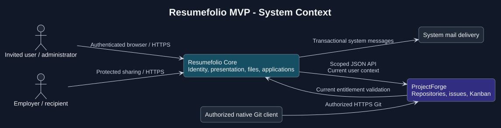
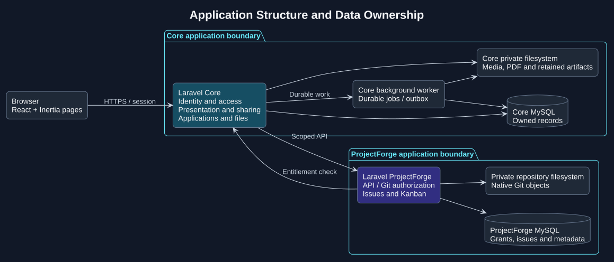
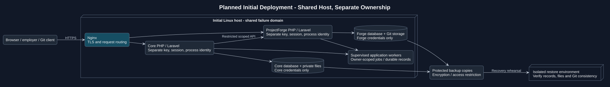

<a id="1-introduction"></a>

# 1. Introduction to High-Level Design (HLD)

[Next: Architectural Goals & Constraints](02-Architectural-Goals-And-Constraints.md)

**Status:** planned MVP design. The project README states that implementation has not started. Descriptions below express intended behavior and design obligations; runtime, security and recovery claims require implementation evidence.

Part of the [Software Design Document](../../01-Project-Planning/02-Project-Management-Plan.md#stage-4-system-design).

## 1.1 Purpose

This High-Level Design (HLD) translates the approved Resumefolio MVP requirements and system analysis into an architectural direction for detailed design, implementation and verification. It establishes the responsibilities of Resumefolio Core and ProjectForge, the information each owns, and the rules governing interactions between them.

The design supports three central outcomes:

- An invited user can maintain and explicitly tailor professional materials, then share only the selected content with an employer.
- An application record preserves the exact materials submitted, independently of later profile edits, publication changes or withdrawal.
- A repository operation proceeds only with current user entitlement and the applicable ProjectForge repository grant.

The HLD defines application boundaries, major components, data lifecycles, integration patterns, deployment assumptions and cross-cutting security and quality constraints. It guides implementation without replacing the physical schema, endpoint contracts or component-level design.

## 1.2 Scope

### 1.2.1 Resumefolio Core

Core owns the private professional workspace:

- Invited accounts, identity, current entitlement and the user dashboard.
- Profile information, tailored resumes and portfolios, cover letters, independent drafts and explicit publication.
- Private same-server media, PDF generation and protected employer sharing.
- Manual job application tracking, immutable submission events and preservation of the actual submitted artifacts.

Mutable source information, drafts, published revisions and submission history have distinct lifecycles. Updating one must not silently overwrite another. Protected access is evaluated at the relevant entry point, including direct file retrieval.

### 1.2.2 ProjectForge

ProjectForge is a separate application connected through an authenticated, user-scoped API. It owns repositories, repository grants, native Git transfers, file history, issues and simple Kanban.

Core and ProjectForge retain separate databases, credentials, application keys, sessions and private storage boundaries. Each application persists its own changes. ProjectForge checks local repository authority and current Core entitlement for protected operations. A browser session, employer share or service credential does not automatically grant repository access.

### 1.2.3 Supporting concerns

The HLD also covers transactional system mail, durable background work, developer build/test automation, initial deployment, observability, protected backups and isolated recovery. Transactional messages support application functions such as invitations and recovery; they do not introduce a personal mailbox feature.

### 1.2.4 Deferred capabilities

Personal mail and calendar, AI, advanced repository review and releases, general Sprints, and user-defined workflow or deployment execution remain outside the MVP. Their possible future introduction must not weaken the MVP's ownership, authorization or historical-data guarantees.

### 1.2.5 System boundary at a glance



This introductory view reuses the HLD's dark-mode PlantUML diagram. It shows actors and logical relationships; it does not specify endpoint payloads, credential formats or physical hosting. [Editable PlantUML source](Diagrams/hld-context.puml) · [PNG alternative](Diagrams/hld-context.png). See [System Context](03-System-Context.md) and [Integration & Interfaces](07-Integration-And-Interfaces.md) for the corresponding design discussion.

## 1.3 Definitions & Glossary

| Term | Meaning in this design |
| --- | --- |
| MVP | Planned first stable release, version `1.0.0`, with the scope defined by the project charter and selected baseline. |
| Core | Resumefolio application owning invited identity, professional presentation, private files, sharing and manual application history. |
| ProjectForge | Separate application owning repository collaboration, Git authorization and operations, issues and basic Kanban. |
| Draft | Independently editable professional material, distinct from source profile content and published or submitted records. |
| Published revision | Immutable snapshot created through explicit publication. Access remains subject to current sharing policy. |
| Protected share | Controlled access to selected materials; it does not expose the private storage root or all account content. |
| Submission event | Immutable record of a manual application submission and the exact selected materials associated with it. |
| Artifact | Private stored material, such as an uploaded file or generated PDF, with owner-controlled references and integrity metadata. |
| Entitlement | Current Core authority relevant to whether the actor may use the protected capability. |
| Repository grant | ProjectForge permission for an actor to perform a particular action on a repository. |
| Scoped API | Authenticated service interface restricted to the permitted caller, user context, resources and actions. |
| Outbox / durable work record | Owner-local record of work requiring processing or reconciliation after the initiating operation. Detailed guarantees belong in the relevant contract. |
| HLD / LLD | High-Level Design establishes architectural structure; Low-Level Design specifies implementation contracts and details. |
| ADR | Architecture Decision Record documenting a consequential choice, alternatives, rationale and status. |
| RTM | Requirements Traceability Matrix linking individual requirements and acceptance criteria to design and verification evidence. |

Use the [SRS data definitions](../../02-Requirements-Engineering/01-Software-Requirements-Specification/05-Data-Definitions/README.md#data-definitions) for the authoritative domain vocabulary. This glossary summarizes terms needed to read the architecture.

## 1.4 References

| Reference | Role |
| --- | --- |
| [Project charter](../../01-Project-Planning/01-Project-Charter.md#mvp-scope) | Product objectives and MVP scope. |
| [Project management plan](../../01-Project-Planning/02-Project-Management-Plan.md#stage-4-system-design) | SDLC placement, design deliverables and development handoff. |
| [Software Requirements Specification](../../02-Requirements-Engineering/01-Software-Requirements-Specification/README.md) | Required behavior, constraints and domain definitions. |
| [System Analysis](../../03-System-Analysis/01-System-Context-And-Gap-Analysis.md) | Analyzed context, domain boundaries and design inputs. |
| [Requirements Traceability Matrix](../../02-Requirements-Engineering/03-Requirements-Traceability-Matrix/README.md) | Criterion-level mappings, evidence and unresolved verification. |
| [Architecture decisions](../ADR/Decision-Index.md) | Decision status, alternatives and rationale. |
| [Selected implementation baseline ADR](../ADR/ADR-006-Selected-Mvp-Implementation-Baseline.md) | Selected MVP implementation direction. |
| [Frontend ADR](../ADR/ADR-007-React-Inertia-Frontend.md) | React/Inertia application UI and the retained PDF-template boundary. |
| [Low-Level Design](../03-Low-Level-Design/01-Introduction.md) | Component contracts and implementation details. |
| [Database Design](../03-Low-Level-Design/04-Database-Design.md) | Physical persistence design. |
| [API Specification](../03-Low-Level-Design/05-API-Specification.md) | Endpoint, authorization, error and retry contracts. |
| [Appendices](14-Appendices.md) | Retained design records, detailed analysis and review references. |

## 1.5 Intended audience and reading guide

The product owner uses this document to assess scope and architectural consequences. Developers use it to identify ownership and the contracts to refine before implementation. Testers use its boundaries and invariants to select requirement-linked scenarios. Operators use the deployment, security and recovery chapters to prepare environment and release evidence.

Read [Architectural Goals & Constraints](02-Architectural-Goals-And-Constraints.md), [System Context](03-System-Context.md) and [Architecture Overview](04-Architecture-Overview.md) first. Continue with components, data and integration before reviewing technology, deployment, security and quality strategy. Finish with risks, decisions and traceability. Detailed alternatives and retained records are available in the appendices.

## 1.6 Design document authority and change control

The HLD records product-wide architecture and constraints. Requirements and accepted scope define what must be delivered; ADRs explain consequential choices and their status. Component, data and API documents refine how those choices are implemented. An explanatory diagram does not approve a proposed decision or establish a verified implementation.

If documents disagree, identify the conflicting requirement, accepted scope or decision before changing implementation. Resolve the conflict with the relevant decision authority, then update affected HLD, LLD, diagrams and RTM references together. Preserve unresolved decision status rather than silently introducing a new baseline.

For a boundary-changing update, review actor/resource authorization, data ownership, immutable submitted history, cross-system failure behavior and recovery consequences. Record consequential alternatives and rationale in an ADR. Verify resulting behavior against exact acceptance criteria rather than treating document completion as release approval.

## 1.7 Assumptions and handoff conditions

The planned stack uses separate Laravel applications with React/Inertia pages, trusted Blade PDF templates in Core, MySQL and native Git. Initial shared-host placement is a deployment assumption with a shared failure domain. Compatible dependency versions, capacity, isolation and recovery remain subject to setup and verification.

Before implementing a selected capability, identify its owning component, applicable ADR status, authorized entry points, persistent records, failure outcomes and acceptance criteria. Before claiming readiness, attach fresh build, test, security, accessibility, deployment and recovery evidence as applicable. Numerical service targets and recovery objectives must come from the governing criteria; this introduction does not assign new ones.

## 1.8 Architecture overview and chapter guide

The following consolidated views summarize the design; the linked chapters provide the detailed discussion.

### 1.8.1 Architectural goals and constraints

| Driver | Architectural response | Evidence required before release |
| --- | --- | --- |
| Private professional information | Private storage and current authorization on every protected entry point | Cross-user, direct-file and revoked-sharing checks |
| Exact submitted materials | Immutable submission events and retained references to exact artifacts | Publication/update/withdrawal scenarios preserve submitted history |
| Separate product ownership | Independent Laravel applications, databases, credentials and storage roots | API contract and ownership isolation tests |
| Real repository collaboration | Native Git with repository-specific authorization | Authorized and denied clone/fetch/push and history scenarios |
| Recoverability | Protected backups and isolated restoration of records and bytes | Restore rehearsal including file digests and repository consistency |
| Practical initial hosting | Shared host with separate application identities and limits | Capacity and isolation checks; shared host failure risk recorded |

No numeric latency, capacity, availability, RPO or RTO target is invented here. Applicable acceptance criteria and measured evidence must be linked through the [requirements traceability matrix](../../02-Requirements-Engineering/03-Requirements-Traceability-Matrix/README.md).

### 1.8.2 System context


Invited users operate the authenticated workspace. Administrators manage their authorized admission and operational responsibilities. Employers or other recipients access only the selected materials allowed by the sharing policy. A sharing link is not unrestricted access to private storage.

Core calls ProjectForge with scoped server credentials representing the current user. ProjectForge owns repository grants and validates current Core entitlement. Git clients use their applicable Git credentials and repository authorization; a Core browser session alone is not a repository grant. The diagram shows logical relationships, not a final endpoint or credential protocol.

### 1.8.3 Architecture overview



Use two Laravel applications with explicit internal module ownership. React and Inertia provide interactive application pages; Core retains Blade for trusted PDF templates. Each application writes only its own records and storage. The integration is an authenticated, user-scoped API, not direct cross-database access.

Synchronous requests support immediate user interactions. Durable background work uses local work records/outboxes and supervised workers. A successful local commit does not prove that a remote effect completed. If a response is lost, expose the documented pending or unavailable outcome and reconcile within the system that owns the operation. Retries recheck authority and use the contract's request identity to avoid duplicating recorded effects.

The boxes describe logical application containers and ownership. They do not require Kubernetes, Docker or a separate host for each box.

### 1.8.4 Components and ownership

| Component | Owns | Boundary obligations |
| --- | --- | --- |
| Core Identity and Access | Invited accounts, actor identity and current entitlement | Establish current actor and reject unauthorized resource/action requests |
| Core Professional Presentation | Profile content, independent drafts and published revisions | Updates and publication are explicit; published snapshots remain distinct from drafts |
| Core Representation and Sharing | Selected employer-facing representations and access policy | Enforce current access, withdrawal and revocation for every protected retrieval |
| Core Files and Operations | Private media, PDF work and retained artifact bytes | Authorize direct retrieval; maintain integrity metadata and safe resource limits |
| Core Applications | Manual application records and immutable submission events | Preserve exact selected materials independently of later profile/publication changes |
| ProjectForge Git Collaboration | Repositories, local grants, Git operations and file history | Validate current entitlement and repository/action permission before protected operations |
| ProjectForge Work Management | Issues and simple Kanban | Keep issue/board changes local and enforce repository ownership and grants |
| Application operations | Owner-scoped jobs, health signals, backups and recovery | Keep work durable, expose failures and verify restore consistency |

Modules request operations through the owning interface. Shared host placement does not permit either application to bypass the other's authority or read its private files.

### 1.8.5 Data architecture and lifecycle


Core stores accounts, profiles, draft content, published revisions, sharing policy, artifact metadata and application/submission history in its MySQL database. Private files and generated PDFs remain in its private filesystem. ProjectForge stores repository metadata, grants, issues and board state in its separate MySQL database, with native Git objects in its own repository filesystem.

The lifecycle separates mutable source content, independent drafts, immutable publication snapshots and immutable submission events. Updating a profile must not silently rewrite a tailored draft or historical submission. Withdrawing publication prevents access according to current policy while preserving already recorded submission history and retained artifacts.

Store hashes and authorized references alongside the owning records. Release retained bytes only when their owning references and retention policy allow it. Coordinate file creation/deletion with recorded work so partial failures can be reconciled. An isolated restore must validate database references, file digests and repository consistency together. The diagram is conceptual flow, not an ERD or a complete state machine; see [Database Design](../03-Low-Level-Design/04-Database-Design.md).

### 1.8.6 Integration and interface strategy

| Interface | Intended behavior | Failure and security boundary |
| --- | --- | --- |
| Browser workspace | Laravel sessions with React/Inertia pages | Resolve actor and resource authorization on protected requests |
| Protected sharing/media | Serve only the selected representation or artifact | Validate current policy on direct retrieval; revocation must remain effective |
| Core to ProjectForge JSON API | Scoped synchronous calls with current user context | Receiver validates caller, scope, entitlement and local grants |
| ProjectForge entitlement validation | Establish current Core authority | Authority unavailability produces a safe unavailable outcome; no unauthorized operation proceeds |
| HTTPS Git | Native Git transfer behind repository authorization | Enforce action-specific grants; keep Git credentials separate from browser sessions |
| Local background work | Durable jobs/outbox and owner-controlled reconciliation | Record failure, retry under the defined contract and preserve already recorded outcomes |
| System mail | Transactional application messages | Restrict logged payloads and credentials; delivery failure must not imply business rollback |

A denied request has no business side effect. Validation, timeout, retry, request identity and reconciliation details must be defined by the [API specification](../03-Low-Level-Design/05-API-Specification.md). Cross-system operations are not distributed database transactions. Retain separately recorded local outcomes and distinguish a definitive rejection from an uncertain remote result.

### 1.8.7 Technology stack

| Layer | Planned choice | Reason / constraint |
| --- | --- | --- |
| Application backend | PHP and Laravel, separate applications | Consistent framework with explicit ownership |
| Interactive frontend | React and Inertia | Server-directed application pages with interactive UI |
| PDF templates | Trusted Blade templates in Core | Controlled rendering of selected presentation content |
| Relational persistence | MySQL, separate databases and credentials | Local integrity and restricted application access |
| Binary / repository storage | Private filesystem and native Git | Keep private media local and preserve real Git behavior |
| Web entry point | Nginx and TLS on planned Linux deployment | Controlled routing and protected transport |
| Build tools | Composer and Vite | Reproducible dependency installation and frontend builds |

Compatible runtime and dependency versions must be recorded and verified during [project setup](../../05-Agile-Iterative-Development/01-Project-Setup.md), using locked dependencies. See the [frontend decision](../ADR/ADR-007-React-Inertia-Frontend.md) and [selected MVP implementation baseline](../ADR/ADR-006-Selected-Mvp-Implementation-Baseline.md).

### 1.8.8 Deployment and recovery architecture



Initial placement may share one Linux host. Separate application process identities, keys, sessions, database credentials and private storage paths. Restrict service endpoints to intended callers. The databases and storage boxes express ownership boundaries, not a claim that separate physical machines are provisioned. Host failure, disk exhaustion and resource contention can affect both applications.

Keep development, test and production isolated. Build and test an identifiable revision, rehearse migrations and smoke checks, and promote the verified candidate through the [runbook](../../06-Deployment-Release/02-Runbook.md). Record the build revision, environment configuration and migration set without exposing secrets.

Protect backup copies with encryption and restricted access. Validate recovery in an isolated environment before relying on the backups. Code rollback, traffic switching and application-data restoration are separate operations with different preconditions; the runbook must define their use and verification. Placement and scheduling of backup storage remain deployment decisions, not proven facts in this diagram.

### 1.8.9 Security architecture

| Threat / boundary | Required design control | Verification focus |
| --- | --- | --- |
| Cross-user resource access | Current actor/resource/action checks at each owner | Another user's identifiers cannot expose or mutate records |
| Direct media or PDF retrieval | Private storage with authorized delivery | Knowing a path or artifact ID is insufficient |
| Revoked sharing / entitlement / Git grants | Re-evaluate current authority on protected entry points | Revoked access fails, including direct retrieval and Git operations |
| Caller or service authority unavailable | Safe denied or unavailable result under the contract | No unauthorized write or transfer proceeds |
| Unsafe files and repository operations | Bounded inputs and resource limits; trusted rendering templates | Invalid content and oversized work are handled safely |
| Credentials and private content in diagnostics | Bounded structured metadata with secret exclusion | Logs and errors do not disclose tokens or private bytes |
| Host or backup compromise | Restricted identities, storage and encrypted backup access | Isolation and recovery checks include the private data boundary |

Admission is invitation-based with the selected administrator controls. Application keys and sessions are independent. Detailed controls and residual risks remain in the [security and trust-boundary design](14-Appendices.md#design-record-06-design-quality-and-security-analysis-02-security-threat-modeling-and-trust-boundaries-md).

### 1.8.10 Non-functional strategy

Measure representative view/save workloads separately from PDF generation, bulk upload and Git operations. Record the candidate revision, environment, workload, latency and errors against applicable criteria. Apply limits and inspect host headroom before increasing concurrency or changing placement.

Supervise workers and monitor job failures, storage consumption, health/readiness and backup freshness. Use correlation IDs and bounded structured logs across service calls without recording private material. Durable records make unfinished work observable and support owner-controlled reconciliation.

Validate accessibility on the actual browser journeys and protected views. Verify recovery against the documented recovery criteria using restored data and artifacts. These are release evidence obligations, not architecture-only guarantees; see [Non-Functional Strategy](11-Non-Functional-Strategy.md).

### 1.8.11 Risks and key decisions

| Risk | Design response | Remaining gate |
| --- | --- | --- |
| Shared host outage or saturation | Independent ownership and resource limits; protected recovery copies | Capacity measurement and isolated restore rehearsal |
| Entitlement or grant mismatch | Current Core authority plus ProjectForge local grant enforcement | Revocation, unavailable-authority and Git boundary scenarios |
| Duplicate or uncertain remote effect | Durable local outcomes and contract-defined reconciliation | Lost-response and repeated-request scenarios |
| Historical material changes or disappears | Immutable submissions and retained artifact references | Update, withdrawal, retention and restore scenarios |
| Configuration weakens separation | Separate credentials, sessions, keys and storage permissions | Environment isolation and secret-handling checks |
| Version or tooling incompatibility | Verify locked builds against recorded effective versions | Project setup and both application builds |

The [ADR index](../ADR/Decision-Index.md) owns decision status, alternatives and rationale. The [risk assessment](../../01-Project-Planning/03-Feasibility-And-Risk-Assessment.md) owns project-level follow-up. Open decisions must identify an owner, affected capability and required evidence; do not treat this consolidation as approval of unresolved choices.

### 1.8.12 Traceability and implementation handoff

| Requirement area | Design owner / section | Required verification |
| --- | --- | --- |
| Invited access and private resource authority | Identity; sections 3, 5 and 10 | Admission, cross-user and revoked-access scenarios |
| Profile, tailored content and publication | Presentation; sections 5–6 | Explicit update/publish and snapshot independence |
| Private media, PDF and protected sharing | Files and Sharing; sections 6–7 and 10 | Direct retrieval, selection and withdrawal checks |
| Manual applications and exact submission history | Applications; sections 5–6 | Immutable events and retained exact artifacts |
| Git, issues and Kanban | ProjectForge; sections 5 and 7 | Transfer permissions, file history and issue/board authorization |
| Quality, deployment and recovery | Operations; sections 9–11 | Measured workloads, accessibility, deployment and restore evidence |

Use the [RTM](../../02-Requirements-Engineering/03-Requirements-Traceability-Matrix/README.md) for exact requirement/criterion identifiers and evidence. This area-level mapping does not replace criterion-level traceability.

Before implementing a capability, confirm its ADR status, owning data, interface contract, failure outcomes and acceptance criteria. Refine the corresponding LLD and test references. Before release, attach fresh evidence for authorization, immutable history, API/Git boundaries, locked builds, deployment and recovery. Track unresolved gates explicitly.

### 1.8.13 Detailed chapters and diagram sources

1. Introduction (this document)
2. [Architectural Goals & Constraints](02-Architectural-Goals-And-Constraints.md)
3. [System Context](03-System-Context.md)
4. [Architecture Overview](04-Architecture-Overview.md)
5. [Components](05-Components.md)
6. [Data Architecture](06-Data-Architecture.md)
7. [Integration & Interfaces](07-Integration-And-Interfaces.md)
8. [Technology Stack](08-Technology-Stack.md)
9. [Deployment Architecture](09-Deployment-Architecture.md)
10. [Security Architecture](10-Security-Architecture.md)
11. [Non-Functional Strategy](11-Non-Functional-Strategy.md)
12. [Risks & Key Decisions](12-Risks-And-Key-Decisions.md)
13. [Traceability](13-Traceability.md)
14. [Appendices and retained design records](14-Appendices.md)

All four diagrams use a dark background, light labels and colored ownership boundaries. SVG is embedded above; PNG alternatives and editable PlantUML sources are provided alongside it.

| View | Editable source | PNG alternative |
| --- | --- | --- |
| Context | [PlantUML](Diagrams/hld-context.puml) | [PNG](Diagrams/hld-context.png) |
| Application structure | [PlantUML](Diagrams/hld-containers.puml) | [PNG](Diagrams/hld-containers.png) |
| Data lifecycle | [PlantUML](Diagrams/hld-lifecycle.puml) | [PNG](Diagrams/hld-lifecycle.png) |
| Deployment | [PlantUML](Diagrams/hld-deployment.puml) | [PNG](Diagrams/hld-deployment.png) |

To regenerate a diagram with Java and a local PlantUML JAR, run from this document's directory (adjust the JAR path):

```powershell
java -jar path/to/plantuml.jar -tsvg Diagrams/hld-context.puml
java -jar path/to/plantuml.jar -tpng Diagrams/hld-context.puml
```

Repeat with the other source basenames. Update source and rendered assets together when architecture changes.
