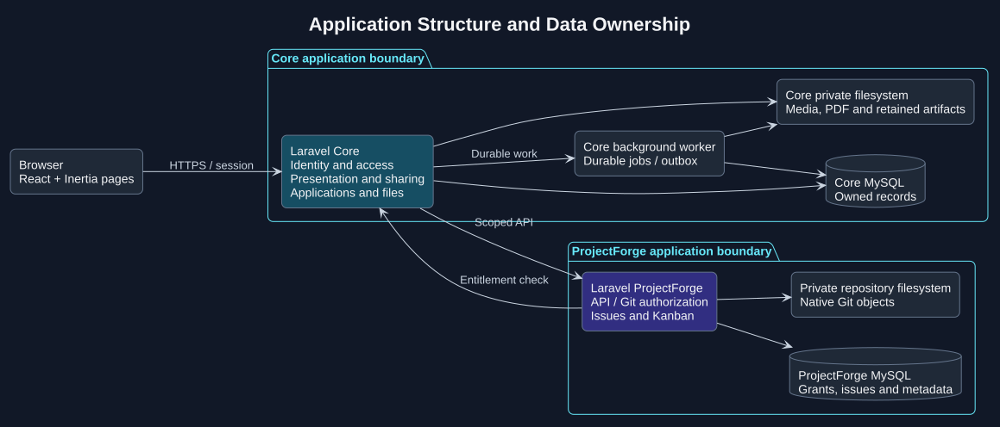

# 4. Architecture Overview

[Previous: System Context](03-System-Context.md) · [High-Level Design introduction](01-Introduction.md) · [Next: Components](05-Components.md)

## 4.1 Architectural Style & Rationale

Resumefolio uses two independent Laravel applications with explicit internal module ownership: **Resumefolio Core** and **ProjectForge**. Core owns invited identity, professional presentation, private files, protected sharing and manual application history. ProjectForge owns repositories, repository grants, native Git operations and history, issues and simple Kanban.

The applications communicate through an authenticated, user-scoped server-to-server API. They do not share application sessions, keys, database credentials or private storage authority. Each application commits changes to its own records and exposes permitted operations through its interfaces.

Within each application, modules separate responsibilities without requiring a network service for every module. This provides a practical MVP structure while preserving the independently selected Core/ProjectForge boundary. The design does not mandate a microservice fleet, message broker, API gateway or container-orchestration platform.

React and Inertia provide interactive pages inside each Laravel application. Laravel retains routing, validation, sessions, authentication and server-side policies. Blade remains the trusted PDF-template mechanism in Core. Inertia is a browser presentation mechanism, not the protocol connecting Core to ProjectForge.

The [selected baseline ADR](../ADR/ADR-006-Selected-Mvp-Implementation-Baseline.md) and [frontend ADR](../ADR/ADR-007-React-Inertia-Frontend.md) govern these choices. Architecture views describe planned structure; they do not demonstrate installed dependencies, running services or passed release gates.

## 4.2 Design Principles

| Principle | Application in this architecture |
| --- | --- |
| Explicit ownership | Every record, private artifact, repository and durable operation has an owning component and application. Consumers request operations rather than writing another owner's data. |
| Current authorization | Resolve actor, resource and action authority on protected entry points, including direct file delivery and Git operations. UI visibility and service authentication do not replace resource permission checks. |
| Independent content lifecycles | Mutable profiles and drafts remain distinct from immutable published revisions and submission events. Updates and publication require explicit user actions. |
| Preservation of submitted materials | Retain exact selected artifacts and references independently of later profile edits, replacement or publication withdrawal. |
| Local transactions and truthful outcomes | Local commits establish local outcomes. Remote success, rejection and uncertainty remain distinguishable; do not imply a distributed rollback. |
| Durable effects | Record work that must survive request/process interruption and reconcile it within its owner using the selected transaction/outbox rules. |
| Bounded work and private diagnostics | Apply storage/resource policies; expose actionable status through bounded logs and correlation IDs without private bytes or credentials. |
| Compatible evolution | Review affected consumers, migrations, retention and recovery when contracts change; update ADRs and criterion-level traces where required. |

## 4.3 Container Diagram (C4 Level 2)

[Editable PlantUML source](Diagrams/hld-containers.puml) · [PNG alternative](Diagrams/hld-containers.png)

This logical application/container view shows the main Core browser path, application responsibilities, owned persistence and the scoped service boundary. Labeled boundaries separate ownership; cyan and violet application boxes distinguish Core and ProjectForge. Arrows indicate permitted interactions rather than a complete sequence or physical network map.

The browser can also access ProjectForge's own authorized pages. Native Git clients enter through ProjectForge's separately authorized transport, and transactional mail supports Core functions. These paths are shown in the [System Context](03-System-Context.md) rather than repeated in this ownership view. The illustrated Core worker is an example of owner-local durable processing; it is not a shared worker with unrestricted access to both systems. ProjectForge background work, where needed, remains ProjectForge-owned.

Database and filesystem boxes represent authority boundaries. They do not require separate physical database servers or hosts. Likewise, a logical container is not a requirement to package the application in Docker. The initial host failure domain is explained in [Deployment Architecture](09-Deployment-Architecture.md).

### 4.3.1 Logical building blocks

| Building block | Responsibility | Boundary |
| --- | --- | --- |
| Browser presentation | React/Inertia pages, forms, navigation and validation feedback | Uses the receiving application's session and server policies; never accesses private persistence directly |
| Core application | Identity, presentation, sharing, files and application history | Owns Core commands, records, artifact references and authorized delivery |
| Core MySQL database | Core-owned relational records and applicable durable work metadata | Core credentials only; no ProjectForge business writes |
| Core private filesystem | Private media, generated PDF and retained artifact bytes | Delivery through authorization; filesystem paths are not public resource identifiers |
| Owner-local worker | Process durable jobs/outbox effects and reconcile failures | Receives only the owning application's required access; queued work does not bypass current policy |
| ProjectForge application | Scoped API, repository authorization, issues and board behavior | Checks caller/user scope, current Core entitlement and local grants |
| ProjectForge MySQL database | Repository metadata, grants, issues and Kanban state | ProjectForge credentials and transaction ownership |
| ProjectForge repository filesystem | Native Git repositories and object history | ProjectForge-controlled Git operations; no Core filesystem shortcut |

## 4.4 Internal Structure and Dependency Direction

Each application separates presentation and entry adapters from business operations and persistence/integration adapters. These are logical responsibilities to refine in LLD, not a requirement for a new framework, package hierarchy or service per layer.

1. **Entry and presentation:** browser controllers/Inertia responses, protected recipient delivery, scoped API handlers, Git transport authorization and worker entry points establish request context and validate input.
2. **Application/domain operations:** owning components enforce business rules, current authorization, version/conflict checks and lifecycle transitions.
3. **Persistence and integration:** owner-controlled database/filesystem access, native Git, scoped remote calls and transactional mail perform permitted effects under the applicable contract.

Frontend components do not own authorization. Database adapters do not silently define publication or submission semantics. External failures return to the owning operation as explicit outcomes requiring the documented handling. Detailed component interfaces and transaction boundaries belong in [Low-Level Design](../03-Low-Level-Design/01-Introduction.md).

## 4.5 Communication and Execution Model

| Interaction | Mechanism and ownership | Important constraint |
| --- | --- | --- |
| Interactive browser request | Laravel session, controller/policy and React/Inertia page within the receiving application | No independently deployed frontend or extra browser REST-authentication layer is introduced |
| Protected employer/file retrieval | Core sharing/file entry point resolves selected content and current eligibility | A known URL or prior successful view is insufficient authority for later retrieval |
| Core-to-ProjectForge request | Scoped synchronous JSON request carrying permitted user context | ProjectForge validates current entitlement and the local resource/action grant |
| ProjectForge-to-Core entitlement check | Narrow status-only service access | Status authority cannot read Core content; unavailability fails closed under the contract |
| Native Git exchange | Authorized ProjectForge Git transport and native Git engine | Browser or JSON API permission alone does not establish clone/fetch/push authority |
| Durable asynchronous effect | Owner-local work record/outbox and supervised worker | Retry/reconciliation follows the operation contract and preserves recorded outcomes |

Use synchronous requests when the caller needs an immediate contract-defined response. Use durable background work for effects that must survive request or worker interruption. The detailed design determines the applicable execution path; this overview does not move every operation into a queue or claim every job has identical delivery guarantees.

## 4.6 Data Ownership and Consistency

Core separates mutable source profiles, independent drafts, immutable publication snapshots, protected sharing policy and immutable submission events. Files remain private, with integrity metadata and authorized retained references. ProjectForge separately owns repository metadata, grants, issues/board state and native Git storage.

Publication makes a selected snapshot available under current policy; it does not publish every account artifact. Withdrawal changes access according to that policy without rewriting submission history. Cleanup must not release bytes still protected by a retained submission or other owning reference.

A database transaction cannot by itself make a filesystem, Git operation, mail delivery and remote database commit atomic. Record the required intent/outcome and reconcile partial effects under the selected contracts. Use expected versions and stable request identity where specified to prevent lost updates and duplicate effects. Do not interpret a remote timeout as proof that no remote commit occurred.

See [Data Architecture](06-Data-Architecture.md), [Database Design](../03-Low-Level-Design/04-Database-Design.md) and the [API specification](../03-Low-Level-Design/05-API-Specification.md) for lifecycle, persistence and request-identity details.

## 4.7 Representative Execution Paths

### 4.7.1 Edit and publish professional materials

The user submits a change through Core's authenticated workspace. Core validates authority and current versions, applies the explicit operation to the owning profile or draft, and commits locally. Publication is a separate confirmation producing an immutable revision. PDF generation, artifact availability and recipient access remain distinct outcomes rather than implied side effects of saving a draft.

### 4.7.2 Retrieve protected content

A recipient presents the required viewer context. Core resolves current sharing policy, selected revision, language and download eligibility before delivering the permitted representation or bytes. Direct and alternate delivery paths preserve the same authorization boundary. Already emitted/downloaded bytes cannot be recalled by a later revocation.

### 4.7.3 Record a manual submission

The user identifies the actual materials submitted. Core records an immutable submission event and protects the exact selected references. A later profile edit, publication withdrawal or artifact replacement must not alter that preserved history. The application tracks a manual submission; it does not imply automated delivery to an employer system.

### 4.7.4 Perform a ProjectForge operation

Core sends a scoped request for the actor and operation. ProjectForge validates the caller/scope, current Core entitlement and its local grant before reading or committing ProjectForge-owned data. Its response describes that operation's outcome. Git clients use the distinct authorized native transport. Issue-write authority does not automatically grant Git-write authority.

### 4.7.5 Reconcile interrupted work

A lost response or interrupted worker leaves the caller with the contract-defined uncertain/pending outcome. The owner resolves the stable operation identity against its durable records, rechecks applicable authority and reconciles any effect already recorded. A matching retry must not blindly repeat a completed write. Detailed ordering and stored-outcome behavior remain contract-specific.

## 4.8 Failure Boundaries and Recovery

| Failure | Expected architectural behavior |
| --- | --- |
| Required authority unavailable | Return the documented safe unavailable result without proceeding with unauthorized work |
| ProjectForge unavailable | Report repository capability failure accurately; do not treat a Core local save as remote success |
| Lost response after a remote commit | Preserve uncertainty and resolve the existing operation before a repeat that could duplicate effects |
| Worker or process interruption | Retain durable work metadata, expose failure/backlog and resume or reconcile under owner control |
| File/Git effect differs from recorded state | Preserve relevant protection and reconcile the owning records/bytes; avoid silent cleanup or false completion |
| Disk/resource pressure | Apply selected admission/reservation limits and report failure without damaging unrelated retained content |
| Shared host failure | Treat both applications as affected; recover protected records, private artifacts and repositories through isolated restore procedures |

Logical independence does not guarantee independent availability when applications share a host or rely on current entitlement checks. Code rollback and data restoration are separate operations. Verify backup references, file digests and repository consistency together before trusting restored service.

## 4.9 Cross-Cutting Controls

- **Security:** invitation-based admission, independent application keys/sessions, current resource authorization, private storage and narrow service scopes.
- **Observability:** correlation IDs, bounded structured diagnostics, health/readiness signals and monitoring of failed jobs, disk use and backup freshness.
- **Resource control:** selected file-type/size/quota/disk-reserve policies and bounded PDF/Git processing, verified under concurrent and interrupted workloads.
- **Recovery:** protected backup copies and isolated restore rehearsal covering relational records and owned bytes.
- **Compatibility:** locked builds, explicit API evolution and migration review against the selected implementation baseline.
- **Accessibility:** verify actual forms, navigation, validation and protected views against governing criteria.

These controls are obligations to implement and verify. They do not establish numerical service targets or imply that runtime checks have passed. Detailed controls belong in [Security Architecture](10-Security-Architecture.md) and [Non-Functional Strategy](11-Non-Functional-Strategy.md).

## 4.10 Architecture Verification and Handoff

| Architectural concern | Evidence required |
| --- | --- |
| Independent ownership | Confirm separate credentials, sessions, keys, storage permissions and owner-only persistence |
| Protected entry points | Exercise cross-user, revoked, direct-file, wrong-scope and unavailable-authority requests |
| Historical integrity | Demonstrate explicit draft/publication behavior and preserved exact submitted artifacts |
| Service and Git boundary | Verify actual scoped integration and native Git interoperability with allowed and denied actions |
| Local/remote outcome truth | Exercise stale writes, repeated identities, lost responses and interrupted durable work |
| Operational readiness | Verify locked builds, resource policy, monitoring and isolated restore consistency |

Refine the owning component, data and API contracts before implementing a selected capability. Link exact acceptance criteria and fresh evidence in the [RTM](../../02-Requirements-Engineering/03-Requirements-Traceability-Matrix/README.md). If evidence requires changing a selected architectural choice, update the relevant ADR and affected views rather than silently bypassing the constraint.

Continue with [Components](05-Components.md) for module responsibilities and [Integration & Interfaces](07-Integration-And-Interfaces.md) for communication contracts.
