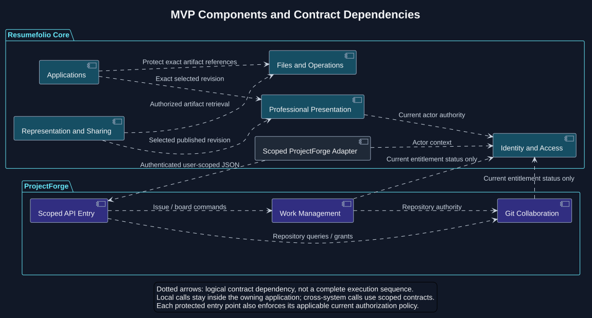

# 5. Components

[Previous: Architecture Overview](04-Architecture-Overview.md) · [High-Level Design introduction](01-Introduction.md) · [Next: Data Architecture](06-Data-Architecture.md)

## 5.1 Component List & Responsibilities

Components are logical responsibility boundaries inside the two independent Laravel applications. They define who owns a business rule, record, artifact or operation. They do not require a separate deployment or network endpoint for every module. Concrete classes, interfaces and transaction boundaries are refined in the [Detailed Module Design](../03-Low-Level-Design/03-Detailed-Module-Design.md).

### 5.1.1 Resumefolio Core

| Component | Owned responsibilities and state | Boundary obligations |
| --- | --- | --- |
| Identity and Access | Invited identity, account state, authentication and current entitlement | Establish current actor context; enforce applicable account policy; expose only the narrow entitlement/status contract needed by ProjectForge |
| Professional Presentation | Profile source content, independent tailored drafts, explicit updates, publication and immutable revisions | Apply selected changes explicitly; reject stale/unauthorized changes; do not rewrite drafts or historical records through unrelated profile edits |
| Representation and Sharing | Selected employer-facing representation and sharing/access configuration | Resolve current viewer/link policy, selected revision, language and download eligibility on every protected delivery path |
| Files and Operations | Private artifact bytes and metadata, integrity hashes, protected references, PDF processing and file lifecycle work | Enforce authorized retrieval and selected storage policy; preserve protected bytes; make processing/failure state visible |
| Applications | Manual job application records and immutable submission events associated with exact materials | Capture actual selected revision/files; protect references; preserve submitted history independently of later edits or withdrawal |

PDF content derives from the selected presentation revision, while Files and Operations owns artifact processing and private bytes. Sharing controls what a recipient may retrieve. These responsibilities cooperate through explicit contracts rather than allowing a PDF task or download path to bypass presentation or sharing rules.

### 5.1.2 ProjectForge

| Component | Owned responsibilities and state | Boundary obligations |
| --- | --- | --- |
| Git Collaboration | Repositories, repository grants, authorized native Git operations, revision/file history and repository metadata | Check current Core entitlement and applicable local repository/action grant; preserve native Git behavior and private repository storage |
| Work Management | Repository issues and simple Kanban state | Enforce repository-scoped issue/board permissions, expected versions and documented request identity; issue permission does not grant Git write |

ProjectForge owns its database and repository filesystem. Core does not mutate these through direct SQL or filesystem access. ProjectForge likewise does not read Core private content under a status-only entitlement credential.

### 5.1.3 Entry Points and Supporting Adapters

Browser controllers, Inertia responses, protected-file handlers, scoped API entry points, Git transport adapters and background-worker handlers translate input into owning operations. A scoped ProjectForge adapter in Core carries permitted actor context and maps remote outcomes. These are technical responsibilities rather than additional business data owners.

Transactional mail, persistence, rendering, native Git and job/outbox adapters support their owner. They must not invent publication, submission or authorization side effects through unrelated saves, getters or background callbacks. Operational monitoring and backup procedures cover each owner's records and bytes without creating a shared unrestricted content service.

## 5.2 Component Interactions

### 5.2.1 Local Collaboration

| Interaction | Owning result | Required contract behavior |
| --- | --- | --- |
| Identity → protected use case | Current actor and applicable authority context | Authentication alone is insufficient; the receiving operation checks resource/action policy |
| Profile → tailored draft | Explicit selected draft update | Respect expected version and selection; do not apply all future profile changes automatically |
| Draft → publication | Immutable published revision and current publication state | Separate confirmation, current authority and protected artifact eligibility |
| Sharing → Presentation / Files | Authorized selected representation or bytes | Re-evaluate current sharing policy; direct or alternate URLs preserve the same access boundary |
| Applications → Presentation / Files | Immutable submission event with exact material references | Capture the actual selection and protect retained bytes; later changes cannot rewrite the event |
| Work Management → repository authority | Authorized issue or board operation | Apply local grants and current entitlement; retain distinct issue and Git permissions |

Consumers request a permitted operation or immutable reference from the owner. They do not duplicate ownership by modifying another component's tables or treating a filesystem path as a public resource identifier.

### 5.2.2 Cross-System Collaboration

Core sends authenticated, user-scoped JSON requests to ProjectForge. ProjectForge verifies caller/scope, current Core entitlement and the local resource/action grant. Its status-only request to Core establishes entitlement without granting access to professional content, private files or application history.

Each browser application retains its own Laravel session. Inertia does not connect the two backends, and a Core session is not automatically a ProjectForge grant. Native Git clients use the separately authorized transport; repository JSON API access does not establish clone/fetch/push interoperability or permission.

See [Integration & Interfaces](07-Integration-And-Interfaces.md) and the [API specification](../03-Low-Level-Design/05-API-Specification.md) for payloads, authentication, status codes, request identity and retry details.

## 5.3 Component Diagram

[Editable PlantUML source](Diagrams/hld-components.puml) · [PNG alternative](Diagrams/hld-components.png)

The diagram uses UML components and dependency arrows. Application packages express ownership, not physical machines. Arrows identify selected contract dependencies, not every authorization check or a chronological execution sequence. Dependencies within a package are local component contracts; the Core adapter/API and entitlement-status relationships cross the system boundary.

The API entry and scoped adapter are technical boundaries. Git and Work Management remain the business owners behind ProjectForge's entry points. Every protected operation enforces the applicable current policy even where a separate authorization arrow is omitted for readability.

Persistence, worker processes and physical placement are shown in [Architecture Overview](04-Architecture-Overview.md) and [Deployment Architecture](09-Deployment-Architecture.md). This component view does not replace those diagrams or define a database schema.

## 5.4 Invariants at Component Boundaries

| Invariant | Responsible components | Consequence |
| --- | --- | --- |
| Current actor/resource/action authority | Identity plus the receiving resource owner; ProjectForge local grants | Known identifiers, prior access and broad service credentials cannot bypass current authorization |
| Explicit publication lifecycle | Professional Presentation | Draft saves, publication and PDF availability are distinguishable outcomes |
| Selected recipient visibility | Representation and Sharing, Presentation, Files | Sharing exposes only eligible selected material; private storage remains private |
| Preserved actual submitted materials | Applications, Presentation, Files | Later edits, replacement or publication withdrawal cannot silently change historical submission content |
| Owner-local writes | All components and both applications | Cross-boundary consumers use contracts rather than direct data mutations |
| Protected retention and integrity | Files with the referencing owner | Cleanup cannot delete bytes still protected by a retained reference; restored references and digests must agree |
| Distinct repository permissions | Git Collaboration and Work Management | Issue/board access is not native Git write authority |

Detailed retention, active-viewer/cache behavior, admission limits and transaction ordering remain governed by selected requirements and detailed contracts. Component names alone do not settle unresolved policy or demonstrate enforcement.

## 5.5 Transactions, Concurrency and Durable Effects

Owning operations use bounded local transactions for their relational state and the selected request/outbox records. Filesystem, Git, mail and remote database effects do not become atomic merely because a local transaction exists. Preserve intent and observed outcomes so the owner can reconcile partial effects safely.

Use expected versions where specified to reject stale updates without overwriting newer work. Bind idempotency/request identity to the actor, operation and payload under the owning contract. A matching retry resolves the recorded outcome; a different payload must not silently reuse the same identity. Retries recheck applicable current authority and must not duplicate an already recorded effect.

Background work retains the owner's boundaries. Queue acceptance is not proof that a PDF exists, mail arrived, a remote write completed or a repository transfer succeeded. Return or expose the accurate pending, available, failed or uncertain outcome defined by the operation. Do not invent one shared status model for all components.

## 5.6 Failure Responsibilities

| Failure | Owner response |
| --- | --- |
| Invalid, unauthorized or hidden resource request | Receiving owner rejects the operation without an unauthorized business side effect or content disclosure |
| Stale draft or issue version | Owning component reports the documented conflict and preserves the newer state |
| Missing/unavailable selected artifact | Presentation, Applications or Sharing returns the contract-defined failure/pending outcome; do not substitute different bytes |
| Required Core authority unavailable | ProjectForge fails closed with the documented unavailable outcome rather than assuming entitlement |
| Lost cross-system response | Adapter preserves uncertainty; remote owner resolves request identity and recorded effects before an unsafe repeat |
| Interrupted file/PDF/job processing | Files/owning worker retains protection and durable state for safe retry or reconciliation |
| Storage quota or disk reserve exceeded | File/Git owner applies the selected admission policy and protects unrelated retained content |
| Backup or restore inconsistency | Owning operations identify missing references/bytes or Git inconsistency before restored service is trusted |

Use correlation IDs and bounded diagnostic metadata to connect outcomes without logging credentials or private artifact contents. Cross-component failure must remain visible rather than being converted into a misleading success.

## 5.7 Component Verification and Handoff

| Component / boundary | Required verification focus |
| --- | --- |
| Identity and protected entry points | Invited access, current account/entitlement, cross-user requests and revoked authority |
| Professional Presentation | Explicit selected updates, stale versions, separate publication and immutable revision behavior |
| Representation and Sharing | Selected-content scope, direct retrieval, link/viewer changes, language/download eligibility and denied access |
| Files and Operations | Private delivery, concurrent quota/admission, exact retained bytes, failed processing and restored integrity |
| Applications | Exact selected-material capture, repeated/interrupted requests and unchanged submitted history after edits/withdrawal |
| Git Collaboration | Actual allowed/denied native Git transfers, file history, local grants and unavailable entitlement authority |
| Work Management | Repository-scoped issue/board permissions, stale writes, stable repeated outcomes and separation from Git write |
| Cross-system adapters and durable work | Wrong scope/actor, lost response, partial failure, owner-controlled retry and accurate user-visible outcomes |

Before implementing a capability, identify the owning operation, permitted inputs, current authorization, version/request identity, persistent effects and failure outcomes. Refine these in [Detailed Module Design](../03-Low-Level-Design/03-Detailed-Module-Design.md), [Database Design](../03-Low-Level-Design/04-Database-Design.md) and the [API specification](../03-Low-Level-Design/05-API-Specification.md).

Use the [SRS](../../02-Requirements-Engineering/01-Software-Requirements-Specification.md) for governing behavior and the [RTM](../../02-Requirements-Engineering/03-Requirements-Traceability-Matrix.md) for exact criteria and fresh evidence. These checks are planned obligations; this design chapter does not assert implemented components or passed runtime tests.
