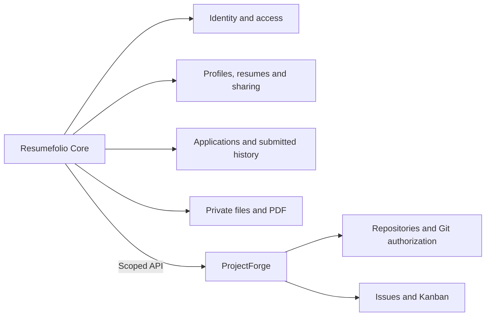

# 5. Components

[High-Level Design index](01-High-Level-Design.md)

### 5.1 Component List & Responsibilities
Core owns identity, professional presentation, files, controlled sharing and applications. ProjectForge owns repository authorization, Git operations, repository history, issues and Kanban.

### 5.2 Component Interactions
Core calls the ProjectForge API with scoped server credentials representing the current user. ProjectForge validates local grants and current Core entitlement. Each owning component performs its own authorization and persistence.

### 5.3 Component Diagram

See [Low-Level Design](../03-Low-Level-Design/03-Low-Level-Design.md) for component contracts and implementation details.
