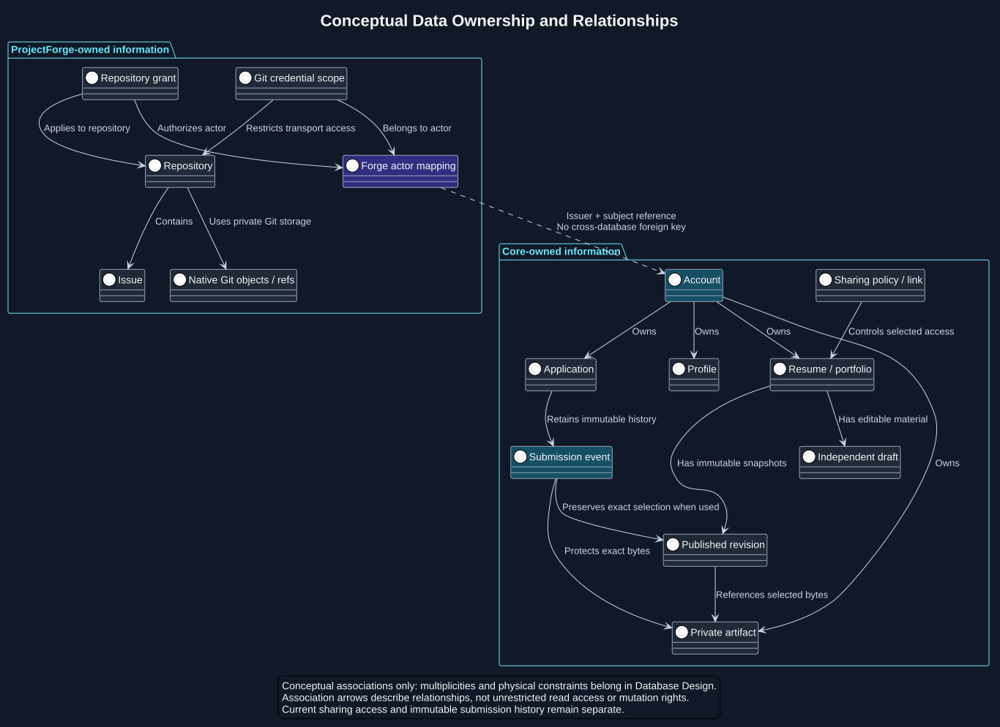

# 6. Data Architecture

[Previous: Components](05-Components.md) · [High-Level Design introduction](01-Introduction.md) · [Next: Integration & Interfaces](07-Integration-And-Interfaces.md)

## 6.1 Conceptual Data Model

The data architecture separates mutable working information, immutable published/submitted records, current access policy and private stored bytes. Core and ProjectForge own independent persistence boundaries. A conceptual association expresses meaning; it does not grant cross-user access or permit direct writes to another component's records.

| Information family | Owner | Principal relationships and invariants |
| --- | --- | --- |
| Accounts, invitations and sessions | Core Identity and Access | Establish invited identity, current account state and entitlement; credentials and session data remain private |
| Profile and tailored drafts | Core Professional Presentation | Account-owned source content and independently editable material; profile changes are applied to drafts explicitly |
| Published revisions and live selection | Core Professional Presentation | Immutable snapshots remain distinct from the mutable pointer selecting the current published revision |
| Sharing links and representation policy | Core Representation and Sharing | Resolve selected content, viewer/link state, language and download eligibility under current policy |
| Artifacts and protected references | Core Files and Operations | Private stored bytes have owner, identity, integrity metadata and lifecycle state; referencing owners protect retained bytes |
| Applications and submission events | Core Applications | Mutable application tracking surrounds immutable events preserving the actual submitted selection and artifacts |
| Forge actor mapping and grants | ProjectForge | Map the Core issuer/subject to a local actor; repository grants and Git credential scopes remain local |
| Repositories and native history | ProjectForge Git Collaboration | Metadata refers to private native Git repositories; Git objects/refs are not recreated as relational commit storage |
| Issues and Kanban | ProjectForge Work Management | Issues belong to repositories; board moves preserve issue identity and enforce current grants and versions |
| Request outcomes, outbox and audit metadata | Respective owning application | Durable local records support safe repetition, reconciliation and bounded operational evidence |

### 6.1.1 Conceptual Relationship Diagram

[Editable PlantUML source](Diagrams/hld-data-model.puml) · [PNG alternative](Diagrams/hld-data-model.png)

The diagram shows selected relationships rather than a complete physical ERD. It deliberately omits multiplicities, columns and indexes; those are specified in [Database Design](../03-Low-Level-Design/04-Database-Design.md). An event may preserve selected published content, exact files or the applicable combination; its historical meaning must never depend solely on a mutable live-publication pointer.

The cross-system actor reference is an issuer/subject mapping, not a foreign key across databases. It identifies the actor but does not prove current entitlement or repository permission.

## 6.2 Data Storage Strategy

| Storage boundary | Contents | Access and integrity rules |
| --- | --- | --- |
| Core MySQL | Identity, presentation, sharing, application records, artifact metadata and owner-local durable work | Core credentials only; owner-scoped relationships and local transactions protect integrity |
| Core private filesystem | Uploaded media, generated PDFs and retained exact artifacts | Private storage keys; authorized delivery rather than public directory exposure; retain protected bytes |
| ProjectForge MySQL | Actor mappings, repository metadata/grants, Git credential scopes, issues and local operation metadata | ProjectForge credentials only; no Core SQL access or shared sessions |
| ProjectForge repository filesystem | Native Git objects and refs in private repositories | Authorized native Git operations; metadata and repository state require reconciliation and recovery checks |
| Protected backup copies | Required relational records, private bytes and repository storage | Restricted access and encryption; validate isolated restoration before relying on copies |

The physical design selects isolated InnoDB databases with utf8mb4, UUID public identifiers stored as `BINARY(16)`, and UTC `DATETIME(6)` timestamps. User-local follow-up/due-date meaning retains its applicable time-zone context. These are storage conventions, not an instruction to add documentary update dates.

Foreign keys resolve inside the owning database. Use owner-scoped relationships where linked private resources must belong to the same owner. Unique/foreign-key constraints protect identity and references; application policies enforce current authority and business lifecycle rules that constraints alone cannot express.

Use `RESTRICT` semantics for protected references and immutable history as specified in the physical design. Do not select cascade deletion merely for implementation convenience. Concrete DDL, indexes, package-owned tables and migration verification belong in Database Design and implementation.

## 6.3 Data Flow

[Editable PlantUML source](Diagrams/hld-lifecycle.puml) · [PNG alternative](Diagrams/hld-lifecycle.png)

This shared conceptual flow distinguishes explicit edits/publication, current sharing access and preserved submission history. It is not a complete state machine or a requirement to submit only published material.

### 6.3.1 Source, Draft and Publication

The user edits private source content and explicitly selects changes for a tailored draft. The draft has its own identity/version and remains independently editable. Publishing is a separate confirmed operation that creates an immutable snapshot and updates the applicable live selection. Subsequent source or draft edits cannot silently modify that snapshot.

Generated PDF availability is separate from publication. PDF work must use the exact selected input and record its outcome; a successful draft save or publication does not establish that a PDF exists or is downloadable.

### 6.3.2 Protected Retrieval

A recipient requests a selected representation or artifact. Core evaluates current sharing context, selected publication/content, language and download eligibility before returning bytes. A storage key or artifact identifier does not grant access. Apply the same boundary to direct, alternate, range and cache-related paths under the selected delivery contract.

Withdrawal or revocation changes future access according to current policy. It does not rewrite historical submissions or recall bytes already delivered to a recipient.

### 6.3.3 Submission Capture

The user identifies the actual materials submitted with a manual application. Core captures an immutable submission event with exact selected material identity and protected artifact references/digests. Capture must preserve independently authored or selected materials rather than substituting whatever the live resume contains later.

If referenced material is unavailable or capture remains uncertain, expose the documented pending/failure outcome. Do not silently substitute a newer revision or different file to complete history.

### 6.3.4 ProjectForge Data Flow

Scoped requests carry only permitted actor context, identifiers and payloads. ProjectForge validates current Core entitlement and local grants, reads or commits its own records, and returns the permitted result. File/history queries use resolved immutable revision identity where specified. Native Git transfers use their own transport contract and private repository storage.

Core entitlement checks expose status only. They do not replicate professional content into ProjectForge or authorize direct access to Core files.

## 6.4 Transactions and Integrity

A local relational transaction establishes local database consistency. It cannot make a remote service commit, filesystem write, Git operation or mail delivery atomic with that database transaction.

The selected physical design orders publication/submission work around protected immutable bytes: reserve the required material, write the revision/event and applicable outbox record in the same local transaction, then finalize reservations asynchronously. Retain protection while an outcome is pending or uncertain. Detailed ordering, locks and cleanup rules must follow the owning operation contract.

| Integrity concern | Enforcement strategy |
| --- | --- |
| Wrong-owner links | Owner-scoped relationships plus current application authorization |
| Duplicate identities or event numbers | Local unique constraints and operation-specific allocation rules |
| Lost updates | Expected-version comparison inside the owning write transaction |
| Repeated commands | Stable actor/operation/request identity bound to payload and recorded outcome |
| Duplicate/uncertain external effects | Durable owner-local records, outbox and reconciliation before unsafe repetition |
| Missing or changed historical bytes | Protected immutable artifact references and recorded digests |
| Quota oversubscription | Selected reservation/admission policy checked under concurrent writes |
| Inconsistent file/record cleanup | Owner-authorized reference release and explicit reconciliation of partial effects |

Lock aggregates/reservation counters in the deterministic order defined by the detailed design. Recheck applicable current authority on retries. A matching request identity resolves its recorded outcome; a changed payload cannot silently reuse the identity. Endpoint details and response behavior belong in the [API specification](../03-Low-Level-Design/05-API-Specification.md).

## 6.5 Retention, Deletion and Cleanup

Published revisions, submission events and retained artifact bytes have different roles from mutable drafts and temporary processing output. Lifecycle transitions must preserve those distinctions.

- Removing or replacing a draft reference does not authorize deletion of bytes still referenced by a publication or submission.
- Withdrawing publication changes access; it does not erase submitted history.
- Releasing a reservation requires owner evidence under the operation contract. Pending/uncertain work retains the protection it still needs.
- Temporary or orphaned storage cleanup must distinguish abandoned work from protected or reconcilable work before deletion.
- Account/resource deletion must follow the governing retention and authorization policy, including protected history. Do not infer permission for broad cascades.

No new retention duration, automatic purge schedule or erasure promise is assigned here. Resolve exact policy and exception handling in the governing requirements and detailed lifecycle contract. Keep sensitive content out of diagnostic records rather than relying only on later log deletion.

## 6.6 Security, Caching and Read Models

Separate credentials, private paths and current owner/resource checks protect persistence boundaries. Hashes detect integrity differences; they do not encrypt content or authorize retrieval. Keep raw credentials, tokens, share verifiers and private bytes out of logs and unrestricted exports. Use the selected protected credential/verifier storage design.

A cache or derived read model is not a new source of authority. Avoid serving private content under stale sharing/entitlement state; cache keys and invalidation must preserve actor, resource, revision and policy scope as applicable. A current live-publication pointer must not replace an exact historical reference.

Indexes and pagination should follow actual owner-scoped access paths: application follow-up, artifact/reservation state, repository grants, issues and pending outbox work. Measure representative workloads before introducing additional persistence technology or changing placement. Derived data must remain attributable to its owning authoritative records.

## 6.7 Backup, Restore and Reconciliation

Recovery must cover the relational records and the bytes they describe. A database-only restore cannot establish that private PDFs/media or native Git objects are present and consistent.

| Recovery subject | Required validation |
| --- | --- |
| Core records and artifacts | Resolve protected references, compare stored digests and verify selected submitted materials remain retrievable by authorized actors |
| Publication and sharing state | Confirm revision/live-selection relationships and current protected delivery behavior |
| ProjectForge metadata and repositories | Validate actor/grant mappings, repository storage identity and native Git object/ref consistency |
| Durable work and reservations | Identify unfinished/uncertain operations before replay or cleanup; preserve protection and avoid duplicate effects |
| Access configuration | Restore/re-establish intended application credentials, keys, sessions and private-path isolation under the recovery procedure |

Use protected backup copies and an isolated restore environment. Record actual evidence against the governing recovery criteria; a completed backup job is not a successful restore test. Code rollback, schema migration rollback and restoring application data have separate preconditions. See [Deployment Architecture](09-Deployment-Architecture.md) and [Non-Functional Strategy](11-Non-Functional-Strategy.md).

## 6.8 Schema Evolution and Verification

Evolve each application's schema through its own reviewed migrations. Assess compatibility with the deployed code, stored history, pending jobs and cross-system contracts. Test constraints and migration/recovery behavior on the selected MySQL environment rather than inferring correctness from a diagram or an in-memory substitute.

| Verification area | Required evidence |
| --- | --- |
| Ownership and relationships | Wrong-owner references, duplicate identities and cross-system access are rejected appropriately |
| Lifecycle independence | Profile edits, draft changes and withdrawal preserve immutable revisions/submissions |
| Artifact integrity | Selected bytes, hashes and protected references agree across normal, failed and restored processing |
| Concurrency and request identity | Stale writes, concurrent quota admission, repeated commands and mismatched payloads preserve invariants |
| Partial failure | Lost responses, interrupted finalization and file/Git/database disagreement remain visible and reconcilable |
| Retention and cleanup | Protected bytes survive replacement, deletion attempts and uncertain operations |
| Recovery and migration | Real-engine migrations and isolated restore preserve records, artifacts, grants and Git state |

Use [Database Design](../03-Low-Level-Design/04-Database-Design.md) for physical details, [Detailed Module Design](../03-Low-Level-Design/03-Detailed-Module-Design.md) for operation boundaries, the [SRS](../../02-Requirements-Engineering/01-Software-Requirements-Specification/05-Data-Definitions/README.md#data-definitions) for domain meaning and the [RTM](../../02-Requirements-Engineering/03-Requirements-Traceability-Matrix/README.md) for exact criteria and fresh evidence. This chapter defines planned architecture and verification obligations, not implemented migrations or passed runtime checks.
