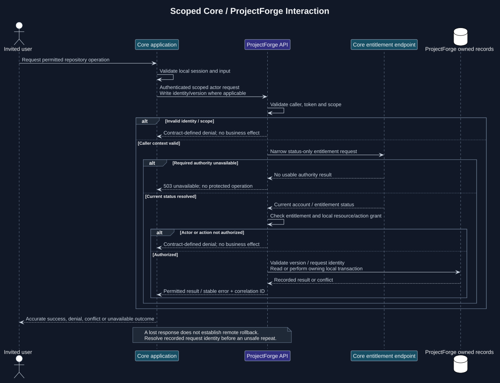

# 7. Integration & Interfaces

[Previous: Data Architecture](06-Data-Architecture.md) · [High-Level Design introduction](01-Introduction.md) · [Next: Technology Stack](08-Technology-Stack.md)

## 7.1 External Interfaces

The MVP has distinct browser, recipient, service, Git and operational entry paths. They preserve separate authority and result semantics. This chapter defines architectural contracts; concrete payloads, proposed route names and endpoint rules remain in the [API specification](../03-Low-Level-Design/05-API-Specification.md).

| Interface | Participants and purpose | Authority / boundary |
| --- | --- | --- |
| Authenticated workspace | Invited user and the receiving Laravel application; React/Inertia pages and commands | Application-local session, server validation and current resource/action policies |
| Protected recipient access | Employer/share recipient and Core; selected published representations and eligible artifacts | Current link/viewer context, selected content, language and download policy; no broader workspace access |
| Core → ProjectForge JSON | Core requests repository queries and issue/board operations for a current actor | Authenticated scoped caller/user context, current Core entitlement and ProjectForge local grant |
| ProjectForge → Core status | Narrow check of current account/entitlement | Status-only service authority; no Core private content access |
| Native HTTPS Git | Authorized Git client and ProjectForge; real clone/fetch/push and history | Git transport credentials plus applicable current entitlement and repository/action grant |
| Transactional system mail | Owning application and configured delivery service | Necessary invitation/recovery message data and restricted service credentials |
| Deployment and recovery | Authorized operator and application infrastructure | Explicit operational privileges and isolated restore procedures |

A link-scoped recipient context proves the applicable sharing conditions, not a named employer identity. A Core session does not automatically confer a repository grant. JSON issue-write authority does not confer Git write permission. Developer CI/CD is operational support, not a user workflow-execution interface.

Personal mail/calendar providers, AI, advanced review/releases and user workflow/deployment targets remain outside MVP integration scope.

## 7.2 Internal Communication

### 7.2.1 Within Each Application

Components use explicit local contracts to request owning operations. Controllers and adapters establish input/context; receiving owners enforce current authority, business invariants and persistence rules. A module boundary does not require HTTP, a broker or a separately deployed service.

Keep writes inside the owning application/component. Core cannot update ProjectForge tables or repository files directly, and ProjectForge cannot use an entitlement credential to read Core artifacts. Shared hosting does not relax these boundaries.

### 7.2.2 Between Core and ProjectForge

Use synchronous scoped JSON requests when the caller needs the immediate operation outcome. Core signs permitted calls representing the current actor. ProjectForge validates caller, scope, current Core entitlement and local resource/action authority before protected work.

The reverse status check is a narrow dependency for authorization, not a general callback granting content access. If required current authority cannot be established, ProjectForge fails closed with the documented unavailable result. Do not conceal that condition through stale entitlement or broad service permission.

### 7.2.3 Durable Asynchronous Work

Use owner-local durable work records/outboxes and supervised workers where the selected operation requires effects to survive interruption. Business state and required outbox intent commit in the owning local transaction; external processing/finalization follows the detailed contract.

Queue acceptance proves only that work was accepted under that mechanism. It does not prove PDF availability, recipient delivery, a remote commit or a Git transfer. Expose pending, failed, available or uncertain results according to the owning operation, and reconcile partial effects without deleting still-protected references.

## 7.3 API Overview

| Contract family | Main request context | Result obligations |
| --- | --- | --- |
| Core identity/entitlement status | Status-only service credential and Core subject identifier | Return permitted current account/entitlement status; bound the check and fail closed on unavailable authority |
| Repository summaries | Scoped actor token and optional opaque cursor | Return only permitted repositories with stable cursor behavior |
| Repository files/history | Repository identity, scoped read authority, immutable revision and applicable path/cursor | Return authorized entries/history with resolved revision identity; never expose host paths |
| Issue listing | Repository identity, issue-read scope and filter/cursor | Repository-scoped permitted issues and versions |
| Issue creation | Issue-write scope, stable request identity and validated fields | Stable created identity/number/version; no implied Git write permission |
| Issue update / board move | Issue-write scope, stable request identity, expected version and permitted changes | Preserve issue identity; reject stale writes without overwriting newer work |

The detailed API specifies the proposed versioned paths and field names. This HLD does not allocate additional routes, token formats or public endpoints. Native Git, file delivery and browser/Inertia responses retain their own transport contracts rather than adopting a universal JSON envelope.

### 7.3.1 Common Contract Content

For each operation, define caller and actor, resource scope, preconditions, input validation, expected version, request identity, owned state changes, result/error shape and relevant timeout/retry behavior. Include data exposure limits, pagination/order where applicable, and how uncertain outcomes are resolved.

Public identifiers and repository-relative paths do not authorize access. Validate scope and path semantics at the owner; responses must not disclose private host storage paths, tokens or unrelated user content.

## 7.4 Scoped Interaction Sequence

[Editable PlantUML source](Diagrams/hld-scoped-integration.puml) · [PNG alternative](Diagrams/hld-scoped-integration.png)

The sequence shows a representative Core-initiated ProjectForge operation. Request identity and expected-version checks apply to the operations that define them. A repeated write may resolve a prior stored outcome; the diagram does not require a fresh mutation for every authorized call.

Status validation and local grants are separate checks. Precise validation ordering, information-hiding responses and transactional checks follow the detailed contract. The diagram describes planned behavior and does not assert that routes or interoperability have been implemented.

## 7.5 Authentication, Authorization and Data Exposure

| Boundary | Required behavior |
| --- | --- |
| Browser session | Keep Laravel authentication, server validation and policies in the receiving application; frontend state is not authoritative |
| Employer retrieval | Resolve current viewer/link generation and permitted content, language and download state on each protected path |
| Scoped service call | Validate service identity and permitted actor/scope, then current entitlement and local resource/action authority |
| Entitlement endpoint | Restrict the service credential to status; do not expose professional content, artifacts or application history |
| Git transport | Verify actual transport credentials and repository/action grants; browser/API success is insufficient |
| Diagnostics | Return bounded stable error metadata and correlation IDs without secrets, private bytes or host paths |

Protect service and browser traffic with the applicable TLS/network restrictions. Keep application sessions/keys independent. Apply current policy to direct, alternate and range/cache-related retrieval paths under the selected delivery contract. Revocation cannot recall bytes already delivered or downloaded.

See [Security Architecture](10-Security-Architecture.md) for controls and threat analysis. Authentication establishes the caller; authorization still determines the permitted actor/resource/action effect.

## 7.6 Error and Failure Semantics

The JSON API's documented response categories are summarized below. These codes do not replace native Git errors or browser/recipient delivery behavior.

| Category | Documented JSON status | Architectural meaning |
| --- | --- | --- |
| Invalid identity | `401` | Caller identity cannot be accepted |
| Forbidden visible action | `403` | Authenticated context lacks the required action authority |
| Missing or hidden resource | `404` | Avoid disclosing resources outside the allowed visibility policy |
| Stale version or inconsistent repeated payload | `409` | Preserve the newer state or original request identity; do not silently overwrite/reuse |
| Invalid input | `422` | No successful business mutation; return permitted validation feedback |
| Required authority unavailable | `503` | No protected operation proceeds using assumed authority |

A denial has no unauthorized business side effect; bounded security/audit metadata may still be recorded. A timeout or lost response is different from a definitive rejection: the remote owner may already have committed. Preserve uncertainty until the operation identity/outcome is resolved.

Mail or background-processing failure must remain visible without implying rollback of an already committed business record. Define recovery at the owner rather than using generic cross-system compensation that could erase valid history.

## 7.7 Request Identity, Concurrency and Retries

Write identities bind the actor, operation and payload under the detailed contract. Matching retries resolve the stored result; a changed payload with the same identity is a conflict. Expected versions protect mutable resources against lost updates. These mechanisms complement authorization and do not replace current entitlement or grant checks.

For retryable or uncertain work:

1. Preserve the stable operation identity and any recorded local outcome.
2. Distinguish a definitive denial/validation conflict from unavailable authority, transport failure or unknown remote completion.
3. Recheck applicable current authority and resolve the existing recorded outcome before any repeat that could duplicate effects.
4. Resume or reconcile owner-local durable work while preserving reservations/references still required by pending effects.
5. Expose the accurate outcome and bounded diagnostic correlation to the caller/operator.

Bound timeouts and retry processing under the selected contract and operational policy. Do not introduce numerical timeout values, unlimited loops or a blanket retry of every error in this overview. A local transaction cannot atomically roll back a remote commit, mail delivery or filesystem/Git effect.

## 7.8 Compatibility and Contract Evolution

Keep scoped API versions, request/response meaning, error codes, pagination and request-identity behavior compatible with the actual consumers. Review changes to permissions and information visibility as contract changes even when the payload shape is unchanged.

Coordinate migrations and deployment ordering with both application versions and pending work. Do not silently repurpose identifiers, reinterpret an immutable revision as a live pointer, or remove fields required to resolve recorded outcomes. Record consequential changes in the relevant ADR and update LLD and traceability references.

Resolve compatible maintained package patches and verify both builds during [project setup](../../05-Agile-Iterative-Development/01-Project-Setup.md). No new integration provider or frontend authentication layer is introduced by this chapter.

## 7.9 Operational Dependencies and Observability

Monitor integration failures, required-authority unavailability, job backlog, failed effects and delivery problems with correlation IDs and bounded structured metadata. Avoid logging scoped credentials, share secrets, private files or full sensitive payloads.

Initial colocation is a shared host failure domain, while current entitlement checks create an explicit availability dependency across logical systems. Separate ownership does not promise automatic failover or unrestricted operation during an authority outage. Backup/restore must preserve related durable outcomes and private references so replay cannot duplicate or discard protected work.

See [Deployment Architecture](09-Deployment-Architecture.md) and [Non-Functional Strategy](11-Non-Functional-Strategy.md) for environment, supervision, recovery and measurement obligations.

## 7.10 Verification and Handoff

| Contract concern | Required evidence |
| --- | --- |
| Caller, actor and scope | Invalid credentials, wrong actor, wrong scope and hidden resources are handled safely |
| Current authority | Revoked account/entitlement/grant and unavailable status checks prevent unauthorized actions |
| Browser / recipient boundary | Session and link scopes remain distinct; direct and alternate retrieval preserve current policy |
| Repository reads | Permitted pagination, immutable revision resolution and no host-path/private-resource leakage |
| Issue writes | Stable repeated outcomes, payload mismatch, stale-version conflicts and distinct Git permission |
| Native Git | Actual authorized/denied clone/fetch/push interoperability under evaluated transport credentials |
| Partial failures | Lost response after commit, interrupted processing and retries preserve truthful outcomes |
| Durable work / mail | Acceptance and completion remain distinct; failure and safe recovery are observable |
| Compatibility / operations | Compatible builds/contracts, bounded diagnostics and recovery of pending outcomes |

Use the [API specification](../03-Low-Level-Design/05-API-Specification.md) and [Detailed Module Design](../03-Low-Level-Design/03-Detailed-Module-Design.md) for executable contract details, the [SRS](../../02-Requirements-Engineering/01-Software-Requirements-Specification.md) for governing requirements, and the [RTM](../../02-Requirements-Engineering/03-Requirements-Traceability-Matrix.md) for exact criteria and fresh evidence. Contract documentation and mock responses do not establish real Git, delivery, security or recovery interoperability.
