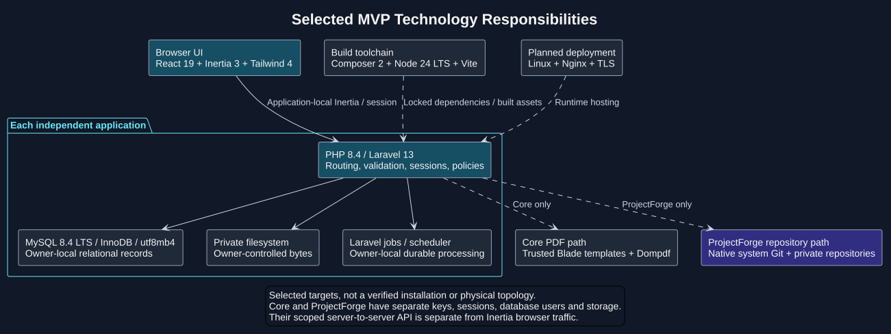

# 8. Technology Stack

[Previous: Integration & Interfaces](07-Integration-And-Interfaces.md) · [High-Level Design introduction](01-Introduction.md) · [Next: Deployment Architecture](09-Deployment-Architecture.md)

## 8.1 Languages & Frameworks

The stack follows the repository's selected MVP decisions. Versions below are selected targets from [Project Setup](../../05-Agile-Iterative-Development/01-Project-Setup.md) and the [frontend ADR](../ADR/ADR-007-React-Inertia-Frontend.md), not a claim that packages are installed or that compatibility has been demonstrated. Compatible maintained patch releases and exact dependency versions must be resolved and locked during setup.

| Technology | Selected target | Responsibility and boundary |
| --- | --- | --- |
| PHP | Maintained PHP 8.4 patch | Backend runtime for each independent application; required extensions follow resolved dependencies |
| Laravel | 13 | Routing, controllers, server-side validation, sessions, application services, policies and infrastructure integration |
| React | 19 | Interactive dashboard, forms and reusable presentation components |
| Inertia | 3 | Server-directed React pages within each Laravel application; not the Core/ProjectForge integration protocol |
| Tailwind CSS | 4 | Application styling within the selected frontend toolchain |
| Blade and Dompdf | Compatible pinned dependencies | Trusted Core PDF templates and rendering; no browser rendering or frontend SSR is required for this path |
| Laravel Fortify | Compatible pinned dependency | Selected authentication integration; Laravel retains session and policy enforcement |

React state and hidden UI controls do not authorize resource access. Server entry points enforce current actor, resource and action policy, including direct requests and protected delivery. Core and ProjectForge remain separate Laravel applications; the frontend choice does not merge their sessions or ownership.

## 8.2 Databases & Infrastructure

| Technology / facility | Selected direction | Architectural constraint |
| --- | --- | --- |
| MySQL | 8.4 LTS, InnoDB, utf8mb4 | Separate databases/users; local transactions and owner-scoped integrity; no cross-database foreign keys |
| Private filesystem | Owner-controlled storage roots | Core stores media/PDF/retained artifacts; ProjectForge stores private repositories; no public-path shortcut |
| Native system Git | Maintained compatible engine, effective version recorded at setup | Real Git transfers/history and repository authorization; do not simulate Git as JSON CRUD or relational commit rows |
| Linux | Planned deployment platform | Verify runtime, process identity, filesystem permissions and resource capacity |
| Nginx and TLS | Planned web entry point | Route permitted browser/service/Git paths and protect transport without bypassing owning authorization |
| Laravel jobs / scheduler and durable work | Owner-local processing under selected contracts | Persist required intent/outcomes; supervise workers; queue acceptance does not prove effect completion |
| Transactional SMTP delivery | Configured system-message dependency | Verify invitation/recovery delivery separately from development log output; protect credentials |
| Protected backup storage | Destination and protection verified during operational setup | Cover records, private artifacts and Git state; demonstrate isolated restoration |

The initial shared-host placement is a shared failure domain. Separate users, keys, sessions and paths do not provide host-level failover. Logical application containers do not require Docker, Kubernetes or separate physical database servers.

This chapter does not select an additional broker, cache server, object-storage provider or orchestration platform. Concrete queue/cache facilities and package settings must follow the selected baseline and verified setup needs rather than being inferred from a generic stack diagram.

## 8.3 Tools & Justification

| Tool | Purpose | Evidence needed |
| --- | --- | --- |
| Composer 2 | Resolve/install PHP dependencies | Compatible dependency resolution and repeatable install from the application lockfile |
| Node 24 LTS | Frontend build runtime | Effective version and successful build of each application's resolved frontend dependencies |
| Vite | Compile/bundle application frontend assets | Production asset build and correct Laravel/Inertia integration for the tested revision |
| Application package manager | Install locked frontend dependencies | Record the chosen manager/version and matching lockfile; use its reproducible installation mode |
| Native Git tooling | Source control and ProjectForge repository operations | Effective system version, safe repository execution and actual client interoperability checks |
| Project-selected test/lint tools | Validate implementation and build behavior | Record actual configured commands/results during setup; do not invent tools or passing checks |
| PlantUML with Java | Maintain editable UML and render SVG/PNG documentation | Valid dark-mode source and readable rendered diagrams; documentation tooling is separate from product runtime |

A consistent Laravel/React/Inertia toolchain supports reusable development practices while retaining two independently owned systems. Native Git preserves real repository semantics. Trusted Blade PDF templates keep document rendering separate from interactive browser UI. These choices follow existing decisions rather than a new comparison against current market alternatives.

## 8.4 Technology Responsibility Diagram

[Editable PlantUML source](Diagrams/hld-technology-stack.puml) · [PNG alternative](Diagrams/hld-technology-stack.png)

The diagram maps technology to responsibility. The application package applies separately to Core and ProjectForge; it does not depict a single shared application/database/storage root. Core's PDF and ProjectForge's Git branches are system-specific. Build and hosting dependencies are not user-facing product modules.

See [Architecture Overview](04-Architecture-Overview.md) for ownership and [Deployment Architecture](09-Deployment-Architecture.md) for physical placement and operational isolation.

## 8.5 Application Boundaries and Integration

Each application has independent configuration, application key, sessions, database credentials and private paths. Keep service and browser credentials distinct and grant adapters only the access needed by their contract.

Browser navigation and form interactions use each application's Laravel session and Inertia. Core-to-ProjectForge integration uses the authenticated scoped server-to-server API, with current entitlement and local grant checks. Native Git uses its own authorized transport. Do not introduce an independently deployed frontend or separate browser REST authentication layer through a tooling change.

Core uses MySQL for structured state and its private filesystem for exact artifacts. ProjectForge uses its own MySQL records and native repository storage. Database transactions cannot make files, Git, mail and remote commits atomic; the selected durable intent/outcome and reconciliation rules remain necessary regardless of framework convenience.

## 8.6 Versioning and Dependency Policy

The selected major targets constrain setup. Record the exact effective PHP, Composer, Node, database, Git and package-manager versions, plus resolved framework/adapters/PDF dependencies and required extensions. Verify compatibility against both application builds before treating the environment as usable.

Commit appropriate PHP and frontend lockfiles during the separately authorized implementation workflow. Reproduce installation from those lockfiles, keep local/deployment runtime assumptions aligned and record supported commands in Project Setup. A tool existing on a workstation does not prove a working project configuration.

Review dependency changes against authentication, Inertia navigation/validation, PDF output, migrations, background jobs and Git integration as applicable. Resolve security/compatibility issues through tested upgrades; revise the relevant ADR when a change alters the selected architecture rather than silently substituting a different stack.

No new patch numbers, dependency support guarantees or package installation results are asserted here.

## 8.7 Configuration and Secret Handling

| Configuration area | Required practice |
| --- | --- |
| Application configuration | Independent environments and keys; safe example configuration with names/non-secret examples only |
| Database/storage | Isolated database users, test stores and private paths; never implicitly target an existing demo database |
| Sessions and credentials | Keep application sessions, scoped service credentials, Git credentials and recipient access contexts distinct |
| SMTP and service access | Supply secrets through the documented environment mechanism; exclude them from source, logs and generated documentation |
| Jobs and scheduling | Document actual owner-local startup/shutdown, supervision, health and failed-work behavior |
| Tests and builds | Record isolated configuration and actual executable commands; avoid running checks against production data |
| Backups and restore | Protect copies and recovery credentials; verify access and consistency in an isolated environment |

Framework defaults and sample configuration do not establish isolation, safe sharing or operational readiness. Verify the configured behavior at the relevant entry point and persistence boundary.

## 8.8 Setup Verification

Project Setup remains the execution record. Complete the following for both applications before marking the environment ready:

1. Record effective runtime/tool versions, required extensions and actual application paths.
2. Resolve compatible dependencies and verify reproducible PHP/frontend installation from the chosen lockfiles.
3. Create and verify isolated database users, schemas, private storage, keys and sessions without reusing demo data implicitly.
4. Run the actual migrations and fixture/seed commands against the isolated environment; record outcomes.
5. Build frontend assets and verify Laravel/Inertia entry responses, forms, validation and navigation.
6. Verify trusted PDF rendering, private output handling and the distinction between publication and PDF availability.
7. Record queue/scheduler startup and shutdown, health signals, durable processing and failure handling.
8. Verify transactional SMTP test delivery separately from development logging and verify real Git-client transport/permission behavior at its assigned gate.
9. Record the configured test/lint/build commands and results, then confirm that a clean checkout can follow the guide.

This chapter does not execute or claim any application setup, install dependencies into the product or provide unverified runnable installation commands.

## 8.9 Risks and Revisit Triggers

| Risk | Required response / trigger |
| --- | --- |
| Framework/runtime/adapter incompatibility | Resolve and test compatible patches at setup; revisit the ADR if selected targets cannot satisfy governing criteria |
| Different local and deployment behavior | Compare effective versions, extensions, paths and build artifacts; validate on the deployment candidate |
| Inertia confused with service integration | Preserve the separate scoped API and application sessions; review authentication and navigation boundaries |
| Unsafe PDF or file processing | Retain trusted templates, private storage and selected resource limits; verify actual output and authorization |
| Native Git treated as an ordinary JSON endpoint | Test real client exchanges and repository permissions rather than relying on mock API success |
| Shared-host capacity or isolation failure | Measure workload/headroom and verify process/storage boundaries; revise placement when evidence requires it |
| Backup tooling mistaken for recoverability | Demonstrate isolated restore of records, artifact references/digests and Git consistency |

## 8.10 References and Handoff

Use the [selected baseline ADR](../ADR/ADR-006-Selected-Mvp-Implementation-Baseline.md) for governing implementation choices and the [frontend ADR](../ADR/ADR-007-React-Inertia-Frontend.md) for its selected amendment. [Project Setup](../../05-Agile-Iterative-Development/01-Project-Setup.md) records actual environment evidence.

Implementation details remain in [Detailed Module Design](../03-Low-Level-Design/03-Detailed-Module-Design.md), [Database Design](../03-Low-Level-Design/04-Database-Design.md) and the [API specification](../03-Low-Level-Design/05-API-Specification.md). Link exact verification criteria and fresh results through the [RTM](../../02-Requirements-Engineering/03-Requirements-Traceability-Matrix.md).

Continue with [Deployment Architecture](09-Deployment-Architecture.md) for environments, hosting boundaries, promotion and recovery.
