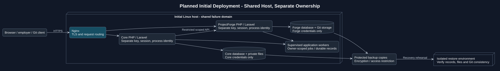
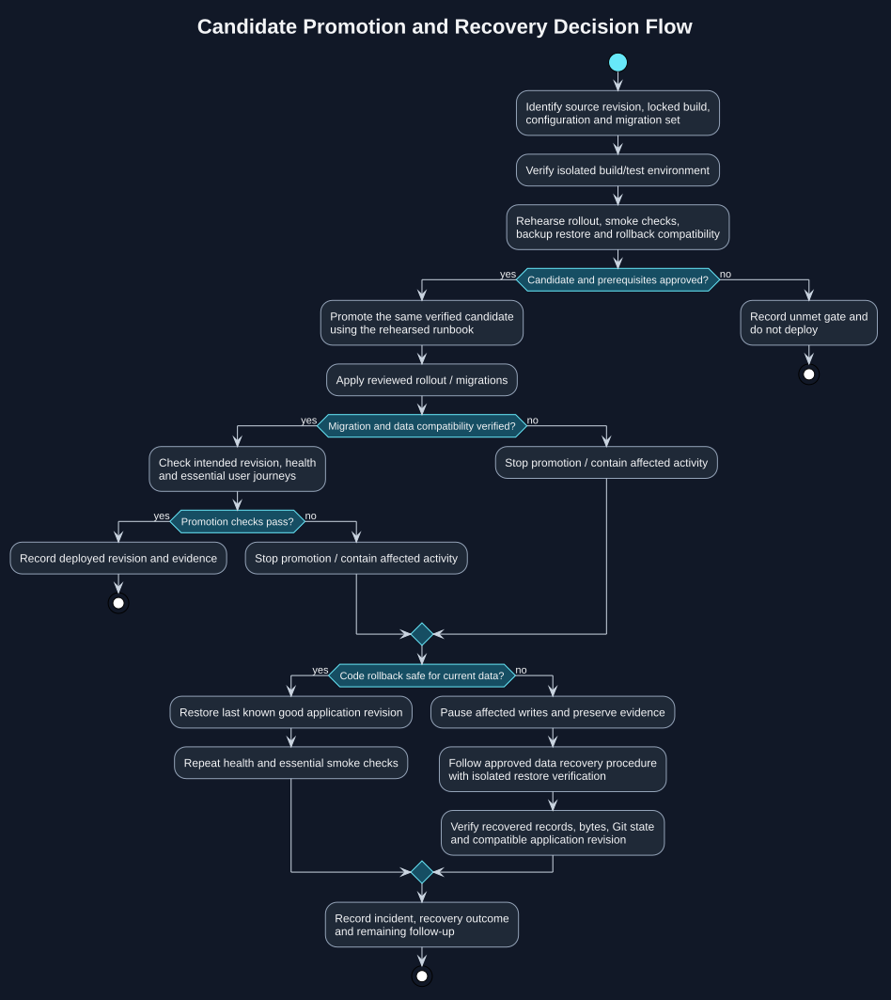

# 9. Deployment Architecture

[Previous: Technology Stack](08-Technology-Stack.md) · [High-Level Design introduction](01-Introduction.md) · [Next: Security Architecture](10-Security-Architecture.md)

## 9.1 Environments

Deployment promotes an identifiable, verified candidate through isolated environments. Core and ProjectForge remain independently owned applications in every environment. This chapter defines planned placement and operational constraints; it does not assert that infrastructure is provisioned or a release has been deployed.

| Environment | Purpose | Isolation and evidence |
| --- | --- | --- |
| Development | Establish reproducible application setup and implement selected capabilities | Separate local configuration, keys, databases and private paths; record effective tool versions and actual startup/build commands |
| Automated test | Exercise migrations, policies, lifecycle and contract behavior | Isolated test stores and synthetic fixtures; no implicit use of production or existing demo data |
| Pre-production rehearsal | Verify rollout, compatibility, smoke checks, backup restore and rollback | Candidate-identifiable configuration and representative behavior away from production; protect any sensitive test inputs |
| Production | Operate the approved candidate and preserve private records and artifacts | Restricted access, verified configuration, supervised services, protected backups and recorded deployed revision |
| Isolated restore | Demonstrate recovery without overwriting active service data | Separate restore targets and controlled connectivity; validate records, private bytes and repository consistency before trusting the result |

Promote the same verified candidate from rehearsal to production. Record environment-specific configuration without embedding secrets in build artifacts or evidence. Differences in runtime, permissions, storage and networking must be understood and checked before promotion.

## 9.2 Infrastructure & Networking

### 9.2.1 Planned Initial Topology

[Editable PlantUML source](Diagrams/hld-deployment.puml) · [PNG alternative](Diagrams/hld-deployment.png)

The planned initial Linux host uses Nginx/TLS to route permitted traffic to separate Core and ProjectForge Laravel runtimes. Each application has its own process identity, key, session boundary, database credentials and private storage. Owner-scoped workers process durable jobs under the corresponding application's access rights.

The diagram's worker box groups operational responsibilities; it does not authorize one shared worker identity to access both applications. Database/filesystem boxes express ownership and may share physical infrastructure. Core-to-ProjectForge scoped requests and the reverse narrow entitlement check retain their contracts even when colocated; the topology arrow does not enumerate every response or request path.

Backup and restore boxes express required protection and recovery boundaries. Their placement outside the host outline does not establish a provisioned destination or prove independence from host loss. Confirm the actual destination, failure coverage, permissions and restore procedure before relying on copies.

### 9.2.2 Process, Database and Storage Separation

| Boundary | Required deployment property |
| --- | --- |
| Application runtime | Separate configuration, keys, sessions and process identities for Core and ProjectForge |
| Relational persistence | Separate MySQL databases/users with only the owning application's required privileges |
| Core private storage | Restrict media, PDFs and retained artifacts to authorized Core access; no direct public directory exposure |
| ProjectForge repositories | Private native Git storage with ProjectForge-controlled operations; no Core filesystem shortcut |
| Workers and scheduled work | Owner-scoped credentials/paths, supervised execution and durable failure/outcome records |
| Environment separation | Distinct test/rehearsal/production data and secrets; no accidental cross-environment processing |
| Operational access | Explicit least-required deployment, monitoring and recovery privileges; protect keys and private content |

Verify effective permissions and runtime behavior. Different directory names or configuration files alone do not demonstrate isolation. Shared database-engine or host placement must not imply shared application authority.

### 9.2.3 Network Entry and Service Access

| Traffic | Routing and authorization requirement |
| --- | --- |
| Browser workspace | HTTPS entry to the receiving Laravel application; server sessions and resource policies remain authoritative |
| Employer sharing / file delivery | Core-controlled delivery path with current sharing and artifact eligibility checks, including direct paths |
| Native Git | ProjectForge's evaluated HTTPS Git transport with applicable credentials, entitlement and repository/action grant |
| Scoped JSON API | Restrict intended service callers; validate signed/scoped actor context and local grants |
| Core entitlement status | Narrow status-only service authority; never expose private content under this credential |
| Database / private storage | No public data-access entry point; restrict application and operator access to their required boundaries |
| System mail | Configured transactional delivery with protected credentials and observable failure |

Actual hostnames, ports, certificate configuration, service bindings and firewall rules belong in the rehearsed environment/runbook. This HLD does not invent addresses or expose a database administration endpoint. TLS protects transport but does not replace current application authorization.

### 9.2.4 Shared Failure Domain

Initial colocation means host outage, disk exhaustion and resource contention can affect both systems. Logical ownership does not provide high availability or automatic failover. Current entitlement validation also creates an explicit availability dependency for protected ProjectForge work.

Measure representative workload and host headroom, enforce selected admission/resource limits and revisit placement if capacity, isolation or recovery evidence requires it. No new host size, numerical availability promise or recovery objective is assigned here.

## 9.3 CI/CD Overview

Developer build/test/deployment automation supports the application lifecycle. It is separate from deferred product features that would let users execute workflows or deployment jobs.

| Stage | Required result |
| --- | --- |
| Identify candidate | Source revision, dependency lockfiles, effective runtime/tool versions and migration set are attributable |
| Build and verify | Reproducible dependency installation, frontend assets and applicable test/lint/build results for both applications |
| Rehearse | Isolated rollout, migration compatibility, essential smoke journeys, rollback and recovery checks |
| Check promotion prerequisites | Approved candidate, correct environment, protected usable backup, permissions and rollback/restore readiness |
| Roll out | Apply the reviewed procedure and migrations using the same verified candidate |
| Verify and record | Confirm deployed revision, health and essential behavior; record outcome, limitations and follow-up |

Do not insert secrets into source, frontend bundles, logs or release evidence. Build output and environment configuration must remain traceable without exposing secret values. Actual automation commands and host-specific steps are recorded only after successful rehearsal.

### 9.3.1 Promotion and Recovery Decision Flow

[Editable PlantUML source](Diagrams/hld-deployment-promotion.puml) · [PNG alternative](Diagrams/hld-deployment-promotion.png)

The flow summarizes the [deployment plan](../../06-Deployment-Release/01-Deployment-Plan.md) and [runbook](../../06-Deployment-Release/02-Runbook.md). An unmet prerequisite stops promotion. Failure after rollout requires containment and the compatible recovery path; it does not authorize an automatic production restore.

The runbook governs exact write-pausing, traffic handling, migration ordering, recovery commands and operator decisions. A diagram cannot establish their safety without rehearsal evidence.

## 9.4 Configuration and Secret Management

Provide independent configuration and secrets for each application/environment. Keep safe example configuration limited to names and non-secret examples; document how actual secrets are supplied under operational access controls.

| Configuration subject | Validation focus |
| --- | --- |
| Runtime and dependencies | Match the selected compatible PHP/Laravel/frontend/database/Git setup and locked build |
| Application keys and sessions | Preserve independent application authority and correct receiving-session behavior |
| Database credentials | Resolve only the intended owner/environment with restricted privileges |
| Private paths and Git storage | Confirm intended storage locations, ownership and absence of public path leakage |
| Service credentials | Scope Core/ProjectForge requests and status-only entitlement access correctly |
| SMTP and worker settings | Verify actual delivery and owner-local processing without logging credentials |
| Backup/recovery configuration | Confirm protected copies, access and intended isolated restore targets |

Configuration changes can affect authorization and compatibility even when code is unchanged. Include them in candidate evidence and smoke checks. Do not assume copying a production configuration into rehearsal is acceptable isolation.

## 9.5 Migrations, Workers and Pending Effects

Review migrations against both the candidate and the currently deployed data/code. Determine whether the previous code can read/write the resulting schema before calling code rollback safe. A failed or partially completed migration requires explicit diagnosis and the runbook's recovery decision; blindly reversing DDL is not a general recovery strategy.

Account for running workers, scheduled tasks, in-flight requests and durable outbox/reservation records during rollout. Avoid executing incompatible old jobs against a new schema or replaying effects whose outcome is already recorded. The actual deployment procedure determines when work is paused, drained, restarted or reconciled.

Restart or reload application/worker processes as required by the verified release procedure, then verify they use the intended revision and configuration. Durable jobs remain owner-local and must not bypass current policy merely because they were queued before deployment.

## 9.6 Health, Readiness and Smoke Checks

Health signals establish process/service condition; readiness and user-journey checks establish whether the intended candidate can serve its required behavior. Keep diagnostic responses bounded and avoid disclosing configuration or private content.

| Check area | Required observation |
| --- | --- |
| Revision and routing | Intended application revision and frontend assets are served through the correct route |
| Authentication / isolation | Invited account/session behavior and separation between applications/environments remain correct |
| Protected content | Unauthorized cross-user and direct-file access is denied; selected authorized retrieval works |
| Presentation and history | Explicit save/publication and preserved submitted material behave under the applicable smoke scope |
| ProjectForge boundary | Scoped API, current entitlement/local grants and evaluated native Git behavior remain correct |
| Workers and mail | Expected owner-local processing runs, failed work is visible and transactional delivery is verified appropriately |
| Storage and database | Required connectivity, private permissions, disk reserve and migrations are correct |
| Operational signals | Correlation, failures, backlog, capacity and backup freshness are observable without secret leakage |

Select executable smoke commands and representative fixtures in the runbook. Do not describe unexecuted checks as passed or modify real user data casually to obtain a smoke result. Link the actual revision, environment, observations and unresolved issues to release evidence.

## 9.7 Backup and Isolated Recovery

Protected recovery copies must cover the data needed to reconstruct consistent service: Core records/private artifacts, ProjectForge metadata/native repositories, relevant durable work and the configuration/secrets required under the approved recovery procedure. Determine actual backup consistency boundaries and destination protection during operational setup.

An isolated restore must verify:

1. Intended backup set, application/schema compatibility and controlled restore target.
2. Core references, exact artifact bytes and recorded digests, including retained submitted materials.
3. Publication/sharing state and current authorized versus denied retrieval.
4. ProjectForge actor/grant mappings, repository storage identity and native Git object/ref consistency.
5. Pending/uncertain jobs, request outcomes and reservations before replay or cleanup.
6. Required access configuration and essential user journeys without enabling unintended production effects.

A successful backup job does not prove restoration, and a database-only recovery does not prove private artifacts or Git state are intact. Reconcile records and bytes before trusting restored service. Use the [operations and recovery design](14-Appendices.md#design-record-06-design-quality-and-security-analysis-03-operations-backup-recovery-and-resilience-md) for retained analysis and governing criteria.

## 9.8 Rollback, Restore and Incident Handling

| Operation | Use only when | Required follow-up |
| --- | --- | --- |
| Traffic handling / promotion stop | The runbook requires containment before or after candidate activation | Preserve evidence and prevent continued unsafe processing under the verified procedure |
| Code rollback | Previous application revision is compatible with current schema, data and pending work | Restore the known good revision and repeat health/essential smoke checks |
| Application-data restore | Data recovery is necessary and the approved isolated procedure is verified | Pause affected writes, preserve incident evidence and validate consistent records/bytes/Git before resuming |
| Reconciliation | Recorded intent and actual local/remote effects differ or remain uncertain | Resolve under the owner and stable request identity without duplicating effects or releasing protected references |

Do not treat code rollback as a way to undo sent mail, delivered bytes, remote commits or every database change. Data restore can discard later writes, so the exact recovery procedure and decision authority must be established before production execution.

Record the failure trigger, affected revision/configuration, containment, chosen recovery path, verification outcome and remaining follow-up. Carry operating procedures and known issues into [maintenance](../../07-Maintenance-Evolution/01-Maintenance-Plan.md).

## 9.9 Release Evidence and Handoff

The planned first stable MVP release is version `1.0.0`. Release publication and deployment are separately recorded activities under the deployment plan; completing this chapter does not create a release, tag a revision or authorize live rollout.

Before deployment, link the candidate to fresh evidence for locked builds, environment/secret isolation, reviewed migrations, scoped API/native Git boundaries, protected retrieval, essential user journeys, backup restoration and compatible rollback. Identify unmet gates explicitly rather than relying on a completed document or a green process-only health check.

Use [Project Setup](../../05-Agile-Iterative-Development/01-Project-Setup.md) for verified environment commands, the [deployment plan](../../06-Deployment-Release/01-Deployment-Plan.md) for promotion/release obligations, the [runbook](../../06-Deployment-Release/02-Runbook.md) for rehearsed operating steps and the [RTM](../../02-Requirements-Engineering/03-Requirements-Traceability-Matrix.md) for exact requirement criteria and evidence. Host-specific settings and demonstrated recovery remain execution gates until verified.
