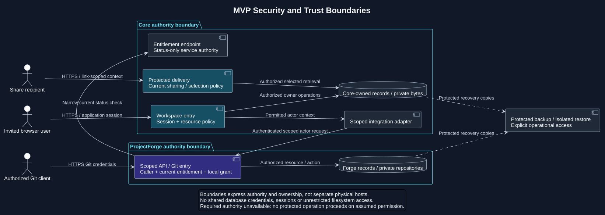

# 10. Security Architecture

[Previous: Deployment Architecture](09-Deployment-Architecture.md) · [High-Level Design introduction](01-Introduction.md) · [Next: Non-Functional Strategy](11-Non-Functional-Strategy.md)

## 10.1 Authentication & Authorization

Security preserves invited access, selected employer visibility, exact submitted materials and repository-specific authority across two independent applications. Authentication identifies a caller; authorization determines whether the current actor may perform the requested action on the target resource. A successful login, known identifier or reachable service credential is insufficient by itself.

Core and ProjectForge retain separate sessions, application keys, credentials and private storage. Laravel/Fortify provides the selected authentication integration; server-side policies remain authoritative for browser, direct-file, service, Git and background entry paths. React/Inertia UI state does not grant permission.

### 10.1.1 Admission and Account Controls

Limit workspace admission to invited users. Apply the selected account, administrator, recovery and factor controls from the governing baseline and component contracts. Validate invitation consumption and account/session state under the owning operation. Do not infer new universal MFA rules, expiry durations or recovery exceptions from this HLD.

Account administration grants only the selected administrative actions. It does not confer unrestricted access to private professional content, application history or repositories. Operational access to backup/configuration likewise requires explicit privileges rather than an application administrator label.

### 10.1.2 Authority by Entry Path

| Entry path | Authority established | Required decision |
| --- | --- | --- |
| Authenticated browser | Receiving application's session and current account context | Check resource ownership/grant and action policy on the server |
| Employer representation / artifact | Current link-scoped viewer context and sharing generation/policy | Check selected publication/content, language and download eligibility before delivery |
| Core → ProjectForge API | Authenticated scoped caller and permitted actor context | Check scope, current Core entitlement and local resource/action grant |
| ProjectForge → Core status | Narrow status-only service authority | Return only permitted current account/entitlement status, never private content |
| Native Git | Evaluated transport credentials and applicable repository scope | Check current entitlement and repository/action grants independently of JSON/browser permission |
| Worker / scheduled operation | Owner-local execution identity plus applicable operation context | Preserve current policy and protected references; queue admission is not blanket authority |
| Deployment / recovery | Explicit operating privileges | Restrict systems, secrets and data to the required operational task |

Deny unauthorized protected work without an unauthorized business effect or content disclosure. If required current authority is unavailable, return the documented safe unavailable result rather than assuming permission. Audit/security metadata may still be recorded under its bounded policy.

## 10.2 Data Protection

### 10.2.1 Information and Secret Handling

| Protected information | Required protection |
| --- | --- |
| Profiles, drafts and application history | Owner/resource policy on reads and writes; no cross-user exposure through identifiers, exports or diagnostics |
| Published revisions and selected shared content | Immutable snapshot identity with current sharing policy; publication is not unrestricted public storage |
| Private media/PDF/submitted artifacts | Owner-private paths, authorized delivery, protected references and integrity metadata |
| Repository content and metadata | ProjectForge-local grants, private native Git storage and current entitlement checks |
| Passwords, invite/share verifiers and Git tokens | Use the selected protected hash/verifier storage; never log raw secret values |
| Application/service/recovery secrets | Restricted configuration access; keep secrets out of source, frontend assets and evidence |
| Backup copies | Encryption and restricted access, with verified destination/failure coverage and isolated restore |
| Audit and diagnostic metadata | Necessary bounded records; exclude private bytes, credentials and unnecessary sensitive payloads |

TLS protects the applicable transport boundaries. Artifact digests support integrity verification but do not encrypt bytes or authorize retrieval. Private path naming does not replace filesystem permissions or application policy.

This chapter does not claim encryption of every primary database/file store or select an additional encryption/key-management product. Any such requirement must be defined in the governing criteria and implemented with its recovery/key-lifecycle consequences.

### 10.2.2 Protected Sharing and Direct Delivery

Recipient access is link-scoped, not proof of a named employer identity. Resolve the current viewer/link policy and exact eligible representation before every protected delivery. Apply that boundary to direct URLs, alternate endpoints, downloads and range/cache-related paths under the selected delivery contract.

Disabling a link, changing its password and changing PDF/download mode are distinct operations; do not silently substitute one for another. Verify applicable active-context and in-flight behavior against the detailed contract. Revocation cannot recall bytes already emitted or downloaded.

A submitted-material reference protects historical integrity; it does not make that artifact generally shareable. Withdrawal of publication changes access without rewriting immutable submission history or authorizing deletion of still-retained bytes.

### 10.2.3 Browser Input and State Changes

Use server-side validation, resource policies and the selected Laravel state-change/anti-forgery controls for cookie-authenticated requests. Same-origin placement or CORS configuration alone does not establish protection. Verify session/cookie behavior on actual routes rather than relying on frontend navigation.

Treat user-authored content and file metadata as untrusted input. Render content through the intended safe presentation path and retain trusted Blade PDF templates. Do not turn uploaded content into executable previews or unrestricted server-side templates. Detailed accepted formats, sanitization and rendering restrictions belong to the owning contract.

## 10.3 Trust-Boundary Diagram

[Editable PlantUML source](Diagrams/hld-security-boundaries.puml) · [PNG alternative](Diagrams/hld-security-boundaries.png)

The diagram separates Core workspace authority, recipient delivery, scoped integration, narrow status access and ProjectForge repository authority. Arrows indicate permitted relationships, not unrestricted data access. The shared ProjectForge entry box groups API/Git security responsibilities; their credentials and transport contracts remain distinct.

Backup/restore requires explicit operational authority. Logical boundaries do not imply separate physical hosts or host-level resilience. Each application's internal resource policy still applies even when a diagram does not show every check.

See the retained [security threat model and trust-boundary design](14-Appendices.md#design-record-06-design-quality-and-security-analysis-02-security-threat-modeling-and-trust-boundaries-md) for detailed analysis and status.

## 10.4 Threats & Mitigations

| Threat / failure | Architectural control | Verification focus |
| --- | --- | --- |
| Cross-user identifier substitution | Current owner/resource/action checks and owner-scoped relationships | Another user's record/artifact/repository cannot be read or mutated |
| Confused service authority | Scoped actor context, local grants and narrow entitlement credentials | Valid service credentials cannot read arbitrary content or impersonate unrestricted user authority |
| Stale/revoked permission | Current sharing, entitlement and repository checks | Revocation and unavailable-authority scenarios across direct, browser, API and Git paths |
| Direct file or cache bypass | Private storage and policy-governed delivery | Known URLs, alternate routes and cache/range requests preserve selected access |
| Forged or invalid browser command | Authentication, anti-forgery evaluation, validation and policies | Direct state changes do not bypass protection through missing UI context |
| Unsafe content/file processing | Selected format/type policy, trusted templates and bounded handling | Invalid or executable input cannot become an exposed usable artifact or execution path |
| Quota/resource exhaustion | Concurrent reservations/admission, disk reserve and bounded work | Parallel uploads, PDF/Git load and interrupted work preserve limits and existing content |
| Git path/action abuse | Repository-relative path validation and native transport/grant boundary | No host path disclosure, unrelated repository access or implied write grant |
| Repeated/stale commands | Expected versions and actor/operation/payload-bound request identity | Stale writes and mismatched retries cannot overwrite or duplicate effects |
| Partial failure destroys historical bytes | Durable records and retained reference protection | Lost responses, failed finalization and cleanup preserve exact submitted materials |
| Secret/private-content leakage | Bounded errors/logs, restricted configuration and backup access | Responses, diagnostics, build assets and evidence exclude secrets/private bytes |
| Host or backup loss/compromise | Owner isolation, protected copies and isolated restore | Validate effective access and recovery of consistent records/artifacts/Git state |

Controls are planned obligations. A framework feature, private directory name or threat table does not demonstrate enforcement. Keep residual risk visible until the actual candidate and configured boundaries have been checked.

## 10.5 File, PDF and Git Execution Boundaries

File admission distinguishes transferred bytes from an admitted usable artifact and from a consumer association. Enforce selected type, per-file, aggregate quota and disk-reserve policy with concurrent reservations where required. Reject or reconcile failed work without exposing partial output or deleting unrelated retained material.

PDF processing uses trusted templates and exact selected inputs. Apply the selected processing limits and private-output policy. Successful queue acceptance or publication does not prove authorized PDF availability. Do not invent a malware-scanner deployment or claim content is safe solely because a MIME value or extension matches.

ProjectForge controls native Git operations, private repository paths and applicable ref/action permissions. Validate repository-relative inputs and return permitted revision identities rather than host paths. A SQL rollback cannot undo an already changed Git ref; durable observation and owner-controlled reconciliation remain necessary. Advanced review/releases and user workflow execution stay outside MVP scope.

## 10.6 Revocation, Concurrency and Failure Safety

Current checks and write/version constraints must apply at the contract-defined decision point. Checking permission once at page load does not authorize later protected requests. Checking available quota once does not prevent concurrent over-admission.

Expected versions protect mutable records. Stable request identity prevents unsafe repeated effects but does not replace authorization. On retry, recheck applicable current authority and resolve the recorded operation outcome under its contract. Do not repeat a write blindly after a lost response or release artifact protection while its owning effect remains uncertain.

If required authority cannot be established, fail closed with the documented unavailable outcome. Distinguish this from invalid identity, forbidden action, hidden resources and stale writes using the [API specification](../03-Low-Level-Design/05-API-Specification.md). Return stable bounded errors/correlation metadata without leaking sensitive resource existence or paths.

## 10.7 Operational Security and Recovery

Deploy separate application identities, keys, sessions, database users and private paths. Restrict service endpoints and administrative access to intended callers. Keep development/test/rehearsal isolated from production and avoid implicit reuse of demo data or production secrets.

Protect backup copies and the secrets needed to restore them. Rehearse restoration in an isolated target, checking record relationships, artifact digests, sharing/authorization behavior and Git consistency. Inspect pending jobs, request outcomes and reservations before replay to avoid unauthorized or duplicate effects.

Initial shared hosting remains a shared failure domain. Logical separation does not guarantee containment of a host compromise. Confirm actual privileges, destination protection and failure coverage rather than implying that separate database credentials provide complete infrastructure isolation.

When a security-relevant failure occurs, follow the approved runbook: contain affected activity, preserve necessary bounded evidence, identify affected authority/data and use the verified recovery path. Do not rotate keys, invalidate sessions or restore production data casually; their impact and execution steps belong in the operating procedure.

See [Deployment Architecture](09-Deployment-Architecture.md) and the [runbook](../../06-Deployment-Release/02-Runbook.md) for promotion, containment and recovery interfaces.

## 10.8 Security Verification and Handoff

| Boundary | Required evidence |
| --- | --- |
| Admission/account/session | Invited access, recovery and selected administrator/factor controls on the actual configuration |
| Private resources | Cross-user and hidden-resource requests, direct delivery and owner-scoped mutation checks |
| Sharing | Correct selected content plus invalid/changed/revoked viewer/link contexts, direct paths and applicable active/cache behavior |
| Service integration | Wrong caller/actor/scope, status-only access, current entitlement and unavailable-authority failure |
| Native Git / issues | Actual allowed/denied transport operations, local grants, revocation and separate issue-write authority |
| Input/rendering | Invalid content, unsafe file handling, trusted PDF inputs and safe error/partial-output behavior |
| Concurrency/repetition | Stale versions, concurrent quota admission, repeated request identities and uncertain finalization |
| Secrets/diagnostics | No credentials/private bytes/host paths in responses, logs, source or frontend output |
| Isolation/recovery | Effective process/storage/database separation, protected backup access and isolated restore consistency |

Use the [SRS](../../02-Requirements-Engineering/01-Software-Requirements-Specification.md) for governing security/quality requirements, [Detailed Module Design](../03-Low-Level-Design/03-Detailed-Module-Design.md) for policy and operation boundaries, [Database Design](../03-Low-Level-Design/04-Database-Design.md) for integrity mechanisms and the [RTM](../../02-Requirements-Engineering/03-Requirements-Traceability-Matrix.md) for exact criteria and fresh evidence.

Record unmet gates and residual risks with an owner and required evidence. Documentation, mock success or a green health response does not establish secure deployment, compliance certification or passed runtime verification.
