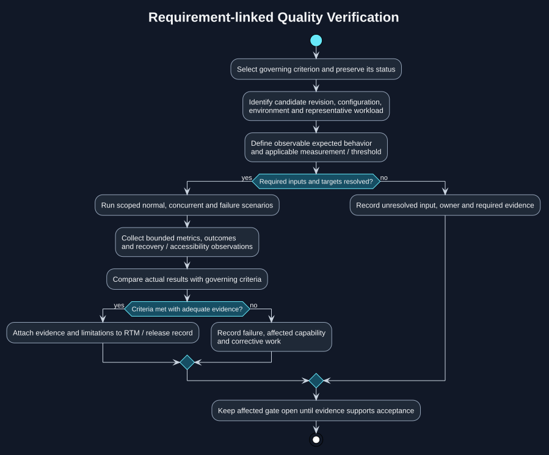

# 11. Non-Functional Strategy

[Previous: Security Architecture](10-Security-Architecture.md) · [High-Level Design introduction](01-Introduction.md) · [Next: Risks & Key Decisions](12-Risks-And-Key-Decisions.md)

Non-functional quality is verified on an identifiable candidate under a defined workload and configuration. Architecture provides the mechanisms; measured behavior and criterion-linked evidence establish whether they are adequate. A functioning page, healthy process or completed backup job does not establish every quality attribute.

The governing source is the [SRS quality, security and recovery requirements](../../02-Requirements-Engineering/01-Software-Requirements-Specification.md#requirements-specification-quality-security-and-recovery-requirements). Preserve selected scope and the recorded status of proposed thresholds. Do not invent latency, concurrency, uptime, retention, accessibility-conformance, RPO or RTO targets in this chapter.

## 11.1 Scalability

Start with the planned shared-host deployment and explicit Core/ProjectForge ownership. Measure combined resource use before increasing limits, worker concurrency or changing placement. Logical application separation does not remove contention for CPU, memory, disk, database capacity or network throughput.

| Workload / resource | Architectural response | Evidence needed |
| --- | --- | --- |
| Ordinary browser/API traffic | Owner-scoped queries, bounded results and appropriate indexes/pagination | Representative request rate/concurrency, latency and errors |
| Uploads and retained artifacts | Selected per-file/aggregate policy, concurrent reservations and disk reserve | Simultaneous admission, interrupted upload, replacement and retained-reference checks |
| PDF generation | Owner-local durable processing and applicable resource limits | Queue wait, processing outcome, resource consumption and effect on interactive traffic |
| Native Git transfers/history | Repository/action grants and bounded owner-controlled processing | Actual client workloads, repository size/revision context and shared-host impact |
| Background jobs / outbox | Supervised owner-local workers, durable outcomes and reconciliation | Backlog, oldest pending work, failures and recovery under representative load |
| Storage/database growth | Review access paths, retained bytes and reference-aware cleanup | Growth by owner/store, query behavior, disk headroom and cleanup safety |

A single successful upload does not establish quota safety under concurrent admissions. More workers can increase contention or exhaust disk/memory; verify the resulting workload rather than assuming throughput scales linearly.

Revisit placement when measured capacity, isolation or recovery needs exceed the verified host capability. Record a consequential architecture change through the relevant ADR. This strategy does not mandate horizontal scaling, replication, a new broker or orchestration platform.

## 11.2 Performance

### 11.2.1 Workload Classes

| Class | Representative operations | Measurements |
| --- | --- | --- |
| Interactive view/save | Dashboard, profile/draft form, application list/update | End-to-end latency distribution, errors, query behavior and resource use |
| Protected delivery | Selected representation, PDF/media retrieval | Authorization outcome, response/transfer behavior and applicable cache/range handling |
| Scoped service integration | Repository summaries, files/history, issue list/write | End-to-end and service-boundary latency, entitlement dependency and error categories |
| Bulk upload | Admitted artifacts, replacement and concurrent reservations | Transfer versus usable-artifact completion, bytes, processing and rejection behavior |
| PDF work | Exact-input rendition creation | Queue wait, processing duration, availability/failure and interactive-load impact |
| Native Git | Authorized clone/fetch/push and revision-bound queries | Actual transfer duration/bytes, errors, repository context and host contention |

Do not combine long-running Git/upload/PDF work into an ordinary page-response average. Separate queue acceptance, processing completion and user-visible availability. A fast failure is not a successful performance result unless it is the expected rejection scenario.

### 11.2.2 Measurement Method

For each run, identify the candidate, configuration, environment, data/repository sizes, actor mix and concurrency. Define the measurement start/end and success condition before collecting results. Record sample count, latency distribution and error counts/categories, not only an average. Distinguish cache/warm-state assumptions where they affect interpretation.

Inspect queries, payload size, frontend behavior and expensive work before optimizing. Keep ownership and current authorization intact; do not improve latency by serving stale entitlement or broader private content. Derived caches/read models must preserve actor, revision and policy scope under their detailed contracts.

Compare results to the applicable SRS/RTM criterion. If a numerical target or workload is unresolved, record the missing input and owner; report observations without declaring that criterion passed.

## 11.3 Availability & Reliability

### 11.3.1 Failure and Degradation

| Failure / disturbance | Required behavior |
| --- | --- |
| ProjectForge unavailable | Report repository capability failure truthfully; a Core local save does not establish remote success |
| Required entitlement authority unavailable | Fail closed with the documented unavailable result; no protected operation uses assumed permission |
| Lost response after commit | Preserve uncertain outcome and resolve stable request identity before an unsafe repeat |
| Worker restart or interrupted job | Retain durable work/protection and resume or reconcile under its owner |
| SMTP failure | Expose delivery failure/pending outcome without implying rollback of an already committed business record |
| Disk/resource pressure | Enforce selected admission/limits and preserve unrelated retained data |
| Shared-host outage | Recognize that both applications may be affected and use the verified recovery procedure |

Keep local success, definitive denial, conflict, pending work and unknown remote completion distinct. Do not turn dependency failure into a fabricated success or perform blanket retries. Detailed timeout, retry and reconciliation rules belong in [Integration & Interfaces](07-Integration-And-Interfaces.md) and the [API specification](../03-Low-Level-Design/05-API-Specification.md).

### 11.3.2 Durable State and Recovery

Use owner-local transactions, request identities/outcomes, outbox records and protected artifact references where specified. Expected versions prevent stale writes; idempotency complements current authorization rather than replacing it. Preserve immutable publication/submission meaning and reference protection across failures.

Protect backup copies and demonstrate isolated restoration of relational records, private artifacts and native Git state. Check reference/digest consistency, grants, sharing state and unfinished jobs before replay or cleanup. Recovered data must not silently re-enable revoked access or duplicate already recorded effects under the governing recovery contract.

Measure the recovery boundary and elapsed restoration behavior against applicable objectives. No RPO/RTO or uptime percentage is assigned here. See [Deployment Architecture](09-Deployment-Architecture.md) and the retained [operations and recovery design](14-Appendices.md#design-record-06-design-quality-and-security-analysis-03-operations-backup-recovery-and-resilience-md).

## 11.4 Observability

| Signal | Purpose | Boundary |
| --- | --- | --- |
| Correlation and operation IDs | Trace permitted request/job outcomes across owners | Stable bounded metadata, not secret tokens or private payloads |
| Latency and error categories | Distinguish normal, denied, conflicting, unavailable and failed behavior | Segment by workload/interface without exposing user content |
| Health and readiness | Identify process condition versus ability to serve required behavior | Avoid secret/configuration leakage; a green process check is insufficient |
| Job backlog/failures | Detect delayed, interrupted or unreconciled durable effects | Include pending age and owning operation, not private artifact bytes |
| Capacity | Detect storage reserve, memory/CPU/database or repository pressure | Measure shared-host contention and owner/store growth |
| Backup freshness and result | Identify missing/stale/failed recovery copies | Restore evidence remains separate from backup completion |
| Audit metadata | Attribute significant authority/state changes under the selected policy | Restrict access and keep necessary bounded evidence |

Define operational review/notification thresholds and ownership from the accepted requirements and actual environment. Do not assume a particular monitoring provider, paging schedule or staffing model. Diagnostic collection must not become an unrestricted copy of professional content, credentials or Git private data.

During failures, provide accurate user feedback and enough restricted operator evidence to diagnose the owning boundary. Follow the [runbook](../../06-Deployment-Release/02-Runbook.md) for containment and recovery rather than improvising destructive production actions from a health alert.

## 11.5 Accessibility, Usability and Compatibility

Verify actual browser journeys, including dashboard/forms, validation, publication confirmation, protected recipient views and basic issue/board interactions. Include keyboard operation, focus behavior, meaningful labels, understandable errors/status, readable content and applicable responsive/reflow behavior under the governing criteria.

Asynchronous work and errors must remain understandable without relying only on visual styling. Distinguish saved draft, published revision, available PDF and completed delivery/remote operation. A conflict should preserve the user's ability to understand and recover without falsely claiming completion.

Record the tested browser/viewport/input or assistive-technology configuration and actual observations. Automated checks can identify some problems; supplement them with direct journey checks where the criterion requires it. Do not claim a WCAG level or universal browser support without a defined target and evidence.

The dark-mode documentation diagrams do not establish the product's theme or prove product accessibility. Product UI requirements remain separate from documentation presentation preferences.

## 11.6 Security, Integrity and Retention as Quality Gates

Performance and availability cannot override current resource authority, exact submitted history or private storage. Verify cross-user/direct-file access, changed shares/grants, unavailable authority, concurrent quota admission and uncertain finalization alongside normal success paths.

Publication withdrawal must not rewrite submitted materials. Replacement and cleanup must preserve still-protected bytes. Recovery must restore consistent records and artifacts while applying the intended current access/reconciliation rules. Detailed controls are in [Security Architecture](10-Security-Architecture.md) and [Data Architecture](06-Data-Architecture.md).

Do not trade these invariants for faster responses, lower storage use or apparent service availability without a revised governing decision and affected requirement review.

## 11.7 Maintainability and Recoverable Change

Maintain explicit module/data ownership, compatible scoped contracts and independently reproducible builds. Verify code/schema compatibility, configuration and pending work when dependencies or migrations change. Code rollback, data restoration and reconciliation are different operations with different safety preconditions.

Use [Project Setup](../../05-Agile-Iterative-Development/01-Project-Setup.md) to record actual install/build/test commands and effective versions. Keep ADRs, HLD/LLD, PlantUML sources/renders and criterion traces consistent when a consequential choice changes. A documentation update does not authorize a deployment or prove a compatible implementation.

## 11.8 Quality Verification Flow

[Editable PlantUML source](Diagrams/hld-quality-verification.puml) · [PNG alternative](Diagrams/hld-quality-verification.png)

The flow applies to a selected criterion or affected gate. Missing workload/threshold inputs remain explicit gaps. A failed run produces scoped corrective work and fresh verification; an accepted observation does not imply unrelated gates are complete. Evidence and limitations remain attached to the actual candidate.

## 11.9 Requirement Coverage

The following existing SRS identifiers provide area-level traceability. Their exact criterion wording, disposition and evidence belong in the SRS and RTM; this mapping does not promote proposed criteria to accepted status or include deferred product features.

| SRS area | Strategy coverage | Required evidence focus |
| --- | --- | --- |
| QSR-D01–D02 | Sections 11.1–11.2 | Defined workloads, separate latency/error observations, combined capacity and bounded resource use |
| QSR-D03 | Section 11.5 | Operable, accessible and compatible journeys on recorded configurations |
| QSR-D04 | Sections 11.3–11.4 | Observable availability, controlled degradation and accurate dependency outcomes |
| QSR-D05–D07 | Sections 11.1, 11.5–11.6 and Security Architecture | Changed authority, private information and safe MVP content boundaries; untrusted workflow execution remains deferred |
| QSR-D08–D09 | Sections 11.3 and 11.6 | Truthful completion, immutable history and reference-aware retention/removal |
| QSR-D10–D12 | Section 11.3 and Deployment Architecture | Protected/observable backups, demonstrated restoration and safe restored access/reconciliation |
| QSR-D13 | Section 11.4 | Useful restricted operational evidence |
| QSR-D14 | Section 11.7 | Maintainable, verifiable and recoverable change |

## 11.10 Measurement Record and Handoff

For each verification record, capture:

- Exact requirement/criterion and its current disposition, expected behavior and applicable threshold.
- Candidate revision, build/dependency identity, environment and relevant configuration without secret values.
- Representative data/repository size, workload, concurrency, actor context and measurement boundaries.
- Executed scenario/check, sample count, observed metrics, error categories and integrity/accessibility/recovery outcomes as applicable.
- Comparison with the criterion, limitations, unresolved inputs and linked evidence artifacts.
- Resulting gate status, follow-up owner and corrective/revisit work where needed.

Use the [RTM](../../02-Requirements-Engineering/03-Requirements-Traceability-Matrix.md) for exact criterion-level links and fresh results. Track unresolved trade-offs in [Risks & Key Decisions](12-Risks-And-Key-Decisions.md). Report an attribute as unverified when evidence is absent; completion of this strategy is not a benchmark result, release approval or demonstrated operational readiness.
