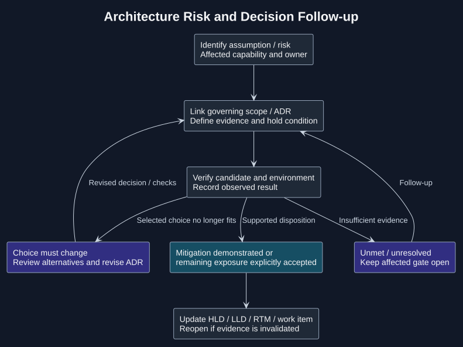

# 12. Risks & Key Decisions

[Previous: Non-Functional Strategy](11-Non-Functional-Strategy.md) · [High-Level Design introduction](01-Introduction.md) · [Next: Traceability](13-Traceability.md)

## 12.1 Risks & Mitigations

The selected architecture is a basis for implementation and verification, not proof of production feasibility. The [feasibility and risk assessment](../../01-Project-Planning/03-Feasibility-And-Risk-Assessment.md) is the project-level risk source: its listed risks remain open, likelihood awaits assessment, and Farhad owns follow-up. This chapter summarizes architectural consequences without assigning new risk IDs, probability scores or acceptance decisions.

| Risk / assumption | Architectural consequence | Mitigation and evidence | Hold / revisit condition |
| --- | --- | --- | --- |
| Host or dependency incompatibility | Both applications may fail to install, build or migrate reproducibly | Verify locked installs, effective versions, builds and isolated migrations | Reconcile environment before dependent implementation |
| Insufficient process/data isolation | Cross-application or cross-user exposure | Verify independent keys, sessions, database users, private paths and effective permissions using distinct synthetic actors | Hold affected integration/deployment until the boundary is demonstrated |
| Inconsistent entitlement or repository grants | Revoked/unauthorized Git or issue access | Actual browser/API/Git allowed and denied operations, including authority changes and unavailable status checks | Hold ProjectForge integration; review authority contract |
| Unselected or unpublished material exposed | Employer/private-file boundary fails | Verify current link/viewer scope, selected revision/content and direct/alternate retrieval | Hold protected sharing |
| Edits or retries alter submitted history | Exact application evidence becomes unreliable | Immutable events, protected references, stable request identity and digest comparison after edits/retries | Hold affected publication/submission flow |
| Transactional mail failure | Invitation or recovery cannot complete operationally | Controlled delivery and failure-handling evidence, separate from log output | Hold affected onboarding/recovery capability |
| Concurrent work exhausts storage | Partial artifacts, unavailable service or lost retained bytes | Verify admission/reservation limits, disk reserve, cleanup and observable low-space behavior | Restrict affected intake until capacity/controls are verified |
| Backup cannot restore consistent data/access | Stable service cannot recover safely | Isolated restore of records, exact artifacts/digests, Git refs and effective permissions | Hold stable production release |

Additional manifestations include lost cross-system responses, stale writes, interrupted workers and incompatible pending jobs during migration. Track them under the affected risk/work item rather than creating a competing register. Initial shared hosting remains a shared outage/contention domain despite logical isolation.

## 12.2 Links to ADRs

The [ADR index](../ADR/Decision-Index.md) owns consequential choices, alternatives and status. The following summary preserves its selected/superseded boundaries.

| Record | Current architectural meaning | Follow-up / verification |
| --- | --- | --- |
| [ADR-001: Modular boundaries](../ADR/ADR-001-Modular-Application-Boundaries.md) | Internal ownership rationale retained; combined-system proposal superseded by ADR-005 | Do not use the earlier proposal to merge Core and ProjectForge |
| [ADR-002: Publication and history](../ADR/ADR-002-Explicit-Publication-And-History.md) | Selected for MVP through ADR-006/T05; deferred-domain clauses excluded | Verify explicit publication, independent drafts and exact retained submission materials |
| [ADR-003: Durable external attempts](../ADR/ADR-003-Durable-External-Attempts.md) | Selected MVP outbox, idempotency and truthful-outcome rules; provider/runner details deferred | Verify repeated/interrupted work and owner-controlled reconciliation |
| [ADR-004: Compatible evolution](../ADR/ADR-004-Compatible-Incremental-Design-Evolution.md) | Selected MVP compatibility and evolution principles | Review consumers, migrations, pending work and recovery impact |
| [ADR-005: Owner system boundaries](../ADR/ADR-005-Owner-Mvp-System-Boundaries.md) | Accepted Core / independent ProjectForge / private media scope | Verify scoped integration and separate persistence/storage authority |
| [ADR-006: Implementation baseline](../ADR/ADR-006-Selected-Mvp-Implementation-Baseline.md) | Selected mechanisms, alternatives, consequences and evidence gates | Preserve mandatory G2 boundary verification; runtime acceptance remains gated |
| [ADR-007: React/Inertia frontend](../ADR/ADR-007-React-Inertia-Frontend.md) | Selected interactive React/Inertia direction; replaces interactive Blade/Alpine and retains trusted Blade PDF templates | Verify actual builds, forms, validation, accessibility and protected server requests |

A selected mechanism is not an implemented or verified capability. Deferred provider, advanced collaboration and user workflow-execution designs do not become MVP prerequisites merely because retained ADR material discusses them.

## 12.3 Selected Choices Versus Evidence Gates

| Subject | Classification | Required action |
| --- | --- | --- |
| Separate systems, ownership and private media scope | Accepted boundary | Implement within it; revise governing decision before changing it |
| Stack and MVP mechanisms | Selected technical direction | Resolve compatible patches and verify actual setup rather than treating all stack choices as open |
| React/Inertia amendment | Selected frontend decision | Preserve Laravel server authority and independent application sessions |
| Target capacity and dependency fit | Evidence/input gate | Measure workload and record effective versions/build results |
| Actor/status validation and real Git transport | Mandatory boundary evidence | Demonstrate current entitlement, local grants and real client interoperability before dependent enablement |
| SMTP, backup destination and actual restore | Operational evidence/input gates | Confirm facilities, protection and controlled delivery/restore results |
| Numerical targets still unresolved in governing criteria | Open input | Identify owner and required resolution; do not invent a passing threshold |

Do not remove feature scope to conceal an unverified integration risk. Additional hosting, services or tooling with cost/licensing impact require the project-level review identified in the feasibility assessment; this chapter commits no purchase or new dependency.

## 12.4 Decision and Risk Follow-up Flow

[Editable PlantUML source](Diagrams/hld-risk-decisions.puml) · [PNG alternative](Diagrams/hld-risk-decisions.png)

An unmet gate remains open. Close a risk only when mitigation is demonstrated or remaining exposure is explicitly accepted for the relevant outcome by the decision authority. Acceptance of residual risk does not silently waive a separate mandatory requirement or release gate. Reopen the risk when changed code, configuration, dependency or environment invalidates its evidence.

## 12.5 Required Follow-up Record

For each architecture risk or unresolved choice, link the existing issue/work item and record:

- Affected capability, entry point, owning component and governing requirement/ADR.
- Assumption or failure condition and concrete impact on private access, history, availability or recovery.
- Named follow-up owner, evidence required and the gate/capability held if evidence is insufficient.
- Tested source revision, environment/configuration, scenario, observed outcome and evidence location.
- Decision/disposition, residual exposure and explicit authority for any acceptance or changed choice.
- Impacted HLD/LLD, PlantUML views, criterion traces and revisit trigger.

Farhad owns project-level follow-up in the current assessment. Component responsibility identifies where evidence is produced; it does not invent an assigned team or transfer decision authority.

## 12.6 Change Impact and Handoff

Before changing a selected choice, compare alternatives against accepted scope, authorization, exact submitted history, independent data ownership, compatibility and recovery. Capture the consequential decision and supersession relationship in an ADR; preserve earlier rationale rather than erasing it.

Update affected component/data/API contracts, diagrams and exact RTM traces together. Recheck normal, denied, stale, concurrent and interrupted paths affected by the change. Deployment or dependency changes can invalidate evidence even when the conceptual diagram is unchanged.

Use [Project Setup](../../05-Agile-Iterative-Development/01-Project-Setup.md) for environment evidence, the [test strategy](../../05-Agile-Iterative-Development/02-Test-Strategy.md) for verification execution, the [deployment plan](../../06-Deployment-Release/01-Deployment-Plan.md) for release gates and the [RTM](../../02-Requirements-Engineering/03-Requirements-Traceability-Matrix/README.md) for exact criterion/results. Documentation completion does not close open risks, approve deployment or assert runtime success.
