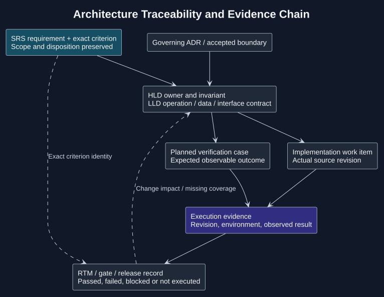

# 13. Traceability

[Previous: Risks & Key Decisions](12-Risks-And-Key-Decisions.md) · [High-Level Design introduction](01-Introduction.md) · [Next: Appendices](14-Appendices.md)

## 13.1 Requirements → Components Mapping

Traceability connects governing behavior to an owning design, implementation and observable verification. The [SRS](../../02-Requirements-Engineering/01-Software-Requirements-Specification.md) owns requirement meaning. The [RTM](../../02-Requirements-Engineering/03-Requirements-Traceability-Matrix.md) owns the individual requirement/criterion mappings and execution evidence. This chapter provides the architecture-level map without duplicating the criterion register or changing scope/disposition.

| Requirement area | Owning component / boundary | HLD provision | Verification focus |
| --- | --- | --- | --- |
| Invited identity, current authority and private isolation | Core Identity and Access; receiving resource owner; ProjectForge local grants | [Context](03-System-Context.md), [Components](05-Components.md), [Security](10-Security-Architecture.md) | Admission, cross-user, wrong-scope and changed/unavailable authority |
| Profiles, tailored drafts and explicit publication | Core Professional Presentation | [Architecture](04-Architecture-Overview.md), [Data](06-Data-Architecture.md) | Explicit selection/apply/publish, stale versions and independent immutable snapshots |
| Private media, PDFs and protected employer access | Core Files and Operations; Representation and Sharing | [Data](06-Data-Architecture.md), [Interfaces](07-Integration-And-Interfaces.md), [Security](10-Security-Architecture.md) | Exact selected content, direct retrieval, viewer/link changes and private storage |
| Manual applications and actual submitted history | Core Applications with Presentation/Files contracts | [Components](05-Components.md), [Data](06-Data-Architecture.md) | Immutable events and exact retained bytes after edits, withdrawal and retry |
| Repositories, native Git and file history | ProjectForge Git Collaboration | [Context](03-System-Context.md), [Interfaces](07-Integration-And-Interfaces.md) | Real allowed/denied client transfers, revision identity and local grants |
| Repository issues and simple Kanban | ProjectForge Work Management | [Components](05-Components.md), [Interfaces](07-Integration-And-Interfaces.md) | Repository scope, stable issue identity, expected versions and separate Git authority |
| Setup and selected technology compatibility | Each application and operational setup | [Technology Stack](08-Technology-Stack.md) | Locked builds, effective versions and isolated configuration |
| Quality, operational evidence and recovery | Owning components and explicitly authorized operations | [Deployment](09-Deployment-Architecture.md), [Security](10-Security-Architecture.md), [Quality](11-Non-Functional-Strategy.md) | Representative workloads, accessibility, protected backups and isolated restore |

A shared concern must still identify the actual resource owner and entry point. A generic link to “security” or “operations” alone is insufficient for a criterion involving a specific file, grant or historical artifact.

## 13.2 Trace Chain and Sources

[Editable PlantUML source](Diagrams/hld-traceability.puml) · [PNG alternative](Diagrams/hld-traceability.png)

| Source / record | Authority |
| --- | --- |
| [Project charter](../../01-Project-Planning/01-Project-Charter.md#mvp-scope) | Product/MVP scope |
| [SRS](../../02-Requirements-Engineering/01-Software-Requirements-Specification.md) | Requirement wording, domain definitions and recorded status |
| [RTM](../../02-Requirements-Engineering/03-Requirements-Traceability-Matrix.md) and its linked criterion register | Exact criterion identity, applicability, gates and evidence references |
| [ADR index](../ADR/Decision-Index.md) | Consequential design choices and selected/superseded status |
| HLD chapters | Architectural ownership, invariants and cross-system constraints |
| [Detailed Module Design](../03-Low-Level-Design/03-Detailed-Module-Design.md), [Database Design](../03-Low-Level-Design/04-Database-Design.md), [API specification](../03-Low-Level-Design/05-API-Specification.md) | Owning operations, persistence and executable interface contracts |
| [Product backlog](../../02-Requirements-Engineering/02-Product-Backlog.md) and implementation work item | Scoped delivery work and actual source revision |
| [Test strategy](../../05-Agile-Iterative-Development/02-Test-Strategy.md) and execution record | Planned cases, expected outcomes, actual observations and evidence |
| [Deployment plan](../../06-Deployment-Release/01-Deployment-Plan.md) / [runbook](../../06-Deployment-Release/02-Runbook.md) | Candidate-specific release, deployment and recovery evidence |

The diagram is a review chain, not proof that every link already exists. A design-area link identifies where to refine coverage; it does not demonstrate implementation or a passing test.

## 13.3 Criterion-level Mapping Rules

Reuse exact identifiers from the RTM/register. Do not create replacement acceptance IDs, silently alter criterion wording or mark a proposed/conditional criterion accepted merely because this HLD discusses it.

For each selected criterion, identify its owning component and exact design provision, relevant ADR, implementation work item/revision and planned verification case. Record the expected observable outcome, test prerequisites and normal/denied/failure paths relevant to the requirement. Attach actual execution evidence when available.

One criterion may require several components or cases; one test may support several criteria only when its observations demonstrate each expected outcome. An area-level mapping does not establish full criterion coverage. Separate source criterion identity from new supplemental checks and preserve the authoritative register's applicability.

## 13.4 Cross-Cutting Architecture Traces

| Concern | Trace through | Evidence boundary |
| --- | --- | --- |
| Current authorization | Identity → receiving entry point → resource/action policy → owned read/write | Direct media, browser, API and Git paths; include revocation and unavailable authority |
| Exact historical materials | Explicit selected revision/files → submission event → protected reference/bytes | Verify unchanged material identity/digest after edits, withdrawal, retry and restore |
| Truthful remote effects | Scoped request → local outcome → remote owner → stable request identity/reconciliation | Lost response, repeated payload, interrupted worker and separately committed outcomes |
| Resource/retention policy | Admission/reservation → concurrent operation → owning references → cleanup | Quota contention, disk reserve and pending/protected bytes |
| Recoverability | Backup set → isolated restore → related records/artifacts/Git → safe access/work replay | Restore actual private bytes, current intended access and uncertain work consistently |
| Quality/accessibility | Governing workload/configuration → scenario → measurement/observation | Candidate-specific results; no invented threshold or conformance claim |

Use the existing QSR-D01–QSR-D14 coverage in [Non-Functional Strategy](11-Non-Functional-Strategy.md#119-requirement-coverage) as an area map, then resolve the exact applicable criterion in the RTM. Deferred provider/workflow clauses remain deferred.

## 13.5 Verification Status and Evidence

Preserve the RTM's existing execution labels and dispositions. Planned design coverage and runtime execution status are different dimensions.

| Evidence condition | Reporting rule |
| --- | --- |
| Design provision exists; implementation absent | Identify design coverage and retain implementation pending / verification not executed |
| Test case defined but not run | Record planned expected outcome; do not infer pass |
| Check executed successfully | Link actual candidate, environment, observation and artifact supporting the criterion |
| Check fails | Record actual failure, affected criterion/work item and corrective follow-up |
| Dependency prevents execution | Record the blocking dependency and owner; do not replace it with an assumed result |
| Criterion deferred/conditional | Preserve scope disposition and activation condition rather than counting it as completed |
| Evidence no longer fits changed code/configuration | Reassess affected traces and obtain fresh evidence before relying on the result |

Each execution needs the criterion/case reference, source/build revision, environment/configuration, fixtures/preconditions, actual steps/check, expected and observed outcomes, result and evidence location. Exclude secrets/private payloads from shared evidence. A mock-only result cannot prove real Git transport, SMTP delivery, filesystem isolation or restoration.

## 13.6 Architecture Change Impact Review

When a boundary, contract, schema, dependency or environment changes:

1. Identify affected requirements/criteria and their current scope/disposition.
2. Follow them through owners, entry points, data/references, service consumers and relevant ADRs.
3. Check authorization, immutable history, version/request identity, retention and recovery consequences.
4. Update HLD/LLD provisions, PlantUML sources/renders and implementation work references together.
5. Identify previous evidence invalidated by the change and select proportionate fresh checks.
6. Record actual results, remaining risk and affected gate status in the RTM/work item.

Review reverse traces too: a component, operation or test without a governing requirement or justified supporting responsibility may indicate unplanned scope. A requirement without an owner or executable verification path remains a coverage gap.

## 13.7 Handoff and Coverage Review

Before implementing a selected slice, confirm that every applicable criterion has an owner, exact design provision, accepted/selected decision context, planned check and identified dependencies. Before acceptance, attach fresh evidence for the implemented revision and make failed, blocked and unexecuted work explicit.

Before release, review cross-component authorization/retention/recovery traces alongside the operational gates. Avoid treating a count of links, a completed chapter or a green build as proof that every criterion is satisfied. The [Risks & Key Decisions](12-Risks-And-Key-Decisions.md) chapter identifies architecture follow-up; the RTM and release records retain the concrete acceptance evidence.

No implementation, runtime pass, release approval or production readiness is established by completing this traceability chapter.
