<a id="14-appendices"></a>

# 14. Appendices

[Previous: Traceability](13-Traceability.md) · [High-Level Design introduction](01-Introduction.md)

This appendix provides navigation, supporting references, the current HLD diagram catalog and retained design records. Use the current HLD chapters and selected ADRs to interpret older alternatives, proposed controls and deferred-domain material. Inclusion here does not approve a proposal, expand MVP scope or establish runtime evidence.

## 14.1 Reference Guide and Authority

| Question | Governing reference |
| --- | --- |
| What belongs in the MVP? | [Project charter](../../01-Project-Planning/01-Project-Charter.md#mvp-scope) and selected scope dispositions |
| What behavior and terms are required? | [SRS](../../02-Requirements-Engineering/01-Software-Requirements-Specification.md), including its data definitions and criterion status |
| Which architecture choices are selected or superseded? | [ADR index](../ADR/Decision-Index.md), especially the system-boundary, implementation-baseline and frontend records |
| Where is current architectural ownership explained? | [Introduction](01-Introduction.md), [Architecture Overview](04-Architecture-Overview.md) and [Components](05-Components.md) |
| How are records, exact artifacts and lifecycle rules preserved? | [Data Architecture](06-Data-Architecture.md) and physical Database Design |
| Which contracts govern calls and failure outcomes? | [Integration & Interfaces](07-Integration-And-Interfaces.md) and the API specification |
| What has actually been implemented or verified? | Work-item/source references and execution evidence in the [RTM](../../02-Requirements-Engineering/03-Requirements-Traceability-Matrix.md) and owning test/release records |
| Where are operational commands and recovery results recorded? | [Project Setup](../../05-Agile-Iterative-Development/01-Project-Setup.md), [deployment plan](../../06-Deployment-Release/01-Deployment-Plan.md) and [runbook](../../06-Deployment-Release/02-Runbook.md) |

A source link or diagram is design context, not evidence of a passing implementation. Resolve conflicts against accepted scope and the applicable selected/superseding ADR, then update affected documents together. Do not interpret retained broad-product models as authorization to implement deferred mail/calendar, AI, advanced collaboration, general Sprints or user workflow/deployment execution.

## Implementation design references

<a id="implementation-design-references"></a>

### 14.2 Detailed Design and Verification References

| Reference | Use |
| --- | --- |
| [MVP wireframes](../02-UI-UX-Design/06-Wireframes-And-Prototypes.md#mvp-wireframes) | Intended user journeys and interactions; UI does not replace server authorization |
| [Detailed Module Design](../03-Low-Level-Design/03-Detailed-Module-Design.md) | Owning operations, invariants and component contracts |
| [MVP physical schema design](../03-Low-Level-Design/04-Database-Design.md#mvp-physical-schema-design) | Record families, keys, constraints, write ordering and engine-specific verification |
| [MVP API contracts](../03-Low-Level-Design/05-API-Specification.md#mvp-api-contracts) | Scoped requests, errors, request identity, conflicts and retry behavior |
| [Criterion-level design and test trace](../../02-Requirements-Engineering/03-Requirements-Traceability-Matrix.md#criterion-level-design-and-test-trace) | Exact criteria, applicability, implementation and execution evidence |
| [Test strategy](../../05-Agile-Iterative-Development/02-Test-Strategy.md) | Planned cases, actual results and regression/release verification |
| [Feasibility and risk assessment](../../01-Project-Planning/03-Feasibility-And-Risk-Assessment.md) | Open risks, assumptions, owners and evidence-dependent holds |

## 14.3 Current HLD Diagram Catalog

All current diagrams listed here use dark-mode PlantUML. Each view has editable `.puml` source plus SVG for document embedding and PNG for image viewers. The catalog identifies current chapter assets separately from the retained legacy catalog later in this appendix.

| View | Owning chapter | Editable source | SVG | PNG |
| --- | --- | --- | --- | --- |
| System context | [System Context](03-System-Context.md) | [PlantUML](Diagrams/hld-context.puml) | [SVG](Diagrams/hld-context.svg) | [PNG](Diagrams/hld-context.png) |
| Application structure and ownership | [Architecture Overview](04-Architecture-Overview.md) | [PlantUML](Diagrams/hld-containers.puml) | [SVG](Diagrams/hld-containers.svg) | [PNG](Diagrams/hld-containers.png) |
| Component dependencies | [Components](05-Components.md) | [PlantUML](Diagrams/hld-components.puml) | [SVG](Diagrams/hld-components.svg) | [PNG](Diagrams/hld-components.png) |
| Conceptual data relationships | [Data Architecture](06-Data-Architecture.md) | [PlantUML](Diagrams/hld-data-model.puml) | [SVG](Diagrams/hld-data-model.svg) | [PNG](Diagrams/hld-data-model.png) |
| Presentation/submission lifecycle | [Data Architecture](06-Data-Architecture.md) | [PlantUML](Diagrams/hld-lifecycle.puml) | [SVG](Diagrams/hld-lifecycle.svg) | [PNG](Diagrams/hld-lifecycle.png) |
| Scoped service interaction | [Integration & Interfaces](07-Integration-And-Interfaces.md) | [PlantUML](Diagrams/hld-scoped-integration.puml) | [SVG](Diagrams/hld-scoped-integration.svg) | [PNG](Diagrams/hld-scoped-integration.png) |
| Technology responsibilities | [Technology Stack](08-Technology-Stack.md) | [PlantUML](Diagrams/hld-technology-stack.puml) | [SVG](Diagrams/hld-technology-stack.svg) | [PNG](Diagrams/hld-technology-stack.png) |
| Initial deployment topology | [Deployment Architecture](09-Deployment-Architecture.md) | [PlantUML](Diagrams/hld-deployment.puml) | [SVG](Diagrams/hld-deployment.svg) | [PNG](Diagrams/hld-deployment.png) |
| Promotion/recovery decisions | [Deployment Architecture](09-Deployment-Architecture.md) | [PlantUML](Diagrams/hld-deployment-promotion.puml) | [SVG](Diagrams/hld-deployment-promotion.svg) | [PNG](Diagrams/hld-deployment-promotion.png) |
| Security/trust boundaries | [Security Architecture](10-Security-Architecture.md) | [PlantUML](Diagrams/hld-security-boundaries.puml) | [SVG](Diagrams/hld-security-boundaries.svg) | [PNG](Diagrams/hld-security-boundaries.png) |
| Quality verification | [Non-Functional Strategy](11-Non-Functional-Strategy.md) | [PlantUML](Diagrams/hld-quality-verification.puml) | [SVG](Diagrams/hld-quality-verification.svg) | [PNG](Diagrams/hld-quality-verification.png) |
| Risk/decision follow-up | [Risks & Key Decisions](12-Risks-And-Key-Decisions.md) | [PlantUML](Diagrams/hld-risk-decisions.puml) | [SVG](Diagrams/hld-risk-decisions.svg) | [PNG](Diagrams/hld-risk-decisions.png) |
| Traceability/evidence chain | [Traceability](13-Traceability.md) | [PlantUML](Diagrams/hld-traceability.puml) | [SVG](Diagrams/hld-traceability.svg) | [PNG](Diagrams/hld-traceability.png) |

### 14.3.1 Rendering and Maintenance

From this chapter's directory, adjust the local JAR path and render a source with Java/PlantUML:

```powershell
java -jar path/to/plantuml.jar -tsvg Diagrams/hld-context.puml
java -jar path/to/plantuml.jar -tpng Diagrams/hld-context.puml
```

Repeat for the affected source basename. Use the project's available renderer/layout dependencies; record the actual tool version when reproducibility matters. Keep the explicit dark background, readable labels and ownership boundaries in the source. Do not substitute Mermaid or standalone DOT for UML maintenance.

Update source and both rendered formats together, inspect the result for clipped/overlapping labels, and check chapter links. A shared view should retain one canonical source and be reused rather than copied into competing variants. Do not add a diagram merely to repeat an existing table or current view.

## 14.4 Retained Record Navigation

The detailed records below retain rationale, alternatives, cross-cutting analysis and original local anchors. Their statuses remain part of the retained source; selected ADRs and current scope govern interpretation.

| Record | Reading guidance |
| --- | --- |
| [Resumefolio — Design Drivers and Solution Options](#design-record-01-software-architecture-01-design-drivers-and-solution-options-md) | Retained design record; interpret using current scope and selected ADR status |
| [Resumefolio — System Decomposition and Boundaries](#design-record-01-software-architecture-02-system-decomposition-and-boundaries-md) | Retained design record; interpret using current scope and selected ADR status |
| [Resumefolio — Process View Concurrency and Runtime Behavior](#design-record-01-software-architecture-03-process-view-concurrency-and-runtime-behavior-md) | Retained design record; interpret using current scope and selected ADR status |
| [Resumefolio — Deployment Topology Nodes and Networks](#design-record-01-software-architecture-04-deployment-topology-nodes-and-networks-md) | Retained design record; interpret using current scope and selected ADR status |
| [Resumefolio — Cross-Cutting Concerns Overview](#design-record-01-software-architecture-05-cross-cutting-concerns-overview-md) | Retained design record; interpret using current scope and selected ADR status |
| [Resumefolio — Architecture Diagram Catalog](#design-record-01-software-architecture-diagrams-diagram-catalog-md) | Retained design record; interpret using current scope and selected ADR status |
| [Resumefolio — Software Architecture](#design-record-01-software-architecture-software-architecture-md) | Retained design record; interpret using current scope and selected ADR status |
| [Resumefolio — Quality Attributes and Design Trade-offs](#design-record-06-design-quality-and-security-analysis-01-quality-attributes-and-design-trade-offs-md) | Retained design record; interpret using current scope and selected ADR status |
| [Resumefolio — Security, Threat Modeling and Trust Boundaries](#design-record-06-design-quality-and-security-analysis-02-security-threat-modeling-and-trust-boundaries-md) | Retained design record; interpret using current scope and selected ADR status |
| [Resumefolio — Operations, Backup, Recovery and Resilience](#design-record-06-design-quality-and-security-analysis-03-operations-backup-recovery-and-resilience-md) | Retained design record; interpret using current scope and selected ADR status |
| [Resumefolio — Design Review, Traceability and Implementation Handoff](#design-record-06-design-quality-and-security-analysis-05-design-review-traceability-and-handoff-md) | Retained design record; interpret using current scope and selected ADR status |
| [Resumefolio — Design Quality and Security Analysis](#design-record-06-design-quality-and-security-analysis-design-quality-and-security-analysis-md) | Retained design record; interpret using current scope and selected ADR status |
| [Quality and Security — Diagram Catalog](#design-record-06-design-quality-and-security-analysis-diagrams-diagram-catalog-md) | Retained design record; interpret using current scope and selected ADR status |
| [Resumefolio — Design Review Evidence](#design-record-06-design-quality-and-security-analysis-review-and-traceability-evidence-evidence-catalog-md) | Retained design record; interpret using current scope and selected ADR status |
| [Resumefolio — FAU References and Design Coverage](#design-record-design-references-and-coverage-md) | Retained design record; interpret using current scope and selected ADR status |
| [Resumefolio — Design Purpose, Scope and Approach](#design-record-design-scope-and-approach-md) | Retained design record; interpret using current scope and selected ADR status |

Retained UML views now use local dark-mode PlantUML sources and SVG renders. Non-UML charts/maps also use local dark renders, with their native Graphviz or plotting sources. These remain supporting retained records; local rendering does not change their proposal or deferred-scope status. Use the current catalog above for chapter maintenance. Remote links are references; their content or availability is not established by this appendix update.

## Design review and implementation handoff

<a id="design-review-and-implementation-handoff"></a>

### 14.5 Handoff Checklist

Set shared boundaries and consequential choices early. During [Development](../../01-Project-Planning/02-Project-Management-Plan.md#stage-5-agile-iterative-development), refine the design needed for the selected capability, update affected records/diagrams and attach exact requirement/criterion traces. Record consequential changes in an ADR.

Before implementation, confirm the selected slice, owning component/data, actor/resource authority, input/version/request identity, local/remote effects and failure outcomes. Before acceptance, attach actual revision-specific results for the applicable normal, denied, stale, concurrent and interrupted paths. Keep unresolved inputs and gates explicit.

For deployment/recovery handoff, confirm build/configuration identity, migration compatibility, owner-local pending work, protected backup coverage, isolated restore evidence and the rehearsed runbook. Documentation completion alone does not approve rollout, demonstrate interoperability or close a risk.

Use the [design scope](#design-record-design-scope-and-approach-md), [reference and coverage map](#design-record-design-references-and-coverage-md) and [review and handoff record](#design-record-06-design-quality-and-security-analysis-05-design-review-traceability-and-handoff-md) for supporting analysis. Record verified code, tests and release readiness in their owning stages and the RTM.

## 14.6 Appendix Maintenance Rules

Preserve stable record anchors used by HLD, LLD and planning documents. When moving or consolidating a record, update its inbound references or retain an explicit anchor; do not silently break deep links.

Keep accepted/selected decisions distinguishable from proposed alternatives and deferred material. Reconcile contradictions through the relevant authority and ADR rather than silently promoting an archived paragraph. Maintain exact criterion IDs and preserve evidence status: a source reference, planned check and executed result are different things.

Use concise references to canonical requirements, schemas and contracts instead of duplicating changing specifications here. Add no documentary update dates. Keep secrets, private payloads and unverified runtime claims out of appendix content and evidence catalogs.

## Detailed design records


<a id="design-record-01-software-architecture-01-design-drivers-and-solution-options-md"></a>

<details>
<summary>Resumefolio — Design Drivers and Solution Options</summary>

<a id="design-record-01-software-architecture-01-design-drivers-and-solution-options-md--heading-resumefolio--design-drivers-and-solution-options"></a>

### Resumefolio — Design Drivers and Solution Options

Current implementation choices and scope: [Baseline](https://github.com/Farhad-V/Web-Resumefolio/blob/1f2acaa351ac306cb57cbe4fe9742e8bd90720d9/docs/MVP/baseline/README.md). Runtime verification remains subject to its gates.

**Current direction:** retain modular core ownership and connect the separate ProjectForge through an authenticated user-scoped API. Core private media stays on the Resumefolio server. Advanced workflow execution is deferred; its isolation requirements are retained for later planning.

**Status:** proposed architecture candidate. Farhad retains decision authority. This assessment compares options against project evidence; it does not select every technology, establish capacity, approve spending or accept a design baseline.

[Drivers](#design-record-01-software-architecture-01-design-drivers-and-solution-options-md--heading-1-design-drivers) · [Options](#design-record-01-software-architecture-01-design-drivers-and-solution-options-md--heading-2-solution-options) · [Comparison](#design-record-01-software-architecture-01-design-drivers-and-solution-options-md--heading-3-comparative-assessment) · [Recommendation](#design-record-01-software-architecture-01-design-drivers-and-solution-options-md--heading-4-proposed-solution) · [Gates](#design-record-01-software-architecture-01-design-drivers-and-solution-options-md--heading-5-open-decisions-and-evidence-gates) · [Next steps](#design-record-01-software-architecture-01-design-drivers-and-solution-options-md--heading-6-decision-and-continuation) · [Context/use cases](#design-record-01-software-architecture-01-design-drivers-and-solution-options-md--heading-0-system-context-and-use-case-scope)

<a id="design-record-01-software-architecture-01-design-drivers-and-solution-options-md--heading-current-mvp-boundary-figure"></a>

#### Current MVP boundary figure

[Accepted core and separate ProjectForge boundary](Diagrams/Appendix/mvp-system-boundaries.svg)

[Editable source](Diagrams/Appendix/mvp-system-boundaries.puml) · . Historical broader-product figures below retain earlier alternatives/detail; they do not define the current system boundary.

<a id="design-record-01-software-architecture-01-design-drivers-and-solution-options-md--heading-0-system-context-and-use-case-scope"></a>

#### 0. System context and use-case scope

The following package adds the requested context, utility, behavioral, option, deployment and decision views. They describe the same candidate at different abstraction levels, not additional selected technologies.

<a id="design-record-01-software-architecture-01-design-drivers-and-solution-options-md--heading-c4-level-1--system-context"></a>

##### C4 Level 1 — system context

[C4 Level 1 system context](Diagrams/Appendix/drivers-c4-system-context.svg)

[Editable PlantUML](Diagrams/Appendix/drivers-c4-system-context.puml) · 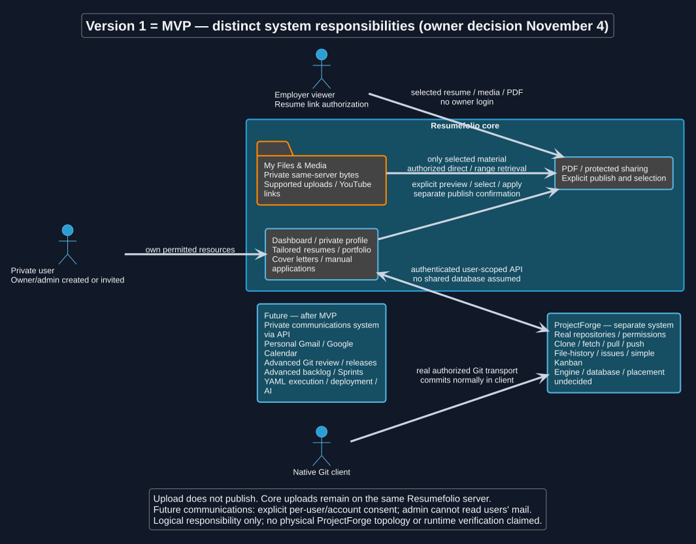

This view follows the official [C4 system-context abstraction](https://c4model.com/diagrams/system-context): people and whole software systems, with internal modules/stores omitted. It is a project-authored diagram, not a copied C4 example. External integration relationships do not certify their availability or permissions.

<a id="design-record-01-software-architecture-01-design-drivers-and-solution-options-md--heading-uml-use-case-overview"></a>

##### UML use-case overview

[MVP with explicitly deferred paths — UML use-case scope overview](Diagrams/Appendix/drivers-uml-use-cases.svg)

[Editable PlantUML](Diagrams/Appendix/drivers-uml-use-cases.puml) · 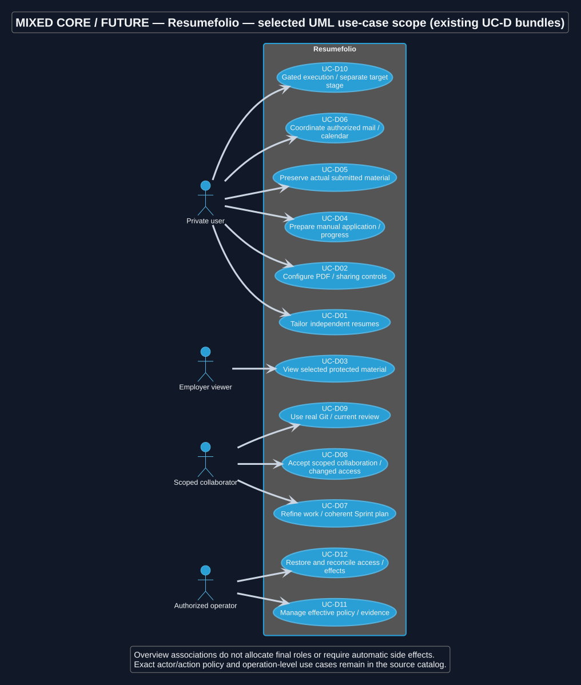

UC-D01–UC-D12 retain their meanings and source status in the [authoritative scenario catalog](../../02-Requirements-Engineering/01-Software-Requirements-Specification.md#scenarios-and-models-user-stories-and-scenarios). This is a selected actor association overview, not a new permission matrix or a replacement for the source's operation-specific use cases.

<a id="design-record-01-software-architecture-01-design-drivers-and-solution-options-md--heading-1-design-drivers"></a>

#### 1. Design drivers

Architecture must preserve the agreed product behavior while remaining understandable and operable within the owner's resources. The following DD labels are local assessment locators, not new requirement identifiers.

[Architecture drivers and consequences](Diagrams/Appendix/drivers-to-architecture.svg)

[Editable Graphviz](Diagrams/Appendix/drivers-to-architecture.dot) · 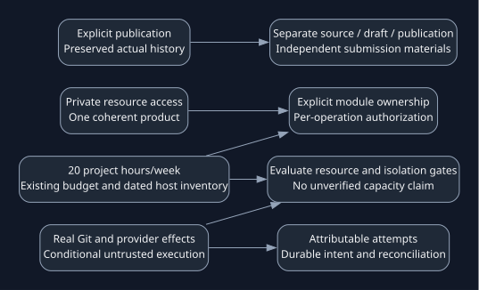

<a id="design-record-01-software-architecture-01-design-drivers-and-solution-options-md--heading-driver-summary-table"></a>

##### Driver summary table

| Driver | Design implication | Decisive evaluation |
| --- | --- | --- |
| DD-01 — coherent private product | Explicit ownership and current scoped authority | Direct/cross-owner/changed-grant paths |
| DD-02 — independent content/history | Exact draft/publication/actual-material identity | Selected apply, separate publish, preserved actual copies |
| DD-03 — real Git and conditional execution | Native adapters and separate execution/target gates | Real client/ref behavior and demonstrated containment |
| DD-04 — remote effects | Durable intent, observation and reconciliation | Lost responses, partial effects and safe repetition limits |
| DD-05 — limited resources | Bounded dependency/runtime and operating burden | Actual combined workload and solo effort |
| DD-06 — recoverability | Consistent protected copy and isolated recovery | Usable records/bytes/refs/keys and current authority |

The DD records below retain exact source links and rationale. This table assigns no new priority or numerical acceptance target.

<a id="design-record-01-software-architecture-01-design-drivers-and-solution-options-md--heading-dd-01--one-coherent-product-with-private-resource-boundaries"></a>

##### DD-01 — One coherent product with private resource boundaries

**Source:** [Scope SCP-01–SCP-09](../../01-Project-Planning/01-Project-Charter.md#mvp-scope); [accounts and permissions](../../02-Requirements-Engineering/01-Software-Requirements-Specification.md#requirements-specification-accounts-authentication-and-permissions).

Profiles/resumes, applications, communication, work and Git belong to one experience. Unified sign-in must not extend a board or repository grant to unrelated private information. A component boundary therefore needs explicit ownership and operation-specific authorization. Neither a shared database nor multiple services supplies this policy automatically.

<a id="design-record-01-software-architecture-01-design-drivers-and-solution-options-md--heading-dd-02--independent-drafts-explicit-publication-and-actual-history"></a>

##### DD-02 — Independent drafts, explicit publication and actual history

**Source:** [accepted profile-update policy](../../02-Requirements-Engineering/01-Software-Requirements-Specification.md#change-and-baseline-open-questions-and-decisions--id-owner-accepted-profile-update-policy); [presentation requirements](../../02-Requirements-Engineering/01-Software-Requirements-Specification.md#requirements-specification-profiles-resumes-and-portfolio); [manual application requirements](../../02-Requirements-Engineering/01-Software-Requirements-Specification.md#requirements-specification-manual-application-management).

Source edits do not silently alter existing resumes. Selected application and publication are distinct operations. Resume overrides and actual submitted materials remain preserved. Architecture must represent these identities and consistency boundaries explicitly, rather than sharing one mutable content object across all workflows.

<a id="design-record-01-software-architecture-01-design-drivers-and-solution-options-md--heading-dd-03--real-git-and-conditional-execution"></a>

##### DD-03 — Real Git and conditional execution

**After MVP.** Shared operating and recovery controls still apply where relevant.

**Source:** Scope SCP-09/SCP-10; [Git requirements](../../02-Requirements-Engineering/01-Software-Requirements-Specification.md#requirements-specification-git-hosting-and-collaboration); [workflow requirements](../../02-Requirements-Engineering/01-Software-Requirements-Specification.md#requirements-specification-yaml-workflows-and-cicd).

Git means actual repository transfer and collaboration. Workflow execution means supported actual execution, subject to feasibility and safety gates; YAML validation alone is not a substitute. Repository operations, workflow attempts and target deployment need separate permissions and attributable outcomes. A successful merge does not authorize execution or deployment.

<a id="design-record-01-software-architecture-01-design-drivers-and-solution-options-md--heading-dd-04--remote-effects-and-honest-failure-states"></a>

##### DD-04 — Remote effects and honest failure states

**Source:** [mail/calendar requirements](../../02-Requirements-Engineering/01-Software-Requirements-Specification.md#requirements-specification-email-calendar-and-google-integration); [analysis interface contracts](../../03-System-Analysis/04-Interfaces-Security-And-Quality.md#analysis-interfaces-security-and-quality-analysis--12-interfaces-and-external-interactions).

Google operations, Git changes and deployment can have effects outside a local database transaction. Persist reviewed intent and attempt identity, distinguish pending/partial/unknown results and reconcile before consequential repetition. A timeout cannot establish that nothing happened remotely.

<a id="design-record-01-software-architecture-01-design-drivers-and-solution-options-md--heading-dd-05--limited-delivery-and-operating-resources"></a>

##### DD-05 — Limited delivery and operating resources

**Source:** [resources and constraints](../../01-Project-Planning/03-Feasibility-And-Risk-Assessment.md#resource-constraints); [confirmed capacity](https://github.com/Farhad-V/Web-Resumefolio/blob/1f2acaa351ac306cb57cbe4fe9742e8bd90720d9/docs/MVP/SDLC/01-project-planning/11-capacity-and-preliminary-sizing.md).

Plan against 20 total project hours/week, Laravel/OOP, existing resources and no assumed additional paid infrastructure. The previously inspected demo observation reported 2 vCPU, 4 GB RAM and 40 GB disk. This is dated inventory, not representative-load proof or a final production topology. Ten initial users and possible growth toward roughly 1,000 are planning directions, not concurrency or capacity measurements.

<a id="design-record-01-software-architecture-01-design-drivers-and-solution-options-md--heading-dd-06--recoverability-and-operational-completeness"></a>

##### DD-06 — Recoverability and operational completeness

**Source:** [quality/recovery requirements](../../02-Requirements-Engineering/01-Software-Requirements-Specification.md#requirements-specification-quality-security-and-recovery-requirements); [qualified analysis handoff](../../03-System-Analysis/05-Analysis-Review-And-Design-Handoff.md#analysis-review-and-design-handoff--14-feasibility-dependencies-and-design-handoff).

Backups were reported unconfigured and OAuth uncreated. The inspected demo did not establish working outbound delivery, workers or scheduling. The design must include their setup and verification paths without representing them as existing capabilities. Recoverable database/artifact/Git state matters more than a diagram labeled HA.

<a id="design-record-01-software-architecture-01-design-drivers-and-solution-options-md--heading-quality-attribute-utility-tree"></a>

##### Quality attribute utility tree

[Candidate unranked quality attribute utility tree](Diagrams/Appendix/drivers-quality-utility-tree.svg)

[Editable PlantUML](Diagrams/Appendix/drivers-quality-utility-tree.puml) · 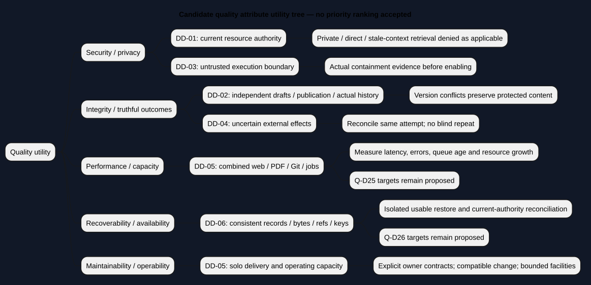

Leaves describe evaluation responses/measures, not demonstrated results. Stakeholder importance/difficulty rankings remain unassigned; Q-D25/Q-D26 target proposals retain their source status. See [quality scenarios](#design-record-06-design-quality-and-security-analysis-01-quality-attributes-and-design-trade-offs-md) for the full measurement contract.

<a id="design-record-01-software-architecture-01-design-drivers-and-solution-options-md--heading-2-solution-options"></a>

#### 2. Solution options

**Historical comparison, November 2:** the one-application/all-owner alternative is superseded in part by ADR-005. The options below remain rationale for core-internal modularity, not permission to combine core and ProjectForge.

Each option has a UML component view below. They compare responsibility/dependency organization, not selected runtime products or complete interface specifications. Shared external execution/target/recovery gates apply to all options; their omission from a schematic does not remove them. A C4 container is an application/data store, not a logical module; see the [official distinction](https://c4model.com/diagrams/container). No option view is mislabeled as a C4 Level 2 container diagram.

The options describe the organization of the trusted application. Executor isolation is evaluated separately because a process boundary alone is not a demonstrated security boundary. Layering and event-driven coordination can be used inside either a monolith or a service-based system; they are not mutually exclusive deployment options.

<a id="design-record-01-software-architecture-01-design-drivers-and-solution-options-md--heading-option-a--conventional-monolith-with-weak-internal-boundaries"></a>

##### Option A — Conventional monolith with weak internal boundaries

One application release and database support all features, with direct cross-feature access where convenient.

- **Strength:** smallest initial structural overhead; straightforward local calls and deployment.
- **Cost:** coupling and ownership become hard to reason about as publication, history, grants and external effects interact.
- **Failure risk:** a convenient shared model or global administrator check can bypass important product boundaries.
- **Assessment:** keep deployment simplicity, but reject weak internal ownership as the target design. A monolith can be disciplined; Option B makes that discipline explicit.


[Historical or unselected alternative — Option A — weakly bounded monolith](Diagrams/Appendix/drivers-option-a-components.svg)

[Editable PlantUML](Diagrams/Appendix/drivers-option-a-components.puml) · 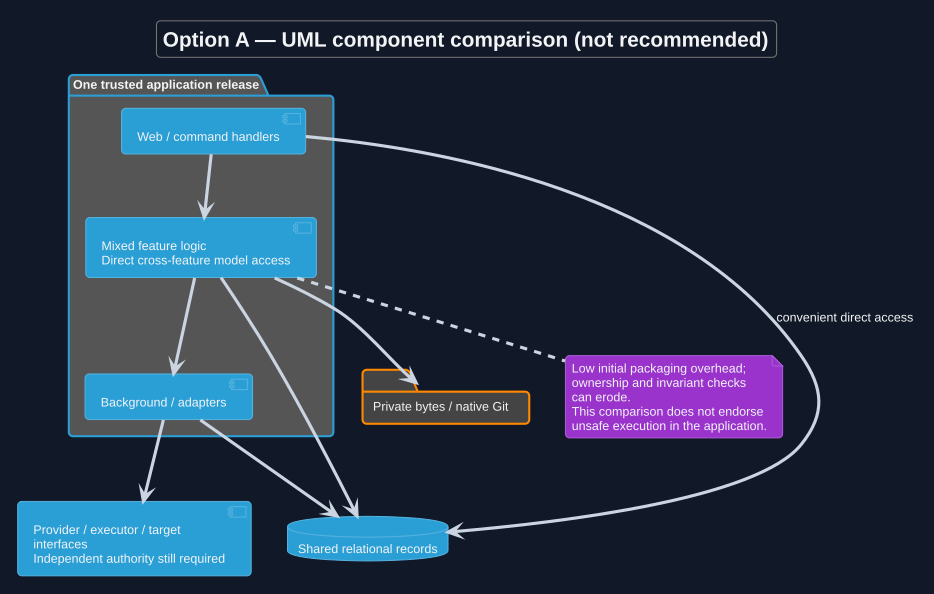

<a id="design-record-01-software-architecture-01-design-drivers-and-solution-options-md--heading-option-b--modular-monolith-with-explicit-adapters"></a>

##### Option B — Modular monolith with explicit adapters

Historical Option B proposed one coordinated trusted application release containing all modules. That common-system extent is superseded by ADR-005; a modular core remains a candidate. Web and supervised background processes can use the same compatible artifact. Provider/Git/storage/PDF/executor integrations sit behind explicit adapters.

- **Strength:** local transactional consistency, bounded operating complexity and visible ownership; supports incremental implementation.
- **Cost:** module boundaries require deliberate review and verification; shared infrastructure remains a contention/failure domain.
- **Failure risk:** nominal modules can still access each other's tables and become a distributed-looking folder arrangement without actual encapsulation.
- **Assessment:** preferred initial candidate, conditional on enforcement and actual feasibility findings.


[Option B — modular monolith](Diagrams/Appendix/drivers-option-b-components.svg)

[Editable PlantUML](Diagrams/Appendix/drivers-option-b-components.puml) · 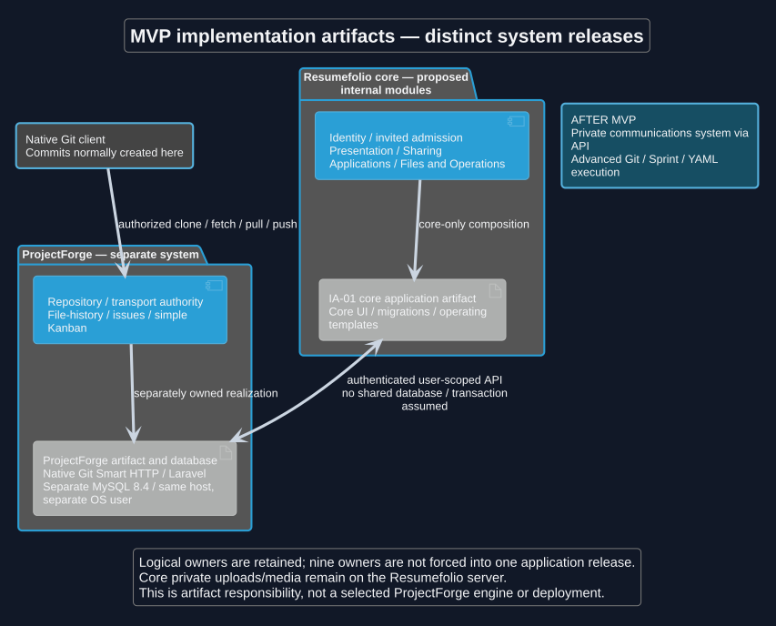

<a id="design-record-01-software-architecture-01-design-drivers-and-solution-options-md--heading-option-c--microservices-from-the-beginning"></a>

##### Option C — Microservices from the beginning

Independently deployed services own their data and coordinate through network contracts.

- **Strength:** independent releases, scaling and failure containment can be useful when actual requirements justify them.
- **Cost:** distributed identity, consistency, compatibility, tracing, deployment and recovery add work across every scenario.
- **Failure risk:** additional processes on one undersized host do not establish HA; network and partial-result behavior expand the operating burden.
- **Assessment:** defer as the default architecture. Reconsider a specific extraction when measured resource, release, team or isolation needs outweigh its cost.


[Historical or unselected alternative — Option C — initial microservices](Diagrams/Appendix/drivers-option-c-components.svg)

[Editable PlantUML](Diagrams/Appendix/drivers-option-c-components.puml) · 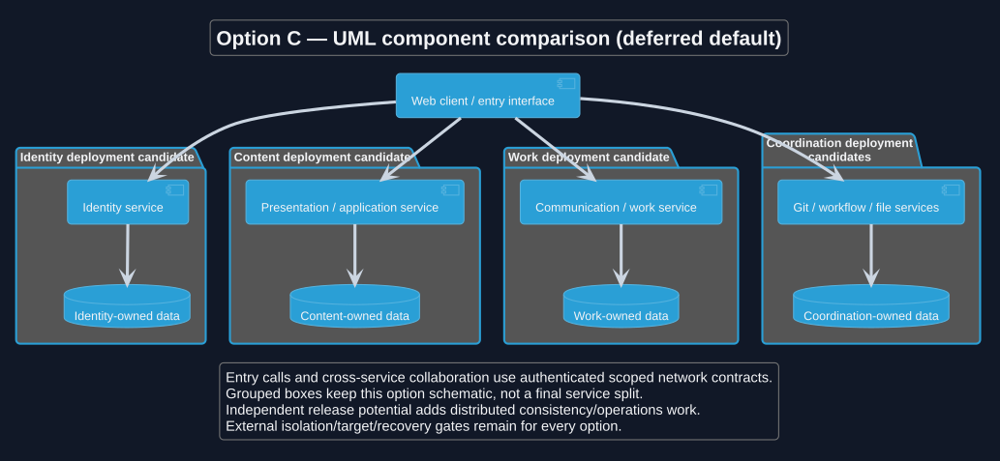

<a id="design-record-01-software-architecture-01-design-drivers-and-solution-options-md--heading-cross-option-choice--build-reuse-or-integrate"></a>

##### Cross-option choice — Build, reuse or integrate

Implement product-specific ownership, publication and workflow coordination in the application. Evaluate existing engines/libraries for native Git, PDF rendering and execution facilities instead of rebuilding protocols or isolation primitives casually. Prior projects are behavioral references, not automatically approved dependencies. Exact packages, versions, licenses, maintenance, compatibility and costs need current authoritative checks at selection time.

<a id="design-record-01-software-architecture-01-design-drivers-and-solution-options-md--heading-3-comparative-assessment"></a>

#### 3. Comparative assessment

This is qualitative engineering judgment grounded in the drivers, not benchmark evidence or a weighted numerical score. No arbitrary weights imply owner-agreed priorities.

| Criterion | A: weakly bounded monolith | B: modular monolith | C: initial microservices |
|---|---|---|---|
| Initial operating burden | Lower | Lower to moderate | Higher |
| Ownership visibility | Weak unless strengthened | Explicit by design | Explicit contracts required |
| Local consistency | Straightforward but easy to overcouple | Local transactions with module rules | Cross-service coordination needed |
| Independent release/scale | Limited | Limited; extraction possible | Stronger potential |
| Failure containment | Shared application | Shared trusted host; executor separate | Depends on actual deployment |
| Fit to current solo constraints | Simple initially; coupling risk | Best provisional balance | Additional burden not yet justified |

<a id="design-record-01-software-architecture-01-design-drivers-and-solution-options-md--heading-trade-off-matrix-and-radar-chart"></a>

##### Trade-off matrix and radar chart

The ordinal matrix below is an **illustrative author assessment requested for visual comparison**, not empirical scoring or owner-agreed weighting. Scale: 1 least favorable, 2 limited fit, 3 mixed/conditional, 4 favorable, 5 most favorable **for the stated criterion and option definitions**. Higher is more favorable; there is no total, average, winner calculation or decision meaning in polygon area.

| Criterion | A | B | C |
| --- | --- | --- | --- |
| Initial delivery simplicity | 5 | 4 | 1 |
| Ownership clarity | 1 | 4 | 4 |
| Local consistency | 4 | 4 | 2 |
| Independent release potential | 1 | 2 | 5 |
| Failure separation potential | 1 | 2 | 3 |
| Solo operations fit | 4 | 4 | 1 |

**Rationale:** A minimizes initial packaging but deliberately lacks enforced ownership; B adds contract work while retaining local deployment/transaction simplicity; C offers independent release potential but expands distributed state and solo operations. C's failure-separation score is conditional potential, not HA: independent services on one host may share failure/resource domains. None scores 5 for proven security, capacity or recovery, which are separate hard gates rather than compensable axes.

[Historical or unselected alternative — Illustrative qualitative option radar chart](Diagrams/Appendix/drivers-options-radar.svg)

[Editable chart generator](Diagrams/Appendix/drivers-options-radar.py) · [Rubric/data](Diagrams/Appendix/drivers-options-radar.json) · 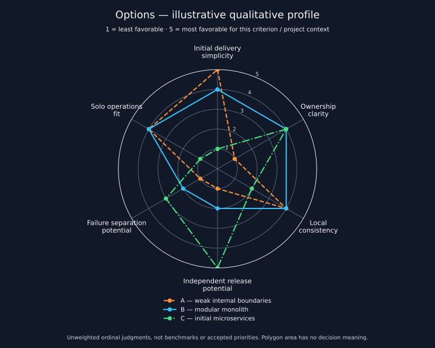

These values make the existing qualitative rationale inspectable. They do not replace exact criteria or justify B by a weighted sum. Review/revise them if the option definition or evidence changes; retain the distinction between judgment and measurement.

**Scope correction:** the former all-owner modular-app recommendation does not satisfy the accepted separate ProjectForge boundary. Retain explicit modularity within the core while evaluating ProjectForge engine/placement/API and actual combined Git/media/recovery load. Deferred runner/provider workloads do not enter the MVP forecast.

**Evidence that would change the recommendation:** an actual safe/existing service offers materially better integration and operating cost; measured combined load requires independent placement; a component needs an independent release cadence; or accepted quality targets require demonstrable failure separation. These findings may justify a targeted hybrid rather than converting every component to a service.

<a id="design-record-01-software-architecture-01-design-drivers-and-solution-options-md--heading-4-proposed-solution"></a>

#### 4. Proposed solution

[Proposed trusted application and external effect boundaries](Diagrams/Appendix/logical-component-ownership.svg)

[Editable Graphviz](Diagrams/Appendix/logical-component-ownership.dot) · 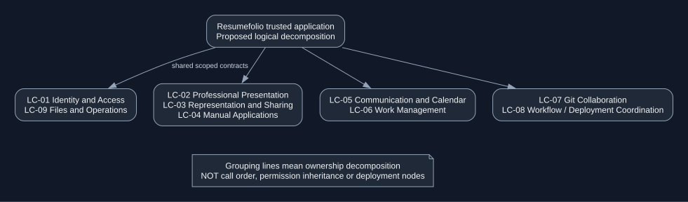

**Responsibility allocation:** core owns Identity/Access, Presentation, Sharing, Applications and Files/Operations. ProjectForge owns basic Git/Work in MVP. Communication/Calendar and advanced Workflow/Deployment are future responsibilities. See the [component catalog](../03-Low-Level-Design/02-Module-Breakdown.md#design-record-03-component-and-module-design-component-and-module-design-md). This diagram groups responsibilities; it does not select concrete packages, network protocols or a physically separate host for each box.

**Local mutation:** authorize the exact operation, validate expected revision, apply the bounded local transaction and record the result. Use relational persistence for transactional records as a recommendation; final engine/schema selection remains in [Data Design](../03-Low-Level-Design/04-Database-Design.md#design-record-04-data-design-data-design-md).

**Durable asynchronous work:** record pending external intent and a stable attempt identity before dispatch. A durable outbox or equivalent mechanism closes the commit/dispatch gap. Workers recheck relevant current authority and reconcile ambiguous remote effects. PDF generation, synchronization and cleanup need explicit resource limits and observable progress.

**Native Git boundary:** the product coordinates an evaluated Git implementation and native repository state. Compare expected refs using Git semantics; an SQL transaction cannot make a filesystem/ref update atomic by itself. Git credentials and browser sessions have distinct contracts.

**Execution boundary:** never run untrusted jobs as the web identity with application secrets or unrestricted application storage. Isolation, networking, credentials, quotas, cleanup and cancel/stop behavior must be demonstrated before enabling jobs. No facility has been selected or verified by this document.

**Deployment authority:** release of an evaluated artifact to a target is a separate reviewed action. A workflow result is evidence about that attempt, not implicit permission to mutate a target.

**Recovery:** retain consistent database, private artifact, repository and configuration/key coverage in an independent recoverable backup set. A single-node candidate is not HA. Final recovery targets/destination and an actual isolated restore demonstration remain prerequisites at their applicable gates.

<a id="design-record-01-software-architecture-01-design-drivers-and-solution-options-md--heading-uml-deployment-candidate"></a>

##### UML deployment candidate

[Option B proposed UML deployment](Diagrams/Appendix/drivers-uml-deployment.svg)

[Editable PlantUML](Diagrams/Appendix/drivers-uml-deployment.puml) · 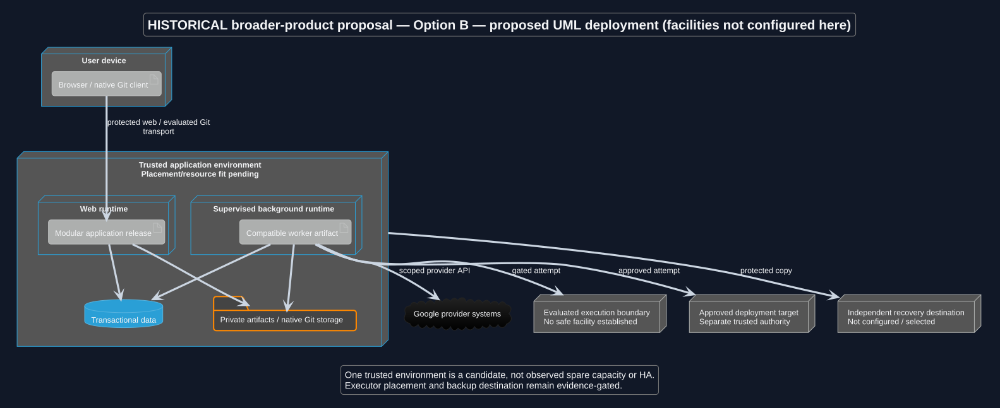

This is the preferred option's candidate placement, not the observed server or accepted physical topology. Same-release web/background artifacts do not imply separate hosts. No backup destination or safe executor has been established. Detailed [deployment design](#design-record-01-software-architecture-04-deployment-topology-nodes-and-networks-md) remains authoritative for placement and access-zone refinement.

<a id="design-record-01-software-architecture-01-design-drivers-and-solution-options-md--heading-critical-uml-sequence--selected-apply-and-publication"></a>

##### Critical UML sequence — selected apply and publication

[Critical source apply and separate publication interaction](Diagrams/Appendix/drivers-critical-publication-sequence.svg)

[Editable PlantUML](Diagrams/Appendix/drivers-critical-publication-sequence.puml) · 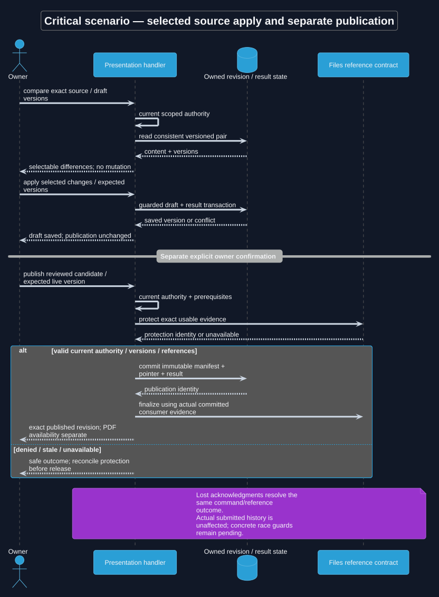

This scenario was chosen because it exercises the accepted independence rule, current authority, version guards, local persistence and cross-owner artifact protection. It refines [UC-D01](../../02-Requirements-Engineering/01-Software-Requirements-Specification.md#scenarios-and-models-user-stories-and-scenarios--id-uc-d01); the [Presentation component](../03-Low-Level-Design/03-Detailed-Module-Design.md#design-record-03-component-and-module-design-components-professional-presentation-md) owns the detailed contract. Exact synchronization/reference protocols remain implementation work.

<a id="design-record-01-software-architecture-01-design-drivers-and-solution-options-md--heading-5-open-decisions-and-evidence-gates"></a>

#### 5. Open decisions and evidence gates

[Architecture decision and evidence route](Diagrams/Appendix/architecture-decision-route.svg)

[Editable Graphviz](Diagrams/Appendix/architecture-decision-route.dot) · 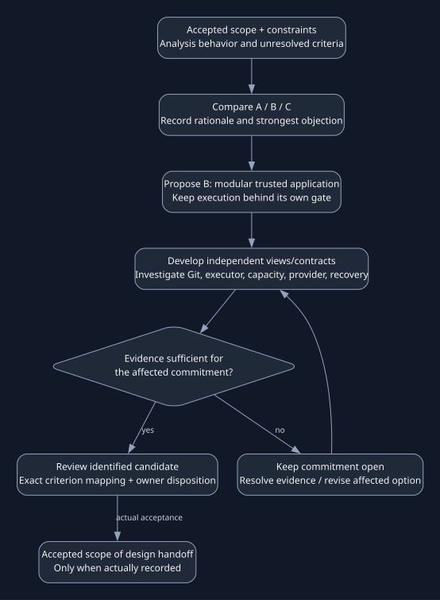

<a id="design-record-01-software-architecture-01-design-drivers-and-solution-options-md--heading-g1--git-implementation-and-repository-contract"></a>

##### G1 — Git implementation and repository contract

Compare reusable engines/integration methods against required real transfer, authorization, ref/review behavior, recovery, resource use and operating effort. **Completion evidence:** controlled transfer/denial/conflict cases, supported feature boundaries and an attributable compatibility/license assessment. Owner: Farhad, with Codex preparing the assessment.

<a id="design-record-01-software-architecture-01-design-drivers-and-solution-options-md--heading-g2--workflow-language-and-safe-execution-facility"></a>

##### G2 — Workflow language and safe execution facility

**After MVP.** Shared operating and recovery controls still apply where relevant.

Define supported syntax/triggers and compare feasible executor facilities without assuming new spending. **Completion evidence:** actual isolated admission, limits, secrets, cancellation, lost-runner reconciliation and cleanup checks. Drafting the interface can proceed; enabling execution cannot rely on these diagrams alone.

<a id="design-record-01-software-architecture-01-design-drivers-and-solution-options-md--heading-g3--persistence-and-combined-capacity"></a>

##### G3 — Persistence and combined capacity

Evaluate engine/version, artifact/repository growth, transaction needs and simultaneous web/background workloads. **Completion evidence:** justified storage choice, explicit workload, measured bottlenecks and enforceable admission/retention policies. No numerical default or capacity Pass is assigned here.

<a id="design-record-01-software-architecture-01-design-drivers-and-solution-options-md--heading-g4--provider-and-operating-prerequisites"></a>

##### G4 — Provider and operating prerequisites

Create/configure permitted OAuth and delivery facilities, configure workers/scheduler and verify required operations. **Completion evidence:** scoped provider access, actual controlled send/sync behavior, attributable job processing and operating observations. Do not repeat the already answered setup-existence questions.

<a id="design-record-01-software-architecture-01-design-drivers-and-solution-options-md--heading-g5--recovery-and-measurable-quality"></a>

##### G5 — Recovery and measurable quality

Determine independent backup/key coverage and applicable quality targets. **Completion evidence:** suitable isolated restoration, integrity/current-authority checks and measured comparisons to agreed targets. A successful backup command alone does not establish recoverability.

<a id="design-record-01-software-architecture-01-design-drivers-and-solution-options-md--heading-g6--exact-traceability-and-delivery-agreement"></a>

##### G6 — Exact traceability and delivery agreement

Reconcile affected requirement criteria and analysis contracts against this candidate, then refine full engineering effort and tracking against 20 hours/week. **Completion evidence:** identified source/design candidate, actual review findings, resolved or explicitly scoped gates and actual owner disposition. Requested dates are not accepted forecasts.

<a id="design-record-01-software-architecture-01-design-drivers-and-solution-options-md--heading-6-decision-and-continuation"></a>

#### 6. Decision and continuation

<a id="design-record-01-software-architecture-01-design-drivers-and-solution-options-md--heading-architecture-decision-record"></a>

##### Architecture Decision Record

The concrete record is [ADR-001 — Modular Application Boundaries](../ADR/ADR-001-Modular-Application-Boundaries.md#design-record-07-design-decisions-adr-001-modular-application-boundaries-md). It already contains context, three alternatives, proposed decision, consequences, validation and revisit conditions; reuse it rather than create a duplicate ADR for these diagrams. **Status remains Proposed; Farhad's actual scoped disposition is pending.** The new matrix/radar is qualitative supporting rationale, not acceptance evidence or a new ADR allocation.


The recommendation is represented in [ADR-001](../ADR/ADR-001-Modular-Application-Boundaries.md#design-record-07-design-decisions-adr-001-modular-application-boundaries-md). Publication/history identity and durable external attempts are supported by [ADR-002](../ADR/ADR-002-Explicit-Publication-And-History.md#design-record-07-design-decisions-adr-002-explicit-publication-and-history-md) and [ADR-003](../ADR/ADR-003-Durable-External-Attempts.md#design-record-07-design-decisions-adr-003-durable-external-attempts-md). ADR-001 is superseded in part by ADR-005; ADR-002/003 technical mechanisms remain proposed.

1. Review B's responsibility boundaries and the strongest objection against accepted scope.
2. Develop [logical decomposition](#design-record-01-software-architecture-02-system-decomposition-and-boundaries-md), [runtime coordination](#design-record-01-software-architecture-03-process-view-concurrency-and-runtime-behavior-md) and [deployment options](#design-record-01-software-architecture-04-deployment-topology-nodes-and-networks-md) consistently with the data/interface/security records.
3. Investigate the decisive G1–G5 questions before accepting the commitments they affect; continue independent technical refinement in parallel.
4. Record exact criterion/contract mappings and actual review in the [design review and handoff](#design-record-06-design-quality-and-security-analysis-05-design-review-traceability-and-handoff-md).
5. Obtain the scoped owner decision for an identified candidate before the agreed implementation handoff.

**Review limits:** the comparison is a source-based design assessment, not a current dependency audit, live server check, benchmark, security test or recovery exercise. Advisor consultation was unavailable in this environment; no independent advisor endorsement is claimed. Diagram/link checks establish document integrity only.

<a id="design-record-01-software-architecture-01-design-drivers-and-solution-options-md--heading-7-fau-basis-and-diagram-reading-guide"></a>

#### 7. FAU basis and diagram reading guide

FAU V07 slides 3–5 and 15–20 motivate solution alternatives, rationale, quality and a consistent extension of analysis. Slides 21–34 supply viewpoints and decomposition/cross-cutting principles. V08 distinguishes architecture from component-level prescriptions. This document adapts those teaching concepts to Resumefolio; the six-topic filenames and DD/G locators are project conventions.

The original three overview diagrams remain. The added C4 context, utility tree, UML use cases, three UML option component views, UML deployment, critical UML sequence and qualitative radar/matrix serve distinct purposes. All source/export links are below their owning figures. The ADR is maintained once in the shared decision folder. None of these views establishes configured facilities, measured quality or acceptance. See the [reference map](#design-record-design-references-and-coverage-md) and [diagram catalog](#design-record-01-software-architecture-diagrams-diagram-catalog-md).

</details>

<a id="design-record-01-software-architecture-02-system-decomposition-and-boundaries-md"></a>

<details>
<summary>Resumefolio — System Decomposition and Boundaries</summary>

<a id="design-record-01-software-architecture-02-system-decomposition-and-boundaries-md--heading-resumefolio--system-decomposition-and-boundaries"></a>

### Resumefolio — System Decomposition and Boundaries

Current implementation choices and scope: [Baseline](https://github.com/Farhad-V/Web-Resumefolio/blob/1f2acaa351ac306cb57cbe4fe9742e8bd90720d9/docs/MVP/baseline/README.md). Runtime verification remains subject to its gates.

**Proposed structure:** logical components allocated across the Resumefolio core, separate ProjectForge system and deferred communications/execution responsibilities, with explicit interfaces to native Git, providers, artifact storage and a conditionally enabled execution facility.

**Status:** proposed logical architecture. These are responsibility and information boundaries, not nine microservices, nine databases or an accepted physical deployment. Farhad retains decision authority.

[Overview](#design-record-01-software-architecture-02-system-decomposition-and-boundaries-md--heading-1-system-and-component-boundaries) · [Catalog](#design-record-01-software-architecture-02-system-decomposition-and-boundaries-md--heading-2-component-responsibility-catalog) · [Interfaces](#design-record-01-software-architecture-02-system-decomposition-and-boundaries-md--heading-3-public-interfaces-and-dependency-rules) · [Consistency](#design-record-01-software-architecture-02-system-decomposition-and-boundaries-md--heading-4-information-and-consistency-boundaries) · [Access](#design-record-01-software-architecture-02-system-decomposition-and-boundaries-md--heading-5-access-and-trust-boundaries) · [Review](#design-record-01-software-architecture-02-system-decomposition-and-boundaries-md--heading-7-review-and-continuation) · [DDD/context views](#design-record-01-software-architecture-02-system-decomposition-and-boundaries-md--heading-6-ddd-interpretation-and-implementation-mapping)

<a id="design-record-01-software-architecture-02-system-decomposition-and-boundaries-md--heading-current-mvp-boundary-figure"></a>

#### Current MVP boundary figure

[Accepted core and separate ProjectForge boundary](Diagrams/Appendix/mvp-system-boundaries.svg)

[Editable source](Diagrams/Appendix/mvp-system-boundaries.puml) · . Historical broader-product figures below retain earlier alternatives/detail; they do not define the current system boundary.

<a id="design-record-01-software-architecture-02-system-decomposition-and-boundaries-md--heading-1-system-and-component-boundaries"></a>

#### 1. System and component boundaries

This view realizes the [architecture recommendation](#design-record-01-software-architecture-01-design-drivers-and-solution-options-md) under [accepted scope](../../01-Project-Planning/01-Project-Charter.md#mvp-scope). Existing [analysis context](../../03-System-Analysis/01-System-Context-And-Gap-Analysis.md#foundation-02-system-context-and-boundaries), [domain model](../../03-System-Analysis/02-Domain-And-Information-Analysis.md#analysis-domain-and-information-analysis--03-domain-model-and-object-oriented-view) and [interface analysis](../../03-System-Analysis/04-Interfaces-Security-And-Quality.md#analysis-interfaces-security-and-quality-analysis--12-interfaces-and-external-interactions) remain authoritative about required meaning and behavior.

[Logical component ownership](Diagrams/Appendix/logical-component-ownership.svg)

[Editable DOT](Diagrams/Appendix/logical-component-ownership.dot) · 

Browser/employer users access the core through their own scoped contexts. Git clients access ProjectForge through repository grants. Core and ProjectForge communicate through authenticated user-scoped API, not shared module/database access. Internal core modules may use an evaluated common artifact/store without transferring ownership. Future provider/deployment targets remain separate deferred responsibilities.

The overview groups components for readability. It deliberately omits a mesh of possible calls; the contract catalog and interaction view specify actual dependencies. Execution is an external trust boundary even if a later feasible facility uses colocated hardware. Colocation alone does not establish isolation.

<a id="design-record-01-software-architecture-02-system-decomposition-and-boundaries-md--heading-c4-level-1--whole-system-context"></a>

##### C4 Level 1 — whole-system context

[Whole-system context reused from the driver assessment](Diagrams/Appendix/drivers-c4-system-context.svg)

[Editable PlantUML](Diagrams/Appendix/drivers-c4-system-context.puml) ·  · [Owning context record](#design-record-01-software-architecture-01-design-drivers-and-solution-options-md--heading-0-system-context-and-use-case-scope)

Reuse the same C4 Level 1 view rather than create a competing context boundary. It shows people and external systems, not internal modules.

<a id="design-record-01-software-architecture-02-system-decomposition-and-boundaries-md--heading-c4-level-2--applications-and-data-stores"></a>

##### C4 Level 2 — applications and data stores

[C4 Level 2 container candidate](Diagrams/Appendix/boundaries-c4-containers.svg)

[Editable PlantUML](Diagrams/Appendix/boundaries-c4-containers.puml) · 

This proposed container view follows [C4's application/data-store abstraction](https://c4model.com/diagrams/container). Logical modules are not containers; a C4 container is not necessarily a Docker container. Web and background applications may share one release, while physical host multiplicity and mechanisms remain in deployment design. Conditional execution is shown as an unevaluated separate trust domain, not an enabled facility.

<a id="design-record-01-software-architecture-02-system-decomposition-and-boundaries-md--heading-2-component-responsibility-catalog"></a>

#### 2. Component responsibility catalog

LC identifiers are local architecture locators, not newly allocated requirements. Requirement families establish source context, not complete criterion coverage. Concrete component records refine these responsibilities into implementation prescriptions.

<a id="design-record-01-software-architecture-02-system-decomposition-and-boundaries-md--heading-lc-01--identity-and-access"></a>

##### LC-01 — Identity and Access

**Owns:** Accounts, invitations, sessions and resource-grant records.

**Provides:** AuthenticateContext; EvaluateAuthority; ChangeGrant; RevokeAccess.

**Consumers and dependencies:** All private components consume scoped identity/authority. The resource owner still checks its lifecycle, operation and effective policy.

**Boundary invariant:** No universal permission follows from login, collaboration membership or an administrative label. Do not expose credential material to consumers.

**Source context:** ACC. [Component design](../03-Low-Level-Design/03-Detailed-Module-Design.md#design-record-03-component-and-module-design-components-identity-and-access-md).

<a id="design-record-01-software-architecture-02-system-decomposition-and-boundaries-md--heading-lc-02--professional-presentation"></a>

##### LC-02 — Professional Presentation

**Owns:** Profiles, resume drafts, independent overrides, evidence selections and publication revision identities.

**Provides:** CompareSource; ApplySelectedChanges; SaveDraft; PublishRevision; ResolvePublication.

**Consumers and dependencies:** Sharing requests the selected published presentation; Applications may associate preparation references and capture exact actual material identities.

**Boundary invariant:** A source change cannot publish. Apply selected differences and separately confirm publication; preserve overrides and actual submitted history.

**Source context:** PRP. [Component design](../03-Low-Level-Design/03-Detailed-Module-Design.md#design-record-03-component-and-module-design-components-professional-presentation-md).

<a id="design-record-01-software-architecture-02-system-decomposition-and-boundaries-md--heading-lc-03--representation-and-sharing"></a>

##### LC-03 — Representation and Sharing

**Owns:** Per-resume download configuration, sharing links and link-scoped viewer authorization.

**Provides:** ConfigureDownloads; ChangeLinkPassword; DisableLink; RetrieveRepresentation.

**Consumers and dependencies:** Consumes current authority, published selection and confirmed artifact availability. PDF rendering is an adapter operation owned by this boundary; Files manages artifact admission/lifecycle.

**Boundary invariant:** Link eligibility, PDF mode, representation availability and viewer authority are distinct. Recheck direct retrieval; never silently substitute unavailable language/content.

**Source context:** PDF / ACC. [Component design](../03-Low-Level-Design/03-Detailed-Module-Design.md#design-record-03-component-and-module-design-components-representation-and-sharing-md).

<a id="design-record-01-software-architecture-02-system-decomposition-and-boundaries-md--heading-lc-04--manual-applications"></a>

##### LC-04 — Manual Applications

**Owns:** Company/opportunity preparation, manual progress, actual submission events and their material manifests.

**Provides:** SavePreparation; RecordProgress; CaptureActualSubmission; CorrectSubmissionRecord.

**Consumers and dependencies:** Associates explicit resume, correspondence and calendar identifiers without acquiring their private access. Uses Files to retain protected actual artifacts.

**Boundary invariant:** Progress is not evidence of external submission. Actual materials have stable provenance independent of the latest draft/live view.

**Source context:** APP. [Component design](../03-Low-Level-Design/03-Detailed-Module-Design.md#design-record-03-component-and-module-design-components-applications-md).

<a id="design-record-01-software-architecture-02-system-decomposition-and-boundaries-md--heading-lc-05--communication-and-calendar"></a>

##### LC-05 — Communication and Calendar

**Current placement:** After MVP: independent private communications system via API.

**After MVP.** Shared operating and recovery controls still apply where relevant.

**Owns:** Provider capability/connection state, local drafts/activities, send attempts and synchronization mappings.

**Provides:** PrepareSend; DispatchReviewedIntent; ReconcileSend; ReconcileCalendarMapping.

**Consumers and dependencies:** Uses scoped provider adapters, current capability and durable work dispatch. Applications can link permitted correspondence/activity summaries.

**Boundary invariant:** Local unlink differs from provider deletion. Provider acceptance is not receipt; uncertain sends require reconciliation rather than blind resend.

**Source context:** EGC. [Component design](../03-Low-Level-Design/03-Detailed-Module-Design.md#design-record-03-component-and-module-design-components-communication-and-calendar-md).

<a id="design-record-01-software-architecture-02-system-decomposition-and-boundaries-md--heading-lc-06--work-management"></a>

##### LC-06 — Work Management

**Current placement:** MVP ProjectForge simple Kanban/issues; advanced backlog/Sprints deferred.

**Owns:** Projects, boards, items/tasks, scoped membership and Sprint Goal/selection/plan aggregates.

**Provides:** MoveWork; RefineItem; PlanSprint; CloseSprintPeriod; ChangeMembership.

**Consumers and dependencies:** Links permitted repository/revision context through Git contracts and stable identifiers. Uses current resource-grant context.

**Boundary invariant:** One coherent Sprint Backlog per Sprint. Period end, work completion, review/merge and actual acceptance remain different facts.

**Source context:** PKS. [Component design](../03-Low-Level-Design/03-Detailed-Module-Design.md#design-record-03-component-and-module-design-components-work-management-md).

<a id="design-record-01-software-architecture-02-system-decomposition-and-boundaries-md--heading-lc-07--git-collaboration"></a>

##### LC-07 — Git Collaboration

**Current placement:** MVP ProjectForge basic repositories/transfers/permissions/file-history/issues; advanced review/releases deferred.

**Owns:** Repository metadata and native-store identity, ref/review context, issues, milestones, tags and releases.

**Provides:** TransferGit; ForkRepository; ReviewRevision; MergeExpectedRefs; CreateRelease.

**Consumers and dependencies:** Native Git backend implements actual object/ref/transport semantics. Work can reference permitted summaries; Workflow Coordination evaluates eligible revision notifications.

**Boundary invariant:** Recheck exact repository/ref grants and expected source/target revisions. Merge grants neither execution eligibility nor deployment authority.

**Source context:** GIT. [Component design](../03-Low-Level-Design/03-Detailed-Module-Design.md#design-record-03-component-and-module-design-components-git-collaboration-md).

<a id="design-record-01-software-architecture-02-system-decomposition-and-boundaries-md--heading-lc-08--workflow-and-deployment-coordination"></a>

##### LC-08 — Workflow and Deployment Coordination

**Current placement:** After MVP: no product YAML execution/deployment.

**After MVP.** Shared operating and recovery controls still apply where relevant.

**Owns:** Supported workflow definitions, admitted attempts, bounded result/output references and separate deployment attempts.

**Provides:** ValidateSupportedDefinition; AdmitAttempt; RequestCancel; ReconcileAttempt; DeployApprovedArtifact.

**Consumers and dependencies:** Consumes exact Git revision and supported definition; requests an evaluated executor through a narrow adapter. Files owns admitted artifact storage; target access is separately authorized.

**Boundary invariant:** Execution stays gated until isolation/resource/secret/cleanup behavior is demonstrated. Cancel requested is not stopped; run success is not target authorization.

**Source context:** YML. [Component design](../03-Low-Level-Design/03-Detailed-Module-Design.md#design-record-03-component-and-module-design-components-workflow-and-deployment-md).

<a id="design-record-01-software-architecture-02-system-decomposition-and-boundaries-md--heading-lc-09--files-and-operations"></a>

##### LC-09 — Files and Operations

**Owns:** Artifact identity/availability, quota reservations, effective file policy, protected reference accounting and recovery records.

**Provides:** ReserveGrowth; FinalizeArtifact; ReplaceReference; CollectUnreferencedBytes; AssessRecovery.

**Consumers and dependencies:** Other owners register attributable references and request permitted artifacts through contracts. Operating adapters manage actual storage and recovery facilities.

**Boundary invariant:** Reference retirement is not proof of reclaimed bytes. Replacement retains prior usable state until confirmed. Recovery rechecks authority and does not replay remote effects.

**Source context:** AFO / QSR. [Component design](../03-Low-Level-Design/03-Detailed-Module-Design.md#design-record-03-component-and-module-design-components-files-and-operations-md).

<a id="design-record-01-software-architecture-02-system-decomposition-and-boundaries-md--heading-uml-component-view"></a>

##### UML component view

[UML logical component and contract view](Diagrams/Appendix/boundaries-ddd-contexts.svg)

[Editable PlantUML](Diagrams/Appendix/boundaries-ddd-contexts.puml) · 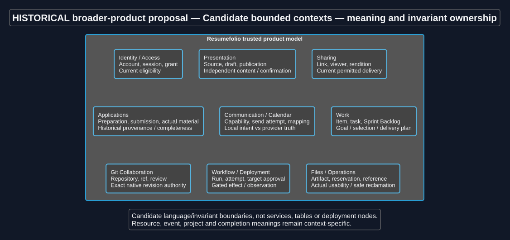

This is explicitly a UML logical component view. [C4 Level 3](https://c4model.com/diagrams/component) decomposes one container; the selected collaborations here span logical owners whose code can be reused by web/worker artifacts, so no false single-container Level 3 claim is made. The existing detailed component catalog remains authoritative for operations.

<a id="design-record-01-software-architecture-02-system-decomposition-and-boundaries-md--heading-data-ownership-matrix--logical-owners-not-nine-services"></a>

##### Data ownership matrix — logical owners, not nine services

| Owner | Authoritative logical data | Other consumers use |
| --- | --- | --- |
| Identity / Access | Account/session/verifier/grant and authority changes | Current scoped context; no secrets or universal role bypass |
| Presentation | Source/draft/override/selection and publication manifests | Exact permitted revision projections |
| Sharing | Link/viewer generation, download configuration, rendition associations | Current eligible representation contract |
| Applications | Preparation/progress and actual submission/material completeness | Permitted application/history summaries |
| Communication / Calendar | Provider capability, local intent/associations and effect/mapping observations | Independently authorized summaries; provider truth stays external |
| Work | Project/board/item/task, membership relationships, coherent Sprint plan/outcomes | Permitted work projections; no implied Git grant |
| Git | Repository/ref/review policy, native storage association and actual observations | Exact permitted repository/revision context |
| Workflow / Deployment | Definition/run/attempt/output/cleanup and separate target approval/effects | Attributable permitted attempt/result projection |
| Files / Operations | Artifact usability, quota/reservation, protected references and reclamation | Scoped usable identity and reference/admission contracts |

Within one system, evaluated local relational storage may enforce cross-record integrity without transferring ownership. No core/ProjectForge shared store or cross-system transaction is selected. Provider state, native Git refs and stored bytes remain actual external/store facts; metadata alone does not control them. See [shared data design](../03-Low-Level-Design/04-Database-Design.md#design-record-04-data-design-01-analysis-to-logical-and-physical-data-models-md).

<a id="design-record-01-software-architecture-02-system-decomposition-and-boundaries-md--heading-responsibility-table--crc-style-at-component-scale"></a>

##### Responsibility table — CRC-style at component scale

| Component | Responsibilities | Principal collaborators |
| --- | --- | --- |
| Identity / Access | Establish current attributable context and scoped authority lifecycle | Every protected resource owner |
| Presentation | Compare/select/apply, preserve independent drafts, separately publish | Identity; Files; Sharing/Applications as consumers |
| Sharing | Manage links/variants and admit exact protected retrieval | Identity; Presentation; Files |
| Applications | Record deliberate progress and actual-material provenance/completeness | Identity; Files; permitted Presentation/Communication contracts |
| Communication / Calendar | Coordinate authorized provider/local operations and uncertain effects | Identity; Files; provider adapters |
| Work | Maintain coherent work/Sprint meaning and scoped collaboration | Identity; permitted Git projections |
| Git | Coordinate real native transfer/ref/review authority and observations | Identity; Files; native Git adapter |
| Workflow / Deployment | Gate attempts and separately approved target effects | Identity; Git; Files; executor/target adapters |
| Files / Operations | Admit growth, protect exact references and reconcile reclamation/recovery | Identity; resource consumers; storage/operating adapters |

CRC-style means responsibilities/collaborators are summarized at component scale; these are not implementation class cards or a complete bidirectional dependency graph.

<a id="design-record-01-software-architecture-02-system-decomposition-and-boundaries-md--heading-3-public-interfaces-and-dependency-rules"></a>

#### 3. Public interfaces and dependency rules

[MVP with explicitly deferred paths — Public contract and adapter boundaries](Diagrams/Appendix/component-contract-boundaries.svg)

[Editable DOT](Diagrams/Appendix/component-contract-boundaries.dot) · 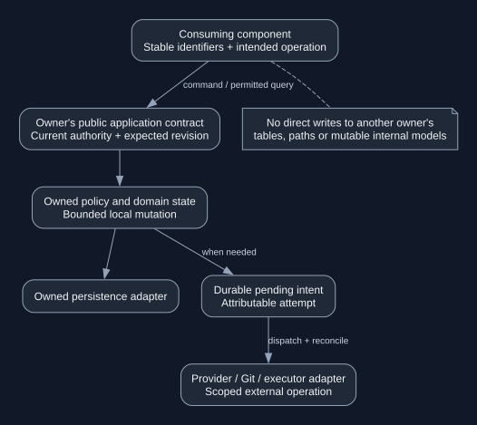

1. A component changes only its own domain state. Consumers call its public application contract; they do not update its tables, construct internal ORM objects or use a storage path to bypass policy.
2. Contracts carry stable resource/actor/operation identities and expected revisions where appropriate. Return permitted data projections and attributable outcomes instead of unrestricted mutable entities.
3. The owning component authorizes the requested operation using current context. A caller's earlier check cannot replace this check, especially after a grant, link or account change.
4. Framework integration, logging, clocks, dispatch and persistence adapters are technical dependencies. Keep shared types small; do not create a universal shared business model or circular module service calls.
5. Read models may combine independently permitted projections. Aggregating information does not transfer ownership or grant access to linked resources.
6. Cross-boundary reactions are explicit. A stored event such as a confirmed Git revision is input to eligibility evaluation, not automatic authority to launch a job or deploy.

**Provided/required contract examples:** Sharing requires ResolvePublication and ResolveUsableArtifact; Applications requires permitted presentation/material capture references; Git requires authority evaluation and its native repository adapter; Workflow Coordination requires evaluated revision context, artifact admission and executor control. The final signatures/types belong in the [component packages](../03-Low-Level-Design/02-Module-Breakdown.md#design-record-03-component-and-module-design-component-and-module-design-md) and [interface design](../03-Low-Level-Design/05-API-Specification.md#design-record-05-interface-and-api-design-interface-and-api-design-md).

**Dependency-cycle rule:** separate orchestration from ownership. For example, Applications stores a correspondence identifier; Communication exposes an independently authorized summary. Neither requires the other to construct its internal model. For multi-owner lifecycle changes, use an explicit coordinating command and attributable pending work, rather than recursive callbacks between resource owners.

<a id="design-record-01-software-architecture-02-system-decomposition-and-boundaries-md--heading-module-dependency-direction"></a>

##### Module dependency direction

[Selected module dependency diagram](Diagrams/Appendix/boundaries-ddd-contexts.svg)

[Editable PlantUML](Diagrams/Appendix/boundaries-ddd-contexts.puml) · 

Consumer-to-provider arrows describe selected code/contract dependencies, not event-flow direction. Current authority is common to protected owners; omitted mesh edges do not waive it. Interface definitions remain owned by the provider; no shared unrestricted ORM model or recursive owner callback is introduced.

<a id="design-record-01-software-architecture-02-system-decomposition-and-boundaries-md--heading-hexagonal-realization-example"></a>

##### Hexagonal realization example

[Hexagonal component realization](Diagrams/Appendix/boundaries-hexagonal-module.svg)

[Editable PlantUML](Diagrams/Appendix/boundaries-hexagonal-module.puml) · 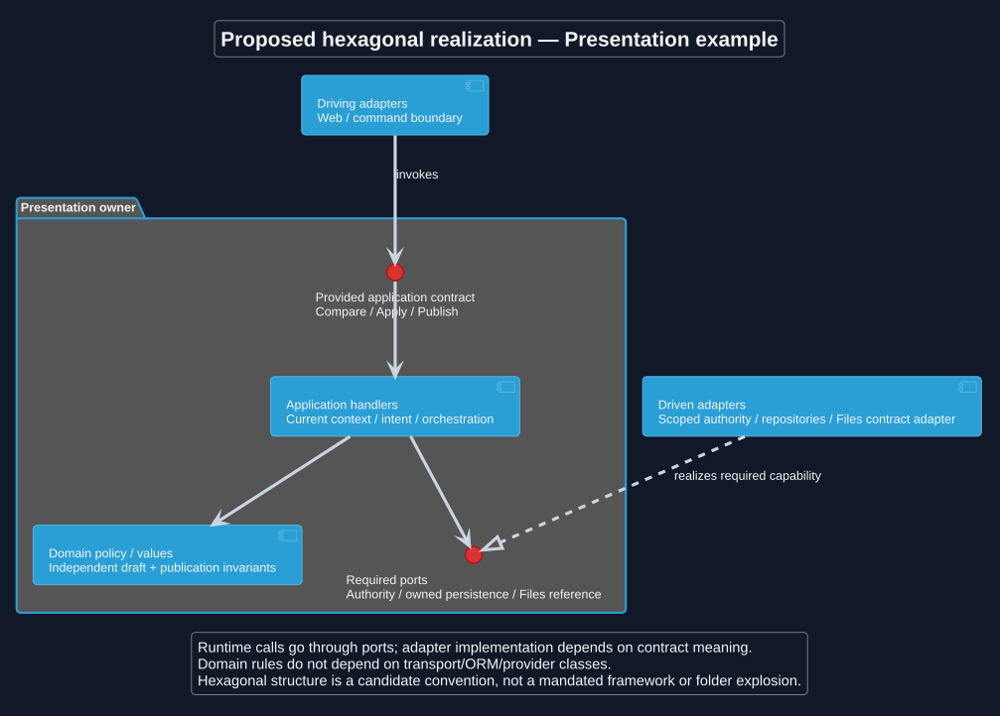

The example separates driving adapters, owner application/domain logic and required ports/driven adapters. Composition wires actual implementations; transport/ORM/provider details do not acquire domain ownership. It is a candidate convention, not a new framework choice.

<a id="design-record-01-software-architecture-02-system-decomposition-and-boundaries-md--heading-4-information-and-consistency-boundaries"></a>

#### 4. Information and consistency boundaries

<a id="design-record-01-software-architecture-02-system-decomposition-and-boundaries-md--heading-source-draft-publication-and-actual-materials"></a>

##### Source, draft, publication and actual materials

[Independent presentation and historical identities](Diagrams/Appendix/presentation-history-boundaries.svg)

[Editable DOT](Diagrams/Appendix/presentation-history-boundaries.dot) · 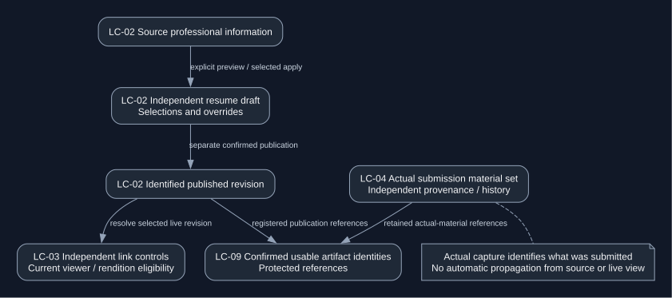

Presentation compares identified source and draft versions, applies only selected changes, and saves the draft. A separate publication confirmation creates an identified publication revision and changes the live pointer atomically within the chosen persistence mechanism. Link controls remain owned by Sharing. Files confirms artifact usability and protected reference identity; Applications retains actual submitted material manifests independently.

No arrow in this diagram means automatic propagation. An actual submission record must identify actual material/provenance, not merely copy whichever live revision exists when a later job executes. Physical artifact deduplication is possible only while ownership, immutability and reference-preservation semantics remain intact.

<a id="design-record-01-software-architecture-02-system-decomposition-and-boundaries-md--heading-local-atomicity-versus-external-effects"></a>

##### Local atomicity versus external effects

Within a bounded local command, validate current authority/version and commit intended state plus durable pending intent together where required. A queued handler rechecks relevant capability and reconciles an existing attempt before consequential repetition. Remote mail, Git refs, runner state and deployment targets are not made atomic by a relational transaction.

Quota reservation/finalization belongs to Files; published-pointer changes to Presentation; sharing-link version changes to Sharing; actual-material capture to Applications; Sprint Goal/selection/plan consistency to Work. Git performs expected-ref comparison through Git semantics. Workflow and deployment each retain independent attempt and authority context. See [runtime design](#design-record-01-software-architecture-03-process-view-concurrency-and-runtime-behavior-md) for coordination and [data design](../03-Low-Level-Design/04-Database-Design.md#design-record-04-data-design-data-design-md) for logical/physical realization.

<a id="design-record-01-software-architecture-02-system-decomposition-and-boundaries-md--heading-lifecycle-across-owners"></a>

##### Lifecycle across owners

Deletion/unlink/retirement is an operation on a particular owner and reference, not permission for universal cascade deletion. Before physical reclamation, Files checks registered protected references, including publications and actual submissions. Disconnection does not delete retained local correspondence/calendar state or replay external actions. Restoration records current authority and external reconciliation explicitly. Exact lifecycle decisions remain in the [source register](../../02-Requirements-Engineering/01-Software-Requirements-Specification.md#change-and-baseline-open-questions-and-decisions).

<a id="design-record-01-software-architecture-02-system-decomposition-and-boundaries-md--heading-cross-boundary-uml-sequence--actual-material-capture"></a>

##### Cross-boundary UML sequence — actual material capture

[Cross-boundary actual-material capture sequence](Diagrams/Appendix/boundaries-cross-context-capture.svg)

[Editable PlantUML](Diagrams/Appendix/boundaries-cross-context-capture.puml) · 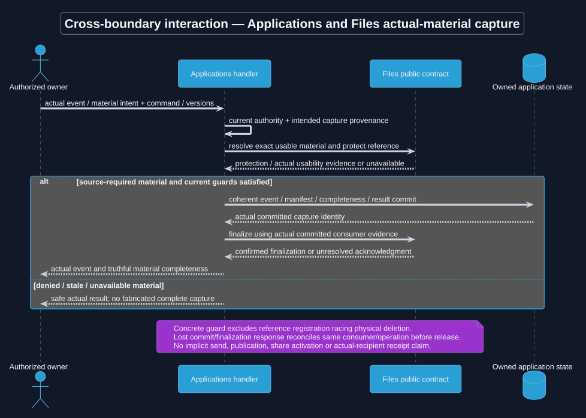

This refines the [Applications capture contract](../03-Low-Level-Design/03-Detailed-Module-Design.md#design-record-03-component-and-module-design-components-applications-md) and [Files reference protocol](../03-Low-Level-Design/03-Detailed-Module-Design.md#design-record-03-component-and-module-design-components-files-and-operations-md). The same capture event may be recorded with incomplete material according to its actual source contract; the diagram's unavailable branch must not fabricate a nonexistent event or a complete usable set. Exact consumer/reference/transaction guards remain implementation work.

<a id="design-record-01-software-architecture-02-system-decomposition-and-boundaries-md--heading-5-access-and-trust-boundaries"></a>

#### 5. Access and trust boundaries

**Private product access:** account/session identity establishes who is acting. Resource-specific grants, lifecycle and operation policy determine what may happen. Administrative powers must follow the source matrix rather than an inferred global bypass.

**Employer access:** link-scoped viewer authorization does not become a private product session. Current account/link eligibility, password-derived scope, revocation version and requested publication/rendition are evaluated before delivery admission. Disabled links prevent later eligible retrieval but cannot retract already emitted bytes or legitimate downloaded copies.

**Provider and Git access:** credentials are scoped to the intended capability and operation. Browser authentication does not automatically provide Git transport credentials. A provider connection's existence is not proof of actual permission or current freshness.

**Untrusted execution:** repository content and workflow definitions are data until admitted into an evaluated executor. The web process must not execute arbitrary user code with application credentials or unrestricted private storage. Secret scope, resource limits, network/filesystem isolation, cancellation and cleanup require actual evidence before enablement. Deployment remains separately authorized.

<a id="design-record-01-software-architecture-02-system-decomposition-and-boundaries-md--heading-6-ddd-interpretation-and-implementation-mapping"></a>

#### 6. DDD interpretation and implementation mapping

These logical components are candidate bounded contexts, chosen because vocabulary, ownership and invariants differ. This does not mandate a full DDD framework, event sourcing, separate services or one aggregate per database table.

Treat draft/publication, actual submission, Sprint Backlog, repository-ref integration and workflow attempt as explicit consistency subjects. Refine aggregate boundaries only where their invariants justify local atomicity. For external state, keep an attributable observation/attempt model rather than pretending local entities control the provider's truth.

The implementation view maps logical components to module packages and artifacts. Multiple components can share an application artifact; native Git storage, private artifact bytes and an executor facility need their own technical contracts. The deployment view subsequently maps artifacts/processes to actual facilities. See [implementation mapping](../03-Low-Level-Design/12-Appendices.md#design-record-03-component-and-module-design-02-implementation-view-and-artifacts-md) and [deployment view](#design-record-01-software-architecture-04-deployment-topology-nodes-and-networks-md).

<a id="design-record-01-software-architecture-02-system-decomposition-and-boundaries-md--heading-candidate-bounded-contexts"></a>

##### Candidate bounded contexts

[Candidate bounded contexts](Diagrams/Appendix/boundaries-ddd-contexts.svg)

[Editable PlantUML](Diagrams/Appendix/boundaries-ddd-contexts.puml) · 

[DDD bounded-context guidance](https://martinfowler.com/bliki/BoundedContext.html) informs explicit model/vocabulary boundaries and their relationships. Here the nine LC owners are candidates, not validated workshop outcomes, team assignments or mandatory service splits. “Project” in professional presentation, work and Git remains deliberately different; “completion” in a task, provider attempt and deployment is not interchangeable.

<a id="design-record-01-software-architecture-02-system-decomposition-and-boundaries-md--heading-ddd-context-map"></a>

##### DDD context map

[DDD context map](Diagrams/Appendix/boundaries-ddd-contexts.svg)

[Editable PlantUML](Diagrams/Appendix/boundaries-ddd-contexts.puml) · 

U/D labels name upstream model-provider and downstream model-consumer relationships for selected contracts. They do not assert team customer/supplier negotiations, Shared Kernel or organizational partnership. Candidate published contracts/projections keep models separate; provider/native-Git adapters translate external meaning rather than letting it overwrite internal invariants. No DDD framework is selected.

<a id="design-record-01-software-architecture-02-system-decomposition-and-boundaries-md--heading-uml-package-view"></a>

##### UML package view

[UML candidate package organization](Diagrams/Appendix/boundaries-uml-packages.svg)

[Editable PlantUML](Diagrams/Appendix/boundaries-uml-packages.puml) · 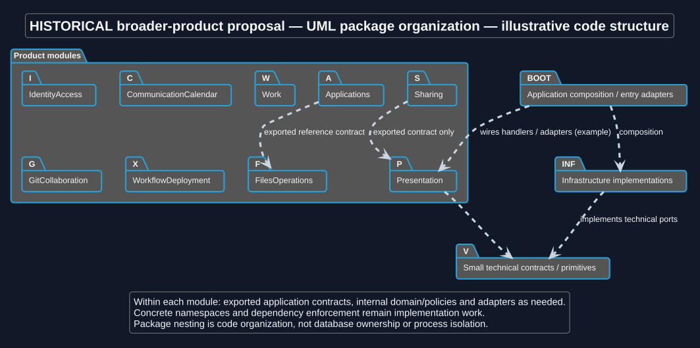

Package names are illustrative, not inspected production namespaces. See [implementation/artifact design](../03-Low-Level-Design/12-Appendices.md#design-record-03-component-and-module-design-02-implementation-view-and-artifacts-md) for the owning package-to-release responsibilities. Multiple packages can share a process/store, and a package boundary alone is not containment.

<a id="design-record-01-software-architecture-02-system-decomposition-and-boundaries-md--heading-big-picture-event-storming-board"></a>

##### Big-picture event-storming board

[MVP with explicitly deferred paths — Proposed big-picture event-storming board](Diagrams/Appendix/boundaries-big-picture-events.svg)

[Editable PlantUML](Diagrams/Appendix/boundaries-big-picture-events.puml) · 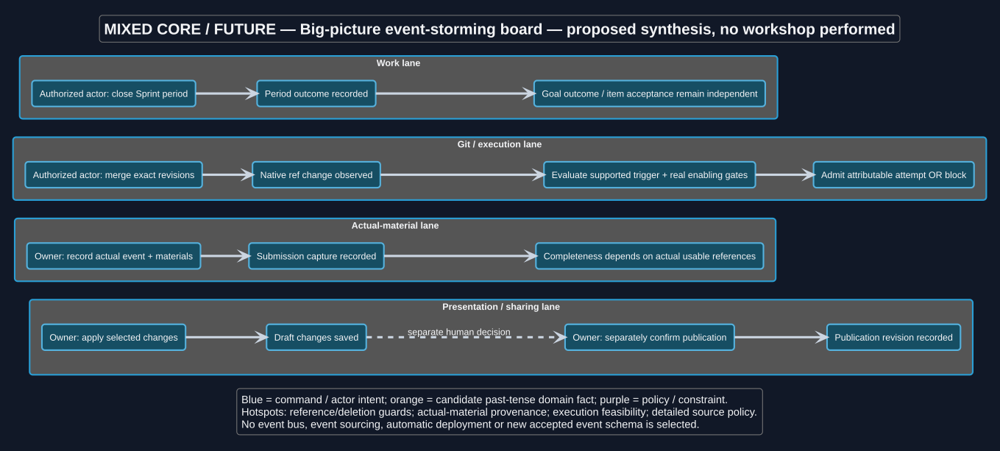

This is a **proposed desk synthesis** of existing scenarios, not a facilitated workshop, stakeholder agreement or observed production event log. Blue commands, orange past-tense domain facts and purple policy constraints preserve deliberate human actions and eligibility gates. Hotspots identify unresolved questions rather than claim resolution. No event bus, event-sourced persistence or automatic side-effect trigger is adopted. Exact event schemas and subscription policy remain component-owned design work.

<a id="design-record-01-software-architecture-02-system-decomposition-and-boundaries-md--heading-7-review-and-continuation"></a>

#### 7. Review and continuation

<a id="design-record-01-software-architecture-02-system-decomposition-and-boundaries-md--heading-required-boundary-walkthroughs"></a>

##### Required boundary walkthroughs

- Edit a profile: existing resume overrides, publication and actual history remain unchanged until their explicit operations occur.
- Disable a link or change a grant: subsequent retrieval/commands use current authority; another component's cached context cannot bypass revocation.
- Capture actual materials, then retire a source artifact: required historical references remain protected.
- Link a work item to a repository: do not extend either membership or repository authority.
- Merge a changed ref: stale reviewed context produces a conflict/re-evaluation; no implied run/deployment permission.
- Lose a provider/runner response: retain attributable unknown state and reconcile before repeating consequential effects.
- Race two file admissions: effective reservation/accounting and confirmed usability stay consistent.
- Restore an earlier backup: validate current access and external effects; do not resurrect grants or replay sends/deployments automatically.

<a id="design-record-01-software-architecture-02-system-decomposition-and-boundaries-md--heading-remaining-decisions-and-evidence"></a>

##### Remaining decisions and evidence

Exact public signatures, implementation class diagrams, schema mappings and exact criterion-to-contract links require further component/data/interface refinement. Native Git engine, executor facilities, combined capacity, OAuth/delivery setup and independent recovery remain gated as identified in [the options assessment](#design-record-01-software-architecture-01-design-drivers-and-solution-options-md--heading-5-open-decisions-and-evidence-gates). No new technology choice, numerical target or owner approval is inferred here.

The nine LC records provide architecture responsibility coverage, not semantic completion of all 157 candidate requirements or 470 criteria. Use the [review record](#design-record-06-design-quality-and-security-analysis-05-design-review-traceability-and-handoff-md) to record actual candidate-specific findings and scoped disposition. The existing ADRs remain proposed.

<a id="design-record-01-software-architecture-02-system-decomposition-and-boundaries-md--heading-fau-basis-and-verification-limits"></a>

##### FAU basis and verification limits

FAU V07 covers logical decomposition, components/interfaces, interactions, artifacts, deployment and encapsulation; V08 refines architecture into component-level models. The component names and LC locators are project adaptations. The original ownership/contract/identity views remain, supplemented by explicitly labeled C4 context/container, UML component/package, DDD candidate/context-map, hexagonal/dependency, event-storming synthesis and cross-boundary sequence views. The abstraction and proposal limits are stated with each view. None is a physical schema, completed workshop or measured runtime behavior.

Document checks cover local file references and readable generated outputs. No live provider access, Git transfer, untrusted execution, capacity/security test, restoration or phase acceptance is established by this update.

[Architecture index](#design-record-01-software-architecture-software-architecture-md) · [Diagram catalog](#design-record-01-software-architecture-diagrams-diagram-catalog-md) · [FAU reference map](#design-record-design-references-and-coverage-md)

</details>

<a id="design-record-01-software-architecture-03-process-view-concurrency-and-runtime-behavior-md"></a>

<details>
<summary>Resumefolio — Process View Concurrency and Runtime Behavior</summary>

<a id="design-record-01-software-architecture-03-process-view-concurrency-and-runtime-behavior-md--heading-resumefolio--process-view-concurrency-and-runtime-behavior"></a>

### Resumefolio — Process View Concurrency and Runtime Behavior

Current implementation choices and scope: [Baseline](https://github.com/Farhad-V/Web-Resumefolio/blob/1f2acaa351ac306cb57cbe4fe9742e8bd90720d9/docs/MVP/baseline/README.md). Runtime verification remains subject to its gates.

**Proposed runtime:** short authorized web operations, durable pending work, supervised bounded workers, scheduled reconciliation and an independently controlled executor boundary. Local database commits and external effects have distinct outcomes.

**Status:** proposed technical design. No queue/backend, executor, workload limit or timeout value is accepted or verified by this document. Farhad retains decision authority.

[Processes](#design-record-01-software-architecture-03-process-view-concurrency-and-runtime-behavior-md--heading-1-runtime-responsibilities) · [Commands](#design-record-01-software-architecture-03-process-view-concurrency-and-runtime-behavior-md--heading-2-local-command-and-transaction-protocol) · [Concurrency](#design-record-01-software-architecture-03-process-view-concurrency-and-runtime-behavior-md--heading-3-shared-state-and-concurrency-rules) · [Workers](#design-record-01-software-architecture-03-process-view-concurrency-and-runtime-behavior-md--heading-4-durable-work-dispatch-and-reconciliation) · [Cancellation](#design-record-01-software-architecture-03-process-view-concurrency-and-runtime-behavior-md--heading-5-cancellation-and-external-execution) · [Recovery](#design-record-01-software-architecture-03-process-view-concurrency-and-runtime-behavior-md--heading-6-failure-recovery-and-observability) · [Verification](#design-record-01-software-architecture-03-process-view-concurrency-and-runtime-behavior-md--heading-7-verification-and-open-decisions) · [Full diagram package](#design-record-01-software-architecture-03-process-view-concurrency-and-runtime-behavior-md--heading-8-runtime-diagram-package)

<a id="design-record-01-software-architecture-03-process-view-concurrency-and-runtime-behavior-md--heading-current-mvp-boundary-figure"></a>

#### Current MVP boundary figure

[Accepted core and separate ProjectForge boundary](Diagrams/Appendix/mvp-system-boundaries.svg)

[Editable source](Diagrams/Appendix/mvp-system-boundaries.puml) · . Historical broader-product figures below retain earlier alternatives/detail; they do not define the current system boundary.

<a id="design-record-01-software-architecture-03-process-view-concurrency-and-runtime-behavior-md--heading-authoritative-context"></a>

#### Authoritative context

Use the [architecture assessment](#design-record-01-software-architecture-01-design-drivers-and-solution-options-md), [logical component boundaries](#design-record-01-software-architecture-02-system-decomposition-and-boundaries-md), [analysis states](../../03-System-Analysis/03-Processes-Scenarios-And-Business-Rules.md#analysis-behavioral-and-scenario-analysis--07-state-based-view), [activities](../../03-System-Analysis/03-Processes-Scenarios-And-Business-Rules.md#analysis-functional-and-process-analysis--08-control-flow-based-view), [operation contracts](../../03-System-Analysis/03-Processes-Scenarios-And-Business-Rules.md#analysis-business-rules-and-operation-contracts--10-domain-constraints-and-operation-contracts) and [interface analysis](../../03-System-Analysis/04-Interfaces-Security-And-Quality.md#analysis-interfaces-security-and-quality-analysis--12-interfaces-and-external-interactions). This view realizes their behavior technically; it does not replace their domain state vocabulary or source policy.

<a id="design-record-01-software-architecture-03-process-view-concurrency-and-runtime-behavior-md--heading-1-runtime-responsibilities"></a>

#### 1. Runtime responsibilities

[MVP with explicitly deferred paths — Proposed runtime responsibilities](Diagrams/Appendix/runtime-responsibilities.svg)

[Editable DOT](Diagrams/Appendix/runtime-responsibilities.dot) · 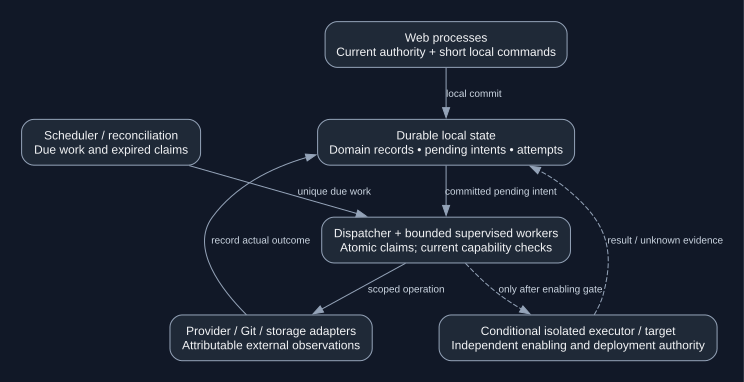

<a id="design-record-01-software-architecture-03-process-view-concurrency-and-runtime-behavior-md--heading-web-request-processes"></a>

##### Web request processes

Authenticate the actor, authorize the exact resource/action, validate input, read current versions and perform short local commands or permitted queries. Return an attributable completed/conflicting/denied/pending outcome. Do not wait for long PDF rendering, full mailbox synchronization or workflow completion while holding database locks. Protected retrieval evaluates current eligibility before releasing the selected representation.

<a id="design-record-01-software-architecture-03-process-view-concurrency-and-runtime-behavior-md--heading-durable-local-state"></a>

##### Durable local state

Persist domain records, operation identities, expected/current revisions, outbox or equivalent pending intents, attempt observations and worker-claim state. These are responsibilities, not a selected queue product or physical table definition. Local domain changes and their required pending intent must be committed atomically where they belong to one local operation.

<a id="design-record-01-software-architecture-03-process-view-concurrency-and-runtime-behavior-md--heading-dispatcher-and-bounded-workers"></a>

##### Dispatcher and bounded workers

The dispatcher makes committed pending work available for processing. Workers handle separately bounded PDF generation, provider operations/synchronization, artifact processing, cleanup and reconciliation. Logical job classes allow independent limits and pause controls; they do not require a separate server or process pool for every class. The actual queue backend and supervisor need compatibility/resource evaluation.

<a id="design-record-01-software-architecture-03-process-view-concurrency-and-runtime-behavior-md--heading-scheduler-and-reconciliation"></a>

##### Scheduler and reconciliation

Schedule due work, discover expired claims and initiate reconciliation under the same durable uniqueness/authority rules. Overlapping scheduler ticks cannot create duplicate operation identities. A missed tick should become overdue work, not an invented completed action. The demo observations did not establish configured workers/scheduler; setup and actual execution checks remain required.

<a id="design-record-01-software-architecture-03-process-view-concurrency-and-runtime-behavior-md--heading-git-and-conditional-execution-facilities"></a>

##### Git and conditional execution facilities

**After MVP.** Shared operating and recovery controls still apply where relevant.

Git operations use an evaluated backend with native repository/ref semantics and bounded resource handling. Workflow workers submit only admitted exact attempts to an evaluated isolated execution facility. Neither untrusted code nor unbounded subprocesses may run under the web identity with application secrets. Deployment has a separate target authority and attempt record. A process diagram does not demonstrate isolation.

<a id="design-record-01-software-architecture-03-process-view-concurrency-and-runtime-behavior-md--heading-2-local-command-and-transaction-protocol"></a>

#### 2. Local command and transaction protocol

<a id="design-record-01-software-architecture-03-process-view-concurrency-and-runtime-behavior-md--heading-request-envelope"></a>

##### Request envelope

Carry a stable command identity, actor and resource context, intended operation, expected version when conflicts matter, and validated input. Bind a duplicate-suppression identity to its actor, operation, resource and canonical intent; reusing it with different input must not execute another mutation. Record sufficient bounded evidence to identify the previous result without logging sensitive payloads.

<a id="design-record-01-software-architecture-03-process-view-concurrency-and-runtime-behavior-md--heading-local-mutation-sequence"></a>

##### Local mutation sequence

1. Resolve current identity and policy; validate input shape and intended resource.
2. Start a short transaction and obtain the operation-specific lock or compare/version guard.
3. Recheck the current grant/lifecycle/version under the chosen synchronization protocol. A stale prior browser check is insufficient.
4. Apply the exact permitted mutation, preserve protected state and record its attributable result. If remote/background work is required, persist its pending intent and unique attempt identity in the same local transaction.
5. Commit before dispatching external work. Respond with the actual local result or pending operation reference. A failure to send the HTTP response after commit does not imply rollback.

Duplicate commands resolve their recorded result under current permitted disclosure; they do not blindly rerun. Conflicting expected revisions produce an explicit compare/reload/reapply path. Deadlocks and transient local failures may retry the bounded local transaction only while no external effect has occurred and the same operation identity/invariants remain protected.

<a id="design-record-01-software-architecture-03-process-view-concurrency-and-runtime-behavior-md--heading-consistency-scope"></a>

##### Consistency scope

Use local transactions for invariants actually governed by the selected database. Do not hold locks while calling a provider, performing long Git transfer, rendering a PDF or waiting for a runner. A transaction cannot roll back an accepted email, a Git ref update or a target deployment. Exact isolation level, lock/version implementation, uniqueness constraints and retry policy belong to the evaluated persistence design and subsequent concurrency tests.

<a id="design-record-01-software-architecture-03-process-view-concurrency-and-runtime-behavior-md--heading-3-shared-state-and-concurrency-rules"></a>

#### 3. Shared state and concurrency rules

<a id="design-record-01-software-architecture-03-process-view-concurrency-and-runtime-behavior-md--heading-resume-draft-and-publication"></a>

##### Resume draft and publication

Presentation commands carry expected source/draft versions. Selected source application saves only the draft; publication separately confirms the intended draft version. Serialize live-pointer changes or use an atomic compare-and-update. Concurrent publication/edit must publish the explicitly confirmed version or return conflict, never silently include unreviewed changes. Previously submitted materials remain independent.

<a id="design-record-01-software-architecture-03-process-view-concurrency-and-runtime-behavior-md--heading-link-account-and-resource-authority"></a>

##### Link, account and resource authority

Sharing-link changes increment or otherwise invalidate the relevant authorization version. Commands and new retrieval admissions re-evaluate current eligibility rather than caching a permanent grant. Define synchronization with in-flight operations at the owning boundary: completed revocation prevents subsequent admissions, but cannot retract already emitted bytes or necessarily undo a remote effect admitted before revocation. Long-running tasks recheck authority at consequential stages and record actual effects when access changes.

<a id="design-record-01-software-architecture-03-process-view-concurrency-and-runtime-behavior-md--heading-quota-and-artifact-replacement"></a>

##### Quota and artifact replacement

Reserve growth atomically against the same effective quota and current outstanding reservations. Two parallel requests cannot both consume the same remaining capacity. Record reservation identity; finalize actual confirmed usage, release unused reservation and reconcile abandoned work. A new replacement becomes referenced only after confirmed usability; keep the prior usable reference until the switch. Physical reclamation checks all protected references and is not inferred from a logical delete.

<a id="design-record-01-software-architecture-03-process-view-concurrency-and-runtime-behavior-md--heading-repository-refs-and-work-state"></a>

##### Repository refs and work state

Use Git-native expected-old-ref comparison for mutation, binding reviewed source/target revisions to integration eligibility. A changed target invalidates the old evaluation context as required by the source rules. Work-item movement uses current board/item versions and applicable transition rules. Sprint period end does not implicitly accept unfinished items or change repository permissions.

<a id="design-record-01-software-architecture-03-process-view-concurrency-and-runtime-behavior-md--heading-provider-mappings-and-shared-workers"></a>

##### Provider mappings and shared workers

Calendar synchronization compares attributable local/provider revisions and source field-authority rules. Do not impose last-write-wins or bidirectional replay by default. Per-resource ordering is used only where required; unrelated resources may proceed concurrently within measured limits. Distinct workers cannot claim the same pending attempt without an atomic ownership check.

<a id="design-record-01-software-architecture-03-process-view-concurrency-and-runtime-behavior-md--heading-4-durable-work-dispatch-and-reconciliation"></a>

#### 4. Durable work dispatch and reconciliation

[Durable intent and external effect handling](Diagrams/Appendix/durable-attempt-protocol.svg)

[Editable DOT](Diagrams/Appendix/durable-attempt-protocol.dot) · 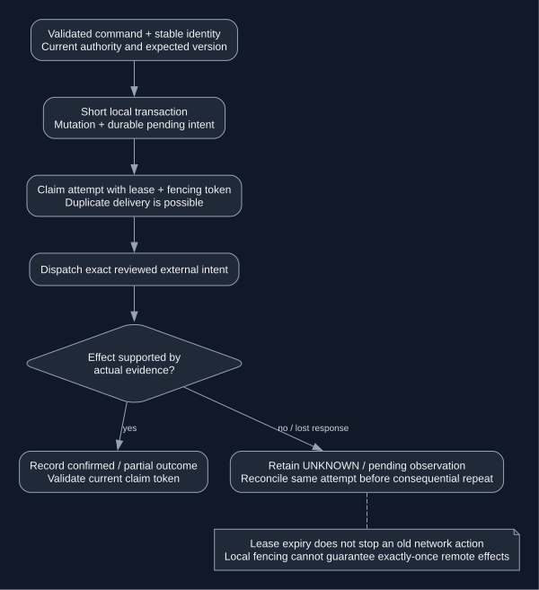

<a id="design-record-01-software-architecture-03-process-view-concurrency-and-runtime-behavior-md--heading-commit-and-dispatch"></a>

##### Commit and dispatch

A local transaction commits intended state plus a pending outbox/operation record. Dispatch and queue delivery may be repeated; handlers therefore treat delivery as potentially duplicated. A dispatch acknowledgment is not remote success. Unique operation/attempt identity and atomic claim logic prevent duplicate local completion; they do not guarantee exactly-once external execution.

<a id="design-record-01-software-architecture-03-process-view-concurrency-and-runtime-behavior-md--heading-claim-ownership-and-fencing"></a>

##### Claim ownership and fencing

Claim work with a bounded lease and monotonically changing claim token or equivalent fencing identity. Persist claim owner, expiration and attempt identity. Heartbeat extension is conditional on continued ownership. Every local result commit validates the current claim token so an expired worker cannot overwrite a successor's observations.

A lease prevents indefinite local ownership; it does not stop an old worker already performing a network action. Lease expiry after possible dispatch therefore triggers reconciliation, not automatic resend. If an external facility supports a stable idempotency/reconciliation identity, verify its actual retention/scope semantics before relying on it. Otherwise retain unknown effect and require bounded investigation or explicit user disposition rather than inventing safety.

<a id="design-record-01-software-architecture-03-process-view-concurrency-and-runtime-behavior-md--heading-result-classification"></a>

##### Result classification

Use the operation's source contract to distinguish confirmed completion, confirmed no-effect failure, pending, denied, conflict, partial and unknown effects. Record actual evidence, current observation time and provenance. UI polling or notifications read a permitted operation projection; a successful queue job is not proof that the business goal or external receipt occurred.

<a id="design-record-01-software-architecture-03-process-view-concurrency-and-runtime-behavior-md--heading-retry-and-backpressure"></a>

##### Retry and backpressure

Separate retryable local/read failures from consequential mutations with uncertain outcome. Use bounded delays, attempt limits and diagnostic references once justified; no numeric defaults are adopted here. Exhausted/unreconciled work becomes visible for intervention. Stop admitting additional heavy work when evaluated resource/storage policy requires it. Queue depth, oldest pending age and per-class saturation guide later measurements; they do not themselves establish capacity.

<a id="design-record-01-software-architecture-03-process-view-concurrency-and-runtime-behavior-md--heading-5-cancellation-and-external-execution"></a>

#### 5. Cancellation and external execution

**After MVP.** Shared operating and recovery controls still apply where relevant.

[Cancellation and lost-runner reconciliation](Diagrams/Appendix/cancellation-reconciliation.svg)

[Editable DOT](Diagrams/Appendix/cancellation-reconciliation.dot) · 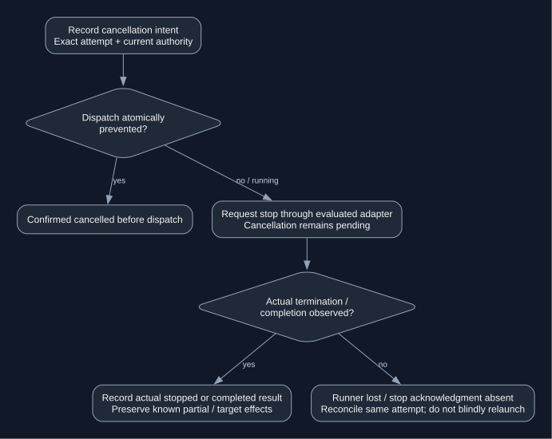

Store cancellation intent against the exact attempt. If work is still unclaimed and atomically preventable, record confirmed cancellation without dispatch. If running, request stop through the evaluated adapter and keep the result pending until actual evidence establishes termination or completion. Completion can win a cancellation race; retain the real terminal result and known effects rather than overwriting it with the request label.

Runner loss, lost stop acknowledgment or an expired lease produces a reconciliation requirement. Query the same attributable attempt where the facility permits it, restrict new dependent actions and report unknown/partial status honestly. A rerun is a new explicitly eligible attempt after prior effects are assessed. Cancellation does not automatically undo stored artifacts or deployments.

The execution admission gate checks supported definition/revision, current authority, feasible isolation, secret scope, workspace/network policy and resource limits. Target deployment additionally binds approved artifact/revision and target authority. Cleanup records actual workspace/secret handling and retained restricted evidence, including failure limits. No executor or stop capability is verified by this document.

<a id="design-record-01-software-architecture-03-process-view-concurrency-and-runtime-behavior-md--heading-6-failure-recovery-and-observability"></a>

#### 6. Failure recovery and observability

**Web process dies before commit:** no local committed mutation is claimed; inspect transaction outcome and command identity before repeating. **Commit succeeds but response is lost:** the same command identity resolves the prior permitted result.

**Commit succeeds but dispatcher dies:** committed pending work remains discoverable. **Worker dies before known external dispatch:** reclaim only after ownership/dispatch evidence supports safe continuation. **Worker dies during/after possible dispatch:** reconcile the existing attempt; do not infer no effect from absence of a result record.

**Stale worker returns:** reject local completion under an obsolete claim token, retain attributable evidence for reconciliation and avoid overwriting a newer observation. Fencing local writes does not reverse an external effect.

**Queue/provider unavailable:** record unavailable/pending work and bounded retry/reconciliation status, protect interactive core state, and enforce admission limits. **Storage full:** reject or suspend growth safely, preserve the prior usable representation and record actual reservation/cleanup outcomes.

**Application restart or restoration:** resume durable pending state through the same authority, claim and reconciliation rules. Restored historical grants are not automatically valid; restored pending sends or deployments are not replayed automatically. Follow [recovery design](#design-record-06-design-quality-and-security-analysis-03-operations-backup-recovery-and-resilience-md).

Observe command/attempt identity, claim generation, state transitions, timing, bounded error category, queue age, resource pressure and cleanup/reconciliation disposition. Exclude passwords, tokens, private email bodies and unrestricted artifact content from ordinary logs. Alert criteria and numeric thresholds require actual operating target decisions. A running process/healthy HTTP endpoint does not prove scheduler or job progress.

<a id="design-record-01-software-architecture-03-process-view-concurrency-and-runtime-behavior-md--heading-7-verification-and-open-decisions"></a>

#### 7. Verification and open decisions

<a id="design-record-01-software-architecture-03-process-view-concurrency-and-runtime-behavior-md--heading-required-focused-checks"></a>

##### Required focused checks

- Run duplicate commands with identical and changed intent; verify one attributable local mutation and explicit mismatched-intent handling.
- Race draft editing/publication, grant/link changes, parallel quota admission and stale Git refs; verify the source invariant or explicit conflict.
- Interrupt before commit, after commit/before dispatch, before external send, and after possible external acceptance/before observation; require evidence-supported outcomes and no blind repetition.
- Expire a worker lease and let the old worker finish; verify fencing and external reconciliation limitations.
- Race cancellation with start/completion and lose the stop acknowledgment; distinguish request, actual stop, completion and unknown outcome.
- Disconnect providers, pause workers/scheduler and fill storage under controlled conditions; verify bounded degradation, recovery and honest UI state.
- Restore isolated pending-operation state; verify current authority and that consequential effects are not automatically replayed.

These are verification specifications, not executed tests. Each later run needs an identified candidate/environment, permitted scope, initial data/state, expected result, actual observation and protected-state comparison.

<a id="design-record-01-software-architecture-03-process-view-concurrency-and-runtime-behavior-md--heading-decisions-still-required"></a>

##### Decisions still required

Evaluate queue/backend and supervisor compatibility, database isolation/locking and uniqueness behavior, worker/scheduler arrangement, per-class concurrency, leases/deadlines/retry limits, provider reconciliation facilities, executor admission/stop/isolation, storage admission and actual workload targets. Use existing resources and budget; no new infrastructure purchase or numeric service promise is implied. Exact physical schema and signatures remain component/data/interface refinement work.

<a id="design-record-01-software-architecture-03-process-view-concurrency-and-runtime-behavior-md--heading-fau-basis-and-continuation"></a>

##### FAU basis and continuation

FAU V07 process/runtime viewpoints explain processes and communication; component interactions, operating states and deployment must agree. V08 refines these into component-level technical scenarios. This file adapts those concepts to the existing analysis; workflow/operation states remain governed by source contracts.

Continue with [deployment topology](#design-record-01-software-architecture-04-deployment-topology-nodes-and-networks-md), [data strategy](../03-Low-Level-Design/04-Database-Design.md#design-record-04-data-design-data-design-md), [component prescriptions](../03-Low-Level-Design/02-Module-Breakdown.md#design-record-03-component-and-module-design-component-and-module-design-md) and [exact traceability/review](#design-record-06-design-quality-and-security-analysis-05-design-review-traceability-and-handoff-md). [ADR-003](../ADR/ADR-003-Durable-External-Attempts.md#design-record-07-design-decisions-adr-003-durable-external-attempts-md) records the proposed durable-attempt choice.

Document checks establish link/render integrity only. No live job, provider send, Git mutation, load/cancellation test, security validation, restoration or owner baseline approval was performed. Advisor transport remains unavailable as recorded for this design candidate; no independent endorsement is claimed.

<a id="design-record-01-software-architecture-03-process-view-concurrency-and-runtime-behavior-md--heading-8-runtime-diagram-package"></a>

#### 8. Runtime diagram package

These views refine the same proposed runtime from distinct perspectives. UML interaction/activity/state/timing notation, process topology and DFD/wait-for notation serve different questions; they are not interchangeable proofs. Each has editable PlantUML source and SVG/PNG exports. No process, thread pool, actor framework, queue product, timeout or observed runtime result is selected by adding the views.

| Requested view | Included realization |
| --- | --- |
| Key runtime sequences | Guarded local command and lost external-response scenarios |
| Swimlane activity with fork/join | Local commit followed by independent response/background branches |
| State machine / communication / timing | Coordinator knowledge, numbered collaboration and illustrative claim/effect timeline |
| Process/thread and concurrency views | Bounded scoped process workers; threading/event-loop/actor alternatives remain unselected |
| Message/queue topology and process deployment | Logical eligible-work lanes and candidate process-to-node mapping |
| Resource contention / logical DFD | Invariant guards/shared resources and actual intent/observation data flows |
| Optional deadlock analysis | Hypothetical wait-for cycle, with explicit assumptions and no formal proof claim |

<a id="design-record-01-software-architecture-03-process-view-concurrency-and-runtime-behavior-md--heading-81-sequence--guarded-local-command"></a>

##### 8.1 Sequence — guarded local command

[Sequence — guarded local command](Diagrams/Appendix/runtime-local-command-sequence.svg)

[Editable PlantUML](Diagrams/Appendix/runtime-local-command-sequence.puml) · 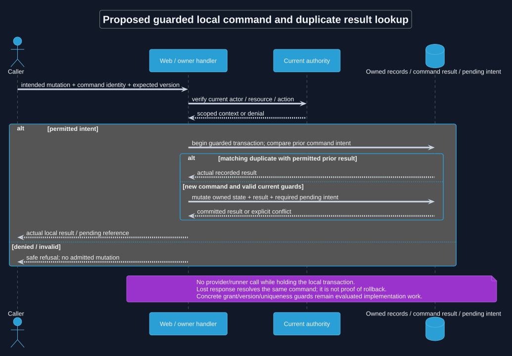

The local scenario separates current authorization, duplicate intent, guarded local mutation and actual result. Exact lock/version/uniqueness semantics belong to the selected persistence implementation; a failure to return a response is not proof of rollback.

<a id="design-record-01-software-architecture-03-process-view-concurrency-and-runtime-behavior-md--heading-82-sequence--lost-external-response"></a>

##### 8.2 Sequence — lost external response

[Sequence — lost external response](Diagrams/Appendix/runtime-remote-effect-sequence.svg)

[Editable PlantUML](Diagrams/Appendix/runtime-remote-effect-sequence.puml) · 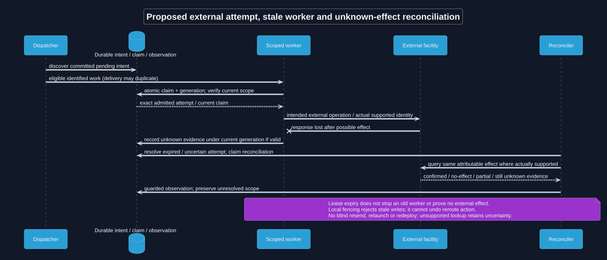

This scenario covers a lost response after possible external dispatch. Local claim fencing protects observations, not remote execution. Actual provider/executor lookup may be unavailable; preserve Unknown rather than inventing a safe repeat. See [ADR-003](../ADR/ADR-003-Durable-External-Attempts.md#design-record-07-design-decisions-adr-003-durable-external-attempts-md).

<a id="design-record-01-software-architecture-03-process-view-concurrency-and-runtime-behavior-md--heading-83-uml-activity--lanes-and-forkjoin"></a>

##### 8.3 UML activity — lanes and fork/join

[UML activity — lanes and fork/join](Diagrams/Appendix/runtime-swimlane-fork-join.svg)

[Editable PlantUML](Diagrams/Appendix/runtime-swimlane-fork-join.puml) · 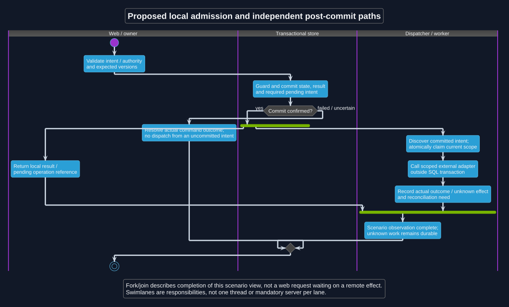

The lanes allocate responsibilities. After commit, response delivery and background processing proceed independently. The join is the end of the illustrated scenario observation, not a synchronous web request waiting for remote work; the observation branch can finish with durable unresolved state. No one-thread-per-lane or selected thread API is implied.

<a id="design-record-01-software-architecture-03-process-view-concurrency-and-runtime-behavior-md--heading-84-uml-state-machine--attempt-knowledge"></a>

##### 8.4 UML state machine — attempt knowledge

[UML state machine — attempt knowledge](Diagrams/Appendix/runtime-attempt-state-machine.svg)

[Editable PlantUML](Diagrams/Appendix/runtime-attempt-state-machine.puml) · 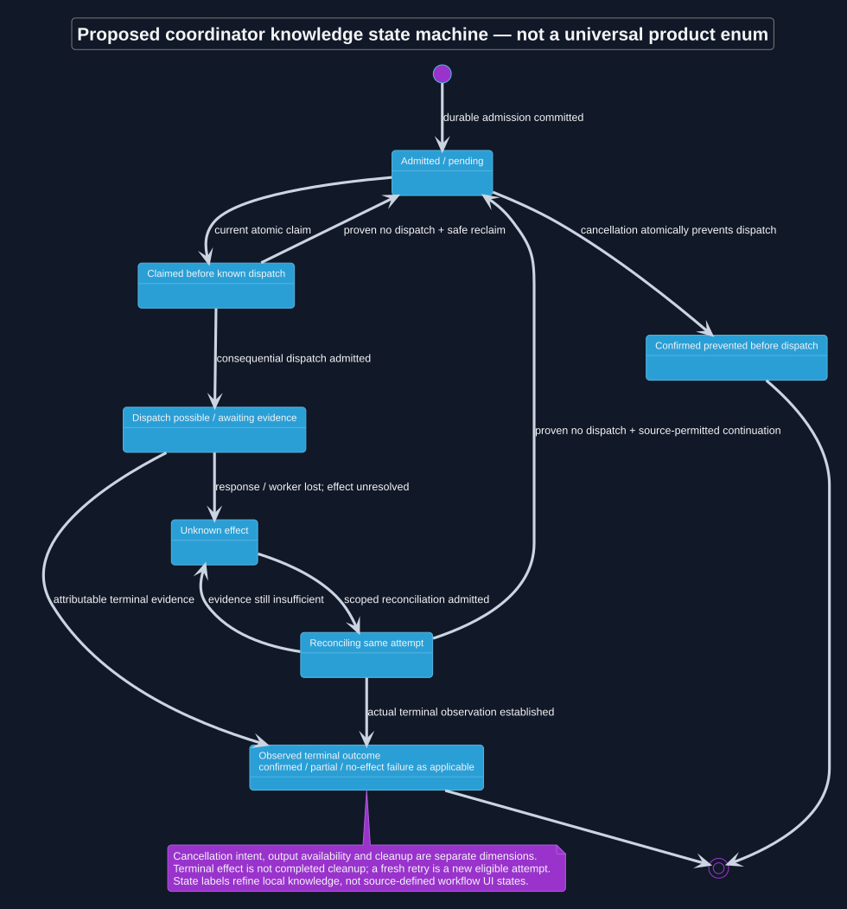

This is a proposed **coordinator-knowledge model**, not a replacement for source workflow/product enums. Cancellation request, output capture, cleanup and deployment effect are orthogonal dimensions. Only actual evidence enables terminal/no-dispatch transitions. A retry after possible effect requires the reviewed distinct-attempt policy.

<a id="design-record-01-software-architecture-03-process-view-concurrency-and-runtime-behavior-md--heading-85-uml-communication--numbered-collaboration"></a>

##### 8.5 UML communication — numbered collaboration

**After MVP.** Shared operating and recovery controls still apply where relevant.

[UML communication — numbered collaboration](Diagrams/Appendix/runtime-communication-diagram.svg)

[Editable PlantUML](Diagrams/Appendix/runtime-communication-diagram.puml) · 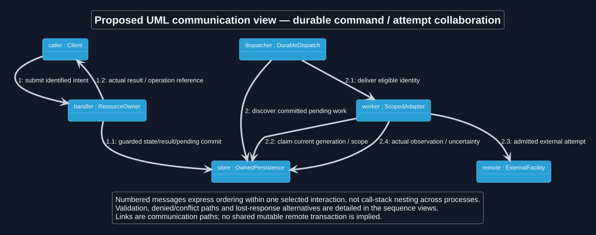

Numbered messages describe one collaboration over communication links. The sequence diagrams own detailed alternatives. Numbers show scenario ordering, not a distributed transaction or guaranteed single delivery.

<a id="design-record-01-software-architecture-03-process-view-concurrency-and-runtime-behavior-md--heading-86-uml-timing--lease-versus-effect-knowledge"></a>

##### 8.6 UML timing — lease versus effect knowledge

[UML timing — lease versus effect knowledge](Diagrams/Appendix/runtime-claim-timing.svg)

[Editable PlantUML](Diagrams/Appendix/runtime-claim-timing.puml) · 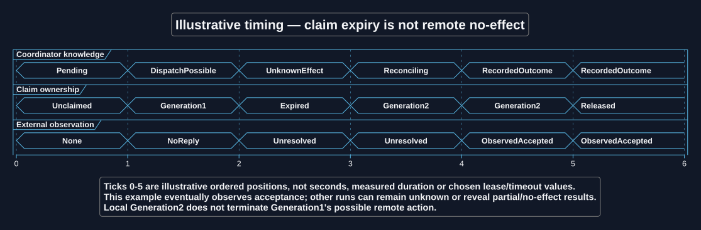

Ticks are synthetic ordered positions, **not elapsed seconds, accepted lease values or benchmark data**. The example eventually obtains acceptance evidence; unresolved/partial alternatives remain possible. Lease expiry never proves that a remote action did not happen.

<a id="design-record-01-software-architecture-03-process-view-concurrency-and-runtime-behavior-md--heading-87-processthread-view--bounded-execution-units"></a>

##### 8.7 Process/thread view — bounded execution units

**After MVP.** Shared operating and recovery controls still apply where relevant.

[MVP with explicitly deferred paths — Process/thread view — bounded execution units](Diagrams/Appendix/runtime-process-thread-view.svg)

[Editable PlantUML](Diagrams/Appendix/runtime-process-thread-view.puml) · 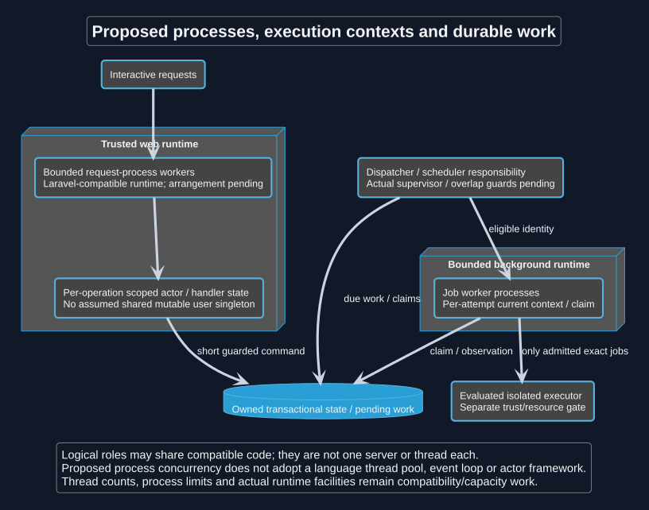

The candidate uses short request-process work and bounded background process work. It does not assume that PHP request workers are a language-level thread pool, or that logical roles require distinct hosts. Exact runtime/threading, pool sizes, supervisor and scheduler remain evaluated facilities.

<a id="design-record-01-software-architecture-03-process-view-concurrency-and-runtime-behavior-md--heading-88-concurrency-model--bounded-processes-and-scoped-work"></a>

##### 8.8 Concurrency model — bounded processes and scoped work

[Concurrency model — bounded processes and scoped work](Diagrams/Appendix/runtime-concurrency-model.svg)

[Editable PlantUML](Diagrams/Appendix/runtime-concurrency-model.puml) · 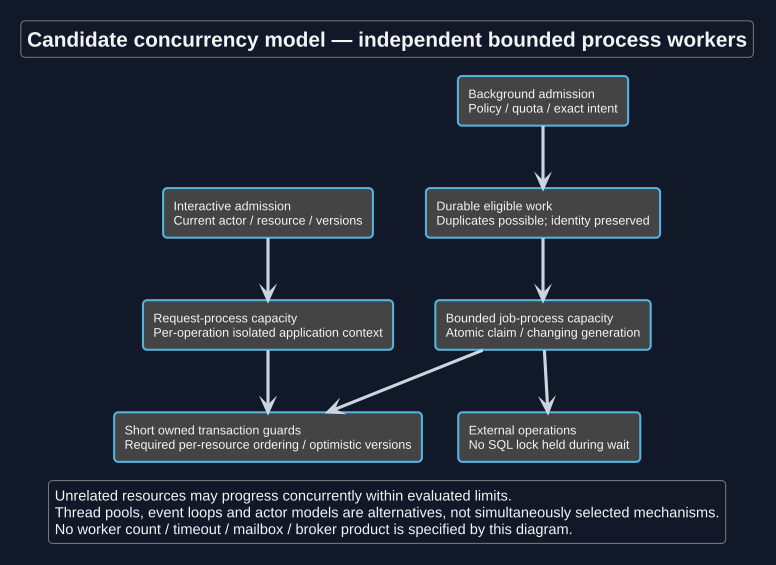

The current candidate is bounded process concurrency with scoped per-operation context, local guards and durable work. Event-loop/async I/O, thread pools and actor systems are alternatives to evaluate if justified, **not three simultaneously selected frameworks**. No numeric concurrency or timeout default is adopted.

<a id="design-record-01-software-architecture-03-process-view-concurrency-and-runtime-behavior-md--heading-89-message-flow-and-logical-queue-topology"></a>

##### 8.9 Message flow and logical queue topology

[Message flow and logical queue topology](Diagrams/Appendix/runtime-queue-topology.svg)

[Editable PlantUML](Diagrams/Appendix/runtime-queue-topology.puml) · 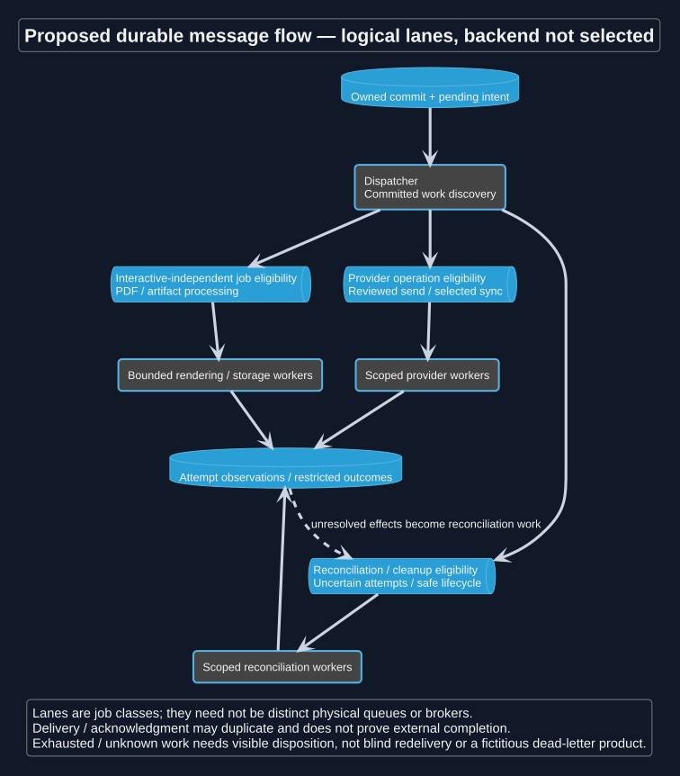

These are logical eligible-work classes, not an adopted broker or mandatory physical queue count. Unknown effects route to reconciliation/disposition, not unconditional re-execution. Actual acknowledgment, visibility, scheduler overlap and failure-lane mechanisms require compatible implementation and evidence.

<a id="design-record-01-software-architecture-03-process-view-concurrency-and-runtime-behavior-md--heading-810-uml-deployment--runtime-processes-on-candidate-nodes"></a>

##### 8.10 UML deployment — runtime processes on candidate nodes

[UML deployment — runtime processes on candidate nodes](Diagrams/Appendix/drivers-uml-deployment.svg)

[Editable PlantUML](Diagrams/Appendix/drivers-uml-deployment.puml) · 

This view maps proposed runtime roles to a candidate environment and separate conditional executor boundary. Artifacts can share one compatible release. It is neither an observed service inventory nor evidence of resource fit, working scheduling or HA; see [deployment design](#design-record-01-software-architecture-04-deployment-topology-nodes-and-networks-md).

<a id="design-record-01-software-architecture-03-process-view-concurrency-and-runtime-behavior-md--heading-811-resource-contention--guards-and-shared-capacity"></a>

##### 8.11 Resource contention — guards and shared capacity

[Resource contention — guards and shared capacity](Diagrams/Appendix/runtime-resource-contention.svg)

[Editable PlantUML](Diagrams/Appendix/runtime-resource-contention.puml) · 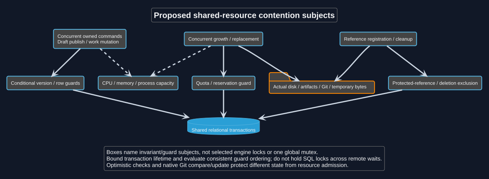

The guard subjects express invariants to protect: revisions, aggregate quota and reference/deletion exclusion. They do not select a global lock, isolation level or acquisition algorithm. Actual SQL/native-Git/storage races and combined resource pressure need integration checks.

<a id="design-record-01-software-architecture-03-process-view-concurrency-and-runtime-behavior-md--heading-812-dfd--intent-and-observation-data"></a>

##### 8.12 DFD — intent and observation data

[DFD — intent and observation data](Diagrams/Appendix/runtime-dataflow.svg)

[Editable PlantUML](Diagrams/Appendix/runtime-dataflow.puml) · 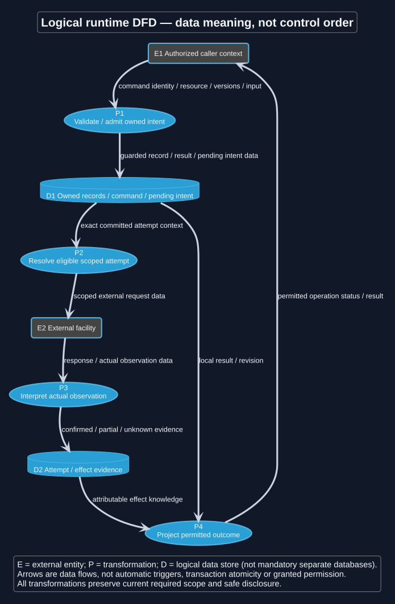

This DFD uses external entities, transformations and logical stores. It deliberately shows input/intent/observation/result **data**, not thread scheduling or automatic triggers. Logical stores may share a database. Current authority and exact external identities remain mandatory at applicable transformations.

<a id="design-record-01-software-architecture-03-process-view-concurrency-and-runtime-behavior-md--heading-813-optional-wait-for-graph--hypothetical-deadlock"></a>

##### 8.13 Optional wait-for graph — hypothetical deadlock

[Optional wait-for graph — hypothetical deadlock](Diagrams/Appendix/runtime-wait-for-example.svg)

[Editable PlantUML](Diagrams/Appendix/runtime-wait-for-example.puml) · 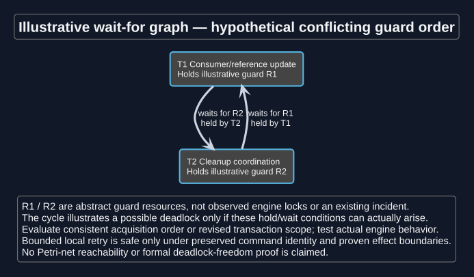

This optional graph demonstrates how opposite abstract guard acquisition could form a wait cycle. It is not an observed defect, actual engine lock graph or proof that the selected design deadlocks. Define real transaction/guard order and test under the chosen engine before making deadlock-freedom claims.

<a id="design-record-01-software-architecture-03-process-view-concurrency-and-runtime-behavior-md--heading-reading-and-verification-limits"></a>

##### Reading and verification limits

Cross-check these views with the [component catalog](../03-Low-Level-Design/02-Module-Breakdown.md#design-record-03-component-and-module-design-component-and-module-design-md), [data guards](../03-Low-Level-Design/04-Database-Design.md#design-record-04-data-design-01-analysis-to-logical-and-physical-data-models-md), [API outcomes](../03-Low-Level-Design/05-API-Specification.md#design-record-05-interface-and-api-design-01-api-protocols-contracts-and-compatibility-md) and [security/operating designs](#design-record-06-design-quality-and-security-analysis-design-quality-and-security-analysis-md). A state/claim change, queue acknowledgment, process exit and actual remote completion are separate observations.

Verify actual interleavings, duplicate intent, stale claims, callback identity, lock order, resource admission, cancellation/cleanup and restored pending state against the identified implementation. The diagrams do not establish current setup, safe execution, numeric timing, formal liveness or product-test Pass. Existing source-policy/feasibility gates and ADR statuses remain unchanged.

[Architecture index](#design-record-01-software-architecture-software-architecture-md) · [Diagram catalog](#design-record-01-software-architecture-diagrams-diagram-catalog-md)

</details>

<a id="design-record-01-software-architecture-04-deployment-topology-nodes-and-networks-md"></a>

<details>
<summary>Resumefolio — Deployment Topology Nodes and Networks</summary>

<a id="design-record-01-software-architecture-04-deployment-topology-nodes-and-networks-md--heading-resumefolio--deployment-topology-nodes-and-networks"></a>

### Resumefolio — Deployment Topology Nodes and Networks

Current implementation choices and scope: [Baseline](https://github.com/Farhad-V/Web-Resumefolio/blob/1f2acaa351ac306cb57cbe4fe9742e8bd90720d9/docs/MVP/baseline/README.md). Runtime verification remains subject to its gates.

**Current deployment constraint:** core uploads/media stay in private directories on the Resumefolio server. Core runtime/database mechanisms remain design work; ProjectForge is a distinct API-connected system whose engine, physical placement and database are undecided. Independent recoverable backups and least privilege remain required. Untrusted workflow execution is deferred.

**Status:** proposed deployment candidate. This is not the current server configuration, a demonstrated capacity result, an infrastructure purchase or an accepted production baseline. Farhad is the delivery/operations owner and decision authority.

[Evidence](#design-record-01-software-architecture-04-deployment-topology-nodes-and-networks-md--heading-1-observed-inputs-and-design-boundaries) · [Topology](#design-record-01-software-architecture-04-deployment-topology-nodes-and-networks-md--heading-2-proposed-nodes-and-runtime-environments) · [Networks](#design-record-01-software-architecture-04-deployment-topology-nodes-and-networks-md--heading-3-network-zones-and-communication-paths) · [Artifacts](#design-record-01-software-architecture-04-deployment-topology-nodes-and-networks-md--heading-4-artifacts-storage-and-secrets) · [Release](#design-record-01-software-architecture-04-deployment-topology-nodes-and-networks-md--heading-5-deployment-and-maintenance-procedure) · [Recovery](#design-record-01-software-architecture-04-deployment-topology-nodes-and-networks-md--heading-6-availability-backup-and-disaster-recovery) · [Validation](#design-record-01-software-architecture-04-deployment-topology-nodes-and-networks-md--heading-7-capacity-validation-and-open-decisions) · [Diagram/sizing package](#design-record-01-software-architecture-04-deployment-topology-nodes-and-networks-md--heading-9-deployment-diagram-and-sizing-package)

<a id="design-record-01-software-architecture-04-deployment-topology-nodes-and-networks-md--heading-current-mvp-boundary-figure"></a>

#### Current MVP boundary figure

[Accepted core and separate ProjectForge boundary](Diagrams/Appendix/mvp-system-boundaries.svg)

[Editable source](Diagrams/Appendix/mvp-system-boundaries.puml) · . Historical broader-product figures below retain earlier alternatives/detail; they do not define the current system boundary.

<a id="design-record-01-software-architecture-04-deployment-topology-nodes-and-networks-md--heading-1-observed-inputs-and-design-boundaries"></a>

#### 1. Observed inputs and design boundaries

Use [resources and constraints](../../01-Project-Planning/03-Feasibility-And-Risk-Assessment.md#resource-constraints), [capacity planning](https://github.com/Farhad-V/Web-Resumefolio/blob/1f2acaa351ac306cb57cbe4fe9742e8bd90720d9/docs/MVP/SDLC/01-project-planning/11-capacity-and-preliminary-sizing.md), [analysis handoff](../../03-System-Analysis/05-Analysis-Review-And-Design-Handoff.md#analysis-review-and-design-handoff--14-feasibility-dependencies-and-design-handoff), [architecture options](#design-record-01-software-architecture-01-design-drivers-and-solution-options-md) and [runtime design](#design-record-01-software-architecture-03-process-view-concurrency-and-runtime-behavior-md).

The previously inspected demo observation reported a Hetzner guest with 2 vCPU, 4 GB RAM, 40 GB disk and Ubuntu 24.04.4 LTS, with Nginx, PHP 8.3-FPM, MySQL and an existing Laravel application. That inventory is dated evidence, not a fresh inspection, final runtime version selection or proof of the combined product workload.

The owner reported OAuth uncreated and backups unconfigured. Inspected delivery declarations and worker/scheduler observations did not establish functioning outbound mail or background operation. Certificate/timer observations do not prove every future renewal succeeds. Do not turn these findings into installed/configured facilities in the diagram.

Use existing resources and 20 total project hours/week; no extra paid host/service is assumed. Ten initial accounts and growth direction toward roughly 1,000 are not workload or concurrent-job specifications. Preserve the existing demo and reference projects; installing or testing this candidate on them requires separate scoped operational work.

<a id="design-record-01-software-architecture-04-deployment-topology-nodes-and-networks-md--heading-2-proposed-nodes-and-runtime-environments"></a>

#### 2. Proposed nodes and runtime environments

[Proposed deployment responsibilities and boundaries](Diagrams/Appendix/logical-component-ownership.svg)

[Editable DOT](Diagrams/Appendix/logical-component-ownership.dot) · 

<a id="design-record-01-software-architecture-04-deployment-topology-nodes-and-networks-md--heading-dn-01--client-environment"></a>

##### DN-01 — Client environment

Private users and employer viewers use supported browsers. Private product sessions and employer link-scoped viewer authorization remain separate. Actual Git clients use the evaluated Git transport contract; they do not automatically consume browser credentials. Client devices are outside application trust and backup boundaries.

<a id="design-record-01-software-architecture-04-deployment-topology-nodes-and-networks-md--heading-dn-02--trusted-application-environment"></a>

##### DN-02 — Trusted application environment

The candidate initially colocates HTTPS termination, Laravel web runtime, bounded workers/scheduler, relational persistence and private application storage within a managed environment where feasibility permits. This reduces initial operating complexity but shares a failure/resource domain. Individual services/processes use only necessary privileges and interfaces.

Web and worker processes use compatible versioned application artifacts. A supervisor controls restart and graceful drain; scheduling is explicitly configured. Database/storage bind to local or restricted internal access, not unrestricted public exposure. A process being on the same host does not make all local users trusted.

<a id="design-record-01-software-architecture-04-deployment-topology-nodes-and-networks-md--heading-dn-03--native-git-facility"></a>

##### DN-03 — Native Git facility

ProjectForge is a separate system, reached through authenticated user-scoped API. Do not place its repository/database/worker responsibilities inside the core environment by inference. Physical placement and engine remain open.

An evaluated native Git implementation owns repository object/ref operations behind the Git Collaboration contract. Its physical placement, transport service, operating identity and storage permissions depend on engine selection and combined-load evidence. Neither a raw public repository directory nor arbitrary shell-command forwarding is a product transport design.

<a id="design-record-01-software-architecture-04-deployment-topology-nodes-and-networks-md--heading-dn-04--conditional-execution-facility"></a>

##### DN-04 — Conditional execution facility

**After MVP.** Shared operating and recovery controls still apply where relevant.

An executor is a distinct trust boundary with scoped code/input/output and secret delivery. No local facility is demonstrated safe, and no remote paid executor is assumed approved. Evaluate eligible local or external arrangements against escape resistance, network/filesystem/process separation, resource limits, termination, cleanup and operating cost before enabling jobs.

Do not grant an untrusted job the application operating identity, unrestricted database/private-storage access, broad host control or inherited deployment credentials. A container/process label alone is not isolation evidence. If acceptable facilities cannot be established within constraints, record a blocking execution commitment and options; do not silently relabel validation as execution.

<a id="design-record-01-software-architecture-04-deployment-topology-nodes-and-networks-md--heading-dn-05--independent-recovery-destination"></a>

##### DN-05 — Independent recovery destination

Backup storage must survive the applicable application-host failure scenario and support protected recovery of required data/keys. The destination is not currently configured or selected. Another directory on the same disk is not independent recovery for disk/host loss. Provider/account/key arrangements and actual restoration are dependent evidence, not diagram facts.

<a id="design-record-01-software-architecture-04-deployment-topology-nodes-and-networks-md--heading-dn-06--external-providers-and-deployment-targets"></a>

##### DN-06 — External providers and deployment targets

**After MVP.** Shared operating and recovery controls still apply where relevant.

Google, outbound delivery facilities and any separately managed deployment target have independent authority, availability and effects. Provider/target credentials and permitted operations are narrowly scoped. Their actual endpoint/version/access obligations require current official documentation checks when selecting/configuring them.

<a id="design-record-01-software-architecture-04-deployment-topology-nodes-and-networks-md--heading-3-network-zones-and-communication-paths"></a>

#### 3. Network zones and communication paths

**After MVP.** Shared operating and recovery controls still apply where relevant.

[Required communication zones](Diagrams/Appendix/logical-component-ownership.svg)

[Editable DOT](Diagrams/Appendix/logical-component-ownership.dot) · 

**Public application ingress:** expose only intended HTTPS routes and evaluated Git transport. Serve public static assets separately from protected artifact/repository storage. Reject directory/path bypasses and enforce current permission before protected delivery. TLS termination and any proxy-to-application link need an explicit trusted forwarding configuration.

**Restricted administration:** use controlled administrator access with managed credentials/keys and minimal operating privilege. Keep database, supervisor, scheduler controls, diagnostic panels and internal endpoints off unrestricted public ingress. Select actual ports/firewall rules after the transport/services are chosen; this document does not open or assume a port.

**Internal data/process zone:** web/workers access only their required database/storage/queue facilities. Process/user permissions constrain private files and secrets even on a single host. An evaluated network service introduced later needs authenticated protected communication and recovery coverage.

**Provider egress:** allow only justified external operations and restrict credentials to the selected account/capability. Connection success is not permission or operation completion. DNS/timeout/provider failures map to the runtime result/reconciliation model.

**Execution zone:** separate executor input/output and credential paths from general private application access. Evaluate network egress, metadata/internal-service access, workspace isolation and artifact validation. A deployment stage needs independent target authorization; a successful workflow cannot manufacture a grant.

**Backup/restore zone:** protect transfer and stored backup access, separate recovery credentials and define restore access controls. A recovery environment initially isolates provider sends, workflow admission and deployment effects until explicit reconciliation/disposition.

Every component interaction crossing a physical boundary must map to an actual permitted communication path. Arrow labels in the diagrams describe intended exchanges, not accepted firewall configuration or a claim that every exchange uses HTTP.

<a id="design-record-01-software-architecture-04-deployment-topology-nodes-and-networks-md--heading-4-artifacts-storage-and-secrets"></a>

#### 4. Artifacts storage and secrets

<a id="design-record-01-software-architecture-04-deployment-topology-nodes-and-networks-md--heading-application-and-operating-artifacts"></a>

##### Application and operating artifacts

The application release manifest identifies source revision, dependency lock/build outputs, required runtime compatibility, migrations and configuration keys without secret values. The same compatible release can realize multiple logical components and worker commands. Supervisor/scheduler/web configuration templates are reviewed alongside the release, with effective configuration verified during deployment.

Native repository storage, uploaded/generated files, publication/submission manifests, database state and durable pending/attempt records are operating data. Do not overwrite them when replacing an application release. A runtime queue may contain reconstructible dispatch state, but committed operation identity and intent must remain recoverable under the chosen mechanism.

<a id="design-record-01-software-architecture-04-deployment-topology-nodes-and-networks-md--heading-protected-storage-layout"></a>

##### Protected storage layout

Separate public static assets from private files, native repositories, restricted diagnostics, temporary processing and any executor workspace. Use opaque identifiers and canonical permitted paths; user filenames and repository refs cannot become unchecked filesystem/shell instructions. Artifact metadata records availability/provenance and protected references. Replacement/cleanup follows quota/reference rules in [data design](../03-Low-Level-Design/04-Database-Design.md#design-record-04-data-design-data-design-md).

Keep enough operating space for transactional growth, Git/PDF temporary work, logs, update artifacts and recovery procedures. A free-space snapshot is not an upload quota. Define reservations/admission and bounded cleanup against representative workload and measured capacity before committing numeric limits.

<a id="design-record-01-software-architecture-04-deployment-topology-nodes-and-networks-md--heading-secrets-and-effective-configuration"></a>

##### Secrets and effective configuration

Supply application/database/provider/deployment credentials through controlled operating configuration outside source control. Use distinct scope and revocation paths; restrict process access to required secrets. Document rotation and backup/key recovery without storing real values in diagrams, examples or logs. Restoring encrypted database records without the required keys is not usable recovery.

<a id="design-record-01-software-architecture-04-deployment-topology-nodes-and-networks-md--heading-5-deployment-and-maintenance-procedure"></a>

#### 5. Deployment and maintenance procedure

[Release promotion and bounded rollback](Diagrams/Appendix/release-and-recovery-route.svg)

[Editable DOT](Diagrams/Appendix/release-and-recovery-route.dot) · 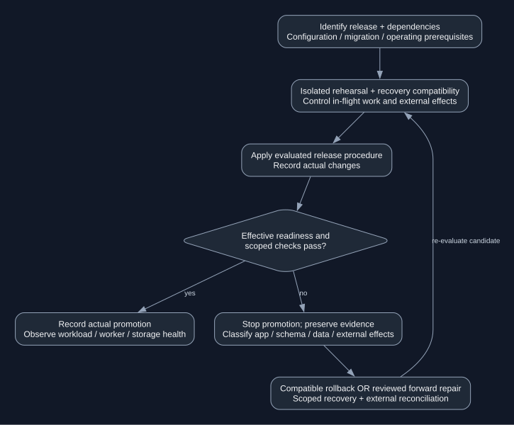

1. **Identify the candidate:** record source/build/dependency identities, runtime requirements, migration impact, configuration prerequisites, relevant tests and owner-authorized scope. A documentation candidate is not a deployable application artifact.
2. **Prepare an isolated rehearsal:** use controlled data and separate secrets/addresses/credentials. Disable consequential provider/executor/target actions unless explicitly in scope. A separate database name alone does not demonstrate adequate environment isolation.
3. **Check recovery and compatibility:** identify an actually usable recovery source and the compatible app/schema/data versions. Evaluate migrations for backward compatibility, lock/disk needs, interruption and irreversible effects. Do not assume restoring an older database is an acceptable response to new real user data.
4. **Control in-flight work:** pause admission/drain selected workers where needed, preserve attributable pending operations and reconcile work that may already have external effects. Avoid running incompatible old/new workers against changed contracts.
5. **Apply the release deliberately:** install the identified artifact/configuration/migrations using the evaluated procedure. Switch serving version only when prerequisites and compatibility checks permit it. No zero-downtime or atomic filesystem-switch guarantee is inferred.
6. **Verify the effective environment:** test authorized/denied private retrieval, current published rendition, database/storage connectivity, worker/scheduler progress, Git boundary and scoped enabled integrations. Verify absence of unintended public storage/administrative exposure. Readiness probes must distinguish basic liveness from business operation readiness.
7. **Observe and record:** collect bounded health/resource/error/queue evidence, actual outcomes and remaining issues. Record the effective release/configuration identities and actual promotion decision.
8. **Handle failed promotion:** stop further effects, preserve evidence and identify which app/schema/data/external changes occurred. Revert code only where compatibility permits; otherwise perform reviewed forward repair or scoped recovery. Reconcile unknown external effects instead of assuming rollback reversed them.

Routine maintenance follows the same candidate/impact/recovery discipline for OS/runtime/dependency changes, certificate renewal, storage cleanup and credential rotation. Choose maintenance windows and user communication from actual availability requirements rather than inventing a guaranteed schedule.

<a id="design-record-01-software-architecture-04-deployment-topology-nodes-and-networks-md--heading-6-availability-backup-and-disaster-recovery"></a>

#### 6. Availability backup and disaster recovery

<a id="design-record-01-software-architecture-04-deployment-topology-nodes-and-networks-md--heading-single-environment-availability"></a>

##### Single-environment availability

The initial candidate has a shared host/data/storage failure domain. Process supervision can recover some process failures; it cannot fix host/disk loss or guarantee availability during incompatible migrations. HA requires evaluated redundant facilities, data consistency/failover behavior and actual operational ownership. None is installed or funded by this proposal.

<a id="design-record-01-software-architecture-04-deployment-topology-nodes-and-networks-md--heading-consistent-backup-set"></a>

##### Consistent backup set

Define coverage for relational state, protected artifacts, native Git repositories, publication/submission identities, required configuration and recovery keys. Coordinate a recoverable point across these resources, or document a mechanism that reconstructs their valid relationships. Database-only backup misses files/Git; file-only copying misses transactional state. Retention, cadence, capacity and RPO/RTO depend on actual source decisions and measured restoration.

<a id="design-record-01-software-architecture-04-deployment-topology-nodes-and-networks-md--heading-recovery-sequence"></a>

##### Recovery sequence

Identify incident and permitted scope; select an attributable recovery point; restore in a suitable isolated target; verify schema/version, ownership, references, artifact/repository integrity and usable keys; reassess current grants and secrets; reconcile pending provider/runner/target effects; measure actual loss and time; record disposition before restoring traffic. Do not replay historical sends/deployments or automatically reactivate revoked grants.

Use [operations and recovery design](#design-record-06-design-quality-and-security-analysis-03-operations-backup-recovery-and-resilience-md) as the shared procedure owner. This deployment view owns placement/path prerequisites and links that procedure rather than creating competing recovery policies.

<a id="design-record-01-software-architecture-04-deployment-topology-nodes-and-networks-md--heading-7-capacity-validation-and-open-decisions"></a>

#### 7. Capacity validation and open decisions

<a id="design-record-01-software-architecture-04-deployment-topology-nodes-and-networks-md--heading-representative-evaluation"></a>

##### Representative evaluation

Define interactive workflows and concurrent mix, source/data sizes, Git transfer/repository growth, PDF demand, provider sync backlog, storage churn and any admitted execution. Measure CPU/memory/storage/I/O, response correctness/latency, queue age, timeout/unknown outcomes and cleanup/recovery overhead. First verify on suitable controlled facilities; do not stress or run untrusted jobs on the demo to manufacture evidence.

Results may justify tighter admission, sequential heavy work, targeted facility extraction or a resource proposal. Material scope/cost/date changes need explicit impact and owner decision. Shared resources cannot be accepted as sufficient simply because each capability works alone.

<a id="design-record-01-software-architecture-04-deployment-topology-nodes-and-networks-md--heading-decisions-before-dependent-acceptance"></a>

##### Decisions before dependent acceptance

- Actual application runtime, relational engine/version, web/Git transport and compatible dependencies.
- Effective host/environment separation and least-privilege operating identities.
- Queue/supervisor/scheduler configuration and justified process/job limits.
- Storage layout, reservations, quotas, reference-safe cleanup and recovery overhead.
- Feasible executor isolation, networking, credentials, stopping and workspace cleanup.
- Google/outbound delivery setup and bounded actual operation results.
- Independent backup destination, key management, consistency and isolated restore evidence.
- Applicable response/availability/recovery targets and an evidence-based delivery forecast.

These are dependent engineering tasks, not requests to repeat already answered facts. No infrastructure command, purchase, service setup or deployment is authorized merely by this document.

<a id="design-record-01-software-architecture-04-deployment-topology-nodes-and-networks-md--heading-8-verification-and-continuation"></a>

#### 8. Verification and continuation

**Document review:** map logical components to application/Git/executor artifacts and actual nodes; map every cross-node interaction to a permitted path; distinguish observed facts, proposals and unresolved facilities. Inspect diagram labels, links and remaining ownership gaps.

**Later operational checks:** test public-versus-private routing, restricted administration/data listeners, effective credentials/scopes, worker/scheduler progress, interrupted deployment/migration, storage pressure, lost executor/provider observations, backup consistency and isolated usable restoration. Record exact candidate/environment and actual results; no such live checks were performed in this authoring update.

FAU V07 deployment modeling maps artifacts to nodes and communication links, while separating logical layers from physical tiers. The DN locators, process grouping and release route here are project adaptations, not a mandated university topology. See [FAU reference map](#design-record-design-references-and-coverage-md), [implementation artifacts](../03-Low-Level-Design/12-Appendices.md#design-record-03-component-and-module-design-02-implementation-view-and-artifacts-md) and [design review/handoff](#design-record-06-design-quality-and-security-analysis-05-design-review-traceability-and-handoff-md).

<a id="design-record-01-software-architecture-04-deployment-topology-nodes-and-networks-md--heading-9-deployment-diagram-and-sizing-package"></a>

#### 9. Deployment diagram and sizing package

The package below separates the proposed starting topology, optional infrastructure/orchestration/resilience alternatives and recorded observations. No box provisions a facility. No cloud feature, namespace, region, rule, listener or sizing value is accepted through a diagram. Sources for provider/orchestration terminology were consulted; actual account/runtime compatibility remains unverified.

<a id="design-record-01-software-architecture-04-deployment-topology-nodes-and-networks-md--heading-91-optional-c4-level-1-anchor"></a>

##### 9.1 Optional C4 Level 1 anchor

[Shared whole-system context](Diagrams/Appendix/drivers-c4-system-context.svg)

[Editable PlantUML](Diagrams/Appendix/drivers-c4-system-context.puml) ·  · [Owning context assessment](#design-record-01-software-architecture-01-design-drivers-and-solution-options-md--heading-0-system-context-and-use-case-scope)

The same context anchor is reused; deployment nodes, subnets and optional infrastructure belong in the views below, not in C4 Level 1.

<a id="design-record-01-software-architecture-04-deployment-topology-nodes-and-networks-md--heading-92-uml-deployment--nodes-artifacts-and-environments"></a>

##### 9.2 UML deployment — nodes, artifacts and environments

[UML deployment — nodes, artifacts and environments](Diagrams/Appendix/drivers-uml-deployment.svg)

[Editable PlantUML](Diagrams/Appendix/drivers-uml-deployment.puml) · 

This view distinguishes physical/environment nodes, UML execution environments, deployable release artifacts and retained operating data. It is a proposed mapping, not a fresh inventory or configured runtime.

<a id="design-record-01-software-architecture-04-deployment-topology-nodes-and-networks-md--heading-93-network-topology--subnets-and-routing-concepts"></a>

##### 9.3 Network topology — subnets and routing concepts

[Historical or unselected alternative — Network topology — subnets and routing concepts](Diagrams/Appendix/deployment-network-topology.svg)

[Editable PlantUML](Diagrams/Appendix/deployment-network-topology.puml) · 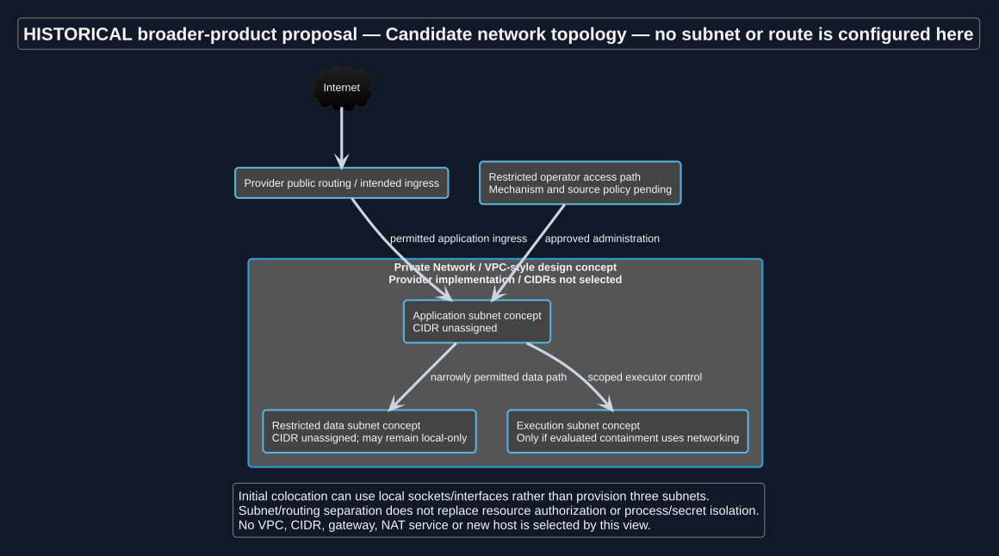

Subnet/VPC terminology describes a design concept, not an assigned address space or an adopted product. The initial colocated candidate may use local interfaces/sockets instead. Actual CIDRs, route/gateway rules, private interface placement and administration paths remain decisions.

<a id="design-record-01-software-architecture-04-deployment-topology-nodes-and-networks-md--heading-94-infrastructure--provider-context-and-optional-components"></a>

##### 9.4 Infrastructure — provider context and optional components

[Historical or unselected alternative — Infrastructure — provider context and optional components](Diagrams/Appendix/deployment-provider-infrastructure.svg)

[Editable PlantUML](Diagrams/Appendix/deployment-provider-infrastructure.puml) · 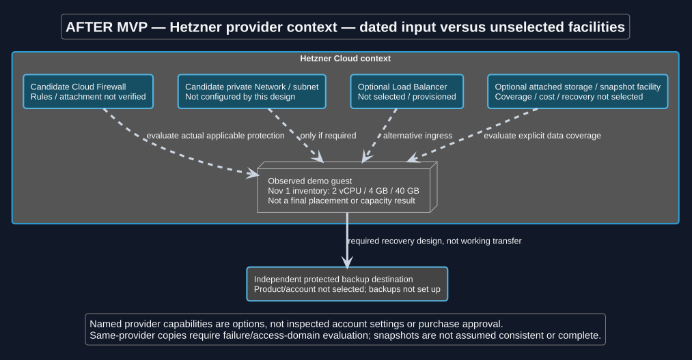

The provider input is the dated Hetzner guest observation. Official [Hetzner Networks](https://docs.hetzner.com/networking/networks/overview/) describe private server links/subnets, and [Cloud Firewalls](https://docs.hetzner.com/cloud/firewalls/overview/) describe traffic rules. Their existence in provider documentation is not account configuration evidence. No load balancer, attached volume, network, snapshot or paid option is adopted here; verify actual coverage and effective protection at selection time.

<a id="design-record-01-software-architecture-04-deployment-topology-nodes-and-networks-md--heading-95-containerorchestration--optional-cluster-design"></a>

##### 9.5 Container/orchestration — optional cluster design

[Historical or unselected alternative — Container/orchestration — optional cluster design](Diagrams/Appendix/deployment-orchestration-alternative.svg)

[Editable PlantUML](Diagrams/Appendix/deployment-orchestration-alternative.puml) · 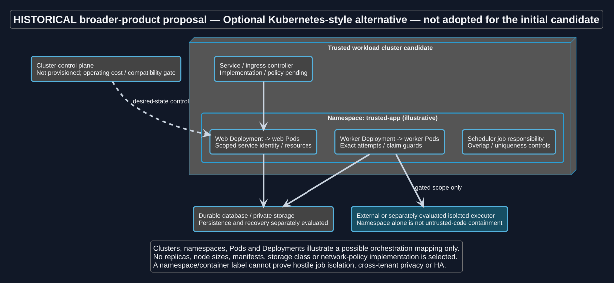

This fulfills the orchestration view as a clearly unelected alternative. Official [Kubernetes multi-tenancy guidance](https://kubernetes.io/docs/concepts/security/multi-tenancy/) discusses isolation controls beyond namespace naming. A namespace is not proof of hostile-code containment. The proposed initial topology does not require Kubernetes; any adoption needs resource/operating, storage/recovery, identity and network evidence.

<a id="design-record-01-software-architecture-04-deployment-topology-nodes-and-networks-md--heading-96-network-segmentation--logical-security-zones"></a>

##### 9.6 Network segmentation — logical security zones

[Network segmentation — logical security zones](Diagrams/Appendix/security-trust-boundaries.svg)

[Editable PlantUML](Diagrams/Appendix/security-trust-boundaries.puml) · 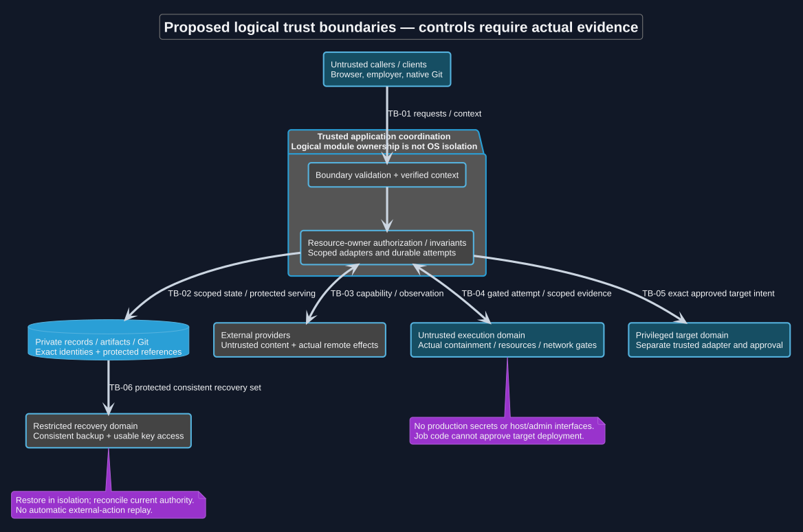

DMZ is a logical public-facing edge role here, not an installed physical subnet. Evaluate actual provider/host/local-process rules and ingress/egress behavior. Do not infer private-network encryption, firewall coverage or user-level authorization from a colored zone. Detailed controls remain in the [security design](#design-record-06-design-quality-and-security-analysis-02-security-threat-modeling-and-trust-boundaries-md).

<a id="design-record-01-software-architecture-04-deployment-topology-nodes-and-networks-md--heading-97-traffic-flow--proxy-and-optional-balancing"></a>

##### 9.7 Traffic flow — proxy and optional balancing

[Traffic flow — proxy and optional balancing](Diagrams/Appendix/deployment-traffic-flow.svg)

[Editable PlantUML](Diagrams/Appendix/deployment-traffic-flow.puml) · 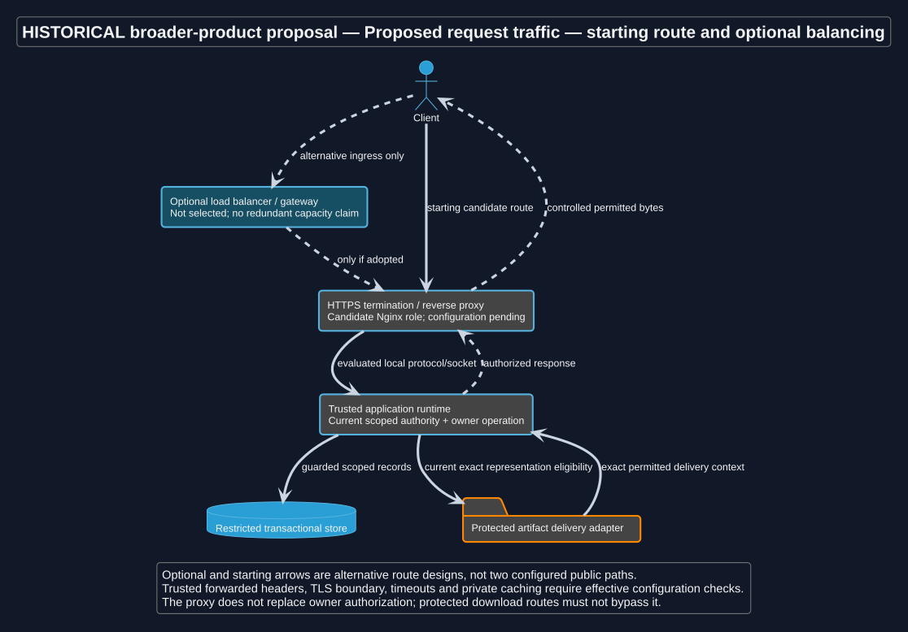

The initial direct reverse-proxy route and optional balancing route are alternatives. Gateways/load balancers are not silently added to the starting infrastructure. Actual trusted headers, TLS termination/hops, timeouts, private cache and controlled-byte serving need configuration/interoperability checks.

<a id="design-record-01-software-architecture-04-deployment-topology-nodes-and-networks-md--heading-98-multi-region--failure-zone-alternative"></a>

##### 9.8 Multi-region / failure-zone alternative

[Multi-region / failure-zone alternative](Diagrams/Appendix/deployment-multiregion-alternative.svg)

[Editable PlantUML](Diagrams/Appendix/deployment-multiregion-alternative.puml) · 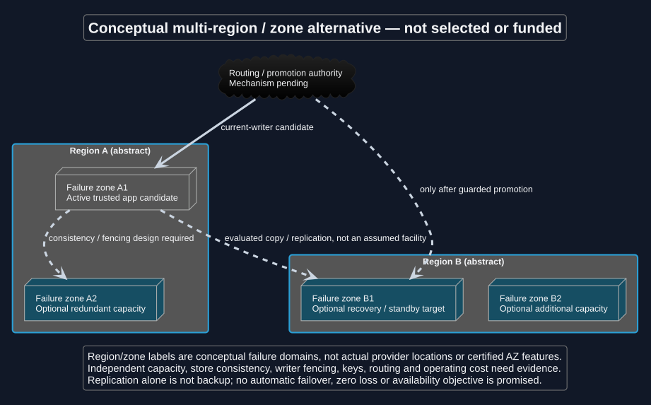

Abstract regions/zones illustrate a possible future failure-domain design, not actual purchased regions or a claim that a provider offers a specific AZ abstraction. Independent live capacity, consistent data/ref/artifact state, writer fencing, recovery keys, routing and solo operating cost are prerequisites. Replication cannot replace an independent protected backup.

<a id="design-record-01-software-architecture-04-deployment-topology-nodes-and-networks-md--heading-99-failover-and-disaster-recovery"></a>

##### 9.9 Failover and disaster recovery

[Failover and disaster recovery](Diagrams/Appendix/deployment-failover-dr-route.svg)

[Editable PlantUML](Diagrams/Appendix/deployment-failover-dr-route.puml) · 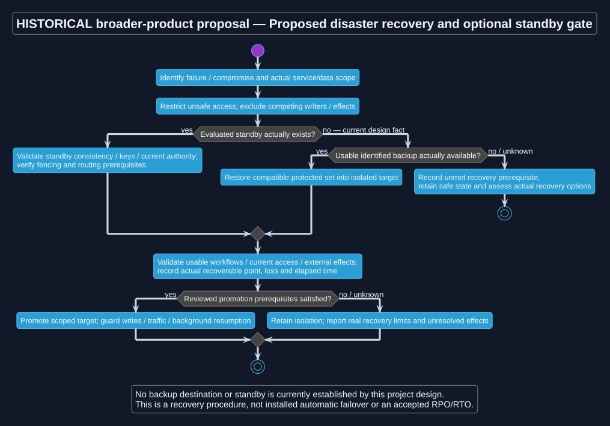

A missing standby takes the backup/isolated-restoration route only when a usable backup actually exists. Backups are not set up, so this remains an unmet recovery prerequisite, not a currently runnable DR capability. Current authority and external-effect reconciliation remain required before resumption; no automatic failover or numerical recovery promise is created.

<a id="design-record-01-software-architecture-04-deployment-topology-nodes-and-networks-md--heading-910-environment-topology--dev-staging-production"></a>

##### 9.10 Environment topology — dev, staging, production

[Environment topology — dev, staging, production](Diagrams/Appendix/deployment-environment-topology.svg)

[Editable PlantUML](Diagrams/Appendix/deployment-environment-topology.puml) · 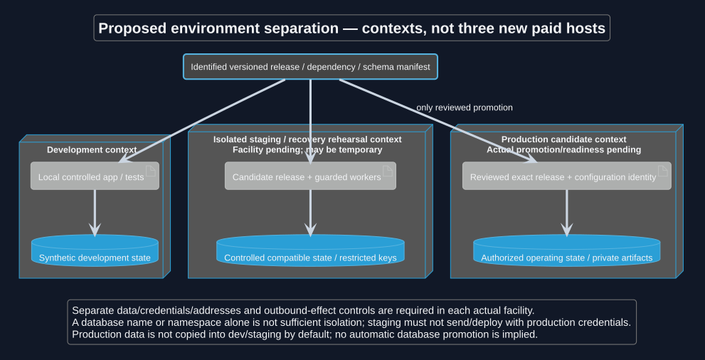

Dev/staging/prod name isolated execution/data/credential contexts, not three authorized hosts or databases to create now. A temporary staging/recovery target may be evaluated within constraints. No default production-data copying, production-secret reuse or outbound effect is permitted by this diagram.

<a id="design-record-01-software-architecture-04-deployment-topology-nodes-and-networks-md--heading-911-cicd--exact-artifact-to-target-mapping"></a>

##### 9.11 CI/CD — exact artifact to target mapping

[CI/CD — exact artifact to target mapping](Diagrams/Appendix/deployment-cicd-artifact-nodes.svg)

[Editable PlantUML](Diagrams/Appendix/deployment-cicd-artifact-nodes.puml) · 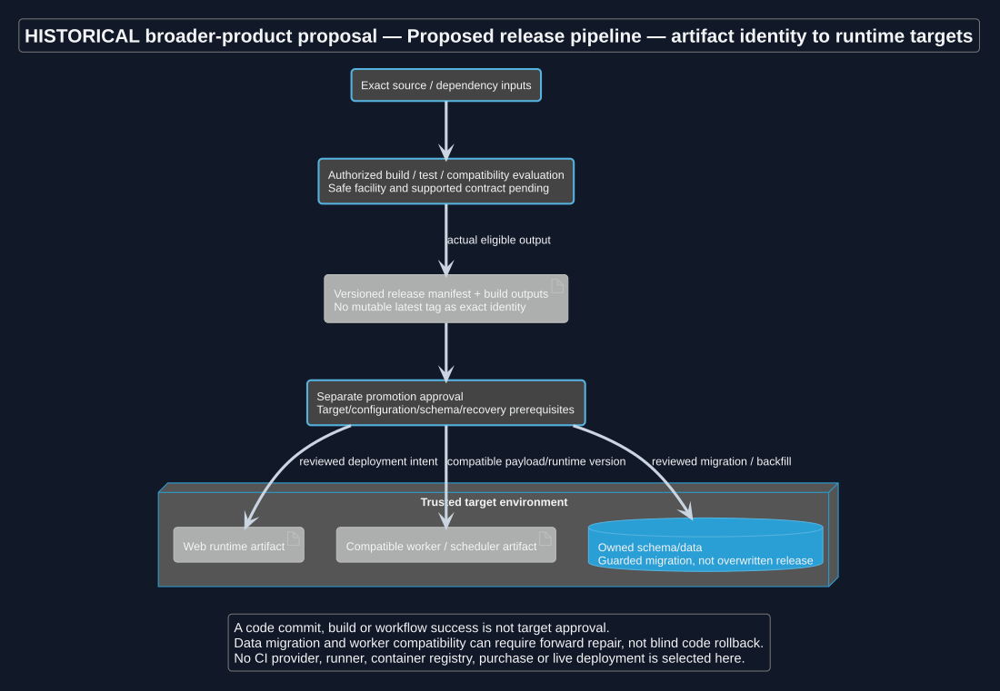

This is artifact promotion and schema/runtime compatibility, not a claim of configured CI. Web and workers use compatible exact release identity; migrations operate on retained data and can be irreversible. A workflow result supplies no deployment permission. See [Workflow/Deployment](../03-Low-Level-Design/03-Detailed-Module-Design.md#design-record-03-component-and-module-design-components-workflow-and-deployment-md) and [operating procedure](#design-record-06-design-quality-and-security-analysis-03-operations-backup-recovery-and-resilience-md).

<a id="design-record-01-software-architecture-04-deployment-topology-nodes-and-networks-md--heading-912-sequence--protected-request-across-tiers"></a>

##### 9.12 Sequence — protected request across tiers

[Sequence — protected request across tiers](Diagrams/Appendix/deployment-network-request-sequence.svg)

[Editable PlantUML](Diagrams/Appendix/deployment-network-request-sequence.puml) · 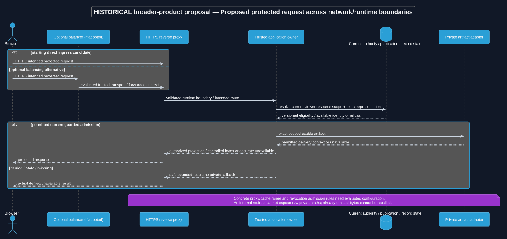

This is one protected request through the candidate tiers, with the optional balancer expressed as an alternative. The private adapter may use evaluated streaming or internal delivery, but may not bypass current eligibility or expose raw paths. It is not a measured latency trace or a promise of one selected serving mechanism.

<a id="design-record-01-software-architecture-04-deployment-topology-nodes-and-networks-md--heading-913-communication-protocol-and-port-table"></a>

##### 9.13 Communication protocol and port table

**After MVP.** Shared operating and recovery controls still apply where relevant.

This is a **candidate link contract**, not scanned listeners, open-firewall rules or permission to configure ports. Conventional ports identify proposed protocols only. Local sockets can remove TCP listeners; final addresses, endpoints, allowlists, encryption, authentication and timeouts require evaluated configuration. No implicit public exposure follows from a table row.

| Link | Candidate protocol / port | Exposure and remaining decision |
| --- | --- | --- |
| DN-01 client → application edge | HTTPS / TCP 443 proposed | Intended public ingress; actual TLS/proxy/routing configuration pending |
| Optional balancer → reverse proxy | Protected compatible transport / port requires environment verification | Only if balancing is adopted; trusted-hop/header policy required |
| Reverse proxy → PHP/application runtime | Evaluated FastCGI/local socket or compatible runtime path | Local/restricted only; no arbitrary public runtime port |
| Web/worker → transactional store | Local socket or engine-specific restricted protocol / port requires environment verification | Engine/bind/TLS/access policy pending; not public |
| Client → native Git interface | Evaluated Git-over-HTTPS or SSH transport / final port requires environment verification | HTTPS conventionally 443; SSH choice, credentials and endpoint require actual Git contract |
| Worker → Google provider | HTTPS / TCP 443 proposed | Required authorized capability only; OAuth/setup and exact APIs pending |
| Coordinator → executor | Authenticated scoped control/observation protocol / port requires environment verification | Only evaluated execution boundary; no public admin/host interface |
| Trusted deploy adapter → target | Target-supported protected protocol / port requires environment verification | Separate exact artifact/target approval and restricted credential |
| Backup sender → independent destination | Evaluated protected transfer / port requires environment verification | Destination/keys/coverage not configured; no raw unrestricted copy path |
| Authorized operator → management interface | Evaluated restricted administration protocol / port requires environment verification | Restricted source/identity; no assumed SSH/public control-plane exposure |

DNS, certificate renewal, proxy-to-proxy paths and any later queue/storage service also need explicit entries once actual facilities are selected. Record effective listeners/rules separately after authorized inspection; diagram labels are not inventory evidence.

<a id="design-record-01-software-architecture-04-deployment-topology-nodes-and-networks-md--heading-914-capacity-and-sizing-table--per-node--failure-domain"></a>

##### 9.14 Capacity and sizing table — per node / failure domain

Only the demo guest has a dated numeric allocation. Rows sharing a candidate host **share its budget**; do not add the same CPU/RAM/disk allocation once per process/store. No unmeasured spare capacity, throughput, upload quota, replica count or worker concurrency is assigned.

| Node / placement subject | Allocation status | Sizing evidence required |
| --- | --- | --- |
| Existing demo guest (dated Nov 1 observation) | 2 vCPU / 4 GB RAM / 40 GB local disk; inventory, not final production selection | Existing/proposed simultaneous workloads, actual CPU/memory/I/O/disk/network and safe headroom |
| DN-02 trusted web/background environment | Candidate colocation; no additional allocation selected | Request mix, worker/scheduler demand, queue age, deployment/migration and operating overhead |
| Relational/private-artifact/native-Git stores if colocated | Share DN-02 resources; no separately additive node budget | Transactions/locks, retained/protected bytes, repository growth, temporary generation, logs and restore space |
| DN-03 Git facility if extracted | Placement and allocation require verification; no paid host assumed | Real transfer/ref workload, operating identity/storage and recovery/combined-load comparison |
| DN-04 conditional executor | Mechanism, location and safe resource envelope requires verification | Containment, bounded process/CPU/memory/temp/output/network, termination/cleanup and actual build fit |
| DN-05 independent recovery destination | Not selected/configured; capacity requires verification | Consistent protected data size, reviewed retention/base dependencies, encryption/key access, transfer and usable restore |
| Staging/recovery rehearsal context | Isolated facility requires verification; may be temporary | Compatible dataset/runtime, no unsafe production effects, actual restore/test and disposal needs |
| Optional balancer/cluster/standby/region | Not adopted or provisioned; no budget allocated | Justified requirement plus capacity/consistency/fencing/cost/solo-operations evaluation |

Use the exact proposed Q-D24/Q-D25/Q-D26 policies only with their recorded status and workload/measurement contract. Ten accounts and a quiet-server snapshot cannot determine combined capacity. If safe facilities cannot meet agreed scope/resources, record the explicit conflict/options; do not silently buy infrastructure or relabel missing capability as complete.

<a id="design-record-01-software-architecture-04-deployment-topology-nodes-and-networks-md--heading-package-verification-limits"></a>

##### Package verification limits

Cross-check exact release/schema/worker compatibility, physical paths, effective routing/firewall/private serving, independent recovery/key coverage and execution/target trust gates. Test suitable authorized candidates before accepting operational claims. These diagrams/tables do not install Kubernetes, add hosts, open ports, create backups, provide HA, execute a pipeline or establish measured capacity. Existing source/ADR status remains unchanged.

[Architecture index](#design-record-01-software-architecture-software-architecture-md) · [Diagram catalog](#design-record-01-software-architecture-diagrams-diagram-catalog-md)

</details>

<a id="design-record-01-software-architecture-05-cross-cutting-concerns-overview-md"></a>

<details>
<summary>Resumefolio — Cross-Cutting Concerns Overview</summary>

<a id="design-record-01-software-architecture-05-cross-cutting-concerns-overview-md--heading-resumefolio--cross-cutting-concerns-overview"></a>

### Resumefolio — Cross-Cutting Concerns Overview

Current implementation choices and scope: [Baseline](https://github.com/Farhad-V/Web-Resumefolio/blob/1f2acaa351ac306cb57cbe4fe9742e8bd90720d9/docs/MVP/baseline/README.md). Runtime verification remains subject to its gates.

**Purpose:** make shared architectural obligations visible, identify their authoritative design owners and explain how components coordinate changes. Detailed rules remain in their owning documents; this overview is their navigation and integration map.

**Status:** proposed coordination view. The owners below are logical design responsibilities, not separate staffed teams. Farhad remains the project decision-maker. No new permission, numerical target, infrastructure choice or accepted baseline is established here.

[Ownership](#design-record-01-software-architecture-05-cross-cutting-concerns-overview-md--heading-1-ownership-and-scope) · [Concern catalog](#design-record-01-software-architecture-05-cross-cutting-concerns-overview-md--heading-2-shared-concern-catalog) · [Coordination](#design-record-01-software-architecture-05-cross-cutting-concerns-overview-md--heading-3-cross-component-coordination-examples) · [Change route](#design-record-01-software-architecture-05-cross-cutting-concerns-overview-md--heading-4-change-and-decision-route) · [Review](#design-record-01-software-architecture-05-cross-cutting-concerns-overview-md--heading-5-review-and-completion) · [Full realization package](#design-record-01-software-architecture-05-cross-cutting-concerns-overview-md--heading-7-cross-cutting-realization-package)

<a id="design-record-01-software-architecture-05-cross-cutting-concerns-overview-md--heading-current-mvp-boundary-figure"></a>

#### Current MVP boundary figure

[Accepted core and separate ProjectForge boundary](Diagrams/Appendix/mvp-system-boundaries.svg)

[Editable source](Diagrams/Appendix/mvp-system-boundaries.puml) · . Historical broader-product figures below retain earlier alternatives/detail; they do not define the current system boundary.

<a id="design-record-01-software-architecture-05-cross-cutting-concerns-overview-md--heading-1-ownership-and-scope"></a>

#### 1. Ownership and scope

A concern is cross-cutting when the same source obligation affects several components, runtime paths or deployment artifacts. It does not automatically require a new component, shared database table or framework layer. For example, authorization spans the product, but resource owners must still enforce operation-specific authority.

[Shared concern ownership and component realization](Diagrams/Appendix/cross-cutting-ownership.svg)

[Editable DOT](Diagrams/Appendix/cross-cutting-ownership.dot) · 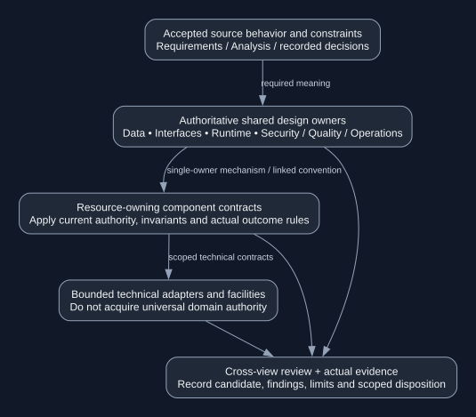

**Source authority:** [accepted scope](../../01-Project-Planning/01-Project-Charter.md#mvp-scope), [requirements specification](../../02-Requirements-Engineering/01-Software-Requirements-Specification.md#requirements-specification-requirements-specification), [source questions/decisions](../../02-Requirements-Engineering/01-Software-Requirements-Specification.md#change-and-baseline-open-questions-and-decisions) and [analysis quality/security view](../../03-System-Analysis/04-Interfaces-Security-And-Quality.md#analysis-interfaces-security-and-quality-analysis--13-security-quality-and-operational-analysis). Design refines mechanisms; it must not silently change a source rule.

**Shared design owner:** one topic document owns each mechanism’s rationale and shared convention. Other views link that record and describe their specific application. The concern locators below are navigation labels, not new requirements or a completed verification checklist.

**Implementation owner:** the affected component implements its invariant and contract, while infrastructure adapters provide bounded technical capabilities. A central middleware/helper cannot replace the checks required inside a resource-owning command or protected retrieval path.

**Operating owner:** actual configuration, process supervision, backups and incident response need identified procedures and observations. A design document or named facility does not prove it is installed, enabled or usable.

<a id="design-record-01-software-architecture-05-cross-cutting-concerns-overview-md--heading-2-shared-concern-catalog"></a>

#### 2. Shared concern catalog

<a id="design-record-01-software-architecture-05-cross-cutting-concerns-overview-md--heading-cc-01--identity-access-and-revocation"></a>

##### CC-01 — Identity access and revocation

**Authoritative design:** [Identity access and revocation](#design-record-06-design-quality-and-security-analysis-02-security-threat-modeling-and-trust-boundaries-md).

**Ownership:** Identity supplies actor/grant context; each resource owner applies its exact current operation/lifecycle policy.

**Component integration:** Private commands, employer retrieval, jobs, Git and target deployment must identify their own authority boundary. A resource association or prior successful login cannot extend permission.

**Focused review cases:** Grant/link/account changes; direct artifact retrieval; revoked access during pending work.

<a id="design-record-01-software-architecture-05-cross-cutting-concerns-overview-md--heading-cc-02--persistence-integrity-and-data-lifecycle"></a>

##### CC-02 — Persistence integrity and data lifecycle

**Authoritative design:** [Persistence integrity and data lifecycle](../03-Low-Level-Design/04-Database-Design.md#design-record-04-data-design-01-analysis-to-logical-and-physical-data-models-md).

**Ownership:** Data design owns identity, relationships, integrity and physical mapping; domain components own their invariants.

**Component integration:** Identify source/draft/publication/actual-material boundaries, protected references and local transaction scope. Cross-owner changes use public contracts instead of direct table writes.

**Focused review cases:** Concurrent publication; actual-history preservation; retirement with remaining protected references.

<a id="design-record-01-software-architecture-05-cross-cutting-concerns-overview-md--heading-cc-03--caching-and-representation-availability"></a>

##### CC-03 — Caching and representation availability

**Authoritative design:** [Caching and representation availability](../03-Low-Level-Design/04-Database-Design.md#design-record-04-data-design-03-persistence-caching-and-data-lifecycle-md).

**Ownership:** Data design owns cache/freshness and reference policy; Sharing and Files own current authorization and usable rendition selection.

**Component integration:** Cache keys and eligibility cannot turn a stale grant, missing language or unavailable PDF into a permitted result. Artifact availability and effective download mode remain distinct.

**Focused review cases:** Disable a link after caching; replace an artifact; request a missing rendition.

<a id="design-record-01-software-architecture-05-cross-cutting-concerns-overview-md--heading-cc-04--concurrency-and-durable-external-effects"></a>

##### CC-04 — Concurrency and durable external effects

**Authoritative design:** [Concurrency and durable external effects](#design-record-01-software-architecture-03-process-view-concurrency-and-runtime-behavior-md).

**Ownership:** Runtime design owns operation identity, expected-version coordination, local commit/dispatch and attempt reconciliation.

**Component integration:** Web and workers use the same authority/result semantics. An expired claim or network timeout does not prove that an external effect did not occur.

**Focused review cases:** Duplicate dispatch; stale worker completion; unknown send/deploy result; cancel/complete race.

<a id="design-record-01-software-architecture-05-cross-cutting-concerns-overview-md--heading-cc-05--contracts-provider-integration-and-compatibility"></a>

##### CC-05 — Contracts provider integration and compatibility

**Authoritative design:** [Contracts provider integration and compatibility](../03-Low-Level-Design/05-API-Specification.md#design-record-05-interface-and-api-design-01-api-protocols-contracts-and-compatibility-md).

**Ownership:** Interface design owns shared contract conventions; each provider/consumer owns its implementation and exact operations.

**Component integration:** Identify payload/version/time/language/provenance, errors and safe repetition. Provider connection, permitted capability, freshness and observed outcome are separate.

**Focused review cases:** Revoked consent; calendar conflicts; contract change; Git transport versus browser session.

<a id="design-record-01-software-architecture-05-cross-cutting-concerns-overview-md--heading-cc-06--untrusted-content-secrets-and-execution"></a>

##### CC-06 — Untrusted content secrets and execution

**After MVP.** Shared operating and recovery controls still apply where relevant.

**Authoritative design:** [Untrusted content secrets and execution](#design-record-06-design-quality-and-security-analysis-02-security-threat-modeling-and-trust-boundaries-md).

**Ownership:** Security design owns trust/control rationale; Files, Git, Workflow and Deployment implement their scoped boundaries.

**Component integration:** Treat uploads/repository/workflow/provider content as untrusted. Verify isolation and credential restrictions before enabling execution; separate target authority from workflow success.

**Focused review cases:** Malicious path/content; runner workspace escape; secret leakage; unintended target mutation.

<a id="design-record-01-software-architecture-05-cross-cutting-concerns-overview-md--heading-cc-07--capacity-admission-and-bounded-work"></a>

##### CC-07 — Capacity admission and bounded work

**Authoritative design:** [Capacity admission and bounded work](#design-record-06-design-quality-and-security-analysis-01-quality-attributes-and-design-trade-offs-md).

**Ownership:** Quality design owns workload/criteria; runtime, Files and deployment own enforceable admission and resource mechanisms.

**Component integration:** Compare combined web, PDF, sync, Git, storage and admitted execution demand against actual resources. Numeric limits require evidence; account count alone is not a load model.

**Focused review cases:** Parallel quota admission; storage pressure; heavy-job contention; growing queue age.

<a id="design-record-01-software-architecture-05-cross-cutting-concerns-overview-md--heading-cc-08--observability-operating-recovery-and-resilience"></a>

##### CC-08 — Observability operating recovery and resilience

**Authoritative design:** [Observability operating recovery and resilience](#design-record-06-design-quality-and-security-analysis-03-operations-backup-recovery-and-resilience-md).

**Ownership:** Operations owns procedure/evidence; runtime supplies attributable outcomes and deployment supplies placement/access prerequisites.

**Component integration:** Record bounded operation identity and actual effects without exposing secrets/private content. Restore consistent data/artifact/Git/key coverage and reconcile external effects before re-enabling traffic/actions.

**Focused review cases:** Missed scheduler work; lost provider response; isolated restore; revoked grants in recovered data.

<a id="design-record-01-software-architecture-05-cross-cutting-concerns-overview-md--heading-cc-09--shared-interaction-accessibility-and-language"></a>

##### CC-09 — Shared interaction accessibility and language

**Authoritative design:** [Shared interaction accessibility and language](../02-UI-UX-Design/01-Introduction.md).

**Ownership:** Interaction design owns shared UI behavior; each feature realizes its source scenario and permitted state.

**Component integration:** Keep draft/apply/publish distinct, expose truthful pending/conflict/unknown results and avoid silent language/content fallback. Keep navigation, forms, keyboard/focus and responsive behavior consistent.

**Focused review cases:** Unsaved conflict; unknown send; inaccessible confirmation; unavailable English/German content.

<a id="design-record-01-software-architecture-05-cross-cutting-concerns-overview-md--heading-cc-10--modularity-dependencies-and-evolution"></a>

##### CC-10 — Modularity dependencies and evolution

**Authoritative design:** [Modularity dependencies and evolution](../03-Low-Level-Design/02-Module-Breakdown.md#design-record-03-component-and-module-design-01-modularity-dependencies-and-encapsulation-md).

**Ownership:** Module design owns dependency direction; detailed OO design owns conventions/refactoring and component packages own implementation prescriptions.

**Component integration:** Keep technical shared services narrow. No universal Shared domain model, service locator or cross-module mutable entity. Review affected contracts and artifacts when a shared mechanism changes.

**Focused review cases:** Dependency cycle; another owner’s table writes; incompatible schema/interface migration.

<a id="design-record-01-software-architecture-05-cross-cutting-concerns-overview-md--heading-3-cross-component-coordination-examples"></a>

#### 3. Cross-component coordination examples

<a id="design-record-01-software-architecture-05-cross-cutting-concerns-overview-md--heading-profile-change-to-published-presentation"></a>

##### Profile change to published presentation

Presentation compares identified source/draft versions and applies selected changes without overwriting independent overrides. Separate publication updates the intended live revision. Sharing resolves current eligible publication/rendition; Files confirms artifact usability and protected references. Applications retains actual submitted identity independently. This engages persistence, concurrency, authorization, cache freshness and UI confirmation, without copying their detailed rules into every component.

<a id="design-record-01-software-architecture-05-cross-cutting-concerns-overview-md--heading-link-disablement-and-protected-retrieval"></a>

##### Link disablement and protected retrieval

Sharing changes the exact link’s eligibility/version. Subsequent delivery admissions check current account/link/grant policy before releasing the permitted representation. A cached artifact or an earlier viewer session cannot create permanent permission. Already emitted bytes and legitimate downloads cannot be retracted by a new link state. Runtime, security and data-cache design must agree on that boundary.

<a id="design-record-01-software-architecture-05-cross-cutting-concerns-overview-md--heading-reviewed-message-with-an-uncertain-outcome"></a>

##### Reviewed message with an uncertain outcome

Communication binds reviewed account/recipient/content/attachments to an attempt. Runtime durably records intent and coordinates worker ownership. The provider adapter returns attributable acceptance/rejection/unknown evidence; Operations exposes bounded diagnostic status and UI shows the honest result. A queue retry or recovered backup must not silently send again. Actual application submission capture remains a separate attributable operation.

<a id="design-record-01-software-architecture-05-cross-cutting-concerns-overview-md--heading-git-revision-to-workflow-and-deployment"></a>

##### Git revision to workflow and deployment

**After MVP.** Shared operating and recovery controls still apply where relevant.

Git verifies exact current refs and grants. Workflow Coordination evaluates supported trigger/definition and enabling conditions before creating an attempt. An evaluated executor uses scoped inputs/secrets and bounded outputs. Deployment separately verifies target authority and artifact/revision. A work-item association, merge, completed run or permissive shared service cannot collapse these authority boundaries.

These are integration walkthroughs, not observed executions. See [component boundaries](#design-record-01-software-architecture-02-system-decomposition-and-boundaries-md), [runtime behavior](#design-record-01-software-architecture-03-process-view-concurrency-and-runtime-behavior-md) and [interface realizations](../03-Low-Level-Design/05-API-Specification.md#design-record-05-interface-and-api-design-03-use-case-realizations-and-interactions-md) for their owning technical views.

<a id="design-record-01-software-architecture-05-cross-cutting-concerns-overview-md--heading-4-change-and-decision-route"></a>

#### 4. Change and decision route

[Cross-cutting change coordination](Diagrams/Appendix/cross-cutting-change-route.svg)

[Editable DOT](Diagrams/Appendix/cross-cutting-change-route.dot) · 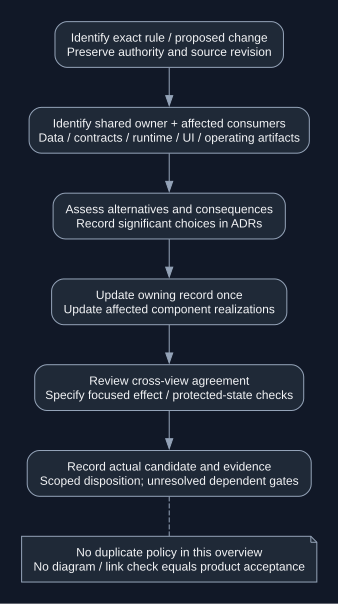

1. Identify the exact source rule, proposed change and its authority. If required behavior is unclear or changes, refine the authoritative requirement/analysis record first.
2. Identify the shared mechanism owner, component consumers, runtime operations, data/artifacts, UI flows and operating procedures affected.
3. Evaluate alternatives, compatibility, privacy/security, concurrency, resources, recoverability and cost/schedule consequences. Keep consequential technical choices in an [ADR](../ADR/Decision-Index.md#design-record-07-design-decisions-design-decisions-md).
4. Update the owning shared design once. Update each consumer’s application of that design and its contract where actually affected. Do not copy the policy into this overview or a universal helper.
5. Review agreement across component, data, interaction, process and deployment views. Define focused verification for both intended effects and protected state, including denied, conflicting, partial and unknown paths where applicable.
6. Record the actual identified candidate, evidence, remaining gates and scoped decision. Refresh operating/recovery guidance when configuration, keys, storage or external effects change.

An independent design proposal can proceed while related feasibility evidence is pending. Accepting a dependent execution, resource or recovery commitment requires its own evidence. OAuth-not-created and backups-not-configured remain known setup facts; this route is not a reason to ask those questions again.

<a id="design-record-01-software-architecture-05-cross-cutting-concerns-overview-md--heading-minimum-integration-record"></a>

##### Minimum integration record

For each substantive shared mechanism, record source locator/revision; authoritative design location; owner and consumers; concrete invariants and operation boundaries; compatibility/version implications; current proposal/decision status; planned verification and actual evidence separately; unresolved conditions and next gate. Use the existing [review record](#design-record-06-design-quality-and-security-analysis-05-design-review-traceability-and-handoff-md), not a competing findings register here.

<a id="design-record-01-software-architecture-05-cross-cutting-concerns-overview-md--heading-5-review-and-completion"></a>

#### 5. Review and completion

**Document checks:** each concern has a reachable owning record; no concern silently selects a technical facility; component contracts and deployment/runtime assumptions agree; explicit source/apply/publication/history and authority boundaries remain intact. Keep this file as the map, not a second persistence/security/operations specification.

**Later semantic checks:** trace relevant source criteria to actual component contracts and cross-view walkthroughs. A family citation, CC entry or healthy link is not semantic coverage of every acceptance criterion. Preserve the existing analysis/requirements review limits and unresolved source choices.

**Later operating checks:** verify current authority under concurrency, provider/runner uncertainty, storage/admission behavior, restricted diagnostics and consistent usable recovery in suitable controlled environments. No live test, security assurance, restored backup or accepted capacity result is claimed by this update.

**Completion boundary:** the overview is ready as a coordination/navigation document when ownership, consumer responsibilities, decision route and evidence limits are explicit. That does not complete the detailed owning designs or approve the whole phase. Final component signatures, schemas/class diagrams, feasible executor/provider/recovery facilities and exact criterion mappings remain their designated follow-up work.

<a id="design-record-01-software-architecture-05-cross-cutting-concerns-overview-md--heading-6-fau-basis-and-related-records"></a>

#### 6. FAU basis and related records

FAU V07 presents cross-cutting concerns, with persistence as an example, alongside abstraction, modularity, cohesion/coupling and encapsulation. V08 connects model conventions and component design to consistency and change management. The CC catalog is a Resumefolio adaptation of those ideas, not a prescribed university taxonomy or formal standards conformance statement.

- [Architecture drivers](#design-record-01-software-architecture-01-design-drivers-and-solution-options-md)
- [Deployment and network boundaries](#design-record-01-software-architecture-04-deployment-topology-nodes-and-networks-md)
- [Shared ownership and component packages](../03-Low-Level-Design/02-Module-Breakdown.md#design-record-03-component-and-module-design-component-and-module-design-md)
- [Design evolution and technical debt](../03-Low-Level-Design/12-Appendices.md#design-record-02-detailed-and-object-oriented-design-05-design-evolution-refactoring-and-technical-debt-md)
- [FAU reference map](#design-record-design-references-and-coverage-md)
- [Architecture diagram catalog](#design-record-01-software-architecture-diagrams-diagram-catalog-md)

Advisor consultation remains unavailable as previously recorded; no independent advisor endorsement is implied. All diagrams are proposed coordination/realization views, not runtime traces or proof of configured controls.

<a id="design-record-01-software-architecture-05-cross-cutting-concerns-overview-md--heading-7-cross-cutting-realization-package"></a>

#### 7. Cross-cutting realization package

This package supplies the requested shared views without replacing their authoritative design owners. All mechanisms are proposals or evaluation examples; no library, collector, sidecar, breaker, cache, secret store or control is installed by a diagram. Supporting official guidance was consulted; actual compatibility/effectiveness remains unverified.

<a id="design-record-01-software-architecture-05-cross-cutting-concerns-overview-md--heading-71-concern-to-component-matrix"></a>

##### 7.1 Concern-to-component matrix

Codes: **ID** Identity/Access; **PP** Presentation; **RS** Representation/Sharing; **AP** Applications; **CM** Communication/Calendar; **WM** Work; **GT** Git; **WF** Workflow/Deployment; **FO** Files/Operations. **R** = direct realization/enforcement responsibility; **S** = supplies a supporting contract; **—** = no primary realization assigned by this summary. A dash does not waive applicable security/privacy or operating obligations. Shared policy authority remains in the CC catalog, not in a single universal module.

| Concern | ID | PP | RS | AP | CM | WM | GT | WF | FO |
| --- | --- | --- | --- | --- | --- | --- | --- | --- | --- |
| CC-01 Authority / revocation | S | R | R | R | R | R | R | R | R |
| CC-02 Integrity / lifecycle | R | R | R | R | R | R | R | R | S |
| CC-03 Cache / representation | S | S | R | — | — | — | — | — | S |
| CC-04 Concurrency / effects | R | R | R | R | R | R | R | R | R |
| CC-05 Contracts / compatibility | R | R | R | R | R | R | R | R | R |
| CC-06 Untrusted content / secrets | R | R | R | R | R | R | R | R | R |
| CC-07 Resource admission | — | R | R | R | R | R | R | R | S |
| CC-08 Evidence / recovery / resilience | R | R | R | R | R | R | R | R | S |
| CC-09 Interaction / language | R | R | R | R | R | R | R | R | R |
| CC-10 Modularity / evolution | R | R | R | R | R | R | R | R | R |

This is a responsibility map, not criterion closure or a service deployment matrix. Configuration and bounded diagnostics apply to every actual runtime/adapter under CC-08/CC-10; actual counts/limits and implementation signatures remain owner work. Resource owners enforce their own policy even when Identity or Files supplies a contract.

<a id="design-record-01-software-architecture-05-cross-cutting-concerns-overview-md--heading-72-hexagonal-architecture-with-concern-overlays"></a>

##### 7.2 Hexagonal architecture with concern overlays

[Hexagonal architecture with concern overlays](Diagrams/Appendix/concerns-hexagonal-overlay.svg)

[Editable PlantUML](Diagrams/Appendix/concerns-hexagonal-overlay.puml) · 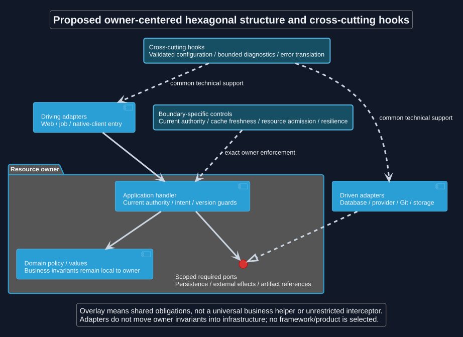

The overlay identifies shared hooks and owner-side enforcement, not a universal layer that can authorize every operation. Domain invariants stay with each owner; common libraries must not pull private models into a global shared service.

<a id="design-record-01-software-architecture-05-cross-cutting-concerns-overview-md--heading-73-security-architecture-and-trust-crossings"></a>

##### 7.3 Security architecture and trust crossings

[MVP with explicitly deferred paths — Security architecture and trust crossings](Diagrams/Appendix/concerns-security-architecture.svg)

[Editable PlantUML](Diagrams/Appendix/concerns-security-architecture.puml) · 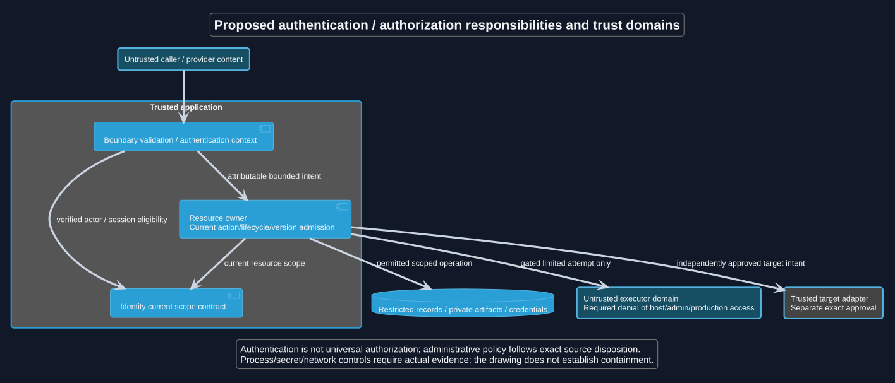

Authentication, current scoped authority and resource/lifecycle validity are distinct. Existing administrative-policy reconciliation remains pending. Neither a network boundary nor a diagram label demonstrates implemented controls or untrusted-code isolation.

<a id="design-record-01-software-architecture-05-cross-cutting-concerns-overview-md--heading-74-authentication-and-authorization-sequence"></a>

##### 7.4 Authentication and authorization sequence

[Authentication and authorization sequence](Diagrams/Appendix/concerns-authn-authz-sequence.svg)

[Editable PlantUML](Diagrams/Appendix/concerns-authn-authz-sequence.puml) · 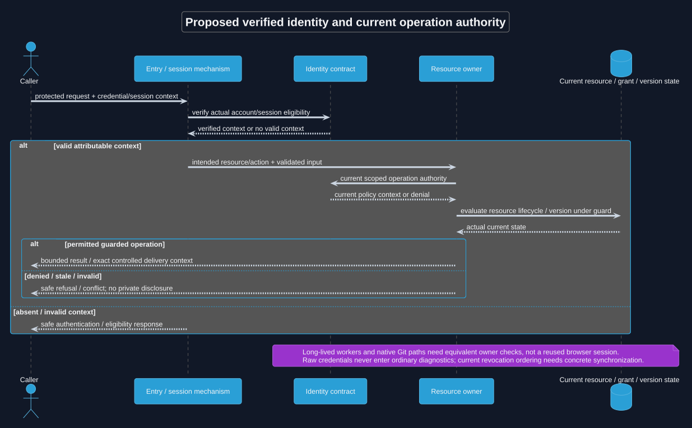

This is a selected protected account request; employer links, Git credentials, callbacks and jobs use their own actual contexts. The owner must synchronize consequential admission with current grant/state changes. No authentication library, factor mechanism or timeout is selected.

<a id="design-record-01-software-architecture-05-cross-cutting-concerns-overview-md--heading-75-observability--logs-metrics-and-tracing"></a>

##### 7.5 Observability — logs, metrics and tracing

[Observability — logs, metrics and tracing](Diagrams/Appendix/concerns-observability-pipeline.svg)

[Editable PlantUML](Diagrams/Appendix/concerns-observability-pipeline.puml) · 

Official [OpenTelemetry signal concepts](https://opentelemetry.io/docs/concepts/signals/) distinguish logs, metrics and traces; [OWASP Logging guidance](https://cheatsheetseries.owasp.org/cheatsheets/Logging_Cheat_Sheet.html) informs restricted diagnostic design. No collector/backend/sidecar is adopted. Define actual coverage, sampling/retention, secret filtering, cardinality, access, outage behavior and tested alert routing before operation. Correlation is not authorization.

<a id="design-record-01-software-architecture-05-cross-cutting-concerns-overview-md--heading-76-activity--error-and-exception-outcomes"></a>

##### 7.6 Activity — error and exception outcomes

[Activity — error and exception outcomes](Diagrams/Appendix/concerns-error-flow.svg)

[Editable PlantUML](Diagrams/Appendix/concerns-error-flow.puml) · 

Classify the actual operation and effect boundary, not merely the thrown exception. A timeout may leave an effect unknown; retry/cancellation/compensation must follow the owner contract. Safe UI/API feedback and restricted diagnostics retain actual state without private fallback or secrets.

<a id="design-record-01-software-architecture-05-cross-cutting-concerns-overview-md--heading-77-configuration-management-and-effective-identity"></a>

##### 7.7 Configuration management and effective identity

[Configuration management and effective identity](Diagrams/Appendix/concerns-configuration-management.svg)

[Editable PlantUML](Diagrams/Appendix/concerns-configuration-management.puml) · 

Validate exact environment/release configuration and required secret scope. Effective identity observations contain version/provenance, not values. Source-controlled non-secret templates and protected recoverable secret access have different lifecycles. No configuration service, vault or automatic production flag enabling is selected.

<a id="design-record-01-software-architecture-05-cross-cutting-concerns-overview-md--heading-78-caching-strategy-and-current-authority"></a>

##### 7.8 Caching strategy and current authority

[Caching strategy and current authority](Diagrams/Appendix/concerns-cache-strategy.svg)

[Editable PlantUML](Diagrams/Appendix/concerns-cache-strategy.puml) · 

Cache payload, key scope, freshness/invalidation, concurrent fill, size and fallback need an owning record. Current authority and exact representation availability remain separate from a hit. See [persistence/cache policy](../03-Low-Level-Design/04-Database-Design.md#design-record-04-data-design-03-persistence-caching-and-data-lifecycle-md) for shared rules; no new TTL or backend is invented.

<a id="design-record-01-software-architecture-05-cross-cutting-concerns-overview-md--heading-79-local-transaction-and-external-effect-boundaries"></a>

##### 7.9 Local transaction and external effect boundaries

[Local transaction and external effect boundaries](Diagrams/Appendix/concerns-transaction-boundary.svg)

[Editable PlantUML](Diagrams/Appendix/concerns-transaction-boundary.puml) · 

The illustrated local boundary commits only state within the evaluated transaction mechanism. Consumer/artifact protection and provider/Git/executor/target effects need their own coordination/reconciliation. Sharing one SQL store does not authorize another module to mutate internal records. See [ADR-003](../ADR/ADR-003-Durable-External-Attempts.md#design-record-07-design-decisions-adr-003-durable-external-attempts-md).

<a id="design-record-01-software-architecture-05-cross-cutting-concerns-overview-md--heading-710-resilience--bounded-protection-and-safe-repetition"></a>

##### 7.10 Resilience — bounded protection and safe repetition

[Resilience — bounded protection and safe repetition](Diagrams/Appendix/concerns-resilience-patterns.svg)

[Editable PlantUML](Diagrams/Appendix/concerns-resilience-patterns.puml) · 

Official [Retry](https://learn.microsoft.com/en-us/azure/architecture/patterns/retry) and [Circuit Breaker](https://learn.microsoft.com/en-us/azure/architecture/patterns/circuit-breaker) guidance informs pattern evaluation, not an Azure service choice. Evaluate operation-specific repeat safety before backoff/retry, and actual resource separation before bulkhead claims. A deadline bounds waiting; it cannot by itself terminate a remote process or prove no effect.

<a id="design-record-01-software-architecture-05-cross-cutting-concerns-overview-md--heading-711-uml-circuit-breaker-state-machine"></a>

##### 7.11 UML circuit-breaker state machine

[UML circuit-breaker state machine](Diagrams/Appendix/concerns-circuit-breaker-states.svg)

[Editable PlantUML](Diagrams/Appendix/concerns-circuit-breaker-states.puml) · 

Closed/Open/Half-open are proposed dependency-admission states, not business attempt outcomes. No numerical predicate, cooldown, probe count, state store or fleet-wide synchronization is selected. Half-open probes must be actually safe and supported; do not probe with an ambiguous consequential send/deploy.

<a id="design-record-01-software-architecture-05-cross-cutting-concerns-overview-md--heading-712-interceptor--middleware-chain"></a>

##### 7.12 Interceptor / middleware chain

[Interceptor / middleware chain](Diagrams/Appendix/concerns-middleware-chain.svg)

[Editable PlantUML](Diagrams/Appendix/concerns-middleware-chain.puml) · 

This is responsibility ordering, not inspected Laravel configuration or a complete interceptor API. Verify early denial, exception unwinding, body limits, current authority, anti-forgery scope and safe result handling for actual routes. Equivalent checks must cover non-HTTP entry paths.

<a id="design-record-01-software-architecture-05-cross-cutting-concerns-overview-md--heading-713-shared-libraries-and-optional-sidecar-responsibilities"></a>

##### 7.13 Shared libraries and optional sidecar responsibilities

[Shared libraries and optional sidecar responsibilities](Diagrams/Appendix/concerns-shared-components.svg)

[Editable PlantUML](Diagrams/Appendix/concerns-shared-components.puml) · 

The preferred candidate starts with narrow technical contracts/adapters; the sidecar illustrates an optional packaging alternative. Libraries, collector processes and sidecars have different lifetime/resource/credential implications. No universal domain model or additional privileged process is justified solely by cross-cutting concerns.

<a id="design-record-01-software-architecture-05-cross-cutting-concerns-overview-md--heading-714-dfd-with-trust-boundaries"></a>

##### 7.14 DFD with trust boundaries

[MVP with explicitly deferred paths — DFD with trust boundaries](Diagrams/Appendix/concerns-trust-dfd.svg)

[Editable PlantUML](Diagrams/Appendix/concerns-trust-dfd.puml) · 

The DFD shows what crosses a logical trust boundary: raw input, verified context, current state, actual outcomes and bounded diagnostics. It does not prove physical segmentation, encryption or authorization. Actual secret/content leakage, forged metadata and restored authority cases remain in the [threat register](#design-record-06-design-quality-and-security-analysis-02-security-threat-modeling-and-trust-boundaries-md).

<a id="design-record-01-software-architecture-05-cross-cutting-concerns-overview-md--heading-715-quality-attribute-scenario-table"></a>

##### 7.15 Quality attribute scenario table

These are selected applications of the [owning quality scenarios](#design-record-06-design-quality-and-security-analysis-01-quality-attributes-and-design-trade-offs-md), not new accepted NFRs or measured results. Exact Q-D25/Q-D26 target proposals retain source status.

| Stimulus / environment | Required response and measure | Owner / evidence gate |
| --- | --- | --- |
| Link/grant changes during private retrieval | Current guarded eligibility; no unauthorized later bytes or private fallback; observe actual admission order | Identity + Sharing + Files; actual serving/invalidation integration |
| Concurrent draft apply/publish/capture | Exact intended revisions; protected independent history or explicit conflict; inspect committed state | Presentation + Applications + Files; real transaction/reference race checks |
| Remote response lost after possible effect | Attributable unknown/partial knowledge and same-attempt reconciliation; count actual effects | Communication / Workflow / target owner; real adapter evidence |
| Heavy PDF/Git/upload work contends with web | Bounded admission/degradation; report correctness, latency/errors, queue age and resource pressure separately | Runtime + Files; agreed workload and combined-load evaluation |
| Telemetry/configuration dependency fails | Safe actual outcome without secret exposure, false business success or unreviewed default enabling | Owning runtime + Operations; configuration/audit/telemetry failure contract |
| Identified recovery point restored | Usable records/bytes/keys, current authority and no unsafe external replay; measure actual loss/time | Operations + affected owners; isolated restoration before readiness |

<a id="design-record-01-software-architecture-05-cross-cutting-concerns-overview-md--heading-716-policy-and-enforcement-table"></a>

##### 7.16 Policy and enforcement table

Each row is a proposed shared approach linked to an existing owner, not a new accepted permission, runtime product or numerical policy. Farhad remains actual decision authority; logical owners below are responsibilities, not staffed teams.

| Concern | Approach | Owner | Enforcement point |
| --- | --- | --- | --- |
| Identity / authority | Verified current context plus exact resource/action/lifecycle checks | Identity + resource owner | Every protected command/query/delivery/native/job boundary |
| Private content / cache | Exact scoped identity and current eligibility; no silent stale fallback | Sharing / consumer + Files | Lookup, rebuild and guarded byte admission |
| Transactions / references | Coherent owned local state; protected reference/deletion coordination | Data guidance + owning components | Conditional update/transaction and actual storage/reference guard |
| External effects / errors | Durable intent, attributable observations and unknown-result reconciliation | Effect owner + runtime | Before dispatch and every guarded result/reconciliation commit |
| Configuration / secrets | Versioned schema, validated effective values, narrow secret access | Operations + consuming adapter | Composition/startup/change/rotation/recovery boundary |
| Observability | Bounded structured metadata, restricted access and tested progress views | Operations + event owner | Instrumentation, export, storage, query and incident handling |
| Retry / timeout / breaker | Repetition-safe eligibility; bounded resource/dependency admission | Operation owner + runtime | Actual adapter/claim/probe and current effect boundary |
| UI / compatibility | Truthful outcomes, explicit confirmation and reviewed transition semantics | UI/API guidance + feature owner | Consumer projection, form/action and version coexistence |
| Evolution / recovery | Scoped impact review, compatible change and isolated usable restoration | Design owner + Operations | Migration/promotion/resumption and exact handoff review |

<a id="design-record-01-software-architecture-05-cross-cutting-concerns-overview-md--heading-verification-and-consistency-limits"></a>

##### Verification and consistency limits

Trace the selected concern to exact source/design criteria, affected owners, normal/denied/concurrent/partial/unknown/recovery paths and protected unchanged state. Test the actual candidate's authority, configuration, cache, transaction, diagnostics, adapter and process mechanisms. Rendering diagrams cannot establish control effectiveness, actual trace propagation, safe retries, operating capacity or recovery readiness. Existing proposal statuses, source-policy conflicts and feasibility gates remain unchanged.

</details>

<a id="design-record-01-software-architecture-diagrams-diagram-catalog-md"></a>

<details>
<summary>Resumefolio — Architecture Diagram Catalog</summary>

<a id="design-record-01-software-architecture-diagrams-diagram-catalog-md--heading-resumefolio--architecture-diagram-catalog"></a>

### Resumefolio — Architecture Diagram Catalog

Status: Proposed design views. No topology, capacity or control is demonstrated by a diagram.

| Diagram | Purpose | Editable source | PNG |
|---|---|---|---|
| [Drivers and design implications](Diagrams/Appendix/drivers-to-architecture.svg) | Drivers and design implications | [DOT](Diagrams/Appendix/drivers-to-architecture.dot) |  |
| [Proposed application and effect boundaries](Diagrams/Appendix/logical-component-ownership.svg) | Proposed application and effect boundaries | [DOT](Diagrams/Appendix/logical-component-ownership.dot) |  |
| [Decision and evidence route](Diagrams/Appendix/architecture-decision-route.svg) | Decision and evidence route | [DOT](Diagrams/Appendix/architecture-decision-route.dot) |  |

[Owning assessment](#design-record-01-software-architecture-01-design-drivers-and-solution-options-md) · [Architecture index](#design-record-01-software-architecture-software-architecture-md)

Keep source and SVG/PNG exports together. Update source and rerender when meaning changes; inspect readable output and preserve proposal/observation labels.

Current MVP scope and selected mechanisms: [Baseline](https://github.com/Farhad-V/Web-Resumefolio/blob/1f2acaa351ac306cb57cbe4fe9742e8bd90720d9/docs/MVP/baseline/README.md). Deferred provider, advanced collaboration and workflow-execution designs are not MVP prerequisites.

<a id="design-record-01-software-architecture-diagrams-diagram-catalog-md--heading-system-decomposition-and-boundaries"></a>

#### System decomposition and boundaries

- [Logical component ownership](Diagrams/Appendix/logical-component-ownership.svg) · [DOT](Diagrams/Appendix/logical-component-ownership.dot) · 
- [Public contracts and adapter boundaries](Diagrams/Appendix/component-contract-boundaries.svg) · [DOT](Diagrams/Appendix/component-contract-boundaries.dot) · 
- [Presentation and historical identity boundaries](Diagrams/Appendix/presentation-history-boundaries.svg) · [DOT](Diagrams/Appendix/presentation-history-boundaries.dot) · 

[Owning decomposition document](#design-record-01-software-architecture-02-system-decomposition-and-boundaries-md). All three diagrams describe proposed logical boundaries, not verified physical facilities.

<a id="design-record-01-software-architecture-diagrams-diagram-catalog-md--heading-runtime-concurrency-and-failure-handling"></a>

#### Runtime concurrency and failure handling

- [Runtime responsibilities](Diagrams/Appendix/runtime-responsibilities.svg) · [DOT](Diagrams/Appendix/runtime-responsibilities.dot) · 
- [Durable intent and external effects](Diagrams/Appendix/durable-attempt-protocol.svg) · [DOT](Diagrams/Appendix/durable-attempt-protocol.dot) · 
- [Cancellation and reconciliation](Diagrams/Appendix/cancellation-reconciliation.svg) · [DOT](Diagrams/Appendix/cancellation-reconciliation.dot) · 

[Owning runtime design](#design-record-01-software-architecture-03-process-view-concurrency-and-runtime-behavior-md). Proposed process/behavior views; no queue, executor or runtime result is established by the diagrams.

<a id="design-record-01-software-architecture-diagrams-diagram-catalog-md--heading-deployment-topology-and-operating-boundaries"></a>

#### Deployment topology and operating boundaries

- [Proposed deployment candidate](Diagrams/Appendix/logical-component-ownership.svg) · [DOT](Diagrams/Appendix/logical-component-ownership.dot) · 
- [Network access zones](Diagrams/Appendix/logical-component-ownership.svg) · [DOT](Diagrams/Appendix/logical-component-ownership.dot) · 
- [Release and recovery route](Diagrams/Appendix/release-and-recovery-route.svg) · [DOT](Diagrams/Appendix/release-and-recovery-route.dot) · 

[Owning deployment design](#design-record-01-software-architecture-04-deployment-topology-nodes-and-networks-md). Proposed placements and paths; backup/executor facilities and capacity remain unverified.

<a id="design-record-01-software-architecture-diagrams-diagram-catalog-md--heading-cross-cutting-concern-coordination"></a>

#### Cross-cutting concern coordination

- [Shared concern ownership](Diagrams/Appendix/cross-cutting-ownership.svg) · [DOT](Diagrams/Appendix/cross-cutting-ownership.dot) · 
- [Cross-cutting change route](Diagrams/Appendix/cross-cutting-change-route.svg) · [DOT](Diagrams/Appendix/cross-cutting-change-route.dot) · 

[Owning overview](#design-record-01-software-architecture-05-cross-cutting-concerns-overview-md). Coordination views; detailed mechanisms remain in their authoritative topic records.

<a id="design-record-01-software-architecture-diagrams-diagram-catalog-md--heading-drivers-and-options--complete-visual-comparison-package"></a>

#### Drivers and options — complete visual comparison package

- [C4 Level 1 — system context](Diagrams/Appendix/drivers-c4-system-context.svg) · [PlantUML](Diagrams/Appendix/drivers-c4-system-context.puml) · 
- [Quality attribute utility tree](Diagrams/Appendix/drivers-quality-utility-tree.svg) · [PlantUML](Diagrams/Appendix/drivers-quality-utility-tree.puml) · 
- [UML use-case scope overview](Diagrams/Appendix/drivers-uml-use-cases.svg) · [PlantUML](Diagrams/Appendix/drivers-uml-use-cases.puml) · 
- [Option A — weakly bounded monolith](Diagrams/Appendix/drivers-option-a-components.svg) · [PlantUML](Diagrams/Appendix/drivers-option-a-components.puml) · 
- [Option B — modular monolith](Diagrams/Appendix/drivers-option-b-components.svg) · [PlantUML](Diagrams/Appendix/drivers-option-b-components.puml) · 
- [Option C — initial microservices](Diagrams/Appendix/drivers-option-c-components.svg) · [PlantUML](Diagrams/Appendix/drivers-option-c-components.puml) · 
- [UML deployment — Option B candidate](Diagrams/Appendix/drivers-uml-deployment.svg) · [PlantUML](Diagrams/Appendix/drivers-uml-deployment.puml) · 
- [Critical sequence — explicit publication](Diagrams/Appendix/drivers-critical-publication-sequence.svg) · [PlantUML](Diagrams/Appendix/drivers-critical-publication-sequence.puml) · 
- [Illustrative qualitative radar](Diagrams/Appendix/drivers-options-radar.svg) · [Python generator](Diagrams/Appendix/drivers-options-radar.py) · [Rubric/data](Diagrams/Appendix/drivers-options-radar.json) · 

[Owning driver/option assessment](#design-record-01-software-architecture-01-design-drivers-and-solution-options-md). Proposed views and unweighted ordinal judgments, not benchmark results or selected facilities. ADR-001 remains the single decision record.

<a id="design-record-01-software-architecture-diagrams-diagram-catalog-md--heading-decomposition--expanded-boundary-views"></a>

#### Decomposition — expanded boundary views

- [DDD context map](Diagrams/Appendix/boundaries-ddd-contexts.svg) · [PlantUML](Diagrams/Appendix/boundaries-ddd-contexts.puml) · 
- [Candidate bounded contexts](Diagrams/Appendix/boundaries-ddd-contexts.svg) · [PlantUML](Diagrams/Appendix/boundaries-ddd-contexts.puml) · 
- [C4 Level 2 container candidate](Diagrams/Appendix/boundaries-c4-containers.svg) · [PlantUML](Diagrams/Appendix/boundaries-c4-containers.puml) · 
- [UML logical component and contract view](Diagrams/Appendix/boundaries-ddd-contexts.svg) · [PlantUML](Diagrams/Appendix/boundaries-ddd-contexts.puml) · 
- [UML candidate package organization](Diagrams/Appendix/boundaries-uml-packages.svg) · [PlantUML](Diagrams/Appendix/boundaries-uml-packages.puml) · 
- [Hexagonal component realization](Diagrams/Appendix/boundaries-hexagonal-module.svg) · [PlantUML](Diagrams/Appendix/boundaries-hexagonal-module.puml) · 
- [Selected module dependency diagram](Diagrams/Appendix/boundaries-ddd-contexts.svg) · [PlantUML](Diagrams/Appendix/boundaries-ddd-contexts.puml) · 
- [Proposed big-picture event-storming board](Diagrams/Appendix/boundaries-big-picture-events.svg) · [PlantUML](Diagrams/Appendix/boundaries-big-picture-events.puml) · 
- [Cross-boundary actual-material capture sequence](Diagrams/Appendix/boundaries-cross-context-capture.svg) · [PlantUML](Diagrams/Appendix/boundaries-cross-context-capture.puml) · 

[C4 Level 1 context](Diagrams/Appendix/drivers-c4-system-context.svg) is reused from the driver assessment. [Owning decomposition document](#design-record-01-software-architecture-02-system-decomposition-and-boundaries-md). Candidate contexts/contracts and desk-synthesized events do not establish accepted services, workshop outcomes, configured facilities or implemented control.

<a id="design-record-01-software-architecture-diagrams-diagram-catalog-md--heading-runtime--expanded-process-and-concurrency-views"></a>

#### Runtime — expanded process and concurrency views

- [Sequence — guarded local command](Diagrams/Appendix/runtime-local-command-sequence.svg) · [PlantUML](Diagrams/Appendix/runtime-local-command-sequence.puml) · 
- [Sequence — lost external response](Diagrams/Appendix/runtime-remote-effect-sequence.svg) · [PlantUML](Diagrams/Appendix/runtime-remote-effect-sequence.puml) · 
- [UML activity — lanes and fork/join](Diagrams/Appendix/runtime-swimlane-fork-join.svg) · [PlantUML](Diagrams/Appendix/runtime-swimlane-fork-join.puml) · 
- [UML state machine — attempt knowledge](Diagrams/Appendix/runtime-attempt-state-machine.svg) · [PlantUML](Diagrams/Appendix/runtime-attempt-state-machine.puml) · 
- [UML communication — numbered collaboration](Diagrams/Appendix/runtime-communication-diagram.svg) · [PlantUML](Diagrams/Appendix/runtime-communication-diagram.puml) · 
- [UML timing — lease versus effect knowledge](Diagrams/Appendix/runtime-claim-timing.svg) · [PlantUML](Diagrams/Appendix/runtime-claim-timing.puml) · 
- [Process/thread view — bounded execution units](Diagrams/Appendix/runtime-process-thread-view.svg) · [PlantUML](Diagrams/Appendix/runtime-process-thread-view.puml) · 
- [Concurrency model — bounded processes and scoped work](Diagrams/Appendix/runtime-concurrency-model.svg) · [PlantUML](Diagrams/Appendix/runtime-concurrency-model.puml) · 
- [Message flow and logical queue topology](Diagrams/Appendix/runtime-queue-topology.svg) · [PlantUML](Diagrams/Appendix/runtime-queue-topology.puml) · 
- [UML deployment — runtime processes on candidate nodes](Diagrams/Appendix/drivers-uml-deployment.svg) · [PlantUML](Diagrams/Appendix/drivers-uml-deployment.puml) · 
- [Resource contention — guards and shared capacity](Diagrams/Appendix/runtime-resource-contention.svg) · [PlantUML](Diagrams/Appendix/runtime-resource-contention.puml) · 
- [DFD — intent and observation data](Diagrams/Appendix/runtime-dataflow.svg) · [PlantUML](Diagrams/Appendix/runtime-dataflow.puml) · 
- [Optional wait-for graph — hypothetical deadlock](Diagrams/Appendix/runtime-wait-for-example.svg) · [PlantUML](Diagrams/Appendix/runtime-wait-for-example.puml) · 

[Owning runtime document](#design-record-01-software-architecture-03-process-view-concurrency-and-runtime-behavior-md--heading-8-runtime-diagram-package). Synthetic timing and hypothetical wait-for analysis are illustrations, not measurements/observed defects; runtime/queue/containment facilities remain pending.

<a id="design-record-01-software-architecture-diagrams-diagram-catalog-md--heading-deployment--expanded-topology-environments-and-resilience-package"></a>

#### Deployment — expanded topology, environments and resilience package

- [UML deployment — nodes, artifacts and environments](Diagrams/Appendix/drivers-uml-deployment.svg) · [PlantUML](Diagrams/Appendix/drivers-uml-deployment.puml) · 
- [Network topology — subnets and routing concepts](Diagrams/Appendix/deployment-network-topology.svg) · [PlantUML](Diagrams/Appendix/deployment-network-topology.puml) · 
- [Infrastructure — provider context and optional components](Diagrams/Appendix/deployment-provider-infrastructure.svg) · [PlantUML](Diagrams/Appendix/deployment-provider-infrastructure.puml) · 
- [Container/orchestration — optional cluster design](Diagrams/Appendix/deployment-orchestration-alternative.svg) · [PlantUML](Diagrams/Appendix/deployment-orchestration-alternative.puml) · 
- [Network segmentation — logical security zones](Diagrams/Appendix/security-trust-boundaries.svg) · [PlantUML](Diagrams/Appendix/security-trust-boundaries.puml) · 
- [Traffic flow — proxy and optional balancing](Diagrams/Appendix/deployment-traffic-flow.svg) · [PlantUML](Diagrams/Appendix/deployment-traffic-flow.puml) · 
- [Multi-region / failure-zone alternative](Diagrams/Appendix/deployment-multiregion-alternative.svg) · [PlantUML](Diagrams/Appendix/deployment-multiregion-alternative.puml) · 
- [Failover and disaster recovery](Diagrams/Appendix/deployment-failover-dr-route.svg) · [PlantUML](Diagrams/Appendix/deployment-failover-dr-route.puml) · 
- [Environment topology — dev, staging, production](Diagrams/Appendix/deployment-environment-topology.svg) · [PlantUML](Diagrams/Appendix/deployment-environment-topology.puml) · 
- [CI/CD — exact artifact to target mapping](Diagrams/Appendix/deployment-cicd-artifact-nodes.svg) · [PlantUML](Diagrams/Appendix/deployment-cicd-artifact-nodes.puml) · 
- [Sequence — protected request across tiers](Diagrams/Appendix/deployment-network-request-sequence.svg) · [PlantUML](Diagrams/Appendix/deployment-network-request-sequence.puml) · 

[Owning deployment document and tables](#design-record-01-software-architecture-04-deployment-topology-nodes-and-networks-md--heading-9-deployment-diagram-and-sizing-package). C4 context is reused from the driver view. Cloud/cluster/region/standby alternatives are not selected facilities; ports and sizing are candidate contracts or dated inventory, not live configuration.

<a id="design-record-01-software-architecture-diagrams-diagram-catalog-md--heading-cross-cutting-concerns--expanded-realization-package"></a>

#### Cross-cutting concerns — expanded realization package

- [Hexagonal architecture with concern overlays](Diagrams/Appendix/concerns-hexagonal-overlay.svg) · [PlantUML](Diagrams/Appendix/concerns-hexagonal-overlay.puml) · 
- [Security architecture and trust crossings](Diagrams/Appendix/concerns-security-architecture.svg) · [PlantUML](Diagrams/Appendix/concerns-security-architecture.puml) · 
- [Authentication and authorization sequence](Diagrams/Appendix/concerns-authn-authz-sequence.svg) · [PlantUML](Diagrams/Appendix/concerns-authn-authz-sequence.puml) · 
- [Observability — logs, metrics and tracing](Diagrams/Appendix/concerns-observability-pipeline.svg) · [PlantUML](Diagrams/Appendix/concerns-observability-pipeline.puml) · 
- [Activity — error and exception outcomes](Diagrams/Appendix/concerns-error-flow.svg) · [PlantUML](Diagrams/Appendix/concerns-error-flow.puml) · 
- [Configuration management and effective identity](Diagrams/Appendix/concerns-configuration-management.svg) · [PlantUML](Diagrams/Appendix/concerns-configuration-management.puml) · 
- [Caching strategy and current authority](Diagrams/Appendix/concerns-cache-strategy.svg) · [PlantUML](Diagrams/Appendix/concerns-cache-strategy.puml) · 
- [Local transaction and external effect boundaries](Diagrams/Appendix/concerns-transaction-boundary.svg) · [PlantUML](Diagrams/Appendix/concerns-transaction-boundary.puml) · 
- [Resilience — bounded protection and safe repetition](Diagrams/Appendix/concerns-resilience-patterns.svg) · [PlantUML](Diagrams/Appendix/concerns-resilience-patterns.puml) · 
- [UML circuit-breaker state machine](Diagrams/Appendix/concerns-circuit-breaker-states.svg) · [PlantUML](Diagrams/Appendix/concerns-circuit-breaker-states.puml) · 
- [Interceptor / middleware chain](Diagrams/Appendix/concerns-middleware-chain.svg) · [PlantUML](Diagrams/Appendix/concerns-middleware-chain.puml) · 
- [Shared libraries and optional sidecar responsibilities](Diagrams/Appendix/concerns-shared-components.svg) · [PlantUML](Diagrams/Appendix/concerns-shared-components.puml) · 
- [DFD with trust boundaries](Diagrams/Appendix/concerns-trust-dfd.svg) · [PlantUML](Diagrams/Appendix/concerns-trust-dfd.puml) · 

[Owning concern overview and matrices](#design-record-01-software-architecture-05-cross-cutting-concerns-overview-md--heading-7-cross-cutting-realization-package). Shared responsibilities and optional resilience/sidecar examples do not establish selected facilities, numerical policies or verified controls.

<a id="design-record-01-software-architecture-diagrams-diagram-catalog-md--heading-november-4-release-applicability"></a>

#### November 4 release applicability

Current MVP figures replace the former common-product boundary. Future and historical figures retain their details without committing them to MVP.

| Editable source | Current applicability |
| --- | --- |
| [boundaries-c4-containers.puml](Diagrams/Appendix/boundaries-c4-containers.puml) | MVP systems|
| [boundaries-ddd-context-map.puml](Diagrams/Appendix/boundaries-ddd-contexts.puml) | MVP systems|
| [boundaries-ddd-contexts.puml](Diagrams/Appendix/boundaries-ddd-contexts.puml) | MVP systems|
| [boundaries-module-dependencies.puml](Diagrams/Appendix/boundaries-ddd-contexts.puml) | MVP systems|
| [boundaries-uml-components.puml](Diagrams/Appendix/boundaries-ddd-contexts.puml) | MVP systems|
| [boundaries-uml-packages.puml](Diagrams/Appendix/boundaries-uml-packages.puml) | MVP systems|
| [deployment-candidate-topology.dot](Diagrams/Appendix/logical-component-ownership.dot) | MVP core / cross-cutting|
| [deployment-cicd-artifact-nodes.puml](Diagrams/Appendix/deployment-cicd-artifact-nodes.puml) | MVP core / cross-cutting|
| [deployment-failover-dr-route.puml](Diagrams/Appendix/deployment-failover-dr-route.puml) | MVP core / cross-cutting|
| [deployment-network-request-sequence.puml](Diagrams/Appendix/deployment-network-request-sequence.puml) | MVP core / cross-cutting|
| [deployment-network-topology.puml](Diagrams/Appendix/deployment-network-topology.puml) | Historical / alternative|
| [deployment-orchestration-alternative.puml](Diagrams/Appendix/deployment-orchestration-alternative.puml) | Historical / alternative|
| [deployment-provider-infrastructure.puml](Diagrams/Appendix/deployment-provider-infrastructure.puml) | Historical / alternative|
| [deployment-security-segmentation.puml](Diagrams/Appendix/security-trust-boundaries.puml) | MVP systems|
| [deployment-traffic-flow.puml](Diagrams/Appendix/deployment-traffic-flow.puml) | MVP core / cross-cutting|
| [deployment-uml-nodes-artifacts.puml](Diagrams/Appendix/drivers-uml-deployment.puml) | MVP deployment|
| [drivers-c4-system-context.puml](Diagrams/Appendix/drivers-c4-system-context.puml) | MVP systems|
| [drivers-uml-deployment.puml](Diagrams/Appendix/drivers-uml-deployment.puml) | MVP deployment|
| [logical-component-ownership.dot](Diagrams/Appendix/logical-component-ownership.dot) | MVP core / cross-cutting|
| [network-access-zones.dot](Diagrams/Appendix/logical-component-ownership.dot) | MVP core / cross-cutting|
| [proposed-solution-boundaries.dot](Diagrams/Appendix/logical-component-ownership.dot) | MVP core / cross-cutting|
| [runtime-communication-diagram.puml](Diagrams/Appendix/runtime-communication-diagram.puml) | Method / document navigation|
| [runtime-process-deployment.puml](Diagrams/Appendix/drivers-uml-deployment.puml) | MVP deployment|
| [mvp-private-media.puml](#design-record-01-software-architecture-diagrams-mvp-private-media-puml) | MVP core / cross-cutting|
| [mvp-system-boundaries.puml](Diagrams/Appendix/mvp-system-boundaries.puml) | MVP core / cross-cutting|

| [boundaries-big-picture-events.puml](Diagrams/Appendix/boundaries-big-picture-events.puml) | Mixed MVP / future|
| [drivers-uml-use-cases.puml](Diagrams/Appendix/drivers-uml-use-cases.puml) | Mixed MVP / future|

<a id="design-record-01-software-architecture-diagrams-diagram-catalog-md--heading-complete-diagram-alignment--november-4"></a>

#### Complete diagram alignment — November 4

[Full project inventory and verification limits](#design-record-01-software-architecture-diagrams-diagram-catalog-md). This current disposition supersedes earlier partial diagram-allocation lists.

| Editable source or visual | Current applicability | Matching exports |
| --- | --- | --- |
| [architecture-decision-route.dot](Diagrams/Appendix/architecture-decision-route.dot) | Method / document navigation| [SVG](Diagrams/Appendix/architecture-decision-route.svg) ·  |
| [boundaries-big-picture-events.puml](Diagrams/Appendix/boundaries-big-picture-events.puml) | Mixed MVP / future| [SVG](Diagrams/Appendix/boundaries-big-picture-events.svg) ·  |
| [boundaries-c4-containers.puml](Diagrams/Appendix/boundaries-c4-containers.puml) | MVP systems| [SVG](Diagrams/Appendix/boundaries-c4-containers.svg) ·  |
| [boundaries-cross-context-capture.puml](Diagrams/Appendix/boundaries-cross-context-capture.puml) | MVP core / cross-cutting| [SVG](Diagrams/Appendix/boundaries-cross-context-capture.svg) ·  |
| [boundaries-ddd-context-map.puml](Diagrams/Appendix/boundaries-ddd-contexts.puml) | MVP systems| [SVG](Diagrams/Appendix/boundaries-ddd-contexts.svg) ·  |
| [boundaries-ddd-contexts.puml](Diagrams/Appendix/boundaries-ddd-contexts.puml) | MVP systems| [SVG](Diagrams/Appendix/boundaries-ddd-contexts.svg) ·  |
| [boundaries-hexagonal-module.puml](Diagrams/Appendix/boundaries-hexagonal-module.puml) | MVP core / cross-cutting| [SVG](Diagrams/Appendix/boundaries-hexagonal-module.svg) ·  |
| [boundaries-module-dependencies.puml](Diagrams/Appendix/boundaries-ddd-contexts.puml) | MVP systems| [SVG](Diagrams/Appendix/boundaries-ddd-contexts.svg) ·  |
| [boundaries-uml-components.puml](Diagrams/Appendix/boundaries-ddd-contexts.puml) | MVP systems| [SVG](Diagrams/Appendix/boundaries-ddd-contexts.svg) ·  |
| [boundaries-uml-packages.puml](Diagrams/Appendix/boundaries-uml-packages.puml) | MVP systems| [SVG](Diagrams/Appendix/boundaries-uml-packages.svg) ·  |
| [cancellation-reconciliation.dot](Diagrams/Appendix/cancellation-reconciliation.dot) | MVP core / cross-cutting| [SVG](Diagrams/Appendix/cancellation-reconciliation.svg) ·  |
| [component-contract-boundaries.dot](Diagrams/Appendix/component-contract-boundaries.dot) | Mixed MVP / future| [SVG](Diagrams/Appendix/component-contract-boundaries.svg) ·  |
| [concerns-authn-authz-sequence.puml](Diagrams/Appendix/concerns-authn-authz-sequence.puml) | MVP core / cross-cutting| [SVG](Diagrams/Appendix/concerns-authn-authz-sequence.svg) ·  |
| [concerns-cache-strategy.puml](Diagrams/Appendix/concerns-cache-strategy.puml) | MVP core / cross-cutting| [SVG](Diagrams/Appendix/concerns-cache-strategy.svg) ·  |
| [concerns-circuit-breaker-states.puml](Diagrams/Appendix/concerns-circuit-breaker-states.puml) | MVP core / cross-cutting| [SVG](Diagrams/Appendix/concerns-circuit-breaker-states.svg) ·  |
| [concerns-configuration-management.puml](Diagrams/Appendix/concerns-configuration-management.puml) | MVP core / cross-cutting| [SVG](Diagrams/Appendix/concerns-configuration-management.svg) ·  |
| [concerns-error-flow.puml](Diagrams/Appendix/concerns-error-flow.puml) | MVP core / cross-cutting| [SVG](Diagrams/Appendix/concerns-error-flow.svg) ·  |
| [concerns-hexagonal-overlay.puml](Diagrams/Appendix/concerns-hexagonal-overlay.puml) | MVP core / cross-cutting| [SVG](Diagrams/Appendix/concerns-hexagonal-overlay.svg) ·  |
| [concerns-middleware-chain.puml](Diagrams/Appendix/concerns-middleware-chain.puml) | MVP core / cross-cutting| [SVG](Diagrams/Appendix/concerns-middleware-chain.svg) ·  |
| [concerns-observability-pipeline.puml](Diagrams/Appendix/concerns-observability-pipeline.puml) | MVP core / cross-cutting| [SVG](Diagrams/Appendix/concerns-observability-pipeline.svg) ·  |
| [concerns-resilience-patterns.puml](Diagrams/Appendix/concerns-resilience-patterns.puml) | MVP core / cross-cutting| [SVG](Diagrams/Appendix/concerns-resilience-patterns.svg) ·  |
| [concerns-security-architecture.puml](Diagrams/Appendix/concerns-security-architecture.puml) | Mixed MVP / future| [SVG](Diagrams/Appendix/concerns-security-architecture.svg) ·  |
| [concerns-shared-components.puml](Diagrams/Appendix/concerns-shared-components.puml) | MVP core / cross-cutting| [SVG](Diagrams/Appendix/concerns-shared-components.svg) ·  |
| [concerns-transaction-boundary.puml](Diagrams/Appendix/concerns-transaction-boundary.puml) | MVP core / cross-cutting| [SVG](Diagrams/Appendix/concerns-transaction-boundary.svg) ·  |
| [concerns-trust-dfd.puml](Diagrams/Appendix/concerns-trust-dfd.puml) | Mixed MVP / future| [SVG](Diagrams/Appendix/concerns-trust-dfd.svg) ·  |
| [cross-cutting-change-route.dot](Diagrams/Appendix/cross-cutting-change-route.dot) | MVP core / cross-cutting| [SVG](Diagrams/Appendix/cross-cutting-change-route.svg) ·  |
| [cross-cutting-ownership.dot](Diagrams/Appendix/cross-cutting-ownership.dot) | MVP core / cross-cutting| [SVG](Diagrams/Appendix/cross-cutting-ownership.svg) ·  |
| [deployment-candidate-topology.dot](Diagrams/Appendix/logical-component-ownership.dot) | MVP core / cross-cutting| [SVG](Diagrams/Appendix/logical-component-ownership.svg) ·  |
| [deployment-cicd-artifact-nodes.puml](Diagrams/Appendix/deployment-cicd-artifact-nodes.puml) | MVP core / cross-cutting| [SVG](Diagrams/Appendix/deployment-cicd-artifact-nodes.svg) ·  |
| [deployment-environment-topology.puml](Diagrams/Appendix/deployment-environment-topology.puml) | MVP core / cross-cutting| [SVG](Diagrams/Appendix/deployment-environment-topology.svg) ·  |
| [deployment-failover-dr-route.puml](Diagrams/Appendix/deployment-failover-dr-route.puml) | MVP core / cross-cutting| [SVG](Diagrams/Appendix/deployment-failover-dr-route.svg) ·  |
| [deployment-multiregion-alternative.puml](Diagrams/Appendix/deployment-multiregion-alternative.puml) | MVP core / cross-cutting| [SVG](Diagrams/Appendix/deployment-multiregion-alternative.svg) ·  |
| [deployment-network-request-sequence.puml](Diagrams/Appendix/deployment-network-request-sequence.puml) | MVP core / cross-cutting| [SVG](Diagrams/Appendix/deployment-network-request-sequence.svg) ·  |
| [deployment-network-topology.puml](Diagrams/Appendix/deployment-network-topology.puml) | Historical / alternative| [SVG](Diagrams/Appendix/deployment-network-topology.svg) ·  |
| [deployment-orchestration-alternative.puml](Diagrams/Appendix/deployment-orchestration-alternative.puml) | Historical / alternative| [SVG](Diagrams/Appendix/deployment-orchestration-alternative.svg) ·  |
| [deployment-provider-infrastructure.puml](Diagrams/Appendix/deployment-provider-infrastructure.puml) | Historical / alternative| [SVG](Diagrams/Appendix/deployment-provider-infrastructure.svg) ·  |
| [deployment-security-segmentation.puml](Diagrams/Appendix/security-trust-boundaries.puml) | MVP systems| [SVG](Diagrams/Appendix/security-trust-boundaries.svg) ·  |
| [deployment-traffic-flow.puml](Diagrams/Appendix/deployment-traffic-flow.puml) | MVP core / cross-cutting| [SVG](Diagrams/Appendix/deployment-traffic-flow.svg) ·  |
| [deployment-uml-nodes-artifacts.puml](Diagrams/Appendix/drivers-uml-deployment.puml) | MVP deployment| [SVG](Diagrams/Appendix/drivers-uml-deployment.svg) ·  |
| [drivers-c4-system-context.puml](Diagrams/Appendix/drivers-c4-system-context.puml) | MVP systems| [SVG](Diagrams/Appendix/drivers-c4-system-context.svg) ·  |
| [drivers-critical-publication-sequence.puml](Diagrams/Appendix/drivers-critical-publication-sequence.puml) | MVP core / cross-cutting| [SVG](Diagrams/Appendix/drivers-critical-publication-sequence.svg) ·  |
| [drivers-option-a-components.puml](Diagrams/Appendix/drivers-option-a-components.puml) | Historical / alternative| [SVG](Diagrams/Appendix/drivers-option-a-components.svg) ·  |
| [drivers-option-b-components.puml](Diagrams/Appendix/drivers-option-b-components.puml) | MVP systems| [SVG](Diagrams/Appendix/drivers-option-b-components.svg) ·  |
| [drivers-option-c-components.puml](Diagrams/Appendix/drivers-option-c-components.puml) | Historical / alternative| [SVG](Diagrams/Appendix/drivers-option-c-components.svg) ·  |
| [drivers-options-radar.py](Diagrams/Appendix/drivers-options-radar.py) | Historical / alternative | [SVG](Diagrams/Appendix/drivers-options-radar.svg) ·  |
| [drivers-quality-utility-tree.puml](Diagrams/Appendix/drivers-quality-utility-tree.puml) | MVP core / cross-cutting| [SVG](Diagrams/Appendix/drivers-quality-utility-tree.svg) ·  |
| [drivers-to-architecture.dot](Diagrams/Appendix/drivers-to-architecture.dot) | MVP core / cross-cutting| [SVG](Diagrams/Appendix/drivers-to-architecture.svg) ·  |
| [drivers-uml-deployment.puml](Diagrams/Appendix/drivers-uml-deployment.puml) | MVP deployment| [SVG](Diagrams/Appendix/drivers-uml-deployment.svg) ·  |
| [drivers-uml-use-cases.puml](Diagrams/Appendix/drivers-uml-use-cases.puml) | Mixed MVP / future| [SVG](Diagrams/Appendix/drivers-uml-use-cases.svg) ·  |
| [durable-attempt-protocol.dot](Diagrams/Appendix/durable-attempt-protocol.dot) | MVP core / cross-cutting| [SVG](Diagrams/Appendix/durable-attempt-protocol.svg) ·  |
| [logical-component-ownership.dot](Diagrams/Appendix/logical-component-ownership.dot) | MVP core / cross-cutting| [SVG](Diagrams/Appendix/logical-component-ownership.svg) ·  |
| [mvp-private-media.puml](#design-record-01-software-architecture-diagrams-mvp-private-media-puml) | MVP core / cross-cutting| [SVG](#design-record-01-software-architecture-diagrams-mvp-private-media-svg) ·  |
| [mvp-system-boundaries.puml](Diagrams/Appendix/mvp-system-boundaries.puml) | MVP core / cross-cutting| [SVG](Diagrams/Appendix/mvp-system-boundaries.svg) ·  |
| [network-access-zones.dot](Diagrams/Appendix/logical-component-ownership.dot) | MVP core / cross-cutting| [SVG](Diagrams/Appendix/logical-component-ownership.svg) ·  |
| [presentation-history-boundaries.dot](Diagrams/Appendix/presentation-history-boundaries.dot) | Method / document navigation| [SVG](Diagrams/Appendix/presentation-history-boundaries.svg) ·  |
| [proposed-solution-boundaries.dot](Diagrams/Appendix/logical-component-ownership.dot) | MVP core / cross-cutting| [SVG](Diagrams/Appendix/logical-component-ownership.svg) ·  |
| [release-and-recovery-route.dot](Diagrams/Appendix/release-and-recovery-route.dot) | MVP core / cross-cutting| [SVG](Diagrams/Appendix/release-and-recovery-route.svg) ·  |
| [runtime-attempt-state-machine.puml](Diagrams/Appendix/runtime-attempt-state-machine.puml) | MVP core / cross-cutting| [SVG](Diagrams/Appendix/runtime-attempt-state-machine.svg) ·  |
| [runtime-claim-timing.puml](Diagrams/Appendix/runtime-claim-timing.puml) | MVP core / cross-cutting| [SVG](Diagrams/Appendix/runtime-claim-timing.svg) ·  |
| [runtime-communication-diagram.puml](Diagrams/Appendix/runtime-communication-diagram.puml) | Method / document navigation| [SVG](Diagrams/Appendix/runtime-communication-diagram.svg) ·  |
| [runtime-concurrency-model.puml](Diagrams/Appendix/runtime-concurrency-model.puml) | MVP core / cross-cutting| [SVG](Diagrams/Appendix/runtime-concurrency-model.svg) ·  |
| [runtime-dataflow.puml](Diagrams/Appendix/runtime-dataflow.puml) | MVP core / cross-cutting| [SVG](Diagrams/Appendix/runtime-dataflow.svg) ·  |
| [runtime-local-command-sequence.puml](Diagrams/Appendix/runtime-local-command-sequence.puml) | MVP core / cross-cutting| [SVG](Diagrams/Appendix/runtime-local-command-sequence.svg) ·  |
| [runtime-process-deployment.puml](Diagrams/Appendix/drivers-uml-deployment.puml) | MVP deployment| [SVG](Diagrams/Appendix/drivers-uml-deployment.svg) ·  |
| [runtime-process-thread-view.puml](Diagrams/Appendix/runtime-process-thread-view.puml) | Mixed MVP / future| [SVG](Diagrams/Appendix/runtime-process-thread-view.svg) ·  |
| [runtime-queue-topology.puml](Diagrams/Appendix/runtime-queue-topology.puml) | MVP core / cross-cutting| [SVG](Diagrams/Appendix/runtime-queue-topology.svg) ·  |
| [runtime-remote-effect-sequence.puml](Diagrams/Appendix/runtime-remote-effect-sequence.puml) | MVP core / cross-cutting| [SVG](Diagrams/Appendix/runtime-remote-effect-sequence.svg) ·  |
| [runtime-resource-contention.puml](Diagrams/Appendix/runtime-resource-contention.puml) | MVP systems| [SVG](Diagrams/Appendix/runtime-resource-contention.svg) ·  |
| [runtime-responsibilities.dot](Diagrams/Appendix/runtime-responsibilities.dot) | Mixed MVP / future| [SVG](Diagrams/Appendix/runtime-responsibilities.svg) ·  |
| [runtime-swimlane-fork-join.puml](Diagrams/Appendix/runtime-swimlane-fork-join.puml) | MVP core / cross-cutting| [SVG](Diagrams/Appendix/runtime-swimlane-fork-join.svg) ·  |
| [runtime-wait-for-example.puml](Diagrams/Appendix/runtime-wait-for-example.puml) | MVP core / cross-cutting| [SVG](Diagrams/Appendix/runtime-wait-for-example.svg) ·  |

</details>

<a id="design-record-01-software-architecture-diagrams-mvp-private-media-puml"></a>

<details>
<summary>mvp-private-media.puml</summary>


</details>

<a id="design-record-01-software-architecture-diagrams-mvp-private-media-svg"></a>

<details>
<summary>mvp-private-media.svg</summary>

```svg
<svg xmlns="http://www.w3.org/2000/svg" xmlns:xlink="http://www.w3.org/1999/xlink" version="1.1" data-diagram-type="DESCRIPTION" style="width:1554px;height:1935px;background:#101827;" width="1554.75px" height="1935px" viewBox="0 0 1554 1935" zoomAndPan="magnify" preserveAspectRatio="none" contentStyleType="text/css"><?plantuml 1.2026.9?><defs/><g font-family="sans-serif" lengthAdjust="spacing"><rect x="0" y="0" width="1554.75" height="1935" fill="#101827" style="stroke:none;"/><g class="title" data-source-line="2"><text x="267.545" y="52.047" fill="#F1F5F9" font-size="31.5" textLength="1004.878" font-weight="700" font-family="Arial">My Files &amp; Media — private storage and selected employer delivery</text></g><!--entity U--><g class="entity" data-qualified-name="U" id="ent0001" data-source-line="22"><ellipse cx="970.545" cy="114.972" rx="18" ry="18" fill="#D6E4F5" style="stroke:#A6B8D0;stroke-width:1.125;"/><path d="M970.545,132.972 L970.545,193.722 M941.295,150.972 L999.795,150.972 M970.545,193.722 L941.295,227.472 M970.545,193.722 L999.795,227.472" style="stroke:#A6B8D0;stroke-width:1.125;" fill="none"/><text x="867.375" y="262.504" fill="#F1F5F9" font-size="33.75" textLength="105.04" font-family="Arial">Private</text><text x="972.415" y="262.504" fill="#F1F5F9" font-size="33.75" font-family="Arial"> </text><text x="981.792" y="262.504" fill="#F1F5F9" font-size="33.75" textLength="91.923" font-family="Arial">owner</text></g><!--entity V--><g class="entity" data-qualified-name="V" id="ent0002" data-source-line="23"><ellipse cx="462.225" cy="114.972" rx="18" ry="18" fill="#D6E4F5" style="stroke:#A6B8D0;stroke-width:1.125;"/><path d="M462.225,132.972 L462.225,193.722 M432.975,150.972 L491.475,150.972 M462.225,193.722 L432.975,227.472 M462.225,193.722 L491.475,227.472" style="stroke:#A6B8D0;stroke-width:1.125;" fill="none"/><text x="337.5" y="262.504" fill="#F1F5F9" font-size="33.75" textLength="142.548" font-family="Arial">Employer</text><text x="480.048" y="262.504" fill="#F1F5F9" font-size="33.75" font-family="Arial"> </text><text x="489.424" y="262.504" fill="#F1F5F9" font-size="33.75" textLength="97.526" font-family="Arial">viewer</text></g><!--entity L--><g class="entity" data-qualified-name="L" id="ent0003" data-source-line="24"><rect x="805.5" y="504.222" width="330.095" height="161.428" fill="#243C57" style="stroke:#A6B8D0;stroke-width:1.125;" rx="5.625" ry="5.625"/><text x="828" y="558.379" fill="#F1F5F9" font-size="33.75" textLength="73.152" font-family="Arial">Core</text><text x="901.152" y="558.379" fill="#F1F5F9" font-size="33.75" font-family="Arial"> </text><text x="910.529" y="558.379" fill="#F1F5F9" font-size="33.75" textLength="101.299" font-family="Arial">private</text><text x="1011.829" y="558.379" fill="#F1F5F9" font-size="33.75" font-family="Arial"> </text><text x="1021.206" y="558.379" fill="#F1F5F9" font-size="33.75" textLength="91.89" font-family="Arial">library</text><text x="828" y="597.188" fill="#F1F5F9" font-size="33.75" textLength="75.031" font-family="Arial">Type</text><text x="903.031" y="597.188" fill="#F1F5F9" font-size="33.75" font-family="Arial"> </text><text x="912.408" y="597.188" fill="#F1F5F9" font-size="33.75" font-family="Arial">/</text><text x="921.785" y="597.188" fill="#F1F5F9" font-size="33.75" font-family="Arial"> </text><text x="931.162" y="597.188" fill="#F1F5F9" font-size="33.75" textLength="60.018" font-family="Arial">size</text><text x="991.18" y="597.188" fill="#F1F5F9" font-size="33.75" font-family="Arial"> </text><text x="1000.557" y="597.188" fill="#F1F5F9" font-size="33.75" font-family="Arial">/</text><text x="1009.934" y="597.188" fill="#F1F5F9" font-size="33.75" font-family="Arial"> </text><text x="1019.31" y="597.188" fill="#F1F5F9" font-size="33.75" textLength="84.457" font-family="Arial">quota</text><text x="828" y="635.997" fill="#F1F5F9" font-size="33.75" textLength="142.597" font-family="Arial">validation</text></g><!--entity F--><g class="entity" data-qualified-name="F" id="ent0004" data-source-line="25"><path d="M19.125,901.347 L111.375,901.347 A8.438,8.438 0 0 1 117,906.972 L132.75,948.597 L463.648,948.597 A5.625,5.625 0 0 1 469.273,954.222 L469.273,1058.84 A5.625,5.625 0 0 1 463.648,1064.465 L19.125,1064.465 A5.625,5.625 0 0 1 13.5,1058.84 L13.5,906.972 A5.625,5.625 0 0 1 19.125,901.347" style="stroke:#A6B8D0;stroke-width:1.125;" fill="#243C57"/><line x1="13.5" y1="948.597" x2="132.75" y2="948.597" style="stroke:#A6B8D0;stroke-width:1.125;"/><text x="36" y="996.004" fill="#F1F5F9" font-size="33.75" textLength="105.04" font-family="Arial">Private</text><text x="141.04" y="996.004" fill="#F1F5F9" font-size="33.75" font-family="Arial"> </text><text x="150.417" y="996.004" fill="#F1F5F9" font-size="33.75" textLength="80.667" font-family="Arial">bytes</text><text x="36" y="1034.813" fill="#F1F5F9" font-size="33.75" textLength="88.165" font-family="Arial">Same</text><text x="124.165" y="1034.813" fill="#F1F5F9" font-size="33.75" font-family="Arial"> </text><text x="133.542" y="1034.813" fill="#F1F5F9" font-size="33.75" textLength="187.586" font-family="Arial">Resumefolio</text><text x="321.128" y="1034.813" fill="#F1F5F9" font-size="33.75" font-family="Arial"> </text><text x="330.505" y="1034.813" fill="#F1F5F9" font-size="33.75" textLength="93.768" font-family="Arial">server</text></g><!--entity R--><g class="entity" data-qualified-name="R" id="ent0005" data-source-line="26"><rect x="1002.375" y="921.597" width="431.51" height="122.618" fill="#243C57" style="stroke:#A6B8D0;stroke-width:1.125;" rx="5.625" ry="5.625"/><text x="1024.875" y="975.754" fill="#F1F5F9" font-size="33.75" textLength="187.685" font-family="Arial">Independent</text><text x="1212.56" y="975.754" fill="#F1F5F9" font-size="33.75" font-family="Arial"> </text><text x="1221.937" y="975.754" fill="#F1F5F9" font-size="33.75" textLength="112.538" font-family="Arial">resume</text><text x="1334.475" y="975.754" fill="#F1F5F9" font-size="33.75" font-family="Arial"> </text><text x="1343.852" y="975.754" fill="#F1F5F9" font-size="33.75" textLength="67.533" font-family="Arial">draft</text><text x="1024.875" y="1014.563" fill="#F1F5F9" font-size="33.75" textLength="106.902" font-family="Arial">Explicit</text><text x="1131.777" y="1014.563" fill="#F1F5F9" font-size="33.75" font-family="Arial"> </text><text x="1141.154" y="1014.563" fill="#F1F5F9" font-size="33.75" textLength="91.923" font-family="Arial">media</text><text x="1233.077" y="1014.563" fill="#F1F5F9" font-size="33.75" font-family="Arial"> </text><text x="1242.454" y="1014.563" fill="#F1F5F9" font-size="33.75" textLength="133.204" font-family="Arial">selection</text></g><!--entity P--><g class="entity" data-qualified-name="P" id="ent0006" data-source-line="27"><rect x="664.875" y="1288.347" width="392.025" height="200.237" fill="#173B34" style="stroke:#A6B8D0;stroke-width:1.125;" rx="5.625" ry="5.625"/><text x="687.375" y="1342.504" fill="#F1F5F9" font-size="33.75" textLength="136.978" font-family="Arial">Separate</text><text x="824.353" y="1342.504" fill="#F1F5F9" font-size="33.75" font-family="Arial"> </text><text x="833.729" y="1342.504" fill="#F1F5F9" font-size="33.75" textLength="161.367" font-family="Arial">publication</text><text x="687.375" y="1381.313" fill="#F1F5F9" font-size="33.75" textLength="183.829" font-family="Arial">confirmation</text><text x="687.375" y="1420.122" fill="#F1F5F9" font-size="33.75" textLength="148.184" font-family="Arial">Password</text><text x="835.559" y="1420.122" fill="#F1F5F9" font-size="33.75" font-family="Arial"> </text><text x="844.935" y="1420.122" fill="#F1F5F9" font-size="33.75" font-family="Arial">/</text><text x="854.312" y="1420.122" fill="#F1F5F9" font-size="33.75" font-family="Arial"> </text><text x="863.689" y="1420.122" fill="#F1F5F9" font-size="33.75" textLength="170.711" font-family="Arial">link-scoped</text><text x="687.375" y="1458.932" fill="#F1F5F9" font-size="33.75" textLength="129.446" font-family="Arial">authority</text></g><!--entity D--><g class="entity" data-qualified-name="D" id="ent0007" data-source-line="28"><rect x="246.375" y="485.097" width="431.362" height="200.237" fill="#243C57" style="stroke:#A6B8D0;stroke-width:1.125;" rx="5.625" ry="5.625"/><text x="268.875" y="539.254" fill="#F1F5F9" font-size="33.75" textLength="144.459" font-family="Arial">Protected</text><text x="413.334" y="539.254" fill="#F1F5F9" font-size="33.75" font-family="Arial"> </text><text x="422.711" y="539.254" fill="#F1F5F9" font-size="33.75" textLength="116.296" font-family="Arial">delivery</text><text x="268.875" y="578.063" fill="#F1F5F9" font-size="33.75" textLength="151.941" font-family="Arial">admission</text><text x="268.875" y="616.872" fill="#F1F5F9" font-size="33.75" textLength="54.382" font-family="Arial">File</text><text x="323.257" y="616.872" fill="#F1F5F9" font-size="33.75" font-family="Arial"> </text><text x="332.634" y="616.872" fill="#F1F5F9" font-size="33.75" font-family="Arial">/</text><text x="342.011" y="616.872" fill="#F1F5F9" font-size="33.75" font-family="Arial"> </text><text x="351.388" y="616.872" fill="#F1F5F9" font-size="33.75" textLength="67.5" font-family="Arial">PDF</text><text x="418.888" y="616.872" fill="#F1F5F9" font-size="33.75" font-family="Arial"> </text><text x="428.265" y="616.872" fill="#F1F5F9" font-size="33.75" font-family="Arial">/</text><text x="437.641" y="616.872" fill="#F1F5F9" font-size="33.75" font-family="Arial"> </text><text x="447.018" y="616.872" fill="#F1F5F9" font-size="33.75" textLength="116.296" font-family="Arial">preview</text><text x="563.314" y="616.872" fill="#F1F5F9" font-size="33.75" font-family="Arial"> </text><text x="572.691" y="616.872" fill="#F1F5F9" font-size="33.75" font-family="Arial">/</text><text x="582.068" y="616.872" fill="#F1F5F9" font-size="33.75" font-family="Arial"> </text><text x="591.445" y="616.872" fill="#F1F5F9" font-size="33.75" textLength="63.792" font-family="Arial">byte</text><text x="268.875" y="655.682" fill="#F1F5F9" font-size="33.75" textLength="86.32" font-family="Arial">range</text></g><!--entity Y--><g class="entity" data-qualified-name="Y" id="ent0008" data-source-line="29"><path d="M647.901,1775.627 C654.79,1761.869 667.034,1758.587 677.449,1771.758 C686.34,1756.5 696.08,1755.599 707.791,1768.745 C716.297,1754.248 733.475,1750.588 743.039,1767.56 C750.654,1754.96 759.033,1755.211 768.949,1764.883 C776.275,1748.103 789.999,1745.137 802.546,1759.194 C811.057,1742.567 825.872,1741.065 835.657,1757.934 C842.62,1744.419 857.42,1743.27 866.52,1755.357 C877.786,1741.744 888.303,1745.53 895.624,1759.517 C904.818,1742.14 915.513,1743.915 926.427,1757.825 C937.816,1746.15 953.732,1747.586 958.315,1765.227 C966.574,1752.675 976.985,1752.13 986.618,1763.609 C996.831,1746.603 1009.965,1748.012 1018.902,1764.827 C1030.124,1748.488 1043.441,1752.353 1051.337,1768.181 C1061.803,1756.742 1072.301,1757.473 1079.431,1771.816 C1109.698,1786.073 1110.736,1803.304 1089.122,1826.718 C1111.161,1845.718 1110.369,1870.732 1079.944,1880.835 C1071.445,1894.006 1055.648,1895.438 1047.254,1880.712 C1040.54,1892.457 1028.254,1893.205 1020.319,1882.154 C1009.205,1898.48 998.599,1899.453 987.809,1881.843 C982.936,1899.204 969.16,1900.253 958.457,1887.532 C947.249,1900.148 937.504,1898.881 928.523,1885.016 C916.144,1901.698 904.712,1900.908 892.105,1885.273 C886.794,1899.646 873.594,1902.286 863.42,1890.633 C851.561,1902.249 839.176,1901.939 833.657,1884.205 C821.918,1897.756 811.078,1902.103 799.995,1883.517 C791.988,1897.585 781.239,1897.577 772.632,1884.114 C766.354,1899.501 751.436,1902.652 742.403,1886.777 C731.126,1898.776 719.563,1899.666 711.214,1883.53 C702.965,1897.828 688.856,1900.698 679.96,1884.186 C669.602,1899.014 657.06,1900.585 646.353,1884.566 C615.824,1872.184 615.553,1849.786 638.676,1829.873 C614.298,1809.14 619.018,1787.303 647.901,1775.627" style="stroke:#A6B8D0;stroke-width:1.125;" fill="#382951"/><text x="660.375" y="1817.254" fill="#F1F5F9" font-size="33.75" textLength="136.978" font-family="Arial">YouTube</text><text x="797.353" y="1817.254" fill="#F1F5F9" font-size="33.75" font-family="Arial"> </text><text x="806.729" y="1817.254" fill="#F1F5F9" font-size="33.75" textLength="144.443" font-family="Arial">externally</text><text x="951.172" y="1817.254" fill="#F1F5F9" font-size="33.75" font-family="Arial"> </text><text x="960.549" y="1817.254" fill="#F1F5F9" font-size="33.75" textLength="101.332" font-family="Arial">hosted</text><text x="660.375" y="1856.063" fill="#F1F5F9" font-size="33.75" textLength="80.684" font-family="Arial">video</text></g><g class="entity" data-qualified-name="GMN17" id="ent0018" data-source-line="39"><path d="M29.25,1241.097 L29.25,1535.261 A0,0 0 0 0 29.25,1535.261 L453.584,1535.261 A0,0 0 0 0 453.584,1535.261 L453.584,1263.597 L431.084,1241.097 L250.875,1241.097 L241.875,1063.954 L232.875,1241.097 L29.25,1241.097 A0,0 0 0 0 29.25,1241.097" style="stroke:#A6B8D0;stroke-width:1.125;" fill="#28364A"/><path d="M431.084,1241.097 L431.084,1263.597 L453.584,1263.597 L431.084,1241.097" style="stroke:#A6B8D0;stroke-width:1.125;" fill="#28364A"/><text x="42.75" y="1284.004" fill="#F1F5F9" font-size="33.75" textLength="105.04" font-family="Arial">Private</text><text x="147.79" y="1284.004" fill="#F1F5F9" font-size="33.75" font-family="Arial"> </text><text x="157.167" y="1284.004" fill="#F1F5F9" font-size="33.75" textLength="138.889" font-family="Arial">uploaded</text><text x="296.056" y="1284.004" fill="#F1F5F9" font-size="33.75" font-family="Arial"> </text><text x="305.433" y="1284.004" fill="#F1F5F9" font-size="33.75" textLength="97.559" font-family="Arial">videos</text><text x="42.75" y="1322.813" fill="#F1F5F9" font-size="33.75" textLength="48.779" font-family="Arial">are</text><text x="91.529" y="1322.813" fill="#F1F5F9" font-size="33.75" font-family="Arial"> </text><text x="100.906" y="1322.813" fill="#F1F5F9" font-size="33.75" textLength="46.917" font-family="Arial">not</text><text x="147.823" y="1322.813" fill="#F1F5F9" font-size="33.75" font-family="Arial"> </text><text x="157.2" y="1322.813" fill="#F1F5F9" font-size="33.75" textLength="63.792" font-family="Arial">sent</text><text x="220.992" y="1322.813" fill="#F1F5F9" font-size="33.75" font-family="Arial"> </text><text x="230.369" y="1322.813" fill="#F1F5F9" font-size="33.75" textLength="28.147" font-family="Arial">to</text><text x="258.516" y="1322.813" fill="#F1F5F9" font-size="33.75" font-family="Arial"> </text><text x="267.893" y="1322.813" fill="#F1F5F9" font-size="33.75" textLength="146.354" font-family="Arial">YouTube.</text><text x="42.75" y="1361.622" fill="#F1F5F9" font-size="33.75" textLength="129.446" font-family="Arial">Backups</text><text x="172.196" y="1361.622" fill="#F1F5F9" font-size="33.75" font-family="Arial"> </text><text x="181.573" y="1361.622" fill="#F1F5F9" font-size="33.75" textLength="82.529" font-family="Arial">cover</text><text x="264.103" y="1361.622" fill="#F1F5F9" font-size="33.75" font-family="Arial"> </text><text x="273.479" y="1361.622" fill="#F1F5F9" font-size="33.75" textLength="80.667" font-family="Arial">bytes</text><text x="354.146" y="1361.622" fill="#F1F5F9" font-size="33.75" font-family="Arial"> </text><text x="363.523" y="1361.622" fill="#F1F5F9" font-size="33.75" textLength="56.31" font-family="Arial">and</text><text x="42.75" y="1400.432" fill="#F1F5F9" font-size="33.75" textLength="140.718" font-family="Arial">protected</text><text x="183.468" y="1400.432" fill="#F1F5F9" font-size="33.75" font-family="Arial"> </text><text x="192.845" y="1400.432" fill="#F1F5F9" font-size="33.75" textLength="168.832" font-family="Arial">references.</text><text x="42.75" y="1439.241" fill="#F1F5F9" font-size="33.75" textLength="43.143" font-family="Arial">No</text><text x="85.893" y="1439.241" fill="#F1F5F9" font-size="33.75" font-family="Arial"> </text><text x="95.27" y="1439.241" fill="#F1F5F9" font-size="33.75" textLength="187.619" font-family="Arial">heavyweight</text><text x="42.75" y="1478.05" fill="#F1F5F9" font-size="33.75" textLength="174.485" font-family="Arial">transcoding</text><text x="217.235" y="1478.05" fill="#F1F5F9" font-size="33.75" font-family="Arial"> </text><text x="226.612" y="1478.05" fill="#F1F5F9" font-size="33.75" textLength="30.009" font-family="Arial">or</text><text x="256.621" y="1478.05" fill="#F1F5F9" font-size="33.75" font-family="Arial"> </text><text x="265.998" y="1478.05" fill="#F1F5F9" font-size="33.75" textLength="150.079" font-family="Arial">in-product</text><text x="42.75" y="1516.859" fill="#F1F5F9" font-size="33.75" textLength="93.801" font-family="Arial">editor.</text></g><!--link U to L--><g class="link" data-entity-1="ent0001" data-entity-2="ent0003" id="lnk9" data-source-line="30" data-link-type="dependency"><path d="M970.875,269.187 C970.875,338.599 970.875,424.954 970.875,492.792" style="stroke:#A6B8D0;stroke-width:2.25;" fill="none" id="U-to-L"/><polygon points="970.875,504.042,979.875,483.792,970.875,492.792,961.875,483.792,970.875,504.042" fill="#A6B8D0" style="stroke:#A6B8D0;stroke-width:2.25;stroke-linejoin:miter;stroke-miterlimit:10;"/><text x="973.125" y="389.629" fill="#F1F5F9" font-size="33.75" textLength="101.349" font-family="Arial">upload</text><text x="1074.474" y="389.629" fill="#F1F5F9" font-size="33.75" font-family="Arial"> </text><text x="1083.851" y="389.629" fill="#F1F5F9" font-size="33.75" textLength="30.009" font-family="Arial">or</text><text x="1113.86" y="389.629" fill="#F1F5F9" font-size="33.75" font-family="Arial"> </text><text x="1123.237" y="389.629" fill="#F1F5F9" font-size="33.75" textLength="56.31" font-family="Arial">add</text><text x="1179.547" y="389.629" fill="#F1F5F9" font-size="33.75" font-family="Arial"> </text><text x="1188.924" y="389.629" fill="#F1F5F9" font-size="33.75" textLength="120.07" font-family="Arial">external</text><text x="1308.994" y="389.629" fill="#F1F5F9" font-size="33.75" font-family="Arial"> </text><text x="1318.37" y="389.629" fill="#F1F5F9" font-size="33.75" textLength="50.641" font-family="Arial">link</text></g><!--link L to F--><g class="link" data-entity-1="ent0003" data-entity-2="ent0004" id="lnk10" data-source-line="31" data-link-type="dependency"><path d="M859.32,666.627 C784.643,717.769 683.033,783.874 588.375,833.847 C543.06,857.787 503.272,923.605 455.595,944.013" style="stroke:#A6B8D0;stroke-width:2.25;" fill="none" id="L-to-F"/><polygon points="445.252,948.439,467.41,948.745,455.595,944.013,460.327,932.197,445.252,948.439" fill="#A6B8D0" style="stroke:#A6B8D0;stroke-width:2.25;stroke-linejoin:miter;stroke-miterlimit:10;"/><text x="721.125" y="786.754" fill="#F1F5F9" font-size="33.75" textLength="101.299" font-family="Arial">private</text><text x="822.424" y="786.754" fill="#F1F5F9" font-size="33.75" font-family="Arial"> </text><text x="831.801" y="786.754" fill="#F1F5F9" font-size="33.75" textLength="110.726" font-family="Arial">upload;</text><text x="942.527" y="786.754" fill="#F1F5F9" font-size="33.75" font-family="Arial"> </text><text x="951.904" y="786.754" fill="#F1F5F9" font-size="33.75" textLength="37.54" font-family="Arial">no</text><text x="774.601" y="825.563" fill="#F1F5F9" font-size="33.75" textLength="161.367" font-family="Arial">publication</text></g><!--link L to R--><g class="link" data-entity-1="ent0003" data-entity-2="ent0005" id="lnk11" data-source-line="32" data-link-type="dependency"><path d="M1035.067,666.357 C1055.745,693.154 1078.155,723.687 1096.875,752.847 C1132.178,807.792 1161.739,863.908 1184.914,910.641" style="stroke:#A6B8D0;stroke-width:2.25;" fill="none" id="L-to-R"/><polygon points="1189.913,920.719,1188.979,898.579,1184.914,910.641,1172.853,906.576,1189.913,920.719" fill="#A6B8D0" style="stroke:#A6B8D0;stroke-width:2.25;stroke-linejoin:miter;stroke-miterlimit:10;"/><text x="1146.375" y="805.879" fill="#F1F5F9" font-size="33.75" textLength="118.224" font-family="Arial">optional</text><text x="1264.599" y="805.879" fill="#F1F5F9" font-size="33.75" font-family="Arial"> </text><text x="1273.976" y="805.879" fill="#F1F5F9" font-size="33.75" textLength="103.162" font-family="Arial">explicit</text><text x="1377.137" y="805.879" fill="#F1F5F9" font-size="33.75" font-family="Arial"> </text><text x="1386.514" y="805.879" fill="#F1F5F9" font-size="33.75" textLength="133.204" font-family="Arial">selection</text></g><!--link R to P--><g class="link" data-entity-1="ent0005" data-entity-2="ent0006" id="lnk12" data-source-line="33" data-link-type="dependency"><path d="M1165.59,1043.862 C1108.44,1108.009 1023.853,1202.974 955.813,1279.361" style="stroke:#A6B8D0;stroke-width:2.25;" fill="none" id="R-to-P"/><polygon points="948.33,1287.762,968.519,1278.627,955.813,1279.361,955.078,1266.655,948.33,1287.762" fill="#A6B8D0" style="stroke:#A6B8D0;stroke-width:2.25;stroke-linejoin:miter;stroke-miterlimit:10;"/><text x="1085.625" y="1164.754" fill="#F1F5F9" font-size="33.75" textLength="106.952" font-family="Arial">publish</text><text x="1192.577" y="1164.754" fill="#F1F5F9" font-size="33.75" font-family="Arial"> </text><text x="1201.954" y="1164.754" fill="#F1F5F9" font-size="33.75" textLength="155.715" font-family="Arial">separately</text></g><!--link V to D--><g class="link" data-entity-1="ent0002" data-entity-2="ent0007" id="lnk13" data-source-line="34" data-link-type="dependency"><path d="M462.375,269.187 C462.375,332.209 462.375,407.202 462.375,473.352" style="stroke:#A6B8D0;stroke-width:2.25;" fill="none" id="V-to-D"/><polygon points="462.375,484.602,471.375,464.352,462.375,473.352,453.375,464.352,462.375,484.602" fill="#A6B8D0" style="stroke:#A6B8D0;stroke-width:2.25;stroke-linejoin:miter;stroke-miterlimit:10;"/><text x="464.625" y="370.504" fill="#F1F5F9" font-size="33.75" textLength="112.571" font-family="Arial">request</text><text x="577.196" y="370.504" fill="#F1F5F9" font-size="33.75" font-family="Arial"> </text><text x="586.573" y="370.504" fill="#F1F5F9" font-size="33.75" textLength="80.667" font-family="Arial">exact</text><text x="667.24" y="370.504" fill="#F1F5F9" font-size="33.75" font-family="Arial"> </text><text x="676.617" y="370.504" fill="#F1F5F9" font-size="33.75" textLength="125.706" font-family="Arial">selected</text><text x="573.456" y="409.313" fill="#F1F5F9" font-size="33.75" textLength="120.037" font-family="Arial">material</text></g><!--link D to P--><g class="link" data-entity-1="ent0007" data-entity-2="ent0006" id="lnk14" data-source-line="35" data-link-type="dependency"><path d="M539.91,685.549 C554.423,706.924 568.463,729.987 579.375,752.847 C641.183,882.244 610.268,931.699 667.125,1063.347 C701.325,1142.547 745.535,1216.501 786.305,1278.691" style="stroke:#A6B8D0;stroke-width:2.25;" fill="none" id="D-to-P"/><polygon points="792.473,1288.099,788.897,1266.23,786.305,1278.691,773.843,1276.099,792.473,1288.099" fill="#A6B8D0" style="stroke:#A6B8D0;stroke-width:2.25;stroke-linejoin:miter;stroke-miterlimit:10;"/><text x="674.088" y="975.754" fill="#F1F5F9" font-size="33.75" textLength="88.165" font-family="Arial">check</text><text x="762.253" y="975.754" fill="#F1F5F9" font-size="33.75" font-family="Arial"> </text><text x="771.63" y="975.754" fill="#F1F5F9" font-size="33.75" textLength="105.04" font-family="Arial">current</text><text x="876.671" y="975.754" fill="#F1F5F9" font-size="33.75" font-family="Arial"> </text><text x="886.047" y="975.754" fill="#F1F5F9" font-size="33.75" textLength="50.641" font-family="Arial">link</text><text x="936.689" y="975.754" fill="#F1F5F9" font-size="33.75" font-family="Arial"> </text><text x="946.066" y="975.754" fill="#F1F5F9" font-size="33.75" font-family="Arial">/</text><text x="669.375" y="1014.563" fill="#F1F5F9" font-size="33.75" textLength="133.204" font-family="Arial">selection</text><text x="802.579" y="1014.563" fill="#F1F5F9" font-size="33.75" font-family="Arial"> </text><text x="811.956" y="1014.563" fill="#F1F5F9" font-size="33.75" font-family="Arial">/</text><text x="821.332" y="1014.563" fill="#F1F5F9" font-size="33.75" font-family="Arial"> </text><text x="830.709" y="1014.563" fill="#F1F5F9" font-size="33.75" textLength="129.446" font-family="Arial">authority</text></g><!--link D to F--><g class="link" data-entity-1="ent0007" data-entity-2="ent0004" id="lnk15" data-source-line="36" data-link-type="dependency"><path d="M298.912,685.392 C277.83,705.057 259.178,727.557 246.375,752.847 C223.38,798.274 221.262,891.663 225.965,937.406" style="stroke:#A6B8D0;stroke-width:2.25;" fill="none" id="D-to-F"/><polygon points="227.115,948.597,233.997,927.533,225.965,937.406,216.091,929.373,227.115,948.597" fill="#A6B8D0" style="stroke:#A6B8D0;stroke-width:2.25;stroke-linejoin:miter;stroke-miterlimit:10;"/><text x="248.625" y="786.754" fill="#F1F5F9" font-size="33.75" textLength="82.529" font-family="Arial">serve</text><text x="331.154" y="786.754" fill="#F1F5F9" font-size="33.75" font-family="Arial"> </text><text x="340.531" y="786.754" fill="#F1F5F9" font-size="33.75" textLength="61.913" font-family="Arial">only</text><text x="402.445" y="786.754" fill="#F1F5F9" font-size="33.75" font-family="Arial"> </text><text x="411.821" y="786.754" fill="#F1F5F9" font-size="33.75" textLength="157.61" font-family="Arial">authorized</text><text x="368.695" y="825.563" fill="#F1F5F9" font-size="33.75" textLength="80.667" font-family="Arial">bytes</text></g><!--link P to Y--><g class="link" data-entity-1="ent0006" data-entity-2="ent0008" id="lnk16" data-source-line="37" data-link-type="dependency"><path d="M860.625,1489.564 C860.625,1569.574 860.625,1669.024 860.625,1740.169" style="stroke:#A6B8D0;stroke-width:2.25;" fill="none" id="P-to-Y"/><polygon points="860.625,1751.419,869.625,1731.169,860.625,1740.169,851.625,1731.169,860.625,1751.419" fill="#A6B8D0" style="stroke:#A6B8D0;stroke-width:2.25;stroke-linejoin:miter;stroke-miterlimit:10;"/><text x="862.875" y="1637.254" fill="#F1F5F9" font-size="33.75" textLength="97.526" font-family="Arial">simple</text><text x="960.401" y="1637.254" fill="#F1F5F9" font-size="33.75" font-family="Arial"> </text><text x="969.777" y="1637.254" fill="#F1F5F9" font-size="33.75" textLength="120.07" font-family="Arial">external</text><text x="1089.847" y="1637.254" fill="#F1F5F9" font-size="33.75" font-family="Arial"> </text><text x="1099.224" y="1637.254" fill="#F1F5F9" font-size="33.75" textLength="159.505" font-family="Arial">embedded</text><text x="994.2" y="1676.063" fill="#F1F5F9" font-size="33.75" textLength="133.204" font-family="Arial">playback</text></g><?plantuml-src XLNBRjim4BphAnOfq9wKMBRZE2rG88aZe43Z2iwZ290BBQvj8XIfafGTvTIFw1VsIxga9KTj0lTYoDpHx79tPlK1ldsVNixYgxiixlVwepX9ujuG3Au5RZu27KEk3S8Hv4PR6-ULSq8j3-72dvO6BIh7dD3gY9Mb5FdsUI4aMj06x8ePvC0gjz96kFh8OAxNQ6eGQisCOCfHie89PQ4Xc4iyZ9nm4k6gXZGmlOShv8B1xv-_AAbOCuTWdJPiYS0K1uiISqU9i2Ybhj40HobydiW-2bKommgOi_nnQNIb-8MMLDkxf9UC-oST1CS5gwHBjN8D94tIu_JqRSYrU4P8Zhl1Ka0_6NLEpepHcuRhR7G-dlIwmPokSAuDHxCVyc_Xaz7bCEqcdj7jcLfAV0Nj3mSNnoTlGlScJhMawF_f6jnUhWkfA_wAQZ3kdnudhs1xcQRQlN75yM0qFFiNjPU7PCdrXeGC2oOjlZtVAIkG1YYOxCGtXfNV1NShICQzA69-Fd2GDPhK6uNc09Y5spPqsIhIEwe9taMcdG8SD4xQ4aWnDypK3-gcBhthhDVO4Voej6EmPbBmOB30ydKtZaKOmaiPyzgXVL3N_W8pj5M1X12QR6BMJGbfjuGlYcE9z1FSwF703Lku1tNvv3qf71J1VrkVjGNCkXpNw1j4oSjgtku1sXrg8KmH_ZoeZ5cxeRdGXQHGZx7DTTbT3e4q8r-U3Cu7movvPcYamU2jhu7nGbWRUFsE8Cviaj9lkTrTzEIx08OOC11FejmB30xkTNLJpH7moQ5HJCeQLjfwyhNWg0FuFhg5EFvCFVu85GsGSR_D6EUxjy8Legy1bHAgdU0M_GcKxdQY0Su8g4j_G0JOzdRNrMWMK9cdy-_Q5SMsRPLrT1U24meQ_56XTSH08djPVjHd37ATx6Zo5UQFa5V6-Ddwahsesdpql6j-yvA_If09Q4MDQSBFn1v45MK1TUzHWfJzqaLQlNFad82bPBNVjP7INelQELs0Nf3a8FkhIMt7QVMJ1GWD_ci2JaCpeiC8lDkhqaBuQcnh21k_t2d2u0BfTZbQWayrh92jwmsAvOgeQFoaCkwTJlCJAgRtU4LD8pcJFGyZKhtFZ7y0?></g></svg>
```

</details>

<a id="design-record-01-software-architecture-software-architecture-md"></a>

<details>
<summary>Resumefolio — Software Architecture</summary>

<a id="design-record-01-software-architecture-software-architecture-md--heading-resumefolio--software-architecture"></a>

### Resumefolio — Software Architecture

Current implementation choices and scope: [Baseline](https://github.com/Farhad-V/Web-Resumefolio/blob/1f2acaa351ac306cb57cbe4fe9742e8bd90720d9/docs/MVP/baseline/README.md). Runtime verification remains subject to its gates.

**Start here to understand the proposed technical solution:** its drivers and alternatives, responsibility boundaries, runtime behavior, deployment possibilities and shared concerns.

Owner and decision authority: Farhad. **Current position:** all five architecture documents are populated and now include expanded visual packages. The diagram directory contains **69 distinct views**: 54 PlantUML diagrams, 14 Graphviz diagrams and one qualitative radar chart, each with SVG/PNG exports. This inventory describes documentation, not configured infrastructure, verified runtime behavior or accepted architecture. Final mechanisms, exact criterion closure and owner baseline disposition remain pending.

[Reading route](#design-record-01-software-architecture-software-architecture-md--heading-1-reading-route) · [View guide](#design-record-01-software-architecture-software-architecture-md--heading-2-find-the-right-document-and-view) · [Diagrams](#design-record-01-software-architecture-software-architecture-md--heading-3-diagram-gallery-and-catalog) · [Abstractions](#design-record-01-software-architecture-software-architecture-md--heading-4-reading-the-abstraction-levels) · [Candidate](#design-record-01-software-architecture-software-architecture-md--heading-5-current-recommendation-and-evidence-gates) · [Review](#design-record-01-software-architecture-software-architecture-md--heading-6-review-and-maintenance)

<a id="design-record-01-software-architecture-software-architecture-md--heading-current-mvp-boundary-figure"></a>

#### Current MVP boundary figure

[Accepted core and separate ProjectForge boundary](Diagrams/Appendix/mvp-system-boundaries.svg)

[Editable source](Diagrams/Appendix/mvp-system-boundaries.puml) · . Historical broader-product figures below retain earlier alternatives/detail; they do not define the current system boundary.

<a id="design-record-01-software-architecture-software-architecture-md--heading-1-reading-route"></a>

#### 1. Reading route

1. [Design Drivers and Solution Options](#design-record-01-software-architecture-01-design-drivers-and-solution-options-md): six drivers, three alternatives, system context/use cases, quality utility tree, option diagrams, critical scenario and qualitative decision support.
2. [System Decomposition and Boundaries](#design-record-01-software-architecture-02-system-decomposition-and-boundaries-md): nine logical owners, candidate DDD contexts/relationships, C4 container shape, contracts, dependencies, package/hexagonal views and ownership/responsibility tables.
3. [Process View, Concurrency and Runtime Behavior](#design-record-01-software-architecture-03-process-view-concurrency-and-runtime-behavior-md): guarded commands, durable work, actual effect knowledge, cancellation, process/queue/concurrency views and shared-resource risks.
4. [Deployment Topology, Nodes and Networks](#design-record-01-software-architecture-04-deployment-topology-nodes-and-networks-md): recorded observations versus candidate nodes/artifacts, routing/security zones, alternative cloud/orchestration/resilience layouts, environments, promotion and port/sizing contracts.
5. [Cross-Cutting Concerns Overview](#design-record-01-software-architecture-05-cross-cutting-concerns-overview-md): concern ownership, component matrix, authn/authz, diagnostics/configuration/cache/transactions/resilience, middleware/shared components and quality/policy tables.

Read each figure with its owning caption and evidence limits. Follow [purpose/scope/approach](#design-record-design-scope-and-approach-md) for source authority and the [reference map](#design-record-design-references-and-coverage-md) for FAU provenance and project adaptations.

<a id="design-record-01-software-architecture-software-architecture-md--heading-2-find-the-right-document-and-view"></a>

#### 2. Find the right document and view

| Question or requested view | Owning record |
| --- | --- |
| Why the modular candidate rather than weak boundaries or early services? | [01 — Drivers/options](#design-record-01-software-architecture-01-design-drivers-and-solution-options-md) |
| C4 Level 1, utility tree, UML use cases, per-option components, decision matrix/radar and ADR? | [01 — Visual comparison package](#design-record-01-software-architecture-01-design-drivers-and-solution-options-md) |
| Candidate bounded contexts, DDD context map, C4 Level 2 or logical component/package structure? | [02 — Decomposition](#design-record-01-software-architecture-02-system-decomposition-and-boundaries-md) |
| Who owns data and responsibilities; which contracts/dependencies cross boundaries? | [02 — Ownership/CRC and dependency views](#design-record-01-software-architecture-02-system-decomposition-and-boundaries-md) |
| Sequence, swimlane fork/join, state, communication or illustrative timing? | [03 — Runtime diagram package](#design-record-01-software-architecture-03-process-view-concurrency-and-runtime-behavior-md--heading-8-runtime-diagram-package) |
| Processes, concurrency, logical queues, contention, DFD or hypothetical deadlock? | [03 — Runtime diagram package](#design-record-01-software-architecture-03-process-view-concurrency-and-runtime-behavior-md--heading-8-runtime-diagram-package) |
| Nodes/artifacts, subnets/zones, optional clusters/regions, DR, environments or CI/CD mapping? | [04 — Deployment package](#design-record-01-software-architecture-04-deployment-topology-nodes-and-networks-md--heading-9-deployment-diagram-and-sizing-package) |
| Candidate node-to-node protocols/ports and per-node resource evidence? | [04 — Link and sizing tables](#design-record-01-software-architecture-04-deployment-topology-nodes-and-networks-md--heading-913-communication-protocol-and-port-table) |
| Shared concerns, security/telemetry/configuration/cache/transaction/resilience views? | [05 — Realization package](#design-record-01-software-architecture-05-cross-cutting-concerns-overview-md--heading-7-cross-cutting-realization-package) |
| Concern-to-component, quality-scenario and enforcement-policy tables? | [05 — Matrices and policies](#design-record-01-software-architecture-05-cross-cutting-concerns-overview-md--heading-7-cross-cutting-realization-package) |

For final operation signatures/classes/algorithms, use the [component catalog](../03-Low-Level-Design/02-Module-Breakdown.md#design-record-03-component-and-module-design-component-and-module-design-md). Shared [data](../03-Low-Level-Design/04-Database-Design.md#design-record-04-data-design-data-design-md), [API](../03-Low-Level-Design/05-API-Specification.md#design-record-05-interface-and-api-design-interface-and-api-design-md) and [quality/security](#design-record-06-design-quality-and-security-analysis-design-quality-and-security-analysis-md) records remain the detailed policy/mechanism owners.

<a id="design-record-01-software-architecture-software-architecture-md--heading-3-diagram-gallery-and-catalog"></a>

#### 3. Diagram gallery and catalog

<a id="design-record-01-software-architecture-software-architecture-md--heading-shared-whole-system-anchor"></a>

##### Shared whole-system anchor

[C4 Level 1 system context](Diagrams/Appendix/drivers-c4-system-context.svg)

[Owning context assessment](#design-record-01-software-architecture-01-design-drivers-and-solution-options-md--heading-0-system-context-and-use-case-scope) · [PlantUML](Diagrams/Appendix/drivers-c4-system-context.puml) · 

The same context is reused by decomposition and deployment. People and whole external systems belong here; modules, private stores and subnets belong at other levels.

<a id="design-record-01-software-architecture-software-architecture-md--heading-candidate-applications-and-stores"></a>

##### Candidate applications and stores

[C4 Level 2 container candidate](Diagrams/Appendix/boundaries-c4-containers.svg)

[Owning decomposition](#design-record-01-software-architecture-02-system-decomposition-and-boundaries-md) · [PlantUML](Diagrams/Appendix/boundaries-c4-containers.puml) · 

This is a proposed application/store shape, not a selected physical topology or safe executor. Web/background applications may share a compatible release; logical owners are not automatically separate containers.

<a id="design-record-01-software-architecture-software-architecture-md--heading-view-inventory-by-owner"></a>

##### View inventory by owner

| Owning document | Distinct views | Key coverage |
| --- | --- | --- |
| 01 — Drivers/options | 12 | Original overviews, context/tree/use cases, three option diagrams, deployment/sequence and radar |
| 02 — Decomposition | 12 | Original boundaries plus DDD/C4/UML/package/hexagonal/dependency/event/sequence views |
| 03 — Runtime | 16 | Original runtime routes plus interaction/state/timing/process/queue/contention/dataflow/wait-for views |
| 04 — Deployment | 14 | Original topology/routes plus infrastructure, zones, alternatives, environments, pipeline and request sequence |
| 05 — Cross-cutting | 15 | Original ownership/change routes plus thirteen shared realization views |

Counts total 69 unique SVG/PNG pairs; reused anchors are not counted again. The [full diagram catalog](#design-record-01-software-architecture-diagrams-diagram-catalog-md) links all editable sources and exports. The [radar generator](Diagrams/Appendix/drivers-options-radar.py) and [rubric/data](Diagrams/Appendix/drivers-options-radar.json) make its unweighted ordinal judgments inspectable. Those scores are qualitative author assessments, not benchmarks, accepted priorities or a weighted decision total.

<a id="design-record-01-software-architecture-software-architecture-md--heading-4-reading-the-abstraction-levels"></a>

#### 4. Reading the abstraction levels

- **DDD:** bounded contexts and context-map arrows describe candidate model/vocabulary relationships. They do not assert separate teams, approved services or completed discovery workshops.
- **C4:** Level 1 shows the whole system's context; Level 2 shows applications/data stores. A C4 container is not a Docker container. The logical component view is explicitly UML rather than a falsely scoped C4 Level 3 view.
- **UML/code organization:** component/package, activity, state, sequence, communication, timing and deployment views answer different questions. Packages are not database schemas or process-isolation controls.
- **Process/data analysis:** DFD arrows carry data; dependency arrows point consumer-to-provider; numbered communication messages order an interaction. A wait-for cycle is a hypothetical example, not an observed defect or formal liveness proof.
- **Alternatives and synthesis:** the event-storming board is a proposed desk synthesis. Kubernetes/sidecar/balancer/multi-region/standby views are optional alternatives, not adopted infrastructure. Timing ticks are illustrative positions, not measured durations or selected timeouts.

FAU's architecture viewpoints span several topics: implementation/artifacts are owned by [Component and Module Design](../03-Low-Level-Design/12-Appendices.md#design-record-03-component-and-module-design-02-implementation-view-and-artifacts-md), use-case realization by [Interface Design](../03-Low-Level-Design/05-API-Specification.md#design-record-05-interface-and-api-design-03-use-case-realizations-and-interactions-md), persistence by [Data Design](../03-Low-Level-Design/04-Database-Design.md#design-record-04-data-design-data-design-md), and quality/operating detail by topic 06. The topical directory tree and supplemental techniques are project conventions; see the reference map for exact provenance.

<a id="design-record-01-software-architecture-software-architecture-md--heading-5-current-recommendation-and-evidence-gates"></a>

#### 5. Current recommendation and evidence gates

The candidate retains explicit logical ownership inside the core and ProjectForge, with a separate authenticated user-scoped API between systems. Core preserves independent draft/publication/actual-submission identities and private same-server artifacts. ProjectForge MVP supports native Git, issues and simple Kanban. Provider, Sprint, advanced review/release and execution models are deferred.

[ADR-001 — Boundaries](../ADR/ADR-001-Modular-Application-Boundaries.md#design-record-07-design-decisions-adr-001-modular-application-boundaries-md), [ADR-002 — Publication/history](../ADR/ADR-002-Explicit-Publication-And-History.md#design-record-07-design-decisions-adr-002-explicit-publication-and-history-md) and [ADR-003 — External attempts](../ADR/ADR-003-Durable-External-Attempts.md#design-record-07-design-decisions-adr-003-durable-external-attempts-md) remain **Proposed**. Accepted product behavior remains accepted independently of those technical mechanisms.

Remaining evidence includes actual Git/provider compatibility, execution containment/resource fit, final database/schema/guard mechanisms, working mail/worker/scheduler facilities, independent backup/key recovery, reviewed quality/client targets and representative combined capacity. OAuth is not created and backups are not set up under the existing source facts. The dated 2-vCPU/4-GB/40-GB guest observation is inventory, not available production capacity; colocation shares that budget rather than multiplying it per diagram box.

No diagram opens ports, assigns subnets, provisions pods/regions, configures a collector/breaker/cache, establishes HA or demonstrates usable restoration. Independent design work can continue where a gate does not apply, while affected readiness remains conditional on evidence. All delivery/operations work fits the sole owner's 20 total project hours/week; no extra service spending is authorized here.

<a id="design-record-01-software-architecture-software-architecture-md--heading-6-review-and-maintenance"></a>

#### 6. Review and maintenance

For any actual review, identify exact source/design revisions, claimed criterion/scenario scope, reviewer/method, observed evidence, limitations/findings and actual disposition. Use [review/handoff](#design-record-06-design-quality-and-security-analysis-05-design-review-traceability-and-handoff-md) and [evidence guidance](#design-record-06-design-quality-and-security-analysis-review-and-traceability-evidence-evidence-catalog-md). A populated view, valid file link or successful render does not establish semantic coverage, security, performance or implementation readiness.

When changing a model, update its owning record, source and exports together; reconcile consumers, data/runtime/deployment consequences and ADRs; preserve historical evidence and actual proposal/acceptance status. Use [design evolution](../03-Low-Level-Design/12-Appendices.md#design-record-02-detailed-and-object-oriented-design-05-design-evolution-refactoring-and-technical-debt-md). Reuse anchors rather than create competing context diagrams or duplicated policies.

[Project Planning](../../01-Project-Planning/02-Project-Management-Plan.md), [Requirements Engineering](../../02-Requirements-Engineering/01-Software-Requirements-Specification.md) and [System Analysis](../../03-System-Analysis/01-System-Context-And-Gap-Analysis.md) retain their authority and review limits. The agreed pre-implementation baseline sequence and actual owner disposition remain required; no coding authorization, purchase, test Pass or phase acceptance is created by this index.

[System Design home](../../01-Project-Planning/02-Project-Management-Plan.md#stage-4-system-design) · [Purpose and approach](#design-record-design-scope-and-approach-md) · [FAU reference map](#design-record-design-references-and-coverage-md) · [Diagram catalog](#design-record-01-software-architecture-diagrams-diagram-catalog-md)

</details>

<a id="design-record-06-design-quality-and-security-analysis-01-quality-attributes-and-design-trade-offs-md"></a>

<details>
<summary>Resumefolio — Quality Attributes and Design Trade-offs</summary>

<a id="design-record-06-design-quality-and-security-analysis-01-quality-attributes-and-design-trade-offs-md--heading-resumefolio--quality-attributes-and-design-trade-offs"></a>

### Resumefolio — Quality Attributes and Design Trade-offs

Current implementation choices and scope: [Baseline](https://github.com/Farhad-V/Web-Resumefolio/blob/1f2acaa351ac306cb57cbe4fe9742e8bd90720d9/docs/MVP/baseline/README.md). Runtime verification remains subject to its gates.

**Purpose:** connect quality obligations to concrete design scenarios, mechanisms, trade-offs and evidence needed to judge the candidate architecture.

**Status:** proposed evaluation design. No workload, latency, availability, accessibility or recovery target is accepted here. No benchmark, security assessment, restoration or formal ATAM workshop has been performed by this update.

[Authority](#design-record-06-design-quality-and-security-analysis-01-quality-attributes-and-design-trade-offs-md--heading-1-source-authority-and-evaluation-boundaries) · [Scenarios](#design-record-06-design-quality-and-security-analysis-01-quality-attributes-and-design-trade-offs-md--heading-2-quality-scenario-catalog) · [Trade-offs](#design-record-06-design-quality-and-security-analysis-01-quality-attributes-and-design-trade-offs-md--heading-3-design-trade-offs-and-sensitive-decisions) · [Method](#design-record-06-design-quality-and-security-analysis-01-quality-attributes-and-design-trade-offs-md--heading-4-evaluation-and-measurement-procedure) · [Evidence](#design-record-06-design-quality-and-security-analysis-01-quality-attributes-and-design-trade-offs-md--heading-5-evidence-record-and-readiness) · [Essential views](#design-record-06-design-quality-and-security-analysis-01-quality-attributes-and-design-trade-offs-md--heading-6-essential-quality-and-trade-off-views)

<a id="design-record-06-design-quality-and-security-analysis-01-quality-attributes-and-design-trade-offs-md--heading-1-source-authority-and-evaluation-boundaries"></a>

#### 1. Source authority and evaluation boundaries

Use [QSR-D01–QSR-D14](../../02-Requirements-Engineering/01-Software-Requirements-Specification.md#requirements-specification-quality-security-and-recovery-requirements), the [quantitative target contracts](../../02-Requirements-Engineering/01-Software-Requirements-Specification.md#requirements-specification-quality-security-and-recovery-requirements), [Q-D25](../../02-Requirements-Engineering/01-Software-Requirements-Specification.md#requirements-specification-quality-security-and-recovery-requirements--id-resolution-q-d25), [Q-D26](../../02-Requirements-Engineering/01-Software-Requirements-Specification.md#requirements-specification-quality-security-and-recovery-requirements--id-resolution-q-d26) and [analysis quality/operating view](../../03-System-Analysis/04-Interfaces-Security-And-Quality.md#analysis-interfaces-security-and-quality-analysis--13-security-quality-and-operational-analysis). Source-defined behavior and owner acceptance remain authoritative; design cannot convert a target proposal into an agreed NFR.

Q-D25 supplies concrete proposed workload/latency/error/availability/client/accessibility values, and Q-D26 proposes backup/retention/recovery objectives. They remain pending owner disposition and actual evidence. Preserve their exact measurement contexts when evaluating them; do not copy only a convenient number into an ADR or acceptance checklist. The owner confirmed backups are not set up.

Use [host evidence](../../02-Requirements-Engineering/01-Software-Requirements-Specification.md#process-and-approach-02-feasibility-study) and [planning capacity](https://github.com/Farhad-V/Web-Resumefolio/blob/1f2acaa351ac306cb57cbe4fe9742e8bd90720d9/docs/MVP/SDLC/01-project-planning/11-capacity-and-preliminary-sizing.md) as design inputs. Size the deployment against measured concurrent demand and account for monitoring, backup and incident work in the operating design.

This document owns cross-attribute evaluation. Detailed controls/procedures remain with [Security](#design-record-06-design-quality-and-security-analysis-02-security-threat-modeling-and-trust-boundaries-md), [Operations/Recovery](#design-record-06-design-quality-and-security-analysis-03-operations-backup-recovery-and-resilience-md), [UI/Accessibility](../02-UI-UX-Design/01-Introduction.md), [Data](../03-Low-Level-Design/04-Database-Design.md#design-record-04-data-design-data-design-md), [Runtime](#design-record-01-software-architecture-03-process-view-concurrency-and-runtime-behavior-md) and component owners.

<a id="design-record-06-design-quality-and-security-analysis-01-quality-attributes-and-design-trade-offs-md--heading-2-quality-scenario-catalog"></a>

#### 2. Quality scenario catalog

[Quality concerns connected to scenario evidence](Diagrams/Appendix/quality-scenario-evidence-map.svg)

[Editable PlantUML](Diagrams/Appendix/quality-scenario-evidence-map.puml) · 

The QA labels below are local design-evaluation locators, not primary requirement IDs or assigned priorities. Each scenario records stimulus/source, environment, affected artifact, response and response measure. Proposed evaluation order follows unresolved dependencies and risk, not an accepted requirement priority.

<a id="design-record-06-design-quality-and-security-analysis-01-quality-attributes-and-design-trade-offs-md--heading-qa-01--current-protected-retrieval"></a>

##### QA-01 — Current protected retrieval

**Basis:** QSR-D05–D07; Sharing/Identity requirements. **Stimulus/environment:** an authorized viewer requests an exact representation while a link/grant/password/mode changes, including direct, cached and range paths. **Response:** admit only permitted selected content under the defined current-authority ordering; return safe denied/unavailable states without private fallback. Already emitted bytes are outside recall.

**Mechanisms:** resource-specific authority, link generations, exact rendition identity and evaluated serving/invalidation synchronization. **Measures/evidence:** actual decision/admission ordering, permitted/denied byte observations, stale-context behavior and safe disclosure. Speed cannot compensate for an unauthorized disclosure. See [Sharing](../03-Low-Level-Design/03-Detailed-Module-Design.md#design-record-03-component-and-module-design-components-representation-and-sharing-md).

<a id="design-record-06-design-quality-and-security-analysis-01-quality-attributes-and-design-trade-offs-md--heading-qa-02--responsive-web-work-under-combined-load"></a>

##### QA-02 — Responsive web work under combined load

**Basis:** QSR-D01/D02. **Stimulus/environment:** representative permitted reads/saves alongside PDF/upload/provider/Git activity and, only after enabling gates, bounded execution. Separate cold/warm and mixed-load runs. **Response:** truthful results and controlled admission/degradation without lost updates or unbounded queues/resources.

**Mechanisms:** guarded local transactions, bounded jobs/growth, scoped derived caching and observation. **Measures/evidence:** operation-specific latency distribution, errors/timeouts, completion counts, CPU/memory/disk/network, queue age and artifact/temp growth. Evaluate exact Q-D25 proposals only in their stated workload; execution is not authorized by a load-test plan. Record actual saturation behavior instead of inferring capacity from account count.

<a id="design-record-06-design-quality-and-security-analysis-01-quality-attributes-and-design-trade-offs-md--heading-qa-03--concurrent-change-and-historical-integrity"></a>

##### QA-03 — Concurrent change and historical integrity

**Basis:** QSR-D08/D09 and accepted publication/history policy. **Stimulus/environment:** simultaneous source apply/publication, quota reservations, Sprint close, reference registration/cleanup or Git ref change. **Response:** one attributable guarded outcome or explicit conflict/unknown state, with unrelated overrides and required history/references preserved.

**Mechanisms:** expected versions, coherent transactions, native compare/update and protected-reference coordination. **Measures/evidence:** final invariant checks, actual commit/ref/effect ordering, duplicate-command resolution, unchanged protected state and residual accounting. A successful HTTP response or isolated row check cannot establish cross-record integrity. See [Data Model](../03-Low-Level-Design/04-Database-Design.md#design-record-04-data-design-01-analysis-to-logical-and-physical-data-models-md).

<a id="design-record-06-design-quality-and-security-analysis-01-quality-attributes-and-design-trade-offs-md--heading-qa-04--dependency-failure-and-truthful-degradation"></a>

##### QA-04 — Dependency failure and truthful degradation

**Basis:** QSR-D04/D08/D13 and provider/execution requirements. **Stimulus/environment:** provider outage, lost send/launch acknowledgment, worker loss or unavailable rendition. **Response:** preserve actual pending/partial/unknown effects, offer safe bounded feedback/reconciliation and keep unrelated permitted workflows usable where feasible. Do not resend/relaunch/deploy blindly.

**Mechanisms:** durable attempts, scoped adapters, actual observations and explicit dependency states. **Measures/evidence:** effect count, status truthfulness, queue/backlog growth, recovery ordering and service-path availability. Provider acceptance is not recipient delivery; cancellation request is not confirmed stop. See [Runtime](#design-record-01-software-architecture-03-process-view-concurrency-and-runtime-behavior-md).

<a id="design-record-06-design-quality-and-security-analysis-01-quality-attributes-and-design-trade-offs-md--heading-qa-05--usable-accessible-and-compatible-journeys"></a>

##### QA-05 — Usable, accessible and compatible journeys

**Basis:** QSR-D03; EIF-D02. **Stimulus/environment:** owner/viewer performs representative editing, confirmation, protected viewing and failure recovery with the reviewed client/input/viewport matrix. **Response:** understandable outcomes, operable controls, preserved input and accessible feedback without accidental publication or duplicate actions.

**Mechanisms:** explicit confirmations, stable labels/focus, accessible form/error handling and responsive presentation. **Measures/evidence:** task success/error observations and applicable criterion checks under the exact reviewed standard/client matrix. Q-D25's WCAG/client proposals remain proposals; automated checks alone cannot certify conformance, and PDFs require separate assessment. See [UI/Accessibility](../02-UI-UX-Design/01-Introduction.md).

<a id="design-record-06-design-quality-and-security-analysis-01-quality-attributes-and-design-trade-offs-md--heading-qa-06--usable-restoration-and-safe-resumed-operation"></a>

##### QA-06 — Usable restoration and safe resumed operation

**Basis:** QSR-D10–D12. **Stimulus/environment:** an identified consistent recovery point is restored in isolation after loss. **Response:** validate usable records/bytes/native repositories/keys, current authority and actual external effects before resumption, without resurrected access or remote replay.

**Mechanisms:** independent backup coverage, compatible recovery-point manifests and reviewed restoration/reconciliation. **Measures/evidence:** actual recoverable point/loss, elapsed time to defined usable workflows, missing dependencies and residual effects. Compare only with actually agreed targets; Q-D26 objectives are not demonstrated capability. See [Operations/Recovery](#design-record-06-design-quality-and-security-analysis-03-operations-backup-recovery-and-resilience-md).

<a id="design-record-06-design-quality-and-security-analysis-01-quality-attributes-and-design-trade-offs-md--heading-qa-07--maintainable-observable-and-recoverable-change"></a>

##### QA-07 — Maintainable, observable and recoverable change

**Basis:** QSR-D13/D14. **Stimulus/environment:** a component/schema/API/worker payload changes while old consumers or pending attempts exist. **Response:** preserve contract/history/authority semantics through a compatible transition and record useful restricted diagnostics.

**Mechanisms:** explicit module contracts, versioned payloads/manifests, migration guards and scoped evidence. **Measures/evidence:** affected consumers, compatibility checks, migration/repair effort, safe incident diagnosis and actual solo operating burden. Logs must not expose secrets/private dumps. See [Design Evolution](../03-Low-Level-Design/12-Appendices.md#design-record-02-detailed-and-object-oriented-design-05-design-evolution-refactoring-and-technical-debt-md) and [API Compatibility](../03-Low-Level-Design/05-API-Specification.md#design-record-05-interface-and-api-design-01-api-protocols-contracts-and-compatibility-md).

<a id="design-record-06-design-quality-and-security-analysis-01-quality-attributes-and-design-trade-offs-md--heading-3-design-trade-offs-and-sensitive-decisions"></a>

#### 3. Design trade-offs and sensitive decisions

These are qualitative candidate assessments, not scored benchmarks or accepted selections.

| Candidate approach | Benefit and cost to evaluate |
| --- | --- |
| Modular trusted Laravel application versus early distributed services | Simpler local transactions/deployment for a sole owner; shared failure/resource contention remains. Distribution adds independent failure/consistency/operations costs and needs evidence to justify it |
| Current authority checks versus long-lived positive caches | Stronger revocation semantics; added dependency/latency and invalidation coordination. Optimize only while preserving the promised admission boundary |
| Immutable manifests/protected references versus mutable live lookup | Preserves publication/submission meaning; adds storage, reference accounting and cleanup complexity. Retention still needs source policy |
| Durable asynchronous effects versus synchronous remote calls | Decouples interaction from external delay and preserves intent; adds queue age, reconciliation and worker operations. Neither promises exactly-once remote effects |
| Private rendition cache versus regeneration | Can reduce repeated processing; adds exact-input keys, storage and invalidation/privacy obligations. Actual workload determines benefit |
| Separate untrusted executor boundary versus in-process execution | Supports evaluated containment; adds resources/configuration/cleanup burden. In-process convenience cannot satisfy untrusted-code isolation by itself |
| Backup/recovery versus HA/failover | A feasible recovery path can address defined loss; backup does not provide redundant capacity or uninterrupted service. HA needs separate facilities, cost and evidence |

The proposed modular boundary is recorded in [ADR-001](../ADR/ADR-001-Modular-Application-Boundaries.md#design-record-07-design-decisions-adr-001-modular-application-boundaries-md), publication/history in [ADR-002](../ADR/ADR-002-Explicit-Publication-And-History.md#design-record-07-design-decisions-adr-002-explicit-publication-and-history-md), and durable effects in [ADR-003](../ADR/ADR-003-Durable-External-Attempts.md#design-record-07-design-decisions-adr-003-durable-external-attempts-md). Their proposed status is unchanged.

**Sensitivity candidates:** worker concurrency, lock scope, rendition payload size, invalidation timing, reference protection, backup coverage and restore ordering can materially affect individual scenario responses. **Trade-off candidates:** increasing concurrency may improve queue delay while worsening web latency/headroom; retaining exact material aids recovery/integrity while increasing storage/reclamation work. These hypotheses need actual workload/implementation evidence; do not label a control a proven non-risk from prose alone.

<a id="design-record-06-design-quality-and-security-analysis-01-quality-attributes-and-design-trade-offs-md--heading-4-evaluation-and-measurement-procedure"></a>

#### 4. Evaluation and measurement procedure

[Scenario-based evaluation and disposition route](Diagrams/Appendix/quality-tradeoff-evaluation-route.svg)

[Editable PlantUML](Diagrams/Appendix/quality-tradeoff-evaluation-route.puml) · 

The [SEI ATAM description](https://www.sei.cmu.edu/library/the-architecture-tradeoff-analysis-method/) supplies the rationale for examining interacting quality attributes. The [SEI ATAM collection](https://www.sei.cmu.edu/library/architecture-tradeoff-analysis-method-collection/) describes scenarios, architectural approaches, sensitivity/trade-off points and risk findings. Source guidance informs this review. This document uses a lightweight scenario-based review inspired by that approach; it is not a completed formal ATAM evaluation.

1. Establish source status, important journeys and actual stakeholder/operating constraints. Resolve target proposals with the owner rather than importing an industry default.
2. Define precise stimulus, environment, affected artifact, response and measure for each selected scenario. Record normal/stress/failure/growth/change conditions separately.
3. Identify candidate mechanisms and alternatives, assumptions and potential adverse effects on other attributes. State evidence that would change the recommendation.
4. Prepare a controlled, authorized candidate/environment and synthetic fixtures. Establish workload, competing activity, client/network, warm-up/sample interval, latency boundaries, error treatment and cleanup/recovery scope before measurement.
5. Observe actual results. Report denominators and failed/timed-out/uncompleted work separately; do not hide correctness/security failures in an acceptable percentile or error average. A short run cannot establish a rolling availability objective.
6. Compare with the exact reviewed criterion/target, record risks/unknowns and cross-attribute effects, and obtain scoped disposition. Revise mechanism, target/resource/scope proposal or evidence plan through existing authority; do not silently reduce agreed capability or add spending.

<a id="design-record-06-design-quality-and-security-analysis-01-quality-attributes-and-design-trade-offs-md--heading-5-evidence-record-and-readiness"></a>

#### 5. Evidence record and readiness

Each evaluation record identifies scenario/source criterion, source/target status, candidate/commit/configuration, actual environment/dependencies, actor/grants and data versions, workload/fixtures, expected response, measurement method/raw results, adverse effects and limits, reviewer/date and disposition. Store sanitized actual evidence with [review/traceability]() and link it from [handoff](#design-record-06-design-quality-and-security-analysis-05-design-review-traceability-and-handoff-md); never fabricate Pass records or expose secrets.

Prioritize dependent enabling questions before dangerous or misleading tests: actual execution containment before untrusted load; consistent backup/key coverage before recovery claims; exact serving/authority protocol before revocation assurance. Document-only review can identify risk and missing evidence but cannot establish production behavior.

**Readiness remains pending:** source Q-D24–Q-D26 disposition, exact workload/target/client contracts, selected mechanisms, real resource/compatibility evidence, backup setup and isolated usable restoration. Full criterion closure and release readiness are separate owner/review decisions. No new numeric limit, baseline approval, architecture selection, live test or operating configuration is created here.

FAU's architecture-quality and design-refinement concerns inform the coverage; the scenario catalog and lightweight trade-off procedure are project adaptations. See the [reference map](#design-record-design-references-and-coverage-md).

[Quality and Security home](#design-record-06-design-quality-and-security-analysis-design-quality-and-security-analysis-md) · [Cross-cutting overview](#design-record-01-software-architecture-05-cross-cutting-concerns-overview-md) · [Diagram catalog](#design-record-06-design-quality-and-security-analysis-diagrams-diagram-catalog-md)

<a id="design-record-06-design-quality-and-security-analysis-01-quality-attributes-and-design-trade-offs-md--heading-6-essential-quality-and-trade-off-views"></a>

#### 6. Essential quality and trade-off views

Only **three complementary diagrams** are added; no new tables, scores, targets or ADRs. Reuse the existing [scenario/evidence map](#design-record-06-design-quality-and-security-analysis-01-quality-attributes-and-design-trade-offs-md--heading-2-quality-scenario-catalog) and [evaluation/disposition route](#design-record-06-design-quality-and-security-analysis-01-quality-attributes-and-design-trade-offs-md--heading-4-evaluation-and-measurement-procedure). Proposed importance/difficulty, numerical targets and formal ATAM status are not accepted merely by illustrating them.

<a id="design-record-06-design-quality-and-security-analysis-01-quality-attributes-and-design-trade-offs-md--heading-61-concrete-quality-scenario-and-evidence-contract"></a>

##### 6.1 Concrete quality scenario and evidence contract

[Concrete quality scenario and evidence contract](Diagrams/Appendix/quality-essential-scenario.svg)

[Editable PlantUML](Diagrams/Appendix/quality-essential-scenario.puml) · 

The six-part scenario shape refines the existing QA-01 narrative without a new table. Exact criterion, current authority/serving synchronization, test environment and raw observations are still required. A cache hit or mock allow cannot prove the admission boundary.

<a id="design-record-06-design-quality-and-security-analysis-01-quality-attributes-and-design-trade-offs-md--heading-62-quality-trade-off-hypotheses-and-non-negotiable-invariants"></a>

##### 6.2 Quality trade-off hypotheses and non-negotiable invariants

[Quality trade-off hypotheses and non-negotiable invariants](Diagrams/Appendix/quality-essential-conflicts.svg)

[Editable PlantUML](Diagrams/Appendix/quality-essential-conflicts.puml) · 

Selected cross-attribute tensions, not a universal rule that security always worsens performance. Mechanisms can improve several attributes; measure actual combined effects. Missing isolation cannot be compensated by a favorable cost score, and existing scope cannot be silently dropped to improve a metric.

<a id="design-record-06-design-quality-and-security-analysis-01-quality-attributes-and-design-trade-offs-md--heading-63-candidate-tactics-mapped-to-scenario-responsibilities"></a>

##### 6.3 Candidate tactics mapped to scenario responsibilities

[Candidate tactics mapped to scenario responsibilities](Diagrams/Appendix/quality-essential-tactics.svg)

[Editable PlantUML](Diagrams/Appendix/quality-essential-tactics.puml) · 

Combines tactics and component responsibility without selecting middleware, cache, broker, isolation product or backup destination. Bounded work, current guards and explicit outcomes support planned scenarios; their effectiveness and operating burden remain to verify. Total project work, including operations, stays within the actual 20-hour/week capacity constraint.

<a id="design-record-06-design-quality-and-security-analysis-01-quality-attributes-and-design-trade-offs-md--heading-reused-decision-support-views-and-deliberate-omissions"></a>

##### Reused decision-support views and deliberate omissions

The architecture drivers already own the [quality utility tree](Diagrams/Appendix/drivers-quality-utility-tree.svg) and [option radar](Diagrams/Appendix/drivers-options-radar.svg), with [owning option context and sources](#design-record-01-software-architecture-01-design-drivers-and-solution-options-md). Link to those views rather than create a second ranking or inconsistent option score. The radar is **unweighted illustrative author judgment**, not measured performance, accepted stakeholder weights or an aggregate winner. The utility tree does not establish owner-approved importance/difficulty ranking.

CAP/PACELC or Pareto charts are omitted: no actual partitioned replicated service decision, quantified objective set or measured option frontier has been established for this modular application. These diagrams would not replace the concrete authority, persistence, unknown-effect and resource scenarios above. There is no measured before/after result to plot; candidate tactics remain hypotheses until actual controlled evaluation.

Significant trade-offs remain linked to [ADR-001 modular boundaries](../ADR/ADR-001-Modular-Application-Boundaries.md#design-record-07-design-decisions-adr-001-modular-application-boundaries-md), [ADR-002 publication/history](../ADR/ADR-002-Explicit-Publication-And-History.md#design-record-07-design-decisions-adr-002-explicit-publication-and-history-md) and [ADR-003 durable attempts](../ADR/ADR-003-Durable-External-Attempts.md#design-record-07-design-decisions-adr-003-durable-external-attempts-md), all still Proposed. No new accepted architecture or risk/non-risk disposition is manufactured. No benchmark, fault injection, security test, formal workshop or recovery run is performed by this documentation update.

</details>

<a id="design-record-06-design-quality-and-security-analysis-02-security-threat-modeling-and-trust-boundaries-md"></a>

<details>
<summary>Resumefolio — Security, Threat Modeling and Trust Boundaries</summary>

<a id="design-record-06-design-quality-and-security-analysis-02-security-threat-modeling-and-trust-boundaries-md--heading-resumefolio--security-threat-modeling-and-trust-boundaries"></a>

### Resumefolio — Security, Threat Modeling and Trust Boundaries

Current implementation choices and scope: [Baseline](https://github.com/Farhad-V/Web-Resumefolio/blob/1f2acaa351ac306cb57cbe4fe9742e8bd90720d9/docs/MVP/baseline/README.md). Runtime verification remains subject to its gates.

**Purpose:** refine analysis threats into explicit assets, trust crossings, control responsibilities, residual risks and planned verification for the proposed design.

**Status:** proposed bounded threat model. This is neither a complete attack inventory nor a penetration test, implemented control assessment, compliance certification or accepted security baseline. Concrete authentication, cryptographic, serving and containment mechanisms require evaluation.

[Authority](#design-record-06-design-quality-and-security-analysis-02-security-threat-modeling-and-trust-boundaries-md--heading-1-sources-assets-and-authority) · [Boundaries](#design-record-06-design-quality-and-security-analysis-02-security-threat-modeling-and-trust-boundaries-md--heading-2-trust-boundaries-and-data-flows) · [Threats](#design-record-06-design-quality-and-security-analysis-02-security-threat-modeling-and-trust-boundaries-md--heading-3-stride-informed-threat-register) · [Controls](#design-record-06-design-quality-and-security-analysis-02-security-threat-modeling-and-trust-boundaries-md--heading-4-shared-control-design) · [Verification](#design-record-06-design-quality-and-security-analysis-02-security-threat-modeling-and-trust-boundaries-md--heading-5-verification-incident-and-recovery-boundaries) · [Readiness](#design-record-06-design-quality-and-security-analysis-02-security-threat-modeling-and-trust-boundaries-md--heading-6-open-decisions-and-maintenance)

<a id="design-record-06-design-quality-and-security-analysis-02-security-threat-modeling-and-trust-boundaries-md--heading-1-sources-assets-and-authority"></a>

#### 1. Sources, assets and authority

Use [analysis security/quality/operations](../../03-System-Analysis/04-Interfaces-Security-And-Quality.md#analysis-interfaces-security-and-quality-analysis--13-security-quality-and-operational-analysis), [account requirements](../../02-Requirements-Engineering/01-Software-Requirements-Specification.md#requirements-specification-accounts-authentication-and-permissions), [QSR security/recovery requirements](../../02-Requirements-Engineering/01-Software-Requirements-Specification.md#requirements-specification-quality-security-and-recovery-requirements), [interface requirements](../../02-Requirements-Engineering/01-Software-Requirements-Specification.md#requirements-specification-external-interface-requirements) and [source decisions](../../02-Requirements-Engineering/01-Software-Requirements-Specification.md#change-and-baseline-open-questions-and-decisions). Analysis SQ-A/SQ-T locators and proposed detailed Q-D03–Q-D05/Q-D08/Q-D11/Q-D23 policies retain their source status.

**Protected assets:** private professional/application/correspondence/work data; exact publication/submission/history manifests; artifact bytes and Git objects/refs; account/session/link/provider/client credentials and recovery material; current grants/approval intent; restricted diagnostics; resource headroom; and consistent usable recovery points/keys.

**Authority is resource/action/state specific.** Unified sign-in, a board invitation, repository ownership, an administrative label, provider connection or resource association grants no universal capability. Unknown scope cannot become an allow. Employer password possession establishes a bounded viewing context, not verified employer identity.

**Administrative-policy reconciliation:** earlier source powers and later proposed restrictions must be reconciled at exact actor/resource/action scope. Do not silently replace accepted owner/admin powers with a newer “no routine private read” proposal, or infer a universal bypass. [Identity design](../03-Low-Level-Design/03-Detailed-Module-Design.md#design-record-03-component-and-module-design-components-identity-and-access-md) owns this unresolved policy boundary and the current-context contract.

<a id="design-record-06-design-quality-and-security-analysis-02-security-threat-modeling-and-trust-boundaries-md--heading-2-trust-boundaries-and-data-flows"></a>

#### 2. Trust boundaries and data flows

[Proposed trust crossings and separated privileged domains](Diagrams/Appendix/security-trust-boundaries.svg)

[Editable PlantUML](Diagrams/Appendix/security-trust-boundaries.puml) · 

The figure is a logical security view, not a firewall rule set or proof of physical isolation. Module separation inside one application does not create an OS/process trust boundary.

| Boundary | Input/effect and enforcement owner |
| --- | --- |
| TB-01 Browser/employer to application | Untrusted requests, identifiers, content and cookies; transport/session/anti-forgery plus resource-owner authorization |
| TB-02 Application to private stores/serving | Scoped records, exact artifacts and native Git state; restricted adapters, current retrieval eligibility and reference integrity |
| TB-03 Application to providers/native Git clients | Distinct credential scopes, external identities, untrusted messages/repository content and uncertain effects; owning adapter/contract |
| TB-04 Coordinator to untrusted execution | Exact code/definition and bounded resources; evaluated filesystem/process/network/secret containment, scoped control/observations |
| TB-05 Trusted deployment control to target | Separate exact-artifact/target approval and narrow target authority; untrusted jobs cannot approve themselves or receive production secrets |
| TB-06 Operations to backup/recovery state | Restricted consistent records/bytes/refs/configuration/key recovery; isolation, current authority and external-state reconciliation before promotion |

Provider origin, TLS, authenticated callbacks and stored files do not make payload content safe to render or execute. Each adapter validates identity/provenance and expected schema, and each consumer preserves its own authorization/invariants. Detailed responsibilities remain with [component owners](../03-Low-Level-Design/02-Module-Breakdown.md#design-record-03-component-and-module-design-component-and-module-design-md).

<a id="design-record-06-design-quality-and-security-analysis-02-security-threat-modeling-and-trust-boundaries-md--heading-3-stride-informed-threat-register"></a>

#### 3. STRIDE-informed threat register

Use STRIDE as a review lens: **S** spoofing, **T** tampering, **R** repudiation, **I** information disclosure, **D** denial of service and **E** elevation of privilege. The official [OWASP Threat Modeling guidance](https://cheatsheetseries.owasp.org/cheatsheets/Threat_Modeling_Cheat_Sheet.html) informs the structured review. ST labels below are local design locators, not primary requirements, observed vulnerabilities or accepted risk scores. All controls are proposed and verification remains pending.

<a id="design-record-06-design-quality-and-security-analysis-02-security-threat-modeling-and-trust-boundaries-md--heading-st-01--accountsession-impersonation-se-tb-01"></a>

##### ST-01 — Account/session impersonation (S/E; TB-01)

An attacker supplies another actor identity, replays a stale session or abuses recovery. **Control/owner:** Identity resolves current server-verified eligibility, evaluated credential/session/factor/recovery lifecycle and resource scope; resource owners ignore client role/owner claims. **Residual/evidence:** exact mechanisms and Q-D03–Q-D05 rules remain unresolved; check cross-user context, fixation/replay, logout/reset/suspension and safe recovery without bypass.

<a id="design-record-06-design-quality-and-security-analysis-02-security-threat-modeling-and-trust-boundaries-md--heading-st-02--object-or-administrative-authority-substitution-tie-tb-0102"></a>

##### ST-02 — Object or administrative authority substitution (T/I/E; TB-01/02)

A signed-in actor guesses another resource or invokes an undocumented admin path. **Control/owner:** current actor/resource/action matrix at every protected owner operation, safe private lookups and consistent direct/background paths. **Residual/evidence:** reconcile administrative source powers and admission races; exercise permitted/denied owner/admin/collaborator operations without assuming a global role bypass.

<a id="design-record-06-design-quality-and-security-analysis-02-security-threat-modeling-and-trust-boundaries-md--heading-st-03--stale-viewer-or-cached-private-delivery-sie-tb-0102"></a>

##### ST-03 — Stale viewer or cached private delivery (S/I/E; TB-01/02)

A revoked link/context or raw cache/static/range endpoint leaks selected or unrelated bytes. **Control/owner:** Sharing/Identity current generation, exact publication/language/mode and protected serving admission; Files never grants access from byte existence. **Residual/evidence:** actual cache/serving/invalidation protocol pending; test rotation/disable/revocation races and later requests. Already emitted/downloaded bytes remain outside recall.

<a id="design-record-06-design-quality-and-security-analysis-02-security-threat-modeling-and-trust-boundaries-md--heading-st-04--unsafe-content-and-filepath-manipulation-tie-tb-010203"></a>

##### ST-04 — Unsafe content and file/path manipulation (T/I/E; TB-01/02/03)

Uploads, rich text, provider messages or repository paths inject active content, overwrite storage or trigger unsafe processing. **Control/owner:** Files and consuming owners validate admitted content/size, canonical private identity and safe contextual display/processing; Git uses evaluated native path/ref handling. **Residual/evidence:** formats/renderer/parser/adapter choices pending; test misleading types, active previews, traversal, symlink/argument edge cases and safe error output in controlled fixtures.

<a id="design-record-06-design-quality-and-security-analysis-02-security-threat-modeling-and-trust-boundaries-md--heading-st-05--unintended-network-access-or-secret-exfiltration-ie-tb-0304"></a>

##### ST-05 — Unintended network access or secret exfiltration (I/E; TB-03/04)

A submitted URL, repository dependency or workflow contacts internal/admin services or leaks credentials. **Control/owner:** no arbitrary preview fetch by default; evaluate outbound destinations/redirect/DNS handling where fetching is required; executor enforces reviewed network/credential scope. **Residual/evidence:** no network control is demonstrated here; verify actual denial paths and secret isolation, not only URL text validation or log redaction.

<a id="design-record-06-design-quality-and-security-analysis-02-security-threat-modeling-and-trust-boundaries-md--heading-st-06--staletampered-intent-duplicate-effect-or-false-completion-tr-tb-010305"></a>

##### ST-06 — Stale/tampered intent, duplicate effect or false completion (T/R; TB-01/03/05)

Changed payloads reuse command identity, obsolete revisions are applied, or timeout is mislabeled as rollback. **Control/owner:** version/intent guards, exact code/material/target bindings and durable attempt observations; safe current-authority result lookup. **Residual/evidence:** SQL and remote effects are not atomic; test lost acknowledgments, duplicate callbacks and same-attempt reconciliation without blind resend/relaunch/redeploy.

<a id="design-record-06-design-quality-and-security-analysis-02-security-threat-modeling-and-trust-boundaries-md--heading-st-07--workflow-escape-or-self-approved-deployment-tie-tb-0405"></a>

##### ST-07 — Workflow escape or self-approved deployment (T/I/E; TB-04/05)

**After MVP.** Shared operating and recovery controls still apply where relevant.

Untrusted code reaches host data/admin interfaces, another job or target credentials. **Control/owner:** Workflow requires demonstrated containment/resource/secret/cleanup gates; separate trusted target adapter and exact current approval. **Residual/evidence:** actual safe execution feasibility is unresolved. A container label, schema validation or local module boundary is insufficient. No real execution or target stage is enabled by this design.

<a id="design-record-06-design-quality-and-security-analysis-02-security-threat-modeling-and-trust-boundaries-md--heading-st-08--resource-exhaustion-and-cleanupaccounting-races-dt-tb-0104"></a>

##### ST-08 — Resource exhaustion and cleanup/accounting races (D/T; TB-01–04)

Concurrent uploads, rendering, Git growth, abusive authentication or logs exhaust shared resources or bypass quota. **Control/owner:** Files/owners atomically reserve bounded growth and enforce reviewed rate/resource policy; workers report actual residual usage/cleanup. **Residual/evidence:** numeric limits and capacity fit pending; verify concurrent admission, output/temp growth, overload and false reclamation without unsafe live stress.

<a id="design-record-06-design-quality-and-security-analysis-02-security-threat-modeling-and-trust-boundaries-md--heading-st-09--credentialkey-exposure-or-unusable-recovery-sie-tb-0206"></a>

##### ST-09 — Credential/key exposure or unusable recovery (S/I/E; TB-02–06)

Logs, backups, repositories or jobs disclose passwords/tokens/keys; missing keys prevent restore. **Control/owner:** restricted secret/verifier handling, scoped credentials, recoverable key separation and rotation/revocation procedures. **Residual/evidence:** exact key storage/recovery not selected; verify authorized retrieval, accidental disclosure paths and isolated key usability without placing real secrets in evidence.

<a id="design-record-06-design-quality-and-security-analysis-02-security-threat-modeling-and-trust-boundaries-md--heading-st-10--evidence-tampering-or-misleading-attribution-rti-tb-0206"></a>

##### ST-10 — Evidence tampering or misleading attribution (R/T/I; TB-02/06)

An actor edits diagnostics, injects log content or claims employer identity/receipt from weak evidence. **Control/owner:** bounded attributable operation/resource/version/result records with controlled access/changes and safe display. **Residual/evidence:** audit retention/immutability policy pending; test provenance and integrity while avoiding raw content/credential capture. Ordinary logs alone do not provide cryptographic non-repudiation.

<a id="design-record-06-design-quality-and-security-analysis-02-security-threat-modeling-and-trust-boundaries-md--heading-st-11--restored-revoked-authority-or-destructive-historical-loss-tie-tb-0206"></a>

##### ST-11 — Restored revoked authority or destructive historical loss (T/I/E; TB-02/06)

Old grants/pending work are restored, protected references are deleted, or queued effects replay. **Control/owner:** isolated recovery, current authority/deletion reconciliation, manifest/reference/byte validation and disabled outbound dispatch until reviewed resumption. **Residual/evidence:** backups are not set up; consistent restore and reference/deletion synchronization remain unverified. Test missing bytes/keys and safe restored access before readiness claims.

<a id="design-record-06-design-quality-and-security-analysis-02-security-threat-modeling-and-trust-boundaries-md--heading-st-12--compromised-dependency-configuration-or-callback-ste-tb-0105"></a>

##### ST-12 — Compromised dependency, configuration or callback (S/T/E; TB-01–05)

An unsafe library/configuration or forged worker/provider observation crosses trust scope. **Control/owner:** evaluate actual dependency versions/provenance, restricted runtime configuration and authenticated scoped callback/adapter identity; guard attempts/generations and reject stale/foreign observations. **Residual/evidence:** installed facility assessment and update/rollback process pending; test actual config/identity checks rather than assuming default framework protection.

This register covers selected threats across all six STRIDE categories. It does not prove every flow/category combination was analyzed, assign residual risk acceptance or supersede existing project risks. Reconcile exact analysis SQ-T/source criteria during implementation review.

<a id="design-record-06-design-quality-and-security-analysis-02-security-threat-modeling-and-trust-boundaries-md--heading-4-shared-control-design"></a>

#### 4. Shared control design

<a id="design-record-06-design-quality-and-security-analysis-02-security-threat-modeling-and-trust-boundaries-md--heading-current-authorization-and-state-change-admission"></a>

##### Current authorization and state-change admission

[Current scoped authority and guarded consequential operation](Diagrams/Appendix/security-current-authority-sequence.svg)

[Editable PlantUML](Diagrams/Appendix/security-current-authority-sequence.puml) · 

Identity supplies verified current context; the resource owner evaluates operation/lifecycle invariants and synchronizes admission with relevant grant/account/version changes. Missing authority denies safely. Cached positive decisions, serialized worker sessions and client-supplied ownership cannot become evergreen capabilities. Protect state-changing cookie-authenticated requests through evaluated session/anti-forgery controls; same-origin deployment alone is insufficient.

The official [OWASP Authorization guidance](https://cheatsheetseries.owasp.org/cheatsheets/Authorization_Cheat_Sheet.html) informs default denial, per-request checks and protected static-resource paths. Follow [Identity](../03-Low-Level-Design/03-Detailed-Module-Design.md#design-record-03-component-and-module-design-components-identity-and-access-md), [Sharing](../03-Low-Level-Design/03-Detailed-Module-Design.md#design-record-03-component-and-module-design-components-representation-and-sharing-md) and [API contracts](../03-Low-Level-Design/05-API-Specification.md#design-record-05-interface-and-api-design-01-api-protocols-contracts-and-compatibility-md) for exact owner responsibilities; this file selects no new role matrix or session duration.

<a id="design-record-06-design-quality-and-security-analysis-02-security-threat-modeling-and-trust-boundaries-md--heading-content-paths-and-private-serving"></a>

##### Content, paths and private serving

Use evaluated input schemas, parameterized data access, canonical storage/repository identities and safe subprocess/native adapter arguments. Treat display/processing safety separately from admission. A file extension or declared MIME type alone is not sufficient validation, and sanitized display cannot authorize access. Keep private bytes outside uncontrolled public delivery and prevent arbitrary path resolution.

The official [OWASP File Upload guidance](https://cheatsheetseries.owasp.org/cheatsheets/File_Upload_Cheat_Sheet.html) supports layered validation and restricted storage/processing. Exact formats, size bounds, active-content handling, renderer/scanner facilities and resource costs remain reviewed policy/selection work. See [Files](../03-Low-Level-Design/03-Detailed-Module-Design.md#design-record-03-component-and-module-design-components-files-and-operations-md); no scanner is claimed installed and no arbitrary remote-fetch/preview service is added.

<a id="design-record-06-design-quality-and-security-analysis-02-security-threat-modeling-and-trust-boundaries-md--heading-secrets-and-recovery-keys"></a>

##### Secrets and recovery keys

Use an evaluated supported password-verification facility for authentication passwords and link verifiers; retrievable provider/target credentials need a distinct protected storage and access lifecycle. Do not substitute reversible password storage or hashing of a credential that must actually be presented to its provider. Exact algorithms/parameters/libraries require current compatibility evaluation before selection.

Scope credential use to the actual actor/resource/attempt, restrict operators/adapters and exclude broad production/application secrets from untrusted jobs. Define provisioning, rotation/revocation, key versioning, incident handling and independent recoverable key access. Avoid placing unrestricted decryption keys alongside the entire exposed data set; separation must not make legitimate recovery impossible. Backing up ciphertext without usable authorized key recovery is not sufficient.

The official [OWASP Secrets Management guidance](https://cheatsheetseries.owasp.org/cheatsheets/Secrets_Management_Cheat_Sheet.html) informs credential lifecycle evaluation. No vault, encryption product, key location or token lifetime is selected. Sources inform this document; implementation compatibility and control effectiveness remain unverified.

<a id="design-record-06-design-quality-and-security-analysis-02-security-threat-modeling-and-trust-boundaries-md--heading-restricted-diagnostics-and-secure-change"></a>

##### Restricted diagnostics and secure change

Record bounded actor/context, operation/attempt, target/revision, policy provenance and actual outcome. Exclude passwords, raw session/link/reset tokens, provider credentials, private correspondence and arbitrary payload dumps. Evaluate URL/query/referrer/error/log paths where secrets may escape. Protect evidence access/change and avoid treating truncation/redaction as proof of no exposure.

Review dependency/configuration changes with affected consumers, migrations and recovery consequences. Use [design evolution](../03-Low-Level-Design/12-Appendices.md#design-record-02-detailed-and-object-oriented-design-05-design-evolution-refactoring-and-technical-debt-md) and actual version/configuration evidence. TLS and transport protections, headers, cookie settings, process credentials and network access need actual deployed evaluation, not copied defaults from this draft.

<a id="design-record-06-design-quality-and-security-analysis-02-security-threat-modeling-and-trust-boundaries-md--heading-5-verification-incident-and-recovery-boundaries"></a>

#### 5. Verification, incident and recovery boundaries

Use synthetic private data, controlled credentials and authorized isolated test targets. Verify denied paths and unchanged protected state as well as allowed behavior. Expected test families are: cross-owner/admin scope; session/link/grant lifecycle and races; private serving/cache/range paths; content/path/argument safety; secret disclosure and key recovery; concurrent bounded admission; authenticated callback/worker generation; execution containment; and restored authority/external effects.

Each result records threat/source criterion, exact candidate/environment/control configuration, actor/grants/versions, stimulus and expected/actual effect, retained sanitized evidence, residual gap and disposition. Unit mocks cannot establish real serving privacy, process isolation, network denial or key recovery. No penetration/escape/stress test or live security mutation is performed by this documentation update.

For an actual incident, identify affected assets/scope and current effects, restrict further exposure through authorized owners, preserve bounded evidence and coordinate credential revocation/rotation and recovery. Deleting a log does not make an exposed credential safe; rollback cannot recall disclosed bytes. Concrete incident authority, escalation and operating steps remain [Operations](#design-record-06-design-quality-and-security-analysis-03-operations-backup-recovery-and-resilience-md), not new privileges introduced here.

Findings feed [quality trade-offs](#design-record-06-design-quality-and-security-analysis-01-quality-attributes-and-design-trade-offs-md), [review/handoff](#design-record-06-design-quality-and-security-analysis-05-design-review-traceability-and-handoff-md) and existing risk/decision authority. Security/correctness failures cannot be averaged away by acceptable latency/error percentages.

<a id="design-record-06-design-quality-and-security-analysis-02-security-threat-modeling-and-trust-boundaries-md--heading-6-open-decisions-and-maintenance"></a>

#### 6. Open decisions and maintenance

Reconcile the exact administrative matrix and detailed authentication/link/factor/recovery policies; choose/evaluate actual session/CSRF/credential/key/serving/content/network facilities; specify authority/reference/attempt synchronization; establish real execution containment and safe target separation; configure consistent backup/key recovery and demonstrate isolated restoration. Record justified risk prioritization/residual acceptance through actual review instead of inventing numeric scores here.

Revisit this bounded model when actors, entry paths, grants, stores, provider scopes, rendering/processing, executor/targets or recovery procedures change. Update the affected flow, threat record, control owner, residual assumption and verification evidence together. Source permissions and accepted publication/history behavior cannot be weakened silently by a mitigation.

Advisor consultation was unavailable because its required shell launcher was absent; no independent endorsement is claimed. FAU's quality/security cross-cutting and component-refinement concerns support this organization; STRIDE and the local register are project review tools, not a university certification. See the [reference map](#design-record-design-references-and-coverage-md).

[Quality and Security home](#design-record-06-design-quality-and-security-analysis-design-quality-and-security-analysis-md) · [Cross-cutting overview](#design-record-01-software-architecture-05-cross-cutting-concerns-overview-md) · [Diagram catalog](#design-record-06-design-quality-and-security-analysis-diagrams-diagram-catalog-md)

</details>

<a id="design-record-06-design-quality-and-security-analysis-03-operations-backup-recovery-and-resilience-md"></a>

<details>
<summary>Resumefolio — Operations, Backup, Recovery and Resilience</summary>

<a id="design-record-06-design-quality-and-security-analysis-03-operations-backup-recovery-and-resilience-md--heading-resumefolio--operations-backup-recovery-and-resilience"></a>

### Resumefolio — Operations, Backup, Recovery and Resilience

Current implementation choices and scope: [Baseline](https://github.com/Farhad-V/Web-Resumefolio/blob/1f2acaa351ac306cb57cbe4fe9742e8bd90720d9/docs/MVP/baseline/README.md). Runtime verification remains subject to its gates.

**Purpose:** define the operating responsibilities, recoverable state, controlled procedures and evidence required to keep the proposed product usable and recover it safely.

**Status:** proposed operating design. Backups are not set up. No supervisor, scheduler, alert, backup destination, recovery target or redundant facility is configured by this document. Procedures below require evaluated platform-specific runbooks before execution.

[Authority](#design-record-06-design-quality-and-security-analysis-03-operations-backup-recovery-and-resilience-md--heading-1-authority-current-inputs-and-ownership) · [Operation](#design-record-06-design-quality-and-security-analysis-03-operations-backup-recovery-and-resilience-md--heading-2-normal-operation-and-observation) · [Backup](#design-record-06-design-quality-and-security-analysis-03-operations-backup-recovery-and-resilience-md--heading-3-backup-set-consistency-and-protection) · [Recovery](#design-record-06-design-quality-and-security-analysis-03-operations-backup-recovery-and-resilience-md--heading-4-isolated-recovery-procedure) · [Release](#design-record-06-design-quality-and-security-analysis-03-operations-backup-recovery-and-resilience-md--heading-5-deployment-and-change-recovery) · [Resilience](#design-record-06-design-quality-and-security-analysis-03-operations-backup-recovery-and-resilience-md--heading-6-degradation-incidents-and-resilience) · [Readiness](#design-record-06-design-quality-and-security-analysis-03-operations-backup-recovery-and-resilience-md--heading-7-verification-and-operating-handoff)

<a id="design-record-06-design-quality-and-security-analysis-03-operations-backup-recovery-and-resilience-md--heading-1-authority-current-inputs-and-ownership"></a>

#### 1. Authority, current inputs and ownership

Use [QSR-D04/D10–D14 and Q-D26](../../02-Requirements-Engineering/01-Software-Requirements-Specification.md#requirements-specification-quality-security-and-recovery-requirements--id-resolution-q-d26), [quantitative target contracts](../../02-Requirements-Engineering/01-Software-Requirements-Specification.md#requirements-specification-quality-security-and-recovery-requirements), [AFO-D09–D12](../../02-Requirements-Engineering/01-Software-Requirements-Specification.md#requirements-specification-administration-files-and-operational-behavior), [business lifecycle/recovery rules](../../02-Requirements-Engineering/01-Software-Requirements-Specification.md#requirements-specification-business-rules-and-data-lifecycle) and [analysis operating view](../../03-System-Analysis/04-Interfaces-Security-And-Quality.md#analysis-interfaces-security-and-quality-analysis--13-security-quality-and-operational-analysis). Source policy and owner disposition remain authoritative.

Farhad is the sole delivery/operations owner; all operating work fits the total 20 project hours/week. The previously inspected demo reported 2 vCPU/4 GB/40 GB with Nginx/PHP/MySQL and an existing Laravel application. The limited inspected paths showed log-only mail declaration and did not establish running workers/scheduler. These recorded observations are not a complete service inventory or current working-facility proof.

The owner explicitly confirmed application backups have not been set up. Q-D26's proposed daily schedule, seven-daily/four-weekly retention and recovery objectives remain proposals, not accepted targets or demonstrated capability. No paid service, host or account change is authorized through design prose.

This document owns shared operating procedures. [Files/Operations](../03-Low-Level-Design/03-Detailed-Module-Design.md#design-record-03-component-and-module-design-components-files-and-operations-md) owns storage/accounting/reference evidence; other components own their data/effect meaning; [deployment topology](#design-record-01-software-architecture-04-deployment-topology-nodes-and-networks-md) owns proposed placement/access zones; [security](#design-record-06-design-quality-and-security-analysis-02-security-threat-modeling-and-trust-boundaries-md) owns shared threat/control expectations. An operator title does not create a universal private-data bypass.

<a id="design-record-06-design-quality-and-security-analysis-03-operations-backup-recovery-and-resilience-md--heading-2-normal-operation-and-observation"></a>

#### 2. Normal operation and observation

<a id="design-record-06-design-quality-and-security-analysis-03-operations-backup-recovery-and-resilience-md--heading-service-responsibility"></a>

##### Service responsibility

Maintain a version-specific inventory of actual web ingress/PHP application, relational store, private artifact/native Git storage, queue workers, scheduler, outbound provider/mail capability and any evaluated executor/target adapter. Record owner, configuration/version, scoped runtime identity, required dependencies, start/stop/reload, safe restart conditions and diagnostics. Select supervision tools only after platform evaluation; do not infer they exist from a diagram.

Supervise required long-lived processes and verify progress, not just process presence. Scheduler configuration must establish intended job delivery and overlap/duplicate protection; multiple active schedulers cannot silently trigger duplicate effects. Workers reconstruct current authority and exact attempt inputs after restart. A queue retry or process restart never proves an uncertain send/job/deployment had no effect.

<a id="design-record-06-design-quality-and-security-analysis-03-operations-backup-recovery-and-resilience-md--heading-health-and-evidence"></a>

##### Health and evidence

| Subject | Useful observation and interpretation |
| --- | --- |
| Web/core workflows | Reachability plus representative permitted owner/shared paths; login-page 200 alone is insufficient |
| Worker/scheduler progress | Actual heartbeat/progress, queue age, stuck/failed/unknown attempts and overlap; an empty queue may simply mean no jobs were scheduled |
| Storage/resources | CPU/memory/disk/inodes, private/Git/temp growth, active reservations and confirmed reclamation; free space alone is not safe concurrent headroom |
| Provider/mail | Actual connection/capability and attributable operation result; log output is not delivery, provider acceptance is not recipient receipt |
| Backup/recovery | Last identified consistent protected point, job failures/missing points and last usable restore evidence; file existence is not recovery proof |
| Security/configuration | Certificate expiry, restricted ingress/admin access, secret/key usability and actual configuration drift without logging secret values |

Define thresholds, observation intervals, retained evidence and actionable alert routing through reviewed target/operating decisions. No numerical default or alert recipient/channel is selected here. Any future notification must have tested delivery and actual handling responsibility; this update sends none. Bound log growth and restrict diagnostic access, avoiding raw correspondence, credentials or private payload dumps.

<a id="design-record-06-design-quality-and-security-analysis-03-operations-backup-recovery-and-resilience-md--heading-3-backup-set-consistency-and-protection"></a>

#### 3. Backup set, consistency and protection

[Recoverable set and independent protected copy](Diagrams/Appendix/operations-recovery-coverage.svg)

[Editable PlantUML](Diagrams/Appendix/operations-recovery-coverage.puml) · 

<a id="design-record-06-design-quality-and-security-analysis-03-operations-backup-recovery-and-resilience-md--heading-coverage-manifest"></a>

##### Coverage manifest

Each recovery point needs an attributable identity, capture scope/time window, application/schema/configuration versions, component/store coverage, consistency method, protected-copy location, verification result and required key/rebuild references. Keep sensitive key values out of the ordinary manifest.

- **Relational state:** identities/grants, owned business records, revision/history manifests, protected references/accounting and pending command/attempt observations.
- **Private bytes:** admitted uploads, generated/published evidence and actual preserved materials, including all objects required by retained manifests.
- **Native repositories:** required Git objects/refs and relevant server policy/storage associations; coordinate capture with active native operations.
- **Executable/configuration provenance:** exact application/dependency/schema/configuration identity and a tested compatible rebuild recipe where reconstruction is intended.
- **Recovery keys/access:** separately recoverable, protected key/credential access sufficient for legitimate restoration, with restricted operator lifecycle and tested usability.
- **Operating evidence:** bounded necessary recovery/incident provenance under actual retention policy. Ephemeral caches/workspaces are rebuildable or safely discarded only when no unique required state/effect evidence is hidden there.

<a id="design-record-06-design-quality-and-security-analysis-03-operations-backup-recovery-and-resilience-md--heading-consistent-capture-and-independent-protection"></a>

##### Consistent capture and independent protection

Select an evaluated business-consistent capture method: controlled write quiescence, engine-supported consistent capture plus coordinated artifact/ref protection, or another demonstrated recovery-point protocol. Specify which writers/native refs are paused or protected, how in-flight mutations are accounted for and when normal service resumes. Unrelated database and directory copies do not establish one recoverable point.

Store protected copies outside the applicable primary failure domain, with evaluated encryption/access controls and recovery-key separation. Another directory on the same disk cannot recover that disk's loss. Evaluate resistance to compromised application/operator credentials, destructive synchronization and backup deletion; immutability/offline or equivalent separation needs actual facility evidence, not a product label.

The official [CISA StopRansomware guide](https://www.cisa.gov/sites/default/files/2023-10/StopRansomware-Guide-508C-v3_1.pdf), supports protected offline/encrypted copies and regular restoration/integrity checks. It informs the design without selecting a destination, copy count, product or paid service for this project.

<a id="design-record-06-design-quality-and-security-analysis-03-operations-backup-recovery-and-resilience-md--heading-backup-job-outcome-and-retention"></a>

##### Backup job outcome and retention

Record actual started/completed/failed/partial/unknown capture, transfer and verification outcomes. Verify the intended manifest/store set and usable protected-copy/key access, not just command exit or transferred bytes. A failed point cannot replace the last valid one. Lost acknowledgments need reconciliation of the same point before deletion or a success claim.

Apply only reviewed retention rules to identified successful recovery points. Coordinate pruning, dependent incremental/base chains where used and key retention; never prune a required base/key or historical material merely because its filename is old. Backup retention and source-authorized business deletion require explicit reconciliation; restoring old copies cannot silently undo current deletion/revocation decisions. Actual schedule, destination, rotation, failure handling and capacity remain implementation gates.

<a id="design-record-06-design-quality-and-security-analysis-03-operations-backup-recovery-and-resilience-md--heading-4-isolated-recovery-procedure"></a>

#### 4. Isolated recovery procedure

[Isolated restoration, reconciliation and controlled promotion](Diagrams/Appendix/operations-isolated-restore-route.svg)

[Editable PlantUML](Diagrams/Appendix/operations-isolated-restore-route.puml) · 

1. **Assess and select.** Identify incident/loss scope, intended usable service, chosen compatible recovery point and known newer state/effects. For compromise, preserve appropriate evidence and prevent continued unauthorized access; restoring into the same unresolved compromise is not recovery.
2. **Prepare isolation.** Use an authorized target with controlled ingress/egress. Disable scheduler/worker dispatch, provider sends, execution and deployment callbacks/triggers until reconciliation. Do not restore directly over the live source as an exploratory step.
3. **Restore the compatible set.** Rebuild evaluated runtime/configuration, recover required keys through restricted access, then restore the coordinated relational/artifact/Git set in its tested dependency order. Exact commands depend on selected facilities and belong in the versioned runbook.
4. **Validate integrity/usability.** Verify schema/version, manifest references, actual bytes/native refs, protected materials, accounting and key usability. Exercise permitted owner/edit/shared/history/repository paths with controlled data; separate absent/unusable objects from successful records.
5. **Reconcile current authority.** Use trusted current revocation/deletion/credential evidence and source policy. Old account/grant/link/session rows cannot automatically become effective access. If current authority cannot be established, retain restricted isolation and report the unresolved scope rather than guess permission.
6. **Reconcile external effects.** Compare restored pending/unknown sends, calendar writes, Git/executor/target attempts with actual external observations. Prevent blind replay or incompatible new effects. Restored SQL is not proof of remote rollback or process termination.
7. **Measure and review.** Record actual recovered business-consistent point/loss and elapsed time to explicitly defined usable workflows, including authority/external-state checks. Compare with actually agreed RPO/RTO contracts; report gaps and degraded scope honestly.
8. **Promote deliberately.** Obtain actual scoped disposition, handle changes made since capture/cutover and exclude unsafe competing writers. Re-enable required web/background/provider facilities in a guarded sequence and observe real progress. Preserve a defined fallback/forward-repair path and recovery evidence.

Recovery-point age is not automatically actual lost information; measure against known recoverable business state. A directory checksum alone does not prove user workflows or credentials are usable. Rehearse after material schema/storage/key/protocol changes and at the reviewed cadence. None of these steps has been executed by this documentation update.

<a id="design-record-06-design-quality-and-security-analysis-03-operations-backup-recovery-and-resilience-md--heading-5-deployment-and-change-recovery"></a>

#### 5. Deployment and change recovery

Before promotion, identify exact candidate/dependencies/configuration and schema compatibility, current backup/recovery readiness, required migrations/backfill, worker/job payload compatibility, protected serving and operating checks. Define safe treatment of in-flight effects and maintenance/read/write boundaries; a process restart cannot erase unknown attempts.

Execute the reviewed release/migration procedure, record actual effects and test core permitted/denied paths plus worker/scheduler progress. Stop promotion on critical failure and preserve known target/data state. Rollback is valid only for a proven compatible reversal; an older application binary cannot undo a lossy migration, deleted bytes or remote deployment effects. Forward repair or isolated restoration may be necessary under the reviewed plan.

Product deployment targets have separate approval/authority from operating this application. Follow [Workflow/Deployment](../03-Low-Level-Design/03-Detailed-Module-Design.md#design-record-03-component-and-module-design-components-workflow-and-deployment-md) for exact target/artifact/recovery intent; ordinary maintenance does not grant untrusted jobs production secrets or self-approval.

<a id="design-record-06-design-quality-and-security-analysis-03-operations-backup-recovery-and-resilience-md--heading-6-degradation-incidents-and-resilience"></a>

#### 6. Degradation, incidents and resilience

<a id="design-record-06-design-quality-and-security-analysis-03-operations-backup-recovery-and-resilience-md--heading-operation-specific-response"></a>

##### Operation-specific response

- **Provider outage:** preserve local permitted workflows where possible, show actual capability/pending/unknown state, and reconcile before consequential repetition.
- **Queue/worker failure:** inspect real progress/effects, stop unsafe admissions and resume bounded work only after attempt/authority reconciliation; no blanket retry-all procedure.
- **Storage pressure:** enforce bounded reservations/admission, protect history/references and inspect actual temp/Git/output usage. Cleanup requires safe exclusion and confirmed reclamation, not deletion of arbitrary large files.
- **Security/secret exposure:** restrict further use through actual authority, preserve bounded evidence, revoke/rotate affected credentials and assess exposed data. Deleting logs or rolling back code cannot recall disclosed secrets.
- **Host/data loss:** use the isolated procedure and report actual recovery limits. No automatic failover is assumed.

Use bounded retries/backoff or circuit-breaking only for operations whose repetition/effect semantics support them. Reduced load does not establish remote no-effect. Define recovery from a breaker/degraded state and avoid masking a persistent failed dependency with a misleading green health check.

<a id="design-record-06-design-quality-and-security-analysis-03-operations-backup-recovery-and-resilience-md--heading-availability-versus-hadr"></a>

##### Availability versus HA/DR

The proposed trusted single-environment start has a shared failure/resource domain. Supervision can restart processes; backups support defined recovery; neither creates redundant live capacity. HA/failover would require evaluated secondary capacity, data consistency, writer fencing, key/configuration access, routing and cost/operating evidence. Do not present a standby diagram or provider feature as an installed facility.

When capacity/recovery requirements exceed feasible resources or solo operating time, document the conflict and options through existing scope/resource/target decisions. Missing facilities do not authorize new spending or silent removal of accepted capability.

<a id="design-record-06-design-quality-and-security-analysis-03-operations-backup-recovery-and-resilience-md--heading-7-verification-and-operating-handoff"></a>

#### 7. Verification and operating handoff

Each actual runbook needs owner/authority, exact versions/targets, prerequisites, restricted credentials/key access, ordered commands, progress/success/failure observations, abort/unknown-effect handling, safe resume/repair and sanitized evidence location. Keep secrets out of repository examples and instructions.

Planned checks include actual process/scheduler progress and duplicate prevention; log-only versus real delivery; concurrent resource pressure; complete consistent backup/copy verification; failed-point/retention safety; isolated restore with missing bytes/keys; current authority reconciliation; remote effects without replay; and schema/worker/deployment compatibility with forward/rollback limits.

Retain candidate/configuration, recovery-point manifest, actual observations, measured loss/time, unresolved findings and disposition with [review evidence]() and [handoff](#design-record-06-design-quality-and-security-analysis-05-design-review-traceability-and-handoff-md). Documentation/render checks do not establish operating readiness. No live backup, restore, deletion, process change, notification, deployment or disaster-recovery test is performed here.

**Remaining gates:** actual service inventory/supervision/scheduler/delivery selection and configuration; reviewed alerts/thresholds; independent protected backup/key destination; consistent capture/retention jobs; safe isolated restore with current authority and external effects; agreed targets and measured evidence. The design is populated; application recovery remains an unfulfilled prerequisite.

FAU's deployment/operating and quality-refinement concerns inform these responsibilities; the procedures and folder layout are project adaptations. See the [reference map](#design-record-design-references-and-coverage-md).

[Quality and Security home](#design-record-06-design-quality-and-security-analysis-design-quality-and-security-analysis-md) · [Persistence/lifecycle](../03-Low-Level-Design/04-Database-Design.md#design-record-04-data-design-03-persistence-caching-and-data-lifecycle-md) · [Security model](#design-record-06-design-quality-and-security-analysis-02-security-threat-modeling-and-trust-boundaries-md) · [Diagram catalog](#design-record-06-design-quality-and-security-analysis-diagrams-diagram-catalog-md)

</details>

<a id="design-record-06-design-quality-and-security-analysis-05-design-review-traceability-and-handoff-md"></a>

<details>
<summary>Resumefolio — Design Review, Traceability and Implementation Handoff</summary>

<a id="design-record-06-design-quality-and-security-analysis-05-design-review-traceability-and-handoff-md--heading-resumefolio--design-review-traceability-and-implementation-handoff"></a>

### Resumefolio — Design Review, Traceability and Implementation Handoff

Current implementation choices and scope: [Baseline](https://github.com/Farhad-V/Web-Resumefolio/blob/1f2acaa351ac306cb57cbe4fe9742e8bd90720d9/docs/MVP/baseline/README.md). Runtime verification remains subject to its gates.

**Purpose:** define how an identified design candidate is traced, inspected, evaluated and handed over without confusing populated documentation with semantic sufficiency or implementation readiness.

**Status:** populated review procedure and candidate-position summary. This update is not a completed exact-criterion review, owner disposition, accepted design baseline, product verification or release approval.

[Authority](#design-record-06-design-quality-and-security-analysis-05-design-review-traceability-and-handoff-md--heading-1-source-authority-and-current-position) · [Traceability](#design-record-06-design-quality-and-security-analysis-05-design-review-traceability-and-handoff-md--heading-2-exact-trace-record-and-coverage) · [Review](#design-record-06-design-quality-and-security-analysis-05-design-review-traceability-and-handoff-md--heading-3-cross-view-review-and-walkthroughs) · [Verification](#design-record-06-design-quality-and-security-analysis-05-design-review-traceability-and-handoff-md--heading-4-testability-and-evidence) · [Findings](#design-record-06-design-quality-and-security-analysis-05-design-review-traceability-and-handoff-md--heading-5-findings-and-disposition) · [Handoff](#design-record-06-design-quality-and-security-analysis-05-design-review-traceability-and-handoff-md--heading-6-completion-gates-and-implementation-handoff) · [Maintenance](#design-record-06-design-quality-and-security-analysis-05-design-review-traceability-and-handoff-md--heading-7-review-package-and-maintenance)

<a id="design-record-06-design-quality-and-security-analysis-05-design-review-traceability-and-handoff-md--heading-1-source-authority-and-current-position"></a>

#### 1. Source authority and current position

Use the [requirements traceability record](../../02-Requirements-Engineering/01-Software-Requirements-Specification.md#validation-and-traceability-validation-and-traceability--heading-traceability), [source inventory](../../02-Requirements-Engineering/01-Software-Requirements-Specification.md#validation-and-traceability-traceability-source-inventory), [criterion locators](../../02-Requirements-Engineering/01-Software-Requirements-Specification.md#validation-and-traceability-proposed-criterion-locators), [analysis review](../../03-System-Analysis/05-Analysis-Review-And-Design-Handoff.md#analysis-review-and-design-handoff--11-model-consistency-traceability-and-review), [analysis handoff](../../03-System-Analysis/05-Analysis-Review-And-Design-Handoff.md#analysis-review-and-design-handoff--14-feasibility-dependencies-and-design-handoff) and [source decisions](../../02-Requirements-Engineering/01-Software-Requirements-Specification.md#change-and-baseline-open-questions-and-decisions). Preserve source identity, wording, revision and acceptance status.

The existing inventories describe 157 provisional requirement identities and 470 criterion locators. Those are inherited inventory counts, not newly verified design-coverage totals. The identified analysis review reports 39 bounded current comparisons and explicitly limits the remaining comparisons; that historical scope does not become a fresh design review through linking.

The proposed design direction is modular trusted application ownership, coherent local mutations, independent publication/history and durable external attempts. [ADRs](../ADR/Decision-Index.md#design-record-07-design-decisions-design-decisions-md) retain their own proposed/accepted status. Populated component/data/interface/quality documents do not close exact criterion gaps or unresolved physical/compatibility/evidence gates.

Farhad retains owner decision authority. The accepted profile-update/publication/history core is settled and must not be reopened merely to obtain a review sign-off. Detailed proposed policies, numerical targets and dependent facilities retain source status. Independent design work can continue while a prerequisite blocks its affected commitment.

<a id="design-record-06-design-quality-and-security-analysis-05-design-review-traceability-and-handoff-md--heading-2-exact-trace-record-and-coverage"></a>

#### 2. Exact trace record and coverage

[Exact source-to-design-to-evidence trace chain](Diagrams/Appendix/review-trace-chain.svg)

[Editable PlantUML](Diagrams/Appendix/review-trace-chain.puml) · 

Maintain one attributable comparison record per exact source criterion/obligation being assessed, with links to multiple realizations where needed. A source requirement often has several criteria and one design element can serve several criteria; neither relationship implies automatic coverage.

Required trace fields:

- **Source:** inventory/requirement/criterion locator, exact document/section and identified revision/hash; source policy/acceptance status.
- **Meaning:** bounded obligation/conditions and the analysis scenario, rule, state or information element that refines it.
- **Realization:** owner, exact operation/data/runtime/interface/deployment locations and relevant ADR status, with rationale explaining how the obligation is preserved.
- **Paths and protected state:** applicable normal, denied, invalid, failure, partial, uncertain, concurrent and recovery cases; unrelated state that must remain unchanged.
- **Verification:** planned method, required environment/fixtures/authority and expected observable result; actual evidence only when performed.
- **Assessment:** specific finding, unresolved prerequisite/affected commitment, reviewer/date and scoped disposition.

Use descriptive assessment states such as **reference indexed**, **exact comparison performed**, **gap identified**, **dependent evidence pending**, and **scoped disposition recorded**. These are project review labels, not replacements for source acceptance or product-test results. Do not mark a row complete simply because every cell contains a link.

Report separate denominators for indexed candidates, indexed criteria, exact comparisons, unresolved semantic gaps, policy-dependent comparisons and actual verified results. Explain excluded/not-applicable cases with rationale. Preserve the primary inventories rather than silently allocating new FR/NFR IDs or editing criterion wording to fit a design.

<a id="design-record-06-design-quality-and-security-analysis-05-design-review-traceability-and-handoff-md--heading-3-cross-view-review-and-walkthroughs"></a>

#### 3. Cross-view review and walkthroughs

<a id="design-record-06-design-quality-and-security-analysis-05-design-review-traceability-and-handoff-md--heading-consistency-checks"></a>

##### Consistency checks

Check source scope/constraints against [architecture](#design-record-01-software-architecture-software-architecture-md), complete [component packages](../03-Low-Level-Design/02-Module-Breakdown.md#design-record-03-component-and-module-design-component-and-module-design-md), [data](../03-Low-Level-Design/04-Database-Design.md#design-record-04-data-design-data-design-md), [interfaces](../03-Low-Level-Design/05-API-Specification.md#design-record-05-interface-and-api-design-interface-and-api-design-md) and shared quality/security/operations records. Verify:

- One authoritative owner for each invariant, record family and provided/required contract; consumers do not mutate another owner's internals.
- Current authority, expected versions and operation identity agree across entry paths, handlers, jobs, native clients and callbacks.
- Revision/language/time/identifier meanings and local/remote outcomes agree across scenarios, models, manifests and API feedback.
- Transaction/reference/dispatch boundaries are explicit and do not imply atomic SQL/provider/Git/executor/target rollback.
- Implementation artifacts, placement/access zones and operating facilities match proposed—not falsely observed—capabilities.
- Significant decisions retain status/rationale, source policy is preserved and alternatives/trade-offs identify real costs.

<a id="design-record-06-design-quality-and-security-analysis-05-design-review-traceability-and-handoff-md--heading-required-focused-walkthroughs"></a>

##### Required focused walkthroughs

| Walkthrough | Preservation and failure questions |
| --- | --- |
| Private reference and protected retrieval | Wrong-owner/direct/cache/range paths, stale viewer/grant state, unavailable variant and admission ordering |
| Source apply and publication | Exact comparison versions, selected changes, overrides, separate confirmation and unchanged other resumes/history |
| Actual submitted-material capture | Exact actual material/completeness, protection before consumer commit and uncertain acknowledgment |
| Quota/replacement/reclamation | Concurrent reservations, failed replacement, protected references racing deletion and actual residual accounting |
| Provider operations | Current capability, local/provider authority, acceptance versus receipt, unknown effects and no blind resend |
| Work and collaboration | Effective membership, no inherited repository access, coherent Sprint Backlog, incomplete work and independent goal/acceptance outcomes |
| Native Git review/merge | Actual client/ref authority, exact reviewed revisions, stale conflicts and native effect versus metadata reconciliation |
| Execution and deployment | Real enabling evidence, bounded secrets/resources, cancel/complete/loss/cleanup and separately approved exact target intent |
| Isolated recovery | Consistent records/bytes/refs/keys, current revocation/deletion, actual external state and no automatic replay |

Use existing [interaction realizations](../03-Low-Level-Design/05-API-Specification.md#design-record-05-interface-and-api-design-03-use-case-realizations-and-interactions-md), [quality scenarios](#design-record-06-design-quality-and-security-analysis-01-quality-attributes-and-design-trade-offs-md), [threat register](#design-record-06-design-quality-and-security-analysis-02-security-threat-modeling-and-trust-boundaries-md), [recovery procedure](#design-record-06-design-quality-and-security-analysis-03-operations-backup-recovery-and-resilience-md) and [UI guidance](../02-UI-UX-Design/01-Introduction.md). They supply design inputs, not evidence that the walkthrough was performed.

<a id="design-record-06-design-quality-and-security-analysis-05-design-review-traceability-and-handoff-md--heading-4-testability-and-evidence"></a>

#### 4. Testability and evidence

For each assessed criterion, identify how the implementation can expose the required result without leaking secrets or adding a production bypass. Define fixtures, initial state, current grants, exact versions, permitted effects, expected result and unchanged protected state. Include timing/ordering evidence when a race or revocation guarantee is central.

<a id="design-record-06-design-quality-and-security-analysis-05-design-review-traceability-and-handoff-md--heading-verification-layers"></a>

##### Verification layers

- **Document inspection:** source status, exact meaning, ownership, path completeness, cross-view consistency and significant assumptions.
- **Domain/handler checks:** deterministic invariants and result semantics with controlled clocks/adapters; substitutes must preserve unknown/partial/failure cases.
- **Persistence/concurrency integration:** actual constraints, conditional updates, locking, command identity, quota and reference/deletion races.
- **Boundary interoperability/security:** actual protected serving, native Git, selected provider/worker/callback and evaluated executor/target behavior in authorized environments.
- **System/quality/recovery:** representative workloads, complete accessible journeys, actual backup/key consistency and isolated usable restoration against reviewed targets.

Mocks cannot establish real provider delivery, filesystem privacy, process isolation, engine semantics or recovery. A diagram render/link check is documentation evidence only. Planned tests remain planned; previous execution results retain their original candidate/environment and cannot be relabeled as current.

Store actual sanitized evidence under [Design Review Evidence](#design-record-06-design-quality-and-security-analysis-review-and-traceability-evidence-evidence-catalog-md). Identify candidate/commit/configuration/source revisions, reviewer/date, method, environment, observations/raw result, limitations and disposition. Keep secrets/private correspondence out. When evidence is unavailable, record the exact missing prerequisite and the commitment it blocks, not a fictional Pass.

<a id="design-record-06-design-quality-and-security-analysis-05-design-review-traceability-and-handoff-md--heading-5-findings-and-disposition"></a>

#### 5. Findings and disposition

Every actual finding records a stable local reference, exact location/source criterion, observed discrepancy, impact/affected commitment, evidence, owner, proposed resolution and actual disposition/status. Separate defect, design gap, unresolved policy, feasibility dependency, risk and debt; use [design evolution](../03-Low-Level-Design/12-Appendices.md#design-record-02-detailed-and-object-oriented-design-05-design-evolution-refactoring-and-technical-debt-md) for change/debt handling.

Severity/priority and risk acceptance require reasoned actual review. Do not invent numeric risk scores, approved priorities, owner decisions or dates. A blocker affects the stated commitment, not automatically every independent design task. Recheck a resolved finding against its revised candidate; retain original evidence and supersession history.

Record the reviewer and scope honestly. Root-owned documentary inspection is not independent stakeholder approval, penetration testing or formal ATAM. Advisor transport was previously unavailable because its required shell launcher was absent; no independent Advisor endorsement is claimed. A future consultation or review needs its own identified result.

<a id="design-record-06-design-quality-and-security-analysis-05-design-review-traceability-and-handoff-md--heading-6-completion-gates-and-implementation-handoff"></a>

#### 6. Completion gates and implementation handoff

[Candidate review and scoped implementation handoff](Diagrams/Appendix/review-handoff-gates.svg)

[Editable PlantUML](Diagrams/Appendix/review-handoff-gates.puml) · 

<a id="design-record-06-design-quality-and-security-analysis-05-design-review-traceability-and-handoff-md--heading-gate-a--identified-traceable-candidate"></a>

##### Gate A — Identified, traceable candidate

Package exact source/design/ADR revisions, change scope and source acceptance. Demonstrate exact comparisons for the claimed coverage; list gaps rather than inheriting analysis counts as design completion. Required models/contracts must be mutually consistent for the intended implementation scope.

<a id="design-record-06-design-quality-and-security-analysis-05-design-review-traceability-and-handoff-md--heading-gate-b--sufficient-technical-prescriptions"></a>

##### Gate B — Sufficient technical prescriptions

Specify actual component responsibilities/types/signatures, data schema/constraints, interaction algorithms, authority/transaction/reference guards, physical/runtime choices and exception/recovery behavior needed for that scope. Illustrative diagrams and templates cannot substitute for missing implementation decisions. An unresolved mechanism that changes the promised behavior remains a gate.

<a id="design-record-06-design-quality-and-security-analysis-05-design-review-traceability-and-handoff-md--heading-gate-c--applicable-feasibility-and-verification-prerequisites"></a>

##### Gate C — Applicable feasibility and verification prerequisites

Record the precise status of provider setup/access, native Git engine/transport, real execution containment/resource fit, actual mail/worker/scheduler facilities, independent backup/key recovery, reviewed quality/client targets and representative capacity. Evidence is due at the gate governing the affected commitment; dependent readiness cannot be claimed from plans. OAuth-not-created and backups-not-configured remain setup facts until actual evidence changes them.

<a id="design-record-06-design-quality-and-security-analysis-05-design-review-traceability-and-handoff-md--heading-gate-d--scoped-disposition-and-delivery-alignment"></a>

##### Gate D — Scoped disposition and delivery alignment

Present findings/residual risks, actual verification plan/evidence and unresolved conditions for owner disposition of the identified candidate. Preserve the agreed pre-implementation baseline sequence; do not infer implementation authorization or whole-phase acceptance from populated documentation. Reconcile estimates, dependencies, backlog and live tracking with the actual 20 total project hours/week and accepted scope before a forecast/commitment.

Possible recorded dispositions are scoped acceptance, conditional disposition with explicit blocked commitments, rework or deferred decision—only when actually made. Product release/security/recovery readiness remains separately evidenced even if a design scope is accepted.

<a id="design-record-06-design-quality-and-security-analysis-05-design-review-traceability-and-handoff-md--heading-7-review-package-and-maintenance"></a>

#### 7. Review package and maintenance

A concrete handoff package includes candidate/source manifest, exact trace comparisons, architecture/component/data/interface records, ADR statuses, planned verification/environment requirements, actual sanitized review evidence/findings, dependency/resource decisions and the owner's actual scoped disposition. Do not create signed-off checklists with prefilled successful outcomes.

**Current position after this update:** the review procedure is populated; exact design criterion closure, final physical/compatibility prescriptions, applicable enabling evidence and owner baseline disposition remain pending. No new exact source comparisons, product tests, restoration, purchase, live tracking update or coding authorization is reported by this document alone.

When a source/design/contract changes, identify affected trace rows and consumers, preserve historical candidate evidence and reassess the changed obligations. Update owning documents and regenerated diagrams together; distinguish routine file/render validation from semantic review and product verification.

FAU's architecture-to-component refinement and review concerns inform this approach; local gate names, trace fields and evidence layout are project adaptations. See the [reference map](#design-record-design-references-and-coverage-md).

[Quality and Security home](#design-record-06-design-quality-and-security-analysis-design-quality-and-security-analysis-md) · [System Design home](../../01-Project-Planning/02-Project-Management-Plan.md#stage-4-system-design) · [Evidence guidance](#design-record-06-design-quality-and-security-analysis-review-and-traceability-evidence-evidence-catalog-md) · [Diagram catalog](#design-record-06-design-quality-and-security-analysis-diagrams-diagram-catalog-md)

</details>

<a id="design-record-06-design-quality-and-security-analysis-design-quality-and-security-analysis-md"></a>

<details>
<summary>Resumefolio — Design Quality and Security Analysis</summary>

<a id="design-record-06-design-quality-and-security-analysis-design-quality-and-security-analysis-md--heading-resumefolio--design-quality-and-security-analysis"></a>

### Resumefolio — Design Quality and Security Analysis

Current implementation choices and scope: [Baseline](https://github.com/Farhad-V/Web-Resumefolio/blob/1f2acaa351ac306cb57cbe4fe9742e8bd90720d9/docs/MVP/baseline/README.md). Runtime verification remains subject to its gates.

**Use this folder to understand how the proposed design will be evaluated, protected, operated and handed over.** It owns shared quality scenarios, threat/control responsibilities, recovery procedures, interaction quality and review rules. Components retain their concrete realization and operation-specific invariants.

Owner and decision authority: Farhad. **Current position:** all five documents are populated with project-specific proposed design and ten diagrams. This is documentation completion, not a completed security assessment, measured quality result, configured backup, accessibility conformance claim, exact-criterion closure or accepted baseline.

[Reading route](#design-record-06-design-quality-and-security-analysis-design-quality-and-security-analysis-md--heading-1-reading-route) · [Document guide](#design-record-06-design-quality-and-security-analysis-design-quality-and-security-analysis-md--heading-2-find-the-right-record) · [Diagrams](#design-record-06-design-quality-and-security-analysis-design-quality-and-security-analysis-md--heading-3-diagram-gallery-and-catalog) · [Ownership](#design-record-06-design-quality-and-security-analysis-design-quality-and-security-analysis-md--heading-4-shared-responsibilities-and-boundaries) · [Readiness](#design-record-06-design-quality-and-security-analysis-design-quality-and-security-analysis-md--heading-5-review-and-current-limits)

<a id="design-record-06-design-quality-and-security-analysis-design-quality-and-security-analysis-md--heading-1-reading-route"></a>

#### 1. Reading route

1. Read [quality/security/recovery requirements](../../02-Requirements-Engineering/01-Software-Requirements-Specification.md#requirements-specification-quality-security-and-recovery-requirements), [analysis security/quality/operations](../../03-System-Analysis/04-Interfaces-Security-And-Quality.md#analysis-interfaces-security-and-quality-analysis--13-security-quality-and-operational-analysis) and [source decisions](../../02-Requirements-Engineering/01-Software-Requirements-Specification.md#change-and-baseline-open-questions-and-decisions) for obligations, proposed targets and authority.
2. Read [Quality Attributes and Design Trade-offs](#design-record-06-design-quality-and-security-analysis-01-quality-attributes-and-design-trade-offs-md) for seven scenario families, mechanism consequences and a lightweight evaluation procedure.
3. Read [Security, Threat Modeling and Trust Boundaries](#design-record-06-design-quality-and-security-analysis-02-security-threat-modeling-and-trust-boundaries-md) for protected assets, six trust boundaries, twelve STRIDE-informed threat records and control responsibilities.
4. Read [Operations, Backup, Recovery and Resilience](#design-record-06-design-quality-and-security-analysis-03-operations-backup-recovery-and-resilience-md) for process observation, consistent backup coverage, isolated restoration, release failure handling and operating handoff.
5. Read [User Interface, Accessibility and Interaction Quality](../02-UI-UX-Design/01-Introduction.md) for shared journeys, states, forms, keyboard/responsive behavior and planned accessibility verification.
6. Use [Design Review, Traceability and Implementation Handoff](#design-record-06-design-quality-and-security-analysis-05-design-review-traceability-and-handoff-md) to identify the candidate, compare exact criteria, record actual findings/evidence and assess scoped handoff gates.

Apply shared rules through [component designs](../03-Low-Level-Design/02-Module-Breakdown.md#design-record-03-component-and-module-design-component-and-module-design-md), [data design](../03-Low-Level-Design/04-Database-Design.md#design-record-04-data-design-data-design-md), [interface contracts](../03-Low-Level-Design/05-API-Specification.md#design-record-05-interface-and-api-design-interface-and-api-design-md) and [runtime coordination](#design-record-01-software-architecture-03-process-view-concurrency-and-runtime-behavior-md). A shared guide does not replace the owner's concrete mechanism.

<a id="design-record-06-design-quality-and-security-analysis-design-quality-and-security-analysis-md--heading-2-find-the-right-record"></a>

#### 2. Find the right record

| Question | Owning location |
| --- | --- |
| Which quality scenarios and trade-offs should be evaluated? | [01 — Quality attributes](#design-record-06-design-quality-and-security-analysis-01-quality-attributes-and-design-trade-offs-md) |
| What assets and trust crossings need controls and threat checks? | [02 — Security model](#design-record-06-design-quality-and-security-analysis-02-security-threat-modeling-and-trust-boundaries-md) |
| How are real processes, queues and dependency health observed? | [03 — Normal operation](#design-record-06-design-quality-and-security-analysis-03-operations-backup-recovery-and-resilience-md--heading-2-normal-operation-and-observation) |
| What must a consistent backup cover and how is usable recovery established? | [03 — Backup and restoration](#design-record-06-design-quality-and-security-analysis-03-operations-backup-recovery-and-resilience-md) |
| How should draft/publication/history, conflicts and uncertain outcomes appear? | [04 — Journey and feedback design](../02-UI-UX-Design/01-Introduction.md) |
| Which accessibility/client checks are proposed and what evidence is needed? | [04 — Accessibility and verification](../02-UI-UX-Design/10-Accessibility.md#5-accessibility-and-responsive-behavior) |
| What establishes exact coverage and implementation readiness? | [05 — Traceability and gates](#design-record-06-design-quality-and-security-analysis-05-design-review-traceability-and-handoff-md) |
| Where should actual sanitized findings and measured results be stored? | [Evidence guidance](#design-record-06-design-quality-and-security-analysis-review-and-traceability-evidence-evidence-catalog-md) |

<a id="design-record-06-design-quality-and-security-analysis-design-quality-and-security-analysis-md--heading-3-diagram-gallery-and-catalog"></a>

#### 3. Diagram gallery and catalog

<a id="design-record-06-design-quality-and-security-analysis-design-quality-and-security-analysis-md--heading-trust-boundaries"></a>

##### Trust boundaries

[Proposed logical trust crossings](Diagrams/Appendix/security-trust-boundaries.svg)

[Owning security document](#design-record-06-design-quality-and-security-analysis-02-security-threat-modeling-and-trust-boundaries-md) · [PlantUML](Diagrams/Appendix/security-trust-boundaries.puml) · 

This is a logical view. Module ownership, a container label or an arrow does not establish process/network isolation or demonstrated control effectiveness.

<a id="design-record-06-design-quality-and-security-analysis-design-quality-and-security-analysis-md--heading-exact-traceability"></a>

##### Exact traceability

[Exact source criterion to design and evidence](Diagrams/Appendix/review-trace-chain.svg)

[Owning review document](#design-record-06-design-quality-and-security-analysis-05-design-review-traceability-and-handoff-md) · [PlantUML](Diagrams/Appendix/review-trace-chain.puml) · 

A valid reference is not semantic coverage; a verification plan is not an executed result. Preserve source and candidate revisions in every actual comparison.

<a id="design-record-06-design-quality-and-security-analysis-design-quality-and-security-analysis-md--heading-ten-available-views"></a>

##### Ten available views

- **Quality:** scenario/evidence map; trade-off evaluation route.
- **Security:** trust boundaries; current-authority admission sequence.
- **Operations:** recovery coverage; isolated restoration/resumption route.
- **UI/accessibility:** source apply and separate publication; truthful outcome/recovery route.
- **Review:** exact trace chain; scoped handoff gates.

The [diagram catalog](#design-record-06-design-quality-and-security-analysis-diagrams-diagram-catalog-md) links every SVG preview, editable PlantUML source and PNG export. Reuse the owning views and keep captions, source and exports synchronized; no extra diagram is needed merely for this index.

<a id="design-record-06-design-quality-and-security-analysis-design-quality-and-security-analysis-md--heading-4-shared-responsibilities-and-boundaries"></a>

#### 4. Shared responsibilities and boundaries

**Quality evaluation** connects reviewed scenarios/targets to mechanisms, adverse effects and actual measurements. It does not invent accepted NFRs or claim a formal ATAM workshop from a lightweight procedure.

**Security** allocates threat/control responsibility without creating a new permission matrix. Identity provides current scoped context and each resource owner applies operation/lifecycle checks. Earlier administrative powers and later proposed restrictions require exact source reconciliation; neither a universal bypass nor a silent policy replacement is assumed.

**Operations** owns actual process/backup/restore/release procedures and observations. Files owns reference/accounting/reclamation evidence; affected owners verify their recovered state. Backup completion, usable restoration and redundant live capacity are separate claims.

**Interaction quality** preserves business meaning across owner/collaborator/employer journeys, including separate source apply/publication and actual submitted material. UI affordances do not enforce backend authorization, and polished screens do not establish accessibility conformance.

**Review** identifies exact source/design revisions, compares obligations, records bounded findings/evidence and obtains actual scoped disposition. It does not convert inventory counts, populated folders or historical review results into fresh semantic closure.

<a id="design-record-06-design-quality-and-security-analysis-design-quality-and-security-analysis-md--heading-5-review-and-current-limits"></a>

#### 5. Review and current limits

<a id="design-record-06-design-quality-and-security-analysis-design-quality-and-security-analysis-md--heading-preserve-these-distinctions"></a>

##### Preserve these distinctions

- Proposed target versus accepted target versus measured result.
- Current resource authority versus a prior login, membership, association or callback.
- Configured download option versus exact usable rendition and permitted delivery.
- Local commit/provider acceptance versus actual external completion; unknown effects require reconciliation.
- Task completion/item acceptance/Sprint Goal outcome; run completion/cleanup/target approval.
- Logical retirement versus confirmed safe physical reclamation.
- Backup capture versus consistent protected copy versus usable isolated restoration.
- Documentation checks versus exact review versus product verification versus owner acceptance.

<a id="design-record-06-design-quality-and-security-analysis-design-quality-and-security-analysis-md--heading-remaining-prerequisites"></a>

##### Remaining prerequisites

Q-D25/Q-D26 numerical/client/accessibility/recovery proposals retain their source status. The dated small-server observation is not capacity evidence, and ten accounts do not define concurrent workload. Backups are not set up; independent destination/key access, consistent capture and usable restoration remain required evidence. Execution containment/resource fit, native Git/provider compatibility, actual mail/worker/scheduler operation, final physical prescriptions and exact criterion closure remain pending at their affected gates.

The sole owner's total project capacity is 20 hours/week, including operation and recovery work. New facilities/costs or reduced capabilities require explicit decisions through existing authority; design prose supplies neither spending approval nor baseline acceptance.

Before handoff, use document 05's four gates: identified traceable candidate; sufficient technical prescriptions; applicable feasibility/verification prerequisites; and actual scoped disposition with delivery alignment. Continue independent design work where an unresolved gate does not affect it. Store only actual evidence with candidate/environment/method/reviewer/limits; do not prefill successful checklists or invent risk acceptance.

No security scan, penetration/escape/load test, accessibility study, backup/restore, live operating change or release approval is performed by this folder's documentation updates. Advisor consultation was unavailable where recorded; no independent endorsement is claimed.

<a id="design-record-06-design-quality-and-security-analysis-design-quality-and-security-analysis-md--heading-6-fau-basis-and-maintenance"></a>

#### 6. FAU basis and maintenance

FAU's architecture quality concerns, deployment and component refinement inform this coverage. STRIDE, lightweight trade-off review, accessibility references and local handoff records are project techniques, not a university-mandated folder tree or certification. See the [reference and coverage map](#design-record-design-references-and-coverage-md).

When a source obligation or mechanism changes, identify affected quality scenarios, threats, operating procedures, UI journeys and trace rows. Update owning component/data/interface/runtime records and ADRs as needed, regenerate changed diagrams and preserve historical evidence with its original scope. Link/document checks support maintenance without replacing actual verification.

[System Design home](../../01-Project-Planning/02-Project-Management-Plan.md#stage-4-system-design) · [Cross-cutting overview](#design-record-01-software-architecture-05-cross-cutting-concerns-overview-md) · [Diagram catalog](#design-record-06-design-quality-and-security-analysis-diagrams-diagram-catalog-md) · [Evidence guidance](#design-record-06-design-quality-and-security-analysis-review-and-traceability-evidence-evidence-catalog-md)

</details>

<a id="design-record-06-design-quality-and-security-analysis-diagrams-diagram-catalog-md"></a>

<details>
<summary>Quality and Security — Diagram Catalog</summary>

<a id="design-record-06-design-quality-and-security-analysis-diagrams-diagram-catalog-md--heading-quality-and-security--diagram-catalog"></a>

### Quality and Security — Diagram Catalog

Keep editable sources and SVG/PNG exports synchronized. These are proposed quality/design evaluation views, not product-test evidence.

Current MVP scope and selected mechanisms: [Baseline](https://github.com/Farhad-V/Web-Resumefolio/blob/1f2acaa351ac306cb57cbe4fe9742e8bd90720d9/docs/MVP/baseline/README.md). Deferred provider, advanced collaboration and workflow-execution designs are not MVP prerequisites.

<a id="design-record-06-design-quality-and-security-analysis-diagrams-diagram-catalog-md--heading-quality-attributes-and-design-trade-offs"></a>

#### Quality attributes and design trade-offs

- [Quality scenarios and required evidence](Diagrams/Appendix/quality-scenario-evidence-map.svg) · [PlantUML](Diagrams/Appendix/quality-scenario-evidence-map.puml) · 
- [Scenario-based trade-off evaluation](Diagrams/Appendix/quality-tradeoff-evaluation-route.svg) · [PlantUML](Diagrams/Appendix/quality-tradeoff-evaluation-route.puml) · 

[Owning document](#design-record-06-design-quality-and-security-analysis-01-quality-attributes-and-design-trade-offs-md). Proposed evaluation coverage and procedure; targets, actual measurements and scoped acceptance remain pending.

<a id="design-record-06-design-quality-and-security-analysis-diagrams-diagram-catalog-md--heading-security-threat-model-and-trust-boundaries"></a>

#### Security threat model and trust boundaries

- [Logical trust boundaries](Diagrams/Appendix/security-trust-boundaries.svg) · [PlantUML](Diagrams/Appendix/security-trust-boundaries.puml) · 
- [Current scoped authority and consequential admission](Diagrams/Appendix/security-current-authority-sequence.svg) · [PlantUML](Diagrams/Appendix/security-current-authority-sequence.puml) · 

[Owning document](#design-record-06-design-quality-and-security-analysis-02-security-threat-modeling-and-trust-boundaries-md). Proposed bounded threat/control views; actual policy reconciliation, mechanisms and security verification remain pending.

<a id="design-record-06-design-quality-and-security-analysis-diagrams-diagram-catalog-md--heading-operations-backup-and-recovery"></a>

#### Operations, backup and recovery

- [Recoverable set and independent protected copy](Diagrams/Appendix/operations-recovery-coverage.svg) · [PlantUML](Diagrams/Appendix/operations-recovery-coverage.puml) · 
- [Isolated restore and guarded resumption](Diagrams/Appendix/operations-isolated-restore-route.svg) · [PlantUML](Diagrams/Appendix/operations-isolated-restore-route.puml) · 

[Owning document](#design-record-06-design-quality-and-security-analysis-03-operations-backup-recovery-and-resilience-md). Proposed operating/recovery procedures. Actual facilities, backup setup, targets and usable restoration evidence remain pending.

<a id="design-record-06-design-quality-and-security-analysis-diagrams-diagram-catalog-md--heading-user-interface-and-accessibility"></a>

#### User interface and accessibility

- [Explicit review, draft save and publication](Diagrams/Appendix/ui-source-apply-publication.svg) · [PlantUML](Diagrams/Appendix/ui-source-apply-publication.puml) · 
- [Truthful outcomes and safe recovery actions](Diagrams/Appendix/ui-outcome-recovery-route.svg) · [PlantUML](Diagrams/Appendix/ui-outcome-recovery-route.puml) · 

[Owning document](../02-UI-UX-Design/01-Introduction.md). Proposed interaction behavior, not screen prototypes or conformance evidence. Actual widgets, client compatibility and accessibility validation remain pending.

<a id="design-record-06-design-quality-and-security-analysis-diagrams-diagram-catalog-md--heading-design-review-traceability-and-handoff"></a>

#### Design review, traceability and handoff

- [Exact criterion to design and evidence trace chain](Diagrams/Appendix/review-trace-chain.svg) · [PlantUML](Diagrams/Appendix/review-trace-chain.puml) · 
- [Scoped candidate and implementation handoff gates](Diagrams/Appendix/review-handoff-gates.svg) · [PlantUML](Diagrams/Appendix/review-handoff-gates.puml) · 

[Owning document](#design-record-06-design-quality-and-security-analysis-05-design-review-traceability-and-handoff-md). Review procedure views, not performed criterion comparisons, product-test results or owner baseline disposition.

<a id="design-record-06-design-quality-and-security-analysis-diagrams-diagram-catalog-md--heading-essential-quality-and-trade-off-views"></a>

#### Essential quality and trade-off views

- [Concrete quality scenario and evidence contract](Diagrams/Appendix/quality-essential-scenario.svg) · [PlantUML](Diagrams/Appendix/quality-essential-scenario.puml) · 
- [Quality trade-off hypotheses and non-negotiable invariants](Diagrams/Appendix/quality-essential-conflicts.svg) · [PlantUML](Diagrams/Appendix/quality-essential-conflicts.puml) · 
- [Candidate tactics mapped to scenario responsibilities](Diagrams/Appendix/quality-essential-tactics.svg) · [PlantUML](Diagrams/Appendix/quality-essential-tactics.puml) · 

[Owning quality evaluation guide](#design-record-06-design-quality-and-security-analysis-01-quality-attributes-and-design-trade-offs-md--heading-6-essential-quality-and-trade-off-views). Utility tree/radar and evaluation route reused; no measured improvement or accepted ranking implied.

<a id="design-record-06-design-quality-and-security-analysis-diagrams-diagram-catalog-md--heading-november-4-release-applicability"></a>

#### November 4 release applicability

Current MVP figures replace the former common-product boundary. Future and historical figures retain their details without committing them to MVP.

| Editable source | Current applicability |
| --- | --- |
| [security-trust-boundaries.puml](Diagrams/Appendix/security-trust-boundaries.puml) | MVP systems|

<a id="design-record-06-design-quality-and-security-analysis-diagrams-diagram-catalog-md--heading-complete-diagram-alignment--november-4"></a>

#### Complete diagram alignment — November 4

[Full project inventory and verification limits](#design-record-01-software-architecture-diagrams-diagram-catalog-md). This current disposition supersedes earlier partial diagram-allocation lists.

| Editable source or visual | Current applicability | Matching exports |
| --- | --- | --- |
| [operations-isolated-restore-route.puml](Diagrams/Appendix/operations-isolated-restore-route.puml) | MVP core / cross-cutting| [SVG](Diagrams/Appendix/operations-isolated-restore-route.svg) ·  |
| [operations-recovery-coverage.puml](Diagrams/Appendix/operations-recovery-coverage.puml) | MVP core / cross-cutting| [SVG](Diagrams/Appendix/operations-recovery-coverage.svg) ·  |
| [quality-essential-conflicts.puml](Diagrams/Appendix/quality-essential-conflicts.puml) | MVP core / cross-cutting| [SVG](Diagrams/Appendix/quality-essential-conflicts.svg) ·  |
| [quality-essential-scenario.puml](Diagrams/Appendix/quality-essential-scenario.puml) | MVP core / cross-cutting| [SVG](Diagrams/Appendix/quality-essential-scenario.svg) ·  |
| [quality-essential-tactics.puml](Diagrams/Appendix/quality-essential-tactics.puml) | MVP core / cross-cutting| [SVG](Diagrams/Appendix/quality-essential-tactics.svg) ·  |
| [quality-scenario-evidence-map.puml](Diagrams/Appendix/quality-scenario-evidence-map.puml) | Method / document navigation| [SVG](Diagrams/Appendix/quality-scenario-evidence-map.svg) ·  |
| [quality-tradeoff-evaluation-route.puml](Diagrams/Appendix/quality-tradeoff-evaluation-route.puml) | MVP core / cross-cutting| [SVG](Diagrams/Appendix/quality-tradeoff-evaluation-route.svg) ·  |
| [review-handoff-gates.puml](Diagrams/Appendix/review-handoff-gates.puml) | MVP core / cross-cutting| [SVG](Diagrams/Appendix/review-handoff-gates.svg) ·  |
| [review-trace-chain.puml](Diagrams/Appendix/review-trace-chain.puml) | MVP core / cross-cutting| [SVG](Diagrams/Appendix/review-trace-chain.svg) ·  |
| [security-current-authority-sequence.puml](Diagrams/Appendix/security-current-authority-sequence.puml) | MVP core / cross-cutting| [SVG](Diagrams/Appendix/security-current-authority-sequence.svg) ·  |
| [security-trust-boundaries.puml](Diagrams/Appendix/security-trust-boundaries.puml) | MVP systems| [SVG](Diagrams/Appendix/security-trust-boundaries.svg) ·  |
| [ui-outcome-recovery-route.puml](Diagrams/Appendix/ui-outcome-recovery-route.puml) | MVP core / cross-cutting| [SVG](Diagrams/Appendix/ui-outcome-recovery-route.svg) ·  |
| [ui-source-apply-publication.puml](Diagrams/Appendix/ui-source-apply-publication.puml) | MVP core / cross-cutting| [SVG](Diagrams/Appendix/ui-source-apply-publication.svg) ·  |

</details>

<a id="design-record-06-design-quality-and-security-analysis-review-and-traceability-evidence-evidence-catalog-md"></a>

<details>
<summary>Resumefolio — Design Review Evidence</summary>

<a id="design-record-06-design-quality-and-security-analysis-review-and-traceability-evidence-evidence-catalog-md--heading-resumefolio--design-review-evidence"></a>

### Resumefolio — Design Review Evidence

**Purpose:** store actual, attributable design inspections, option evaluations, findings and measured verification results for identified candidates.

Owner: Farhad. **Current position:** this directory contains this guidance README only. No review report, product-test result, benchmark, security assessment or restoration evidence is added by this update. Documentation checks reported elsewhere retain their original scope and location.

[Evidence types](#design-record-06-design-quality-and-security-analysis-review-and-traceability-evidence-evidence-catalog-md--heading-1-what-belongs-here) · [Required metadata](#design-record-06-design-quality-and-security-analysis-review-and-traceability-evidence-evidence-catalog-md--heading-2-required-evidence-record) · [Organization](#design-record-06-design-quality-and-security-analysis-review-and-traceability-evidence-evidence-catalog-md--heading-3-naming-and-package-organization) · [Handling](#design-record-06-design-quality-and-security-analysis-review-and-traceability-evidence-evidence-catalog-md--heading-4-sensitive-information-and-history) · [Review use](#design-record-06-design-quality-and-security-analysis-review-and-traceability-evidence-evidence-catalog-md--heading-5-using-evidence-in-review-and-handoff)

<a id="design-record-06-design-quality-and-security-analysis-review-and-traceability-evidence-evidence-catalog-md--heading-1-what-belongs-here"></a>

#### 1. What belongs here

| Evidence type | What it can establish within its stated limits |
| --- | --- |
| Documentary inspection | Exact source/design comparison, cross-view finding or option assessment for the inspected revision |
| Compatibility investigation | Actual facility/version/client/configuration observations and bounded interoperability results |
| Executed verification | Actual component/integration/system outcome for identified code, environment, data and method |
| Quality/accessibility evaluation | Actual workload/task/criterion observations with measurement boundaries and limitations |
| Security/operating/recovery assessment | Authorized observed control behavior, consistent capture or usable restoration within the tested scope |
| Review/disposition record | Who reviewed or decided what, against which candidate, with actual conditions and remaining gaps |

Keep planned checks in the [owning design documents](#design-record-06-design-quality-and-security-analysis-design-quality-and-security-analysis-md) and [review procedure](#design-record-06-design-quality-and-security-analysis-05-design-review-traceability-and-handoff-md). A prepared template or proposed result is not execution evidence. Imported historical results must preserve their original date, candidate, method and scope; do not label them as newly performed.

<a id="design-record-06-design-quality-and-security-analysis-review-and-traceability-evidence-evidence-catalog-md--heading-2-required-evidence-record"></a>

#### 2. Required evidence record

Every actual record needs:

- **Identity:** descriptive local reference/title, evidence type, actual observation date/time and reviewer/operator or tool identity; do not invent independent review.
- **Candidate:** exact source/design/code revisions or hashes, relevant ADR status and configuration/facility versions. A filename or mutable branch alone is insufficient provenance.
- **Scope and trace:** exact requirement/criterion locator, analysis/design element, scenario/threat/operation and the question being evaluated.
- **Method and authority:** inspection/test/measurement procedure, authorized target/effects, environment, controlled fixtures, actor/grants and relevant versions or workload.
- **Expected versus observed:** actual outcomes, protected state, sanitized supporting output, measurement boundaries/denominators and anomalous or unknown effects.
- **Assessment:** specific finding, limitations, missing prerequisites, affected commitment, responsible owner and actual disposition if made.
- **Reproduction and relationships:** safe prerequisites/steps, links to supporting artifacts and earlier/superseding records; keep secrets out of instructions.

Not-applicable fields need a short rationale. For documentary inspection, identify inspected files/sections and exact comparison scope rather than inventing a runtime environment. For timed evidence, record the time zone/offset and actual start/end events. For quality/recovery objectives, identify whether the target is proposed or accepted before comparing results.

<a id="design-record-06-design-quality-and-security-analysis-review-and-traceability-evidence-evidence-catalog-md--heading-3-naming-and-package-organization"></a>

#### 3. Naming and package organization

Choose a descriptive filename such as `YYYY-MM-DD-<subject>-<evidence-type>.md` using the actual observation date. Add a suffix or directory when multiple distinct runs exist; do not overwrite an earlier run to make it appear current. These are naming examples, not existing evidence files or allocated global IDs.

Use Markdown for readable method/findings, JSON/CSV for structured metadata or measured observations, and supporting screenshots/log excerpts only where they add actual evidence. A larger assessment can use a dated subject directory with an index linking its manifest, observations, findings and sanitized supporting files. Create that structure only when actual evidence exists; no empty Pass reports are required.

Hashes identify the bytes captured, not their semantic correctness, trusted origin or owner approval. Do not regenerate historical hashes against later files and retain the old review date. If evidence moves or is redacted, document the change and preserve appropriate original provenance in restricted storage where necessary.

<a id="design-record-06-design-quality-and-security-analysis-review-and-traceability-evidence-evidence-catalog-md--heading-4-sensitive-information-and-history"></a>

#### 4. Sensitive information and history

Use synthetic identities/content and controlled fixtures whenever possible. Exclude passwords, tokens, raw session/link/reset values, private keys, private correspondence and unnecessary personal/operational data. Check screenshots, URLs, headers, command output and attachments before repository inclusion. Redacted output must remain understandable and explicitly labeled as such.

When the actual underlying artifact cannot be stored safely here, record a sanitized summary and a permitted restricted-storage reference with access responsibility and limitations. Do not copy sensitive artifacts into Git for convenience. This guide sets no new retention period, legal policy, storage service or access privilege.

Preserve original records and their limitations. A later result can supersede an earlier conclusion for a new candidate, but does not turn the earlier observation into a different event. Add actual correction/supersession provenance rather than silently changing a historical Failed/Unknown into Pass. Distinguish inconclusive, blocked, not run and observed failure in plain language; none implies success.

<a id="design-record-06-design-quality-and-security-analysis-review-and-traceability-evidence-evidence-catalog-md--heading-5-using-evidence-in-review-and-handoff"></a>

#### 5. Using evidence in review and handoff

Link evidence from the exact trace/finding record in [Design Review, Traceability and Implementation Handoff](#design-record-06-design-quality-and-security-analysis-05-design-review-traceability-and-handoff-md). Keep source identity aligned with the [requirements traceability authority](../../02-Requirements-Engineering/01-Software-Requirements-Specification.md#validation-and-traceability-validation-and-traceability--heading-traceability) and preserve the limits of the [analysis review](../../03-System-Analysis/05-Analysis-Review-And-Design-Handoff.md#analysis-review-and-design-handoff--11-model-consistency-traceability-and-review).

Before relying on a record, check that its candidate/environment/method covers the present claim, protected state and relevant failure/concurrency/recovery paths. An old result may inform a change without verifying it. A mock success cannot prove provider delivery, native transfer, isolation or usable restoration. Rendering diagrams and resolving links verify documentation only.

Actual owner disposition, design acceptance, implementation readiness and product release remain separate claims requiring their own identified authority and evidence. Do not infer any of them from a nonempty folder, a manifest, a completed template or a collection of successful file checks.

[Quality and Security home](#design-record-06-design-quality-and-security-analysis-design-quality-and-security-analysis-md) · [Review and handoff](#design-record-06-design-quality-and-security-analysis-05-design-review-traceability-and-handoff-md) · [System Design home](../../01-Project-Planning/02-Project-Management-Plan.md#stage-4-system-design)

</details>

<a id="design-record-design-references-and-coverage-md"></a>

<details>
<summary>Resumefolio — FAU References and Design Coverage</summary>

<a id="design-record-design-references-and-coverage-md--heading-resumefolio--fau-references-and-design-coverage"></a>

### Resumefolio — FAU References and Design Coverage

**Purpose:** identify the teaching sources behind the design approach and map their concerns to the project's current owning documents.

**Status:** source-provenance and documentation-coverage map; no technical selection, criterion closure, standards compliance or baseline acceptance is established here.

[Provenance](#design-record-design-references-and-coverage-md--heading-1-source-provenance-and-limits) · [FAU content](#design-record-design-references-and-coverage-md--heading-2-what-the-lectures-support) · [Coverage](#design-record-design-references-and-coverage-md--heading-3-current-project-coverage-map) · [Adaptations](#design-record-design-references-and-coverage-md--heading-4-project-adaptations-and-source-authority) · [Use](#design-record-design-references-and-coverage-md--heading-5-reading-and-maintenance)

Current MVP scope and selected mechanisms: [Baseline](https://github.com/Farhad-V/Web-Resumefolio/blob/1f2acaa351ac306cb57cbe4fe9742e8bd90720d9/docs/MVP/baseline/README.md). Deferred provider, advanced collaboration and workflow-execution designs are not MVP prerequisites.

<a id="design-record-design-references-and-coverage-md--heading-1-source-provenance-and-limits"></a>

#### 1. Source provenance and limits

The supplied FAU Applied Software Engineering material identifies Dr. Ralf Ellner and Thomas Rau. This update inspected the saved text extracts `V07_System_Design_1.txt` and `V08_System_Design_2.txt` in the chat workspace's working material. The original user-specified D: location was unavailable during the earlier structure work; original PDFs/slide graphics were not re-inspected here.

Locators below refer to the extracts' `PDF PAGE` markers. Their content supports textual attribution; diagram-only pages may contain little extracted detail. Page markers are not independently verified against a new original-PDF render. The working extracts are outside the main repository and are not portable dependencies or required build inputs.

Extract identities inspected for this update (SHA-256):

- **V07:** `BA0A489C868564AD3F956575B7A4A26E2DB3FD9F726E2CBEE81A527E9481E0C6`
- **V08:** `E4B0B63428672EE5D5C339698480A5E5EE6E7CE76965D575C92D0184E12649D4`

Hashes identify the inspected text bytes, not an independently authenticated original publication. The textbook/framework references below are attributed through those lecture extracts; their full original publications were not reviewed by this mapping exercise.

<a id="design-record-design-references-and-coverage-md--heading-2-what-the-lectures-support"></a>

#### 2. What the lectures support

<a id="design-record-design-references-and-coverage-md--heading-v07--system-design-1"></a>

##### V07 — System Design 1

| PDF page(s) | Taught concern and attribution limit |
| --- | --- |
| 13–14 | Architecture definitions referencing Shaw/Garlan (1996) and IEEE 1471 (2000); historical lecture references, not a current compliance claim |
| 19–20 | Consolidated architecture model, consistent extension of analysis and structured documentation; arc42 is named as an example |
| 21–28 | Stakeholder viewpoints and Kruchten's 4+1: logical, use-case, implementation, process and deployment views, with UML representations |
| 30–34 | Cross-cutting concerns, persistence selection rationale, abstraction, modularization/cohesion/coupling and encapsulation |
| 35–38 | Modeling approaches and degree of formality; no project-wide mandatory formal-method exercise is inferred |
| 39–49 | Component/interface and interaction/behavior concepts, artifacts, nodes, communication/deployment and layers/tiers; component definition references Szyperski (1998) |
| 50 | arc42 documentation example; the project does not reproduce its chapter tree |
| 51–55 | Architecture use during implementation, testing, change management and evolution; examples do not mandate code generation |

<a id="design-record-design-references-and-coverage-md--heading-v08--system-design-2"></a>

##### V08 — System Design 2

| PDF page(s) | Taught concern and attribution limit |
| --- | --- |
| 11–15 | Refinement from architecture toward implementation/code-level structures and interfaces; record decisions, reasons and alternatives |
| 22–23 | Typically one component design model per component: computational data/classes, fine-grained dynamics, coding constraints and technical scenarios such as initialization/transactions |
| 24–35 | Pattern scope and reuse, GoF (1994)/POSA (1996) references and examples including Façade, Observer and Singleton; examples are not mandatory project patterns |
| 36–38 | Anti-patterns, Budgen (2003), design smells and model refactoring; naming a smell is not an observed product defect |
| 39–41 | Model/package structure, content conventions, overview diagrams and example coverage rules; example metrics are not automatically adopted thresholds |
| 42 | Iterative work, recalibration, prioritization and clear interfaces/separation of concerns |

Together the lectures support **analysis → architecture model → component design models → code**, with consistency across views and iterative refinement. They combine several sources and teaching choices; they do not prescribe this repository's Markdown filenames, six-topic directory tree, ADR format or evidence gates through one international standard.

<a id="design-record-design-references-and-coverage-md--heading-3-current-project-coverage-map"></a>

#### 3. Current project coverage map

The six topics organize documentation, not runtime services. Architecture Model information spans several topics; concrete Component Design Models stay with their owners in topic 03 and reference shared guidance. “Covered” below means an owning record exists and is populated, not that every source criterion is semantically closed or verified.

<a id="design-record-design-references-and-coverage-md--heading-architecture-concerns"></a>

##### Architecture concerns

| Concern | Owning project record |
| --- | --- |
| Drivers, alternatives and solution rationale | [Architecture drivers/options](#design-record-01-software-architecture-01-design-drivers-and-solution-options-md) and [ADRs](../ADR/Decision-Index.md#design-record-07-design-decisions-design-decisions-md) |
| Logical decomposition and resource ownership | [System decomposition/boundaries](#design-record-01-software-architecture-02-system-decomposition-and-boundaries-md) |
| Use-case (+1) technical collaborations | [Use-case realizations](../03-Low-Level-Design/05-API-Specification.md#design-record-05-interface-and-api-design-03-use-case-realizations-and-interactions-md), linked to component-owned sequences |
| Process/runtime communication and concurrency | [Runtime behavior](#design-record-01-software-architecture-03-process-view-concurrency-and-runtime-behavior-md) |
| Implementation/package/artifact organization | [Implementation view/artifacts](../03-Low-Level-Design/12-Appendices.md#design-record-03-component-and-module-design-02-implementation-view-and-artifacts-md) |
| Deployment nodes and communication paths | [Deployment topology](#design-record-01-software-architecture-04-deployment-topology-nodes-and-networks-md) |
| Cross-cutting concern navigation | [Cross-cutting overview](#design-record-01-software-architecture-05-cross-cutting-concerns-overview-md); detailed rules remain with their owners |

<a id="design-record-design-references-and-coverage-md--heading-component-and-shared-design-concerns"></a>

##### Component and shared design concerns

| Concern | Owning project record |
| --- | --- |
| Modularity, dependencies and encapsulation | [Module design](../03-Low-Level-Design/02-Module-Breakdown.md#design-record-03-component-and-module-design-01-modularity-dependencies-and-encapsulation-md) |
| Responsibilities, data/classes, algorithms, failures and coding constraints | [Component catalog](../03-Low-Level-Design/02-Module-Breakdown.md#design-record-03-component-and-module-design-component-and-module-design-md) and [complete component template](../03-Low-Level-Design/02-Module-Breakdown.md#design-record-03-component-and-module-design-component-and-module-design-md) |
| OO principles and justified patterns | [Design principles/OO approach](../03-Low-Level-Design/03-Detailed-Module-Design.md#design-record-02-detailed-and-object-oriented-design-01-design-principles-and-object-oriented-approach-md) |
| Evolution, smells, refactoring and debt | [Evolution record](../03-Low-Level-Design/12-Appendices.md#design-record-02-detailed-and-object-oriented-design-05-design-evolution-refactoring-and-technical-debt-md) |
| Logical/physical data refinement and integrity | [Data model](../03-Low-Level-Design/04-Database-Design.md#design-record-04-data-design-01-analysis-to-logical-and-physical-data-models-md) |
| Persistence, cache freshness and reference-aware lifecycle | [Persistence/lifecycle](../03-Low-Level-Design/04-Database-Design.md#design-record-04-data-design-03-persistence-caching-and-data-lifecycle-md) |
| Provided/required contracts and compatibility | [API/protocol contracts](../03-Low-Level-Design/05-API-Specification.md#design-record-05-interface-and-api-design-01-api-protocols-contracts-and-compatibility-md) |

<a id="design-record-design-references-and-coverage-md--heading-quality-operation-and-review-concerns"></a>

##### Quality, operation and review concerns

| Concern | Owning project record |
| --- | --- |
| Quality attributes, scenarios and trade-offs | [Quality evaluation](#design-record-06-design-quality-and-security-analysis-01-quality-attributes-and-design-trade-offs-md) |
| Assets, trust crossings, threats and control responsibility | [Security model](#design-record-06-design-quality-and-security-analysis-02-security-threat-modeling-and-trust-boundaries-md) |
| Supervision, backup, usable recovery and resilience | [Operations/recovery](#design-record-06-design-quality-and-security-analysis-03-operations-backup-recovery-and-resilience-md) |
| User journeys, feedback, keyboard/responsive and accessibility design | [UI/interaction quality](../02-UI-UX-Design/01-Introduction.md) |
| Exact traceability, testability, findings and scoped handoff | [Review/handoff](#design-record-06-design-quality-and-security-analysis-05-design-review-traceability-and-handoff-md) |
| Actual sanitized evidence requirements | [Evidence guidance](#design-record-06-design-quality-and-security-analysis-review-and-traceability-evidence-evidence-catalog-md) |

This mapping reconciles teaching concerns with the current populated documents. It is not a complete implementation-class catalog, physical schema, threat proof or test-coverage report. Use each topic's diagram catalog for editable source/export links rather than duplicate every diagram here.

<a id="design-record-design-references-and-coverage-md--heading-4-project-adaptations-and-source-authority"></a>

#### 4. Project adaptations and source authority

**Retained teaching structure:** coherent architecture viewpoints, explicit component interfaces, refinement toward code, computational data/dynamics/technical scenarios, justified patterns and iterative review.

**Project conventions:** six topical folders plus shared decision records; numbered Markdown locators; local component/quality/threat labels; ADR status/trace fields; diagram catalogs; protected-reference/durable-attempt protocols; and implementation handoff/evidence records. These organize this product's needs and are not a claimed FAU folder standard.

**Supplementary techniques:** DDD/C4, SOLID/DRY/KISS/YAGNI, HTTP/REST/GraphQL/gRPC, STRIDE, lightweight ATAM-inspired evaluation, WCAG/accessibility and resilience/cloud patterns may inform applicable records. Not all are explicitly taught in V07/V08; mentioning them neither selects a product technology nor requires implementing every technique. Exact official technical guidance is linked in the owning record where used.

**Analysis/design distinction:** requirements and analysis retain domain meanings, required outcomes, conceptual data, system scenarios and source threats/quality inputs. Design refines technical mechanisms and trade-offs. A conceptual entity is not automatically a table, aggregate, microservice or deployment node. A populated technical proposal does not accept unresolved source policy.

In particular, preserve the [accepted profile-update/publication core](../../02-Requirements-Engineering/01-Software-Requirements-Specification.md#change-and-baseline-open-questions-and-decisions--id-owner-accepted-profile-update-policy) while keeping its physical realization proposed where recorded. Existing [ADR statuses](../ADR/Decision-Index.md#design-record-07-design-decisions-design-decisions-md), feasibility/recovery gaps and quantitative target proposals retain their own authority.

<a id="design-record-design-references-and-coverage-md--heading-5-reading-and-maintenance"></a>

#### 5. Reading and maintenance

Start with [purpose/scope/approach](#design-record-design-scope-and-approach-md), then architecture drivers/boundaries. Refine affected components, data, contracts, runtime and quality iteratively. Use [review/handoff](#design-record-06-design-quality-and-security-analysis-05-design-review-traceability-and-handoff-md) for exact criterion comparisons and actual scoped disposition; this source map supplies neither coding approval nor phase acceptance.

Keep shared rules with one owner and link their concrete component realization. Split documents only when substantive content or ownership makes it useful; stable numbering does not require filling gaps with empty files. Each identified component needs coherent design detail, not copied unused templates or a folder for every buzzword.

When lecture provenance changes, identify the newly inspected source and locators without rewriting earlier inspection claims. When project records move/change, update this map and affected topic indexes, preserve historical evidence and check local links. Document/reference checks remain separate from semantic sufficiency and product verification.

[System Design home](../../01-Project-Planning/02-Project-Management-Plan.md#stage-4-system-design) · [Purpose and approach](#design-record-design-scope-and-approach-md) · [Component catalog](../03-Low-Level-Design/02-Module-Breakdown.md#design-record-03-component-and-module-design-component-and-module-design-md) · [Design decisions](../ADR/Decision-Index.md#design-record-07-design-decisions-design-decisions-md)

</details>

<a id="design-record-design-scope-and-approach-md"></a>

<details>
<summary>Resumefolio — Design Purpose, Scope and Approach</summary>

<a id="design-record-design-scope-and-approach-md--heading-resumefolio--design-purpose-scope-and-approach"></a>

### Resumefolio — Design Purpose, Scope and Approach

**Purpose:** translate the identified requirements and analysis into an explainable technical candidate, coherent component prescriptions and a reviewable implementation handoff.

Owner and decision authority: Farhad. **Current position:** architecture, shared design topics, component records, diagrams and three proposed ADRs have been populated. Exact criterion closure, final physical/compatibility prescriptions, applicable feasibility evidence and owner baseline disposition remain pending. Documentation completion is not implementation readiness or product verification.

[Authority](#design-record-design-scope-and-approach-md--heading-1-inputs-and-source-authority) · [Scope](#design-record-design-scope-and-approach-md--heading-2-design-scope-and-project-boundaries) · [Organization](#design-record-design-scope-and-approach-md--heading-3-model-organization-and-ownership) · [Approach](#design-record-design-scope-and-approach-md--heading-4-working-approach) · [Gates](#design-record-design-scope-and-approach-md--heading-5-independent-work-and-dependent-gates) · [Handoff](#design-record-design-scope-and-approach-md--heading-6-completion-and-implementation-handoff)

<a id="design-record-design-scope-and-approach-md--heading-current-mvp-boundary-figure"></a>

#### Current MVP boundary figure

[Accepted core and separate ProjectForge boundary](Diagrams/Appendix/mvp-system-boundaries.svg)

[Editable source](Diagrams/Appendix/mvp-system-boundaries.puml) · . Historical broader-product figures below retain earlier alternatives/detail; they do not define the current system boundary.

Current MVP scope and selected mechanisms: [Baseline](https://github.com/Farhad-V/Web-Resumefolio/blob/1f2acaa351ac306cb57cbe4fe9742e8bd90720d9/docs/MVP/baseline/README.md). Deferred provider, advanced collaboration and workflow-execution designs are not MVP prerequisites.

<a id="design-record-design-scope-and-approach-md--heading-1-inputs-and-source-authority"></a>

#### 1. Inputs and source authority

Use [accepted scope](../../01-Project-Planning/01-Project-Charter.md#mvp-scope), [resources/constraints](../../01-Project-Planning/03-Feasibility-And-Risk-Assessment.md#resource-constraints), [requirements specification](../../02-Requirements-Engineering/01-Software-Requirements-Specification.md#requirements-specification-requirements-specification), [source decisions](../../02-Requirements-Engineering/01-Software-Requirements-Specification.md#change-and-baseline-open-questions-and-decisions), [qualified analysis handoff](../../03-System-Analysis/05-Analysis-Review-And-Design-Handoff.md#analysis-review-and-design-handoff--14-feasibility-dependencies-and-design-handoff) and [analysis review](../../03-System-Analysis/05-Analysis-Review-And-Design-Handoff.md#analysis-review-and-design-handoff--11-model-consistency-traceability-and-review).

Requirements define required behavior and source status; analysis defines domain/scenario/rule/information meaning; design specifies how the candidate realizes it. A technical model cannot silently alter a permission, accepted capability or numerical target. Preserve exact source revisions and decisions, including the [accepted profile-update/publication core](../../02-Requirements-Engineering/01-Software-Requirements-Specification.md#change-and-baseline-open-questions-and-decisions--id-owner-accepted-profile-update-policy); do not request settled approval again.

The inherited 157 provisional requirement identities and 470 criterion locators are source inventory counts, not completed design coverage. Broad references, populated files and valid links do not establish exact semantic sufficiency. Follow the [traceability/review procedure](#design-record-06-design-quality-and-security-analysis-05-design-review-traceability-and-handoff-md) for identified comparisons and actual findings.

<a id="design-record-design-scope-and-approach-md--heading-2-design-scope-and-project-boundaries"></a>

#### 2. Design scope and project boundaries

The current candidate covers core identity/dashboard, presentation/private media/protected PDFs and sharing, manual applications/history/follow-up, and separate basic ProjectForge integration. Provider communication/calendar, advanced work/Sprints/Git review/releases and workflow execution/deployment are future candidate models. Allocate only the owner-defined MVP to Version 1; retain broader capability as explicitly deferred proposals.

Laravel and object-oriented development are recorded constraints. Initial ten-user scope and possible future growth are not measured concurrency or capacity. The sole owner's total capacity is 20 project hours/week, including design, delivery, operation and recovery. The dated small-server observations are feasibility inputs, not final platform selection or proof of workload fit.

AI features, automatic translation and legacy demo migration remain outside Version 1. Professional English/German content is manually maintained. Do not introduce new services, paid infrastructure, public API consumers or product policies merely to fill a design topic.

**Current direction:** distinct Resumefolio core and ProjectForge systems through user-scoped API; explicit core module ownership, publication/history identities and truthful external outcomes. Physical mechanisms remain proposed. Actual engine/frontend/Git/queue/runner/provider/backup facilities and numerical policies require evaluated choices and their proper disposition. A module is not automatically a separate deployment or security boundary.

<a id="design-record-design-scope-and-approach-md--heading-3-model-organization-and-ownership"></a>

#### 3. Model organization and ownership

The system-design index groups these technical subjects under High-Level Design, UI/UX Design and Low-Level Design. Cross-cutting architecture decisions and design review belong to High-Level Design.

| Topic | Responsibility |
| --- | --- |
| [01 — Software Architecture](#design-record-01-software-architecture-software-architecture-md) | Drivers/options, logical boundaries, runtime/concurrency, deployment and cross-cutting coordination |
| [02 — Detailed and Object-Oriented Design](../03-Low-Level-Design/12-Appendices.md#design-record-02-detailed-and-object-oriented-design-detailed-and-object-oriented-design-md) | Shared design principles, justified patterns, object/dependency conventions and evolution/debt |
| [03 — Component and Module Design](../03-Low-Level-Design/02-Module-Breakdown.md#design-record-03-component-and-module-design-component-and-module-design-md) | Modularity/artifacts and complete concrete component responsibilities, data/classes, algorithms and technical scenarios |
| [04 — Data Design](../03-Low-Level-Design/04-Database-Design.md#design-record-04-data-design-data-design-md) | Logical/physical mapping, integrity, persistence/cache protocols and reference-aware lifecycle |
| [05 — Interface and API Design](../03-Low-Level-Design/05-API-Specification.md#design-record-05-interface-and-api-design-interface-and-api-design-md) | Consumer protocols/contracts, result/repetition/compatibility rules and use-case realizations |
| [06 — Design Quality and Security Analysis](#design-record-06-design-quality-and-security-analysis-design-quality-and-security-analysis-md) | Quality trade-offs, threat boundaries, operations/recovery, interaction/accessibility and review/handoff |
| [07 — Design Decisions](../ADR/Decision-Index.md#design-record-07-design-decisions-design-decisions-md) | Consequential alternatives, rationale, costs, evidence gates and actual ADR status |

FAU's architecture model to component design model to code progression informs the approach. Its logical, use-case, process, implementation and deployment viewpoints are distributed across these topic owners. The [reference/coverage map](#design-record-design-references-and-coverage-md) records lecture provenance and adaptation limits; it does not establish standards compliance.

Each concrete component keeps one coherent design record/package under topic 03, using the [component template](../03-Low-Level-Design/02-Module-Breakdown.md#design-record-03-component-and-module-design-component-and-module-design-md). Shared topics own common rules; resource owners specify their exact realization and invariants. Requirements/analysis remain in their existing folders. Cross-cutting overviews provide navigation rather than a competing policy source.

<a id="design-record-design-scope-and-approach-md--heading-4-working-approach"></a>

#### 4. Working approach

1. **Identify drivers and scope.** Fix the candidate/source revisions, important stakeholder concerns, actual constraints and unresolved prerequisites. Separate accepted behavior from detailed proposals.
2. **Compare material options.** Use consistent scenario/quality/resource/operating criteria; record alternatives and consequences in an ADR when the choice is consequential. Do not invent scores, measured benefits or acceptance.
3. **Develop consistent architecture views.** Align ownership, interactions, concurrency, implementation artifacts, placement and trust boundaries. Native Git/provider/storage/executor/target effects must not be mistaken for atomic local state.
4. **Refine concrete components.** Specify provided/required contracts, data identities/types, algorithms, initialization/lifetime, transaction/reference/version guards and denied/failure/uncertain/recovery paths. Add readable editable diagrams where they explain material relationships or behavior.
5. **Allocate exact criteria and verification.** Connect each claimed source obligation to an owner/operation/model, realization rationale, protected state and suitable observable check. Keep planned versus executed evidence separate.
6. **Evaluate and iterate.** Review cross-view consistency, scenario trade-offs, security/feasibility and implementation sufficiency. Resolve actual findings through their owners; preserve historical evidence and source status.
7. **Prepare scoped handoff.** Record actual disposition of the identified candidate, conditions and affected commitments; align estimates/backlog with capacity and the agreed baseline sequence.

Work iteratively across topics rather than filling every file once and declaring the design complete. Reuse owning diagrams/contracts, keep source and exports synchronized and check links/tables. These documentation checks support review but cannot prove runtime behavior, interoperability or recovery.

<a id="design-record-design-scope-and-approach-md--heading-5-independent-work-and-dependent-gates"></a>

#### 5. Independent work and dependent gates

Independent technical proposals may proceed while specific facilities/policies are unresolved. Identify the exact commitment affected rather than treating every open item as either globally blocking or irrelevant.

- **Provider access and delivery:** OAuth is not created; actual consent/capabilities, outbound delivery and compatibility need evidence. Log-only mail is not recipient delivery.
- **Git:** native engine/transport/client and ref/permission/storage behavior require actual evaluation; metadata pages are not real transfer evidence.
- **Execution/deployment:** safe containment, resource/secret/network/cleanup controls and supported workflow feasibility gate real execution. Target approval is separate; validation-only work does not satisfy agreed execution capability.
- **Recovery:** backups are not set up. Independent protected destination/key access, consistent capture and isolated usable restoration remain prerequisites at their applicable gates.
- **Quality/policies:** proposed workload/latency/availability/client/accessibility/recovery targets and detailed limits retain source status. Capacity observations cannot substitute for an agreed measurement contract or actual results.
- **Physical realization:** exact types/schema, guarded transactions/reference deletion, dispatch/fencing and operating supervision/scheduler facilities remain implementation prescriptions to finalize.

Existing setup facts are work to perform, not questions to ask repeatedly. Constraints/evidence conflicts require an explicit scope/resource/target decision through existing authority; they do not authorize new spending or silent capability removal.

<a id="design-record-design-scope-and-approach-md--heading-6-completion-and-implementation-handoff"></a>

#### 6. Completion and implementation handoff

Use [design review/handoff](#design-record-06-design-quality-and-security-analysis-05-design-review-traceability-and-handoff-md) for four scoped gates: identified traceable candidate; sufficient technical prescriptions; applicable feasibility/verification prerequisites; and actual owner disposition with delivery alignment.

The handoff package identifies exact source/design/ADR revisions, comparison coverage, component/data/interface/runtime prescriptions, verification plan and actual evidence, findings/residual risks, unresolved commitments and owner disposition. Preserve the agreed pre-implementation baseline sequence; populated prose does not supply coding authorization or a release forecast.

Record actual sanitized evidence using [evidence guidance](#design-record-06-design-quality-and-security-analysis-review-and-traceability-evidence-evidence-catalog-md). A prior observation retains its candidate/time/scope; a mock result or rendered diagram cannot establish provider acceptance, native interoperability, containment or usable restoration. No exact-criterion closure, live action, product-test Pass, purchase or baseline acceptance is created by this purpose document.

[System Design home](../../01-Project-Planning/02-Project-Management-Plan.md#stage-4-system-design) · [Reference/coverage map](#design-record-design-references-and-coverage-md) · [Component catalog](../03-Low-Level-Design/02-Module-Breakdown.md#design-record-03-component-and-module-design-component-and-module-design-md) · [Design decisions](../ADR/Decision-Index.md#design-record-07-design-decisions-design-decisions-md)

</details>

## Design assets

This retained asset list supports the detailed records. For the current local dark-mode PlantUML source/render sets, use [Current HLD Diagram Catalog](#143-current-hld-diagram-catalog).

- [architecture-decision-route.dot](Diagrams/Appendix/architecture-decision-route.dot)
- 
- [architecture-decision-route.svg](Diagrams/Appendix/architecture-decision-route.svg)
- 
- [boundaries-big-picture-events.puml](Diagrams/Appendix/boundaries-big-picture-events.puml)
- [boundaries-big-picture-events.svg](Diagrams/Appendix/boundaries-big-picture-events.svg)
- 
- [boundaries-c4-containers.puml](Diagrams/Appendix/boundaries-c4-containers.puml)
- [boundaries-c4-containers.svg](Diagrams/Appendix/boundaries-c4-containers.svg)
- 
- [boundaries-cross-context-capture.puml](Diagrams/Appendix/boundaries-cross-context-capture.puml)
- [boundaries-cross-context-capture.svg](Diagrams/Appendix/boundaries-cross-context-capture.svg)
- 
- [boundaries-ddd-contexts.puml](Diagrams/Appendix/boundaries-ddd-contexts.puml)
- [boundaries-ddd-contexts.svg](Diagrams/Appendix/boundaries-ddd-contexts.svg)
- 
- [boundaries-hexagonal-module.puml](Diagrams/Appendix/boundaries-hexagonal-module.puml)
- [boundaries-hexagonal-module.svg](Diagrams/Appendix/boundaries-hexagonal-module.svg)
- 
- [boundaries-uml-packages.puml](Diagrams/Appendix/boundaries-uml-packages.puml)
- [boundaries-uml-packages.svg](Diagrams/Appendix/boundaries-uml-packages.svg)
- [cancellation-reconciliation.dot](Diagrams/Appendix/cancellation-reconciliation.dot)
- 
- [cancellation-reconciliation.svg](Diagrams/Appendix/cancellation-reconciliation.svg)
- [component-contract-boundaries.dot](Diagrams/Appendix/component-contract-boundaries.dot)
- 
- [component-contract-boundaries.svg](Diagrams/Appendix/component-contract-boundaries.svg)
- 
- [concerns-authn-authz-sequence.puml](Diagrams/Appendix/concerns-authn-authz-sequence.puml)
- [concerns-authn-authz-sequence.svg](Diagrams/Appendix/concerns-authn-authz-sequence.svg)
- 
- [concerns-cache-strategy.puml](Diagrams/Appendix/concerns-cache-strategy.puml)
- [concerns-cache-strategy.svg](Diagrams/Appendix/concerns-cache-strategy.svg)
- 
- [concerns-circuit-breaker-states.puml](Diagrams/Appendix/concerns-circuit-breaker-states.puml)
- [concerns-circuit-breaker-states.svg](Diagrams/Appendix/concerns-circuit-breaker-states.svg)
- 
- [concerns-configuration-management.puml](Diagrams/Appendix/concerns-configuration-management.puml)
- [concerns-configuration-management.svg](Diagrams/Appendix/concerns-configuration-management.svg)
- 
- [concerns-error-flow.puml](Diagrams/Appendix/concerns-error-flow.puml)
- [concerns-error-flow.svg](Diagrams/Appendix/concerns-error-flow.svg)
- 
- [concerns-hexagonal-overlay.puml](Diagrams/Appendix/concerns-hexagonal-overlay.puml)
- [concerns-hexagonal-overlay.svg](Diagrams/Appendix/concerns-hexagonal-overlay.svg)
- 
- [concerns-middleware-chain.puml](Diagrams/Appendix/concerns-middleware-chain.puml)
- [concerns-middleware-chain.svg](Diagrams/Appendix/concerns-middleware-chain.svg)
- 
- [concerns-observability-pipeline.puml](Diagrams/Appendix/concerns-observability-pipeline.puml)
- [concerns-observability-pipeline.svg](Diagrams/Appendix/concerns-observability-pipeline.svg)
- 
- [concerns-resilience-patterns.puml](Diagrams/Appendix/concerns-resilience-patterns.puml)
- [concerns-resilience-patterns.svg](Diagrams/Appendix/concerns-resilience-patterns.svg)
- 
- [concerns-security-architecture.puml](Diagrams/Appendix/concerns-security-architecture.puml)
- [concerns-security-architecture.svg](Diagrams/Appendix/concerns-security-architecture.svg)
- 
- [concerns-shared-components.puml](Diagrams/Appendix/concerns-shared-components.puml)
- [concerns-shared-components.svg](Diagrams/Appendix/concerns-shared-components.svg)
- 
- [concerns-transaction-boundary.puml](Diagrams/Appendix/concerns-transaction-boundary.puml)
- [concerns-transaction-boundary.svg](Diagrams/Appendix/concerns-transaction-boundary.svg)
- 
- [concerns-trust-dfd.puml](Diagrams/Appendix/concerns-trust-dfd.puml)
- [concerns-trust-dfd.svg](Diagrams/Appendix/concerns-trust-dfd.svg)
- [cross-cutting-change-route.dot](Diagrams/Appendix/cross-cutting-change-route.dot)
- 
- [cross-cutting-change-route.svg](Diagrams/Appendix/cross-cutting-change-route.svg)
- [cross-cutting-ownership.dot](Diagrams/Appendix/cross-cutting-ownership.dot)
- 
- [cross-cutting-ownership.svg](Diagrams/Appendix/cross-cutting-ownership.svg)
- 
- [deployment-cicd-artifact-nodes.puml](Diagrams/Appendix/deployment-cicd-artifact-nodes.puml)
- [deployment-cicd-artifact-nodes.svg](Diagrams/Appendix/deployment-cicd-artifact-nodes.svg)
- 
- [deployment-environment-topology.puml](Diagrams/Appendix/deployment-environment-topology.puml)
- [deployment-environment-topology.svg](Diagrams/Appendix/deployment-environment-topology.svg)
- 
- [deployment-failover-dr-route.puml](Diagrams/Appendix/deployment-failover-dr-route.puml)
- [deployment-failover-dr-route.svg](Diagrams/Appendix/deployment-failover-dr-route.svg)
- 
- [deployment-multiregion-alternative.puml](Diagrams/Appendix/deployment-multiregion-alternative.puml)
- [deployment-multiregion-alternative.svg](Diagrams/Appendix/deployment-multiregion-alternative.svg)
- 
- [deployment-network-request-sequence.puml](Diagrams/Appendix/deployment-network-request-sequence.puml)
- [deployment-network-request-sequence.svg](Diagrams/Appendix/deployment-network-request-sequence.svg)
- 
- [deployment-network-topology.puml](Diagrams/Appendix/deployment-network-topology.puml)
- [deployment-network-topology.svg](Diagrams/Appendix/deployment-network-topology.svg)
- 
- [deployment-orchestration-alternative.puml](Diagrams/Appendix/deployment-orchestration-alternative.puml)
- [deployment-orchestration-alternative.svg](Diagrams/Appendix/deployment-orchestration-alternative.svg)
- 
- [deployment-provider-infrastructure.puml](Diagrams/Appendix/deployment-provider-infrastructure.puml)
- [deployment-provider-infrastructure.svg](Diagrams/Appendix/deployment-provider-infrastructure.svg)
- 
- [deployment-traffic-flow.puml](Diagrams/Appendix/deployment-traffic-flow.puml)
- [deployment-traffic-flow.svg](Diagrams/Appendix/deployment-traffic-flow.svg)
- 
- [drivers-c4-system-context.puml](Diagrams/Appendix/drivers-c4-system-context.puml)
- [drivers-c4-system-context.svg](Diagrams/Appendix/drivers-c4-system-context.svg)
- 
- [drivers-critical-publication-sequence.puml](Diagrams/Appendix/drivers-critical-publication-sequence.puml)
- [drivers-critical-publication-sequence.svg](Diagrams/Appendix/drivers-critical-publication-sequence.svg)
- 
- [drivers-option-a-components.puml](Diagrams/Appendix/drivers-option-a-components.puml)
- [drivers-option-a-components.svg](Diagrams/Appendix/drivers-option-a-components.svg)
- 
- [drivers-option-b-components.puml](Diagrams/Appendix/drivers-option-b-components.puml)
- [drivers-option-b-components.svg](Diagrams/Appendix/drivers-option-b-components.svg)
- 
- [drivers-option-c-components.puml](Diagrams/Appendix/drivers-option-c-components.puml)
- [drivers-option-c-components.svg](Diagrams/Appendix/drivers-option-c-components.svg)
- [drivers-options-radar.json](Diagrams/Appendix/drivers-options-radar.json)
- 
- [drivers-options-radar.py](Diagrams/Appendix/drivers-options-radar.py)
- [drivers-options-radar.svg](Diagrams/Appendix/drivers-options-radar.svg)
- 
- [drivers-quality-utility-tree.puml](Diagrams/Appendix/drivers-quality-utility-tree.puml)
- [drivers-quality-utility-tree.svg](Diagrams/Appendix/drivers-quality-utility-tree.svg)
- [drivers-to-architecture.dot](Diagrams/Appendix/drivers-to-architecture.dot)
- 
- [drivers-to-architecture.svg](Diagrams/Appendix/drivers-to-architecture.svg)
- 
- [drivers-uml-deployment.puml](Diagrams/Appendix/drivers-uml-deployment.puml)
- [drivers-uml-deployment.svg](Diagrams/Appendix/drivers-uml-deployment.svg)
- 
- [drivers-uml-use-cases.puml](Diagrams/Appendix/drivers-uml-use-cases.puml)
- [drivers-uml-use-cases.svg](Diagrams/Appendix/drivers-uml-use-cases.svg)
- [durable-attempt-protocol.dot](Diagrams/Appendix/durable-attempt-protocol.dot)
- 
- [durable-attempt-protocol.svg](Diagrams/Appendix/durable-attempt-protocol.svg)
- [logical-component-ownership.dot](Diagrams/Appendix/logical-component-ownership.dot)
- 
- [logical-component-ownership.svg](Diagrams/Appendix/logical-component-ownership.svg)
- 
- [mvp-system-boundaries.puml](Diagrams/Appendix/mvp-system-boundaries.puml)
- [mvp-system-boundaries.svg](Diagrams/Appendix/mvp-system-boundaries.svg)
- [presentation-history-boundaries.dot](Diagrams/Appendix/presentation-history-boundaries.dot)
- 
- [presentation-history-boundaries.svg](Diagrams/Appendix/presentation-history-boundaries.svg)
- [release-and-recovery-route.dot](Diagrams/Appendix/release-and-recovery-route.dot)
- 
- [release-and-recovery-route.svg](Diagrams/Appendix/release-and-recovery-route.svg)
- 
- [runtime-attempt-state-machine.puml](Diagrams/Appendix/runtime-attempt-state-machine.puml)
- [runtime-attempt-state-machine.svg](Diagrams/Appendix/runtime-attempt-state-machine.svg)
- 
- [runtime-claim-timing.puml](Diagrams/Appendix/runtime-claim-timing.puml)
- [runtime-claim-timing.svg](Diagrams/Appendix/runtime-claim-timing.svg)
- 
- [runtime-communication-diagram.puml](Diagrams/Appendix/runtime-communication-diagram.puml)
- [runtime-communication-diagram.svg](Diagrams/Appendix/runtime-communication-diagram.svg)
- 
- [runtime-concurrency-model.puml](Diagrams/Appendix/runtime-concurrency-model.puml)
- [runtime-concurrency-model.svg](Diagrams/Appendix/runtime-concurrency-model.svg)
- 
- [runtime-dataflow.puml](Diagrams/Appendix/runtime-dataflow.puml)
- [runtime-dataflow.svg](Diagrams/Appendix/runtime-dataflow.svg)
- 
- [runtime-local-command-sequence.puml](Diagrams/Appendix/runtime-local-command-sequence.puml)
- [runtime-local-command-sequence.svg](Diagrams/Appendix/runtime-local-command-sequence.svg)
- 
- [runtime-process-thread-view.puml](Diagrams/Appendix/runtime-process-thread-view.puml)
- [runtime-process-thread-view.svg](Diagrams/Appendix/runtime-process-thread-view.svg)
- 
- [runtime-queue-topology.puml](Diagrams/Appendix/runtime-queue-topology.puml)
- [runtime-queue-topology.svg](Diagrams/Appendix/runtime-queue-topology.svg)
- 
- [runtime-remote-effect-sequence.puml](Diagrams/Appendix/runtime-remote-effect-sequence.puml)
- [runtime-remote-effect-sequence.svg](Diagrams/Appendix/runtime-remote-effect-sequence.svg)
- 
- [runtime-resource-contention.puml](Diagrams/Appendix/runtime-resource-contention.puml)
- [runtime-resource-contention.svg](Diagrams/Appendix/runtime-resource-contention.svg)
- [runtime-responsibilities.dot](Diagrams/Appendix/runtime-responsibilities.dot)
- 
- [runtime-responsibilities.svg](Diagrams/Appendix/runtime-responsibilities.svg)
- 
- [runtime-swimlane-fork-join.puml](Diagrams/Appendix/runtime-swimlane-fork-join.puml)
- [runtime-swimlane-fork-join.svg](Diagrams/Appendix/runtime-swimlane-fork-join.svg)
- 
- [runtime-wait-for-example.puml](Diagrams/Appendix/runtime-wait-for-example.puml)
- [runtime-wait-for-example.svg](Diagrams/Appendix/runtime-wait-for-example.svg)
- 
- [operations-isolated-restore-route.puml](Diagrams/Appendix/operations-isolated-restore-route.puml)
- [operations-isolated-restore-route.svg](Diagrams/Appendix/operations-isolated-restore-route.svg)
- 
- [operations-recovery-coverage.puml](Diagrams/Appendix/operations-recovery-coverage.puml)
- [operations-recovery-coverage.svg](Diagrams/Appendix/operations-recovery-coverage.svg)
- 
- [quality-essential-conflicts.puml](Diagrams/Appendix/quality-essential-conflicts.puml)
- [quality-essential-conflicts.svg](Diagrams/Appendix/quality-essential-conflicts.svg)
- 
- [quality-essential-scenario.puml](Diagrams/Appendix/quality-essential-scenario.puml)
- [quality-essential-scenario.svg](Diagrams/Appendix/quality-essential-scenario.svg)
- 
- [quality-essential-tactics.puml](Diagrams/Appendix/quality-essential-tactics.puml)
- [quality-essential-tactics.svg](Diagrams/Appendix/quality-essential-tactics.svg)
- 
- [quality-scenario-evidence-map.puml](Diagrams/Appendix/quality-scenario-evidence-map.puml)
- [quality-scenario-evidence-map.svg](Diagrams/Appendix/quality-scenario-evidence-map.svg)
- 
- [quality-tradeoff-evaluation-route.puml](Diagrams/Appendix/quality-tradeoff-evaluation-route.puml)
- [quality-tradeoff-evaluation-route.svg](Diagrams/Appendix/quality-tradeoff-evaluation-route.svg)
- 
- [review-handoff-gates.puml](Diagrams/Appendix/review-handoff-gates.puml)
- [review-handoff-gates.svg](Diagrams/Appendix/review-handoff-gates.svg)
- 
- [review-trace-chain.puml](Diagrams/Appendix/review-trace-chain.puml)
- [review-trace-chain.svg](Diagrams/Appendix/review-trace-chain.svg)
- 
- [security-current-authority-sequence.puml](Diagrams/Appendix/security-current-authority-sequence.puml)
- [security-current-authority-sequence.svg](Diagrams/Appendix/security-current-authority-sequence.svg)
- 
- [security-trust-boundaries.puml](Diagrams/Appendix/security-trust-boundaries.puml)
- [security-trust-boundaries.svg](Diagrams/Appendix/security-trust-boundaries.svg)
- 
