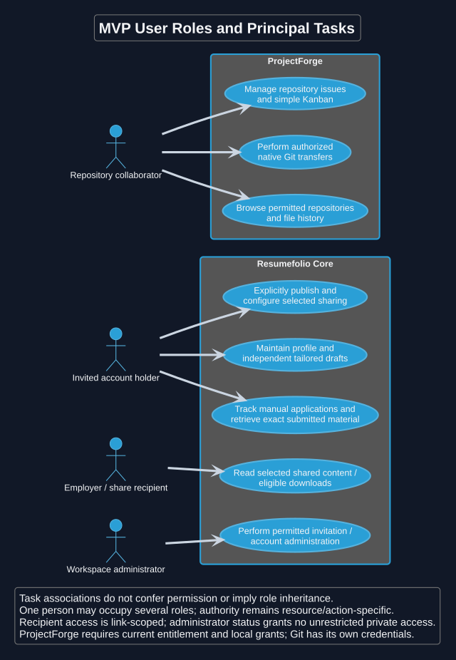

# 3. Users

[Previous: Design Goals and Principles](02-Design-Goals-And-Principles.md) · [UI/UX Design introduction](01-Introduction.md) · [Next: Information Architecture](04-Information-Architecture.md)

## Personas

The MVP uses role-based design profiles: invited account holder, employer/share recipient, repository collaborator and workspace administrator. These profiles describe required tasks and authority boundaries. They are not fictional named research participants, demographic segments or evidence of interviews.

One person may occupy several roles, but permissions remain specific to the current account, resource and action. A recipient link, browser session, repository grant and operational credential are distinct contexts. Role-specific navigation and wording explain those boundaries; server-side authorization enforces them.

## Role and Task Diagram

[Editable PlantUML source](Diagrams/users-role-tasks.puml) · [PNG alternative](Diagrams/users-role-tasks.png)

This use-case overview groups principal tasks by role and owning system. Associations express participation, not blanket permission or role inheritance. The detailed profiles below define authority limits; server-side policies enforce them. An account holder who also collaborates on repositories needs the applicable ProjectForge entitlement, grants and Git credentials.

### 3.1 Invited Account Holder / Applicant

| Aspect | Design profile |
| --- | --- |
| Main goal | Prepare tailored professional materials, control publication/sharing and preserve actual submitted materials |
| Core tasks | Maintain profile content; edit independent drafts; preview/select/apply updates; separately publish; manage files/PDF; configure shares; track manual applications and follow-up |
| Information needed | Active resource and language, draft/version context, selected changes, publication state, PDF availability and recorded submission material |
| Key risk | Confusing a source edit or saved draft with publication, or confusing current content with an original submitted copy |
| Design response | Explicit labels/actions, preview/confirmation, accurate processing status and discoverable exact history |
| Authority limit | Only permitted resources/actions; account access does not grant another user's content or unrestricted ProjectForge access |

A user may tailor multiple materials differently. Do not assume all drafts should inherit future profile changes or that the current live publication represents every application. Manual application tracking records user activity; it does not imply automatic submission to an employer system.

### 3.2 Employer / Share Recipient

| Aspect | Design profile |
| --- | --- |
| Main goal | Read the intended professional presentation and retrieve an eligible selected document |
| Core tasks | Open the protected viewing route, satisfy applicable link conditions, identify available language/content and use permitted downloads |
| Information needed | The authorized presentation, available content language, clear download meaning and safe unavailable/denied feedback |
| Key risk | Unclear scope, inaccessible content or a misleading fallback to an unintended document/variant |
| Design response | Focused reading view, clear authorized choices and understandable access states without owner workspace controls |
| Authority limit | Link-scoped selected access, not product membership, editing rights or application-history access |

A viewer context does not prove a named employer identity. Do not require a product account merely to view a protected employer share under the selected contract. Revocation changes subsequent access according to policy but cannot recall bytes already delivered/downloaded. Do not expose private drafts or an unrelated language variant to fill an unavailable selection.

### 3.3 Repository Collaborator

| Aspect | Design profile |
| --- | --- |
| Main goal | Work with permitted repositories, files/history, issues and basic Kanban |
| Core tasks | Find authorized repositories; inspect resolved file/history context; perform permitted native Git transfers; create/update issues and move board state |
| Information needed | Current repository, resource/action permission, revision context, issue identity/version and accurate operation outcome |
| Key risk | Assuming issue-write permission grants Git write, or treating a lost response as proof that a write failed |
| Design response | Resource-specific navigation/actions, stable issue context, conflict feedback and contract-defined status resolution |
| Authority limit | Current Core entitlement plus ProjectForge local repository/action grants and applicable Git credentials |

Core and ProjectForge remain separate applications. A Core session or reachable JSON API does not establish native Git transfer permission or interoperability. Advanced review/releases, general Sprints and workflow execution remain outside the MVP collaborator profile.

### 3.4 Workspace Administrator

| Aspect | Design profile |
| --- | --- |
| Main goal | Perform selected admission/account and operational-metadata duties accurately |
| Core tasks | Manage permitted invitation/account actions, review applicable status and follow the defined recovery/escalation path |
| Information needed | Target account/resource, allowed action, current state, consequential confirmation and bounded outcome/audit context |
| Key risk | Assuming an administrator label grants unrestricted private-content or repository access |
| Design response | Task-scoped screens, explicit consequences, safe feedback and no unnecessary sensitive-data exposure |
| Authority limit | Selected administrative functions only; content, repository and operating privileges remain explicitly authorized |

An operator/maintainer may deploy, monitor or recover the software under separate operational procedures. This does not introduce an unrestricted administration console or user-facing workflow/deployment feature. Product roles and host/backup credentials must not be conflated.

## Needs and Pain Points

The needs below are derived from documented requirements and architecture. Treat friction as a hypothesis until observation confirms it. Do not invent task times, quotes, proficiency levels or success rates.

| Need / anticipated friction | Affected role | Design implication | Validation question |
| --- | --- | --- | --- |
| Understand which material changes | Account holder | Distinguish source, draft, publication and submission context | Can the user identify the current target before acting? |
| Reuse content without losing tailoring | Account holder | Selected preview/apply and stale-version handling | Can the user apply a subset without overwriting independent text? |
| Know what is shared | Account holder / recipient | Selected-content summary and focused recipient view | Do both sides understand the available material and language? |
| Distinguish processing from availability | Account holder / collaborator | Accurate pending/failed/confirmed states | Can the user choose a safe next step without duplicating work? |
| Trust historical records | Account holder | Exact submission material separate from live content | Can the user retrieve the original after later edits/withdrawal? |
| Understand access restrictions | All roles | Current-context feedback without private-resource leakage | Does denial explain the permitted next step without disclosing hidden content? |
| Operate without a precise pointer | All applicable roles | Keyboard alternatives, visible focus and semantic feedback | Can the task be completed without drag/hover-only behavior? |
| Handle long/localized content | Account holder / recipient | Reflow and clear manually maintained language variants | Does content remain readable with no misleading fallback? |

## Usage Context

### 3.5 Devices, Input and Accessibility

Design for intended desktop/mobile browsers, keyboard-only operation and assistive technology. Record the actual browser/version, viewport/zoom, input and assistive setup when verifying a journey. Device type does not establish user ability or proficiency.

Keep essential controls and context accessible at narrow widths/enlargement. Use space for comparison/preview where available without making those tasks depend on a wide screen. Tables/boards need understandable navigation and useful alternatives when a two-dimensional view is necessary.

The [Accessibility chapter](10-Accessibility.md) identifies the planned target and verification approach. Role profiles do not certify accessibility or replace actual complete-journey checks. Documentation's dark-mode diagrams do not select the product theme.

### 3.6 Language and Content Context

Current interface copy is English. Professional English/German content is manually maintained; content language, interface language and uploaded-document language are distinct. Follow-up/due-date meaning retains applicable locale/time-zone context. Automatic translation remains deferred.

Users need to recognize which variant they are editing, publishing or receiving. Preserve governing fallback/completeness status rather than silently substituting another document or language. See [Responsive and Localization](11-Responsive-And-Localization.md).

### 3.7 Interruptions and Changed Authority

Users may encounter validation failures, stale versions, slow processing, unavailable dependencies or changed permissions. These are scenarios to support and verify, not research claims about frequency.

Preserve permitted input where safe, name the actual outcome and provide the contract-defined recovery route. A response lost after a remote commit requires status/reconciliation, not an unconditional repeat. Previously visible content/actions may no longer be allowed after revocation; explain that state without promising access restoration.

## Role-to-task Validation

Use synthetic owner, other-owner, link-scoped recipient, collaborator and administrator contexts for permission verification. A recipient does not need a synthetic product account when the selected viewer contract is account-free. Separately use representative participant tasks for usability observation when sessions are conducted.

| Scenario | Context and task | Expected observation |
| --- | --- | --- |
| Tailor and publish | Account holder selects part of a profile update, saves and separately publishes the intended material | Correct distinction between source/draft/publication; independent text preserved |
| Find exact submission | Account holder opens recorded material after later edits or withdrawal | Original selection remains identifiable and authorized history is retrievable |
| Recipient access | Link-scoped viewer finds intended content/download, then encounters changed/denied access | Focused selected visibility, clear language and safe feedback; no owner workspace exposure |
| Repository issue/board | Collaborator acts within one repository and encounters stale or denied work | Stable issue identity, keyboard completion and correct permission/conflict understanding |
| Native Git permission | Evaluated client uses allowed/denied grants and changed entitlement | Actual transport policy works independently of browser/issue permission |
| Administrative action | Administrator performs the selected account task and attempts an unauthorized content path | Scope and consequences clear; private content remains protected |
| Interrupted operation | Relevant actor receives a pending/unknown result | Safe status resolution without an accidental duplicate consequential effect |
| Accessible narrow layout | Relevant actor completes the task with keyboard and intended reflow/assistive configuration | Context, controls, feedback and focus remain operable |

Record task prerequisites, actor/grants, resource/data versions, expected outcome and actual observations on an identifiable candidate. Distinguish usability difficulty from authorization failure and accessibility defects. Link follow-up to the owning criterion/work item and retest affected behavior after a change.

No participant sessions or findings are asserted here. Use [Usability Testing](12-Usability-Testing.md) for evidence collection and [UI/UX Traceability](14-Traceability.md) / [RTM](../../02-Requirements-Engineering/03-Requirements-Traceability-Matrix/README.md) for criterion links.

## Sources and Handoff

The [SRS](../../02-Requirements-Engineering/01-Software-Requirements-Specification/README.md), [source scenarios](../../02-Requirements-Engineering/01-Software-Requirements-Specification/04-Scenarios-And-Models/02-User-Stories-And-Scenarios.md#scenarios-and-models-user-stories-and-scenarios) and [HLD System Context](../01-High-Level-Design/03-System-Context.md) define required behavior and authority. [Design Goals and Principles](02-Design-Goals-And-Principles.md) explains interaction priorities; [Information Architecture](04-Information-Architecture.md) and [User Flows](05-User-Flows.md) refine navigation and tasks.

When refining a screen, identify the active role, resource/action authority, intended outcome, relevant language/revision and failure/recovery states. Keep assumed needs separate from observed findings and product permission checks separate from UI visibility. Update profiles only when scope, governing policy or actual evidence changes their task meaning.
