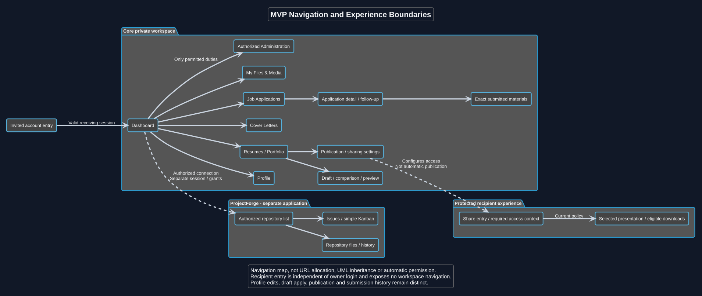

# 4. Information Architecture

[Previous: Users](03-Users.md) · [UI/UX Design introduction](01-Introduction.md) · [Next: User Flows](05-User-Flows.md)

## Site Map and Navigation

Organize the MVP around the user's tasks: maintain professional content, tailor and explicitly publish materials, control selected access, track manual applications and work within permitted repositories. Keep the private workspace, ProjectForge and protected recipient experience distinguishable. Navigation expresses available discovery; it never extends permission to linked resources.

[Editable PlantUML source](Diagrams/information-architecture.puml) · [PNG alternative](Diagrams/information-architecture.png)

The map identifies conceptual destinations and their relationships, not final URLs, implementation controllers or a mandatory menu order. Dashboard links summarize the main task areas. Exact page grouping and route names are refined with screen specifications and implementation. Cover letters may be reached from their relevant preparation/application context without duplicating underlying records.

The dotted ProjectForge connection crosses into a separate application and authority boundary. The sharing relationship configures recipient access; it does not imply that changing settings publishes a draft. Recipient entry does not require the owner's session and does not expose private workspace navigation.

### 4.1 Core Destinations

| Destination | Information and tasks | Context to preserve |
| --- | --- | --- |
| Dashboard | Task-oriented summaries and permitted next actions | Current account, relevant state and truthful pending/failure feedback |
| Profile | Reusable private professional source content | Source identity and manually maintained content language; no silent draft propagation |
| Resumes / Portfolio | Tailored materials, independent drafts and published state | Current material/language, revision context and explicit edit/preview/apply/publish actions |
| Cover Letters | Authored application-related professional material | Intended application/material identity and exact version where captured |
| Job Applications | Manual application progress, next action and follow-up | Application context and distinction between editable tracking and immutable submission history |
| My Files & Media | Private library, processing/admission state and selected associations | Private/unselected status versus selected/published delivery; exact artifacts remain protected |
| ProjectForge connection | Entry to permitted repository capabilities | Separate receiving session, current entitlement and local grants |
| Authorized Administration | Selected admission/account and operational-metadata duties | Action-specific authority; no implied unrestricted private-content access |

Job Applications is integrated Core navigation. ApplyFlow is not a separate MVP platform name. Application tracking and follow-up work without personal email/calendar integration.

### 4.2 Resource-level Navigation

Use a stable progression from section/list to resource/detail to the specific operation. Identify the resource in the heading and, where useful, breadcrumbs. Keep list filters and return context usable where supported without placing sensitive content or credentials in URLs.

For a resume, distinguish draft editing, comparison/selected update, preview and publication/sharing configuration. For an application, distinguish mutable tracking details from submission events and their exact material. For a repository, preserve repository identity and resolved revision or issue context across browsing and board interactions.

A preview is not publication. A current live revision is not a historical submitted copy. A selected file in one material does not become globally shareable. Avoid navigation labels that collapse these meanings.

## Content Hierarchy

Present each screen in a consistent reading order, adapted to its task:

1. Page purpose and current resource/account context.
2. Relevant language, revision, access or processing status.
3. Main task content and the primary permitted action.
4. Supporting preview/comparison, related details and local secondary actions.
5. Persistent outcome/recovery guidance where needed.

Keep the main action clear within the task area rather than placing every possible operation in a global toolbar. Consequential actions identify their actual target and scope. Status uses text and suitable semantics, not color or icon shape alone.

| Context | Prioritize | Keep distinct |
| --- | --- | --- |
| Draft editor | Editable content, selected changes, validation and save state | Source profile, current draft and published snapshot |
| Publication/share settings | Exact material, current access configuration and confirmation | Publish, password/link management and download mode |
| Private library | Artifact identity, usability/processing and selection context | Uploaded, admitted, associated, published and retained |
| Application detail | Status, next action, follow-up and submission history | Current editable information and exact previously submitted material |
| Repository/issue | Repository, revision/issue identity, allowed actions and version conflict | File/history read, issue write and native Git write authority |
| Employer view | Authorized professional content, language and eligible downloads | Recipient access and owner workspace controls |

## Authenticated Workspace

Shared shell responsibilities include account context, section navigation, page/resource heading, main content, accessible feedback and contextual help. The shell should orient users while leaving task-specific controls near the content they affect.

Show only discovery permitted by the governing policy. Do not leak private resource names through search results, navigation counts, notifications, breadcrumbs, previews or inaccessible linked titles. Hiding controls is a presentation decision; every direct request still requires the receiving owner's current authorization.

Core and ProjectForge retain independent application sessions and resource grants. Navigation can provide a coherent connection without implying a merged identity store, shared database or unrestricted cross-system access. Preserve safe return/error context when the receiving application requires sign-in, denies access or cannot establish current authority.

## Employer Experience

Provide a separate minimal protected viewing route without requiring a product account under the selected recipient contract. Resolve current link/viewer policy before exposing selected professional content and eligible downloads. Viewer context is link-scoped, not proof of named employer identity.

Do not display owner editing/navigation controls, private application history, unselected artifacts or alternative language documents as an implicit fallback. Unavailable, disabled or denied states use safe truthful feedback without revealing hidden content or claiming that already downloaded bytes can be recalled.

Recipient navigation stays within the permitted representation and selected materials. Returning to an owner workspace requires its separate authenticated context; a recipient link must not become a general account entry credential.

## ProjectForge Navigation

Group repository list, repository browsing/history, issues and simple Kanban around the current repository. Resolve actor entitlement and local grants on protected operations. File/history views identify the resolved immutable revision where applicable rather than obscuring which content is being inspected.

Issue/board transitions preserve issue identity and expected-version behavior. Native Git transfer guidance reflects its own credentials and transport rather than treating a browser or JSON issue permission as proof of Git write access. Unauthorized or unavailable destinations must return accurate feedback without exposing unrelated repository names or contents.

Advanced review/releases, general Sprints, user workflow/deployment execution, AI and personal mail/calendar are not promised as MVP destinations. Retained broad-product records do not override this selected navigation scope.

## Reusable Patterns

Use consistent page headings, labeled fields, lists/tables, file/variant cards, selection summaries, status regions and dialogs. Define actual styling tokens/components in [Design System](07-Design-System.md) and behavior in [Interaction and Feedback](09-Interaction-And-Feedback.md). The selected React/Inertia architecture does not by itself select an additional component library or brand palette.

Provide useful empty, loading, invalid, denied, conflict, pending, unknown and confirmed states where applicable. Distinguish an empty authorized list from no filter matches and from an unavailable dependency. Offer only meaningful permitted next actions. Refresh/back navigation must not repeat a consequential mutation merely to recover context.

Use native navigation/interactive semantics, meaningful link/action labels and clear current-location cues. Preserve keyboard/focus order and status feedback. At narrow widths, reorganize navigation/content without removing essential controls or resource relationships. Where a dense table/board needs two-dimensional space, provide understandable navigation and useful detail/list alternatives.

## MVP Navigation and Authority Cues

| Cue | Required meaning |
| --- | --- |
| Current account | Identifies the active workspace context without exposing another account's private records |
| Resource heading / breadcrumb | Names an authorized resource and preserves section/detail orientation |
| Language / revision label | Identifies the material actually edited, published, viewed or retained |
| Permission-related action | Explains an available task or safe restriction; server policy remains authoritative |
| Pending / conflict / unavailable notice | Describes the actual operation state and safe recovery route |
| Submission history label | Signals exact preserved materials rather than current live content |
| ProjectForge boundary cue | Indicates a separately authorized repository destination without flooding normal flows with implementation detail |

## Navigation Consistency

Verify that users can move from dashboard to list/detail/task and return without losing meaningful permitted context. Check direct entry, refresh, browser back, changed permission and unavailable dependency states, not only the ideal menu-driven path.

For English/German professional variants, preserve the selected content language without silently changing interface language or substituting an unrelated artifact. Follow-up display retains applicable locale/time-zone meaning. See [Responsive and Localization](11-Responsive-And-Localization.md) and [Accessibility](10-Accessibility.md) for detailed behavior.

## Verification and Handoff

| Review scenario | Expected observation |
| --- | --- |
| Find and tailor a resume | User identifies the draft, selected update and separate publication path |
| Configure a share / open as recipient | Owner configuration and focused recipient routes remain distinct; only selected eligible material is visible |
| Retrieve prior submission | User finds the exact retained material after later edits or withdrawal |
| Browse repository / update issue | Current repository/revision/issue context remains clear and grants are enforced |
| Direct or changed-access entry | Safe permitted context or denial, with no leaked private names/content |
| Narrow/keyboard navigation | Essential destinations, tasks, focus and status remain reachable and understandable |
| Loading/empty/conflict/unknown outcome | Feedback names the actual state and offers a safe next action without duplicate effects |

Record actor/grants, candidate, data/version context, browser/input/viewport, expected and observed result, limitations and follow-up. No usability observation or accessibility pass is established by the map alone.

Use [User Flows](05-User-Flows.md), [Screen Specifications](08-Screen-Specifications.md) and [Development Handoff](13-Handoff-To-Development.md) to refine executable behavior. Link exact criteria through [UI/UX Traceability](14-Traceability.md) and the [RTM](../../02-Requirements-Engineering/03-Requirements-Traceability-Matrix.md). The [HLD System Context](../01-High-Level-Design/03-System-Context.md) and [API specification](../03-Low-Level-Design/05-API-Specification.md) govern authority and result contracts.

## Existing Design Records

The navigation/context, recipient and reusable-pattern guidance above consolidates the existing record with the selected MVP boundary. Deferred communication/calendar, advanced work/review and execution destinations are not current navigation commitments. Supporting retained material remains available in [Appendices](15-Appendices.md).
