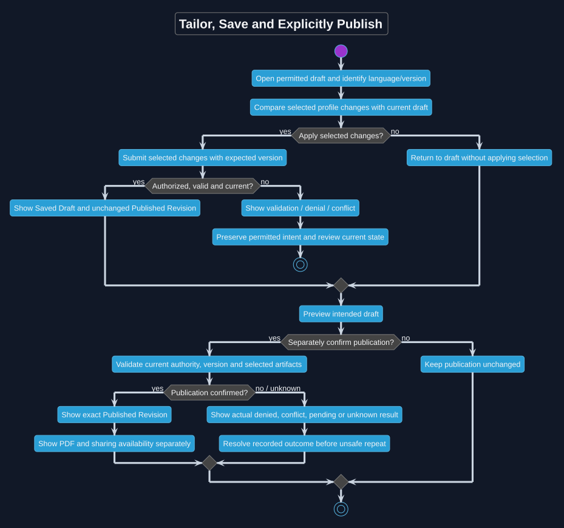
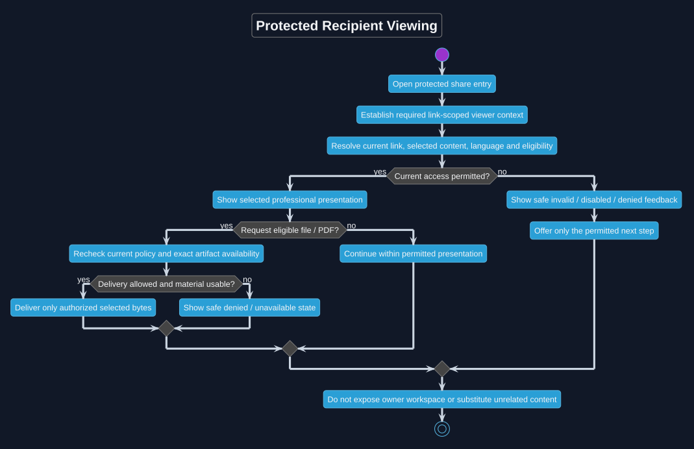
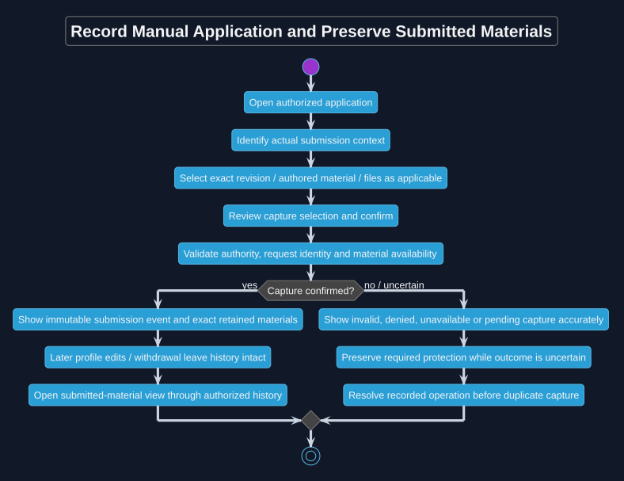
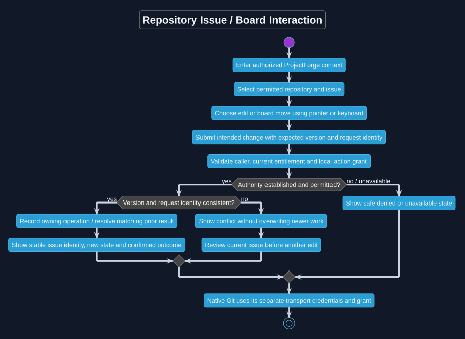

# 5. User Flows

[Previous: Information Architecture](04-Information-Architecture.md) · [UI/UX Design introduction](01-Introduction.md) · [Next: Wireframes and Prototypes](06-Wireframes-And-Prototypes.md)

## Main Flows

User flows describe the actor's intent, prerequisites, decisions, observable outcomes and safe next steps. They preserve the selected MVP boundary: Core owns private professional materials and manual application history; ProjectForge separately owns authorized repository work. A diagram describes planned behavior, not a completed implementation or usability result.

| Journey | Starting context | Intended outcome |
| --- | --- | --- |
| Invited access | Valid invitation or existing invited account | Receiving application establishes authorized workspace context |
| Tailor and publish | Authorized profile/draft and explicit selected changes | Independent saved draft, followed only by separately confirmed publication |
| Protected sharing and viewing | Configured selected material and required viewer context | Recipient sees only currently eligible content/downloads |
| Private artifact/PDF | Permitted file operation and selected material | Accurate admitted/processing/available/failed state, with private bytes protected |
| Manual application capture | Authorized application and exact actual materials | Immutable submission event with retained exact selection |
| Repository work | Current entitlement, local resource grant and appropriate receiving context | Permitted files/history, issue/board action or separately authorized native Git operation |

All UML below uses local dark-mode PlantUML with editable source and SVG/PNG output. Screens/labels remain refined in [Screen Specifications](08-Screen-Specifications.md); exact request, version and retry behavior follows the [API specification](../03-Low-Level-Design/05-API-Specification.md).

### 5.1 Invited Access and Return Context

The user opens an invitation or sign-in entry, completes the selected authentication/recovery steps and reaches the permitted workspace. Validate invitation/account/session state on the server. Invalid, consumed, expired or denied context returns bounded feedback and the applicable recovery route without disclosing private account content.

When access expires during editing, preserve only what the selected privacy/session policy safely permits. Do not promise unsaved-data recovery or place credentials/private draft text into unsafe URLs or storage. Returning to a resource after sign-in requires current resource authority; a remembered destination is not permission.

### 5.2 Tailor, Save and Publish

[PlantUML source](Diagrams/user-flow-publication.puml) · [PNG](Diagrams/user-flow-publication.png)

**Prerequisite:** the actor can access the exact profile/draft and language context. Comparison identifies source/draft versions, proposed differences, selected fields and affected overrides. Applying selected changes saves only the draft; the published revision remains unchanged until a separate publication operation succeeds.

Label **Saved Draft**, **Published Revision** and **Actual Submitted Materials** distinctly. Preview the intended candidate and confirm publication separately. Do not silently publish a newer unseen draft after a stale comparison or save conflict. Preserve permitted intent and offer review against current state.

Publication, PDF availability and recipient access are distinct outcomes. An accepted request/queued rendition does not prove downloadable bytes exist. If the response is lost, show the contract-defined uncertainty and resolve the recorded operation rather than offering a blind repeat.

### 5.3 Configure Sharing and View Selected Material

The owner selects the intended published representation and configures permitted access. Download mode, variant availability, link state and password controls remain separate. Changing one must not silently perform another operation outside its contract. Explain subsequent-access effects and that emitted/downloaded bytes cannot be recalled.

[PlantUML source](Diagrams/user-flow-sharing.puml) · [PNG](Diagrams/user-flow-sharing.png)

**Recipient prerequisite:** required link-scoped context, not the owner's account login. Resolve current link/viewer policy, selected content, language and download eligibility before showing protected content. Recheck the delivery boundary for file/PDF and alternate/direct requests.

Invalid or disabled access uses safe feedback without revealing drafts, unrelated attachments or another-language PDF as a fallback. A link-scoped viewer does not establish named employer identity. Recipient navigation never becomes owner workspace access.

### 5.4 Add Private Files and Produce PDF

The user chooses an authorized upload or supported library association. The owner validates type/size/quota and concurrent admission policy. Distinguish bytes transferred, admitted usable artifact, consumer association and published delivery. A private library item is not automatically selected or shared.

For generated PDF, identify the exact selected input/language and show processing separately from publication. When replacement fails, describe the actual result without claiming the prior usable association changed. Failed or interrupted work must preserve still-required artifact references and provide the contract-defined recovery path.

Direct delivery remains authorized even when a preview/download control was previously visible. Keep private paths and internal processing details out of normal user-facing content.

### 5.5 Track an Application and Capture Actual Materials

[PlantUML source](Diagrams/user-flow-submission.puml) · [PNG](Diagrams/user-flow-submission.png)

**Prerequisite:** authorized application and exact actual material selection. Application status, next action and follow-up are mutable tracking data; submission events preserve what was actually submitted. Include independently authored text/files as applicable rather than forcing every submission to resolve through a current publication.

Review selection and capture completeness before claiming success. If exact bytes are unavailable or capture is pending/uncertain, show that state without substituting newer material. A matching repeated request resolves the recorded outcome under the contract, not a duplicate submission event.

Later profile edits, draft changes, publication withdrawal and artifact replacement must not rewrite historical material. The history view identifies exact retained context. Recording a manual submission does not send it automatically to an employer.

### 5.6 Repository Browsing, Issues and Kanban

[PlantUML source](Diagrams/user-flow-repository.puml) · [PNG](Diagrams/user-flow-repository.png)

**Prerequisite:** current Core entitlement, receiving ProjectForge context and local resource/action grant. Repository browsing identifies the permitted repository and resolved file/history revision. Issue/board actions preserve issue identity and expected-version semantics.

Offer non-drag controls for board movement. A stale update requires review of current state; do not silently overwrite another change. Denied/hidden resources and unavailable entitlement authority return safe accurate feedback. Issue-write authority does not grant native Git write.

Actual clone/fetch/push uses the evaluated native transport, credentials and repository/action grants. Browser/API success is not transport interoperability evidence. Advanced review/releases, general Sprints and user workflow execution are not part of this flow.

## Alternative and Error Flows

| Condition | Observable response | Safe next step |
| --- | --- | --- |
| Invalid input | Associated field/context feedback and no successful mutation | Correct input while retaining permitted unrelated work |
| Expired session / invitation / viewer context | Policy-appropriate access feedback without private disclosure | Follow the permitted authentication/access route; recheck resource authority |
| Wrong owner or revoked grant | Safe denied/hidden outcome | Return to an allowed context; no client-side bypass |
| Stale draft / issue version | Persistent conflict with no overwrite of newer work | Review/compare current state before a new confirmed request |
| Missing/unusable exact artifact | Accurate unavailable or incomplete-capture state | Select valid actual material or follow authorized recovery; never substitute silently |
| Slow background processing | Named pending stage/status where available | Observe the same operation; avoid accidental repeat |
| Required authority/dependency unavailable | Documented safe unavailable outcome | Use bounded contract-defined retry/status handling |
| Lost response / unknown effect | Uncertainty without false rollback/success | Resolve stable recorded request identity before unsafe repetition |
| Interrupted replacement / cleanup | Actual usable/protected state remains clear | Owner-controlled reconciliation preserves referenced bytes |

Refresh/back navigation must not repeat a consequential mutation merely to reconstruct a page. Cancellation requested is not confirmed prevention of an already dispatched effect. Keep important pending/conflict/unknown feedback accessible and persistent enough to support recovery.

## Decision Points in the Main Journeys

At each consequential choice, state the intended target and effect in user language. The user can apply selected source changes or return without applying, publish separately or retain the current publication, configure access without rewriting submitted history, and record actual materials without implying automatic delivery.

Use confirmation where consequences warrant it, not for every reversible edit. Preserve keyboard/focus behavior and announce dynamic outcomes appropriately. See [Interaction and Feedback](09-Interaction-And-Feedback.md) and [Accessibility](10-Accessibility.md).

## Verification and Handoff

| Flow | Include in planned checks |
| --- | --- |
| Invited access | Valid/invalid/expired context, current account state and permitted return destination |
| Tailoring/publication | Partial selected update, independent text, stale versions, separate confirmation and unchanged publication on cancellation |
| Sharing/recipient | Correct selection, changed/denied context, language/download eligibility and direct delivery |
| Private files/PDF | Concurrent admission, interrupted/failed processing, replacement and exact-input availability |
| Submission history | Exact authored/revision/file selection, incomplete capture, repeated identity and preserved history after edits/withdrawal |
| Repository work | Current grants/entitlement, keyboard board action, stale issue, real allowed/denied Git transfers |
| Recovery states | Lost response, unavailable authority, preserved permitted input and no blind consequential repeat |

Record actor/grants, initial data/version, task, expected result, candidate/environment and actual outcome. Link normal and relevant denied/stale/interrupted paths to exact criteria through [UI/UX Traceability](14-Traceability.md) and the [RTM](../../02-Requirements-Engineering/03-Requirements-Traceability-Matrix/README.md). Use [Usability Testing](12-Usability-Testing.md) for task observation and [Development Handoff](13-Handoff-To-Development.md) for implementable screen/contract details.

## Existing Design Records

The presentation/history and sharing/file guidance above consolidates the existing consequential-journey record. Governing details remain in [Detailed Module Design](../03-Low-Level-Design/03-Detailed-Module-Design.md) and the API specification.

Personal communication/calendar, advanced Sprint/review/release, runner and target-deployment flows remain deferred. Retained future-domain examples in [Appendices](15-Appendices.md) do not make them MVP journeys. No flow diagram establishes an implemented operation or passed usability/accessibility check.
