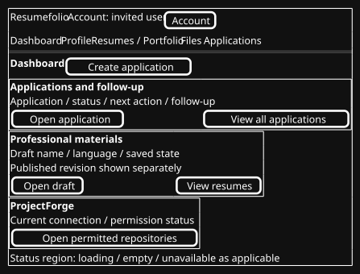
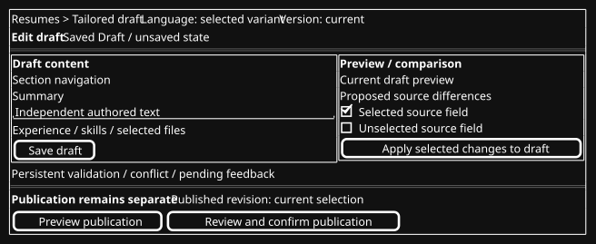
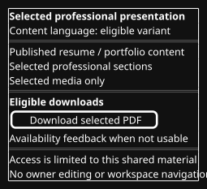
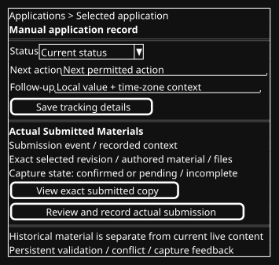
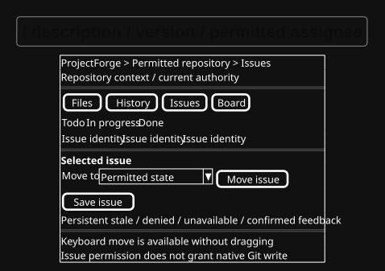

# 6. Wireframes And Prototypes

[Previous: User Flows](05-User-Flows.md) · [UI/UX Design introduction](01-Introduction.md) · [Next: Design System](07-Design-System.md)

## Low-Fidelity Wireframes

The wireframes below make content order, task separation, permission cues and important states reviewable. They use editable PlantUML Salt wireframe notation with dark rendered backgrounds and light labels. They are structural design artifacts, not implemented screens, approved visual branding or evidence of usability/accessibility conformance.

Labels and controls identify intended behavior. A drawn button does not implement an operation or grant permission. Actual components, responsive rules, validation and result semantics must be refined with the owning screen and contract.

## MVP wireframes

This section preserves the existing reference anchor used by HLD and other design documents.

### 6.1 Dashboard

[PlantUML source](Diagrams/wireframe-dashboard.puml) · [PNG](Diagrams/wireframe-dashboard.png)

Prioritize application next actions/follow-up, professional material state and permitted repository navigation. Summaries expose only authorized resources. Empty workspace, no filter matches and unavailable ProjectForge are distinct states; do not display a false empty result when a dependency fails.

The wide layout is a content hierarchy proposal, not a fixed menu order. On narrow screens, stack sections in meaningful reading order while keeping primary tasks and current account context reachable.

### 6.2 Draft Editor and Explicit Publication

[PlantUML source](Diagrams/wireframe-draft-editor.puml) · [PNG](Diagrams/wireframe-draft-editor.png)

Identify draft, language and current version before editing. The comparison panel distinguishes selected source fields from independent authored content. Applying selected changes updates only the draft. Saving, previewing and reviewing/confirming publication remain separate actions; show the unchanged published revision until publication succeeds.

On narrow layouts, put editable content and validation first, then comparison/preview and related actions. Provide a clear way to move between these regions without losing permitted input. Stale-version conflicts preserve safe intent and require current-state review rather than silent overwrite/publication.

### 6.3 Protected Recipient View

[PlantUML source](Diagrams/wireframe-recipient.puml) · [PNG](Diagrams/wireframe-recipient.png)

This narrow layout starts after required link-scoped access conditions are met. It shows only selected professional content and eligible downloads, without owner workspace navigation. A separate access-entry state handles required password/viewer context before protected content is disclosed.

Do not silently replace an unavailable language or PDF with unrelated content. Current sharing/delivery checks apply to direct requests as well as visible controls. Link-scoped access does not prove named employer identity, and revocation cannot recall already downloaded bytes.

### 6.4 Application Detail and Actual Submitted Materials

[PlantUML source](Diagrams/wireframe-application.puml) · [PNG](Diagrams/wireframe-application.png)

Separate editable tracking details from immutable submission history. Review the actual material selection before recording a submission event. Identify capture completeness and exact retained material; a pending/incomplete capture must not appear confirmed.

The original submitted copy remains distinguishable from the current live resume after later edits, withdrawal or replacement. Recording manual activity does not send material automatically to an employer. Follow-up input/display retains applicable locale/time-zone context.

### 6.5 ProjectForge Issue and Board

[PlantUML source](Diagrams/wireframe-repository.puml) · [PNG](Diagrams/wireframe-repository.png)

Preserve repository and stable issue identity, current permission context and expected version. Board movement has a keyboard-operable state selector/action as well as any pointer interaction. Actual allowed states and fields follow the owning contract.

Show denied, unavailable-authority and stale-move outcomes accurately. Issue-write permission does not confer native Git write. This is basic repository Kanban, not advanced Sprint planning, review/releases or workflow execution.

## Additional Screen Coverage

The rendered layouts cover representative structures. The remaining screens require their own reviewed state/layout detail with the affected work item; do not treat this table as a complete prototype.

| Screen / region | Top-to-bottom information | Required states to refine |
| --- | --- | --- |
| Invitation / sign-in / recovery | Product/context, invitation/account status, labeled input, submit, permitted recovery | Valid/invalid/expired/consumed context, generic authentication feedback and selected factor/admin controls |
| Profile / draft list | Current source/material context, language, section/list content and permitted actions | Empty, edited, saved, stale/conflict and denied |
| Publication / share settings | Exact candidate/language, preview, selected artifacts, separate publication confirmation and link/password/download controls | Missing variant, pending/failed PDF, denied/stale publication and withdrawn access |
| Private library | Supported-type/limit guidance, upload, admitted/processing items and explicit association | Rejected/failed/unusable material, quota denial, referenced bytes and failed replacement |
| Recipient access entry | Required access context, labeled verification input and safe result | Invalid/disabled/changed access and unavailable eligible material |
| Application list / capture review | Filters, authorized results, detail/follow-up, selected actual-material summary | Empty/filter-empty, stale changes, pending/incomplete/confirmed capture |
| Repository list / files / history | Permitted repository, resolved revision, authorized entries and local actions | No entitlement/grant, unavailable authority, hidden resource and empty repository |
| Authorized administration | Target account, permitted action, consequences, confirmation and bounded outcome | Reauthentication/factor requirements where selected, denied action and excluded private content |

Specific quarantine/scanning infrastructure, numerical limits and expiry/factor rules must come from the governing policy; a placeholder state does not select a new security product or rule.

## Prototype Paths and State Transitions

Use the current local dark-mode activity diagrams in [User Flows](05-User-Flows.md) as the canonical journey specification rather than retaining a separate Mermaid flow here.

| Review path | Required prototype behavior |
| --- | --- |
| Dashboard → draft → compare/apply → preview → separate publication | Preserve exact target/language, selected fields and distinct recorded outcomes |
| Share configuration → recipient access → selected content/download | Keep owner and recipient contexts separate; include denied/changed/unavailable states |
| Application detail → review actual materials → capture → historical retrieval | Distinguish mutable tracking from immutable exact history and incomplete capture |
| Repository → issue/board → move/save → conflict or confirmed result | Preserve grants, keyboard action, stable issue identity and stale-version recovery |
| Any affected task → invalid/pending/unknown outcome → safe recovery | Preserve permitted input and resolve the same recorded operation before unsafe repeat |

A static diagram is a walkthrough aid, not a clickable interactive prototype. When interactive work is produced, record its real local artifact or usable preview link, supported paths, simulated behavior and limitations. Do not fabricate a prototype URL or imply that mock responses prove service/Git interoperability.

## High-Fidelity Mockups and Interactive Prototype

**Pending:** no reviewed high-fidelity visual system or interactive prototype is established by this chapter. Refine palette, typography, spacing and reusable component variants in [Design System](07-Design-System.md), then attach corresponding mockups/prototype references to the owning screen work.

Before claiming this level complete, provide the reviewed artifact, screen/state coverage, responsive behavior, input/focus interactions and implementation limitations. Use synthetic content without credentials or private professional material. Product theme selection remains separate from dark-mode documentation diagrams.

## Wireframe Review Checklist

For every affected layout, review:

- Visible page/resource purpose, language/revision context and main permitted action.
- Distinct source/draft/publication/submission meaning and exact selected materials.
- Empty, loading, validation, denied, conflict, pending, unknown and confirmed states where applicable.
- Labels, meaningful status text, keyboard alternatives, reading/focus order and safe focus return.
- Narrow/wide reorganization, long English/German professional content and accessible validation feedback.
- Current authority on direct delivery and receiving operations, independent of drawn controls.
- Truthful recovery and no blind repeat after an uncertain consequential effect.

Record the artifact revision, actor/task, expected outcome, browser/viewport/input setup where applicable, observations and follow-up. Diagram rendering verifies the artifact only; actual implementation assessment is required for accessibility and usability claims.

## Handoff and Traceability

Link each wireframe region/action to [Screen Specifications](08-Screen-Specifications.md), [Interaction and Feedback](09-Interaction-And-Feedback.md), the owning operation and exact requirement criterion. Use [Accessibility](10-Accessibility.md) and [Responsive and Localization](11-Responsive-And-Localization.md) for detailed verification obligations.

Use [Usability Testing](12-Usability-Testing.md) for task observation, [Development Handoff](13-Handoff-To-Development.md) for executable state/contract detail and [UI/UX Traceability](14-Traceability.md) / [RTM](../../02-Requirements-Engineering/03-Requirements-Traceability-Matrix/README.md) for fresh implementation/results. Keep planned, reviewed and executed evidence distinguishable.

## Existing Design Records

The MVP layout inventory and consequential journey guidance above consolidate the earlier record. Selected behavior remains governed by the [SRS](../../02-Requirements-Engineering/01-Software-Requirements-Specification/README.md), [accepted update/publication policy](../../02-Requirements-Engineering/01-Software-Requirements-Specification/07-Change-And-Baseline/03-Requirements-Questions-And-Decisions.md#change-and-baseline-open-questions-and-decisions--id-owner-accepted-profile-update-policy) and [API specification](../03-Low-Level-Design/05-API-Specification.md).

[Sources](01-Introduction.md#1-sources-and-experience-boundaries) · [Navigation](04-Information-Architecture.md#2-navigation-and-context) · [Journeys](05-User-Flows.md#3-consequential-journey-design) · [States](08-Screen-Specifications.md#4-forms-feedback-and-recovery) · [Accessibility detail](10-Accessibility.md#5-accessibility-and-responsive-behavior) · [Review](12-Usability-Testing.md#6-verification-and-handoff)
