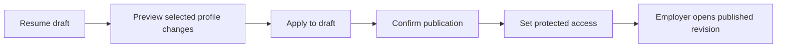

# 6. Wireframes And Prototypes

[UI/UX Design index](02-UI-UX-Design.md)

## Low-Fidelity Wireframes
Use the layouts and sequence below to review content order, permission cues and actions.

## High-Fidelity Mockups and Interactive Prototype
Pending. Add the reviewed mockups or prototype links with the corresponding screen work before claiming this level of design evidence.

## Existing Design Records

## MVP wireframes

These low-fidelity layouts show content, action order and permission-relevant states. Validate screens with the development increment that implements them.

| Screen | Wireframe, from top to bottom | Important states |
| --- | --- | --- |
| Invite and sign-in | Product title → invitation status → email and password fields → primary submit → recovery link | Valid invitation, invalid or expired invitation, generic authentication error, required admin second factor |
| Dashboard | Account and workspace navigation → open applications and follow-ups → resume drafts → ProjectForge shortcut when entitled | Empty workspace, loading, service unavailable |
| Profile and resume editor | Profile or draft breadcrumb → section list → editable content → saved state → preview selected source changes → explicit apply | Dirty draft, stale version, conflict review, no selected changes |
| Publication and share settings | Resume and language → preview exact revision → choose PDF and allowed files → confirm publication → manage password and revoke link | Missing language, pending PDF, failed publication, withdrawn link |
| Private media | Collection and filters → upload with supported types and limits → item list with validation state → explicit selection for a draft | Quarantine, rejected upload, quota denial, selected or referenced file |
| Employer view | Protected-link password entry → published resume → authorized PDF and selected media → access-unavailable page | Password required, expired or revoked link, missing PDF language |
| Applications | Status filters → application list → detail, next action and follow-up → submitted materials and correction history | Empty list, missing follow-up, submitted set pending or durably captured |
| ProjectForge | Repository list → repository header and permitted actions → files/history/issues → board lanes | No entitlement, insufficient permission, authorization unavailable, stale move |
| Admin | Account list → invitation or suspension action → confirmation → audit metadata | Reauthentication needed, disabled account, private content excluded from admin views |

On narrow screens, stack navigation, content and actions in reading order. On wider screens, the editor can place preview beside the draft. Keep focus on the current action or error summary after a state change. Support keyboard board moves as well as pointer interaction.

Current implementation choices and scope: [Baseline](https://github.com/Farhad-V/Web-Resumefolio/blob/1f2acaa351ac306cb57cbe4fe9742e8bd90720d9/docs/MVP/baseline/README.md). Runtime verification remains subject to its gates.

**Purpose:** define shared navigation, interaction states, content distinctions and accessibility verification obligations for owner, collaborator and employer journeys.

**Status:** proposed interaction design, November 2, 2026. Q-D25's WCAG/client/viewport target remains proposed. This document creates no implemented screens, approved visual system, user-study result or accessibility conformance claim.

[Sources](01-Introduction.md#1-sources-and-experience-boundaries) · [Navigation](04-Information-Architecture.md#2-navigation-and-context) · [Journeys](05-User-Flows.md#3-consequential-journey-design) · [States](08-Screen-Specifications.md#4-forms-feedback-and-recovery) · [Accessibility](10-Accessibility.md#5-accessibility-and-responsive-behavior) · [Review](12-Usability-Testing.md#6-verification-and-handoff)
