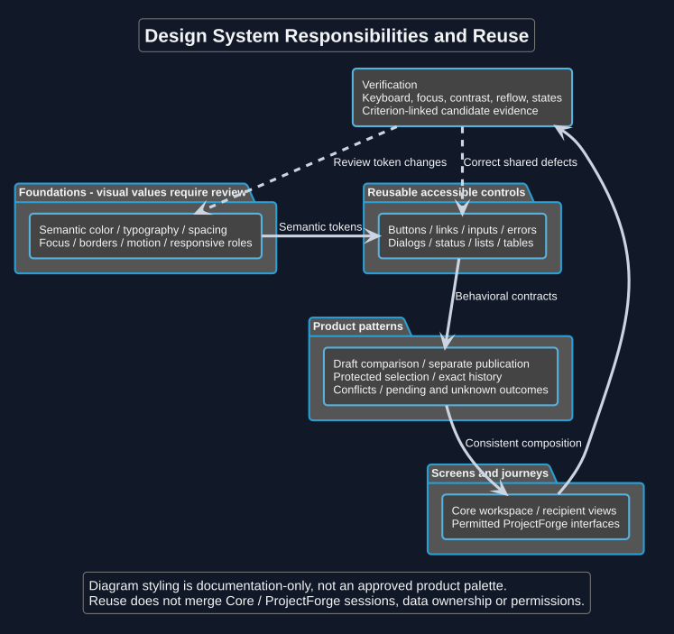

# 7. Design System

[Previous: Wireframes and Prototypes](06-Wireframes-And-Prototypes.md) · [UI/UX Design introduction](01-Introduction.md) · [Next: Screen Specifications](08-Screen-Specifications.md)

The design system defines reusable visual roles, accessible component behavior and product patterns for the MVP. It supports consistent interfaces without flattening distinct business states or authority boundaries. This is a design specification, not an installed component library or implemented token package.

Brand palette, production font family, exact visual values and an additional component library remain unselected. Token names below are proposed semantic contracts to refine during visual review; they do not establish approved brand values. Dark-mode documentation diagrams do not select the product theme.

## Color and Typography

### 7.1 Semantic Color Roles

Reference color by purpose rather than embedding unrelated literal values in screens. Map roles to reviewed values for each supported product theme after testing actual combinations.

| Proposed role | Purpose | Usage rule |
| --- | --- | --- |
| `surface.page`, `surface.panel`, `surface.overlay` | Page, grouped content and modal layers | Establish hierarchy without relying solely on subtle color differences |
| `text.primary`, `text.secondary`, `text.inverse` | Content and supporting text | Test against actual background; secondary text remains readable |
| `border.default`, `border.interactive` | Grouping and control boundaries | Preserve recognizable interactive areas in relevant states |
| `action.primary`, `action.secondary`, `action.destructive` | Action hierarchy | Destructive means an actual consequential operation, not a generic accent |
| `focus.indicator` | Keyboard focus | Distinguishable from selection, hover and error treatment |
| `status.info`, `status.success`, `status.warning`, `status.error` | Feedback semantics | Pair with text/semantics; never encode outcome by color alone |
| `state.selected`, `state.disabled` | Selection and unavailable control state | Keep selection, focus, pending and disabled meanings distinct |

Do not use success treatment for a queued effect as though it completed. A publication badge does not imply a PDF is available, and an artifact availability indicator does not establish sharing authority. Check text, controls, focus and status in the actual implemented themes rather than inferring contrast from a palette list.

### 7.2 Typography Roles

| Role | Content | Behavior |
| --- | --- | --- |
| Page heading | Screen purpose and current authorized resource | Clear hierarchy with meaningful heading semantics |
| Section heading | Task/content group | Supports scanning and a coherent reading order |
| Body | Professional and explanatory content | Readable wrapping, enlargement and long-content behavior |
| Label / helper / error | Controls and repair guidance | Explicit relationships to the control; important guidance is not placeholder-only |
| Metadata | Language, revision, follow-up and state context | Legible and available where it affects the task |
| Technical reference | Exact operation/revision identity where useful | Wrap/copy safely without exposing secret tokens or private host paths |

Select font families/weights and scale after reviewing English interface copy, manually maintained English/German professional content, long labels and supported rendering environments. Avoid fixed-height text containers and truncation that hides essential selection or error meaning. Production font licensing/loading remains part of visual implementation review.

## Spacing, Grid and Components

### 7.3 Layout and Density

Define named spacing roles for inline gaps, label/help relationships, control groups, sections and page gutters. Use consistent relationships across screens; exact scale values remain review inputs rather than invented accepted requirements.

A screen presents purpose/resource context, relevant state, main content/action and supporting regions. On wide layouts, an editor may place preview/comparison beside content. At narrow widths, stack in meaningful order and keep essential actions reachable. Dense tables/boards need useful detail/list alternatives and understandable navigation when two-dimensional space is necessary.

Avoid multiple competing primary actions in one decision group. Keep consequential confirmation near the selected target summary; do not move every action into a global toolbar. Sticky elements must not obscure focus, errors or required content. Refine breakpoints, container width and density against actual content and [Responsive and Localization](11-Responsive-And-Localization.md).

### 7.4 Reuse Layers

[PlantUML source](Diagrams/design-system-layers.puml) · [PNG](Diagrams/design-system-layers.png)

Foundations supply visual roles; controls supply behavior; patterns preserve product meaning; screens compose them into tasks. Shared visual behavior does not merge independent application sessions, grant authority or move owned data. React/Inertia and Tailwind are selected by the [frontend ADR](../ADR/ADR-007-React-Inertia-Frontend.md); this chapter does not select another UI library or deployment unit.

## Initial Component Contracts

| Component | Required contract | Important states / checks |
| --- | --- | --- |
| Button | Operation-specific verb label, semantic button, visible focus and accurate activation | Default, hover/focus, pending, disabled where justified; prevent accidental duplicate activation without replacing server request identity |
| Link / navigation item | Meaningful destination, current-location cue and expected link behavior | Keyboard access, direct entry, active location and safe denied/unavailable destination |
| Text input / textarea | Explicit label, appropriate input semantics, helper/error association and safe value preservation | Empty, entered, invalid, read-only, disabled and multiline/long content |
| Select / checkbox / radio | Clear option labels, selection meaning and keyboard behavior | Current selection, required/invalid, unavailable option and no color-only state |
| Field group / error summary | Meaningful grouping and errors linked to affected fields | Focus/reading order, multiple errors and correction without losing permitted work |
| Dialog / confirmation | Purpose, actual target/scope, explicit outcome and safe dismissal rules | Initial focus, modal interaction, keyboard completion, pending operation and focus return |
| Status badge / message | Textual state meaning with suitable semantics | Saved draft, published revision, available artifact, pending/failed/unknown remain distinguishable |
| Table / list | Meaningful headings/relationships and owner-scoped results | Loading, authorized-empty, filter-empty, unavailable, pagination and narrow navigation |
| File / variant card | Exact selected artifact, language, usability and association context | Private/unselected, processing, usable, rejected, referenced and permitted delivery |
| Preview / comparison | Exact source/draft versions, proposed differences and explicit selection | Independent text, no selection, selected changes and stale comparison |
| Issue / board control | Stable issue identity and repository context; keyboard move alternative | Expected-version conflict, denied grant, pending/confirmed and unavailable authority |

Components must not expose sensitive values through labels, hidden markup, URLs or diagnostics. Prefer correct native semantics; adding a role does not implement expected keyboard behavior. Detailed widget patterns and exceptions require actual browser/assistive-technology verification.

## Product Pattern Contracts

### 7.5 Material and Publication Context

A material header identifies the draft/revision and content language relevant to the task. Keep **Saved Draft**, **Published Revision** and **Actual Submitted Materials** distinct. Selected profile updates apply only through the explicit operation. Publication confirmation identifies the intended candidate; PDF generation and current sharing eligibility are separate status dimensions.

### 7.6 Protected Selection and Sharing

Show what is selected and permitted rather than treating every library artifact as public. Keep link/password, publication and download-mode controls distinct. Recipient components show only eligible content, not owner navigation or private tracking history. Do not imply a named employer identity from link-scoped access or promise recall of previously delivered bytes.

### 7.7 Historical Material

A submission summary identifies actual recorded context, exact materials and capture completeness. Do not reuse a live-resume card in a way that silently resolves today's content. Reuse visual structure while preserving the historical data contract and protected references.

### 7.8 Feedback and Recovery

| State | Pattern obligation |
| --- | --- |
| Loading | Identify the affected region without implying a commit |
| Empty | Distinguish no authorized records from no matches and unavailable service |
| Invalid | Explain correction near the field/context and preserve safe unrelated input |
| Denied / hidden | Safe feedback without private-resource disclosure or bypass suggestions |
| Conflict | Preserve permitted intent and require review of current state |
| Pending / partial | Name the actual known stage; acceptance is not completed effect |
| Unknown | Offer recorded-operation status/reconciliation, not a blind repeat |
| Confirmed | State exactly which operation/material completed |

Use persistent in-context feedback for consequential unresolved outcomes; a disappearing toast must not be their only record. Announce relevant updates accessibly without unexpected focus movement. See [Interaction and Feedback](09-Interaction-And-Feedback.md) and [User Flows](05-User-Flows.md).

## Icons and Imagery

Use icons to support recognizable meaning, with visible labels or accessible names as appropriate. Decorative imagery must not add redundant announcements. Meaningful professional media needs appropriate alternative content; a filename alone is not necessarily a useful description.

Select production icons/assets with the affected screen and verify licensing, loading, meaning and contrast. Keep private media behind the owning policy even when a thumbnail component is reused. Unavailable/error states must not expose unrelated content as fallback.

## Accessibility, Motion and Input

Carry keyboard operation, focus visibility/order, meaningful labels, appropriate announcements and readable reflow across all variants. Provide alternatives to drag-only board movement and hover-only information. Pointer target and contrast decisions must be checked against applicable criteria, not guessed from a mockup.

Use restrained transitions for orientation and honor relevant reduced-motion behavior. Animation must not communicate an outcome that the operation has not established or hide actionable errors. The [Accessibility chapter](10-Accessibility.md) records the planned WCAG target and assessment approach; this specification does not claim conformance.

## Component Specification and Review

For each implemented control/pattern, document purpose, semantic role, permitted inputs/actions, variants, keyboard/focus behavior, validation and dynamic states. Include representative long/localized content and narrow/wide examples. Link the owning screen and exact criterion.

| Review area | Evidence required |
| --- | --- |
| Visual roles | Actual token values, combinations and reviewed contrast/hierarchy |
| Interaction | Keyboard/pointer behavior, focus transitions and safe pending/error recovery |
| Content | Long labels/text, selected language/revision and unambiguous outcome copy |
| Responsive | Reflow/enlargement and essential actions without obscured focus/errors |
| Product meaning | Distinct draft/publication/artifact/submission and permission states |
| Privacy | No private-resource disclosure or authority inferred from component visibility |
| Reuse regression | Affected screens checked after shared behavior/token changes |

Record observations on an identifiable candidate/configuration. A successful component render does not prove complete-journey accessibility, server authorization or remote interoperability.

## Handoff and Evolution

Visual selection remains pending until reviewed token values, font/loading decisions and actual component examples are attached to the corresponding work. This document supplies contracts now without misrepresenting proposed brand choices as accepted or a component package as installed.

Refine [Wireframes and Prototypes](06-Wireframes-And-Prototypes.md) into [Screen Specifications](08-Screen-Specifications.md) using these contracts. Keep server-owned validation/authorization and [API result semantics](../03-Low-Level-Design/05-API-Specification.md) authoritative. Update shared controls, affected screens and [UI/UX Traceability](14-Traceability.md) together when behavior changes.

Use [Usability Testing](12-Usability-Testing.md), [Development Handoff](13-Handoff-To-Development.md) and the [RTM](../../02-Requirements-Engineering/03-Requirements-Traceability-Matrix.md) for implementation/evidence links. No production palette, high-fidelity approval, implemented component library or passed runtime assessment is established by completing this chapter.
