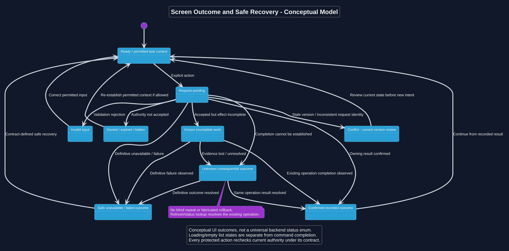

# 8. Screen Specifications

[Previous: Design System](07-Design-System.md) · [UI/UX Design introduction](01-Introduction.md) · [Next: Interaction and Feedback](09-Interaction-And-Feedback.md)

## Screen Behavior and States

A screen specification connects a user task to visible content, permitted inputs/actions, operation outcomes and accessible recovery. Screens below are design responsibilities, not final route names or implemented pages. Exact permissions, versions, request identity, persistence and result codes remain in the owning component/API contracts.

Use the local dark-mode [wireframes](06-Wireframes-And-Prototypes.md) for structure and [User Flows](05-User-Flows.md) for decision order. Preserve independent Core/ProjectForge authority and the separate protected-recipient experience. Personal mail/calendar, AI, advanced review/releases, general Sprints and user workflow/deployment execution remain deferred.

## Screen and Interaction Scope

### 8.1 Invitation, Sign-in and Recovery

| Specification | Required behavior |
| --- | --- |
| Actor / entry | Invited user or permitted recovery context; receiving application's authentication route |
| Visible content | Product/task purpose, required labeled inputs, invitation/context status where safely disclosed and permitted recovery action |
| Inputs / actions | Selected authentication/invitation/recovery fields and explicit submit; apply selected factor/admin controls only as governed |
| Confirmed result | Establish permitted receiving session or name the actual recovery/invitation outcome |
| Alternatives | Invalid/expired/consumed context, generic authentication failure, changed account state and unavailable dependency |
| Privacy / recovery | No secret/private-account disclosure; safe permitted return destination rechecks resource authority; no invented unsaved-data guarantee |

### 8.2 Dashboard and Resource Lists

| Specification | Required behavior |
| --- | --- |
| Actor / entry | Authenticated account with authorized discovery |
| Visible content | Account/section context, relevant follow-ups, material state and permitted ProjectForge connection |
| Inputs / actions | Meaningful filters/pagination and permitted open/create actions; current location remains clear |
| Confirmed result | Open the intended authorized resource without implying a mutation |
| Alternatives | Loading, authorized-empty, filter-empty, hidden/denied and dependency unavailable remain distinct |
| Privacy / recovery | Do not leak another account's names/counts/previews; preserve useful safe list/return context |

### 8.3 Profile and Tailored Draft Editor

| Specification | Required behavior |
| --- | --- |
| Actor / entry | Authorized owner; identify source profile versus independent draft, language and current version |
| Visible content | Editable sections, independent authored text, saved/unsaved state and separate preview/comparison |
| Inputs / actions | Edit permitted fields, save draft, select source changes and explicitly apply; publication is separate |
| Confirmed result | Name the saved resource/version and keep existing publication unchanged until separately confirmed |
| Alternatives | Invalid selection, no selected change, denied access, stale version, pending/unknown save |
| Privacy / recovery | Preserve permitted intent; review current state on conflict, with no silent overwrite or publication of unseen changes |

### 8.4 Publication and Sharing Settings

| Specification | Required behavior |
| --- | --- |
| Actor / entry | Authorized owner of exact candidate/material and language |
| Visible content | Intended revision/preview, selected artifacts, current publication, link state and separate PDF/download eligibility |
| Inputs / actions | Review and confirm publication; manage link/password/download settings through their distinct governed operations |
| Confirmed result | Identify exact publication or access-setting change; do not imply PDF readiness or recipient delivery |
| Alternatives | Stale candidate, unavailable artifact/language, pending/failed PDF, denied operation and withdrawn/changed link |
| Privacy / recovery | Explain subsequent-access consequence and limit that delivered/downloaded bytes cannot be recalled; resolve unknown operation before unsafe repeat |

### 8.5 Private Files and Media

| Specification | Required behavior |
| --- | --- |
| Actor / entry | Authorized owner with private library context |
| Visible content | Selected format/limit guidance, item identity, processing/usability state, size/language where relevant and associations |
| Inputs / actions | Upload supported material, inspect permitted item, explicitly associate/select or request allowed removal/replacement |
| Confirmed result | Distinguish transfer, admitted usable bytes, association and delivery eligibility |
| Alternatives | Rejected/failed upload, quota/capacity denial, interrupted processing, protected reference and failed replacement |
| Privacy / recovery | No exposed host path or executable preview; preserve still-referenced bytes and accurate prior usable association on failure |

### 8.6 Protected Employer Entry and View

| Specification | Required behavior |
| --- | --- |
| Actor / entry | Link-scoped recipient context, separate from owner login |
| Visible content | Required access input before authorization; then selected presentation/language and eligible downloads only |
| Inputs / actions | Complete applicable viewer condition, read selected content and request permitted artifact |
| Confirmed result | Deliver exact currently allowed material, rechecking direct/alternate delivery boundaries |
| Alternatives | Invalid/disabled/changed access, missing eligible language/PDF and unavailable content |
| Privacy / recovery | No owner controls, drafts or application history; no unrelated fallback; link possession does not prove named employer identity |

### 8.7 Application List, Detail and Submission Capture

| Specification | Required behavior |
| --- | --- |
| Actor / entry | Authorized applicant and selected application context |
| Visible content | Status, next action, follow-up/time-zone meaning, authored material, immutable events and exact submitted materials |
| Inputs / actions | Update tracking, review actual selection and separately record manual submission/capture |
| Confirmed result | Distinguish saved tracking from confirmed immutable event and exact retained bytes |
| Alternatives | Invalid input, stale tracking, missing actual material, repeated request identity and pending/incomplete/unknown capture |
| Privacy / recovery | No automatic employer send implied; no substitution of today's live content; later edits/withdrawal preserve original history |

### 8.8 ProjectForge Repositories, Files and History

| Specification | Required behavior |
| --- | --- |
| Actor / entry | Receiving ProjectForge context, current Core entitlement and local resource/action grants |
| Visible content | Permitted repositories, selected repository, resolved immutable revision and allowed file/history entries |
| Inputs / actions | Browse/filter permitted results and use relevant revision/path selection; Git transfer uses separate credentials/transport |
| Confirmed result | Show the actual permitted repository/revision without exposing host paths |
| Alternatives | No permitted result, hidden/denied resource, unavailable entitlement authority and invalid revision/path |
| Privacy / recovery | Core session or JSON read permission does not grant native Git write; safe navigation does not disclose unrelated repositories |

### 8.9 Issues and Simple Kanban

| Specification | Required behavior |
| --- | --- |
| Actor / entry | Authorized repository collaborator with issue/board action grant |
| Visible content | Repository, stable issue identity/version, permitted fields, state and outcome |
| Inputs / actions | Create/edit permitted fields and move issue through pointer or keyboard-operable controls |
| Confirmed result | Same issue identity with recorded state/version; matching repeated request resolves its stored outcome |
| Alternatives | Invalid field/assignee, stale version, inconsistent request identity, revoked grant and authority unavailable |
| Privacy / recovery | Conflict preserves newer state and requires review; issue-write does not imply Git write; no advanced Sprint/review/executor scope |

### 8.10 Authorized Administration

| Specification | Required behavior |
| --- | --- |
| Actor / entry | Current authority for the selected account/admission duty |
| Visible content | Authorized target/status, action consequence, required confirmation and bounded audit/outcome metadata |
| Inputs / actions | Only selected administrative operations with governed reauthentication/factor requirements |
| Confirmed result | Name the exact target/action outcome without implying broader access |
| Alternatives | Denied, changed state, invalid/expired context and unavailable result |
| Privacy / recovery | Administrator label does not grant unrestricted content, repository or host/backup privileges |

## 4. Forms, Feedback and Recovery

The heading retains the existing cross-document anchor. The shared state model below applies through each operation's contract; it is not a universal backend enum.

[PlantUML source](Diagrams/screen-outcome-states.puml) · [PNG](Diagrams/screen-outcome-states.png)

| State | Required interaction meaning |
| --- | --- |
| Loading | Identify affected content; keep location understandable; do not imply a write committed |
| Empty | Distinguish no authorized records, no matches and unavailable service; offer meaningful permitted actions |
| Invalid input | Identify correction at the field/context and retain safe unrelated input |
| Denied / expired / hidden | Bounded feedback and allowed access/navigation route without private-resource disclosure |
| Conflict | Preserve permitted intent and offer review against current version before a new write |
| Pending / partial | Name actual stage/known result; local save or queue acceptance is not completed external effect |
| Unknown effect | State uncertainty and resolve the recorded operation; do not claim rollback or offer blind consequential repeat |
| Confirmed | State exactly what completed and the affected material/resource |

Prevent accidental repeated activation while pending, but retain server command identity as the correctness mechanism. Refresh/back/status lookup must not issue another mutation simply to reconstruct a screen. Cancellation intent does not prove a dispatched effect stopped.

Use persistent in-context feedback for consequential conflicts/pending/unknown outcomes. A disappearing toast is insufficient as their only record. Preserve input only under the selected privacy/session policy; never store passwords/tokens or private content in unsafe URLs, cross-account drafts or unreviewed browser persistence.

## Validation Messages

| Situation | Message obligation | Placement / focus |
| --- | --- | --- |
| Field format or required input | Name the affected input and permitted correction without inventing limits | Associated field feedback; error summary when several fields fail |
| Invalid selection / unavailable artifact | Identify the meaningful selection problem without exposing private paths | Near the selection plus persistent task context |
| Stale draft / issue | Explain that current state prevents the write and that review is needed | Persistent conflict region with accessible review path |
| Access cannot be established | Distinguish safe denial from required-authority unavailability under the contract | Bounded task/access feedback; no private existence leak |
| Pending/unknown operation | Name what is known and the safe status/reconciliation action | Persistent accessible status, not false failure/success |

Do not clear unrelated valid fields after a correctable error. Keep labels/helper/error relationships available to assistive technology. Move focus only when needed for orientation or correction, and return it appropriately after dialogs. Exact validation values and error codes belong in governing requirements and the owning contract, not arbitrary UI copy.

## Responsive and Accessible Behavior

Maintain purpose/resource context, reading order, keyboard actions and meaningful feedback across intended narrow/wide layouts. Stack editing and comparison/preview without hiding essential confirmation or error controls. Long English/German professional content must wrap without silently changing the selected variant.

Use semantic controls, visible focus, meaningful names and appropriate status announcements. Provide alternatives to drag/hover-only tasks. Verify dialogs, error summaries, reflow/enlargement and complete journeys under [Accessibility](10-Accessibility.md) and [Responsive and Localization](11-Responsive-And-Localization.md). A static wireframe does not establish conformance.

## Screen Acceptance Fields

For each implemented screen/state, record:

- Actor, entry route/context, resource identity and current authority preconditions.
- Visible content/data source, relevant language/revision and private-data exclusions.
- Inputs, primary/secondary actions, validation and confirmation consequences.
- Expected normal, denied, stale, pending, unavailable and unknown outcomes as applicable.
- Keyboard/focus, status announcement, narrow/wide and localization behavior.
- Owning component/API operation, exact criterion and actual candidate-specific verification evidence.

Publication and submission review identify the exact revision/files before confirmation. Use synthetic data for review and record actual findings separately from expected behavior. No implementation or runtime pass is established here.

## Existing Design Records and Handoff

The screen-scope and forms/recovery guidance above consolidates the earlier record and replaces its light archived image with a local dark PlantUML diagram. Business outcomes remain governed by [Detailed Module Design](../03-Low-Level-Design/03-Detailed-Module-Design.md) and the [API specification](../03-Low-Level-Design/05-API-Specification.md).

Use [Design System](07-Design-System.md) for reusable contracts, [Interaction and Feedback](09-Interaction-And-Feedback.md) for detailed behavior, [Usability Testing](12-Usability-Testing.md) for observation and [Development Handoff](13-Handoff-To-Development.md) for implementation inputs. Link exact criteria and fresh results through [UI/UX Traceability](14-Traceability.md) and the [RTM](../../02-Requirements-Engineering/03-Requirements-Traceability-Matrix/README.md).
