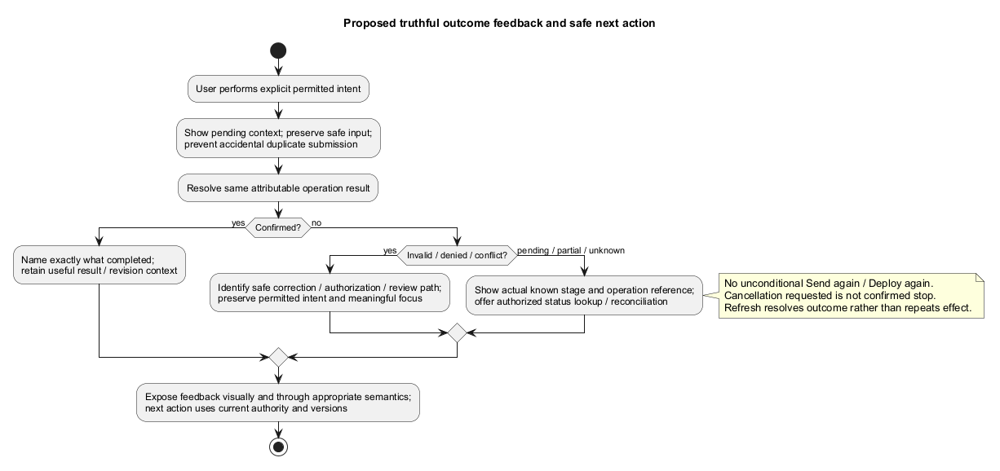

# 8. Screen Specifications

[UI/UX Design index](02-UI-UX-Design.md)

## Screen Behavior and States
Describe the purpose, visible elements and permitted actions for each screen. Capture empty, loading, denied, conflict, error and success states as relevant.

## Validation Messages
Put repairable feedback near the affected field, preserve valid values and use an accessible error summary when several fields fail.

## Existing Design Records

## Screen and interaction scope

| Area | Design focus |
| --- | --- |
| Workspace | Show the sections and actions available to the signed-in user. |
| Resume editing | Distinguish draft and published revisions. Keep preview, selection, application and publication distinct. |
| Employer sharing | Show the resume and authorized attachments. Provide clear feedback when access has expired or been revoked. |
| Application history | Distinguish editable application details from the materials actually submitted. |
| Accessibility | Carry keyboard navigation, clear focus and meaningful feedback into page and form design. |

The detailed journeys and interface states below guide screen-level work. Add wireframes and verification with the affected capability.

## 4. Forms, feedback and recovery

[User-visible outcome and safe next-action route](https://github.com/Farhad-V/Web-Resumefolio/blob/1f2acaa351ac306cb57cbe4fe9742e8bd90720d9/docs/MVP/SDLC/04-system-design/06-design-quality-and-security-analysis/diagrams/ui-outcome-recovery-route.svg)

[Editable PlantUML](https://github.com/Farhad-V/Web-Resumefolio/blob/1f2acaa351ac306cb57cbe4fe9742e8bd90720d9/docs/MVP/SDLC/04-system-design/06-design-quality-and-security-analysis/diagrams/ui-outcome-recovery-route.puml) · 

| State | Required interaction meaning |
| --- | --- |
| Loading | Identify the pending region; keep navigation/context understandable; avoid implying an operation has committed |
| Empty | Distinguish no authorized records, no filter matches and unavailable dependencies; offer only meaningful permitted next actions |
| Invalid input | Identify affected fields and correction guidance; retain safe input and avoid success feedback |
| Denied / expired context | Safe bounded explanation and permitted sign-in/refresh path; no private resource disclosure or client-side bypass |
| Conflict | Preserve intended edits safely, show actual version conflict and offer review/reapply under current authority |
| Pending / partial | Show actual stage/result and operation reference; distinguish confirmed local work from incomplete external effects |
| Unknown effect | State uncertainty and reconciliation path; no false failure or blind consequential retry |
| Confirmed | Describe exactly what completed: draft save, publication, provider acceptance or capture completeness, not a broader claim |

Use persistent in-context feedback for consequential outcomes; a short disappearing toast must not be the only record of an unknown send or failed save. Prevent accidental repeated submission while a request is pending, but server command identity remains the correctness mechanism. Refresh/back navigation reconciles the same operation rather than issuing another mutation.

Preserve user input through validation/conflict where permitted, without persisting passwords/tokens or private content in unsafe URLs, browser storage or cross-account drafts. Session expiry must not offer a fabricated saved-state guarantee. Destructive/cross-boundary confirmations identify actual target/scope and known recovery limits; ordinary reversible edits need not acquire unnecessary confirmation steps.

The official W3C explanations for [Error Identification](https://www.w3.org/WAI/WCAG22/Understanding/error-identification.html) and [Status Messages](https://www.w3.org/WAI/WCAG22/Understanding/status-messages.html) inform textual error identification and assistive feedback without disruptive focus changes. These are design obligations to verify, not existing widget behavior.
