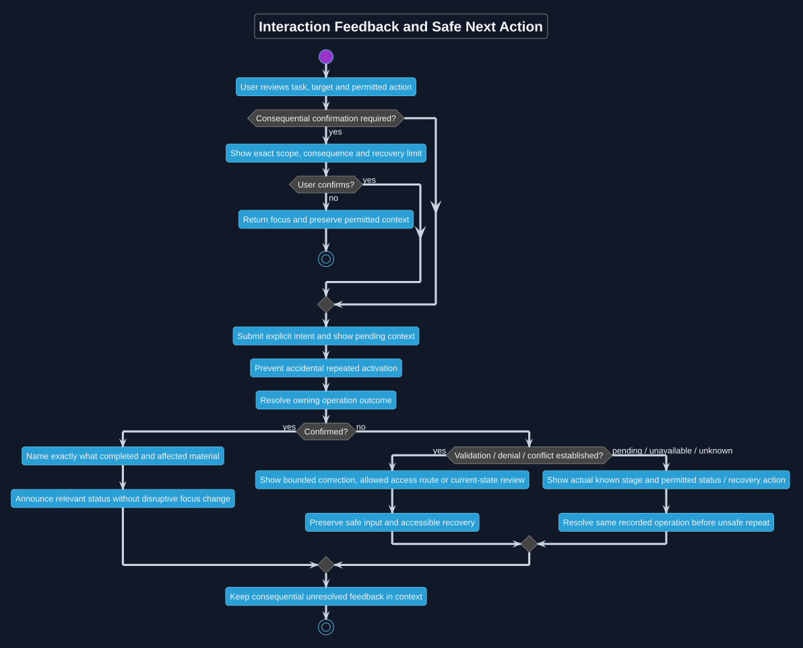

# 9. Interaction And Feedback

[Previous: Screen Specifications](08-Screen-Specifications.md) · [UI/UX Design introduction](01-Introduction.md) · [Next: Accessibility](10-Accessibility.md)

Interaction feedback tells the user what the system knows, what changed and what can safely happen next. Keep draft persistence, publication, PDF availability, sharing, submission capture and ProjectForge effects distinct. A visible control or optimistic animation does not establish permission or a committed result.

This chapter defines planned behavior for the selected MVP, not implemented widgets or passed usability/accessibility checks. Detailed results and retry rules remain in the owning [API specification](../03-Low-Level-Design/05-API-Specification.md) and component contracts.

## Motion and Transitions

Use restrained motion to preserve orientation when navigation, panels or status change. Honor relevant reduced-motion behavior and avoid movement that is required to understand a result. Essential information must remain available without animation, hover or color alone.

Keep layout stable during pending work where practical. Do not obscure focused controls, shift the main action unexpectedly or scroll the user away from a correctable error. Transition completion does not indicate that a remote write, PDF rendition or mail delivery completed.

Exact timing/easing values remain visual implementation decisions to review with the [Design System](07-Design-System.md). Do not invent service timeout or completion guarantees from animation duration.

## Notifications and Messages

| Feedback surface | Use | Rules |
| --- | --- | --- |
| Inline field feedback | Correctable input/selection problems | Associate with the field, explain correction and retain safe unrelated input |
| Error summary | Several input failures or a form-wide correction task | Meaningful links to affected fields; deliberate focus behavior when needed |
| Persistent task notice | Conflict, unavailable authority, consequential pending/partial/unknown outcome | Keep context and safe next action available; do not rely solely on a transient toast |
| Status region | Relevant asynchronous progress or confirmed state | Appropriate assistive announcement without unexpected focus movement |
| Confirmation dialog / review step | Consequential action requiring explicit intent | Identify exact target, selected material and consequence; provide safe cancellation |
| Transient notice | Supplementary low-impact confirmation | Never the only record of an unresolved or important error/outcome |
| Empty-state message | Authorized absence of content or no matches | Distinguish these from loading and unavailable dependency; offer meaningful permitted actions |

Avoid stacking repeated messages for the same operation. Scope a notice to the affected task/resource so one failed ProjectForge request does not imply every Core record failed. Keep global notices for genuinely broader conditions.

### 9.1 Message Content

Use plain task language and name the actual result: “Draft saved” differs from “Published revision available.” Copy must not expose tokens, host paths, private payloads or hidden resource names. An operation/correlation reference may be shown where it helps authorized support without granting access.

| Situation | Copy direction | Avoid implying |
| --- | --- | --- |
| Selected changes applied | Identify that the draft changed and publication remains separate | All source changes were applied or the draft was published |
| Publication confirmed | Identify the intended material/revision context | PDF generation or employer receipt also completed |
| PDF processing | Explain current availability and permitted status action | Queue acceptance means downloadable bytes exist |
| Submission capture | Identify confirmed or incomplete actual-material capture | A manual record automatically sent an application |
| Share changed | Describe the defined future-access consequence | Already downloaded bytes were recalled |
| Issue updated | Identify stable issue and confirmed change | Issue authority grants Git write |
| Unknown remote outcome | Explain that completion is unresolved and offer status resolution | Definite failure, rollback or safe unconditional retry |

Example wording is a design direction, not a replacement for exact server result codes or an obligation to expose internal version identifiers on every screen.

## Feedback by Outcome

| Outcome | Required feedback | Safe action / preservation |
| --- | --- | --- |
| Loading data | Name the affected region and retain page/resource orientation | Allow meaningful navigation; do not present missing data as empty |
| Authorized empty / no matches | Explain absence or filter context | Offer permitted create/reset-filter action where applicable |
| Invalid input | Specific textual correction near the input | Preserve permitted unrelated values and associate summary/errors |
| Denied / hidden / expired context | Bounded access feedback without private disclosure | Applicable sign-in/access or allowed navigation route; recheck current authority |
| Conflict | Explain that current state/version prevents the intended write | Preserve safe intent and review/recompare before another write |
| Pending / partial | State actual known stage/result | Observe same operation; distinguish local success from incomplete external effects |
| Unavailable / definitive failure | Describe affected capability accurately | Use contract-defined recovery; preserve already recorded outcomes |
| Unknown effect | State uncertainty explicitly | Resolve recorded identity/status before repeating a consequential operation |
| Confirmed | Name precisely the completed operation/material | Continue from the recorded result; do not infer broader success |

See the [screen outcome model](08-Screen-Specifications.md#4-forms-feedback-and-recovery) for conceptual states. Its labels do not impose a universal backend enum.

### 9.2 Feedback Decision Flow

[PlantUML source](Diagrams/interaction-feedback-route.puml) · [PNG](Diagrams/interaction-feedback-route.png)

The flow begins with deliberate permitted intent. Confirmation is conditional on consequence; routine reversible edits do not need repetitive approval steps. The result comes from the owning operation, not a client animation or assumed timeout meaning. Pending/unknown work remains connected to its recorded outcome.

## Validation and Correction

Validate transport/business input at the server owner. Client-side assistance can improve correction but cannot replace authority, version, quota or lifecycle checks. Use labels and helper text before errors occur, without relying on placeholder text as the only instruction.

After a rejected form, keep safe valid input available, associate each error with the relevant control and provide a useful summary where needed. Distinguish malformed input from denied authority, stale state and missing exact material. Do not recommend correction that substitutes a newer file for a historical submitted artifact.

Never persist passwords, tokens or private drafts in unsafe URLs/storage to provide convenience. On session expiry, explain the actual recoverable state; do not promise data restoration that the selected policy does not support.

## Consequential Confirmation and Cancellation

| Operation | Review context |
| --- | --- |
| Apply selected profile changes | Exact draft/source comparison, selected fields and affected independent text |
| Publish | Intended candidate/language, selected material and separate publication consequence |
| Share/password/link change | Actual setting being changed and defined subsequent-access effect |
| Record actual submission | Application context, exact selected material and capture completeness |
| Protected-reference removal or administrative action | Authorized target, effect and known retention/recovery limits |

A review summary may be part of the task rather than always a modal. Avoid generic “Are you sure?” copy that hides the target. Provide cancel/back before dispatch without changing the resource. After dispatch, cancellation is governed by the operation contract: requested cancellation is not proof an effect stopped, and no UI should promise rollback of delivered bytes or remote commits.

## Focus, Keyboard and Dynamic Updates

| Event | Expected focus/announcement behavior |
| --- | --- |
| Navigation to a new task | Make page purpose/current location understandable through semantic structure and the chosen navigation pattern |
| Validation failure | Expose summary/field relationships and focus deliberately where correction needs orientation |
| Modal opened | Meaningful initial focus and contained modal interaction with operable actions |
| Modal closed safely | Restore focus to the invoking or logical surviving control |
| Background state update | Announce relevant status appropriately without taking focus from ongoing work |
| Item removed / view changed | Keep focus on a meaningful surviving target, not an invisible or destroyed control |
| Board movement | Provide keyboard-operable move controls and announce meaningful confirmed change |

Prefer native semantic controls and test custom behavior in actual supported environments. Avoid keyboard traps, hover-only explanations and status meaning carried only by color. Check reduced motion, reflow/enlargement and long professional content with [Accessibility](10-Accessibility.md) and [Responsive and Localization](11-Responsive-And-Localization.md).

## Pending Work, Repeated Activation and Recovery

Prevent accidental double activation while a request is pending, keeping control purpose and status understandable. Do not describe a disabled button as an idempotency or authorization guarantee; stable server request identity and current policy enforce correctness.

Refresh, browser back or status lookup should reconstruct the existing operation/resource outcome without issuing another mutation. A lost response after commit is not proof that no effect occurred. Resolve the recorded request identity before any repeat that could duplicate publication, capture or a ProjectForge write.

Separate confirmed business state from failed downstream effects. A mail failure does not silently erase a committed account/business record; PDF failure does not imply a draft was lost. Preserve exact artifact references while their owner requires protection through uncertain finalization. Detailed retry bounds and reconciliation remain contract-specific.

## Verification and Handoff

| Scenario | Expected evidence |
| --- | --- |
| Invalid multi-field form | Correct field associations/summary, readable correction and preserved safe input |
| Stale draft / issue | No silent overwrite; understandable current-state review path |
| Denied or expired context | Safe bounded feedback and no leaked private content or client-side bypass |
| Consequential confirmation cancelled | Target unchanged and focus/context returned appropriately |
| Pending to confirmed/failed | Accurate accessible state change with no fabricated broader success |
| Lost response / unknown effect | Persistent uncertainty and same-operation resolution without blind repeat |
| Keyboard board / modal | Complete operation, predictable focus and no drag-only requirement |
| Reduced motion / narrow layout | Essential feedback, focus and actions remain available and unobscured |

Record actor/context, candidate, expected/observed outcomes, browser/input/assistive setup, limitations and follow-up. Link feedback components to [Screen Specifications](08-Screen-Specifications.md), [Design System](07-Design-System.md) and exact criteria through [UI/UX Traceability](14-Traceability.md) / [RTM](../../02-Requirements-Engineering/03-Requirements-Traceability-Matrix.md).

Use [Usability Testing](12-Usability-Testing.md) for observation and [Development Handoff](13-Handoff-To-Development.md) for implementable behavior. No runtime success, completed usability study or accessibility conformance is asserted by this specification.
