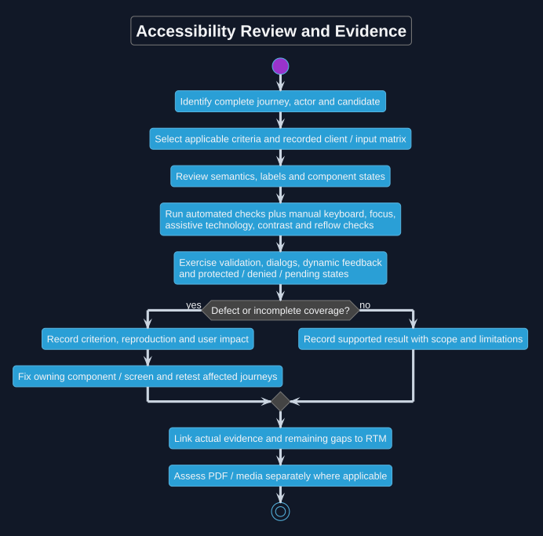

# 10. Accessibility

[Previous: Interaction and Feedback](09-Interaction-And-Feedback.md) · [UI/UX Design introduction](01-Introduction.md) · [Next: Responsive and Localization](11-Responsive-And-Localization.md)

## Accessibility Target

WCAG 2.2 AA is the planned target. Preserve the governing requirement/Q-D25 disposition and confirm applicability with the implementation assessment. This design does not claim conformance, legal certification or completed testing.

Assess complete user journeys, including authentication, errors, dialogs, pending work and protected recipient access. Isolated component checks or automated scans alone do not establish complete coverage. PDF accessibility is a separate evaluation from the web interface. The normative reference is [W3C WCAG 2.2](https://www.w3.org/TR/WCAG22/).

| Product area | Journey-level scope |
| --- | --- |
| Invited access | Invitation, sign-in, selected recovery/factor controls and permitted return context |
| Professional materials | Profile/draft editing, selected comparison/apply, preview and separate publication |
| Sharing and files | Owner settings, protected recipient entry, eligible media/PDF and denied/unavailable states |
| Applications | Tracking/follow-up, actual-material review/capture and historical retrieval |
| ProjectForge | Permitted repository browsing, issues and keyboard-operable basic board movement |
| Administration | Selected account duties, consequential review and bounded feedback |

Deferred mail/calendar, advanced review/releases, general Sprints and user execution flows do not become MVP prerequisites through this chapter.

## Keyboard, Screen Reader, Contrast and Text

### 10.1 Semantic Structure and Names

Use meaningful page titles, headings, landmarks, lists and table relationships. Identify the current resource and task without relying on visual position. Prefer native controls with explicit labels, accessible names and appropriate state/value exposure. Decorative icons should not create redundant announcements; meaningful icons/media need useful alternatives.

Identify the page language and relevant professional-language changes. An English interface may contain manually maintained German professional material; preserve that content distinction rather than inferring automatic translation. Exact revision and selected-material meaning must remain understandable in the reading order.

### 10.2 Keyboard, Focus and Pointer Interaction

| Interaction | Required design behavior |
| --- | --- |
| Navigation | Logical order, meaningful link purpose and a way to bypass repeated shell content |
| Controls | Keyboard completion and visible focus; no hidden pointer-only equivalent of an essential task |
| Dialog | Meaningful initial focus, contained modal interaction and safe focus restoration |
| Validation | Associated field errors and useful summary; deliberate orientation/focus behavior |
| Board / selection movement | Non-drag actions preserving the same permitted result |
| Dynamic content | Relevant status announced without unnecessarily stealing focus |
| Item removal | Focus moves to a meaningful surviving target |
| Sticky/overlay content | Does not entirely hide the focused control; review the applicable criterion and exceptions |

Avoid keyboard traps and hover-only instructions. Visible action labels and accessible names must convey the same task. Do not make precision pointing, dragging or sensory cues the only way to complete a required action.

### 10.3 Visual and Reflow Checks

Apply the relevant criterion and its exceptions to the actual rendered screen, not just token swatches:

| Check | WCAG reference value / scope |
| --- | --- |
| Text contrast | 4.5:1 for ordinary text; 3:1 for qualifying large text under 1.4.3 |
| Non-text contrast | 3:1 for applicable controls/graphics under 1.4.11, with its exceptions |
| Text resizing | Up to 200% without loss under 1.4.4, with its exceptions |
| Reflow | Equivalent 320 CSS-pixel width for vertical content under 1.4.10; specific two-dimensional exceptions apply |
| Target size | 24 by 24 CSS pixels or a permitted exception under 2.5.8 |

These are standard-reference checks, not new project service targets or claims that every screen passes. Evaluate actual combinations and exceptions using [WCAG 2.2](https://www.w3.org/TR/WCAG22/). The proposed 390-pixel/200%-zoom project checks alone do not cover every applicable reflow obligation.

Keep required content/actions available at enlargement and narrow widths. Do not remove essential table cells or board context merely to fit. Provide understandable navigation and useful detail/list alternatives where appropriate. Check long text, errors, spacing overrides and wrapping, not only an uncluttered screenshot.

### 10.4 Forms, Errors and Authentication

Provide labels/instructions, appropriate input purposes, associated errors and meaningful correction guidance. Preserve permitted valid input without exposing private content through unsafe storage. Do not rely on placeholder text, color or a transient toast as the sole error explanation.

Review selected sign-in/recovery/factor steps for accessible authentication and compatibility with password managers/paste under the applicable standard and security contract. Do not invent a cognitive challenge or disable essential assistance casually. Security requirements and accessible operation must be reconciled in the actual chosen mechanism.

### 10.5 Status, Pending Work and Recovery

Distinguish saved draft, published revision, PDF availability and exact submitted capture. Provide persistent in-context feedback for conflicts, consequential pending work and unknown outcomes. Relevant announcements must expose the result without disruptive focus changes or repeated noisy updates.

After a lost response, provide the permitted status/reconciliation path rather than an unconditional repeat. Denied/unavailable content should have safe meaningful feedback without revealing private data. A screen reader announcement cannot claim a business effect that the owner has not confirmed.

See [Interaction and Feedback](09-Interaction-And-Feedback.md) for detailed behavior and [Screen Specifications](08-Screen-Specifications.md) for per-screen states.

### 10.6 Media, Motion and Downloaded Documents

Meaningful professional media needs suitable alternatives; a generic filename does not necessarily describe its meaning. Evaluate captions, descriptions and playback controls where applicable. Decorative media must not obscure essential content or introduce redundant reading.

Honor relevant reduced-motion behavior, avoid unnecessary animation and assess flashing/automatic content against applicable criteria. Essential state information remains available without motion. Documentation's dark diagrams do not select the product theme; contrast must be verified in every supported implemented theme/state.

Generated/uploaded PDF requires its own assessed output: reading order, structure, language, meaningful text/alternatives and usable navigation as applicable. A usable HTML preview does not prove the downloaded PDF is accessible. Do not claim that trusted templates or a rendering library automatically produce accessible documents.

## Accessibility and Responsive Behavior

This explicit anchor preserves existing cross-document references. Coordinate structure, reading order, viewport behavior and language with [Responsive and Localization](11-Responsive-And-Localization.md) and [Design System](07-Design-System.md).

Use content-driven layout adaptation and keep focus, validation and primary actions reachable. Where a genuine two-dimensional view requires special handling, record the criterion interpretation and test evidence rather than assuming every table/board is exempt.

Browser, operating system, viewport/zoom, input and assistive technology must be recorded for each relevant assessment. Do not use “current browser” as a timeless compatibility claim or invent a completed client matrix.

## Review Flow

[PlantUML source](Diagrams/accessibility-review.puml) · [PNG](Diagrams/accessibility-review.png)

The flow combines automated findings with manual complete-path evaluation. A defect requires scoped correction and affected-journey retesting. A clean automated result is not an all-criteria pass; missing evidence remains a gap. The diagram describes planned review, not executed results.

## Evidence by Interaction

| Scenario | Required observation |
| --- | --- |
| Multi-field form failure | Labels, field/error associations, summary links, focus orientation and safe value preservation |
| Selected update/publication | Keyboard completion, understandable selection/revision and separate confirmation |
| Dialog cancel/confirm | Appropriate initial focus, modal operation, safe dismissal and focus return |
| Recipient protected view | Reading order, language, eligible downloads and safe invalid/changed-access feedback |
| Application history | Exact submitted-material identity and capture completeness understandable without visual cues alone |
| Issue/board movement | Equivalent non-drag task, stable identity, conflict handling and announced result |
| Pending/unknown outcome | Persistent accessible status and safe same-operation recovery |
| Narrow/enlarged layout | Essential actions/context remain available, with no obscured focus or clipped error content |
| Private media/PDF | Appropriate alternatives and separate downloaded-document assessment |

Use synthetic data and actual permitted/denied contexts. Record candidate/build, resource/data versions, criterion, steps, expected/observed result, tools/settings, evidence and limitations. Avoid credentials/private payloads in screenshots and shared logs.

## Findings, Remediation and Acceptance

For each finding, identify the failed criterion or documented usability concern, affected journey/control, reproducible conditions and user impact. Link corrective work and re-evaluate affected shared components/screens on the changed candidate. Keep accessibility defects distinct from subjective visual preferences and usability observations.

Record untested criteria, unsupported configurations, third-party content limitations and unresolved requirement dispositions explicitly. Do not convert missing coverage into a pass or claim whole-product AA conformance from a small sample.

Use [Usability Testing](12-Usability-Testing.md), [Development Handoff](13-Handoff-To-Development.md) and [UI/UX Traceability](14-Traceability.md) with the [RTM](../../02-Requirements-Engineering/03-Requirements-Traceability-Matrix/README.md). The [SRS quality/accessibility requirements](../../02-Requirements-Engineering/01-Software-Requirements-Specification/03-Requirements-Specification/14-Quality-Security-And-Recovery-Requirements.md#requirements-specification-quality-security-and-recovery-requirements) retain governing status.

## Existing Design Records and References

The semantic, keyboard, focus, reflow and media guidance above consolidates the earlier record without documentary review dates. Existing sources remain supporting guidance:

- [WCAG 2.2](https://www.w3.org/TR/WCAG22/): normative requirements and conformance scope.
- [ARIA Authoring Practices introduction](https://www.w3.org/WAI/ARIA/apg/practices/read-me-first/): evaluate custom widget semantics and behavior.
- [Keyboard understanding](https://www.w3.org/WAI/WCAG22/Understanding/keyboard.html): keyboard operation and exceptions.
- [Reflow understanding](https://www.w3.org/WAI/WCAG22/Understanding/reflow.html): enlargement, equivalent viewport and applicable exceptions.

No widget compatibility, assistive-technology support, completed assessment or PDF conformance is established by this documentation update.
